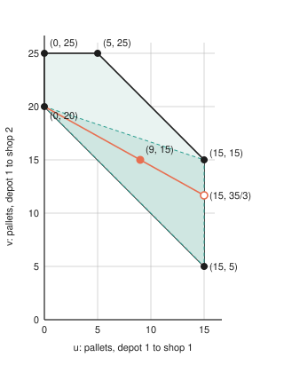

# Krein-Milman: a compact convex set is rebuilt from its corners

[Syllabus](../../../SYLLABUS.md) → [Functional analysis](../README.md) → [Banach Algebras and Fixed Points](../README.md#s06) → Krein-Milman

---

## General Overview

Two depots hold pallets of bottled water. Depot 1 has 30 pallets and depot 2 has 20. Three shops need 15, 25 and 10 pallets. A **transport plan** says how many pallets travel along each of the six routes, so that both depots empty and every shop gets what it needs. All numbers on this card are illustrative.

Two numbers fix a plan: $`u`$, the pallets from depot 1 to shop 1, and $`v`$, the pallets from depot 1 to shop 2. The other four routes follow from the totals. So the allowed plans fill a flat five-sided region. Its five corners are whole-pallet plans, each with at least two routes left empty.

A planner who wants fairness sends each depot's stock in proportion to the shops' needs. Depot 1 sends 9, 15 and 6 pallets; depot 2 sends 6, 10 and 4. That plan is not a corner. It is an average of three corners: run corner plan (0, 20) on two days of a five-day week, corner (15, 15) on two days and corner (15, 5) on one day. Over the week every route carries, on average, exactly the proportional plan, and every single day is a simple whole-pallet plan.

This card shows that the corners always rebuild the whole set this way. It works for any compact convex set, including sets in spaces with infinitely many coordinates, such as all the ways to spread one unit of supply along a road. There the corners rebuild the set through averages and limits of averages.

**A compact convex set has extreme points, the points that are not the midpoint of two other points of the set, and every point of the set is an average of extreme points or a limit of such averages.**

**What kind of fact this is:** a theorem, the Krein-Milman theorem (1940), proved on this card in Why it works. The finite-dimensional case, Minkowski's theorem, is proved by a method the code runs. The general case needs Zorn's lemma, a form of the axiom of choice (a rule of set theory that lets a proof pick from infinitely many options at once). Every concrete set on this card has its extreme points listed directly, with no choice needed.

### The picture: the plans, their corners and one rebuild

<p align="center"></p>

Drawn to scale, 12 units to 1 pallet both ways. Across: $`u`$, pallets from depot 1 to shop 1. Up: $`v`$, pallets from depot 1 to shop 2. The black dots are the five corners. The orange line is the peel of Why it works, Step 1: it starts at a corner, passes through the plan and stops on the edge. The dashed triangle holds the three corners that rebuild the plan.

---

## The formula

Notation first, in words.

- A set $`K`$ is **convex** when it holds the whole straight segment between any two of its points ([Convex sets](../../05-Geometry%20and%20trig/07-Points%2C%20Convexity%20and%20Fractals/02-convex-sets-and-convex-hulls.md)).
- A point $`e`$ of $`K`$ is an **extreme point** when $`e = (y + z)/2`$ with $`y`$, $`z`$ in $`K`$ forces $`y = z = e`$. In words: $`e`$ is not the midpoint of two other points of $`K`$. A corner of a polygon is an extreme point; a point on an edge or inside is not.
- $`\mathrm{ext}\,K`$, read "the extreme points of K", is the set of all of them. This card introduces the notation.
- A **convex combination** (weighted average) of points $`v_1, \dots, v_m`$ is $`\lambda_1 v_1 + \dots + \lambda_m v_m`$, with every weight $`\lambda_k \ge 0`$ and the weights adding to 1.
- $`\mathrm{co}\,S`$, the **convex hull** of a set $`S`$, is all convex combinations of points of $`S`$. $`\overline{\mathrm{co}}\,S`$, the **closed convex hull**, adds every limit of such combinations.

**Minkowski's theorem**, the finite case. If $`K`$ is a compact convex set in $`d`$ dimensions, every $`x`$ in $`K`$ is an average of at most $`d + 1`$ extreme points:

```math
x = \lambda_1 v_1 + \dots + \lambda_m v_m, \qquad v_k \in \mathrm{ext}\,K, \quad \lambda_k \ge 0, \quad \lambda_1 + \dots + \lambda_m = 1, \quad m \le d + 1 .
```

**The Krein-Milman theorem.** If $`K`$ is a nonempty compact convex set in a normed space, then $`\mathrm{ext}\,K`$ is not empty and

```math
K = \overline{\mathrm{co}}\,(\mathrm{ext}\,K) .
```

The same holds in a dual space $`X'`$ (the bounded functionals on a normed space $`X`$) when "compact" is read in the weak-star sense: $`\varphi_n \to \varphi`$ weak-star means $`\varphi_n(x) \to \varphi(x)`$ for every single $`x`$ in $`X`$, with no uniform rate demanded.

**Read it aloud:** a compact convex set has corners, and the corners, averaged and then closed up under limits, give back every point of the set.

Worked once on the depots: the region has dimension $`d = 2`$, so at most 3 corners are needed. The proportional plan is $`(9, 15) = \tfrac{2}{5}(0, 20) + \tfrac{2}{5}(15, 15) + \tfrac{1}{5}(15, 5)`$.

| Symbol | Plain meaning | In our example | Push it up and the answer… |
| --- | --- | --- | --- |
| $`K`$ | the compact convex set | the five-sided region of allowed plans | a bigger set can have more corners |
| $`x`$, $`y`$, $`z`$, $`x_0`$, $`p`$, $`q`$; $`(u, v)`$ | points of $`K`$ ($`y`$ is the peel's stop); a plan named by its two free routes | the proportional plan, (9, 15); stop $`y = (15, 35/3)`$ | — |
| $`x_{ij}`$; $`a_i`$, $`b_j`$ | pallets from depot $`i`$ to shop $`j`$; depot stocks; shop needs | $`a = (30, 20)`$, $`b = (15, 25, 10)`$ | a bigger need moves the region |
| $`\mathrm{ext}\,K`$; $`v_k`$, $`e`$ | the extreme points; one of them | 5 corners; (0, 20), (15, 15), (15, 5) used | — |
| $`\lambda_k`$; $`m`$ | the weights; how many corners are used | 2/5, 2/5, 1/5; $`m = 3`$ | — |
| $`d`$ | the dimension of $`K`$ | $`(2 - 1)(3 - 1) = 2`$ | up to $`d + 1`$ corners needed |
| $`\mathrm{co}\,S`$, $`\overline{\mathrm{co}}\,S`$; $`C`$ | averages of points of $`S`$; those plus their limits; $`C`$ is $`\overline{\mathrm{co}}\,(\mathrm{ext}\,K)`$ | the region itself | — |
| $`t`$; $`t^*`$ | the peel's stretch: how far past $`x`$ the walk from a corner goes; its largest allowed value | 5/3 | a bigger $`t`$ puts more weight, $`1 - 1/t`$, on the starting corner |
| $`\varphi`$; $`M`$; $`X'`$ | a bounded functional: a linear measurement, such as a cost; its largest value on $`K`$; all such functionals | minus the cost, at £3 to £9 a pallet per route; $`M`$ = −£240, from the cheapest corner (15, 5) | — |
| $`F`$; $`F_0`$ | a face of $`K`$; a smallest closed face | the edge $`u = 15`$; one corner | — |
| $`N`$; $`\delta_a`$; $`\mu`$; $`f`$ | the size of a truncation; a point mass, one unit all at $`a`$; a spread of one unit over [0, 1]; a continuous test function | N depots and shops, or N point masses; the even spread; $`f(x) = x^2`$ | finite sets need no closure |
| $`W_1`$ | the transport distance between two spreads (Worked numbers) | 1/(4N) | — |

The sequence space $`c_0`$ (lists that tend to 0, measured by their largest entry) and the unit list $`e_n`$ come from [Sequence spaces](../01-Normed%20and%20Banach%20Spaces/02-sequence-spaces-lp-and-c0.md).

### When it holds

- **The set is compact.** The unit ball of $`c_0`$ is closed, bounded and convex, but not compact, and it has no extreme points at all. Every list in it has some entry of size at most 1/2, because its entries tend to 0; move that entry up and down by 1/2 and both lists stay in the ball. For $`x_n = 1/n`$: $`x`$ is the midpoint of $`x + e_2/2`$ and $`x - e_2/2`$. Its truncation to $`N`$ entries is a cube with $`2^N`$ corners, but every corner has every entry ±1, and such a list never tends to 0.
- **The set is convex.** The 161 whole-pallet plans on their own are not convex: their averages include plans with fractions of a pallet. The rebuild then gives the convex hull, a bigger set than the one you started with.
- **The closure is kept, in infinite dimensions.** The even spread of one unit along a road is not an average of finitely many point masses. It is only a limit of them, which is why the theorem says $`\overline{\mathrm{co}}`$, not $`\mathrm{co}`$.
- **There are enough continuous measurements.** The proof separates points with bounded functionals, which a normed space, or a dual space with the weak-star topology, always supplies. In the space $`L^p`$ with $`0 < p < 1`$ the only continuous linear functional is 0, so the proof has no wall to build and the theorem is no longer guaranteed.
- **In general, choice is used.** Finding one extreme point of an abstract compact convex set uses Zorn's lemma. For a polytope, or for spreads of mass, the extreme points can be listed directly.

---

## Why it works

### Step 0: the idea, in words

Take a point that is not a corner. Walk from a corner, through the point, until you hit the edge of the set. The point is then an average of the corner and the stopping point. The stopping point lies on a face of lower dimension (an edge, here), so repeat on that face. After at most $`d`$ walks you have reached corners only.

In infinite dimensions the dimension never runs out, so the proof works the other way round. First it shows that corners exist, using Zorn's lemma. Then it shows that no point of $`K`$ can be fenced off from the closed hull of the corners, using a separating wall.

### Step 1: the peel, on the depots

Start at the corner $`v_1 = (0, 20)`$ and walk through the plan $`x = (9, 15)`$: the walk is $`v_1 + t\,(x - v_1)`$, direction $`(9, -5)`$. As $`t`$ grows, three routes shrink.

| Route that shrinks | Pallets at the corner | Lost per unit of $`t`$ | Runs out at $`t`$ |
| --- | --- | --- | --- |
| depot 1 to shop 2 | 20 | 5 | 4 |
| depot 1 to shop 3 | 10 | 4 | 2.5 |
| depot 2 to shop 1 | 15 | 9 | **5/3** |

The first to run out stops the walk at $`t = 5/3`$, at $`y = (15, 35/3)`$, on the edge $`u = 15`$ where depot 2 sends nothing to shop 1. Since $`x = v_1 + (y - v_1)/t`$, the plan is $`x = \tfrac{2}{5} v_1 + \tfrac{3}{5} y`$.

The edge $`u = 15`$ runs from corner (15, 5) to corner (15, 15). Repeat the walk on it: $`y = \tfrac{1}{3}(15, 5) + \tfrac{2}{3}(15, 15)`$. Multiply out: $`\tfrac{3}{5} \times \tfrac{1}{3} = \tfrac{1}{5}`$ and $`\tfrac{3}{5} \times \tfrac{2}{3} = \tfrac{2}{5}`$. So $`x = \tfrac{2}{5}(0, 20) + \tfrac{1}{5}(15, 5) + \tfrac{2}{5}(15, 15)`$.

<details>
<summary>Detailed proof: Minkowski's theorem, by induction on dimension</summary>

Let $`K`$ be compact and convex in $`d`$ dimensions. For $`d = 0`$, $`K`$ is one point, which is extreme. Suppose the theorem holds below dimension $`d`$, and take $`x`$ in $`K`$.

If $`x`$ is extreme, stop. If not, $`K`$ has an extreme point $`v \ne x`$: the point of $`K`$ farthest from $`x`$ in straight-line distance is one, because a midpoint of two different points is strictly closer to $`x`$ than the farther of them. Walk from $`v`$ through $`x`$:

$`\displaystyle y = v + t^*(x - v), \qquad t^* = \max\{\, t \ge 1 : v + t(x - v) \in K \,\}.`$

The maximum exists because $`K`$ is compact, and $`t^* \ge 1`$ because $`x`$ is in $`K`$. The point $`y`$ lies on the boundary of $`K`$ (relative to the smallest flat containing it), so some supporting wall touches $`K`$ at $`y`$. The points of $`K`$ on that wall form a compact convex face $`F`$ of dimension below $`d`$.

By the induction step, $`y`$ is an average of at most $`d`$ extreme points of $`F`$. An extreme point of a face is an extreme point of $`K`$ (Step 2). And $`x = (1 - 1/t^*)\,v + (1/t^*)\,y`$. So $`x`$ is an average of at most $`d + 1`$ extreme points of $`K`$.

</details>

### Step 2: faces, and why the best point of a linear measurement is a corner

A **face** of $`K`$ is a convex part $`F`$ of $`K`$ with one rule: if the midpoint of two points of $`K`$ lies in $`F`$, both points lie in $`F`$. An extreme point is a face with one point. Two facts carry the rest of the proof.

1. **The best set of a measurement is a face.** Let $`\varphi`$ be a bounded functional with largest value $`M`$ on $`K`$. If $`(y + z)/2`$ scores $`M`$, then $`\varphi(y) + \varphi(z) = 2M`$, and neither can exceed $`M`$, so both equal $`M`$. On the depots, let a pallet cost £4, £6 and £9 to ship from depot 1 to shops 1, 2 and 3, and £5, £3 and £7 from depot 2. The cheapest plan is the best set of $`\varphi`$ = minus the cost, so it is a face too: here the single corner (15, 5), at £240, so $`M`$ = −£240. The [Corners are enough](../../15-Optimization/04-Linear%20Programming/02-corners-and-the-fundamental-theorem.md) card proves this for every linear program.
2. **A face of a face is a face.** So an extreme point of a face $`F`$ is an extreme point of $`K`$.

### Step 3: Zorn's lemma picks a smallest closed face

Order the nonempty closed faces of $`K`$ by "is part of". In a chain of them, any finitely many have a smallest member, which is nonempty. Compactness then makes the whole chain's intersection nonempty, and that intersection is again a closed face.

**Zorn's lemma** says: if every chain in an ordered collection has a lower bound in the collection, the collection has a minimal member. It is equivalent to the axiom of choice, and it is taught on the [Compactness with no distances, and Tychonoff](../../17-Topology/02-Topological%20Spaces/06-compactness-and-tychonoff.md) card. Here it gives a minimal closed face $`F_0`$.

### Step 4: a smallest closed face is a single point

Suppose $`F_0`$ held two points $`p \ne q`$. The [Hahn-Banach](../01-Normed%20and%20Banach%20Spaces/06-hahn-banach-theorem.md) theorem gives a bounded functional with $`\varphi(p) < \varphi(q)`$. $`F_0`$ is compact, so $`\varphi`$ reaches its largest value on $`F_0`$. By Step 2 the points where it does form a closed face, inside $`F_0`$ and missing $`p`$. That contradicts minimality. So $`F_0`$ is a single point, an extreme point of $`K`$. In particular $`\mathrm{ext}\,K`$ is not empty.

### Step 5: nothing escapes the closed hull of the corners

Let $`C = \overline{\mathrm{co}}\,(\mathrm{ext}\,K)`$. It lies inside $`K`$, because $`K`$ is convex and closed. Suppose some $`x_0`$ in $`K`$ lies outside $`C`$.

1. The [Separation](../01-Normed%20and%20Banach%20Spaces/07-hahn-banach-separation-and-supporting-walls.md) theorem gives a bounded functional with $`\varphi(x_0) > \max_C \varphi`$.
2. The points of $`K`$ where $`\varphi`$ is largest form a closed face (Step 2). Steps 3 and 4, run inside that face, give an extreme point $`e`$ of $`K`$ in it.
3. Then $`\varphi(e) = \max_K \varphi \ge \varphi(x_0) > \max_C \varphi \ge \varphi(e)`$, since $`e`$ is in $`C`$. That is impossible.

So $`K = C`$.

### Step 6: what the theorem buys

- **Bauer's maximum principle.** A continuous linear measurement, or a convex one ([Convex functions](../../06-Calculus%20and%20analysis/07-Several%20Variables/09-convex-functions.md)) that is upper semicontinuous (at a limit point its value may drop but never jump up; every continuous one qualifies), reaches its largest value on $`K`$ at an extreme point. The convex case is stated here, with its proof in Phelps (Sources). For a linear one: the best set is a closed face (Step 2), and Steps 3 and 4 find an extreme point inside it.
- **A test for being a dual space.** The unit ball of a dual space $`X'`$ is weak-star compact (Banach-Alaoglu, on the [Weak convergence](../02-Hilbert%20Spaces/09-weak-convergence-and-banach-alaoglu.md) card), so it has extreme points. The unit ball of $`c_0`$ has none, so $`c_0`$, with its own norm, is not the dual of any normed space.

---

## Worked numbers, by hand

| Step | Arithmetic | Value |
| --- | --- | --- |
| dimension of the region | (2 depots − 1) × (3 shops − 1) | 2 |
| corners: two limits bind, plan allowed | intersect the 6 empty-route lines in pairs | 5 corners |
| proportional plan | $`x_{ij} = a_i b_j / 50`$, with 50 the total pallets | 9, 15, 6 and 6, 10, 4 |
| walk from (0, 20) through (9, 15) | depot 2 to shop 1 runs out first: 15 / 9 | t = 5/3 |
| stop | (0, 20) + (5/3)(9, −5) | (15, 35/3) |
| first split | 1 − 1/t and 1/t | 2/5 corner, 3/5 stop |
| second split, on the edge u = 15 | 5 + 10 × (2/3) = 35/3 | 1/3 of (15, 5), 2/3 of (15, 15) |
| weights | 2/5; 3/5 × 1/3; 3/5 × 2/3 | **2/5, 1/5, 2/5** |
| cost check | 2/5 × £300 + 1/5 × £240 + 2/5 × £250 | £268, the plan's own cost |

In a five-day week: corner plan (0, 20) on two days, (15, 5) on one day and (15, 15) on two days, and every route carries the proportional plan on average.

### One plan, many rebuilds

The rebuild is not unique. Of the 10 triangles on three of the five corners, 4 hold the plan, and each gives different weights:

| Corners used | Weights |
| --- | --- |
| (0, 20), (5, 25), (15, 5) | 2/15, 2/5, 7/15 |
| (0, 20), (15, 5), (15, 15) | 2/5, 1/5, 2/5 |
| (0, 25), (5, 25), (15, 5) | 1/5, 3/10, 1/2 |
| (0, 25), (15, 5), (15, 15) | 2/5, 2/5, 1/5 |

Every row averages back to (9, 15). The weights are unique only when $`K`$ is a **simplex**, a set with $`d + 1`$ corners, such as a triangle.

### From five corners to infinitely many

**N depots and N shops, one pallet each.** The corners are the one-to-one plans, where each depot serves exactly one shop. There are $`N!`$ of them. They are whole numbers, as the [Total unimodularity](../../15-Optimization/05-Integer%20and%20Combinatorial%20Optimisation/05-total-unimodularity.md) card explains. That these are all the corners, so every plan is an average of them, is the Birkhoff-von Neumann theorem.

| N | Corners (N!) | Dimension (N − 1)² | Corners that rebuild the even plan, 1/N on every route |
| --- | --- | --- | --- |
| 2 | 2 | 1 | 2 |
| 3 | 6 | 4 | 3 |
| 4 | 24 | 9 | 4 |

The even plan needs only the $`N`$ cyclic shifts (depot $`i`$ serves shop $`i + s`$, wrapping round), fewer than the $`d + 1`$ allowed once $`N`$ is 3 or more.

**One unit spread along a road.** Now let the shops become every point of a road of length 1, and spread one unit of supply along it. A spread $`\mu`$ is a way of placing one unit of mass on [0, 1]. The spreads form a convex set, compact in the weak-star sense: $`\mu_N \to \mu`$ when $`\int f\, d\mu_N \to \int f\, d\mu`$ for every continuous $`f`$. Its extreme points are the point masses $`\delta_a`$, one unit all at $`a`$.

The even spread is not an average of finitely many point masses. Try $`N`$ equal masses at the midpoints $`(k - 1/2)/N`$:

| N | $`W_1`$ (closed form 1/(4N)) | Error on $`f(x) = x^2`$ | Total variation |
| --- | --- | --- | --- |
| 1 | 0.250000 | 0.083333333333 | 2 |
| 10 | 0.025000 | 0.000833333333 | 2 |
| 100 | 0.002500 | 0.000008333333 | 2 |
| 1000 | 0.000250 | 0.000000083333 | 2 |

$`W_1`$ is the transport distance: the least average distance each bit of mass must travel to turn one spread into the other. It falls like $`1/N`$, and the test-function error like $`1/(12N^2)`$, so the averages converge weak-star. In the total-variation norm (the total mass that sits in the wrong place, counted on both sides) the distance is 2 at every $`N`$: the averages never converge in norm. That is a trend that does not close. So the closure in $`\overline{\mathrm{co}}`$ is needed, and it must be the weak-star closure.

The truncation hides one thing. Every finite set on this card is a polytope with finitely many corners and needs no closure. The infinite case needs both the closure and a named topology.

### What breaks if you drop a piece

| Mistake | Comes out at | What went wrong |
| --- | --- | --- |
| Count every whole-pallet plan on the boundary as a corner | 45 "corners", not 5 | A plan in the middle of an edge is the midpoint of its neighbours |
| Average all five corners with equal weights | (7, 18), not (9, 15) | The weights must solve the plan's equations |
| Drop compactness: the unit ball of $`c_0`$ | no extreme points; $`1/n`$ is the midpoint of $`x \pm e_2/2`$ | Closed and bounded is not compact in infinite dimensions |
| Drop the closure: finite averages of point masses | $`W_1`$ = 0.25, 0.025, 0.0025, 0.00025 at N = 1 to 1000, never 0 | The even spread is a limit of averages, not an average |

The code prints all four.

---

## Code, from first principles, and it actually runs

The code finds the corners by two independent roads. Road one intersects the six empty-route lines in pairs and keeps the allowed points. Road two tests all 161 whole-pallet plans and keeps those that are not the midpoint of two other plans. It rebuilds the proportional plan by running the peel from Step 1. It then checks the weights a second way, by Cramer's rule in every triangle of three corners, and by the cost, which must average to £268. Then it counts the $`N!`$ corners by brute force over 0/1 tables, wiggles a point of the $`c_0`$ ball, and measures point masses against the even spread by a direct integral and by the closed form. The total variation is summed over the atoms and the gaps between them, and must reach its ceiling of 2. Python uses the `fractions` module; the Rust writes its own fraction type.

### Python

```python
# Krein-Milman: find the corners of a transport plan's feasible set and rebuild a plan
# from them.  Standard library only; Fractions keep every plan exact.  Two depots (30 and
# 20 pallets) ship to three shops (15, 25 and 10).  A plan is fixed by u = depot 1 -> shop 1
# and v = depot 1 -> shop 2; the other four entries follow from the totals.
from fractions import Fraction as F
SUP, DEM, COST = [30, 20], [15, 25, 10], [[4, 6, 9], [5, 3, 7]]
ROWS = [(1, 0, 0), (0, 1, 0), (-1, -1, 30), (-1, 0, 15), (0, -1, 25), (1, 1, -20)]  # a*u + b*v + c

def entries(p): return [a * p[0] + b * p[1] + c for a, b, c in ROWS]
def feasible(p): return all(e >= 0 for e in entries(p))
def grid(p): e = entries(p); return [[e[0], e[1], e[2]], [e[3], e[4], e[5]]]
def cost(p): return sum(COST[i][j] * grid(p)[i][j] for i in range(2) for j in range(3))
def fr(x): return str(x.numerator) if x.denominator == 1 else f"{x.numerator}/{x.denominator}"
def pt(p): return f"({fr(F(p[0]))}, {fr(F(p[1]))})"
def row(r): return "[" + ", ".join(fr(F(e)) for e in r) + "]"

# road 1: a corner is where two limits bind -- intersect every pair of zero-lines
road1 = set()
for i in range(6):
    for j in range(i + 1, 6):
        (a1, b1, c1), (a2, b2, c2) = ROWS[i], ROWS[j]
        det = a1 * b2 - a2 * b1
        if det:
            p = (F(-c1 * b2 + c2 * b1, det), F(-a1 * c2 + a2 * c1, det))
            if feasible(p): road1.add(p)
CORNERS = sorted(road1)
# road 2: test every whole-pallet plan: a corner is not the midpoint of two other plans
DIRS = [(1, 0), (0, 1), (1, -1), (1, 1)]
plans = [(F(u), F(v)) for u in range(16) for v in range(26) if feasible((u, v))]
road2 = [p for p in plans if not any(feasible((p[0] + F(d[0], 2), p[1] + F(d[1], 2))) and
         feasible((p[0] - F(d[0], 2), p[1] - F(d[1], 2))) for d in DIRS)]
edge = [p for p in plans if 0 in entries(p)]
assert road2 == CORNERS and len(CORNERS) == 5
print(f"whole-pallet plans {len(plans)}, on the boundary {len(edge)}, corners {len(CORNERS)}, dimension (2-1)(3-1) = 2")
for c in CORNERS:
    print(f"corner {pt(c)}: depot 1 sends {row(grid(c)[0])}, depot 2 sends {row(grid(c)[1])}, cost {cost(c)}")
assert min(cost(p) for p in plans) == min(cost(c) for c in CORNERS) == 240

def peel(x, corners):  # the proof of Minkowski's theorem, run: returns {corner: weight}
    if x in corners: return {x: F(1)}
    zero = [k for k, e in enumerate(entries(x)) if e == 0]
    face = [c for c in corners if all(entries(c)[k] == 0 for k in zero)]
    v = face[0]
    d = (x[0] - v[0], x[1] - v[1])
    t = min(e / -(a * d[0] + b * d[1]) for e, (a, b, c) in zip(entries(v), ROWS)
            if a * d[0] + b * d[1] < 0)        # walk from v through x until a limit binds
    y = (v[0] + t * d[0], v[1] + t * d[1])
    out = {c: w / t for c, w in peel(y, face).items()}
    out[v] = out.get(v, F(0)) + 1 - 1 / t
    return out

X = (F(SUP[0] * DEM[0], 50), F(SUP[0] * DEM[1], 50))  # proportional plan: a_i b_j / 50
W = peel(X, CORNERS)
print(f"proportional plan {pt(X)}: depot 1 sends {row(grid(X)[0])}, depot 2 sends {row(grid(X)[1])}, cost {cost(X)}")
v0, y = CORNERS[0], (F(15), F(35, 3))  # the stop, checked: on the line, on the edge, 3/5 of the way
assert feasible(y) and entries(y)[3] == 0 and X == (F(2, 5) * v0[0] + F(3, 5) * y[0], F(2, 5) * v0[1] + F(3, 5) * y[1])
assert y == (F(1, 3) * 15 + F(2, 3) * 15, F(1, 3) * 5 + F(2, 3) * 15)  # the stop splits its edge 1/3 : 2/3
print(f"peel: walk from corner {pt(v0)} through {pt(X)}, stop at {pt(y)} on the edge u = 15, t = 5/3")
print(f"  plan = 2/5 x {pt(v0)} + 3/5 x stop; stop = 1/3 x (15, 5) + 2/3 x (15, 15)")
for c in sorted(W): print(f"  weight {fr(W[c])} on corner {pt(c)}, cost {cost(c)}")
mix = [[sum(W[c] * grid(c)[i][j] for c in W) for j in range(3)] for i in range(2)]
assert mix == grid(X) and sum(W.values()) == 1 and len(W) <= 3
assert sum(W[c] * cost(c) for c in W) == cost(X) == 268
# road 2 to the weights: Cramer's rule in every triangle of three corners
def bary(p, a, b, c):
    det = (b[0] - a[0]) * (c[1] - a[1]) - (c[0] - a[0]) * (b[1] - a[1])
    if det == 0: return None
    wb = ((p[0] - a[0]) * (c[1] - a[1]) - (c[0] - a[0]) * (p[1] - a[1])) / det
    wc = ((b[0] - a[0]) * (p[1] - a[1]) - (p[0] - a[0]) * (b[1] - a[1])) / det
    return (1 - wb - wc, wb, wc)
tri = [(i, j, k) for i in range(5) for j in range(i + 1, 5) for k in range(j + 1, 5)]
hold = [(t, bary(X, *[CORNERS[n] for n in t])) for t in tri]
hold = [(t, w) for t, w in hold if w and min(w) >= 0]
print(f"corner triangles holding the plan: {len(hold)} of {len(tri)}")
for t, w in hold:
    print(f"  {' + '.join(fr(a) + ' x ' + pt(CORNERS[n]) for a, n in zip(w, t))}")
assert any({CORNERS[n]: a for a, n in zip(w, t) if a} == W for t, w in hold) and len(hold) > 1
even = (sum(c[0] for c in CORNERS) / 5, sum(c[1] for c in CORNERS) / 5)
print(f"mistake: equal weights 1/5 on all five corners give {pt(even)}, not {pt(X)}")
print("figure, corners " + " ".join(pt(c) for c in CORNERS) + f"; plan {pt(X)}; stop {pt(y)}")

# N depots and N shops, one pallet each: the corners are the N! one-to-one plans
def count01(n):  # brute force over every 0/1 table with row and column sums 1
    good = 0
    for m in range(2 ** (n * n)):
        b = [[(m >> (n * i + j)) & 1 for j in range(n)] for i in range(n)]
        good += all(sum(r) == 1 for r in b) and all(sum(b[i][j] for i in range(n)) == 1 for j in range(n))
    return good
for n in (2, 3, 4):
    fact = 1
    for k in range(2, n + 1): fact *= k
    shifts = [[[int((i + s) % n == j) for j in range(n)] for i in range(n)] for s in range(n)]
    ok = all(sum(r) == 1 and sum(b[k][j] for k in range(n)) == 1 for b in shifts for j, r in enumerate(b))
    avg = [[sum(F(b[i][j], n) for b in shifts) for j in range(n)] for i in range(n)]
    assert count01(n) == fact and ok and all(e == F(1, n) for r in avg for e in r)
    print(f"N = {n}: corners {fact}, dimension {(n - 1) ** 2}, even plan = average of {n} shifts")

# the c0 ball: closed, bounded, convex, not compact -- every point can be wiggled
for n in (4, 8, 16):
    print(f"N = {n}: the cube [-1, 1]^N has {2 ** n} corners; each has every entry +1 or -1")
x = [F(1, k) for k in range(1, 17)]  # x_n = 1/n, in the c0 ball; entry 2 is 1/2
up, dn = x[:1] + [x[1] + F(1, 2)] + x[2:], x[:1] + [x[1] - F(1, 2)] + x[2:]
assert max(abs(e) for e in up) == max(abs(e) for e in dn) == 1 and x[1] == F(1, 2)
print("c0: x_n = 1/n is the midpoint of x + e_2/2 and x - e_2/2, both of sup norm 1")

# one unit spread evenly over [0, 1] against N point masses at the midpoints (k - 1/2)/N
for n in (1, 10, 100, 1000):
    m = 10 * n; h = 1 / m; w1 = 0.0
    for i in range(m):  # W1 = integral of |F_even - F_points|, midpoint rule, kinks on cell edges
        s = (i + 0.5) * h
        w1 += abs(s - min(n, int(s * n + 0.5)) / n) * h
    sq = sum(((k - 0.5) / n) ** 2 for k in range(1, n + 1)) / n
    cuts = [F(0)] + [F(2 * k - 1, 2 * n) for k in range(1, n + 1)] + [F(1)]  # 0, the n atoms, 1
    # total variation, summed over pieces: each atom (points 1/n, even spread 0) and each gap
    # between atoms (points 0, even spread its length); it can never exceed 1 + 1, the two masses
    tv = sum(abs(F(1, n) - 0) for a in cuts[1:-1]) + sum(abs(0 - (b - a)) for a, b in zip(cuts, cuts[1:]))
    assert tv == 1 + 1
    assert abs(w1 - 1 / (4 * n)) < 1e-12 and abs((1 / 3 - sq) - 1 / (12 * n * n)) < 1e-12
    print(f"N = {n}: W1 = {w1:.6f} (1/4N = {1 / (4 * n):.6f}), x^2 error {1 / 3 - sq:.12f}, total variation {tv}")
print("ALL CHECKS PASS")
```

**Ran 2026-11-15 on macOS, Python 3.14.10, standard library only. All checks passed. Output, pasted from the run:**

```
whole-pallet plans 161, on the boundary 45, corners 5, dimension (2-1)(3-1) = 2
corner (0, 20): depot 1 sends [0, 20, 10], depot 2 sends [15, 5, 0], cost 300
corner (0, 25): depot 1 sends [0, 25, 5], depot 2 sends [15, 0, 5], cost 305
corner (5, 25): depot 1 sends [5, 25, 0], depot 2 sends [10, 0, 10], cost 290
corner (15, 5): depot 1 sends [15, 5, 10], depot 2 sends [0, 20, 0], cost 240
corner (15, 15): depot 1 sends [15, 15, 0], depot 2 sends [0, 10, 10], cost 250
proportional plan (9, 15): depot 1 sends [9, 15, 6], depot 2 sends [6, 10, 4], cost 268
peel: walk from corner (0, 20) through (9, 15), stop at (15, 35/3) on the edge u = 15, t = 5/3
  plan = 2/5 x (0, 20) + 3/5 x stop; stop = 1/3 x (15, 5) + 2/3 x (15, 15)
  weight 2/5 on corner (0, 20), cost 300
  weight 1/5 on corner (15, 5), cost 240
  weight 2/5 on corner (15, 15), cost 250
corner triangles holding the plan: 4 of 10
  2/15 x (0, 20) + 2/5 x (5, 25) + 7/15 x (15, 5)
  2/5 x (0, 20) + 1/5 x (15, 5) + 2/5 x (15, 15)
  1/5 x (0, 25) + 3/10 x (5, 25) + 1/2 x (15, 5)
  2/5 x (0, 25) + 2/5 x (15, 5) + 1/5 x (15, 15)
mistake: equal weights 1/5 on all five corners give (7, 18), not (9, 15)
figure, corners (0, 20) (0, 25) (5, 25) (15, 5) (15, 15); plan (9, 15); stop (15, 35/3)
N = 2: corners 2, dimension 1, even plan = average of 2 shifts
N = 3: corners 6, dimension 4, even plan = average of 3 shifts
N = 4: corners 24, dimension 9, even plan = average of 4 shifts
N = 4: the cube [-1, 1]^N has 16 corners; each has every entry +1 or -1
N = 8: the cube [-1, 1]^N has 256 corners; each has every entry +1 or -1
N = 16: the cube [-1, 1]^N has 65536 corners; each has every entry +1 or -1
c0: x_n = 1/n is the midpoint of x + e_2/2 and x - e_2/2, both of sup norm 1
N = 1: W1 = 0.250000 (1/4N = 0.250000), x^2 error 0.083333333333, total variation 2
N = 10: W1 = 0.025000 (1/4N = 0.025000), x^2 error 0.000833333333, total variation 2
N = 100: W1 = 0.002500 (1/4N = 0.002500), x^2 error 0.000008333333, total variation 2
N = 1000: W1 = 0.000250 (1/4N = 0.000250), x^2 error 0.000000083333, total variation 2
ALL CHECKS PASS
```

### Rust

Same numbers, same labels, built with `rustc --edition 2021 -O`.

```rust
// Krein-Milman: find the corners of a transport plan's feasible set and rebuild a plan
// from them.  No crates; a small fraction type keeps every plan exact.  Two depots (30 and
// 20 pallets) ship to three shops (15, 25 and 10).  A plan is fixed by u = depot 1 -> shop 1
// and v = depot 1 -> shop 2; the other four entries follow from the totals.
use std::cmp::Ordering;
use std::collections::BTreeMap;
use std::ops::{Add, Div, Mul, Sub};

#[derive(Clone, Copy, PartialEq, Eq, Debug)]
struct Q { n: i64, d: i64 }
fn gcd(a: i64, b: i64) -> i64 { if b == 0 { a.abs() } else { gcd(b, a % b) } }
fn q(n: i64, d: i64) -> Q { let g = gcd(n, d) * d.signum(); Q { n: n / g, d: d / g } }
fn z(n: i64) -> Q { q(n, 1) }
impl Add for Q { type Output = Q; fn add(self, o: Q) -> Q { q(self.n * o.d + o.n * self.d, self.d * o.d) } }
impl Sub for Q { type Output = Q; fn sub(self, o: Q) -> Q { q(self.n * o.d - o.n * self.d, self.d * o.d) } }
impl Mul for Q { type Output = Q; fn mul(self, o: Q) -> Q { q(self.n * o.n, self.d * o.d) } }
impl Div for Q { type Output = Q; fn div(self, o: Q) -> Q { q(self.n * o.d, self.d * o.n) } }
impl Ord for Q { fn cmp(&self, o: &Q) -> Ordering { (self.n * o.d).cmp(&(o.n * self.d)) } }
impl PartialOrd for Q { fn partial_cmp(&self, o: &Q) -> Option<Ordering> { Some(self.cmp(o)) } }
fn fr(x: Q) -> String { if x.d == 1 { format!("{}", x.n) } else { format!("{}/{}", x.n, x.d) } }
type P = (Q, Q);
fn pt(p: P) -> String { format!("({}, {})", fr(p.0), fr(p.1)) }
const ROWS: [(i64, i64, i64); 6] = [(1, 0, 0), (0, 1, 0), (-1, -1, 30), (-1, 0, 15), (0, -1, 25), (1, 1, -20)];
const COST: [i64; 6] = [4, 6, 9, 5, 3, 7];
fn entries(p: P) -> Vec<Q> { ROWS.iter().map(|&(a, b, c)| z(a) * p.0 + z(b) * p.1 + z(c)).collect() }
fn feasible(p: P) -> bool { entries(p).iter().all(|&e| e >= z(0)) }
fn cost(p: P) -> Q { entries(p).iter().zip(COST.iter()).fold(z(0), |s, (&e, &c)| s + z(c) * e) }
fn row(p: P, r: usize) -> String {
    let e = entries(p);
    format!("[{}]", e[3 * r..3 * r + 3].iter().map(|&x| fr(x)).collect::<Vec<_>>().join(", "))
}
fn peel(x: P, corners: &Vec<P>) -> BTreeMap<P, Q> { // the proof of Minkowski's theorem, run
    let mut out = BTreeMap::new();
    if corners.contains(&x) { out.insert(x, z(1)); return out; }
    let ex = entries(x);
    let face: Vec<P> = corners.iter().cloned()
        .filter(|&c| (0..6).all(|k| ex[k] != z(0) || entries(c)[k] == z(0))).collect();
    let v = face[0];
    let d = (x.0 - v.0, x.1 - v.1);
    let mut t: Option<Q> = None; // walk from v through x until a limit binds
    for (&e, &(a, b, _)) in entries(v).iter().zip(ROWS.iter()) {
        let rate = z(a) * d.0 + z(b) * d.1;
        if rate < z(0) { let s = e / (z(0) - rate); if t.map_or(true, |m| s < m) { t = Some(s) } }
    }
    let t = t.unwrap();
    let y = (v.0 + t * d.0, v.1 + t * d.1);
    for (c, w) in peel(y, &face) { out.insert(c, w / t); }
    let old = *out.get(&v).unwrap_or(&z(0));
    out.insert(v, old + z(1) - z(1) / t);
    out
}
fn bary(p: P, a: P, b: P, c: P) -> Option<[Q; 3]> {
    let det = (b.0 - a.0) * (c.1 - a.1) - (c.0 - a.0) * (b.1 - a.1);
    if det == z(0) { return None; }
    let wb = ((p.0 - a.0) * (c.1 - a.1) - (c.0 - a.0) * (p.1 - a.1)) / det;
    let wc = ((b.0 - a.0) * (p.1 - a.1) - (p.0 - a.0) * (b.1 - a.1)) / det;
    Some([z(1) - wb - wc, wb, wc])
}

fn main() {
    // road 1: a corner is where two limits bind -- intersect every pair of zero-lines
    let mut corners: Vec<P> = Vec::new();
    for i in 0..6 { for j in i + 1..6 {
        let ((a1, b1, c1), (a2, b2, c2)) = (ROWS[i], ROWS[j]);
        let det = a1 * b2 - a2 * b1;
        if det != 0 {
            let p = (q(-c1 * b2 + c2 * b1, det), q(-a1 * c2 + a2 * c1, det));
            if feasible(p) && !corners.contains(&p) { corners.push(p) }
        }
    } }
    corners.sort();
    // road 2: test every whole-pallet plan: a corner is not the midpoint of two other plans
    let dirs = [(1, 0), (0, 1), (1, -1), (1, 1)];
    let plans: Vec<P> = (0..16).flat_map(|u| (0..26).map(move |v| (z(u), z(v)))).filter(|&p| feasible(p)).collect();
    let road2: Vec<P> = plans.iter().cloned().filter(|&p| !dirs.iter().any(|&(a, b)|
        feasible((p.0 + q(a, 2), p.1 + q(b, 2))) && feasible((p.0 - q(a, 2), p.1 - q(b, 2))))).collect();
    let edge = plans.iter().filter(|&&p| entries(p).contains(&z(0))).count();
    assert!(road2 == corners && corners.len() == 5);
    println!("whole-pallet plans {}, on the boundary {}, corners {}, dimension (2-1)(3-1) = 2", plans.len(), edge, corners.len());
    for &c in &corners {
        println!("corner {}: depot 1 sends {}, depot 2 sends {}, cost {}", pt(c), row(c, 0), row(c, 1), fr(cost(c)));
    }
    let best = plans.iter().map(|&p| cost(p)).min().unwrap();
    assert!(best == corners.iter().map(|&c| cost(c)).min().unwrap() && best == z(240));

    let x: P = (q(30 * 15, 50), q(30 * 25, 50)); // proportional plan: a_i b_j / 50
    let w = peel(x, &corners);
    println!("proportional plan {}: depot 1 sends {}, depot 2 sends {}, cost {}", pt(x), row(x, 0), row(x, 1), fr(cost(x)));
    let (v0, y) = (corners[0], (z(15), q(35, 3))); // the stop, checked: on the line, on the edge, 3/5 of the way
    assert!(feasible(y) && entries(y)[3] == z(0) && x == (q(2, 5) * v0.0 + q(3, 5) * y.0, q(2, 5) * v0.1 + q(3, 5) * y.1));
    assert!(y == (q(1, 3) * z(15) + q(2, 3) * z(15), q(1, 3) * z(5) + q(2, 3) * z(15))); // the stop splits its edge 1/3 : 2/3
    println!("peel: walk from corner {} through {}, stop at {} on the edge u = 15, t = 5/3", pt(v0), pt(x), pt(y));
    println!("  plan = 2/5 x {} + 3/5 x stop; stop = 1/3 x (15, 5) + 2/3 x (15, 15)", pt(v0));
    for (&c, &a) in &w { println!("  weight {} on corner {}, cost {}", fr(a), pt(c), fr(cost(c))); }
    let mut mix = vec![z(0); 6];
    for (&c, &a) in &w { for k in 0..6 { mix[k] = mix[k] + a * entries(c)[k]; } }
    assert!(mix == entries(x) && w.values().fold(z(0), |s, &a| s + a) == z(1) && w.len() <= 3);
    assert!(w.iter().fold(z(0), |s, (&c, &a)| s + a * cost(c)) == cost(x) && cost(x) == z(268));
    // road 2 to the weights: Cramer's rule in every triangle of three corners
    let mut tri = Vec::new();
    for i in 0..5 { for j in i + 1..5 { for k in j + 1..5 { tri.push([i, j, k]) } } }
    let hold: Vec<([usize; 3], [Q; 3])> = tri.iter().filter_map(|t| {
        bary(x, corners[t[0]], corners[t[1]], corners[t[2]]).filter(|b| b.iter().all(|&e| e >= z(0))).map(|b| (*t, b))
    }).collect();
    println!("corner triangles holding the plan: {} of {}", hold.len(), tri.len());
    for (t, b) in &hold {
        let parts: Vec<String> = (0..3).map(|k| format!("{} x {}", fr(b[k]), pt(corners[t[k]]))).collect();
        println!("  {}", parts.join(" + "));
    }
    assert!(hold.len() > 1 && hold.iter().any(|(t, b)| {
        let m: BTreeMap<P, Q> = (0..3).filter(|&k| b[k] != z(0)).map(|k| (corners[t[k]], b[k])).collect();
        m == w
    }));
    let even = corners.iter().fold((z(0), z(0)), |s, &c| (s.0 + c.0 / z(5), s.1 + c.1 / z(5)));
    println!("mistake: equal weights 1/5 on all five corners give {}, not {}", pt(even), pt(x));
    let cs: Vec<String> = corners.iter().map(|&c| pt(c)).collect();
    println!("figure, corners {}; plan {}; stop {}", cs.join(" "), pt(x), pt(y));

    // N depots and N shops, one pallet each: the corners are the N! one-to-one plans
    for n in 2..5usize {
        let mut good = 0; // brute force over every 0/1 table with row and column sums 1
        for m in 0u64..(1u64 << (n * n)) {
            let bit = |i: usize, j: usize| ((m >> (n * i + j)) & 1) as usize;
            if (0..n).all(|i| (0..n).map(|j| bit(i, j)).sum::<usize>() == 1)
                && (0..n).all(|j| (0..n).map(|i| bit(i, j)).sum::<usize>() == 1) { good += 1 }
        }
        let fact: usize = (2..=n).product();
        let shift = |s: usize, i: usize, j: usize| ((i + s) % n == j) as i64;
        let ok = (0..n).all(|s| (0..n).all(|j| (0..n).map(|i| shift(s, i, j)).sum::<i64>() == 1
            && (0..n).map(|k| shift(s, j, k)).sum::<i64>() == 1))
            && (0..n).all(|i| (0..n).all(|j| (0..n).fold(z(0), |a, s| a + q(shift(s, i, j), n as i64)) == q(1, n as i64)));
        assert!(good == fact && ok);
        println!("N = {}: corners {}, dimension {}, even plan = average of {} shifts", n, fact, (n - 1) * (n - 1), n);
    }

    // the c0 ball: closed, bounded, convex, not compact -- every point can be wiggled
    for n in [4u32, 8, 16] {
        println!("N = {}: the cube [-1, 1]^N has {} corners; each has every entry +1 or -1", n, 1u64 << n);
    }
    let xs: Vec<Q> = (1..17).map(|k| q(1, k)).collect(); // x_n = 1/n, in the c0 ball; entry 2 is 1/2
    let (mut up, mut dn) = (xs.clone(), xs.clone());
    up[1] = xs[1] + q(1, 2);
    dn[1] = xs[1] - q(1, 2);
    let sup = |v: &Vec<Q>| v.iter().map(|&e| if e < z(0) { z(0) - e } else { e }).max().unwrap();
    assert!(sup(&up) == z(1) && sup(&dn) == z(1) && xs[1] == q(1, 2));
    println!("c0: x_n = 1/n is the midpoint of x + e_2/2 and x - e_2/2, both of sup norm 1");

    // one unit spread evenly over [0, 1] against N point masses at the midpoints (k - 1/2)/N
    for n in [1usize, 10, 100, 1000] {
        let (m, nf) = (10 * n, n as f64);
        let h = 1.0 / m as f64;
        let mut w1 = 0.0; // W1 = integral of |F_even - F_points|, midpoint rule, kinks on cell edges
        for i in 0..m {
            let s = (i as f64 + 0.5) * h;
            let g = ((s * nf + 0.5) as usize).min(n) as f64 / nf;
            w1 += (s - g).abs() * h;
        }
        let sq = (1..=n).map(|k| ((k as f64 - 0.5) / nf).powi(2)).sum::<f64>() / nf;
        let cuts: Vec<Q> = [z(0)].into_iter().chain((1..=n as i64).map(|k| q(2 * k - 1, 2 * n as i64))).chain([z(1)]).collect(); // 0, the n atoms, 1
        // total variation, summed over pieces: each atom (points 1/n, even spread 0) and each gap
        // between atoms (points 0, even spread its length); it can never exceed 1 + 1, the two masses
        let ab = |x: Q| if x < z(0) { z(0) - x } else { x };
        let tv = cuts[1..=n].iter().fold(z(0), |a, _| a + ab(q(1, n as i64) - z(0)))
            + cuts.windows(2).fold(z(0), |a, w| a + ab(z(0) - (w[1] - w[0])));
        assert!(tv == z(1) + z(1));
        assert!((w1 - 1.0 / (4.0 * nf)).abs() < 1e-12 && ((1.0 / 3.0 - sq) - 1.0 / (12.0 * nf * nf)).abs() < 1e-12);
        println!("N = {}: W1 = {:.6} (1/4N = {:.6}), x^2 error {:.12}, total variation {}", n, w1, 1.0 / (4.0 * nf), 1.0 / 3.0 - sq, fr(tv));
    }
    println!("ALL CHECKS PASS");
}
```

**Ran 2026-11-15 on macOS, rustc 1.98.1, no crates. All checks passed. Output, pasted from the run:**

```
whole-pallet plans 161, on the boundary 45, corners 5, dimension (2-1)(3-1) = 2
corner (0, 20): depot 1 sends [0, 20, 10], depot 2 sends [15, 5, 0], cost 300
corner (0, 25): depot 1 sends [0, 25, 5], depot 2 sends [15, 0, 5], cost 305
corner (5, 25): depot 1 sends [5, 25, 0], depot 2 sends [10, 0, 10], cost 290
corner (15, 5): depot 1 sends [15, 5, 10], depot 2 sends [0, 20, 0], cost 240
corner (15, 15): depot 1 sends [15, 15, 0], depot 2 sends [0, 10, 10], cost 250
proportional plan (9, 15): depot 1 sends [9, 15, 6], depot 2 sends [6, 10, 4], cost 268
peel: walk from corner (0, 20) through (9, 15), stop at (15, 35/3) on the edge u = 15, t = 5/3
  plan = 2/5 x (0, 20) + 3/5 x stop; stop = 1/3 x (15, 5) + 2/3 x (15, 15)
  weight 2/5 on corner (0, 20), cost 300
  weight 1/5 on corner (15, 5), cost 240
  weight 2/5 on corner (15, 15), cost 250
corner triangles holding the plan: 4 of 10
  2/15 x (0, 20) + 2/5 x (5, 25) + 7/15 x (15, 5)
  2/5 x (0, 20) + 1/5 x (15, 5) + 2/5 x (15, 15)
  1/5 x (0, 25) + 3/10 x (5, 25) + 1/2 x (15, 5)
  2/5 x (0, 25) + 2/5 x (15, 5) + 1/5 x (15, 15)
mistake: equal weights 1/5 on all five corners give (7, 18), not (9, 15)
figure, corners (0, 20) (0, 25) (5, 25) (15, 5) (15, 15); plan (9, 15); stop (15, 35/3)
N = 2: corners 2, dimension 1, even plan = average of 2 shifts
N = 3: corners 6, dimension 4, even plan = average of 3 shifts
N = 4: corners 24, dimension 9, even plan = average of 4 shifts
N = 4: the cube [-1, 1]^N has 16 corners; each has every entry +1 or -1
N = 8: the cube [-1, 1]^N has 256 corners; each has every entry +1 or -1
N = 16: the cube [-1, 1]^N has 65536 corners; each has every entry +1 or -1
c0: x_n = 1/n is the midpoint of x + e_2/2 and x - e_2/2, both of sup norm 1
N = 1: W1 = 0.250000 (1/4N = 0.250000), x^2 error 0.083333333333, total variation 2
N = 10: W1 = 0.025000 (1/4N = 0.025000), x^2 error 0.000833333333, total variation 2
N = 100: W1 = 0.002500 (1/4N = 0.002500), x^2 error 0.000008333333, total variation 2
N = 1000: W1 = 0.000250 (1/4N = 0.000250), x^2 error 0.000000083333, total variation 2
ALL CHECKS PASS
```

The two outputs match line for line.

### Lean

Lean proves the card's three theorems for compact convex sets in a normed space, not the weak-star case, and checks the worked numbers.

- Take a nonempty compact convex set $`K`$ in a normed space. Then $`\mathrm{ext}\,K`$ is not empty, and $`K = \overline{\mathrm{co}}\,(\mathrm{ext}\,K)`$.
- Take a compact convex set $`K`$ of dimension $`d`$, in finitely many dimensions. Then every point of $`K`$ is an average of at most $`d + 1`$ extreme points.
- Take a nonempty compact convex set $`K`$ and a bounded functional $`\varphi`$. Then $`\varphi`$ reaches its largest value on $`K`$ at an extreme point.
- The depot numbers check exactly: 161 whole-pallet plans, and the proportional plan 9, 15, 6 and 6, 10, 4.
- So does the peel: $`t = 5/3`$, the stop (15, 35/3) and the weights 2/5, 1/5 and 2/5.
- The corner costs £300, £240 and £250 check, and their weighted average is £268, the plan's own cost.
- The other three corner triangles also average back to (9, 15).
- Take $`N`$ = 2, 3 and 4. Then $`N!`$ is 2, 6 and 24, and $`(N - 1)^2`$ is 1, 4 and 9.

The corner search, the $`c_0`$ ball and the spreads of mass along the road are left to the Python and Rust checks.

```lean
-- Krein-Milman: a nonempty compact convex set in a real normed space has extreme points and is the closure of their convex hull.
import Mathlib.Analysis.Convex.KreinMilman
import Mathlib.Analysis.LocallyConvex.WithSeminorms
import Mathlib.LinearAlgebra.AffineSpace.FiniteDimensional
import Mathlib.Data.Nat.Factorial.Basic
import Mathlib.Tactic.NormNum
import Mathlib.Analysis.Normed.Module.HahnBanach
import Mathlib.Analysis.Normed.Affine.AddTorsorBases
import Mathlib.Analysis.Convex.Caratheodory

open Set

theorem km_aux_supporting_functional
    {E : Type*} [NormedAddCommGroup E] [NormedSpace ℝ E] [FiniteDimensional ℝ E] {K : Set E}
    (hconv : Convex ℝ K) {a x₁ x₂ : E} (ha : a ∈ K) (hx₁ : x₁ ∈ K) (hx₂ : x₂ ∈ K)
    (hray : ∀ t : ℝ, 0 < t → a + t • (x₂ - x₁) ∉ K) :
    ∃ g : E →L[ℝ] ℝ, (∀ k ∈ K, g k ≤ g a) ∧ ∃ k₀ ∈ K, g k₀ < g a := by
  set S : Set E := (fun k => k - a) '' K with hS
  set V : Submodule ℝ E := Submodule.span ℝ S with hV
  set K' : Set V := ((↑) : V → E) ⁻¹' S with hK'
  have hmemK' : ∀ v : V, v ∈ K' ↔ (v : E) + a ∈ K := by
    intro v
    simp only [hK', hS, mem_preimage, mem_image]
    constructor
    · rintro ⟨k, hk, hkv⟩
      rw [← hkv]; simpa using hk
    · intro h
      exact ⟨(v : E) + a, h, by simp⟩
  have hSconv : Convex ℝ S := by
    have : S = (fun k => -a + k) '' K := by simp [hS, neg_add_eq_sub]
    rw [this]
    exact hconv.translate (-a)
  have hK'conv : Convex ℝ K' := hSconv.linear_preimage V.subtype
  have h0 : (0 : V) ∈ K' := by rw [hmemK']; simpa using ha
  have hspan : affineSpan ℝ K' = ⊤ := by
    rw [AffineSubspace.affineSpan_eq_top_iff_vectorSpan_eq_top_of_nonempty ℝ V V ⟨0, h0⟩,
      vectorSpan_eq_span_vsub_set_right ℝ h0]
    simp only [vsub_eq_sub, sub_zero, image_id']
    exact Submodule.span_span_coe_preimage
  have hint : (interior K').Nonempty := (hK'conv.interior_nonempty_iff_affineSpan_eq_top).2 hspan
  have hu : x₂ - x₁ ∈ V := by
    have h1 : x₁ - a ∈ V := Submodule.subset_span ⟨x₁, hx₁, rfl⟩
    have h2 : x₂ - a ∈ V := Submodule.subset_span ⟨x₂, hx₂, rfl⟩
    have := V.sub_mem h2 h1
    simpa using this
  set u' : V := ⟨x₂ - x₁, hu⟩
  have h0int : (0 : V) ∉ interior K' := by
    intro h
    have hev : ∀ᶠ t in nhds (0 : ℝ), t • u' ∈ K' := by
      have hc : Continuous fun t : ℝ => t • u' := continuous_id.smul continuous_const
      have : interior K' ∈ nhds ((fun t : ℝ => t • u') 0) := by
        simpa using isOpen_interior.mem_nhds h
      exact Filter.mem_of_superset (hc.continuousAt.preimage_mem_nhds this)
        fun t (ht : t • u' ∈ interior K') => (interior_subset (s := K') ht : _)
    obtain ⟨t, ht, htpos⟩ :=
      ((hev.filter_mono nhdsWithin_le_nhds).and (self_mem_nhdsWithin (s := Ioi (0 : ℝ)))).exists
    apply hray t htpos
    have := (hmemK' _).1 ht
    simpa [u', add_comm] using this
  obtain ⟨f, hf⟩ := geometric_hahn_banach_open_point hK'conv.interior isOpen_interior h0int
  have hfle : ∀ w ∈ K', f w ≤ 0 := by
    have hcl : K' ⊆ closure (interior K') := by
      rw [hK'conv.closure_interior_eq_closure_of_nonempty_interior hint]; exact subset_closure
    have hclosed : IsClosed {w : V | f w ≤ 0} := isClosed_le f.continuous continuous_const
    intro w hw
    have := closure_minimal (fun z hz => by simpa using (hf z hz).le) hclosed (hcl hw)
    exact this
  obtain ⟨g, hg, -⟩ := exists_extension_norm_eq V f
  refine ⟨g, fun k hk => ?_, ?_⟩
  · have hv : k - a ∈ V := Submodule.subset_span ⟨k, hk, rfl⟩
    have h1 := hfle ⟨k - a, hv⟩ ((hmemK' _).2 (by simpa using hk))
    have h2 := hg ⟨k - a, hv⟩
    simp only [map_sub] at h2
    linarith
  · obtain ⟨w, hw⟩ := hint
    have hwK := (hmemK' w).1 (interior_subset hw)
    refine ⟨(w : E) + a, hwK, ?_⟩
    have h1 := hf w hw
    have h2 := hg w
    simp only [map_zero] at h1
    rw [map_add]
    linarith
theorem km_aux_finrank_lt
    {E : Type*} [NormedAddCommGroup E] [NormedSpace ℝ E] [FiniteDimensional ℝ E] {K F : Set E}
    (hFK : F ⊆ K) (hFne : F.Nonempty) (g : E →L[ℝ] ℝ) (c : ℝ) (hF : ∀ z ∈ F, g z = c)
    {k₀ : E} (hk₀ : k₀ ∈ K) (hgk₀ : g k₀ ≠ c) :
    Module.finrank ℝ (affineSpan ℝ F).direction < Module.finrank ℝ (affineSpan ℝ K).direction := by
  have hlt : affineSpan ℝ F < affineSpan ℝ K := by
    refine lt_of_le_of_ne (affineSpan_mono ℝ hFK) ?_
    intro heq
    have hk : k₀ ∈ affineSpan ℝ F := heq ▸ subset_affineSpan ℝ K hk₀
    have hmap : (g : E →ₗ[ℝ] ℝ).toAffineMap k₀ ∈
        (affineSpan ℝ F).map (g : E →ₗ[ℝ] ℝ).toAffineMap := ⟨k₀, hk, rfl⟩
    rw [AffineSubspace.map_span] at hmap
    have hsub : (g : E →ₗ[ℝ] ℝ).toAffineMap '' F ⊆ {c} := by
      rintro _ ⟨z, hz, rfl⟩
      simpa using hF z hz
    have := affineSpan_mono ℝ hsub hmap
    rw [AffineSubspace.mem_affineSpan_singleton] at this
    exact hgk₀ (by simpa using this)
  exact Submodule.finrank_lt_finrank_of_lt
    (AffineSubspace.direction_lt_of_nonempty hlt (hFne.mono (subset_affineSpan ℝ F)))

theorem km_aux_subset_convexHull_extremePoints
    {E : Type*} [NormedAddCommGroup E] [NormedSpace ℝ E] [FiniteDimensional ℝ E] :
    ∀ (n : ℕ) (K : Set E), IsCompact K → Convex ℝ K →
      Module.finrank ℝ (affineSpan ℝ K).direction = n → K ⊆ convexHull ℝ (K.extremePoints ℝ) := by
  intro n
  induction n using Nat.strong_induction_on with
  | _ n ih =>
  intro K hK hconv hn
  -- a point from which a ray inside the span leaves `K` at once lies in a lower-dimensional face
  have key : ∀ a ∈ K, ∀ y₁ ∈ K, ∀ y₂ ∈ K, (∀ t : ℝ, 0 < t → a + t • (y₂ - y₁) ∉ K) →
      a ∈ convexHull ℝ (K.extremePoints ℝ) := by
    intro a ha y₁ hy₁ y₂ hy₂ hray
    obtain ⟨g, hga, k₀, hk₀, hgk₀⟩ := km_aux_supporting_functional hconv ha hy₁ hy₂ hray
    set F : Set E := {z ∈ K | ∀ w ∈ K, g w ≤ g z} with hFdef
    have hexp : IsExposed ℝ K F := fun _ => ⟨g, rfl⟩
    have haF : a ∈ F := ⟨ha, hga⟩
    have hFc : ∀ z ∈ F, g z = g a := fun z hz => le_antisymm (hga z hz.1) (hz.2 a ha)
    have hlt := km_aux_finrank_lt (K := K) (F := F) (fun z hz => hz.1) ⟨a, haF⟩ g (g a) hFc hk₀
      hgk₀.ne
    rw [hn] at hlt
    have hsub := ih _ hlt F (hexp.isCompact hK) (hexp.convex hconv) rfl haF
    exact convexHull_mono hexp.isExtreme.extremePoints_subset_extremePoints hsub
  intro x hx
  by_cases hxe : x ∈ K.extremePoints ℝ
  · exact subset_convexHull ℝ _ hxe
  rw [mem_extremePoints] at hxe
  push Not at hxe
  obtain ⟨x₁, hx₁, x₂, hx₂, hseg, hne⟩ := hxe hx
  set u : E := x₂ - x₁ with hu
  have hu0 : u ≠ 0 := by
    intro h0
    have : x₂ = x₁ := sub_eq_zero.1 h0
    rw [this, openSegment_same] at hseg
    exact hne hseg.symm (by rw [this]; exact hseg.symm)
  set T : Set ℝ := {t | x + t • u ∈ K} with hT
  have hTclosed : IsClosed T :=
    hK.isClosed.preimage (continuous_const.add (continuous_id.smul continuous_const))
  obtain ⟨C, hC⟩ := (isBounded_iff_forall_norm_le.1 hK.isBounded)
  have hupos : 0 < ‖u‖ := norm_pos_iff.2 hu0
  have hTsub : T ⊆ Icc (-(2 * C / ‖u‖)) (2 * C / ‖u‖) := by
    intro t ht
    have h1 := hC _ ht
    have h2 := hC _ hx
    have h3 : |t| * ‖u‖ ≤ 2 * C := by
      rw [← Real.norm_eq_abs, ← norm_smul]
      calc ‖t • u‖ = ‖(x + t • u) - x‖ := by simp
        _ ≤ ‖x + t • u‖ + ‖x‖ := norm_sub_le _ _
        _ ≤ 2 * C := by linarith
    have h4 : |t| ≤ 2 * C / ‖u‖ := (le_div_iff₀ hupos).2 h3
    exact abs_le.1 h4
  have hTc : IsCompact T := isCompact_Icc.of_isClosed_subset hTclosed hTsub
  have h0T : (0 : ℝ) ∈ T := by simpa [hT] using hx
  obtain ⟨s, hsT, hsmax⟩ := hTc.exists_isMaxOn ⟨0, h0T⟩ continuousOn_id
  obtain ⟨s', hs'T, hs'min⟩ := hTc.exists_isMinOn ⟨0, h0T⟩ continuousOn_id
  have hsmax' : ∀ t ∈ T, t ≤ s := fun t ht => isMaxOn_iff.1 hsmax t ht
  have hs'min' : ∀ t ∈ T, s' ≤ t := fun t ht => isMinOn_iff.1 hs'min t ht
  have ha : x + s • u ∈ convexHull ℝ (K.extremePoints ℝ) := by
    refine key _ hsT x₁ hx₁ x₂ hx₂ fun t ht hmem => ?_
    have : s + t ∈ T := by
      show x + (s + t) • u ∈ K
      rw [add_smul, ← add_assoc]; exact hmem
    linarith [hsmax' _ this]
  have hb : x + s' • u ∈ convexHull ℝ (K.extremePoints ℝ) := by
    refine key _ hs'T x₂ hx₂ x₁ hx₁ fun t ht hmem => ?_
    have : s' - t ∈ T := by
      show x + (s' - t) • u ∈ K
      have : x + (s' - t) • u = x + s' • u + t • (x₁ - x₂) := by rw [hu]; module
      rw [this]; exact hmem
    linarith [hs'min' _ this]
  have hs0 : 0 ≤ s := hsmax' 0 h0T
  have hs'0 : s' ≤ 0 := hs'min' 0 h0T
  rcases eq_or_lt_of_le hs0 with h | h
  · rw [← h, zero_smul, add_zero] at ha; exact ha
  have hd : 0 < s - s' := by linarith
  refine (convex_convexHull ℝ _).segment_subset hb ha ⟨s / (s - s'), -s' / (s - s'),
    div_nonneg hs0 hd.le, div_nonneg (by linarith) hd.le, by field_simp; ring, ?_⟩
  have e1 : (s / (s - s')) • (x + s' • u) + (-s' / (s - s')) • (x + s • u) =
      (s / (s - s') + -s' / (s - s')) • x + (s / (s - s') * s' + -s' / (s - s') * s) • u := by
    module
  have e2 : s / (s - s') + -s' / (s - s') = 1 := by field_simp; ring
  have e3 : s / (s - s') * s' + -s' / (s - s') * s = 0 := by field_simp; ring
  rw [e1, e2, e3, one_smul, zero_smul, add_zero]

/-- **The Krein-Milman theorem.** If `K` is a nonempty compact convex set in a real normed space,
then `K` has an extreme point (a point that is not the midpoint of two other points of `K`), and
`K` is the closure of the convex hull of its extreme points: every point of `K` is an average of
extreme points or a limit of such averages. -/
theorem krein_milman_compact_convex_eq_closed_hull_of_extreme_points
    {E : Type*} [NormedAddCommGroup E] [NormedSpace ℝ E] {K : Set E}
    (hK : IsCompact K) (hconv : Convex ℝ K) (hne : K.Nonempty) :
    (K.extremePoints ℝ).Nonempty ∧ closure (convexHull ℝ (K.extremePoints ℝ)) = K := by
  exact ⟨hK.extremePoints_nonempty hne, closure_convexHull_extremePoints hK hconv⟩

/-- **Minkowski's theorem**, the finite case. If `K` is a compact convex set of dimension `d`
(the dimension of the smallest flat containing it) in a finite-dimensional real normed space,
then every point `x` of `K` is an average of at most `d + 1` extreme points of `K`:
`x = λ₁ v₁ + ⋯ + λₘ vₘ` with every `vₖ` extreme, every `λₖ ≥ 0`, the weights adding to 1,
and `m ≤ d + 1`. -/
theorem minkowski_point_is_average_of_at_most_d_plus_one_extreme_points
    {E : Type*} [NormedAddCommGroup E] [NormedSpace ℝ E] [FiniteDimensional ℝ E] {K : Set E}
    (hK : IsCompact K) (hconv : Convex ℝ K) {x : E} (hx : x ∈ K) :
    ∃ (m : ℕ) (w : Fin m → ℝ) (v : Fin m → E),
      m ≤ Module.finrank ℝ (affineSpan ℝ K).direction + 1 ∧
      (∀ k, 0 ≤ w k) ∧ ∑ k, w k = 1 ∧ (∀ k, v k ∈ K.extremePoints ℝ) ∧
      ∑ k, w k • v k = x := by
  have hxc := km_aux_subset_convexHull_extremePoints _ K hK hconv rfl hx
  obtain ⟨ι, _, z, w, hz, hind, hw, hw1, hwz⟩ := eq_pos_convex_span_of_mem_convexHull hxc
  have hcard : Fintype.card ι ≤ Module.finrank ℝ (affineSpan ℝ K).direction + 1 := by
    refine hind.card_le_finrank_succ.trans (Nat.add_le_add_right ?_ 1)
    rw [direction_affineSpan]
    exact Submodule.finrank_mono (vectorSpan_mono ℝ (hz.trans extremePoints_subset))
  let e : ι ≃ Fin (Fintype.card ι) := Fintype.equivFin ι
  refine ⟨Fintype.card ι, w ∘ e.symm, z ∘ e.symm, hcard, fun k => (hw _).le, ?_,
    fun k => hz ⟨_, rfl⟩, ?_⟩
  · rw [← hw1]; exact e.symm.sum_comp w
  · rw [← hwz]; exact e.symm.sum_comp (fun i => w i • z i)

/-- **Bauer's maximum principle, linear case.** A bounded linear functional `φ` reaches its
largest value on a nonempty compact convex set `K` in a real normed space at an extreme point
of `K`. -/
theorem bauer_bounded_functional_max_at_extreme_point
    {E : Type*} [NormedAddCommGroup E] [NormedSpace ℝ E] {K : Set E}
    (hK : IsCompact K) (hconv : Convex ℝ K) (hne : K.Nonempty) (φ : E →L[ℝ] ℝ) :
    ∃ e ∈ K.extremePoints ℝ, ∀ y ∈ K, φ y ≤ φ e := by
  have h : IsExposed ℝ K {z ∈ K | ∀ w ∈ K, φ w ≤ φ z} := fun _ => ⟨φ, rfl⟩
  obtain ⟨z, hzK, hz⟩ := hK.exists_isMaxOn hne φ.continuous.continuousOn
  obtain ⟨e, he⟩ := (h.isCompact hK).extremePoints_nonempty ⟨z, hzK, fun w hw => hz hw⟩
  exact ⟨e, h.isExtreme.extremePoints_subset_extremePoints he, he.1.2⟩

-- The allowed plans: depot 1 sends u, v, 30 - u - v; depot 2 sends 15 - u, 25 - v, u + v - 20.
-- There are 161 whole-pallet plans.
example : ((List.range 16).flatMap fun u => (List.range 26).filterMap fun v =>
    if 20 ≤ u + v && u + v ≤ 30 then some (u, v) else none).length = 161 := by rfl

-- The proportional plan: x_ij = a_i b_j / 50.
example : (30 * 15 / 50, 30 * 25 / 50, 30 * 10 / 50) = (9, 15, 6) := by norm_num
example : (20 * 15 / 50, 20 * 25 / 50, 20 * 10 / 50) = (6, 10, 4) := by norm_num

-- The peel: depot 2 to shop 1 runs out first, at t = 15/9 = 5/3, stopping at (15, 35/3).
example : (15 / 9 : ℚ) = 5 / 3 ∧ (5 / 3 : ℚ) < 10 / 4 ∧ (5 / 3 : ℚ) < 20 / 5 := by norm_num
example : (0 + 5 / 3 * 9 : ℚ) = 15 ∧ (20 + 5 / 3 * (-5) : ℚ) = 35 / 3 := by norm_num
-- First split 1 - 1/t and 1/t; second split on the edge u = 15; the product weights.
example : (1 - 1 / (5 / 3) : ℚ) = 2 / 5 ∧ (1 / (5 / 3) : ℚ) = 3 / 5 := by norm_num
example : (1 / 3 * 5 + 2 / 3 * 15 : ℚ) = 35 / 3 := by norm_num
example : (3 / 5 * (1 / 3) : ℚ) = 1 / 5 ∧ (3 / 5 * (2 / 3) : ℚ) = 2 / 5 := by norm_num

-- The rebuild: 2/5 (0, 20) + 1/5 (15, 5) + 2/5 (15, 15) = (9, 15).
example : (2 / 5 * 0 + 1 / 5 * 15 + 2 / 5 * 15 : ℚ) = 9 ∧
    (2 / 5 * 20 + 1 / 5 * 5 + 2 / 5 * 15 : ℚ) = 15 := by norm_num

-- Corner costs at £4, £6, £9 from depot 1 and £5, £3, £7 from depot 2, and the cost check.
example : 4 * 0 + 6 * 20 + 9 * 10 + 5 * 15 + 3 * 5 + 7 * 0 = 300 := by norm_num
example : 4 * 15 + 6 * 5 + 9 * 10 + 5 * 0 + 3 * 20 + 7 * 0 = 240 := by norm_num
example : 4 * 15 + 6 * 15 + 9 * 0 + 5 * 0 + 3 * 10 + 7 * 10 = 250 := by norm_num
example : 4 * 9 + 6 * 15 + 9 * 6 + 5 * 6 + 3 * 10 + 7 * 4 = 268 := by norm_num
example : (2 / 5 * 300 + 1 / 5 * 240 + 2 / 5 * 250 : ℚ) = 268 := by norm_num

-- One plan, many rebuilds: the other three corner triangles that hold (9, 15).
example : (2 / 15 * 0 + 2 / 5 * 5 + 7 / 15 * 15 : ℚ) = 9 ∧
    (2 / 15 * 20 + 2 / 5 * 25 + 7 / 15 * 5 : ℚ) = 15 := by norm_num
example : (1 / 5 * 0 + 3 / 10 * 5 + 1 / 2 * 15 : ℚ) = 9 ∧
    (1 / 5 * 25 + 3 / 10 * 25 + 1 / 2 * 5 : ℚ) = 15 := by norm_num
example : (2 / 5 * 0 + 2 / 5 * 15 + 1 / 5 * 15 : ℚ) = 9 ∧
    (2 / 5 * 25 + 2 / 5 * 5 + 1 / 5 * 15 : ℚ) = 15 := by norm_num

-- N depots and N shops: N! corners, dimension (N - 1)^2.
example : (Nat.factorial 2, Nat.factorial 3, Nat.factorial 4) = (2, 6, 24) := by decide
example : ((2 - 1) ^ 2, (3 - 1) ^ 2, (4 - 1) ^ 2) = (1, 4, 9) := by decide

#print axioms km_aux_supporting_functional
#print axioms km_aux_finrank_lt
#print axioms km_aux_subset_convexHull_extremePoints
#print axioms krein_milman_compact_convex_eq_closed_hull_of_extreme_points
#print axioms minkowski_point_is_average_of_at_most_d_plus_one_extreme_points
#print axioms bauer_bounded_functional_max_at_extreme_point
```

**Checked 2026-11-15 on macOS, Lean 4.36.0-rc2, Mathlib v4.36.0-rc2. Every proof is complete and uses only Lean's standard axioms. Output, pasted from the run:**

```
'km_aux_supporting_functional' depends on axioms: [propext, Classical.choice, Quot.sound]
'km_aux_finrank_lt' depends on axioms: [propext, Classical.choice, Quot.sound]
'km_aux_subset_convexHull_extremePoints' depends on axioms: [propext, Classical.choice, Quot.sound]
'krein_milman_compact_convex_eq_closed_hull_of_extreme_points' depends on axioms: [propext, Classical.choice, Quot.sound]
'minkowski_point_is_average_of_at_most_d_plus_one_extreme_points' depends on axioms: [propext, Classical.choice, Quot.sound]
'bauer_bounded_functional_max_at_extreme_point' depends on axioms: [propext, Classical.choice, Quot.sound]
```

> [!TIP]
> **Try changing**
> Guess first, then run it. The asserts are pinned to this example, so expect one to stop the program.
> - **Guess first: do equal depots keep five corners?** Set `SUP` to `[25, 25]`, row 3 of `ROWS` to `(-1, -1, 25)` and row 6 to `(1, 1, -15)`. The region has 4 corners, (0, 15), (0, 25), (15, 0) and (15, 10), and the first assert, pinned to 5, stops the run.
> - **Guess first: where is the cheapest plan if route depot 1 to shop 1 costs £8?** Change the first entry of `COST` from 4 to 8. Corners (0, 20) and (15, 5) now tie at £300, so the cheapest set is the whole edge between them: a face, as Step 2 says. The assert pinned to £240 stops the run.
> - **Guess first: more point masses.** Add 10000 to the list `(1, 10, 100, 1000)`. $`W_1`$ prints 0.000025 and the total variation still prints 2.
> - **Guess first: drop a direction.** Remove `(1, -1)` from `DIRS`. Plans in the middle of the slanted edges now look like corners, road two finds more than 5, and the first assert stops it.

---

## The usual mistake

> [!warning]
> **Reading "closed convex hull" as "convex hull".** In finite dimensions the two agree: every point is an average of at most $`d + 1`$ corners. In infinite dimensions they differ. The even spread along a road is never an average of finitely many point masses: $`N`$ masses stay at total-variation distance 2 and at $`W_1`$ distance $`1/(4N)`$, which is 0.00025 at $`N`$ = 1000 and never 0. Only the limit reaches it.
>
> - **Calling every boundary point a corner.** The region's boundary holds 45 whole-pallet plans, but only 5 are corners; the rest are midpoints of their neighbours.
> - **Averaging corners with equal weights.** All five corners at 1/5 each give (7, 18), not the proportional plan (9, 15).
> - **Treating closed and bounded as compact.** The unit ball of $`c_0`$ is closed and bounded but has no extreme points, while each truncated cube has $`2^N`$: 16 at $`N`$ = 4, 65536 at $`N`$ = 16.
> - **Expecting one rebuild.** Four different triangles of corners rebuild the same plan, with four different sets of weights.

---

## Where you meet it in real life

- **Freight scheduling.** A fractional shipping or staffing plan from a linear program is turned into a rota of whole plans, run in proportion to their weights, exactly as the five-day week above.
- **Network switches.** A switch that must carry a given rate of traffic between each input and output port splits the rate table into one-to-one connection patterns, and holds each pattern for its weight's share of time. That split is the Birkhoff-von Neumann theorem.
- **Optimal transport.** Moving one spread of mass to another at least cost is a linear problem over a weak-star compact convex set of plans, so by Bauer's maximum principle the best cost is reached at an extreme plan. $`W_1`$ above is one such cost.
- **Games and quantum states.** A mixed strategy is an average of pure strategies, its extreme points, used on the [Minimax](08-minimax-theorem-and-convex-duality.md) card. A mixed quantum state is an average of pure states, the extreme points of the [States](04-states-representations-and-the-gns-construction.md) card.

> **Say it back**
> An extreme point of a convex set is a point that is not the midpoint of two others: a corner. In finite dimensions, walk from a corner through any point to the edge and repeat on the edge; after at most d + 1 corners the point is rebuilt as an average. The proportional transport plan is 2/5, 1/5 and 2/5 of three whole-pallet corners. In infinite dimensions Zorn's lemma finds corners and a separating wall shows nothing escapes their closed hull, so a compact convex set is the closed hull of its extreme points. Compactness and the closure both matter: the c0 ball has no corners, and the even spread is only a limit of point masses.

---

## What this builds on

- [Separation](../01-Normed%20and%20Banach%20Spaces/07-hahn-banach-separation-and-supporting-walls.md): the wall that fences a point off from a closed convex set, used in Steps 4 and 5.
- [Weak convergence](../02-Hilbert%20Spaces/09-weak-convergence-and-banach-alaoglu.md): the weak-star topology, and the compactness of a dual unit ball.
- [Convex sets](../../05-Geometry%20and%20trig/07-Points%2C%20Convexity%20and%20Fractals/02-convex-sets-and-convex-hulls.md): convex sets and convex hulls, the language of this card.
- [Convex functions](../../06-Calculus%20and%20analysis/07-Several%20Variables/09-convex-functions.md): the functions whose maximum Bauer's principle places at a corner.
- [Corners are enough](../../15-Optimization/04-Linear%20Programming/02-corners-and-the-fundamental-theorem.md): a linear program's best plan sits at a vertex, the finite case of Step 2.
- [Total unimodularity](../../15-Optimization/05-Integer%20and%20Combinatorial%20Optimisation/05-total-unimodularity.md): why the corners of transport and assignment plans are whole numbers.

## Where this goes next

- [Minimax](08-minimax-theorem-and-convex-duality.md): mixed strategies as averages of pure ones, and a saddle point found on compact convex sets.
- [The slope transform](07-legendre-fenchel-and-subgradients.md): describing a convex function by its supporting lines, the dual view of a convex set.
- [States](04-states-representations-and-the-gns-construction.md): the states of an algebra form a weak-star compact convex set whose extreme points are the pure states.

The rebuild here is rarely unique. When does every point have exactly one rebuild, by a spread of mass over the extreme points rather than finitely many weights? That is Choquet theory, which this card leaves open.

---

## Sources

Verified 2026-11-15: every link below resolves to the publisher's page.

- Krein, M., and D. Milman. "On extreme points of regular convex sets." *Studia Mathematica* 9 (1940): 133–138. [doi:10.4064/sm-9-1-133-138](https://doi.org/10.4064/sm-9-1-133-138). The original theorem.
- Conway, John B. *A Course in Functional Analysis*, 2nd ed. Springer, Graduate Texts in Mathematics 96. [doi:10.1007/978-1-4757-4383-8](https://doi.org/10.1007/978-1-4757-4383-8). The proof by faces and Zorn's lemma, and Banach-Alaoglu.
- Barvinok, Alexander. *A Course in Convexity*. American Mathematical Society, Graduate Studies in Mathematics 54, 2002. [doi:10.1090/gsm/054](https://doi.org/10.1090/gsm/054). Minkowski's theorem, faces, and the Birkhoff polytope.
- Phelps, Robert R. *Lectures on Choquet's Theorem*, 2nd ed. Springer, Lecture Notes in Mathematics 1757, 2001. [doi:10.1007/b76887](https://doi.org/10.1007/b76887). Bauer's maximum principle, and when the rebuild is unique.
- Villani, Cédric. *Optimal Transport: Old and New*. Springer, Grundlehren 338, 2009. [doi:10.1007/978-3-540-71050-9](https://doi.org/10.1007/978-3-540-71050-9). Transport plans between spreads of mass, and the distance $`W_1`$.
