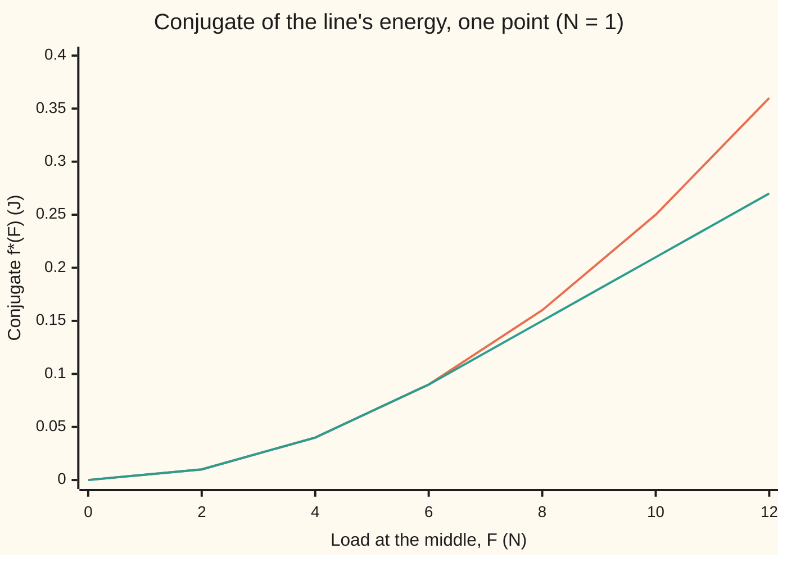

# The slope transform: recoding a convex function by its supporting lines

[Syllabus](../../../SYLLABUS.md) → [Functional analysis](../README.md) → [Banach Algebras and Fixed Points](../README.md#s06) → The slope transform

---

## General Overview

A washing line 2 m long is pulled tight between two posts, at a tension of 100 N. A 10 N towel (about 1 kg) hangs from a peg at the middle. The line sags 5 cm there, in two straight pieces. Bending the line into that shape stores 0.25 J of elastic energy. That energy, as a function of the shape, is a **quadratic energy cost**: double the sag and the energy goes up four times.

A second description lists, for every load, the most that load can gain: the work it does as the line gives way, minus the energy the line stores. For the towel: 0.5 J of work minus 0.25 J stored, so 0.25 J. This list is the **conjugate** of the energy. It records the energy by its slopes (loads, in newtons) instead of its values (energies, in joules).

The card does three things with the line.

- **Compute** the conjugate: 0.25 J for the towel.
- **Recover** the energy from the conjugate alone: 0.25 J at a 5 cm sag. This is the Fenchel-Moreau theorem.
- **Read the slopes at a kink.** Put a garden fence 3 cm below the line's middle. The energy hits a wall at 3 cm, a corner in its graph. Every load from 6 N up is a slope there: the line holds 6 N of the towel and the fence the other 4 N.

The real line has infinitely many points. The card rehearses on 1 point, then up to 127. The towel's energy stays 0.25 J at every size, but the load per metre that holds its kinked shape grows without bound. On the whole curve that shape has finite energy and, measured the usual way, no slope at all.

**A closed convex function on a Banach space is the top edge of its supporting lines: its conjugate records one number for each slope, the conjugate of the conjugate gives the function back, and a load is a slope at a point exactly when the function and its conjugate meet there with no gap.**

**What kind of fact this is:** the conjugate is a definition. The Fenchel-Moreau theorem and the rule for slopes are theorems, proved on this card in Why it works from the wall theorem on [Separation](../01-Normed%20and%20Banach%20Spaces/07-hahn-banach-separation-and-supporting-walls.md). In a general Banach space that wall uses the axiom of choice (a rule of set theory that lets a proof pick from infinitely many options at once); for the washing line, a Hilbert space, a nearest point gives it without choice. That slopes exist on a dense set of points (the Brøndsted-Rockafellar theorem) is stated with its source.

### The picture: the conjugate with and without the fence



Orange: the free line, $`F^2/400`$, a bowl. Teal: with the fence 3 cm down. The two agree up to 6 N. Past 6 N the teal line is straight, with slope 0.03 m: the conjugate's slope is the sag, and the sag stops at the fence.

---

## The formula

Notation first, in words. $`X`$ is a **Banach space** (a complete normed space, from [Normed and Banach spaces](../01-Normed%20and%20Banach%20Spaces/01-normed-spaces-and-banach-spaces.md)): here, the shapes $`u`$ of the line. $`X'`$ is its **dual**, the bounded linear functionals on $`X`$ ([Dual spaces](../01-Normed%20and%20Banach%20Spaces/09-dual-spaces-and-lp-duality.md)): here, the loads $`F`$. The pairing $`\langle F, u\rangle`$ is the load applied to the shape: the work done, in joules. The energy $`f`$ may take the value $`+\infty`$ for a forbidden shape, such as one through the fence.

On this card $`f^*`$ is the conjugate of wing 15 ([Convex conjugates](../../15-Optimization/01-Convexity/08-conjugates-and-fenchel-duality.md)), now with loads in $`X'`$. Its own conjugate, written $`f^{**}`$ and read "f double star", was met in finitely many variables on that card; new here is the theorem that rebuilds $`f`$ from it on a Banach space.

```math
f^*(F) = \sup_{u \in X}\big(\langle F, u\rangle - f(u)\big), \qquad f^{**}(u) = \sup_{F \in X'}\big(\langle F, u\rangle - f^*(F)\big)
```

**Read it aloud:** the conjugate at a load is the most that load can gain, work minus energy, over every shape; the biconjugate at a shape is the most any load's straight line can reach there, staying under the energy.

**The Fenchel-Moreau theorem.** Call $`f`$ **proper** when it is finite somewhere and never $`-\infty`$. Call it **lower semicontinuous**, or **closed**, when its value at a limit of shapes is never above the values along the way: if $`u_n \to u`$ in the norm of $`X`$, then $`f(u) \le \liminf f(u_n)`$, the smallest value the sequence keeps returning near. Then:

```math
f \text{ proper, convex and closed on } X \quad\Longrightarrow\quad f^{**}(u) = f(u) \text{ for every } u \in X.
```

**Slopes through the conjugate.** A load $`F`$ is a **subgradient** of $`f`$ at $`u`$ when the line through $`(u, f(u))`$ with slope $`F`$ stays under $`f`$: $`f(v) \ge f(u) + \langle F, v - u\rangle`$ for every shape $`v`$ ([Subgradients](../../15-Optimization/01-Convexity/07-subgradients.md)). The set of them is the **subdifferential** $`\partial f(u)`$.

```math
F \in \partial f(u) \iff f(u) + f^*(F) = \langle F, u\rangle \iff u \in \partial f^*(F) \quad (\text{the last when } f^{**} = f)
```

**Read it aloud:** a load is a slope of the energy at a shape exactly when energy plus conjugate equals the work, and then the shape is a slope of the conjugate at that load.

**The washing line.** Cut the line at $`N`$ equally spaced points, spacing $`h = L/(N+1)`$, with sags $`u_1, \dots, u_N`$ and $`u_0 = u_{N+1} = 0`$ at the posts. Each short piece lengthens by about half its squared slope times its length, and the tension times that extra length is the energy it stores, so

```math
f_N(u) = \frac{T}{2h}\sum_{i=0}^{N}(u_{i+1}-u_i)^2, \qquad f_N^*(F) = \tfrac12\,F^{\mathsf T}K^{-1}F, \qquad K = \frac{T}{h}\begin{pmatrix} 2 & -1 & & \\ -1 & 2 & \ddots & \\ & \ddots & \ddots & -1 \\ & & -1 & 2\end{pmatrix}.
```

With one point ($`N = 1`$, $`h = 1`$ m), $`f_1(u) = 100\,u^2`$ and $`f_1^*(F) = F^2/400`$. With the fence at depth $`c`$ = 0.03 m, forbidding $`u > c`$:

```math
f_c^*(F) = \begin{cases} F^2/400 & F \le 6 \text{ N} \\ 0.03\,F - 0.09 & F > 6 \text{ N.}\end{cases}
```

As $`N`$ grows, $`f_N`$ becomes $`f(u) = \tfrac{T}{2}\int_0^L u'(x)^2\,dx`$ for shapes in $`H^1_0`$ (zero at both posts, with a square-integrable slope; [Weak derivatives](../04-Distributions%20and%20Sobolev%20Spaces/07-weak-derivatives-and-sobolev-spaces.md)), and $`+\infty`$ for any other shape. $`K^{-1}`$ becomes the [Green's function](../../08-Differential%20equations%20and%20dynamics/07-Series%20Solutions%20and%20Boundary%20Problems/10-greens-function-for-a-boundary-problem.md) $`G(x, s) = \min(x, s)\,\big(L - \max(x, s)\big)/(T L)`$, the sag at $`x`$ under a unit load at $`s`$.

| Symbol | Plain meaning | In our example | Push it up and the answer… |
| --- | --- | --- | --- |
| $`X`$, $`X'`$ | the space of shapes; the space of loads, its dual | on the grid, lists of $`N`$ sags and of $`N`$ forces; on the curve, shapes in $`L^2`$ or $`H^1_0`$ and their loads | — |
| $`\langle F, u\rangle`$ | work done by load $`F`$ through shape $`u`$, J | 10 × 0.05 = 0.5 J | — |
| $`u`$, $`u_i`$, $`v`$, $`w`$, $`w_1`$, $`x`$, $`s`$ | a shape: sag in m at point $`i`$, down positive, with $`u_0 = u_{N+1} = 0`$ at the posts; other shapes; positions along the line, m (the sag at $`x`$, the load at $`s`$) | the tent: 5 cm at $`x`$ = 1 m | more energy |
| $`T`$, $`L`$ | tension, N; length, m | 100 N; 2 m | larger $`T`$: smaller sag and conjugate |
| $`F`$, $`F_i`$, $`P`$ | a load, N, and its part at point $`i`$; the towel's weight | $`P`$ = 10 N at the middle | conjugate grows like $`F^2`$ |
| $`N`$, $`h`$ | number of points; spacing, m | 1 by hand; up to 127 | finer line, same 0.25 J for the tent |
| $`f`$, $`f_N`$ | energy of a shape, J, $`+\infty`$ if forbidden | 0.25 J for the tent | — |
| $`f^*`$, $`f^{**}`$ | conjugate: best work minus energy; biconjugate | 0.25 J at 10 N; 0.25 J at 5 cm | — |
| $`\partial f(u)`$ | subdifferential: every load that is a slope at $`u`$ | at the fence: 6 N and up | — |
| $`K`$, $`G`$ | stiffness matrix, N/m; Green's function, m/N | 200 N/m at $`N`$ = 1; $`G(1, 1)`$ = 0.005 | — |
| $`c`$ | fence depth below the rest line, m | 0.03 | deeper: the fence engages later |
| $`g`$; $`E`$, $`\sigma`$, $`\varphi`$, $`a`$, $`\lambda`$, $`\gamma`$, $`\beta`$, $`t`$, $`M`$, $`\ell`$ | energy allowed only on shapes of straight pieces (When it holds); inside proofs only: the region above the graph, an energy level, a functional, numbers and lines | — | — |

### When it holds

- **Convex energy.** Let the line also clip onto a hook 6 cm down, giving two rest positions: energy $`100\min(u^2, (u - 0.06)^2)`$. At 3 cm the energy is 0.0900 J, but the rebuilt value is 0.0000 J. The transform returns the convex hull, the largest convex function below the energy.
- **Closed energy.** Allow the energy only on shapes made of finitely many straight pieces; call it $`g`$. It is convex but not closed in $`L^2`$. At the sine shape $`0.05\sin(\pi x/2)`$, $`g = +\infty`$, yet $`g^{**}`$ = 0.308425 J. Every grid shape is made of straight pieces, so the finite rehearsal hides this.
- **Loads from the dual of the chosen space.** In $`L^2`$ the tent has no slope: its holding load per metre has $`L^2`$ size 10, 20, 40, 80 at $`N`$ = 1, 7, 31, 127. In $`H^1_0`$, whose dual holds point loads, the towel itself is the slope.
- **Forbidden shapes kept at $`+\infty`$.** Drop the fence from the energy and the conjugate at 10 N reads 0.25 J, not 0.21 J, with a 5 cm sag through the fence.

---

## Why it works

### Step 0: a convex curve is the top edge of its supporting lines

A convex energy bends upward, so it sits above each of its **supporting lines**: straight lines that touch it and stay under it. At every point it is the highest of them. The supporting line of slope $`F`$ crosses $`u = 0`$ at height $`-f^*(F)`$, because $`\langle F, u\rangle - f(u)`$ is how far the line $`\langle F, u\rangle`$ rises above the curve.

So the conjugate is a list of heights, one per slope, and the top edge of those lines is the biconjugate. Where the curve is smooth, one line touches at each point. At a corner a fan of lines touches, and their slopes are the subgradients. [Convex conjugates](../../15-Optimization/01-Convexity/08-conjugates-and-fenchel-duality.md) did this in finitely many variables. Here loads live in $`X'`$, and the space decides which slopes exist. The same idea for sets is the bipolar theorem on [Separation](../01-Normed%20and%20Banach%20Spaces/07-hahn-banach-separation-and-supporting-walls.md): a closed convex set is cut out by its supporting walls. [Krein-Milman](06-krein-milman-and-extreme-points.md) gives the inside view instead: a compact convex set rebuilt from averages of its corners.

### Step 1: compute the conjugate of the line's energy

With one point, the towel gains $`10u - 100u^2`$ as the line sags by $`u`$. The gain rises while the load beats the line's push-back $`200u`$, and falls after. So the best sag has $`200u = F`$: $`u`$ = 0.05 m, and the gain is $`F^2/200 - F^2/400 = F^2/400`$ = 0.25 J.

With $`N`$ points the best sag has $`K u = F`$: the line's push-back balances the load at each point (Hooke's law for the line). The best gain is $`\tfrac12\langle F, u\rangle`$: half the work is stored, the other half is the conjugate. $`K^{-1}`$ is the Green's function at the grid points, so the towel's sag is $`10 \times G(1, 1)`$ = 10 × 0.005 = 0.05 m and its conjugate 0.25 J at every $`N`$. The checks solve $`K u = F`$ and match $`G`$.

The same recipe, applied to a Lagrangian in the velocity, gives the Hamiltonian on [Hamilton's equations](../../08-Differential%20equations%20and%20dynamics/12-Calculus%20of%20Variations%20and%20Optimal%20Control/05-hamiltons-equations.md).

### Step 2: the easy half, the biconjugate never overshoots

The definition says $`f^*(F) \ge \langle F, u\rangle - f(u)`$ for every shape. Rearranged, this is the **Fenchel-Young inequality**:

```math
f(u) + f^*(F) \ge \langle F, u\rangle .
```

So $`\langle F, u\rangle - f^*(F) \le f(u)`$ for every load, and the largest of these, $`f^{**}(u)`$, is at most $`f(u)`$. For the towel the inequality is tight: 0.25 + 0.25 = 0.50 = 10 × 0.05.

### Step 3: the hard half, the biconjugate reaches the energy

Suppose $`f^{**}(w) < t < f(w)`$ for some shape $`w`$ and number $`t`$. The point $`(w, t)`$ then sits below the graph. The region on or above the graph is convex, because $`f`$ is, and closed, because $`f`$ is closed. [Separation](../01-Normed%20and%20Banach%20Spaces/07-hahn-banach-separation-and-supporting-walls.md) puts a flat wall between them in the space of pairs (shape, energy).

The wall is a bounded functional on those pairs. If it is not vertical, it is the graph of a supporting line passing above $`t`$ at $`w`$, and that line forces $`f^{**}(w) > t`$. If it is vertical, $`w`$ is outside the allowed shapes, and tilting the wall pushes $`f^{**}(w)`$ to $`+\infty`$. Either way, a contradiction. The fold has the details.

The checks rebuild the line's energy from the conjugate alone: 0.25 J at 5 cm and 0.04 J at 2 cm on one point. At $`N`$ points they climb $`\langle F, u\rangle - f_N^*(F)`$ by conjugate gradients (a method that reaches the top of a quadratic hill in at most $`N`$ steps) and match the direct energy for each of the three shapes in Worked numbers.

<details>
<summary>Detailed proof: the Fenchel-Moreau theorem in a Banach space</summary>

Give pairs $`(u, \sigma)`$ in $`X \times \mathbb{R}`$ the norm $`\lVert u\rVert + \lvert \sigma\rvert`$, a Banach space. Its bounded functionals are $`(u, \sigma) \mapsto \varphi(u) + a\,\sigma`$ with $`\varphi \in X'`$ and $`a`$ a number. Let $`E`$ be the region on or above the graph of $`f`$. Since $`f`$ is closed, $`E`$ is closed; since $`f`$ is convex, $`E`$ is convex.

Suppose $`f^{**}(w) < t < f(w)`$. Then $`(w, t) \notin E`$. The second geometric form of Hahn-Banach (Brezis, Theorem 1.7; the [Separation](../01-Normed%20and%20Banach%20Spaces/07-hahn-banach-separation-and-supporting-walls.md) card) gives $`\varphi`$, $`a`$ and a number $`\gamma`$ with

$`\displaystyle \varphi(u) + a\,\sigma < \gamma < \varphi(w) + a\,t \quad \text{for every } (u, \sigma) \in E.`$

Since $`\sigma`$ may grow without bound in $`E`$, $`a \le 0`$.

**Case $`a < 0`$.** Put $`\lambda = -a`$ and $`F = \varphi/\lambda`$. For each allowed $`u`$, take $`\sigma = f(u)`$: then $`f(u) > \langle F, u\rangle - \gamma/\lambda`$. So $`f^*(F) \le \gamma/\lambda`$. The right inequality says $`t < \langle F, w\rangle - \gamma/\lambda`$. Hence

$`\displaystyle f^{**}(w) \ge \langle F, w\rangle - f^*(F) \ge \langle F, w\rangle - \gamma/\lambda > t,`$

a contradiction.

**Case $`a = 0`$.** Then $`\varphi(u) < \gamma < \varphi(w)`$ for every allowed $`u`$, so $`f(w) = +\infty`$. First find one supporting line at all: pick an allowed $`w_1`$ and any $`t_1 < f(w_1)`$. A wall between $`(w_1, t_1)`$ and $`E`$ cannot be vertical, because $`(w_1, f(w_1))`$ is in $`E`$. So the case above gives a line $`\ell(u) = \langle F, u\rangle - \beta \le f(u)`$. Now for every $`M > 0`$ put

$`\displaystyle \ell_M(u) = \ell(u) + M\,\big(\varphi(u) - \gamma\big).`$

On allowed shapes $`\varphi(u) - \gamma < 0`$, so $`\ell_M \le \ell \le f`$; off them $`f = +\infty`$. A line under $`f`$ with slope $`F'`$ and height $`-\beta'`$ gives $`f^*(F') \le \beta'`$, so $`f^{**}(w) \ge \ell_M(w) = \ell(w) + M\,(\varphi(w) - \gamma)`$. This grows without bound in $`M`$, so $`f^{**}(w) = +\infty > t`$, a contradiction.

The wall exists by Hahn-Banach, which in a general Banach space uses the axiom of choice. In a Hilbert space, such as $`L^2`$ of the line, the nearest point of $`E`$ to $`(w, t)`$ gives the wall directly ([Projection](../02-Hilbert%20Spaces/02-projection-theorem-and-orthogonal-complements.md)).

</details>

The checks show the vertical case too. With the fence, the shape with a 4 cm sag is forbidden. Its biconjugate, searched over loads up to 100 N, is 1.0900 J; up to 1000 N, 10.0900 J. It grows as $`0.01F + 0.09`$, without bound, which is $`+\infty`$.

### Step 4: read the slopes at the kink

Take a load $`F`$ and a shape $`u`$ where the Fenchel-Young inequality is a tie: $`f(u) + f^*(F) = \langle F, u\rangle`$. Since $`f^*(F)`$ is at least the gain at any other shape $`v`$, the tie says $`\langle F, u\rangle - f(u) \ge \langle F, v\rangle - f(v)`$. Rearranged:

```math
f(v) \ge f(u) + \langle F, v - u\rangle \quad\text{for every } v.
```

That is the definition of a subgradient, and every step reverses. When $`f^{**} = f`$, swapping roles shows $`u`$ is a slope of $`f^*`$ at $`F`$: the sag is the slope of the conjugate. That is why the teal line in the picture has slope 0.03 m past 6 N.

At the fence, $`f(0.03)`$ = 100 × 0.0009 = 0.09 J. A load $`F`$ is a slope there exactly when $`0.09 + f_c^*(F) = 0.03F`$. Below 6 N, $`f_c^*(F) = F^2/400`$ and the gap is $`(F - 6)^2/400 > 0`$: at 5 N it is 0.0025 J. From 6 N up, $`f_c^*(F) = 0.03F - 0.09`$ and the gap is zero. So

```math
\partial f_c(0.03) = [\,6 \text{ N}, \infty).
```

The checks test 41 loads from 0 to 20 N: exactly the 29 from 6 N up tie. The slope from the left is 6 N, the line's own push-back at 3 cm; from the right there is none, because the fence is a wall.

So any load of 6 N or more holds the line still at 3 cm. The line takes 6 N and the fence the rest: 4 N of the towel's 10 N. That 4 N is the Lagrange multiplier of the rule "sag at most 3 cm" ([Lagrange multipliers](../../06-Calculus%20and%20analysis/07-Several%20Variables/08-lagrange-multipliers.md)), the price of that rule.

### Step 5: what changes as the points run out

The line has infinitely many points. Four things change from the grid to the curve.

1. **Loads live in the dual of the chosen space.** Measure shapes by their $`L^2`$ size, the root of the integral of the squared sag. By [Riesz representation](../02-Hilbert%20Spaces/06-riesz-representation-theorem.md) the loads are then densities in $`L^2`$, in newtons per metre. A towel on one peg is a point load, the spike of [The delta](../04-Distributions%20and%20Sobolev%20Spaces/02-the-dirac-delta-and-derivatives-of-jumps.md), and is not one of them.
2. **A finite energy need not have a slope.** On the grid, the load that holds the tent is 10 N on one point, a density of $`10/h`$ N/m over one cell. Its $`L^2`$ size, $`10/\sqrt{h}`$, grows without end. So in $`L^2`$, $`\partial f(\text{tent})`$ is empty. The sine's holding load has size 12.3370, and the grid sizes approach it.
3. **The energy is nowhere continuous in $`L^2`$.** A tiny jump costs infinite energy: the step's energy is $`0.25/h`$ J. Still, Brøndsted and Rockafellar proved that a closed convex function has slopes on a dense set of the points where it is finite. The sine is in that set; the tent is not.
4. **Closedness is a real condition.** On a grid a convex energy that is finite everywhere, like $`f_N`$, is continuous and so closed. On the curve, the straight-piece energy $`g`$ is not, and the transform returns its closed version.

In a space that is not reflexive ([Reflexive spaces](../01-Normed%20and%20Banach%20Spaces/10-reflexive-spaces-and-the-second-dual.md)), $`f^{**}`$ can also be taken on the larger $`X''`$. The theorem speaks only of $`f^{**}`$ on $`X`$.

---

## Worked numbers, by hand

One point, at the middle, $`N = 1`$, $`h`$ = 1 m.

| Step | Arithmetic | Value |
| --- | --- | --- |
| spring rate of the line at the middle | $`4T/L`$ = 400 / 2 | 200 N/m |
| sag under the towel | 10 / 200 | 0.05 m |
| energy stored | 100 × 0.05² | 0.25 J |
| conjugate at 10 N | 10² / 400 | 0.25 J |
| Fenchel-Young | 0.25 + 0.25 against 10 × 0.05 | 0.50 = 0.50, a tie |
| energy rebuilt at 5 cm | best of 0.05F − F²/400, at F = 10 | 0.25 J |
| fence: the line's push-back at 3 cm | 200 × 0.03 | 6 N |
| fence: conjugate at 10 N | 0.03 × 10 − 0.09 | 0.21 J |
| slopes at 3 cm | ties of $`0.09 + f_c^*(F) = 0.03F`$ | **6 N and up; the fence holds 4 N** |

The towel stores 0.25 J on the free line. With the fence, the line stops at 3 cm, holds 6 N, and the fence carries the remaining 4 N.

### A finer line, then a curve

Three shapes at $`N`$ points: the towel's tent, a step (5 cm down from 0.5 m to 1.5 m) and the sine $`0.05\sin(\pi x/2)`$ m. Each energy is computed directly and rebuilt from the conjugate; the two agree, so one number is shown. A slope size is the $`L^2`$ size of the holding load per metre, in N/√m.

| $`N`$ | tent energy, J | tent slope size | step energy, J | sine energy, J | sine slope size |
| ---: | ---: | ---: | ---: | ---: | ---: |
| 1 | 0.250000 | 10.0000 | 0.250000 | 0.250000 | 10.0000 |
| 7 | 0.250000 | 20.0000 | 1.000000 | 0.304482 | 12.1793 |
| 31 | 0.250000 | 40.0000 | 4.000000 | 0.308177 | 12.3271 |
| 127 | 0.250000 | 80.0000 | 16.000000 | 0.308410 | 12.3364 |
| curve | 0.25 | none | $`+\infty`$ | 0.308425 | 12.3370 |

The tent's energy is settled, but its slope size doubles whenever $`N + 1`$ goes up four times: no slope in the limit. The step's energy grows like $`1/h`$, and the rebuilt value grows with it, as Fenchel-Moreau requires. The sine converges on both counts, with error falling like $`h^2`$. What the truncation hides: on a grid $`f_N`$ is finite and continuous everywhere, so every shape has a slope.

### What breaks if you drop a piece

| Mistake | Comes out at | What went wrong |
| --- | --- | --- |
| Two rest positions (not convex) | energy 0.0900 J at 3 cm, rebuilt 0.0000 J | The transform returns the convex hull, not the energy |
| Fence left out of the conjugate | 0.25 J at 10 N, sag 5 cm | The forbidden shapes must count as $`+\infty`$; the right value is 0.21 J |
| Towel spread evenly over 7 points | Fenchel-Young gap 0.071429 J at the tent | That load is not a slope at the tent; only the point load ties |
| Slope of the tent sought in $`L^2`$ | size 10, 20, 40, 80 at $`N`$ = 1, 7, 31, 127 | A point load is not in $`L^2`$; the slope exists only in a larger dual |

The code prints all four.

---

## Code, from first principles, and it actually runs

The code takes four independent roads, and the asserts make them agree. One: closed forms ($`F^2/400`$, the fence formula, Green's function, $`0.25/h`$ for the step, a sine formula). Two: brute force, searching 400,001 sags or loads on one point. Three: solving $`K u = F`$ by the tridiagonal (Thomas) method. Four: rebuilding every energy from the conjugate alone by conjugate-gradient ascent.

### Python

```python
# The slope transform -- the check behind the card.  Standard library only.
# A washing line 2 m long at tension 100 N; a 10 N towel hangs from its middle.  A shape is the
# sag (m, down positive) at N equally spaced points; a load is a list of forces (N) there.
# Energy f(u) = T/(2h) x (sum of squared steps), in J.  Conjugate f*(F) = largest work minus energy.
# Roads: closed forms; brute-force grids; a tridiagonal solve against Green's function; the
# energy rebuilt from the conjugate alone by conjugate-gradient ascent.
import math

T, L, P, C = 100.0, 2.0, 10.0, 0.03          # tension N, length m, towel N, fence depth m

def k1(t): return 4 * t / L                  # one point in the middle: spring rate, N/m

def f1(u, t=T, c=None):                      # energy of the one-point line; +inf past the fence
    return math.inf if c is not None and u > c + 1e-12 else 0.5 * k1(t) * u * u

def fstar1(F, t=T, c=None):                  # its conjugate, closed form
    k = k1(t)
    return F * F / (2 * k) if c is None or F <= k * c else c * F - 0.5 * k * c * c

def grid_max(fun, lo, hi, n):                # brute force: largest value on an even grid
    best, arg = -math.inf, lo
    for i in range(n + 1):
        x = lo + (hi - lo) * i / n
        v = fun(x)
        if v > best: best, arg = v, x
    return best, arg

def one_point(t, p, c):                      # sag, conjugate, spring force, fence force
    k = k1(t); s = min(p / k, c)
    return s, fstar1(p, t, c), k * s, p - k * s

# ---- one point: compute the conjugate, rebuild the energy, read the slopes at the fence ----
print(f"one point: spring rate {k1(T):.4f} N/m, towel {P:.4f} N")
g, s = grid_max(lambda u: P * u - f1(u), -0.2, 0.2, 400000)
print(f"conjugate at 10 N: formula {fstar1(P):.6f} J, grid {g:.6f} J at sag {s:.6f} m")
assert abs(g - P * P / (2 * k1(T))) < 1e-9 and abs(s - 0.05) < 1e-6
b, _ = grid_max(lambda F: 0.05 * F - fstar1(F), 0.0, 40.0, 400000)
print(f"energy at 5 cm: rebuilt from the conjugate {b:.6f} J, direct {f1(0.05):.6f} J")
assert abs(b - f1(0.05)) < 1e-9
print(f"Fenchel-Young: {f1(0.05):.6f} + {fstar1(P):.6f} = {f1(0.05) + fstar1(P):.6f} = 10 x 0.05")
gc, sc = grid_max(lambda u: P * u - f1(u, c=C), -0.2, 0.2, 400000)
print(f"fence at 3 cm, conjugate at 10 N: formula {fstar1(P, c=C):.6f} J, grid {gc:.6f} J at sag {sc:.6f} m")
assert abs(gc - fstar1(P, c=C)) < 1e-9
ties = [F / 2 for F in range(41) if abs(f1(C) + fstar1(F / 2, c=C) - C * F / 2) < 1e-12]
print(f"slopes at the fence, read from the conjugate: {len(ties)} of 41 loads tie, {min(ties):.4f} N to {max(ties):.4f} N")
assert ties == [F / 2 for F in range(12, 41)]
d = 1e-7; left = (f1(C) - f1(C - d)) / d
print(f"left slope at 3 cm {left:.4f} N; right slope: none (the fence); gap at 5 N {f1(C) + fstar1(5, c=C) - C * 5:.6f} J")
assert abs(left - k1(T) * C) < 1e-4
_, _, sp, fe = one_point(T, P, C)
print(f"towel 10 N at the fence: spring {sp:.4f} N, fence {fe:.4f} N")
print(f"Green's function G(1, 1) {(L - 1) / (T * L):.4f} m/N; energy at the fence {f1(C):.4f} J; conjugate's slope past 6 N {(fstar1(12, c=C) - fstar1(10, c=C)) / 2:.4f} m")
for top in (100.0, 1000.0):
    r, _ = grid_max(lambda F: 0.04 * F - fstar1(F, c=C), 0.0, top, 100000)
    print(f"rebuilt at 4 cm (past the fence), loads up to {top:.0f} N: {r:.4f} J")
    assert abs(r - (0.01 * top + 0.09)) < 1e-9
r, _ = grid_max(lambda F: 0.02 * F - fstar1(F, c=C), -20.0, 20.0, 400000)
print(f"rebuilt at 2 cm: {r:.6f} J, direct {f1(0.02):.6f} J")
assert abs(r - f1(0.02)) < 1e-9
print("chart F 0..12:", " ".join(f"{fstar1(2.0 * i):.2f}" for i in range(7)), "|",
      " ".join(f"{fstar1(2.0 * i, c=C):.2f}" for i in range(7)))
hk = lambda u: 100 * min(u * u, (u - 0.06) ** 2)          # two rest positions: not convex
cj = lambda F: grid_max(lambda u: F * u - hk(u), -0.2, 0.26, 4600)[0]
bb, _ = grid_max(lambda F: 0.03 * F - cj(F), -20.0, 20.0, 200)
print(f"two rest positions, at 3 cm: energy {hk(0.03):.4f} J, rebuilt {bb:.4f} J")
assert abs(bb) < 1e-9

# ---- N points: the same line, finer and finer ----
def solve(N, F):                             # Thomas algorithm for K u = F, K = (T/h) tridiag(-1, 2, -1)
    a = T * (N + 1) / L; cp, dp = [0.0] * N, [0.0] * N
    for i in range(N):
        m = 2 * a + (a * cp[i - 1] if i else 0.0)
        cp[i] = -a / m; dp[i] = (F[i] + (a * dp[i - 1] if i else 0.0)) / m
    u = [0.0] * N
    for i in range(N - 1, -1, -1): u[i] = dp[i] - (cp[i] * u[i + 1] if i < N - 1 else 0.0)
    return u

def dot(x, y): return sum(p * q for p, q in zip(x, y))
def fstar(N, F): return 0.5 * dot(F, solve(N, F))            # the conjugate, via the equilibrium sag
def energy(N, u):
    w = [0.0] + u + [0.0]; h = L / (N + 1)
    return T / (2 * h) * sum((w[i + 1] - w[i]) ** 2 for i in range(N + 1))
def kslope(N, u):                            # size of K u as a load density in L2
    w = [0.0] + u + [0.0]; h = L / (N + 1)
    return math.sqrt(sum((T / h * (2 * w[i] - w[i - 1] - w[i + 1])) ** 2 for i in range(1, N + 1)) / h)

def rebuild(N, u):                           # max over loads of work - f*: conjugate gradients
    F = [0.0] * N; r = u[:]; p = r[:]; rr = dot(r, r)
    for _ in range(3 * N + 10):
        if rr < 1e-30 * dot(u, u): break
        Mp = solve(N, p); al = rr / dot(p, Mp)
        F = [x + al * y for x, y in zip(F, p)]; r = [x - al * y for x, y in zip(r, Mp)]
        rn = dot(r, r); p = [x + rn / rr * y for x, y in zip(r, p)]; rr = rn
    return dot(F, u) - fstar(N, F)

print("N, h; tent: energy, rebuilt, slope size; step: energy, rebuilt; sine: energy, rebuilt, slope size")
for N in (1, 3, 7, 15, 31, 63, 127):
    h = L / (N + 1); xs = [h * (i + 1) for i in range(N)]
    towel = [P if i == N // 2 else 0.0 for i in range(N)]
    tent = solve(N, towel)
    assert max(abs(tent[i] - P * min(x, L - x) / (T * L)) for i, x in enumerate(xs)) < 1e-12  # Green's function
    assert abs(fstar(N, towel) - 0.25) < 1e-12 and abs(energy(N, tent) + fstar(N, towel) - dot(towel, tent)) < 1e-12
    step = [0.05 if 0.5 <= x <= 1.5 else 0.0 for x in xs]
    sine = [0.05 * math.sin(math.pi * x / 2) for x in xs]
    row = []
    for u, exact in ((tent, 0.25), (step, 0.25 / h), (sine, 0.5 * T * 0.01 * math.sin(math.pi * h / 4) ** 2 / h ** 2)):
        e, rb = energy(N, u), rebuild(N, u)
        assert abs(e - exact) < 1e-9 * exact and abs(rb - e) < 1e-8 * e
        row += [e, rb]
    st, ss = kslope(N, tent), kslope(N, sine)
    assert abs(st - P / math.sqrt(h)) < 1e-9 * st and abs(ss - 0.2 * T * math.sin(math.pi * h / 4) ** 2 / h ** 2) < 1e-9 * ss
    print(f"{N:4d} {h:.4f}  {row[0]:.6f} {row[1]:.6f} {st:8.4f}  {row[2]:.6f} {row[3]:.6f}  {row[4]:.6f} {row[5]:.6f} {ss:8.4f}")
spread = [P / 7] * 7; tent7 = solve(7, [P if i == 3 else 0.0 for i in range(7)])
print(f"N=7: towel spread evenly is not a slope at the tent: gap {energy(7, tent7) + fstar(7, spread) - dot(spread, tent7):.6f} J")
print(f"limits: sine energy {T * 0.05 ** 2 * math.pi ** 2 / 8:.6f} J, sine slope size {T * 0.05 * math.pi ** 2 / 4:.4f}; tent slope grows like 10/sqrt(h)")
for t, p, c in ((T, 16.0, C), (200.0, P, C), (T, P, 0.06)):
    s, fs, sp, fe = one_point(t, p, c)
    print(f"try T={t:.0f} N, towel {p:.0f} N, fence {100 * c:.0f} cm: sag {s:.4f} m, conjugate {fs:.4f} J, spring {sp:.4f} N, fence {fe:.4f} N")
print("ALL CHECKS PASS")
```

**Ran 2026-11-15 on macOS, Python 3.14.10, standard library only. All checks passed. Output, pasted from the run:**

```
one point: spring rate 200.0000 N/m, towel 10.0000 N
conjugate at 10 N: formula 0.250000 J, grid 0.250000 J at sag 0.050000 m
energy at 5 cm: rebuilt from the conjugate 0.250000 J, direct 0.250000 J
Fenchel-Young: 0.250000 + 0.250000 = 0.500000 = 10 x 0.05
fence at 3 cm, conjugate at 10 N: formula 0.210000 J, grid 0.210000 J at sag 0.030000 m
slopes at the fence, read from the conjugate: 29 of 41 loads tie, 6.0000 N to 20.0000 N
left slope at 3 cm 6.0000 N; right slope: none (the fence); gap at 5 N 0.002500 J
towel 10 N at the fence: spring 6.0000 N, fence 4.0000 N
Green's function G(1, 1) 0.0050 m/N; energy at the fence 0.0900 J; conjugate's slope past 6 N 0.0300 m
rebuilt at 4 cm (past the fence), loads up to 100 N: 1.0900 J
rebuilt at 4 cm (past the fence), loads up to 1000 N: 10.0900 J
rebuilt at 2 cm: 0.040000 J, direct 0.040000 J
chart F 0..12: 0.00 0.01 0.04 0.09 0.16 0.25 0.36 | 0.00 0.01 0.04 0.09 0.15 0.21 0.27
two rest positions, at 3 cm: energy 0.0900 J, rebuilt 0.0000 J
N, h; tent: energy, rebuilt, slope size; step: energy, rebuilt; sine: energy, rebuilt, slope size
   1 1.0000  0.250000 0.250000  10.0000  0.250000 0.250000  0.250000 0.250000  10.0000
   3 0.5000  0.250000 0.250000  14.1421  0.500000 0.500000  0.292893 0.292893  11.7157
   7 0.2500  0.250000 0.250000  20.0000  1.000000 1.000000  0.304482 0.304482  12.1793
  15 0.1250  0.250000 0.250000  28.2843  2.000000 2.000000  0.307436 0.307436  12.2974
  31 0.0625  0.250000 0.250000  40.0000  4.000000 4.000000  0.308177 0.308177  12.3271
  63 0.0312  0.250000 0.250000  56.5685  8.000000 8.000000  0.308363 0.308363  12.3345
 127 0.0156  0.250000 0.250000  80.0000  16.000000 16.000000  0.308410 0.308410  12.3364
N=7: towel spread evenly is not a slope at the tent: gap 0.071429 J
limits: sine energy 0.308425 J, sine slope size 12.3370; tent slope grows like 10/sqrt(h)
try T=100 N, towel 16 N, fence 3 cm: sag 0.0300 m, conjugate 0.3900 J, spring 6.0000 N, fence 10.0000 N
try T=200 N, towel 10 N, fence 3 cm: sag 0.0250 m, conjugate 0.1250 J, spring 10.0000 N, fence 0.0000 N
try T=100 N, towel 10 N, fence 6 cm: sag 0.0500 m, conjugate 0.2500 J, spring 10.0000 N, fence 0.0000 N
ALL CHECKS PASS
```

### Rust

```rust
// The slope transform -- the check behind the card.  Rust std only, no crates.
// A washing line 2 m long at tension 100 N; a 10 N towel hangs from its middle.  A shape is the
// sag (m, down positive) at N equally spaced points; a load is a list of forces (N) there.
// Energy f(u) = T/(2h) x (sum of squared steps), in J.  Conjugate f*(F) = largest work minus energy.
// Roads: closed forms; brute-force grids; a tridiagonal solve against Green's function; the
// energy rebuilt from the conjugate alone by conjugate-gradient ascent.
const T: f64 = 100.0; const L: f64 = 2.0; const P: f64 = 10.0; const C: f64 = 0.03;
const PI: f64 = std::f64::consts::PI;

fn k1(t: f64) -> f64 { 4.0 * t / L }
fn f1(u: f64, t: f64, c: Option<f64>) -> f64 {
    match c { Some(c) if u > c + 1e-12 => f64::INFINITY, _ => 0.5 * k1(t) * u * u }
}
fn fstar1(f: f64, t: f64, c: Option<f64>) -> f64 {
    let k = k1(t);
    match c { Some(c) if f > k * c => c * f - 0.5 * k * c * c, _ => f * f / (2.0 * k) }
}
fn grid_max(fun: &dyn Fn(f64) -> f64, lo: f64, hi: f64, n: usize) -> (f64, f64) {
    let (mut best, mut arg) = (f64::NEG_INFINITY, lo);
    for i in 0..=n {
        let x = lo + (hi - lo) * i as f64 / n as f64;
        let v = fun(x);
        if v > best { best = v; arg = x; }
    }
    (best, arg)
}
fn one_point(t: f64, p: f64, c: f64) -> (f64, f64, f64, f64) {
    let k = k1(t); let s = (p / k).min(c);
    (s, fstar1(p, t, Some(c)), k * s, p - k * s)
}
fn solve(n: usize, f: &[f64]) -> Vec<f64> {
    let a = T * (n + 1) as f64 / L; let (mut cp, mut dp) = (vec![0.0; n], vec![0.0; n]);
    for i in 0..n {
        let m = 2.0 * a + if i > 0 { a * cp[i - 1] } else { 0.0 };
        cp[i] = -a / m; dp[i] = (f[i] + if i > 0 { a * dp[i - 1] } else { 0.0 }) / m;
    }
    let mut u = vec![0.0; n];
    for i in (0..n).rev() { u[i] = dp[i] - if i + 1 < n { cp[i] * u[i + 1] } else { 0.0 }; }
    u
}
fn dot(x: &[f64], y: &[f64]) -> f64 { x.iter().zip(y).map(|(p, q)| p * q).sum() }
fn fstar(n: usize, f: &[f64]) -> f64 { 0.5 * dot(f, &solve(n, f)) }
fn padded(u: &[f64]) -> Vec<f64> { let mut w = vec![0.0]; w.extend_from_slice(u); w.push(0.0); w }
fn energy(n: usize, u: &[f64]) -> f64 {
    let w = padded(u); let h = L / (n + 1) as f64;
    T / (2.0 * h) * (0..=n).map(|i| (w[i + 1] - w[i]).powi(2)).sum::<f64>()
}
fn kslope(n: usize, u: &[f64]) -> f64 {
    let w = padded(u); let h = L / (n + 1) as f64;
    ((1..=n).map(|i| (T / h * (2.0 * w[i] - w[i - 1] - w[i + 1])).powi(2)).sum::<f64>() / h).sqrt()
}
fn rebuild(n: usize, u: &[f64]) -> f64 {
    let mut f = vec![0.0; n]; let mut r = u.to_vec(); let mut p = r.clone(); let mut rr = dot(&r, &r);
    for _ in 0..3 * n + 10 {
        if rr < 1e-30 * dot(u, u) { break; }
        let mp = solve(n, &p); let al = rr / dot(&p, &mp);
        for i in 0..n { f[i] += al * p[i]; r[i] -= al * mp[i]; }
        let rn = dot(&r, &r);
        for i in 0..n { p[i] = r[i] + rn / rr * p[i]; }
        rr = rn;
    }
    dot(&f, u) - fstar(n, &f)
}

fn main() {
    // ---- one point: compute the conjugate, rebuild the energy, read the slopes at the fence ----
    println!("one point: spring rate {:.4} N/m, towel {:.4} N", k1(T), P);
    let (g, s) = grid_max(&|u| P * u - f1(u, T, None), -0.2, 0.2, 400000);
    println!("conjugate at 10 N: formula {:.6} J, grid {:.6} J at sag {:.6} m", fstar1(P, T, None), g, s);
    assert!((g - P * P / (2.0 * k1(T))).abs() < 1e-9 && (s - 0.05).abs() < 1e-6);
    let (b, _) = grid_max(&|f| 0.05 * f - fstar1(f, T, None), 0.0, 40.0, 400000);
    println!("energy at 5 cm: rebuilt from the conjugate {:.6} J, direct {:.6} J", b, f1(0.05, T, None));
    assert!((b - f1(0.05, T, None)).abs() < 1e-9);
    let (e5, c10) = (f1(0.05, T, None), fstar1(P, T, None));
    println!("Fenchel-Young: {:.6} + {:.6} = {:.6} = 10 x 0.05", e5, c10, e5 + c10);
    let (gc, sc) = grid_max(&|u| P * u - f1(u, T, Some(C)), -0.2, 0.2, 400000);
    println!("fence at 3 cm, conjugate at 10 N: formula {:.6} J, grid {:.6} J at sag {:.6} m", fstar1(P, T, Some(C)), gc, sc);
    assert!((gc - fstar1(P, T, Some(C))).abs() < 1e-9);
    let ties: Vec<f64> = (0..41).map(|f| f as f64 / 2.0)
        .filter(|&f| (f1(C, T, Some(C)) + fstar1(f, T, Some(C)) - C * f).abs() < 1e-12).collect();
    println!("slopes at the fence, read from the conjugate: {} of 41 loads tie, {:.4} N to {:.4} N", ties.len(), ties[0], ties[ties.len() - 1]);
    assert!(ties == (12..41).map(|f| f as f64 / 2.0).collect::<Vec<f64>>());
    let d = 1e-7; let left = (f1(C, T, Some(C)) - f1(C - d, T, Some(C))) / d;
    println!("left slope at 3 cm {:.4} N; right slope: none (the fence); gap at 5 N {:.6} J", left, f1(C, T, Some(C)) + fstar1(5.0, T, Some(C)) - C * 5.0);
    assert!((left - k1(T) * C).abs() < 1e-4);
    let (_, _, sp, fe) = one_point(T, P, C);
    println!("towel 10 N at the fence: spring {:.4} N, fence {:.4} N", sp, fe);
    println!("Green's function G(1, 1) {:.4} m/N; energy at the fence {:.4} J; conjugate's slope past 6 N {:.4} m", (L - 1.0) / (T * L), f1(C, T, Some(C)), (fstar1(12.0, T, Some(C)) - fstar1(10.0, T, Some(C))) / 2.0);
    for top in [100.0, 1000.0] {
        let (r, _) = grid_max(&|f| 0.04 * f - fstar1(f, T, Some(C)), 0.0, top, 100000);
        println!("rebuilt at 4 cm (past the fence), loads up to {:.0} N: {:.4} J", top, r);
        assert!((r - (0.01 * top + 0.09)).abs() < 1e-9);
    }
    let (r, _) = grid_max(&|f| 0.02 * f - fstar1(f, T, Some(C)), -20.0, 20.0, 400000);
    println!("rebuilt at 2 cm: {:.6} J, direct {:.6} J", r, f1(0.02, T, None));
    assert!((r - f1(0.02, T, None)).abs() < 1e-9);
    let free: Vec<String> = (0..7).map(|i| format!("{:.2}", fstar1(2.0 * i as f64, T, None))).collect();
    let fen: Vec<String> = (0..7).map(|i| format!("{:.2}", fstar1(2.0 * i as f64, T, Some(C)))).collect();
    println!("chart F 0..12: {} | {}", free.join(" "), fen.join(" "));
    let hk = |u: f64| 100.0 * (u * u).min((u - 0.06).powi(2));
    let cj = |f: f64| grid_max(&|u| f * u - hk(u), -0.2, 0.26, 4600).0;
    let (bb, _) = grid_max(&|f| 0.03 * f - cj(f), -20.0, 20.0, 200);
    println!("two rest positions, at 3 cm: energy {:.4} J, rebuilt {:.4} J", hk(0.03), bb);
    assert!(bb.abs() < 1e-9);

    // ---- N points: the same line, finer and finer ----
    println!("N, h; tent: energy, rebuilt, slope size; step: energy, rebuilt; sine: energy, rebuilt, slope size");
    for n in [1usize, 3, 7, 15, 31, 63, 127] {
        let h = L / (n + 1) as f64; let xs: Vec<f64> = (0..n).map(|i| h * (i + 1) as f64).collect();
        let towel: Vec<f64> = (0..n).map(|i| if i == n / 2 { P } else { 0.0 }).collect();
        let tent = solve(n, &towel);
        assert!(xs.iter().enumerate().all(|(i, &x)| (tent[i] - P * x.min(L - x) / (T * L)).abs() < 1e-12));
        assert!((fstar(n, &towel) - 0.25).abs() < 1e-12 && (energy(n, &tent) + fstar(n, &towel) - dot(&towel, &tent)).abs() < 1e-12);
        let step: Vec<f64> = xs.iter().map(|&x| if (0.5..=1.5).contains(&x) { 0.05 } else { 0.0 }).collect();
        let sine: Vec<f64> = xs.iter().map(|&x| 0.05 * (PI * x / 2.0).sin()).collect();
        let mut row = vec![];
        for (u, exact) in [(&tent, 0.25), (&step, 0.25 / h), (&sine, 0.5 * T * 0.01 * (PI * h / 4.0).sin().powi(2) / (h * h))] {
            let (e, rb) = (energy(n, u), rebuild(n, u));
            assert!((e - exact).abs() < 1e-9 * exact && (rb - e).abs() < 1e-8 * e);
            row.push(e); row.push(rb);
        }
        let (st, ss) = (kslope(n, &tent), kslope(n, &sine));
        assert!((st - P / h.sqrt()).abs() < 1e-9 * st && (ss - 0.2 * T * (PI * h / 4.0).sin().powi(2) / (h * h)).abs() < 1e-9 * ss);
        println!("{:4} {:.4}  {:.6} {:.6} {:8.4}  {:.6} {:.6}  {:.6} {:.6} {:8.4}", n, h, row[0], row[1], st, row[2], row[3], row[4], row[5], ss);
    }
    let spread = vec![P / 7.0; 7]; let towel7: Vec<f64> = (0..7).map(|i| if i == 3 { P } else { 0.0 }).collect();
    let tent7 = solve(7, &towel7);
    println!("N=7: towel spread evenly is not a slope at the tent: gap {:.6} J", energy(7, &tent7) + fstar(7, &spread) - dot(&spread, &tent7));
    println!("limits: sine energy {:.6} J, sine slope size {:.4}; tent slope grows like 10/sqrt(h)", T * 0.05f64.powi(2) * PI * PI / 8.0, T * 0.05 * PI * PI / 4.0);
    for (t, p, c) in [(T, 16.0, C), (200.0, P, C), (T, P, 0.06)] {
        let (s, fs, sp, fe) = one_point(t, p, c);
        println!("try T={:.0} N, towel {:.0} N, fence {:.0} cm: sag {:.4} m, conjugate {:.4} J, spring {:.4} N, fence {:.4} N", t, p, 100.0 * c, s, fs, sp, fe);
    }
    println!("ALL CHECKS PASS");
}
```

**Ran 2026-11-15 on macOS, rustc 1.98.1, no crates. All checks passed. Output, pasted from the run:**

```
one point: spring rate 200.0000 N/m, towel 10.0000 N
conjugate at 10 N: formula 0.250000 J, grid 0.250000 J at sag 0.050000 m
energy at 5 cm: rebuilt from the conjugate 0.250000 J, direct 0.250000 J
Fenchel-Young: 0.250000 + 0.250000 = 0.500000 = 10 x 0.05
fence at 3 cm, conjugate at 10 N: formula 0.210000 J, grid 0.210000 J at sag 0.030000 m
slopes at the fence, read from the conjugate: 29 of 41 loads tie, 6.0000 N to 20.0000 N
left slope at 3 cm 6.0000 N; right slope: none (the fence); gap at 5 N 0.002500 J
towel 10 N at the fence: spring 6.0000 N, fence 4.0000 N
Green's function G(1, 1) 0.0050 m/N; energy at the fence 0.0900 J; conjugate's slope past 6 N 0.0300 m
rebuilt at 4 cm (past the fence), loads up to 100 N: 1.0900 J
rebuilt at 4 cm (past the fence), loads up to 1000 N: 10.0900 J
rebuilt at 2 cm: 0.040000 J, direct 0.040000 J
chart F 0..12: 0.00 0.01 0.04 0.09 0.16 0.25 0.36 | 0.00 0.01 0.04 0.09 0.15 0.21 0.27
two rest positions, at 3 cm: energy 0.0900 J, rebuilt 0.0000 J
N, h; tent: energy, rebuilt, slope size; step: energy, rebuilt; sine: energy, rebuilt, slope size
   1 1.0000  0.250000 0.250000  10.0000  0.250000 0.250000  0.250000 0.250000  10.0000
   3 0.5000  0.250000 0.250000  14.1421  0.500000 0.500000  0.292893 0.292893  11.7157
   7 0.2500  0.250000 0.250000  20.0000  1.000000 1.000000  0.304482 0.304482  12.1793
  15 0.1250  0.250000 0.250000  28.2843  2.000000 2.000000  0.307436 0.307436  12.2974
  31 0.0625  0.250000 0.250000  40.0000  4.000000 4.000000  0.308177 0.308177  12.3271
  63 0.0312  0.250000 0.250000  56.5685  8.000000 8.000000  0.308363 0.308363  12.3345
 127 0.0156  0.250000 0.250000  80.0000  16.000000 16.000000  0.308410 0.308410  12.3364
N=7: towel spread evenly is not a slope at the tent: gap 0.071429 J
limits: sine energy 0.308425 J, sine slope size 12.3370; tent slope grows like 10/sqrt(h)
try T=100 N, towel 16 N, fence 3 cm: sag 0.0300 m, conjugate 0.3900 J, spring 6.0000 N, fence 10.0000 N
try T=200 N, towel 10 N, fence 3 cm: sag 0.0250 m, conjugate 0.1250 J, spring 10.0000 N, fence 0.0000 N
try T=100 N, towel 10 N, fence 6 cm: sag 0.0500 m, conjugate 0.2500 J, spring 10.0000 N, fence 0.0000 N
ALL CHECKS PASS
```

### Lean

Lean proves the three theorems on every real Banach space, and checks the one-point numbers by hand.

- Take a proper, convex, closed energy $`f`$ on a Banach space $`X`$. Then $`f^{**}(u) = f(u)`$ for every shape $`u`$.
- Take a proper energy $`f`$, a shape $`u`$ and a load $`F`$. Then $`F`$ is a slope of $`f`$ at $`u`$ exactly when $`f(u) + f^*(F) = \langle F, u\rangle`$.
- Suppose also that $`f^{**} = f`$. Then $`F`$ is a slope of $`f`$ at $`u`$ exactly when $`u`$ is a slope of $`f^*`$ at $`F`$.
- On one point the towel sags 5 cm and stores 0.25 J. Its conjugate at 10 N is 0.25 J, a tie.
- With the fence at 3 cm, the line holds 6 N and the fence 4 N. The conjugate at 10 N is 0.21 J.
- Take the fence at 3 cm and a load $`F`$ below 6 N. Then the gap is $`(F - 6)^2/400`$, which is 0.0025 J at 5 N.
- Past the fence, at 4 cm, the rebuilt value is 1.09 J with loads up to 100 N, and 10.09 J up to 1000 N.
- With two rest positions, the energy at 3 cm is 0.09 J.
- The step's energy is 0.25, 1, 4 and 16 J at $`N`$ = 1, 7, 31, 127.

The grids up to 127 points, the brute-force searches, the sine and the conjugate-gradient rebuilds are left to the Python and Rust checks.

```lean
-- The slope transform: a proper, convex, closed function on a Banach space is rebuilt by its biconjugate, and a load is a slope at a shape exactly when the function and its conjugate tie there.
import Mathlib.Analysis.Normed.Module.Basic
import Mathlib.Analysis.Normed.Operator.Basic
import Mathlib.Analysis.Convex.Basic
import Mathlib.Topology.Semicontinuity.Defs
import Mathlib.Topology.Instances.EReal.Lemmas
import Mathlib.Data.EReal.Operations
import Mathlib.Tactic.NormNum
import Mathlib.Tactic.Ring
import Mathlib.Analysis.LocallyConvex.Separation
import Mathlib.Topology.Semicontinuity.Basic
import Mathlib.Topology.Instances.EReal.Lemmas
import Mathlib.Tactic.LinearCombination
import Mathlib.Tactic.FieldSimp
import Mathlib.Tactic.Positivity

open Set

variable {X : Type*} [NormedAddCommGroup X] [NormedSpace ℝ X]

/-- The conjugate of an energy `f` (allowed the value `+∞ = ⊤` on forbidden shapes): at a load
`F` in the dual `X'`, the most that load can gain, work `⟨F, u⟩` minus energy `f u`, over every
shape `u`. -/
noncomputable def conj (f : X → EReal) (F : StrongDual ℝ X) : EReal :=
  ⨆ u : X, ((F u : ℝ) : EReal) - f u

/-- The biconjugate `f**`: at a shape `u`, the most any load's straight line
`⟨F, u⟩ - f*(F)` reaches there. -/
noncomputable def biconj (f : X → EReal) (u : X) : EReal :=
  ⨆ F : StrongDual ℝ X, ((F u : ℝ) : EReal) - conj f F

/-- `F` is a subgradient of `f` at `u`: the line through `(u, f u)` with slope `F` stays under
`f`, that is `f v ≥ f u + ⟨F, v - u⟩` for every shape `v`. -/
def IsSubgradient (f : X → EReal) (u : X) (F : StrongDual ℝ X) : Prop :=
  ∀ v : X, f u + ((F (v - u) : ℝ) : EReal) ≤ f v

/-- `u` is a subgradient of the conjugate `f*` at the load `F`:
`f*(G) ≥ f*(F) + ⟨G - F, u⟩` for every load `G`. -/
def IsConjSubgradient (f : X → EReal) (F : StrongDual ℝ X) (u : X) : Prop :=
  ∀ G : StrongDual ℝ X, conj f F + (((G - F) u : ℝ) : EReal) ≤ conj f G

lemma ereal_cases_ne_bot {x : EReal} (hx : x ≠ ⊥) : x = ⊤ ∨ ∃ r : ℝ, x = (r : EReal) := by
  by_cases h : x = ⊤
  · exact Or.inl h
  · exact Or.inr ⟨x.toReal, (EReal.coe_toReal h hx).symm⟩

lemma conj_ge (f : X → EReal) (F : StrongDual ℝ X) (x : X) :
    ((F x : ℝ) : EReal) - f x ≤ conj f F :=
  le_iSup (fun u : X => ((F u : ℝ) : EReal) - f u) x

lemma conj_le_coe (f : X → EReal) (hbot : ∀ u, f u ≠ ⊥) (F : StrongDual ℝ X) (c : ℝ)
    (h : ∀ (x : X) (r : ℝ), f x ≤ (r : EReal) → F x - r ≤ c) : conj f F ≤ (c : EReal) := by
  refine iSup_le fun x => ?_
  rcases ereal_cases_ne_bot (hbot x) with hx | ⟨r, hx⟩
  · rw [hx, EReal.sub_top]; exact bot_le
  · rw [hx, ← EReal.coe_sub]
    exact EReal.coe_le_coe_iff.2 (h x r hx.le)

lemma conj_ne_bot (f : X → EReal) (hproper : (∃ u, f u ≠ ⊤) ∧ ∀ u, f u ≠ ⊥)
    (F : StrongDual ℝ X) : conj f F ≠ ⊥ := by
  obtain ⟨u0, hu0⟩ := hproper.1
  rcases ereal_cases_ne_bot (hproper.2 u0) with h | ⟨r, h⟩
  · exact absurd h hu0
  · intro hb
    have := conj_ge f F u0
    rw [hb, h, ← EReal.coe_sub, le_bot_iff] at this
    exact EReal.coe_ne_bot _ this

lemma biconj_le (f : X → EReal) (hbot : ∀ u, f u ≠ ⊥) (u : X) : biconj f u ≤ f u := by
  refine iSup_le fun F => ?_
  rcases ereal_cases_ne_bot (hbot u) with h | ⟨r, h⟩
  · rw [h]; exact le_top
  · have h1 := conj_ge f F u
    rw [h, ← EReal.coe_sub] at h1
    have h2 := EReal.sub_le_sub (le_refl ((F u : ℝ) : EReal)) h1
    rw [← EReal.coe_sub] at h2
    rw [h]
    refine h2.trans (le_of_eq ?_)
    congr 1; ring

lemma lt_sub_conj_of_conj_le (f : X → EReal) (F : StrongDual ℝ X) (u : X) (k a : ℝ)
    (hk : conj f F ≤ (k : EReal)) (ha : a < F u - k) :
    (a : EReal) < ((F u : ℝ) : EReal) - conj f F := by
  have h2 := EReal.sub_le_sub (le_refl ((F u : ℝ) : EReal)) hk
  rw [← EReal.coe_sub] at h2
  exact lt_of_lt_of_le (EReal.coe_lt_coe_iff.2 ha) h2

lemma epi_sep (f : X → EReal) (hdom : ∃ u, f u ≠ ⊤)
    (hconvex : Convex ℝ {p : X × ℝ | f p.1 ≤ (p.2 : EReal)})
    (hclosed : LowerSemicontinuous f) (u : X) (a : ℝ) (ha : (a : EReal) < f u) :
    ∃ (L : StrongDual ℝ X) (β c : ℝ), β ≤ 0 ∧
      (∀ (x : X) (r : ℝ), f x ≤ (r : EReal) → L x + β * r < c) ∧ c < L u + β * a := by
  have hS : IsClosed {p : X × ℝ | f p.1 ≤ (p.2 : EReal)} := by
    have h := hclosed.isClosed_epigraph
    exact h.preimage (continuous_fst.prodMk (continuous_coe_real_ereal.comp continuous_snd))
  have hnot : ((u, a) : X × ℝ) ∉ {p : X × ℝ | f p.1 ≤ (p.2 : EReal)} :=
    fun h => (not_le.2 ha) h
  obtain ⟨φ, c, hφ, hc⟩ := geometric_hahn_banach_closed_point hconvex hS hnot
  have hdec : ∀ (x : X) (r : ℝ), φ (x, r) = φ (x, 0) + φ (0, 1) * r := by
    intro x r
    have : ((x, r) : X × ℝ) = (x, 0) + r • ((0 : X), (1 : ℝ)) := by ext <;> simp
    rw [this, map_add, map_smul, smul_eq_mul]; ring
  have hL : ∀ x : X, (φ.comp (ContinuousLinearMap.inl ℝ X ℝ)) x = φ (x, 0) := fun x => rfl
  refine ⟨φ.comp (ContinuousLinearMap.inl ℝ X ℝ), φ (0, 1), c, ?_, ?_, ?_⟩
  · by_contra hβ
    rw [not_le] at hβ
    obtain ⟨x0, hx0⟩ := hdom
    obtain ⟨r0, hr0⟩ : ∃ r0 : ℝ, f x0 ≤ (r0 : EReal) :=
      ⟨(f x0).toReal, (EReal.le_coe_toReal hx0)⟩
    set t := |c - φ (x0, r0)| / φ (0, 1) with ht
    have htn : 0 ≤ t := div_nonneg (abs_nonneg _) hβ.le
    have hβt : φ (0, 1) * t = |c - φ (x0, r0)| := by
      rw [ht]; field_simp
    have hmem : f x0 ≤ ((r0 + t : ℝ) : EReal) :=
      hr0.trans (EReal.coe_le_coe_iff.2 (by linarith))
    have h1 := hφ (x0, r0 + t) hmem
    rw [hdec] at h1
    have h2 := hdec x0 r0
    have h3 := le_abs_self (c - φ (x0, r0))
    nlinarith
  · intro x r hxr
    rw [hL, ← hdec]
    exact hφ (x, r) hxr
  · rw [hL, ← hdec]; exact hc

lemma exists_of_neg (f : X → EReal) (hbot : ∀ u, f u ≠ ⊥) (L : StrongDual ℝ X) (β c : ℝ)
    (hβ : β < 0) (hsep : ∀ (x : X) (r : ℝ), f x ≤ (r : EReal) → L x + β * r < c)
    (v : X) (a : ℝ) (hc : c < L v + β * a) :
    ∃ (F : StrongDual ℝ X) (k : ℝ), conj f F ≤ (k : EReal) ∧ a < F v - k := by
  have hb : (-β)⁻¹ * (-β) = 1 := inv_mul_cancel₀ (by linarith)
  have hg : 0 < (-β)⁻¹ := inv_pos.2 (by linarith)
  refine ⟨(-β)⁻¹ • L, (-β)⁻¹ * c, ?_, ?_⟩
  · apply conj_le_coe f hbot
    intro x r hxr
    have h := hsep x r hxr
    rw [smul_apply, smul_eq_mul]
    have e : (-β)⁻¹ * (L x + β * r - c) = (-β)⁻¹ * L x - r - (-β)⁻¹ * c := by
      linear_combination (-r) * hb
    have := mul_neg_of_pos_of_neg hg (sub_neg.2 h)
    linarith
  · rw [smul_apply, smul_eq_mul]
    have e : (-β)⁻¹ * (L v + β * a - c) = (-β)⁻¹ * L v - a - (-β)⁻¹ * c := by
      linear_combination (-a) * hb
    have := mul_pos hg (sub_pos.2 hc)
    linarith

#print axioms ereal_cases_ne_bot
#print axioms conj_ge
#print axioms conj_le_coe
#print axioms conj_ne_bot
#print axioms biconj_le
#print axioms lt_sub_conj_of_conj_le
#print axioms epi_sep
#print axioms exists_of_neg

/-- The Fenchel-Moreau theorem. On a Banach space `X`, let the energy `f` be proper (finite
somewhere and never `-∞`), convex (the region on or above its graph is convex) and closed
(lower semicontinuous: `f u ≤ liminf f u_n` whenever `u_n → u` in norm). Then the conjugate of
the conjugate gives `f` back: `f**(u) = f(u)` for every shape `u`. -/
theorem fenchel_moreau_biconjugate_eq [CompleteSpace X] (f : X → EReal)
    (hproper : (∃ u, f u ≠ ⊤) ∧ ∀ u, f u ≠ ⊥)
    (hconvex : Convex ℝ {p : X × ℝ | f p.1 ≤ (p.2 : EReal)})
    (hclosed : LowerSemicontinuous f) :
    ∀ u : X, biconj f u = f u := by
  intro u
  obtain ⟨hdom, hbot⟩ := hproper
  have fin : ∀ (v : X) (a : ℝ), (a : EReal) < f v → f v ≠ ⊤ →
      ∃ (F : StrongDual ℝ X) (k : ℝ), conj f F ≤ (k : EReal) ∧ a < F v - k := by
    intro v a ha hv
    obtain ⟨L, β, c, hβ, hsep, hc⟩ := epi_sep f hdom hconvex hclosed v a ha
    have hβ' : β < 0 := by
      rcases hβ.lt_or_eq with h | h
      · exact h
      · exfalso
        have h1 := hsep v (f v).toReal (EReal.le_coe_toReal hv)
        rw [h, zero_mul, add_zero] at h1 hc
        linarith
    exact exists_of_neg f hbot L β c hβ' hsep v a hc
  have key : ∀ (v : X) (a : ℝ), (a : EReal) < f v →
      ∃ (F : StrongDual ℝ X) (k : ℝ), conj f F ≤ (k : EReal) ∧ a < F v - k := by
    intro v a ha
    by_cases hv : f v = ⊤
    swap
    · exact fin v a ha hv
    obtain ⟨u0, hu0⟩ := hdom
    obtain ⟨F0, k0, hk0, -⟩ := fin u0 ((f u0).toReal - 1)
      (lt_of_lt_of_eq (EReal.coe_lt_coe_iff.2 (by linarith)) (EReal.coe_toReal hu0 (hbot u0)))
      hu0
    obtain ⟨L, β, c, hβ, hsep, hc⟩ := epi_sep f ⟨u0, hu0⟩ hconvex hclosed v a ha
    rcases hβ.lt_or_eq with hβ' | hβ0
    · exact exists_of_neg f hbot L β c hβ' hsep v a hc
    rw [hβ0, zero_mul, add_zero] at hc
    have hd : 0 < L v - c := by linarith
    set t := (|a - F0 v + k0| + 1) / (L v - c) with ht
    have ht0 : 0 ≤ t := div_nonneg (by positivity) hd.le
    have htd : t * (L v - c) = |a - F0 v + k0| + 1 := by
      rw [ht]; field_simp
    refine ⟨F0 + t • L, k0 + t * c, ?_, ?_⟩
    · apply conj_le_coe f hbot
      intro x r hxr
      have h1 : F0 x - r ≤ k0 := by
        have e1 : ((F0 x : ℝ) : EReal) - (r : EReal) ≤ ((F0 x : ℝ) : EReal) - f x :=
          EReal.sub_le_sub le_rfl hxr
        have e2 := (e1.trans (conj_ge f F0 x)).trans hk0
        rw [← EReal.coe_sub, EReal.coe_le_coe_iff] at e2
        exact e2
      have h2 : L x < c := by
        have := hsep x r hxr
        rwa [hβ0, zero_mul, add_zero] at this
      rw [add_apply, smul_apply, smul_eq_mul]
      nlinarith [mul_le_mul_of_nonneg_left h2.le ht0]
    · rw [add_apply, smul_apply, smul_eq_mul]
      have := le_abs_self (a - F0 v + k0)
      nlinarith
  refine le_antisymm (biconj_le f hbot u) ?_
  by_contra hlt
  rw [not_le] at hlt
  obtain ⟨a, h1, h2⟩ := EReal.lt_iff_exists_real_btwn.1 hlt
  obtain ⟨F, k, hk, hak⟩ := key u a h2
  have h3 := lt_sub_conj_of_conj_le f F u k a hk hak
  have h4 : ((F u : ℝ) : EReal) - conj f F ≤ biconj f u :=
    le_iSup (fun G : StrongDual ℝ X => ((G u : ℝ) : EReal) - conj f G) F
  exact absurd (h3.trans_le h4) (not_lt.2 h1.le)

/-- Slopes through the conjugate. For a proper energy `f`, a load `F` is a subgradient of `f`
at the shape `u` exactly when energy plus conjugate equals the work there:
`f(u) + f*(F) = ⟨F, u⟩`, the tie case of the Fenchel-Young inequality. -/
theorem subgradient_iff_fenchel_young_tie (f : X → EReal)
    (hproper : (∃ u, f u ≠ ⊤) ∧ ∀ u, f u ≠ ⊥) (u : X) (F : StrongDual ℝ X) :
    IsSubgradient f u F ↔ f u + conj f F = ((F u : ℝ) : EReal) := by
  obtain ⟨hdom, hbot⟩ := hproper
  have hcb := conj_ne_bot f ⟨hdom, hbot⟩ F
  rcases ereal_cases_ne_bot (hbot u) with hu | ⟨a, hu⟩
  · constructor
    · intro h
      obtain ⟨u0, hu0⟩ := hdom
      have := h u0
      rw [hu, EReal.top_add_coe, top_le_iff] at this
      exact absurd this hu0
    · intro h
      rw [hu, EReal.top_add_of_ne_bot hcb] at h
      exact absurd h (EReal.top_ne_coe _)
  · rw [hu]
    constructor
    · intro h
      have hle : conj f F ≤ ((F u - a : ℝ) : EReal) := by
        apply conj_le_coe f hbot
        intro x r hxr
        have := (h x).trans hxr
        rw [hu, ← EReal.coe_add, EReal.coe_le_coe_iff, map_sub] at this
        linarith
      have hge : ((F u - a : ℝ) : EReal) ≤ conj f F := by
        have := conj_ge f F u
        rwa [hu, ← EReal.coe_sub] at this
      rw [le_antisymm hle hge, ← EReal.coe_add]
      congr 1; ring
    · intro h
      rcases ereal_cases_ne_bot hcb with hc | ⟨c, hc⟩
      · rw [hc, EReal.coe_add_top] at h
        exact absurd h (EReal.top_ne_coe _)
      · rw [hc, ← EReal.coe_add, EReal.coe_eq_coe_iff] at h
        intro v
        rcases ereal_cases_ne_bot (hbot v) with hv | ⟨b, hv⟩
        · rw [hv]; exact le_top
        · have := conj_ge f F v
          rw [hv, hc, ← EReal.coe_sub, EReal.coe_le_coe_iff] at this
          rw [hu, hv, ← EReal.coe_add, EReal.coe_le_coe_iff, map_sub]
          linarith

/-- When `f** = f` (for a proper `f`), the roles swap: the load `F` is a slope of `f` at the
shape `u` exactly when the shape `u` is a slope of the conjugate `f*` at the load `F`. -/
theorem subgradient_iff_conj_subgradient (f : X → EReal)
    (hproper : (∃ u, f u ≠ ⊤) ∧ ∀ u, f u ≠ ⊥) (hbi : ∀ u, biconj f u = f u)
    (u : X) (F : StrongDual ℝ X) :
    IsSubgradient f u F ↔ IsConjSubgradient f F u := by
  have hbot := hproper.2
  have hcb := conj_ne_bot f hproper F
  constructor
  · intro h
    have ht := (subgradient_iff_fenchel_young_tie f hproper u F).1 h
    rcases ereal_cases_ne_bot (hbot u) with hu | ⟨a, hu⟩
    · rw [hu, EReal.top_add_of_ne_bot hcb] at ht
      exact absurd ht (EReal.top_ne_coe _)
    rcases ereal_cases_ne_bot hcb with hc | ⟨c, hc⟩
    · rw [hc, hu, EReal.coe_add_top] at ht
      exact absurd ht (EReal.top_ne_coe _)
    rw [hu, hc, ← EReal.coe_add, EReal.coe_eq_coe_iff] at ht
    intro G
    have := conj_ge f G u
    rw [hu, ← EReal.coe_sub] at this
    rw [hc, ← EReal.coe_add]
    refine le_trans (le_of_eq ?_) this
    congr 1
    rw [sub_apply]
    linarith
  · intro h
    rcases ereal_cases_ne_bot hcb with hc | ⟨c, hc⟩
    · exfalso
      have hall : ∀ G, conj f G = ⊤ := fun G => by
        have := h G
        rw [hc, EReal.top_add_coe, top_le_iff] at this
        exact this
      have hb : biconj f u = ⊥ := by
        apply le_antisymm _ bot_le
        refine iSup_le fun G => ?_
        rw [hall G, EReal.sub_top]
      rw [hbi u] at hb
      exact hbot u hb
    · apply (subgradient_iff_fenchel_young_tie f hproper u F).2
      have hle : f u ≤ ((F u - c : ℝ) : EReal) := by
        rw [← hbi u]
        refine iSup_le fun G => ?_
        have h1 := h G
        rw [hc, ← EReal.coe_add] at h1
        have h2 := EReal.sub_le_sub (le_refl ((G u : ℝ) : EReal)) h1
        rw [← EReal.coe_sub] at h2
        refine h2.trans (le_of_eq ?_)
        congr 1
        rw [sub_apply]
        ring
      have hge : ((F u - c : ℝ) : EReal) ≤ f u := by
        rw [← hbi u]
        have h1 : ((F u : ℝ) : EReal) - conj f F ≤ biconj f u :=
          le_iSup (fun G : StrongDual ℝ X => ((G u : ℝ) : EReal) - conj f G) F
        rw [hc, ← EReal.coe_sub] at h1
        exact h1
      rw [le_antisymm hle hge, hc, ← EReal.coe_add]
      congr 1
      ring

/-! Worked numbers from the card, one point (N = 1, h = 1 m), as exact fractions:
5 cm = 1/20 m, 3 cm = 3/100 m, 0.25 J = 1/4 J. Energy f₁(u) = 100 u², conjugate F²/400. -/

-- Spring rate 4T/L = 400/2 = 200 N/m; sag under the 10 N towel 10/200 = 1/20 m.
example : (4 * 100 : ℚ) / 2 = 200 ∧ (10 : ℚ) / 200 = 1 / 20 := by norm_num
-- Energy stored 100 × (1/20)² = 1/4 J; conjugate at 10 N is 10²/400 = 1/4 J.
example : (100 : ℚ) * (1 / 20) ^ 2 = 1 / 4 ∧ (10 : ℚ) ^ 2 / 400 = 1 / 4 := by norm_num
-- Fenchel-Young tie for the towel: 1/4 + 1/4 = 10 × 1/20.
example : (1 / 4 : ℚ) + 1 / 4 = 10 * (1 / 20) := by norm_num
-- Energy rebuilt at 5 cm: the gain (1/20) F - F²/400 at F = 10 is 1/4 J, and no load does better.
example : (1 / 20 : ℚ) * 10 - 10 ^ 2 / 400 = 1 / 4 ∧
    ∀ F : ℚ, (1 / 20) * F - F ^ 2 / 400 ≤ 1 / 4 := by
  refine ⟨by norm_num, fun F => ?_⟩
  nlinarith [sq_nonneg (F - 10)]
-- Rebuilt at 2 cm: the best gain (1/50) F - F²/400 is at F = 4, equal to 100 × (1/50)² = 1/25 J.
example : (1 / 50 : ℚ) * 4 - 4 ^ 2 / 400 = 1 / 25 ∧ (100 : ℚ) * (1 / 50) ^ 2 = 1 / 25 := by
  norm_num
-- Fence at 3 cm: the line's push-back 200 × 3/100 = 6 N; energy there 100 × (3/100)² = 9/100 J;
-- conjugate at 10 N is (3/100) × 10 - 9/100 = 21/100 J; the fence holds 10 - 6 = 4 N.
example : (200 : ℚ) * (3 / 100) = 6 ∧ (100 : ℚ) * (3 / 100) ^ 2 = 9 / 100 ∧
    (3 / 100 : ℚ) * 10 - 9 / 100 = 21 / 100 ∧ (10 : ℚ) - 6 = 4 := by norm_num
-- The two pieces of the fenced conjugate meet at 6 N: 6²/400 = (3/100) × 6 - 9/100.
example : (6 : ℚ) ^ 2 / 400 = 3 / 100 * 6 - 9 / 100 := by norm_num
-- Below 6 N the Fenchel-Young gap at the fence is (F - 6)²/400; at 5 N it is 1/400 J.
example (F : ℚ) : 9 / 100 + F ^ 2 / 400 - 3 / 100 * F = (F - 6) ^ 2 / 400 := by ring
example : (9 / 100 : ℚ) + 5 ^ 2 / 400 - 3 / 100 * 5 = 1 / 400 := by norm_num
-- From 6 N up the gap is zero: 9/100 + ((3/100) F - 9/100) = (3/100) F.
example (F : ℚ) : 9 / 100 + (3 / 100 * F - 9 / 100) = 3 / 100 * F := by ring
-- Loads 0, 1/2, ..., 20 N (k/2 for k = 0..40): exactly the 29 with k ≥ 12 (F ≥ 6 N) tie.
example : ((Finset.range 41).filter (fun k => 12 ≤ k)).card = 29 := by decide
-- Past the fence at 4 cm the rebuilt value is (1/100) F + 9/100: 109/100 J at 100 N, 1009/100 J at 1000 N.
example (F : ℚ) : 4 / 100 * F - (3 / 100 * F - 9 / 100) = 1 / 100 * F + 9 / 100 := by ring
example : (1 / 100 : ℚ) * 100 + 9 / 100 = 109 / 100 ∧ (1 / 100 : ℚ) * 1000 + 9 / 100 = 1009 / 100 := by
  norm_num
-- Two rest positions at 3 cm: energy 100 × min((3/100)², (3/100 - 6/100)²) = 9/100 J.
example : (100 : ℚ) * min ((3 / 100) ^ 2) ((3 / 100 - 6 / 100) ^ 2) = 9 / 100 := by norm_num
-- Green's function G(1, 1) = 1 × (2 - 1)/(100 × 2) = 1/200 m/N; the towel's sag 10 × 1/200 = 1/20 m.
example : (1 : ℚ) * (2 - 1) / (100 * 2) = 1 / 200 ∧ (10 : ℚ) * (1 / 200) = 1 / 20 := by norm_num
-- Step energy 0.25/h J: 1/4, 1, 4, 16 J at h = 1, 1/4, 1/16, 1/64 (N = 1, 7, 31, 127).
example : (1 / 4 : ℚ) / 1 = 1 / 4 ∧ (1 / 4 : ℚ) / (1 / 4) = 1 ∧ (1 / 4 : ℚ) / (1 / 16) = 4 ∧
    (1 / 4 : ℚ) / (1 / 64) = 16 := by norm_num
-- Spacing h = L/(N + 1) = 2/(N + 1): 1, 1/4, 1/16, 1/64 at N = 1, 7, 31, 127.
example : (2 : ℚ) / (1 + 1) = 1 ∧ (2 : ℚ) / (7 + 1) = 1 / 4 ∧ (2 : ℚ) / (31 + 1) = 1 / 16 ∧
    (2 : ℚ) / (127 + 1) = 1 / 64 := by norm_num
-- Tent slope size 10/√h: 10, 20, 40, 80, since (10/s)² × h = 100 with s² = h for s = 1, 1/2, 1/4, 1/8.
example : (10 / (1 : ℚ)) ^ 2 * 1 = 100 ∧ (20 : ℚ) ^ 2 * (1 / 4) = 100 ∧ (40 : ℚ) ^ 2 * (1 / 16) = 100 ∧
    (80 : ℚ) ^ 2 * (1 / 64) = 100 := by norm_num
-- Try changing: a 16 N towel at the fence gives conjugate (3/100) × 16 - 9/100 = 39/100 J, fence 16 - 6 = 10 N;
-- tension 200 N gives sag 10/400 = 1/40 m, conjugate 10²/800 = 1/8 J.
example : (3 / 100 : ℚ) * 16 - 9 / 100 = 39 / 100 ∧ (16 : ℚ) - 6 = 10 ∧
    (10 : ℚ) / 400 = 1 / 40 ∧ (10 : ℚ) ^ 2 / 800 = 1 / 8 := by norm_num

#print axioms fenchel_moreau_biconjugate_eq
#print axioms subgradient_iff_fenchel_young_tie
#print axioms subgradient_iff_conj_subgradient
```

**Checked 2026-11-15 on macOS, Lean 4.36.0-rc2, Mathlib v4.36.0-rc2. Every proof is complete and uses only Lean's standard axioms. Output, pasted from the run:**

```
'ereal_cases_ne_bot' depends on axioms: [propext, Classical.choice, Quot.sound]
'conj_ge' depends on axioms: [propext, Classical.choice, Quot.sound]
'conj_le_coe' depends on axioms: [propext, Classical.choice, Quot.sound]
'conj_ne_bot' depends on axioms: [propext, Classical.choice, Quot.sound]
'biconj_le' depends on axioms: [propext, Classical.choice, Quot.sound]
'lt_sub_conj_of_conj_le' depends on axioms: [propext, Classical.choice, Quot.sound]
'epi_sep' depends on axioms: [propext, Classical.choice, Quot.sound]
'exists_of_neg' depends on axioms: [propext, Classical.choice, Quot.sound]
'fenchel_moreau_biconjugate_eq' depends on axioms: [propext, Classical.choice, Quot.sound]
'subgradient_iff_fenchel_young_tie' depends on axioms: [propext, Classical.choice, Quot.sound]
'subgradient_iff_conj_subgradient' depends on axioms: [propext, Classical.choice, Quot.sound]
```

> [!TIP]
> **Try changing**
> - Guess first: a 16 N towel, fence still at 3 cm. Does the sag change? The `try T=100 N, towel 16 N` line: the sag stays 0.0300 m, the conjugate is 0.3900 J, the line holds 6 N and the fence 10 N.
> - Guess first: double the tension to 200 N. The `try T=200 N` line: the sag is 0.0250 m, short of the fence, so the fence holds 0 N and the conjugate is 0.1250 J.
> - Guess first: lower the fence to 6 cm. The `fence 6 cm` line: the towel never reaches it; sag 0.0500 m and conjugate 0.2500 J, as on the free line.

---

## The usual mistake

> [!warning]
> **Expecting a slope wherever the energy is finite.** On a grid every finite convex energy has a slope everywhere. On the curve that fails. The tent has energy 0.25 J at every $`N`$, but the load per metre that holds it has $`L^2`$ size 10, 20, 40, 80 at $`N`$ = 1, 7, 31, 127. In $`L^2`$ the tent has no slope; it has one only once point loads are allowed.
>
> Smaller traps:
> - **Leaving the wall out of the conjugate.** The fence turns the conjugate straight past 6 N. Ignore it and the towel's conjugate reads 0.25 J instead of 0.21 J.
> - **Taking one number as the slope at a kink.** At the fence every load from 6 N up is a slope. Reading only the left slope, 6 N, misses the fence's 4 N.
> - **Trusting a grid to show closedness.** Every grid shape is made of straight pieces, so the straight-piece energy $`g`$ looks closed at every $`N`$. On the curve $`g`$(sine) is $`+\infty`$ while $`g^{**}`$(sine) is 0.308425 J.

---

## Where you meet it in real life

- **Structural engineering.** The conjugate of strain energy is the complementary energy, written in forces. Minimising it over balanced forces solves frames with more supports than statics alone can resolve.
- **Contact mechanics.** Simulation codes for tyres, seals and joint implants treat contact as a wall in the energy, like the fence. The contact force is a subgradient at the wall, like the 4 N here.
- **Thermodynamics.** Free energies come from the internal energy by this transform: temperature is the slope of energy in entropy, and the transform swaps one for the other.
- **Image processing.** Removing noise from a photo by total variation (the summed size of jumps in brightness) uses a convex energy with kinks wherever the image is flat. Standard algorithms work on its conjugate, and their theory is this card's.

> **Say it back**
> A convex energy is the top edge of its supporting lines. The conjugate records, for each load, the most that load can gain, work minus energy: 0.25 J for a 10 N towel on a 100 N, 2 m line. When the energy is convex and closed on a Banach space, the conjugate of the conjugate gives it back, proved by separating a point from the region above the graph. A load is a slope of the energy at a shape exactly when energy plus conjugate equals the work; at a fence 3 cm down, that is every load from 6 N up, and the fence takes 4 N. On the curve, the space decides which slopes exist: in $`L^2`$ the towel's tent has finite energy but no slope at all.

---

## What this builds on

- [Separation](../01-Normed%20and%20Banach%20Spaces/07-hahn-banach-separation-and-supporting-walls.md): a flat wall between a point and a closed convex set in any normed space. Step 3 applies it to the region above the graph.
- [Convex functions](../../06-Calculus%20and%20analysis/07-Several%20Variables/09-convex-functions.md): functions whose chords lie on or above the graph. The line's energy is one, and only convex functions are rebuilt by the transform.
- [Lagrange multipliers](../../06-Calculus%20and%20analysis/07-Several%20Variables/08-lagrange-multipliers.md): the price of a constraint. The fence's 4 N is that price, read as a slope at a kink.
- [Convex conjugates](../../15-Optimization/01-Convexity/08-conjugates-and-fenchel-duality.md): the conjugate and Fenchel duality in finitely many variables, with the quadratic and absolute-value examples.
- [Subgradients](../../15-Optimization/01-Convexity/07-subgradients.md): slopes at a kink, computed directly. This card reads them from the conjugate instead.
- [Hamilton's equations](../../08-Differential%20equations%20and%20dynamics/12-Calculus%20of%20Variations%20and%20Optimal%20Control/05-hamiltons-equations.md): the Legendre transform from velocity to momentum, the smooth case of the slope transform.

## Where this goes next

- [Minimax](08-minimax-theorem-and-convex-duality.md): the next card. The same separation shows the best worst case equals the worst best case, which turns Fenchel duality into a saddle point in infinite dimensions.
- [Hamilton-Jacobi](../../19-Partial%20differential%20equations/02-First-Order%20Equations%20and%20Characteristics/05-hamilton-jacobi-equations.md): the slope transform of the Hamiltonian solves the Hamilton-Jacobi equation by a formula (Hopf and Lax).

The question this card leaves open: when a problem is a sum of two convex energies on a Banach space, when does the best load bound meet the best shape exactly, with no gap?

---

## Sources

Verified 2026-11-15: every link below resolves to the publisher's page; DOIs checked against Crossref.

- Fenchel, Werner. "On conjugate convex functions." *Canadian Journal of Mathematics* 1 (1949). [doi:10.4153/CJM-1949-007-x](https://doi.org/10.4153/CJM-1949-007-x). The paper that defined the conjugate and proved the biconjugate theorem in finite dimensions.
- Moreau, Jean-Jacques. "Proximité et dualité dans un espace hilbertien." *Bulletin de la Société Mathématique de France* 93 (1965): 273–299. [doi:10.24033/bsmf.1625](https://doi.org/10.24033/bsmf.1625). Conjugates and subdifferentials in Hilbert space, motivated by mechanics with contact.
- Brøndsted, A., and R. T. Rockafellar. "On the subdifferentiability of convex functions." *Proceedings of the American Mathematical Society* 16, no. 4 (1965): 605–611. [doi:10.1090/S0002-9939-1965-0178103-8](https://doi.org/10.1090/S0002-9939-1965-0178103-8). Slopes of a closed convex function exist on a dense set of its domain in a Banach space.
- Brezis, Haim. *Functional Analysis, Sobolev Spaces and Partial Differential Equations*. Springer, 2011. [doi:10.1007/978-0-387-70914-7](https://doi.org/10.1007/978-0-387-70914-7). Chapter 1: the geometric forms of Hahn-Banach (Theorem 1.7) and the Fenchel-Moreau theorem in a Banach space (Theorem 1.11).
- Ekeland, Ivar, and Roger Témam. *Convex Analysis and Variational Problems*. SIAM, 1999. [doi:10.1137/1.9781611971088](https://doi.org/10.1137/1.9781611971088). Conjugates, subdifferentials and duality for energies on Sobolev spaces, with mechanics examples.
