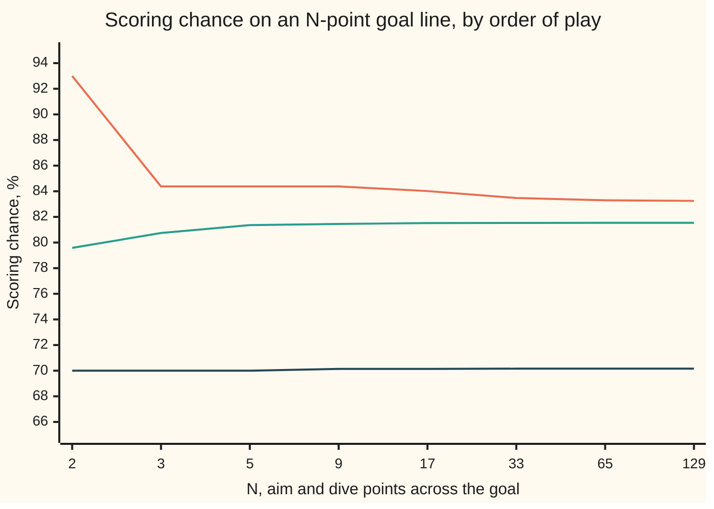

# Minimax: under convexity the best worst case equals the worst best case

[Syllabus](../../../SYLLABUS.md) → [Functional analysis](../README.md) → [Banach Algebras and Fixed Points](../README.md#s06) → Minimax

---

## General Overview

A penalty kick. The kicker shoots Left or Right; the keeper dives Left or Right, both named from the kicker's side. The ball is too fast to react to, so both choose at once. The scoring chances are round numbers of the size seen in the professional game, and they are illustrative:

| | Keeper dives Left | Keeper dives Right |
| --- | --- | --- |
| **Kicker shoots Left** | 58% | 95% |
| **Kicker shoots Right** | 93% | 70% |

Ask who would rather choose second. If the kicker must announce first, the keeper guesses right, and the best the kicker can lock in is 70%. If the keeper must announce first, the kicker shoots the other way. The keeper's best announcement, diving Left, still concedes 93%. The order of play matters: 70% against 93%.

Now let both players mix: roll a die and choose with fixed chances. The kicker shoots Left 23/60 of the time and the keeper dives Left 5/12 of the time. Then the order of play stops mattering. Either way round the kick scores 79.5833% of the time. The [Nash equilibrium](../../14-Applied%20and%20computational/05-Operations%20Research/09-game-theory-and-nash-equilibrium.md) card finds those rates; the [Saddle points](../../15-Optimization/03-Constrained%20Optimisation/06-saddle-points-and-minimax.md) card states that such a common value exists for finite tables.

Two words carry the result. Convex: any average of two allowed choices is allowed, which mixing guarantees. Compact: nothing can drift away to infinity.

This card proves why the gap closes, and how far the proof reaches. It lets the kicker aim anywhere along the goal line and the keeper dive anywhere: infinitely many choices each, and mixes that are spread over a whole line. The common value still exists: 81.5372% on a 129-point grid, within a proved bracket. Then the same swap of order reads off the **dual** of a convex problem: the partner problem whose best value equals the first one's whenever the two orders can be swapped.

**When one player's set of choices is convex and compact and the payoff is convex for that player and concave for the other, it does not matter who moves first: the best worst case equals the worst best case, and the dual of a convex problem is this swap of order.**

**What kind of fact this is:** a theorem, Ky Fan's minimax theorem of 1953, proved on this card in Why it works from the separation theorem and compactness. For the goal line, the compactness of the mixes is Banach–Alaoglu, proved on the [Weak convergence](../02-Hilbert%20Spaces/09-weak-convergence-and-banach-alaoglu.md) card; this space is separable (it has a countable dense set), so no axiom of choice is needed. The scoring model on the line is illustrative.

### The picture: the mixed value settles, the plain-choice gap does not



The goal line is cut into N equally spaced points. Orange: the keeper names a plain dive first. Green: both players mix, either order, the value $`V_N`$. Dark: the kicker names a plain aim first. The green line settles near 81.54% as N grows. The two plain-choice lines stay far apart at every N.

---

## The formula

Notation first, in words. The **minimiser** (the keeper, who wants few goals) picks $`x`$ from a set $`X`$. The **maximiser** (the kicker) picks $`y`$ from a set $`Y`$. $`F(x, y)`$ is the payoff, here the scoring chance.

A set is **convex** when the straight segment between any two of its points stays inside; a set of mixes is convex because averaging two mixes gives a mix. A set is **compact** when every sequence in it has a subsequence converging to a point of the set: nothing escapes. $`F(\cdot, y)`$ is **lower semicontinuous** when for each level $`t`$ the choices $`x`$ with $`F(x, y) > t`$ form an open set: the payoff can drop at a limit, never jump up.

**Minimax theorem (Fan).** Let $`X`$ be a compact convex set in a topological vector space (a space where adding and scaling are continuous), and $`Y`$ any convex set. Let $`F(\cdot, y)`$ be convex and lower semicontinuous for each $`y`$, and $`F(x, \cdot)`$ concave (curving down, or straight) for each $`x`$. Then

```math
\min_{x \in X}\, \sup_{y \in Y} F(x, y) \;=\; \sup_{y \in Y}\, \min_{x \in X} F(x, y) \;=\; V .
```

**Read it aloud:** the keeper choosing first and the kicker answering gives the same scoring chance as the kicker choosing first and the keeper answering; that common number is the **value** $`V`$.

Here "sup" (supremum) is the least upper bound, reached or not. The left side is the **best worst case**: the keeper's best guarantee. The right side is the **worst best case**: the kicker's best guarantee.

**Duality as a swap.** For a convex problem, minimise $`f_0(x)`$ subject to $`f_i(x) \le 0`$, the [Lagrangian duality](../../15-Optimization/03-Constrained%20Optimisation/04-lagrangian-duality-weak-and-strong.md) card builds the bill $`\mathcal{L}(x, \lambda) = f_0(x) + \sum_i \lambda_i f_i(x)`$ with prices $`\lambda_i \ge 0`$. Then

```math
P = \inf_{x}\, \sup_{\lambda \ge 0}\, \mathcal{L}(x, \lambda), \qquad D = \sup_{\lambda \ge 0}\, \inf_{x}\, \mathcal{L}(x, \lambda),
```

and **strong duality**, $`P = D`$, says the two orders agree. It holds when a minimax theorem applies to $`\mathcal{L}`$. In Step 5, for example, the free level forces the prices to add to 1, so they range over the mixes, a compact convex set. Without such a condition, such as Slater's (some plan meets every rule strictly), a gap can remain.

**Read it aloud:** the original problem is the planner moving first against a price setter; the dual is the price setter moving first; they agree exactly when the order can be swapped.

| Symbol | Plain meaning | In our example | Push it up and the answer… |
| --- | --- | --- | --- |
| $`X`$, $`x`$; $`Y`$, $`y`$, $`y^*`$ | the keeper's choices and one of them; the kicker's choices, one of them, and the one the proof builds | mixes over dive points; mixes over aim points | — |
| $`F(x, y)`$, $`F_{ij}`$ | the payoff: the kicker's scoring chance; the table entry for kicker choice $`i`$, keeper dive $`j`$ | 58% for Left against Left | — |
| $`V`$, $`V_N`$; $`r`$ | the value; the value when both choose from $`N`$ grid points; the level the kicker's mix must guarantee in Step 5 | 79.5833% at $`N = 2`$; 81.5372% at $`N = 129`$ | — |
| $`p`$, $`q`$ | the kicker's chance of shooting Left; the keeper's chance of diving Left (on the line: lists of chances, one per point) | 23/60 = 0.3833; 5/12 = 0.4167 | — |
| $`u`$, $`v`$, $`w`$ | aim point and dive point, in goal widths from the kicker's left post; the keeper's reach | $`u, v`$ from 0 to 1; $`w = 0.8`$ | a longer reach: lower value |
| $`\theta(u)`$, $`\beta(u)`$ | chance the shot is on target; the keeper's save chance when he dives exactly to $`u`$ | $`\theta = 0.95 + 0.18u - 0.20u^2`$; $`\beta`$ from 37/95 to 23/93 | — |
| $`\mu`$, $`\nu`$; $`C[0, 1]`$, $`\varphi`$ | the kicker's and the keeper's mixes over the line: probability measures on $`[0, 1]`$; the continuous functions on the line, and one of them | the kicker's: four zones (bars below) | — |
| $`N`$, $`h`$; $`L_u`$, $`L_v`$ | grid points and their spacing $`1/(N-1)`$; how fast the payoff can change per goal width of aim or of dive | $`N = 129`$, $`h = 1/128`$; 0.8430 and 0.4822 | a finer grid: a tighter bracket |
| $`t`$, $`s`$; $`y_1, \dots, y_k`$; $`B`$, $`E`$, $`b`$, $`e`$; $`\lambda_j`$, $`\alpha`$ | a test level and the keeper's guarantee against finitely many kicker choices; the box below $`s`$ and the set of payoff lists, with members; weights of a separating wall, and an averaging weight | $`s`$ = 79.5833% on the table | — |
| $`z_j`$, $`\pi_i`$ | the keeper's rescaled mix $`q_j / V`$; the matching prices, the kicker's rescaled mix $`p_i / V`$ | 0.523560, 0.732984; 0.481675, 0.774869 | — |
| $`f_0`$, $`f_i`$, $`\lambda`$, $`\mathcal{L}`$, $`P`$, $`D`$ | a cost, its rules $`f_i \le 0`$, prices on the rules, the bill, the planner-first and price-first values | the kicker's problem in Step 5 | — |
| $`f`$, $`g`$, $`T`$, $`T^t`$, $`f^*`$, $`g^*`$, $`\langle y, Tx\rangle`$ | two convex costs, a bounded operator and its transpose, the costs' slope transforms, and a functional $`y`$ applied to $`Tx`$ | Step 5 | — |

### When it holds

- **Convex choice sets, by mixing.** With plain choices only, each player has two points, not a segment. The swap then fails: 70% against 93%. On the 129-point line: 70.1555% against 83.2520%.
- **One side compact.** Let two people each name a whole number, the bigger name winning one point. Mixes over all whole numbers are convex but not compact: mass can drift off to infinity. The minimiser-first value is 1 and the maximiser-first value is 0 (What breaks).
- **Convex for the minimiser, concave for the maximiser.** A mixed payoff is an average, so it is straight in each player's mix: both conditions hold. A game convex for both players can leave a gap that favours the second mover; the [Saddle points](../../15-Optimization/03-Constrained%20Optimisation/06-saddle-points-and-minimax.md) card shows one.
- **Lower semicontinuous for the minimiser.** The goal-line payoff is continuous, so this holds there. A payoff that jumps up at a limit can leave the keeper's best guarantee unreached, and Step 3's open cover fails.
- **A value is not a best choice.** The theorem gives the keeper a best mix ($`X`$ compact), not the kicker. On the goal line both sets are compact, so both best mixes exist.

---

## Why it works

### Step 0: the idea, in words

The second mover sees more, so moving second never hurts. That gives one inequality for free. For the other, the first mover must hide its choice. Mixing does that. A separating wall (a flat cut with a set on one side) turns "every keeper choice loses more than $`t`$ to some kicker reply" into "one kicker mix gets more than $`t`$ against every keeper choice". The weights of the wall are the mix. Compactness lets infinitely many choices be replaced by finitely many, so the wall lives in an ordinary finite space.

### Step 1: moving second never hurts

For any $`x'`$ in $`X`$ and $`y'`$ in $`Y`$,

```math
\min_{x} F(x, y') \;\le\; F(x', y') \;\le\; \sup_{y} F(x', y).
```

The left side depends only on $`y'`$ and the right only on $`x'`$. Take the sup over $`y'`$ on the left and the min over $`x'`$ on the right:

```math
\sup_{y} \min_{x} F(x, y) \;\le\; \min_{x} \sup_{y} F(x, y).
```

This holds for every game. For plain choices on the table it reads 70% ≤ 93%.

### Step 2: finitely many kicker choices, one wall

Fix finitely many kicker choices $`y_1, \dots, y_k`$. Let $`s`$ be the keeper's best guarantee against them, $`s = \min_x \max_j F(x, y_j)`$. Each keeper choice $`x`$ gives a list of $`k`$ payoffs, $`(F(x, y_1), \dots, F(x, y_k))`$.

Collect every list that is at least as large, entry by entry, as one of these. Call it $`E`$. Because $`F`$ is convex in $`x`$, $`E`$ is convex. No list in $`E`$ has every entry below $`s`$, by the choice of $`s`$. So $`E`$ misses the open box $`B`$ of lists with every entry below $`s`$.

Two disjoint convex sets in $`k`$ dimensions, one of them open, are cut apart by a flat wall ([Separating hyperplanes](../../15-Optimization/01-Convexity/06-separating-hyperplanes.md)). Its weights $`\lambda_j`$ are not negative, because $`B`$ runs down without end in every entry. Scale them to add to 1. Then for every keeper choice $`x`$

```math
s \;\le\; \sum_j \lambda_j F(x, y_j) \;\le\; F\Big(x, \sum_j \lambda_j y_j\Big).
```

The second step is concavity in $`y`$. So the kicker's single choice $`y^* = \sum_j \lambda_j y_j`$ guarantees $`s`$.

**On the table.** Take $`k = 2`$: shoot Left, shoot Right. A keeper mix $`q`$ (his chance of diving Left) gives the pair $`(58q + 95(1 - q),\; 93q + 70(1 - q))`$. The wall with weights 23/60 and 37/60 scores both plain dives, and so every mix of them, at 4775/60 = 79.5833% (Worked numbers). The weights are exactly the kicker's best mix.

### Step 3: compactness turns infinitely many choices into finitely many

Suppose the keeper-first value is above some level $`t`$. Then every keeper choice $`x`$ has a kicker reply $`y`$ with $`F(x, y) > t`$. The sets $`\{x : F(x, y) > t\}`$ are open, by lower semicontinuity, and together they cover $`X`$.

$`X`$ is compact, so finitely many of them already cover it: replies $`y_1, \dots, y_k`$. The function $`\max_j F(x, y_j)`$ is lower semicontinuous and above $`t`$ everywhere, so its minimum over the compact $`X`$ exists and is some $`s > t`$. Step 2 then gives a kicker choice guaranteeing $`s`$.

So the kicker-first value is above every $`t`$ below the keeper-first value. With Step 1 they are equal. The minimum on the left is reached, because $`\sup_y F(\cdot, y)`$ is lower semicontinuous on a compact set.

<details>
<summary>Detailed proof: the set E is convex, and the wall's weights are not negative</summary>

Take lists $`e \ge F(x, \cdot)`$ and $`e' \ge F(x', \cdot)`$ entry by entry, and a weight $`\alpha`$ between 0 and 1. Convexity of each $`F(\cdot, y_j)`$ gives

$`\displaystyle F(\alpha x + (1 - \alpha) x', y_j) \le \alpha F(x, y_j) + (1 - \alpha) F(x', y_j) \le \alpha e_j + (1 - \alpha) e'_j .`$

So $`\alpha e + (1 - \alpha) e'`$ lies above the payoff list of the keeper choice $`\alpha x + (1 - \alpha) x'`$, which is in $`X`$ because $`X`$ is convex. Hence $`E`$ is convex.

The wall gives a nonzero $`\lambda`$ with $`\lambda \cdot b \le \lambda \cdot e`$ for every $`b`$ in $`B`$ and $`e`$ in $`E`$. If some $`\lambda_j < 0`$, push entry $`j`$ of $`b`$ down without end: $`\lambda \cdot b`$ grows past every $`\lambda \cdot e`$, a contradiction. So $`\lambda_j \ge 0`$, and their sum is positive. Divide by it. Let $`b`$ rise to the corner $`(s, \dots, s)`$: then $`s \le \lambda \cdot e`$ for every $`e`$ in $`E`$, in particular for the payoff list of any $`x`$.

</details>

### Step 4: the goal line, an infinite-dimensional game

Now the kicker aims at any point $`u`$ from 0 (his left post) to 1 (his right post), and the keeper dives to any point $`v`$. The illustrative model:

```math
F(u, v) = \theta(u)\,\Big(1 - \beta(u)\,\max\big(0,\; 1 - |u - v| / w\big)\Big).
```

The keeper saves best where he dives, with a chance that falls to zero at distance $`w`$. At the four corners it reproduces the table: $`\beta(0) = 37/95`$ turns 95% on target into 58%, and $`\beta(1) = 23/93`$ turns 93% into 70%.

A mix is now a **probability measure**: a rule giving each stretch of the line a chance, the chances adding to 1. A mix $`\nu`$ for the keeper acts on continuous functions by averaging, $`\varphi \mapsto \int \varphi\, d\nu`$. So mixes are bounded functionals on $`C[0, 1]`$, the continuous functions on the line ([Dual spaces](../01-Normed%20and%20Banach%20Spaces/09-dual-spaces-and-lp-duality.md)).

They sit in the unit ball of that dual space and form a convex set. **Weak-star convergence** means every average of a continuous function settles. In that sense the unit ball is compact, by Banach–Alaoglu ([Weak convergence](../02-Hilbert%20Spaces/09-weak-convergence-and-banach-alaoglu.md)). A limit of mixes is still a mix: the average of a function that is never negative stays at least 0, and the average of the constant 1 stays 1. So the mixes form a closed part of that compact ball, and are compact too. The mixed payoff $`\int\!\!\int F\, d\mu\, d\nu`$ is straight in each mix and continuous in $`\nu`$ for fixed $`\mu`$. Fan's theorem applies: the goal-line game has a value, and the keeper has a best mix.

**A second road, by truncation.** Restrict both players to $`N`$ grid points with spacing $`h`$. Moving an aim to the nearest grid point changes the payoff by at most $`L_u h / 2`$; moving a dive, by at most $`L_v h / 2`$. So the line's value lies in

```math
\big[\, V_N - L_v h / 2,\;\; V_N + L_u h / 2 \,\big].
```

The bracket shrinks to zero width as $`N`$ grows, so this also proves the two orders agree, for a continuous payoff. Fan's theorem needs no grid and no slope bound.

What the truncation hides: on every grid the best mixes are lists of chances on $`N`$ points, while a mix on the line may be any probability measure. The computed kicker mixes keep large point masses on the two posts, and the keeper's best mix is not even unique (Worked numbers). The code shows the trend only; the theorem is what says a limit mix exists.

### Step 5: the dual of a convex problem is the swap

Write the kicker's search as a convex problem: choose a mix $`p`$ and a level $`r`$ to maximise $`r`$, subject to "shooting by $`p`$ scores at least $`r`$ against each keeper dive". Put a price $`q_j \ge 0`$ on rule $`j`$. The bill is

```math
\mathcal{L}(p, r, q) = r + \sum_j q_j \Big( \sum_i p_i F_{ij} - r \Big).
```

Here $`F_{ij}`$ is the table entry for kicker choice $`i`$ and keeper dive $`j`$. Maximising over the free level $`r`$ gives a finite answer only when the prices add to 1, so the prices are a keeper mix. Then the bill is $`p^{\mathsf T} F q`$, and maximising over $`p`$ gives the **dual function** $`\max_i (Fq)_i`$: the kicker's best plain reply to the keeper's mix. Minimising that over $`q`$ is the keeper's problem.

So **the dual of the kicker's problem is the keeper's problem, and the prices on the kicker's rules are the keeper's mix.** Strong duality is the minimax theorem. The [LP duality](../../15-Optimization/04-Linear%20Programming/04-lp-duality-and-complementary-slackness.md) card proves it for finite tables by other means.

The same swap reads off the dual in infinite dimensions. For convex $`f`$ and $`g`$ and a bounded operator $`T`$, write $`g(Tx) = \sup_y \big(\langle y, Tx\rangle - g^*(y)\big)`$, which holds because a closed convex function equals its double slope transform ([The slope transform](07-legendre-fenchel-and-subgradients.md)). Swap inf and sup:

```math
\inf_x \big[f(x) + g(Tx)\big] \;\ge\; \sup_y \big[-f^*(-T^t y) - g^*(y)\big],
```

with equality whenever the swap is allowed. That is **Fenchel duality**; the finite form is on the [Convex conjugates](../../15-Optimization/01-Convexity/08-conjugates-and-fenchel-duality.md) card.

---

## Worked numbers, by hand

The 2 by 2 table, in percentage points. The closed form is from the [Nash equilibrium](../../14-Applied%20and%20computational/05-Operations%20Research/09-game-theory-and-nash-equilibrium.md) card; the wall and the dual are this card's.

| Step | Arithmetic | Value |
| --- | --- | --- |
| kicker first, plain | Left guarantees min(58, 95); Right guarantees min(93, 70) | 70% |
| keeper first, plain | Left concedes max(58, 93); Right concedes max(95, 70) | 93% |
| value, from the Nash equilibrium card | 4775 / 60 | 79.5833% |
| wall at keeper Left | (23 × 58 + 37 × 93) / 60 = (1334 + 3441) / 60 | 4775 / 60 |
| wall at keeper Right | (23 × 95 + 37 × 70) / 60 = (2185 + 2590) / 60 | 4775 / 60 |
| dual function at $`q = 0.3`$ | max(58 × 0.3 + 95 × 0.7, 93 × 0.3 + 70 × 0.7) | 83.9% |
| dual function at $`q = 0.5`$ | max(58 × 0.5 + 95 × 0.5, 93 × 0.5 + 70 × 0.5) | 81.5% |
| keeper's LP total | 0.523560 + 0.732984 = 1 / V | 1.256545 |
| kicker's mix from the prices | 0.481675 / 1.256545 | 0.3833 |
| **value, both orders, mixed** | | **79.5833%** |

The answer means: with mixing, neither player gains by learning the other's mix in advance. The keeper's dual function is lowest, 79.5833%, at $`q = 5/12`$; any other keeper mix lets the kicker score more.

On the goal line the same work is done by the simplex method at each $`N`$. At $`N = 129`$ the value is **81.5372%**, and all eight brackets meet in [81.3488%, 81.8665%].

Where the kicker's best mix puts its weight on the 129-point line, as chances per zone of the goal:

```
kicker aims, 0 to 0.1      ##########################                  0.2613
kicker aims, 0.1 to 0.5    ##############                              0.1369
kicker aims, 0.5 to 0.9    ##################                          0.1816
kicker aims, 0.9 to 1      ##########################################  0.4202
```

One `#` per 0.01. Much of that weight sits as point masses on the two posts: 0.2432 on the left post and 0.3913 on the right. As the grid refines, the kicker's mean aim goes 0.5920, 0.5924, 0.5928 goal widths at $`N`$ = 9, 33, 129, and the mean of its square goes 0.5393, 0.5405, 0.5415. Those are averages of the continuous functions $`u`$ and $`u^2`$, so their settling is weak-star convergence seen on two test functions. Zone chances are not such tests: when a point mass slides across a zone's edge, the zone chances jump even though the mixes converge.

The keeper's best mix is not unique, so only the kicker's is drawn. The checks solve the same program again with the dives listed right to left. The kicker's mix comes out the same, but the keeper's is a different mix, certified best the same way: at $`N = 129`$ it puts 0.0753 on dives from 0.25 to 0.5, where the first puts 0.2288. Any average of the two is best as well, so a keeper's zone bar would describe the solver, not the game.

### What breaks if you drop a piece

| Mistake | Comes out at | What went wrong |
| --- | --- | --- |
| Plain choices only: no mixing, so no convexity | 70% kicker first, 93% keeper first; on the 129-point line 70.1555% and 83.2520% | Two separate points are not a convex set; Step 2's averaged choice does not exist |
| Mixes over all whole numbers: no compactness | bigger-number game: minimiser first 1, maximiser first 0; truncated to 1 to $`N`$ against 1 to $`M`$, value 1 when $`M = N + 1`$, 0 when $`M = N`$ or $`N - 1`$ | Mass escapes to infinity; Step 3's finite cover does not exist. The trend over $`N`$ never closes: the answer depends on who is cut off first |
| Taking the 2 by 2 value as the line's value | 79.5833% instead of 81.5372% | The 2-point grid is a truncation; in-between aims and dives matter |
| Reading the keeper LP's prices as the kicker's mix | 0.481675 and 0.774869, adding to 1.256545 | The LP works in rescaled units; divide by the total, or multiply by $`V`$, to get 23/60 |

---

## Code, from first principles, and it actually runs

The code solves the penalty kick by three independent roads and then on the goal line. Road 1 is the closed form in exact fractions. Road 2 scans 6001 mixing rates for each player in exact fractions. Road 3 is a simplex solver (written out) on the keeper's linear program, whose prices give the kicker's mix: the dual read off. On the line, every simplex answer is certified separately: the kicker's mix guarantees a lower bound, the keeper's mix an upper bound, and the two must agree. At $`N`$ = 9, 33 and 129 the program is solved again with the dives in reverse order: the kicker's mix must come out the same, and the keeper's second mix must be certified best too. The truncation brackets and the bigger-number game come last.

### Python

```python
# Minimax: the penalty kick as a 2 by 2 game, then the goal mouth as a line.
# Standard library only. The simplex solver and every certificate are written out.
from fractions import Fraction as Fr

def simplex(A):
    """Keeper's LP: maximise sum(z) with A z <= 1, z >= 0 (Bland's rule).
    Returns value V, kicker's mix p (read from the dual prices), keeper's mix q."""
    m, n = len(A), len(A[0])
    T = [A[i][:] + [1.0 if k == i else 0.0 for k in range(m)] + [1.0] for i in range(m)]
    z = [-1.0] * n + [0.0] * (m + 1)
    basis = [n + i for i in range(m)]
    while True:
        col = next((j for j in range(n + m) if z[j] < -1e-12), None)
        if col is None:
            break
        rows = [(T[i][-1] / T[i][col], basis[i], i) for i in range(m) if T[i][col] > 1e-12]
        r = min(rows)[2]
        pv = T[r][col]
        T[r] = [v / pv for v in T[r]]
        for i in range(m):
            if i != r and T[i][col] != 0.0:
                f = T[i][col]
                T[i] = [a - f * b for a, b in zip(T[i], T[r])]
        f = z[col]
        z = [a - f * b for a, b in zip(z, T[r])]
        basis[r] = col
    V = 1.0 / z[-1]
    zq = [0.0] * n
    for i, b in enumerate(basis):
        if b < n:
            zq[b] = T[i][-1]
    return V, [z[n + i] for i in range(m)], zq, [z[n + i] * V for i in range(m)], [x * V for x in zq]

def bracket(A, p, q):
    """Certificate: the kicker's mix guarantees lo, the keeper's mix concedes at most hi."""
    lo = min(sum(p[i] * A[i][j] for i in range(len(A))) for j in range(len(A[0])))
    hi = max(sum(A[i][j] * q[j] for j in range(len(A[0]))) for i in range(len(A)))
    return lo, hi

def pure(A):
    """Plain choices only: kicker first (max-min) and keeper first (min-max)."""
    return max(min(r) for r in A), min(max(r[j] for r in A) for j in range(len(A[0])))

def pc(x):
    return f"{100 * x:.4f}%"

# ---- road 1: the 2 by 2 table, exact fractions and the closed form ----
a, b, c, d = Fr(58, 100), Fr(95, 100), Fr(93, 100), Fr(70, 100)
den = b + c - a - d
p_ex, q_ex, V_ex = (c - d) / den, (b - d) / den, (b * c - a * d) / den
print("2x2 closed form: p* =", p_ex, " q* =", q_ex, " V =", V_ex, "=", pc(float(V_ex)))
assert a * p_ex + c * (1 - p_ex) == V_ex == b * p_ex + d * (1 - p_ex)  # kicker's mix: keeper indifferent
assert a * q_ex + b * (1 - q_ex) == V_ex == c * q_ex + d * (1 - q_ex)  # keeper's mix: kicker indifferent
A, B, C, D = 58, 95, 93, 70  # the same table in whole percentage points, for the hand steps
print(f"hand: {B}*{C} = {B * C}, {A}*{D} = {A * D}, {B}+{C}-{A}-{D} = {B + C - A - D}, V = {B * C - A * D}/{B + C - A - D}")
print(f"wall: (23*{A} + 37*{C})/60 = ({23 * A} + {37 * C})/60 and (23*{B} + 37*{D})/60 = ({23 * B} + {37 * D})/60")
assert Fr(23 * A + 37 * C, 6000) == Fr(23 * B + 37 * D, 6000) == Fr(B * C - A * D, 100 * (B + C - A - D)) == V_ex
# ---- road 2: brute force over mixing rates in steps of 1/6000 ----
lo_scan = max((min(a * Fr(k, 6000) + c * (1 - Fr(k, 6000)), b * Fr(k, 6000) + d * (1 - Fr(k, 6000))), k) for k in range(6001))
hi_scan = min((max(a * Fr(k, 6000) + b * (1 - Fr(k, 6000)), c * Fr(k, 6000) + d * (1 - Fr(k, 6000))), k) for k in range(6001))
print("scan: kicker-first best", pc(float(lo_scan[0])), "at p =", f"{lo_scan[1] / 6000:.4f}",
      "| keeper-first best", pc(float(hi_scan[0])), "at q =", f"{hi_scan[1] / 6000:.4f}")
assert lo_scan[0] == V_ex == hi_scan[0]
A2 = [[0.58, 0.95], [0.93, 0.70]]
print("pure choices: kicker first", pc(pure(A2)[0]), "| keeper first", pc(pure(A2)[1]))
assert pure(A2) == (0.70, 0.93)
# ---- road 3: duality. The keeper's LP; the kicker's mix comes out as its prices ----
V2, u, zq, p2, q2 = simplex(A2)
print("keeper LP: z =", [f"{x:.6f}" for x in zq], "sum =", f"{sum(zq):.6f}", "= 1/V")
print("its prices: pi =", [f"{x:.6f}" for x in u], "sum =", f"{sum(u):.6f}", "(not a mix)")
print("rescaled by V:", f"p = {p2[0]:.4f}, q = {q2[0]:.4f}, V = {pc(V2)}")
assert abs(p2[0] - float(p_ex)) < 1e-12 and abs(q2[0] - float(q_ex)) < 1e-12
assert abs(V2 - float(V_ex)) < 1e-12
# Lagrangian dual of the kicker's problem: g(q) = max over kicker's plain choices of (A q)_i
for qL in (0.3, 25 / 60, 0.5):
    print(f"dual function at keeper Left {qL:.4f}: {pc(max(0.58 * qL + 0.95 * (1 - qL), 0.93 * qL + 0.70 * (1 - qL)))}")

# ---- the goal mouth as a line: aim u and dive v in goal widths, 0 = kicker's left post ----
def on(x):    # chance the shot is on target
    return 0.95 + 0.18 * x - 0.20 * x * x
def save(x):  # keeper's best save chance at aim x, when he dives exactly there
    return 37 / 95 + (23 / 93 - 37 / 95) * x
def score(x, y, w):  # scoring chance; the save chance falls to 0 at distance w
    return on(x) * (1.0 - save(x) * max(0.0, 1.0 - abs(x - y) / w))
def game(N, w):
    g = [k / (N - 1) for k in range(N)]
    return g, [[score(x, y, w) for y in g] for x in g]

w = 0.8
# slope bounds: |on'| <= 0.22, on <= on(0.45), save <= save(0), |save'| = 37/95 - 23/93
La = 0.22 + on(0.45) * ((37 / 95 - 23 / 93) + save(0) / w)
Ld = on(0.45) * save(0) / w
print(f"reach w = {w}; Lipschitz bounds: aim {La:.4f}, dive {Ld:.4f} per goal width")
corner = game(2, w)[1]
assert all(abs(corner[i][j] - A2[i][j]) < 1e-12 for i in range(2) for j in range(2))
print("N   V_N        bracket for the line's value   pure: kicker first  keeper first")
vals = {}
for N in (2, 3, 5, 9, 17, 33, 65, 129):
    g, A = game(N, w)
    V, _, _, p, q = simplex(A)
    lo, hi = bracket(A, p, q)
    assert abs(hi - lo) < 1e-9 and lo - 1e-9 <= V <= hi + 1e-9   # solver certified independently
    h = 1 / (N - 1)
    pmax, pmin = pure(A)
    vals[N] = (V, p, q, g)
    print(f"{N:<3} {pc(V)}  [{pc(V - Ld * h / 2)}, {pc(V + La * h / 2)}]   {pc(pmax)}  {pc(pmin)}")
    assert pmax < V - 0.05                                      # mixing closes a real gap
    assert pmin > V + 0.01
lows = [vals[N][0] - Ld / (N - 1) / 2 for N in vals]
highs = [vals[N][0] + La / (N - 1) / 2 for N in vals]
print(f"all eight brackets meet in [{pc(max(lows))}, {pc(min(highs))}]")
assert max(lows) < min(highs)   # the line's one value lies in every bracket
assert abs(vals[129][0] - vals[65][0]) < 0.0001 < abs(vals[3][0] - vals[2][0])
for N in (9, 33, 129):
    V, p, q, g = vals[N]
    A = game(N, w)[1]
    _, _, _, p2, q2 = simplex([r[::-1] for r in A])   # the same LP, keeper dives listed right to left
    q2 = q2[::-1]
    zone = lambda m, lo_, hi_: sum(m[i] for i in range(N) if lo_ <= g[i] < hi_ or (hi_ == 1 and g[i] == 1))
    kz = [zone(p, 0, 0.1), zone(p, 0.1, 0.5), zone(p, 0.5, 0.9), zone(p, 0.9, 1)]
    m1, m2 = sum(p[i] * g[i] for i in range(N)), sum(p[i] * g[i] * g[i] for i in range(N))
    print(f"N = {N}: kicker aims", " ".join(f"{x:.4f}" for x in kz), f"| posts {p[0]:.4f} {p[-1]:.4f} | mean aim {m1:.4f}, mean square {m2:.4f}")
    d1, d2, (lo2, hi2) = zone(q, 0.25, 0.5), zone(q2, 0.25, 0.5), bracket(A, p2, q2)
    print(f"  keeper dives 0.25 to 0.5: {d1:.4f} in one best mix, {d2:.4f} in another")
    assert abs(sum(kz) - 1) < 1e-9 and max(abs(a - b) for a, b in zip(p, p2)) < 1e-9  # kicker: same mix both ways
    assert abs(hi2 - lo2) < 1e-9 and abs(hi2 - V) < 1e-9 and abs(d1 - d2) > 0.04     # keeper: another best mix
for wt in (1.0, 0.5):
    print(f"try reach w = {wt}: V_2 = {pc(simplex(game(2, wt)[1])[0])}, V_3 = {pc(simplex(game(3, wt)[1])[0])}, V_65 = {pc(simplex(game(65, wt)[1])[0])}")

# ---- compactness fails: name the bigger whole number, the larger name wins 1 ----
print("bigger number: chooser of n (minimiser) from 1..N, of m (maximiser) from 1..M")
for N, M in ((10, 10), (10, 11), (100, 99), (100, 101)):
    B = [[1 if m > n else 0 for m in range(1, M + 1)] for n in range(1, N + 1)]
    up = min(max(r) for r in B)
    low = max(min(B[i][j] for i in range(N)) for j in range(M))
    print(f"  N = {N}, M = {M}: value {up}")
    assert up == low == (1 if M > N else 0)
print("ALL CHECKS PASS")
```

**Ran 2026-11-15 on macOS, Python 3.14.10, standard library only. All checks passed. Output, pasted from the run:**

```
2x2 closed form: p* = 23/60  q* = 5/12  V = 191/240 = 79.5833%
hand: 95*93 = 8835, 58*70 = 4060, 95+93-58-70 = 60, V = 4775/60
wall: (23*58 + 37*93)/60 = (1334 + 3441)/60 and (23*95 + 37*70)/60 = (2185 + 2590)/60
scan: kicker-first best 79.5833% at p = 0.3833 | keeper-first best 79.5833% at q = 0.4167
pure choices: kicker first 70.0000% | keeper first 93.0000%
keeper LP: z = ['0.523560', '0.732984'] sum = 1.256545 = 1/V
its prices: pi = ['0.481675', '0.774869'] sum = 1.256545 (not a mix)
rescaled by V: p = 0.3833, q = 0.4167, V = 79.5833%
dual function at keeper Left 0.3000: 83.9000%
dual function at keeper Left 0.4167: 79.5833%
dual function at keeper Left 0.5000: 81.5000%
reach w = 0.8; Lipschitz bounds: aim 0.8430, dive 0.4822 per goal width
N   V_N        bracket for the line's value   pure: kicker first  keeper first
2   79.5833%  [55.4725%, 121.7348%]   70.0000%  93.0000%
3   80.7420%  [68.6866%, 101.8177%]   70.0000%  84.3750%
5   81.3609%  [75.3332%, 91.8987%]   70.0000%  84.3750%
9   81.4532%  [78.4393%, 86.7221%]   70.1387%  84.3750%
17  81.5188%  [80.0119%, 84.1533%]   70.1387%  84.0156%
33  81.5271%  [80.7737%, 82.8444%]   70.1555%  83.4766%
65  81.5360%  [81.1593%, 82.1946%]   70.1555%  83.2930%
129 81.5372%  [81.3488%, 81.8665%]   70.1555%  83.2520%
all eight brackets meet in [81.3488%, 81.8665%]
N = 9: kicker aims 0.2474 0.1515 0.2032 0.3979 | posts 0.2474 0.3979 | mean aim 0.5920, mean square 0.5393
  keeper dives 0.25 to 0.5: 0.1912 in one best mix, 0.1414 in another
N = 33: kicker aims 0.2615 0.1369 0.1818 0.4198 | posts 0.2433 0.3914 | mean aim 0.5924, mean square 0.5405
  keeper dives 0.25 to 0.5: 0.2058 in one best mix, 0.0830 in another
N = 129: kicker aims 0.2613 0.1369 0.1816 0.4202 | posts 0.2432 0.3913 | mean aim 0.5928, mean square 0.5415
  keeper dives 0.25 to 0.5: 0.2288 in one best mix, 0.0753 in another
try reach w = 1.0: V_2 = 79.5833%, V_3 = 79.5833%, V_65 = 79.5833%
try reach w = 0.5: V_2 = 79.5833%, V_3 = 85.6089%, V_65 = 85.6089%
bigger number: chooser of n (minimiser) from 1..N, of m (maximiser) from 1..M
  N = 10, M = 10: value 0
  N = 10, M = 11: value 1
  N = 100, M = 99: value 0
  N = 100, M = 101: value 1
ALL CHECKS PASS
```

### Rust

```rust
// Minimax: the penalty kick as a 2 by 2 game, then the goal mouth as a line.
// std only. The simplex solver, the fractions and every certificate are written out.
use std::fmt;

#[derive(Clone, Copy, PartialEq, PartialOrd)]
struct Fr(i128, i128); // numerator, denominator > 0, always reduced
fn gcd(a: i128, b: i128) -> i128 { if b == 0 { a.abs() } else { gcd(b, a % b) } }
fn fr(n: i128, d: i128) -> Fr { let g = gcd(n, d) * d.signum(); Fr(n / g, d / g) }
impl std::ops::Add for Fr { type Output = Fr; fn add(self, o: Fr) -> Fr { fr(self.0 * o.1 + o.0 * self.1, self.1 * o.1) } }
impl std::ops::Sub for Fr { type Output = Fr; fn sub(self, o: Fr) -> Fr { fr(self.0 * o.1 - o.0 * self.1, self.1 * o.1) } }
impl std::ops::Mul for Fr { type Output = Fr; fn mul(self, o: Fr) -> Fr { fr(self.0 * o.0, self.1 * o.1) } }
impl std::ops::Div for Fr { type Output = Fr; fn div(self, o: Fr) -> Fr { fr(self.0 * o.1, self.1 * o.0) } }
impl fmt::Display for Fr { fn fmt(&self, f: &mut fmt::Formatter) -> fmt::Result { write!(f, "{}/{}", self.0, self.1) } }
fn lt(x: Fr, y: Fr) -> bool { x.0 * y.1 < y.0 * x.1 }
fn fl(x: Fr) -> f64 { x.0 as f64 / x.1 as f64 }

/// Keeper's LP: maximise sum(z) with A z <= 1, z >= 0 (Bland's rule).
/// Returns value V, the LP's prices u, its solution z, kicker's mix p, keeper's mix q.
fn simplex(a: &Vec<Vec<f64>>) -> (f64, Vec<f64>, Vec<f64>, Vec<f64>, Vec<f64>) {
    let (m, n) = (a.len(), a[0].len());
    let mut t: Vec<Vec<f64>> = (0..m).map(|i| {
        let mut r = a[i].clone();
        r.extend((0..m).map(|k| if k == i { 1.0 } else { 0.0 }));
        r.push(1.0); r }).collect();
    let mut z = vec![-1.0; n]; z.extend(vec![0.0; m + 1]);
    let mut basis: Vec<usize> = (0..m).map(|i| n + i).collect();
    loop {
        let col = match (0..n + m).find(|&j| z[j] < -1e-12) { Some(c) => c, None => break };
        let mut best: Option<(f64, usize, usize)> = None;
        for i in 0..m {
            if t[i][col] > 1e-12 {
                let key = (t[i][n + m] / t[i][col], basis[i], i);
                if best.map_or(true, |b| key.0 < b.0 || (key.0 == b.0 && key.1 < b.1)) { best = Some(key); }
            }
        }
        let r = best.unwrap().2;
        let pv = t[r][col]; t[r] = t[r].iter().map(|v| v / pv).collect();
        let tr = t[r].clone();
        for i in 0..m {
            if i != r && t[i][col] != 0.0 {
                let f = t[i][col];
                t[i] = t[i].iter().zip(&tr).map(|(x, y)| x - f * y).collect();
            }
        }
        let f = z[col]; z = z.iter().zip(&tr).map(|(x, y)| x - f * y).collect();
        basis[r] = col;
    }
    let v = 1.0 / z[n + m];
    let mut zq = vec![0.0; n]; for (i, &b) in basis.iter().enumerate() { if b < n { zq[b] = t[i][n + m]; } }
    let u: Vec<f64> = (0..m).map(|i| z[n + i]).collect();
    let (p, q) = (u.iter().map(|x| x * v).collect(), zq.iter().map(|x| x * v).collect());
    (v, u, zq, p, q)
}
/// Certificate: the kicker's mix guarantees lo, the keeper's mix concedes at most hi.
fn bracket(a: &Vec<Vec<f64>>, p: &[f64], q: &[f64]) -> (f64, f64) {
    let (m, n) = (a.len(), a[0].len());
    let lo = (0..n).map(|j| { let mut s = 0.0; for i in 0..m { s += p[i] * a[i][j]; } s }).fold(f64::INFINITY, f64::min);
    let hi = (0..m).map(|i| { let mut s = 0.0; for j in 0..n { s += a[i][j] * q[j]; } s }).fold(f64::NEG_INFINITY, f64::max);
    (lo, hi)
}
/// Plain choices only: kicker first (max-min) and keeper first (min-max).
fn pure(a: &Vec<Vec<f64>>) -> (f64, f64) {
    let mx = a.iter().map(|r| r.iter().cloned().fold(f64::INFINITY, f64::min)).fold(f64::NEG_INFINITY, f64::max);
    let mn = (0..a[0].len()).map(|j| a.iter().map(|r| r[j]).fold(f64::NEG_INFINITY, f64::max)).fold(f64::INFINITY, f64::min);
    (mx, mn)
}
fn pc(x: f64) -> String { format!("{:.4}%", 100.0 * x) }
fn on(x: f64) -> f64 { 0.95 + 0.18 * x - 0.20 * x * x }           // chance the shot is on target
fn save(x: f64) -> f64 { 37.0 / 95.0 + (23.0 / 93.0 - 37.0 / 95.0) * x } // best save chance at aim x
fn score(x: f64, y: f64, w: f64) -> f64 { on(x) * (1.0 - save(x) * f64::max(0.0, 1.0 - (x - y).abs() / w)) }
fn game(n: usize, w: f64) -> (Vec<f64>, Vec<Vec<f64>>) {
    let g: Vec<f64> = (0..n).map(|k| k as f64 / (n - 1) as f64).collect();
    let a = g.iter().map(|&x| g.iter().map(|&y| score(x, y, w)).collect()).collect();
    (g, a)
}
fn list(v: &[f64], d: usize) -> String { format!("[{}]", v.iter().map(|x| format!("'{:.*}'", d, x)).collect::<Vec<_>>().join(", ")) }

fn main() {
    // ---- road 1: the 2 by 2 table, exact fractions and the closed form ----
    let (a, b, c, d) = (fr(58, 100), fr(95, 100), fr(93, 100), fr(70, 100));
    let (one, den) = (fr(1, 1), b + c - a - d);
    let (p_ex, q_ex, v_ex) = ((c - d) / den, (b - d) / den, (b * c - a * d) / den);
    println!("2x2 closed form: p* = {}  q* = {}  V = {} = {}", p_ex, q_ex, v_ex, pc(fl(v_ex)));
    assert!(a * p_ex + c * (one - p_ex) == v_ex && b * p_ex + d * (one - p_ex) == v_ex);
    assert!(a * q_ex + b * (one - q_ex) == v_ex && c * q_ex + d * (one - q_ex) == v_ex);
    let (ai, bi, ci, di) = (58i128, 95i128, 93i128, 70i128); // whole percentage points, for the hand steps
    println!("hand: {}*{} = {}, {}*{} = {}, {}+{}-{}-{} = {}, V = {}/{}", bi, ci, bi * ci, ai, di, ai * di, bi, ci, ai, di, bi + ci - ai - di, bi * ci - ai * di, bi + ci - ai - di);
    println!("wall: (23*{} + 37*{})/60 = ({} + {})/60 and (23*{} + 37*{})/60 = ({} + {})/60", ai, ci, 23 * ai, 37 * ci, bi, di, 23 * bi, 37 * di);
    assert!(fr(23 * ai + 37 * ci, 6000) == v_ex && fr(23 * bi + 37 * di, 6000) == v_ex && fr(bi * ci - ai * di, 100 * (bi + ci - ai - di)) == v_ex);
    // ---- road 2: brute force over mixing rates in steps of 1/6000 ----
    let (mut lo_s, mut lo_k, mut hi_s, mut hi_k) = (fr(-1, 1), 0, fr(2, 1), 0);
    for k in 0..=6000 {
        let t = fr(k, 6000);
        let l1 = a * t + c * (one - t); let l2 = b * t + d * (one - t);
        let lo = if lt(l1, l2) { l1 } else { l2 };
        if !lt(lo, lo_s) && lo != lo_s { lo_s = lo; lo_k = k; }
        let h1 = a * t + b * (one - t); let h2 = c * t + d * (one - t);
        let hi = if lt(h1, h2) { h2 } else { h1 };
        if lt(hi, hi_s) { hi_s = hi; hi_k = k; }
    }
    println!("scan: kicker-first best {} at p = {:.4} | keeper-first best {} at q = {:.4}",
             pc(fl(lo_s)), lo_k as f64 / 6000.0, pc(fl(hi_s)), hi_k as f64 / 6000.0);
    assert!(lo_s == v_ex && hi_s == v_ex);
    let a2 = vec![vec![0.58, 0.95], vec![0.93, 0.70]];
    println!("pure choices: kicker first {} | keeper first {}", pc(pure(&a2).0), pc(pure(&a2).1));
    assert!(pure(&a2) == (0.70, 0.93));
    // ---- road 3: duality. The keeper's LP; the kicker's mix comes out as its prices ----
    let (v2, u, zq, p2, q2) = simplex(&a2);
    println!("keeper LP: z = {} sum = {:.6} = 1/V", list(&zq, 6), zq.iter().sum::<f64>());
    println!("its prices: pi = {} sum = {:.6} (not a mix)", list(&u, 6), u.iter().sum::<f64>());
    println!("rescaled by V: p = {:.4}, q = {:.4}, V = {}", p2[0], q2[0], pc(v2));
    assert!((p2[0] - fl(p_ex)).abs() < 1e-12 && (q2[0] - fl(q_ex)).abs() < 1e-12 && (v2 - fl(v_ex)).abs() < 1e-12);
    for ql in [0.3, 25.0 / 60.0, 0.5] {
        println!("dual function at keeper Left {:.4}: {}", ql, pc(f64::max(0.58 * ql + 0.95 * (1.0 - ql), 0.93 * ql + 0.70 * (1.0 - ql))));
    }
    // ---- the goal mouth as a line: aim u and dive v in goal widths, 0 = kicker's left post ----
    let w = 0.8;
    let la = 0.22 + on(0.45) * ((37.0 / 95.0 - 23.0 / 93.0) + save(0.0) / w);
    let ld = on(0.45) * save(0.0) / w;
    println!("reach w = {}; Lipschitz bounds: aim {:.4}, dive {:.4} per goal width", w, la, ld);
    let corner = game(2, w).1;
    for i in 0..2 { for j in 0..2 { assert!((corner[i][j] - a2[i][j]).abs() < 1e-12); } }
    println!("N   V_N        bracket for the line's value   pure: kicker first  keeper first");
    let mut vals: Vec<(usize, f64, Vec<f64>, Vec<f64>, Vec<f64>)> = vec![];
    for n in [2usize, 3, 5, 9, 17, 33, 65, 129] {
        let (g, am) = game(n, w);
        let (v, _, _, p, q) = simplex(&am);
        let (lo, hi) = bracket(&am, &p, &q);
        assert!((hi - lo).abs() < 1e-9 && lo - 1e-9 <= v && v <= hi + 1e-9);
        let h = 1.0 / (n - 1) as f64;
        let (pmax, pmin) = pure(&am);
        println!("{:<3} {}  [{}, {}]   {}  {}", n, pc(v), pc(v - ld * h / 2.0), pc(v + la * h / 2.0), pc(pmax), pc(pmin));
        assert!(pmax < v - 0.05 && pmin > v + 0.01); // mixing closes a real gap
        vals.push((n, v, p, q, g));
    }
    let lows: Vec<f64> = vals.iter().map(|e| e.1 - ld / (e.0 - 1) as f64 / 2.0).collect();
    let highs: Vec<f64> = vals.iter().map(|e| e.1 + la / (e.0 - 1) as f64 / 2.0).collect();
    let (mlo, mhi) = (lows.iter().cloned().fold(f64::NEG_INFINITY, f64::max), highs.iter().cloned().fold(f64::INFINITY, f64::min));
    println!("all eight brackets meet in [{}, {}]", pc(mlo), pc(mhi));
    assert!(mlo < mhi);
    let get = |n: usize| vals.iter().find(|e| e.0 == n).unwrap().1;
    assert!((get(129) - get(65)).abs() < 0.0001 && 0.0001 < (get(3) - get(2)).abs());
    for e in vals.iter().filter(|e| [9, 33, 129].contains(&e.0)) {
        let (n, g, p, am) = (e.0, &e.4, &e.2, game(e.0, w).1);
        let (_, _, _, p2, q2) = simplex(&am.iter().map(|r| r.iter().rev().cloned().collect()).collect()); // keeper dives right to left
        let q2: Vec<f64> = q2.into_iter().rev().collect();
        let zone = |m: &Vec<f64>, l: f64, h: f64| -> f64 { let mut s = 0.0; for i in 0..n { if (l <= g[i] && g[i] < h) || (h == 1.0 && g[i] == 1.0) { s += m[i]; } } s };
        let kz = [zone(p, 0.0, 0.1), zone(p, 0.1, 0.5), zone(p, 0.5, 0.9), zone(p, 0.9, 1.0)];
        let (mut m1, mut m2) = (0.0, 0.0); for i in 0..n { m1 += p[i] * g[i]; m2 += p[i] * g[i] * g[i]; }
        println!("N = {}: kicker aims {} | posts {:.4} {:.4} | mean aim {:.4}, mean square {:.4}", n, kz.iter().map(|x| format!("{:.4}", x)).collect::<Vec<_>>().join(" "), p[0], p[n - 1], m1, m2);
        let (d1, d2, (lo2, hi2)) = (zone(&e.3, 0.25, 0.5), zone(&q2, 0.25, 0.5), bracket(&am, &p2, &q2));
        println!("  keeper dives 0.25 to 0.5: {:.4} in one best mix, {:.4} in another", d1, d2);
        assert!((kz.iter().sum::<f64>() - 1.0).abs() < 1e-9 && p.iter().zip(&p2).all(|(a, b)| (a - b).abs() < 1e-9)); // kicker: same mix both ways
        assert!((hi2 - lo2).abs() < 1e-9 && (hi2 - e.1).abs() < 1e-9 && (d1 - d2).abs() > 0.04); // keeper: another best mix
    }
    for wt in [1.0, 0.5] {
        println!("try reach w = {:.1}: V_2 = {}, V_3 = {}, V_65 = {}", wt, pc(simplex(&game(2, wt).1).0), pc(simplex(&game(3, wt).1).0), pc(simplex(&game(65, wt).1).0));
    }
    // ---- compactness fails: name the bigger whole number, the larger name wins 1 ----
    println!("bigger number: chooser of n (minimiser) from 1..N, of m (maximiser) from 1..M");
    for (nn, mm) in [(10, 10), (10, 11), (100, 99), (100, 101)] {
        let bm: Vec<Vec<i32>> = (1..=nn).map(|n| (1..=mm).map(|m| if m > n { 1 } else { 0 }).collect()).collect();
        let up = bm.iter().map(|r| *r.iter().max().unwrap()).min().unwrap();
        let low = (0..mm as usize).map(|j| bm.iter().map(|r| r[j]).min().unwrap()).max().unwrap();
        println!("  N = {}, M = {}: value {}", nn, mm, up);
        assert!(up == low && up == if mm > nn { 1 } else { 0 });
    }
    println!("ALL CHECKS PASS");
}
```

**Ran 2026-11-15 on macOS, rustc 1.98.1, no crates. All checks passed. Output, pasted from the run:**

```
2x2 closed form: p* = 23/60  q* = 5/12  V = 191/240 = 79.5833%
hand: 95*93 = 8835, 58*70 = 4060, 95+93-58-70 = 60, V = 4775/60
wall: (23*58 + 37*93)/60 = (1334 + 3441)/60 and (23*95 + 37*70)/60 = (2185 + 2590)/60
scan: kicker-first best 79.5833% at p = 0.3833 | keeper-first best 79.5833% at q = 0.4167
pure choices: kicker first 70.0000% | keeper first 93.0000%
keeper LP: z = ['0.523560', '0.732984'] sum = 1.256545 = 1/V
its prices: pi = ['0.481675', '0.774869'] sum = 1.256545 (not a mix)
rescaled by V: p = 0.3833, q = 0.4167, V = 79.5833%
dual function at keeper Left 0.3000: 83.9000%
dual function at keeper Left 0.4167: 79.5833%
dual function at keeper Left 0.5000: 81.5000%
reach w = 0.8; Lipschitz bounds: aim 0.8430, dive 0.4822 per goal width
N   V_N        bracket for the line's value   pure: kicker first  keeper first
2   79.5833%  [55.4725%, 121.7348%]   70.0000%  93.0000%
3   80.7420%  [68.6866%, 101.8177%]   70.0000%  84.3750%
5   81.3609%  [75.3332%, 91.8987%]   70.0000%  84.3750%
9   81.4532%  [78.4393%, 86.7221%]   70.1387%  84.3750%
17  81.5188%  [80.0119%, 84.1533%]   70.1387%  84.0156%
33  81.5271%  [80.7737%, 82.8444%]   70.1555%  83.4766%
65  81.5360%  [81.1593%, 82.1946%]   70.1555%  83.2930%
129 81.5372%  [81.3488%, 81.8665%]   70.1555%  83.2520%
all eight brackets meet in [81.3488%, 81.8665%]
N = 9: kicker aims 0.2474 0.1515 0.2032 0.3979 | posts 0.2474 0.3979 | mean aim 0.5920, mean square 0.5393
  keeper dives 0.25 to 0.5: 0.1912 in one best mix, 0.1414 in another
N = 33: kicker aims 0.2615 0.1369 0.1818 0.4198 | posts 0.2433 0.3914 | mean aim 0.5924, mean square 0.5405
  keeper dives 0.25 to 0.5: 0.2058 in one best mix, 0.0830 in another
N = 129: kicker aims 0.2613 0.1369 0.1816 0.4202 | posts 0.2432 0.3913 | mean aim 0.5928, mean square 0.5415
  keeper dives 0.25 to 0.5: 0.2288 in one best mix, 0.0753 in another
try reach w = 1.0: V_2 = 79.5833%, V_3 = 79.5833%, V_65 = 79.5833%
try reach w = 0.5: V_2 = 79.5833%, V_3 = 85.6089%, V_65 = 85.6089%
bigger number: chooser of n (minimiser) from 1..N, of m (maximiser) from 1..M
  N = 10, M = 10: value 0
  N = 10, M = 11: value 1
  N = 100, M = 99: value 0
  N = 100, M = 101: value 1
ALL CHECKS PASS
```

### Lean

Lean proves Fan's minimax theorem in any topological vector space, and the penalty kick's mixed value on the table.

- Suppose $`X`$ is compact, convex and not empty, $`Y`$ is convex, and $`F`$ is convex and lower semicontinuous in $`x`$ and concave in $`y`$. Then the best worst case equals the worst best case, and some $`x_0`$ in $`X`$ reaches the minimum.
- For any sets of choices and any payoff, moving second never hurts: the worst best case is never above the best worst case.
- Take the table with mixes allowed. Then the kicker-first and keeper-first values are both 4775/60 = 79.5833%.
- Suppose the kicker shoots Left 23/60 of the time. Then every keeper mix concedes exactly 79.5833%.
- Suppose the keeper dives Left 5/12 of the time. Then every kicker mix scores exactly 79.5833%.
- The hand steps check too: plain choices give 70% and 93%, and the wall, dual function and rescaled prices match Worked numbers.

The goal-line game, its grids and brackets, and the bigger-number game are left to the Python and Rust checks.

```lean
-- Minimax: this file states that when one side is compact and convex and the payoff is convex for the minimiser and concave for the maximiser, the best worst case equals the worst best case, and that the penalty kick's mixed value is 4775/60 percent either way round.
import Mathlib.Analysis.Convex.Function
import Mathlib.Topology.Semicontinuity.Defs
import Mathlib.Topology.Algebra.Module.Basic
import Mathlib.Topology.Instances.Real.Lemmas
import Mathlib.Data.EReal.Basic
import Mathlib.Order.CompleteLattice.Basic
import Mathlib.Analysis.LocallyConvex.Separation
import Mathlib.Analysis.Convex.Jensen
import Mathlib.Data.EReal.Operations
import Mathlib.Topology.Semicontinuity.Basic
import Mathlib.Algebra.BigOperators.Field

open Set

/-- Finite step: if every point of `X` has some `y` in the finite set `u` with payoff at least
`c`, then a single mixed `y'` in `Y` gives payoff at least `c` at every point of `X`. -/
theorem minimax_finite_step
    {E G : Type*} [AddCommGroup E] [Module ℝ E] [AddCommGroup G] [Module ℝ G]
    {X : Set E} {Y : Set G} {F : E → G → ℝ}
    (hXne : X.Nonempty) (hXcvx : Convex ℝ X) (hYcvx : Convex ℝ Y)
    (hconvex : ∀ y ∈ Y, ConvexOn ℝ X fun x => F x y)
    (hconcave : ∀ x ∈ X, ConcaveOn ℝ Y (F x))
    (u : Finset G) (hu : ∀ y ∈ u, y ∈ Y) (c : ℝ)
    (h : ∀ x ∈ X, ∃ y ∈ u, c ≤ F x y) :
    ∃ y' ∈ Y, ∀ x ∈ X, c ≤ F x y' := by
  classical
  obtain ⟨x0, hx0⟩ := hXne
  let ι := {y // y ∈ u}
  let A : Set (ι → ℝ) := {z | ∃ x ∈ X, ∀ i : ι, F x i ≤ z i}
  let B : Set (ι → ℝ) := Set.pi univ (fun _ => Iio c)
  have hAcvx : Convex ℝ A := by
    rintro z1 ⟨x1, hx1, h1⟩ z2 ⟨x2, hx2, h2⟩ a b ha hb hab
    refine ⟨a • x1 + b • x2, hXcvx hx1 hx2 ha hb hab, fun i => ?_⟩
    have := (hconvex i (hu i i.2)).2 hx1 hx2 ha hb hab
    simp only [smul_eq_mul] at this
    simp only [Pi.add_apply, Pi.smul_apply, smul_eq_mul]
    nlinarith [h1 i, h2 i]
  have hBcvx : Convex ℝ B := convex_pi (fun _ _ => convex_Iio c)
  have hBopen : IsOpen B := isOpen_set_pi finite_univ (fun _ _ => isOpen_Iio)
  have hdisj : Disjoint B A := by
    rw [Set.disjoint_left]
    rintro z hzB ⟨x, hx, hz⟩
    obtain ⟨y, hy, hcy⟩ := h x hx
    have := hzB ⟨y, hy⟩ (mem_univ _)
    have := hz ⟨y, hy⟩
    simp only [mem_Iio] at *
    linarith
  obtain ⟨f, s0, hfB, hfA⟩ := geometric_hahn_banach_open hBcvx hBopen hAcvx hdisj
  let fl : (ι → ℝ) →ₗ[ℝ] ℝ := f.toLinearMap
  let w : ι → ℝ := fun i => f (fun j => if i = j then 1 else 0)
  have hf : ∀ z, f z = ∑ i, z i * w i := by
    intro z
    have := LinearMap.pi_apply_eq_sum_univ fl z
    simpa [fl, w, smul_eq_mul] using this
  have hb0 : (fun i : ι => F x0 i) ∈ A := ⟨x0, hx0, fun i => le_rfl⟩
  have hw0 : ∀ i, 0 ≤ w i := by
    intro i
    by_contra hneg
    push Not at hneg
    set b0 : ι → ℝ := fun i => F x0 i
    have hfb0 := hfA b0 hb0
    set t : ℝ := (f b0 - s0 + 1) / (-w i)
    have ht : 0 ≤ t := div_nonneg (by linarith) (by linarith)
    have hmem : b0 + t • (fun j => if i = j then (1:ℝ) else 0) ∈ A := by
      refine ⟨x0, hx0, fun j => ?_⟩
      simp only [Pi.add_apply, Pi.smul_apply, smul_eq_mul, b0]
      have : 0 ≤ t * (if i = j then (1:ℝ) else 0) := mul_nonneg ht (by split_ifs <;> norm_num)
      linarith
    have h1 := hfA _ hmem
    rw [map_add, map_smul, smul_eq_mul] at h1
    have hne : -w i ≠ 0 := by linarith
    have h2 : t * w i = -(f b0 - s0 + 1) := by
      simp only [t]; rw [div_mul_eq_mul_div, div_eq_iff hne]; ring
    change s0 ≤ f b0 + t * w i at h1
    linarith
  set S := ∑ i, w i with hS
  have hSpos : 0 < S := by
    rcases (Finset.sum_nonneg (fun i _ => hw0 i) : 0 ≤ S).lt_or_eq with h' | h'
    · exact h'
    · exfalso
      have hwz : ∀ i, w i = 0 := by
        intro i
        exact (Finset.sum_eq_zero_iff_of_nonneg (fun i _ => hw0 i)).1 h'.symm i (Finset.mem_univ _)
      have hc1 : (fun _ : ι => c - 1) ∈ B := fun _ _ => by simp
      have e1 := hfB _ hc1
      have e2 := hfA _ hb0
      rw [hf] at e1 e2
      simp only [hwz, mul_zero, Finset.sum_const_zero] at e1 e2
      linarith
  have hcS : c * S ≤ s0 := by
    by_contra hlt
    push Not at hlt
    set δ := (c * S - s0) / S
    have hδ : 0 < δ := div_pos (by linarith) hSpos
    have hmem : (fun _ : ι => c - δ) ∈ B := fun _ _ => by simp [hδ]
    have e1 := hfB _ hmem
    rw [hf, ← Finset.mul_sum] at e1
    have : (c - δ) * S = s0 := by simp only [δ]; field_simp; ring
    linarith
  let lam : ι → ℝ := fun i => w i / S
  have hlam0 : ∀ i ∈ (Finset.univ : Finset ι), 0 ≤ lam i := fun i _ => div_nonneg (hw0 i) hSpos.le
  have hlam1 : ∑ i ∈ (Finset.univ : Finset ι), lam i = 1 := by
    rw [← Finset.sum_div, ← hS]; field_simp
  have hmemY : ∀ i ∈ (Finset.univ : Finset ι), (i : G) ∈ Y := fun i _ => hu i i.2
  refine ⟨∑ i, lam i • (i : G), hYcvx.sum_mem hlam0 hlam1 hmemY, fun x hx => ?_⟩
  have hj := (hconcave x hx).le_map_sum hlam0 hlam1 hmemY
  have hA : (fun i : ι => F x i) ∈ A := ⟨x, hx, fun i => le_rfl⟩
  have e := hfA _ hA
  rw [hf] at e
  have : c ≤ ∑ i, lam i • F x i := by
    simp only [lam, smul_eq_mul]
    rw [show (∑ i, w i / S * F x i) = (∑ i : ι, F x (i : G) * w i) / S by
      rw [Finset.sum_div]; exact Finset.sum_congr rfl (fun i _ => by ring)]
    rw [le_div_iff₀ hSpos]
    linarith
  linarith

/-- Weak duality, as a helper. -/
theorem minimax_weak {α β : Type*} (X : Set α) (Y : Set β) (F : α → β → ℝ) :
    (⨆ y ∈ Y, ⨅ x ∈ X, (F x y : EReal)) ≤ ⨅ x ∈ X, ⨆ y ∈ Y, (F x y : EReal) :=
  iSup₂_le fun y hy => le_iInf₂ fun x hx => (iInf₂_le x hx).trans (le_iSup₂ (f := fun y _ => (F x y : EReal)) y hy)


theorem minimax_key
    {E G : Type*} [TopologicalSpace E] [AddCommGroup E] [Module ℝ E]
    [AddCommGroup G] [Module ℝ G]
    {X : Set E} {Y : Set G} {F : E → G → ℝ}
    (hXne : X.Nonempty) (hXcpt : IsCompact X) (hXcvx : Convex ℝ X) (hYcvx : Convex ℝ Y)
    (hconvex : ∀ y ∈ Y, ConvexOn ℝ X fun x => F x y)
    (hlsc : ∀ y ∈ Y, LowerSemicontinuousOn (fun x => F x y) X)
    (hconcave : ∀ x ∈ X, ConcaveOn ℝ Y (F x)) :
    ∃ x₀ ∈ X, ∀ y ∈ Y, (F x₀ y : EReal) ≤ ⨆ y ∈ Y, ⨅ x ∈ X, (F x y : EReal) := by
  classical
  set v := ⨆ y ∈ Y, ⨅ x ∈ X, (F x y : EReal) with hv
  let ι := {p : G × ℝ // p.1 ∈ Y ∧ v < (p.2 : EReal)}
  have hC : ∀ i : ι, ∃ C : Set E, IsClosed C ∧
      X ∩ (fun x => F x i.1.1) ⁻¹' Iic i.1.2 = X ∩ C := fun i =>
    lowerSemicontinuousOn_iff_preimage_Iic.1 (hlsc i.1.1 i.2.1) i.1.2
  choose C hCc hXC using hC
  have hfin : ∀ u : Finset ι, (X ∩ ⋂ i ∈ u, C i).Nonempty := by
    intro u
    rcases u.eq_empty_or_nonempty with rfl | hu
    · simpa using hXne
    obtain ⟨p₀, hp₀, hmin⟩ := u.exists_min_image (fun p => p.1.2) hu
    set c := p₀.1.2
    have hvc : v < (c : EReal) := p₀.2.2
    have hex : ∃ x ∈ X, ∀ y ∈ u.image (fun p => p.1.1), F x y < c := by
      by_contra hno
      push Not at hno
      obtain ⟨y', hy'Y, hy'⟩ := minimax_finite_step hXne hXcvx hYcvx hconvex hconcave
        (u.image (fun p => p.1.1)) (by
          intro y hy
          obtain ⟨p, -, rfl⟩ := Finset.mem_image.1 hy
          exact p.2.1) c hno
      have h1 : (c : EReal) ≤ ⨅ x ∈ X, (F x y' : EReal) :=
        le_iInf₂ fun x hx => EReal.coe_le_coe_iff.2 (hy' x hx)
      have h2 : (⨅ x ∈ X, (F x y' : EReal)) ≤ v :=
        le_iSup₂ (f := fun y _ => ⨅ x ∈ X, (F x y : EReal)) y' hy'Y
      exact absurd (h1.trans h2) (not_le.2 hvc)
    obtain ⟨x, hx, hxu⟩ := hex
    refine ⟨x, hx, mem_iInter₂.2 fun i hi => ?_⟩
    have hle : F x i.1.1 ≤ i.1.2 :=
      ((hxu _ (Finset.mem_image_of_mem _ hi)).trans_le (hmin i hi)).le
    have : x ∈ X ∩ (fun x => F x i.1.1) ⁻¹' Iic i.1.2 := ⟨hx, hle⟩
    rw [hXC i] at this
    exact this.2
  obtain ⟨x₀, hx₀X, hx₀C⟩ := hXcpt.inter_iInter_nonempty C hCc hfin
  refine ⟨x₀, hx₀X, fun y hy => ?_⟩
  refine EReal.le_of_forall_lt_iff_le.1 fun c hc => ?_
  let i : ι := ⟨(y, c), hy, hc⟩
  have : x₀ ∈ X ∩ C i := ⟨hx₀X, mem_iInter.1 hx₀C i⟩
  rw [← hXC i] at this
  exact EReal.coe_le_coe_iff.2 this.2

#print axioms minimax_finite_step
#print axioms minimax_weak
#print axioms minimax_key

/-- **Minimax theorem (Fan).** Let `X` be a compact convex set in a real topological vector
space and `Y` any convex set in a real vector space. Let the payoff `F x y` be convex and lower
semicontinuous in `x` on `X` for each `y` in `Y`, and concave in `y` on `Y` for each `x` in `X`.
Then the best worst case equals the worst best case:
`min_{x ∈ X} sup_{y ∈ Y} F x y = sup_{y ∈ Y} inf_{x ∈ X} F x y`,
and the minimum on the left is reached by some `x₀` in `X`. ("min" needs `X` nonempty.)
Values are taken in the extended reals, since a supremum may be `+∞`. -/
theorem best_worst_case_eq_worst_best_case
    {E G : Type*} [TopologicalSpace E] [AddCommGroup E] [Module ℝ E]
    [IsTopologicalAddGroup E] [ContinuousSMul ℝ E] [AddCommGroup G] [Module ℝ G]
    {X : Set E} {Y : Set G} {F : E → G → ℝ}
    (hXne : X.Nonempty) (hXcpt : IsCompact X) (hXcvx : Convex ℝ X) (hYcvx : Convex ℝ Y)
    (hconvex : ∀ y ∈ Y, ConvexOn ℝ X fun x => F x y)
    (hlsc : ∀ y ∈ Y, LowerSemicontinuousOn (fun x => F x y) X)
    (hconcave : ∀ x ∈ X, ConcaveOn ℝ Y (F x)) :
    ∃ x₀ ∈ X,
      (⨆ y ∈ Y, (F x₀ y : EReal)) = ⨅ x ∈ X, ⨆ y ∈ Y, (F x y : EReal) ∧
      (⨅ x ∈ X, ⨆ y ∈ Y, (F x y : EReal)) = ⨆ y ∈ Y, ⨅ x ∈ X, (F x y : EReal) := by
  obtain ⟨x₀, hx₀, hkey⟩ :=
    minimax_key hXne hXcpt hXcvx hYcvx hconvex hlsc hconcave
  have h1 : (⨆ y ∈ Y, (F x₀ y : EReal)) ≤ ⨆ y ∈ Y, ⨅ x ∈ X, (F x y : EReal) := iSup₂_le hkey
  have h2 := minimax_weak X Y F
  have h3 : (⨅ x ∈ X, ⨆ y ∈ Y, (F x y : EReal)) ≤ ⨆ y ∈ Y, (F x₀ y : EReal) :=
    iInf₂_le (f := fun x _ => ⨆ y ∈ Y, (F x y : EReal)) x₀ hx₀
  exact ⟨x₀, hx₀, le_antisymm (h1.trans h2) h3, le_antisymm (h3.trans h1) h2⟩

/-- **Moving second never hurts** (Step 1, and weak duality). For any sets of choices and any
payoff, the maximiser's best guarantee when moving first is at most the minimiser's best
guarantee when moving first: `sup_y inf_x F x y ≤ inf_x sup_y F x y`. -/
theorem moving_second_never_hurts {α β : Type*} (X : Set α) (Y : Set β) (F : α → β → ℝ) :
    (⨆ y ∈ Y, ⨅ x ∈ X, (F x y : EReal)) ≤ ⨅ x ∈ X, ⨆ y ∈ Y, (F x y : EReal) := by
  exact minimax_weak X Y F

/-- The penalty kick's scoring chance, in percentage points, when the kicker shoots Left with
chance `p` and the keeper dives Left with chance `q` (table: 58, 95 / 93, 70). -/
def kick (p q : ℝ) : ℝ :=
  58 * p * q + 95 * p * (1 - q) + 93 * (1 - p) * q + 70 * (1 - p) * (1 - q)

/-- **The penalty kick's mixed value.** When both players mix, the order of play stops
mattering: keeper first and kicker first both give 4775/60 percent (79.5833%). The kicker's
mix `p = 23/60` scores exactly that against every keeper mix, and the keeper's mix
`q = 5/12` concedes exactly that against every kicker mix. -/
theorem penalty_kick_mixed_value :
    (⨅ q : Icc (0 : ℝ) 1, ⨆ p : Icc (0 : ℝ) 1, kick p q) = 4775 / 60 ∧
    (⨆ p : Icc (0 : ℝ) 1, ⨅ q : Icc (0 : ℝ) 1, kick p q) = 4775 / 60 ∧
    (∀ q ∈ Icc (0 : ℝ) 1, kick (23 / 60) q = 4775 / 60) ∧
    (∀ p ∈ Icc (0 : ℝ) 1, kick p (5 / 12) = 4775 / 60) := by
  have hP : ∀ q : ℝ, kick (23 / 60) q = 4775 / 60 := fun q => by unfold kick; ring
  have hQ : ∀ p : ℝ, kick p (5 / 12) = 4775 / 60 := fun p => by unfold kick; ring
  have : Nonempty (Icc (0 : ℝ) 1) := ⟨⟨0, by norm_num, by norm_num⟩⟩
  let p₀ : Icc (0 : ℝ) 1 := ⟨23 / 60, by norm_num, by norm_num⟩
  let q₀ : Icc (0 : ℝ) 1 := ⟨5 / 12, by norm_num, by norm_num⟩
  have hup : ∀ p q : Icc (0 : ℝ) 1, kick p q ≤ 188 := by
    rintro ⟨p, hp0, hp1⟩ ⟨q, hq0, hq1⟩
    unfold kick
    nlinarith [mul_nonneg hp0 hq0, mul_nonneg (sub_nonneg.2 hp1) hq0,
      mul_nonneg hp0 (sub_nonneg.2 hq1), mul_nonneg (sub_nonneg.2 hp1) (sub_nonneg.2 hq1)]
  have hlo : ∀ p q : Icc (0 : ℝ) 1, 0 ≤ kick p q := by
    rintro ⟨p, hp0, hp1⟩ ⟨q, hq0, hq1⟩
    unfold kick
    nlinarith [mul_nonneg hp0 hq0, mul_nonneg (sub_nonneg.2 hp1) hq0,
      mul_nonneg hp0 (sub_nonneg.2 hq1), mul_nonneg (sub_nonneg.2 hp1) (sub_nonneg.2 hq1)]
  have bA : ∀ q : Icc (0 : ℝ) 1, BddAbove (range fun p : Icc (0 : ℝ) 1 => kick p q) :=
    fun q => ⟨188, by rintro _ ⟨p, rfl⟩; exact hup p q⟩
  have bB : ∀ p : Icc (0 : ℝ) 1, BddBelow (range fun q : Icc (0 : ℝ) 1 => kick p q) :=
    fun p => ⟨0, by rintro _ ⟨q, rfl⟩; exact hlo p q⟩
  refine ⟨?_, ?_, fun q _ => hP q, fun p _ => hQ p⟩
  · apply le_antisymm
    · refine (ciInf_le ⟨4775 / 60, ?_⟩ q₀).trans (ciSup_le fun p => (hQ p).le)
      rintro _ ⟨q, rfl⟩
      exact (hP q).symm.le.trans (le_ciSup (bA q) p₀)
    · exact le_ciInf fun q => (hP q).symm.le.trans (le_ciSup (bA q) p₀)
  · apply le_antisymm
    · exact ciSup_le fun p => (ciInf_le (bB p) q₀).trans (hQ p).le
    · refine le_trans ?_ (le_ciSup ⟨4775 / 60, ?_⟩ p₀)
      · exact le_ciInf fun q => (hP q).symm.le
      · rintro _ ⟨p, rfl⟩
        exact (ciInf_le (bB p) q₀).trans (hQ p).le

-- Plain choices only: kicker first locks in 70, keeper first concedes 93.
example : max (min 58 95) (min 93 70) = (70 : ℕ) := by decide
example : min (max 58 93) (max 95 70) = (93 : ℕ) := by decide
-- The hand steps: 95 × 93 − 58 × 70 = 4775 and 95 + 93 − 58 − 70 = 60.
example : 95 * 93 - 58 * 70 = (4775 : ℤ) ∧ 95 + 93 - 58 - 70 = (60 : ℤ) := by norm_num
-- The closed-form mixes: p* = (93 − 70)/60 = 23/60 and q* = (95 − 70)/60 = 5/12.
example : ((93 - 70 : ℚ) / 60 = 23 / 60) ∧ ((95 - 70 : ℚ) / 60 = 5 / 12) := by norm_num
-- The wall at keeper Left and at keeper Right: both 4775/60.
example : 23 * 58 + 37 * 93 = (4775 : ℕ) ∧ 1334 + 3441 = (4775 : ℕ) := by decide
example : 23 * 95 + 37 * 70 = (4775 : ℕ) ∧ 2185 + 2590 = (4775 : ℕ) := by decide
-- The dual function at q = 3/10 and q = 1/2: 83.9 and 81.5 percent.
example : max (58 * (3 / 10) + 95 * (7 / 10)) (93 * (3 / 10) + 70 * (7 / 10)) = (839 / 10 : ℚ) := by
  norm_num
example : max (58 * (1 / 2) + 95 * (1 / 2)) (93 * (1 / 2) + 70 * (1 / 2)) = (163 / 2 : ℚ) := by
  norm_num
-- The keeper's LP: z = q/V with V = 191/240 (as a chance); its total is 1/V = 240/191,
-- and the prices 92/191, 148/191 rescaled by V give the kicker's mix 23/60, 37/60.
example : ((5 / 12 : ℚ) / (191 / 240) = 100 / 191) ∧ ((7 / 12 : ℚ) / (191 / 240) = 140 / 191) ∧
    ((100 : ℚ) / 191 + 140 / 191 = 240 / 191) ∧ ((4775 : ℚ) / 6000 = 191 / 240) := by norm_num
example : ((92 : ℚ) / 191 * (191 / 240) = 23 / 60) ∧ ((148 : ℚ) / 191 * (191 / 240) = 37 / 60) := by
  norm_num

#print axioms best_worst_case_eq_worst_best_case
#print axioms moving_second_never_hurts
#print axioms penalty_kick_mixed_value
```

**Checked 2026-11-15 on macOS, Lean 4.36.0-rc2, Mathlib v4.36.0-rc2. Every proof is complete and uses only Lean's standard axioms. Output, pasted from the run:**

```
'minimax_finite_step' depends on axioms: [propext, Classical.choice, Quot.sound]
'minimax_weak' depends on axioms: [propext, Classical.choice, Quot.sound]
'minimax_key' depends on axioms: [propext, Classical.choice, Quot.sound]
'best_worst_case_eq_worst_best_case' depends on axioms: [propext, Classical.choice, Quot.sound]
'moving_second_never_hurts' depends on axioms: [propext, Classical.choice, Quot.sound]
'penalty_kick_mixed_value' depends on axioms: [propext, Classical.choice, Quot.sound]
```

> [!TIP]
> **Try changing**
> - Guess first: give the keeper a longer reach, `w = 1.0`. Does the line's value rise or fall? It falls to 79.5833% at $`N`$ = 2, 3 and 65: the two posts are the kicker's only useful aims.
> - Guess first: a shorter reach, `w = 0.5`. The value is 85.6089% at $`N = 3`$ and again at $`N = 65`$: the kicker adds the centre of the goal, and the finer grid adds nothing.
> - Guess first: in the bigger-number game, give the maximiser one more number than the minimiser, $`M = N + 1`$. The value is 1 every time; with $`M = N`$ it is 0. No limit settles it.
> - Guess first: stop at $`N = 2`$. The bracket is [55.4725%, 121.7348%]: true, and useless. At $`N = 129`$ it is [81.3488%, 81.8665%].

---

## The usual mistake

> [!warning]
> **Believing the order of play never matters.** It matters for plain choices: 70% against 93% on the table. Minimax is a statement about mixes over a convex, compact set, with the right shape of payoff. Drop any piece and the gap can return.
>
> Smaller traps:
> - **Taking the value as what each plain choice earns.** No single shot guarantees 79.5833%. Shooting Right every time guarantees only 70%.
> - **Trusting a truncation as the answer.** The 2-point goal line gives 79.5833%; the 129-point line gives 81.5372%. A truncation is a lower or upper estimate until a bracket says how far off it can be.
> - **Forgetting compactness in infinite dimensions.** In the bigger-number game every finite truncation has a value, 0 or 1, but the full game has none. Convexity alone is not enough.
> - **Choosing a mix from your own odds.** The keeper's best mix is the one that leaves the kicker nothing to gain from either side. A keeper diving Left 30% of the time lets the kicker reach 83.9%.

---

## Where you meet it in real life

- **Penalty kicks.** Studies of professional penalties find scoring rates nearly equal across the kicker's two sides, as the minimax mix predicts (Palacios-Huerta, in Sources).
- **Shadow prices.** Every linear program has a dual whose variables are prices on the rules; Step 5 shows that this pairing is a game with the order swapped. See [LP duality](../../15-Optimization/04-Linear%20Programming/04-lp-duality-and-complementary-slackness.md).
- **Planning against the worst case.** A design chosen against nature's worst scenario has a dual: a weighted mix of scenarios. That is how [Robust and chance constraints](../../15-Optimization/06-Conic%2C%20Quadratic%20and%20Stochastic%20Programs/10-robust-and-chance-constrained-optimisation.md) become solvable programs.
- **Learning machines.** The [Support vector machines](../../15-Optimization/06-Conic%2C%20Quadratic%20and%20Stochastic%20Programs/03-support-vector-machines-as-a-quadratic-program.md) card trains a classifier by solving its dual, obtained by swapping min and max in the Lagrangian.
- **Control.** [H-infinity design](../../13-Engineering%20mathematics/10-Robustness%20and%20Adaptation/03-h-infinity-control-in-outline.md) chooses a controller against the worst disturbance signal, a game over an infinite-dimensional space of signals.

> **Say it back**
> Moving second never hurts, so the kicker-first value is never above the keeper-first value. With plain choices the gap can be large: 70% against 93%. Mixing makes the choice sets convex, and a separating wall then finds a mix that guarantees as much as moving second: 79.5833%. Compactness reduces infinitely many replies to finitely many, so the same holds for mixes over the whole goal line, 81.5372% on the finest grid, and fails for the bigger-number game. The dual of a convex problem is the same problem played with the order swapped, and strong duality is this theorem applied to the bill.

---

## What this builds on

- [The slope transform](07-legendre-fenchel-and-subgradients.md): a convex function rebuilt from its supporting lines, $`g = g^{**}`$; this is the step that writes Fenchel's problem as a game.
- [Krein-Milman](06-krein-milman-and-extreme-points.md): the corners of the set of mixes are the plain choices, so a straight payoff is best at a corner. That is why the dual function is a maximum over plain replies.
- [Lagrange multipliers](../../06-Calculus%20and%20analysis/07-Several%20Variables/08-lagrange-multipliers.md): a price on a rule, the multiplier, which here becomes the opponent's mix.
- [Saddle points](../../15-Optimization/03-Constrained%20Optimisation/06-saddle-points-and-minimax.md): the two orders of play, weak duality, and the finite minimax theorem stated; this card proves it and takes it to infinite dimensions.
- [Nash equilibrium](../../14-Applied%20and%20computational/05-Operations%20Research/09-game-theory-and-nash-equilibrium.md): the penalty kick's mixed equilibrium, 23/60 and 5/12, by the indifference rule.
- [Lagrangian duality](../../15-Optimization/03-Constrained%20Optimisation/04-lagrangian-duality-weak-and-strong.md): the dual function and strong duality under Slater's condition; this card reads them as a minimax.

## Where this goes next

This card closes the shelf. Three earlier cards use its swap, and are worth rereading with the theorem in hand:

- [Convex conjugates](../../15-Optimization/01-Convexity/08-conjugates-and-fenchel-duality.md): Fenchel duality worked in finite dimensions, the pattern Step 5 extends.
- [Robust and chance constraints](../../15-Optimization/06-Conic%2C%20Quadratic%20and%20Stochastic%20Programs/10-robust-and-chance-constrained-optimisation.md): worst-case planning turned into a program by exactly this swap.
- [H-infinity design](../../13-Engineering%20mathematics/10-Robustness%20and%20Adaptation/03-h-infinity-control-in-outline.md): a min-max over signals, where the infinite-dimensional version is the one in use.

On the shelf, the other cards are [Banach algebras](01-banach-algebras-and-the-gelfand-transform.md), [Wiener's lemma](02-wieners-lemma-and-invertible-filters.md), [C-star algebras](03-c-star-algebras-in-outline.md), [States](04-states-representations-and-the-gns-construction.md) and [Schauder](05-schauder-fixed-point-theorem.md).

The question this card leaves open: when neither player's set is compact, which weaker condition still forces the two orders to agree?

---

## Sources

Verified 2026-11-15: every link below resolves to the publisher's page.

- von Neumann, John. "Zur Theorie der Gesellschaftsspiele." *Mathematische Annalen* 100 (1928): 295–320. [doi:10.1007/BF01448847](https://doi.org/10.1007/BF01448847). The minimax theorem for finite tables of payoffs.
- Fan, Ky. "Minimax Theorems." *Proceedings of the National Academy of Sciences* 39, no. 1 (1953): 42–47. [doi:10.1073/pnas.39.1.42](https://doi.org/10.1073/pnas.39.1.42). The compact convex version proved on this card, by reduction to finitely many choices.
- Sion, Maurice. "On General Minimax Theorems." *Pacific Journal of Mathematics* 8, no. 1 (1958): 171–176. [doi:10.2140/pjm.1958.8.171](https://doi.org/10.2140/pjm.1958.8.171). Weakens convex and concave to quasi-convex and quasi-concave.
- Glicksberg, Irving L. "A Further Generalization of the Kakutani Fixed Point Theorem, with Application to Nash Equilibrium Points." *Proceedings of the American Mathematical Society* 3 (1952): 170–174. [doi:10.1090/S0002-9939-1952-0046638-5](https://doi.org/10.1090/S0002-9939-1952-0046638-5). Games with a continuum of choices and continuous payoffs have mixed equilibria: the goal-line game.
- Palacios-Huerta, Ignacio. "Professionals Play Minimax." *Review of Economic Studies* 70 (2003): 395–415. [doi:10.1111/1467-937X.00249](https://doi.org/10.1111/1467-937X.00249). Penalty-kick data consistent with minimax play.
