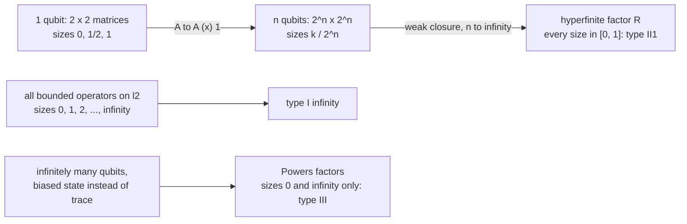

# Factors in outline: von Neumann algebras with a trivial centre, sorted by the sizes their projections can take

[Syllabus](../../../SYLLABUS.md) → [Functional analysis](../README.md) → [Banach Algebras and Fixed Points](../README.md#s06) → Factors in outline

---

## General Overview

One qubit, such as one photon's polarisation, is described by 2 × 2 complex matrices. A yes-or-no question about it ("is the polarisation along this line?") is a **projection**: a matrix P with $`P^2 = P`$ and $`P^* = P`$. Asking twice gives the same answer as asking once, which is $`P^2 = P`$.

Give each projection a size: its trace (the sum of its diagonal) divided by 2. That is the **normalised trace**, written τ (tau). It is the chance of "yes" when the qubit is completely unknown. For one qubit the only sizes are 0, 1/2 and 1. The projection onto the line through (0.6, 0.8) has diagonal 0.36 and 0.64, so its size is 1/2.

Take n qubits: $`2^n \times 2^n`$ matrices, trace divided by $`2^n`$. Now the sizes are 0, $`1/2^n`$, $`2/2^n`$, …, 1. At ten qubits the smallest non-zero size is 1/1024 = 0.000977.

Let n grow without end. The sizes $`k/2^n`$ come as close as wanted to every number from 0 to 1, yet a size of 1/3 never occurs at any finite n. It occurs only in the limit. No projection is smallest, because each one splits into two halves of equal size. The limit object is the **hyperfinite II₁ factor**, where hyperfinite means built as a limit of matrix algebras, and "every size in [0, 1], none smallest" is what **type II₁** means.

Sizes matter because they let an infinite quantum system, with no finite dimension to count, still say how much of it a question covers.

Compare all bounded operators on the infinite sequence space $`\ell^2`$. There a projection's size is the dimension of its range: 0, 1, 2, … or ∞. That is **type I∞**.

**A von Neumann algebra is an algebra of operators closed under weak limits (limits of every overlap $`\langle u, Tv\rangle`$ between vectors u and v); a factor is one whose centre (the members that commute with the whole algebra) holds only multiples of the identity; in a factor any two projections can be compared, so each has a size, and the set of possible sizes sorts the factor into type I (whole numbers), type II (a whole interval) or type III (only 0 and ∞).**

**What kind of fact this is:** definitions, a computation and stated theorems. The sizes in the $`2^n \times 2^n`$ matrices, the halving step and the trace's rule for equivalent projections are proved on this card and checked by the code. That the limit is a factor is stated, with Powers (1967) as the source. The comparison theorem and the classification into types are stated, with Murray and von Neumann (1936) as the source. This outline leaves out the proofs of those theorems, the type II∞ and type III cases beyond one line each, and Connes' finer classification.

### The picture: from qubits to the type classification



Schematic. Each arrow is one step of Why it works.

---

## The formula

Notation first, in words. H is a Hilbert space (a complete space with an inner product) and $`B(H)`$ is all bounded operators on it. $`A^*`$ is the adjoint, the conjugate transpose for a matrix. A prime marks a **commutant**, as on [States](04-states-representations-and-the-gns-construction.md): $`\mathcal S'`$ is every operator that commutes with each member of the set $`\mathcal S`$. The **weak operator topology** says $`T_k \to T`$ when every overlap $`\langle u, T_k v\rangle`$ tends to $`\langle u, T v\rangle`$ ([Operator topologies](../03-Bounded%20Operators/13-strong-and-weak-operator-topologies.md)).

A **von Neumann algebra** $`\mathcal M`$ is a set of operators in $`B(H)`$ that is closed under sums, products, scalar multiples and the adjoint, contains the identity 1, and is closed in the weak operator topology. Von Neumann's double commutant theorem, stated on [States](04-states-representations-and-the-gns-construction.md), says this is the same as an algebraic test:

```math
\mathcal M = \mathcal M'' , \qquad \mathcal Z(\mathcal M) = \mathcal M \cap \mathcal M' , \qquad \mathcal M \text{ is a factor} \iff \mathcal Z(\mathcal M) = \mathbb C\, 1
```

**Read it aloud:** a von Neumann algebra is its own double commutant; its centre is the part that commutes with the whole algebra; a factor is one whose centre is only the multiples of the identity.

Two projections P and Q in $`\mathcal M`$ are **equivalent**, written $`P \sim Q`$, when one partial isometry V in $`\mathcal M`$ carries one onto the other. A partial isometry keeps lengths on one subspace and sends the rest to zero ([Polar decomposition](../03-Bounded%20Operators/11-polar-decomposition-and-partial-isometries.md)).

```math
P \sim Q \iff V^* V = P \text{ and } V V^* = Q \text{ for some } V \in \mathcal M , \qquad \tau_n(P) = \frac{\mathrm{tr}\, P}{2^n} = \frac{\mathrm{rank}\, P}{2^n}
```

**Read it aloud:** two questions are the same size when one operator maps the "yes" space of one, length for length, onto the "yes" space of the other; in the $`2^n \times 2^n`$ matrices the size is the rank over $`2^n`$.

A **dimension function** D gives each projection of a factor a size in [0, ∞]. $`D(P) = 0`$ only when $`P = 0`$; $`D(P) \le D(Q)`$ exactly when P is equivalent to a part of Q; and the size of two perpendicular projections added is the sum of their sizes. So equivalent projections get the same size. The second rule matters: D = ∞ on every non-zero projection meets the other two in any factor. Murray and von Neumann proved that a factor has a dimension function, unique up to a positive scale factor. The set of values it takes is the type:

| Type | Sizes D can take (scaled) | Example |
| --- | --- | --- |
| $`\mathrm{I}_n`$ | 0, 1, …, n | the n × n matrices |
| $`\mathrm{I}_\infty`$ | 0, 1, 2, …, ∞ | $`B(\ell^2)`$ |
| $`\mathrm{II}_1`$ | every number in [0, 1] | the hyperfinite factor R |
| $`\mathrm{II}_\infty`$ | every number in [0, ∞] | $`R \otimes B(\ell^2)`$ |
| $`\mathrm{III}`$ | 0 and ∞ only | the Powers factors |

| Symbol | Plain meaning | In our example | Push it up and the answer… |
| --- | --- | --- | --- |
| $`H`$, $`B(H)`$, $`u`$, $`v`$ | a Hilbert space; all its bounded operators; vectors | $`\mathbb C^{2^n}`$, or $`\ell^2`$; u = (0.6, 0.8) | — |
| $`\mathcal M`$, $`\mathcal S'`$, $`\mathcal M''`$, $`\mathcal Z(\mathcal M)`$ | a von Neumann algebra; the commutant of a set $`\mathcal S`$; the double commutant; the centre | $`M_4`$: centre of dimension 1 | a bigger centre splits the algebra into more blocks |
| $`M_k`$, $`\otimes`$ | the k × k complex matrices; the Kronecker (tensor) product, which places one qubit beside another | $`M_4 = M_2 \otimes M_2`$ | — |
| $`P`$, $`Q`$, $`E_{ij}`$ | projections; the matrix with a single 1 in row i, column j | P onto (0.6, 0.8) = `[[0.36, 0.48], [0.48, 0.64]]` | — |
| $`V`$, $`W`$, $`T`$, $`T_k`$, $`A`$, $`B`$, $`X`$ | partial isometries linking projections; any operator; a sequence of operators; any matrices | V sends $`e_1`$ to (0.6, 0.8) | — |
| $`\mathrm{tr}`$, $`\tau`$, $`\tau_n`$, $`\mathrm{rank}`$ | the trace; the normalised trace; on $`2^n \times 2^n`$ matrices; the dimension of the range | $`\tau(P)`$ = 1/2 | more qubits, finer sizes |
| $`D`$ | the dimension function of a factor | D = τ on R, D = rank on $`B(\ell^2)`$ | — |
| $`n`$, $`N`$, $`k`$ | the number of qubits; the number of binary digits tested; a whole number | n = 10 gives 1/1024 | sizes $`k/2^n`$ get finer |
| $`R`$, $`f`$, $`f_N`$, $`t`$ | the hyperfinite factor; the projection "binary digits below t"; that test on N digits; a target size | t = 1/3: $`\tau(f_{16})`$ = 0.333344 | $`f_N`$ nears f |
| $`S`$, $`e_1`$, $`e_2`$ | the shift on $`\ell^2`$, moving each entry one place later; the first and second unit vectors | $`S^*S = 1`$, $`SS^* = 1 - E_{11}`$ | — |
| $`\omega`$, $`p`$, $`\lambda`$ | a state; a coin's chance of heads; the ratio of its two weights | p = 3/4, λ = 1/3 | further from 1/2, further from a trace |

### When it holds

- **Weakly closed, not only norm closed.** A C-star algebra that is not weakly closed can lack projections. The continuous functions on [0, 1] have only 0 and 1. The one-third projection f below is a weak limit and exists only after the closure.
- **A trivial centre.** In the diagonal 2 × 2 matrices, $`E_{11}`$ and $`E_{22}`$ both have trace 1, but no diagonal V links them: a diagonal V has $`V^*V = VV^*`$, and the code's search finds 0. Without a trivial centre, sizes are not comparable, and the algebra splits into factors first.
- **A trace, not just any state.** Sizes need $`\tau(V^*V) = \tau(VV^*)`$. The biased coin with p = 3/4 gives $`E_{11}`$ the value 0.75 and $`E_{22}`$ the value 0.25, though $`E_{12}`$ links them.
- **The trace normalised at every level.** The plain trace of $`E_{11}`$ doubles at each new qubit: 1, 2, 4, …, 512 at level 10. Only dividing by $`2^n`$ lets the sizes settle to a limit.

---

## Why it works

### Step 0: the idea, a size is an equivalence class

Two subspaces of $`\mathbb C^k`$ have the same dimension exactly when some partial isometry maps one onto the other. So "same dimension" can be defined without counting, by "linked by an operator in the algebra". Murray and von Neumann turned that link into a size. In a factor any two projections can be compared. The possible sizes then form one line, and the shape of that line is the type.

### Step 1: in one qubit, sizes are 0, 1/2 and 1

A projection P is self-adjoint, so it has an orthonormal basis of eigenvectors. From $`P^2 = P`$ each eigenvalue equals its own square, so it is 0 or 1. The trace is the sum of the eigenvalues, which counts the 1s: $`\mathrm{tr}\,P = \mathrm{rank}\,P`$.

For u = (0.6, 0.8), the projection onto its line is $`P = uu^*`$ = `[[0.36, 0.48], [0.48, 0.64]]`. Its trace is 1, so $`\tau(P)`$ = 1/2. The code also finds the rank by elimination, not from the trace: 1.

Now let $`V = u e_1^*`$ = `[[0.6, 0], [0.8, 0]]`. It sends $`e_1`$ to u and $`e_2`$ to 0. Then $`V^*V = E_{11}`$ and $`VV^* = P`$, so $`P \sim E_{11}`$, and both have size 1/2.

### Step 2: equivalent projections have equal trace

The trace has the rule $`\mathrm{tr}(AB) = \mathrm{tr}(BA)`$. With A = V* and B = V:

```math
\tau(V^*V) = \tau(VV^*) .
```

So $`P \sim Q`$ forces $`\tau(P) = \tau(Q)`$. In $`M_{2^n}`$ the converse holds too: two projections of equal rank are linked by a V that sends one orthonormal basis of the first range onto one of the second.

So in $`M_{2^n}`$ the size of a projection is $`k/2^n`$, with k its rank, and every k from 0 to $`2^n`$ occurs. The code lists the diagonal projections for n = 1 to 4 and finds 3, 5, 9 and 17 sizes. None of them is 1/3, since $`2^n`$ is never a multiple of 3.

### Step 3: adding a qubit keeps sizes and halves the smallest one

Embed $`M_{2^n}`$ in $`M_{2^{n+1}}`$ by $`A \mapsto A \otimes 1`$: the new qubit is left alone. The trace doubles and so does the divisor, so

```math
\tau_{n+1}(A \otimes 1) = \frac{2\,\mathrm{tr}\,A}{2^{n+1}} = \tau_n(A) .
```

Sizes are kept, so all levels sit inside one growing algebra with one trace τ.

Each projection also splits. $`E_{11} \otimes 1`$ has size 1/2 and equals $`E_{11} \otimes E_{11} + E_{11} \otimes E_{22}`$, two perpendicular projections of size 1/4. The partial isometry $`W = E_{11} \otimes E_{12}`$ has $`W^*W = E_{11} \otimes E_{22}`$ and $`WW^* = E_{11} \otimes E_{11}`$, so the halves are equivalent. A projection that is smallest at level n is no longer smallest at level n + 1.

### Step 4: the weak closure, where 1/3 becomes a size

Read the n qubits' diagonal as n coin flips. A diagonal projection is a yes-or-no event about the flips, and τ is its chance under a fair coin. This is the setting of [States](04-states-representations-and-the-gns-construction.md), Step 6.

Read the flips as a binary fraction. Let $`f_N`$ be "the first N digits, as a fraction, are below 1/3". It lives at level N. The first N digits read as $`k/2^N`$ for one whole number k from 0 to $`2^N - 1`$, and $`k/2^N < 1/3`$ means $`3k < 2^N`$. For even N, $`2^N`$ leaves remainder 1 when divided by 3, so $`(2^N + 2)/3`$ of the values of k pass, and the size of $`f_N`$ is $`(2^N + 2)/(3 \cdot 2^N)`$. Its limit f, "the whole fraction is below 1/3", has chance exactly 1/3.

Every "yes" for f is a "yes" for $`f_N`$, because a fraction below 1/3 has its first N digits below 1/3 too. So $`f_N - f`$ is itself a projection, and $`\tau((f_N - f)^2) = \tau(f_N - f) = \tau(f_N) - 1/3`$. The code checks the nesting pattern by pattern, for $`f_{N+2}`$ inside $`f_N`$.

| N | $`\tau(f_N)`$ | GNS distance $`\sqrt{\tau(f_N) - 1/3}`$ |
| ---: | ---: | ---: |
| 2 | 0.500000 | 0.408248 |
| 4 | 0.375000 | 0.204124 |
| 8 | 0.335938 | 0.051031 |
| 12 | 0.333496 | 0.012758 |
| 16 | 0.333344 | 0.003189 |

The GNS distance (as on [States](04-states-representations-and-the-gns-construction.md)) is $`\sqrt{\tau((f_N - f)^2)}`$, the length of $`f_N - f`$ in the GNS space of τ. It halves every two digits, so $`f_N \to f`$ in the weak operator topology, never in norm. The weak closure R, taken on that space, contains f, a projection with $`\tau(f)`$ = 1/3.

Any t in [0, 1] works the same way. For t = 1/√2 = 0.707107, the test on 16 digits already has size 0.707108. So every number in [0, 1] is the size of a projection in R.

### Step 5: R is a factor of type II₁

Three facts finish the classification. The first is checked in finite dimensions; the other two are stated, with sources.

1. **Each level is a factor.** For $`M_2`$, $`M_4`$ and $`M_2 \otimes 1`$ the code solves "X commutes with every basis member" and finds a centre of dimension 1. For the diagonal 2 × 2 matrices it finds 2, for $`M_2 \oplus M_1`$ (two blocks) 2, and for the diagonal 4 × 4 matrices 4. Those are not factors: the centre dimension counts the blocks.
2. **The limit R is a factor.** An element that commutes with level n involves only the qubits after n. A central element commutes with every level, so it involves only the "tail". The tail holds only multiples of 1. This is the operator form of [Kolmogorov's zero-one law](../../10-Measure%20and%20integration/10-The%20Limit%20Theorems%2C%20Proved/02-kolmogorov-zero-one-law.md), proved for these limits by Powers (1967).
3. **R is finite.** τ never vanishes on a non-zero projection. If $`P \sim Q`$ with Q strictly inside P, Step 2 gives $`\tau(P - Q) = 0`$, so Q = P. No projection is equivalent to a proper part of itself.

Finite, a factor, and no smallest projection: that is type II₁. Murray and von Neumann's dimension function on R is τ itself.

### Step 6: what changes in B(ℓ²), and type III

In $`B(\ell^2)`$ the size is the rank, and ∞ is allowed. The shift S moves each entry one place later. It keeps lengths, so $`S^*S = 1`$. Its range misses $`e_1`$, so $`SS^* = 1 - E_{11}`$. The identity is equivalent to a proper part of itself: 1 is an **infinite projection**, and ∞ − 1 = ∞.

The code holds only the truncation, the N × N shift. There $`S^*S = 1 - E_{NN}`$, not 1, and both traces are N − 1, against N for the identity. The truncation hides the infinite projection: every matrix algebra is finite.

On a separable Hilbert space (one with a countable orthonormal basis, such as $`\ell^2`$), type III is the case where every non-zero projection is equivalent to 1, so the only sizes are 0 and ∞. Run Step 4 with a biased coin on each qubit: weights 3/4 and 1/4, ratio λ = 1/3. The state is no longer a trace, as the What breaks table shows. Powers proved in 1967 that the weak closure is then a type III factor, one for each λ between 0 and 1, no two the same.

<details>
<summary>Why the comparison theorem needs a trivial centre</summary>

The comparison theorem says: in a factor, for any projections P and Q, P is equivalent to a part of Q, or Q to a part of P.

The proof takes a largest family of pairs of equivalent, perpendicular pieces, one piece under P and one under Q. Such a family exists by Zorn's lemma, so the proof uses the axiom of choice. Add the pieces up. Suppose something is left over under both P and Q. A trivial centre guarantees that some non-zero part of one leftover is linked to some non-zero part of the other, so the family could grow. Without it, a central projection could put one leftover in one block of the algebra and the other in a separate block.

In the diagonal 2 × 2 matrices, $`E_{11}`$ and $`E_{22}`$ are exactly those two blocks. Neither is equivalent to a part of the other. Kadison and Ringrose, chapter 6, give the full proof.

</details>

---

## Worked numbers, by hand

| Step | Arithmetic | Value |
| --- | --- | --- |
| projection onto u = (0.6, 0.8) | $`P = uu^*`$ | `[[0.36, 0.48], [0.48, 0.64]]` |
| it is a projection | first entry of $`P^2`$: 0.36 × 0.36 + 0.48 × 0.48 | 0.36 |
| its size | (0.36 + 0.64) / 2 | 1/2 |
| link to $`E_{11}`$ | $`V^*V`$: 0.6² + 0.8², placed at (1, 1) | $`E_{11}`$, size 1/2 |
| embed in two qubits | $`\tau(P \otimes 1) = 2 / 4`$ | 1/2 |
| split $`E_{11} \otimes 1`$ | $`E_{11} \otimes E_{11} + E_{11} \otimes E_{22}`$ | 1/4 + 1/4 |
| sizes at level n | $`k / 2^n`$, k = 0 to $`2^n`$ | $`2^n + 1`$ sizes |
| smallest at ten qubits | $`1 / 2^{10}`$ | 0.000977 |
| one-third test, 16 digits | $`(2^{16} + 2)/(3 \cdot 2^{16})`$ | 0.333344 |
| the limit f in R | chance the binary fraction is below 1/3 | **1/3** |

So the one-third projection exists in the limit algebra R but at no finite number of qubits.

### What breaks if you drop a piece

| Mistake | Comes out at | What went wrong |
| --- | --- | --- |
| Biased state p = 3/4 as the size | $`E_{11}`$: 0.750000, $`E_{22}`$: 0.250000, though $`E_{12}`$ links them | Not a trace: $`\omega(V^*V) \ne \omega(VV^*)`$, the seed of type III |
| Plain trace, not normalised | size of $`E_{11}`$: 1, 2, 4, …, 512 at level 10 | Embedding doubles it; no limit |
| Diagonal 2 × 2 matrices as a factor | centre of dimension 2; 0 links between $`E_{11}`$ and $`E_{22}`$ | Two blocks; sizes are not comparable |
| The truncated shift as the shift | $`S^*S`$ has trace N − 1, not N | A matrix hides the infinite projection $`1 \sim 1 - E_{11}`$ |

The code prints all four.

---

## Code, from first principles, and it actually runs

The code works in exact fractions, so every size is a rational number with no rounding. It takes three independent roads. A size is computed both as trace over $`2^n`$ and as rank over $`2^n`$, the rank found by elimination. The one-third sizes are counted digit pattern by digit pattern and compared with the closed form. The centre dimension is solved from a linear system and compared with the block count. The code also checks that each one-third test lies inside the one before it, the halving partial isometry, the truncated shift and the four failures.

### Python

```python
# Factors in outline -- the check behind the card.  Standard library only.
# Projections in the 2^n x 2^n matrices with the normalised trace, their sizes,
# the one-third projection of the infinite tensor product, centres of small
# algebras, and the truncated shift.  Exact fractions wherever the answer is.
from fractions import Fraction as F
import math

def mul(A, B): return [[sum(A[i][k] * B[k][j] for k in range(len(B))) for j in range(len(B[0]))] for i in range(len(A))]
def adj(A): return [[A[j][i] for j in range(len(A))] for i in range(len(A))]  # real entries
def kron(A, B):
    m = len(B)
    return [[A[i // m][j // m] * B[i % m][j % m] for j in range(len(A) * m)] for i in range(len(A) * m)]
def eye(n): return [[F(int(i == j)) for j in range(n)] for i in range(n)]
def unit(n, i, j): return [[F(int(r == i and c == j)) for c in range(n)] for r in range(n)]
def sub(A, B): return [[a - b for a, b in zip(r, s)] for r, s in zip(A, B)]
def tau(A): return sum(A[i][i] for i in range(len(A))) / len(A)   # normalised trace
def is_proj(P): return mul(P, P) == P and adj(P) == P
def rank(A):                              # exact Gaussian elimination, no trace used
    M, r = [row[:] for row in A], 0
    for c in range(len(M[0])):
        p = next((i for i in range(r, len(M)) if M[i][c] != 0), None)
        if p is None: continue
        M[r], M[p] = M[p], M[r]
        for i in range(len(M)):
            if i != r and M[i][c] != 0:
                f = M[i][c] / M[r][c]
                M[i] = [a - f * b for a, b in zip(M[i], M[r])]
        r += 1
    return r
def dec(x): return "%.6f" % float(x)
I2, E11, E12, E22 = eye(2), unit(2, 0, 0), unit(2, 0, 1), unit(2, 1, 1)

print("1. the 2 x 2 matrices, tau = trace / 2")
u = [F(3, 5), F(4, 5)]
P = [[u[i] * u[j] for j in range(2)] for i in range(2)]   # projection onto the line through u
V = [[u[0], F(0)], [u[1], F(0)]]                           # sends e1 to u, e2 to 0
print(f"P = [[{dec(P[0][0])}, {dec(P[0][1])}], [{dec(P[1][0])}, {dec(P[1][1])}]]; P^2 = P and P* = P: {is_proj(P)}")
print(f"tau(P) = {tau(P)}, rank(P) / 2 = {F(rank(P), 2)}; V*V = E11: {mul(adj(V), V) == E11}; VV* = P: {mul(V, adj(V)) == P}")
assert is_proj(P) and tau(P) == F(rank(P), 2) == F(1, 2)
assert mul(adj(V), V) == E11 and mul(V, adj(V)) == P

print("2. the 4 x 4 matrices: size = trace / 4 = rank / 4")
cases = [("E11 (x) 1", kron(E11, I2)), ("P (x) P", kron(P, P)), ("1 - P (x) P", sub(eye(4), kron(P, P))),
         ("E11 (x) E11", kron(E11, E11)), ("E11 (x) E22", kron(E11, E22)), ("1 (x) 1", eye(4))]
for name, Q in cases:
    print(f"{name:12s} projection {is_proj(Q)}, tau = {tau(Q)}, rank / 4 = {F(rank(Q), 4)}")
    assert is_proj(Q) and tau(Q) == F(rank(Q), 4)
W = kron(E11, E12)                        # links the two halves of E11 (x) 1
print(f"halving: W*W = E11 (x) E22: {mul(adj(W), W) == kron(E11, E22)}; WW* = E11 (x) E11: {mul(W, adj(W)) == kron(E11, E11)}")
assert mul(adj(W), W) == kron(E11, E22) and mul(W, adj(W)) == kron(E11, E11)
assert tau(kron(P, I2)) == tau(P) and tau(kron(P, P)) == tau(P) ** 2
print(f"embedding A -> A (x) 1 keeps tau: tau(P (x) 1) = {tau(kron(P, I2))} = tau(P)")
for n in range(1, 5):                     # every diagonal projection of M_{2^n}
    d = 2 ** n
    sizes = sorted({F(bin(m).count("1"), d) for m in range(2 ** d)})
    print(f"level n = {n}: {len(sizes)} sizes, smallest non-zero {sizes[1]}, one third among them: {F(1, 3) in sizes}")
    assert len(sizes) == d + 1 and sizes[1] == F(1, d) and F(1, 3) not in sizes
assert all(2 ** n % 3 != 0 for n in range(1, 64))      # the arithmetic fact behind Step 2, n up to 63
d10 = [F(1), F(0)]                        # the diagonal of E11
for _ in range(9): d10 = [y for x in d10 for y in (x, F(0))]   # E11 (x) E11 (x) ... (x) E11: rank 1, the smallest
print(f"level n = 10: smallest non-zero size {sum(d10) / len(d10)} = {dec(sum(d10) / len(d10))}")
assert len(d10) == 2 ** 10 and sum(d10) / len(d10) == F(1, 1024)

print("3. the limit: the projection 'binary digits below t' in the weak closure")
for N in (2, 4, 8, 12, 16):
    cnt = sum(1 for k in range(2 ** N) if 3 * k < 2 ** N)   # first N digits below 1/3
    t_N = F(cnt, 2 ** N)
    dist = math.sqrt(t_N - F(1, 3))
    print(f"t = 1/3, N = {N:2d}: tau(f_N) = {dec(t_N)}, GNS distance to f = {dist:.6f}")
    assert t_N == F(2 ** N + 2, 3 * 2 ** N) and abs(dist - math.sqrt(2 / (3 * 2 ** N))) < 1e-12
    assert all(3 * (k >> 2) < 2 ** N for k in range(2 ** (N + 2)) if 3 * k < 2 ** (N + 2))   # f_{N+2} <= f_N
for N in (4, 8, 16):
    cnt = sum(1 for k in range(2 ** N) if 2 * k * k < 4 ** N)   # k / 2^N below 1 / sqrt 2
    print(f"t = 1/sqrt 2 = {1 / math.sqrt(2):.6f}, N = {N:2d}: tau = {dec(F(cnt, 2 ** N))}, gap {cnt / 2 ** N - 1 / math.sqrt(2):.6f}")
    assert 0 < cnt / 2 ** N - 1 / math.sqrt(2) <= 1 / 2 ** N

print("4. centres: X in the algebra with XB = BX for every basis member B")
def centre_dim(basis):
    rows = []
    for Bj in basis:
        comms = [sub(mul(Bk, Bj), mul(Bj, Bk)) for Bk in basis]
        n = len(Bj)
        rows += [[C[r][c] for C in comms] for r in range(n) for c in range(n)]
    return len(basis) - rank(rows)
U3 = lambda i, j: unit(3, i, j)
algebras = [("M_2", [unit(2, i, j) for i in range(2) for j in range(2)], 1),
            ("M_4 = M_2 (x) M_2", [unit(4, i, j) for i in range(4) for j in range(4)], 1),
            ("M_2 (x) 1 in M_4", [kron(unit(2, i, j), I2) for i in range(2) for j in range(2)], 1),
            ("diagonal 2 x 2", [E11, E22], 2),
            ("M_2 (+) M_1 in M_3", [U3(i, j) for i in range(2) for j in range(2)] + [U3(2, 2)], 2),
            ("diagonal 4 x 4", [unit(4, i, i) for i in range(4)], 4)]
for name, basis, blocks in algebras:
    z = centre_dim(basis)
    print(f"{name:20s} dimension {len(basis):2d}, centre dimension {z}, factor: {z == 1}")
    assert z == blocks
D = [[[F(a), F(0)], [F(0), F(b)]] for a in range(-2, 3) for b in range(-2, 3)]
ok = [X for X in D if mul(adj(X), X) == E11 and mul(X, adj(X)) == E22]
normal = sum(1 for X in D if mul(adj(X), X) == mul(X, adj(X)))   # the reason: a diagonal V has V*V = VV*
print(f"diagonal V = diag(a, b) with V*V = E11 and VV* = E22, a and b in -2..2: {len(ok)} found; V*V = VV* for {normal} of {len(D)}")
assert not ok and normal == len(D)

print("5. the shift on l2, cut to N x N")
for N in (4, 8, 16):
    S = [[F(int(r == c + 1)) for c in range(N)] for r in range(N)]
    a, b = mul(adj(S), S), mul(S, adj(S))
    print(f"N = {N:2d}: tr(S*S) = {sum(a[i][i] for i in range(N))}, tr(SS*) = {sum(b[i][i] for i in range(N))}, tr(1) = {N}, S*S = 1: {a == eye(N)}")
    assert a == sub(eye(N), unit(N, N - 1, N - 1)) and b == sub(eye(N), unit(N, 0, 0))

print("6. what breaks")
w = lambda A: F(3, 4) * A[0][0] + F(1, 4) * A[1][1]          # a biased coin, not a trace
print(f"biased state p = 3/4: w(E11) = {dec(w(E11))}, w(E22) = {dec(w(E22))}, ratio lambda = {w(E22) / w(E11)}, though E12 links them")
assert mul(E12, adj(E12)) == E11 and mul(adj(E12), E12) == E22 and w(E11) != w(E22)
raw = [sum(M[i][i] for i in range(len(M))) for M in (E11, kron(E11, I2), kron(kron(E11, I2), I2))]
d = [F(1), F(0)]                          # the diagonal of E11
for _ in range(9): d = [y for x in d for y in (x, x)]          # E11 (x) 1 (x) ... (x) 1 at level 10
print(f"unnormalised trace of E11 at levels 1, 2, 3: {raw[0]}, {raw[1]}, {raw[2]}; at level 10: {sum(d)}")
assert raw == [1, 2, 4] and sum(d) == 2 ** 9
print("ALL CHECKS PASS")
```

**Ran 2026-11-24 on macOS, Python 3.14.10, standard library only. All checks passed. Output, pasted from the run:**

```
1. the 2 x 2 matrices, tau = trace / 2
P = [[0.360000, 0.480000], [0.480000, 0.640000]]; P^2 = P and P* = P: True
tau(P) = 1/2, rank(P) / 2 = 1/2; V*V = E11: True; VV* = P: True
2. the 4 x 4 matrices: size = trace / 4 = rank / 4
E11 (x) 1    projection True, tau = 1/2, rank / 4 = 1/2
P (x) P      projection True, tau = 1/4, rank / 4 = 1/4
1 - P (x) P  projection True, tau = 3/4, rank / 4 = 3/4
E11 (x) E11  projection True, tau = 1/4, rank / 4 = 1/4
E11 (x) E22  projection True, tau = 1/4, rank / 4 = 1/4
1 (x) 1      projection True, tau = 1, rank / 4 = 1
halving: W*W = E11 (x) E22: True; WW* = E11 (x) E11: True
embedding A -> A (x) 1 keeps tau: tau(P (x) 1) = 1/2 = tau(P)
level n = 1: 3 sizes, smallest non-zero 1/2, one third among them: False
level n = 2: 5 sizes, smallest non-zero 1/4, one third among them: False
level n = 3: 9 sizes, smallest non-zero 1/8, one third among them: False
level n = 4: 17 sizes, smallest non-zero 1/16, one third among them: False
level n = 10: smallest non-zero size 1/1024 = 0.000977
3. the limit: the projection 'binary digits below t' in the weak closure
t = 1/3, N =  2: tau(f_N) = 0.500000, GNS distance to f = 0.408248
t = 1/3, N =  4: tau(f_N) = 0.375000, GNS distance to f = 0.204124
t = 1/3, N =  8: tau(f_N) = 0.335938, GNS distance to f = 0.051031
t = 1/3, N = 12: tau(f_N) = 0.333496, GNS distance to f = 0.012758
t = 1/3, N = 16: tau(f_N) = 0.333344, GNS distance to f = 0.003189
t = 1/sqrt 2 = 0.707107, N =  4: tau = 0.750000, gap 0.042893
t = 1/sqrt 2 = 0.707107, N =  8: tau = 0.710938, gap 0.003831
t = 1/sqrt 2 = 0.707107, N = 16: tau = 0.707108, gap 0.000001
4. centres: X in the algebra with XB = BX for every basis member B
M_2                  dimension  4, centre dimension 1, factor: True
M_4 = M_2 (x) M_2    dimension 16, centre dimension 1, factor: True
M_2 (x) 1 in M_4     dimension  4, centre dimension 1, factor: True
diagonal 2 x 2       dimension  2, centre dimension 2, factor: False
M_2 (+) M_1 in M_3   dimension  5, centre dimension 2, factor: False
diagonal 4 x 4       dimension  4, centre dimension 4, factor: False
diagonal V = diag(a, b) with V*V = E11 and VV* = E22, a and b in -2..2: 0 found; V*V = VV* for 25 of 25
5. the shift on l2, cut to N x N
N =  4: tr(S*S) = 3, tr(SS*) = 3, tr(1) = 4, S*S = 1: False
N =  8: tr(S*S) = 7, tr(SS*) = 7, tr(1) = 8, S*S = 1: False
N = 16: tr(S*S) = 15, tr(SS*) = 15, tr(1) = 16, S*S = 1: False
6. what breaks
biased state p = 3/4: w(E11) = 0.750000, w(E22) = 0.250000, ratio lambda = 1/3, though E12 links them
unnormalised trace of E11 at levels 1, 2, 3: 1, 2, 4; at level 10: 512
ALL CHECKS PASS
```

### Rust

Same numbers, same labels, built with `rustc --edition 2021 -O`. Fractions are a small struct.

```rust
// Factors in outline -- the same check as the Python, in Rust.  No crates.
// Projections in the 2^n x 2^n matrices with the normalised trace, their sizes,
// the one-third projection of the infinite tensor product, centres of small
// algebras, and the truncated shift.  Exact fractions wherever the answer is.
use std::collections::BTreeSet;
use std::ops::{Add, Div, Mul, Sub};

#[derive(Clone, Copy, PartialEq, Debug)]
struct Q { n: i128, d: i128 } // a fraction in lowest terms, d > 0
fn gcd(a: i128, b: i128) -> i128 { if b == 0 { a.abs() } else { gcd(b, a % b) } }
fn q(n: i128, d: i128) -> Q {
    let g = gcd(n, d).max(1);
    let s = if d < 0 { -1 } else { 1 };
    Q { n: s * n / g, d: s * d / g }
}
impl Add for Q { type Output = Q; fn add(self, o: Q) -> Q { q(self.n * o.d + o.n * self.d, self.d * o.d) } }
impl Sub for Q { type Output = Q; fn sub(self, o: Q) -> Q { q(self.n * o.d - o.n * self.d, self.d * o.d) } }
impl Mul for Q { type Output = Q; fn mul(self, o: Q) -> Q { q(self.n * o.n, self.d * o.d) } }
impl Div for Q { type Output = Q; fn div(self, o: Q) -> Q { q(self.n * o.d, self.d * o.n) } }
impl std::fmt::Display for Q {
    fn fmt(&self, f: &mut std::fmt::Formatter) -> std::fmt::Result {
        if self.d == 1 { write!(f, "{}", self.n) } else { write!(f, "{}/{}", self.n, self.d) }
    }
}
impl Q { fn f(&self) -> f64 { self.n as f64 / self.d as f64 } }
type M = Vec<Vec<Q>>;
fn z() -> Q { q(0, 1) }
fn mul(a: &M, b: &M) -> M {
    (0..a.len()).map(|i| (0..b[0].len()).map(|j| (0..b.len()).fold(z(), |s, k| s + a[i][k] * b[k][j])).collect()).collect()
}
fn adj(a: &M) -> M { (0..a.len()).map(|i| (0..a.len()).map(|j| a[j][i]).collect()).collect() }
fn kron(a: &M, b: &M) -> M {
    let m = b.len();
    (0..a.len() * m).map(|i| (0..a.len() * m).map(|j| a[i / m][j / m] * b[i % m][j % m]).collect()).collect()
}
fn eye(n: usize) -> M { (0..n).map(|i| (0..n).map(|j| q((i == j) as i128, 1)).collect()).collect() }
fn unit(n: usize, i: usize, j: usize) -> M {
    (0..n).map(|r| (0..n).map(|c| q((r == i && c == j) as i128, 1)).collect()).collect()
}
fn sub(a: &M, b: &M) -> M { a.iter().zip(b).map(|(r, s)| r.iter().zip(s).map(|(x, y)| *x - *y).collect()).collect() }
fn tr(a: &M) -> Q { (0..a.len()).fold(z(), |s, i| s + a[i][i]) }
fn tau(a: &M) -> Q { tr(a) / q(a.len() as i128, 1) }
fn is_proj(p: &M) -> bool { mul(p, p) == *p && adj(p) == *p }
fn rank(a: &M) -> usize {
    let mut m = a.clone();
    let mut r = 0;
    for c in 0..m[0].len() {
        let p = match (r..m.len()).find(|&i| m[i][c] != z()) { Some(p) => p, None => continue };
        m.swap(r, p);
        for i in 0..m.len() {
            if i != r && m[i][c] != z() {
                let f = m[i][c] / m[r][c];
                let row = m[r].clone();
                for (x, y) in m[i].iter_mut().zip(row) { *x = *x - f * y; }
            }
        }
        r += 1;
    }
    r
}
fn dec(x: Q) -> String { format!("{:.6}", x.f()) }
fn py(b: bool) -> &'static str { if b { "True" } else { "False" } }
fn centre_dim(basis: &[M]) -> usize {
    let mut rows: M = vec![];
    for bj in basis {
        let comms: Vec<M> = basis.iter().map(|bk| sub(&mul(bk, bj), &mul(bj, bk))).collect();
        let n = bj.len();
        for r in 0..n { for c in 0..n { rows.push(comms.iter().map(|cm| cm[r][c]).collect()); } }
    }
    basis.len() - rank(&rows)
}

fn main() {
    let (i2, e11, e12, e22) = (eye(2), unit(2, 0, 0), unit(2, 0, 1), unit(2, 1, 1));
    println!("1. the 2 x 2 matrices, tau = trace / 2");
    let u = [q(3, 5), q(4, 5)];
    let p: M = (0..2).map(|i| (0..2).map(|j| u[i] * u[j]).collect()).collect();
    let v: M = vec![vec![u[0], z()], vec![u[1], z()]];
    println!("P = [[{}, {}], [{}, {}]]; P^2 = P and P* = P: {}", dec(p[0][0]), dec(p[0][1]), dec(p[1][0]), dec(p[1][1]), py(is_proj(&p)));
    println!("tau(P) = {}, rank(P) / 2 = {}; V*V = E11: {}; VV* = P: {}", tau(&p), q(rank(&p) as i128, 2),
        py(mul(&adj(&v), &v) == e11), py(mul(&v, &adj(&v)) == p));
    assert!(is_proj(&p) && tau(&p) == q(rank(&p) as i128, 2) && tau(&p) == q(1, 2));
    assert!(mul(&adj(&v), &v) == e11 && mul(&v, &adj(&v)) == p);

    println!("2. the 4 x 4 matrices: size = trace / 4 = rank / 4");
    let pp = kron(&p, &p);
    let cases: Vec<(&str, M)> = vec![("E11 (x) 1", kron(&e11, &i2)), ("P (x) P", pp.clone()), ("1 - P (x) P", sub(&eye(4), &pp)),
        ("E11 (x) E11", kron(&e11, &e11)), ("E11 (x) E22", kron(&e11, &e22)), ("1 (x) 1", eye(4))];
    for (name, m) in &cases {
        println!("{:12} projection {}, tau = {}, rank / 4 = {}", name, py(is_proj(m)), tau(m), q(rank(m) as i128, 4));
        assert!(is_proj(m) && tau(m) == q(rank(m) as i128, 4));
    }
    let w = kron(&e11, &e12);
    println!("halving: W*W = E11 (x) E22: {}; WW* = E11 (x) E11: {}", py(mul(&adj(&w), &w) == kron(&e11, &e22)), py(mul(&w, &adj(&w)) == kron(&e11, &e11)));
    assert!(mul(&adj(&w), &w) == kron(&e11, &e22) && mul(&w, &adj(&w)) == kron(&e11, &e11));
    assert!(tau(&kron(&p, &i2)) == tau(&p) && tau(&pp) == tau(&p) * tau(&p));
    println!("embedding A -> A (x) 1 keeps tau: tau(P (x) 1) = {} = tau(P)", tau(&kron(&p, &i2)));
    for n in 1..5u32 {
        let d = 1i128 << n;
        let ks: BTreeSet<u32> = (0..1u64 << d).map(|m| m.count_ones()).collect();
        let sizes: Vec<Q> = ks.iter().map(|&k| q(k as i128, d)).collect();
        let third = sizes.contains(&q(1, 3));
        println!("level n = {}: {} sizes, smallest non-zero {}, one third among them: {}", n, sizes.len(), sizes[1], py(third));
        assert!(sizes.len() as i128 == d + 1 && sizes[1] == q(1, d) && !third);
    }
    assert!((1..64u32).all(|n| (1u128 << n) % 3 != 0)); // the arithmetic fact behind Step 2, n up to 63
    let d10 = (0..9).fold(vec![q(1, 1), z()], |d, _| d.iter().flat_map(|&x| [x, z()]).collect::<Vec<Q>>()); // E11 (x) ... (x) E11
    let s10 = d10.iter().fold(z(), |s, &x| s + x) / q(d10.len() as i128, 1); // rank 1: the smallest non-zero size
    println!("level n = 10: smallest non-zero size {} = {}", s10, dec(s10));
    assert!(d10.len() == 1 << 10 && s10 == q(1, 1024));

    println!("3. the limit: the projection 'binary digits below t' in the weak closure");
    for nn in [2u32, 4, 8, 12, 16] {
        let two = 1i128 << nn;
        let cnt = (0..two).filter(|k| 3 * k < two).count() as i128;
        let t_n = q(cnt, two);
        let dist = (t_n - q(1, 3)).f().sqrt();
        println!("t = 1/3, N = {:2}: tau(f_N) = {}, GNS distance to f = {:.6}", nn, dec(t_n), dist);
        assert!(t_n == q(two + 2, 3 * two) && (dist - (2.0 / (3.0 * two as f64)).sqrt()).abs() < 1e-12);
        assert!((0..4 * two).filter(|k| 3 * k < 4 * two).all(|k| 3 * (k >> 2) < two)); // f_{N+2} <= f_N
    }
    for nn in [4u32, 8, 16] {
        let two = 1i128 << nn;
        let cnt = (0..two).filter(|k| 2 * k * k < two * two).count() as i128;
        let gap = cnt as f64 / two as f64 - 1.0 / 2f64.sqrt();
        println!("t = 1/sqrt 2 = {:.6}, N = {:2}: tau = {}, gap {:.6}", 1.0 / 2f64.sqrt(), nn, dec(q(cnt, two)), gap);
        assert!(0.0 < gap && gap <= 1.0 / two as f64);
    }

    println!("4. centres: X in the algebra with XB = BX for every basis member B");
    let mut m2 = vec![]; let mut m4 = vec![]; let mut m2x1 = vec![]; let mut m21 = vec![];
    for i in 0..2 { for j in 0..2 { m2.push(unit(2, i, j)); m2x1.push(kron(&unit(2, i, j), &i2)); m21.push(unit(3, i, j)); } }
    m21.push(unit(3, 2, 2));
    for i in 0..4 { for j in 0..4 { m4.push(unit(4, i, j)); } }
    let algebras: Vec<(&str, Vec<M>, usize)> = vec![("M_2", m2, 1), ("M_4 = M_2 (x) M_2", m4, 1), ("M_2 (x) 1 in M_4", m2x1, 1),
        ("diagonal 2 x 2", vec![e11.clone(), e22.clone()], 2), ("M_2 (+) M_1 in M_3", m21, 2),
        ("diagonal 4 x 4", (0..4).map(|i| unit(4, i, i)).collect(), 4)];
    for (name, basis, blocks) in &algebras {
        let zd = centre_dim(basis);
        println!("{:20} dimension {:2}, centre dimension {}, factor: {}", name, basis.len(), zd, py(zd == 1));
        assert!(zd == *blocks);
    }
    let (mut found, mut normal, mut tested) = (0, 0, 0); // the reason: a diagonal V has V*V = VV*
    for a in -2..3 { for b in -2..3 {
        let x: M = vec![vec![q(a, 1), z()], vec![z(), q(b, 1)]]; let (l, r) = (mul(&adj(&x), &x), mul(&x, &adj(&x)));
        found += (l == e11 && r == e22) as usize; normal += (l == r) as usize; tested += 1;
    } }
    println!("diagonal V = diag(a, b) with V*V = E11 and VV* = E22, a and b in -2..2: {} found; V*V = VV* for {} of {}", found, normal, tested);
    assert!(found == 0 && normal == tested);

    println!("5. the shift on l2, cut to N x N");
    for n in [4usize, 8, 16] {
        let s: M = (0..n).map(|r| (0..n).map(|c| q((r == c + 1) as i128, 1)).collect()).collect();
        let (a, b) = (mul(&adj(&s), &s), mul(&s, &adj(&s)));
        println!("N = {:2}: tr(S*S) = {}, tr(SS*) = {}, tr(1) = {}, S*S = 1: {}", n, tr(&a), tr(&b), n, py(a == eye(n)));
        assert!(a == sub(&eye(n), &unit(n, n - 1, n - 1)) && b == sub(&eye(n), &unit(n, 0, 0)));
    }

    println!("6. what breaks");
    let om = |a: &M| q(3, 4) * a[0][0] + q(1, 4) * a[1][1];
    println!("biased state p = 3/4: w(E11) = {}, w(E22) = {}, ratio lambda = {}, though E12 links them", dec(om(&e11)), dec(om(&e22)), om(&e22) / om(&e11));
    assert!(mul(&e12, &adj(&e12)) == e11 && mul(&adj(&e12), &e12) == e22 && om(&e11) != om(&e22));
    let k2 = kron(&e11, &i2);
    let raw = [tr(&e11), tr(&k2), tr(&kron(&k2, &i2))];
    let d = (0..9).fold(vec![q(1, 1), z()], |d, _| d.iter().flat_map(|&x| [x, x]).collect::<Vec<Q>>()); // E11 (x) 1 (x) ... (x) 1
    let raw10 = d.iter().fold(z(), |s, &x| s + x);
    println!("unnormalised trace of E11 at levels 1, 2, 3: {}, {}, {}; at level 10: {}", raw[0], raw[1], raw[2], raw10);
    assert!(raw == [q(1, 1), q(2, 1), q(4, 1)] && raw10 == q(1 << 9, 1));
    println!("ALL CHECKS PASS");
}
```

**Ran 2026-11-24 on macOS, rustc 1.98.1, no crates. All checks passed. Output, pasted from the run:**

```
1. the 2 x 2 matrices, tau = trace / 2
P = [[0.360000, 0.480000], [0.480000, 0.640000]]; P^2 = P and P* = P: True
tau(P) = 1/2, rank(P) / 2 = 1/2; V*V = E11: True; VV* = P: True
2. the 4 x 4 matrices: size = trace / 4 = rank / 4
E11 (x) 1    projection True, tau = 1/2, rank / 4 = 1/2
P (x) P      projection True, tau = 1/4, rank / 4 = 1/4
1 - P (x) P  projection True, tau = 3/4, rank / 4 = 3/4
E11 (x) E11  projection True, tau = 1/4, rank / 4 = 1/4
E11 (x) E22  projection True, tau = 1/4, rank / 4 = 1/4
1 (x) 1      projection True, tau = 1, rank / 4 = 1
halving: W*W = E11 (x) E22: True; WW* = E11 (x) E11: True
embedding A -> A (x) 1 keeps tau: tau(P (x) 1) = 1/2 = tau(P)
level n = 1: 3 sizes, smallest non-zero 1/2, one third among them: False
level n = 2: 5 sizes, smallest non-zero 1/4, one third among them: False
level n = 3: 9 sizes, smallest non-zero 1/8, one third among them: False
level n = 4: 17 sizes, smallest non-zero 1/16, one third among them: False
level n = 10: smallest non-zero size 1/1024 = 0.000977
3. the limit: the projection 'binary digits below t' in the weak closure
t = 1/3, N =  2: tau(f_N) = 0.500000, GNS distance to f = 0.408248
t = 1/3, N =  4: tau(f_N) = 0.375000, GNS distance to f = 0.204124
t = 1/3, N =  8: tau(f_N) = 0.335938, GNS distance to f = 0.051031
t = 1/3, N = 12: tau(f_N) = 0.333496, GNS distance to f = 0.012758
t = 1/3, N = 16: tau(f_N) = 0.333344, GNS distance to f = 0.003189
t = 1/sqrt 2 = 0.707107, N =  4: tau = 0.750000, gap 0.042893
t = 1/sqrt 2 = 0.707107, N =  8: tau = 0.710938, gap 0.003831
t = 1/sqrt 2 = 0.707107, N = 16: tau = 0.707108, gap 0.000001
4. centres: X in the algebra with XB = BX for every basis member B
M_2                  dimension  4, centre dimension 1, factor: True
M_4 = M_2 (x) M_2    dimension 16, centre dimension 1, factor: True
M_2 (x) 1 in M_4     dimension  4, centre dimension 1, factor: True
diagonal 2 x 2       dimension  2, centre dimension 2, factor: False
M_2 (+) M_1 in M_3   dimension  5, centre dimension 2, factor: False
diagonal 4 x 4       dimension  4, centre dimension 4, factor: False
diagonal V = diag(a, b) with V*V = E11 and VV* = E22, a and b in -2..2: 0 found; V*V = VV* for 25 of 25
5. the shift on l2, cut to N x N
N =  4: tr(S*S) = 3, tr(SS*) = 3, tr(1) = 4, S*S = 1: False
N =  8: tr(S*S) = 7, tr(SS*) = 7, tr(1) = 8, S*S = 1: False
N = 16: tr(S*S) = 15, tr(SS*) = 15, tr(1) = 16, S*S = 1: False
6. what breaks
biased state p = 3/4: w(E11) = 0.750000, w(E22) = 0.250000, ratio lambda = 1/3, though E12 links them
unnormalised trace of E11 at levels 1, 2, 3: 1, 2, 4; at level 10: 512
ALL CHECKS PASS
```

### Lean

Lean proves the size rules for projections in the $`2^n \times 2^n`$ matrices at every n, and checks the worked numbers exactly.

- Take a projection P in the $`2^n \times 2^n`$ matrices. Then $`\tau(P) = \mathrm{rank}\,P / 2^n`$.
- Take n qubits. Then the sizes of projections are exactly the numbers $`k/2^n`$, for each whole number k from 0 to $`2^n`$.
- Take projections P and Q in the $`2^n \times 2^n`$ matrices. Then $`V^*V = P`$ and $`VV^* = Q`$ for some V exactly when $`\tau(P) = \tau(Q)`$.
- Take any $`2^n \times 2^n`$ matrix A. Then $`\tau_{n+1}(A \otimes 1) = \tau_n(A)`$, so adding a qubit keeps every size.
- Take u = (0.6, 0.8) and $`P = uu^*`$. Then $`P^2 = P`$ and $`\tau(P)`$ = 1/2.
- Take the same P and V = `[[0.6, 0], [0.8, 0]]`. Then $`V^*V = E_{11}`$ and $`VV^* = P`$.
- Take $`W = E_{11} \otimes E_{12}`$. Then $`W^*W = E_{11} \otimes E_{22}`$ and $`WW^* = E_{11} \otimes E_{11}`$.
- Take ten qubits. Then the smallest non-zero size, $`1/2^{10}`$, is 1/1024.
- Take n from 1 to 4 and k from 0 to 16. Then $`3k \ne 2^n`$, so 1/3 is no size at those levels.
- Take N = 4 or 8 digits. Then exactly $`(2^N + 2)/3`$ of the $`2^N`$ digit patterns pass the one-third test.
- Take $`E_{11} \otimes 1`$ at level 10. Then its plain trace is 512, not 1.
- Take the 4 × 4 truncated shift S. Then $`S^*S`$ and $`SS^*`$ both have trace 3, against 4 for the identity.

The centres, the biased state, the GNS distances and the counts beyond 8 digits are left to the Python and Rust checks.

```lean
-- Factors in outline: in the 2^n × 2^n complex matrices with the normalised trace, a projection's size is its rank over 2^n, every k/2^n occurs, two projections are linked by a partial isometry exactly when their sizes agree, and adding a qubit keeps every size.
import Mathlib.Algebra.Star.StarProjection
import Mathlib.LinearAlgebra.Matrix.Kronecker
import Mathlib.LinearAlgebra.Matrix.Rank
import Mathlib.LinearAlgebra.Matrix.Trace
import Mathlib.Basic.Complex.Basic
import Mathlib.Analysis.Matrix.Spectrum

open Matrix
open scoped Kronecker

theorem vn_eig01 {ι : Type*} [Fintype ι] [DecidableEq ι] {P : Matrix ι ι ℂ}
    (hP : IsStarProjection P) (i : ι) :
    (hP.isSelfAdjoint.isHermitian).eigenvalues i = 0 ∨
      (hP.isSelfAdjoint.isHermitian).eigenvalues i = 1 := by
  set hA := hP.isSelfAdjoint.isHermitian
  set v : ι → ℂ := ⇑(hA.eigenvectorBasis i)
  set t := hA.eigenvalues i
  have hv : v ≠ 0 := (WithLp.ofLp_eq_zero 2).ne.2 <| hA.eigenvectorBasis.orthonormal.ne_zero i
  have h1 : P *ᵥ v = (t : ℂ) • v := by
    rw [hA.mulVec_eigenvectorBasis i, RCLike.real_smul_eq_coe_smul (K := ℂ)]; rfl
  have h2 : P *ᵥ (P *ᵥ v) = P *ᵥ v := by
    rw [mulVec_mulVec, hP.isIdempotentElem.eq]
  rw [h1, mulVec_smul, h1, smul_smul] at h2
  have h3 : ((t : ℂ) * t - t) • v = 0 := by rw [sub_smul, h2, sub_self]
  rcases smul_eq_zero.mp h3 with h | h
  · have : (t : ℂ) * (t - 1) = 0 := by rw [mul_sub, mul_one]; exact h
    rcases mul_eq_zero.mp this with h | h
    · left; exact_mod_cast h
    · right; have : (t : ℂ) = 1 := sub_eq_zero.mp h
      exact_mod_cast this
  · exact absurd h hv

#print axioms vn_eig01

theorem vn_trace_eq_card {ι : Type*} [Fintype ι] [DecidableEq ι] {P : Matrix ι ι ℂ}
    (hP : IsStarProjection P) :
    trace P = (Finset.univ.filter
      (fun i => (hP.isSelfAdjoint.isHermitian).eigenvalues i = 1)).card := by
  rw [(hP.isSelfAdjoint.isHermitian).trace_eq_sum_eigenvalues, Finset.card_filter,
    Nat.cast_sum]
  refine Finset.sum_congr rfl fun i _ => ?_
  rcases vn_eig01 hP i with h | h <;> simp [h]

#print axioms vn_trace_eq_card

theorem vn_rank_eq_card {ι : Type*} [Fintype ι] [DecidableEq ι] {P : Matrix ι ι ℂ}
    (hP : IsStarProjection P) :
    P.rank = (Finset.univ.filter
      (fun i => (hP.isSelfAdjoint.isHermitian).eigenvalues i = 1)).card := by
  rw [(hP.isSelfAdjoint.isHermitian).rank_eq_card_non_zero_eigs, Fintype.card_subtype]
  congr 1
  apply Finset.filter_congr
  intro i _
  rcases vn_eig01 hP i with h | h <;> simp [h]

#print axioms vn_rank_eq_card

theorem vn_trace_eq_rank {ι : Type*} [Fintype ι] [DecidableEq ι] {P : Matrix ι ι ℂ}
    (hP : IsStarProjection P) : trace P = (P.rank : ℂ) := by
  rw [vn_trace_eq_card hP, vn_rank_eq_card hP]

#print axioms vn_trace_eq_rank

open Polynomial in
theorem vn_charpoly {ι : Type*} [Fintype ι] [DecidableEq ι] {P : Matrix ι ι ℂ}
    (hP : IsStarProjection P) :
    P.charpoly = (X - 1) ^ (Finset.univ.filter
      (fun i => (hP.isSelfAdjoint.isHermitian).eigenvalues i = 1)).card *
      X ^ (Finset.univ.filter
      (fun i => ¬ (hP.isSelfAdjoint.isHermitian).eigenvalues i = 1)).card := by
  rw [(hP.isSelfAdjoint.isHermitian).charpoly_eq]
  rw [← Finset.prod_const, ← Finset.prod_const]
  rw [Finset.prod_filter, Finset.prod_filter, ← Finset.prod_mul_distrib]
  refine Finset.prod_congr rfl fun i _ => ?_
  rcases vn_eig01 hP i with h | h <;> simp [h]

#print axioms vn_charpoly

/-- Sizes of projections in n qubits. In the 2^n × 2^n complex matrices, give a projection P
(P² = P and P* = P) the size τ(P) = tr P / 2^n. Then every size equals rank P / 2^n, and the set
of sizes is exactly 0, 1/2^n, 2/2^n, …, 1: the numbers k/2^n with k a whole number from 0 to 2^n. -/
theorem projection_sizes_eq_rank_div_two_pow (n : ℕ) :
    (∀ P : Matrix (Fin (2 ^ n)) (Fin (2 ^ n)) ℂ, IsStarProjection P →
        trace P / 2 ^ n = (P.rank : ℂ) / 2 ^ n) ∧
      {x : ℂ | ∃ P : Matrix (Fin (2 ^ n)) (Fin (2 ^ n)) ℂ, IsStarProjection P ∧
          x = trace P / 2 ^ n} =
        {x : ℂ | ∃ k : ℕ, k ≤ 2 ^ n ∧ x = (k : ℂ) / 2 ^ n} := by
  refine ⟨fun P hP => by rw [vn_trace_eq_rank hP], ?_⟩
  ext x
  constructor
  · rintro ⟨P, hP, rfl⟩
    exact ⟨P.rank, P.rank_le_width, by rw [vn_trace_eq_rank hP]⟩
  · rintro ⟨k, hk, rfl⟩
    refine ⟨diagonal (fun i : Fin (2 ^ n) => if (i : ℕ) < k then (1 : ℂ) else 0), ⟨?_, ?_⟩, ?_⟩
    · show _ * _ = _
      rw [diagonal_mul_diagonal]
      congr 1; funext i; split_ifs <;> simp_all
    · show star _ = _
      rw [star_eq_conjTranspose, diagonal_conjTranspose]
      congr 1; funext i; by_cases h : (i : ℕ) < k <;> simp [h]
    · congr 1
      rw [trace_diagonal, Finset.sum_ite, Finset.sum_const_zero, add_zero, Finset.sum_const,
        nsmul_eq_mul, mul_one, Fin.card_filter_val_lt, min_eq_right hk]

/-- Equivalent projections are exactly the ones of equal size. In the 2^n × 2^n complex matrices,
two projections P and Q are linked by a partial isometry V (V*V = P and VV* = Q) exactly when
their normalised traces agree: τ(P) = τ(Q). The forward direction is the trace rule
τ(V*V) = τ(VV*); the converse sends an orthonormal basis of one range onto one of the other. -/
theorem equivalent_iff_same_size (n : ℕ) {P Q : Matrix (Fin (2 ^ n)) (Fin (2 ^ n)) ℂ}
    (hP : IsStarProjection P) (hQ : IsStarProjection Q) :
    (∃ V : Matrix (Fin (2 ^ n)) (Fin (2 ^ n)) ℂ, Vᴴ * V = P ∧ V * Vᴴ = Q) ↔
      trace P / 2 ^ n = trace Q / 2 ^ n := by
  constructor
  · rintro ⟨V, rfl, rfl⟩
    rw [trace_mul_comm]
  · intro h
    have h2 : (2 : ℂ) ^ n ≠ 0 := pow_ne_zero _ two_ne_zero
    rw [div_left_inj' h2, vn_trace_eq_card hP, vn_trace_eq_card hQ, Nat.cast_inj] at h
    set hA := hP.isSelfAdjoint.isHermitian
    set hB := hQ.isSelfAdjoint.isHermitian
    have hc : (Finset.univ.filter (fun i => ¬ hA.eigenvalues i = 1)).card =
        (Finset.univ.filter (fun i => ¬ hB.eigenvalues i = 1)).card := by
      rw [Finset.filter_not, Finset.filter_not, Finset.card_sdiff_of_subset (Finset.filter_subset _ _),
        Finset.card_sdiff_of_subset (Finset.filter_subset _ _), h]
    have he : hA.eigenvalues = hB.eigenvalues := by
      rw [hA.eigenvalues_eq_eigenvalues_iff hB, vn_charpoly hP, vn_charpoly hQ, h, hc]
    have sP := hA.spectral_theorem
    have sQ := hB.spectral_theorem
    rw [Unitary.conjStarAlgAut_apply] at sP sQ
    rw [← he] at sQ
    set U : Matrix (Fin (2 ^ n)) (Fin (2 ^ n)) ℂ := ((hA.eigenvectorUnitary : unitaryGroup (Fin (2 ^ n)) ℂ) : Matrix (Fin (2 ^ n)) (Fin (2 ^ n)) ℂ)
    set W : Matrix (Fin (2 ^ n)) (Fin (2 ^ n)) ℂ := ((hB.eigenvectorUnitary : unitaryGroup (Fin (2 ^ n)) ℂ) : Matrix (Fin (2 ^ n)) (Fin (2 ^ n)) ℂ)
    set D : Matrix (Fin (2 ^ n)) (Fin (2 ^ n)) ℂ := diagonal (RCLike.ofReal ∘ hA.eigenvalues)
    have hU : star U * U = 1 := Unitary.coe_star_mul_self _
    have hW : star W * W = 1 := Unitary.coe_star_mul_self _
    have hU' : U * star U = 1 := Unitary.coe_mul_star_self _
    have hW' : W * star W = 1 := Unitary.coe_mul_star_self _
    refine ⟨W * star U * P, ?_, ?_⟩
    · rw [← star_eq_conjTranspose, star_mul, star_mul, star_star, hP.isSelfAdjoint.star_eq]
      calc P * (U * star W) * (W * star U * P) = P * (U * (star W * W) * star U) * P := by
            simp only [mul_assoc]
        _ = P := by rw [hW, mul_one, hU', mul_one, hP.isIdempotentElem.eq]
    · rw [← star_eq_conjTranspose, star_mul, star_mul, star_star, hP.isSelfAdjoint.star_eq]
      calc W * star U * P * (P * (U * star W)) = W * star U * (P * P) * U * star W := by
            simp only [mul_assoc]
        _ = Q := by
          rw [hP.isIdempotentElem.eq, sQ]
          conv_lhs => rw [sP]
          calc W * star U * (U * D * star U) * U * star W
              = W * (star U * U) * D * (star U * U) * star W := by simp only [mul_assoc]
            _ = W * D * star W := by rw [hU, mul_one, mul_one]

/-- Adding a qubit keeps sizes. The embedding A ↦ A ⊗ 1 of the 2^n × 2^n matrices into the
2^(n+1) × 2^(n+1) matrices (the new qubit left alone) keeps the normalised trace:
tr(A ⊗ 1) / 2^(n+1) = tr A / 2^n. -/
theorem normalised_trace_kronecker_one (n : ℕ) (A : Matrix (Fin (2 ^ n)) (Fin (2 ^ n)) ℂ) :
    trace (A ⊗ₖ (1 : Matrix (Fin 2) (Fin 2) ℂ)) / 2 ^ (n + 1) = trace A / 2 ^ n := by
  rw [trace_kronecker, trace_one, Fintype.card_fin, pow_succ]
  have h2 : (2 : ℂ) ^ n ≠ 0 := pow_ne_zero _ two_ne_zero
  push_cast
  field_simp

-- The card's projection onto the line through u = (3/5, 4/5): P = [[9/25, 12/25], [12/25, 16/25]].
-- It is a projection, its size is (9/25 + 16/25) / 2 = 1/2, and V = [[3/5, 0], [4/5, 0]]
-- links it to E11: V*V = E11 and VV* = P.
example : !![(9 : ℚ) / 25, 12 / 25; 12 / 25, 16 / 25] * !![(9 : ℚ) / 25, 12 / 25; 12 / 25, 16 / 25]
    = !![(9 : ℚ) / 25, 12 / 25; 12 / 25, 16 / 25] := by
  ext i j; fin_cases i <;> fin_cases j <;> norm_num [Matrix.mul_apply, Fin.sum_univ_two]
example : trace !![(9 : ℚ) / 25, 12 / 25; 12 / 25, 16 / 25] / 2 = 1 / 2 := by
  simp [trace, Fin.sum_univ_two]; norm_num
example : (!![(3 : ℚ) / 5, 0; 4 / 5, 0])ᵀ * !![(3 : ℚ) / 5, 0; 4 / 5, 0] = !![1, 0; 0, 0] := by
  ext i j; fin_cases i <;> fin_cases j <;> norm_num [Matrix.mul_apply, Fin.sum_univ_two]
example : !![(3 : ℚ) / 5, 0; 4 / 5, 0] * (!![(3 : ℚ) / 5, 0; 4 / 5, 0])ᵀ
    = !![(9 : ℚ) / 25, 12 / 25; 12 / 25, 16 / 25] := by
  ext i j; fin_cases i <;> fin_cases j <;> norm_num [Matrix.mul_apply, Fin.sum_univ_two]

-- The halving step: W = E11 ⊗ E12 has W*W = E11 ⊗ E22 and WW* = E11 ⊗ E11.
example : (!![(1 : ℤ), 0; 0, 0] ⊗ₖ !![(0 : ℤ), 1; 0, 0])ᵀ * (!![(1 : ℤ), 0; 0, 0] ⊗ₖ !![(0 : ℤ), 1; 0, 0])
    = !![(1 : ℤ), 0; 0, 0] ⊗ₖ !![(0 : ℤ), 0; 0, 1] := by decide
example : (!![(1 : ℤ), 0; 0, 0] ⊗ₖ !![(0 : ℤ), 1; 0, 0]) * (!![(1 : ℤ), 0; 0, 0] ⊗ₖ !![(0 : ℤ), 1; 0, 0])ᵀ
    = !![(1 : ℤ), 0; 0, 0] ⊗ₖ !![(1 : ℤ), 0; 0, 0] := by decide

-- The smallest non-zero size at ten qubits is 1/2^10 = 1/1024.
example : (1 : ℚ) / 2 ^ 10 = 1 / 1024 := by norm_num

-- One third is no size at levels 1 to 4: 2^n is never a multiple of 3, so 3k ≠ 2^n.
example : ∀ n ∈ Finset.Icc 1 4, ∀ k ∈ Finset.range (2 ^ 4 + 1), 3 * k ≠ 2 ^ n := by decide

-- The one-third test on N digits passes (2^N + 2)/3 of the 2^N patterns: 6 for N = 4, 86 for N = 8.
example : ((Finset.range (2 ^ 4)).filter (fun k => 3 * k < 2 ^ 4)).card = (2 ^ 4 + 2) / 3 := by
  decide
example : ((Finset.range (2 ^ 8)).filter (fun k => 3 * k < 2 ^ 8)).card = (2 ^ 8 + 2) / 3 := by
  decide +kernel

-- The plain trace of E11 ⊗ 1 at level 10 is 512, not 1: it doubles with each qubit.
example : trace ((!![(1 : ℤ), 0; 0, 0]) ⊗ₖ (1 : Matrix (Fin (2 ^ 9)) (Fin (2 ^ 9)) ℤ)) = 512 := by
  rw [trace_kronecker]; simp [trace, Fin.sum_univ_two]

-- The truncated shift at N = 4: S*S and SS* both have trace 3, against 4 for the identity.
example : trace ((Matrix.of fun r c : Fin 4 => if (r : ℕ) = c + 1 then (1 : ℤ) else 0)ᵀ *
    Matrix.of fun r c : Fin 4 => if (r : ℕ) = c + 1 then (1 : ℤ) else 0) = 3 := by decide
example : trace ((Matrix.of fun r c : Fin 4 => if (r : ℕ) = c + 1 then (1 : ℤ) else 0) *
    (Matrix.of fun r c : Fin 4 => if (r : ℕ) = c + 1 then (1 : ℤ) else 0)ᵀ) = 3 := by decide

#print axioms projection_sizes_eq_rank_div_two_pow
#print axioms equivalent_iff_same_size
#print axioms normalised_trace_kronecker_one
```

**Checked 2026-11-24 on macOS, Lean 4.36.0-rc2, Mathlib v4.36.0-rc2. Every proof is complete and uses only Lean's standard axioms. Output, pasted from the run:**

```
'vn_eig01' depends on axioms: [propext, Classical.choice, Quot.sound]
'vn_trace_eq_card' depends on axioms: [propext, Classical.choice, Quot.sound]
'vn_rank_eq_card' depends on axioms: [propext, Classical.choice, Quot.sound]
'vn_trace_eq_rank' depends on axioms: [propext, Classical.choice, Quot.sound]
'vn_charpoly' depends on axioms: [propext, Classical.choice, Quot.sound]
'projection_sizes_eq_rank_div_two_pow' depends on axioms: [propext, Classical.choice, Quot.sound]
'equivalent_iff_same_size' depends on axioms: [propext, Classical.choice, Quot.sound]
'normalised_trace_kronecker_one' depends on axioms: [propext, Classical.choice, Quot.sound]
```

> [!TIP]
> **Try changing**
> Guess first, then run it. Some changes stop the program at an assert.
> - **A different line.** Guess first: does the size of P change if u = (0.28, 0.96)? Set `u = [F(7, 25), F(24, 25)]`. The size stays 1/2: every line in two dimensions is equivalent to every other.
> - **More digits.** Guess first: how far is $`f_{20}`$ from the one-third projection? Change `(2, 4, 8, 12, 16)` to `(2, 4, 8, 12, 16, 20)`. The new line gives size 0.333334 and distance 0.000797: four more digits, a quarter of the distance.
> - **A fair coin as the state.** Guess first: what does p = 1/2 do to the biased-state line? Change `F(3, 4)` and `F(1, 4)` to `F(1, 2)`. Both values become 0.500000 and the "what breaks" assert fails, because the state is now the trace.

---

## The usual mistake

> [!warning]
> **Measuring a projection by a state that is not a trace.** A size must give equivalent projections equal values. A biased state gives $`E_{11}`$ 0.75 and the equivalent $`E_{22}`$ 0.25. Only a trace, with $`\tau(V^*V) = \tau(VV^*)`$, measures size; a type III factor has no such trace at all.
>
> - **Taking norm limits for weak ones.** The one-third projection f is a weak limit. In norm, $`f_N - f`$ is a non-zero projection, so $`f_N`$ stays at distance 1 from f at every N (printed on [States](04-states-representations-and-the-gns-construction.md)). No other sequence does better. Every projection in the norm closure lies less than 1 from a projection at some finite level, and projections less than 1 apart in norm are equivalent. So every projection in the norm closure has size $`k/2^n`$, and 1/3 never is (Step 2).
> - **Calling any von Neumann algebra a factor.** The diagonal 2 × 2 matrices have a centre of dimension 2 and two incomparable projections, both of trace 1.
> - **Forgetting to normalise.** The plain trace of $`E_{11}`$ grows 1, 2, 4, …, 512, and the limit has no finite sizes.
> - **Reading a matrix truncation as $`B(\ell^2)`$.** The N × N shift has $`S^*S`$ of trace N − 1; the true shift has $`S^*S = 1`$.

---

## Where you meet it in real life

- **Quantum information.** The $`2^n \times 2^n`$ matrices are n qubits, and τ is the maximally mixed state, total ignorance. R is the algebra of a chain of qubits so long that no end is ever reached.
- **Quantum statistical mechanics.** A chain of spins at infinite temperature gives R. For non-interacting spins in a magnetic field at a finite temperature, each spin is a biased coin. The ratio λ of its two weights is the Boltzmann factor: e raised to minus (energy gap ÷ thermal energy), where the thermal energy is Boltzmann's constant times the temperature. The algebra becomes a Powers factor of type III.
- **Algebraic quantum field theory.** The observables measurable in a bounded region of spacetime form a von Neumann algebra, and in the standard models it is a type III factor.
- **Knot theory.** Jones studied how one II₁ factor sits inside another. The allowed "index" values led him to the Jones polynomial, an invariant that tells knots apart.

> **Say it back**
> A von Neumann algebra is an algebra of operators closed under weak limits, and a factor is one whose centre is only the multiples of 1. Two projections have the same size when a partial isometry in the algebra links them. In n qubits the sizes are $`k/2^n`$; adding a qubit halves the smallest one. In the weak closure R every size in [0, 1] occurs, such as 1/3, and none is smallest: type II₁. All bounded operators on $`\ell^2`$ allow sizes 0, 1, 2, … and ∞, type I∞, and a factor with sizes 0 and ∞ only is type III.

---

## What this builds on

- [States](04-states-representations-and-the-gns-construction.md): the commutant, the double commutant theorem, and the weak closure of the coin-flip algebra that contains the one-third event.
- [C-star algebras](03-c-star-algebras-in-outline.md): the star, the norm and positive elements; a von Neumann algebra is a C-star algebra with weak closure added.
- [Operator topologies](../03-Bounded%20Operators/13-strong-and-weak-operator-topologies.md): the weak operator topology, in which R is closed and $`f_N \to f`$.
- [Trace class](../03-Bounded%20Operators/12-trace-class-and-schatten-operators.md): the trace on $`B(\ell^2)`$, defined only on some operators; τ on R is a trace defined on all of them.
- [Polar decomposition](../03-Bounded%20Operators/11-polar-decomposition-and-partial-isometries.md): partial isometries, the links that define equivalence, and the shift as one that is not unitary.

Earlier on this shelf, [Banach algebras](01-banach-algebras-and-the-gelfand-transform.md) and [Wiener's lemma](02-wieners-lemma-and-invertible-filters.md) set up algebras with a norm. [Schauder](05-schauder-fixed-point-theorem.md), [Krein-Milman](06-krein-milman-and-extreme-points.md), [The slope transform](07-legendre-fenchel-and-subgradients.md) and [Minimax](08-minimax-theorem-and-convex-duality.md) turn to fixed points and convexity.

## Where this goes next

Two subjects start here, named only:

- **Connes' classification.** Connes split type III into types III_λ, with λ from 0 to 1; the Powers factor with ratio λ is type III_λ. Murray and von Neumann had already shown that R is the only II₁ factor built as a limit of matrix algebras.
- **Algebraic quantum field theory.** Physics built on nets of type III factors, one for each region of spacetime.
- [MIP* = RE](../../25-Frontier/06-Algebra%2C%20Logic%20and%20Computation/09-mip-star-equals-re-and-connes-embedding.md): entangled provers can certify any halting question, and Connes' embedding problem falls.

The question this card leaves open: how can a type III factor, with no trace and no finite sizes, still carry a useful measure of its parts?

---

## Sources

Verified 2026-11-24: every link below resolves to the publisher's page.

- Murray, F. J. and von Neumann, J. "On rings of operators". *Annals of Mathematics* 37 (1936), 116–229. [doi:10.2307/1968693](https://doi.org/10.2307/1968693). Equivalence of projections, the dimension function and the types I, II and III.
- Kadison, Richard V. and Ringrose, John R. *Fundamentals of the Theory of Operator Algebras, Volume II*. American Mathematical Society, Graduate Studies in Mathematics 16 (1997). [doi:10.1090/gsm/016](https://doi.org/10.1090/gsm/016). Chapter 6: comparison of projections in a factor and the type decomposition.
- Takesaki, Masamichi. *Theory of Operator Algebras I*. Springer (1979). [doi:10.1007/978-1-4612-6188-9](https://doi.org/10.1007/978-1-4612-6188-9). Chapter V: types of von Neumann algebras and traces.
- Powers, Robert T. "Representations of uniformly hyperfinite algebras and their associated von Neumann rings". *Annals of Mathematics* 86 (1967), 138–171. [doi:10.2307/1970364](https://doi.org/10.2307/1970364). Product states on the limit of the $`2^n \times 2^n`$ matrices and the factors they give: the fair coin gives R, and the biased coins give the type III factors.
