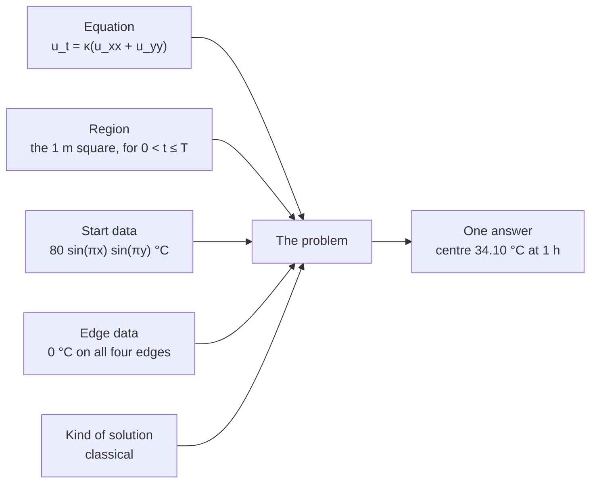
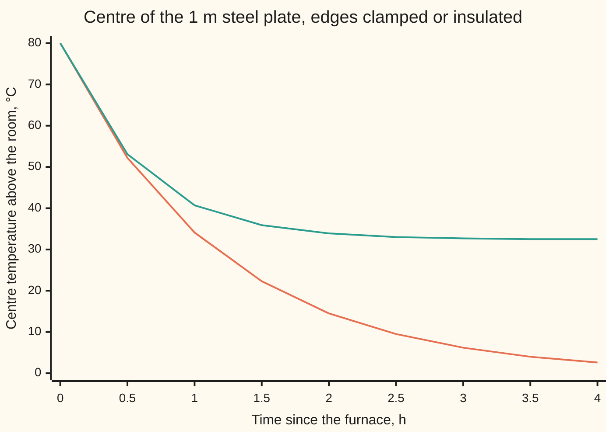

# A PDE problem: the equation, the region, and the data that pin it down

[Syllabus](../../../SYLLABUS.md) → [Partial differential equations](../README.md) → [Classification and Well-Posedness](../README.md#s01) → A PDE problem

---

## General Overview

A square steel plate, 1 m on a side, comes out of a furnace. Its centre is 80 °C above the room. Its edges are clamped in a water-cooled frame that holds them at room temperature. Every temperature on this card is measured above the room, so the edges read 0 °C. How hot is the centre one hour later?

The heat equation alone cannot answer. It says how fast each point warms or cools, given the shape of the temperature around it. It says nothing about how hot the plate started, or what the frame does to the edges. Change either one and the hour-later answer changes. Leave either one out and there are many answers.

So a usable question has five parts: the equation, the region it holds in, the starting values, the edge values, and a statement of what counts as an answer. With all five in place, this plate's centre reads **34.10 °C** after one hour. With the edges insulated instead of clamped, the same equation and the same start give 40.74 °C.

[A partial differential equation](../../08-Differential%20equations%20and%20dynamics/10-The%20Classical%20PDEs/01-what-a-pde-says.md) already showed, by example, that the heat, wave and Laplace equations each need their own starting and edge data. This card turns that into a full problem statement, and says exactly what a solution has to do.

**A PDE problem is an equation together with the region where it holds, data on the parts of its boundary that need them (for the cooling plate: the start and every edge, never the final time), and the kind of function that counts as a solution; only the whole package has an answer.**

**What kind of fact this is:** a definition, the frame for every later card in this wing. The plate's solution is checked on this card; that it is the only one is proved on [Energy methods](07-energy-methods-and-uniqueness.md) and [Maximum principles](08-maximum-principles.md).

### The picture: five parts, one answer



Remove any box on the left and the arrow on the right splits into many answers, or none.

---

## The formula

Notation first, in words. It is new on this card and used through the whole wing.

- $`\Omega`$ (omega) is the **region**: the open set of points where the equation must hold. Here it is the inside of the plate, $`0 < x < L`$ and $`0 < y < L`$, with side $`L = 1`$ m.
- $`d`$ is the region's **dimension**: the number of space coordinates. A flat plate has $`d = 2`$.
- $`\partial\Omega`$ is the **boundary** of the region: here the plate's four edges.
- $`\overline{\Omega}`$ is the **closed region**: the inside and its boundary together, $`\Omega \cup \partial\Omega`$.
- $`C^k`$ is the set of functions whose derivatives up to order $`k`$ exist and are continuous (no jumps).

Subscripts are partial derivatives, as in [Partial derivatives](../../06-Calculus%20and%20analysis/07-Several%20Variables/01-partial-derivatives.md): $`u_t`$ is the rate of change in time at one fixed point, and $`u_{xx}`$ is the bend of the profile along $`x`$.

The cooling plate, stated in full:

```math
\begin{aligned} u_t &= \kappa\,(u_{xx} + u_{yy}) && \text{in } \Omega \times (0, T], \\ u &= b && \text{on } \partial\Omega \times (0, T], \\ u(x, y, 0) &= g(x, y) && \text{for } (x, y) \text{ in } \overline{\Omega}. \end{aligned}
```

**Read it aloud:** inside the plate, at every time after the start, each point warms at a rate set by how its temperature bends; on the edges, at every time, the temperature is the given edge value $`b`$; at the start, the temperature everywhere is the given profile $`g`$.

The plate's data are $`b = 0`$ °C and a smooth bump that is zero on the edges:

```math
g(x, y) = 80 \sin\!\left(\frac{\pi x}{L}\right) \sin\!\left(\frac{\pi y}{L}\right) \ {}^\circ\mathrm{C}.
```

The problem's solution, checked in Why it works:

```math
u(x, y, t) = 80\, e^{-2\pi^2 \kappa t / L^2} \sin\!\left(\frac{\pi x}{L}\right) \sin\!\left(\frac{\pi y}{L}\right) \ {}^\circ\mathrm{C}.
```

**Read it aloud:** the bump keeps its shape and shrinks at the steady rate $`2\pi^2\kappa/L^2`$ per second.

| Symbol | Plain meaning | In our example | Push it up and the answer… |
| --- | --- | --- | --- |
| $`u`$ | the unknown: temperature above the room | 80 °C at the centre at the start | — |
| $`x`$, $`y`$, $`L`$ | place across and up the plate; its side | 0 to 1 m; $`L = 1`$ m | larger $`L`$: slower cooling, as $`1/L^2`$ |
| $`t`$, $`T`$ | time since the start; the last time asked about | 1 h = 3600 s | later: cooler centre |
| $`\kappa`$ | thermal diffusivity (kappa): how fast heat spreads | $`1.2 \times 10^{-5}`$ m²/s, carbon steel, illustrative | faster cooling |
| $`r`$ | decay rate of the bump, $`2\pi^2\kappa/L^2`$ | $`2.36871 \times 10^{-4}`$ per s | faster cooling |
| $`u_t`$, $`u_{xx}`$, $`u_{yy}`$ | rate in time; bend along $`x`$ and along $`y`$ | centre at start: $`u_t = -0.01895`$ °C/s | — |
| $`\Omega`$, $`d`$ | the open region; its dimension | inside of the square; $`d = 2`$ | — |
| $`\partial\Omega`$, $`\overline{\Omega}`$ | the boundary; the closed region $`\Omega \cup \partial\Omega`$ | the four clamped edges; the whole plate, edges included | — |
| $`g`$, $`b`$ | start data: the profile at $`t = 0`$; edge data: the value held on $`\partial\Omega`$ | $`80 \sin(\pi x/L) \sin(\pi y/L)`$ °C; 0 °C | hotter at every later time |
| $`C^k`$ | functions with $`k`$ continuous derivatives | $`u`$ is $`C^2`$ in place, $`C^1`$ in time | — |
| $`c`$; $`w`$, $`D`$, $`\rho`$, $`H`$ | membrane wave speed; plate deflection, bending stiffness, density, thickness | used only in the order table of Why it works | — |
| $`h`$, $`\Delta t`$ | grid spacing and time step in the code | 0.025 m and 11.25 s | larger: bigger grid error |

### When it holds

- **Thin plate, faces insulated.** The model has no heat loss through the two flat faces. In open air the faces leak heat, which adds a loss term proportional to $`u`$ to the equation and makes the plate cool faster than 34.10 °C suggests.
- **Constant material.** $`\kappa`$ is the same everywhere and at every temperature. Steel's diffusivity drifts by tens of percent over hundreds of degrees; a $`\kappa`$ that varies makes the equation's coefficients vary, and the closed form no longer applies.
- **Data on the start face and every edge, none at the final time.** The start face $`t = 0`$ and the four edges all need data. Leave one out and the answer is not unique (What breaks, rows 1 and 2). The final-time face $`t = T`$ takes none: the start and the edges already fix it, so any other value there leaves no solution. First-order equations take data only where information enters ([Characteristics](../02-First-Order%20Equations%20and%20Characteristics/01-method-of-characteristics.md)).
- **Matching data where faces meet.** At $`t = 0`$ on the edges, $`g`$ must equal $`b`$, or no solution is continuous there. Here both are 0 °C. Drop this and only a weaker kind of solution exists near the edges at the start.
- **No extra data.** Data the equation already fixes cannot also be given. A starting rate $`u_t`$ is fixed by $`g`$, so giving one too usually leaves no solution (row 3).

---

## Why it works

### Step 0: an equation gives rates, so values must come from outside

The heat equation turns a temperature profile into a rate of change. It never produces a temperature on its own. Every value it uses must trace back to something handed in: a starting value, or an edge value. A problem statement lists exactly which values are handed in, and where.

### Step 1: the order counts the data

The **order** of a PDE is the highest total number of derivatives on the unknown in any term. The cooling plate has $`u_{xx}`$, so order 2. Two finer counts say how much data it needs:

- **Order in time** counts the start fields. $`u_t`$ is first order in time, so one start field, the profile $`g`$.
- **Order in space** sets the edge conditions. For these equations, half the order in space is the number of conditions at each edge point.

The code reads these counts off the derivatives each equation contains:

| Plate problem | Equation | Order | Start fields | Conditions per edge point |
| --- | --- | ---: | ---: | ---: |
| cooling | $`u_t = \kappa\,(u_{xx} + u_{yy})`$ | 2 | 1 | 1 |
| held steady | $`u_{xx} + u_{yy} = 0`$ | 2 | 0 | 1 |
| ringing membrane | $`u_{tt} = c^2 (u_{xx} + u_{yy})`$ | 2 | 2 | 1 |
| ringing plate | $`w_{tt} + \tfrac{D}{\rho H}(w_{xxxx} + 2w_{xxyy} + w_{yyyy}) = 0`$ | 4 | 2 | 2 |

A real steel plate rings by the last line, the plate-bending equation: $`w`$ is its sideways deflection, $`D`$ its bending stiffness, $`\rho`$ its density and $`H`$ its thickness. It is fourth order in space, so a clamped edge needs two conditions: no deflection and no slope. The membrane line is the model wing 08 uses; it fits a drumhead, not a steel plate.

### Step 2: the equation holds inside, and the edges carry data

The region $`\Omega`$ is open: it does not include its edges. That is not a technicality. On an edge the temperature is handed in as data, so the equation is not asked to hold there. Asking it would also demand more than a solution needs. The definition below asks for second derivatives only inside the plate, not up to the edge, because badly matched data (the uniform 80 °C plate in The usual mistake) leave a solution whose bends blow up near the edge at the start.

On a grid this is visible. Each inside point moves toward the mean of its four neighbours. On the clamped plate an edge point does not follow that rule: it keeps the value it was handed. In the code, the line that skips edge points carries the comment "an edge point is data, not equation". On the insulated plate the data is a slope, not a value, so there the edge points do follow the rule, on a mirrored grid: a ghost point outside each edge copies its inside neighbour, so the edge slope is 0.

### Step 3: what counts as a solution

A **classical solution** of the cooling problem is a function $`u`$ with these properties:

1. $`u`$ is continuous on the closed plate for $`0 \le t \le T`$, so the data have a meaning: approaching an edge, $`u`$ approaches the edge value.
2. $`u_t`$, $`u_{xx}`$ and $`u_{yy}`$ exist and are continuous inside the plate for $`0 < t \le T`$. In short, $`u`$ is $`C^2`$ in place and $`C^1`$ in time there.
3. The equation holds at every inside point and every time $`0 < t \le T`$.
4. $`u`$ equals $`b`$ on the edges and $`g`$ at the start, exactly.

The word "classical" matters. Later cards accept rougher functions: weak, entropy and viscosity solutions. Each is a different promise, and uniqueness is always stated inside one class.

### Step 4: check the candidate against all four rules

Write $`r = 2\pi^2\kappa/L^2`$ for the decay rate. For the candidate $`u = 80\, e^{-rt} \sin(\pi x/L) \sin(\pi y/L)`$:

- **Rate in time.** Differentiating the exponential gives $`u_t = -r\,u`$.
- **Bends.** Each sine differentiated twice gives back minus itself times $`\pi^2/L^2`$. So $`u_{xx} + u_{yy} = -2\pi^2 u/L^2`$, and $`\kappa(u_{xx} + u_{yy}) = -r\,u`$. The equation holds.
- **Edges.** $`\sin 0 = \sin \pi = 0`$, so $`u = 0`$ on all four edges at every time.
- **Start.** At $`t = 0`$ the exponential is 1, so $`u = g`$.

The candidate is smooth everywhere, so rules 1 and 2 hold. It is a classical solution.

The code does not trust this algebra. It builds the answer a second way, on a grid that never sees the formula. It also measures the equation's leftover, $`u_t - \kappa(u_{xx} + u_{yy})`$, by centred differences.

### Step 5: the three standard shapes of problem

| Name | Data given | Plate example | Card |
| --- | --- | --- | --- |
| **initial-boundary value problem** | start and edges | the cooling plate | this one |
| **boundary value problem** | edges only, no time | the plate held steady | [Boundary conditions](03-boundary-conditions-dirichlet-neumann-and-robin.md) |
| **Cauchy problem** (initial value problem) | start only, region with no edges | heat in an endless sheet | [The heat kernel](../03-The%20Heat%20Equation%20in%20Depth/01-heat-kernel-and-fundamental-solution.md) |

A Cauchy problem still needs a condition at infinity, such as "the temperature stays bounded". Without it, even the endless sheet has more than one solution.

### Step 6: why the full package gives one answer

Uniqueness is a theorem, not part of the definition. For the cooling plate: suppose two classical solutions share the equation and all the data. Their difference starts at 0, stays 0 on the edges, and obeys the same equation. [Energy methods](07-energy-methods-and-uniqueness.md) shows that the difference's total squared size never grows, so it stays 0. [Maximum principles](08-maximum-principles.md) reaches the same end another way.

Whether the answer also depends gently on the data is the question of [Well posed](06-well-posedness-and-hadamard.md).

---

## Worked numbers, by hand

| Step | Arithmetic | Value |
| --- | --- | --- |
| decay rate $`r`$ | $`2 \times \pi^2 \times 1.2 \times 10^{-5} / 1^2`$ | $`2.36871 \times 10^{-4}`$ per s |
| exponent at 1 h | $`2.36871 \times 10^{-4} \times 3600`$ | 0.852734 |
| factor | $`e^{-0.852734}`$ | 0.42625 |
| centre at 1 h | $`80 \times 0.42625 \times \sin(\pi/2)^2`$ | **34.10 °C** |
| time to halve | $`\ln 2 / r`$ | 2926.3 s = 48.8 min |
| start rate at the centre | $`-r \times 80`$ | −0.018950 °C/s = −1.1370 °C/min |

One hour after leaving the furnace, the centre of the clamped plate is 34.10 °C above the room, down from 80 °C.

### What breaks if you drop a piece

| Mistake | Comes out at | What went wrong |
| --- | --- | --- |
| No start given | $`u = 0`$ also fits: centre 0.00 °C, not 34.10 °C | the equation and edges alone allow every multiple of the bump |
| No edge rule given | insulated edges also fit: centre 40.74 °C, not 34.10 °C | heat cannot leave, so the plate settles at its mean, 32.42 °C |
| A start rate of 0 added | the equation forces −0.018950 °C/s at the centre: no solution | the start rate is already fixed by $`g`$ |

Row 2 uses the cosine-series solution for insulated edges (a sum of cosine shapes, each flat at the edges and fading at its own rate), three terms, first omitted term $`7.8 \times 10^{-9}`$ (a unitless term of the series factor, far below 0.01 °C at the centre), and the mirrored grid of Step 2, which gives 40.71 °C. That start is also not matched to the insulated edge rule: $`g`$ has a slope at the edges, but insulation means zero slope. So that solution is classical only for $`t > 0`$.

### The picture: same equation, same start, two edge rules



Orange: edges clamped at 0 °C, falling toward 0 °C. Teal: edges insulated, levelling at the plate's mean, 32.42 °C. The two lines differ only in the edge data.

---

## Code, from first principles, and it actually runs

The code states the plate problem and solves it three independent ways. Road one is the closed form. Road two is an explicit grid: each inside point steps toward its neighbours' mean, edge points hold their data, and the grid never sees the formula; at spacings 0.1, 0.05 and 0.025 m its error falls fourfold each time. Road three puts the closed form back into the equation by centred differences and measures the leftover. The code also counts each plate problem's order and data, solves the insulated plate by a cosine series and by a mirrored grid, and prints every number on this card.

### Python

```python
# A PDE problem -- the check behind the card.  Only math is imported.  The problem:
# a 1 m square steel plate, edges held at 0 C, starting at 80 sin(pi x) sin(pi y) C,
# obeying u_t = kappa (u_xx + u_yy).  Road one: the closed form.  Road two: an explicit
# grid that never sees it.  Road three: the equation's residual by centred differences.
from math import sin, cos, exp, pi, log
KAPPA, L, U0, HOUR = 1.2e-5, 1.0, 80.0, 3600.0      # m^2/s (illustrative), m, C, s
RATE = 2 * pi * pi * KAPPA / L ** 2                 # decay rate of the closed form, 1/s

# The order of each plate problem, read off the derivatives it contains: (in x, in y, in t)
PROBLEMS = [("cooling, u_t = kappa (u_xx + u_yy)", [(0, 0, 1), (2, 0, 0), (0, 2, 0)]),
            ("held steady, u_xx + u_yy = 0", [(2, 0, 0), (0, 2, 0)]),
            ("ringing membrane, u_tt = c^2 (u_xx + u_yy)", [(0, 0, 2), (2, 0, 0), (0, 2, 0)]),
            ("ringing plate, w_tt + D/(rho H)(w_xxxx + 2w_xxyy + w_yyyy) = 0",
             [(0, 0, 2), (4, 0, 0), (2, 2, 0), (0, 4, 0)])]

def exact(x, y, t):                    # road one: the closed form
    return U0 * exp(-RATE * t) * sin(pi * x / L) * sin(pi * y / L)

def grid(n, steps, t_end, insulated=False):   # road two: each point moves toward its neighbours' mean
    h, dt = L / n, t_end / steps
    lam = KAPPA * dt / (h * h)         # grid ratio kappa dt / h^2
    assert lam <= 0.25                 # inside the explicit scheme's stability limit
    u = [[U0 * sin(pi * i / n) * sin(pi * j / n) for i in range(n + 1)] for j in range(n + 1)]
    edge = lambda i, j: i in (0, n) or j in (0, n)
    if not insulated:
        u = [[0.0 if edge(i, j) else u[j][i] for i in range(n + 1)] for j in range(n + 1)]
    for _ in range(steps):
        new = [row[:] for row in u]
        for j in range(n + 1):
            for i in range(n + 1):
                if edge(i, j) and not insulated:
                    continue           # an edge point is data, not equation
                w = u[j][i - 1] if i > 0 else u[j][1]        # insulated: mirror across the edge
                e = u[j][i + 1] if i < n else u[j][n - 1]
                s = u[j - 1][i] if j > 0 else u[1][i]
                nn = u[j + 1][i] if j < n else u[n - 1][i]
                new[j][i] = u[j][i] + lam * (w + e + s + nn - 4 * u[j][i])
        u = new
    return u[n // 2][n // 2]

def residual(x, y, t, d, dt=1.0):      # road three: u_t - kappa (u_xx + u_yy) by centred differences
    ut = (exact(x, y, t + dt) - exact(x, y, t - dt)) / (2 * dt)
    lap = (exact(x + d, y, t) + exact(x - d, y, t) + exact(x, y + d, t) + exact(x, y - d, t)
           - 4 * exact(x, y, t)) / (d * d)
    return ut, ut - KAPPA * lap

def insulated_centre(t, terms=40):     # cosine series, insulated edges: value, first omitted term
    tau = KAPPA * t / L ** 2
    a = lambda k: 2 / pi if k == 0 else -4 / (pi * (4 * k * k - 1))
    s = sum(a(k) * (-1) ** k * exp(-4 * k * k * pi * pi * tau) for k in range(terms))
    return U0 * s * s, abs(a(terms)) * exp(-4 * terms * terms * pi * pi * tau)

orders = []
for name, terms in PROBLEMS:
    total = max(a + b + c for a, b, c in terms)
    in_t, in_space = max(c for _, _, c in terms), max(a + b for a, b, _ in terms)
    orders.append((total, in_t, in_space // 2))
    print(f"{name}: order {total}; {in_t} start field(s); {in_space // 2} condition(s) per edge point")
print(f"kappa {KAPPA * 1e5:.1f}e-5 m^2/s; decay rate 2 pi^2 kappa / L^2 = {RATE * 1e4:.5f}e-4 per s")
c1 = exact(0.5, 0.5, HOUR)
print(f"exponent at 1 h: {RATE * HOUR:.6f}; factor {exp(-RATE * HOUR):.5f}; centre at 1 h: {c1:.2f} C")
print(f"centre halves after {log(2) / RATE:.1f} s = {log(2) / RATE / 60:.1f} min")
gs, errs = [], []
for n, steps in [(10, 20), (20, 80), (40, 320)]:
    g = grid(n, steps, HOUR)
    gs.append(g)
    errs.append(abs(g - c1))
    print(f"grid h = {L / n:.3f} m, dt = {HOUR / steps:.2f} s: centre {g:.4f} C, error {abs(g - c1):.4f} C")
print(f"observed order: {log(errs[0] / errs[1], 2):.2f}, {log(errs[1] / errs[2], 2):.2f}")
ut, r1 = residual(0.5, 0.5, HOUR, 0.01)
_, r2 = residual(0.5, 0.5, HOUR, 0.005)
print(f"residual at the centre, 1 h: u_t = {ut * 1e3:.4f}e-3 C/s; u_t - kappa lap u = {r1 * 1e7:.4f}e-7 "
      f"at step 0.01 m, {r2 * 1e7:.4f}e-7 at 0.005 m; ratio {r1 / r2:.2f}")
edge_max = max(abs(exact(p / 10, q, t)) for p in range(11) for q in (0.0, L) for t in (0.0, HOUR))
start_gap = max(abs(exact(p / 10, q / 10, 0.0) - U0 * sin(pi * p / 10) * sin(pi * q / 10))
                for p in range(11) for q in range(11))
print(f"data: every edge value below 1e-12 C: {'yes' if edge_max < 1e-12 else 'no'}; "
      f"start matches g: {'yes' if start_gap < 1e-12 else 'no'}")
forced = -RATE * U0
lap_g = (4 * U0 * sin(pi * 0.501) - 4 * U0 * sin(pi * 0.5)) / 1e-6   # discrete bend of g at the centre (x and y alike)
print(f"start rate the equation forces at the centre: {forced:.6f} C/s = {forced * 60:.4f} C/min; "
      f"from g's bend: {KAPPA * lap_g:.6f} C/s")
ins, omitted = insulated_centre(HOUR, 3)
gi = grid(40, 320, HOUR, insulated=True)
print(f"insulated edges, centre at 1 h: series {ins:.2f} C (3 terms, first omitted {omitted * 1e9:.1f}e-9), grid h = 0.025 m {gi:.2f} C")
print(f"insulated edges, long run: the mean 80 (2/pi)^2 = {U0 * 4 / pi ** 2:.2f} C; series at 12 h {insulated_centre(12 * HOUR)[0]:.2f} C")
print(f"mistake 1, no start given: u = 0 also fits; centre at 1 h 0.00 C, not {c1:.2f} C")
print(f"mistake 2, no edge rule: insulated edges also fit; centre at 1 h {ins:.2f} C, not {c1:.2f} C")
print(f"mistake 3, start rate 0 added: the equation forces {forced:.6f} C/s; no solution")
hours = [k / 2 for k in range(9)]
print("chart held centre:", ", ".join(f"{exact(0.5, 0.5, hh * HOUR):.1f}" for hh in hours))
print("chart insulated centre:", ", ".join(f"{insulated_centre(hh * HOUR)[0]:.1f}" for hh in hours))
assert orders == [(2, 1, 1), (2, 0, 1), (2, 2, 1), (4, 2, 2)]          # counts known from the equations
assert errs[2] < 0.03 and abs((4 * gs[2] - gs[1]) / 3 - c1) < 0.002     # closed form against the grid
assert 1.9 < log(errs[0] / errs[1], 2) < 2.1 and 1.9 < log(errs[1] / errs[2], 2) < 2.1   # second order
assert abs(r1) < 1e-3 * abs(ut) and 3.9 < r1 / r2 < 4.1                  # residual shrinks as step^2
assert abs(KAPPA * lap_g - forced) < 1e-6 and abs(ins - gi) < 0.05 and abs(ins - c1) > 5
print("ALL CHECKS PASS")
```

**Ran 2026-11-15 on macOS, Python 3.14.10, standard library only. All checks passed. Output, pasted from the run:**

```
cooling, u_t = kappa (u_xx + u_yy): order 2; 1 start field(s); 1 condition(s) per edge point
held steady, u_xx + u_yy = 0: order 2; 0 start field(s); 1 condition(s) per edge point
ringing membrane, u_tt = c^2 (u_xx + u_yy): order 2; 2 start field(s); 1 condition(s) per edge point
ringing plate, w_tt + D/(rho H)(w_xxxx + 2w_xxyy + w_yyyy) = 0: order 4; 2 start field(s); 2 condition(s) per edge point
kappa 1.2e-5 m^2/s; decay rate 2 pi^2 kappa / L^2 = 2.36871e-4 per s
exponent at 1 h: 0.852734; factor 0.42625; centre at 1 h: 34.10 C
centre halves after 2926.3 s = 48.8 min
grid h = 0.100 m, dt = 180.00 s: centre 33.7129 C, error 0.3869 C
grid h = 0.050 m, dt = 45.00 s: centre 34.0043 C, error 0.0956 C
grid h = 0.025 m, dt = 11.25 s: centre 34.0760 C, error 0.0238 C
observed order: 2.02, 2.00
residual at the centre, 1 h: u_t = -8.0772e-3 C/s; u_t - kappa lap u = -6.6438e-7 at step 0.01 m, -1.6616e-7 at 0.005 m; ratio 4.00
data: every edge value below 1e-12 C: yes; start matches g: yes
start rate the equation forces at the centre: -0.018950 C/s = -1.1370 C/min; from g's bend: -0.018950 C/s
insulated edges, centre at 1 h: series 40.74 C (3 terms, first omitted 7.8e-9), grid h = 0.025 m 40.71 C
insulated edges, long run: the mean 80 (2/pi)^2 = 32.42 C; series at 12 h 32.42 C
mistake 1, no start given: u = 0 also fits; centre at 1 h 0.00 C, not 34.10 C
mistake 2, no edge rule: insulated edges also fit; centre at 1 h 40.74 C, not 34.10 C
mistake 3, start rate 0 added: the equation forces -0.018950 C/s; no solution
chart held centre: 80.0, 52.2, 34.1, 22.3, 14.5, 9.5, 6.2, 4.0, 2.6
chart insulated centre: 80.0, 53.1, 40.7, 35.9, 33.9, 33.0, 32.7, 32.5, 32.5
ALL CHECKS PASS
```

### Rust

Same numbers, same labels, built with `rustc --edition 2021 -O`.

```rust
// A PDE problem -- the same check as the Python, in Rust.  No crates.  The problem:
// a 1 m square steel plate, edges held at 0 C, starting at 80 sin(pi x) sin(pi y) C,
// obeying u_t = kappa (u_xx + u_yy).  Road one: the closed form.  Road two: an explicit
// grid that never sees it.  Road three: the equation's residual by centred differences.
use std::f64::consts::PI;
const KAPPA: f64 = 1.2e-5; // m^2/s (illustrative)
const L: f64 = 1.0; // m
const U0: f64 = 80.0; // C
const HOUR: f64 = 3600.0; // s

fn rate() -> f64 { 2.0 * PI * PI * KAPPA / (L * L) } // decay rate of the closed form, 1/s

fn exact(x: f64, y: f64, t: f64) -> f64 { // road one: the closed form
    U0 * (-rate() * t).exp() * (PI * x / L).sin() * (PI * y / L).sin()
}

fn grid(n: usize, steps: usize, t_end: f64, insulated: bool) -> f64 { // road two
    let (h, dt) = (L / n as f64, t_end / steps as f64);
    let lam = KAPPA * dt / (h * h); // grid ratio kappa dt / h^2
    assert!(lam <= 0.25); // inside the explicit scheme's stability limit
    let edge = |i: usize, j: usize| i == 0 || i == n || j == 0 || j == n;
    let mut u = vec![vec![0.0f64; n + 1]; n + 1];
    for j in 0..=n {
        for i in 0..=n {
            let v = U0 * (PI * i as f64 / n as f64).sin() * (PI * j as f64 / n as f64).sin();
            u[j][i] = if edge(i, j) && !insulated { 0.0 } else { v };
        }
    }
    for _ in 0..steps {
        let mut new = u.clone();
        for j in 0..=n {
            for i in 0..=n {
                if edge(i, j) && !insulated { continue } // an edge point is data, not equation
                let w = if i > 0 { u[j][i - 1] } else { u[j][1] }; // insulated: mirror across the edge
                let e = if i < n { u[j][i + 1] } else { u[j][n - 1] };
                let s = if j > 0 { u[j - 1][i] } else { u[1][i] };
                let nn = if j < n { u[j + 1][i] } else { u[n - 1][i] };
                new[j][i] = u[j][i] + lam * (w + e + s + nn - 4.0 * u[j][i]);
            }
        }
        u = new;
    }
    u[n / 2][n / 2]
}

fn residual(x: f64, y: f64, t: f64, d: f64) -> (f64, f64) { // road three: centred differences
    let dt = 1.0;
    let ut = (exact(x, y, t + dt) - exact(x, y, t - dt)) / (2.0 * dt);
    let lap = (exact(x + d, y, t) + exact(x - d, y, t) + exact(x, y + d, t) + exact(x, y - d, t)
        - 4.0 * exact(x, y, t)) / (d * d);
    (ut, ut - KAPPA * lap)
}

fn insulated_centre(t: f64, terms: usize) -> (f64, f64) { // cosine series: value, first omitted term
    let tau = KAPPA * t / (L * L);
    let a = |k: usize| if k == 0 { 2.0 / PI } else { -4.0 / (PI * (4.0 * (k * k) as f64 - 1.0)) };
    let decay = |k: usize| (-4.0 * (k * k) as f64 * PI * PI * tau).exp();
    let s: f64 = (0..terms).map(|k| a(k) * (if k % 2 == 0 { 1.0 } else { -1.0 }) * decay(k)).sum();
    (U0 * s * s, a(terms).abs() * decay(terms))
}

fn yn(b: bool) -> &'static str { if b { "yes" } else { "no" } }

fn main() {
    let problems: Vec<(&str, Vec<(u32, u32, u32)>)> = vec![
        ("cooling, u_t = kappa (u_xx + u_yy)", vec![(0, 0, 1), (2, 0, 0), (0, 2, 0)]),
        ("held steady, u_xx + u_yy = 0", vec![(2, 0, 0), (0, 2, 0)]),
        ("ringing membrane, u_tt = c^2 (u_xx + u_yy)", vec![(0, 0, 2), (2, 0, 0), (0, 2, 0)]),
        ("ringing plate, w_tt + D/(rho H)(w_xxxx + 2w_xxyy + w_yyyy) = 0",
         vec![(0, 0, 2), (4, 0, 0), (2, 2, 0), (0, 4, 0)]),
    ];
    let mut orders = Vec::new();
    for (name, terms) in &problems {
        let total = terms.iter().map(|&(a, b, c)| a + b + c).max().unwrap();
        let in_t = terms.iter().map(|&(_, _, c)| c).max().unwrap();
        let in_space = terms.iter().map(|&(a, b, _)| a + b).max().unwrap();
        orders.push((total, in_t, in_space / 2));
        println!("{}: order {}; {} start field(s); {} condition(s) per edge point", name, total, in_t, in_space / 2);
    }
    let rt = rate();
    println!("kappa {:.1}e-5 m^2/s; decay rate 2 pi^2 kappa / L^2 = {:.5}e-4 per s", KAPPA * 1e5, rt * 1e4);
    let c1 = exact(0.5, 0.5, HOUR);
    println!("exponent at 1 h: {:.6}; factor {:.5}; centre at 1 h: {:.2} C", rt * HOUR, (-rt * HOUR).exp(), c1);
    println!("centre halves after {:.1} s = {:.1} min", 2f64.ln() / rt, 2f64.ln() / rt / 60.0);
    let (mut gs, mut errs) = (Vec::new(), Vec::new());
    for &(n, steps) in &[(10usize, 20usize), (20, 80), (40, 320)] {
        let g = grid(n, steps, HOUR, false);
        gs.push(g);
        errs.push((g - c1).abs());
        println!("grid h = {:.3} m, dt = {:.2} s: centre {:.4} C, error {:.4} C", L / n as f64, HOUR / steps as f64, g, (g - c1).abs());
    }
    let (o1, o2) = ((errs[0] / errs[1]).ln() / 2f64.ln(), (errs[1] / errs[2]).ln() / 2f64.ln());
    println!("observed order: {:.2}, {:.2}", o1, o2);
    let (ut, r1) = residual(0.5, 0.5, HOUR, 0.01);
    let (_, r2) = residual(0.5, 0.5, HOUR, 0.005);
    println!("residual at the centre, 1 h: u_t = {:.4}e-3 C/s; u_t - kappa lap u = {:.4}e-7 at step 0.01 m, {:.4}e-7 at 0.005 m; ratio {:.2}",
             ut * 1e3, r1 * 1e7, r2 * 1e7, r1 / r2);
    let (mut edge_max, mut start_gap) = (0.0f64, 0.0f64);
    for p in 0..=10 {
        for &q in &[0.0, L] {
            for &t in &[0.0, HOUR] { edge_max = edge_max.max(exact(p as f64 / 10.0, q, t).abs()) }
        }
        for q in 0..=10 {
            let (x, y) = (p as f64 / 10.0, q as f64 / 10.0);
            start_gap = start_gap.max((exact(x, y, 0.0) - U0 * (PI * x).sin() * (PI * y).sin()).abs());
        }
    }
    println!("data: every edge value below 1e-12 C: {}; start matches g: {}", yn(edge_max < 1e-12), yn(start_gap < 1e-12));
    let forced = -rt * U0;
    let lap_g = (4.0 * U0 * (PI * 0.501).sin() - 4.0 * U0 * (PI * 0.5).sin()) / 1e-6; // discrete bend of g at the centre
    println!("start rate the equation forces at the centre: {:.6} C/s = {:.4} C/min; from g's bend: {:.6} C/s",
             forced, forced * 60.0, KAPPA * lap_g);
    let (ins, omitted) = insulated_centre(HOUR, 3);
    let gi = grid(40, 320, HOUR, true);
    println!("insulated edges, centre at 1 h: series {:.2} C (3 terms, first omitted {:.1}e-9), grid h = 0.025 m {:.2} C", ins, omitted * 1e9, gi);
    println!("insulated edges, long run: the mean 80 (2/pi)^2 = {:.2} C; series at 12 h {:.2} C",
             U0 * 4.0 / (PI * PI), insulated_centre(12.0 * HOUR, 40).0);
    println!("mistake 1, no start given: u = 0 also fits; centre at 1 h 0.00 C, not {:.2} C", c1);
    println!("mistake 2, no edge rule: insulated edges also fit; centre at 1 h {:.2} C, not {:.2} C", ins, c1);
    println!("mistake 3, start rate 0 added: the equation forces {:.6} C/s; no solution", forced);
    let hours: Vec<f64> = (0..9).map(|k| k as f64 / 2.0).collect();
    let held: Vec<String> = hours.iter().map(|&h| format!("{:.1}", exact(0.5, 0.5, h * HOUR))).collect();
    let ins_c: Vec<String> = hours.iter().map(|&h| format!("{:.1}", insulated_centre(h * HOUR, 40).0)).collect();
    println!("chart held centre: {}", held.join(", "));
    println!("chart insulated centre: {}", ins_c.join(", "));
    assert!(orders == vec![(2, 1, 1), (2, 0, 1), (2, 2, 1), (4, 2, 2)]); // counts known from the equations
    assert!(errs[2] < 0.03 && ((4.0 * gs[2] - gs[1]) / 3.0 - c1).abs() < 0.002); // closed form against the grid
    assert!(1.9 < o1 && o1 < 2.1 && 1.9 < o2 && o2 < 2.1); // second order
    assert!(r1.abs() < 1e-3 * ut.abs() && 3.9 < r1 / r2 && r1 / r2 < 4.1); // residual shrinks as step^2
    assert!((KAPPA * lap_g - forced).abs() < 1e-6 && (ins - gi).abs() < 0.05 && (ins - c1).abs() > 5.0);
    println!("ALL CHECKS PASS");
}
```

**Ran 2026-11-15 on macOS, rustc 1.98.1, no crates. All checks passed. Output, pasted from the run:**

```
cooling, u_t = kappa (u_xx + u_yy): order 2; 1 start field(s); 1 condition(s) per edge point
held steady, u_xx + u_yy = 0: order 2; 0 start field(s); 1 condition(s) per edge point
ringing membrane, u_tt = c^2 (u_xx + u_yy): order 2; 2 start field(s); 1 condition(s) per edge point
ringing plate, w_tt + D/(rho H)(w_xxxx + 2w_xxyy + w_yyyy) = 0: order 4; 2 start field(s); 2 condition(s) per edge point
kappa 1.2e-5 m^2/s; decay rate 2 pi^2 kappa / L^2 = 2.36871e-4 per s
exponent at 1 h: 0.852734; factor 0.42625; centre at 1 h: 34.10 C
centre halves after 2926.3 s = 48.8 min
grid h = 0.100 m, dt = 180.00 s: centre 33.7129 C, error 0.3869 C
grid h = 0.050 m, dt = 45.00 s: centre 34.0043 C, error 0.0956 C
grid h = 0.025 m, dt = 11.25 s: centre 34.0760 C, error 0.0238 C
observed order: 2.02, 2.00
residual at the centre, 1 h: u_t = -8.0772e-3 C/s; u_t - kappa lap u = -6.6438e-7 at step 0.01 m, -1.6616e-7 at 0.005 m; ratio 4.00
data: every edge value below 1e-12 C: yes; start matches g: yes
start rate the equation forces at the centre: -0.018950 C/s = -1.1370 C/min; from g's bend: -0.018950 C/s
insulated edges, centre at 1 h: series 40.74 C (3 terms, first omitted 7.8e-9), grid h = 0.025 m 40.71 C
insulated edges, long run: the mean 80 (2/pi)^2 = 32.42 C; series at 12 h 32.42 C
mistake 1, no start given: u = 0 also fits; centre at 1 h 0.00 C, not 34.10 C
mistake 2, no edge rule: insulated edges also fit; centre at 1 h 40.74 C, not 34.10 C
mistake 3, start rate 0 added: the equation forces -0.018950 C/s; no solution
chart held centre: 80.0, 52.2, 34.1, 22.3, 14.5, 9.5, 6.2, 4.0, 2.6
chart insulated centre: 80.0, 53.1, 40.7, 35.9, 33.9, 33.0, 32.7, 32.5, 32.5
ALL CHECKS PASS
```

The two outputs match line for line.

### Lean

Lean proves the plate's three claims about data, for any side, diffusivity and bump size, and checks the order table.

- Take the square plate of side $`L > 0`$, with edges at 0 °C and a start bump of any size. Then the shrinking bump meets all four rules of a classical solution, for any $`\kappa`$ and any last time $`T`$.
- Leave out the start data. Then every multiple of the bump, 0 °C included, meets rules 1 to 3 and the edge data. Two different multiples give different centre readings at every time.
- Take any $`u`$ that starts as the bump on the closed plate, where the equation holds at the centre at the start. Then the starting rate at the centre is $`-r`$ times the centre's start value.
- Suppose also that $`\kappa`$ and the bump are not 0. Then that starting rate is not 0, so adding "starting rate 0" leaves no solution.
- Take the four plate problems of the order table. Then the order, the start fields and the conditions per edge point come out as the table shows.

The 34.10 °C answer, the grid, the residual and the insulated plate are left to the Python and Rust checks.

```lean
-- A PDE problem: the cooling-plate bump u = A e^(-2π²κt/L²) sin(πx/L) sin(πy/L) is a classical solution of the full heat problem on the open square with edges at 0 and start A sin(πx/L) sin(πy/L), without start data every multiple of the bump fits, and the start data alone fix the starting rate at the centre.
import Mathlib.Analysis.SpecialFunctions.Trigonometric.Deriv
import Mathlib.Analysis.SpecialFunctions.ExpDeriv
import Mathlib.Analysis.Calculus.Deriv.Basic
import Mathlib.Topology.Order.Real
import Mathlib.Analysis.SpecialFunctions.Trigonometric.Basic

open Real Set

/-- The rate in time `u_t` at the place `p` and time `t`, taken inside the time interval
`[0, T]` (so at the last time `T` it is the rate from the past). -/
noncomputable def heatUt (T : ℝ) (u : ℝ × ℝ → ℝ → ℝ) (p : ℝ × ℝ) (t : ℝ) : ℝ :=
  derivWithin (u p) (Icc 0 T) t

/-- The bend along `x`, `u_xx`: the second derivative of `x ↦ u (x, y) t`. -/
noncomputable def heatUxx (u : ℝ × ℝ → ℝ → ℝ) (p : ℝ × ℝ) (t : ℝ) : ℝ :=
  deriv (fun x => deriv (fun x' => u (x', p.2) t) x) p.1

/-- The bend along `y`, `u_yy`: the second derivative of `y ↦ u (x, y) t`. -/
noncomputable def heatUyy (u : ℝ × ℝ → ℝ → ℝ) (p : ℝ × ℝ) (t : ℝ) : ℝ :=
  deriv (fun y => deriv (fun y' => u (p.1, y') t) y) p.2

/-- Rules 1 to 3 of a classical solution, plus the edge data `b`, with no start data:
`u` is continuous on the closed region `closure Ω` for `0 ≤ t ≤ T`; inside `Ω` for
`0 < t ≤ T` the rates `u_t`, `u_xx`, `u_yy` exist and are continuous; the heat equation
`u_t = κ (u_xx + u_yy)` holds there; and `u = b` on the boundary `frontier Ω` for `0 < t ≤ T`. -/
def SolvesHeatWithEdgeData (κ T : ℝ) (Ω : Set (ℝ × ℝ)) (b : ℝ × ℝ → ℝ → ℝ)
    (u : ℝ × ℝ → ℝ → ℝ) : Prop :=
  ContinuousOn (fun q : (ℝ × ℝ) × ℝ => u q.1 q.2) (closure Ω ×ˢ Icc 0 T) ∧
  (∀ p ∈ Ω, ∀ t ∈ Ioc 0 T,
    DifferentiableWithinAt ℝ (u p) (Icc 0 T) t ∧
    DifferentiableAt ℝ (fun x => u (x, p.2) t) p.1 ∧
    DifferentiableAt ℝ (fun x => deriv (fun x' => u (x', p.2) t) x) p.1 ∧
    DifferentiableAt ℝ (fun y => u (p.1, y) t) p.2 ∧
    DifferentiableAt ℝ (fun y => deriv (fun y' => u (p.1, y') t) y) p.2) ∧
  ContinuousOn (fun q : (ℝ × ℝ) × ℝ => heatUt T u q.1 q.2) (Ω ×ˢ Ioc 0 T) ∧
  ContinuousOn (fun q : (ℝ × ℝ) × ℝ => heatUxx u q.1 q.2) (Ω ×ˢ Ioc 0 T) ∧
  ContinuousOn (fun q : (ℝ × ℝ) × ℝ => heatUyy u q.1 q.2) (Ω ×ˢ Ioc 0 T) ∧
  (∀ p ∈ Ω, ∀ t ∈ Ioc 0 T, heatUt T u p t = κ * (heatUxx u p t + heatUyy u p t)) ∧
  (∀ p ∈ frontier Ω, ∀ t ∈ Ioc 0 T, u p t = b p t)

/-- A classical solution of the initial-boundary value problem
`u_t = κ (u_xx + u_yy)` in `Ω × (0, T]`, `u = b` on `∂Ω × (0, T]`, `u(·, 0) = g` on `Ω̄`:
the four rules of the card (continuity on the closed region, continuous rates inside,
the equation inside, the edge and start data met exactly). -/
def IsClassicalHeatSolution (κ T : ℝ) (Ω : Set (ℝ × ℝ)) (b : ℝ × ℝ → ℝ → ℝ)
    (g : ℝ × ℝ → ℝ) (u : ℝ × ℝ → ℝ → ℝ) : Prop :=
  SolvesHeatWithEdgeData κ T Ω b u ∧ ∀ p ∈ closure Ω, u p 0 = g p

lemma pde_deriv_sin_x (a b L : ℝ) :
    deriv (fun x => a * sin (π * x / L) * b) = fun x => a * (cos (π * x / L) * (π / L)) * b := by
  funext x
  have h : HasDerivAt (fun x => sin (π * x / L)) (cos (π * x / L) * (π / L)) x := by
    have := (((hasDerivAt_id x).const_mul π).div_const L).sin
    convert this using 1 <;> simp [mul_div_assoc]
  exact ((h.const_mul a).mul_const b).deriv

lemma pde_deriv_cos_x (a b L : ℝ) :
    deriv (fun x => a * (cos (π * x / L) * (π / L)) * b) =
      fun x => a * (-sin (π * x / L) * (π / L) * (π / L)) * b := by
  funext x
  have h : HasDerivAt (fun x => cos (π * x / L)) (-sin (π * x / L) * (π / L)) x := by
    have := (((hasDerivAt_id x).const_mul π).div_const L).cos
    convert this using 1 <;> simp [mul_div_assoc]
  exact (((h.mul_const (π / L)).const_mul a).mul_const b).deriv

lemma pde_deriv_sin_y (c L : ℝ) :
    deriv (fun y => c * sin (π * y / L)) = fun y => c * (cos (π * y / L) * (π / L)) := by
  have := pde_deriv_sin_x c 1 L
  simpa using this

lemma pde_deriv_cos_y (c L : ℝ) :
    deriv (fun y => c * (cos (π * y / L) * (π / L))) =
      fun y => c * (-sin (π * y / L) * (π / L) * (π / L)) := by
  have := pde_deriv_cos_x c 1 L
  simpa using this

#print axioms pde_deriv_sin_x
#print axioms pde_deriv_cos_x
#print axioms pde_deriv_sin_y
#print axioms pde_deriv_cos_y

lemma pde_bump_solves (κ L T A : ℝ) (hL : 0 < L) :
    SolvesHeatWithEdgeData κ T (Ioo 0 L ×ˢ Ioo 0 L) (fun _ _ => 0)
      (fun p t => A * exp (-(2 * π ^ 2 * κ / L ^ 2) * t) *
        sin (π * p.1 / L) * sin (π * p.2 / L)) := by
  have hxx : ∀ p : ℝ × ℝ, ∀ t : ℝ, heatUxx (fun p t => A * exp (-(2 * π ^ 2 * κ / L ^ 2) * t) *
        sin (π * p.1 / L) * sin (π * p.2 / L)) p t =
      A * exp (-(2 * π ^ 2 * κ / L ^ 2) * t) * (-sin (π * p.1 / L) * (π / L) * (π / L)) *
        sin (π * p.2 / L) := by
    intro p t
    unfold heatUxx
    simp only [pde_deriv_sin_x, pde_deriv_cos_x]
  have hyy : ∀ p : ℝ × ℝ, ∀ t : ℝ, heatUyy (fun p t => A * exp (-(2 * π ^ 2 * κ / L ^ 2) * t) *
        sin (π * p.1 / L) * sin (π * p.2 / L)) p t =
      A * exp (-(2 * π ^ 2 * κ / L ^ 2) * t) * sin (π * p.1 / L) *
        (-sin (π * p.2 / L) * (π / L) * (π / L)) := by
    intro p t
    unfold heatUyy
    simp only [pde_deriv_sin_y, pde_deriv_cos_y]
  have hdt : ∀ p : ℝ × ℝ, ∀ t : ℝ, HasDerivAt (fun t => A * exp (-(2 * π ^ 2 * κ / L ^ 2) * t) *
        sin (π * p.1 / L) * sin (π * p.2 / L))
      (A * (exp (-(2 * π ^ 2 * κ / L ^ 2) * t) * (-(2 * π ^ 2 * κ / L ^ 2))) *
        sin (π * p.1 / L) * sin (π * p.2 / L)) t := by
    intro p t
    have h1 : HasDerivAt (fun t => exp (-(2 * π ^ 2 * κ / L ^ 2) * t))
        (exp (-(2 * π ^ 2 * κ / L ^ 2) * t) * (-(2 * π ^ 2 * κ / L ^ 2))) t := by
      have := ((hasDerivAt_id t).const_mul (-(2 * π ^ 2 * κ / L ^ 2))).exp
      simpa using this
    exact ((h1.const_mul A).mul_const _).mul_const _
  have hut : ∀ p : ℝ × ℝ, ∀ t ∈ Ioc 0 T, heatUt T (fun p t => A * exp (-(2 * π ^ 2 * κ / L ^ 2) * t) *
        sin (π * p.1 / L) * sin (π * p.2 / L)) p t =
      A * (exp (-(2 * π ^ 2 * κ / L ^ 2) * t) * (-(2 * π ^ 2 * κ / L ^ 2))) *
        sin (π * p.1 / L) * sin (π * p.2 / L) := by
    intro p t ht
    unfold heatUt
    have hT : 0 < T := lt_of_lt_of_le ht.1 ht.2
    exact (hdt p t).hasDerivWithinAt.derivWithin
      (uniqueDiffOn_Icc hT t (Ioc_subset_Icc_self ht))
  refine ⟨?_, ?_, ?_, ?_, ?_, ?_, ?_⟩
  · exact Continuous.continuousOn (by fun_prop)
  · intro p _ t ht
    refine ⟨(hdt p t).differentiableAt.differentiableWithinAt, ?_, ?_, ?_, ?_⟩
    · fun_prop
    · simp only [pde_deriv_sin_x]
      fun_prop
    · fun_prop
    · simp only [pde_deriv_sin_y]
      fun_prop
  · refine ContinuousOn.congr (f := fun q : (ℝ × ℝ) × ℝ =>
      A * (exp (-(2 * π ^ 2 * κ / L ^ 2) * q.2) * (-(2 * π ^ 2 * κ / L ^ 2))) *
        sin (π * q.1.1 / L) * sin (π * q.1.2 / L)) (Continuous.continuousOn (by fun_prop)) ?_
    intro q hq
    exact hut q.1 q.2 hq.2
  · simp only [hxx]
    exact Continuous.continuousOn (by fun_prop)
  · simp only [hyy]
    exact Continuous.continuousOn (by fun_prop)
  · intro p _ t ht
    rw [hut p t ht, hxx, hyy]
    field_simp
    ring
  · intro p hp t _
    rw [frontier_prod_eq, frontier_Ioo hL, closure_Ioo hL.ne] at hp
    have hπ : π * L / L = π := by field_simp
    rcases hp with ⟨_, h2⟩ | ⟨h1, _⟩
    · rcases h2 with h2 | h2
      · simp [h2]
      · rw [mem_singleton_iff] at h2
        simp [h2, hπ]
    · rcases h1 with h1 | h1
      · simp [h1]
      · rw [mem_singleton_iff] at h1
        simp [h1, hπ]

#print axioms pde_bump_solves

/-- The cooling plate, stated in full, has the decaying bump as a classical solution.
On the open square `Ω = (0, L) × (0, L)` with side `L > 0`, constant diffusivity `κ`,
edges held at 0 (data on every edge) and start `g = A sin(πx/L) sin(πy/L)` (which is 0 on
the edges, so start and edge data match), the function
`u = A e^(-2π²κt/L²) sin(πx/L) sin(πy/L)` is a classical solution on `0 ≤ t ≤ T`. -/
theorem cooling_plate_bump_is_classical_solution (κ L T A : ℝ) (hL : 0 < L) :
    IsClassicalHeatSolution κ T (Ioo 0 L ×ˢ Ioo 0 L) (fun _ _ => 0)
      (fun p => A * sin (π * p.1 / L) * sin (π * p.2 / L))
      (fun p t => A * exp (-(2 * π ^ 2 * κ / L ^ 2) * t) *
        sin (π * p.1 / L) * sin (π * p.2 / L)) := by
  refine ⟨pde_bump_solves κ L T A hL, ?_⟩
  intro p _
  simp

/-- Leave out the start data and there are many answers: on the same square with the
edges at 0, every multiple `A` of the decaying bump (including `A = 0`, the plate at
0 °C) satisfies the equation, the regularity rules and the edge data, and two different
multiples give different centre readings at every time. -/
theorem no_start_data_every_multiple_fits (κ L T : ℝ) (hL : 0 < L) :
    (∀ A : ℝ, SolvesHeatWithEdgeData κ T (Ioo 0 L ×ˢ Ioo 0 L) (fun _ _ => 0)
      (fun p t => A * exp (-(2 * π ^ 2 * κ / L ^ 2) * t) *
        sin (π * p.1 / L) * sin (π * p.2 / L))) ∧
    (∀ A A' t : ℝ,
      A * exp (-(2 * π ^ 2 * κ / L ^ 2) * t) * sin (π * (L / 2) / L) * sin (π * (L / 2) / L) =
        A' * exp (-(2 * π ^ 2 * κ / L ^ 2) * t) * sin (π * (L / 2) / L) *
          sin (π * (L / 2) / L) → A = A') := by
  refine ⟨fun A => pde_bump_solves κ L T A hL, ?_⟩
  intro A A' t h
  have hmid : π * (L / 2) / L = π / 2 := by field_simp
  rw [hmid, sin_pi_div_two] at h
  simpa [exp_ne_zero] using h

/-- The start data already fix the starting rate, so a start rate cannot also be given.
If `u` starts as `g = A sin(πx/L) sin(πy/L)` on the closed square and the heat equation
holds at the centre `(L/2, L/2)` at the start, then the starting rate there is forced:
`u_t = -(2π²κ/L²) A`. With `κ ≠ 0` and `A ≠ 0` it is not 0, so adding "starting rate 0"
leaves no solution. -/
theorem start_rate_forced_by_start_data (κ L A : ℝ) (hL : 0 < L) (u : ℝ × ℝ → ℝ → ℝ)
    (hstart : ∀ p ∈ closure (Ioo 0 L ×ˢ Ioo 0 L),
      u p 0 = A * sin (π * p.1 / L) * sin (π * p.2 / L))
    (heq : derivWithin (u (L / 2, L / 2)) (Ici 0) 0 =
      κ * (heatUxx u (L / 2, L / 2) 0 + heatUyy u (L / 2, L / 2) 0)) :
    derivWithin (u (L / 2, L / 2)) (Ici 0) 0 = -(2 * π ^ 2 * κ / L ^ 2) * A ∧
      (κ ≠ 0 → A ≠ 0 → derivWithin (u (L / 2, L / 2)) (Ici 0) 0 ≠ 0) := by
  have hmid : π * (L / 2) / L = π / 2 := by field_simp
  have hcen : L / 2 ∈ Ioo 0 L := ⟨by linarith, by linarith⟩
  have hx : (fun x' => u (x', L / 2) 0) =ᶠ[nhds (L / 2)]
      (fun x' => A * sin (π * x' / L) * sin (π * (L / 2) / L)) := by
    filter_upwards [Ioo_mem_nhds hcen.1 hcen.2] with x' hx'
    exact hstart (x', L / 2) (subset_closure ⟨hx', hcen⟩)
  have hy : (fun y' => u (L / 2, y') 0) =ᶠ[nhds (L / 2)]
      (fun y' => A * sin (π * (L / 2) / L) * sin (π * y' / L)) := by
    filter_upwards [Ioo_mem_nhds hcen.1 hcen.2] with y' hy'
    exact hstart (L / 2, y') (subset_closure ⟨hcen, hy'⟩)
  have hxx : heatUxx u (L / 2, L / 2) 0 = -(π ^ 2 / L ^ 2) * A := by
    unfold heatUxx
    rw [hx.deriv.deriv_eq, pde_deriv_sin_x, pde_deriv_cos_x]
    simp only [hmid, sin_pi_div_two]
    field_simp
  have hyy : heatUyy u (L / 2, L / 2) 0 = -(π ^ 2 / L ^ 2) * A := by
    unfold heatUyy
    rw [hy.deriv.deriv_eq, pde_deriv_sin_y, pde_deriv_cos_y]
    simp only [hmid, sin_pi_div_two]
    field_simp
  have hrate : derivWithin (u (L / 2, L / 2)) (Ici 0) 0 = -(2 * π ^ 2 * κ / L ^ 2) * A := by
    rw [heq, hxx, hyy]
    ring
  refine ⟨hrate, fun hκ hA => ?_⟩
  rw [hrate]
  have : (2 * π ^ 2 * κ / L ^ 2) ≠ 0 := by
    have := pi_pos
    positivity
  exact mul_ne_zero (neg_ne_zero.mpr this) hA

/-! The card's order table, in whole numbers.  Each term of an equation is listed by its
number of derivatives `(in x, in y, in t)`.  The order is the largest total; the start
fields are the largest count in `t`; the conditions per edge point are half the largest
count in space. -/

/-- The order of a PDE: the largest total number of derivatives in any term. -/
def pdeOrder (terms : List (ℕ × ℕ × ℕ)) : ℕ :=
  (terms.map fun d => d.1 + d.2.1 + d.2.2).foldr max 0

/-- The number of start fields: the order in time. -/
def startFields (terms : List (ℕ × ℕ × ℕ)) : ℕ :=
  (terms.map fun d => d.2.2).foldr max 0

/-- The conditions per edge point: half the order in space. -/
def edgeConditions (terms : List (ℕ × ℕ × ℕ)) : ℕ :=
  (terms.map fun d => d.1 + d.2.1).foldr max 0 / 2

-- Cooling, u_t = κ (u_xx + u_yy): order 2, 1 start field, 1 condition per edge point.
example : (pdeOrder [(0, 0, 1), (2, 0, 0), (0, 2, 0)],
    startFields [(0, 0, 1), (2, 0, 0), (0, 2, 0)],
    edgeConditions [(0, 0, 1), (2, 0, 0), (0, 2, 0)]) = (2, 1, 1) := by decide
-- Held steady, u_xx + u_yy = 0: order 2, 0 start fields, 1 condition per edge point.
example : (pdeOrder [(2, 0, 0), (0, 2, 0)], startFields [(2, 0, 0), (0, 2, 0)],
    edgeConditions [(2, 0, 0), (0, 2, 0)]) = (2, 0, 1) := by decide
-- Ringing membrane, u_tt = c² (u_xx + u_yy): order 2, 2 start fields, 1 condition per edge point.
example : (pdeOrder [(0, 0, 2), (2, 0, 0), (0, 2, 0)],
    startFields [(0, 0, 2), (2, 0, 0), (0, 2, 0)],
    edgeConditions [(0, 0, 2), (2, 0, 0), (0, 2, 0)]) = (2, 2, 1) := by decide
-- Ringing plate, w_tt + D/(ρH)(w_xxxx + 2w_xxyy + w_yyyy) = 0: order 4, 2 start fields,
-- 2 conditions per edge point.
example : (pdeOrder [(0, 0, 2), (4, 0, 0), (2, 2, 0), (0, 4, 0)],
    startFields [(0, 0, 2), (4, 0, 0), (2, 2, 0), (0, 4, 0)],
    edgeConditions [(0, 0, 2), (4, 0, 0), (2, 2, 0), (0, 4, 0)]) = (4, 2, 2) := by decide

#print axioms cooling_plate_bump_is_classical_solution
#print axioms no_start_data_every_multiple_fits
#print axioms start_rate_forced_by_start_data
```

**Checked 2026-11-15 on macOS, Lean 4.36.0-rc2, Mathlib v4.36.0-rc2. Every proof is complete and uses only Lean's standard axioms. Output, pasted from the run:**

```
'pde_deriv_sin_x' depends on axioms: [propext, Classical.choice, Quot.sound]
'pde_deriv_cos_x' depends on axioms: [propext, Classical.choice, Quot.sound]
'pde_deriv_sin_y' depends on axioms: [propext, Classical.choice, Quot.sound]
'pde_deriv_cos_y' depends on axioms: [propext, Classical.choice, Quot.sound]
'pde_bump_solves' depends on axioms: [propext, Classical.choice, Quot.sound]
'cooling_plate_bump_is_classical_solution' depends on axioms: [propext, Classical.choice, Quot.sound]
'no_start_data_every_multiple_fits' depends on axioms: [propext, Classical.choice, Quot.sound]
'start_rate_forced_by_start_data' depends on axioms: [propext, Classical.choice, Quot.sound]
```

> [!TIP]
> **Try changing**
> Guess first, then run it. Some asserts are pinned to the carbon-steel plate, so expect one to stop the program.
> - **Stainless steel.** Set `KAPPA` to `4.0e-6`. The centre at 1 h is 60.21 °C clamped and, by the grid, 60.35 °C insulated: after one hour the edges have barely reached the centre. The three-term series prints 60.31 °C, but its first omitted term has grown to 218180.8e-9 (about $`2 \times 10^{-4}`$), so three terms are too few at this slow spread; the chart line's 40 terms give 60.3 °C. The last assert stops it, because the two edge rules no longer differ by 5 °C.
> - **Too long a time step.** Change `(10, 20)` to `(10, 10)`. The step becomes 360 s, the grid ratio $`\kappa\,\Delta t/h^2`$ is 0.432, above the limit 0.25, and the assert inside `grid` stops it.
> - **Half the heat.** Set `U0` to `40.0`. Every temperature halves: 17.05 °C clamped, 20.37 °C insulated. The gap is now 3.32 °C, so the last assert stops it. Halving the data halves the answer: that is linearity, the subject of [Linear or not](02-linear-nonlinear-and-superposition.md).

---

## The usual mistake

> [!warning]
> **Treating the equation as the problem.** "Solve the heat equation" has no answer. The same equation and the same start give 34.10 °C at the centre after 1 h with clamped edges and 40.74 °C with insulated ones; with no start at all, 0.00 °C fits too. Every answer needs the region, data on the parts of its boundary that need them (for the plate: the start and every edge, never the final time), and the kind of solution.
>
> - **Giving data the equation already fixes.** Adding "starting rate 0" to the cooling plate leaves no solution: the equation forces −0.018950 °C/s at the centre.
> - **Counting data by the order alone.** The cooling plate and the ringing membrane are both order 2. One takes one start field, the other two, because their orders in time differ.
> - **Mismatched data at a corner of space-time.** A plate uniformly at 80 °C, clamped at 0 °C, has a jump of 80 °C along the edges at $`t = 0`$. No classical solution exists there; a solution continuous only for $`t > 0`$ does.
> - **Saying "the solution" without its kind.** Uniqueness holds within a class. Outside the class of bounded functions, even the endless sheet's heat problem has more than one solution.

---

## Where you meet it in real life

- **Heat treatment of steel.** Quench and cooling schedules are initial-boundary value problems: the furnace profile is the start, the quench bath sets the edges.
- **Engineering simulation software.** Before any solver runs, the user must give the geometry (the region), the material (the coefficients), the initial state and a condition on every boundary face. A missing face condition is an error, for the reasons on this card.
- **Weather and climate models.** The start is the observed state of the atmosphere. The edges are the ground, the ocean surface and, for regional models, the larger model around them.
- **Option pricing.** The Black–Scholes equation is a PDE problem whose "start" is the payoff at expiry and whose edges are the prices at very low and very high share prices.

> **Say it back**
> A PDE gives rates, not values, so a usable question also names the region, the data and the kind of solution. The order in time counts the start fields, and the order in space counts the conditions at each edge point. The equation holds inside the open region; the boundary carries data, and the data must match where faces meet. A classical solution has continuous derivatives where the equation holds and meets the data exactly. For the clamped 1 m steel plate starting at 80 °C, that gives 34.10 °C at the centre after one hour.

---

## What this builds on

- [A partial differential equation](../../08-Differential%20equations%20and%20dynamics/10-The%20Classical%20PDEs/01-what-a-pde-says.md): the heat, wave and Laplace equations, and which data each takes, shown by example.
- [Partial derivatives](../../06-Calculus%20and%20analysis/07-Several%20Variables/01-partial-derivatives.md): the subscript notation and what a rate in one direction means.

## Where this goes next

- [Linear or not](02-linear-nonlinear-and-superposition.md): when two solutions can be added, as halving the data halved the answer here.
- [Boundary conditions](03-boundary-conditions-dirichlet-neumann-and-robin.md): the clamped and insulated edges as two of three kinds of edge rule.
- [Elliptic, parabolic, hyperbolic](04-classification-elliptic-parabolic-hyperbolic.md): why the three families take different data, for any number of variables.
- [Well posed](06-well-posedness-and-hadamard.md): one answer that moves little when the data move.
- [Characteristics](../02-First-Order%20Equations%20and%20Characteristics/01-method-of-characteristics.md): first-order problems, where data must sit on the right part of the boundary.
- [The heat kernel](../03-The%20Heat%20Equation%20in%20Depth/01-heat-kernel-and-fundamental-solution.md): the Cauchy problem for heat, solved on the endless sheet.
- [Reading a statement](../../25-Frontier/01-How%20Research%20Works/04-reading-a-mathematical-statement.md): how to read a problem as printed in books and papers.

The open question this card leaves: given a full problem statement, how can one tell in advance that an answer exists, is unique, and moves little when the data move?

---

## Sources

Verified 2026-11-15: every link below resolves to the publisher's page.

- Evans, Lawrence C. *Partial Differential Equations*, 2nd ed. American Mathematical Society, Graduate Studies in Mathematics 19, 2010. [doi:10.1090/gsm/019](https://doi.org/10.1090/gsm/019). Problem statements with region, boundary and classical solutions, in full rigour.
- Strauss, Walter A. *Partial Differential Equations: An Introduction*, 2nd ed. Wiley, 2008. [Publisher page](https://www.wiley.com/en-us/Partial+Differential+Equations%3A+An+Introduction%2C+2nd+Edition-p-9780470054567). Order, initial and boundary conditions, and well-posedness at an introductory level.
- Olver, Peter J. *Introduction to Partial Differential Equations*. Springer, 2014. [Publisher DOI](https://doi.org/10.1007/978-3-319-02099-0). The heat equation on a rectangle and its separated solutions.
- Courant, Richard, and David Hilbert. *Methods of Mathematical Physics, Volume II: Partial Differential Equations*. Wiley, 1989. [Publisher DOI](https://doi.org/10.1002/9783527617234). The classical source for initial and boundary value problems and their data.
