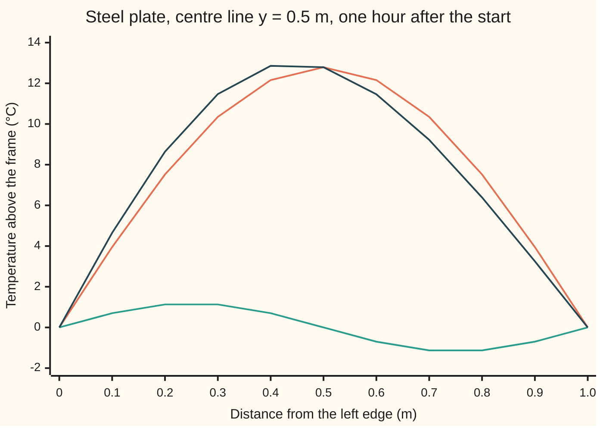

# Linear or not: when you may add two solutions together

[Syllabus](../../../SYLLABUS.md) → [Partial differential equations](../README.md) → [Classification and Well-Posedness](../README.md#s01) → Linear or not

---

## General Overview

A square steel plate, 1 m by 1 m and 1 cm thick, sits in a frame held at 20 °C. Its two faces are insulated, so heat leaves only through the edges. The unknown is the plate's temperature above the frame, u, in °C, at each point and time. The region is the square. The data are the edges (0 °C above the frame) and the starting temperatures.

Two starting profiles:

- **Profile A:** a weld left the middle warm, 30 °C above the frame at the centre.
- **Profile B:** a draught left the left half up to 10 °C above the frame and the right half up to 10 °C below it.

Watch one point, 25 cm in from the left edge on the centre line. One hour after Profile A starts alone, it reads 9.04 °C above the frame. Profile B alone reads 1.19 °C. Start the plate with both profiles at once, and one hour later it reads **10.23 °C: exactly the sum**.

Burgers' equation describes a cloud of dust in free flight: every grain keeps its own speed. Watch the spot 1 m from the starting line, 1 s after the clock starts. Two such flows move there at 0.5000 m/s and 0.6667 m/s. Add their starting speeds and run the flow: it moves at 0.7500 m/s there, not the 1.1667 m/s the sum predicts. Burgers refuses to add.

The ODE wing showed that solutions of a linear equation add and scale ([Superposition](../../08-Differential%20equations%20and%20dynamics/03-Oscillators%20-%20Second-Order%20Linear%20Equations/01-superposition-and-the-shape-of-linear-solutions.md)). This card asks which partial differential equations (PDEs) allow that, and grades the ones that do not.

**An equation lets you add solutions when the unknown and its derivatives appear only to the first power, times numbers or functions of position and time, with no source and zero edge data; the more the unknown creeps into the highest derivatives, the less survives, and the grades linear, semilinear, quasilinear and fully nonlinear measure how far it has crept.**

**What kind of fact this is:** superposition for linear equations is a theorem, proved in Why it works. The four grades are definitions. Burgers' failure is a counterexample, computed exactly on this card.

### The picture: the centre line after one hour



Orange: Profile A alone, a single hump. Teal: Profile B alone, warm on the left and cool on the right. Dark blue: the plate started with both, which is the orange and teal added point by point. 

---

## The formula

Notation first, in words. A subscript is a partial derivative, as in the ODE and PDE wings: $`u_t`$ is the rate of change in time, $`u_{xx}`$ the second rate along x.

An **operator** L is a machine that takes a whole function and returns another function. The plate's heat operator takes a temperature field u and returns its rate of change minus κ times its Laplacian (the sum of its second rates along x and along y):

```math
L[u] = u_t - \kappa\,(u_{xx} + u_{yy}).
```

The plate obeys $`L[u] = 0`$. L is **linear** when, for any two functions $`u_1`$, $`u_2`$ and any two numbers $`c_1`$, $`c_2`$,

```math
L[c_1 u_1 + c_2 u_2] = c_1\,L[u_1] + c_2\,L[u_2].
```

**Read it aloud:** the machine applied to a weighted sum gives the same weighted sum of its outputs.

**Superposition** is the consequence: if $`L[u_1] = 0`$ and $`L[u_2] = 0`$, and both are 0 on the edges, then $`c_1 u_1 + c_2 u_2`$ is a solution too, also 0 on the edges.

The plate's two profiles are

```math
u_A = 30\,\sin(\pi x)\,\sin(\pi y)\,e^{-2\pi^2\kappa t}, \qquad u_B = 10\,\sin(2\pi x)\,\sin(\pi y)\,e^{-5\pi^2\kappa t}.
```

Burgers' equation, with v a speed in m/s, is $`N[v] = v_t + v\,v_x = 0`$. Two of its solutions, and what goes wrong with their sum:

```math
v_1 = \frac{x}{1 + t}, \quad v_2 = \frac{x}{0.5 + t}, \qquad N[v_1 + v_2] = N[v_1] + N[v_2] + (v_1 v_2)_x .
```

**Read it aloud:** Burgers applied to a sum is the sum of the two results plus a cross term, the rate along x of the product of the two flows. That cross term is not zero.

**The four grades.** Write the independent variables as one point $`\mathbf{x} = (x_1, \dots, x_n)`$, time included: for the plate, n = 3 and the point is (x, y, t). The lists $`Du`$ and $`D^2u`$ hold all first and all second partial derivatives. For a second-order equation (highest derivatives of order 2):

```math
\begin{aligned} &\text{linear:} && \textstyle\sum_{i,j} a_{ij}(\mathbf{x})\,u_{x_i x_j} + \sum_i b_i(\mathbf{x})\,u_{x_i} + r(\mathbf{x})\,u = f(\mathbf{x}) \\ &\text{semilinear:} && \textstyle\sum_{i,j} a_{ij}(\mathbf{x})\,u_{x_i x_j} + g(\mathbf{x}, u, Du) = 0 \\ &\text{quasilinear:} && \textstyle\sum_{i,j} a_{ij}(\mathbf{x}, u, Du)\,u_{x_i x_j} + g(\mathbf{x}, u, Du) = 0 \\ &\text{fully nonlinear:} && F(\mathbf{x}, u, Du, D^2u) = 0, \text{ with } F \text{ not linear in } D^2u \end{aligned}
```

**Read it aloud:** linear lets the unknown in only to the first power everywhere; semilinear keeps the highest derivatives clean and lets the unknown loose in the rest; quasilinear lets the unknown into the coefficients of the highest derivatives; fully nonlinear lets the highest derivatives themselves be squared, multiplied or worse.

For a first-order equation the same grades apply one level down: the highest derivatives are $`Du`$, and the lower-order part depends on $`\mathbf{x}`$ and u only.

| Symbol | Plain meaning | In our example | Push it up and the answer… |
| --- | --- | --- | --- |
| $`u`$ | the unknown: here the plate's temperature above the frame, °C | 10.23 °C at (0.25 m, 0.5 m) after 1 h | — |
| $`x`$, $`y`$, $`t`$ | position on the plate (m) and time since the start (s) | (0.25 m, 0.5 m), 3600 s | later t: every profile fades toward 0 °C |
| $`\kappa`$, $`\Delta`$ | thermal diffusivity: how fast heat spreads, m²/s; Δ is the Laplacian, $`u_{xx} + u_{yy}`$ | κ = 1.2 × 10⁻⁵ m²/s (illustrative, typical of carbon steel) | the plate cools faster |
| $`L`$, $`N`$ | the heat operator (linear) and Burgers' operator (not) | $`L[u_A] = 0`$, $`N[v_1] = 0`$ | — |
| $`c_1`$, $`c_2`$ | the weights in a sum of solutions | 1 and 1 | the sum scales with them |
| $`u_A`$, $`u_B`$, $`u_p`$ | the two cooling profiles; $`u_p`$ is one forced solution (in the proof) | 9.04 °C and 1.19 °C at the point after 1 h | — |
| $`v`$, $`v_1`$, $`v_2`$ | Burgers' unknown, a speed in m/s, and two of its solutions | 0.5000 and 0.6667 m/s at (1 m, 1 s) | — |
| $`\mathbf{x}`$, $`n`$ | the whole point, time included, and how many variables it has | (x, y, t), n = 3 | — |
| $`Du`$, $`D^2u`$ | the lists of all first and all second partial derivatives | $`(u_x, u_y, u_t)`$ and $`(u_{xx}, u_{xy}, \dots)`$ | — |
| $`a_{ij}`$, $`b_i`$, $`r`$, $`f`$ | coefficients of the second derivatives, first derivatives and u, and the source | for the plate: −κ on $`u_{xx}`$ and $`u_{yy}`$, 1 on $`u_t`$, $`r = 0`$, $`f = 0`$ | a source f ≠ 0 breaks adding |
| $`g`$, $`\beta`$, $`\varepsilon`$ | the lower-order part: everything except the highest derivatives; β a radiation constant, ε a viscosity | $`v\,v_x`$ in viscous Burgers; $`\beta u^4`$ for a sheet radiating to cold space, with u in kelvin | — |
| $`F`$ | the whole equation, written as one function | $`u_x^2 + u_y^2 - 1`$ for the eikonal equation (u is the arrival time of a front moving at unit speed) | — |

### When it holds

- **The operator is linear in u.** Burgers' $`v\,v_x`$ multiplies the unknown by itself. Two flows that each solve it add to one that misses by 2/3 m/s² at (1 m, 1 s).
- **The equation is homogeneous: the source f is 0.** With a welding torch adding heat at rate f, two solutions add to a plate heated by 2f. The difference of two forced solutions is still free (a solution with no source), as in the ODE wing.
- **The edge data are 0 too.** Measure in whole °C, edges at 20 °C, and adding counts the frame twice. The point reads 50.23 °C instead of 30.23 °C ([Boundary conditions](03-boundary-conditions-dirichlet-neumann-and-robin.md)).
- **The model stays linear.** Steel's conductivity falls slowly as it heats. Over a few tens of degrees a constant κ fits; over hundreds the equation turns quasilinear and adding becomes an approximation.

---

## Why it works

### Step 0: derivatives respect sums and multiples

The rate of a sum is the sum of the rates, and the rate of 3 times a function is 3 times its rate. That holds for every partial derivative, of every order.

A coefficient that depends only on position and time is just a fixed number at each point. So any operator built from derivatives times such coefficients, then added up, is linear. That is the whole of linearity.

### Step 1: the plate's profiles add

Apply Step 0 to the heat operator:

```math
L[u_A + u_B] = L[u_A] + L[u_B] = 0 + 0 = 0.
```

The edges add too: 0 + 0 = 0. The starting temperatures add by construction. So $`u_A + u_B`$ solves the whole problem started from the summed profile.

Is it *the* solution, or one of several? The plate's problem has exactly one classical solution (one whose derivatives in the equation exist and are continuous). That is proved in [Energy methods](07-energy-methods-and-uniqueness.md). So the plate started with both profiles must follow $`u_A + u_B`$: 9.04 + 1.19 = 10.23 °C at the watched point.

A second road needs no formula. Step the plate forward on a grid, from the summed start, using only the heat equation's rule. At grid step 5 cm it reads 10.195 °C, and at 2.5 cm, 10.220 °C. The error shrinks by a factor of 4.0 when the step halves, closing on the exact 10.228 °C.

### Step 2: where Burgers breaks

Burgers' equation $`v_t + v\,v_x = 0`$ says each grain keeps its speed as it moves. The flow $`v_1 = x/(1 + t)`$ is a cloud that left x = 0 one second before the clock started: a grain at x has travelled for 1 + t seconds, so its speed is x/(1 + t). The flow $`v_2 = x/(0.5 + t)`$ left half a second before.

Put the sum into N. The time rates add, but the product does not:

```math
(v_1 + v_2)(v_1 + v_2)_x = v_1 v_{1,x} + v_2 v_{2,x} + \underbrace{v_1 v_{2,x} + v_2 v_{1,x}}_{(v_1 v_2)_x}.
```

Here $`v_{1,x}`$ is $`v_1`$'s rate along x. The first two terms belong to $`N[v_1]`$ and $`N[v_2]`$, which are 0. The cross term is left over. At (1 m, 1 s) it is $`2x / ((1 + t)(0.5 + t)) = 2/(2 \times 1.5) = 2/3`$ m/s².

The true flow from the summed start is easy to find. The starting speeds add to x + 2x = 3x, which is a cloud that left 1/3 s before the clock started. One second on, at 1 m, it moves at 3/(1 + 3) = 0.7500 m/s.

```
At x = 1 m, t = 1 s
cloud 1, v1                ██████████               0.5000 m/s
cloud 2, v2                █████████████            0.6667 m/s
v1 + v2, not a flow        ███████████████████████  1.1667 m/s
flow from the summed start ███████████████          0.7500 m/s
```

Scaling fails as well. Doubling the starting speeds gives the flow x/(0.5 + t), 0.6667 m/s at (1 m, 1 s). Doubling the answer instead gives 1.0000 m/s, and its residual is 0.5000 m/s².

### Step 3: the four grades, and what each keeps

Linearity is all or nothing, but its loss comes in steps. The grades ask one question: how close does the unknown get to the **highest derivatives** (the derivatives of top order in the equation)? Linear sits inside semilinear, which sits inside quasilinear; fully nonlinear is everything left over.

| Grade | Highest derivatives appear… | What it keeps | Example |
| --- | --- | --- | --- |
| Linear | times functions of position and time; everything else is linear too | superposition | the plate: $`u_t = \kappa\,\Delta u`$ |
| Semilinear | times functions of position and time only | the highest-order part, which fixes the family, is the same for every solution | a sheet radiating to cold space, u in kelvin: $`u_t = \kappa\,\Delta u - \beta u^4`$ |
| Quasilinear | to the first power, but their coefficients may contain u and Du | the highest derivatives appear to the first power, so freezing u and Du inside their coefficients leaves an equation that is linear in the highest derivatives | Burgers $`v_t + v\,v_x = 0`$; heat with conductivity that changes with temperature |
| Fully nonlinear | inside a nonlinear function: squared, multiplied together | only what linearising (taking the equation's best linear approximation) recovers | eikonal $`u_x^2 + u_y^2 = 1`$; Monge–Ampère $`u_{xx}u_{yy} - u_{xy}^2 = f`$, which fixes the product of the two main bends of the surface z = u |

The family (elliptic, parabolic or hyperbolic) is read from the highest derivatives alone ([Elliptic, parabolic, hyperbolic](04-classification-elliptic-parabolic-hyperbolic.md)). That is why the grades watch the top order. In a semilinear equation the family depends on position alone. In a quasilinear one it can change when the solution changes.

Two traps sit in this table. First, viscous Burgers, $`v_t + v\,v_x = \varepsilon\,v_{xx}`$ with a small viscosity ε, is **semilinear** despite its nonlinear term: its highest derivative is $`v_{xx}`$, with the constant coefficient ε, and $`v\,v_x`$ is lower order. Second, plain Burgers is not semilinear like its viscous cousin: drop the viscosity and $`v_x`$ becomes a highest derivative, so the same term makes it **quasilinear**.

### Step 4: grading by probing

The definitions turn into a test a computer can run. At one point, list the values of u and its derivatives: $`(u, u_x, u_y, u_{xx}, u_{xy}, u_{yy})`$. Call this list the **jet**. Write the equation as a function F of the jet, then:

1. If F minus its value at the zero jet is linear in the whole jet, the equation is linear.
2. Otherwise, freeze the lower entries and move only the highest ones. If F's change is not linear in them, it is fully nonlinear.
3. If it is linear, and its coefficients do not change when the lower entries change, it is semilinear.
4. Otherwise it is quasilinear.

The checks run it on eight equations, using three fixed jets and testing sums and triples. A finite probe can show that a grade fails, never prove that it holds; passing at three jets is evidence, so each grade is also read by hand from the definitions.

<details>
<summary>Detailed proof: superposition, the cross term and the nested grades</summary>

**Superposition.** Let $`L[u] = \sum_{i,j} a_{ij} u_{x_i x_j} + \sum_i b_i u_{x_i} + r u`$ with coefficients depending on $`\mathbf{x}`$ only. Every term is a coefficient times a derivative, and each derivative is linear. So

$`\displaystyle L[c_1 u_1 + c_2 u_2] = c_1 L[u_1] + c_2 L[u_2].`$

If $`L[u_1] = L[u_2] = 0`$ and both vanish on the boundary, then so does $`c_1 u_1 + c_2 u_2`$. The free solutions form a vector space ([Linear combinations and span](../../03-Algebra/03-Vectors/03-linear-combinations-and-span.md)). If $`L[u] = f`$ and $`L[u_p] = f`$, then $`L[u - u_p] = 0`$: every forced solution is one forced solution plus a free one.

**The cross term.** For $`N[v] = v_t + v v_x`$, expand with the product rule:

$`\displaystyle N[v_1 + v_2] = N[v_1] + N[v_2] + v_1 v_{2,x} + v_2 v_{1,x} = N[v_1] + N[v_2] + (v_1 v_2)_x.`$

With $`v_1 = x/(1+t)`$ and $`v_2 = x/(0.5+t)`$, $`v_1 v_2 = x^2/((1+t)(0.5+t))`$, so $`(v_1 v_2)_x = 2x/((1+t)(0.5+t))`$. That is 2/3 at x = 1, t = 1. It vanishes only where x = 0, so the sum fails almost everywhere.

**The nested grades.** A linear equation has $`a_{ij}`$ depending on $`\mathbf{x}`$ only and lower part $`g = \sum_i b_i u_{x_i} + r u - f`$: it is semilinear. A semilinear equation is quasilinear with coefficients that happen not to depend on u. A quasilinear equation is the general form $`F`$ with F linear in $`D^2u`$. Each step is strict: radiation is semilinear but not linear, conductivity that changes with temperature is quasilinear but not semilinear, and the eikonal and Monge–Ampère equations are not quasilinear.

</details>

---

## Worked numbers, by hand

The plate at (0.25 m, 0.5 m), one hour (3600 s) after the start, κ = 1.2 × 10⁻⁵ m²/s.

| Step | Arithmetic | Value |
| --- | --- | --- |
| A's position factor | $`\sin(\pi/4) \times \sin(\pi/2) = 0.7071 \times 1`$ | 0.7071 |
| A's decay exponent | $`2\pi^2 \times 1.2 \times 10^{-5} \times 3600`$ | 0.8527 |
| A's decay factor | $`e^{-0.8527}`$ | 0.4262 |
| $`u_A`$ | $`30 \times 0.7071 \times 0.4262`$ | 9.04 °C |
| B's position factor | $`\sin(\pi/2) \times \sin(\pi/2)`$ | 1 |
| B's decay exponent | $`5\pi^2 \times 1.2 \times 10^{-5} \times 3600`$ | 2.1318 |
| $`u_B`$ | $`10 \times 1 \times e^{-2.1318} = 10 \times 0.1186`$ | 1.19 °C |
| **plate started with both** | $`9.04 + 1.19`$ | **10.23 °C** |
| in whole degrees | $`20 + 10.23`$ | 30.23 °C |

One hour after the start, the watched point is 10.23 °C above the frame, 30.23 °C in all. Profile B has faded faster: its time constant (the time to fall by a factor e) is 1689 s, about 28.1 minutes, against A's 4222 s, about 70.4 minutes.

Burgers at x = 1 m, t = 1 s:

| Step | Arithmetic | Value |
| --- | --- | --- |
| $`v_1`$ | 1/(1 + 1) | 0.5000 m/s |
| $`v_2`$ | 1/(0.5 + 1) | 0.6667 m/s |
| sum of the answers | 0.5000 + 0.6667 | 1.1667 m/s |
| cross term $`(v_1 v_2)_x`$ | 2 × 1/(2 × 1.5) | 2/3 m/s² |
| **flow from the summed start** | 3 × 1/(1 + 3 × 1) | **0.7500 m/s** |

### What breaks if you drop a piece

| Mistake | Comes out at | What went wrong |
| --- | --- | --- |
| Add the two plate profiles in whole °C | 50.23 °C (right: 30.23 °C) | The frame's 20 °C is counted twice. The edge data must be 0 before solutions add. |
| Add two Burgers flows | 1.1667 m/s (right: 0.7500 m/s) | The cross term $`(v_1 v_2)_x`$, 2/3 m/s² here, is ignored. |
| Double a Burgers flow | 1.0000 m/s (right: 0.6667 m/s) | Scaling fails too; the doubled answer misses Burgers by 0.5000 m/s². |

---

## Code, from first principles, and it actually runs

The plate takes three roads: the closed forms; the residual (what is left after putting the sum into L) by centred differences, falling by 4.0 when the step halves; and an explicit grid inside its stability limit, landing within 0.01 °C. Burgers takes two: the residual of the sum against the exact cross term 2/3, and the true flow found by tracing each grain back along its path by bisection. Last, the probe test grades eight equations, each against the grade read by hand from the definitions.

### Python

```python
# Linear or not -- the check behind the card.  Standard library only.
# Plate: u_t = KAPPA (u_xx + u_yy) on a 1 m square, edges held at the frame's
# 20 C, u = temperature above the frame.  Burgers: u_t + u u_x = 0, u in m/s.
# Roads: closed forms; an explicit grid; residuals by centred differences;
# characteristics by bisection; a probe test that grades an equation.
from math import sin, pi, exp, gcd

KAPPA, HOUR, X0, Y0 = 1.2e-5, 3600.0, 0.25, 0.5  # m^2/s (illustrative), s, m, m

def mode(amp, m, n, x, y, t):                     # one cooling profile
    return amp * sin(m * pi * x) * sin(n * pi * y) * exp(-(m * m + n * n) * pi * pi * KAPPA * t)
def uA(x, y, t): return mode(30.0, 1, 1, x, y, t)  # warm middle, 30 C up
def uB(x, y, t): return mode(10.0, 2, 1, x, y, t)  # left half up, right half down
def uS(x, y, t): return uA(x, y, t) + uB(x, y, t)  # the sum

def heat_res(f, x, y, t, h, k):                   # u_t - KAPPA * Laplacian
    ut = (f(x, y, t + k) - f(x, y, t - k)) / (2 * k)
    lap = (f(x + h, y, t) + f(x - h, y, t) + f(x, y + h, t) + f(x, y - h, t) - 4 * f(x, y, t)) / h ** 2
    return ut - KAPPA * lap

def grid(n, dt):                                  # explicit scheme from the summed start
    h = 1.0 / n
    u = [[uS(i * h, j * h, 0.0) if 0 < i < n and 0 < j < n else 0.0 for j in range(n + 1)] for i in range(n + 1)]
    r = KAPPA * dt / h ** 2
    assert r <= 0.25                              # stability limit of the scheme
    for _ in range(round(HOUR / dt)):
        v = [row[:] for row in u]
        for i in range(1, n):
            for j in range(1, n):
                v[i][j] = u[i][j] + r * (u[i+1][j] + u[i-1][j] + u[i][j+1] + u[i][j-1] - 4 * u[i][j])
        u = v
    return u[round(X0 * n)][round(Y0 * n)]

a0, b0, a1, b1 = uA(X0, Y0, 0), uB(X0, Y0, 0), uA(X0, Y0, HOUR), uB(X0, Y0, HOUR)
s1 = a1 + b1
print(f"plate start at (0.25 m, 0.5 m): A {a0:.2f} C, B {b0:.2f} C, sum {a0 + b0:.2f} C")
print(f"plate after 1 h: A {a1:.2f} C, B {b1:.2f} C, sum {s1:.2f} C")
eA, eB = 2 * pi * pi * KAPPA * HOUR, 5 * pi * pi * KAPPA * HOUR
print(f"time constants: A {HOUR / eA:.0f} s ({HOUR / eA / 60:.1f} min), B {HOUR / eB:.0f} s ({HOUR / eB / 60:.1f} min)")
print(f"by hand: sin(pi/4) {sin(pi / 4):.4f}; exponents {eA:.4f} and {eB:.4f}; factors {exp(-eA):.4f} and {exp(-eB):.4f}")
ut = (uS(X0, Y0, HOUR + 10) - uS(X0, Y0, HOUR - 10)) / 20
print(f"rate of change of the sum after 1 h: {ut:.3e} C/s")
rs = [heat_res(uS, X0, Y0, HOUR, h, 10.0) for h in (0.02, 0.01)]
print(f"residual of the sum, h = 0.02 m and 0.01 m: {rs[0]:.1e} and {rs[1]:.1e} C/s, ratio {rs[0] / rs[1]:.1f}")
assert abs(rs[0]) < 1e-3 * abs(ut) and 3.5 < rs[0] / rs[1] < 4.5   # step error only: falls as h^2
g1, g2 = grid(20, 40.0), grid(40, 10.0)
print(f"grid from the summed start: h = 0.05 m {g1:.3f} C, h = 0.025 m {g2:.3f} C, exact {s1:.3f} C")
print(f"grid errors {g1 - s1:.4f} C and {g2 - s1:.4f} C, ratio {(g1 - s1) / (g2 - s1):.1f}")
assert abs(g1 - s1) < 0.05 and abs(g2 - s1) < 0.015
frame = (20 + a1) + (20 + b1)
print(f"mistake, add whole temperatures: {frame:.2f} C, right: {20 + s1:.2f} C")
def z(v): return 0.0 if abs(v) < 0.005 else v    # print a rounding speck at an edge as 0
for i in range(11):
    x = i / 10
    print(f"chart, x = {x:.1f} m, A {z(uA(x, Y0, HOUR)):.2f}, B {z(uB(x, Y0, HOUR)):.2f}, sum {z(uS(x, Y0, HOUR)):.2f}")

def v1(x, t): return x / (1 + t)                  # cloud that left x = 0 one second ago
def v2(x, t): return x / (0.5 + t)                # cloud that left half a second ago
def vS(x, t): return v1(x, t) + v2(x, t)
def burg_res(f, x, t, h):
    return (f(x, t + h) - f(x, t - h)) / (2 * h) + f(x, t) * (f(x + h, t) - f(x - h, t)) / (2 * h)
def charac(u0, x, t):                             # solve x = x0 + u0(x0) t by bisection
    lo, hi = -100.0, 100.0
    for _ in range(200):
        mid = (lo + hi) / 2
        if mid + u0(mid) * t < x: lo = mid
        else: hi = mid
    return u0((lo + hi) / 2)
print(f"Burgers flows at (1 m, 1 s): v1 {v1(1.0, 1.0):.4f} m/s, v2 {v2(1.0, 1.0):.4f} m/s")
xi, ti = 1, 1                                     # the point (1 m, 1 s), in whole units
cn, cd = 4 * xi, (1 + ti) * (1 + 2 * ti)          # (v1 v2)_x = 2x/((1+t)(0.5+t)) = 4x/((1+t)(1+2t))
for h in (1e-2, 1e-3):
    print(f"Burgers residual of v1 + v2 at (1 m, 1 s), h = {h}: {burg_res(vS, 1.0, 1.0, h):.4f} m/s^2")
    assert abs(burg_res(v1, 1.0, 1.0, h)) < 1e-4 and abs(burg_res(v2, 1.0, 1.0, h)) < 1e-4
    assert abs(burg_res(vS, 1.0, 1.0, h) - cn / cd) < 1e-3     # the sum's residual is the cross term
gg = gcd(cn, cd)
print(f"cross term (v1 v2)_x at (1 m, 1 s): {cn // gg}/{cd // gg} m/s^2")
true = charac(lambda x: 3 * x, 1.0, 1.0)
print(f"flow from the summed start at (1 m, 1 s): {true:.4f} m/s; v1 + v2 gives {vS(1.0, 1.0):.4f} m/s")
assert abs(true - 3 / (1 + 3 * 1.0)) < 1e-9
dbl = charac(lambda x: 2 * x, 1.0, 1.0)
print(f"flow from the doubled start: {dbl:.4f} m/s; 2 v1 gives {2 * v1(1.0, 1.0):.4f} m/s")
assert abs(dbl - 2 / (1 + 2 * 1.0)) < 1e-9
print(f"Burgers residual of 2 v1 at (1 m, 1 s): {burg_res(lambda x, t: 2 * v1(x, t), 1.0, 1.0, 1e-3):.4f} m/s^2")

# Grade by probing F(u, u_x, u_y, u_xx, u_xy, u_yy) at fixed jets; y is time in an evolution
# equation; constants are 1 (a grade depends on where u sits).  Order 1: top = (u_x, u_y).
EQS = [("heat u_t = u_xx", 2, lambda j: j[2] - j[3], "linear"),
       ("heat with a torch, source 5", 2, lambda j: j[2] - j[3] - 5, "linear"),
       ("heat with radiation u^4", 2, lambda j: j[2] - j[3] + j[0] ** 4, "semilinear"),
       ("viscous Burgers", 2, lambda j: j[2] + j[0] * j[1] - j[3], "semilinear"),
       ("conductivity 1 - u", 2, lambda j: j[2] - (1 - j[0]) * j[3] + j[1] ** 2, "quasilinear"),
       ("Burgers u_t + u u_x", 1, lambda j: j[2] + j[0] * j[1], "quasilinear"),
       ("eikonal u_x^2 + u_y^2 = 1", 1, lambda j: j[1] ** 2 + j[2] ** 2 - 1, "fully nonlinear"),
       ("Monge-Ampere u_xx u_yy - u_xy^2 = 1", 2, lambda j: j[3] * j[5] - j[4] ** 2 - 1, "fully nonlinear")]
P = [[1, 2, -1, 3, 1, -2], [-2, 1, 3, -1, 2, 1], [2, -3, 1, 1, -1, 2]]
def add(p, q): return [a + b for a, b in zip(p, q)]
def lin(G, ps):                                   # G additive and 3G(p) = G(3p)?
    return all(abs(G(add(p, q)) - G(p) - G(q)) < 1e-9 and abs(G([3 * a for a in p]) - 3 * G(p)) < 1e-9
               for p in ps for q in ps)
def grade(k, F):
    top = [1, 2] if k == 1 else [3, 4, 5]
    def split(L, T): return [T[i] if i in top else (L[i] if i < top[0] else 0) for i in range(6)]
    def D(L): return lambda T: F(split(L, T)) - F(split(L, [0] * 6))
    if lin(lambda j: F(j) - F([0] * 6), P): return "linear"
    if not all(lin(D(L), P) for L in P): return "fully nonlinear"
    same = all(abs(D(L)(T) - D(P[0])(T)) < 1e-9 for L in P for T in P)
    return "semilinear" if same else "quasilinear"
for name, k, F, want in EQS:
    g = grade(k, F)
    print(f"grade: {name}: {g}")
    assert g == want
print("ALL CHECKS PASS")
```

**Ran 2026-11-15 on macOS, Python 3.14.10, standard library only. All checks passed. Output, pasted from the run:**

```
plate start at (0.25 m, 0.5 m): A 21.21 C, B 10.00 C, sum 31.21 C
plate after 1 h: A 9.04 C, B 1.19 C, sum 10.23 C
time constants: A 4222 s (70.4 min), B 1689 s (28.1 min)
by hand: sin(pi/4) 0.7071; exponents 0.8527 and 2.1318; factors 0.4262 and 0.1186
rate of change of the sum after 1 h: -2.844e-03 C/s
residual of the sum, h = 0.02 m and 0.01 m: -1.5e-06 and -3.8e-07 C/s, ratio 4.0
grid from the summed start: h = 0.05 m 10.195 C, h = 0.025 m 10.220 C, exact 10.228 C
grid errors -0.0331 C and -0.0082 C, ratio 4.0
mistake, add whole temperatures: 50.23 C, right: 30.23 C
chart, x = 0.0 m, A 0.00, B 0.00, sum 0.00
chart, x = 0.1 m, A 3.95, B 0.70, sum 4.65
chart, x = 0.2 m, A 7.52, B 1.13, sum 8.64
chart, x = 0.3 m, A 10.35, B 1.13, sum 11.47
chart, x = 0.4 m, A 12.16, B 0.70, sum 12.86
chart, x = 0.5 m, A 12.79, B 0.00, sum 12.79
chart, x = 0.6 m, A 12.16, B -0.70, sum 11.46
chart, x = 0.7 m, A 10.35, B -1.13, sum 9.22
chart, x = 0.8 m, A 7.52, B -1.13, sum 6.39
chart, x = 0.9 m, A 3.95, B -0.70, sum 3.25
chart, x = 1.0 m, A 0.00, B 0.00, sum 0.00
Burgers flows at (1 m, 1 s): v1 0.5000 m/s, v2 0.6667 m/s
Burgers residual of v1 + v2 at (1 m, 1 s), h = 0.01: 0.6666 m/s^2
Burgers residual of v1 + v2 at (1 m, 1 s), h = 0.001: 0.6667 m/s^2
cross term (v1 v2)_x at (1 m, 1 s): 2/3 m/s^2
flow from the summed start at (1 m, 1 s): 0.7500 m/s; v1 + v2 gives 1.1667 m/s
flow from the doubled start: 0.6667 m/s; 2 v1 gives 1.0000 m/s
Burgers residual of 2 v1 at (1 m, 1 s): 0.5000 m/s^2
grade: heat u_t = u_xx: linear
grade: heat with a torch, source 5: linear
grade: heat with radiation u^4: semilinear
grade: viscous Burgers: semilinear
grade: conductivity 1 - u: quasilinear
grade: Burgers u_t + u u_x: quasilinear
grade: eikonal u_x^2 + u_y^2 = 1: fully nonlinear
grade: Monge-Ampere u_xx u_yy - u_xy^2 = 1: fully nonlinear
ALL CHECKS PASS
```

### Rust

Same numbers, same labels, built with `rustc --edition 2021 -O`.

```rust
// Linear or not -- the same check as the Python, in Rust, std only.
// Plate: u_t = KAPPA (u_xx + u_yy) on a 1 m square, edges held at the frame's
// 20 C, u = temperature above the frame.  Burgers: u_t + u u_x = 0, u in m/s.
// Roads: closed forms; an explicit grid; residuals by centred differences;
// characteristics by bisection; a probe test that grades an equation.
use std::f64::consts::PI;

const KAPPA: f64 = 1.2e-5; // m^2/s (illustrative)
const HOUR: f64 = 3600.0;
const X0: f64 = 0.25;
const Y0: f64 = 0.5;

fn mode(amp: f64, m: f64, n: f64, x: f64, y: f64, t: f64) -> f64 {
    amp * (m * PI * x).sin() * (n * PI * y).sin() * (-(m * m + n * n) * PI * PI * KAPPA * t).exp()
}
fn ua(x: f64, y: f64, t: f64) -> f64 { mode(30.0, 1.0, 1.0, x, y, t) } // warm middle, 30 C up
fn ub(x: f64, y: f64, t: f64) -> f64 { mode(10.0, 2.0, 1.0, x, y, t) } // left half up, right half down
fn us(x: f64, y: f64, t: f64) -> f64 { ua(x, y, t) + ub(x, y, t) } // the sum

fn heat_res(f: fn(f64, f64, f64) -> f64, x: f64, y: f64, t: f64, h: f64, k: f64) -> f64 {
    let ut = (f(x, y, t + k) - f(x, y, t - k)) / (2.0 * k);
    let lap = (f(x + h, y, t) + f(x - h, y, t) + f(x, y + h, t) + f(x, y - h, t) - 4.0 * f(x, y, t)) / h.powi(2);
    ut - KAPPA * lap
}

fn grid(n: usize, dt: f64) -> f64 { // explicit scheme from the summed start
    let h = 1.0 / n as f64;
    let mut u = vec![vec![0.0; n + 1]; n + 1];
    for i in 1..n { for j in 1..n { u[i][j] = us(i as f64 * h, j as f64 * h, 0.0); } }
    let r = KAPPA * dt / h.powi(2);
    assert!(r <= 0.25); // stability limit of the scheme
    for _ in 0..(HOUR / dt).round() as usize {
        let mut v = u.clone();
        for i in 1..n {
            for j in 1..n {
                v[i][j] = u[i][j] + r * (u[i + 1][j] + u[i - 1][j] + u[i][j + 1] + u[i][j - 1] - 4.0 * u[i][j]);
            }
        }
        u = v;
    }
    u[(X0 * n as f64).round() as usize][(Y0 * n as f64).round() as usize]
}

fn sci(v: f64, d: usize) -> String { // Python's e-format: two-digit exponent
    let s = format!("{:.*e}", d, v);
    let (m, e) = s.split_at(s.find('e').unwrap());
    let e: i32 = e[1..].parse().unwrap();
    format!("{}e{}{:02}", m, if e < 0 { '-' } else { '+' }, e.abs())
}
fn gcd(a: i64, b: i64) -> i64 { if b == 0 { a } else { gcd(b, a % b) } }
fn z(v: f64) -> f64 { if v.abs() < 0.005 { 0.0 } else { v } } // print a rounding speck at an edge as 0

fn v1(x: f64, t: f64) -> f64 { x / (1.0 + t) } // cloud that left x = 0 one second ago
fn v2(x: f64, t: f64) -> f64 { x / (0.5 + t) } // cloud that left half a second ago
fn vs(x: f64, t: f64) -> f64 { v1(x, t) + v2(x, t) }
fn v1x2(x: f64, t: f64) -> f64 { 2.0 * v1(x, t) }
fn burg_res(f: fn(f64, f64) -> f64, x: f64, t: f64, h: f64) -> f64 {
    (f(x, t + h) - f(x, t - h)) / (2.0 * h) + f(x, t) * (f(x + h, t) - f(x - h, t)) / (2.0 * h)
}
fn charac(u0: &dyn Fn(f64) -> f64, x: f64, t: f64) -> f64 { // solve x = x0 + u0(x0) t by bisection
    let (mut lo, mut hi) = (-100.0, 100.0);
    for _ in 0..200 {
        let mid = (lo + hi) / 2.0;
        if mid + u0(mid) * t < x { lo = mid } else { hi = mid }
    }
    u0((lo + hi) / 2.0)
}

// Grade by probing F(u, u_x, u_y, u_xx, u_xy, u_yy) at fixed jets; y is time in an evolution
// equation; constants are 1 (a grade depends on where u sits).  Order 1: top = (u_x, u_y).
type Op = fn(&[f64; 6]) -> f64;
const P: [[f64; 6]; 3] = [[1.0, 2.0, -1.0, 3.0, 1.0, -2.0], [-2.0, 1.0, 3.0, -1.0, 2.0, 1.0], [2.0, -3.0, 1.0, 1.0, -1.0, 2.0]];
fn lin(g: &dyn Fn(&[f64; 6]) -> f64) -> bool { // g additive and 3g(p) = g(3p)?
    P.iter().all(|p| P.iter().all(|q| {
        let mut s = [0.0; 6];
        let mut t = [0.0; 6];
        for i in 0..6 { s[i] = p[i] + q[i]; t[i] = 3.0 * p[i]; }
        (g(&s) - g(p) - g(q)).abs() < 1e-9 && (g(&t) - 3.0 * g(p)).abs() < 1e-9
    }))
}
fn grade(k: usize, f: Op) -> &'static str {
    let top: Vec<usize> = if k == 1 { vec![1, 2] } else { vec![3, 4, 5] };
    let split = |l: &[f64; 6], t: &[f64; 6]| {
        let mut j = [0.0; 6];
        for i in 0..6 { j[i] = if top.contains(&i) { t[i] } else if i < top[0] { l[i] } else { 0.0 }; }
        j
    };
    let d = |l: &[f64; 6], t: &[f64; 6]| f(&split(l, t)) - f(&split(l, &[0.0; 6]));
    if lin(&|j| f(j) - f(&[0.0; 6])) { return "linear"; }
    if !P.iter().all(|l| lin(&|t| d(l, t))) { return "fully nonlinear"; }
    let same = P.iter().all(|l| P.iter().all(|t| (d(l, t) - d(&P[0], t)).abs() < 1e-9));
    if same { "semilinear" } else { "quasilinear" }
}

fn main() {
    let (a0, b0, a1, b1) = (ua(X0, Y0, 0.0), ub(X0, Y0, 0.0), ua(X0, Y0, HOUR), ub(X0, Y0, HOUR));
    let s1 = a1 + b1;
    println!("plate start at (0.25 m, 0.5 m): A {:.2} C, B {:.2} C, sum {:.2} C", a0, b0, a0 + b0);
    println!("plate after 1 h: A {:.2} C, B {:.2} C, sum {:.2} C", a1, b1, s1);
    let (ea, eb) = (2.0 * PI * PI * KAPPA * HOUR, 5.0 * PI * PI * KAPPA * HOUR);
    println!("time constants: A {:.0} s ({:.1} min), B {:.0} s ({:.1} min)", HOUR / ea, HOUR / ea / 60.0, HOUR / eb, HOUR / eb / 60.0);
    println!("by hand: sin(pi/4) {:.4}; exponents {:.4} and {:.4}; factors {:.4} and {:.4}", (PI / 4.0).sin(), ea, eb, (-ea).exp(), (-eb).exp());
    let ut = (us(X0, Y0, HOUR + 10.0) - us(X0, Y0, HOUR - 10.0)) / 20.0;
    println!("rate of change of the sum after 1 h: {} C/s", sci(ut, 3));
    let rs = [heat_res(us, X0, Y0, HOUR, 0.02, 10.0), heat_res(us, X0, Y0, HOUR, 0.01, 10.0)];
    println!("residual of the sum, h = 0.02 m and 0.01 m: {} and {} C/s, ratio {:.1}", sci(rs[0], 1), sci(rs[1], 1), rs[0] / rs[1]);
    assert!(rs[0].abs() < 1e-3 * ut.abs() && 3.5 < rs[0] / rs[1] && rs[0] / rs[1] < 4.5); // step error only: falls as h^2
    let (g1, g2) = (grid(20, 40.0), grid(40, 10.0));
    println!("grid from the summed start: h = 0.05 m {:.3} C, h = 0.025 m {:.3} C, exact {:.3} C", g1, g2, s1);
    println!("grid errors {:.4} C and {:.4} C, ratio {:.1}", g1 - s1, g2 - s1, (g1 - s1) / (g2 - s1));
    assert!((g1 - s1).abs() < 0.05 && (g2 - s1).abs() < 0.015);
    let frame = (20.0 + a1) + (20.0 + b1);
    println!("mistake, add whole temperatures: {:.2} C, right: {:.2} C", frame, 20.0 + s1);
    for i in 0..11 {
        let x = i as f64 / 10.0;
        println!("chart, x = {:.1} m, A {:.2}, B {:.2}, sum {:.2}", x, z(ua(x, Y0, HOUR)), z(ub(x, Y0, HOUR)), z(us(x, Y0, HOUR)));
    }

    println!("Burgers flows at (1 m, 1 s): v1 {:.4} m/s, v2 {:.4} m/s", v1(1.0, 1.0), v2(1.0, 1.0));
    let (xi, ti): (i64, i64) = (1, 1); // the point (1 m, 1 s), in whole units
    let (cn, cd) = (4 * xi, (1 + ti) * (1 + 2 * ti)); // (v1 v2)_x = 2x/((1+t)(0.5+t)) = 4x/((1+t)(1+2t))
    for h in [1e-2, 1e-3] {
        println!("Burgers residual of v1 + v2 at (1 m, 1 s), h = {}: {:.4} m/s^2", h, burg_res(vs, 1.0, 1.0, h));
        assert!(burg_res(v1, 1.0, 1.0, h).abs() < 1e-4 && burg_res(v2, 1.0, 1.0, h).abs() < 1e-4);
        assert!((burg_res(vs, 1.0, 1.0, h) - cn as f64 / cd as f64).abs() < 1e-3); // the sum's residual is the cross term
    }
    let gg = gcd(cn, cd);
    println!("cross term (v1 v2)_x at (1 m, 1 s): {}/{} m/s^2", cn / gg, cd / gg);
    let truth = charac(&|x| 3.0 * x, 1.0, 1.0);
    println!("flow from the summed start at (1 m, 1 s): {:.4} m/s; v1 + v2 gives {:.4} m/s", truth, vs(1.0, 1.0));
    assert!((truth - 3.0 / (1.0 + 3.0 * 1.0)).abs() < 1e-9);
    let dbl = charac(&|x| 2.0 * x, 1.0, 1.0);
    println!("flow from the doubled start: {:.4} m/s; 2 v1 gives {:.4} m/s", dbl, 2.0 * v1(1.0, 1.0));
    assert!((dbl - 2.0 / (1.0 + 2.0 * 1.0)).abs() < 1e-9);
    println!("Burgers residual of 2 v1 at (1 m, 1 s): {:.4} m/s^2", burg_res(v1x2, 1.0, 1.0, 1e-3));

    let eqs: [(&str, usize, Op, &str); 8] = [
        ("heat u_t = u_xx", 2, |j| j[2] - j[3], "linear"),
        ("heat with a torch, source 5", 2, |j| j[2] - j[3] - 5.0, "linear"),
        ("heat with radiation u^4", 2, |j| j[2] - j[3] + j[0].powi(4), "semilinear"),
        ("viscous Burgers", 2, |j| j[2] + j[0] * j[1] - j[3], "semilinear"),
        ("conductivity 1 - u", 2, |j| j[2] - (1.0 - j[0]) * j[3] + j[1].powi(2), "quasilinear"),
        ("Burgers u_t + u u_x", 1, |j| j[2] + j[0] * j[1], "quasilinear"),
        ("eikonal u_x^2 + u_y^2 = 1", 1, |j| j[1].powi(2) + j[2].powi(2) - 1.0, "fully nonlinear"),
        ("Monge-Ampere u_xx u_yy - u_xy^2 = 1", 2, |j| j[3] * j[5] - j[4].powi(2) - 1.0, "fully nonlinear"),
    ];
    for (name, k, f, want) in eqs {
        let g = grade(k, f);
        println!("grade: {}: {}", name, g);
        assert_eq!(g, want);
    }
    println!("ALL CHECKS PASS");
}
```

**Ran 2026-11-15 on macOS, rustc 1.98.1, no crates. All checks passed. Output, pasted from the run:**

```
plate start at (0.25 m, 0.5 m): A 21.21 C, B 10.00 C, sum 31.21 C
plate after 1 h: A 9.04 C, B 1.19 C, sum 10.23 C
time constants: A 4222 s (70.4 min), B 1689 s (28.1 min)
by hand: sin(pi/4) 0.7071; exponents 0.8527 and 2.1318; factors 0.4262 and 0.1186
rate of change of the sum after 1 h: -2.844e-03 C/s
residual of the sum, h = 0.02 m and 0.01 m: -1.5e-06 and -3.8e-07 C/s, ratio 4.0
grid from the summed start: h = 0.05 m 10.195 C, h = 0.025 m 10.220 C, exact 10.228 C
grid errors -0.0331 C and -0.0082 C, ratio 4.0
mistake, add whole temperatures: 50.23 C, right: 30.23 C
chart, x = 0.0 m, A 0.00, B 0.00, sum 0.00
chart, x = 0.1 m, A 3.95, B 0.70, sum 4.65
chart, x = 0.2 m, A 7.52, B 1.13, sum 8.64
chart, x = 0.3 m, A 10.35, B 1.13, sum 11.47
chart, x = 0.4 m, A 12.16, B 0.70, sum 12.86
chart, x = 0.5 m, A 12.79, B 0.00, sum 12.79
chart, x = 0.6 m, A 12.16, B -0.70, sum 11.46
chart, x = 0.7 m, A 10.35, B -1.13, sum 9.22
chart, x = 0.8 m, A 7.52, B -1.13, sum 6.39
chart, x = 0.9 m, A 3.95, B -0.70, sum 3.25
chart, x = 1.0 m, A 0.00, B 0.00, sum 0.00
Burgers flows at (1 m, 1 s): v1 0.5000 m/s, v2 0.6667 m/s
Burgers residual of v1 + v2 at (1 m, 1 s), h = 0.01: 0.6666 m/s^2
Burgers residual of v1 + v2 at (1 m, 1 s), h = 0.001: 0.6667 m/s^2
cross term (v1 v2)_x at (1 m, 1 s): 2/3 m/s^2
flow from the summed start at (1 m, 1 s): 0.7500 m/s; v1 + v2 gives 1.1667 m/s
flow from the doubled start: 0.6667 m/s; 2 v1 gives 1.0000 m/s
Burgers residual of 2 v1 at (1 m, 1 s): 0.5000 m/s^2
grade: heat u_t = u_xx: linear
grade: heat with a torch, source 5: linear
grade: heat with radiation u^4: semilinear
grade: viscous Burgers: semilinear
grade: conductivity 1 - u: quasilinear
grade: Burgers u_t + u u_x: quasilinear
grade: eikonal u_x^2 + u_y^2 = 1: fully nonlinear
grade: Monge-Ampere u_xx u_yy - u_xy^2 = 1: fully nonlinear
ALL CHECKS PASS
```

### Lean

Lean proves superposition for any linear second-order operator with coefficients in position and time only, the Burgers cross term, and the Burgers numbers.

- Suppose L is such an operator, and $`u_1`$, $`u_2`$ are classical solutions of $`L[u] = 0`$ on an open region. Then so is $`c_1 u_1 + c_2 u_2`$, for any numbers $`c_1`$ and $`c_2`$.
- Suppose both are also 0 on the region's edges. Then so is the weighted sum.
- Take any two flows $`v_1`$, $`v_2`$ with rates along x and in time at a point. Then $`N[v_1 + v_2] = N[v_1] + N[v_2] + (v_1 v_2)_x`$ there.
- Take $`v_1 = x/(1 + t)`$ and $`v_2 = x/(0.5 + t)`$. Then both solve Burgers' equation at every position, for every time after −0.5 s.
- Their sum misses Burgers' equation by exactly 2/3 m/s² at (1 m, 1 s).
- Take the flow $`3x/(1 + 3t)`$, which starts at $`3x`$, the summed start. Then it solves Burgers' equation for every time after −1/3 s. At (1 m, 1 s) it moves at 3/4 m/s, not the 7/6 m/s the sum predicts.
- The worked Burgers numbers at (1 m, 1 s) hold as exact fractions.

The plate's numbers, the grid, the probe test and the decimals are left to the Python and Rust checks.

```lean
-- Linear or not: for a linear second-order operator with coefficients depending only on position and time, any weighted sum of two classical solutions that vanish on the edge is again such a solution, while for Burgers' equation the sum misses by the cross term (v₁v₂)ₓ, 2/3 at (1 m, 1 s).
import Mathlib.Analysis.Calculus.FDeriv.Add
import Mathlib.Analysis.Calculus.FDeriv.Mul
import Mathlib.Analysis.Calculus.ContDiff.Operations
import Mathlib.Analysis.Calculus.Deriv.Mul
import Mathlib.Analysis.Calculus.Deriv.Add
import Mathlib.Topology.Basic
import Mathlib.Tactic.NormNum
import Mathlib.Analysis.Calculus.Deriv.Inv
import Mathlib.Tactic.LinearCombination
import Mathlib.Tactic.FieldSimp

namespace LinearNonlinearSuperposition

open Finset

variable {n : ℕ}

/-! A point `x : Fin n → ℝ` lists all `n` variables, time included (for the plate,
`(x, y, t)` and `n = 3`). `pd i u x` is the partial derivative of `u` along the `i`-th
variable at `x`. -/

/-- The partial derivative `u_{x_i}` of `u` at `x`: the derivative of `u` along the `i`-th
coordinate direction. -/
noncomputable def pd (i : Fin n) (u : (Fin n → ℝ) → ℝ) (x : Fin n → ℝ) : ℝ :=
  fderiv ℝ u x (Pi.single i 1)

/-- The card's general linear second-order operator
`L[u] = ∑ᵢⱼ a_ij u_{x_i x_j} + ∑ᵢ b_i u_{x_i} + r u`,
whose coefficients `a_ij`, `b_i`, `r` depend on the point `x` (position and time) only. -/
noncomputable def L (a : Fin n → Fin n → (Fin n → ℝ) → ℝ) (b : Fin n → (Fin n → ℝ) → ℝ)
    (r : (Fin n → ℝ) → ℝ) (u : (Fin n → ℝ) → ℝ) (x : Fin n → ℝ) : ℝ :=
  ∑ i, ∑ j, a i j x * pd i (pd j u) x + ∑ i, b i x * pd i u x + r x * u x

/-- Helper: the partial derivative is linear on functions differentiable at the point. -/
theorem pd_lin (i : Fin n) (u₁ u₂ : (Fin n → ℝ) → ℝ) (c₁ c₂ : ℝ) (x : Fin n → ℝ)
    (h₁ : DifferentiableAt ℝ u₁ x) (h₂ : DifferentiableAt ℝ u₂ x) :
    pd i (fun y => c₁ * u₁ y + c₂ * u₂ y) x = c₁ * pd i u₁ x + c₂ * pd i u₂ x := by
  unfold pd
  have hd : HasFDerivAt (fun y => c₁ * u₁ y + c₂ * u₂ y)
      (c₁ • fderiv ℝ u₁ x + c₂ • fderiv ℝ u₂ x) x :=
    (h₁.hasFDerivAt.const_mul c₁).add (h₂.hasFDerivAt.const_mul c₂)
  rw [hd.fderiv]
  simp

/-- Helper: a first partial derivative of a `C²` function on an open set is differentiable
at every point of the set. -/
theorem pd_differentiableAt (j : Fin n) (Ω : Set (Fin n → ℝ)) (hΩ : IsOpen Ω)
    (u : (Fin n → ℝ) → ℝ) (h : ContDiffOn ℝ 2 u Ω) (x : Fin n → ℝ) (hx : x ∈ Ω) :
    DifferentiableAt ℝ (pd j u) x := by
  have h1 : ContDiffOn ℝ 1 (fun y => fderiv ℝ u y) Ω :=
    h.fderiv_of_isOpen hΩ (by norm_num)
  have h2 : ContDiffOn ℝ 1 (fun y => fderiv ℝ u y (Pi.single j 1)) Ω :=
    h1.clm_apply contDiffOn_const
  exact (h2.differentiableOn (by norm_num)).differentiableAt (hΩ.mem_nhds hx)

/-- Helper: a `C²` function on an open set is differentiable at every point of the set. -/
theorem differentiableAt_of_C2 (Ω : Set (Fin n → ℝ)) (hΩ : IsOpen Ω)
    (u : (Fin n → ℝ) → ℝ) (h : ContDiffOn ℝ 2 u Ω) (x : Fin n → ℝ) (hx : x ∈ Ω) :
    DifferentiableAt ℝ u x :=
  (h.differentiableOn (by norm_num)).differentiableAt (hΩ.mem_nhds hx)

/-- Superposition. Let `L` be the linear second-order operator above, with coefficients that
depend on position and time only, no source (the equation is `L[u] = 0`), and zero edge data.
If `u₁` and `u₂` are classical solutions on an open region `Ω` (twice continuously
differentiable there, with `L[u] = 0` at every point of `Ω`) and both are 0 on the edge
`∂Ω`, then for any numbers `c₁`, `c₂` the weighted sum `c₁ u₁ + c₂ u₂` is again a classical
solution on `Ω` and is again 0 on the edge. -/
theorem superposition_of_linear_homogeneous
    (a : Fin n → Fin n → (Fin n → ℝ) → ℝ) (b : Fin n → (Fin n → ℝ) → ℝ)
    (r : (Fin n → ℝ) → ℝ) (Ω : Set (Fin n → ℝ)) (hΩ : IsOpen Ω)
    (u₁ u₂ : (Fin n → ℝ) → ℝ) (c₁ c₂ : ℝ)
    (h₁ : ContDiffOn ℝ 2 u₁ Ω) (h₂ : ContDiffOn ℝ 2 u₂ Ω)
    (hL₁ : ∀ x ∈ Ω, L a b r u₁ x = 0) (hL₂ : ∀ x ∈ Ω, L a b r u₂ x = 0)
    (hb₁ : ∀ x ∈ frontier Ω, u₁ x = 0) (hb₂ : ∀ x ∈ frontier Ω, u₂ x = 0) :
    ContDiffOn ℝ 2 (fun x => c₁ * u₁ x + c₂ * u₂ x) Ω ∧
      (∀ x ∈ Ω, L a b r (fun x => c₁ * u₁ x + c₂ * u₂ x) x = 0) ∧
      ∀ x ∈ frontier Ω, c₁ * u₁ x + c₂ * u₂ x = 0 := by
  refine ⟨?_, ?_, ?_⟩
  · exact (contDiffOn_const.mul h₁).add (contDiffOn_const.mul h₂)
  · intro x hx
    have hpd : ∀ i j, pd i (pd j (fun x => c₁ * u₁ x + c₂ * u₂ x)) x =
        c₁ * pd i (pd j u₁) x + c₂ * pd i (pd j u₂) x := by
      intro i j
      have hev : pd j (fun x => c₁ * u₁ x + c₂ * u₂ x) =ᶠ[nhds x]
          fun y => c₁ * pd j u₁ y + c₂ * pd j u₂ y := by
        filter_upwards [hΩ.mem_nhds hx] with y hy
        exact pd_lin j u₁ u₂ c₁ c₂ y (differentiableAt_of_C2 Ω hΩ u₁ h₁ y hy)
          (differentiableAt_of_C2 Ω hΩ u₂ h₂ y hy)
      have : pd i (pd j (fun x => c₁ * u₁ x + c₂ * u₂ x)) x =
          pd i (fun y => c₁ * pd j u₁ y + c₂ * pd j u₂ y) x := by
        unfold pd at hev ⊢
        rw [hev.fderiv_eq]
      rw [this]
      exact pd_lin i _ _ c₁ c₂ x (pd_differentiableAt j Ω hΩ u₁ h₁ x hx)
        (pd_differentiableAt j Ω hΩ u₂ h₂ x hx)
    have hp1 : ∀ i, pd i (fun x => c₁ * u₁ x + c₂ * u₂ x) x =
        c₁ * pd i u₁ x + c₂ * pd i u₂ x := fun i =>
      pd_lin i u₁ u₂ c₁ c₂ x (differentiableAt_of_C2 Ω hΩ u₁ h₁ x hx)
        (differentiableAt_of_C2 Ω hΩ u₂ h₂ x hx)
    have e1 := hL₁ x hx
    have e2 := hL₂ x hx
    unfold L at e1 e2 ⊢
    simp only [hpd, hp1]
    have k1 : ∀ i j, a i j x * (c₁ * pd i (pd j u₁) x + c₂ * pd i (pd j u₂) x) =
        c₁ * (a i j x * pd i (pd j u₁) x) + c₂ * (a i j x * pd i (pd j u₂) x) := by
      intros; ring
    have k2 : ∀ i, b i x * (c₁ * pd i u₁ x + c₂ * pd i u₂ x) =
        c₁ * (b i x * pd i u₁ x) + c₂ * (b i x * pd i u₂ x) := by
      intros; ring
    simp only [k1, k2, Finset.sum_add_distrib, ← Finset.mul_sum]
    linear_combination c₁ * e1 + c₂ * e2
  · intro x hx
    rw [hb₁ x hx, hb₂ x hx]
    ring

/-! Burgers' equation: `v x t` is a speed in m/s at position `x` and time `t`, and
`N[v] = v_t + v v_x`. -/

/-- Burgers' operator `N[v] = v_t + v v_x` at the point `(x, t)`. -/
noncomputable def burgers (v : ℝ → ℝ → ℝ) (x t : ℝ) : ℝ :=
  deriv (fun s => v x s) t + v x t * deriv (fun y => v y t) x

/-- The cross term. For any two flows `v₁`, `v₂` with first derivatives in `x` and `t` at
`(x, t)`, Burgers applied to the sum is the sum of the two results plus the cross term
`(v₁ v₂)_x`: `N[v₁ + v₂] = N[v₁] + N[v₂] + (v₁ v₂)_x`. -/
theorem burgers_add_eq_add_add_cross_term (v₁ v₂ : ℝ → ℝ → ℝ) (x t : ℝ)
    (h₁t : DifferentiableAt ℝ (fun s => v₁ x s) t) (h₂t : DifferentiableAt ℝ (fun s => v₂ x s) t)
    (h₁x : DifferentiableAt ℝ (fun y => v₁ y t) x) (h₂x : DifferentiableAt ℝ (fun y => v₂ y t) x) :
    burgers (fun y s => v₁ y s + v₂ y s) x t =
      burgers v₁ x t + burgers v₂ x t + deriv (fun y => v₁ y t * v₂ y t) x := by
  simp only [burgers]
  have d1 : HasDerivAt (fun s => v₁ x s + v₂ x s)
      (deriv (fun s => v₁ x s) t + deriv (fun s => v₂ x s) t) t :=
    h₁t.hasDerivAt.add h₂t.hasDerivAt
  have d2 : HasDerivAt (fun y => v₁ y t + v₂ y t)
      (deriv (fun y => v₁ y t) x + deriv (fun y => v₂ y t) x) x :=
    h₁x.hasDerivAt.add h₂x.hasDerivAt
  have d3 : HasDerivAt (fun y => v₁ y t * v₂ y t)
      (deriv (fun y => v₁ y t) x * v₂ x t + v₁ x t * deriv (fun y => v₂ y t) x) x :=
    h₁x.hasDerivAt.mul h₂x.hasDerivAt
  rw [d1.deriv, d2.deriv, d3.deriv]
  ring

/-- Burgers refuses to add. The clouds `v₁ = x/(1 + t)` and `v₂ = x/(1/2 + t)` both solve
Burgers' equation at every position for every time `t > -1/2`, yet their sum misses it by
`2/3` m/s² at `(1 m, 1 s)`. The flow `w = 3x/(1 + 3t)` from the summed start (`w = v₁ + v₂`
at `t = 0`) does solve it, and at `(1 m, 1 s)` it moves at `3/4` m/s, not the `7/6` m/s that
`v₁ + v₂` predicts. -/
theorem burgers_refuses_to_add :
    (∀ x t : ℝ, -1/2 < t → burgers (fun y s => y / (1 + s)) x t = 0) ∧
    (∀ x t : ℝ, -1/2 < t → burgers (fun y s => y / (1/2 + s)) x t = 0) ∧
    burgers (fun y s => y / (1 + s) + y / (1/2 + s)) 1 1 = 2/3 ∧
    (∀ x t : ℝ, -1/3 < t → burgers (fun y s => 3 * y / (1 + 3 * s)) x t = 0) ∧
    (∀ x : ℝ, 3 * x / (1 + 3 * 0) = x / (1 + 0) + x / (1/2 + 0)) ∧
    (3 * 1 / (1 + 3 * 1) : ℝ) = 3/4 ∧ (1 / (1 + 1) + 1 / (1/2 + 1) : ℝ) = 7/6 := by
  have ds : ∀ (a c t : ℝ), c + t ≠ 0 → deriv (fun s => a / (c + s)) t = -a / (c + t) ^ 2 := by
    intro a c t h
    have hd : HasDerivAt (fun s => a / (c + s)) ((0 * (c + t) - a * 1) / (c + t) ^ 2) t :=
      (hasDerivAt_const t a).div ((hasDerivAt_id t).const_add c) h
    rw [hd.deriv]
    ring
  have dy : ∀ (c x : ℝ), deriv (fun y => y / c) x = 1 / c := by
    intro c x
    simp
  have one : ∀ c x t : ℝ, c + t ≠ 0 → burgers (fun y s => y / (c + s)) x t = 0 := by
    intro c x t h
    simp only [burgers]
    rw [ds x c t h, dy]
    field_simp
    ring
  refine ⟨fun x t ht => one 1 x t (by linarith), fun x t ht => one (1/2) x t (by linarith),
    ?_, ?_, ?_, by norm_num, by norm_num⟩
  · have dt : ∀ c : ℝ, c + 1 ≠ 0 → DifferentiableAt ℝ (fun s : ℝ => 1 / (c + s)) 1 :=
      fun c hc => (differentiableAt_const _).div (differentiableAt_id.const_add c) hc
    have dx : ∀ c : ℝ, DifferentiableAt ℝ (fun y : ℝ => y / (c + 1)) 1 :=
      fun c => differentiableAt_id.div_const _
    have key := burgers_add_eq_add_add_cross_term (fun y s => y / (1 + s))
      (fun y s => y / (1/2 + s)) 1 1 (dt 1 (by norm_num)) (dt (1/2) (by norm_num))
      (dx 1) (dx (1/2))
    rw [key, one 1 1 1 (by norm_num), one (1/2) 1 1 (by norm_num)]
    have hd : HasDerivAt (fun y : ℝ => y / (1 + 1) * (y / (1/2 + 1)))
        (1 / (1 + 1) * (1 / (1/2 + 1)) + 1 / (1 + 1) * (1 / (1/2 + 1))) 1 :=
      ((hasDerivAt_id 1).div_const _).mul ((hasDerivAt_id 1).div_const _)
    rw [hd.deriv]
    norm_num
  · intro x t ht
    have h : (1 : ℝ) + 3 * t ≠ 0 := by linarith
    have hs : HasDerivAt (fun s => 3 * x / (1 + 3 * s))
        ((0 * (1 + 3 * t) - 3 * x * (3 * 1)) / (1 + 3 * t) ^ 2) t :=
      (hasDerivAt_const t (3 * x)).div (((hasDerivAt_id t).const_mul 3).const_add 1) h
    have hy : HasDerivAt (fun y => 3 * y / (1 + 3 * t)) (3 * 1 / (1 + 3 * t)) x :=
      ((hasDerivAt_id x).const_mul 3).div_const _
    simp only [burgers]
    rw [hs.deriv, hy.deriv]
    field_simp
    ring
  · intro x
    norm_num
    ring

/-! The card's worked Burgers numbers at x = 1 m, t = 1 s, in exact fractions. -/

-- v₁ = 1/(1 + 1) = 1/2 m/s and v₂ = 1/(1/2 + 1) = 2/3 m/s
example : (1 : ℚ) / (1 + 1) = 1/2 := by norm_num
example : (1 : ℚ) / (1/2 + 1) = 2/3 := by norm_num
-- the sum of the answers, 1/2 + 2/3 = 7/6 m/s
example : (1 : ℚ)/2 + 2/3 = 7/6 := by norm_num
-- the cross term 2x/((1 + t)(1/2 + t)) at (1, 1) is 2/(2 × 3/2) = 2/3 m/s²
example : (2 * 1 : ℚ) / ((1 + 1) * (1/2 + 1)) = 2/3 := by norm_num
-- the flow from the summed start, 3x/(1 + 3t) at (1, 1), is 3/4 m/s
example : (3 * 1 : ℚ) / (1 + 3 * 1) = 3/4 := by norm_num
-- doubling the start gives x/(1/2 + t), 2/3 m/s; doubling the answer gives 2 × 1/2 = 1 m/s
example : (2 * 1 : ℚ) / (1 + 2 * 1) = 2/3 ∧ (2 : ℚ) * (1/2) = 1 := by norm_num

#print axioms pd_lin
#print axioms pd_differentiableAt
#print axioms differentiableAt_of_C2
#print axioms superposition_of_linear_homogeneous
#print axioms burgers_add_eq_add_add_cross_term
#print axioms burgers_refuses_to_add

end LinearNonlinearSuperposition
```

**Checked 2026-11-15 on macOS, Lean 4.36.0-rc2, Mathlib v4.36.0-rc2. Every proof is complete and uses only Lean's standard axioms. Output, pasted from the run:**

```
'LinearNonlinearSuperposition.pd_lin' depends on axioms: [propext, Classical.choice, Quot.sound]
'LinearNonlinearSuperposition.pd_differentiableAt' depends on axioms: [propext, Classical.choice, Quot.sound]
'LinearNonlinearSuperposition.differentiableAt_of_C2' depends on axioms: [propext, Classical.choice, Quot.sound]
'LinearNonlinearSuperposition.superposition_of_linear_homogeneous' depends on axioms: [propext, Classical.choice, Quot.sound]
'LinearNonlinearSuperposition.burgers_add_eq_add_add_cross_term' depends on axioms: [propext, Classical.choice, Quot.sound]
'LinearNonlinearSuperposition.burgers_refuses_to_add' depends on axioms: [propext, Classical.choice, Quot.sound]
```

> [!TIP]
> **Try changing**
> Guess first, then run it. An assert is a line that stops the program when a number comes out wrong.
> - **Guess first: do any two plate profiles add?** Change Profile B to `mode(10.0, 3, 1, x, y, t)`, three bands across the plate. Every check still passes: the residual still falls by about 4 and the grid still agrees.
> - **Guess first: what if the conductivity is constant?** In the grading list, change `(1 - j[0])` to `1`. The equation becomes $`u_t = u_{xx} - u_x^2`$: the highest derivative is clean, so it grades semilinear, and the assert expecting quasilinear stops it.
> - **Guess first: is radiation in proportion to u linear?** Change `j[0] ** 4` to `5 * j[0]`. It grades linear, and its assert stops the program.
> - **Guess first: does the grid care about its time step?** Set the first grid's `dt` to `60.0`. The scheme's number κ·dt/h² rises past 0.25, and the stability assert stops it before the grid can blow up.

---

## The usual mistake

> [!warning]
> **Adding solutions whose data are not zero.** Superposition adds solutions of the *homogeneous* problem: no source, and zero edge data. Measure the plate in whole degrees, with the frame at 20 °C, and adding the two profiles counts the frame twice. The watched point reads 50.23 °C instead of 30.23 °C. Subtract the frame's temperature first, add, then put it back once.
>
> - **Grading by the lower-order terms.** Viscous Burgers has the nonlinear $`v\,v_x`$, but its highest derivative $`v_{xx}`$ has a constant coefficient, so it is semilinear, not quasilinear.
> - **"Nonlinear in x" is not nonlinear.** $`u_t = (1 + x^2)\,u_{xx}`$ is linear: the grade asks how u enters, not how position does.
> - **Semilinear is not "nearly linear" for adding.** Heat with radiation, $`-\beta u^4`$ with u in kelvin, keeps a clean top order but still refuses superposition.
> - **Scaling a nonlinear solution.** Twice a Burgers flow is not a Burgers flow: 1.0000 m/s against the true 0.6667 m/s at (1 m, 1 s).

---

## Where you meet it in real life

- **Heat treatment and thermal design.** Engineers write a part's cooling as a sum of decaying profiles, like A and B, and add the responses to several heat sources, once the edges are measured from their fixed temperature.
- **Electrostatics and gravity.** The potential of many charges is the sum of single-charge potentials, because Laplace's equation is linear.
- **Option pricing.** The Black–Scholes equation is linear in the option's value, so a bundle of options is priced as the sum of its parts.
- **Traffic and gas dynamics.** Burgers-type equations describe cars on a road and shock waves in a gas. Flows do not add, and waves can steepen into jumps.
- **Weather and ocean models.** The Navier–Stokes equations are quasilinear: the fluid's velocity carries itself, so flows do not add.

> **Say it back**
> An operator is linear when it sends a weighted sum of functions to the same weighted sum of outputs. Then solutions of the homogeneous problem, with no source and zero edge data, add and scale: two cooling profiles on the steel plate give 9.04 + 1.19 = 10.23 °C. Burgers' equation multiplies the speed by its own rate, so a sum of flows leaves a cross term, and the summed start moves at 0.7500 m/s, not 1.1667 m/s. Equations that are not linear are graded by how the unknown touches the highest derivatives: semilinear, quasilinear, then fully nonlinear. The grade tells you what survives: superposition, a fixed family, or only a linear approximation.

---

## What this builds on

- [A PDE problem](01-what-a-pde-problem-is.md): the unknown, the region and the data, and what a classical solution is. Superposition adds whole problems, data included.
- [Linear combinations and span](../../03-Algebra/03-Vectors/03-linear-combinations-and-span.md): weighted sums and the spaces they fill. The free solutions of a linear PDE are such a space, whose members are functions.
- [Superposition](../../08-Differential%20equations%20and%20dynamics/03-Oscillators%20-%20Second-Order%20Linear%20Equations/01-superposition-and-the-shape-of-linear-solutions.md): solutions of a linear ODE add and scale, and a forced solution is one particular solution plus the free family. This card carries that to PDEs and grades what happens without it.

## Where this goes next

- [Elliptic, parabolic, hyperbolic](04-classification-elliptic-parabolic-hyperbolic.md): reads the family from the highest derivatives, which is why the grades on this card watch the top order.

Linearity runs through the rest of the shelf:

- [Boundary conditions](03-boundary-conditions-dirichlet-neumann-and-robin.md) sets held, insulated and air-cooled edges side by side, and solves its plate as 20 °C plus a part whose side data are zero.
- [Canonical form](05-reduction-to-canonical-form.md) changes coordinates using the top-order coefficients.
- [Well posed](06-well-posedness-and-hadamard.md) and [Energy methods](07-energy-methods-and-uniqueness.md) study the difference of two solutions.
- [Maximum principles](08-maximum-principles.md) and [Dependence and influence](09-domains-of-dependence-and-influence.md) compare solutions point by point and region by region.

Left open: viscous Burgers turns into the plain heat equation under a clever change of unknown (the Cole–Hopf transformation), so can a nonlinear equation hide a linear one inside it, and how would you know?

---

## Sources

Verified 2026-11-15: every link below resolves to the publisher's page.

- Evans, L. C. *Partial Differential Equations*, 2nd ed. American Mathematical Society, Graduate Studies in Mathematics 19 (2010). [doi:10.1090/gsm/019](https://doi.org/10.1090/gsm/019). Section 1.1 defines the four grades used on this card.
- Burgers, J. M. "A Mathematical Model Illustrating the Theory of Turbulence." *Advances in Applied Mechanics* 1 (1948): 171–199. [doi:10.1016/S0065-2156(08)70100-5](https://doi.org/10.1016/S0065-2156(08)70100-5). The equation that refuses to add, introduced as a model of a fluid.
- Hopf, E. "The Partial Differential Equation u_t + uu_x = μu_xx." *Communications on Pure and Applied Mathematics* 3 (1950): 201–230. [doi:10.1002/cpa.3160030302](https://doi.org/10.1002/cpa.3160030302). Solves viscous Burgers by turning it into the heat equation.
- Cole, J. D. "On a Quasi-Linear Parabolic Equation Occurring in Aerodynamics." *Quarterly of Applied Mathematics* 9 (1951): 225–236. [doi:10.1090/qam/42889](https://doi.org/10.1090/qam/42889). The same transformation, found independently.
