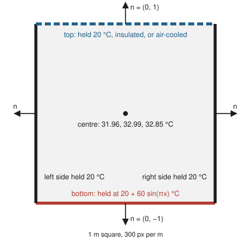
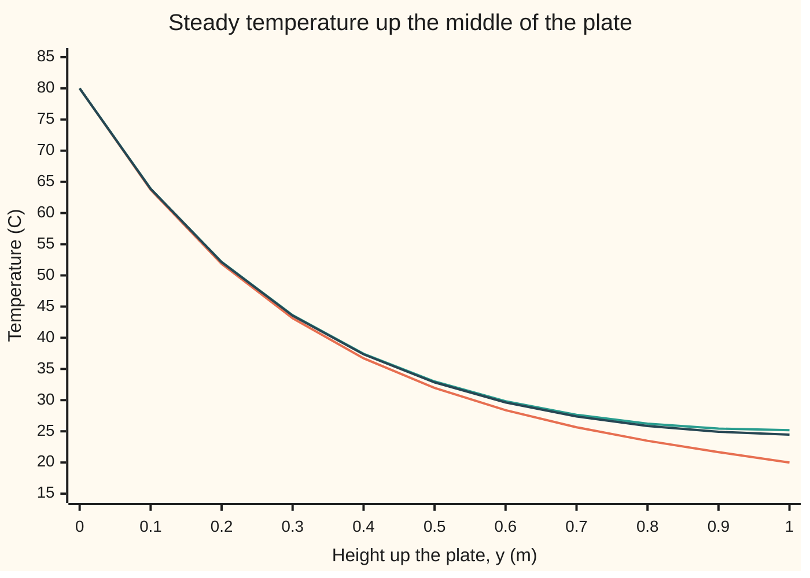

# Boundary conditions: fix the value, fix the flow, or mix the two

[Syllabus](../../../SYLLABUS.md) → [Partial differential equations](../README.md) → [Classification and Well-Posedness](../README.md#s01) → Boundary conditions

---

## General Overview

A square steel plate, 1 m on a side and 10 mm thick, has both faces covered in insulation board, so heat moves only in the plane of the plate. A heating strip holds its bottom edge at 80 °C in the middle, falling smoothly to 20 °C at the two bottom corners. Its two sides are clamped to a frame kept at 20 °C. After a long wait the temperatures stop changing.

The top edge is the open question. Clamp it to the frame too, and the centre of the plate reads 31.96 °C. Wrap it in insulation instead, and the centre reads 32.99 °C. Leave it bare in a fan's stream of 20 °C air, and it reads 32.85 °C. The equation inside the plate is the same each time. Only the one sentence about the top edge changed.

That sentence is a **boundary condition**: a rule that holds at every point of the edge of the region. There are three basic kinds, plus one for edges that are joined together:

- **Dirichlet:** fix the value. The edge is held at a set temperature.
- **Neumann:** fix the flow. The heat crossing the edge is set; insulated means zero.
- **Robin:** fix a mix. The heat leaving is tied to how much warmer the edge is than the air.
- **Periodic:** no edge at all. Roll the plate into a tube and the two sides become one seam.

The differential-equations wing already named the first three at the two ends of a strut ([Boundary value problems](../../08-Differential%20equations%20and%20dynamics/07-Series%20Solutions%20and%20Boundary%20Problems/05-two-point-boundary-value-problems.md)). New here: the condition now holds along a whole edge, its direction comes from an outward arrow, and a plate with only flows given has a test to pass. Insulate every edge and feed 60 W in at one of them, and there is no steady state at all: the plate warms 5.615 K/h, forever.

**A boundary condition gives one equation at each point of the edge: it fixes the temperature (Dirichlet), the heat flow out (Neumann), or a fixed mix of the two (Robin), or it joins an edge to another (periodic); when only flows are given, they must add up to zero, or no steady answer exists.**

**What kind of fact this is:** the four conditions are models of what touches the edge (a frame, insulation, moving air, more plate). The rule that the flows must balance is a theorem, proved on this card in Why it works.

### The picture: one plate, four edges, four outward arrows

<p align="center"></p>

To scale, 300 px per m, from the points both checks print on their "figure," line. Each arrow is the outward normal n on that edge: it points straight out of the plate. The dot is the centre, with its three steady temperatures for the three top edges.

---

## The formula

Reminders from [A PDE problem](01-what-a-pde-problem-is.md): $`\Omega`$ is the region (here the open square plate, 0 < x < 1 m and 0 < y < 1 m) and $`\partial\Omega`$ is its boundary (the four edges). $`u(x, y)`$ is the steady temperature in °C. The **Laplacian** $`\Delta u = u_{xx} + u_{yy}`$ is the total bend of the temperature; a settled plate with no heat source inside has $`\Delta u = 0`$ ([Laplace's equation](../../08-Differential%20equations%20and%20dynamics/10-The%20Classical%20PDEs/07-laplaces-equation-and-harmonic-functions.md)).

New notation, in words first. At each edge point the **outward normal** $`n`$ is the arrow of length 1 that points straight out of the region. The **normal derivative** $`\partial u/\partial n = \nabla u \cdot n`$ is how fast the temperature rises as you step out across the edge, in K per m; here $`\nabla u = (u_x, u_y)`$ is the gradient, the direction and size of the steepest rise.

```math
\Delta u = 0 \ \text{in } \Omega, \qquad \text{and at each point of } \partial\Omega \text{ one of:} \qquad \begin{cases} u = g & \text{Dirichlet} \\ -k\,\dfrac{\partial u}{\partial n} = q & \text{Neumann} \\ -k\,\dfrac{\partial u}{\partial n} = h\,(u - u_\text{air}) & \text{Robin} \end{cases}
```

**Read it aloud:** inside, the temperature has no net bend; on each piece of edge, either the temperature is given, or the heat leaving is given, or the heat leaving is the film coefficient times how much warmer the edge is than the air.

Periodic, for the plate rolled into a tube with the sides at x = 0 and x = 1 m joined:

```math
u(0, y) = u(1, y), \qquad u_x(0, y) = u_x(1, y).
```

**Read it aloud:** across the seam the temperature and its slope both match, so heat passes straight through.

The Neumann **compatibility condition**, when every edge has a given flow and nothing heats the inside:

```math
\oint_{\partial\Omega} \frac{\partial u}{\partial n}\, ds = 0, \qquad \text{in watts:} \quad \oint_{\partial\Omega} q\, d\, ds = 0 .
```

**Read it aloud:** go once round the edge adding up the heat leaving; the total must be zero.

On our square, $`\partial u/\partial n`$ is $`-u_y`$ on the bottom edge, $`u_y`$ on the top, $`-u_x`$ on the left side and $`u_x`$ on the right.

For our plate the answer has one shape across and a profile up, found as on [Laplace on a rectangle](../../08-Differential%20equations%20and%20dynamics/10-The%20Classical%20PDEs/08-laplace-on-a-rectangle.md):

```math
u = 20 + 60\sin(\pi x)\,Y(y), \qquad Y_\text{held} = \frac{\sinh \pi(1-y)}{\sinh \pi}, \quad Y_\text{ins} = \frac{\cosh \pi(1-y)}{\cosh \pi}, \quad Y_\text{air} = \frac{\pi\cosh \pi(1-y) + \tfrac{h}{k}\sinh \pi(1-y)}{\pi\cosh \pi + \tfrac{h}{k}\sinh \pi}.
```

**Read it aloud:** the temperature above 20 °C is a single sine hump across the plate, scaled up the plate by a profile that starts at 1 on the bottom edge and ends in whatever way the top edge demands.

| Symbol | Plain meaning | In our example | Push it up and the answer… |
| --- | --- | --- | --- |
| $`\Omega`$, $`\partial\Omega`$ | the region, and its edge | the open square, and its four edges | — |
| $`x`$, $`y`$, $`s`$, $`dA`$ | across and up the plate, in m; $`s`$ is distance along the edge, $`ds`$ a small piece of it; $`dA`$ a small piece of area, m² | 0 to 1 m | — |
| $`u`$, $`g`$, $`u_\text{air}`$ | temperature, °C; a given edge temperature (on [A PDE problem](01-what-a-pde-problem-is.md) g was the start data; here it is edge data); the air's temperature | g = 20 on the sides; air 20 | — |
| $`\Delta u`$ | Laplacian $`u_{xx} + u_{yy}`$: total bend, K per m² | 0 inside | — |
| $`n`$, $`\nabla u`$, $`\partial u/\partial n`$ | outward normal; the gradient $`(u_x, u_y)`$, the direction and size of the steepest rise; $`\nabla u \cdot n`$, the rate the temperature rises stepping out, K/m | top edge n = (0, 1), so $`u_y`$ | — |
| $`q`$ | heat leaving through the edge, W per m² of edge face | 0 insulated; −6000 fed, 6000 drained | the plate cools at that edge |
| $`k`$ | thermal conductivity of the steel, W/(m K) | 50 (illustrative) | the air-cooled edge acts more like an insulated one |
| $`h`$ | film coefficient: watts leaving per m² for each kelvin above the air | 25 W/(m² K), a fan (illustrative) | top edge nearer 20 °C |
| $`d`$ | plate thickness, m | 0.01 | heat flows grow (120.45 W in at 0.02 m, top held); temperatures stay put (centre still 31.956 °C) |
| $`Y`$; $`\sinh`$, $`\cosh`$ | profile up the plate; hyperbolic sine and cosine, $`(e^t \mp e^{-t})/2`$; $`\coth = \cosh/\sinh`$, $`\tanh = \sinh/\cosh`$ | Y(1/2) = 0.19927 held | — |
| $`\rho`$, $`c`$ | steel density, kg/m³; specific heat, J/(kg K) | 7850 and 490 (illustrative); with k they give a diffusivity $`k/(\rho c) = 1.30 \times 10^{-5}`$ m²/s, a little above the illustrative value on [A PDE problem](01-what-a-pde-problem-is.md) | a surplus warms the plate more slowly |
| $`u_1`$, $`u_2`$, $`w`$, $`C`$ | two solutions; their difference; the constant that difference must be | balanced all-flows plate: C = 290.451 K for the code's two solver starts; any constant works | — |

### When it holds

- **Heat moves only in the plane.** The faces are insulated. Bare faces lose heat to the air too, which adds a loss term to the equation inside; that changes the equation, not the edge conditions.
- **A linear Robin law.** The film coefficient h is taken as constant. Real convection makes h depend on the temperature difference, and radiation adds a fourth-power term, so the condition becomes nonlinear.
- **One condition at each edge point.** Laplace's equation is elliptic, the family of steady, smoothing equations, and it takes exactly one. Giving both value and flow on the same edge overdetermines it ([Elliptic, parabolic, hyperbolic](04-classification-elliptic-parabolic-hyperbolic.md) says which families take what).
- **Data that meet at the corners.** The bottom edge is 20 °C at its corners, matching the sides. A uniform 80 °C bottom edge would jump to 20 °C at each corner, and the heat flow there would be infinite.
- **Flows only on every edge: balance, and a free constant.** Then the given flows must add to zero, and even then the answer is fixed only up to an added constant.

---

## Why it works

### Step 0: each edge point gets told one thing about the exchange

Inside, heat spreads by Fourier's law, and the steady equation says no point gains or loses. At the edge, the plate meets the outside world. Something must say what happens there: what the temperature is, what heat crosses, or a rule linking the two. One sentence per point, no more and no less.

### Step 1: the outward normal turns "heat crossing the edge" into a formula

Fourier's law says the heat flux is $`-k\nabla u`$: it runs down the temperature slope ([Fourier's law](../../13-Engineering%20mathematics/08-Fluids%20and%20Heat/05-heat-conduction-and-fouriers-law.md)). The part that crosses an edge outward is its component along n:

```math
-k\,\nabla u \cdot n = -k\,\frac{\partial u}{\partial n} \quad \text{W per m}^2 \text{ of edge face}.
```

The sign depends on the edge. On the left side n points in the −x direction, so $`\partial u/\partial n = -u_x`$. Our solution has $`u_x(0, y) = 60\pi\,Y(y) > 0`$, so the heat leaving there is positive: heat flows from the warm inside into the 20 °C frame, as it should. On the bottom edge n points down, so $`\partial u/\partial n = -u_y`$.

Insulated means no heat crosses: $`\partial u/\partial n = 0`$. Held means the frame or strip is a large reservoir that sets u and absorbs whatever heat arrives.

### Step 2: Robin sits between insulated and held

The air-cooled edge loses heat in proportion to its excess temperature, as the film balance on the [Fourier's law](../../13-Engineering%20mathematics/08-Fluids%20and%20Heat/05-heat-conduction-and-fouriers-law.md) card showed at a wall's face. Divide by k:

```math
\frac{\partial u}{\partial n} + \frac{h}{k}\,(u - u_\text{air}) = 0 .
```

Set h = 0 and this is the insulated edge. Let h grow without limit and $`u - u_\text{air}`$ is forced to 0: the held edge. The checks print the top middle of our plate as h rises:

| h, W/(m² K) | 0 | 25 | 250 | 2500 | held |
| --- | ---: | ---: | ---: | ---: | ---: |
| top middle, °C | 25.176 | 24.468 | 22.002 | 20.307 | 20.000 |

A fan at 25 W/(m² K) leaves the edge close to insulated. Its h/k is 0.5 per m, small beside the plate's own rate π per m, so the steel carries heat to the edge faster than the air removes it.

### Step 3: one shape across, three profiles up

The sides are held at 20 °C and the bottom is 20 + 60 sin(πx). Try $`u = 20 + 60\sin(\pi x)\,Y(y)`$. The sine is 0 at both sides, so the sides are met. Putting it into $`\Delta u = 0`$ gives $`-\pi^2 Y + Y'' = 0`$, so Y is a mix of $`\cosh \pi(1-y)`$ and $`\sinh \pi(1-y)`$. The bottom needs Y(0) = 1. The top edge picks the mix:

- **Held:** Y(1) = 0, so only sinh survives.
- **Insulated:** Y'(1) = 0, so only cosh survives, since sinh has slope there and cosh does not.
- **Air-cooled:** Y'(1) + (h/k) Y(1) = 0, which weighs cosh by π and sinh by h/k.

Each choice gives exactly one profile of this shape. That alone does not rule out a solution of some other shape; Step 5 shows that none exists, so each problem has exactly one solution.

Up the middle of the plate, x = 0.5 m, the three profiles agree near the hot strip and part near the top:



Orange: top held at 20 °C. Teal: top insulated, arriving flat at 25.18 °C. Dark blue: top air-cooled, arriving at 24.47 °C with a small downward slope.

### Step 4: the divergence theorem gives the heat budget

In two dimensions the [Divergence theorem](../../06-Calculus%20and%20analysis/09-Vector%20Calculus/07-divergence-theorem.md) says the total outflow of a flow field across a closed edge equals its total divergence inside (below, $`dA`$ is a small piece of area and $`ds`$ a small piece of edge). Apply it to $`\nabla u`$, whose divergence is $`\Delta u`$:

```math
\iint_\Omega \Delta u\; dA = \oint_{\partial\Omega} \frac{\partial u}{\partial n}\; ds .
```

A settled plate with no heater inside has $`\Delta u = 0`$, so the right side is 0. Multiply by $`-k d`$: the net heat leaving through all edges is zero. Whatever comes in must go out.

For the held top, 60.2245 W enter through the bottom edge, 55.0291 W leave through the sides and 5.1954 W through the top. When some edge is held, its reservoir takes whatever the budget needs, so the budget is automatic.

When every edge has a given flow, nothing can adjust, and the budget becomes a condition on the data. That is the compatibility condition. With a heater spread inside, $`-k d\,\Delta u`$ is the heat made per m², and the edges must carry exactly that much out.

### Step 5: flows alone fix the answer only up to a constant

Suppose $`u_1`$ and $`u_2`$ both solve the problem. Their difference w has $`\Delta w = 0`$ and zero data on every edge. Multiplying by w and integrating gives

```math
\iint_\Omega |\nabla w|^2\, dA = \oint_{\partial\Omega} w\,\frac{\partial w}{\partial n}\, ds .
```

The right side is 0 for held edges (w = 0) and for insulated ones ($`\partial w/\partial n = 0`$). For air-cooled ones it is $`-\tfrac{h}{k}\oint w^2\,ds \le 0`$. The left side is never negative. So both are 0 and $`\nabla w = 0`$: w is a constant. A held or air-cooled edge forces that constant to 0. If every edge is insulated or flow-given, any constant survives: add it to a solution and the sum still solves. The general form of this argument is on [Energy methods](07-energy-methods-and-uniqueness.md).

<details>
<summary>Detailed proof: the identity behind Step 5</summary>

Green's first identity is the divergence theorem applied to the field $`w\nabla w`$. Its divergence is

$`\displaystyle \nabla\cdot(w\nabla w) = |\nabla w|^2 + w\,\Delta w .`$

Integrate over $`\Omega`$, and turn the left side into an edge integral:

$`\displaystyle \oint_{\partial\Omega} w\,\frac{\partial w}{\partial n}\, ds = \iint_\Omega |\nabla w|^2\, dA + \iint_\Omega w\,\Delta w\, dA .`$

With $`\Delta w = 0`$ the last term goes, which is Step 5's identity. On a Robin edge $`\partial w/\partial n = -(h/k)\,w`$, so that edge contributes $`-(h/k)\oint w^2\, ds`$. If any edge is held or air-cooled with h > 0, then $`\nabla w = 0`$ makes w a constant C, and that edge gives C = 0 or $`(h/k)\,C = 0`$. So C = 0, and the solution is unique. A periodic seam contributes nothing: its two sides have opposite normals and equal values and slopes, so their terms cancel.

</details>

### Step 6: periodic conditions remove an edge

Roll the plate into a tube 1 m round, so the sides at x = 0 and x = 1 m meet in one seam. The seam is not an edge: heat crosses it as through any other line of steel. So the temperature and its slope must match across it, and nothing leaves there.

The bottom profile 20 + 60 sin(πx) cannot be used on the tube. Its slope is +60π at x = 0 and −60π at x = 1 m, so it would have a kink at the seam. The smooth profile $`20 + 60\sin^2(\pi x) = 50 - 30\cos(2\pi x)`$ has the same 80 °C hot spot and 20 °C at the seam. With the top ring held at 20 °C:

```math
u = 20 + 30\,(1 - y) - 30\cos(2\pi x)\,\frac{\sinh 2\pi(1-y)}{\sinh 2\pi}.
```

Halfway up, the tube reads 36.294 °C opposite the seam and 33.706 °C on it. The flat plate read 31.956 °C at its centre: the cold sides are gone. 15.000 W enter at the bottom ring and 15.000 W leave at the top; the cosine part carries heat round the tube but adds nothing to the total.

A closed surface with no edge at all, like the skin of a doughnut, is periodic both ways. There the compatibility condition still applies: heat made inside must total zero.

---

## Worked numbers, by hand

From the checks: sinh π = 11.5487, cosh π = 11.5920, sinh(π/2) = 2.3013, cosh(π/2) = 2.5092, and h/k = 25/50 = 0.5 per m.

| Step | Arithmetic | Value |
| --- | --- | --- |
| held top, Y(1/2) | 2.3013 ÷ 11.5487 | 0.19927 |
| centre, held top | 20 + 60 × 0.19927 | **31.956 °C** |
| insulated top, Y(1/2) | 2.5092 ÷ 11.5920 | 0.21646 |
| centre, insulated top | 20 + 60 × 0.21646 | **32.988 °C** |
| air-cooled top, Y(1/2) | (π × 2.5092 + 0.5 × 2.3013) ÷ (π × 11.5920 + 0.5 × 11.5487) = 9.0335 ÷ 42.1916 | 0.21411 |
| centre, air-cooled top | 20 + 60 × 0.21411 | **32.846 °C** |
| top middle, insulated | 20 + 60 ÷ 11.5920 | 25.176 °C |
| heat in, held top | 60 coth π, from $`k d \times 60 \times \pi\coth\pi \times 2/\pi`$ | 60.2245 W |
| heat in, insulated top | 60 tanh π | 59.7763 W |
| all edges given flows | 60 W in at the bottom, 60 W out at the top | balanced: a steady state |
| same, 50 W out | 10 W surplus ÷ (7850 × 490 × 0.01) J/K per m², × 3600 s | warms 0.936 K/h |

Changing only the top edge moves the centre from 31.956 to 32.988 °C, and the top middle from 20.000 to 25.176 °C. Heat that cannot leave through an insulated top builds up there until the sides carry it all away.

### What breaks if you drop a piece

| Mistake | Comes out at | What went wrong |
| --- | --- | --- |
| Robin sign flipped: $`-k\,\partial u/\partial n = -h\,(u - u_\text{air})`$ | top middle 26.151 °C, warmer than insulated 25.176 °C | the air now pushes heat into an edge that is warmer than it |
| $`\partial u/\partial n`$ taken as $`u_y`$ on the bottom edge too | edge sum −240 K: 120 W booked as leaving a balanced plate, "cooling" 11.231 K/h | the bottom edge's normal points down, so it is $`-u_y`$ |
| Flows on every edge, 60 W in, 50 W out | no steady state: grid mean 352.4, 676.0, 1323.2 °C after 1000, 2000, 4000 solver sweeps (iterations, not time) | the compatibility condition fails |
| Flows on every edge, balanced, treated as one answer | two solver starts settle 290.451 K apart: 29.708 and 320.159 °C at the centre | flows fix the shape, not the level |

The code prints all four.

---

## Code, from first principles, and it actually runs

The code takes three independent roads to the plate. Road one is the closed form in sinh and cosh. Road two never uses it: it cuts the plate into a grid of small squares and solves the grid equations by over-relaxed Gauss-Seidel sweeps ([Iterating instead of factoring](../../16-Numerical%20analysis/03-Numerical%20Linear%20Algebra/09-iterative-methods-jacobi-gauss-seidel-and-conjugate-gradient.md)). An insulated or air-cooled edge uses a mirror point outside the plate, so its slope is a centred difference. Halving the grid step cuts the error about 4 times: second order. Road three is the heat budget, each edge's flow summed by Simpson's rule; it must hold if the profiles solve the equation, so it can catch a wrong profile, though passing it alone does not prove one right.

The code also checks each top condition by a centred difference. It solves the tube on a wrap-around grid. On an all-flows plate it shows a balanced feed settling and an unbalanced one climbing without end.

### Python

```python
# Boundary conditions -- the check behind the card.  Standard library only.
# A 1 m square steel plate, 10 mm thick, faces insulated, so heat moves in its
# plane.  Bottom edge held at 20 + 60 sin(pi x) C, sides held at 20 C; the top
# edge is held at 20 C (D), insulated (N) or cooled by 20 C air (R).  v = u - 20.
# Road one: closed forms in sinh and cosh.  Road two: a grid solved by
# over-relaxed Gauss-Seidel, written out.  Road three: the heat budget, each
# edge's flux summed by Simpson's rule.  Then the tube (periodic) and the
# all-insulated plate fed and drained through its edges (compatibility).
import math
pi, k, d, rho, c = math.pi, 50.0, 0.01, 7850.0, 490.0   # W/(m K), m, kg/m^3, J/(kg K)
ch, sh = math.cosh, math.sinh
def Y(kind, y, b=0.5):               # profile up the plate, Y(0) = 1; b = h/k per m
    if kind == "D": return sh(pi * (1 - y)) / sh(pi)
    if kind == "N": return ch(pi * (1 - y)) / ch(pi)
    return (pi * ch(pi * (1 - y)) + b * sh(pi * (1 - y))) / (pi * ch(pi) + b * sh(pi))
def dY(kind, y, b=0.5):              # its slope, from the same formulas
    if kind == "D": return -pi * ch(pi * (1 - y)) / sh(pi)
    if kind == "N": return -pi * sh(pi * (1 - y)) / ch(pi)
    return -pi * (pi * sh(pi * (1 - y)) + b * ch(pi * (1 - y))) / (pi * ch(pi) + b * sh(pi))
def simpson(f, n=200):               # integral of f over [0, 1]
    s = f(0) + f(1) + sum((4 if i % 2 else 2) * f(i / n) for i in range(1, n))
    return s / (3 * n)
def plate(N, kind, b=0.5, tube=False):   # grid road; tube joins x = 0 to x = 1
    hh, w = 1 / N, 2 / (1 + math.sin(pi / N))
    cols = range(N) if tube else range(1, N)
    v = [[0.0] * (N + 1) for _ in range(N + 1)]
    for i in range(N + 1):
        v[i][0] = 30 - 30 * math.cos(2 * pi * i * hh) if tube else 60 * math.sin(pi * i * hh)
    last = N if kind in "NR" else N - 1
    while True:
        big = 0.0
        for i in cols:
            l, r = (i - 1) % N, (i + 1) % N if tube else i + 1
            for j in range(1, last + 1):
                if j < N: new = (v[l][j] + v[r][j] + v[i][j - 1] + v[i][j + 1]) / 4
                else: new = (v[l][j] + v[r][j] + 2 * v[i][j - 1]) / (4 + 2 * hh * (b if kind == "R" else 0))
                dv = w * (new - v[i][j]); v[i][j] += dv; big = max(big, abs(dv))
        if big < 1e-13: return v
def insulated(N, g_in, g_out, tilt, sweeps=0):    # all four edges given du/dn
    hh, w = 1 / N, 2 / (1 + math.sin(pi / N))
    u = [[20 + tilt * i / N] * (N + 1) for i in range(N + 1)]   # start 20 C, tilted
    for s in range(sweeps or 10 ** 6):
        big = 0.0
        for i in range(N + 1):
            for j in range(N + 1):
                l = u[i - 1][j] if i > 0 else u[1][j]
                r = u[i + 1][j] if i < N else u[N - 1][j]
                dn = u[i][j - 1] if j > 0 else u[i][1] + 2 * hh * g_in
                up = u[i][j + 1] if j < N else u[i][N - 1] - 2 * hh * g_out
                du = w * ((l + r + dn + up) / 4 - u[i][j]); u[i][j] += du; big = max(big, abs(du))
        if not sweeps and big < 1e-12: return u
    return u
mean = lambda u: sum(map(sum, u)) / len(u) ** 2
names = {"D": "held 20 C", "N": "insulated", "R": "air-cooled"}
print("plate 1 m x 1 m x 10 mm steel, k = 50 W/(m K); bottom 20 + 60 sin(pi x) C, sides 20 C")
for kd in "DNR":
    print(f"top {names[kd]:10s}: centre {20 + 60 * Y(kd, 0.5):.3f} C, top middle {20 + 60 * Y(kd, 1):.3f} C")
print(f"hand: sinh pi {sh(pi):.4f}, cosh pi {ch(pi):.4f}, sinh pi/2 {sh(pi / 2):.4f}, cosh pi/2 {ch(pi / 2):.4f}; h/k = {25 / k:.1f} per m")
print(f"hand: Y(1/2) held {Y('D', 0.5):.5f}, insulated {Y('N', 0.5):.5f}, air-cooled"
      f" {pi * ch(pi / 2) + 0.5 * sh(pi / 2):.4f}/{pi * ch(pi) + 0.5 * sh(pi):.4f} = {Y('R', 0.5):.5f}")
print(f"hand: heat in, held 60 coth pi = {60 * ch(pi) / sh(pi):.4f} W, insulated 60 tanh pi = {60 * sh(pi) / ch(pi):.4f} W")
print("road two, grid centre at h = 0.1 0.05 0.025 m, and error ratios:")
for kd in "DNR":
    ex = 60 * Y(kd, 0.5)
    e = [abs(plate(N, kd)[N // 2][N // 2] - ex) for N in (10, 20, 40)]
    print(f"  {names[kd]:10s}: errors {e[0]:.5f} {e[1]:.5f} {e[2]:.5f} K, ratios {e[0] / e[1]:.2f} {e[1] / e[2]:.2f}")
    assert e[2] < 0.02 and 3.6 < e[0] / e[1] < 4.4 and 3.6 < e[1] / e[2] < 4.4
S = simpson(lambda x: math.sin(pi * x))           # 2/pi, by Simpson
print("road three, heat budget in W: in at bottom = out through sides + out at top")
for kd in "DNR":
    pin = k * d * 60 * -dY(kd, 0) * S
    side = 2 * k * d * 60 * pi * simpson(lambda y: Y(kd, y))
    top = k * d * 60 * -dY(kd, 1) * S
    print(f"  {names[kd]:10s}: {pin:.4f} = {side:.4f} + {top:.4f}")
    assert abs(pin - side - top) < 1e-8
e = 1e-4
for kd in "DNR":                     # the top condition, by centred differences
    slope = (Y(kd, 1 + e) - Y(kd, 1 - e)) / (2 * e)
    res = {"D": Y(kd, 1), "N": slope, "R": slope + 0.5 * Y(kd, 1)}[kd]
    assert abs(res) < 1e-7
print("Robin top middle, h = 0 25 250 2500 W/(m^2 K) and held:", " ".join(
    f"{20 + 60 * Y('R', 1, hv / k):.3f}" for hv in (0, 25, 250, 2500)), "20.000 C")
assert abs(Y("R", 1, 0) - Y("N", 1)) < 1e-12 and abs(Y("R", 0.5, 1e9) - Y("D", 0.5)) < 1e-8
ys = [j / 10 for j in range(11)]
for kd in "DNR":
    print(f"chart, {names[kd]:10s}", " ".join(f"{20 + 60 * Y(kd, y):.2f}" for y in ys))
tube_ex = lambda x, y: 30 * (1 - y) - 30 * math.cos(2 * pi * x) * sh(2 * pi * (1 - y)) / sh(2 * pi)
vt = plate(40, "D", tube=True)
print(f"tube (periodic seam): opposite seam {20 + tube_ex(0.5, 0.5):.3f} C, on seam {20 + tube_ex(0, 0.5):.3f} C;"
      f" grid h = 0.025 m: {20 + vt[20][20]:.3f} {20 + vt[0][20]:.3f} C")
assert abs(vt[20][20] - tube_ex(0.5, 0.5)) < 0.02 and abs(vt[0][20] - tube_ex(0, 0.5)) < 0.02
flow = lambda y: k * d * simpson(lambda x: -(tube_ex(x, y + e) - tube_ex(x, y - e)) / (2 * e))
print(f"  tube budget: in {flow(0):.3f} W at bottom, out {flow(1):.3f} W at top, nothing at the seam")
assert abs(flow(0) - 15) < 1e-5 and abs(flow(1) - 15) < 1e-5
q = 60 / (1 * d)                     # 60 W over a 1 m x 10 mm edge face, W/m^2
G = q / k                            # the edge gradient it needs, K/m
print(f"insulated plate fed 60 W at bottom, drained at top: {q:.0f} W/m^2 of edge face, gradient {G:.0f} K/m")
ua, ub = insulated(10, G, G, 0.0), insulated(10, G, G, 500.0)
diff = [ub[i][j] - ua[i][j] for i in range(11) for j in range(11)]
print(f"  drained 60 W: compatible; starts flat and tilted settle at centre {ua[5][5]:.3f} and {ub[5][5]:.3f} C,"
      f" apart by {diff[0]:.3f} K at every point")
assert max(diff) - min(diff) < 1e-8 and abs(ua[5][5] - ua[5][10] - 0.5 * G) < 1e-8
m = [mean(insulated(10, G, 100.0, 0.0, s)) for s in (1000, 2000, 4000)]
print(f"  drained 50 W: incompatible; grid mean after 1000 2000 4000 sweeps {m[0]:.1f} {m[1]:.1f} {m[2]:.1f} C")
assert m[2] - m[1] > 1.5 * (m[1] - m[0]) > 0
heat = rho * c * d                  # J per K per m^2 of plate
print(f"  real plate: 10 W surplus warms it {10 / heat * 3600:.3f} K/h; all edges insulated, 60 W in: {60 / heat * 3600:.3f} K/h;"
      f" diffusivity k/(rho c) {k / (rho * c) * 1e5:.2f}e-5 m^2/s")
print(f"mistake, Robin sign flipped: top middle {20 + 60 * Y('R', 1, -0.5):.3f} C, above insulated {20 + 60 * Y('N', 1):.3f} C")
print(f"mistake, du/dn = u_y on the bottom too: edges sum to {-G - G:.0f} K, books {2 * q * d:.0f} W leaving,"
      f" cooling {120 / heat * 3600:.3f} K/h")
print(f"try, plate 20 mm thick, top held: same {20 + 60 * Y('D', 0.5):.3f} C centre, heat in {2 * k * d * 60 * -dY('D', 0) * S:.2f} W")
px = lambda x, y: f"{60 + 300 * x:.0f},{340 - 300 * y:.0f}"   # 300 px per m
print("figure, corners", px(0, 0), px(1, 1), "centre", px(0.5, 0.5), "normal tips", px(0.5, -0.12),
      px(0.5, 1.12), px(-0.12, 0.5), px(1.12, 0.5))
print("ALL CHECKS PASS")
```

**Ran 2026-11-15 on macOS, Python 3.14.10, standard library only. All checks passed. Output, pasted from the run:**

```
plate 1 m x 1 m x 10 mm steel, k = 50 W/(m K); bottom 20 + 60 sin(pi x) C, sides 20 C
top held 20 C : centre 31.956 C, top middle 20.000 C
top insulated : centre 32.988 C, top middle 25.176 C
top air-cooled: centre 32.846 C, top middle 24.468 C
hand: sinh pi 11.5487, cosh pi 11.5920, sinh pi/2 2.3013, cosh pi/2 2.5092; h/k = 0.5 per m
hand: Y(1/2) held 0.19927, insulated 0.21646, air-cooled 9.0335/42.1916 = 0.21411
hand: heat in, held 60 coth pi = 60.2245 W, insulated 60 tanh pi = 59.7763 W
road two, grid centre at h = 0.1 0.05 0.025 m, and error ratios:
  held 20 C : errors 0.14062 0.03535 0.00885 K, ratios 3.98 3.99
  insulated : errors 0.17962 0.04506 0.01127 K, ratios 3.99 4.00
  air-cooled: errors 0.17531 0.04399 0.01101 K, ratios 3.99 4.00
road three, heat budget in W: in at bottom = out through sides + out at top
  held 20 C : 60.2245 = 55.0291 + 5.1954
  insulated : 59.7763 = 59.7763 + 0.0000
  air-cooled: 59.8377 = 59.1266 + 0.7110
Robin top middle, h = 0 25 250 2500 W/(m^2 K) and held: 25.176 24.468 22.002 20.307 20.000 C
chart, held 20 C  80.00 63.75 51.86 43.14 36.71 31.96 28.39 25.65 23.48 21.66 20.00
chart, insulated  80.00 63.90 52.16 43.62 37.44 32.99 29.83 27.65 26.23 25.43 25.18
chart, air-cooled 80.00 63.88 52.12 43.56 37.34 32.85 29.63 27.38 25.86 24.92 24.47
tube (periodic seam): opposite seam 36.294 C, on seam 33.706 C; grid h = 0.025 m: 36.302 33.698 C
  tube budget: in 15.000 W at bottom, out 15.000 W at top, nothing at the seam
insulated plate fed 60 W at bottom, drained at top: 6000 W/m^2 of edge face, gradient 120 K/m
  drained 60 W: compatible; starts flat and tilted settle at centre 29.708 and 320.159 C, apart by 290.451 K at every point
  drained 50 W: incompatible; grid mean after 1000 2000 4000 sweeps 352.4 676.0 1323.2 C
  real plate: 10 W surplus warms it 0.936 K/h; all edges insulated, 60 W in: 5.615 K/h; diffusivity k/(rho c) 1.30e-5 m^2/s
mistake, Robin sign flipped: top middle 26.151 C, above insulated 25.176 C
mistake, du/dn = u_y on the bottom too: edges sum to -240 K, books 120 W leaving, cooling 11.231 K/h
try, plate 20 mm thick, top held: same 31.956 C centre, heat in 120.45 W
figure, corners 60,340 360,40 centre 210,190 normal tips 210,376 210,4 24,190 396,190
ALL CHECKS PASS
```

### Rust

```rust
// Boundary conditions -- the check behind the card.  Rust std only.
// A 1 m square steel plate, 10 mm thick, faces insulated, so heat moves in its
// plane.  Bottom edge held at 20 + 60 sin(pi x) C, sides held at 20 C; the top
// edge is held at 20 C (D), insulated (N) or cooled by 20 C air (R).  v = u - 20.
// Road one: closed forms in sinh and cosh.  Road two: a grid solved by
// over-relaxed Gauss-Seidel, written out.  Road three: the heat budget, each
// edge's flux summed by Simpson's rule.  Then the tube (periodic) and the
// all-insulated plate fed and drained through its edges (compatibility).
use std::f64::consts::PI;
const K: f64 = 50.0; const D: f64 = 0.01; // W/(m K), m
const RHO: f64 = 7850.0; const C: f64 = 490.0; // kg/m^3, J/(kg K)

fn ch(x: f64) -> f64 { x.cosh() } fn sh(x: f64) -> f64 { x.sinh() }
// profile up the plate, Y(0) = 1; b = h/k per m
fn yp(kind: char, y: f64, b: f64) -> f64 {
    match kind {
        'D' => sh(PI * (1.0 - y)) / sh(PI),
        'N' => ch(PI * (1.0 - y)) / ch(PI),
        _ => (PI * ch(PI * (1.0 - y)) + b * sh(PI * (1.0 - y))) / (PI * ch(PI) + b * sh(PI)),
    }
}
// its slope, from the same formulas
fn dyp(kind: char, y: f64, b: f64) -> f64 {
    match kind {
        'D' => -PI * ch(PI * (1.0 - y)) / sh(PI),
        'N' => -PI * sh(PI * (1.0 - y)) / ch(PI),
        _ => -PI * (PI * sh(PI * (1.0 - y)) + b * ch(PI * (1.0 - y))) / (PI * ch(PI) + b * sh(PI)),
    }
}
// integral of f over [0, 1]
fn simpson(f: &dyn Fn(f64) -> f64) -> f64 {
    let n = 200;
    let mut s = f(0.0) + f(1.0);
    for i in 1..n {
        s += if i % 2 == 1 { 4.0 } else { 2.0 } * f(i as f64 / n as f64);
    }
    s / (3.0 * n as f64)
}
// grid road; tube joins x = 0 to x = 1
fn plate(n: usize, kind: char, b: f64, tube: bool) -> Vec<Vec<f64>> {
    let (hh, w) = (1.0 / n as f64, 2.0 / (1.0 + (PI / n as f64).sin()));
    let mut v = vec![vec![0.0f64; n + 1]; n + 1];
    for i in 0..=n {
        let x = PI * i as f64 * hh;
        v[i][0] = if tube { 30.0 - 30.0 * (2.0 * x).cos() } else { 60.0 * x.sin() };
    }
    let last = if kind == 'N' || kind == 'R' { n } else { n - 1 };
    let first = if tube { 0 } else { 1 };
    loop {
        let mut big = 0.0f64;
        for i in first..n {
            let (l, r) = if tube { ((i + n - 1) % n, (i + 1) % n) } else { (i - 1, i + 1) };
            for j in 1..=last {
                let new = if j < n {
                    (v[l][j] + v[r][j] + v[i][j - 1] + v[i][j + 1]) / 4.0
                } else {
                    (v[l][j] + v[r][j] + 2.0 * v[i][j - 1]) / (4.0 + 2.0 * hh * if kind == 'R' { b } else { 0.0 })
                };
                let dv = w * (new - v[i][j]);
                v[i][j] += dv;
                big = big.max(dv.abs());
            }
        }
        if big < 1e-13 { return v; }
    }
}
// all four edges given du/dn
fn insulated(n: usize, g_in: f64, g_out: f64, tilt: f64, sweeps: usize) -> Vec<Vec<f64>> {
    let (hh, w) = (1.0 / n as f64, 2.0 / (1.0 + (PI / n as f64).sin()));
    let mut u: Vec<Vec<f64>> = (0..=n).map(|i| vec![20.0 + tilt * i as f64 / n as f64; n + 1]).collect();
    let limit = if sweeps > 0 { sweeps } else { 1_000_000 };
    for _ in 0..limit {
        let mut big = 0.0f64;
        for i in 0..=n {
            for j in 0..=n {
                let l = if i > 0 { u[i - 1][j] } else { u[1][j] };
                let r = if i < n { u[i + 1][j] } else { u[n - 1][j] };
                let dn = if j > 0 { u[i][j - 1] } else { u[i][1] + 2.0 * hh * g_in };
                let up = if j < n { u[i][j + 1] } else { u[i][n - 1] - 2.0 * hh * g_out };
                let du = w * ((l + r + dn + up) / 4.0 - u[i][j]);
                u[i][j] += du;
                big = big.max(du.abs());
            }
        }
        if sweeps == 0 && big < 1e-12 { return u; }
    }
    u
}
fn mean(u: &Vec<Vec<f64>>) -> f64 {
    let mut s = 0.0;
    for row in u { let mut r = 0.0; for x in row { r += x; } s += r; }
    s / (u.len() * u.len()) as f64
}
fn name(kd: char) -> &'static str {
    match kd { 'D' => "held 20 C", 'N' => "insulated", _ => "air-cooled" }
}
fn tube_ex(x: f64, y: f64) -> f64 {
    30.0 * (1.0 - y) - 30.0 * (2.0 * PI * x).cos() * sh(2.0 * PI * (1.0 - y)) / sh(2.0 * PI)
}
fn px(x: f64, y: f64) -> String { format!("{:.0},{:.0}", 60.0 + 300.0 * x, 340.0 - 300.0 * y) }
fn main() {
    let b = 0.5;
    println!("plate 1 m x 1 m x 10 mm steel, k = 50 W/(m K); bottom 20 + 60 sin(pi x) C, sides 20 C");
    for kd in ['D', 'N', 'R'] {
        println!("top {:10}: centre {:.3} C, top middle {:.3} C", name(kd), 20.0 + 60.0 * yp(kd, 0.5, b), 20.0 + 60.0 * yp(kd, 1.0, b));
    }
    println!("hand: sinh pi {:.4}, cosh pi {:.4}, sinh pi/2 {:.4}, cosh pi/2 {:.4}; h/k = {:.1} per m", sh(PI), ch(PI), sh(PI / 2.0), ch(PI / 2.0), 25.0 / K);
    println!("hand: Y(1/2) held {:.5}, insulated {:.5}, air-cooled {:.4}/{:.4} = {:.5}", yp('D', 0.5, b), yp('N', 0.5, b),
        PI * ch(PI / 2.0) + 0.5 * sh(PI / 2.0), PI * ch(PI) + 0.5 * sh(PI), yp('R', 0.5, b));
    println!("hand: heat in, held 60 coth pi = {:.4} W, insulated 60 tanh pi = {:.4} W", 60.0 * ch(PI) / sh(PI), 60.0 * sh(PI) / ch(PI));
    println!("road two, grid centre at h = 0.1 0.05 0.025 m, and error ratios:");
    for kd in ['D', 'N', 'R'] {
        let ex = 60.0 * yp(kd, 0.5, b);
        let e: Vec<f64> = [10usize, 20, 40].iter().map(|&n| (plate(n, kd, b, false)[n / 2][n / 2] - ex).abs()).collect();
        println!("  {:10}: errors {:.5} {:.5} {:.5} K, ratios {:.2} {:.2}", name(kd), e[0], e[1], e[2], e[0] / e[1], e[1] / e[2]);
        assert!(e[2] < 0.02 && 3.6 < e[0] / e[1] && e[0] / e[1] < 4.4 && 3.6 < e[1] / e[2] && e[1] / e[2] < 4.4);
    }
    let s = simpson(&|x: f64| (PI * x).sin()); // 2/pi, by Simpson
    println!("road three, heat budget in W: in at bottom = out through sides + out at top");
    for kd in ['D', 'N', 'R'] {
        let pin = K * D * 60.0 * -dyp(kd, 0.0, b) * s;
        let side = 2.0 * K * D * 60.0 * PI * simpson(&|y: f64| yp(kd, y, b));
        let top = K * D * 60.0 * -dyp(kd, 1.0, b) * s;
        println!("  {:10}: {:.4} = {:.4} + {:.4}", name(kd), pin, side, top);
        assert!((pin - side - top).abs() < 1e-8);
    }
    let e = 1e-4;
    for kd in ['D', 'N', 'R'] {
        // the top condition, by centred differences
        let slope = (yp(kd, 1.0 + e, b) - yp(kd, 1.0 - e, b)) / (2.0 * e);
        let res = match kd { 'D' => yp(kd, 1.0, b), 'N' => slope, _ => slope + 0.5 * yp(kd, 1.0, b) };
        assert!(res.abs() < 1e-7);
    }
    let sweep: Vec<String> = [0.0, 25.0, 250.0, 2500.0].iter().map(|hv| format!("{:.3}", 20.0 + 60.0 * yp('R', 1.0, hv / K))).collect();
    println!("Robin top middle, h = 0 25 250 2500 W/(m^2 K) and held: {} 20.000 C", sweep.join(" "));
    assert!((yp('R', 1.0, 0.0) - yp('N', 1.0, b)).abs() < 1e-12 && (yp('R', 0.5, 1e9) - yp('D', 0.5, b)).abs() < 1e-8);
    for kd in ['D', 'N', 'R'] {
        let pts: Vec<String> = (0..11).map(|j| format!("{:.2}", 20.0 + 60.0 * yp(kd, j as f64 / 10.0, b))).collect();
        println!("chart, {:10} {}", name(kd), pts.join(" "));
    }
    let vt = plate(40, 'D', b, true);
    println!("tube (periodic seam): opposite seam {:.3} C, on seam {:.3} C; grid h = 0.025 m: {:.3} {:.3} C",
        20.0 + tube_ex(0.5, 0.5), 20.0 + tube_ex(0.0, 0.5), 20.0 + vt[20][20], 20.0 + vt[0][20]);
    assert!((vt[20][20] - tube_ex(0.5, 0.5)).abs() < 0.02 && (vt[0][20] - tube_ex(0.0, 0.5)).abs() < 0.02);
    let flow = |y: f64| K * D * simpson(&|x: f64| -(tube_ex(x, y + e) - tube_ex(x, y - e)) / (2.0 * e));
    println!("  tube budget: in {:.3} W at bottom, out {:.3} W at top, nothing at the seam", flow(0.0), flow(1.0));
    assert!((flow(0.0) - 15.0).abs() < 1e-5 && (flow(1.0) - 15.0).abs() < 1e-5);
    let (q, g) = (60.0 / (1.0 * D), 60.0 / (1.0 * D) / K); // W/m^2 of edge face, and K/m
    println!("insulated plate fed 60 W at bottom, drained at top: {:.0} W/m^2 of edge face, gradient {:.0} K/m", q, g);
    let ua = insulated(10, g, g, 0.0, 0);
    let ub = insulated(10, g, g, 500.0, 0);
    let mut diff = Vec::new();
    for i in 0..11 { for j in 0..11 { diff.push(ub[i][j] - ua[i][j]); } }
    let (mx, mn) = diff.iter().fold((f64::MIN, f64::MAX), |(a, c), &x| (a.max(x), c.min(x)));
    println!("  drained 60 W: compatible; starts flat and tilted settle at centre {:.3} and {:.3} C, apart by {:.3} K at every point",
        ua[5][5], ub[5][5], diff[0]);
    assert!(mx - mn < 1e-8 && (ua[5][5] - ua[5][10] - 0.5 * g).abs() < 1e-8);
    let m: Vec<f64> = [1000usize, 2000, 4000].iter().map(|&s| mean(&insulated(10, g, 100.0, 0.0, s))).collect();
    println!("  drained 50 W: incompatible; grid mean after 1000 2000 4000 sweeps {:.1} {:.1} {:.1} C", m[0], m[1], m[2]);
    assert!(m[2] - m[1] > 1.5 * (m[1] - m[0]) && m[1] - m[0] > 0.0);
    let heat = RHO * C * D; // J per K per m^2 of plate
    println!("  real plate: 10 W surplus warms it {:.3} K/h; all edges insulated, 60 W in: {:.3} K/h; diffusivity k/(rho c) {:.2}e-5 m^2/s", 10.0 / heat * 3600.0, 60.0 / heat * 3600.0, K / (RHO * C) * 1e5);
    println!("mistake, Robin sign flipped: top middle {:.3} C, above insulated {:.3} C", 20.0 + 60.0 * yp('R', 1.0, -0.5), 20.0 + 60.0 * yp('N', 1.0, b));
    println!("mistake, du/dn = u_y on the bottom too: edges sum to {:.0} K, books {:.0} W leaving, cooling {:.3} K/h",
        -g - g, 2.0 * q * D, 120.0 / heat * 3600.0);
    println!("try, plate 20 mm thick, top held: same {:.3} C centre, heat in {:.2} W", 20.0 + 60.0 * yp('D', 0.5, b), 2.0 * K * D * 60.0 * -dyp('D', 0.0, b) * s);
    println!("figure, corners {} {} centre {} normal tips {} {} {} {}", px(0.0, 0.0), px(1.0, 1.0), px(0.5, 0.5),
        px(0.5, -0.12), px(0.5, 1.12), px(-0.12, 0.5), px(1.12, 0.5));
    println!("ALL CHECKS PASS");
}
```

**Ran 2026-11-15 on macOS, rustc 1.98.1, no crates. All checks passed. Output, pasted from the run:**

```
plate 1 m x 1 m x 10 mm steel, k = 50 W/(m K); bottom 20 + 60 sin(pi x) C, sides 20 C
top held 20 C : centre 31.956 C, top middle 20.000 C
top insulated : centre 32.988 C, top middle 25.176 C
top air-cooled: centre 32.846 C, top middle 24.468 C
hand: sinh pi 11.5487, cosh pi 11.5920, sinh pi/2 2.3013, cosh pi/2 2.5092; h/k = 0.5 per m
hand: Y(1/2) held 0.19927, insulated 0.21646, air-cooled 9.0335/42.1916 = 0.21411
hand: heat in, held 60 coth pi = 60.2245 W, insulated 60 tanh pi = 59.7763 W
road two, grid centre at h = 0.1 0.05 0.025 m, and error ratios:
  held 20 C : errors 0.14062 0.03535 0.00885 K, ratios 3.98 3.99
  insulated : errors 0.17962 0.04506 0.01127 K, ratios 3.99 4.00
  air-cooled: errors 0.17531 0.04399 0.01101 K, ratios 3.99 4.00
road three, heat budget in W: in at bottom = out through sides + out at top
  held 20 C : 60.2245 = 55.0291 + 5.1954
  insulated : 59.7763 = 59.7763 + 0.0000
  air-cooled: 59.8377 = 59.1266 + 0.7110
Robin top middle, h = 0 25 250 2500 W/(m^2 K) and held: 25.176 24.468 22.002 20.307 20.000 C
chart, held 20 C  80.00 63.75 51.86 43.14 36.71 31.96 28.39 25.65 23.48 21.66 20.00
chart, insulated  80.00 63.90 52.16 43.62 37.44 32.99 29.83 27.65 26.23 25.43 25.18
chart, air-cooled 80.00 63.88 52.12 43.56 37.34 32.85 29.63 27.38 25.86 24.92 24.47
tube (periodic seam): opposite seam 36.294 C, on seam 33.706 C; grid h = 0.025 m: 36.302 33.698 C
  tube budget: in 15.000 W at bottom, out 15.000 W at top, nothing at the seam
insulated plate fed 60 W at bottom, drained at top: 6000 W/m^2 of edge face, gradient 120 K/m
  drained 60 W: compatible; starts flat and tilted settle at centre 29.708 and 320.159 C, apart by 290.451 K at every point
  drained 50 W: incompatible; grid mean after 1000 2000 4000 sweeps 352.4 676.0 1323.2 C
  real plate: 10 W surplus warms it 0.936 K/h; all edges insulated, 60 W in: 5.615 K/h; diffusivity k/(rho c) 1.30e-5 m^2/s
mistake, Robin sign flipped: top middle 26.151 C, above insulated 25.176 C
mistake, du/dn = u_y on the bottom too: edges sum to -240 K, books 120 W leaving, cooling 11.231 K/h
try, plate 20 mm thick, top held: same 31.956 C centre, heat in 120.45 W
figure, corners 60,340 360,40 centre 210,190 normal tips 210,376 210,4 24,190 396,190
ALL CHECKS PASS
```

### Lean

Lean proves the heat budget and the free constant on any rectangular plate, and the air-cooled solution on our square plate.

- Suppose a rectangular plate's temperature has continuous bends and $`\Delta u = 0`$ inside. Then the heat leaving, added once round all four edges, totals zero.
- Suppose two such temperatures have the same $`\partial u/\partial n`$ at every edge point. Then they differ by one constant across the whole plate.
- Take any constant and add it to a temperature. Then $`\Delta u`$ and every edge slope stay unchanged, so the constant stays free.
- Take $`h \ge 0`$ and $`k > 0`$. Then the air-cooled formula has $`\Delta u = 0`$ everywhere, reads 20 °C on both sides, and matches the bottom edge.
- Take the same $`h`$ and $`k`$. Then the top edge meets the Robin condition $`-k\,u_y = h\,(u - 20)`$ against 20 °C air.
- Let $`h`$ grow without limit. Then the temperature at every point tends to the held-top answer, $`20 + 60\sin(\pi x)\,Y_\text{held}(y)`$.
- The whole-number arithmetic checks exactly: h/k = 0.5 per m, 120 K/m to carry 60 W, and the tube's 15 W.
- The sign mistake gives an edge sum of −240 K, booking 120 W as leaving.

The decimal values, the held and insulated profiles, the grid, the tube and the unbalanced plate are left to the Python and Rust checks.

```lean
-- Boundary conditions: on a rectangular plate whose temperature solves Laplace's equation, the heat flows given on all four edges add up to zero, two solutions with the same edge flows differ by a constant, and the air-cooled (Robin) plate solves its problem and tends to the held plate as the film coefficient grows.
import Mathlib.Analysis.SpecialFunctions.Trigonometric.Deriv
import Mathlib.Analysis.SpecialFunctions.Trigonometric.DerivHyp
import Mathlib.Analysis.Calculus.ContDiff.Basic
import Mathlib.MeasureTheory.Integral.IntervalIntegral.FundThmCalculus
import Mathlib.MeasureTheory.Integral.DivergenceTheorem
import Mathlib.Order.Filter.AtTopBot.Basic
import Mathlib.Tactic.NormNum

open Real Set Filter Topology

/-- The total bend of the temperature `u` at the point `(x, y)`, the Laplacian
`Δu = u_xx + u_yy`, each second slope taken with the other variable held still. -/
noncomputable def laplacian2 (u : ℝ → ℝ → ℝ) (x y : ℝ) : ℝ :=
  deriv (fun s => deriv (fun r => u r y) s) x + deriv (fun s => deriv (fun r => u x r) s) y

/-- The card's plate with an air-cooled top: sides held at 20 C, bottom edge at
`20 + 60 sin(πx)` C, top edge cooled by 20 C air with film coefficient `h` and steel conductivity
`k`, so `u = 20 + 60 sin(πx) Y(y)` with
`Y(y) = (π cosh π(1 - y) + (h/k) sinh π(1 - y)) / (π cosh π + (h/k) sinh π)`. -/
noncomputable def airCooledPlate (h k : ℝ) (x y : ℝ) : ℝ :=
  20 + 60 * sin (π * x) *
    ((π * cosh (π * (1 - y)) + h / k * sinh (π * (1 - y))) / (π * cosh π + h / k * sinh π))

/-- A partial slope in the first variable is the full derivative applied to `(1, 0)`. -/
lemma bc_deriv_fst (F : ℝ × ℝ → ℝ) (x y : ℝ) (hF : DifferentiableAt ℝ F (x, y)) :
    deriv (fun r => F (r, y)) x = fderiv ℝ F (x, y) (1, 0) := by
  have h1 : HasDerivAt (fun r : ℝ => (r, y)) ((1 : ℝ), (0 : ℝ)) x :=
    (hasDerivAt_id x).prodMk (hasDerivAt_const x y)
  exact (hF.hasFDerivAt.comp_hasDerivAt x h1).deriv

/-- A partial slope in the second variable is the full derivative applied to `(0, 1)`. -/
lemma bc_deriv_snd (F : ℝ × ℝ → ℝ) (x y : ℝ) (hF : DifferentiableAt ℝ F (x, y)) :
    deriv (fun r => F (x, r)) y = fderiv ℝ F (x, y) (0, 1) := by
  have h1 : HasDerivAt (fun r : ℝ => (x, r)) ((0 : ℝ), (1 : ℝ)) y :=
    (hasDerivAt_const y x).prodMk (hasDerivAt_id y)
  exact (hF.hasFDerivAt.comp_hasDerivAt y h1).deriv

/-- A directional slope of a twice continuously differentiable function is continuously
differentiable. -/
lemma bc_c1 {F : ℝ × ℝ → ℝ} (hF : ContDiff ℝ 2 F) (v : ℝ × ℝ) :
    ContDiff ℝ 1 (fun p => fderiv ℝ F p v) :=
  (hF.fderiv_right (m := 1) (by norm_num)).clm_apply contDiff_const

/-- The Laplacian `laplacian2` written with full derivatives. -/
lemma bc_lap (u : ℝ → ℝ → ℝ) (hu : ContDiff ℝ 2 (Function.uncurry u)) (x y : ℝ) :
    laplacian2 u x y =
      fderiv ℝ (fun p => fderiv ℝ (Function.uncurry u) p (1, 0)) (x, y) (1, 0) +
      fderiv ℝ (fun p => fderiv ℝ (Function.uncurry u) p (0, 1)) (x, y) (0, 1) := by
  have hd : Differentiable ℝ (Function.uncurry u) := hu.differentiable (by norm_num)
  have e1 : (fun s => deriv (fun r => u r y) s) =
      fun s => (fun p => fderiv ℝ (Function.uncurry u) p (1, 0)) (s, y) := by
    funext s; exact bc_deriv_fst (Function.uncurry u) s y (hd _)
  have e2 : (fun s => deriv (fun r => u x r) s) =
      fun s => (fun p => fderiv ℝ (Function.uncurry u) p (0, 1)) (x, s) := by
    funext s; exact bc_deriv_snd (Function.uncurry u) x s (hd _)
  unfold laplacian2
  rw [e1, e2, bc_deriv_fst _ x y (((bc_c1 hu _).differentiable one_ne_zero) _),
    bc_deriv_snd _ x y (((bc_c1 hu _).differentiable one_ne_zero) _)]

/-- The full-derivative Laplacian is zero on the closed rectangle once it is zero inside. -/
lemma bc_lap_closed (F : ℝ × ℝ → ℝ) (hF : ContDiff ℝ 2 F) (W H : ℝ) (hW : 0 < W) (hH : 0 < H)
    (h0 : ∀ p ∈ Ioo 0 W ×ˢ Ioo 0 H,
      fderiv ℝ (fun q => fderiv ℝ F q (1, 0)) p (1, 0) +
        fderiv ℝ (fun q => fderiv ℝ F q (0, 1)) p (0, 1) = 0) :
    ∀ p ∈ Icc 0 W ×ˢ Icc 0 H,
      fderiv ℝ (fun q => fderiv ℝ F q (1, 0)) p (1, 0) +
        fderiv ℝ (fun q => fderiv ℝ F q (0, 1)) p (0, 1) = 0 := by
  have hc : Continuous fun p => fderiv ℝ (fun q => fderiv ℝ F q (1, 0)) p (1, 0) +
      fderiv ℝ (fun q => fderiv ℝ F q (0, 1)) p (0, 1) :=
    (((bc_c1 hF _).continuous_fderiv one_ne_zero).clm_apply continuous_const).add
      (((bc_c1 hF _).continuous_fderiv one_ne_zero).clm_apply continuous_const)
  have hcl : closure (Ioo 0 W ×ˢ Ioo 0 H) = Icc 0 W ×ˢ Icc 0 H := by
    rw [closure_prod_eq, closure_Ioo hW.ne, closure_Ioo hH.ne]
  intro p hp
  rw [← hcl] at hp
  exact ((isClosed_eq hc continuous_const).closure_subset_iff.2 h0) hp

/-- A continuous function that is never negative and has zero integral on `[a, b]`
is zero on `[a, b]`. -/
lemma bc_zero_of_integral1 (g : ℝ → ℝ) (a b : ℝ) (hab : a < b) (hg : ContinuousOn g (Icc a b))
    (hnn : ∀ x ∈ Icc a b, 0 ≤ g x) (h0 : ∫ x in a..b, g x = 0) : ∀ x ∈ Icc a b, g x = 0 := by
  intro x hx
  by_contra hne
  have := intervalIntegral.integral_pos hab hg (fun y hy => hnn y (Ioc_subset_Icc_self hy))
    ⟨x, hx, lt_of_le_of_ne (hnn x hx) (Ne.symm hne)⟩
  linarith

/-- The two-variable version on a rectangle. -/
lemma bc_zero_of_integral2 (E : ℝ → ℝ → ℝ) (hE : Continuous (Function.uncurry E))
    (hnn : ∀ x y, 0 ≤ E x y) (W H : ℝ) (hW : 0 < W) (hH : 0 < H)
    (h0 : ∫ x in (0 : ℝ)..W, ∫ y in (0 : ℝ)..H, E x y = 0) :
    ∀ x ∈ Icc 0 W, ∀ y ∈ Icc 0 H, E x y = 0 := by
  have hψ : ∀ x ∈ Icc 0 W, ∫ y in (0 : ℝ)..H, E x y = 0 :=
    bc_zero_of_integral1 (fun x => ∫ y in (0 : ℝ)..H, E x y) 0 W hW
      (intervalIntegral.continuous_parametric_intervalIntegral_of_continuous' hE 0 H).continuousOn
      (fun x _ => intervalIntegral.integral_nonneg hH.le (fun y _ => hnn x y)) h0
  intro x hx
  exact bc_zero_of_integral1 (E x) 0 H hH (hE.uncurry_left x).continuousOn
    (fun y _ => hnn x y) (hψ x hx)

/-- **The Neumann compatibility condition, the card's main claim (Step 4).** Take a rectangular
plate `0 ≤ x ≤ W`, `0 ≤ y ≤ H` with `W > 0` and `H > 0`, a twice continuously differentiable
temperature `u` that solves Laplace's equation `u_xx + u_yy = 0` inside (no heater inside), and
a conductivity `k`. Suppose every edge has a given heat flow `q` leaving it, `-k ∂u/∂n = q`, where
the outward normal makes `∂u/∂n` equal `-u_y` on the bottom, `u_y` on the top, `-u_x` on the left
side and `u_x` on the right side. Then going once round the edge, the flows add up to zero:
`∮ q ds = 0`. Whatever comes in must go out. -/
theorem neumann_flows_round_edge_sum_to_zero (W H : ℝ) (hW : 0 < W) (hH : 0 < H) (k : ℝ)
    (u : ℝ → ℝ → ℝ) (hu : ContDiff ℝ 2 (Function.uncurry u))
    (hlap : ∀ x ∈ Ioo 0 W, ∀ y ∈ Ioo 0 H, laplacian2 u x y = 0)
    (qB qT qL qR : ℝ → ℝ)
    (hB : ∀ x ∈ Icc 0 W, -k * -deriv (fun r => u x r) 0 = qB x)
    (hT : ∀ x ∈ Icc 0 W, -k * deriv (fun r => u x r) H = qT x)
    (hL : ∀ y ∈ Icc 0 H, -k * -deriv (fun r => u r y) 0 = qL y)
    (hR : ∀ y ∈ Icc 0 H, -k * deriv (fun r => u r y) W = qR y) :
    (∫ x in (0 : ℝ)..W, qB x) + (∫ x in (0 : ℝ)..W, qT x)
      + (∫ y in (0 : ℝ)..H, qL y) + (∫ y in (0 : ℝ)..H, qR y) = 0 := by
  set U := Function.uncurry u with hUdef
  have hUd : Differentiable ℝ U := hu.differentiable (by norm_num)
  have hx1 := bc_c1 hu (1, 0)
  have hy1 := bc_c1 hu (0, 1)
  have hcont : Continuous fun p => fderiv ℝ (fun q => fderiv ℝ U q (1, 0)) p (1, 0) +
      fderiv ℝ (fun q => fderiv ℝ U q (0, 1)) p (0, 1) :=
    ((hx1.continuous_fderiv one_ne_zero).clm_apply continuous_const).add
      ((hy1.continuous_fderiv one_ne_zero).clm_apply continuous_const)
  have hdiv := MeasureTheory.integral2_divergence_prod_of_hasFDerivAt (fun p => fderiv ℝ U p (1, 0))
    (fun p => fderiv ℝ U p (0, 1)) (fderiv ℝ (fun p => fderiv ℝ U p (1, 0)))
    (fderiv ℝ (fun p => fderiv ℝ U p (0, 1))) 0 0 W H hx1.continuous.continuousOn
    hy1.continuous.continuousOn
    (fun p _ => ((hx1.differentiable one_ne_zero) p).hasFDerivAt)
    (fun p _ => ((hy1.differentiable one_ne_zero) p).hasFDerivAt)
    (ContinuousOn.integrableOn_compact (isCompact_uIcc.prod isCompact_uIcc) hcont.continuousOn)
  have hzero := bc_lap_closed U hu W H hW hH (fun p hp => by
    obtain ⟨hx, hy⟩ := hp
    have := hlap p.1 hx p.2 hy
    rwa [bc_lap u hu] at this)
  have hlhs : (∫ x in (0 : ℝ)..W, ∫ y in (0 : ℝ)..H,
      fderiv ℝ (fun p => fderiv ℝ U p (1, 0)) (x, y) (1, 0) +
        fderiv ℝ (fun p => fderiv ℝ U p (0, 1)) (x, y) (0, 1)) = 0 := by
    rw [intervalIntegral.integral_congr (g := fun _ => (0 : ℝ)), intervalIntegral.integral_zero]
    intro x hx
    rw [uIcc_of_le hW.le] at hx
    simp only
    rw [intervalIntegral.integral_congr (g := fun _ => (0 : ℝ)), intervalIntegral.integral_zero]
    intro y hy
    rw [uIcc_of_le hH.le] at hy
    exact hzero (x, y) ⟨hx, hy⟩
  have eB : ∫ x in (0 : ℝ)..W, qB x = k * ∫ x in (0 : ℝ)..W, fderiv ℝ U (x, 0) (0, 1) := by
    rw [← intervalIntegral.integral_const_mul]
    apply intervalIntegral.integral_congr
    intro x hx
    rw [uIcc_of_le hW.le] at hx
    simp only
    rw [← hB x hx]
    rw [show deriv (fun r => u x r) 0 = fderiv ℝ U (x, 0) (0, 1) from bc_deriv_snd U x 0 (hUd _)]
    ring
  have eT : ∫ x in (0 : ℝ)..W, qT x = -k * ∫ x in (0 : ℝ)..W, fderiv ℝ U (x, H) (0, 1) := by
    rw [← intervalIntegral.integral_const_mul]
    apply intervalIntegral.integral_congr
    intro x hx
    rw [uIcc_of_le hW.le] at hx
    simp only
    rw [← hT x hx]
    rw [show deriv (fun r => u x r) H = fderiv ℝ U (x, H) (0, 1) from bc_deriv_snd U x H (hUd _)]
  have eL : ∫ y in (0 : ℝ)..H, qL y = k * ∫ y in (0 : ℝ)..H, fderiv ℝ U (0, y) (1, 0) := by
    rw [← intervalIntegral.integral_const_mul]
    apply intervalIntegral.integral_congr
    intro y hy
    rw [uIcc_of_le hH.le] at hy
    simp only
    rw [← hL y hy]
    rw [show deriv (fun r => u r y) 0 = fderiv ℝ U (0, y) (1, 0) from bc_deriv_fst U 0 y (hUd _)]
    ring
  have eR : ∫ y in (0 : ℝ)..H, qR y = -k * ∫ y in (0 : ℝ)..H, fderiv ℝ U (W, y) (1, 0) := by
    rw [← intervalIntegral.integral_const_mul]
    apply intervalIntegral.integral_congr
    intro y hy
    rw [uIcc_of_le hH.le] at hy
    simp only
    rw [← hR y hy]
    rw [show deriv (fun r => u r y) W = fderiv ℝ U (W, y) (1, 0) from bc_deriv_fst U W y (hUd _)]
  rw [hlhs] at hdiv
  rw [eB, eT, eL, eR]
  linear_combination k * hdiv

/-- **Flows alone fix the answer only up to a constant (Step 5).** On the rectangular plate
`0 ≤ x ≤ W`, `0 ≤ y ≤ H`, let `u` and `v` be twice continuously differentiable temperatures that
both solve Laplace's equation inside and have the same outward slope `∂u/∂n = ∂v/∂n` at every
point of all four edges. Then they differ by one constant `C` across the whole plate; and adding
any constant to a solution gives another one with the same edge flows, so the constant is free. -/
theorem same_edge_flows_differ_by_constant (W H : ℝ) (hW : 0 < W) (hH : 0 < H)
    (u v : ℝ → ℝ → ℝ) (hu : ContDiff ℝ 2 (Function.uncurry u))
    (hv : ContDiff ℝ 2 (Function.uncurry v))
    (hu_lap : ∀ x ∈ Ioo 0 W, ∀ y ∈ Ioo 0 H, laplacian2 u x y = 0)
    (hv_lap : ∀ x ∈ Ioo 0 W, ∀ y ∈ Ioo 0 H, laplacian2 v x y = 0)
    (hB : ∀ x ∈ Icc 0 W, deriv (fun r => u x r) 0 = deriv (fun r => v x r) 0)
    (hT : ∀ x ∈ Icc 0 W, deriv (fun r => u x r) H = deriv (fun r => v x r) H)
    (hL : ∀ y ∈ Icc 0 H, deriv (fun r => u r y) 0 = deriv (fun r => v r y) 0)
    (hR : ∀ y ∈ Icc 0 H, deriv (fun r => u r y) W = deriv (fun r => v r y) W) :
    (∃ C : ℝ, ∀ x ∈ Icc 0 W, ∀ y ∈ Icc 0 H, u x y = v x y + C) ∧
    (∀ C : ℝ, (∀ x y, laplacian2 (fun x y => u x y + C) x y = laplacian2 u x y) ∧
      (∀ x y, deriv (fun r => u x r + C) y = deriv (fun r => u x r) y) ∧
      (∀ x y, deriv (fun r => u r y + C) x = deriv (fun r => u r y) x)) := by
  refine ⟨?_, fun C => ⟨fun x y => by simp only [laplacian2, deriv_add_const],
    fun x y => deriv_add_const _, fun x y => deriv_add_const _⟩⟩
  set U := Function.uncurry u with hUdef
  set V := Function.uncurry v with hVdef
  set Wf : ℝ × ℝ → ℝ := fun q => U q - V q with hWfdef
  have hw : ContDiff ℝ 2 Wf := hu.sub hv
  have hUd : Differentiable ℝ U := hu.differentiable (by norm_num)
  have hVd : Differentiable ℝ V := hv.differentiable (by norm_num)
  have hWd : Differentiable ℝ Wf := hw.differentiable (by norm_num)
  -- slopes of the difference are differences of slopes
  have hsub : ∀ (F G : ℝ × ℝ → ℝ), Differentiable ℝ F → Differentiable ℝ G → ∀ v : ℝ × ℝ,
      (fun p => fderiv ℝ (fun q => F q - G q) p v) =
        fun p => fderiv ℝ F p v - fderiv ℝ G p v := by
    intro F G hF hG v
    funext p
    have d : HasFDerivAt (fun q => F q - G q) (fderiv ℝ F p - fderiv ℝ G p) p :=
      (hF p).hasFDerivAt.sub (hG p).hasFDerivAt
    rw [d.fderiv]
    rfl
  have hWx : (fun p => fderiv ℝ Wf p (1, 0)) =
      fun p => fderiv ℝ U p (1, 0) - fderiv ℝ V p (1, 0) := hsub U V hUd hVd (1, 0)
  have hWy : (fun p => fderiv ℝ Wf p (0, 1)) =
      fun p => fderiv ℝ U p (0, 1) - fderiv ℝ V p (0, 1) := hsub U V hUd hVd (0, 1)
  -- the difference has zero Laplacian on the closed plate
  have hlapU := bc_lap_closed U hu W H hW hH (fun p hp => by
    obtain ⟨hx, hy⟩ := hp
    have := hu_lap p.1 hx p.2 hy
    rwa [bc_lap u hu] at this)
  have hlapV := bc_lap_closed V hv W H hW hH (fun p hp => by
    obtain ⟨hx, hy⟩ := hp
    have := hv_lap p.1 hx p.2 hy
    rwa [bc_lap v hv] at this)
  have hlapW : ∀ p ∈ Icc 0 W ×ˢ Icc 0 H,
      fderiv ℝ (fun q => fderiv ℝ Wf q (1, 0)) p (1, 0) +
        fderiv ℝ (fun q => fderiv ℝ Wf q (0, 1)) p (0, 1) = 0 := by
    intro p hp
    have d1 := hsub _ _ ((bc_c1 hu (1, 0)).differentiable one_ne_zero)
      ((bc_c1 hv (1, 0)).differentiable one_ne_zero) (1, 0)
    have d2 := hsub _ _ ((bc_c1 hu (0, 1)).differentiable one_ne_zero)
      ((bc_c1 hv (0, 1)).differentiable one_ne_zero) (0, 1)
    rw [hWx, hWy]
    rw [show fderiv ℝ (fun p => fderiv ℝ U p (1, 0) - fderiv ℝ V p (1, 0)) p (1, 0) =
      fderiv ℝ (fun p => fderiv ℝ U p (1, 0)) p (1, 0) -
        fderiv ℝ (fun p => fderiv ℝ V p (1, 0)) p (1, 0) from congrFun d1 p,
      show fderiv ℝ (fun p => fderiv ℝ U p (0, 1) - fderiv ℝ V p (0, 1)) p (0, 1) =
      fderiv ℝ (fun p => fderiv ℝ U p (0, 1)) p (0, 1) -
        fderiv ℝ (fun p => fderiv ℝ V p (0, 1)) p (0, 1) from congrFun d2 p]
    have h1 := hlapU p hp
    have h2 := hlapV p hp
    linarith
  -- edge slopes of the difference vanish
  have eB : ∀ x ∈ Icc 0 W, fderiv ℝ Wf (x, 0) (0, 1) = 0 := by
    intro x hx
    have h := hB x hx
    rw [show deriv (fun r => u x r) 0 = fderiv ℝ U (x, 0) (0, 1) from
      bc_deriv_snd U x 0 (hUd _), show deriv (fun r => v x r) 0 = fderiv ℝ V (x, 0) (0, 1) from
      bc_deriv_snd V x 0 (hVd _)] at h
    have := congrFun hWy (x, 0)
    rw [this, h, sub_self]
  have eT : ∀ x ∈ Icc 0 W, fderiv ℝ Wf (x, H) (0, 1) = 0 := by
    intro x hx
    have h := hT x hx
    rw [show deriv (fun r => u x r) H = fderiv ℝ U (x, H) (0, 1) from
      bc_deriv_snd U x H (hUd _), show deriv (fun r => v x r) H = fderiv ℝ V (x, H) (0, 1) from
      bc_deriv_snd V x H (hVd _)] at h
    have := congrFun hWy (x, H)
    rw [this, h, sub_self]
  have eL : ∀ y ∈ Icc 0 H, fderiv ℝ Wf (0, y) (1, 0) = 0 := by
    intro y hy
    have h := hL y hy
    rw [show deriv (fun r => u r y) 0 = fderiv ℝ U (0, y) (1, 0) from
      bc_deriv_fst U 0 y (hUd _), show deriv (fun r => v r y) 0 = fderiv ℝ V (0, y) (1, 0) from
      bc_deriv_fst V 0 y (hVd _)] at h
    have := congrFun hWx (0, y)
    rw [this, h, sub_self]
  have eR : ∀ y ∈ Icc 0 H, fderiv ℝ Wf (W, y) (1, 0) = 0 := by
    intro y hy
    have h := hR y hy
    rw [show deriv (fun r => u r y) W = fderiv ℝ U (W, y) (1, 0) from
      bc_deriv_fst U W y (hUd _), show deriv (fun r => v r y) W = fderiv ℝ V (W, y) (1, 0) from
      bc_deriv_fst V W y (hVd _)] at h
    have := congrFun hWx (W, y)
    rw [this, h, sub_self]
  -- the energy identity from the divergence theorem
  have hx1 := bc_c1 hw (1, 0)
  have hy1 := bc_c1 hw (0, 1)
  have hWc : Continuous Wf := hw.continuous
  have hWfc : Continuous (fderiv ℝ Wf) := hw.continuous_fderiv (by norm_num)
  have hx1c : Continuous (fderiv ℝ (fun p => fderiv ℝ Wf p (1, 0))) :=
    hx1.continuous_fderiv one_ne_zero
  have hy1c : Continuous (fderiv ℝ (fun p => fderiv ℝ Wf p (0, 1))) :=
    hy1.continuous_fderiv one_ne_zero
  have hcont : Continuous fun p =>
      (Wf p • fderiv ℝ (fun q => fderiv ℝ Wf q (1, 0)) p + fderiv ℝ Wf p (1, 0) • fderiv ℝ Wf p)
        (1, 0) +
      (Wf p • fderiv ℝ (fun q => fderiv ℝ Wf q (0, 1)) p + fderiv ℝ Wf p (0, 1) • fderiv ℝ Wf p)
        (0, 1) := by
    have a1 : Continuous fun p => fderiv ℝ Wf p (1, 0) := hx1.continuous
    have a2 : Continuous fun p => fderiv ℝ Wf p (0, 1) := hy1.continuous
    exact (((hWc.smul hx1c).add (a1.smul hWfc)).clm_apply continuous_const).add
      (((hWc.smul hy1c).add (a2.smul hWfc)).clm_apply continuous_const)
  have hdiv := MeasureTheory.integral2_divergence_prod_of_hasFDerivAt
    (fun p => Wf p * fderiv ℝ Wf p (1, 0)) (fun p => Wf p * fderiv ℝ Wf p (0, 1))
    (fun p => Wf p • fderiv ℝ (fun q => fderiv ℝ Wf q (1, 0)) p +
      fderiv ℝ Wf p (1, 0) • fderiv ℝ Wf p)
    (fun p => Wf p • fderiv ℝ (fun q => fderiv ℝ Wf q (0, 1)) p +
      fderiv ℝ Wf p (0, 1) • fderiv ℝ Wf p) 0 0 W H
    (hWc.mul hx1.continuous).continuousOn (hWc.mul hy1.continuous).continuousOn
    (fun p _ => (hWd p).hasFDerivAt.mul ((hx1.differentiable one_ne_zero) p).hasFDerivAt)
    (fun p _ => (hWd p).hasFDerivAt.mul ((hy1.differentiable one_ne_zero) p).hasFDerivAt)
    (ContinuousOn.integrableOn_compact (isCompact_uIcc.prod isCompact_uIcc) hcont.continuousOn)
  have hb1 : (∫ x in (0 : ℝ)..W, Wf (x, H) * fderiv ℝ Wf (x, H) (0, 1)) = 0 := by
    rw [intervalIntegral.integral_congr (g := fun _ => (0 : ℝ)), intervalIntegral.integral_zero]
    intro x hx
    rw [uIcc_of_le hW.le] at hx
    simp only [eT x hx, mul_zero]
  have hb2 : (∫ x in (0 : ℝ)..W, Wf (x, 0) * fderiv ℝ Wf (x, 0) (0, 1)) = 0 := by
    rw [intervalIntegral.integral_congr (g := fun _ => (0 : ℝ)), intervalIntegral.integral_zero]
    intro x hx
    rw [uIcc_of_le hW.le] at hx
    simp only [eB x hx, mul_zero]
  have hb3 : (∫ y in (0 : ℝ)..H, Wf (W, y) * fderiv ℝ Wf (W, y) (1, 0)) = 0 := by
    rw [intervalIntegral.integral_congr (g := fun _ => (0 : ℝ)), intervalIntegral.integral_zero]
    intro y hy
    rw [uIcc_of_le hH.le] at hy
    simp only [eR y hy, mul_zero]
  have hb4 : (∫ y in (0 : ℝ)..H, Wf (0, y) * fderiv ℝ Wf (0, y) (1, 0)) = 0 := by
    rw [intervalIntegral.integral_congr (g := fun _ => (0 : ℝ)), intervalIntegral.integral_zero]
    intro y hy
    rw [uIcc_of_le hH.le] at hy
    simp only [eL y hy, mul_zero]
  rw [hb1, hb2, hb3, hb4] at hdiv
  set E : ℝ → ℝ → ℝ := fun x y => fderiv ℝ Wf (x, y) (1, 0) ^ 2 + fderiv ℝ Wf (x, y) (0, 1) ^ 2
    with hEdef
  have hE0 : ∫ x in (0 : ℝ)..W, ∫ y in (0 : ℝ)..H, E x y = 0 := by
    rw [sub_self, add_zero, sub_self] at hdiv
    refine Eq.trans ?_ hdiv
    apply intervalIntegral.integral_congr
    intro x hx
    rw [uIcc_of_le hW.le] at hx
    apply intervalIntegral.integral_congr
    intro y hy
    rw [uIcc_of_le hH.le] at hy
    have := hlapW (x, y) ⟨hx, hy⟩
    simp only [add_apply, smul_apply, smul_eq_mul, hEdef]
    linear_combination (-Wf (x, y)) * this
  have hEc : Continuous (Function.uncurry E) := by
    have a1 : Continuous fun p => fderiv ℝ Wf p (1, 0) := hx1.continuous
    have a2 : Continuous fun p => fderiv ℝ Wf p (0, 1) := hy1.continuous
    exact (a1.pow 2).add (a2.pow 2)
  have hEz := bc_zero_of_integral2 E hEc (fun x y => by positivity) W H hW hH hE0
  -- the slopes vanish on the plate, so the difference is constant there
  have hfd0 : ∀ p ∈ Icc 0 W ×ˢ Icc 0 H, fderiv ℝ Wf p = 0 := by
    rintro ⟨x, y⟩ ⟨hx, hy⟩
    have h := hEz x hx y hy
    simp only [hEdef] at h
    have h1 : fderiv ℝ Wf (x, y) (1, 0) = 0 := by
      have := sq_nonneg (fderiv ℝ Wf (x, y) (0, 1))
      exact pow_eq_zero_iff (n := 2) (by norm_num) |>.1 (by nlinarith [sq_nonneg (fderiv ℝ Wf (x, y) (1, 0))])
    have h2 : fderiv ℝ Wf (x, y) (0, 1) = 0 := by
      have := sq_nonneg (fderiv ℝ Wf (x, y) (1, 0))
      exact pow_eq_zero_iff (n := 2) (by norm_num) |>.1 (by nlinarith [sq_nonneg (fderiv ℝ Wf (x, y) (0, 1))])
    ext
    · simpa using h1
    · simpa using h2
  have hconv : Convex ℝ (Icc (0 : ℝ) W ×ˢ Icc (0 : ℝ) H) := (convex_Icc 0 W).prod (convex_Icc 0 H)
  have h00 : ((0 : ℝ), (0 : ℝ)) ∈ Icc (0 : ℝ) W ×ˢ Icc (0 : ℝ) H :=
    ⟨⟨le_refl 0, hW.le⟩, ⟨le_refl 0, hH.le⟩⟩
  refine ⟨Wf (0, 0), fun x hx y hy => ?_⟩
  have hmv := hconv.norm_image_sub_le_of_norm_fderiv_le (f := Wf) (C := 0)
    (fun p _ => hWd p) (fun p hp => by rw [hfd0 p hp, norm_zero]) h00
    (show (x, y) ∈ Icc (0 : ℝ) W ×ˢ Icc (0 : ℝ) H from ⟨hx, hy⟩)
  rw [zero_mul, norm_le_zero_iff, sub_eq_zero] at hmv
  have : Wf (x, y) = u x y - v x y := rfl
  linarith

/-- **The air-cooled plate, and Robin between insulated and held (Steps 2 and 3).** Take a film
coefficient `h ≥ 0` and a conductivity `k > 0`. The temperature
`u = 20 + 60 sin(πx) Y(y)` with the air-cooled profile `Y` solves Laplace's equation at every
point, reads 20 C on both sides `x = 0` and `x = 1`, reads `20 + 60 sin(πx)` C on the bottom
edge, and meets the Robin condition on the top edge against 20 C air,
`-k u_y(x, 1) = h (u(x, 1) - 20)`; at `h = 0` that is the insulated edge `u_y(x, 1) = 0`. As the
film coefficient grows without limit, the temperature at every point tends to the held-top plate
`20 + 60 sin(πx) sinh π(1 - y) / sinh π`. -/
theorem air_cooled_plate_solves_robin_problem (h k : ℝ) (hh : 0 ≤ h) (hk : 0 < k) :
    (∀ x y, laplacian2 (airCooledPlate h k) x y = 0) ∧
    (∀ y, airCooledPlate h k 0 y = 20 ∧ airCooledPlate h k 1 y = 20) ∧
    (∀ x, airCooledPlate h k x 0 = 20 + 60 * sin (π * x)) ∧
    (∀ x, -k * deriv (fun r => airCooledPlate h k x r) 1 = h * (airCooledPlate h k x 1 - 20)) ∧
    (∀ x y, Tendsto (fun h' => airCooledPlate h' k x y) atTop
      (𝓝 (20 + 60 * sin (π * x) * (sinh (π * (1 - y)) / sinh π)))) := by
  have hS : 0 < sinh π := Real.sinh_pos_iff.2 Real.pi_pos
  have hC : 0 < cosh π := Real.cosh_pos π
  obtain ⟨c, hc⟩ : ∃ c, c = h / k := ⟨_, rfl⟩
  have hc0 : 0 ≤ c := hc ▸ div_nonneg hh hk.le
  obtain ⟨D, hDdef⟩ : ∃ D, D = π * cosh π + c * sinh π := ⟨_, rfl⟩
  have hD : 0 < D := by rw [hDdef]; positivity
  have hfun : airCooledPlate h k = fun x y =>
      20 + 60 * sin (π * x) * ((π * cosh (π * (1 - y)) + c * sinh (π * (1 - y))) / D) := by
    funext x y
    simp only [airCooledPlate, hc, hDdef]
  -- slopes across (in x)
  have dx1 : ∀ y, (fun s => deriv (fun r =>
      20 + 60 * sin (π * r) * ((π * cosh (π * (1 - y)) + c * sinh (π * (1 - y))) / D)) s) =
      fun s => 60 * π * cos (π * s) * ((π * cosh (π * (1 - y)) + c * sinh (π * (1 - y))) / D) := by
    intro y; funext s
    apply HasDerivAt.deriv
    have := ((((hasDerivAt_id' s).const_mul π).sin.const_mul 60).mul_const
      ((π * cosh (π * (1 - y)) + c * sinh (π * (1 - y))) / D)).const_add 20
    convert this using 1; ring
  have dx2 : ∀ x y, deriv (fun s => deriv (fun r =>
      20 + 60 * sin (π * r) * ((π * cosh (π * (1 - y)) + c * sinh (π * (1 - y))) / D)) s) x =
      -(60 * π ^ 2 * sin (π * x) * ((π * cosh (π * (1 - y)) + c * sinh (π * (1 - y))) / D)) := by
    intro x y
    rw [dx1 y]
    apply HasDerivAt.deriv
    have := (((hasDerivAt_id' x).const_mul π).cos.const_mul (60 * π)).mul_const
      ((π * cosh (π * (1 - y)) + c * sinh (π * (1 - y))) / D)
    convert this using 1; ring
  -- slopes along (in y)
  have hin : ∀ s, HasDerivAt (fun r : ℝ => π * (1 - r)) (-π) s := by
    intro s
    have := ((hasDerivAt_id' s).const_sub 1).const_mul π
    convert this using 1; ring
  have dy1 : ∀ x, (fun s => deriv (fun r =>
      20 + 60 * sin (π * x) * ((π * cosh (π * (1 - r)) + c * sinh (π * (1 - r))) / D)) s) =
      fun s => 60 * sin (π * x) * (-(π ^ 2 * sinh (π * (1 - s)) + c * π * cosh (π * (1 - s))) / D) := by
    intro x; funext s
    apply HasDerivAt.deriv
    have := (((((hin s).cosh.const_mul π).add ((hin s).sinh.const_mul c)).div_const D).const_mul
      (60 * sin (π * x))).const_add 20
    convert this using 1
    ring
  have dy2 : ∀ x y, deriv (fun s => deriv (fun r =>
      20 + 60 * sin (π * x) * ((π * cosh (π * (1 - r)) + c * sinh (π * (1 - r))) / D)) s) y =
      60 * π ^ 2 * sin (π * x) * ((π * cosh (π * (1 - y)) + c * sinh (π * (1 - y))) / D) := by
    intro x y
    rw [dy1 x]
    apply HasDerivAt.deriv
    have := (((((hin y).sinh.const_mul (π ^ 2)).add ((hin y).cosh.const_mul (c * π))).neg.div_const
      D).const_mul (60 * sin (π * x)))
    convert this using 1
    ring
  rw [hfun]
  refine ⟨?_, ?_, ?_, ?_, ?_⟩
  rotate_left 4
  · -- the limit as the film coefficient grows
    intro x y
    have hlim : Tendsto (fun h' : ℝ => k / h') atTop (𝓝 0) :=
      tendsto_const_nhds.div_atTop tendsto_id
    have ht : Tendsto (fun h' : ℝ => 20 + 60 * sin (π * x) *
        ((π * cosh (π * (1 - y)) * (k / h') + sinh (π * (1 - y))) /
          (π * cosh π * (k / h') + sinh π))) atTop
        (𝓝 (20 + 60 * sin (π * x) *
          ((π * cosh (π * (1 - y)) * 0 + sinh (π * (1 - y))) / (π * cosh π * 0 + sinh π)))) := by
      refine tendsto_const_nhds.add (tendsto_const_nhds.mul ?_)
      refine ((tendsto_const_nhds.mul hlim).add tendsto_const_nhds).div
        ((tendsto_const_nhds.mul hlim).add tendsto_const_nhds) ?_
      simp only [mul_zero, zero_add]
      exact hS.ne'
    simp only [mul_zero, zero_add] at ht
    refine ht.congr' ?_
    filter_upwards [eventually_gt_atTop 0] with h' hpos
    simp only [airCooledPlate]
    congr 2
    have h1 : 0 < π * cosh π * (k / h') + sinh π := by positivity
    have h2 : 0 < π * cosh π + h' / k * sinh π := by positivity
    rw [div_eq_div_iff h1.ne' h2.ne']
    field_simp
  · intro x y
    unfold laplacian2
    rw [dx2, dy2]
    ring
  · intro y
    simp
  · intro x
    simp only [sub_zero, mul_one]
    rw [← hDdef, div_self hD.ne', mul_one]
  · intro x
    rw [show deriv (fun r => 20 + 60 * sin (π * x) *
        ((π * cosh (π * (1 - r)) + c * sinh (π * (1 - r))) / D)) 1 = _ from congrFun (dy1 x) 1]
    simp only [sub_self, mul_zero, Real.sinh_zero, Real.cosh_zero]
    rw [hc]
    field_simp
    ring

/-! The card's whole-number worked examples. -/

-- The fan's film coefficient over the steel's conductivity: h/k = 25/50 = 1/2 per m.
example : (25 : ℚ) / 50 = 1 / 2 := by norm_num

-- 60 W over a 1 m by 10 mm edge face is 6000 W/m^2; over k = 50 W/(m K) that needs 120 K/m.
example : (60 : ℚ) / (1 * (1 / 100)) = 6000 ∧ (6000 : ℚ) / 50 = 120 := by norm_num

-- Fed 60 W, drained 50 W: a 10 W surplus, so the compatibility condition fails.
example : (60 : ℚ) - 50 = 10 ∧ (60 : ℚ) - 50 ≠ 0 := by norm_num

-- The sign mistake: u_y on the bottom too gives an edge sum of -120 - 120 = -240 K,
-- and books 2 × 6000 W/m^2 × 1/100 m = 120 W as leaving.
example : (-120 : ℚ) - 120 = -240 ∧ (2 : ℚ) * 6000 * (1 / 100) = 120 := by norm_num

-- The tube: the even part 30(1 - y) carries k d × 30 = 50 × 1/100 × 30 = 15 W in and out.
example : (50 : ℚ) * (1 / 100) * 30 = 15 := by norm_num

-- The smooth tube profile 50 - 30 cos(2πx): 80 C opposite the seam, 20 C on it.
example : (50 : ℚ) + 30 = 80 ∧ (50 : ℚ) - 30 = 20 ∧ (20 : ℚ) + 60 = 80 := by norm_num

-- Try changing: a drain gradient of 120, 110 or 100 K/m carries 60, 55 or 50 W.
example : (120 : ℚ) * 50 * (1 / 100) = 60 ∧ (110 : ℚ) * 50 * (1 / 100) = 55 ∧
    (100 : ℚ) * 50 * (1 / 100) = 50 := by norm_num

#print axioms bc_deriv_fst
#print axioms bc_deriv_snd
#print axioms bc_c1
#print axioms bc_lap
#print axioms bc_lap_closed
#print axioms bc_zero_of_integral1
#print axioms bc_zero_of_integral2
#print axioms neumann_flows_round_edge_sum_to_zero
#print axioms same_edge_flows_differ_by_constant
#print axioms air_cooled_plate_solves_robin_problem
```

**Checked 2026-11-15 on macOS, Lean 4.36.0-rc2, Mathlib v4.36.0-rc2. Every proof is complete and uses only Lean's standard axioms. Output, pasted from the run:**

```
'bc_deriv_fst' depends on axioms: [propext, Classical.choice, Quot.sound]
'bc_deriv_snd' depends on axioms: [propext, Classical.choice, Quot.sound]
'bc_c1' depends on axioms: [propext, Classical.choice, Quot.sound]
'bc_lap' depends on axioms: [propext, Classical.choice, Quot.sound]
'bc_lap_closed' depends on axioms: [propext, Classical.choice, Quot.sound]
'bc_zero_of_integral1' depends on axioms: [propext, Classical.choice, Quot.sound]
'bc_zero_of_integral2' depends on axioms: [propext, Classical.choice, Quot.sound]
'neumann_flows_round_edge_sum_to_zero' depends on axioms: [propext, Classical.choice, Quot.sound]
'same_edge_flows_differ_by_constant' depends on axioms: [propext, Classical.choice, Quot.sound]
'air_cooled_plate_solves_robin_problem' depends on axioms: [propext, Classical.choice, Quot.sound]
```

> [!TIP]
> **Try changing**
> - **Balance the drain.** In `insulated(10, G, 100.0, 0.0, s)`, change `100.0` to `120.0`, so the top drains the full 60 W. Guess first: does the grid mean still climb? No: it sits at 29.7 °C after 1000, 2000 and 4000 sweeps, and the assert that expects a climb stops the program. The printed label still says 50 W; only the number changed.
> - **A smaller surplus.** Change the same `100.0` to `110.0`, draining 55 W. Guess first: how fast does the mean climb now? Half as fast: 191.1, 352.9, 676.5 °C after 1000, 2000, 4000 sweeps, against 352.4, 676.0, 1323.2 °C for the 10 W surplus. The label again still says 50 W.
> - **A steeper solver start.** In `insulated(10, G, G, 500.0)`, change `500.0` to `1000.0`. Guess first: do the two settled answers move further apart? Yes: 29.708 and 610.610 °C at the centre, now 580.902 K apart. The constant comes from where the solver starts, not from the problem.

---

## The usual mistake

> [!warning]
> **Getting the outward normal's sign wrong.** $`\partial u/\partial n`$ is $`-u_y`$ on the bottom edge and $`-u_x`$ on the left. Writing $`u_y`$ on every horizontal edge books heat coming in as heat going out. On the balanced all-flows plate it gives an edge sum of −240 K and 120 W of heat that does not exist.
>
> - **Flipping the Robin sign.** The air then heats an edge that is warmer than it: top middle 26.151 °C, above even the insulated 25.176 °C. A cooled edge must sit between held and insulated.
> - **Treating "air-cooled" as "held at the air temperature".** That is the limit h → ∞. At h = 25 W/(m² K) the top middle is 24.468 °C, not 20.000 °C, and the centre is 32.846 °C, not 31.956 °C.
> - **Giving flows on every edge that do not balance.** No steady answer exists. A solver keeps climbing: 1323.2 °C after 4000 sweeps, and still rising.
> - **Reading one answer from a balanced all-flows problem.** Two solver starts give answers 290.451 K apart. Fix the level with one more fact, such as one measured temperature or the plate's total heat.

---

## Where you meet it in real life

- **Electronics cooling.** A chip's heat sink has a fixed heat input at its base (Neumann) and loses heat to air through every fin face (Robin, with h from fan curves).
- **Building walls.** Room and street air reach the wall through surface films: the Robin condition of [Fourier's law](../../13-Engineering%20mathematics/08-Fluids%20and%20Heat/05-heat-conduction-and-fouriers-law.md).
- **Groundwater.** A lake surface sets the water pressure head (Dirichlet), and impermeable bedrock lets nothing through (Neumann). A model with only wells and no fixed head needs pumping that balances recharge.
- **Pressure in flow simulations.** Codes for incompressible flow solve a pressure equation with flow conditions on solid walls. Each step must balance the flows and pin the free constant, often by fixing the pressure at one point.
- **Periodic boxes.** Simulations of crystals and of air round the Earth join opposite sides of the region, so no artificial wall disturbs the result.

> **Say it back**
> A boundary condition is one rule at each point of a region's edge. Dirichlet fixes the value, Neumann fixes the flow, and Robin ties the flow to the value, as moving air does. The outward normal sets the sign of the flow, and periodic conditions join two edges into a seam. If every edge has a given flow, the flows must sum to zero, and then the answer is fixed only up to an added constant.

---

## What this builds on

- [A PDE problem](01-what-a-pde-problem-is.md): the region $`\Omega`$, its edge $`\partial\Omega`$, and the idea that data on the edge pins down the solution.
- [Boundary value problems](../../08-Differential%20equations%20and%20dynamics/07-Series%20Solutions%20and%20Boundary%20Problems/05-two-point-boundary-value-problems.md): value, slope and mixed conditions at the two ends of an interval, and one answer, none or infinitely many.
- [Fourier's law](../../13-Engineering%20mathematics/08-Fluids%20and%20Heat/05-heat-conduction-and-fouriers-law.md): heat flux $`-k\nabla u`$, and the air-film balance that becomes the Robin condition.
- [Laplace on a rectangle](../../08-Differential%20equations%20and%20dynamics/10-The%20Classical%20PDEs/08-laplace-on-a-rectangle.md): the sine-across, sinh-up method that solves the plate.
- [Divergence theorem](../../06-Calculus%20and%20analysis/09-Vector%20Calculus/07-divergence-theorem.md): total outflow equals total divergence, the root of the compatibility condition.

## Where this goes next

- [Elliptic, parabolic, hyperbolic](04-classification-elliptic-parabolic-hyperbolic.md): the next card; why the steady plate takes one condition per edge point, and what the cooling and ringing plate need besides.
- [Well posed](06-well-posedness-and-hadamard.md): when edge data gives a solution that exists, is unique and does not amplify errors.
- [Energy methods](07-energy-methods-and-uniqueness.md): Step 5's uniqueness argument in general.
- [Maximum principles](08-maximum-principles.md): why the held plate's hottest point sits on its edge.
- [Weak solutions](../../18-Functional%20analysis/04-Distributions%20and%20Sobolev%20Spaces/08-weak-solutions-of-differential-equations.md): in the weak form a flow condition is built in for free, while a value condition must be imposed.
- [The Fredholm alternative](../07-Nonlinear%20PDE%20and%20Fluids/08-fredholm-alternative-and-compact-operators.md): the compatibility condition is one case of a general rule for when an equation with free solutions can be solved.

See also [Linear or not](02-linear-nonlinear-and-superposition.md): one hot edge at a time, then add, works only for linear conditions.

The question this card leaves open: for which equations, and which edges, does one condition per point give exactly one answer that depends gently on the data?

---

## Sources

Verified 2026-11-15: every link below resolves to the publisher's page.

- Strauss, Walter A. *Partial Differential Equations: An Introduction*, 2nd ed. Wiley, 2008. [Publisher page](https://www.wiley.com/en-us/Partial+Differential+Equations%3A+An+Introduction%2C+2nd+Edition-p-9780470054567). Chapter 1: Dirichlet, Neumann and Robin conditions for heat, and well-posed problems.
- Evans, Lawrence C. *Partial Differential Equations*, 2nd ed. American Mathematical Society, Graduate Studies in Mathematics 19, 2010. [doi:10.1090/gsm/019](https://doi.org/10.1090/gsm/019). Chapter 2: Laplace's equation and uniqueness by energy; Chapter 6: elliptic boundary value problems.
- Bergman, T. L., A. S. Lavine, F. P. Incropera and D. P. DeWitt. *Fundamentals of Heat and Mass Transfer*, 8th ed. Wiley. [Publisher page](https://www.wiley.com/en-us/Fundamentals+of+Heat+and+Mass+Transfer%2C+8th+Edition-p-9781119353881). The surface conditions of heat conduction: set temperature, set flux, insulated and convective; typical steel properties.
- Gustafson, Karl, and Takehisa Abe. "The third boundary condition: was it Robin's?" *The Mathematical Intelligencer* 20, 1998, 63–71. [doi:10.1007/BF03024402](https://doi.org/10.1007/BF03024402). The history and naming of the mixed condition.
