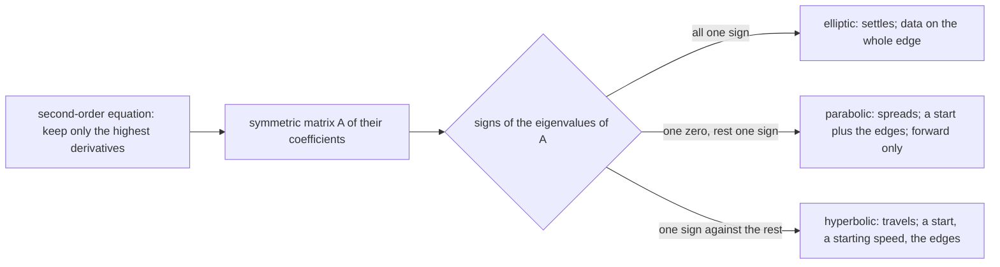

# Elliptic, parabolic, hyperbolic: three families with three behaviours

[Syllabus](../../../SYLLABUS.md) → [Partial differential equations](../README.md) → [Classification and Well-Posedness](../README.md#s01) → Elliptic, parabolic, hyperbolic

---

## General Overview

One rectangular frame, 1 m by 0.5 m, holds three problems.

- **Held steady.** A steel plate fills the frame. One long edge sits on a hot rail at 100 °C. The other three edges sit in ice water at 0 °C. The unknown is the temperature at each point, once nothing changes any more. Its centre settles at **44.51 °C**.
- **Cooling.** The same plate gets a weld spot at its centre and is left to cool, all four edges in ice water at 0 °C. The unknown is the temperature at each point and each moment. Ten minutes on, the spot has spread along the plate's length into a bell of standard width **12.0 cm**.
- **Ringing.** A drum skin is stretched on the same frame and tapped at its centre. The unknown is the skin's height at each point and moment. The tap reaches the long sides after **2.50 ms** and the short sides after **5.00 ms**.

The three problems behave in three ways. The steady plate **settles**: every point answers to the whole edge at once. The cooling plate **spreads**: heat smooths out, a little everywhere at once, and only forward in time. The drum **travels**: a disturbance moves at a fixed speed, and points it has not reached yet are still.

[A partial differential equation](../../08-Differential%20equations%20and%20dynamics/10-The%20Classical%20PDEs/01-what-a-pde-says.md) sorted equations by the sign of $`B^2 - 4AC`$ and, with more variables, by the signs of the coefficient matrix's eigenvalues. This card adds the principal symbol behind that test, the characteristic surfaces in any number of variables along which a disturbance can move, and uniform ellipticity, a test that keeps the sorting valid over a whole region.

**Read the highest derivatives of a second-order equation as a symmetric matrix; the signs of its eigenvalues name the family, and the family predicts whether solutions settle, spread or travel, and what data they need.**

**What kind of fact this is:** the family names are a definition. That the signs survive any change of coordinates is a theorem (Sylvester's law of inertia), proved in Why it works. The behaviours are shown here on the three model equations with numbers; each is proved in general on its own card.

### The picture: from the equation to the behaviour



Each branch names a family, what its solutions do, and the data that pins them down.

---

## The formula

Notation first. The unknown $`u`$ depends on $`d`$ variables $`x_1, \dots, x_d`$, where $`d`$ is the dimension; for the cooling plate these are $`x`$, $`y`$ and time $`t`$, so $`d = 3`$. Write $`\partial_i u`$ for the rate of $`u`$ in variable $`x_i`$, and $`\partial_i \partial_j u`$ for the rate taken twice: wing 08's $`u_{xx}`$, $`u_{xy}`$ and so on.

Every second-order linear equation can be written with its highest derivatives first:

```math
L u = \sum_{i,j=1}^{d} a_{ij}(x)\, \partial_i \partial_j u + (\text{lower-order terms}) = f .
```

The numbers $`a_{ij}`$ form a symmetric matrix $`A = (a_{ij})`$, with $`a_{ij} = a_{ji}`$. Replace each $`\partial_i`$ by a number $`\xi_i`$ and keep only the top part. That gives the **principal symbol** $`p`$:

```math
p(x, \xi) = \sum_{i,j=1}^{d} a_{ij}(x)\, \xi_i \xi_j = \xi^T A(x)\, \xi .
```

**Read it aloud:** at the point $`x`$, take a direction $`\xi`$, square it through the matrix of top coefficients, and read off one number.

The symbol is a quadratic form ([Quadratic forms](../../03-Algebra/07-Eigenvalues%20and%20Symmetric%20Matrices/05-quadratic-forms-and-positive-definite.md)). So its signs are the signs of the eigenvalues $`\lambda_1, \dots, \lambda_d`$ of $`A`$, and those name the family at the point $`x`$:

```math
\text{elliptic: all } \lambda_i \text{ one sign} \qquad \text{parabolic: one } \lambda_i = 0, \text{ the rest one sign} \qquad \text{hyperbolic: one } \lambda_i \text{ against the other } d-1
```

**Read it aloud:** count the plus signs, minus signs and zeros among the eigenvalues; all alike is elliptic, one zero is parabolic, one odd one out is hyperbolic.

A surface $`\varphi(x) = \text{constant}`$ is **characteristic** when its normal direction $`\nabla \varphi`$ makes the symbol vanish:

```math
p(x, \nabla \varphi) = 0 .
```

**Read it aloud:** a surface is characteristic when the top of the equation, pointed straight across it, gives zero.

Over a region $`\Omega`$, an equation is **uniformly elliptic** when one number $`\theta > 0`$, the **ellipticity constant**, works at every point (flip the equation's sign first if its eigenvalues are negative):

```math
p(x, \xi) \ge \theta\, |\xi|^2 \quad \text{for every } x \text{ in } \Omega \text{ and every } \xi .
```

**Read it aloud:** in every direction and at every point, the symbol stays at least $`\theta`$ times the squared length of the direction.

| Symbol | Plain meaning | In our example | Push it up and the answer… |
| --- | --- | --- | --- |
| $`u`$; $`L`$, $`f`$ | the unknown: temperature in °C, or the skin's height; the operator applied to it, and the given right side | centre of the steady plate: 44.51 °C; $`f = 0`$ on all three | — |
| $`x = (x_1, \dots, x_d)`$, $`d`$, $`t`$; $`n`$ | the variables, how many there are, and time; $`n`$ numbers the terms of a series | $`(x, y)`$ steady; $`(x, y, t)`$ cooling and ringing | more variables, more eigenvalues to sign |
| $`\partial_i`$, $`\Delta u`$ | rate in variable $`x_i`$; the Laplacian $`u_{xx} + u_{yy}`$ | $`\Delta u = 0`$ steady | — |
| $`a_{ij}`$, $`A`$; $`J`$, $`\tilde x`$, $`\tilde A`$ | the coefficients of the top derivatives, as a symmetric matrix; $`J`$ the Jacobian of a change to new variables $`\tilde x`$, which turns $`A`$ into $`\tilde A`$ | drum: diagonal 10000, 10000, −1 | a big off-diagonal can flip the family |
| $`\xi = (\xi_1, \dots, \xi_d)`$; $`K`$ | a direction, standing in for the derivatives; $`K`$ a large number that makes a ripple fine | $`(0, 0, 1)`$ points along time | — |
| $`p(x, \xi)`$ | the principal symbol | cooling along time: 0 | sign pattern decides the family |
| $`\lambda_1, \dots, \lambda_d`$; $`P`$, $`V`$ | eigenvalues of $`A`$; in Step 1's proof, how many are positive, and a space of directions | cooling: 0.000012, 0.000012, 0 | only their signs count |
| $`\varphi`$, $`\nabla\varphi`$ | a function whose level sets are surfaces; its gradient, the surface's normal | drum: $`\varphi = r - ct`$, a cone | — |
| $`\Omega`$ | the region where the equation holds | the 1 m by 0.5 m frame | — |
| $`\theta`$ | ellipticity constant, the least the symbol can be per unit length squared | tapered plate: 0.1 W/K | the edge holds the solution more firmly; at 0 it stops counting |
| $`\kappa`$, $`c`$, $`s`$ | steel's diffusivity in m²/s; the drum's wave speed in m/s; a front speed under test | $`1.2 \times 10^{-5}`$ (illustrative); 100 | faster spreading; faster travel |
| $`k`$, $`h(x)`$ | steel's conductivity in W/(m K); plate thickness in m | 50 (illustrative); 10 mm down to 2 mm | thinner, smaller $`\theta`$ |

The three plate problems, with every term on the left:

```math
u_{xx} + u_{yy} = 0, \qquad \kappa\,(u_{xx} + u_{yy}) - u_t = 0, \qquad c^2\,(u_{xx} + u_{yy}) - u_{tt} = 0 .
```

Their matrices, in the variables $`(x, y)`$, $`(x, y, t)`$ and $`(x, y, t)`$, are diagonal: `(1, 1)`, `(κ, κ, 0)` and `(c², c², −1)`. The first-order $`u_t`$ does not vote.

### When it holds

- **Second order, linear in the top derivatives.** A first-order equation has no matrix to sign ([Linear or not](02-linear-nonlinear-and-superposition.md) covers equations that are not linear). For a nonlinear one, the matrix depends on the solution itself, so the family can change as the solution moves.
- **Point by point.** With varying $`a_{ij}`$ the family belongs to each point, and can change across a line, as Tricomi's equation does on [A partial differential equation](../../08-Differential%20equations%20and%20dynamics/10-The%20Classical%20PDEs/01-what-a-pde-says.md).
- **Uniformly, for theorems.** Elliptic at every point is not enough: $`\theta`$ must stay above zero over the whole region. Step 4 shows a plate whose $`\theta`$ falls to 0 at a knife edge, and what breaks.
- **Diffusion needs a first derivative too.** The signs call an equation parabolic from its top part alone. To spread like heat, the zero eigenvalue's direction must also carry a first-order term, like $`u_t`$. Without it, $`u_{xx} = 0`$ in $`(x, y)`$ is parabolic by its signs but only gives straight lines in $`x`$, not a diffusion.
- **The three families are not everything.** With four or more variables, two plus signs and two minus signs give an "ultrahyperbolic" equation. A fourth-order equation, like a ringing steel plate's, is outside the scheme altogether.

---

## Why it works

### Step 0: fine ripples feel only the top of the equation

Put a fine ripple $`u = \sin(K\, \xi \cdot x)`$ into the equation, with $`K`$ large. Here $`\xi \cdot x`$ means $`\xi_1 x_1 + \dots + \xi_d x_d`$. Each top derivative brings a factor $`K^2`$; the lower-order terms bring only $`K`$ or 1. So for fine ripples the equation is, to leading order, $`-K^2 p(x, \xi)\, u`$.

The symbol therefore decides how the smallest details behave. A symbol that cannot vanish ties every ripple down: the elliptic case, which settles. A symbol that is zero in some directions lets ripples along them pass untouched, as travelling waves: the hyperbolic case, which travels. The parabolic symbol is zero only along time, and a ripple in time alone is not a solution; there the first-order $`u_t`$ takes over, as "Diffusion needs a first derivative too" in When it holds explains.

### Step 1: the sign pattern is the same in every coordinate system

Change to new variables $`\tilde x = F(x)`$, with Jacobian matrix $`J`$ (the table of rates $`\partial \tilde x_i / \partial x_j`$, never singular). The chain rule turns the top coefficients into $`J A J^T`$. Lower-order terms pick up extra pieces, but the top part changes only by this sandwich.

Sylvester's law of inertia says a sandwich $`J A J^T`$ keeps the number of positive, negative and zero eigenvalues. Their sizes change; their signs do not. So the family is a property of the equation, not of the coordinates.

So the drum's eigenvalues 10000 and −1 are harmless. Measured in a time unit of 0.01 s, the time term also carries a factor 10000, and dividing the equation by 10000 leaves 1 and −1. With constant coefficients, the same law lets one linear change of variables reduce the top part to a sum of plus and minus squares: $`\Delta u`$, or $`\Delta u - u_{tt}`$, or for parabolic $`\Delta u`$ in one variable fewer, which with its first-order term is $`\Delta u - u_t`$. With varying coefficients, one change does this only at a single point. Finding those coordinates is [Canonical form](05-reduction-to-canonical-form.md).

<details>
<summary>Detailed proof: a sandwich keeps the signs</summary>

Let $`A`$ be symmetric and $`J`$ invertible, and set $`\tilde A = J A J^T`$. The two quadratic forms match when the direction $`\xi`$ is swapped for $`J^T \xi`$:

$`\displaystyle \xi^T \tilde A\, \xi = (J^T \xi)^T A\, (J^T \xi) .`$

Let $`P`$ be the number of positive eigenvalues of $`A`$. Then $`A`$ is positive on a space of directions of dimension $`P`$ (spanned by those eigenvectors), and it is at most zero on a space of dimension $`d - P`$.

Suppose $`\tilde A`$ were positive on a space $`V`$ of dimension more than $`P`$. Then $`J^T V`$ also has dimension more than $`P`$, since $`J^T`$ is invertible, and $`A`$ is positive on it. Two spaces of dimensions more than $`P`$ and $`d - P`$ inside $`d`$ dimensions share a nonzero direction, where $`A`$ would be both positive and at most zero. So $`\tilde A`$ has at most $`P`$ positive eigenvalues.

Swap the roles of $`A`$ and $`\tilde A`$, using $`A = J^{-1} \tilde A J^{-T}`$: they have exactly as many positive eigenvalues. The same argument for $`-A`$ counts the negative ones, and the zeros are what is left.

</details>

### Step 2: characteristic surfaces are where data cannot steer the solution

Suppose $`u`$ and its rate across a surface $`\varphi = 0`$ are handed in, as starting data. Along the surface, every derivative that runs within it is then known. The one second derivative still unknown is the second rate straight across.

In the equation, that rate is multiplied by exactly $`p(x, \nabla\varphi)`$. Two cases follow.

1. **The symbol is not zero.** Divide by it: the equation gives the missing rate. The data steer the solution off the surface.
2. **The symbol is zero.** The missing rate drops out. The equation becomes a condition the data must already meet, and the solution can kink across the surface. A kink, a jump in a second derivative, can ride along such a surface.

Now the three plate problems.

- **Drum.** Take the cone $`\varphi = \sqrt{x^2 + y^2} - c t`$. The code finds its normal by centred differences at two points; the symbol on it is 0.000000 against a scale of $`c^2 = 10000`$. The cone is characteristic: a tap travels out on it at $`c`$. A bisection on $`p(\xi, -s) = 0`$ finds the front speed $`s`$ = 100.000000 m/s.
- **Cooling.** The slice $`t = \text{constant}`$ has normal $`(0, 0, 1)`$, and its symbol is 0.0. So the starting time is itself characteristic. The equation hands back $`u_t = \kappa \Delta u`$ from the starting temperatures. A starting rate cannot also be given, and no front moves at a finite speed.
- **Steady plate.** The symbol is $`\xi_1^2 + \xi_2^2`$, zero only for the zero direction. No surface is characteristic. Nothing travels; every point is tied to every other.

### Step 3: what each family needs, and what its solutions do

The characteristic surfaces decide which data make a **well-posed** problem: one solution, which moves little when the data move ([Well posed](06-well-posedness-and-hadamard.md)).

| Family | Data that pins it down | Behaviour | On our frame |
| --- | --- | --- | --- |
| elliptic | a condition on the whole edge | settles: each point a weighted mean of the edge | centre 44.51 °C |
| parabolic | a starting state, plus the edges | spreads: instantly, everywhere, forward only | spot of standard width 12.0 cm along the length at 10 min |
| hyperbolic | a starting state and starting speed, plus the edges | travels: at speed $`c`$, along cones | sides reached at 2.50 and 5.00 ms |

The edge conditions can fix a value, a flow or a mix ([Boundary conditions](03-boundary-conditions-dirichlet-neumann-and-robin.md)).

**Settles.** The steady centre comes from a sum of sine-shaped terms, odd $`n`$ up to 15, giving 44.5115 °C; the first omitted term is 0.000012 °C. A grid at 2.5 cm spacing repeatedly moves each point to its four neighbours' mean, overshooting a little to converge faster (over-relaxation). It lands at 44.4881 °C. It lies between 0 °C and 100 °C, as it must ([Maximum principles](08-maximum-principles.md)).

**Spreads.** On an open plate, far from any edge, a spot's spread has standard width $`\sqrt{2 \kappa t}`$ in each direction, so 12.0000 cm after 600 s. Along this plate's 1 m length, with the 0 °C ends 0.5 m from the spot, a grid run gives 11.9941 cm: the ends barely touch it. Across the 0.5 m width, the long edges are only 0.25 m from the spot, and their 0 °C trims the bell narrower. The heat reaches everywhere at once, but barely: 0.5 m away after 1 s, the bell is $`10^{-2262}`$ of its peak. With the plate's edges held at 0 °C, its slowest pattern fades with time constant $`1/(\kappa \pi^2 (1/1^2 + 1/0.5^2))`$ = 1688.7 s, about 28 minutes. Then the cooling plate has settled too.

**Travels.** The tap moves at $`c = \sqrt{2000/0.2}`$ = 100 m/s, from a tension of 2000 N/m over 0.2 kg/m² (illustrative). It covers 0.25 m to the long sides in 2.50 ms. Until then, the skin beside those sides stays still ([Dependence and influence](09-domains-of-dependence-and-influence.md)). The skin's lowest note is 111.80 Hz.

### Step 4: uniform ellipticity keeps the edge in charge

Elliptic at each point is not always enough. Take a steel plate that tapers from 10 mm thick at its left edge to 2 mm at its right. The long sides are insulated. The left edge is held at 100 °C, the right at 0 °C.

Steady heat flow obeys $`\nabla \cdot (k h \nabla u) = 0`$. Its top part is $`k h(x)\, \Delta u`$, so $`A = k h(x)`$ times the identity. The smallest value is at the thin edge: $`\theta = 50 \times 0.002`$ = 0.1 W/K.

The heat flow per metre of width is 24.8534 W/m. The middle sits at 68.2606 °C. The thin end resists most, so the temperature drops fastest there.

Now taper the plate to a knife edge, thickness 0 at the right. Every inside point is still elliptic, but $`\theta = 0`$. Cut it 1 mm short of the tip and the heat flow is 7.2382 W/m; cut it 0.001 mm short and it is 3.6191 W/m, falling to 0 as the cut shrinks. The middle climbs from 89.9657 °C to 94.9828 °C, toward 100 °C. The 0 °C edge stops counting. The theory that says "edge data pins the solution" needs $`\theta > 0`$.

The same constant runs through the other two families. In the standard forms, parabolic is $`u_t - \sum a_{ij} \partial_i \partial_j u`$ and hyperbolic $`u_{tt} - \sum a_{ij} \partial_i \partial_j u`$, both with the space part uniformly elliptic.

---

## Worked numbers, by hand

| Step | Arithmetic | Value |
| --- | --- | --- |
| steady plate, matrix in $`(x, y)`$ | diagonal 1, 1 | signs + +: **elliptic** |
| cooling plate, matrix in $`(x, y, t)`$ | diagonal $`\kappa`$, $`\kappa`$, 0 | + + 0, with $`u_t`$ present: **parabolic** |
| drum, matrix in $`(x, y, t)`$ | diagonal $`100^2`$, $`100^2`$, −1 | + + −: **hyperbolic** |
| drum front speed | $`\sqrt{2000 / 0.2}`$ | 100 m/s |
| tap to the long sides | 0.25 ÷ 100 | 2.50 ms |
| tap to the short sides | 0.5 ÷ 100 | 5.00 ms |
| spot width after 600 s, open plate | $`\sqrt{2 \times 1.2\times 10^{-5} \times 600} = \sqrt{0.0144}`$ | 0.120 m |
| plate's slowest fade | $`1 / (1.2\times 10^{-5} \times 9.8696 \times 5)`$ | 1688.7 s |
| tapered plate, $`\theta`$ | 50 × 0.002 | 0.1 W/K |
| steady centre | series, odd $`n`$ to 15 | **44.51 °C** |

The frame is the same; the equation's matrix alone decides that the plate settles to 44.51 °C at its centre, the spot spreads to 12 cm along the length, and the drum's tap arrives at the sides on a schedule.

### What breaks if you drop a piece

| Mistake | Comes out at | What went wrong |
| --- | --- | --- |
| Judge $`u_{xx} + u_{yy} + u_{zz} + 4(u_{xy} + u_{yz} + u_{xz})`$ by its diagonal 1, 1, 1 | "elliptic"; eigenvalues are really 5, −1, −1: hyperbolic | the off-diagonal entries of 2 decide the signs |
| Put the whole coefficient 2 of $`2u_{xy}`$ off the diagonal | eigenvalues 3, −1: hyperbolic; right is 2, 0: parabolic | $`2u_{xy}`$ splits as $`a_{12} = a_{21} = 1`$ |
| Ring a 5 mm steel plate as if it were the drum | bending waves at 47.99 m/s for 1 m waves, 479.86 m/s for 0.1 m waves | a plate bends: a fourth-order equation, outside this sorting; no single speed, no cone |
| Trust pointwise ellipticity on a knife-edge plate | heat flow 3.6191 W/m and falling to 0; middle 94.98 °C | $`\theta = 0`$: the 0 °C edge stops pinning the solution |

The steel plate uses Young's modulus (resistance to stretching) 200 GPa, Poisson ratio 0.3 and 7850 kg/m³ (illustrative), so its bending stiffness is 2289.4 N m and its mass 39.25 kg/m². Its wave speed grows in proportion to $`1/\text{wavelength}`$. So a tap on the plate has no single front speed and no characteristic cone.

---

## Code, from first principles, and it actually runs

The code sorts six equations by three independent roads. Road one finds eigenvalues by Jacobi rotations, which zero the off-diagonal entries pair by pair. Road two finds none: Descartes' rule of signs counts sign changes in the characteristic polynomial's coefficients, exact here because a symmetric matrix has real eigenvalues. Road three samples the symbol over unit directions. Then it checks four behaviours, each two ways:

- the characteristic cone, by numerical slopes and a bisection;
- the steady centre, by a series against a relaxed grid;
- the spread, by a formula against a stepped grid;
- the tapered plate, by Simpson's rule against a closed form.

### Python

```python
# Elliptic, parabolic, hyperbolic -- the check behind the card.  Only math is imported.
# Road one finds each principal matrix's eigenvalues by Jacobi rotations.  Road two counts
# their signs from the characteristic polynomial by Descartes' rule, with no eigenvalues.
# Road three scans the principal symbol over unit directions.  The three behaviours are
# checked by a series against a relaxed grid and a formula against a stepped grid.
from math import sqrt, pi, cos, sin, cosh, log, atan2

def jacobi(A):                             # road one: rotate the off-diagonal entries away
    a = [row[:] for row in A]; n = len(a)
    for _ in range(30):
        for p in range(n):
            for q in range(p + 1, n):
                t = 0.5 * atan2(2 * a[p][q], a[q][q] - a[p][p]); c, s = cos(t), sin(t)
                for k in range(n):
                    a[k][p], a[k][q] = c * a[k][p] - s * a[k][q], s * a[k][p] + c * a[k][q]
                for k in range(n):
                    a[p][k], a[q][k] = c * a[p][k] - s * a[q][k], s * a[p][k] + c * a[q][k]
    ev = sorted((a[i][i] for i in range(n)), reverse=True)
    big = max(abs(v) for v in ev)
    return [0.0 if abs(v) < 1e-12 * big else v for v in ev]

def charpoly(A):                           # det(lambda I - A), highest power first
    if len(A) == 2:
        return [1.0, -(A[0][0] + A[1][1]), A[0][0] * A[1][1] - A[0][1] * A[1][0]]
    (a, b, c), (d, e, f), (g, h, i) = A
    det = a * (e * i - f * h) - b * (d * i - f * g) + c * (d * h - e * g)
    return [1.0, -(a + e + i), a * e - b * d + a * i - c * g + e * i - f * h, -det]

def descartes(cp):                         # road two: root signs read off the coefficients
    zero = 0
    while cp[-1] == 0: cp = cp[:-1]; zero += 1
    m = len(cp) - 1
    flips = lambda c: sum(1 for u, v in zip(c, c[1:]) if u * v < 0)
    return flips(cp), flips([x * (-1) ** (m - k) for k, x in enumerate(cp)]), zero

def symbol(A, xi): return sum(A[i][j] * xi[i] * xi[j] for i in range(len(A)) for j in range(len(A)))

def scan(A):                               # road three: the symbol over unit directions
    if len(A) == 2: ds = [(cos(pi * j / 360), sin(pi * j / 360)) for j in range(360)]
    else: ds = [(sin(pi * i / 180) * cos(pi * j / 180), sin(pi * i / 180) * sin(pi * j / 180), cos(pi * i / 180))
                for i in range(181) for j in range(360)]
    ps = [symbol(A, d) for d in ds]; lo, hi = min(ps), max(ps); tol = 1e-9 * max(abs(lo), abs(hi))
    return lo, hi, "both signs" if lo < -tol and hi > tol else ("touches 0" if min(abs(lo), abs(hi)) <= tol else "never 0")

def family(pos, neg, zero, n):
    if zero == 0 and max(pos, neg) == n: return "elliptic"
    if zero == 1 and max(pos, neg) == n - 1: return "parabolic"
    if zero == 0 and min(pos, neg) == 1: return "hyperbolic"
    return "none of the three"

KAP, C = 1.2e-5, sqrt(2000 / 0.2)          # steel diffusivity m^2/s; drum speed m/s from 2000 N/m over 0.2 kg/m^2
CASES = [("held steady  u_xx + u_yy = 0 in (x, y)", [[1, 0], [0, 1]]),
         ("cooling      kappa(u_xx + u_yy) - u_t = 0 in (x, y, t)", [[KAP, 0, 0], [0, KAP, 0], [0, 0, 0]]),
         ("drum ringing c^2(u_xx + u_yy) - u_tt = 0 in (x, y, t)", [[C * C, 0, 0], [0, C * C, 0], [0, 0, -1]]),
         ("trap         u_xx + u_yy + u_zz + 4(u_xy + u_yz + u_xz)", [[1, 2, 2], [2, 1, 2], [2, 2, 1]]),
         ("halved right u_xx + 2u_xy + u_yy, off-diagonal 1", [[1, 1], [1, 1]]),
         ("not halved   u_xx + 2u_xy + u_yy, off-diagonal 2", [[1, 2], [2, 1]])]
fams = {}
for name, A in CASES:
    ev = jacobi(A); n = len(A)
    s1 = (sum(v > 0 for v in ev), sum(v < 0 for v in ev), sum(v == 0 for v in ev))
    s2 = descartes(charpoly(A)); lo, hi, s3 = scan(A)
    fams[name[:12].strip()] = family(*s1, n)
    print(f"{name}: eigenvalues {', '.join(f'{v:.6f}' for v in ev)}; signs +{s1[0]} -{s1[1]} 0x{s1[2]}"
          f" -> {family(*s1, n)}; Descartes +{s2[0]} -{s2[1]} 0x{s2[2]}; scan {lo:.6f} to {hi:.6f}, {s3}")
    assert s1 == s2                         # eigenvalue signs and coefficient signs agree
    assert (s3 == "both signs") == (s1[0] > 0 and s1[1] > 0) and (s3 == "touches 0") == (s1[2] > 0)

# characteristic surfaces: the cone r = c t for the drum, the slices t = const for cooling
for x, y, t in [(0.3, 0.1, 0.002), (-0.2, 0.25, 0.004)]:
    e = 1e-6; phi = lambda x, y, t: sqrt(x * x + y * y) - C * t
    g = [(phi(x + e, y, t) - phi(x - e, y, t)) / (2 * e), (phi(x, y + e, t) - phi(x, y - e, t)) / (2 * e),
         (phi(x, y, t + e) - phi(x, y, t - e)) / (2 * e)]
    pc = symbol(CASES[2][1], g)
    print(f"cone at ({x}, {y}, {t}): drum symbol on the cone's normal, size {abs(pc):.6f} against c^2 = {C * C:.0f}")
    assert abs(pc) < 1e-4 * C * C
print(f"slice t = const: cooling symbol {symbol(CASES[1][1], [0, 0, 1]):.1f}, drum symbol {symbol(CASES[2][1], [0, 0, 1]):.1f}")
lo_, hi_ = 0.0, 1e6                         # front speed s with symbol(n, -s) = 0, by bisection
for _ in range(200):
    mid = (lo_ + hi_) / 2
    lo_, hi_ = (mid, hi_) if symbol(CASES[2][1], [1, 0, -mid]) > 0 else (lo_, mid)
print(f"travel: drum front speed by bisection {lo_:.6f} m/s, formula sqrt(T/sigma) {C:.6f} m/s; "
      f"centre tap reaches long edges after {0.25 / C * 1000:.2f} ms, short edges {0.5 / C * 1000:.2f} ms; "
      f"lowest note {C / 2 * sqrt(1 / 1 ** 2 + 1 / 0.5 ** 2):.2f} Hz")
assert abs(lo_ - C) < 1e-6

# settle: steady plate 1 m by 0.5 m, long edge y = 0 at 100 C, other edges 0 C, centre value
term = lambda n: 400 / (n * pi) * sin(n * pi / 2) / (2 * cosh(n * pi * 0.25))
ser = sum(term(n) for n in range(1, 16, 2))
nx, ny, w = 40, 20, 1.78
u = [[100.0 if j == 0 and 0 < i < nx else 0.0 for i in range(nx + 1)] for j in range(ny + 1)]
for sweep in range(1, 3001):
    big = 0.0
    for j in range(1, ny):
        for i in range(1, nx):
            d = w * ((u[j][i - 1] + u[j][i + 1] + u[j - 1][i] + u[j + 1][i]) / 4 - u[j][i]); u[j][i] += d; big = max(big, abs(d))
    if big < 1e-10: break
print(f"settle: centre {ser:.4f} C by series to n = 15 (first omitted term {abs(term(17)):.6f} C), "
      f"{u[ny // 2][nx // 2]:.4f} C by relaxation at h = 0.025 m in {sweep} sweeps")
assert abs(ser - u[ny // 2][nx // 2]) < 0.1

# spread: a weld spot across a 1 m strip, explicit steps, its variance against 2 kappa t
h, r = 0.01, 0.25; dt = r * h * h / KAP; v = [0.0] * 101; v[50] = 1.0
for _ in range(288): v = [0.0] + [v[j] + r * (v[j - 1] - 2 * v[j] + v[j + 1]) for j in range(1, 100)] + [0.0]
var = sum((j * h - 0.5) ** 2 * v[j] for j in range(101)) / sum(v)
print(f"spread: after {288 * dt:.1f} s the spot's standard width is {100 * sqrt(var):.4f} cm on the grid, "
      f"{100 * sqrt(2 * KAP * 600):.4f} cm from sqrt(2 kappa t); slowest mode of the plate fades with time constant "
      f"{1 / (KAP * pi * pi * 5):.1f} s; at 0.5 m after 1 s the kernel is 10^{-0.25 / (4 * KAP) / log(10):.1f} of its peak")
assert abs(sqrt(var) - sqrt(2 * KAP * 600)) < 1e-4

# uniform ellipticity: a tapered plate, thickness 10 mm at x = 0 down to the tip, steel k = 50 W/(m K)
def taper(tip, eps=0.0):                   # A(x) = k h(x) I; theta, heat flow per metre of width, middle temperature
    hx = lambda x: 0.010 * (1 - (1 - tip / 0.010) * x)
    theta = min(scan([[50 * hx(i / 100), 0], [0, 50 * hx(i / 100)]])[0] for i in range(101) if i / 100 <= 1 - eps)
    m = 2000; L = 1 - eps; f = lambda x: 1 / (50 * hx(x))
    simp = lambda b: (b / m / 3) * sum((1 if k in (0, m) else 4 if k % 2 else 2) * f(b * k / m) for k in range(m + 1))
    q = 100 / simp(L)
    return theta, q, 100 - q * simp(0.5)
for tip in (0.002, 0.001):
    th, q, mid = taper(tip); a = 1 - tip / 0.010
    qf = 100 * 0.5 * a / log(1 / (1 - a)); midf = 100 - qf * log(1 / (1 - a / 2)) / (0.5 * a)
    print(f"taper to {tip * 1000:.0f} mm: theta {th:.4f} W/K; heat flow {q:.4f} W/m (closed form {qf:.4f}); middle {mid:.4f} C (closed form {midf:.4f})")
    assert abs(th - 50 * tip) < 1e-12 and abs(q - qf) < 1e-6 and abs(mid - midf) < 1e-6
for eps in (1e-3, 1e-6):                    # knife edge, cut eps short of the tip: theta = 50 * 0.01 * eps
    q = 100 * 0.5 / log(1 / eps)
    print(f"knife edge cut {eps:.6f} m short: theta {50 * 0.010 * eps:.7f} W/K; heat flow {q:.4f} W/m; middle {100 - q * log(2) / 0.5:.4f} C")

# what breaks: a ringing steel plate bends, a fourth-order equation; E 200 GPa, nu 0.3, 5 mm, 7850 kg/m^3
D = 200e9 * 0.005 ** 3 / (12 * (1 - 0.3 ** 2)); m = 7850 * 0.005
print(f"steel plate: D {D:.1f} N m, mass {m:.2f} kg/m^2; bending wave speed {sqrt(D / m) * 2 * pi / 1.0:.2f} m/s "
      f"at 1 m wavelength, {sqrt(D / m) * 2 * pi / 0.1:.2f} m/s at 0.1 m: no single speed")
# try changing: the trap's off-diagonal entries
for off in (0.4, -0.5):
    ev = jacobi([[1, off, off], [off, 1, off], [off, off, 1]])
    print(f"try: trap off-diagonal {off:.1f}: eigenvalues {', '.join(f'{v:.6f}' for v in ev)}")
print(f"try: drum tension 8000 N/m: speed {sqrt(8000 / 0.2):.1f} m/s, long edges after {0.25 / sqrt(8000 / 0.2) * 1000:.3f} ms, "
      f"lowest note {sqrt(8000 / 0.2) / 2 * sqrt(5):.2f} Hz")
assert fams["held steady"] == "elliptic" and fams["cooling"] == "parabolic" and fams["drum ringing"] == "hyperbolic"
assert fams["trap"] == "hyperbolic" and fams["halved right"] == "parabolic" and fams["not halved"] == "hyperbolic"
print("ALL CHECKS PASS")
```

**Ran 2026-11-15 on macOS, Python 3.14.10, standard library only. All checks passed. Output, pasted from the run:**

```
held steady  u_xx + u_yy = 0 in (x, y): eigenvalues 1.000000, 1.000000; signs +2 -0 0x0 -> elliptic; Descartes +2 -0 0x0; scan 1.000000 to 1.000000, never 0
cooling      kappa(u_xx + u_yy) - u_t = 0 in (x, y, t): eigenvalues 0.000012, 0.000012, 0.000000; signs +2 -0 0x1 -> parabolic; Descartes +2 -0 0x1; scan 0.000000 to 0.000012, touches 0
drum ringing c^2(u_xx + u_yy) - u_tt = 0 in (x, y, t): eigenvalues 10000.000000, 10000.000000, -1.000000; signs +2 -1 0x0 -> hyperbolic; Descartes +2 -1 0x0; scan -1.000000 to 10000.000000, both signs
trap         u_xx + u_yy + u_zz + 4(u_xy + u_yz + u_xz): eigenvalues 5.000000, -1.000000, -1.000000; signs +1 -2 0x0 -> hyperbolic; Descartes +1 -2 0x0; scan -1.000000 to 4.999872, both signs
halved right u_xx + 2u_xy + u_yy, off-diagonal 1: eigenvalues 2.000000, 0.000000; signs +1 -0 0x1 -> parabolic; Descartes +1 -0 0x1; scan 0.000000 to 2.000000, touches 0
not halved   u_xx + 2u_xy + u_yy, off-diagonal 2: eigenvalues 3.000000, -1.000000; signs +1 -1 0x0 -> hyperbolic; Descartes +1 -1 0x0; scan -1.000000 to 3.000000, both signs
cone at (0.3, 0.1, 0.002): drum symbol on the cone's normal, size 0.000000 against c^2 = 10000
cone at (-0.2, 0.25, 0.004): drum symbol on the cone's normal, size 0.000000 against c^2 = 10000
slice t = const: cooling symbol 0.0, drum symbol -1.0
travel: drum front speed by bisection 100.000000 m/s, formula sqrt(T/sigma) 100.000000 m/s; centre tap reaches long edges after 2.50 ms, short edges 5.00 ms; lowest note 111.80 Hz
settle: centre 44.5115 C by series to n = 15 (first omitted term 0.000012 C), 44.4881 C by relaxation at h = 0.025 m in 122 sweeps
spread: after 600.0 s the spot's standard width is 11.9941 cm on the grid, 12.0000 cm from sqrt(2 kappa t); slowest mode of the plate fades with time constant 1688.7 s; at 0.5 m after 1 s the kernel is 10^-2262.0 of its peak
taper to 2 mm: theta 0.1000 W/K; heat flow 24.8534 W/m (closed form 24.8534); middle 68.2606 C (closed form 68.2606)
taper to 1 mm: theta 0.0500 W/K; heat flow 19.5433 W/m (closed form 19.5433); middle 74.0363 C (closed form 74.0363)
knife edge cut 0.001000 m short: theta 0.0005000 W/K; heat flow 7.2382 W/m; middle 89.9657 C
knife edge cut 0.000001 m short: theta 0.0000005 W/K; heat flow 3.6191 W/m; middle 94.9828 C
steel plate: D 2289.4 N m, mass 39.25 kg/m^2; bending wave speed 47.99 m/s at 1 m wavelength, 479.86 m/s at 0.1 m: no single speed
try: trap off-diagonal 0.4: eigenvalues 1.800000, 0.600000, 0.600000
try: trap off-diagonal -0.5: eigenvalues 1.500000, 1.500000, 0.000000
try: drum tension 8000 N/m: speed 200.0 m/s, long edges after 1.250 ms, lowest note 223.61 Hz
ALL CHECKS PASS
```

### Rust

```rust
// Elliptic, parabolic, hyperbolic -- the same check as the Python, in Rust.  No crates.
// Road one finds each principal matrix's eigenvalues by Jacobi rotations.  Road two counts
// their signs from the characteristic polynomial by Descartes' rule, with no eigenvalues.
// Road three scans the principal symbol over unit directions.  The three behaviours are
// checked by a series against a relaxed grid and a formula against a stepped grid.
use std::f64::consts::PI;
type M = Vec<Vec<f64>>;

fn jacobi(a0: &M) -> Vec<f64> {            // road one: rotate the off-diagonal entries away
    let mut a = a0.clone(); let n = a.len();
    for _ in 0..30 {
        for p in 0..n {
            for q in p + 1..n {
                let t = 0.5 * (2.0 * a[p][q]).atan2(a[q][q] - a[p][p]); let (c, s) = (t.cos(), t.sin());
                for k in 0..n { let (x, y) = (a[k][p], a[k][q]); a[k][p] = c * x - s * y; a[k][q] = s * x + c * y; }
                for k in 0..n { let (x, y) = (a[p][k], a[q][k]); a[p][k] = c * x - s * y; a[q][k] = s * x + c * y; }
            }
        }
    }
    let mut ev: Vec<f64> = (0..n).map(|i| a[i][i]).collect();
    ev.sort_by(|x, y| y.partial_cmp(x).unwrap());
    let big = ev.iter().fold(0.0f64, |m, v| m.max(v.abs()));
    ev.iter().map(|&v| if v.abs() < 1e-12 * big { 0.0 } else { v }).collect()
}

fn charpoly(m: &M) -> Vec<f64> {           // det(lambda I - A), highest power first
    if m.len() == 2 { return vec![1.0, -(m[0][0] + m[1][1]), m[0][0] * m[1][1] - m[0][1] * m[1][0]]; }
    let (a, b, c, d, e, f, g, h, i) = (m[0][0], m[0][1], m[0][2], m[1][0], m[1][1], m[1][2], m[2][0], m[2][1], m[2][2]);
    let det = a * (e * i - f * h) - b * (d * i - f * g) + c * (d * h - e * g);
    vec![1.0, -(a + e + i), a * e - b * d + a * i - c * g + e * i - f * h, -det]
}

fn descartes(cp0: &[f64]) -> (usize, usize, usize) {   // road two: root signs read off the coefficients
    let mut cp = cp0.to_vec(); let mut zero = 0;
    while *cp.last().unwrap() == 0.0 { cp.pop(); zero += 1; }
    let m = cp.len() - 1;
    let flips = |c: &[f64]| c.windows(2).filter(|w| w[0] * w[1] < 0.0).count();
    let neg: Vec<f64> = cp.iter().enumerate().map(|(k, &x)| if (m - k) % 2 == 1 { -x } else { x }).collect();
    (flips(&cp), flips(&neg), zero)
}

fn symbol(a: &M, xi: &[f64]) -> f64 {
    let mut s = 0.0;
    for i in 0..a.len() { for j in 0..a.len() { s += a[i][j] * xi[i] * xi[j]; } }
    s
}

fn scan(a: &M) -> (f64, f64, &'static str) {   // road three: the symbol over unit directions
    let mut ds: Vec<Vec<f64>> = Vec::new();
    if a.len() == 2 { for j in 0..360 { let t = PI * j as f64 / 360.0; ds.push(vec![t.cos(), t.sin()]); } } else {
        for i in 0..181 { for j in 0..360 {
            let (u, v) = (PI * i as f64 / 180.0, PI * j as f64 / 180.0);
            ds.push(vec![u.sin() * v.cos(), u.sin() * v.sin(), u.cos()]);
        } }
    }
    let ps: Vec<f64> = ds.iter().map(|d| symbol(a, d)).collect();
    let lo = ps.iter().cloned().fold(f64::INFINITY, f64::min); let hi = ps.iter().cloned().fold(f64::NEG_INFINITY, f64::max);
    let tol = 1e-9 * lo.abs().max(hi.abs());
    (lo, hi, if lo < -tol && hi > tol { "both signs" } else if lo.abs().min(hi.abs()) <= tol { "touches 0" } else { "never 0" })
}

fn family(pos: usize, neg: usize, zero: usize, n: usize) -> &'static str {
    if zero == 0 && pos.max(neg) == n { "elliptic" } else if zero == 1 && pos.max(neg) == n - 1 { "parabolic" }
    else if zero == 0 && pos.min(neg) == 1 { "hyperbolic" } else { "none of the three" }
}

fn simpson(f: &dyn Fn(f64) -> f64, b: f64, m: usize) -> f64 {
    let mut s = 0.0;
    for k in 0..=m { let w = if k == 0 || k == m { 1.0 } else if k % 2 == 1 { 4.0 } else { 2.0 }; s += w * f(b * k as f64 / m as f64); }
    (b / m as f64 / 3.0) * s
}

fn join(v: &[f64]) -> String { v.iter().map(|x| format!("{:.6}", x)).collect::<Vec<_>>().join(", ") }

fn main() {
    let kap = 1.2e-5; let c = (2000.0f64 / 0.2).sqrt();   // steel diffusivity m^2/s; drum speed m/s
    let d = |v: Vec<Vec<f64>>| v;
    let cases: Vec<(&str, M)> = vec![
        ("held steady  u_xx + u_yy = 0 in (x, y)", d(vec![vec![1.0, 0.0], vec![0.0, 1.0]])),
        ("cooling      kappa(u_xx + u_yy) - u_t = 0 in (x, y, t)", d(vec![vec![kap, 0.0, 0.0], vec![0.0, kap, 0.0], vec![0.0, 0.0, 0.0]])),
        ("drum ringing c^2(u_xx + u_yy) - u_tt = 0 in (x, y, t)", d(vec![vec![c * c, 0.0, 0.0], vec![0.0, c * c, 0.0], vec![0.0, 0.0, -1.0]])),
        ("trap         u_xx + u_yy + u_zz + 4(u_xy + u_yz + u_xz)", d(vec![vec![1.0, 2.0, 2.0], vec![2.0, 1.0, 2.0], vec![2.0, 2.0, 1.0]])),
        ("halved right u_xx + 2u_xy + u_yy, off-diagonal 1", d(vec![vec![1.0, 1.0], vec![1.0, 1.0]])),
        ("not halved   u_xx + 2u_xy + u_yy, off-diagonal 2", d(vec![vec![1.0, 2.0], vec![2.0, 1.0]]))];
    let mut fams: Vec<&str> = Vec::new();
    for (name, a) in &cases {
        let ev = jacobi(a); let n = a.len();
        let s1 = (ev.iter().filter(|&&v| v > 0.0).count(), ev.iter().filter(|&&v| v < 0.0).count(), ev.iter().filter(|&&v| v == 0.0).count());
        let s2 = descartes(&charpoly(a)); let (lo, hi, s3) = scan(a);
        let fam = family(s1.0, s1.1, s1.2, n); fams.push(fam);
        println!("{}: eigenvalues {}; signs +{} -{} 0x{} -> {}; Descartes +{} -{} 0x{}; scan {:.6} to {:.6}, {}",
                 name, join(&ev), s1.0, s1.1, s1.2, fam, s2.0, s2.1, s2.2, lo, hi, s3);
        assert!(s1 == s2);
        assert!((s3 == "both signs") == (s1.0 > 0 && s1.1 > 0) && (s3 == "touches 0") == (s1.2 > 0));
    }
    // characteristic surfaces: the cone r = c t for the drum, the slices t = const for cooling
    let phi = |x: f64, y: f64, t: f64| (x * x + y * y).sqrt() - c * t;
    for &(x, y, t) in &[(0.3, 0.1, 0.002), (-0.2, 0.25, 0.004)] {
        let e = 1e-6;
        let g = [(phi(x + e, y, t) - phi(x - e, y, t)) / (2.0 * e), (phi(x, y + e, t) - phi(x, y - e, t)) / (2.0 * e),
                 (phi(x, y, t + e) - phi(x, y, t - e)) / (2.0 * e)];
        let pc = symbol(&cases[2].1, &g);
        println!("cone at ({}, {}, {}): drum symbol on the cone's normal, size {:.6} against c^2 = {:.0}", x, y, t, pc.abs(), c * c);
        assert!(pc.abs() < 1e-4 * c * c);
    }
    println!("slice t = const: cooling symbol {:.1}, drum symbol {:.1}", symbol(&cases[1].1, &[0.0, 0.0, 1.0]), symbol(&cases[2].1, &[0.0, 0.0, 1.0]));
    let (mut lo, mut hi) = (0.0f64, 1e6f64);   // front speed s with symbol(n, -s) = 0, by bisection
    for _ in 0..200 { let mid = (lo + hi) / 2.0; if symbol(&cases[2].1, &[1.0, 0.0, -mid]) > 0.0 { lo = mid } else { hi = mid } }
    println!("travel: drum front speed by bisection {:.6} m/s, formula sqrt(T/sigma) {:.6} m/s; centre tap reaches long edges after {:.2} ms, short edges {:.2} ms; lowest note {:.2} Hz",
             lo, c, 0.25 / c * 1000.0, 0.5 / c * 1000.0, c / 2.0 * (1.0 / 1.0f64.powi(2) + 1.0 / 0.5f64.powi(2)).sqrt());
    assert!((lo - c).abs() < 1e-6);

    // settle: steady plate 1 m by 0.5 m, long edge y = 0 at 100 C, other edges 0 C, centre value
    let term = |n: usize| 400.0 / (n as f64 * PI) * (n as f64 * PI / 2.0).sin() / (2.0 * (n as f64 * PI * 0.25).cosh());
    let ser: f64 = (1..16).step_by(2).map(term).sum();
    let (nx, ny, w) = (40usize, 20usize, 1.78);
    let mut u: M = (0..=ny).map(|j| (0..=nx).map(|i| if j == 0 && i > 0 && i < nx { 100.0 } else { 0.0 }).collect()).collect();
    let mut sweep = 0;
    for s in 1..=3000 {
        sweep = s; let mut big = 0.0f64;
        for j in 1..ny { for i in 1..nx {
            let dd = w * ((u[j][i - 1] + u[j][i + 1] + u[j - 1][i] + u[j + 1][i]) / 4.0 - u[j][i]); u[j][i] += dd; big = big.max(dd.abs());
        } }
        if big < 1e-10 { break; }
    }
    println!("settle: centre {:.4} C by series to n = 15 (first omitted term {:.6} C), {:.4} C by relaxation at h = 0.025 m in {} sweeps",
             ser, term(17).abs(), u[ny / 2][nx / 2], sweep);
    assert!((ser - u[ny / 2][nx / 2]).abs() < 0.1);

    // spread: a weld spot across a 1 m strip, explicit steps, its variance against 2 kappa t
    let (h, r) = (0.01f64, 0.25f64); let dt = r * h * h / kap; let mut v = vec![0.0f64; 101]; v[50] = 1.0;
    for _ in 0..288 { let mut nv = vec![0.0; 101]; for j in 1..100 { nv[j] = v[j] + r * (v[j - 1] - 2.0 * v[j] + v[j + 1]); } v = nv; }
    let var = (0..101).map(|j| (j as f64 * h - 0.5).powi(2) * v[j]).sum::<f64>() / v.iter().sum::<f64>();
    println!("spread: after {:.1} s the spot's standard width is {:.4} cm on the grid, {:.4} cm from sqrt(2 kappa t); slowest mode of the plate fades with time constant {:.1} s; at 0.5 m after 1 s the kernel is 10^{:.1} of its peak",
             288.0 * dt, 100.0 * var.sqrt(), 100.0 * (2.0 * kap * 600.0).sqrt(), 1.0 / (kap * PI * PI * 5.0), -0.25 / (4.0 * kap) / 10f64.ln());
    assert!((var.sqrt() - (2.0 * kap * 600.0).sqrt()).abs() < 1e-4);

    // uniform ellipticity: a tapered plate, thickness 10 mm at x = 0 down to the tip, steel k = 50 W/(m K)
    for &tip in &[0.002f64, 0.001] {
        let hx = |x: f64| 0.010 * (1.0 - (1.0 - tip / 0.010) * x);
        let th = (0..101).map(|i| scan(&vec![vec![50.0 * hx(i as f64 / 100.0), 0.0], vec![0.0, 50.0 * hx(i as f64 / 100.0)]]).0).fold(f64::INFINITY, f64::min);
        let f = |x: f64| 1.0 / (50.0 * hx(x));
        let q = 100.0 / simpson(&f, 1.0, 2000); let mid = 100.0 - q * simpson(&f, 0.5, 2000);
        let a = 1.0 - tip / 0.010;
        let qf = 100.0 * 0.5 * a / (1.0 / (1.0 - a)).ln(); let midf = 100.0 - qf * (1.0 / (1.0 - a / 2.0)).ln() / (0.5 * a);
        println!("taper to {:.0} mm: theta {:.4} W/K; heat flow {:.4} W/m (closed form {:.4}); middle {:.4} C (closed form {:.4})", tip * 1000.0, th, q, qf, mid, midf);
        assert!((th - 50.0 * tip).abs() < 1e-12 && (q - qf).abs() < 1e-6 && (mid - midf).abs() < 1e-6);
    }
    for &eps in &[1e-3f64, 1e-6] {             // knife edge, cut eps short of the tip: theta = 50 * 0.01 * eps
        let q = 100.0 * 0.5 / (1.0 / eps).ln();
        println!("knife edge cut {:.6} m short: theta {:.7} W/K; heat flow {:.4} W/m; middle {:.4} C", eps, 50.0 * 0.010 * eps, q, 100.0 - q * 2f64.ln() / 0.5);
    }

    // what breaks: a ringing steel plate bends, a fourth-order equation; E 200 GPa, nu 0.3, 5 mm, 7850 kg/m^3
    let dpl = 200e9 * 0.005f64.powi(3) / (12.0 * (1.0 - 0.3f64.powi(2))); let m = 7850.0 * 0.005;
    println!("steel plate: D {:.1} N m, mass {:.2} kg/m^2; bending wave speed {:.2} m/s at 1 m wavelength, {:.2} m/s at 0.1 m: no single speed",
             dpl, m, (dpl / m).sqrt() * 2.0 * PI / 1.0, (dpl / m).sqrt() * 2.0 * PI / 0.1);
    // try changing: the trap's off-diagonal entries
    for &off in &[0.4f64, -0.5] {
        println!("try: trap off-diagonal {:.1}: eigenvalues {}", off, join(&jacobi(&vec![vec![1.0, off, off], vec![off, 1.0, off], vec![off, off, 1.0]])));
    }
    let c2 = (8000.0f64 / 0.2).sqrt();
    println!("try: drum tension 8000 N/m: speed {:.1} m/s, long edges after {:.3} ms, lowest note {:.2} Hz", c2, 0.25 / c2 * 1000.0, c2 / 2.0 * 5f64.sqrt());
    assert!(fams[0] == "elliptic" && fams[1] == "parabolic" && fams[2] == "hyperbolic");
    assert!(fams[3] == "hyperbolic" && fams[4] == "parabolic" && fams[5] == "hyperbolic");
    println!("ALL CHECKS PASS");
}
```

**Ran 2026-11-15 on macOS, rustc 1.98.1, no crates. All checks passed. Output, pasted from the run:**

```
held steady  u_xx + u_yy = 0 in (x, y): eigenvalues 1.000000, 1.000000; signs +2 -0 0x0 -> elliptic; Descartes +2 -0 0x0; scan 1.000000 to 1.000000, never 0
cooling      kappa(u_xx + u_yy) - u_t = 0 in (x, y, t): eigenvalues 0.000012, 0.000012, 0.000000; signs +2 -0 0x1 -> parabolic; Descartes +2 -0 0x1; scan 0.000000 to 0.000012, touches 0
drum ringing c^2(u_xx + u_yy) - u_tt = 0 in (x, y, t): eigenvalues 10000.000000, 10000.000000, -1.000000; signs +2 -1 0x0 -> hyperbolic; Descartes +2 -1 0x0; scan -1.000000 to 10000.000000, both signs
trap         u_xx + u_yy + u_zz + 4(u_xy + u_yz + u_xz): eigenvalues 5.000000, -1.000000, -1.000000; signs +1 -2 0x0 -> hyperbolic; Descartes +1 -2 0x0; scan -1.000000 to 4.999872, both signs
halved right u_xx + 2u_xy + u_yy, off-diagonal 1: eigenvalues 2.000000, 0.000000; signs +1 -0 0x1 -> parabolic; Descartes +1 -0 0x1; scan 0.000000 to 2.000000, touches 0
not halved   u_xx + 2u_xy + u_yy, off-diagonal 2: eigenvalues 3.000000, -1.000000; signs +1 -1 0x0 -> hyperbolic; Descartes +1 -1 0x0; scan -1.000000 to 3.000000, both signs
cone at (0.3, 0.1, 0.002): drum symbol on the cone's normal, size 0.000000 against c^2 = 10000
cone at (-0.2, 0.25, 0.004): drum symbol on the cone's normal, size 0.000000 against c^2 = 10000
slice t = const: cooling symbol 0.0, drum symbol -1.0
travel: drum front speed by bisection 100.000000 m/s, formula sqrt(T/sigma) 100.000000 m/s; centre tap reaches long edges after 2.50 ms, short edges 5.00 ms; lowest note 111.80 Hz
settle: centre 44.5115 C by series to n = 15 (first omitted term 0.000012 C), 44.4881 C by relaxation at h = 0.025 m in 122 sweeps
spread: after 600.0 s the spot's standard width is 11.9941 cm on the grid, 12.0000 cm from sqrt(2 kappa t); slowest mode of the plate fades with time constant 1688.7 s; at 0.5 m after 1 s the kernel is 10^-2262.0 of its peak
taper to 2 mm: theta 0.1000 W/K; heat flow 24.8534 W/m (closed form 24.8534); middle 68.2606 C (closed form 68.2606)
taper to 1 mm: theta 0.0500 W/K; heat flow 19.5433 W/m (closed form 19.5433); middle 74.0363 C (closed form 74.0363)
knife edge cut 0.001000 m short: theta 0.0005000 W/K; heat flow 7.2382 W/m; middle 89.9657 C
knife edge cut 0.000001 m short: theta 0.0000005 W/K; heat flow 3.6191 W/m; middle 94.9828 C
steel plate: D 2289.4 N m, mass 39.25 kg/m^2; bending wave speed 47.99 m/s at 1 m wavelength, 479.86 m/s at 0.1 m: no single speed
try: trap off-diagonal 0.4: eigenvalues 1.800000, 0.600000, 0.600000
try: trap off-diagonal -0.5: eigenvalues 1.500000, 1.500000, 0.000000
try: drum tension 8000 N/m: speed 200.0 m/s, long edges after 1.250 ms, lowest note 223.61 Hz
ALL CHECKS PASS
```

### Lean

Lean proves Sylvester's law and the elliptic test in any dimension, the drum's cone for any $`c`$, and checks worked matrices.

- Take a symmetric matrix $`A`$ and a Jacobian $`J`$ that is never singular. Then $`J A J^T`$ has as many positive, negative and zero eigenvalues as $`A`$.
- Take a symmetric matrix $`A`$. Then its principal symbol is nonzero in every nonzero direction exactly when all its eigenvalues have one sign.
- Take the drum's matrix, diagonal $`c^2`$, $`c^2`$, −1, and a point where $`x`$ and $`y`$ are not both 0. Then the symbol on the normal of the cone $`\varphi = \sqrt{x^2 + y^2} - c t`$ is 0.
- Take the trap's matrix, 1 on the diagonal and 2 off it. Then $`(1, 1, 1)`$, $`(1, -1, 0)`$ and $`(1, 0, -1)`$ are eigenvectors with eigenvalues 5, −1 and −1.
- Take $`u_{xx} + 2u_{xy} + u_{yy}`$. Then off-diagonal 1 gives eigenvalues 2 and 0, and off-diagonal 2 gives 3 and −1.
- Take the drum with $`c`$ = 100 m/s. Then its symbol is 0 on the direction $`(1, 0, -100)`$: a front moving at 100 m/s.
- Take the cooling matrix, diagonal $`\kappa`$, $`\kappa`$, 0. Then its symbol on the normal $`(0, 0, 1)`$ is 0, so the starting time is characteristic.

The series, the grids, the tapered plate, uniform ellipticity and the bending plate are left to the Python and Rust checks.

```lean
-- Elliptic, parabolic, hyperbolic: changing variables turns the top coefficient matrix A into J A Jᵀ and keeps the number of positive, negative and zero eigenvalues, an equation is elliptic exactly when its principal symbol vanishes in no nonzero direction, and the drum's cone r = c t is characteristic.
import Mathlib.Analysis.Matrix.Spectrum
import Mathlib.Analysis.Calculus.FDeriv.Basic
import Mathlib.Analysis.SpecialFunctions.Sqrt

open Matrix

/-- The principal symbol `p(ξ) = ξᵀ A ξ = ∑ a_ij ξ_i ξ_j` of the top coefficient matrix `A`
in the direction `ξ`. -/
def principalSymbol {d : ℕ} (A : Matrix (Fin d) (Fin d) ℝ) (ξ : Fin d → ℝ) : ℝ :=
  ξ ⬝ᵥ (A *ᵥ ξ)

/-- How many eigenvalues of the symmetric matrix `A` are positive. -/
noncomputable def posCount {d : ℕ} {A : Matrix (Fin d) (Fin d) ℝ} (hA : A.IsHermitian) : ℕ :=
  (Finset.univ.filter fun i => 0 < hA.eigenvalues i).card

/-- How many eigenvalues of the symmetric matrix `A` are negative. -/
noncomputable def negCount {d : ℕ} {A : Matrix (Fin d) (Fin d) ℝ} (hA : A.IsHermitian) : ℕ :=
  (Finset.univ.filter fun i => hA.eigenvalues i < 0).card

/-- How many eigenvalues of the symmetric matrix `A` are zero. -/
noncomputable def zeroCount {d : ℕ} {A : Matrix (Fin d) (Fin d) ℝ} (hA : A.IsHermitian) : ℕ :=
  (Finset.univ.filter fun i => hA.eigenvalues i = 0).card

/-- Elliptic at a point: all eigenvalues of the top coefficient matrix have one sign. -/
def IsElliptic {d : ℕ} {A : Matrix (Fin d) (Fin d) ℝ} (hA : A.IsHermitian) : Prop :=
  (∀ i, 0 < hA.eigenvalues i) ∨ (∀ i, hA.eigenvalues i < 0)

/-- Over the reals `Jᴴ = Jᵀ`, so `J A Jᵀ` is symmetric whenever `A` is. -/
theorem isHermitian_mul_mul_transpose {d : ℕ} {A : Matrix (Fin d) (Fin d) ℝ}
    (J : Matrix (Fin d) (Fin d) ℝ) (hA : A.IsHermitian) : (J * A * Jᵀ).IsHermitian := by
  simpa [conjTranspose_eq_transpose_of_trivial] using isHermitian_mul_mul_conjTranspose J hA

theorem mulVec_dotProduct_eq {d : ℕ} (M : Matrix (Fin d) (Fin d) ℝ) (x y : Fin d → ℝ) :
    (M *ᵥ x) ⬝ᵥ y = x ⬝ᵥ (Mᵀ *ᵥ y) := by
  rw [dotProduct_comm, dotProduct_mulVec, ← mulVec_transpose, dotProduct_comm]

theorem star_eigenvectorUnitary_eq_transpose {d : ℕ} {A : Matrix (Fin d) (Fin d) ℝ}
    (hA : A.IsHermitian) : (star (hA.eigenvectorUnitary : Matrix (Fin d) (Fin d) ℝ)) =
      (hA.eigenvectorUnitary : Matrix (Fin d) (Fin d) ℝ)ᵀ := by
  rw [star_eq_conjTranspose, conjTranspose_eq_transpose_of_trivial]

theorem principalSymbol_eigenvectorUnitary_mulVec {d : ℕ} {A : Matrix (Fin d) (Fin d) ℝ}
    (hA : A.IsHermitian) (y : Fin d → ℝ) :
    principalSymbol A ((hA.eigenvectorUnitary : Matrix (Fin d) (Fin d) ℝ) *ᵥ y) =
      ∑ i, hA.eigenvalues i * y i ^ 2 := by
  have hD := hA.conjStarAlgAut_star_eigenvectorUnitary
  rw [Unitary.conjStarAlgAut_star_apply] at hD
  simp only [star_eigenvectorUnitary_eq_transpose hA] at hD
  unfold principalSymbol
  rw [mulVec_dotProduct_eq, mulVec_mulVec, mulVec_mulVec, hD]
  simp [dotProduct, mulVec_diagonal]
  refine Finset.sum_congr rfl fun i _ => by ring

theorem eigenvectorUnitary_transpose_mul {d : ℕ} {A : Matrix (Fin d) (Fin d) ℝ}
    (hA : A.IsHermitian) : (hA.eigenvectorUnitary : Matrix (Fin d) (Fin d) ℝ)ᵀ *
      (hA.eigenvectorUnitary : Matrix (Fin d) (Fin d) ℝ) = 1 := by
  rw [← star_eigenvectorUnitary_eq_transpose hA, Unitary.coe_star_mul_self]

theorem eigenvectorUnitary_mul_transpose {d : ℕ} {A : Matrix (Fin d) (Fin d) ℝ}
    (hA : A.IsHermitian) : (hA.eigenvectorUnitary : Matrix (Fin d) (Fin d) ℝ) *
      (hA.eigenvectorUnitary : Matrix (Fin d) (Fin d) ℝ)ᵀ = 1 := by
  rw [← star_eigenvectorUnitary_eq_transpose hA, Unitary.mul_star_self_of_mem (hA.eigenvectorUnitary).2]

theorem principalSymbol_eq_sum {d : ℕ} {A : Matrix (Fin d) (Fin d) ℝ}
    (hA : A.IsHermitian) (x : Fin d → ℝ) :
    principalSymbol A x = ∑ i, hA.eigenvalues i *
      (((hA.eigenvectorUnitary : Matrix (Fin d) (Fin d) ℝ)ᵀ *ᵥ x) i) ^ 2 := by
  rw [← principalSymbol_eigenvectorUnitary_mulVec hA, mulVec_mulVec,
    eigenvectorUnitary_mul_transpose, one_mulVec]

theorem principalSymbol_mul_mul_transpose {d : ℕ} (A J : Matrix (Fin d) (Fin d) ℝ)
    (x : Fin d → ℝ) : principalSymbol (J * A * Jᵀ) x = principalSymbol A (Jᵀ *ᵥ x) := by
  unfold principalSymbol
  rw [← mulVec_mulVec, ← mulVec_mulVec, dotProduct_comm, mulVec_dotProduct_eq]
  exact dotProduct_comm _ _

theorem signCount_le_of_eq_mul_mul_transpose {d : ℕ} (s : ℝ) {A B J : Matrix (Fin d) (Fin d) ℝ}
    (hA : A.IsHermitian) (hB : B.IsHermitian) (h : B = J * A * Jᵀ) :
    (Finset.univ.filter fun i => 0 < s * hB.eigenvalues i).card ≤
      (Finset.univ.filter fun i => 0 < s * hA.eigenvalues i).card := by
  classical
  rw [← Fintype.card_subtype, ← Fintype.card_subtype]
  set pA : Fin d → Prop := fun i => 0 < s * hA.eigenvalues i with hpA
  set pB : Fin d → Prop := fun i => 0 < s * hB.eigenvalues i with hpB
  set UA := (hA.eigenvectorUnitary : Matrix (Fin d) (Fin d) ℝ)
  set UB := (hB.eigenvectorUnitary : Matrix (Fin d) (Fin d) ℝ)
  let e : ({i // pB i} → ℝ) →ₗ[ℝ] (Fin d → ℝ) :=
    LinearMap.pi fun i => if h : pB i then LinearMap.proj (⟨i, h⟩ : {i // pB i}) else 0
  let r : (Fin d → ℝ) →ₗ[ℝ] ({i // pA i} → ℝ) := LinearMap.pi fun i => LinearMap.proj i.1
  let f := r ∘ₗ (mulVecLin (UAᵀ * Jᵀ * UB)) ∘ₗ e
  have he : ∀ c i, e c i = if h : pB i then c ⟨i, h⟩ else 0 := by
    intro c i
    simp only [e, LinearMap.pi_apply]
    split_ifs <;> simp
  have hf : Function.Injective f := by
    rw [← LinearMap.ker_eq_bot, LinearMap.ker_eq_bot']
    intro c hc
    have key := principalSymbol_mul_mul_transpose A J (UB *ᵥ e c)
    rw [← h, principalSymbol_eigenvectorUnitary_mulVec hB, principalSymbol_eq_sum hA,
      mulVec_mulVec, mulVec_mulVec] at key
    have hz : ∀ i, pA i → (((UAᵀ * Jᵀ * UB) *ᵥ e c) i) = 0 := by
      intro i hi
      exact congrFun hc ⟨i, hi⟩
    have hR : s * ∑ i, hA.eigenvalues i * (((UAᵀ * Jᵀ * UB) *ᵥ e c) i) ^ 2 ≤ 0 := by
      rw [Finset.mul_sum]
      refine Finset.sum_nonpos fun i _ => ?_
      by_cases hi : pA i
      · simp [hz i hi]
      · have : s * hA.eigenvalues i ≤ 0 := not_lt.mp hi
        have := mul_nonpos_of_nonpos_of_nonneg this (sq_nonneg (((UAᵀ * Jᵀ * UB) *ᵥ e c) i))
        linarith
    have hterm : ∀ i, 0 ≤ s * (hB.eigenvalues i * (e c i) ^ 2) := by
      intro i
      by_cases hi : pB i
      · have := mul_nonneg hi.le (sq_nonneg (e c i)); linarith
      · simp [he, hi]
    have hzero : ∑ i, s * (hB.eigenvalues i * (e c i) ^ 2) = 0 := by
      rw [← Finset.mul_sum, key]
      exact le_antisymm hR (by rw [← key, Finset.mul_sum]; exact Finset.sum_nonneg fun i _ => hterm i)
    rw [Finset.sum_eq_zero_iff_of_nonneg fun i _ => hterm i] at hzero
    funext j
    have hj := hzero j.1 (Finset.mem_univ _)
    simp only [he, j.2, ↓reduceDIte] at hj
    have hpos : 0 < s * hB.eigenvalues j.1 := j.2
    have : c j ^ 2 = 0 := by
      have : (s * hB.eigenvalues j.1) * c j ^ 2 = 0 := by rw [← hj]; ring
      rcases mul_eq_zero.mp this with h1 | h1
      · exact absurd h1 hpos.ne'
      · exact h1
    simpa using this
  have := LinearMap.finrank_le_finrank_of_injective hf
  simpa using this

theorem card_pos_add_card_neg_add_card_zero {d : ℕ} (f : Fin d → ℝ) :
    (Finset.univ.filter fun i => 0 < f i).card + (Finset.univ.filter fun i => f i < 0).card +
      (Finset.univ.filter fun i => f i = 0).card = d := by
  simp only [Finset.card_filter, ← Finset.sum_add_distrib]
  calc _ = ∑ _i : Fin d, 1 := Finset.sum_congr rfl fun i _ => ?_
    _ = d := by simp
  rcases lt_trichotomy (f i) 0 with h | h | h
  · simp [h, h.ne, not_lt.mpr h.le]
  · simp [h]
  · simp [h, h.ne', not_lt.mpr h.le]

/-- Sylvester's law of inertia, the card's Step 1: a change of variables with invertible
Jacobian `J` turns the symmetric top coefficient matrix `A` into `J A Jᵀ`, and this sandwich
keeps the number of positive, of negative and of zero eigenvalues. So the family (elliptic,
parabolic, hyperbolic) does not depend on the coordinates. -/
theorem sign_counts_invariant_under_change_of_variables {d : ℕ}
    (A J : Matrix (Fin d) (Fin d) ℝ) (hA : A.IsHermitian) (hJ : IsUnit J.det) :
    posCount (isHermitian_mul_mul_transpose J hA) = posCount hA ∧
      negCount (isHermitian_mul_mul_transpose J hA) = negCount hA ∧
      zeroCount (isHermitian_mul_mul_transpose J hA) = zeroCount hA := by
  have hB := isHermitian_mul_mul_transpose J hA
  have hAeq : A = J⁻¹ * (J * A * Jᵀ) * (J⁻¹)ᵀ := by
    have hJt : IsUnit Jᵀ.det := by rwa [det_transpose]
    rw [transpose_nonsing_inv, Matrix.mul_assoc, Matrix.mul_assoc, mul_nonsing_inv _ hJt,
      Matrix.mul_one, ← Matrix.mul_assoc, nonsing_inv_mul _ hJ, Matrix.one_mul]
  have hs : ∀ s : ℝ,
      (Finset.univ.filter fun i => 0 < s * (isHermitian_mul_mul_transpose J hA).eigenvalues i).card
        = (Finset.univ.filter fun i => 0 < s * hA.eigenvalues i).card := fun s =>
    le_antisymm (signCount_le_of_eq_mul_mul_transpose s hA _ rfl)
      (signCount_le_of_eq_mul_mul_transpose s _ hA hAeq)
  have hpos : posCount (isHermitian_mul_mul_transpose J hA) = posCount hA := by
    simpa [posCount] using hs 1
  have hneg : negCount (isHermitian_mul_mul_transpose J hA) = negCount hA := by
    simpa [negCount] using hs (-1)
  refine ⟨hpos, hneg, ?_⟩
  have h1 := card_pos_add_card_neg_add_card_zero (isHermitian_mul_mul_transpose J hA).eigenvalues
  have h2 := card_pos_add_card_neg_add_card_zero hA.eigenvalues
  unfold posCount at hpos
  unfold negCount at hneg
  unfold zeroCount
  omega

/-- Step 2: no surface is characteristic for an elliptic equation, and only for it. The
principal symbol of a symmetric `A` is nonzero in every nonzero direction exactly when all
eigenvalues of `A` have one sign. -/
theorem symbol_never_zero_iff_elliptic {d : ℕ} (A : Matrix (Fin d) (Fin d) ℝ)
    (hA : A.IsHermitian) :
    (∀ ξ : Fin d → ℝ, ξ ≠ 0 → principalSymbol A ξ ≠ 0) ↔ IsElliptic hA := by
  set U := (hA.eigenvectorUnitary : Matrix (Fin d) (Fin d) ℝ) with hU
  have hUt : Uᵀ * U = 1 := eigenvectorUnitary_transpose_mul hA
  have hUt' : U * Uᵀ = 1 := eigenvectorUnitary_mul_transpose hA
  have hUinj : ∀ y : Fin d → ℝ, y ≠ 0 → U *ᵥ y ≠ 0 := by
    intro y hy h0
    apply hy
    have := congrArg (fun z => Uᵀ *ᵥ z) h0
    simpa [mulVec_mulVec, hUt] using this
  constructor
  · intro hne
    by_contra hE
    unfold IsElliptic at hE
    push Not at hE
    obtain ⟨⟨i, hi⟩, ⟨j, hj⟩⟩ := hE
    by_cases hz : ∃ k, hA.eigenvalues k = 0
    · obtain ⟨k, hk⟩ := hz
      have hy : (Pi.single k 1 : Fin d → ℝ) ≠ 0 := by simp
      apply hne _ (hUinj _ hy)
      rw [principalSymbol_eigenvectorUnitary_mulVec hA]
      rw [Finset.sum_eq_single k]
      · simp [hk]
      · intro b _ hb; simp [hb]
      · simp
    · push Not at hz
      have hi' : hA.eigenvalues i < 0 := lt_of_le_of_ne hi (hz i)
      have hj' : 0 < hA.eigenvalues j := lt_of_le_of_ne hj (hz j).symm
      have hij : i ≠ j := by rintro rfl; linarith
      set y : Fin d → ℝ := fun k => if k = i then Real.sqrt (hA.eigenvalues j)
        else if k = j then Real.sqrt (-hA.eigenvalues i) else 0 with hydef
      have hy : y ≠ 0 := by
        intro h0
        have := congrFun h0 i
        simp [hydef] at this
        exact (Real.sqrt_pos.mpr hj').ne' this
      apply hne _ (hUinj _ hy)
      rw [principalSymbol_eigenvectorUnitary_mulVec hA, Fintype.sum_eq_add i j hij]
      · simp [hydef, hij.symm, Real.sq_sqrt hj'.le, Real.sq_sqrt (neg_nonneg.mpr hi)]
        ring
      · rintro k ⟨hki, hkj⟩
        simp [hydef, hki, hkj]
  · intro hE ξ hξ
    rw [principalSymbol_eq_sum hA]
    have hy : Uᵀ *ᵥ ξ ≠ 0 := by
      intro h0
      apply hξ
      have := congrArg (fun z => U *ᵥ z) h0
      simpa [mulVec_mulVec, hUt'] using this
    obtain ⟨k, hk⟩ := Function.ne_iff.mp hy
    have hk2 : 0 < ((Uᵀ *ᵥ ξ) k) ^ 2 := lt_of_le_of_ne (sq_nonneg _) (Ne.symm (pow_ne_zero 2 hk))
    rcases hE with hpos | hneg
    · refine ne_of_gt (Finset.sum_pos' (fun i _ => ?_) ⟨k, Finset.mem_univ _, ?_⟩)
      · exact mul_nonneg (hpos i).le (sq_nonneg _)
      · exact mul_pos (hpos k) hk2
    · refine ne_of_lt (Finset.sum_neg' (fun i _ => ?_) ⟨k, Finset.mem_univ _, ?_⟩)
      · exact mul_nonpos_of_nonpos_of_nonneg (hneg i).le (sq_nonneg _)
      · exact mul_neg_of_neg_of_pos (hneg k) hk2

/-- Step 2, the drum: in the variables `(x, y, t)` the wave equation
`c² (u_xx + u_yy) − u_tt = 0` has top matrix `diag(c², c², −1)`, and the cone
`φ(x, y, t) = √(x² + y²) − c t` is characteristic: away from the axis `x = y = 0`, the symbol
on its normal `∇φ` is zero. -/
theorem drum_cone_is_characteristic (c : ℝ) (v : Fin 3 → ℝ) (hv : (v 0, v 1) ≠ (0, 0)) :
    principalSymbol (Matrix.diagonal ![c ^ 2, c ^ 2, -1])
      (fun i => fderiv ℝ (fun w : Fin 3 → ℝ => Real.sqrt (w 0 ^ 2 + w 1 ^ 2) - c * w 2) v
        (Pi.single i 1)) = 0 := by
  have hr : v 0 ^ 2 + v 1 ^ 2 ≠ 0 := by
    intro h
    apply hv
    have h0 : v 0 = 0 := by nlinarith [sq_nonneg (v 0), sq_nonneg (v 1)]
    have h1 : v 1 = 0 := by nlinarith [sq_nonneg (v 0), sq_nonneg (v 1)]
    simp [h0, h1]
  have h0 : HasFDerivAt (fun w : Fin 3 → ℝ => w 0) (ContinuousLinearMap.proj (R := ℝ) (φ := fun _ : Fin 3 => ℝ) 0) v :=
    hasFDerivAt_apply (𝕜 := ℝ) 0 v
  have h1 : HasFDerivAt (fun w : Fin 3 → ℝ => w 1) (ContinuousLinearMap.proj (R := ℝ) (φ := fun _ : Fin 3 => ℝ) 1) v :=
    hasFDerivAt_apply (𝕜 := ℝ) 1 v
  have h2 : HasFDerivAt (fun w : Fin 3 → ℝ => w 2) (ContinuousLinearMap.proj (R := ℝ) (φ := fun _ : Fin 3 => ℝ) 2) v :=
    hasFDerivAt_apply (𝕜 := ℝ) 2 v
  have hF := (((h0.pow 2).add (h1.pow 2)).sqrt hr).sub (h2.const_mul c)
  have hF' : HasFDerivAt (fun w : Fin 3 → ℝ => Real.sqrt (w 0 ^ 2 + w 1 ^ 2) - c * w 2) _ v := hF
  rw [hF'.fderiv]
  simp [principalSymbol, dotProduct, mulVec, diagonal, Fin.sum_univ_succ, Pi.single_apply]
  have hpos : 0 < v 0 ^ 2 + v 1 ^ 2 := lt_of_le_of_ne (by positivity) (Ne.symm hr)
  have hs : Real.sqrt (v 0 ^ 2 + v 1 ^ 2) ^ 2 = v 0 ^ 2 + v 1 ^ 2 := Real.sq_sqrt hpos.le
  have hs0 : Real.sqrt (v 0 ^ 2 + v 1 ^ 2) ≠ 0 := (Real.sqrt_pos.mpr hpos).ne'
  field_simp
  linear_combination (-(c ^ 2)) * hs

-- The trap u_xx + u_yy + u_zz + 4(u_xy + u_yz + u_xz): matrix with 1 on the diagonal and 2 off
-- it has eigenvalues 5, −1, −1, shown by three independent eigenvectors.
example : !![(1 : ℤ), 2, 2; 2, 1, 2; 2, 2, 1] *ᵥ ![1, 1, 1] = (5 : ℤ) • ![1, 1, 1] := by
  ext i; fin_cases i <;> simp [mulVec, dotProduct, Fin.sum_univ_succ]
example : !![(1 : ℤ), 2, 2; 2, 1, 2; 2, 2, 1] *ᵥ ![1, -1, 0] = (-1 : ℤ) • ![1, -1, 0] := by
  ext i; fin_cases i <;> simp [mulVec, dotProduct, Fin.sum_univ_succ]
example : !![(1 : ℤ), 2, 2; 2, 1, 2; 2, 2, 1] *ᵥ ![1, 0, -1] = (-1 : ℤ) • ![1, 0, -1] := by
  ext i; fin_cases i <;> simp [mulVec, dotProduct, Fin.sum_univ_succ]

-- u_xx + 2u_xy + u_yy halved right (off-diagonal 1): eigenvalues 2 and 0, parabolic.
example : !![(1 : ℤ), 1; 1, 1] *ᵥ ![1, 1] = (2 : ℤ) • ![1, 1] := by
  ext i; fin_cases i <;> simp [mulVec, dotProduct, Fin.sum_univ_succ]
example : !![(1 : ℤ), 1; 1, 1] *ᵥ ![1, -1] = (0 : ℤ) • ![1, -1] := by
  ext i; fin_cases i <;> simp [mulVec, dotProduct, Fin.sum_univ_succ]

-- Not halved (off-diagonal 2): eigenvalues 3 and −1, wrongly hyperbolic.
example : !![(1 : ℤ), 2; 2, 1] *ᵥ ![1, 1] = (3 : ℤ) • ![1, 1] := by
  ext i; fin_cases i <;> simp [mulVec, dotProduct, Fin.sum_univ_succ]
example : !![(1 : ℤ), 2; 2, 1] *ᵥ ![1, -1] = (-1 : ℤ) • ![1, -1] := by
  ext i; fin_cases i <;> simp [mulVec, dotProduct, Fin.sum_univ_succ]

-- Drum front speed: with c = 100 m/s the symbol diag(10000, 10000, −1) vanishes on the
-- direction (1, 0, −100), so a front moves at s = 100 m/s.
example : principalSymbol (Matrix.diagonal ![10000, 10000, -1]) ![1, 0, -100] = 0 := by
  norm_num [principalSymbol, mulVec, dotProduct, Fin.sum_univ_succ, diagonal]

-- Cooling: the slice t = const, normal (0, 0, 1), is characteristic for diag(κ, κ, 0).
example (κ : ℝ) : principalSymbol (Matrix.diagonal ![κ, κ, 0]) ![0, 0, 1] = 0 := by
  norm_num [principalSymbol, mulVec, dotProduct, Fin.sum_univ_succ, diagonal]

#print axioms mulVec_dotProduct_eq
#print axioms star_eigenvectorUnitary_eq_transpose
#print axioms principalSymbol_eigenvectorUnitary_mulVec
#print axioms eigenvectorUnitary_transpose_mul
#print axioms eigenvectorUnitary_mul_transpose
#print axioms principalSymbol_eq_sum
#print axioms principalSymbol_mul_mul_transpose
#print axioms signCount_le_of_eq_mul_mul_transpose
#print axioms card_pos_add_card_neg_add_card_zero
#print axioms isHermitian_mul_mul_transpose
#print axioms sign_counts_invariant_under_change_of_variables
#print axioms symbol_never_zero_iff_elliptic
#print axioms drum_cone_is_characteristic
```

**Checked 2026-11-15 on macOS, Lean 4.36.0-rc2, Mathlib v4.36.0-rc2. Every proof is complete and uses only Lean's standard axioms. Output, pasted from the run:**

```
'mulVec_dotProduct_eq' depends on axioms: [propext, Classical.choice, Quot.sound]
'star_eigenvectorUnitary_eq_transpose' depends on axioms: [propext, Classical.choice, Quot.sound]
'principalSymbol_eigenvectorUnitary_mulVec' depends on axioms: [propext, Classical.choice, Quot.sound]
'eigenvectorUnitary_transpose_mul' depends on axioms: [propext, Classical.choice, Quot.sound]
'eigenvectorUnitary_mul_transpose' depends on axioms: [propext, Classical.choice, Quot.sound]
'principalSymbol_eq_sum' depends on axioms: [propext, Classical.choice, Quot.sound]
'principalSymbol_mul_mul_transpose' depends on axioms: [propext, Classical.choice, Quot.sound]
'signCount_le_of_eq_mul_mul_transpose' depends on axioms: [propext, Classical.choice, Quot.sound]
'card_pos_add_card_neg_add_card_zero' depends on axioms: [propext, Classical.choice, Quot.sound]
'isHermitian_mul_mul_transpose' depends on axioms: [propext, Classical.choice, Quot.sound]
'sign_counts_invariant_under_change_of_variables' depends on axioms: [propext, Classical.choice, Quot.sound]
'symbol_never_zero_iff_elliptic' depends on axioms: [propext, Classical.choice, Quot.sound]
'drum_cone_is_characteristic' depends on axioms: [propext, Classical.choice, Quot.sound]
```

> [!TIP]
> **Try changing**
> - **Shrink the trap's off-diagonal.** Guess first: set its entries to 0.4. Eigenvalues 1.8, 0.6, 0.6: all positive, elliptic.
> - **Make it negative.** Guess first: set them to −0.5. Eigenvalues 1.5, 1.5, 0: a zero appears, the parabolic pattern.
> - **Tighten the drum.** Guess first: tension 8000 N/m. Speed 200.0 m/s, long sides reached after 1.250 ms, lowest note 223.61 Hz.
> - **Thin the taper.** Guess first: tip 1 mm. $`\theta`$ halves to 0.05 W/K, heat flow drops to 19.5433 W/m, middle rises to 74.0363 °C.

---

## The usual mistake

> [!warning]
> **Reading the family off the diagonal.** The equation $`u_{xx} + u_{yy} + u_{zz} + 4(u_{xy} + u_{yz} + u_{xz})`$ has all three diagonal entries equal to 1, like Laplace's. Its eigenvalues are 5, −1, −1. It is a wave equation, with time along the direction $`(1, 1, 1)`$.
>
> - **Not halving the mixed term.** $`u_{xx} + 2u_{xy} + u_{yy}`$ has $`a_{12} = 1`$, not 2. Using 2 gives eigenvalues 3, −1 instead of 2, 0: hyperbolic instead of parabolic.
> - **One family per equation.** With varying coefficients the family belongs to each point; check $`\theta`$ over the whole region before using an elliptic theorem.
> - **Treating a steel plate as a drum.** A plate bends by a fourth-order equation; its 0.1 m waves run at 479.86 m/s, ten times its 1 m waves.

---

## Where you meet it in real life

- **Weather and ocean models.** Many solve an elliptic equation for pressure over the whole grid at once, and step the hyperbolic transport of heat and moisture forward in time ([Three families](../../16-Numerical%20analysis/07-PDE%20Solvers/01-pde-families-elliptic-parabolic-hyperbolic.md) picks the solver).
- **Brain scans by diffusion MRI.** Water diffusion in tissue has a diffusion matrix in place of one $`\kappa`$. Its eigenvalues and eigenvectors show which way nerve fibres run.
- **Seismic surveys.** Sound in rock is hyperbolic. Arrival times along the characteristic cones locate layers kilometres down.
- **Option pricing.** Black-Scholes is parabolic in the share price and time. Its top coefficient $`\tfrac12 \sigma^2 S^2`$, with $`\sigma`$ the volatility, falls to 0 as the share price $`S`$ does, so it is not uniformly parabolic, and no condition is set at $`S = 0`$.
- **Flight near the speed of sound.** The airflow equation is elliptic where the flow is slower than sound and hyperbolic where it is faster; designers track the line between.

> **Say it back**
> Keep only the highest derivatives of a second-order equation and write their coefficients as a symmetric matrix. Its eigenvalue signs name the family: all alike elliptic, one zero parabolic, one against the rest hyperbolic, and no change of coordinates moves them. Characteristic surfaces, where the symbol vanishes, carry kinks and tell which data a problem needs. Elliptic settles from its whole edge, parabolic spreads forward from a start, hyperbolic travels at a fixed speed. The ellipticity constant must stay above zero over the region, or the edge data stops counting.

---

## What this builds on

- [A PDE problem](01-what-a-pde-problem-is.md): the equation, the region $`\Omega`$ and the data, and what counts as a classical solution.
- [Linear or not](02-linear-nonlinear-and-superposition.md): the operator $`L`$ and the grades from linear to fully nonlinear, which decide whether the matrix depends on the solution.
- [Quadratic forms](../../03-Algebra/07-Eigenvalues%20and%20Symmetric%20Matrices/05-quadratic-forms-and-positive-definite.md): a symmetric matrix as a form, and its eigenvalue test for positive definite, which is the elliptic test.
- [Three families](../../16-Numerical%20analysis/07-PDE%20Solvers/01-pde-families-elliptic-parabolic-hyperbolic.md): the same three names, used to choose a grid solver.
- [A partial differential equation](../../08-Differential%20equations%20and%20dynamics/10-The%20Classical%20PDEs/01-what-a-pde-says.md): the two-variable sort by $`B^2 - 4AC`$, and how the rod, string and plate fade, swing or settle.

## Where this goes next

- [Canonical form](05-reduction-to-canonical-form.md): the next card. For constant coefficients, it finds the coordinates that make the equation the plain Laplace, heat or wave equation, $`\Delta u`$, $`\Delta u - u_t`$ or $`\Delta u - u_{tt}`$, up to first-order terms.
- [Dependence and influence](09-domains-of-dependence-and-influence.md): the drum's characteristic cones as the exact region a tap can reach, and the data a point depends on.

The question this card leaves open: the family says which data a problem needs, but when does that data give exactly one solution that moves little when the data move?

---

## Sources

Verified 2026-11-15: every link below resolves to the publisher's page.

- Sylvester, J. J. "A demonstration of the theorem that every homogeneous quadratic polynomial is reducible by real orthogonal substitutions to the form of a sum of positive and negative squares." *Philosophical Magazine* 4 (1852): 138–142. [doi:10.1080/14786445208647087](https://doi.org/10.1080/14786445208647087). The law of inertia behind Step 1.
- Courant, R., and D. Hilbert. *Methods of Mathematical Physics, Vol. II: Partial Differential Equations*. Wiley, 1989. [doi:10.1002/9783527617234](https://doi.org/10.1002/9783527617234). Characteristic surfaces and the classification in many variables.
- John, Fritz. *Partial Differential Equations*, 4th ed. Springer, 1982. [doi:10.1007/978-1-4684-9333-7](https://doi.org/10.1007/978-1-4684-9333-7). The Cauchy problem on a surface and why characteristic surfaces fail it, as in Step 2.
- Gilbarg, David, and Neil S. Trudinger. *Elliptic Partial Differential Equations of Second Order*. Springer, 2001. [doi:10.1007/978-3-642-61798-0](https://doi.org/10.1007/978-3-642-61798-0). Uniform ellipticity and the ellipticity constant, as used in Step 4.
- Olver, Peter J. *Introduction to Partial Differential Equations*. Springer, 2014. [doi:10.1007/978-3-319-02099-0](https://doi.org/10.1007/978-3-319-02099-0). The three model equations, their data and their behaviours.
