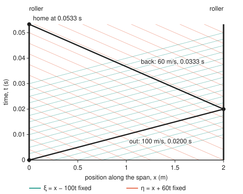

# Canonical form: change coordinates until you recognise the equation

[Syllabus](../../../SYLLABUS.md) → [Partial differential equations](../README.md) → [Classification and Well-Posedness](../README.md#s01) → Canonical form

---

## General Overview

[A partial differential equation](../../08-Differential%20equations%20and%20dynamics/10-The%20Classical%20PDEs/01-what-a-pde-says.md) showed that a change of coordinates never changes an equation's family, and that slanted coordinates turn the wave equation into one mixed derivative. This card runs that backwards: given any second-order equation with constant coefficients, it finds the coordinates that show which plain equation is hiding inside.

A steel strip runs through a processing line at 20 m/s between two rollers 2 m apart. The strip is under tension, so a sideways flick runs along the steel at 80 m/s relative to the steel (illustrative numbers). Watched from the factory floor, the sideways displacement u(x, t) of the strip obeys an equation with a mixed term in it.

- **Unknown:** u(x, t), the strip's sideways displacement in metres, at distance x (m) from the first roller and time t (s).
- **Region:** the span 0 ≤ x ≤ 2 m, for t ≥ 0.
- **Data:** the starting shape and speed of the strip, and u = 0 at both rollers.

The mixed term hides what the equation is. In the right slanted coordinates it becomes the plain wave equation. The coordinates also show that a flick runs downstream at 100 m/s and upstream at only 60 m/s. So the moving strip rings at 18.75 Hz, not the 20.00 Hz of a still strip.

**Build new coordinates from the equation's characteristic directions, and every constant-coefficient second-order equation in two variables becomes the plain wave, heat or Laplace equation, up to first-order terms.**

**What kind of fact this is:** a theorem, proved on this card in Why it works. The three plain equations are the chosen targets, a convention.

### The picture: one flick, one round trip

<p align="center"></p>

Teal lines keep ξ = x − 100t fixed; orange lines keep η = x + 60t fixed. A flick rides a teal line out and an orange line back. The new coordinates are these two families of lines.

---

## The formula

Notation first, in words. This card introduces two new coordinates, ξ ("xi") and η ("eta"). Each is a fixed mix of the old ones: $`\xi = a_1 x + b_1 y`$ and $`\eta = a_2 x + b_2 y`$. The same unknown, written in the new coordinates, is called w, so $`w(\xi, \eta) = u(x, y)`$. Here ξ is a coordinate, not the direction variable of the symbol on [Elliptic, parabolic, hyperbolic](04-classification-elliptic-parabolic-hyperbolic.md).

The general equation, as in wing 08, with subscripts for partial derivatives and "…" for the first-order terms $`D u_x + E u_y`$ and the rest:

```math
A\,u_{xx} + B\,u_{xy} + C\,u_{yy} + \ldots = 0
```

The chain rule turns it into $`A' w_{\xi\xi} + B' w_{\xi\eta} + C' w_{\eta\eta} + \ldots = 0`$ with new coefficients:

```math
\begin{aligned} A' &= A a_1^2 + B a_1 b_1 + C b_1^2 \\ B' &= 2A a_1 a_2 + B\,(a_1 b_2 + b_1 a_2) + 2C b_1 b_2 \\ C' &= A a_2^2 + B a_2 b_2 + C b_2^2 \end{aligned}
```

**Read it aloud:** A′ is the old second-order part with each derivative replaced by how fast ξ changes in that direction; C′ is the same for η; B′ is the cross version that mixes the two.

The recipe picks the coordinates from the roots λ of one quadratic:

```math
A\lambda^2 - B\lambda + C = 0, \qquad \xi = y - \lambda_1 x, \quad \eta = y - \lambda_2 x
```

**Read it aloud:** find the slopes λ along which the equation has no pure second derivative, and use lines of those slopes as the new coordinate lines.

| Family | Roots of the quadratic | New coordinates | Canonical form |
| --- | --- | --- | --- |
| hyperbolic, $`B^2 - 4AC > 0`$ | two real, $`\lambda_1 \ne \lambda_2`$ | $`\xi = y - \lambda_1 x`$, $`\eta = y - \lambda_2 x`$ | $`w_{\xi\eta} + \ldots = 0`$, then $`v_{ss} - v_{rr} + \ldots = 0`$ |
| parabolic, $`B^2 - 4AC = 0`$ | one double root λ | $`\xi = y - \lambda x`$, $`\eta = x`$ | $`w_{\eta\eta} + \ldots = 0`$ |
| elliptic, $`B^2 - 4AC < 0`$ | complex, $`\alpha \pm i\beta`$ | $`\xi = y - \alpha x`$, $`\eta = \beta x`$ | $`w_{\xi\xi} + w_{\eta\eta} + \ldots = 0`$ |

The recipe needs A ≠ 0. If A = 0 but C ≠ 0, swap the names x and y first. If A = C = 0, the equation is already $`B u_{xy} + \ldots = 0`$, the hyperbolic form.

For the strip, time t plays the role of the first variable and position x the second. Then λ is a speed, dx/dt, the recipe's $`\xi = y - \lambda x`$ reads $`\xi = x - \lambda t`$, and the equation is $`u_{tt} + 2V u_{xt} - (c^2 - V^2) u_{xx} = 0`$.

| Symbol | Plain meaning | In our example | Push it up and the answer… |
| --- | --- | --- | --- |
| $`u`$ | the unknown: sideways displacement of the strip | metres | — |
| $`x`$, $`y`$; $`t`$ | old coordinates; time, the strip's first variable | 0 to 2 m; seconds | — |
| $`A, B, C`$; $`D, E`$ | coefficients of $`u_{xx}, u_{xy}, u_{yy}`$; of $`u_x, u_y`$ | strip: 1, 40 m/s, −6000 m²/s² | larger B: more slant |
| $`B^2 - 4AC`$ | the discriminant: its sign names the family | 25600 m²/s² | above 0: hyperbolic |
| $`\lambda`$; $`\alpha \pm i\beta`$ | characteristic slopes; complex slopes | 100 and −60 m/s | — |
| $`a_1, b_1, a_2, b_2`$ | how much x and y go into ξ and η | ξ: −100, 1; η: 60, 1 | — |
| $`\xi`$, $`\eta`$; $`s`$, $`r`$ | the new coordinates; their half-sum and half-difference | x − 100t, x + 60t; x − 20t, 80t | — |
| $`w`$; $`v`$; $`F`$, $`G`$ | u written in (ξ, η); u written in (s, r); the two travelling shapes of Step 5 | — | — |
| $`Q(p, q)`$; $`P`$ | the second-order part with each derivative replaced by a rate p or q; its two-input form | Q(−100, 1) = A′ = 0 | — |
| $`J`$; $`M`$ | Jacobian, $`a_1 b_2 - b_1 a_2`$: area scale of the change; the matrix with columns $`(a_1, b_1)`$, $`(a_2, b_2)`$, whose determinant is J | −160 m/s | 0: the change collapses |
| $`A', B', C'`$; $`D', E'`$ | new second-order coefficients; new first-order ones | 0, −25600, 0; 0, 0 | — |
| $`c`$, $`V`$; $`L`$, $`f`$ | wave speed on the steel, line speed; span, tone | 80, 20 m/s; 2 m, 18.75 Hz | V up: f down, 0 Hz at V = c |

### When it holds

- **Constant coefficients.** Then λ is the same everywhere and the new coordinates are straight lines. With varying coefficients, λ changes from point to point and the coordinate lines are curves found by solving dy/dx = λ, one ordinary differential equation for each family.
- **One family over the whole region.** The Tricomi equation $`y\,u_{xx} + u_{yy} = 0`$, a model of airflow near the speed of sound, has $`B^2 - 4AC = -4y`$: −4 at y = 1, 4 at y = −1. No single change of coordinates makes it one plain equation across y = 0.
- **A real change of coordinates, J ≠ 0.** If ξ and η are the same line family, J = 0 and the new coordinates name only one direction. Every reduction step needs J ≠ 0.
- **Lower-order terms come along.** First-order terms stay first order, with new coefficients $`D' = D a_1 + E b_1`$, $`E' = D a_2 + E b_2`$. The heat equation needs the term along the characteristic, $`D' w_\xi`$, to survive: without it, the parabolic case reduces to $`w_{\eta\eta} + E' w_\eta = 0`$, an ordinary differential equation in η for each ξ, not heat flow.
- **The strip model is a string.** It ignores the steel's bending stiffness, which raises the tones of a thick strip. It also needs V below c: at V = c the upstream speed is 0 and the tone falls to 0 Hz, the critical speed.

---

## Why it works

### Step 0: a coordinate along a characteristic line drops out

Write $`Q(p, q) = A p^2 + B p q + C q^2`$. The formula for $`A'`$ is $`Q(a_1, b_1)`$: the second-order part evaluated on the rates of change of ξ.

So if ξ is chosen with $`Q(a_1, b_1) = 0`$, the term $`w_{\xi\xi}`$ vanishes. Such a ξ is constant along a **characteristic** line: a line across which the second-order part cannot see a change, so a signal can travel along it ([Elliptic, parabolic, hyperbolic](04-classification-elliptic-parabolic-hyperbolic.md)). Choose both coordinates this way and only the mixed term is left.

### Step 1: the chain rule gives the new coefficients

The first derivatives are $`u_x = a_1 w_\xi + a_2 w_\eta`$ and $`u_y = b_1 w_\xi + b_2 w_\eta`$ ([Chain rule in several variables](../../06-Calculus%20and%20analysis/07-Several%20Variables/04-multivariable-chain-rule-and-jacobians.md)). Apply the rule again and collect terms.

<details>
<summary>Detailed proof: the three new coefficients, and why the discriminant scales by J²</summary>

Differentiate $`u_x = a_1 w_\xi + a_2 w_\eta`$ again. The coefficients are constants, so:

$`\displaystyle u_{xx} = a_1^2 w_{\xi\xi} + 2a_1a_2 w_{\xi\eta} + a_2^2 w_{\eta\eta}, \quad u_{xy} = a_1b_1 w_{\xi\xi} + (a_1b_2 + b_1a_2) w_{\xi\eta} + a_2b_2 w_{\eta\eta}, \quad u_{yy} = b_1^2 w_{\xi\xi} + 2b_1b_2 w_{\xi\eta} + b_2^2 w_{\eta\eta}`$

Multiply by A, B, C, add, and read off the coefficients of $`w_{\xi\xi}`$, $`w_{\xi\eta}`$, $`w_{\eta\eta}`$: these are A′, B′, C′ in The formula.

In matrix form, `[[A', B'/2], [B'/2, C']]` equals $`M^{T}`$ `[[A, B/2], [B/2, C]]` $`M`$, where M has columns $`(a_1, b_1)`$ and $`(a_2, b_2)`$ and determinant J. Determinants multiply, so:

$`\displaystyle B'^2 - 4A'C' = J^2\,(B^2 - 4AC)`$

This is the invariance proved on the wing 08 card. The code checks it exactly for the strip: $`(-25600)^2 = 655360000 = 25600 \times 25600`$.

</details>

### Step 2: hyperbolic, two real roots

The quadratic $`A\lambda^2 - B\lambda + C = 0`$ is $`Q(-\lambda, 1) = 0`$. So $`\xi = y - \lambda x`$ has $`A' = 0`$ exactly when λ is a root.

With two different real roots, take one for ξ and the other for η: $`A' = C' = 0`$. Then $`B'^2 = J^2(B^2 - 4AC) > 0`$, so $`B' \ne 0`$. Divide by it:

```math
w_{\xi\eta} + \ldots = 0
```

For the strip, the roots of $`\lambda^2 - 40\lambda - 6000 = 0`$ are 100 and −60 m/s. So $`\xi = x - 100t`$, $`\eta = x + 60t`$, and the equation becomes $`-25600\,w_{\xi\eta} = 0`$.

To reach the textbook wave form, take the half-sum and half-difference: $`s = (\xi + \eta)/2 = x - 20t`$ and $`r = (\eta - \xi)/2 = 80t`$. Since $`w_{\xi\eta} = (v_{ss} - v_{rr})/4`$, the strip obeys $`v_{rr} = v_{ss}`$. With r = ct this is $`v_{tt} = c^2 v_{ss}`$.

That is the still string's wave equation. The coordinate s = x − 20t is position measured along the moving steel, so the reduction has found the strip's own frame.

### Step 3: parabolic, one double root

Now $`B^2 - 4AC = 0`$ and the double root is $`\lambda = B/(2A)`$. Take $`\xi = y - \lambda x`$, so $`A' = 0`$.

Then $`B'^2 = 4A'C' + J^2 \cdot 0 = 0`$, so $`B' = 0`$ too, for any second coordinate. Take $`\eta = x`$. What is left is $`C' w_{\eta\eta}`$ plus first-order terms, with $`C' = A \ne 0`$.

The example $`u_{xx} + 2u_{xy} + u_{yy} - u_y = 0`$ has A, B, C, D, E = 1, 2, 1, 0, −1 and the double root λ = 1. With $`\xi = y - x`$ and $`\eta = x`$ the coefficients are A′, B′, C′ = 0, 0, 1 and D′, E′ = −1, 0:

```math
w_{\eta\eta} = w_\xi
```

This is the heat equation, with the diagonal ξ = y − x playing time.

### Step 4: elliptic, complex roots

Now the roots are $`\alpha \pm i\beta`$ with $`\beta \ne 0`$. No real line is characteristic. Take the real and imaginary parts instead: $`\xi = y - \alpha x`$ and $`\eta = \beta x`$. Then $`A' = C'`$ and $`B' = 0`$, and dividing by A′ gives Laplace's equation.

<details>
<summary>Detailed proof: real and imaginary parts give A′ = C′ and B′ = 0</summary>

The complex coordinate $`\phi = y - (\alpha + i\beta)x`$ equals $`\xi - i\eta`$. As $`\alpha + i\beta`$ is a root, $`Q(\phi_x, \phi_y) = 0`$.

Q is a quadratic form, so with the matching bilinear form P (the one with $`P(p, p) = Q(p)`$):

$`\displaystyle 0 = Q(\nabla\xi - i\nabla\eta) = Q(\nabla\xi) - Q(\nabla\eta) - 2i\,P(\nabla\xi, \nabla\eta)`$

The real part says $`A' = Q(\nabla\xi) = Q(\nabla\eta) = C'`$. The imaginary part says $`P(\nabla\xi, \nabla\eta) = B'/2 = 0`$. Finally $`-4A'^2 = J^2(B^2 - 4AC) < 0`$ forces $`A' \ne 0`$.

</details>

A plate that conducts heat better along a slanted grain, such as a layered composite, held at steady edge temperatures, gives an equation of this kind. The example $`u_{xx} + 2u_{xy} + 5u_{yy} = 0`$ (illustrative coefficients) has $`B^2 - 4AC = -16`$ and roots $`1 \pm 2i`$. With $`\xi = y - x`$ and $`\eta = 2x`$, A′, B′, C′ = 4, 0, 4, so $`w_{\xi\xi} + w_{\eta\eta} = 0`$. Shearing and stretching the plate's coordinates makes it conduct equally in every direction.

### Step 5: read the strip's answer back

From $`w_{\xi\eta} = 0`$, $`w_\xi`$ does not depend on η, so $`w = F(\xi) + G(\eta)`$:

```math
u(x, t) = F(x - 100t) + G(x + 60t)
```

This is every classical solution (twice continuously differentiable) on the whole line. A flick splits into a part running downstream at 100 m/s and a part running upstream at 60 m/s. With fixed rollers, the starting shape, starting speed and the two end conditions pick one solution; the energy argument of [Energy methods](07-energy-methods-and-uniqueness.md) is how such uniqueness is proved.

A flick that goes out and back reflects once at each roller, and its shape then repeats. So one ringing period is one round trip, and the tone is its inverse.

### Step 6: more variables, same idea

With d variables and constant coefficients, write the top part as the symmetric matrix $`(a_{ij})`$ of [Elliptic, parabolic, hyperbolic](04-classification-elliptic-parabolic-hyperbolic.md). Turn the axes onto its eigenvectors, then stretch each axis by one over the square root of the size of its eigenvalue. What is left is a sum of squares with signs +1, −1 or 0. With no zeros, all signs alike gives $`\Delta u`$, and one sign against the rest gives $`\Delta u - u_{tt}`$, up to first-order terms. One zero with the rest alike gives $`\Delta u`$ in d − 1 variables; with a first-order term in the missing direction, that is $`\Delta u - u_t`$. Other sign patterns, such as two plus and two minus in four variables, give none of the three. In two variables this is the same reduction as Steps 2 to 4, by another road.

---

## Worked numbers, by hand

The strip: c = 80 m/s, V = 20 m/s, L = 2 m. Time is the first variable, position the second.

| Step | Arithmetic | Value |
| --- | --- | --- |
| Coefficients | A = 1, B = 2V = 2 × 20, C = −(80² − 20²) | 1, 40 m/s, −6000 m²/s² |
| Discriminant | 40² − 4 × 1 × (−6000) = 1600 + 24000 | 25600 m²/s², hyperbolic |
| Characteristic speeds | λ = (40 ± 160)/2 | 100 and −60 m/s |
| A′ for ξ = x − 100t | 100² − 40 × 100 − 6000 = 10000 − 4000 − 6000 | 0 |
| C′ for η = x + 60t | 60² + 40 × 60 − 6000 = 3600 + 2400 − 6000 | 0 |
| B′ | 2(−100)(60) + 40(−100 + 60) + 2(−6000) = −12000 − 1600 − 12000 | −25600 |
| Jacobian | (−100)(1) − (1)(60) | −160 m/s |
| Check | B′² = J² × 25600 = 25600 × 25600 | 655360000 |
| Strip's frame | s = x − 20t, r = 80t give A′, B′, C′ | −6400, 0, 6400: v_rr = v_ss |
| Round trip | 2/100 + 2/60 = 0.0200 + 0.0333 | 0.0533 s |
| Tone | 1/0.0533 = (6400 − 400)/(2 × 2 × 80) | **18.75 Hz** |

The moving strip rings at 18.75 Hz, a little below the 20.00 Hz of the same strip standing still, because the slow upstream leg costs more time than the fast downstream leg saves.

### What breaks if you drop a piece

| Mistake | Comes out at | What went wrong |
| --- | --- | --- |
| Use the still strip's speeds, 80 and −80 m/s | A′, C′ = −2800, 3600, residual stuck at 0.22, tone 20.00 Hz | the flow shifts both speeds by V = 20 m/s |
| Slip the sign in the quadratic: speeds −100 and 60 m/s | A′, C′ = 8000, −4800 | the roots of $`A\lambda^2 + B\lambda + C`$ point the wrong way |
| Elliptic: drop β, take η = x | A′, B′, C′ = 4, 0, 1 | $`4w_{\xi\xi} + w_{\eta\eta} = 0`$: still lopsided |
| Parabolic: take η = 2(y − x) | J = 0 | both coordinates name the same direction |
| One recipe for Tricomi $`y\,u_{xx} + u_{yy}`$ | B² − 4AC = −4 at y = 1, 4 at y = −1 | the family changes at y = 0 |

The "residual" is the size of the equation's left side, by centred differences, as a fraction of the size of its terms; the code section shows it.

---

## Code, from first principles, and it actually runs

The scripts take four independent roads. Road one is exact integer algebra: the chain-rule coefficients for all three families, and the invariance $`B'^2 - 4A'C' = J^2(B^2 - 4AC)`$. Road two finds the characteristic speeds by bisection, without the quadratic formula. Road three never uses the new coordinates' algebra: it builds solutions in the new coordinates and tests them in the original equation by centred differences at three steps, showing the residual falling at order 2 (it quarters when the step halves). The wrong speeds leave a residual near 0.22 at every step. Road four finds the strip's tone three ways: the closed form, the round trip, and a scan from 0.01 to 50 Hz for the first frequency at which a standing mode keeps the far roller still.

### Python

```python
# Canonical form -- the check behind the card.  Only math is imported.
# Road 1: exact integer algebra.  The chain rule gives the new coefficients
#   A' = A a1^2 + B a1 b1 + C b1^2,  B' = 2A a1 a2 + B(a1 b2 + b1 a2) + 2C b1 b2,
#   C' = A a2^2 + B a2 b2 + C b2^2   for xi = a1 p + b1 q, eta = a2 p + b2 q.
# Road 2: bisection finds the characteristic speeds without the quadratic formula.
# Road 3: centred differences test the solutions in the ORIGINAL coordinates.
# Road 4: the strip's tone three ways: closed form, round trip, far-end scan.
import math

def transform(A, B, C, D, E, a1, b1, a2, b2):
    return (A*a1*a1 + B*a1*b1 + C*b1*b1, 2*A*a1*a2 + B*(a1*b2 + b1*a2) + 2*C*b1*b2,
            A*a2*a2 + B*a2*b2 + C*b2*b2, D*a1 + E*b1, D*a2 + E*b2, a1*b2 - b1*a2)

def bisect(f, lo, hi):
    for _ in range(200):
        mid = (lo + hi) / 2
        if (f(lo) < 0) == (f(mid) < 0): lo = mid
        else: hi = mid
    return (lo + hi) / 2

def residual(co, u, p, q, hp, hq):  # relative size of A u_pp + B u_pq + C u_qq + D u_p + E u_q
    A, B, C, D, E = co
    upp = (u(p + hp, q) - 2*u(p, q) + u(p - hp, q)) / hp**2
    uqq = (u(p, q + hq) - 2*u(p, q) + u(p, q - hq)) / hq**2
    upq = (u(p+hp, q+hq) - u(p+hp, q-hq) - u(p-hp, q+hq) + u(p-hp, q-hq)) / (4*hp*hq)
    up = (u(p + hp, q) - u(p - hp, q)) / (2*hp); uq = (u(p, q + hq) - u(p, q - hq)) / (2*hq)
    terms = [A*upp, B*upq, C*uqq, D*up, E*uq]
    return abs(sum(terms)) / sum(abs(x) for x in terms)

def sci(v):
    e = math.floor(math.log10(v)); m = v / math.pow(10, e)
    if round(m, 2) >= 10: m /= 10; e += 1
    return f"{m:.2f}e{e:+03d}"

def ladder(co, u, p, q, h, k):  # residual at three steps and the observed order
    r = [residual(co, u, p, q, h / 2**i, k / 2**i) for i in range(3)]
    return r, math.log2(r[1] / r[2])

# ---- the moving steel strip: wave speed c on the strip, line speed V, span L ----
c, V, L = 80, 20, 2                      # m/s, m/s, m (illustrative)
A, B, C = 1, 2*V, -(c*c - V*V)          # u_tt + 2V u_xt - (c^2 - V^2) u_xx = 0, variables (t, x)
disc = B*B - 4*A*C
print(f"strip: c = {c} m/s, V = {V} m/s, L = {L} m")
print(f"strip: A, B, C = {A}, {B} m/s, {C} m^2/s^2; B^2 - 4AC = {disc} m^2/s^2")
quad = lambda lam: A*lam*lam - B*lam + C          # A' for xi = x - lam t
r = math.isqrt(disc); assert r * r == disc
lp, lm = (B + r) // (2*A), (B - r) // (2*A)
bp, bm = bisect(quad, B / (2*A), 1e4), bisect(quad, -1e4, B / (2*A))
print(f"speeds: formula {lp} and {lm} m/s; bisection {bp:.9f} and {bm:.9f} m/s")
assert abs(bp - (V + c)) < 1e-9 and abs(bm - (V - c)) < 1e-9
Ap, Bp, Cp, _, _, J = transform(A, B, C, 0, 0, -lp, 1, -lm, 1)
print(f"xi = x - {lp} t, eta = x + {-lm} t: A', B', C' = {Ap}, {Bp}, {Cp}; J = {J} m/s")
print(f"invariant: B'^2 - 4A'C' = {Bp*Bp - 4*Ap*Cp} = J^2 (B^2 - 4AC) = {J*J} x {disc}")
assert (Ap, Cp) == (0, 0) and Bp*Bp - 4*Ap*Cp == J*J*disc
S = transform(A, B, C, 0, 0, -V, 1, c, 0)  # s = (xi + eta)/2 = x - V t, r = (eta - xi)/2 = c t
print(f"s = x - {V} t, r = {c} t: A', B', C' = {S[0]}, {S[1]}, {S[2]}  (v_rr = v_ss)")
assert S[1] == 0 and S[0] == -S[2]
F = lambda z: math.exp(-(z / 0.1)**2); G = lambda z: 0.5 * math.exp(-((z - 0.7) / 0.2)**2)
good = lambda t, x: F(x - lp*t) + G(x - lm*t)
bad = lambda t, x: F(x - c*t) + G(x + c*t)          # still-strip speeds, flow ignored
rg, og = ladder((A, B, C, 0, 0), good, 0.004, 0.5, 0.0002, 0.02)
rb, ob = ladder((A, B, C, 0, 0), bad, 0.004, 0.5, 0.0002, 0.02)
print(f"residual at x = 0.5 m, t = 0.004 s; space steps 0.02, 0.01, 0.005 m, time step = space step / ({lp} m/s):")
print(f"  F(x - {lp}t) + G(x + {-lm}t): {', '.join(sci(v) for v in rg)}; order {og:.2f}")
print(f"  F(x - {c}t) + G(x + {c}t):  {', '.join(sci(v) for v in rb)}; order {ob:.2f}")
assert 1.9 < og < 2.1 and rg[2] < 0.01 * rb[2] and min(rb) > 0.1

# ---- parabolic and elliptic reductions, variables (x, y) ----
H = transform(1, 2, 1, 0, -1, -1, 1, 1, 0)   # u_xx + 2u_xy + u_yy - u_y; xi = y - x, eta = x
print(f"heat type: A, B, C, D, E = 1, 2, 1, 0, -1; B^2 - 4AC = {2*2 - 4*1*1}; xi = y - x, eta = x: A', B', C' = {H[0]}, {H[1]}, {H[2]}; "
      f"D', E' = {H[3]}, {H[4]}; J = {H[5]}")
assert H[:5] == (0, 0, 1, -1, 0)
rh, oh = ladder((1, 2, 1, 0, -1), lambda x, y: math.exp(-(y - x)) * math.sin(x), 0.5, 1.0, 0.1, 0.1)
print(f"  e^-(y-x) sin x: residual {', '.join(sci(v) for v in rh)}; order {oh:.2f}")
LA, LB, LC = 1, 2, 5                              # u_xx + 2u_xy + 5u_yy = 0
al, d4 = LB // (2*LA), 4*LA*LC - LB*LB           # roots alpha +- i beta of LA l^2 - LB l + LC
be = math.isqrt(d4) // (2*LA); assert (2*LA*be)**2 == d4 and 2*LA*al == LB
Lp = transform(LA, LB, LC, 0, 0, -al, 1, be, 0)   # xi = y - alpha x, eta = beta x
print(f"Laplace type: A, B, C = {LA}, {LB}, {LC}; B^2 - 4AC = {-d4}; alpha, beta = {al}, {be}; xi = y - alpha x, eta = beta x: A', B', C' = {Lp[0]}, {Lp[1]}, {Lp[2]}")
assert Lp[:3] == (d4 // (4*LA), 0, d4 // (4*LA))      # (4AC - B^2)/(4A) each
rl, ol = ladder((LA, LB, LC, 0, 0), lambda x, y: math.exp(y - al*x) * math.cos(be*x), 0.5, 1.0, 0.1, 0.1)
print(f"  e^(y - alpha x) cos(beta x): residual {', '.join(sci(v) for v in rl)}; order {ol:.2f}")
assert 1.9 < oh < 2.1 and 1.9 < ol < 2.1

# ---- the tone of the strip between two fixed rollers ----
f_still, f_form = c / (2*L), (c*c - V*V) / (2*L*c)
trip = L / (V + c) + L / (c - V)
print(f"tone: still strip c/2L = {f_still:.2f} Hz; moving, (c^2 - V^2)/(2Lc) = {f_form:.2f} Hz")
print(f"tone: round trip {L/(V+c):.4f} s + {L/(c-V):.4f} s = {trip:.4f} s, so {1/trip:.2f} Hz")
def far_end(f):   # largest |u(L, t)| over one period for the mode sin(wt - k1 x) - sin(wt - k2 x)
    w = 2*math.pi*f; k1, k2 = w / (V + c), w / (V - c)
    return max(abs(math.sin(w*t - k1*L) - math.sin(w*t - k2*L)) for t in [i / (200*f) for i in range(200)])
scan = [far_end(i / 100) for i in range(1, 5001)]  # 0.01 to 50 Hz
rise = next(i for i in range(5000) if scan[i] > 1)   # skip the zero at 0 Hz
first = next(i for i in range(rise, 5000) if scan[i] < 0.05)
best = min(range(first, first + 30), key=lambda i: scan[i]) + 1
print(f"tone: far-end scan 0.01 to 50 Hz finds {best/100:.2f} Hz; far end at {f_form:.2f} Hz {far_end(f_form):.6f}, "
      f"at {f_still:.2f} Hz {far_end(f_still):.6f}")
assert abs(best / 100 - f_form) < 0.006 and abs(1 / trip - f_form) < 1e-9
print("tone at line speed 0, 40, 80 m/s: " + ", ".join(f"{(c*c - v*v) / (2*L*c):.2f}" for v in (0, 40, 80)) + " Hz")

# ---- what breaks ----
W = transform(A, B, C, 0, 0, -c, 1, c, 1)
print(f"breaks: still-strip speeds {c} and {-c} m/s: A', C' = {W[0]}, {W[2]} (not 0)")
X = transform(A, B, C, 0, 0, lp, 1, lm, 1)
print(f"breaks: signs slipped, speeds {-lp} and {-lm} m/s: A', C' = {X[0]}, {X[2]}")
Y = transform(LA, LB, LC, 0, 0, -al, 1, 1, 0)
print(f"breaks: Laplace type with eta = x (beta dropped): A', B', C' = {Y[0]}, {Y[1]}, {Y[2]}")
Z = transform(1, 2, 1, 0, -1, -1, 1, -2, 2)
print(f"breaks: heat type with eta = 2(y - x): J = {Z[5]}")
tri = lambda y: 0*0 - 4*y*1                     # Tricomi y u_xx + u_yy: A = y, B = 0, C = 1
print(f"breaks: Tricomi y u_xx + u_yy: B^2 - 4AC = {tri(1)} at y = 1, {tri(-1)} at y = -1")
assert (W[0], W[2], X[0], X[2]) == (quad(c), quad(-c), quad(-lp), quad(-lm)) and W[0] != 0 and X[0] != 0
assert (Y[0], Y[1], Y[2]) == (LA*al*al - LB*al + LC, 0, LA) and Y[0] != Y[2] and Z[5] == 0
print(f"figure, round trip (m, s): (0, 0) -> ({L}, {L/(V+c):.7f}) -> (0, {trip:.7f})")
print("ALL CHECKS PASS")
```

**Ran 2026-11-15 on macOS, Python 3.14.10, standard library only. All checks passed. Output, pasted from the run:**

```
strip: c = 80 m/s, V = 20 m/s, L = 2 m
strip: A, B, C = 1, 40 m/s, -6000 m^2/s^2; B^2 - 4AC = 25600 m^2/s^2
speeds: formula 100 and -60 m/s; bisection 100.000000000 and -60.000000000 m/s
xi = x - 100 t, eta = x + 60 t: A', B', C' = 0, -25600, 0; J = -160 m/s
invariant: B'^2 - 4A'C' = 655360000 = J^2 (B^2 - 4AC) = 25600 x 25600
s = x - 20 t, r = 80 t: A', B', C' = -6400, 0, 6400  (v_rr = v_ss)
residual at x = 0.5 m, t = 0.004 s; space steps 0.02, 0.01, 0.005 m, time step = space step / (100 m/s):
  F(x - 100t) + G(x + 60t): 2.25e-02, 5.64e-03, 1.41e-03; order 2.00
  F(x - 80t) + G(x + 80t):  2.24e-01, 2.22e-01, 2.21e-01; order 0.01
heat type: A, B, C, D, E = 1, 2, 1, 0, -1; B^2 - 4AC = 0; xi = y - x, eta = x: A', B', C' = 0, 0, 1; D', E' = -1, 0; J = -1
  e^-(y-x) sin x: residual 1.39e-03, 3.49e-04, 8.72e-05; order 2.00
Laplace type: A, B, C = 1, 2, 5; B^2 - 4AC = -16; alpha, beta = 1, 2; xi = y - alpha x, eta = beta x: A', B', C' = 4, 0, 4
  e^(y - alpha x) cos(beta x): residual 4.11e-05, 8.47e-06, 2.01e-06; order 2.08
tone: still strip c/2L = 20.00 Hz; moving, (c^2 - V^2)/(2Lc) = 18.75 Hz
tone: round trip 0.0200 s + 0.0333 s = 0.0533 s, so 18.75 Hz
tone: far-end scan 0.01 to 50 Hz finds 18.75 Hz; far end at 18.75 Hz 0.000000, at 20.00 Hz 0.415801
tone at line speed 0, 40, 80 m/s: 20.00, 15.00, 0.00 Hz
breaks: still-strip speeds 80 and -80 m/s: A', C' = -2800, 3600 (not 0)
breaks: signs slipped, speeds -100 and 60 m/s: A', C' = 8000, -4800
breaks: Laplace type with eta = x (beta dropped): A', B', C' = 4, 0, 1
breaks: heat type with eta = 2(y - x): J = 0
breaks: Tricomi y u_xx + u_yy: B^2 - 4AC = -4 at y = 1, 4 at y = -1
figure, round trip (m, s): (0, 0) -> (2, 0.0200000) -> (0, 0.0533333)
ALL CHECKS PASS
```

### Rust

```rust
// Canonical form -- the check behind the card.  std only.
// Road 1: exact integer algebra.  The chain rule gives the new coefficients
//   A' = A a1^2 + B a1 b1 + C b1^2,  B' = 2A a1 a2 + B(a1 b2 + b1 a2) + 2C b1 b2,
//   C' = A a2^2 + B a2 b2 + C b2^2   for xi = a1 p + b1 q, eta = a2 p + b2 q.
// Road 2: bisection finds the characteristic speeds without the quadratic formula.
// Road 3: centred differences test the solutions in the ORIGINAL coordinates.
// Road 4: the strip's tone three ways: closed form, round trip, far-end scan.
use std::f64::consts::PI;

fn transform(a: i64, b: i64, c: i64, d: i64, e: i64, a1: i64, b1: i64, a2: i64, b2: i64) -> [i64; 6] {
    [a*a1*a1 + b*a1*b1 + c*b1*b1, 2*a*a1*a2 + b*(a1*b2 + b1*a2) + 2*c*b1*b2,
     a*a2*a2 + b*a2*b2 + c*b2*b2, d*a1 + e*b1, d*a2 + e*b2, a1*b2 - b1*a2]
}

fn bisect(f: &dyn Fn(f64) -> f64, mut lo: f64, mut hi: f64) -> f64 {
    for _ in 0..200 {
        let mid = (lo + hi) / 2.0;
        if (f(lo) < 0.0) == (f(mid) < 0.0) { lo = mid } else { hi = mid }
    }
    (lo + hi) / 2.0
}

// relative size of A u_pp + B u_pq + C u_qq + D u_p + E u_q
fn residual(co: [f64; 5], u: &dyn Fn(f64, f64) -> f64, p: f64, q: f64, hp: f64, hq: f64) -> f64 {
    let upp = (u(p + hp, q) - 2.0*u(p, q) + u(p - hp, q)) / hp.powi(2);
    let uqq = (u(p, q + hq) - 2.0*u(p, q) + u(p, q - hq)) / hq.powi(2);
    let upq = (u(p+hp, q+hq) - u(p+hp, q-hq) - u(p-hp, q+hq) + u(p-hp, q-hq)) / (4.0*hp*hq);
    let up = (u(p + hp, q) - u(p - hp, q)) / (2.0*hp);
    let uq = (u(p, q + hq) - u(p, q - hq)) / (2.0*hq);
    let t = [co[0]*upp, co[1]*upq, co[2]*uqq, co[3]*up, co[4]*uq];
    t.iter().sum::<f64>().abs() / t.iter().map(|x| x.abs()).sum::<f64>()
}

fn sci(v: f64) -> String {
    let mut e = v.log10().floor() as i32;
    let mut m = v / 10f64.powf(e as f64);
    if (m * 100.0).round() / 100.0 >= 10.0 { m /= 10.0; e += 1; }
    format!("{:.2}e{:+03}", m, e)
}

// residual at three steps and the observed order
fn ladder(co: [f64; 5], u: &dyn Fn(f64, f64) -> f64, p: f64, q: f64, h: f64, k: f64) -> (Vec<f64>, f64) {
    let r: Vec<f64> = (0..3).map(|i| residual(co, u, p, q, h / 2f64.powi(i), k / 2f64.powi(i))).collect();
    let o = (r[1] / r[2]).log2();
    (r, o)
}

fn join(r: &[f64]) -> String { r.iter().map(|&v| sci(v)).collect::<Vec<_>>().join(", ") }

fn main() {
    // ---- the moving steel strip: wave speed c on the strip, line speed V, span L ----
    let (c, v, l): (i64, i64, i64) = (80, 20, 2); // m/s, m/s, m (illustrative)
    let (a, b, cc) = (1i64, 2*v, -(c*c - v*v)); // u_tt + 2V u_xt - (c^2 - V^2) u_xx = 0, variables (t, x)
    let disc = b*b - 4*a*cc;
    println!("strip: c = {} m/s, V = {} m/s, L = {} m", c, v, l);
    println!("strip: A, B, C = {}, {} m/s, {} m^2/s^2; B^2 - 4AC = {} m^2/s^2", a, b, cc, disc);
    let quad = |lam: f64| a as f64*lam*lam - b as f64*lam + cc as f64; // A' for xi = x - lam t
    let r = (disc as f64).sqrt().round() as i64; assert!(r * r == disc);
    let (lp, lm) = ((b + r).div_euclid(2*a), (b - r).div_euclid(2*a));
    let vert = b as f64 / (2.0*a as f64);
    let (bp, bm) = (bisect(&quad, vert, 1e4), bisect(&quad, -1e4, vert));
    println!("speeds: formula {} and {} m/s; bisection {:.9} and {:.9} m/s", lp, lm, bp, bm);
    assert!((bp - (v + c) as f64).abs() < 1e-9 && (bm - (v - c) as f64).abs() < 1e-9);
    let t1 = transform(a, b, cc, 0, 0, -lp, 1, -lm, 1);
    let (ap, bpp, cp, j) = (t1[0], t1[1], t1[2], t1[5]);
    println!("xi = x - {} t, eta = x + {} t: A', B', C' = {}, {}, {}; J = {} m/s", lp, -lm, ap, bpp, cp, j);
    println!("invariant: B'^2 - 4A'C' = {} = J^2 (B^2 - 4AC) = {} x {}", bpp*bpp - 4*ap*cp, j*j, disc);
    assert!(ap == 0 && cp == 0 && bpp*bpp - 4*ap*cp == j*j*disc);
    let s = transform(a, b, cc, 0, 0, -v, 1, c, 0); // s = (xi + eta)/2 = x - V t, r = (eta - xi)/2 = c t
    println!("s = x - {} t, r = {} t: A', B', C' = {}, {}, {}  (v_rr = v_ss)", v, c, s[0], s[1], s[2]);
    assert!(s[1] == 0 && s[0] == -s[2]);
    let f = |z: f64| (-(z / 0.1).powi(2)).exp();
    let g = |z: f64| 0.5 * (-((z - 0.7) / 0.2).powi(2)).exp();
    let (lpf, lmf, cf) = (lp as f64, lm as f64, c as f64);
    let good = |t: f64, x: f64| f(x - lpf*t) + g(x - lmf*t);
    let bad = |t: f64, x: f64| f(x - cf*t) + g(x + cf*t); // still-strip speeds, flow ignored
    let co = [a as f64, b as f64, cc as f64, 0.0, 0.0];
    let (rg, og) = ladder(co, &good, 0.004, 0.5, 0.0002, 0.02);
    let (rb, ob) = ladder(co, &bad, 0.004, 0.5, 0.0002, 0.02);
    println!("residual at x = 0.5 m, t = 0.004 s; space steps 0.02, 0.01, 0.005 m, time step = space step / ({} m/s):", lp);
    println!("  F(x - {}t) + G(x + {}t): {}; order {:.2}", lp, -lm, join(&rg), og);
    println!("  F(x - {}t) + G(x + {}t):  {}; order {:.2}", c, c, join(&rb), ob);
    assert!(1.9 < og && og < 2.1 && rg[2] < 0.01 * rb[2] && rb.iter().cloned().fold(f64::MAX, f64::min) > 0.1);

    // ---- parabolic and elliptic reductions, variables (x, y) ----
    let h = transform(1, 2, 1, 0, -1, -1, 1, 1, 0); // u_xx + 2u_xy + u_yy - u_y; xi = y - x, eta = x
    println!("heat type: A, B, C, D, E = 1, 2, 1, 0, -1; B^2 - 4AC = {}; xi = y - x, eta = x: A', B', C' = {}, {}, {}; D', E' = {}, {}; J = {}",
             2*2 - 4*1*1, h[0], h[1], h[2], h[3], h[4], h[5]);
    assert!(h[..5] == [0, 0, 1, -1, 0]);
    let (rh, oh) = ladder([1.0, 2.0, 1.0, 0.0, -1.0], &|x: f64, y: f64| (-(y - x)).exp() * x.sin(), 0.5, 1.0, 0.1, 0.1);
    println!("  e^-(y-x) sin x: residual {}; order {:.2}", join(&rh), oh);
    let (la, lb, lc) = (1i64, 2i64, 5i64); // u_xx + 2u_xy + 5u_yy = 0
    let (al, d4) = (lb.div_euclid(2*la), 4*la*lc - lb*lb); // roots alpha +- i beta of LA l^2 - LB l + LC
    let be = ((d4 as f64).sqrt().round() as i64).div_euclid(2*la);
    assert!((2*la*be)*(2*la*be) == d4 && 2*la*al == lb);
    let lt = transform(la, lb, lc, 0, 0, -al, 1, be, 0); // xi = y - alpha x, eta = beta x
    println!("Laplace type: A, B, C = {}, {}, {}; B^2 - 4AC = {}; alpha, beta = {}, {}; xi = y - alpha x, eta = beta x: A', B', C' = {}, {}, {}",
             la, lb, lc, -d4, al, be, lt[0], lt[1], lt[2]);
    assert!(lt[..3] == [d4.div_euclid(4*la), 0, d4.div_euclid(4*la)]); // (4AC - B^2)/(4A) each
    let (alf, bef) = (al as f64, be as f64);
    let (rl, ol) = ladder([la as f64, lb as f64, lc as f64, 0.0, 0.0], &|x: f64, y: f64| (y - alf*x).exp() * (bef*x).cos(), 0.5, 1.0, 0.1, 0.1);
    println!("  e^(y - alpha x) cos(beta x): residual {}; order {:.2}", join(&rl), ol);
    assert!(1.9 < oh && oh < 2.1 && 1.9 < ol && ol < 2.1);

    // ---- the tone of the strip between two fixed rollers ----
    let (vf, lf) = (v as f64, l as f64);
    let (f_still, f_form) = (cf / (2.0*lf), (cf*cf - vf*vf) / (2.0*lf*cf));
    let trip = lf / (vf + cf) + lf / (cf - vf);
    println!("tone: still strip c/2L = {:.2} Hz; moving, (c^2 - V^2)/(2Lc) = {:.2} Hz", f_still, f_form);
    println!("tone: round trip {:.4} s + {:.4} s = {:.4} s, so {:.2} Hz", lf/(vf+cf), lf/(cf-vf), trip, 1.0/trip);
    // largest |u(L, t)| over one period for the mode sin(wt - k1 x) - sin(wt - k2 x)
    let far_end = |fr: f64| {
        let w = 2.0*PI*fr; let (k1, k2) = (w / (vf + cf), w / (vf - cf));
        (0..200).map(|i| i as f64 / (200.0*fr)).map(|t| ((w*t - k1*lf).sin() - (w*t - k2*lf).sin()).abs())
            .fold(0.0f64, f64::max)
    };
    let scan: Vec<f64> = (1..5001).map(|i| far_end(i as f64 / 100.0)).collect(); // 0.01 to 50 Hz
    let rise = (0..5000).find(|&i| scan[i] > 1.0).unwrap(); // skip the zero at 0 Hz
    let first = (rise..5000).find(|&i| scan[i] < 0.05).unwrap();
    let best = (first..first + 30).min_by(|&i, &k| scan[i].partial_cmp(&scan[k]).unwrap()).unwrap() + 1;
    println!("tone: far-end scan 0.01 to 50 Hz finds {:.2} Hz; far end at {:.2} Hz {:.6}, at {:.2} Hz {:.6}",
             best as f64 / 100.0, f_form, far_end(f_form), f_still, far_end(f_still));
    assert!((best as f64 / 100.0 - f_form).abs() < 0.006 && (1.0 / trip - f_form).abs() < 1e-9);
    let tones: Vec<String> = [0.0, 40.0, 80.0].iter().map(|&s: &f64| format!("{:.2}", (cf*cf - s*s) / (2.0*lf*cf))).collect();
    println!("tone at line speed 0, 40, 80 m/s: {} Hz", tones.join(", "));

    // ---- what breaks ----
    let w = transform(a, b, cc, 0, 0, -c, 1, c, 1);
    println!("breaks: still-strip speeds {} and {} m/s: A', C' = {}, {} (not 0)", c, -c, w[0], w[2]);
    let x = transform(a, b, cc, 0, 0, lp, 1, lm, 1);
    println!("breaks: signs slipped, speeds {} and {} m/s: A', C' = {}, {}", -lp, -lm, x[0], x[2]);
    let y = transform(la, lb, lc, 0, 0, -al, 1, 1, 0);
    println!("breaks: Laplace type with eta = x (beta dropped): A', B', C' = {}, {}, {}", y[0], y[1], y[2]);
    let z = transform(1, 2, 1, 0, -1, -1, 1, -2, 2);
    println!("breaks: heat type with eta = 2(y - x): J = {}", z[5]);
    let tri = |y: i64| 0*0 - 4*y*1; // Tricomi y u_xx + u_yy: A = y, B = 0, C = 1
    println!("breaks: Tricomi y u_xx + u_yy: B^2 - 4AC = {} at y = 1, {} at y = -1", tri(1), tri(-1));
    let want = [quad(cf), quad(-cf), quad(-lpf), quad(-lmf)]; // A' = Q(-lam, 1) by the bisection's own quadratic
    assert!([w[0], w[2], x[0], x[2]].iter().zip(want.iter()).all(|(&p, &q)| p as f64 == q) && w[0] != 0 && x[0] != 0);
    assert!(y[0] == la*al*al - lb*al + lc && y[1] == 0 && y[2] == la && y[0] != y[2] && z[5] == 0);
    println!("figure, round trip (m, s): (0, 0) -> ({}, {:.7}) -> (0, {:.7})", l, lf/(vf+cf), trip);
    println!("ALL CHECKS PASS");
}
```

**Ran 2026-11-15 on macOS, rustc 1.98.1, no crates. All checks passed. Output, pasted from the run:**

```
strip: c = 80 m/s, V = 20 m/s, L = 2 m
strip: A, B, C = 1, 40 m/s, -6000 m^2/s^2; B^2 - 4AC = 25600 m^2/s^2
speeds: formula 100 and -60 m/s; bisection 100.000000000 and -60.000000000 m/s
xi = x - 100 t, eta = x + 60 t: A', B', C' = 0, -25600, 0; J = -160 m/s
invariant: B'^2 - 4A'C' = 655360000 = J^2 (B^2 - 4AC) = 25600 x 25600
s = x - 20 t, r = 80 t: A', B', C' = -6400, 0, 6400  (v_rr = v_ss)
residual at x = 0.5 m, t = 0.004 s; space steps 0.02, 0.01, 0.005 m, time step = space step / (100 m/s):
  F(x - 100t) + G(x + 60t): 2.25e-02, 5.64e-03, 1.41e-03; order 2.00
  F(x - 80t) + G(x + 80t):  2.24e-01, 2.22e-01, 2.21e-01; order 0.01
heat type: A, B, C, D, E = 1, 2, 1, 0, -1; B^2 - 4AC = 0; xi = y - x, eta = x: A', B', C' = 0, 0, 1; D', E' = -1, 0; J = -1
  e^-(y-x) sin x: residual 1.39e-03, 3.49e-04, 8.72e-05; order 2.00
Laplace type: A, B, C = 1, 2, 5; B^2 - 4AC = -16; alpha, beta = 1, 2; xi = y - alpha x, eta = beta x: A', B', C' = 4, 0, 4
  e^(y - alpha x) cos(beta x): residual 4.11e-05, 8.47e-06, 2.01e-06; order 2.08
tone: still strip c/2L = 20.00 Hz; moving, (c^2 - V^2)/(2Lc) = 18.75 Hz
tone: round trip 0.0200 s + 0.0333 s = 0.0533 s, so 18.75 Hz
tone: far-end scan 0.01 to 50 Hz finds 18.75 Hz; far end at 18.75 Hz 0.000000, at 20.00 Hz 0.415801
tone at line speed 0, 40, 80 m/s: 20.00, 15.00, 0.00 Hz
breaks: still-strip speeds 80 and -80 m/s: A', C' = -2800, 3600 (not 0)
breaks: signs slipped, speeds -100 and 60 m/s: A', C' = 8000, -4800
breaks: Laplace type with eta = x (beta dropped): A', B', C' = 4, 0, 1
breaks: heat type with eta = 2(y - x): J = 0
breaks: Tricomi y u_xx + u_yy: B^2 - 4AC = -4 at y = 1, 4 at y = -1
figure, round trip (m, s): (0, 0) -> (2, 0.0200000) -> (0, 0.0533333)
ALL CHECKS PASS
```

### Lean

Lean proves the reduction for every constant-coefficient equation, the recipe when A ≠ 0, and every classical solution of the strip's equation.

- Take constant coefficients, with A, B, C not all zero, and $`B^2 - 4AC > 0`$. Then some ξ and η with J ≠ 0 turn the equation into $`w_{\xi\xi} - w_{\eta\eta} + \ldots = 0`$.
- Take the same, but with $`B^2 - 4AC = 0`$. Then some ξ and η with J ≠ 0 turn it into $`w_{\eta\eta} + \ldots = 0`$.
- Take the same, but with $`B^2 - 4AC < 0`$. Then some ξ and η with J ≠ 0 turn it into $`w_{\xi\xi} + w_{\eta\eta} + \ldots = 0`$.
- Suppose A ≠ 0, and $`\lambda_1 \ne \lambda_2`$ are real roots of $`A\lambda^2 - B\lambda + C = 0`$. Then $`\xi = y - \lambda_1 x`$ and $`\eta = y - \lambda_2 x`$ give J ≠ 0, A′ = C′ = 0 and B′ ≠ 0.
- Suppose A ≠ 0, $`B^2 - 4AC = 0`$ and λ is the double root. Then $`\xi = y - \lambda x`$ and $`\eta = x`$ give J ≠ 0, A′ = B′ = 0 and C′ = A.
- Suppose A ≠ 0, and $`\alpha + i\beta`$ is a root with β ≠ 0. Then $`\xi = y - \alpha x`$ and $`\eta = \beta x`$ give J ≠ 0, B′ = 0 and A′ = C′ ≠ 0.
- Take c > 0 and any V, and let u, F and G be twice continuously differentiable. Then u solves the strip's equation exactly when $`u = F(x - (V + c)t) + G(x - (V - c)t)`$ for some F, G.
- The worked numbers, the coefficients in What breaks and the Try changing numbers also check, in exact arithmetic.

The bisection, the centred-difference residuals and the far-end tone scan are left to the Python and Rust checks.

```lean
-- Canonical form: every constant-coefficient second-order equation in two variables becomes, after a linear change of coordinates with nonzero Jacobian, the plain wave, heat or Laplace equation up to lower-order terms, the coordinates come from the roots of A λ^2 - B λ + C = 0, and the moving strip's solutions are exactly F(x - (V + c)t) + G(x - (V - c)t).
import Mathlib.Analysis.Calculus.Deriv.Basic
import Mathlib.Analysis.Calculus.Deriv.Comp
import Mathlib.Analysis.Calculus.ContDiff.Basic
import Mathlib.Analysis.Calculus.ContDiff.Operations
import Mathlib.Analysis.Calculus.FDeriv.Symmetric
import Mathlib.Analysis.Calculus.MeanValue
import Mathlib.Data.Complex.Basic
import Mathlib.Tactic.NormNum
import Mathlib.Tactic.Ring
import Mathlib.Tactic.Linarith

namespace ReductionToCanonicalForm

open Complex

/-! A function of two variables is written curried, `u p q`. For the plane the variables are
`(x, y)`; for the strip they are `(t, x)`, time first, as on the card. -/

/-- The partial derivative in the first variable, `u_p`, at the point `(p, q)`. -/
noncomputable def d1 (u : ℝ → ℝ → ℝ) (p q : ℝ) : ℝ := deriv (fun s => u s q) p

/-- The partial derivative in the second variable, `u_q`, at the point `(p, q)`. -/
noncomputable def d2 (u : ℝ → ℝ → ℝ) (p q : ℝ) : ℝ := deriv (fun s => u p s) q

/-- The card's general equation's left side with constant coefficients,
`A u_pp + B u_pq + C u_qq + D u_p + E u_q + R u`, at `(p, q)`. Here `u_pq` is `(u_p)_q`, and
`R u` is the zeroth-order part of the card's "and the rest". -/
noncomputable def secondOrderOp (A B C D E R : ℝ) (u : ℝ → ℝ → ℝ) (p q : ℝ) : ℝ :=
  A * d1 (d1 u) p q + B * d2 (d1 u) p q + C * d2 (d2 u) p q + D * d1 u p q + E * d2 u p q
    + R * u p q

/-- The second-order part with each derivative replaced by a rate: `Q(p, q) = A p^2 + B p q + C q^2`.
For `ξ = a₁ x + b₁ y` the new coefficient `A'` is `Q(a₁, b₁)`; for `η = a₂ x + b₂ y`, `C'` is `Q(a₂, b₂)`. -/
def Q (A B C p q : ℝ) : ℝ := A * p ^ 2 + B * p * q + C * q ^ 2

/-- The new mixed coefficient `B' = 2A a₁ a₂ + B (a₁ b₂ + b₁ a₂) + 2C b₁ b₂`. -/
def Bmix (A B C a₁ b₁ a₂ b₂ : ℝ) : ℝ := 2 * A * a₁ * a₂ + B * (a₁ * b₂ + b₁ * a₂) + 2 * C * b₁ * b₂

/-- The Jacobian `J = a₁ b₂ - b₁ a₂` of the change `ξ = a₁ x + b₁ y`, `η = a₂ x + b₂ y`. -/
def jac (a₁ b₁ a₂ b₂ : ℝ) : ℝ := a₁ * b₂ - b₁ * a₂


open Function

lemma partial1_eq {U : ℝ × ℝ → ℝ} {p q : ℝ} (h : DifferentiableAt ℝ U (p, q)) :
    deriv (fun s => U (s, q)) p = fderiv ℝ U (p, q) (1, 0) := by
  have h1 : HasDerivAt (fun s : ℝ => (s, q)) ((1 : ℝ), (0 : ℝ)) p :=
    (hasDerivAt_id p).prodMk (hasDerivAt_const p q)
  exact (h.hasFDerivAt.comp_hasDerivAt p h1).deriv

lemma partial2_eq {U : ℝ × ℝ → ℝ} {p q : ℝ} (h : DifferentiableAt ℝ U (p, q)) :
    deriv (fun s => U (p, s)) q = fderiv ℝ U (p, q) (0, 1) := by
  have h1 : HasDerivAt (fun s : ℝ => (p, s)) ((0 : ℝ), (1 : ℝ)) q :=
    (hasDerivAt_const q p).prodMk (hasDerivAt_id q)
  exact (h.hasFDerivAt.comp_hasDerivAt q h1).deriv

lemma diff_fderiv_of_C2 {U : ℝ × ℝ → ℝ} (hU : ContDiff ℝ 2 U) :
    Differentiable ℝ (fderiv ℝ U) :=
  (hU.fderiv_right (m := 1) (by norm_num)).differentiable (by norm_num)

lemma diff_apply_const {U : ℝ × ℝ → ℝ} (hU : ContDiff ℝ 2 U) (e : ℝ × ℝ) :
    Differentiable ℝ (fun y => fderiv ℝ U y e) :=
  fun z => (diff_fderiv_of_C2 hU z).clm_apply (differentiableAt_const e)

lemma fderiv_apply_const_eq {U : ℝ × ℝ → ℝ} (hU : ContDiff ℝ 2 U) (e v z : ℝ × ℝ) :
    fderiv ℝ (fun y => fderiv ℝ U y e) z v = fderiv ℝ (fderiv ℝ U) z v e := by
  rw [fderiv_clm_apply (diff_fderiv_of_C2 hU z) (differentiableAt_const e)]
  simp

lemma derivs_eq {u : ℝ → ℝ → ℝ} (hu : ContDiff ℝ 2 (uncurry u)) (p q : ℝ) :
    d1 u p q = fderiv ℝ (uncurry u) (p, q) (1, 0) ∧
    d2 u p q = fderiv ℝ (uncurry u) (p, q) (0, 1) ∧
    d1 (d1 u) p q = fderiv ℝ (fderiv ℝ (uncurry u)) (p, q) (1, 0) (1, 0) ∧
    d2 (d1 u) p q = fderiv ℝ (fderiv ℝ (uncurry u)) (p, q) (0, 1) (1, 0) ∧
    d2 (d2 u) p q = fderiv ℝ (fderiv ℝ (uncurry u)) (p, q) (0, 1) (0, 1) := by
  have hU1 : Differentiable ℝ (uncurry u) := hu.differentiable (by norm_num)
  have e1 : d1 u = fun p q => fderiv ℝ (uncurry u) (p, q) (1, 0) := by
    funext p q; exact partial1_eq (hU1 _)
  have e2 : d2 u = fun p q => fderiv ℝ (uncurry u) (p, q) (0, 1) := by
    funext p q; exact partial2_eq (hU1 _)
  refine ⟨partial1_eq (hU1 _), partial2_eq (hU1 _), ?_, ?_, ?_⟩
  · rw [e1]
    show deriv (fun s => (fun y => fderiv ℝ (uncurry u) y (1, 0)) (s, q)) p = _
    rw [partial1_eq (diff_apply_const hu _ _), fderiv_apply_const_eq hu]
  · rw [e1]
    show deriv (fun s => (fun y => fderiv ℝ (uncurry u) y (1, 0)) (p, s)) q = _
    rw [partial2_eq (diff_apply_const hu _ _), fderiv_apply_const_eq hu]
  · rw [e2]
    show deriv (fun s => (fun y => fderiv ℝ (uncurry u) y (0, 1)) (p, s)) q = _
    rw [partial2_eq (diff_apply_const hu _ _), fderiv_apply_const_eq hu]

lemma fderiv_comp_clm {W : ℝ × ℝ → ℝ} (hW : ContDiff ℝ 2 W) (L : ℝ × ℝ →L[ℝ] ℝ × ℝ)
    (z : ℝ × ℝ) : fderiv ℝ (W ∘ L) z = (fderiv ℝ W (L z)).comp L := by
  rw [fderiv_comp z ((hW.differentiable (by norm_num)) (L z)) L.differentiableAt,
    ContinuousLinearMap.fderiv]

lemma hess_comp_clm {W : ℝ × ℝ → ℝ} (hW : ContDiff ℝ 2 W) (L : ℝ × ℝ →L[ℝ] ℝ × ℝ)
    (z v e : ℝ × ℝ) :
    fderiv ℝ (fderiv ℝ (W ∘ L)) z v e = fderiv ℝ (fderiv ℝ W) (L z) (L v) (L e) := by
  rw [← fderiv_apply_const_eq (hW.comp L.contDiff)]
  have : (fun y => fderiv ℝ (W ∘ L) y e) = (fun y => fderiv ℝ W y (L e)) ∘ L := by
    funext y; simp [fderiv_comp_clm hW L y]
  rw [this, fderiv_comp z (diff_apply_const hW _ _) L.differentiableAt,
    ContinuousLinearMap.fderiv]
  simp only [ContinuousLinearMap.coe_comp, Function.comp_apply]
  rw [fderiv_apply_const_eq hW]

/-- The chain rule for the linear change `ξ = a₁ x + b₁ y`, `η = a₂ x + b₂ y`. -/
lemma key_change {A B C D E R a₁ b₁ a₂ b₂ : ℝ} {w : ℝ → ℝ → ℝ}
    (hw : ContDiff ℝ 2 (uncurry w)) (x y : ℝ) :
    secondOrderOp A B C D E R (fun x y => w (a₁ * x + b₁ * y) (a₂ * x + b₂ * y)) x y =
      Q A B C a₁ b₁ * d1 (d1 w) (a₁ * x + b₁ * y) (a₂ * x + b₂ * y)
      + Bmix A B C a₁ b₁ a₂ b₂ * d2 (d1 w) (a₁ * x + b₁ * y) (a₂ * x + b₂ * y)
      + Q A B C a₂ b₂ * d2 (d2 w) (a₁ * x + b₁ * y) (a₂ * x + b₂ * y)
      + (D * a₁ + E * b₁) * d1 w (a₁ * x + b₁ * y) (a₂ * x + b₂ * y)
      + (D * a₂ + E * b₂) * d2 w (a₁ * x + b₁ * y) (a₂ * x + b₂ * y)
      + R * w (a₁ * x + b₁ * y) (a₂ * x + b₂ * y) := by
  set L : ℝ × ℝ →L[ℝ] ℝ × ℝ :=
    (a₁ • ContinuousLinearMap.fst ℝ ℝ ℝ + b₁ • ContinuousLinearMap.snd ℝ ℝ ℝ).prod
      (a₂ • ContinuousLinearMap.fst ℝ ℝ ℝ + b₂ • ContinuousLinearMap.snd ℝ ℝ ℝ) with hLdef
  have hL : ∀ z : ℝ × ℝ, L z = (a₁ * z.1 + b₁ * z.2, a₂ * z.1 + b₂ * z.2) := by
    intro z; simp [L]
  set u : ℝ → ℝ → ℝ := fun x y => w (a₁ * x + b₁ * y) (a₂ * x + b₂ * y) with hudef
  have hU : uncurry u = uncurry w ∘ L := by
    funext z; rw [Function.comp_apply, hL]; rfl
  have huC : ContDiff ℝ 2 (uncurry u) := by rw [hU]; exact hw.comp L.contDiff
  obtain ⟨h1, h2, h3, h4, h5⟩ := derivs_eq huC x y
  obtain ⟨g1, g2, g3, g4, g5⟩ := derivs_eq hw (a₁ * x + b₁ * y) (a₂ * x + b₂ * y)
  have hsym : IsSymmSndFDerivAt ℝ (uncurry w) (a₁ * x + b₁ * y, a₂ * x + b₂ * y) :=
    (hw.contDiffAt).isSymmSndFDerivAt (by simp)
  have hz : L (x, y) = (a₁ * x + b₁ * y, a₂ * x + b₂ * y) := by rw [hL]
  have he1 : L (1, 0) = a₁ • ((1 : ℝ), (0 : ℝ)) + a₂ • ((0 : ℝ), (1 : ℝ)) := by
    rw [hL]; ext <;> simp
  have he2 : L (0, 1) = b₁ • ((1 : ℝ), (0 : ℝ)) + b₂ • ((0 : ℝ), (1 : ℝ)) := by
    rw [hL]; ext <;> simp
  simp only [secondOrderOp]
  rw [h1, h2, h3, h4, h5, g1, g2, g3, g4, g5, hU]
  simp only [fderiv_comp_clm hw, hess_comp_clm hw, ContinuousLinearMap.coe_comp,
    Function.comp_apply]
  rw [hz, he1, he2]
  simp only [map_add, map_smul, add_apply, FunLike.coe_smul,
    Pi.smul_apply, smul_eq_mul]
  rw [hsym.eq ((1 : ℝ), (0 : ℝ)) ((0 : ℝ), (1 : ℝ))]
  simp only [hudef, Q, Bmix]
  ring

lemma package {A B C D E R α β γ a₁ b₁ a₂ b₂ k : ℝ} (hJ : jac a₁ b₁ a₂ b₂ ≠ 0) (hk : k ≠ 0)
    (h1 : Q A B C a₁ b₁ = k * α) (h2 : Bmix A B C a₁ b₁ a₂ b₂ = k * β)
    (h3 : Q A B C a₂ b₂ = k * γ) :
    ∃ a₁ b₁ a₂ b₂ k D' E' R' : ℝ, jac a₁ b₁ a₂ b₂ ≠ 0 ∧ k ≠ 0 ∧
        ∀ w : ℝ → ℝ → ℝ, ContDiff ℝ 2 (Function.uncurry w) → ∀ x y : ℝ,
          secondOrderOp A B C D E R (fun x y => w (a₁ * x + b₁ * y) (a₂ * x + b₂ * y)) x y =
            k * secondOrderOp α β γ D' E' R' w (a₁ * x + b₁ * y) (a₂ * x + b₂ * y) := by
  refine ⟨a₁, b₁, a₂, b₂, k, (D * a₁ + E * b₁) / k, (D * a₂ + E * b₂) / k, R / k, hJ, hk,
    fun w hw x y => ?_⟩
  rw [key_change hw, h1, h2, h3]
  simp only [secondOrderOp]
  field_simp

/-- Reduction to canonical form. Take a second-order equation
`A u_xx + B u_xy + C u_yy + D u_x + E u_y + R u = 0` with constant coefficients, `A, B, C` not
all zero. Then there are new coordinates `ξ = a₁ x + b₁ y`, `η = a₂ x + b₂ y` with Jacobian
`J ≠ 0`, a nonzero factor `k` and new lower-order coefficients such that, for every twice
continuously differentiable `w`, the function `u(x, y) = w(ξ, η)` has
left side = `k` × (the plain form in `w` at `(ξ, η)`), so `u` solves the equation exactly when `w`
solves the plain form:
* hyperbolic, `B^2 - 4AC > 0`: the wave equation `w_ξξ - w_ηη + … = 0`;
* parabolic, `B^2 - 4AC = 0`: `w_ηη + … = 0`, the heat equation when the `w_ξ` term survives;
* elliptic, `B^2 - 4AC < 0`: Laplace's equation `w_ξξ + w_ηη + … = 0`.
Here `…` stands for first- and zeroth-order terms. -/
theorem reduction_to_canonical_form (A B C D E R : ℝ) (h2 : ¬(A = 0 ∧ B = 0 ∧ C = 0)) :
    (0 < B ^ 2 - 4 * A * C →
      ∃ a₁ b₁ a₂ b₂ k D' E' R' : ℝ, jac a₁ b₁ a₂ b₂ ≠ 0 ∧ k ≠ 0 ∧
        ∀ w : ℝ → ℝ → ℝ, ContDiff ℝ 2 (Function.uncurry w) → ∀ x y : ℝ,
          secondOrderOp A B C D E R (fun x y => w (a₁ * x + b₁ * y) (a₂ * x + b₂ * y)) x y =
            k * secondOrderOp 1 0 (-1) D' E' R' w (a₁ * x + b₁ * y) (a₂ * x + b₂ * y)) ∧
    (B ^ 2 - 4 * A * C = 0 →
      ∃ a₁ b₁ a₂ b₂ k D' E' R' : ℝ, jac a₁ b₁ a₂ b₂ ≠ 0 ∧ k ≠ 0 ∧
        ∀ w : ℝ → ℝ → ℝ, ContDiff ℝ 2 (Function.uncurry w) → ∀ x y : ℝ,
          secondOrderOp A B C D E R (fun x y => w (a₁ * x + b₁ * y) (a₂ * x + b₂ * y)) x y =
            k * secondOrderOp 0 0 1 D' E' R' w (a₁ * x + b₁ * y) (a₂ * x + b₂ * y)) ∧
    (B ^ 2 - 4 * A * C < 0 →
      ∃ a₁ b₁ a₂ b₂ k D' E' R' : ℝ, jac a₁ b₁ a₂ b₂ ≠ 0 ∧ k ≠ 0 ∧
        ∀ w : ℝ → ℝ → ℝ, ContDiff ℝ 2 (Function.uncurry w) → ∀ x y : ℝ,
          secondOrderOp A B C D E R (fun x y => w (a₁ * x + b₁ * y) (a₂ * x + b₂ * y)) x y =
            k * secondOrderOp 1 0 1 D' E' R' w (a₁ * x + b₁ * y) (a₂ * x + b₂ * y)) := by
  refine ⟨fun hΔ => ?_, fun hΔ => ?_, fun hΔ => ?_⟩
  · by_cases hA : A = 0
    · by_cases hC : C = 0
      · have hB : B ≠ 0 := fun hB => h2 ⟨hA, hB, hC⟩
        exact package (a₁ := 1) (b₁ := 1) (a₂ := 1) (b₂ := -1) (k := B) (α := 1) (β := 0)
          (γ := -1) (by unfold jac; norm_num) hB (by unfold Q; rw [hA, hC]; ring)
          (by unfold Bmix; rw [hA, hC]; ring) (by unfold Q; rw [hA, hC]; ring)
      · set s := Real.sqrt (B ^ 2 - 4 * A * C) with hsdef
        have hs : 0 < s := Real.sqrt_pos.2 hΔ
        have hs2 : s ^ 2 = B ^ 2 - 4 * A * C := Real.sq_sqrt hΔ.le
        have hsB : s ^ 2 = B ^ 2 := by rw [hs2, hA]; ring
        exact package (a₁ := 0) (b₁ := 1) (a₂ := 2 * C / s) (b₂ := -B / s) (k := C) (α := 1)
          (β := 0) (γ := -1) (by unfold jac; simp [hC, hs.ne']) hC (by unfold Q; ring)
          (by unfold Bmix; ring)
          (by unfold Q; rw [hA]; field_simp; linear_combination hsB)
    · set s := Real.sqrt (B ^ 2 - 4 * A * C) with hsdef
      have hs : 0 < s := Real.sqrt_pos.2 hΔ
      have hs2 : s ^ 2 = B ^ 2 - 4 * A * C := Real.sq_sqrt hΔ.le
      exact package (a₁ := 1) (b₁ := 0) (a₂ := -B / s) (b₂ := 2 * A / s) (k := A) (α := 1)
        (β := 0) (γ := -1) (by unfold jac; simp [hA, hs.ne']) hA (by unfold Q; ring)
        (by unfold Bmix; ring)
        (by unfold Q; field_simp; linear_combination hs2)
  · by_cases hA : A = 0
    · have hB : B = 0 := by
        have : B ^ 2 = 0 := by rw [hA] at hΔ; linarith
        exact pow_eq_zero_iff (n := 2) (by norm_num) |>.1 this
      have hC : C ≠ 0 := fun hC => h2 ⟨hA, hB, hC⟩
      exact package (a₁ := 1) (b₁ := 0) (a₂ := 0) (b₂ := 1) (k := C) (α := 0) (β := 0)
        (γ := 1) (by unfold jac; norm_num) hC (by unfold Q; rw [hA]; ring)
        (by unfold Bmix; rw [hA, hB]; ring) (by unfold Q; ring)
    · exact package (a₁ := -B) (b₁ := 2 * A) (a₂ := 1) (b₂ := 0) (k := A) (α := 0) (β := 0)
        (γ := 1) (by unfold jac; simp [hA]) hA (by unfold Q; linear_combination (-A) * hΔ)
        (by unfold Bmix; ring) (by unfold Q; ring)
  · have hA : A ≠ 0 := by
      intro hA; rw [hA] at hΔ; nlinarith [sq_nonneg B]
    set s := Real.sqrt (-(B ^ 2 - 4 * A * C)) with hsdef
    have hs : 0 < s := Real.sqrt_pos.2 (by linarith)
    have hs2 : s ^ 2 = -(B ^ 2 - 4 * A * C) := Real.sq_sqrt (by linarith)
    exact package (a₁ := 1) (b₁ := 0) (a₂ := -B / s) (b₂ := 2 * A / s) (k := A) (α := 1)
      (β := 0) (γ := 1) (by unfold jac; simp [hA, hs.ne']) hA (by unfold Q; ring)
      (by unfold Bmix; ring)
      (by unfold Q; field_simp; linear_combination (-1) * hs2)

/-- The recipe from the characteristic slopes, for `A ≠ 0`. The new coefficients of
`ξ = a₁ x + b₁ y`, `η = a₂ x + b₂ y` are `A' = Q(a₁, b₁)`, `B' = Bmix`, `C' = Q(a₂, b₂)`.
* Hyperbolic: two different real roots `λ₁ ≠ λ₂` of `A λ^2 - B λ + C = 0`; then
  `ξ = y - λ₁ x`, `η = y - λ₂ x` have `J ≠ 0`, `A' = C' = 0` and `B' ≠ 0`, leaving `w_ξη + … = 0`.
* Parabolic: `B^2 - 4AC = 0` and `λ` the (double) root; then `ξ = y - λ x`, `η = x` have
  `J ≠ 0`, `A' = B' = 0` and `C' = A`, leaving `w_ηη + … = 0`.
* Elliptic: complex roots `α ± iβ` with `β ≠ 0`; then `ξ = y - α x`, `η = β x` have `J ≠ 0`,
  `B' = 0` and `A' = C' ≠ 0`, leaving `w_ξξ + w_ηη + … = 0`. -/
theorem characteristic_coordinates_recipe (A B C : ℝ) (hA : A ≠ 0) :
    (∀ l₁ l₂ : ℝ, l₁ ≠ l₂ → A * l₁ ^ 2 - B * l₁ + C = 0 → A * l₂ ^ 2 - B * l₂ + C = 0 →
      jac (-l₁) 1 (-l₂) 1 ≠ 0 ∧ Q A B C (-l₁) 1 = 0 ∧ Q A B C (-l₂) 1 = 0 ∧
        Bmix A B C (-l₁) 1 (-l₂) 1 ≠ 0) ∧
    (B ^ 2 - 4 * A * C = 0 → ∀ l : ℝ, A * l ^ 2 - B * l + C = 0 →
      jac (-l) 1 1 0 ≠ 0 ∧ Q A B C (-l) 1 = 0 ∧ Bmix A B C (-l) 1 1 0 = 0 ∧ Q A B C 1 0 = A) ∧
    (∀ α β : ℝ, β ≠ 0 →
      (A : ℂ) * (α + β * I) ^ 2 - B * (α + β * I) + C = 0 →
      jac (-α) 1 β 0 ≠ 0 ∧ Bmix A B C (-α) 1 β 0 = 0 ∧ Q A B C (-α) 1 = Q A B C β 0 ∧
        Q A B C (-α) 1 ≠ 0) := by
  refine ⟨fun l₁ l₂ hne h1 h2 => ?_, fun hΔ l hl => ?_, fun α β hβ h => ?_⟩
  · have hsub : l₁ - l₂ ≠ 0 := sub_ne_zero.2 hne
    have hB : B = A * (l₁ + l₂) := by
      apply mul_left_cancel₀ hsub; linear_combination h2 - h1
    have hC : C = A * l₁ * l₂ := by linear_combination h1 + l₁ * hB
    refine ⟨?_, ?_, ?_, ?_⟩
    · unfold jac; intro h; apply hne; linarith
    · unfold Q; linear_combination h1
    · unfold Q; linear_combination h2
    · unfold Bmix
      have e : 2 * A * -l₁ * -l₂ + B * (-l₁ * 1 + 1 * -l₂) + 2 * C * 1 * 1 =
          -A * (l₁ - l₂) ^ 2 := by rw [hB, hC]; ring
      rw [e]
      exact mul_ne_zero (neg_ne_zero.2 hA) (pow_ne_zero 2 hsub)
  · have hB : B = 2 * A * l := by
      have h0 : (2 * A * l - B) ^ 2 = 0 := by linear_combination (4 * A) * hl + hΔ
      have := pow_eq_zero_iff (n := 2) (by norm_num) |>.1 h0
      linarith
    exact ⟨by unfold jac; norm_num, by unfold Q; linear_combination hl,
      by unfold Bmix; rw [hB]; ring, by unfold Q; ring⟩
  · have hre := congrArg Complex.re h
    have him := congrArg Complex.im h
    simp [sq] at hre him
    have hB : B = 2 * A * α := by
      apply mul_left_cancel₀ hβ; linear_combination (-1) * him
    have hq : Q A B C (-α) 1 = A * β ^ 2 := by unfold Q; linear_combination hre
    refine ⟨by unfold jac; simpa using hβ, by unfold Bmix; rw [hB]; ring,
      by rw [hq]; unfold Q; ring, ?_⟩
    rw [hq]; exact mul_ne_zero hA (pow_ne_zero 2 hβ)

/-- The moving strip's solutions. With wave speed `c > 0` on the steel and line speed `V`,
a twice continuously differentiable displacement `u(t, x)` solves
`u_tt + 2V u_xt - (c^2 - V^2) u_xx = 0` everywhere exactly when it is
`F(x - (V + c) t) + G(x - (V - c) t)` for two twice continuously differentiable shapes `F`, `G`:
a part running downstream at `V + c` and a part running at `V - c`
(for the card's strip, `x - 100 t` and `x + 60 t`). -/
theorem moving_strip_general_solution (c V : ℝ) (hc : 0 < c) (u : ℝ → ℝ → ℝ)
    (hu : ContDiff ℝ 2 (Function.uncurry u)) :
    (∀ t x : ℝ, secondOrderOp 1 (2 * V) (-(c ^ 2 - V ^ 2)) 0 0 0 u t x = 0) ↔
      ∃ F G : ℝ → ℝ, ContDiff ℝ 2 F ∧ ContDiff ℝ 2 G ∧
        ∀ t x : ℝ, u t x = F (x - (V + c) * t) + G (x - (V - c) * t) := by
  have hc0 : c ≠ 0 := hc.ne'
  have hQ1 : Q 1 (2 * V) (-(c ^ 2 - V ^ 2)) (-(V + c)) 1 = 0 := by unfold Q; ring
  have hQ2 : Q 1 (2 * V) (-(c ^ 2 - V ^ 2)) (-(V - c)) 1 = 0 := by unfold Q; ring
  have hBm : Bmix 1 (2 * V) (-(c ^ 2 - V ^ 2)) (-(V + c)) 1 (-(V - c)) 1 = -4 * c ^ 2 := by
    unfold Bmix; ring
  constructor
  · intro hPDE
    set w : ℝ → ℝ → ℝ := fun ξ η => u ((η - ξ) / (2 * c)) (ξ + (V + c) * ((η - ξ) / (2 * c)))
      with hwdef
    have hwC : ContDiff ℝ 2 (uncurry w) := by
      have : uncurry w = uncurry u ∘ (fun z : ℝ × ℝ =>
          ((z.2 - z.1) / (2 * c), z.1 + (V + c) * ((z.2 - z.1) / (2 * c)))) := by
        funext z; rfl
      rw [this]; exact hu.comp (by fun_prop)
    have hu_eq : u = fun t x => w (-(V + c) * t + 1 * x) (-(V - c) * t + 1 * x) := by
      funext t x; simp only [hwdef]; congr 1 <;> field_simp <;> ring
    have hmix : ∀ ξ η, d2 (d1 w) ξ η = 0 := by
      intro ξ η
      obtain ⟨t, x, hξ, hη⟩ : ∃ t x : ℝ, -(V + c) * t + 1 * x = ξ ∧ -(V - c) * t + 1 * x = η :=
        ⟨(η - ξ) / (2 * c), ξ + (V + c) * ((η - ξ) / (2 * c)), by ring, by field_simp; ring⟩
      have h := hPDE t x
      rw [hu_eq, key_change hwC, hξ, hη, hQ1, hQ2, hBm] at h
      have h' : (-4 * c ^ 2) * d2 (d1 w) ξ η = 0 := by linear_combination h
      exact (mul_eq_zero.1 h').resolve_left (mul_ne_zero (by norm_num) (pow_ne_zero 2 hc0))
    have hWd : Differentiable ℝ (uncurry w) := hwC.differentiable (by norm_num)
    have hd1 : ∀ ξ, Differentiable ℝ (fun s => d1 w ξ s) := by
      intro ξ
      have e : (fun s => d1 w ξ s) =
          (fun y => fderiv ℝ (uncurry w) y (1, 0)) ∘ (fun s : ℝ => (ξ, s)) := by
        funext s; exact (derivs_eq hwC ξ s).1
      rw [e]
      exact (diff_apply_const hwC _).comp (differentiable_const ξ |>.prodMk differentiable_id)
    have hconst : ∀ ξ η, d1 w ξ η = d1 w ξ 0 := fun ξ η =>
      is_const_of_deriv_eq_zero (hd1 ξ) (fun s => hmix ξ s) η 0
    have hdiff : ∀ η', Differentiable ℝ (fun s => w s η') := fun η' =>
      hWd.comp (differentiable_id.prodMk (differentiable_const η'))
    have hwη : ∀ ξ η, w ξ η - w ξ 0 = w 0 η - w 0 0 := by
      intro ξ η
      refine is_const_of_deriv_eq_zero ((hdiff η).sub (hdiff 0)) (fun s => ?_) ξ 0
      rw [deriv_sub (hdiff η s) (hdiff 0 s)]
      exact sub_eq_zero.2 (hconst s η)
    refine ⟨fun ξ => w ξ 0, fun η => w 0 η - w 0 0, ?_, ?_, fun t x => ?_⟩
    · exact hwC.comp (contDiff_id.prodMk contDiff_const)
    · exact (hwC.comp (contDiff_const.prodMk contDiff_id)).sub contDiff_const
    · have h := congrFun (congrFun hu_eq t) x
      have e1 : -(V + c) * t + 1 * x = x - (V + c) * t := by ring
      have e2 : -(V - c) * t + 1 * x = x - (V - c) * t := by ring
      simp only [e1, e2] at h
      rw [h]
      linarith [hwη (x - (V + c) * t) (x - (V - c) * t)]
  · rintro ⟨F, G, hF, hG, huFG⟩ t x
    set w : ℝ → ℝ → ℝ := fun ξ η => F ξ + G η with hwdef
    have hwC : ContDiff ℝ 2 (uncurry w) := by
      show ContDiff ℝ 2 (fun z : ℝ × ℝ => F z.1 + G z.2)
      exact (hF.comp contDiff_fst).add (hG.comp contDiff_snd)
    have hu_eq : u = fun t x => w (-(V + c) * t + 1 * x) (-(V - c) * t + 1 * x) := by
      funext t x; rw [huFG]; simp only [hwdef]; congr 1 <;> congr 1 <;> ring
    have hd1w : ∀ ξ s, d1 w ξ s = deriv F ξ := by
      intro ξ s; simp only [d1, hwdef]; exact deriv_add_const (G s)
    have hmix : d2 (d1 w) = fun _ _ => 0 := by
      funext ξ η; simp only [d2, hd1w]; simp
    rw [hu_eq, key_change hwC, hQ1, hQ2, hBm, hmix]
    ring

/-! The card's whole-number worked examples, exactly. -/

-- Strip, c = 80 m/s, V = 20 m/s: A, B, C = 1, 40, -6000 and B^2 - 4AC = 25600.
example : (2 * 20 : ℤ) = 40 ∧ -((80 : ℤ) ^ 2 - 20 ^ 2) = -6000 := by norm_num
example : (40 : ℤ) ^ 2 - 4 * 1 * (-6000) = 25600 := by norm_num
-- The characteristic speeds 100 and -60 m/s are the roots of λ^2 - 40 λ - 6000 = 0.
example : (100 : ℤ) ^ 2 - 40 * 100 - 6000 = 0 ∧ (-60 : ℤ) ^ 2 - 40 * (-60) - 6000 = 0 := by norm_num
-- ξ = x - 100 t, η = x + 60 t: A', B', C' = 0, -25600, 0 and J = -160.
example : Q 1 40 (-6000) (-100) 1 = 0 ∧ Bmix 1 40 (-6000) (-100) 1 60 1 = -25600 ∧
    Q 1 40 (-6000) 60 1 = 0 ∧ jac (-100) 1 60 1 = -160 := by norm_num [Q, Bmix, jac]
-- The invariant: B'^2 - 4A'C' = 655360000 = J^2 (B^2 - 4AC) = 25600 × 25600.
example : (-25600 : ℤ) ^ 2 - 4 * 0 * 0 = 655360000 ∧ (-160 : ℤ) ^ 2 * 25600 = 655360000 ∧
    (25600 : ℤ) * 25600 = 655360000 := by norm_num
-- The strip's frame s = x - 20 t, r = 80 t: A', B', C' = -6400, 0, 6400, so v_rr = v_ss.
example : Q 1 40 (-6000) (-20) 1 = -6400 ∧ Bmix 1 40 (-6000) (-20) 1 80 0 = 0 ∧
    Q 1 40 (-6000) 80 0 = 6400 := by norm_num [Q, Bmix]
-- Round trip 2/100 + 2/60 = 4/75 s, and the tone (6400 - 400)/(2 × 2 × 80) = 75/4 = 18.75 Hz,
-- the inverse of the round trip; the still strip's tone is 80/(2 × 2) = 20 Hz.
example : (2 : ℚ) / 100 + 2 / 60 = 4 / 75 ∧ ((6400 : ℚ) - 400) / (2 * 2 * 80) = 75 / 4 ∧
    1 / ((2 : ℚ) / 100 + 2 / 60) = 75 / 4 ∧ (80 : ℚ) / (2 * 2) = 20 := by norm_num
-- Tone at line speed 0, 40, 80 m/s: 20, 15, 0 Hz.
example : ((80 : ℚ) ^ 2 - 0 ^ 2) / (2 * 2 * 80) = 20 ∧ ((80 : ℚ) ^ 2 - 40 ^ 2) / (2 * 2 * 80) = 15 ∧
    ((80 : ℚ) ^ 2 - 80 ^ 2) / (2 * 2 * 80) = 0 := by norm_num
-- Parabolic example u_xx + 2u_xy + u_yy - u_y = 0: B^2 - 4AC = 0, double root 1;
-- ξ = y - x, η = x give A', B', C' = 0, 0, 1, D', E' = -1, 0 and J = -1: w_ηη = w_ξ.
example : (2 : ℤ) ^ 2 - 4 * 1 * 1 = 0 ∧ (1 : ℤ) * 1 ^ 2 - 2 * 1 + 1 = 0 := by norm_num
example : Q 1 2 1 (-1) 1 = 0 ∧ Bmix 1 2 1 (-1) 1 1 0 = 0 ∧ Q 1 2 1 1 0 = 1 ∧
    (0 : ℝ) * (-1) + (-1) * 1 = -1 ∧ (0 : ℝ) * 1 + (-1) * 0 = 0 ∧ jac (-1) 1 1 0 = -1 := by
  norm_num [Q, Bmix, jac]
-- Elliptic example u_xx + 2u_xy + 5u_yy = 0: B^2 - 4AC = -16, roots 1 ± 2i;
-- ξ = y - x, η = 2x give A', B', C' = 4, 0, 4.
example : (2 : ℤ) ^ 2 - 4 * 1 * 5 = -16 := by norm_num
example : (1 : ℂ) * (1 + 2 * I) ^ 2 - 2 * (1 + 2 * I) + 5 = 0 := by
  ring_nf; simp [Complex.ext_iff]
example : Q 1 2 5 (-1) 1 = 4 ∧ Bmix 1 2 5 (-1) 1 2 0 = 0 ∧ Q 1 2 5 2 0 = 4 := by
  norm_num [Q, Bmix]
-- What breaks: still-strip speeds ±80 m/s give A', C' = -2800, 3600; slipped signs give
-- 8000, -4800; the elliptic case with η = x gives 4, 0, 1; the parabolic case with
-- η = 2(y - x) gives J = 0.
example : Q 1 40 (-6000) (-80) 1 = -2800 ∧ Q 1 40 (-6000) 80 1 = 3600 := by norm_num [Q]
example : Q 1 40 (-6000) 100 1 = 8000 ∧ Q 1 40 (-6000) (-60) 1 = -4800 := by norm_num [Q]
example : Q 1 2 5 (-1) 1 = 4 ∧ Bmix 1 2 5 (-1) 1 1 0 = 0 ∧ Q 1 2 5 1 0 = 1 := by norm_num [Q, Bmix]
example : jac (-1) 1 (-2) 2 = 0 := by norm_num [jac]
-- Tricomi y u_xx + u_yy: B^2 - 4AC = -4y is -4 at y = 1 and 4 at y = -1.
example : (0 : ℤ) ^ 2 - 4 * 1 * 1 = -4 ∧ (0 : ℤ) ^ 2 - 4 * (-1) * 1 = 4 := by norm_num
-- Try changing: V = 40 m/s gives speeds 120 and -40 m/s and 15 Hz; L = 1 m gives a round trip
-- of 2/75 s and 75/2 = 37.5 Hz; C = 10 in the elliptic example gives -36, β = 3, and 9, 0, 9.
example : (120 : ℤ) ^ 2 - 80 * 120 - 4800 = 0 ∧ (-40 : ℤ) ^ 2 - 80 * (-40) - 4800 = 0 := by norm_num
example : (1 : ℚ) / 100 + 1 / 60 = 2 / 75 ∧ 1 / ((1 : ℚ) / 100 + 1 / 60) = 75 / 2 := by norm_num
example : (2 : ℤ) ^ 2 - 4 * 1 * 10 = -36 ∧ Q 1 2 10 (-1) 1 = 9 ∧ Bmix 1 2 10 (-1) 1 3 0 = 0 ∧
    Q 1 2 10 3 0 = 9 := by norm_num [Q, Bmix]

#print axioms partial1_eq
#print axioms partial2_eq
#print axioms diff_fderiv_of_C2
#print axioms diff_apply_const
#print axioms fderiv_apply_const_eq
#print axioms derivs_eq
#print axioms fderiv_comp_clm
#print axioms hess_comp_clm
#print axioms key_change
#print axioms package
#print axioms reduction_to_canonical_form
#print axioms characteristic_coordinates_recipe
#print axioms moving_strip_general_solution

end ReductionToCanonicalForm
```

**Checked 2026-11-15 on macOS, Lean 4.36.0-rc2, Mathlib v4.36.0-rc2. Every proof is complete and uses only Lean's standard axioms. Output, pasted from the run:**

```
'ReductionToCanonicalForm.partial1_eq' depends on axioms: [propext, Classical.choice, Quot.sound]
'ReductionToCanonicalForm.partial2_eq' depends on axioms: [propext, Classical.choice, Quot.sound]
'ReductionToCanonicalForm.diff_fderiv_of_C2' depends on axioms: [propext, Classical.choice, Quot.sound]
'ReductionToCanonicalForm.diff_apply_const' depends on axioms: [propext, Classical.choice, Quot.sound]
'ReductionToCanonicalForm.fderiv_apply_const_eq' depends on axioms: [propext, Classical.choice, Quot.sound]
'ReductionToCanonicalForm.derivs_eq' depends on axioms: [propext, Classical.choice, Quot.sound]
'ReductionToCanonicalForm.fderiv_comp_clm' depends on axioms: [propext, Classical.choice, Quot.sound]
'ReductionToCanonicalForm.hess_comp_clm' depends on axioms: [propext, Classical.choice, Quot.sound]
'ReductionToCanonicalForm.key_change' depends on axioms: [propext, Classical.choice, Quot.sound]
'ReductionToCanonicalForm.package' depends on axioms: [propext, Classical.choice, Quot.sound]
'ReductionToCanonicalForm.reduction_to_canonical_form' depends on axioms: [propext, Classical.choice, Quot.sound]
'ReductionToCanonicalForm.characteristic_coordinates_recipe' depends on axioms: [propext, Classical.choice, Quot.sound]
'ReductionToCanonicalForm.moving_strip_general_solution' depends on axioms: [propext, Classical.choice, Quot.sound]
```

> [!TIP]
> **Try changing**
>
> - **Run the line faster.** Guess first: what happens to the tone? Set `V` to 40 in the line `c, V, L = 80, 20, 2`. The speeds become 120 and −40 m/s and the tone 15.00 Hz; every check still passes.
> - **Shorten the span.** Guess first: half the span, what tone? Set `L` to 1. The round trip is 0.0267 s and the tone 37.50 Hz.
> - **Reach the critical speed.** Guess first: what is the upstream speed at V = 80? Set `V` to 80. The upstream speed is 0 m/s, so a round trip never ends: Python stops with a division by zero at the round trip. The normal run's line for line speed 80 m/s already shows the tone as 0.00 Hz.
> - **A stiffer elliptic plate.** Guess first: what are A′, B′, C′? Set `LC` to 10 in `LA, LB, LC = 1, 2, 5`. Now B² − 4AC = −36, β = 3, and A′, B′, C′ = 9, 0, 9.

---

## The usual mistake

> [!warning]
> **Reading the strip's wave speed off the equation as if it were still.** The term −6000 u_xx makes it look like a still string with one speed in both directions. It is not. The mixed term 40 u_xt tilts both characteristic lines: the true speeds are 100 m/s downstream and 60 m/s upstream. Coordinates built from ±80 m/s leave A′, C′ = −2800, 3600, and they predict 20.00 Hz instead of 18.75 Hz.
>
> - **Slope convention flipped.** Solving $`A\lambda^2 + B\lambda + C = 0`$ instead gives −100 and 60 m/s and A′ = 8000, not 0.
> - **Forgetting β in the elliptic case.** η = x instead of η = 2x leaves $`4w_{\xi\xi} + w_{\eta\eta} = 0`$: an anisotropic equation, not Laplace's.
> - **Two copies of the same line.** In the parabolic case η must be independent of ξ; η = 2(y − x) gives J = 0.
> - **Expecting one form everywhere.** With varying coefficients, check the family point by point: the Tricomi equation is −4 at y = 1 and 4 at y = −1.

---

## Where you meet it in real life

- **Steel and paper lines.** Strip, paper web and band saw blades are axially moving strings. Their ringing tones and critical speed come from the slanted characteristic speeds c + V and c − V found here.
- **Sound in moving air.** Sound in a pipe or wind tunnel with flowing air obeys the same tilted equation. Downstream and upstream sound travel at different speeds, and the canonical coordinates are the air's own frame.
- **Layered materials.** Steady heat or electric current in a composite, a crystal or layered rock gives an elliptic equation with a mixed term. A shear and stretch of coordinates reduces it to Laplace's equation, so every known solution of Laplace's equation carries over.
- **Changing-type flow.** Airflow near the speed of sound is elliptic where it is slower and hyperbolic where it is faster. Engineers reduce each part to its own canonical form and match them at the sonic line.

> **Say it back**
> A second-order equation's family is fixed by the sign of B² − 4AC, and no change of coordinates alters it. The roots λ of Aλ² − Bλ + C = 0 give the characteristic directions, along which the equation has no pure second derivative. Using two real ones as coordinates leaves only the mixed term: the wave equation. One double root leaves one pure second derivative: the heat equation, if a first-order term survives. Complex roots, split into real and imaginary parts, give Laplace's equation; for the moving steel strip, the coordinates are x − 100t and x + 60t, and the strip rings at 18.75 Hz.

---

## What this builds on

- [Elliptic, parabolic, hyperbolic](04-classification-elliptic-parabolic-hyperbolic.md): the three families, characteristic directions and the principal symbol that this card turns into coordinates.
- [Chain rule in several variables](../../06-Calculus%20and%20analysis/07-Several%20Variables/04-multivariable-chain-rule-and-jacobians.md): the rule that gives A′, B′, C′, and the Jacobian J.
- [A partial differential equation](../../08-Differential%20equations%20and%20dynamics/10-The%20Classical%20PDEs/01-what-a-pde-says.md): the invariance of the family under a change of variables, and the wave equation reduced with ξ = x + t, η = x − t.

## Where this goes next

- [Well posed](06-well-posedness-and-hadamard.md): what it takes for data to give exactly one solution that moves little when the data move, and two problems that fail it.
- [Dependence and influence](09-domains-of-dependence-and-influence.md): the characteristic lines found here bound which starting data reach a point of the strip.
- [Energy methods](07-energy-methods-and-uniqueness.md) and [Maximum principles](08-maximum-principles.md): the tools that work on the wave and on the heat and Laplace canonical forms.

With three or more variables and varying coefficients, no change of coordinates can in general make the second-order part plain at every point at once; what replaces canonical form there is the question this card leaves open.

---

## Sources

Verified 2026-11-15: every link below resolves to the publisher's page.

- Courant, R., and D. Hilbert. *Methods of Mathematical Physics, Volume II: Partial Differential Equations.* Wiley, 1989. [DOI 10.1002/9783527617234](https://doi.org/10.1002/9783527617234). Characteristics and the reduction of second-order equations in two variables to normal form, with variable coefficients.
- Strauss, Walter A. *Partial Differential Equations: An Introduction*, 2nd ed. Wiley, 2008. [Publisher page](https://www.wiley.com/en-us/Partial+Differential+Equations%3A+An+Introduction%2C+2nd+Edition-p-9780470054567). The classification by B² − 4AC and the reduction by linear changes of coordinates, worked at this level.
- Wickert, J. A., and C. D. Mote. "Classical vibration analysis of axially moving continua." *Journal of Applied Mechanics* 57 (1990): 738–744. [DOI 10.1115/1.2897085](https://doi.org/10.1115/1.2897085). The moving string's equation, its two wave speeds and its natural frequencies falling to zero at the critical speed.
