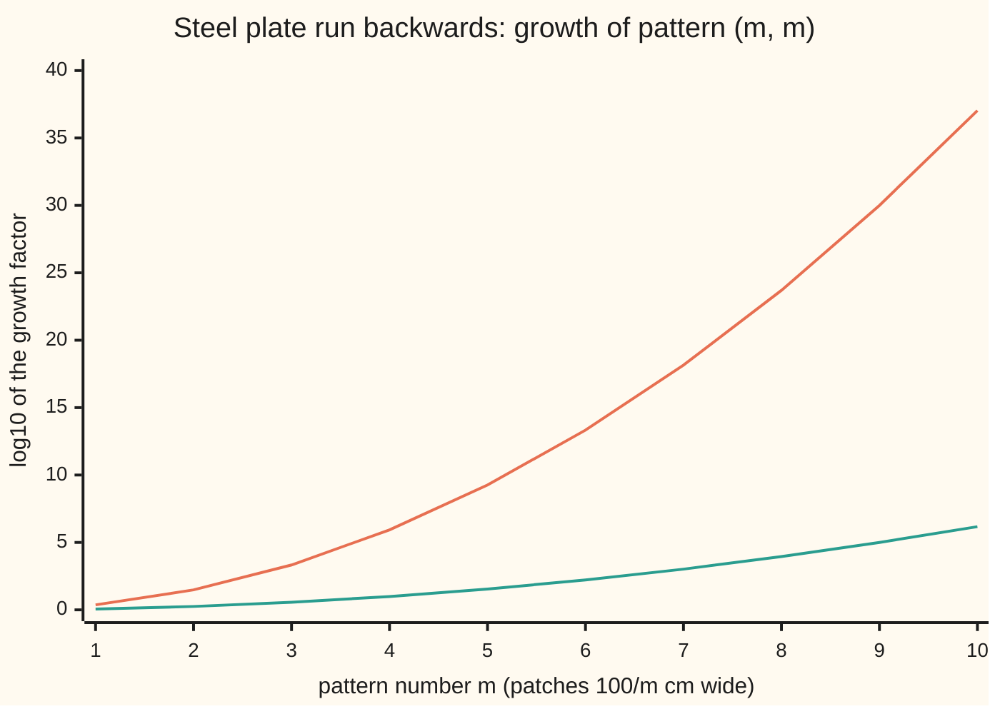

# Well posed: a solution exists, is unique, and does not amplify errors

[Syllabus](../../../SYLLABUS.md) → [Partial differential equations](../README.md) → [Classification and Well-Posedness](../README.md#s01) → Well posed

---

## General Overview

A square steel plate, 1 m on a side, sits in a frame held at the room's 20 °C. Yesterday at 09:00 it left a furnace with a broad hump of heat, 50 °C above the frame at its centre. Today at 09:00 a thermal camera reads it to the nearest 0.01 °C. The task: rebuild yesterday's temperature from today's picture.

Forward in time, the plate behaves. Heat spreads, and the hump sinks to $`6.47 \times 10^{-8}`$ °C above the frame in one day. The camera reads 20.00 °C everywhere.

Backward in time, every pattern on the plate (a fixed shape of hot and cold patches) must be multiplied up by as much as it shrank. For the broad hump, one day's factor is $`7.73 \times 10^{8}`$. A 0.01 °C camera error becomes $`7.73 \times 10^{6}`$ °C yesterday. Any hump from zero up to that size gives the same picture today.

A shorter step does not help. Going back one hour, the broad hump grows only 2.35 times. A pattern of 20 cm hot and cold patches grows $`1.81 \times 10^{9}`$ times, and finer patches grow faster still, with no ceiling. [A partial differential equation](../../08-Differential%20equations%20and%20dynamics/10-The%20Classical%20PDEs/01-what-a-pde-says.md) saw noise grow when it ran a rod backwards. This card shows why that failure has no cure by better measurement.

**A problem is well posed when every allowed set of data has a solution, only one, and a small change in the data, measured in a stated way, moves the solution only a little; running heat backwards fails the third demand however short the time gone back, because finer patterns are multiplied by factors with no upper limit.**

**What kind of fact this is:** a definition, Hadamard's three demands, plus two theorems proved on this card in Why it works: backward heat and Hadamard's own Laplace problem both fail the third demand. The Cauchy-Kovalevskaya theorem and Lewy's example are stated with their sources, not proved.

### The picture: how much going back multiplies each pattern



Orange: going back one hour. Green: ten minutes. A value of 9.26 means a factor of about $`10^{9.26}`$. The shorter step lowers the curve, but neither curve levels off.

---

## The formula

A PDE problem (a partial differential equation with its setting), as on [A PDE problem](01-what-a-pde-problem-is.md), is an equation, a region, data and a kind of solution. Write $`f`$ for the data and $`u`$ for the solution. Write $`\|g\|`$ for the **size** of a function $`g`$: on this card, its largest absolute value over the region. The French mathematician Jacques Hadamard set three demands on a problem:

1. **Existence.** Every allowed $`f`$ has a solution $`u`$.
2. **Uniqueness.** It has only one.
3. **Stability** (also called continuous dependence). For a linear problem, one constant $`C`$ serves for all data:

```math
\|u_1 - u_2\| \;\le\; C\,\|f_1 - f_2\|
```

**Read it aloud:** two sets of data a small distance apart give solutions at most $`C`$ times that distance apart, with the same $`C`$ for every pair.

A problem that meets all three demands is **well posed**. One that fails any of them is **ill posed**.

For the plate, each pattern decays at its own rate. Going back $`\tau`$ seconds multiplies pattern $`(m, n)`$ by

```math
A_{mn}(\tau) = e^{\lambda_{mn}\tau}, \qquad \lambda_{mn} = \kappa\pi^2\,\frac{m^2 + n^2}{L^2}
```

**Read it aloud:** the growth factor is e raised to the pattern's decay rate times the time gone back, and the decay rate rises with the square of how finely the pattern ripples.

| Symbol | Plain meaning | In our example | Push it up and the answer… |
| --- | --- | --- | --- |
| $`u`$, $`a_{mn}`$ | temperature above the frame; the amount of pattern $`(m, n)`$ in it | hump of 50 °C | — |
| $`f`$ | the data: today's camera picture, or an edge's value and slope | read to 0.01 °C | — |
| $`\Vert g\Vert`$ | size: the largest absolute value of $`g`$ | 0.01 °C error | — |
| $`C`$ | stability constant: the worst ratio of solution change to data change | 1 forward; none backward | the problem tolerates more error growth |
| $`x`$, $`y`$, $`z`$ | position: across the plate, up the plate, and a third direction (Lewy only), in m | 0 to 1 m | — |
| $`t`$, $`\tau`$ | time in s; $`\tau`$ is how far back the rebuild reaches | 3,600 s | the growth factor rises |
| $`\kappa`$ | thermal diffusivity: how fast heat spreads, in m²/s | $`1.2 \times 10^{-5}`$ (illustrative steel) | every pattern decays faster, so grows faster backwards |
| $`L`$ | side of the plate, as on [A PDE problem](01-what-a-pde-problem-is.md) | 1 m | patterns decay more slowly |
| $`m`$, $`n`$; $`k`$ | pattern numbers: half-waves across and up the plate; $`k`$ the wavenumber of Hadamard's ripple, in radians per metre | 5 and 5: 20 cm patches; $`k`$ = 10, 20, 40 | the growth factor rises without limit |
| $`\lambda_{mn}`$ | decay rate of pattern $`(m, n)`$, per s | $`5.9218 \times 10^{-3}`$ | — |
| $`A_{mn}(\tau)`$ | growth factor going back $`\tau`$ | $`1.81 \times 10^{9}`$ | — |
| $`i`$ | the imaginary unit, $`i^2 = -1`$ (Lewy only) | — | — |

Pattern $`(m, n)`$ is the shape $`\sin(m\pi x/L)\sin(n\pi y/L)`$: $`m`$ by $`n`$ patches, alternately hot and cold. A real plate also loses heat from its faces to the air. That adds the same extra decay to every pattern, so it changes none of the comparisons between patterns.

### When it holds

- **Size is measured in a stated way.** Without one, "small" means nothing. Forward heat has $`C = 1`$ in the largest-value and root-mean-square measures alike.
- **One constant serves for all data.** A large but fixed $`C`$ is a hard problem, not an ill-posed one. Backward heat cut to patterns up to $`(3, 3)`$ has the finite constant 2,150 for one hour, in the root-mean-square measure; allow every pattern and no $`C`$ exists.
- **The data comes from the right class.** Backward heat needs today's picture smoother than any camera gives. A picture with a sharp corner has no yesterday at all, so existence fails too.
- **Time runs the way the equation allows.** Heat forward is well posed. Heat backward is not.
- **Data sits on the right part of the edge.** Laplace's equation given its value on all four edges is well posed ([Maximum principles](08-maximum-principles.md)). Given value and slope on one edge, it fails the third demand: Step 4.

---

## Why it works

### Step 0: the plate is many ODEs, each fine, with no common bound

Split the temperature into patterns, as in [Separation of variables](../../08-Differential%20equations%20and%20dynamics/10-The%20Classical%20PDEs/04-separation-of-variables-for-the-heat-equation.md). The heat equation $`u_t = \kappa\Delta u`$ then becomes one ODE (ordinary differential equation: one unknown, depending on time alone) per pattern:

```math
a_{mn}'(t) = -\lambda_{mn}\, a_{mn}(t)
```

Each ODE alone is well posed, with a constant that [Gronwall's inequality](../../08-Differential%20equations%20and%20dynamics/02-Existence%2C%20Uniqueness%20and%20Sensitivity/04-gronwall-and-continuous-dependence.md) bounds. The PDE is all of these ODEs at once, and stability needs one constant for all of them. Forward, each pattern's factor is $`e^{-\lambda_{mn} t}`$, never above 1. Backward, it is $`e^{\lambda_{mn}\tau}`$, and $`\lambda_{mn}`$ has no upper limit.

### Step 1: forward, every pattern shrinks, so C = 1

Forward, $`a_{mn}(t) = a_{mn}(0)\,e^{-\lambda_{mn} t}`$, and every factor is below 1. The root-mean-square of $`u`$ (square, average over the plate, take the root) is $`\tfrac12`$ times the root of the sum of all $`a_{mn}^2`$. It can only fall. So two starts that differ by a little give two plates that differ by no more, ever: $`C = 1`$.

Existence holds because the shrunk series converges at least as well as the start's. Uniqueness holds because the difference of two solutions starts at zero and stays there. [Energy methods](07-energy-methods-and-uniqueness.md) proves the same for any start, and [Maximum principles](08-maximum-principles.md) gives $`C = 1`$ in the largest-value measure.

### Step 2: backward, the factors have no ceiling

Put a camera error into a single pattern: 0.01 °C times $`\sin(m\pi x/L)\sin(m\pi y/L)`$. Its largest value is 0.01 °C. Going back $`\tau`$, it becomes 0.01 °C times $`A_{mm}(\tau)`$.

Pick any constant $`C`$ and any $`\tau > 0`$. Choose $`m`$ so large that $`2\kappa\pi^2 m^2\tau/L^2 > \ln C`$. Then $`A_{mm}(\tau) > C`$, so $`C`$ fails. No constant survives.

The plate's numbers show it. One second back, 3 mm patches, pattern $`(300, 300)`$, grow $`1.81 \times 10^{9}`$ times. Patches 1 mm wide grow $`7.44 \times 10^{102}`$ times.

- **Uniqueness holds backwards.** Each factor $`e^{-\lambda_{mn}\tau}`$ is finite and not zero. Two different yesterdays give two different todays.
- **Existence fails backwards.** Yesterday's amounts are today's times $`A_{mn}(\tau)`$. A picture with a sharp corner has amounts that shrink only like $`1/m^2`$, so yesterday's sum runs off to infinity. No yesterday produces that picture.

<details>
<summary>Detailed proof: forward heat never grows the root-mean-square, backward heat has no constant</summary>

Write $`u = \sum a_{mn}\sin(m\pi x/L)\sin(n\pi y/L)`$. The patterns are orthogonal: the average over the plate of the product of two different patterns is 0, and of a pattern with itself is $`\tfrac14`$. So the mean square of $`u`$, its square averaged over the plate (the bar), is

$`\displaystyle \overline{u^2} = \tfrac14\sum_{m,n} a_{mn}^2.`$

Forward, $`a_{mn}(t)^2 = a_{mn}(0)^2 e^{-2\lambda_{mn}t} \le a_{mn}(0)^2`$, so the mean square never rises. Apply this to the difference of two solutions: the root-mean-square gap at time $`t`$ is at most the starting gap. That is stability with $`C = 1`$.

Backward over $`\tau`$, a single pattern grows by the factor $`e^{\lambda_{mm}\tau}`$, in either measure. For a given $`C`$, every $`m`$ with $`m^2 > L^2\ln C/(2\kappa\pi^2\tau)`$ breaks the bound. Infinitely many such $`m`$ exist, so no $`C`$ works.

</details>

### Step 3: no measure of size rescues it

Perhaps the measure is too generous to fine ripples. A stricter measure counts derivatives too: the data's size becomes the largest of the data and its first few derivatives. Each derivative multiplies pattern $`m`$'s size by $`m\pi/L`$, so four derivatives weight it by a factor proportional to $`m^4`$.

The growth factor still wins. It rises like $`e^{2\kappa\pi^2 m^2\tau/L^2}`$, and an exponential beats every power. Any measure built from a fixed number of derivatives fails.

A measure that weights pattern $`m`$ by $`A_{mm}(\tau)`$ itself would make the map stable. But for one second back, it demands 1 mm patterns measured $`7.44 \times 10^{102}`$ times more finely than the reading's error. No instrument does that. The real repair is extra knowledge about the answer, the subject of [Smoothing, blurring and deconvolution](../../20-Harmonic%20analysis/03-Convolution%20and%20Approximate%20Identities/05-smoothing-blurring-and-deconvolution.md).

### Step 4: Hadamard's own example, the steady plate given one edge

Now hold the plate steady, so its temperature obeys Laplace's equation $`u_{xx} + u_{yy} = 0`$. Give it data on the bottom edge only, leaving the other edges free: value 0, and slope $`\sin(kx)/k`$, where the wavenumber $`k`$, in radians per metre, sets how finely the slope ripples. A factor of 1 °C per m² is understood in the data, so the slope is in °C per m and the solution in °C. The solution is

```math
u(x, y) = \frac{\sin(kx)\,\sinh(ky)}{k^2}
```

**Read it aloud:** the ripple keeps its shape across the plate, and its height grows like the hyperbolic sine, $`\sinh(ky) = (e^{ky} - e^{-ky})/2`$, as it moves up.

Check it: $`u_{xx} = -k^2 u`$ and $`u_{yy} = +k^2 u`$, so they cancel. At $`y = 0`$, $`u = 0`$ and $`u_y = \sin(kx)/k`$.

The data's size is $`1/k`$, which shrinks to zero. At $`y = 1`$ m, the solution's size is $`\sinh(k)/k^2`$, which grows without limit. [A partial differential equation](../../08-Differential%20equations%20and%20dynamics/10-The%20Classical%20PDEs/01-what-a-pde-says.md) found 110.13 °C for $`k = 10`$ and 606456 °C for $`k = 20`$. For $`k = 40`$ the data is 0.025 and the solution $`7.36 \times 10^{13}`$ °C.

Counting four derivatives in the data's size does not help: the ratio of solution to data is 0.110 at $`k = 10`$, 75.8 at $`k = 20`$ and $`1.15 \times 10^{9}`$ at $`k = 40`$.

### Step 5: Cauchy-Kovalevskaya, existence and uniqueness without stability

A function is **analytic** when it equals its Taylor series near every point ([Taylor series in the plane](../../07-Complex%20analysis/04-Taylor%20Series%2C%20Zeros%20and%20Rigidity/01-taylor-series-in-the-plane.md)). A surface is **non-characteristic** when the equation can be solved there for the derivative across it ([Elliptic, parabolic, hyperbolic](04-classification-elliptic-parabolic-hyperbolic.md)).

**The Cauchy-Kovalevskaya theorem.** Take an equation with analytic coefficients and an analytic right-hand side, solved for its highest derivative across a non-characteristic surface. Give analytic data there: the value, and as many slopes across as the equation's order calls for, less one. Then, near that surface, exactly one analytic solution exists.

The proof's shape, in words:

1. Use the equation to compute every Taylor coefficient of the solution from the data, one order at a time. The non-characteristic condition makes each step possible.
2. Show the series converges. Compare it with a simpler equation whose series has larger coefficients and is known to converge (the method of majorants).

Hadamard's data is analytic, and Laplace's equation has no characteristic directions. So the theorem applies: the solution above exists and is the only analytic one. The theorem delivers demands 1 and 2 and says nothing about demand 3, which Step 4 shows fails.

### Step 6: Lewy's equation, no solution at all

Lewy found a first-order equation in three variables with very simple coefficients:

```math
u_x + i\,u_y - 2i\,(x + i y)\,u_z = f(x, y, z)
```

**Read it aloud:** the slope across, plus $`i`$ times the slope up, minus $`2i(x + iy)`$ times the slope along $`z`$, equals the data $`f`$.

The coefficients are polynomials, so they are analytic. Lewy showed that some real $`f`$, differentiable as many times as wanted but not analytic, admits no solution with continuous first derivatives in any region, however small. The first demand fails outright. Cauchy-Kovalevskaya does not apply, because $`f`$ is not analytic.

---

## Worked numbers, by hand

The 20 cm patches, pattern $`(5, 5)`$, one hour back, with a 0.01 °C camera error.

| Step | Arithmetic | Value |
| --- | --- | --- |
| 1 | $`\kappa\pi^2 = 1.2 \times 10^{-5} \times 9.8696`$ | $`1.1844 \times 10^{-4}`$ per s |
| 2 | $`\lambda_{55}`$: times $`5^2 + 5^2 = 50`$ | $`5.9218 \times 10^{-3}`$ per s |
| 3 | times $`\tau`$ = 3,600 s | 21.318 |
| 4 | $`A_{55} = e^{21.318}`$ | $`1.81 \times 10^{9}`$ |
| 5 | 0.01 °C times $`A_{55}`$ | **$`1.81 \times 10^{7}`$ °C** |

An error in the camera's last digit, laid out as 20 cm patches, becomes $`1.81 \times 10^{7}`$ °C one hour back. Forward, the same pattern shrinks to $`5.52 \times 10^{-10}`$ times its size in that hour.

The same sum for other patterns, one hour back:

| Pattern | Patch width | $`\lambda\tau`$ | Growth factor | 0.01 °C error becomes |
| --- | --- | --- | --- | --- |
| (1, 1) | 100 cm | 0.853 | 2.35 | 0.0235 °C |
| (2, 2) | 50 cm | 3.411 | 30.3 | 0.303 °C |
| (3, 3) | 33 cm | 7.675 | 2,150 | 21.5 °C |
| (5, 5) | 20 cm | 21.318 | $`1.81 \times 10^{9}`$ | $`1.81 \times 10^{7}`$ °C |
| (10, 10) | 10 cm | 85.273 | $`1.08 \times 10^{37}`$ | $`1.08 \times 10^{35}`$ °C |

### What breaks if you drop a piece

| Mistake | Comes out at | What went wrong |
| --- | --- | --- |
| Go back a full day, trusting the broadest pattern | 0.01 °C error becomes $`7.73 \times 10^{6}`$ °C | even the gentlest pattern grows $`7.73 \times 10^{8}`$ times |
| Go back one hour with a camera 10,000 times better | $`10^{-6}`$ °C in pattern (10, 10) becomes $`1.08 \times 10^{31}`$ °C | better data only moves the blow-up to finer patterns |
| Let a computer grid run it backwards | $`10^{-6}`$ °C in the 5 cm grid's finest ripple becomes $`4.63 \times 10^{52}`$ °C | the grid copies the equation's ill-posedness |
| Count four derivatives in the data's size | ratio 0.110, 75.8, $`1.15 \times 10^{9}`$ for $`k`$ = 10, 20, 40 | an exponential beats every power |
| Shrink Hadamard's data | slope 0.1, 0.05, 0.025 gives 110.13, 606456, $`7.36 \times 10^{13}`$ °C | value and slope on one edge do not suit Laplace's equation |

---

## Code, from first principles, and it actually runs

The code takes three roads. Road one is the closed form $`e^{\lambda\tau}`$ for each pattern. Road two steps the plate forward on grids 10 cm and 5 cm apart, with no exp, and finds the same factor; its error falls fourfold as the spacing halves. Stepped backwards, the grid grows a $`10^{-6}`$ °C ripple exactly as its own rule predicts. Road three marches Hadamard's slope data up the plate by RK4 (the classical fourth-order Runge-Kutta stepper) without sinh, and checks his solution's Laplace residual by centred differences at two step sizes.

### Python

```python
# Well posed -- the check behind the card.  Standard library only: math for exp,
# log, sin, sinh.  Road one is the closed form for each pattern (mode).  Road two
# steps the plate on a grid of points that never sees exp, forwards and then
# backwards, and marches Hadamard's slope data up the plate by RK4, which never
# sees sinh.  A centred-difference residual checks Hadamard's solution itself.
from math import exp, log, sin, sinh, pi, log10, floor

KAPPA, ELL = 1.2e-5, 1.0            # steel diffusivity (m^2/s, illustrative), plate side (m)
HOUR, DAY = 3600.0, 86400.0

def sci(x, k=2):                    # 1.80e9: the same digits in Python and Rust
    e = floor(log10(abs(x)))
    m = x / 10.0 ** e
    if round(abs(m), k) >= 10.0:
        m, e = m / 10.0, e + 1
    return f"{m:.{k}f}e{e}"

def rate(m, n):                     # decay rate of the (m, n) pattern, per second
    return KAPPA * pi * pi * (m * m + n * n) / ELL ** 2

def amp(m, n, tau):                 # road one: how much going back tau seconds multiplies it
    return exp(rate(m, n) * tau)

# ---- forward a day: yesterday's 50 C hump, read today ----
a11 = amp(1, 1, DAY)
print(f"(1,1) rate {sci(rate(1, 1), 4)} per s; one day: exponent {rate(1, 1) * DAY:.2f}, factor {sci(a11)}")
print(f"50 C hump yesterday -> {sci(50 / a11)} C today; a 0.01 C reading error -> {sci(0.01 * a11)} C yesterday")

# ---- back one hour, pattern by pattern, with a 0.01 C error in each ----
print(f"worked (5,5): pi^2 {pi * pi:.4f}, kappa pi^2 {sci(KAPPA * pi * pi, 4)} per s, x 50 = {sci(rate(5, 5), 4)} per s, x 3600 s = {rate(5, 5) * HOUR:.3f}")
for m in (1, 2, 3, 5, 10):
    lt = rate(m, m) * HOUR
    print(f"back 1 h, mode ({m},{m}), patches {100 * ELL / m:.0f} cm: rate x 1 h {lt:.3f}, "
          f"factor {sci(exp(lt))}, 0.01 C error -> {sci(0.01 * exp(lt))} C, forward x{sci(exp(-lt))}")
print("1e-6 C error in mode (10,10), back 1 h ->", sci(1e-6 * amp(10, 10, HOUR)), "C")
for m in (100, 300, 1000):
    print(f"back 1 s, mode ({m},{m}), patches {1000 * ELL / m:.0f} mm: factor {sci(amp(m, m, 1.0))}")

# ---- road two: the plate on an N x N grid, explicit time steps, no exp ----
def grid_run(N, m, tau, K, back=False, seed=0.0):
    h, dt, sg = ELL / N, tau / K, (-1.0 if back else 1.0)
    u = [[sin(m * pi * i * h) * sin(m * pi * j * h) + seed * sin((N - 1) * pi * i * h)
          * sin((N - 1) * pi * j * h) for j in range(N + 1)] for i in range(N + 1)]
    c = sg * KAPPA * dt / (h * h)
    for _ in range(K):              # u(t + dt) = u + dt * kappa * Laplacian(u); back: dt < 0
        u = [[0.0] * (N + 1)] + [[0.0] + [u[i][j] + c * (u[i + 1][j] + u[i - 1][j] + u[i][j + 1]
              + u[i][j - 1] - 4 * u[i][j]) for j in range(1, N)] + [0.0] for i in range(1, N)] + [[0.0] * (N + 1)]
    i0 = N // (2 * m)               # a grid point near a peak of the pattern
    return u[i0][i0] / (sin((N - 1 if seed else m) * pi * i0 * h) ** 2)

g10, g20 = 1 / grid_run(10, 2, HOUR, 4000), 1 / grid_run(20, 2, HOUR, 4000)
exact = rate(2, 2) * HOUR
e10, e20 = exact - log(g10), exact - log(g20)
rich = (4 * (exact - e20) - (exact - e10)) / 3
print(f"grid forward 1 h, mode (2,2): 1/decay at h = 10 cm {g10:.3f}, at h = 5 cm {g20:.3f}; closed form {exp(exact):.3f}")
print(f"grid exponent short by {e10:.4f} then {e20:.4f}: ratio {e10 / e20:.2f} (order 2); extrapolated {rich:.4f} vs {exact:.4f}")
gb = grid_run(20, 2, HOUR, 4000, back=True, seed=1e-6)
step = 1 + KAPPA * (HOUR / 4000) / 0.05 ** 2 * 8 * sin(19 * pi * 0.05 / 2) ** 2
print(f"grid backward 1 h, h = 5 cm, (2,2) plus 1e-6 C in its finest ripple (19,19): ripple {sci(gb)} C; "
      f"per-step factor {step:.5f}, predicted {sci(1e-6 * step ** 4000)} C")

# ---- Hadamard: u_xx + u_yy = 0, u(x,0) = 0, u_y(x,0) = sin(kx)/k ----
def rk4_height(k, steps=4000):      # a'' = k^2 a, a(0) = 0, a'(0) = 1/k; u = a(y) sin(kx)
    a, b, dy = 0.0, 1.0 / k, 1.0 / steps
    f = lambda a, b: (b, k * k * a)
    for _ in range(steps):
        k1 = f(a, b); k2 = f(a + dy / 2 * k1[0], b + dy / 2 * k1[1])
        k3 = f(a + dy / 2 * k2[0], b + dy / 2 * k2[1]); k4 = f(a + dy * k3[0], b + dy * k3[1])
        a += dy / 6 * (k1[0] + 2 * k2[0] + 2 * k3[0] + k4[0])
        b += dy / 6 * (k1[1] + 2 * k2[1] + 2 * k3[1] + k4[1])
    return a

had = []
for k in (10, 20, 40):
    cf, rk = sinh(k) / k ** 2, rk4_height(k)
    had.append((cf, rk))
    print(f"Hadamard k = {k}: data size {1 / k:.3f}, at y = 1 m closed form {sci(cf)}, RK4 {sci(rk)}; "
          f"ratio over data: plain {sci(cf * k)}, counting 4 derivatives {sci(cf / k ** 3)}")
print(f"as on the wing 08 card: k = 10 gives {had[0][0]:.2f}, k = 20 gives {had[1][0]:.0f}")
r = lambda x, y, k: sin(k * x) * sinh(k * y) / k ** 2
def lap(d):                         # u_xx and u_yy by centred differences at (0.3, 0.5), k = 10
    uxx = (r(0.3 + d, 0.5, 10) - 2 * r(0.3, 0.5, 10) + r(0.3 - d, 0.5, 10)) / d ** 2
    return uxx, (r(0.3, 0.5 + d, 10) - 2 * r(0.3, 0.5, 10) + r(0.3, 0.5 - d, 10)) / d ** 2
uxx, uyy = lap(1e-3)
res, res2 = uxx + uyy, sum(lap(5e-4))
print(f"Hadamard solution, k = 10, at (0.3, 0.5): u_xx {uxx:.4f}, u_yy {uyy:.4f}, sum {sci(res)}; half step {sci(res2)}")

# ---- chart: log10 of the backward factor, modes (m,m), m = 1..10 ----
print("chart, back 1 h:", ", ".join(f"{log10(amp(m, m, HOUR)):.2f}" for m in range(1, 11)))
print("chart, back 10 min:", ", ".join(f"{log10(amp(m, m, 600.0)):.2f}" for m in range(1, 11)))

assert abs(g20 / exp(exact) - 1) < 0.04 and abs(g10 / exp(exact) - 1) < 0.15   # grid agrees with closed form
assert 3.5 < e10 / e20 < 4.5 and abs(rich - exact) < 0.005                      # at second order in h
assert all(abs(rk / cf - 1) < 1e-8 for cf, rk in had)                           # RK4 march = sinh(k)/k^2
assert abs(gb / (1e-6 * step ** 4000) - 1) < 1e-6                              # back-run = its own law
assert abs(res) < 2e-5 * abs(uxx) and 3.8 < res / res2 < 4.2                   # it solves Laplace
assert had[2][0] * 40 > had[1][0] * 20 > had[0][0] * 10 > 1000                  # solution over data rises with k
print("ALL CHECKS PASS")
```

**Ran 2026-11-15 on macOS, Python 3.14.10, standard library only. All checks passed. Output, pasted from the run:**

```
(1,1) rate 2.3687e-4 per s; one day: exponent 20.47, factor 7.73e8
50 C hump yesterday -> 6.47e-8 C today; a 0.01 C reading error -> 7.73e6 C yesterday
worked (5,5): pi^2 9.8696, kappa pi^2 1.1844e-4 per s, x 50 = 5.9218e-3 per s, x 3600 s = 21.318
back 1 h, mode (1,1), patches 100 cm: rate x 1 h 0.853, factor 2.35e0, 0.01 C error -> 2.35e-2 C, forward x4.26e-1
back 1 h, mode (2,2), patches 50 cm: rate x 1 h 3.411, factor 3.03e1, 0.01 C error -> 3.03e-1 C, forward x3.30e-2
back 1 h, mode (3,3), patches 33 cm: rate x 1 h 7.675, factor 2.15e3, 0.01 C error -> 2.15e1 C, forward x4.64e-4
back 1 h, mode (5,5), patches 20 cm: rate x 1 h 21.318, factor 1.81e9, 0.01 C error -> 1.81e7 C, forward x5.52e-10
back 1 h, mode (10,10), patches 10 cm: rate x 1 h 85.273, factor 1.08e37, 0.01 C error -> 1.08e35 C, forward x9.25e-38
1e-6 C error in mode (10,10), back 1 h -> 1.08e31 C
back 1 s, mode (100,100), patches 10 mm: factor 1.07e1
back 1 s, mode (300,300), patches 3 mm: factor 1.81e9
back 1 s, mode (1000,1000), patches 1 mm: factor 7.44e102
grid forward 1 h, mode (2,2): 1/decay at h = 10 cm 27.155, at h = 5 cm 29.500; closed form 30.294
grid exponent short by 0.1094 then 0.0265: ratio 4.12 (order 2); extrapolated 3.4120 vs 3.4109
grid backward 1 h, h = 5 cm, (2,2) plus 1e-6 C in its finest ripple (19,19): ripple 4.63e52 C; per-step factor 1.03435, predicted 4.63e52 C
Hadamard k = 10: data size 0.100, at y = 1 m closed form 1.10e2, RK4 1.10e2; ratio over data: plain 1.10e3, counting 4 derivatives 1.10e-1
Hadamard k = 20: data size 0.050, at y = 1 m closed form 6.06e5, RK4 6.06e5; ratio over data: plain 1.21e7, counting 4 derivatives 7.58e1
Hadamard k = 40: data size 0.025, at y = 1 m closed form 7.36e13, RK4 7.36e13; ratio over data: plain 2.94e15, counting 4 derivatives 1.15e9
as on the wing 08 card: k = 10 gives 110.13, k = 20 gives 606456
Hadamard solution, k = 10, at (0.3, 0.5): u_xx -10.4715, u_yy 10.4716, sum 1.75e-4; half step 4.36e-5
chart, back 1 h: 0.37, 1.48, 3.33, 5.93, 9.26, 13.33, 18.15, 23.70, 30.00, 37.03
chart, back 10 min: 0.06, 0.25, 0.56, 0.99, 1.54, 2.22, 3.02, 3.95, 5.00, 6.17
ALL CHECKS PASS
```

### Rust

Same numbers, same labels, built with `rustc --edition 2021 -O`.

```rust
// Well posed -- the same check as the Python, in Rust.  No crates.  Road one is
// the closed form for each pattern (mode).  Road two steps the plate on a grid of
// points that never sees exp, forwards and then backwards, and marches Hadamard's
// slope data up the plate by RK4, which never sees sinh.  A centred-difference
// residual checks Hadamard's solution itself.
use std::f64::consts::PI;

const KAPPA: f64 = 1.2e-5; // steel diffusivity (m^2/s, illustrative)
const ELL: f64 = 1.0; // plate side (m)
const HOUR: f64 = 3600.0;
const DAY: f64 = 86400.0;

fn sci(x: f64, k: usize) -> String {
    // 1.80e9: the same digits in Python and Rust
    let mut e = x.abs().log10().floor() as i32;
    let mut m = x / 10f64.powi(e);
    let p = 10f64.powi(k as i32);
    if (m.abs() * p).round() / p >= 10.0 {
        m /= 10.0;
        e += 1;
    }
    format!("{:.*}e{}", k, m, e)
}

fn rate(m: f64, n: f64) -> f64 {
    KAPPA * PI * PI * (m * m + n * n) / (ELL * ELL)
}

fn amp(m: f64, n: f64, tau: f64) -> f64 {
    (rate(m, n) * tau).exp()
}

fn grid_run(nn: usize, m: f64, tau: f64, kk: usize, back: bool, seed: f64) -> f64 {
    let (h, dt, sg) = (ELL / nn as f64, tau / kk as f64, if back { -1.0 } else { 1.0 });
    let fin = (nn - 1) as f64;
    let mut u = vec![vec![0.0f64; nn + 1]; nn + 1];
    for i in 0..=nn {
        for j in 0..=nn {
            let (x, y) = (i as f64 * h, j as f64 * h);
            u[i][j] = (m * PI * x).sin() * (m * PI * y).sin() + seed * (fin * PI * x).sin() * (fin * PI * y).sin();
        }
    }
    let c = sg * KAPPA * dt / (h * h);
    for _ in 0..kk {
        // u(t + dt) = u + dt * kappa * Laplacian(u); back: dt < 0
        let mut v = vec![vec![0.0f64; nn + 1]; nn + 1];
        for i in 1..nn {
            for j in 1..nn {
                v[i][j] = u[i][j] + c * (u[i + 1][j] + u[i - 1][j] + u[i][j + 1] + u[i][j - 1] - 4.0 * u[i][j]);
            }
        }
        u = v;
    }
    let i0 = nn / (2 * m as usize); // a grid point near a peak of the pattern
    let w = if seed != 0.0 { fin } else { m };
    u[i0][i0] / (w * PI * i0 as f64 * h).sin().powi(2)
}

fn rk4_height(k: f64, steps: usize) -> f64 {
    // a'' = k^2 a, a(0) = 0, a'(0) = 1/k; u = a(y) sin(kx)
    let (mut a, mut b, dy) = (0.0f64, 1.0 / k, 1.0 / steps as f64);
    let f = |a: f64, b: f64| (b, k * k * a);
    for _ in 0..steps {
        let k1 = f(a, b);
        let k2 = f(a + dy / 2.0 * k1.0, b + dy / 2.0 * k1.1);
        let k3 = f(a + dy / 2.0 * k2.0, b + dy / 2.0 * k2.1);
        let k4 = f(a + dy * k3.0, b + dy * k3.1);
        a += dy / 6.0 * (k1.0 + 2.0 * k2.0 + 2.0 * k3.0 + k4.0);
        b += dy / 6.0 * (k1.1 + 2.0 * k2.1 + 2.0 * k3.1 + k4.1);
    }
    a
}

fn r(x: f64, y: f64, k: f64) -> f64 {
    (k * x).sin() * (k * y).sinh() / (k * k)
}

fn lap(d: f64) -> (f64, f64) {
    // u_xx and u_yy by centred differences at (0.3, 0.5), k = 10
    let uxx = (r(0.3 + d, 0.5, 10.0) - 2.0 * r(0.3, 0.5, 10.0) + r(0.3 - d, 0.5, 10.0)) / (d * d);
    (uxx, (r(0.3, 0.5 + d, 10.0) - 2.0 * r(0.3, 0.5, 10.0) + r(0.3, 0.5 - d, 10.0)) / (d * d))
}

fn main() {
    // ---- forward a day: yesterday's 50 C hump, read today ----
    let a11 = amp(1.0, 1.0, DAY);
    println!("(1,1) rate {} per s; one day: exponent {:.2}, factor {}", sci(rate(1.0, 1.0), 4), rate(1.0, 1.0) * DAY, sci(a11, 2));
    println!("50 C hump yesterday -> {} C today; a 0.01 C reading error -> {} C yesterday", sci(50.0 / a11, 2), sci(0.01 * a11, 2));

    // ---- back one hour, pattern by pattern, with a 0.01 C error in each ----
    println!("worked (5,5): pi^2 {:.4}, kappa pi^2 {} per s, x 50 = {} per s, x 3600 s = {:.3}", PI * PI, sci(KAPPA * PI * PI, 4), sci(rate(5.0, 5.0), 4), rate(5.0, 5.0) * HOUR);
    for m in [1.0f64, 2.0, 3.0, 5.0, 10.0] {
        let lt = rate(m, m) * HOUR;
        println!("back 1 h, mode ({},{}), patches {:.0} cm: rate x 1 h {:.3}, factor {}, 0.01 C error -> {} C, forward x{}",
            m, m, 100.0 * ELL / m, lt, sci(lt.exp(), 2), sci(0.01 * lt.exp(), 2), sci((-lt).exp(), 2));
    }
    println!("1e-6 C error in mode (10,10), back 1 h -> {} C", sci(1e-6 * amp(10.0, 10.0, HOUR), 2));
    for m in [100.0f64, 300.0, 1000.0] {
        println!("back 1 s, mode ({},{}), patches {:.0} mm: factor {}", m, m, 1000.0 * ELL / m, sci(amp(m, m, 1.0), 2));
    }

    // ---- road two: the plate on an N x N grid, explicit time steps, no exp ----
    let (g10, g20) = (1.0 / grid_run(10, 2.0, HOUR, 4000, false, 0.0), 1.0 / grid_run(20, 2.0, HOUR, 4000, false, 0.0));
    let exact = rate(2.0, 2.0) * HOUR;
    let (e10, e20) = (exact - g10.ln(), exact - g20.ln());
    let rich = (4.0 * (exact - e20) - (exact - e10)) / 3.0;
    println!("grid forward 1 h, mode (2,2): 1/decay at h = 10 cm {:.3}, at h = 5 cm {:.3}; closed form {:.3}", g10, g20, exact.exp());
    println!("grid exponent short by {:.4} then {:.4}: ratio {:.2} (order 2); extrapolated {:.4} vs {:.4}", e10, e20, e10 / e20, rich, exact);
    let gb = grid_run(20, 2.0, HOUR, 4000, true, 1e-6);
    let step = 1.0 + KAPPA * (HOUR / 4000.0) / (0.05f64 * 0.05) * 8.0 * (19.0 * PI * 0.05 / 2.0).sin().powi(2);
    println!("grid backward 1 h, h = 5 cm, (2,2) plus 1e-6 C in its finest ripple (19,19): ripple {} C; per-step factor {:.5}, predicted {} C",
        sci(gb, 2), step, sci(1e-6 * step.powi(4000), 2));

    // ---- Hadamard: u_xx + u_yy = 0, u(x,0) = 0, u_y(x,0) = sin(kx)/k ----
    let mut had = Vec::new();
    for k in [10.0f64, 20.0, 40.0] {
        let (cf, rk) = (k.sinh() / (k * k), rk4_height(k, 4000));
        had.push((cf, rk));
        println!("Hadamard k = {}: data size {:.3}, at y = 1 m closed form {}, RK4 {}; ratio over data: plain {}, counting 4 derivatives {}",
            k, 1.0 / k, sci(cf, 2), sci(rk, 2), sci(cf * k, 2), sci(cf / (k * k * k), 2));
    }
    println!("as on the wing 08 card: k = 10 gives {:.2}, k = 20 gives {:.0}", had[0].0, had[1].0);
    let (uxx, uyy) = lap(1e-3);
    let (a2, b2) = lap(5e-4);
    let (res, res2) = (uxx + uyy, a2 + b2);
    println!("Hadamard solution, k = 10, at (0.3, 0.5): u_xx {:.4}, u_yy {:.4}, sum {}; half step {}", uxx, uyy, sci(res, 2), sci(res2, 2));

    // ---- chart: log10 of the backward factor, modes (m,m), m = 1..10 ----
    let row = |tau: f64| (1..=10).map(|m| format!("{:.2}", amp(m as f64, m as f64, tau).log10())).collect::<Vec<_>>().join(", ");
    println!("chart, back 1 h: {}", row(HOUR));
    println!("chart, back 10 min: {}", row(600.0));

    assert!((g20 / exact.exp() - 1.0).abs() < 0.04 && (g10 / exact.exp() - 1.0).abs() < 0.15); // grid agrees with closed form
    assert!(e10 / e20 > 3.5 && e10 / e20 < 4.5 && (rich - exact).abs() < 0.005); // at second order in h
    assert!(had.iter().all(|&(cf, rk)| (rk / cf - 1.0).abs() < 1e-8)); // RK4 march = sinh(k)/k^2
    assert!((gb / (1e-6 * step.powi(4000)) - 1.0).abs() < 1e-6); // back-run = its own law
    assert!(res.abs() < 2e-5 * uxx.abs() && res / res2 > 3.8 && res / res2 < 4.2); // it solves Laplace
    assert!(had[2].0 * 40.0 > had[1].0 * 20.0 && had[1].0 * 20.0 > had[0].0 * 10.0 && had[0].0 * 10.0 > 1000.0); // solution over data rises with k
    println!("ALL CHECKS PASS");
}
```

**Ran 2026-11-15 on macOS, rustc 1.98.1, no crates. All checks passed. Output, pasted from the run:**

```
(1,1) rate 2.3687e-4 per s; one day: exponent 20.47, factor 7.73e8
50 C hump yesterday -> 6.47e-8 C today; a 0.01 C reading error -> 7.73e6 C yesterday
worked (5,5): pi^2 9.8696, kappa pi^2 1.1844e-4 per s, x 50 = 5.9218e-3 per s, x 3600 s = 21.318
back 1 h, mode (1,1), patches 100 cm: rate x 1 h 0.853, factor 2.35e0, 0.01 C error -> 2.35e-2 C, forward x4.26e-1
back 1 h, mode (2,2), patches 50 cm: rate x 1 h 3.411, factor 3.03e1, 0.01 C error -> 3.03e-1 C, forward x3.30e-2
back 1 h, mode (3,3), patches 33 cm: rate x 1 h 7.675, factor 2.15e3, 0.01 C error -> 2.15e1 C, forward x4.64e-4
back 1 h, mode (5,5), patches 20 cm: rate x 1 h 21.318, factor 1.81e9, 0.01 C error -> 1.81e7 C, forward x5.52e-10
back 1 h, mode (10,10), patches 10 cm: rate x 1 h 85.273, factor 1.08e37, 0.01 C error -> 1.08e35 C, forward x9.25e-38
1e-6 C error in mode (10,10), back 1 h -> 1.08e31 C
back 1 s, mode (100,100), patches 10 mm: factor 1.07e1
back 1 s, mode (300,300), patches 3 mm: factor 1.81e9
back 1 s, mode (1000,1000), patches 1 mm: factor 7.44e102
grid forward 1 h, mode (2,2): 1/decay at h = 10 cm 27.155, at h = 5 cm 29.500; closed form 30.294
grid exponent short by 0.1094 then 0.0265: ratio 4.12 (order 2); extrapolated 3.4120 vs 3.4109
grid backward 1 h, h = 5 cm, (2,2) plus 1e-6 C in its finest ripple (19,19): ripple 4.63e52 C; per-step factor 1.03435, predicted 4.63e52 C
Hadamard k = 10: data size 0.100, at y = 1 m closed form 1.10e2, RK4 1.10e2; ratio over data: plain 1.10e3, counting 4 derivatives 1.10e-1
Hadamard k = 20: data size 0.050, at y = 1 m closed form 6.06e5, RK4 6.06e5; ratio over data: plain 1.21e7, counting 4 derivatives 7.58e1
Hadamard k = 40: data size 0.025, at y = 1 m closed form 7.36e13, RK4 7.36e13; ratio over data: plain 2.94e15, counting 4 derivatives 1.15e9
as on the wing 08 card: k = 10 gives 110.13, k = 20 gives 606456
Hadamard solution, k = 10, at (0.3, 0.5): u_xx -10.4715, u_yy 10.4716, sum 1.75e-4; half step 4.36e-5
chart, back 1 h: 0.37, 1.48, 3.33, 5.93, 9.26, 13.33, 18.15, 23.70, 30.00, 37.03
chart, back 10 min: 0.06, 0.25, 0.56, 0.99, 1.54, 2.22, 3.02, 3.95, 5.00, 6.17
ALL CHECKS PASS
```

### Lean

Lean proves that backward heat and Hadamard's problem both fail the third demand, for any plate side, diffusivity and time gone back above zero.

- Take heat run back $`\tau`$ seconds on the plate, edges held at 0, size measured by the largest value. Then no single constant $`C`$ serves for every pair of solutions.
- Take any constant $`C`$ and any number $`p`$ of derivatives counted in the size. Then some pattern $`(m, m)`$ grows by more than $`C m^p`$ going back.
- Take Hadamard's steady plate, with value 0 on the bottom edge and its slope there as data. Then no constant $`C`$ bounds the change in the solution by $`C`$ times the change in the slope.
- Take pattern (5, 5) on the 100 cm plate. Then $`5^2 + 5^2 = 50`$, and its patches are 20 cm wide; pattern (10, 10) has 10 cm patches.

The decimal growth factors, the grid runs and the RK4 march are left to the Python and Rust checks.

```lean
-- Well posed: running the heat equation backwards on a square plate, and Hadamard's steady plate given value and slope on one edge, both fail the third demand, because no single constant bounds the change in the solution by the change in the data, and the backward growth factor of a fine pattern beats every power of its pattern number.
import Mathlib.Analysis.SpecialFunctions.Trigonometric.Deriv
import Mathlib.Analysis.SpecialFunctions.ExpDeriv
import Mathlib.Analysis.SpecialFunctions.Pow.Asymptotics
import Mathlib.Analysis.SpecialFunctions.Trigonometric.DerivHyp
import Mathlib.Analysis.Calculus.ContDiff.Basic
import Mathlib.Analysis.Calculus.Deriv.Basic
import Mathlib.Tactic.NormNum

open Real Set

namespace WellPosednessAndHadamard

/-- A classical solution of the heat equation on the square plate `(0, L) × (0, L)` from
yesterday (`t = 0`) to today (`t = τ`), with the frame held at 0 above room temperature:
`u` is twice continuously differentiable in `(t, x, y)`, `u_t = κ (u_xx + u_yy)` inside the
plate for `0 ≤ t ≤ τ`, and `u = 0` on all four edges for `0 ≤ t ≤ τ`. -/
def IsPlateHeatSolution (κ L τ : ℝ) (u : ℝ → ℝ → ℝ → ℝ) : Prop :=
  ContDiff ℝ 2 (fun p : ℝ × ℝ × ℝ => u p.1 p.2.1 p.2.2) ∧
  (∀ t ∈ Icc 0 τ, ∀ x ∈ Ioo 0 L, ∀ y ∈ Ioo 0 L,
    deriv (fun s => u s x y) t =
      κ * (deriv (fun x' => deriv (fun x'' => u t x'' y) x') x +
        deriv (fun y' => deriv (fun y'' => u t x y'') y') y)) ∧
  (∀ t ∈ Icc 0 τ, ∀ z ∈ Icc 0 L,
    u t 0 z = 0 ∧ u t L z = 0 ∧ u t z 0 = 0 ∧ u t z L = 0)

lemma deriv_cos_mul_const (k c : ℝ) :
    deriv (fun x => cos (k * x) * c) = fun x => -(k * sin (k * x)) * c := by
  funext x
  have h := (((hasDerivAt_id x).const_mul k).cos).mul_const c
  simp only [id, mul_one] at h
  rw [h.deriv]; ring

#print axioms deriv_cos_mul_const

lemma deriv_sin_mul_const (k c : ℝ) :
    deriv (fun x => sin (k * x) * c) = fun x => (k * cos (k * x)) * c := by
  funext x
  have h := (((hasDerivAt_id x).const_mul k).sin).mul_const c
  simp only [id, mul_one] at h
  rw [h.deriv]; ring

#print axioms deriv_sin_mul_const

lemma deriv2_sin_mul_const (k c x : ℝ) :
    deriv (fun x' => deriv (fun x'' => sin (k * x'') * c) x') x = -(k ^ 2) * sin (k * x) * c := by
  rw [deriv_sin_mul_const]
  have e : (fun x' => (k * cos (k * x')) * c) = fun x' => cos (k * x') * (k * c) := by
    funext x'; ring
  rw [e, deriv_cos_mul_const]; ring

#print axioms deriv2_sin_mul_const

lemma deriv_exp_neg_mul_const (a c : ℝ) :
    deriv (fun s => exp (-a * s) * c) = fun s => -a * exp (-a * s) * c := by
  funext s
  have h := (((hasDerivAt_id s).const_mul (-a)).exp).mul_const c
  simp only [id, mul_one] at h
  rw [h.deriv]; ring

#print axioms deriv_exp_neg_mul_const

lemma heat_mode_isSolution (κ L τ k lam : ℝ) (hlam : lam = κ * (2 * k ^ 2))
    (hkL : sin (k * L) = 0) :
    IsPlateHeatSolution κ L τ (fun t x y => exp (-lam * t) * (sin (k * x) * sin (k * y))) := by
  refine ⟨?_, ?_, ?_⟩
  · fun_prop
  · intro t _ x _ y _
    simp only
    rw [deriv_exp_neg_mul_const]
    have e1 : (fun x'' => exp (-lam * t) * (sin (k * x'') * sin (k * y))) =
        fun x'' => sin (k * x'') * (exp (-lam * t) * sin (k * y)) := by funext x''; ring
    have e2 : (fun y'' => exp (-lam * t) * (sin (k * x) * sin (k * y''))) =
        fun y'' => sin (k * y'') * (exp (-lam * t) * sin (k * x)) := by funext y''; ring
    rw [e1, e2, deriv2_sin_mul_const, deriv2_sin_mul_const, hlam]
    ring
  · intro t _ z _
    simp [hkL]

#print axioms heat_mode_isSolution

lemma factor_beats_power_pos (κ L τ : ℝ) (hκ : 0 < κ) (hL : 0 < L)
    (hτ : 0 < τ) (C : ℝ) (p : ℕ) :
    ∃ m : ℕ, 1 ≤ m ∧
      C * (m : ℝ) ^ p < exp (κ * π ^ 2 * ((m : ℝ) ^ 2 + (m : ℝ) ^ 2) / L ^ 2 * τ) := by
  set b : ℝ := 2 * κ * π ^ 2 / L ^ 2 * τ with hbdef
  have hb : 0 < b := by positivity
  have hc : (0 : ℝ) < 1 / (|C| + 1) := by positivity
  have h1 := (isLittleO_pow_exp_pos_mul_atTop p hb).def hc
  have h2 := (tendsto_natCast_atTop_atTop (R := ℝ)).eventually h1
  obtain ⟨m, hm, hm1⟩ := (h2.and (Filter.eventually_ge_atTop 1)).exists
  refine ⟨m, hm1, ?_⟩
  have hm1' : (1 : ℝ) ≤ m := by exact_mod_cast hm1
  have hexp : exp (b * m) ≤ exp (κ * π ^ 2 * ((m : ℝ) ^ 2 + (m : ℝ) ^ 2) / L ^ 2 * τ) := by
    apply exp_le_exp.mpr
    have : κ * π ^ 2 * ((m : ℝ) ^ 2 + (m : ℝ) ^ 2) / L ^ 2 * τ = b * (m * m) := by
      rw [hbdef]; ring
    rw [this]
    apply mul_le_mul_of_nonneg_left _ hb.le
    nlinarith
  simp only [norm_pow, Real.norm_eq_abs, abs_exp] at hm
  have hm0 : (0:ℝ) ≤ m := by linarith
  rw [abs_of_nonneg hm0] at hm
  have hmp : 0 ≤ (m:ℝ) ^ p := by positivity
  have key : (|C| + 1) * (m:ℝ) ^ p ≤ exp (b * m) := by
    have := mul_le_mul_of_nonneg_left hm (by positivity : (0:ℝ) ≤ |C| + 1)
    calc (|C| + 1) * (m:ℝ) ^ p ≤ (|C| + 1) * (1 / (|C| + 1) * exp (b * m)) := this
      _ = exp (b * m) := by field_simp
  have hmp' : 0 < (m:ℝ) ^ p := by positivity
  calc C * (m:ℝ) ^ p ≤ |C| * (m:ℝ) ^ p := mul_le_mul_of_nonneg_right (le_abs_self C) hmp
    _ < (|C| + 1) * (m:ℝ) ^ p := by nlinarith
    _ ≤ exp (b * m) := key
    _ ≤ _ := hexp

#print axioms factor_beats_power_pos

/-- Hadamard's third demand for heat run backwards, with size measured as the largest
absolute value over the closed plate: one constant `C` serves for all pairs of solutions,
so that whenever today's pictures differ by at most `δ` everywhere on the plate, yesterday's
temperatures differ by at most `C δ` everywhere on the plate. -/
def BackwardHeatStable (κ L τ C : ℝ) : Prop :=
  ∀ u₁ u₂ : ℝ → ℝ → ℝ → ℝ, IsPlateHeatSolution κ L τ u₁ → IsPlateHeatSolution κ L τ u₂ →
    ∀ δ : ℝ, (∀ x ∈ Icc 0 L, ∀ y ∈ Icc 0 L, |u₁ τ x y - u₂ τ x y| ≤ δ) →
      ∀ x ∈ Icc 0 L, ∀ y ∈ Icc 0 L, |u₁ 0 x y - u₂ 0 x y| ≤ C * δ

/-- Backward heat is ill posed, however short the time gone back. On a square plate of
side `L > 0` with diffusivity `κ > 0` and its edges held at 0, rebuilding yesterday's
temperature from today's picture `τ > 0` seconds later fails the third demand in the
largest-value measure: no constant `C` bounds how far yesterday's temperatures can move
by `C` times how far today's pictures move. -/
theorem backward_heat_not_stable (κ L τ : ℝ) (hκ : 0 < κ) (hL : 0 < L) (hτ : 0 < τ) :
    ¬ ∃ C : ℝ, BackwardHeatStable κ L τ C := by
  rintro ⟨C, hC⟩
  obtain ⟨m, hm1, hm⟩ := factor_beats_power_pos κ L τ hκ hL hτ C 0
  simp only [pow_zero, mul_one] at hm
  set lam : ℝ := κ * π ^ 2 * ((m : ℝ) ^ 2 + (m : ℝ) ^ 2) / L ^ 2 with hlamdef
  set k : ℝ := π * m / L with hkdef
  have hm1' : (1 : ℝ) ≤ m := by exact_mod_cast hm1
  have hlam : lam = κ * (2 * k ^ 2) := by rw [hlamdef, hkdef]; field_simp; ring
  have hkL' : k * L = m * π := by rw [hkdef]; field_simp
  have hkL : sin (k * L) = 0 := by rw [hkL']; exact sin_nat_mul_pi m
  have hsol := heat_mode_isSolution κ L τ k lam hlam hkL
  have h0 : IsPlateHeatSolution κ L τ (fun _ _ _ => 0) := by
    have := heat_mode_isSolution κ L τ 0 0 (by ring) (by simp)
    simpa using this
  have hdata : ∀ x ∈ Icc 0 L, ∀ y ∈ Icc 0 L,
      |(fun t x y => exp (-lam * t) * (sin (k * x) * sin (k * y))) τ x y -
        (fun (_ _ _ : ℝ) => (0:ℝ)) τ x y| ≤ exp (-lam * τ) := by
    intro x _ y _
    simp only [sub_zero]
    rw [abs_mul, abs_mul, abs_of_pos (exp_pos _)]
    have h1 := abs_sin_le_one (k * x)
    have h2 := abs_sin_le_one (k * y)
    have h3 : |sin (k * x)| * |sin (k * y)| ≤ 1 := by
      nlinarith [abs_nonneg (sin (k * x)), abs_nonneg (sin (k * y))]
    have := exp_pos (-lam * τ)
    nlinarith
  set x0 : ℝ := L / (2 * m) with hx0
  have hx0mem : x0 ∈ Icc 0 L := by
    constructor
    · positivity
    · rw [hx0, div_le_iff₀ (by positivity)]; nlinarith
  have hkx0 : k * x0 = π / 2 := by rw [hkdef, hx0]; field_simp
  have h := hC _ _ hsol h0 _ hdata x0 hx0mem x0 hx0mem
  simp only [mul_zero, exp_zero, sub_zero, hkx0, sin_pi_div_two, mul_one,
    abs_one] at h
  have hE : exp (-lam * τ) * exp (lam * τ) = 1 := by rw [← exp_add]; simp
  have hEpos := exp_pos (-lam * τ)
  nlinarith

/-- The backward growth factor has no ceiling, and no measure of size that counts a fixed
number of derivatives rescues it. Going back `τ > 0` seconds multiplies pattern `(m, m)` by
`A_mm(τ) = e^(λ_mm τ)` with `λ_mm = κ π² (m² + m²) / L²`. For every constant `C` and every
number of derivatives `p` (each derivative weighting pattern `m` by about `m`), some pattern
`m` grows by more than `C m^p`: an exponential beats every power. With `p = 0` this says the
factors exceed every constant. -/
theorem backward_factor_beats_every_power (κ L τ : ℝ) (hκ : 0 < κ) (hL : 0 < L)
    (hτ : 0 < τ) (C : ℝ) (p : ℕ) :
    ∃ m : ℕ, C * (m : ℝ) ^ p < exp (κ * π ^ 2 * ((m : ℝ) ^ 2 + (m : ℝ) ^ 2) / L ^ 2 * τ) := by
  obtain ⟨m, _, hm⟩ := factor_beats_power_pos κ L τ hκ hL hτ C p
  exact ⟨m, hm⟩

/-- A classical solution of Hadamard's problem on the steady square plate `(0, L) × (0, L)`:
`u` is twice continuously differentiable, solves Laplace's equation `u_xx + u_yy = 0` inside
the plate, and has value 0 on the bottom edge `y = 0`; the other edges are left free. Its
data is its slope up the plate on the bottom edge, `u_y(x, 0)`. -/
def IsHadamardSolution (L : ℝ) (u : ℝ → ℝ → ℝ) : Prop :=
  ContDiff ℝ 2 (fun p : ℝ × ℝ => u p.1 p.2) ∧
  (∀ x ∈ Ioo 0 L, ∀ y ∈ Ioo 0 L,
    deriv (fun x' => deriv (fun x'' => u x'' y) x') x +
      deriv (fun y' => deriv (fun y'' => u x y'') y') y = 0) ∧
  (∀ x ∈ Icc 0 L, u x 0 = 0)

lemma deriv_const_mul_sinh (k c : ℝ) :
    deriv (fun y => c * sinh (k * y)) = fun y => c * (k * cosh (k * y)) := by
  funext y
  have h := (((hasDerivAt_id y).const_mul k).sinh).const_mul c
  simp only [id, mul_one] at h
  rw [h.deriv]; ring

#print axioms deriv_const_mul_sinh

lemma deriv_const_mul_cosh (k c : ℝ) :
    deriv (fun y => c * cosh (k * y)) = fun y => c * (k * sinh (k * y)) := by
  funext y
  have h := (((hasDerivAt_id y).const_mul k).cosh).const_mul c
  simp only [id, mul_one] at h
  rw [h.deriv]; ring

#print axioms deriv_const_mul_cosh

lemma hadamard_mode_isSolution (L k : ℝ) :
    IsHadamardSolution L (fun x y => cos (k * x) * sinh (k * y)) := by
  refine ⟨?_, ?_, ?_⟩
  · fun_prop
  · intro x _ y _
    simp only
    rw [deriv_cos_mul_const, deriv_const_mul_sinh]
    have e1 : (fun x' => -(k * sin (k * x')) * sinh (k * y)) =
        fun x' => sin (k * x') * (-k * sinh (k * y)) := by funext x'; ring
    have e2 : (fun y' => cos (k * x) * (k * cosh (k * y'))) =
        fun y' => (cos (k * x) * k) * cosh (k * y') := by funext y'; ring
    rw [e1, e2, deriv_sin_mul_const, deriv_const_mul_cosh]
    ring
  · intro x _
    simp

#print axioms hadamard_mode_isSolution

lemma sinh_ge_sq_div_four {y : ℝ} (hy : 0 ≤ y) : y ^ 2 / 4 ≤ sinh y := by
  rw [sinh_eq]
  have h1 := quadratic_le_exp_of_nonneg hy
  have h2 : exp (-y) ≤ 1 := by rw [exp_le_one_iff]; linarith
  nlinarith

#print axioms sinh_ge_sq_div_four

/-- Hadamard's example: Laplace's equation given value and slope on one edge fails the third
demand. On a square plate of side `L > 0`, with value 0 on the bottom edge and the slope
`u_y(x, 0)` as data, no constant `C` makes every pair of solutions whose slope data differ by
at most `δ` along the bottom edge differ by at most `C δ` everywhere on the closed plate.
(The slope data `sin(kx)/k`, of size `1/k`, gives the solution `sin(kx) sinh(ky)/k²`.) -/
theorem hadamard_cauchy_laplace_not_stable (L : ℝ) (hL : 0 < L) :
    ¬ ∃ C : ℝ, ∀ u₁ u₂ : ℝ → ℝ → ℝ, IsHadamardSolution L u₁ → IsHadamardSolution L u₂ →
      ∀ δ : ℝ, (∀ x ∈ Icc 0 L,
          |deriv (fun y => u₁ x y) 0 - deriv (fun y => u₂ x y) 0| ≤ δ) →
        ∀ x ∈ Icc 0 L, ∀ y ∈ Icc 0 L, |u₁ x y - u₂ x y| ≤ C * δ := by
  rintro ⟨C, hC⟩
  set k : ℝ := (4 * |C| + 1) / L ^ 2 with hkdef
  have hk : 0 < k := by positivity
  have h0 : IsHadamardSolution L (fun _ _ => 0) := by
    have := hadamard_mode_isSolution L 0
    simpa using this
  have hdata : ∀ x ∈ Icc 0 L,
      |deriv (fun y => (fun x y => cos (k * x) * sinh (k * y)) x y) 0 -
        deriv (fun y => (fun (_ _ : ℝ) => (0:ℝ)) x y) 0| ≤ k := by
    intro x _
    simp only
    rw [deriv_const_mul_sinh]
    simp only [mul_zero, cosh_zero, mul_one, deriv_const, sub_zero]
    rw [abs_mul, abs_of_pos hk]
    have := abs_cos_le_one (k * x)
    nlinarith [abs_nonneg (cos (k * x))]
  have h := hC _ _ (hadamard_mode_isSolution L k) h0 k hdata 0 ⟨le_refl _, hL.le⟩ L
    ⟨hL.le, le_refl _⟩
  simp only [mul_zero, cos_zero, one_mul, sub_zero] at h
  have hs := sinh_ge_sq_div_four (mul_pos hk hL).le
  have hpos : 0 ≤ sinh (k * L) := le_trans (by positivity) hs
  rw [abs_of_nonneg hpos] at h
  have hCk : C * k ≤ |C| * k := mul_le_mul_of_nonneg_right (le_abs_self C) hk.le
  have hkL : k * L ^ 2 = 4 * |C| + 1 := by rw [hkdef]; field_simp
  nlinarith

-- The worked pattern (5, 5): m² + n² = 5² + 5² = 50.
example : (5 : ℕ) ^ 2 + 5 ^ 2 = 50 := by norm_num
-- Pattern (m, m) on the 100 cm plate has patches 100/m cm wide: 20 cm for m = 5, 10 cm for m = 10.
example : (100 : ℕ) / 5 = 20 ∧ (100 : ℕ) / 10 = 10 := by norm_num

#print axioms backward_heat_not_stable
#print axioms backward_factor_beats_every_power
#print axioms hadamard_cauchy_laplace_not_stable

end WellPosednessAndHadamard
```

**Checked 2026-11-15 on macOS, Lean 4.36.0-rc2, Mathlib v4.36.0-rc2. Every proof is complete and uses only Lean's standard axioms. Output, pasted from the run:**

```
'WellPosednessAndHadamard.deriv_cos_mul_const' depends on axioms: [propext, Classical.choice, Quot.sound]
'WellPosednessAndHadamard.deriv_sin_mul_const' depends on axioms: [propext, Classical.choice, Quot.sound]
'WellPosednessAndHadamard.deriv2_sin_mul_const' depends on axioms: [propext, Classical.choice, Quot.sound]
'WellPosednessAndHadamard.deriv_exp_neg_mul_const' depends on axioms: [propext, Classical.choice, Quot.sound]
'WellPosednessAndHadamard.heat_mode_isSolution' depends on axioms: [propext, Classical.choice, Quot.sound]
'WellPosednessAndHadamard.factor_beats_power_pos' depends on axioms: [propext, Classical.choice, Quot.sound]
'WellPosednessAndHadamard.deriv_const_mul_sinh' depends on axioms: [propext, Classical.choice, Quot.sound]
'WellPosednessAndHadamard.deriv_const_mul_cosh' depends on axioms: [propext, Classical.choice, Quot.sound]
'WellPosednessAndHadamard.hadamard_mode_isSolution' depends on axioms: [propext, Classical.choice, Quot.sound]
'WellPosednessAndHadamard.sinh_ge_sq_div_four' depends on axioms: [propext, Classical.choice, Quot.sound]
'WellPosednessAndHadamard.backward_heat_not_stable' depends on axioms: [propext, Classical.choice, Quot.sound]
'WellPosednessAndHadamard.backward_factor_beats_every_power' depends on axioms: [propext, Classical.choice, Quot.sound]
'WellPosednessAndHadamard.hadamard_cauchy_laplace_not_stable' depends on axioms: [propext, Classical.choice, Quot.sound]
```

> [!TIP]
> **Try changing**
> Guess first, then run it.
> - **Stainless steel.** Change `KAPPA` from `1.2e-5` to `4e-6`, a typical stainless value. The day's factor for the broadest pattern drops to 918, and the 0.01 °C error to 9.18 °C. Pattern (10, 10) still grows $`2.21 \times 10^{12}`$ times in one hour.
> - **No deliberate error at all.** In the `gb = grid_run(...)` line change `seed=1e-6` to `seed=0.0`. The grid starts as a pure (2, 2) pattern, yet rounding error in the sixteenth digit grows to about $`10^{41}`$ °C in size. The back-run assert stops the run, because nothing predicts rounding error.
> - **Finer Hadamard data.** Change `(10, 20, 40)` to `(10, 20, 80)`. Data of size 0.013 gives $`4.33 \times 10^{30}`$ °C. The RK4 assert stops the run: 4,000 steps are too coarse for so steep a climb.

---

## The usual mistake

> [!warning]
> **Treating ill-posed as "needs a better instrument".** At any accuracy there are finer patterns that grow past it. A camera 10,000 times better, reading to $`10^{-6}`$ °C, still turns a pattern (10, 10) error into $`1.08 \times 10^{31}`$ °C one hour back.
>
> - **Calling a large constant ill-posed.** Backward heat cut to patterns up to (3, 3) has the finite constant 2,150 for one hour, in the root-mean-square measure. That problem is badly conditioned but well posed.
> - **Trusting existence and uniqueness alone.** Hadamard's problem has both, by Cauchy-Kovalevskaya, and still turns slope data of 0.025 into $`7.36 \times 10^{13}`$ °C.
> - **Blaming the grid.** Forward, the 5 cm grid shrinks pattern (2, 2) by a factor of 29.500 in one hour, against the exact 30.294. Backward, it blows up because the equation does.

---

## Where you meet it in real life

- **Furnace and engine walls.** Engineers estimate the temperature inside a wall from sensors on its outer face. That is heat given value and flow on one side only, which is ill posed in the same way as Step 4.
- **Sharpening a blurred photograph.** Blur spreads light the way heat spreads, so sharpening runs heat backwards. Sharpening tools add assumptions about the answer to keep noise from exploding.
- **Heart readings from the chest.** Inverse electrocardiography rebuilds voltages on the heart from electrodes on the skin. Between the two, the voltage obeys Laplace's equation, given value and slope on one surface: Hadamard's example.
- **Numerical computing.** An ill-posed problem has an infinite condition number, the worst ratio of output error to input error ([Conditioning and stability](../../16-Numerical%20analysis/01-Floating%20Point%20and%20Error/05-conditioning-and-stability.md)). No algorithm repairs that.

> **Say it back**
> A problem is well posed when a solution exists, is unique, and moves only a little when the data moves a little, with one constant in a stated measure of size. Heat run backwards multiplies each pattern by $`e^{\lambda\tau}`$, and $`\lambda`$ grows without limit for finer patterns, so no constant exists however short the time gone back. Hadamard's steady plate, given value and slope on one edge, does the same with $`\sinh(k)/k^2`$. Cauchy-Kovalevskaya gives existence and uniqueness for analytic data, never stability. Lewy's equation shows even existence can fail.

---

## What this builds on

- [A PDE problem](01-what-a-pde-problem-is.md): the equation, region, data and kind of solution that Hadamard's demands are about.
- [Gronwall's inequality](../../08-Differential%20equations%20and%20dynamics/02-Existence%2C%20Uniqueness%20and%20Sensitivity/04-gronwall-and-continuous-dependence.md): well posed for one ODE, with a constant that grows exponentially in time; the plate is infinitely many such ODEs.
- [A partial differential equation](../../08-Differential%20equations%20and%20dynamics/10-The%20Classical%20PDEs/01-what-a-pde-says.md): first computed both failures, 110.13 and 606456 for Hadamard's plate and growing noise for the backward rod.

## Where this goes next

- [Energy methods](07-energy-methods-and-uniqueness.md): the next card proves uniqueness and stability for forward heat and waves with an energy that cannot grow.
- [Blurring and unblurring](../../20-Harmonic%20analysis/03-Convolution%20and%20Approximate%20Identities/05-smoothing-blurring-and-deconvolution.md): restores stability to backward heat by adding a known bound on the answer.

The question left open: how much of yesterday's plate can be recovered, if a bound on its temperature is known in advance?

---

## Sources

Verified 2026-11-15: every link below resolves to the publisher's page.

- Kowalevsky, Sophie von. "Zur Theorie der partiellen Differentialgleichung." *Journal für die reine und angewandte Mathematik* 80 (1875): 1–32. [doi:10.1515/crll.1875.80.1](https://doi.org/10.1515/crll.1875.80.1). The existence and uniqueness of analytic solutions in Step 5.
- Lewy, Hans. "An Example of a Smooth Linear Partial Differential Equation Without Solution." *Annals of Mathematics* 66, no. 1 (1957): 155–158. [doi:10.2307/1970121](https://doi.org/10.2307/1970121). The equation in Step 6.
- John, Fritz. "Continuous Dependence on Data for Solutions of Partial Differential Equations with a Prescribed Bound." *Communications on Pure and Applied Mathematics* 13, no. 4 (1960): 551–585. [doi:10.1002/cpa.3160130402](https://doi.org/10.1002/cpa.3160130402). How a known bound restores stability for ill-posed problems such as backward heat.
- Evans, Lawrence C. *Partial Differential Equations*, 2nd ed. American Mathematical Society, Graduate Studies in Mathematics 19, 2010. [doi:10.1090/gsm/019](https://doi.org/10.1090/gsm/019). Well-posedness, the heat equation, and the Cauchy-Kovalevskaya theorem with its proof by majorants.
