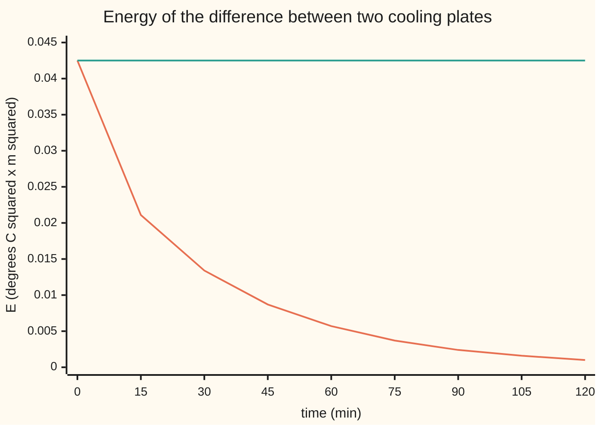

# Energy methods: multiply by the solution and integrate

[Syllabus](../../../SYLLABUS.md) → [Partial differential equations](../README.md) → [Classification and Well-Posedness](../README.md#s01) → Energy methods

---

## General Overview

This card proves, for the heat and wave equations on a plate, what wing 08 showed for the string in [Standing waves](../../08-Differential%20equations%20and%20dynamics/10-The%20Classical%20PDEs/06-standing-waves-on-a-string.md): there, the string's energy stayed fixed, so two motions with the same start were one.

Two square steel plates, 1 m on a side, sit in identical water-cooled frames. Each frame holds the plate's edge at the frame temperature. Measure each plate's temperature as degrees above that frame. Both plates start with the same warm pattern. Must they cool the same way, to the last hundredth of a degree?

The heat equation alone does not say. A formula that fits the data might be one of several. This card proves there is only one, and it does so without solving anything. It also says how far apart the plates can drift if their starts differ a little.

The method is short. Subtract the two temperatures. Multiply the equation for that difference by the difference itself, and add it up over the whole plate. What comes out is one number, the **energy** of the difference, which can only fall. If it starts at zero, it stays at zero, so the plates agree everywhere.

Say a thermometer error makes plate B start off plate A by a smooth pattern with a root-mean-square (rms: the square root of the average square) gap of 0.2915 °C. One hour later the rms gap is 0.1066 °C. It never grows. The same trick, with the velocity as the multiplier, shows a struck plate rings in only one way.

**Multiply the equation for the difference of two solutions by that difference (or its rate), integrate over the region, and turn the result into an energy that cannot grow; then equal data give zero energy for all time, so the solutions agree, and close data stay close.**

**What kind of fact this is:** a theorem, proved on this card in Why it works: uniqueness and stability among classical solutions (smooth enough that every derivative in the equation exists and is continuous up to the edge).

### The picture: the energy of the gap between the two plates



Orange: the energy of the temperature gap, from 0.0425 at the start to 0.0010 after two hours. Green: the energy method's guarantee, that it never rises above its start. Equal starts put both lines at zero.

---

## The formula

Notation from earlier shelf cards, in one line each. $`\Omega`$ is the region, here the plate, and $`\partial\Omega`$ its edge ([A PDE problem](01-what-a-pde-problem-is.md)). $`n`$ is the unit arrow pointing straight out of the edge, and $`\partial w/\partial n`$ is the slope of $`w`$ in that direction ([Boundary conditions](03-boundary-conditions-dirichlet-neumann-and-robin.md)). $`\nabla w`$ is the gradient (the uphill arrow) and $`\Delta w`$ the Laplacian (the sum of second derivatives).

Let $`u`$ and $`v`$ be two temperatures on the plate, both solving the heat equation $`u_t = \kappa\Delta u`$ with the same edge values. Their difference $`w = u - v`$ has energy

```math
E(t) = \frac12 \int_\Omega w^2 \, dx, \qquad \frac{dE}{dt} = -\kappa \int_\Omega |\nabla w|^2 \, dx \;\le\; 0 .
```

**Read it aloud:** the energy of the gap is half the squared gap added over the plate, and it falls at a rate of $`\kappa`$ times the squared steepness of the gap, added over the plate.

With a heat source that grows with temperature, $`u_t = \kappa\Delta u + a u`$, the rate gains a term and Gronwall's inequality closes the estimate:

```math
\frac{dE}{dt} \le 2a\,E \quad\Longrightarrow\quad E(t) \le E(0)\, e^{2at} .
```

**Read it aloud:** if the energy grows no faster than $`2a`$ times itself, it is at most its start grown exponentially at rate $`2a`$.

For the struck plate, $`\rho_s w_{tt} + b\,\rho_s w_t = \rho_s c^2 \Delta w`$, the multiplier is the velocity $`w_t`$ and the energy is motion plus stretch:

```math
E(t) = \frac{\rho_s}{2} \int_\Omega \left( w_t^2 + c^2 |\nabla w|^2 \right) dx, \qquad \frac{dE}{dt} = -\,b\,\rho_s \int_\Omega w_t^2 \, dx \;\le\; 0 .
```

**Read it aloud:** the wave energy is half the mass per area times the squared speed plus $`c^2`$ times the squared slope, added over the plate; friction drains it, and without friction it stays fixed.

| Symbol | Plain meaning | In our example | Push it up and the answer… |
| --- | --- | --- | --- |
| $`u`$, $`v`$ | temperatures (or sideways displacements) of plates A and B | °C above the frame; m | — |
| $`w`$ | their difference, $`u - v`$ | 0.5 °C and 0.3 °C in two smooth bumps at the start | $`E`$ grows as its square |
| $`\Omega`$, $`\partial\Omega`$, $`dx`$, $`dS`$; $`x`$, $`y`$ | the plate, its edge, a small patch of area, a small piece of edge; position across the plate | 1 m by 1 m square; $`x`$, $`y`$ in m | — |
| $`n`$, $`\partial w/\partial n`$ | outward unit arrow; slope across the edge | — | — |
| $`\kappa`$ | thermal diffusivity: how fast heat spreads | 1.2e-5 m²/s (carbon steel, illustrative) | $`E`$ falls faster |
| $`\nabla w`$, $`\Delta w`$ | gradient of $`w`$; its Laplacian | — | steeper gaps drain faster |
| $`E(t)`$ | energy of the difference: one number measuring its size | 0.0425 °C²·m² at the start; 0.387382 J for the wave | — |
| $`a`$ | rate at which a heat source grows with temperature | 1e-4 per s (illustrative) | the Gronwall bound grows as $`e^{2at}`$ |
| $`c`$ | wave speed in the membrane model | 100 m/s (illustrative) | stretch energy weighs more |
| $`b`$ | damping rate from air and mountings | 1 per s (illustrative) | the wave energy drains faster |
| $`\rho_s`$ | mass per square metre of plate | 15.7 kg/m² (2 mm of steel at 7,850 kg/m³) | the wave energy scales with it |
| $`t`$, $`s`$ | time; a running time inside an integral | minutes for heat, seconds for the wave | — |


### When it holds

- **Both solutions have the same edge data.** Then the difference is 0 on the edge and the edge term vanishes. Measure both plates above A's frame and hold B's frame 0.5 °C warmer: the gap's energy climbs from 0 to 0.069397 °C²·m² in an hour.
- **The edge condition kills the edge term.** Fixed temperature (Dirichlet: $`w = 0`$) or an insulated edge (Neumann: $`\partial w/\partial n = 0`$) both do. A Robin edge, which leaks heat in proportion to its own temperature, leaves an edge term that is never positive, so it only helps.
- **Time runs forwards.** Backward in time the sign flips and the energy can grow without limit: a 1e-6 °C error in a fine pattern becomes 1.081e+31 °C after one hour.
- **Lower-order terms are bounded.** A term $`a u`$ with a fixed bound on $`a`$ costs a factor $`e^{2at}`$ through Gronwall. With no bound, the estimate does not close.
- **The solutions are classical.** The integration by parts needs derivatives continuous up to the edge. Rougher solutions need the weak form of a later card.

A real steel plate rings by a fourth-order bending equation, not by the wave equation. With simply supported edges (held in place but free to rotate), the same multiplier $`w_t`$ works; the stretch term becomes the plate's bending stiffness times $`(\Delta w)^2`$. This card keeps the membrane model so the wave formula stays second order.

---

## Why it works

### Step 0: the idea

The heat equation links a rate in time to second derivatives in space. Multiplying by the solution and integrating turns the time side into the rate of a square, which is an energy. The space side, after one integration by parts, becomes minus a square plus an edge term. Squares have a sign, so the energy can only fall once the edge term is gone.

### Step 1: the difference solves the same problem with zero data

The heat equation is linear: a difference of solutions is a solution ([Linear or not](02-linear-nonlinear-and-superposition.md)). So $`w = u - v`$ obeys $`w_t = \kappa\Delta w`$. It is 0 on the edge, because both plates share the frame. It starts at the difference of the two starting patterns.

With a heat source $`a u`$ plus any heating that does not depend on temperature, the fixed heating cancels in the difference. Only $`a w`$ is left.

### Step 2: multiply by w and integrate

Multiply $`w_t = \kappa\Delta w`$ by $`w`$. The left side is $`\tfrac12 (w^2)_t`$, so integrating over the plate gives $`dE/dt`$.

On the right, the product rule says $`w\,\Delta w = \nabla\cdot(w\nabla w) - |\nabla w|^2`$. The [Divergence theorem](../../06-Calculus%20and%20analysis/09-Vector%20Calculus/07-divergence-theorem.md) turns the first piece into flow out through the edge:

```math
\frac{dE}{dt} = \kappa \int_{\partial\Omega} w\,\frac{\partial w}{\partial n}\, dS \;-\; \kappa \int_\Omega |\nabla w|^2 \, dx .
```

Here $`dS`$ is a small piece of edge length. On the edge $`w = 0`$, so the first integral is zero. What is left is minus a square: $`dE/dt \le 0`$.

### Step 3: uniqueness and stability

**Uniqueness.** If the two plates start alike, $`E(0) = 0`$. A quantity that starts at 0, never rises and is never negative stays 0. The integrand $`w^2`$ is continuous and not negative, so $`w = 0`$ at every point: the plates agree.

**Stability.** If the starts differ, $`E(t) \le E(0)`$ for every later time. In rms terms, the gap at any time is at most the gap at the start. That is the "small change in data, small change in answer" condition of [Well posed](06-well-posedness-and-hadamard.md), in a precise size.

On this square, more is true. Every gap pattern that is 0 on the edge has $`\int|\nabla w|^2 \ge 2\pi^2 \int w^2`$, with $`2\pi^2`$ in units of 1/m². The smoothest pattern, one bump across the plate, gives equality; every other pattern is steeper. Then $`dE/dt \le -4\pi^2\kappa E`$, and the one-sided form of Gronwall gives $`E(t) \le E(0)\,e^{-4\pi^2\kappa t}`$: at one hour, at most 0.007722 °C²·m².

<details>
<summary>Detailed proof: uniqueness for the heat equation on a bounded region</summary>

Let $`\Omega`$ be bounded with a smooth enough edge for the divergence theorem. Let $`u`$ and $`v`$ be classical solutions on $`\Omega`$ for $`0 \le t \le T`$, with equal edge values and equal starts. Put $`w = u - v`$ and $`E(t) = \tfrac12\int_\Omega w^2\,dx`$.

Since $`w`$ and $`w_t`$ are continuous on the closed region, differentiation passes inside the integral:

$`\displaystyle E'(t) = \int_\Omega w\,w_t\,dx = \kappa\int_\Omega w\,\Delta w\,dx.`$

Apply the divergence theorem to the field $`w\nabla w`$, whose divergence is $`|\nabla w|^2 + w\Delta w`$:

$`\displaystyle \int_\Omega w\,\Delta w\,dx = \int_{\partial\Omega} w\,\frac{\partial w}{\partial n}\,dS - \int_\Omega |\nabla w|^2\,dx.`$

The edge integral is 0 because $`w = 0`$ on $`\partial\Omega`$. So $`E'(t) \le 0`$ and $`0 \le E(t) \le E(0) = 0`$. Then $`\int_\Omega w^2\,dx = 0`$ for each $`t`$. If $`w`$ were nonzero at some point, continuity would make $`w^2`$ positive on a small disc around it and the integral positive. So $`w = 0`$ everywhere.

For the Neumann problem the same lines work, since $`\partial w/\partial n = 0`$ on the edge.

</details>

### Step 4: when the equation feeds energy, Gronwall closes it

Add the source: $`w_t = \kappa\Delta w + a w`$. Step 2 now gives

```math
\frac{dE}{dt} = -\kappa\int_\Omega |\nabla w|^2\,dx + 2a\,E \;\le\; 2a\,E .
```

Integrate from 0 to $`t`$: $`E(t) \le E(0) + \int_0^t 2a\,E(s)\,ds`$. This is exactly the hypothesis of the integral form in [Gronwall's inequality](../../08-Differential%20equations%20and%20dynamics/02-Existence%2C%20Uniqueness%20and%20Sensitivity/04-gronwall-and-continuous-dependence.md), with its starting gap equal to $`E(0)`$ and its rate equal to $`2a`$. Its conclusion is $`E(t) \le E(0)\,e^{2at}`$.

Uniqueness survives: $`E(0) = 0`$ still forces $`E = 0`$. Stability survives with a price: the rms gap may grow by at most $`e^{at}`$. Dropping the $`2aE`$ term is not allowed: with $`a`$ = 5e-4 per s the true energy at one hour is 0.207801, almost five times its start.

### Step 5: the wave equation, with the velocity as multiplier

For the wave, multiplying by $`w`$ fails: $`w\,w_{tt}`$ is not the rate of anything simple. Multiply by $`w_t`$ instead. Then $`w_t w_{tt} = \tfrac12 (w_t^2)_t`$, and the product rule gives

```math
w_t\,\Delta w = \nabla\cdot(w_t\nabla w) - \tfrac12\,\big(|\nabla w|^2\big)_t .
```

Integrate over the plate. The edge term carries $`w_t`$, which is 0 because $`w`$ stays 0 on the edge at every time. What is left is $`dE/dt = -b\rho_s\int w_t^2\,dx`$. Without damping ($`b = 0`$) the energy is fixed; with damping it falls.

If both plates are struck alike, $`E(0) = 0`$. Then $`w_t = 0`$ and $`\nabla w = 0`$ everywhere for all time, so $`w`$ is a constant, and the edge makes it 0. The struck plates ring the same way. If the strikes differ, the energy of the difference never exceeds its start: the 1 mm difference in Worked numbers keeps at most 0.387382 J for all time, so close strikes ring close. This is the string argument of [Standing waves](../../08-Differential%20equations%20and%20dynamics/10-The%20Classical%20PDEs/06-standing-waves-on-a-string.md), now in two dimensions and with damping.

---

## Worked numbers, by hand

The gap between the plates starts as 0.5 °C in the one-bump pattern $`\sin(\pi x)\sin(\pi y)`$ plus 0.3 °C in the finer pattern $`\sin(2\pi x)\sin(3\pi y)`$, with $`x`$ and $`y`$ in metres. Each squared sine pattern averages 1/4 over the square, and different patterns do not mix in the integral.

| Step | Arithmetic | Value |
| --- | --- | --- |
| energy at the start | $`\tfrac12 (0.5^2 + 0.3^2)/4 = 0.03125 + 0.01125`$ | 0.0425 °C²·m² |
| rms gap at the start | $`\sqrt{2 \times 0.0425}`$ | 0.2915 °C |
| decay rate of the one-bump pattern | $`\kappa \times 2\pi^2 = 1.2\text{e-}5 \times 19.739`$ | 2.369e-04 per s |
| energy exponent at 60 min | $`2 \times 2.369\text{e-}4 \times 3600`$ | 1.7055 |
| energy factor | $`e^{-1.7055}`$ | 0.1817 |
| finer pattern's exponent and factor | $`2\kappa \times 13\pi^2 \times 3600 = 11.0855`$ | 1.533e-05 |
| energy at 60 min | $`0.03125 \times 0.1817`$, plus a finer part too small for six decimals | 0.005678 °C²·m² |
| **rms gap at 60 min** | $`\sqrt{2 \times 0.005678}`$ | **0.1066 °C** |
| heated plate, Gronwall factor at 60 min | $`e^{2 \times 1\text{e-}4 \times 3600} = e^{0.72}`$ | 2.0544 |
| heated plate, Gronwall bound | $`0.0425 \times 2.0544`$ | 0.087313 °C²·m² |

So an rms thermometer error of 0.2915 °C shrinks to 0.1066 °C in an hour and can never grow back. With the heat source, the energy is guaranteed below 0.087313; its true value is 0.011665, because conduction still wins.

The wave: a 1 mm difference in the one-bump pattern, struck from rest, with $`c`$ = 100 m/s. Its stretch energy is $`\tfrac12 \times 15.7 \times 100^2 \times 2\pi^2 \times 0.001^2/4`$ = 0.387382 J. The pattern swings at $`c\pi\sqrt2`$ = 444.29 rad/s, which is 70.71 Hz. Undamped, the energy is 0.387382 J at every time; with $`b`$ = 1 per s it is 0.142586 J after one second.

### What breaks if you drop a piece

| Mistake | Comes out at | What went wrong |
| --- | --- | --- |
| Run the heat equation backwards in time | 1e-6 °C in pattern (10,10) becomes 1.081e+31 °C in an hour (exponent 85.27) | The sign of $`dE/dt`$ flips; nothing caps the growth |
| Frames 0.5 °C apart, same start | gap energy rises from 0 to 0.069397 °C²·m² | The edge term no longer vanishes |
| Drop the Gronwall term with $`a`$ = 5e-4 per s | claims $`E \le`$ 0.042500, true 0.207801; Gronwall's bound, 1.555425, holds | The source feeds energy faster than conduction drains it |
| Wave energy without the $`c^2`$ | 3.874e-05 J at the start, 3.874e-01 J a quarter swing later | Motion and stretch are only balanced with the right weights |

---

## Code, from first principles, and it actually runs

The script computes the energy of the plates' temperature gap three independent ways: the closed form by patterns, a midpoint sum of the series solution over a 60 by 60 grid of cells, and an explicit time-stepping grid (step 0.025 m and 12 s, inside its stability limit). It checks the energy identity by two roads: $`dE/dt`$ from centred differences in time, against $`-\kappa\int|\nabla w|^2`$ with the gradient from centred differences in space. It runs 20 random starts, from a small random-number generator written out (SplitMix64), and counts any step where the grid's energy rose. The frames-apart case is summed from its own series and checked on the grid at two steps, where halving the step cuts the error fourfold. Then it checks the Gronwall bound with the source and the wave energy, damped and undamped, by the same two roads.

### Python

```python
# Energy methods -- the check behind the card.  Standard library only.
# A 1 m x 1 m steel plate, edges held.  w = difference of two plates' temperatures.
# Roads to the energy E(t) = (1/2) * integral of w^2: closed form by modes, midpoint
# quadrature of the series, an explicit grid; dE/dt by centred differences against
# -kappa * integral |grad w|^2 (+ 2aE with a heat source).  Then the wave equation.
import math
PI = math.pi
KAPPA = 1.2e-5                        # steel's diffusivity, m^2/s
MODES = [(1, 1, 0.5), (2, 3, 0.3)]    # the starting difference: (m, n, amplitude in C)

def sci(x):                           # same digits in Python and Rust: 1.234e+31
    e = math.floor(math.log10(abs(x)))
    m = x / 10 ** e
    if round(abs(m), 3) >= 10: m, e = m / 10, e + 1
    return f"{m:.3f}e{'+' if e >= 0 else '-'}{abs(e):02d}"

def lam(m, n): return PI * PI * (m * m + n * n)          # mode's -Laplacian eigenvalue, 1/m^2

def w(x, y, t, a=0.0):                # series solution of w_t = kappa*Lap w + a*w
    return sum(A * math.exp((a - KAPPA * lam(m, n)) * t) * math.sin(m * PI * x) * math.sin(n * PI * y)
               for m, n, A in MODES)

def E_closed(t, a=0.0):               # each mode: (1/2)(A^2/4) e^{2(a - kappa*lam) t}
    return sum(A * A / 8 * math.exp(2 * (a - KAPPA * lam(m, n)) * t) for m, n, A in MODES)

def E_edge(t, M=11):                  # frames 0.5 C apart: w = 0.5 - v, v the zero-edge solution from 0.5,
    s = 0.0                           # odd modes 8/(pi^2 m n); E = (1/2)(1/4 - int v + int v^2)
    for m in range(1, M, 2):
        for n in range(1, M, 2):
            g = math.exp(-KAPPA * lam(m, n) * t)
            s += 16 / (PI * PI * PI * PI * m * m * n * n) * (g * g - 2 * g)
    return 0.5 * (0.25 + s)

def quad(f, M=60):                    # midpoint rule on the unit square
    h = 1 / M
    return sum(f((i + .5) * h, (j + .5) * h) for i in range(M) for j in range(M)) * h * h

def E_quad(t, a=0.0): return quad(lambda x, y: 0.5 * w(x, y, t, a) ** 2)

def grad2(t, a=0.0, d=1e-5):          # integral of |grad w|^2, gradient by centred differences
    return quad(lambda x, y: ((w(x + d, y, t, a) - w(x - d, y, t, a)) / (2 * d)) ** 2
                + ((w(x, y + d, t, a) - w(x, y - d, t, a)) / (2 * d)) ** 2)

def grid(t_end, N=40, dt=12.0, edge=0.0, start=None, track=False):   # explicit scheme
    h = 1 / N; r = KAPPA * dt / h / h
    u = [[edge if i in (0, N) or j in (0, N) else start[i][j] if start else w(i * h, j * h, 0)
          for j in range(N + 1)] for i in range(N + 1)]
    wt = lambda i: 0.5 if i in (0, N) else 1.0                       # trapezoid: edge nodes count half
    En = lambda: 0.5 * h * h * sum(wt(i) * wt(j) * u[i][j] ** 2 for i in range(N + 1) for j in range(N + 1))
    rises, last = 0, En()
    for _ in range(round(t_end / dt)):
        u = [[u[i][j] if i in (0, N) or j in (0, N) else u[i][j] + r * (u[i + 1][j] + u[i - 1][j]
              + u[i][j + 1] + u[i][j - 1] - 4 * u[i][j]) for j in range(N + 1)] for i in range(N + 1)]
        e = En(); rises += track and e > last + 1e-15; last = e
    return last, rises, r

print("heat: kappa = 1.2e-5 m^2/s; difference 0.5 C in mode (1,1), 0.3 C in mode (2,3)")
print("t (min) | E closed | E quadrature | E grid | dE/dt by differences | -kappa*int|grad w|^2  (E in C^2 m^2, rates per s)")
for mins in (0, 30, 60, 120):
    t = 60 * mins
    dEdt = (E_quad(t + 1) - E_quad(t - 1)) / 2
    D = KAPPA * grad2(t)
    Eg = grid(t)[0]
    print(f"{mins:3d} | {E_closed(t):.6f} | {E_quad(t):.6f} | {Eg:.6f} | {sci(dEdt)} | {sci(-D)}")
    assert abs(E_quad(t) - E_closed(t)) < 1e-9 and abs(Eg - E_closed(t)) < 1e-2 * E_closed(t)
    assert abs(dEdt + D) < 1e-4 * D                       # the energy identity, two roads
print(f"grid: h = 0.025 m, dt = 12 s, r = kappa dt / h^2 = {grid(0)[2]:.4f} (limit 0.25)")
print(f"rms difference: start {math.sqrt(2 * E_closed(0)):.4f} C, 60 min {math.sqrt(2 * E_closed(3600)):.4f} C")
print(f"decay bound E(0)e^(-2 kappa 2 pi^2 t) at 60 min: {E_closed(0) * math.exp(-4 * PI * PI * KAPPA * 3600):.6f}")
k11, k23 = KAPPA * lam(1, 1), KAPPA * lam(2, 3)
print(f"hand: kappa*lam(1,1) = {sci(k11)} /s; 60 min: 2*kappa*lam*t = {7200 * k11:.4f} and {7200 * k23:.4f},"
      f" factors {math.exp(-7200 * k11):.4f} and {sci(math.exp(-7200 * k23))}")
print("chart, E every 15 min:", ", ".join(f"{E_closed(900 * k):.4f}" for k in range(9)))

s = 0x2026111500000007                # SplitMix64: random starting differences on a 10 x 10 grid
def rnd():
    global s
    s = (s + 0x9E3779B97F4A7C15) & (2 ** 64 - 1); z = s
    z = ((z ^ (z >> 30)) * 0xBF58476D1CE4E5B9) & (2 ** 64 - 1)
    z = ((z ^ (z >> 27)) * 0x94D049BB133111EB) & (2 ** 64 - 1)
    return ((z ^ (z >> 31)) >> 11) / 2 ** 53
total = 0
for trial in range(20):
    st = [[2 * rnd() - 1 for j in range(11)] for i in range(11)]
    total += grid(2500, N=10, dt=250 / 1.2, start=st, track=True)[1]
print(f"random starts: 20 trials x 12 steps at r = 0.25; steps where E rose: {total}")
assert total == 0
same = grid(3600, start=[[0.0] * 41 for _ in range(41)])[0]
print(f"identical data: E of the difference at 60 min = {same:.6f}")

A_HEAT = 1e-4                         # heated plate: w_t = kappa Lap w + a w
def gron(t, a): return E_closed(0) * math.exp(2 * a * t)     # Gronwall: E(t) <= E(0) e^{2at}
for mins in (30, 60):
    t = 60 * mins
    tru, bound = E_closed(t, A_HEAT), gron(t, A_HEAT)
    dEdt = (E_quad(t + 1, A_HEAT) - E_quad(t - 1, A_HEAT)) / 2
    rhs = -KAPPA * grad2(t, A_HEAT) + 2 * A_HEAT * E_quad(t, A_HEAT)
    print(f"heated, a = 1e-4 /s, {mins} min: E true {tru:.6f}, Gronwall factor {math.exp(2 * A_HEAT * t):.4f},"
          f" bound {bound:.6f}, dE/dt {sci(dEdt)} vs {sci(rhs)}")
    assert tru <= bound and abs(dEdt - rhs) < 1e-4 * abs(rhs)

print("what breaks:")
print(f"  backward heat, 1e-6 C in mode (10,10), 60 min: exponent {KAPPA * lam(10, 10) * 3600:.2f}, {sci(1e-6 * math.exp(KAPPA * lam(10, 10) * 3600))} C")
Es = E_edge(3600)
Eb, Eb2 = (grid(3600, N=n, dt=dt, edge=0.5, start=[[0.0] * (n + 1) for _ in range(n + 1)])[0]
           for n, dt in ((40, 12.0), (20, 48.0)))
print(f"  edges 0.5 C apart, same start: E from 0 to {Es:.6f} at 60 min by series, first omitted term "
      f"{sci(16 / (PI * PI * PI * PI * 121) * math.exp(-KAPPA * lam(11, 1) * 3600))}")
print(f"  same case on the grid: h = 0.05 m, dt = 48 s {Eb2:.6f}; h = 0.025 m, dt = 12 s {Eb:.6f}; "
      f"error ratio {(Eb2 - Es) / (Eb - Es):.2f}")
assert abs(Eb - Es) < 0.005 * Es and 3.5 < (Eb2 - Es) / (Eb - Es) < 4.5   # two roads; second order in h
big = E_closed(3600, 5e-4)
print(f"  a = 5e-4 /s, no Gronwall factor: claimed E <= {E_closed(0):.6f}, true {big:.6f}; Gronwall bound {gron(3600, 5e-4):.6f}")
assert E_closed(0) < big <= gron(3600, 5e-4)

RHO, C, B, AMP = 15.7, 100.0, 1.0, 0.001     # wave: kg/m^2, m/s, damping /s, 1 mm in mode (1,1)
w11 = C * PI * math.sqrt(2)
def wave(t, b):                       # damped mode: displacement amplitude and its rate
    wd = math.sqrt(w11 ** 2 - b * b / 4); e = math.exp(-b * t / 2)
    return (AMP * e * (math.cos(wd * t) + b / (2 * wd) * math.sin(wd * t)),
            -AMP * e * (w11 ** 2 / wd) * math.sin(wd * t))
def wave_E(t, b, c2=C * C):           # (rho/2) int (w_t^2 + c^2 |grad w|^2); sin^2 integrates to 1/4
    q, p = wave(t, b)
    return RHO / 2 * (p * p + c2 * lam(1, 1) * q * q) / 4
print(f"wave: mode (1,1) {w11:.2f} rad/s = {w11 / (2 * PI):.2f} Hz, rho_s = {RHO} kg/m^2, c = {C:.0f} m/s, E(0) = {wave_E(0, 0):.6f} J")
for t in (0.25, 0.5, 1.0):
    dE = (wave_E(t + 1e-6, B) - wave_E(t - 1e-6, B)) / 2e-6
    loss = -B * RHO * wave(t, B)[1] ** 2 / 4
    print(f"  t = {t:.2f} s: E undamped {wave_E(t, 0):.6f} J, damped {wave_E(t, B):.6f} J, dE/dt {dE:.6f} vs {loss:.6f} J/s")
    assert abs(wave_E(t, 0) - wave_E(0, 0)) < 1e-12 and abs(dE - loss) < 1e-5
q4 = PI / (2 * w11)
print(f"  energy without c^2: {sci(wave_E(0, 0, 1.0))} J at t = 0, {sci(wave_E(q4, 0, 1.0))} J a quarter period on")
print("ALL CHECKS PASS")
```

**Ran 2026-11-15 on macOS, Python 3.14.10, standard library only. All checks passed. Output, pasted from the run:**

```
heat: kappa = 1.2e-5 m^2/s; difference 0.5 C in mode (1,1), 0.3 C in mode (2,3)
t (min) | E closed | E quadrature | E grid | dE/dt by differences | -kappa*int|grad w|^2  (E in C^2 m^2, rates per s)
  0 | 0.042500 | 0.042500 | 0.042500 | -4.945e-05 | -4.945e-05
 30 | 0.013364 | 0.013364 | 0.013353 | -6.446e-06 | -6.446e-06
 60 | 0.005678 | 0.005678 | 0.005669 | -2.690e-06 | -2.690e-06
120 | 0.001032 | 0.001032 | 0.001028 | -4.887e-07 | -4.887e-07
grid: h = 0.025 m, dt = 12 s, r = kappa dt / h^2 = 0.2304 (limit 0.25)
rms difference: start 0.2915 C, 60 min 0.1066 C
decay bound E(0)e^(-2 kappa 2 pi^2 t) at 60 min: 0.007722
hand: kappa*lam(1,1) = 2.369e-04 /s; 60 min: 2*kappa*lam*t = 1.7055 and 11.0855, factors 0.1817 and 1.533e-05
chart, E every 15 min: 0.0425, 0.0211, 0.0134, 0.0087, 0.0057, 0.0037, 0.0024, 0.0016, 0.0010
random starts: 20 trials x 12 steps at r = 0.25; steps where E rose: 0
identical data: E of the difference at 60 min = 0.000000
heated, a = 1e-4 /s, 30 min: E true 0.019155, Gronwall factor 1.4333, bound 0.060917, dE/dt -5.408e-06 vs -5.408e-06
heated, a = 1e-4 /s, 60 min: E true 0.011665, Gronwall factor 2.0544, bound 0.087313, dE/dt -3.194e-06 vs -3.194e-06
what breaks:
  backward heat, 1e-6 C in mode (10,10), 60 min: exponent 85.27, 1.081e+31 C
  edges 0.5 C apart, same start: E from 0 to 0.069397 at 60 min by series, first omitted term 3.485e-26
  same case on the grid: h = 0.05 m, dt = 48 s 0.070018; h = 0.025 m, dt = 12 s 0.069553; error ratio 3.99
  a = 5e-4 /s, no Gronwall factor: claimed E <= 0.042500, true 0.207801; Gronwall bound 1.555425
wave: mode (1,1) 444.29 rad/s = 70.71 Hz, rho_s = 15.7 kg/m^2, c = 100 m/s, E(0) = 0.387382 J
  t = 0.25 s: E undamped 0.387382 J, damped 0.301962 J, dE/dt -0.487078 vs -0.487078 J/s
  t = 0.50 s: E undamped 0.387382 J, damped 0.234703 J, dE/dt -0.292485 vs -0.292485 J/s
  t = 1.00 s: E undamped 0.387382 J, damped 0.142586 J, dE/dt -0.267935 vs -0.267935 J/s
  energy without c^2: 3.874e-05 J at t = 0, 3.874e-01 J a quarter period on
ALL CHECKS PASS
```

### Rust

```rust
// Energy methods -- the check behind the card.  std only, no crates.
// A 1 m x 1 m steel plate, edges held.  w = difference of two plates' temperatures.
// Roads to the energy E(t) = (1/2) * integral of w^2: closed form by modes, midpoint
// quadrature of the series, an explicit grid; dE/dt by centred differences against
// -kappa * integral |grad w|^2 (+ 2aE with a heat source).  Then the wave equation.
use std::f64::consts::PI;
const KAPPA: f64 = 1.2e-5; // steel's diffusivity, m^2/s
const MODES: [(f64, f64, f64); 2] = [(1.0, 1.0, 0.5), (2.0, 3.0, 0.3)]; // (m, n, amplitude in C)

fn sci(x: f64) -> String { // same digits in Python and Rust: 1.234e+31
    let mut e = x.abs().log10().floor() as i32;
    let mut m = x / 10f64.powi(e);
    if (m.abs() * 1000.0).round() / 1000.0 >= 10.0 { m /= 10.0; e += 1; }
    format!("{:.3}e{}{:02}", m, if e >= 0 { "+" } else { "-" }, e.abs())
}
fn lam(m: f64, n: f64) -> f64 { PI * PI * (m * m + n * n) } // mode's -Laplacian eigenvalue, 1/m^2
fn w(x: f64, y: f64, t: f64, a: f64) -> f64 { // series solution of w_t = kappa*Lap w + a*w
    MODES.iter().map(|&(m, n, amp)| amp * ((a - KAPPA * lam(m, n)) * t).exp()
        * (m * PI * x).sin() * (n * PI * y).sin()).sum()
}
fn e_closed(t: f64, a: f64) -> f64 { // each mode: (1/2)(A^2/4) e^{2(a - kappa*lam) t}
    MODES.iter().map(|&(m, n, amp)| amp * amp / 8.0 * (2.0 * (a - KAPPA * lam(m, n)) * t).exp()).sum()
}
fn e_edge(t: f64) -> f64 { // frames 0.5 C apart: w = 0.5 - v, v the zero-edge solution from 0.5,
    let mut s = 0.0;       // odd modes 8/(pi^2 m n); E = (1/2)(1/4 - int v + int v^2)
    for m in (1..11).step_by(2) { for n in (1..11).step_by(2) {
        let (mf, nf) = (m as f64, n as f64);
        let g = (-KAPPA * lam(mf, nf) * t).exp();
        s += 16.0 / (PI * PI * PI * PI * mf * mf * nf * nf) * (g * g - 2.0 * g);
    } }
    0.5 * (0.25 + s)
}
fn gron(t: f64, a: f64) -> f64 { e_closed(0.0, 0.0) * (2.0 * a * t).exp() } // Gronwall: E(t) <= E(0) e^{2at}
fn quad<F: Fn(f64, f64) -> f64>(f: F) -> f64 { // midpoint rule on the unit square
    let mm = 60; let h = 1.0 / mm as f64; let mut s = 0.0;
    for i in 0..mm { for j in 0..mm { s += f((i as f64 + 0.5) * h, (j as f64 + 0.5) * h); } }
    s * h * h
}
fn e_quad(t: f64, a: f64) -> f64 { quad(|x, y| 0.5 * w(x, y, t, a).powi(2)) }
fn grad2(t: f64, a: f64) -> f64 { // integral of |grad w|^2, gradient by centred differences
    let d = 1e-5;
    quad(|x, y| ((w(x + d, y, t, a) - w(x - d, y, t, a)) / (2.0 * d)).powi(2)
        + ((w(x, y + d, t, a) - w(x, y - d, t, a)) / (2.0 * d)).powi(2))
}
// explicit scheme; returns (final E, steps where E rose, r)
fn grid(t_end: f64, n: usize, dt: f64, edge: f64, start: Option<&Vec<Vec<f64>>>, track: bool) -> (f64, u32, f64) {
    let h = 1.0 / n as f64; let r = KAPPA * dt / h / h;
    let bd = |i: usize, j: usize| i == 0 || i == n || j == 0 || j == n;
    let mut u = vec![vec![0.0; n + 1]; n + 1];
    for i in 0..=n { for j in 0..=n {
        u[i][j] = if bd(i, j) { edge } else if let Some(s) = start { s[i][j] } else { w(i as f64 * h, j as f64 * h, 0.0, 0.0) };
    } }
    let wt = |i: usize| if i == 0 || i == n { 0.5 } else { 1.0 }; // trapezoid: edge nodes count half
    let en = |u: &Vec<Vec<f64>>| { let mut s = 0.0;
        for i in 0..=n { for j in 0..=n { s += wt(i) * wt(j) * u[i][j] * u[i][j]; } } 0.5 * h * h * s };
    let (mut rises, mut last) = (0u32, en(&u));
    for _ in 0..(t_end / dt).round() as usize {
        let mut v = u.clone();
        for i in 1..n { for j in 1..n {
            v[i][j] = u[i][j] + r * (u[i + 1][j] + u[i - 1][j] + u[i][j + 1] + u[i][j - 1] - 4.0 * u[i][j]);
        } }
        u = v;
        let e = en(&u); if track && e > last + 1e-15 { rises += 1; } last = e;
    }
    (last, rises, r)
}
fn main() {
    println!("heat: kappa = 1.2e-5 m^2/s; difference 0.5 C in mode (1,1), 0.3 C in mode (2,3)");
    println!("t (min) | E closed | E quadrature | E grid | dE/dt by differences | -kappa*int|grad w|^2  (E in C^2 m^2, rates per s)");
    for mins in [0, 30, 60, 120] {
        let t = 60.0 * mins as f64;
        let dedt = (e_quad(t + 1.0, 0.0) - e_quad(t - 1.0, 0.0)) / 2.0;
        let d = KAPPA * grad2(t, 0.0);
        let eg = grid(t, 40, 12.0, 0.0, None, false).0;
        println!("{:3} | {:.6} | {:.6} | {:.6} | {} | {}", mins, e_closed(t, 0.0), e_quad(t, 0.0), eg, sci(dedt), sci(-d));
        assert!((e_quad(t, 0.0) - e_closed(t, 0.0)).abs() < 1e-9 && (eg - e_closed(t, 0.0)).abs() < 1e-2 * e_closed(t, 0.0));
        assert!((dedt + d).abs() < 1e-4 * d); // the energy identity, two roads
    }
    println!("grid: h = 0.025 m, dt = 12 s, r = kappa dt / h^2 = {:.4} (limit 0.25)", grid(0.0, 40, 12.0, 0.0, None, false).2);
    println!("rms difference: start {:.4} C, 60 min {:.4} C", (2.0 * e_closed(0.0, 0.0)).sqrt(), (2.0 * e_closed(3600.0, 0.0)).sqrt());
    println!("decay bound E(0)e^(-2 kappa 2 pi^2 t) at 60 min: {:.6}", e_closed(0.0, 0.0) * (-4.0 * PI * PI * KAPPA * 3600.0).exp());
    let (k11, k23) = (KAPPA * lam(1.0, 1.0), KAPPA * lam(2.0, 3.0));
    println!("hand: kappa*lam(1,1) = {} /s; 60 min: 2*kappa*lam*t = {:.4} and {:.4}, factors {:.4} and {}",
        sci(k11), 7200.0 * k11, 7200.0 * k23, (-7200.0 * k11).exp(), sci((-7200.0 * k23).exp()));
    let chart: Vec<String> = (0..9).map(|k| format!("{:.4}", e_closed(900.0 * k as f64, 0.0))).collect();
    println!("chart, E every 15 min: {}", chart.join(", "));

    let mut s: u64 = 0x2026111500000007; // SplitMix64: random starting differences on a 10 x 10 grid
    let mut rnd = || {
        s = s.wrapping_add(0x9E3779B97F4A7C15); let mut z = s;
        z = (z ^ (z >> 30)).wrapping_mul(0xBF58476D1CE4E5B9);
        z = (z ^ (z >> 27)).wrapping_mul(0x94D049BB133111EB);
        ((z ^ (z >> 31)) >> 11) as f64 / 9007199254740992.0
    };
    let mut total = 0;
    for _ in 0..20 {
        let st: Vec<Vec<f64>> = (0..11).map(|_| (0..11).map(|_| 2.0 * rnd() - 1.0).collect()).collect();
        total += grid(2500.0, 10, 250.0 / 1.2, 0.0, Some(&st), true).1;
    }
    println!("random starts: 20 trials x 12 steps at r = 0.25; steps where E rose: {}", total);
    assert!(total == 0);
    let zero = vec![vec![0.0; 41]; 41];
    let same = grid(3600.0, 40, 12.0, 0.0, Some(&zero), false).0;
    println!("identical data: E of the difference at 60 min = {:.6}", same);

    let a_heat = 1e-4; // heated plate: w_t = kappa Lap w + a w
    for mins in [30, 60] {
        let t = 60.0 * mins as f64;
        let (tru, bound) = (e_closed(t, a_heat), gron(t, a_heat));
        let dedt = (e_quad(t + 1.0, a_heat) - e_quad(t - 1.0, a_heat)) / 2.0;
        let rhs = -KAPPA * grad2(t, a_heat) + 2.0 * a_heat * e_quad(t, a_heat);
        println!("heated, a = 1e-4 /s, {} min: E true {:.6}, Gronwall factor {:.4}, bound {:.6}, dE/dt {} vs {}",
            mins, tru, (2.0 * a_heat * t).exp(), bound, sci(dedt), sci(rhs));
        assert!(tru <= bound && (dedt - rhs).abs() < 1e-4 * rhs.abs());
    }

    println!("what breaks:");
    println!("  backward heat, 1e-6 C in mode (10,10), 60 min: exponent {:.2}, {} C", KAPPA * lam(10.0, 10.0) * 3600.0, sci(1e-6 * (KAPPA * lam(10.0, 10.0) * 3600.0).exp()));
    let es = e_edge(3600.0);
    let z20 = vec![vec![0.0; 21]; 21];
    let (eb, eb2) = (grid(3600.0, 40, 12.0, 0.5, Some(&zero), false).0, grid(3600.0, 20, 48.0, 0.5, Some(&z20), false).0);
    println!("  edges 0.5 C apart, same start: E from 0 to {:.6} at 60 min by series, first omitted term {}",
        es, sci(16.0 / (PI * PI * PI * PI * 121.0) * (-KAPPA * lam(11.0, 1.0) * 3600.0).exp()));
    let ratio = (eb2 - es) / (eb - es);
    println!("  same case on the grid: h = 0.05 m, dt = 48 s {:.6}; h = 0.025 m, dt = 12 s {:.6}; error ratio {:.2}", eb2, eb, ratio);
    assert!((eb - es).abs() < 0.005 * es && 3.5 < ratio && ratio < 4.5); // two roads; second order in h
    let big = e_closed(3600.0, 5e-4);
    println!("  a = 5e-4 /s, no Gronwall factor: claimed E <= {:.6}, true {:.6}; Gronwall bound {:.6}", e_closed(0.0, 0.0), big, gron(3600.0, 5e-4));
    assert!(e_closed(0.0, 0.0) < big && big <= gron(3600.0, 5e-4));

    let (rho, c, b, amp) = (15.7, 100.0f64, 1.0, 0.001); // wave: kg/m^2, m/s, damping /s, 1 mm in mode (1,1)
    let w11 = c * PI * 2f64.sqrt();
    let wave = |t: f64, b: f64| { // damped mode: displacement amplitude and its rate
        let wd = (w11 * w11 - b * b / 4.0).sqrt(); let e = (-b * t / 2.0).exp();
        (amp * e * ((wd * t).cos() + b / (2.0 * wd) * (wd * t).sin()), -amp * e * (w11 * w11 / wd) * (wd * t).sin())
    };
    let wave_e = |t: f64, b: f64, c2: f64| { // (rho/2) int (w_t^2 + c^2 |grad w|^2); sin^2 integrates to 1/4
        let (q, p) = wave(t, b);
        rho / 2.0 * (p * p + c2 * lam(1.0, 1.0) * q * q) / 4.0
    };
    println!("wave: mode (1,1) {:.2} rad/s = {:.2} Hz, rho_s = {} kg/m^2, c = {:.0} m/s, E(0) = {:.6} J", w11, w11 / (2.0 * PI), rho, c, wave_e(0.0, 0.0, c * c));
    for t in [0.25, 0.5, 1.0] {
        let de = (wave_e(t + 1e-6, b, c * c) - wave_e(t - 1e-6, b, c * c)) / 2e-6;
        let loss = -b * rho * wave(t, b).1.powi(2) / 4.0;
        println!("  t = {:.2} s: E undamped {:.6} J, damped {:.6} J, dE/dt {:.6} vs {:.6} J/s", t, wave_e(t, 0.0, c * c), wave_e(t, b, c * c), de, loss);
        assert!((wave_e(t, 0.0, c * c) - wave_e(0.0, 0.0, c * c)).abs() < 1e-12 && (de - loss).abs() < 1e-5);
    }
    let q4 = PI / (2.0 * w11);
    println!("  energy without c^2: {} J at t = 0, {} J a quarter period on", sci(wave_e(0.0, 0.0, 1.0)), sci(wave_e(q4, 0.0, 1.0)));
    println!("ALL CHECKS PASS");
}
```

**Ran 2026-11-15 on macOS, rustc 1.98.1, no crates. All checks passed. Output, pasted from the run:**

```
heat: kappa = 1.2e-5 m^2/s; difference 0.5 C in mode (1,1), 0.3 C in mode (2,3)
t (min) | E closed | E quadrature | E grid | dE/dt by differences | -kappa*int|grad w|^2  (E in C^2 m^2, rates per s)
  0 | 0.042500 | 0.042500 | 0.042500 | -4.945e-05 | -4.945e-05
 30 | 0.013364 | 0.013364 | 0.013353 | -6.446e-06 | -6.446e-06
 60 | 0.005678 | 0.005678 | 0.005669 | -2.690e-06 | -2.690e-06
120 | 0.001032 | 0.001032 | 0.001028 | -4.887e-07 | -4.887e-07
grid: h = 0.025 m, dt = 12 s, r = kappa dt / h^2 = 0.2304 (limit 0.25)
rms difference: start 0.2915 C, 60 min 0.1066 C
decay bound E(0)e^(-2 kappa 2 pi^2 t) at 60 min: 0.007722
hand: kappa*lam(1,1) = 2.369e-04 /s; 60 min: 2*kappa*lam*t = 1.7055 and 11.0855, factors 0.1817 and 1.533e-05
chart, E every 15 min: 0.0425, 0.0211, 0.0134, 0.0087, 0.0057, 0.0037, 0.0024, 0.0016, 0.0010
random starts: 20 trials x 12 steps at r = 0.25; steps where E rose: 0
identical data: E of the difference at 60 min = 0.000000
heated, a = 1e-4 /s, 30 min: E true 0.019155, Gronwall factor 1.4333, bound 0.060917, dE/dt -5.408e-06 vs -5.408e-06
heated, a = 1e-4 /s, 60 min: E true 0.011665, Gronwall factor 2.0544, bound 0.087313, dE/dt -3.194e-06 vs -3.194e-06
what breaks:
  backward heat, 1e-6 C in mode (10,10), 60 min: exponent 85.27, 1.081e+31 C
  edges 0.5 C apart, same start: E from 0 to 0.069397 at 60 min by series, first omitted term 3.485e-26
  same case on the grid: h = 0.05 m, dt = 48 s 0.070018; h = 0.025 m, dt = 12 s 0.069553; error ratio 3.99
  a = 5e-4 /s, no Gronwall factor: claimed E <= 0.042500, true 0.207801; Gronwall bound 1.555425
wave: mode (1,1) 444.29 rad/s = 70.71 Hz, rho_s = 15.7 kg/m^2, c = 100 m/s, E(0) = 0.387382 J
  t = 0.25 s: E undamped 0.387382 J, damped 0.301962 J, dE/dt -0.487078 vs -0.487078 J/s
  t = 0.50 s: E undamped 0.387382 J, damped 0.234703 J, dE/dt -0.292485 vs -0.292485 J/s
  t = 1.00 s: E undamped 0.387382 J, damped 0.142586 J, dE/dt -0.267935 vs -0.267935 J/s
  energy without c^2: 3.874e-05 J at t = 0, 3.874e-01 J a quarter period on
ALL CHECKS PASS
```

### Lean

Lean proves this card's three results on a rectangular plate, for solutions whose second derivatives, time included, are continuous up to the edge.

- Two temperatures that solve the heat equation, with the same edge values at every time and the same start, agree everywhere at every time.
- Suppose two temperatures solve $`u_t = \kappa\Delta u + a u`$ with the same edge values. Then the energy of their gap obeys $`E(t) \le E(0)\, e^{2at}`$.
- With no heat source, this says the energy of the gap never rises above its start.
- Two struck plates that obey the wave equation with damping, and share edge values, starting shape and starting velocity, ring the same way.
- The hand arithmetic holds as exact fractions: start energy 0.0425, Gronwall exponents 0.72 and 3.6, mass per area 15.7 kg/m².

The energy decimals, the decay bound, the wave energy, backward heat and the frames-apart case are left to the Python and Rust checks.

```lean
-- Energy methods: on a rectangular plate, two classical solutions of the heat equation with the same edge values and the same start are equal, a heat source a·u lets the energy of their gap grow at most by the Gronwall factor e^(2at), and two struck plates with the same edge values, start and starting velocity ring the same way.
import Mathlib.Analysis.Calculus.ContDiff.Basic
import Mathlib.Analysis.Calculus.IteratedDeriv.Defs
import Mathlib.Analysis.SpecialFunctions.Exp
import Mathlib.MeasureTheory.Integral.IntervalIntegral.Basic
import Mathlib

open Real Set

section EnergyMethodHelpers

open MeasureTheory Filter Topology

lemma em_clamp_mem {a b s : ℝ} (h : a ≤ b) : max a (min b s) ∈ Icc a b :=
  ⟨le_max_left _ _, max_le h (min_le_left _ _)⟩

lemma em_clamp_eq {a b s : ℝ} (h : s ∈ Icc a b) : max a (min b s) = s := by
  rw [min_eq_right h.2, max_eq_right h.1]

lemma em_ext3 {F : ℝ → ℝ → ℝ → ℝ} {a b lx ly : ℝ} (hab : a ≤ b) (hlx : 0 ≤ lx) (hly : 0 ≤ ly)
    (hF : ContinuousOn (fun p : ℝ × ℝ × ℝ => F p.1 p.2.1 p.2.2) (Icc a b ×ˢ Icc 0 lx ×ˢ Icc 0 ly)) :
    ∃ G : ℝ → ℝ → ℝ → ℝ, Continuous (fun p : ℝ × ℝ × ℝ => G p.1 p.2.1 p.2.2) ∧
      ∀ s ∈ Icc a b, ∀ x ∈ Icc 0 lx, ∀ y ∈ Icc 0 ly, G s x y = F s x y := by
  refine ⟨fun s x y => F (max a (min b s)) (max 0 (min lx x)) (max 0 (min ly y)), ?_, ?_⟩
  · have hcl : Continuous fun p : ℝ × ℝ × ℝ =>
        ((max a (min b p.1), max 0 (min lx p.2.1), max 0 (min ly p.2.2)) : ℝ × ℝ × ℝ) := by
      fun_prop
    exact hF.comp_continuous hcl fun p => ⟨em_clamp_mem hab, em_clamp_mem hlx, em_clamp_mem hly⟩
  · intro s hs x hx y hy
    simp only [em_clamp_eq hs, em_clamp_eq hx, em_clamp_eq hy]

lemma em_ext2 {F : ℝ → ℝ → ℝ} {lx ly : ℝ} (hlx : 0 ≤ lx) (hly : 0 ≤ ly)
    (hF : ContinuousOn (fun p : ℝ × ℝ => F p.1 p.2) (Icc 0 lx ×ˢ Icc 0 ly)) :
    ∃ G : ℝ → ℝ → ℝ, Continuous (fun p : ℝ × ℝ => G p.1 p.2) ∧
      ∀ x ∈ Icc 0 lx, ∀ y ∈ Icc 0 ly, G x y = F x y := by
  refine ⟨fun x y => F (max 0 (min lx x)) (max 0 (min ly y)), ?_, ?_⟩
  · have hcl : Continuous fun p : ℝ × ℝ =>
        ((max 0 (min lx p.1), max 0 (min ly p.2)) : ℝ × ℝ) := by
      fun_prop
    exact hF.comp_continuous hcl fun p => ⟨em_clamp_mem hlx, em_clamp_mem hly⟩
  · intro x hx y hy
    simp only [em_clamp_eq hx, em_clamp_eq hy]

lemma em_param_cont {F : ℝ → ℝ → ℝ} {lx ly : ℝ} (hlx : 0 ≤ lx) (hly : 0 ≤ ly)
    (hF : ContinuousOn (fun p : ℝ × ℝ => F p.1 p.2) (Icc 0 lx ×ˢ Icc 0 ly)) :
    ContinuousOn (fun x => ∫ y in (0:ℝ)..ly, F x y) (Icc 0 lx) := by
  obtain ⟨G, hG, hGF⟩ := em_ext2 hlx hly hF
  have : Continuous fun x => ∫ y in (0:ℝ)..ly, G x y :=
    intervalIntegral.continuous_parametric_intervalIntegral_of_continuous' (f := G) hG 0 ly
  refine this.continuousOn.congr fun x hx => ?_
  refine intervalIntegral.integral_congr fun y hy => ?_
  rw [uIcc_of_le hly] at hy
  exact (hGF x hx y hy).symm

lemma em_slice {F : ℝ → ℝ → ℝ} {lx ly x : ℝ} (hx : x ∈ Icc 0 lx)
    (hF : ContinuousOn (fun p : ℝ × ℝ => F p.1 p.2) (Icc 0 lx ×ˢ Icc 0 ly)) :
    ContinuousOn (fun y => F x y) (Icc 0 ly) :=
  hF.comp (continuousOn_const.prodMk continuousOn_id) fun _ hy => ⟨hx, hy⟩

lemma em_slice' {F : ℝ → ℝ → ℝ} {lx ly y : ℝ} (hy : y ∈ Icc 0 ly)
    (hF : ContinuousOn (fun p : ℝ × ℝ => F p.1 p.2) (Icc 0 lx ×ˢ Icc 0 ly)) :
    ContinuousOn (fun x => F x y) (Icc 0 lx) :=
  hF.comp (continuousOn_id.prodMk continuousOn_const) fun _ hx => ⟨hx, hy⟩

lemma em_dint_add3 {X Y Z : ℝ → ℝ → ℝ} {lx ly : ℝ} (hlx : 0 ≤ lx) (hly : 0 ≤ ly)
    (hX : ContinuousOn (fun p : ℝ × ℝ => X p.1 p.2) (Icc 0 lx ×ˢ Icc 0 ly))
    (hY : ContinuousOn (fun p : ℝ × ℝ => Y p.1 p.2) (Icc 0 lx ×ˢ Icc 0 ly))
    (hZ : ContinuousOn (fun p : ℝ × ℝ => Z p.1 p.2) (Icc 0 lx ×ˢ Icc 0 ly)) :
    ∫ x in (0:ℝ)..lx, ∫ y in (0:ℝ)..ly, (X x y + Y x y + Z x y)
      = (∫ x in (0:ℝ)..lx, ∫ y in (0:ℝ)..ly, X x y) + (∫ x in (0:ℝ)..lx, ∫ y in (0:ℝ)..ly, Y x y)
        + ∫ x in (0:ℝ)..lx, ∫ y in (0:ℝ)..ly, Z x y := by
  have h1 : ∀ x ∈ uIcc 0 lx, (∫ y in (0:ℝ)..ly, (X x y + Y x y + Z x y))
      = (∫ y in (0:ℝ)..ly, X x y) + (∫ y in (0:ℝ)..ly, Y x y) + ∫ y in (0:ℝ)..ly, Z x y := by
    intro x hx
    rw [uIcc_of_le hlx] at hx
    rw [intervalIntegral.integral_add, intervalIntegral.integral_add]
    · exact (em_slice hx hX).intervalIntegrable_of_Icc hly
    · exact (em_slice hx hY).intervalIntegrable_of_Icc hly
    · exact ((em_slice hx hX).add (em_slice hx hY)).intervalIntegrable_of_Icc hly
    · exact (em_slice hx hZ).intervalIntegrable_of_Icc hly
  rw [intervalIntegral.integral_congr h1, intervalIntegral.integral_add, intervalIntegral.integral_add]
  · exact (em_param_cont hlx hly hX).intervalIntegrable_of_Icc hlx
  · exact (em_param_cont hlx hly hY).intervalIntegrable_of_Icc hlx
  · exact ((em_param_cont hlx hly hX).add (em_param_cont hlx hly hY)).intervalIntegrable_of_Icc hlx
  · exact (em_param_cont hlx hly hZ).intervalIntegrable_of_Icc hlx

lemma em_int_nonpos {f : ℝ → ℝ} {L : ℝ} (hL : 0 ≤ L) (hf : ContinuousOn f (Icc 0 L))
    (h : ∀ x ∈ Icc 0 L, f x ≤ 0) : ∫ x in (0:ℝ)..L, f x ≤ 0 := by
  have := intervalIntegral.integral_mono_on hL (hf.intervalIntegrable_of_Icc hL)
    (intervalIntegrable_const (μ := volume) (c := (0:ℝ))) h
  simpa using this

lemma em_dint_nonpos {X : ℝ → ℝ → ℝ} {lx ly : ℝ} (hlx : 0 ≤ lx) (hly : 0 ≤ ly)
    (hX : ContinuousOn (fun p : ℝ × ℝ => X p.1 p.2) (Icc 0 lx ×ˢ Icc 0 ly))
    (h : ∀ x ∈ Icc 0 lx, ∫ y in (0:ℝ)..ly, X x y ≤ 0) :
    ∫ x in (0:ℝ)..lx, ∫ y in (0:ℝ)..ly, X x y ≤ 0 :=
  em_int_nonpos hlx (em_param_cont hlx hly hX) h

lemma em_dint_swap {X : ℝ → ℝ → ℝ} {lx ly : ℝ} (hlx : 0 ≤ lx) (hly : 0 ≤ ly)
    (hX : ContinuousOn (fun p : ℝ × ℝ => X p.1 p.2) (Icc 0 lx ×ˢ Icc 0 ly)) :
    ∫ x in (0:ℝ)..lx, ∫ y in (0:ℝ)..ly, X x y = ∫ y in (0:ℝ)..ly, ∫ x in (0:ℝ)..lx, X x y := by
  apply intervalIntegral_intervalIntegral_swap
  refine (hX.integrableOn_compact (isCompact_Icc.prod isCompact_Icc)).mono_set ?_
  rw [uIoc_of_le hlx, uIoc_of_le hly]
  exact prod_mono Ioc_subset_Icc_self Ioc_subset_Icc_self

lemma em_dint_nonpos' {X : ℝ → ℝ → ℝ} {lx ly : ℝ} (hlx : 0 ≤ lx) (hly : 0 ≤ ly)
    (hX : ContinuousOn (fun p : ℝ × ℝ => X p.1 p.2) (Icc 0 lx ×ˢ Icc 0 ly))
    (h : ∀ y ∈ Icc 0 ly, ∫ x in (0:ℝ)..lx, X x y ≤ 0) :
    ∫ x in (0:ℝ)..lx, ∫ y in (0:ℝ)..ly, X x y ≤ 0 := by
  rw [em_dint_swap hlx hly hX]
  have hX' : ContinuousOn (fun p : ℝ × ℝ => X p.2 p.1) (Icc 0 ly ×ˢ Icc 0 lx) :=
    hX.comp continuous_swap.continuousOn fun p hp => ⟨hp.2, hp.1⟩
  exact em_dint_nonpos (X := fun y x => X x y) hly hlx hX' h

lemma em_eq_zero_of_integral {g : ℝ → ℝ} {a b : ℝ} (hab : a < b) (hg : ContinuousOn g (Icc a b))
    (h0 : ∀ x ∈ Icc a b, 0 ≤ g x) (hI : ∫ x in a..b, g x = 0) : ∀ x ∈ Icc a b, g x = 0 := by
  have hae := (intervalIntegral.integral_eq_zero_iff_of_le_of_nonneg_ae hab.le
    (ae_restrict_of_forall_mem measurableSet_Ioc fun x hx => h0 x (Ioc_subset_Icc_self hx))
    (hg.intervalIntegrable_of_Icc hab.le)).1 hI
  have hIoo : ∀ x ∈ Ioo a b, g x = 0 := by
    intro x hx
    by_contra hne
    have hpos : 0 < g x := lt_of_le_of_ne (h0 x (Ioo_subset_Icc_self hx)) (Ne.symm hne)
    have hopen : IsOpen (Ioo a b ∩ g ⁻¹' Ioi 0) :=
      (hg.mono Ioo_subset_Icc_self).isOpen_inter_preimage isOpen_Ioo isOpen_Ioi
    have hpm : 0 < volume (Ioo a b ∩ g ⁻¹' Ioi 0) := hopen.measure_pos volume ⟨x, hx, hpos⟩
    rw [Filter.EventuallyEq, ae_restrict_iff' measurableSet_Ioc, ae_iff] at hae
    refine hpm.ne' (measure_mono_null (fun y hy => ?_) hae)
    simp only [mem_ofPred_eq, not_imp, Pi.zero_apply]
    exact ⟨Ioo_subset_Ioc_self hy.1, (show 0 < g y from hy.2).ne'⟩
  have := Set.EqOn.of_subset_closure (f := g) (g := fun _ => (0:ℝ)) hIoo hg continuousOn_const
    Ioo_subset_Icc_self (by rw [closure_Ioo hab.ne])
  exact this

lemma em_ibp {u u' v v' : ℝ → ℝ} {L : ℝ} (hL : 0 ≤ L)
    (hu : ∀ x ∈ Icc 0 L, HasDerivWithinAt u (u' x) (Icc 0 L) x)
    (hv : ∀ x ∈ Icc 0 L, HasDerivWithinAt v (v' x) (Icc 0 L) x)
    (hu' : ContinuousOn u' (Icc 0 L)) (hv' : ContinuousOn v' (Icc 0 L))
    (h0 : v 0 = 0) (hL0 : v L = 0) :
    ∫ x in (0:ℝ)..L, u x * v' x = - ∫ x in (0:ℝ)..L, u' x * v x := by
  rw [← uIcc_of_le hL] at hu hv hu' hv'
  rw [intervalIntegral.integral_mul_deriv_eq_deriv_mul_of_hasDerivWithinAt hu hv
    hu'.intervalIntegrable hv'.intervalIntegrable, h0, hL0]
  ring

lemma em_iter2 {φ φ' φ'' : ℝ → ℝ} {L x : ℝ} (hx : x ∈ Ioo 0 L)
    (h1 : ∀ z ∈ Icc 0 L, HasDerivWithinAt φ (φ' z) (Icc 0 L) z)
    (h2 : ∀ z ∈ Icc 0 L, HasDerivWithinAt φ' (φ'' z) (Icc 0 L) z) :
    iteratedDeriv 2 φ x = φ'' x := by
  rw [iteratedDeriv_succ, iteratedDeriv_one]
  have : deriv φ =ᶠ[𝓝 x] φ' := by
    filter_upwards [Ioo_mem_nhds hx.1 hx.2] with z hz
    exact ((h1 z (Ioo_subset_Icc_self hz)).hasDerivAt (Icc_mem_nhds hz.1 hz.2)).deriv
  rw [this.deriv_eq]
  exact ((h2 x (Ioo_subset_Icc_self hx)).hasDerivAt (Icc_mem_nhds hx.1 hx.2)).deriv

lemma em_deriv_zero {φ : ℝ → ℝ} {L x d : ℝ} (hL : 0 < L) (hx : x ∈ Icc 0 L)
    (h0 : ∀ z ∈ Icc 0 L, φ z = 0) (hd : HasDerivWithinAt φ d (Icc 0 L) x) : d = 0 := by
  have h2 : HasDerivWithinAt φ 0 (Icc 0 L) x :=
    (hasDerivWithinAt_const x _ (0:ℝ)).congr (fun z hz => h0 z hz) (h0 x hx)
  exact (uniqueDiffOn_Icc hL x hx).eq_deriv _ hd h2

lemma em_param_deriv {F F' : ℝ → ℝ → ℝ} {a b c d : ℝ} (hcd : c ≤ d)
    (hF : Continuous fun p : ℝ × ℝ => F p.1 p.2) (hF' : Continuous fun p : ℝ × ℝ => F' p.1 p.2)
    (hD : ∀ s ∈ Ioo a b, ∀ y ∈ Icc c d, HasDerivAt (fun s => F s y) (F' s y) s)
    {t : ℝ} (ht : t ∈ Ioo a b) :
    HasDerivAt (fun s => ∫ y in c..d, F s y) (∫ y in c..d, F' t y) t := by
  obtain ⟨M, hM⟩ := (isCompact_Icc.prod isCompact_Icc : IsCompact (Icc a b ×ˢ Icc c d)).exists_bound_of_continuousOn
    hF'.continuousOn
  have hc : ∀ s, Continuous (F s) := fun s => hF.comp (continuous_const.prodMk continuous_id)
  have hc' : ∀ s, Continuous (F' s) := fun s => hF'.comp (continuous_const.prodMk continuous_id)
  refine (intervalIntegral.hasDerivAt_integral_of_dominated_loc_of_deriv_le (bound := fun _ => M)
    (Ioo_mem_nhds ht.1 ht.2) ?_ ?_ ?_ ?_ ?_ ?_).2
  · exact Filter.Eventually.of_forall fun s => (hc s).aestronglyMeasurable
  · exact (hc t).intervalIntegrable _ _
  · exact (hc' t).aestronglyMeasurable
  · refine Filter.Eventually.of_forall fun y hy s hs => ?_
    rw [uIoc_of_le hcd] at hy
    exact hM (s, y) ⟨Ioo_subset_Icc_self hs, Ioc_subset_Icc_self hy⟩
  · exact intervalIntegrable_const
  · refine Filter.Eventually.of_forall fun y hy s hs => ?_
    rw [uIoc_of_le hcd] at hy
    exact hD s hs y (Ioc_subset_Icc_self hy)

lemma em_param_deriv2 {F F' : ℝ → ℝ → ℝ → ℝ} {a b lx ly : ℝ} (hlx : 0 ≤ lx) (hly : 0 ≤ ly)
    (hF : Continuous fun p : ℝ × ℝ × ℝ => F p.1 p.2.1 p.2.2)
    (hF' : Continuous fun p : ℝ × ℝ × ℝ => F' p.1 p.2.1 p.2.2)
    (hD : ∀ s ∈ Ioo a b, ∀ x ∈ Icc 0 lx, ∀ y ∈ Icc 0 ly, HasDerivAt (fun s => F s x y) (F' s x y) s)
    {t : ℝ} (ht : t ∈ Ioo a b) :
    HasDerivAt (fun s => ∫ x in (0:ℝ)..lx, ∫ y in (0:ℝ)..ly, F s x y)
      (∫ x in (0:ℝ)..lx, ∫ y in (0:ℝ)..ly, F' t x y) t := by
  have hm : Continuous fun q : (ℝ × ℝ) × ℝ => ((q.1.1, q.1.2, q.2) : ℝ × ℝ × ℝ) := by fun_prop
  have hI : Continuous fun q : ℝ × ℝ => ∫ y in (0:ℝ)..ly, F q.1 q.2 y :=
    intervalIntegral.continuous_parametric_intervalIntegral_of_continuous'
      (f := fun (q : ℝ × ℝ) y => F q.1 q.2 y) (hF.comp hm) 0 ly
  have hI' : Continuous fun q : ℝ × ℝ => ∫ y in (0:ℝ)..ly, F' q.1 q.2 y :=
    intervalIntegral.continuous_parametric_intervalIntegral_of_continuous'
      (f := fun (q : ℝ × ℝ) y => F' q.1 q.2 y) (hF'.comp hm) 0 ly
  refine em_param_deriv (F := fun s x => ∫ y in (0:ℝ)..ly, F s x y)
    (F' := fun s x => ∫ y in (0:ℝ)..ly, F' s x y) hlx hI hI' (fun s hs x hx => ?_) ht
  have hx1 : Continuous fun q : ℝ × ℝ => ((q.1, x, q.2) : ℝ × ℝ × ℝ) := by fun_prop
  exact em_param_deriv (F := fun s y => F s x y) (F' := fun s y => F' s x y) hly
    (hF.comp hx1) (hF'.comp hx1) (fun s hs y hy => hD s hs x hx y hy) hs

lemma em_param_deriv2On {F F' : ℝ → ℝ → ℝ → ℝ} {a b lx ly : ℝ} (hab : a ≤ b) (hlx : 0 ≤ lx)
    (hly : 0 ≤ ly)
    (hF : ContinuousOn (fun p : ℝ × ℝ × ℝ => F p.1 p.2.1 p.2.2) (Icc a b ×ˢ Icc 0 lx ×ˢ Icc 0 ly))
    (hF' : ContinuousOn (fun p : ℝ × ℝ × ℝ => F' p.1 p.2.1 p.2.2) (Icc a b ×ˢ Icc 0 lx ×ˢ Icc 0 ly))
    (hD : ∀ s ∈ Ioo a b, ∀ x ∈ Icc 0 lx, ∀ y ∈ Icc 0 ly, HasDerivAt (fun s => F s x y) (F' s x y) s)
    {t : ℝ} (ht : t ∈ Ioo a b) :
    HasDerivAt (fun s => ∫ x in (0:ℝ)..lx, ∫ y in (0:ℝ)..ly, F s x y)
      (∫ x in (0:ℝ)..lx, ∫ y in (0:ℝ)..ly, F' t x y) t := by
  obtain ⟨G, hG, hGF⟩ := em_ext3 hab hlx hly hF
  obtain ⟨G', hG', hGF'⟩ := em_ext3 hab hlx hly hF'
  have hEq : ∀ s ∈ Icc a b, (∫ x in (0:ℝ)..lx, ∫ y in (0:ℝ)..ly, G s x y)
      = ∫ x in (0:ℝ)..lx, ∫ y in (0:ℝ)..ly, F s x y := by
    intro s hs
    refine intervalIntegral.integral_congr fun x hx => intervalIntegral.integral_congr fun y hy => ?_
    rw [uIcc_of_le hlx] at hx
    rw [uIcc_of_le hly] at hy
    exact hGF s hs x hx y hy
  have hEq' : (∫ x in (0:ℝ)..lx, ∫ y in (0:ℝ)..ly, G' t x y)
      = ∫ x in (0:ℝ)..lx, ∫ y in (0:ℝ)..ly, F' t x y := by
    refine intervalIntegral.integral_congr fun x hx => intervalIntegral.integral_congr fun y hy => ?_
    rw [uIcc_of_le hlx] at hx
    rw [uIcc_of_le hly] at hy
    exact hGF' t (Ioo_subset_Icc_self ht) x hx y hy
  have key := em_param_deriv2 hlx hly hG hG' (fun s hs x hx y hy => ?_) ht
  · rw [hEq'] at key
    refine key.congr_of_eventuallyEq ?_
    filter_upwards [Ioo_mem_nhds ht.1 ht.2] with s hs
    exact (hEq s (Ioo_subset_Icc_self hs)).symm
  · rw [hGF' s (Ioo_subset_Icc_self hs) x hx y hy]
    refine (hD s hs x hx y hy).congr_of_eventuallyEq ?_
    filter_upwards [Ioo_mem_nhds hs.1 hs.2] with r hr
    exact hGF r (Ioo_subset_Icc_self hr) x hx y hy

lemma em_dint_contOn {F : ℝ → ℝ → ℝ → ℝ} {a b lx ly : ℝ} (hab : a ≤ b) (hlx : 0 ≤ lx)
    (hly : 0 ≤ ly)
    (hF : ContinuousOn (fun p : ℝ × ℝ × ℝ => F p.1 p.2.1 p.2.2) (Icc a b ×ˢ Icc 0 lx ×ˢ Icc 0 ly)) :
    ContinuousOn (fun s => ∫ x in (0:ℝ)..lx, ∫ y in (0:ℝ)..ly, F s x y) (Icc a b) := by
  obtain ⟨G, hG, hGF⟩ := em_ext3 hab hlx hly hF
  have hm : Continuous fun q : (ℝ × ℝ) × ℝ => ((q.1.1, q.1.2, q.2) : ℝ × ℝ × ℝ) := by fun_prop
  have hI : Continuous fun q : ℝ × ℝ => ∫ y in (0:ℝ)..ly, G q.1 q.2 y :=
    intervalIntegral.continuous_parametric_intervalIntegral_of_continuous'
      (f := fun (q : ℝ × ℝ) y => G q.1 q.2 y) (hG.comp hm) 0 ly
  have hII : Continuous fun s => ∫ x in (0:ℝ)..lx, ∫ y in (0:ℝ)..ly, G s x y :=
    intervalIntegral.continuous_parametric_intervalIntegral_of_continuous'
      (f := fun s x => ∫ y in (0:ℝ)..ly, G s x y) hI 0 lx
  refine hII.continuousOn.congr fun s hs => ?_
  refine intervalIntegral.integral_congr fun x hx => intervalIntegral.integral_congr fun y hy => ?_
  rw [uIcc_of_le hlx] at hx
  rw [uIcc_of_le hly] at hy
  exact (hGF s hs x hx y hy).symm


lemma em_line {T lx ly : ℝ} {H : ℝ × ℝ × ℝ → ℝ} {H' : ℝ × ℝ × ℝ →L[ℝ] ℝ} {t x y : ℝ}
    (ht : t ∈ Icc 0 T) (hx : x ∈ Icc 0 lx) (hy : y ∈ Icc 0 ly)
    (h : HasFDerivWithinAt H H' (Icc 0 T ×ˢ Icc 0 lx ×ˢ Icc 0 ly) (t, x, y)) :
    HasDerivWithinAt (fun s => H (s, x, y)) (H' (1, 0, 0)) (Icc 0 T) t ∧
    HasDerivWithinAt (fun x' => H (t, x', y)) (H' (0, 1, 0)) (Icc 0 lx) x ∧
    HasDerivWithinAt (fun y' => H (t, x, y')) (H' (0, 0, 1)) (Icc 0 ly) y := by
  refine ⟨?_, ?_, ?_⟩
  · have hl : HasDerivWithinAt (fun s : ℝ => ((s, x, y) : ℝ × ℝ × ℝ)) ((1, 0, 0) : ℝ × ℝ × ℝ)
        (Icc 0 T) t :=
      (hasDerivWithinAt_id t _).prodMk
        ((hasDerivWithinAt_const t _ x).prodMk (hasDerivWithinAt_const t _ y))
    exact h.comp_hasDerivWithinAt t hl (by intro s hs; exact ⟨hs, hx, hy⟩)
  · have hl : HasDerivWithinAt (fun x' : ℝ => ((t, x', y) : ℝ × ℝ × ℝ)) ((0, 1, 0) : ℝ × ℝ × ℝ)
        (Icc 0 lx) x :=
      (hasDerivWithinAt_const x _ t).prodMk
        ((hasDerivWithinAt_id x _).prodMk (hasDerivWithinAt_const x _ y))
    exact h.comp_hasDerivWithinAt x hl (by intro s hs; exact ⟨ht, hs, hy⟩)
  · have hl : HasDerivWithinAt (fun y' : ℝ => ((t, x, y') : ℝ × ℝ × ℝ)) ((0, 0, 1) : ℝ × ℝ × ℝ)
        (Icc 0 ly) y :=
      (hasDerivWithinAt_const y _ t).prodMk
        ((hasDerivWithinAt_const y _ x).prodMk (hasDerivWithinAt_id y _))
    exact h.comp_hasDerivWithinAt y hl (by intro s hs; exact ⟨ht, hx, hs⟩)

lemma em_package {T lx ly : ℝ} (hT : 0 < T) (hlx : 0 < lx) (hly : 0 < ly) (g : ℝ → ℝ → ℝ → ℝ)
    (hg : ContDiffOn ℝ 2 (fun p : ℝ × ℝ × ℝ => g p.1 p.2.1 p.2.2)
      (Icc 0 T ×ˢ Icc 0 lx ×ˢ Icc 0 ly)) :
    ∃ g1 g2 g3 g11 g22 g33 g12 g13 : ℝ → ℝ → ℝ → ℝ,
      ContinuousOn (fun p : ℝ × ℝ × ℝ => g1 p.1 p.2.1 p.2.2) (Icc 0 T ×ˢ Icc 0 lx ×ˢ Icc 0 ly) ∧
      ContinuousOn (fun p : ℝ × ℝ × ℝ => g2 p.1 p.2.1 p.2.2) (Icc 0 T ×ˢ Icc 0 lx ×ˢ Icc 0 ly) ∧
      ContinuousOn (fun p : ℝ × ℝ × ℝ => g3 p.1 p.2.1 p.2.2) (Icc 0 T ×ˢ Icc 0 lx ×ˢ Icc 0 ly) ∧
      ContinuousOn (fun p : ℝ × ℝ × ℝ => g11 p.1 p.2.1 p.2.2) (Icc 0 T ×ˢ Icc 0 lx ×ˢ Icc 0 ly) ∧
      ContinuousOn (fun p : ℝ × ℝ × ℝ => g22 p.1 p.2.1 p.2.2) (Icc 0 T ×ˢ Icc 0 lx ×ˢ Icc 0 ly) ∧
      ContinuousOn (fun p : ℝ × ℝ × ℝ => g33 p.1 p.2.1 p.2.2) (Icc 0 T ×ˢ Icc 0 lx ×ˢ Icc 0 ly) ∧
      ContinuousOn (fun p : ℝ × ℝ × ℝ => g12 p.1 p.2.1 p.2.2) (Icc 0 T ×ˢ Icc 0 lx ×ˢ Icc 0 ly) ∧
      ContinuousOn (fun p : ℝ × ℝ × ℝ => g13 p.1 p.2.1 p.2.2) (Icc 0 T ×ˢ Icc 0 lx ×ˢ Icc 0 ly) ∧
      ∀ t ∈ Icc 0 T, ∀ x ∈ Icc 0 lx, ∀ y ∈ Icc 0 ly,
        HasDerivWithinAt (fun s => g s x y) (g1 t x y) (Icc 0 T) t ∧
        HasDerivWithinAt (fun x' => g t x' y) (g2 t x y) (Icc 0 lx) x ∧
        HasDerivWithinAt (fun y' => g t x y') (g3 t x y) (Icc 0 ly) y ∧
        HasDerivWithinAt (fun s => g1 s x y) (g11 t x y) (Icc 0 T) t ∧
        HasDerivWithinAt (fun x' => g2 t x' y) (g22 t x y) (Icc 0 lx) x ∧
        HasDerivWithinAt (fun y' => g3 t x y') (g33 t x y) (Icc 0 ly) y ∧
        HasDerivWithinAt (fun s => g2 s x y) (g12 t x y) (Icc 0 T) t ∧
        HasDerivWithinAt (fun x' => g1 t x' y) (g12 t x y) (Icc 0 lx) x ∧
        HasDerivWithinAt (fun s => g3 s x y) (g13 t x y) (Icc 0 T) t ∧
        HasDerivWithinAt (fun y' => g1 t x y') (g13 t x y) (Icc 0 ly) y := by
  have uK : UniqueDiffOn ℝ (Icc 0 T ×ˢ Icc 0 lx ×ˢ Icc 0 ly) :=
    (uniqueDiffOn_Icc hT).prod ((uniqueDiffOn_Icc hlx).prod (uniqueDiffOn_Icc hly))
  have hD1 := hg.fderivWithin uK (m := 1) (by norm_num)
  have hDc := hD1.continuousOn
  have hDDc := hD1.continuousOn_fderivWithin uK le_rfl
  have hGd : ∀ p ∈ Icc 0 T ×ˢ Icc 0 lx ×ˢ Icc 0 ly, HasFDerivWithinAt
      (fun p : ℝ × ℝ × ℝ => g p.1 p.2.1 p.2.2)
      (fderivWithin ℝ (fun p : ℝ × ℝ × ℝ => g p.1 p.2.1 p.2.2) (Icc 0 T ×ˢ Icc 0 lx ×ˢ Icc 0 ly) p)
      (Icc 0 T ×ˢ Icc 0 lx ×ˢ Icc 0 ly) p :=
    fun p hp => (hg.differentiableOn (by norm_num) p hp).hasFDerivWithinAt
  have hDv : ∀ v : ℝ × ℝ × ℝ, ∀ p ∈ Icc 0 T ×ˢ Icc 0 lx ×ˢ Icc 0 ly, HasFDerivWithinAt
      (fun q => fderivWithin ℝ (fun p : ℝ × ℝ × ℝ => g p.1 p.2.1 p.2.2)
        (Icc 0 T ×ˢ Icc 0 lx ×ˢ Icc 0 ly) q v)
      ((ContinuousLinearMap.apply ℝ ℝ v).comp (fderivWithin ℝ (fderivWithin ℝ
        (fun p : ℝ × ℝ × ℝ => g p.1 p.2.1 p.2.2) (Icc 0 T ×ˢ Icc 0 lx ×ˢ Icc 0 ly))
        (Icc 0 T ×ˢ Icc 0 lx ×ˢ Icc 0 ly) p))
      (Icc 0 T ×ˢ Icc 0 lx ×ˢ Icc 0 ly) p :=
    fun v p hp => (ContinuousLinearMap.apply ℝ ℝ v).hasFDerivAt.comp_hasFDerivWithinAt p
      (hD1.differentiableOn one_ne_zero p hp).hasFDerivWithinAt
  have hsym : ∀ p ∈ Icc 0 T ×ˢ Icc 0 lx ×ˢ Icc 0 ly,
      IsSymmSndFDerivWithinAt ℝ (fun p : ℝ × ℝ × ℝ => g p.1 p.2.1 p.2.2)
        (Icc 0 T ×ˢ Icc 0 lx ×ˢ Icc 0 ly) p := by
    intro p hp
    refine (hg p hp).isSymmSndFDerivWithinAt (by simp) uK ?_ hp
    rw [interior_prod_eq, interior_prod_eq, interior_Icc, interior_Icc, interior_Icc,
      closure_prod_eq, closure_prod_eq, closure_Ioo hT.ne, closure_Ioo hlx.ne, closure_Ioo hly.ne]
    exact hp
  refine ⟨fun t x y => fderivWithin ℝ (fun p : ℝ × ℝ × ℝ => g p.1 p.2.1 p.2.2)
        (Icc 0 T ×ˢ Icc 0 lx ×ˢ Icc 0 ly) (t, x, y) (1, 0, 0),
    fun t x y => fderivWithin ℝ (fun p : ℝ × ℝ × ℝ => g p.1 p.2.1 p.2.2)
        (Icc 0 T ×ˢ Icc 0 lx ×ˢ Icc 0 ly) (t, x, y) (0, 1, 0),
    fun t x y => fderivWithin ℝ (fun p : ℝ × ℝ × ℝ => g p.1 p.2.1 p.2.2)
        (Icc 0 T ×ˢ Icc 0 lx ×ˢ Icc 0 ly) (t, x, y) (0, 0, 1),
    fun t x y => fderivWithin ℝ (fderivWithin ℝ (fun p : ℝ × ℝ × ℝ => g p.1 p.2.1 p.2.2)
        (Icc 0 T ×ˢ Icc 0 lx ×ˢ Icc 0 ly)) (Icc 0 T ×ˢ Icc 0 lx ×ˢ Icc 0 ly) (t, x, y)
        (1, 0, 0) (1, 0, 0),
    fun t x y => fderivWithin ℝ (fderivWithin ℝ (fun p : ℝ × ℝ × ℝ => g p.1 p.2.1 p.2.2)
        (Icc 0 T ×ˢ Icc 0 lx ×ˢ Icc 0 ly)) (Icc 0 T ×ˢ Icc 0 lx ×ˢ Icc 0 ly) (t, x, y)
        (0, 1, 0) (0, 1, 0),
    fun t x y => fderivWithin ℝ (fderivWithin ℝ (fun p : ℝ × ℝ × ℝ => g p.1 p.2.1 p.2.2)
        (Icc 0 T ×ˢ Icc 0 lx ×ˢ Icc 0 ly)) (Icc 0 T ×ˢ Icc 0 lx ×ˢ Icc 0 ly) (t, x, y)
        (0, 0, 1) (0, 0, 1),
    fun t x y => fderivWithin ℝ (fderivWithin ℝ (fun p : ℝ × ℝ × ℝ => g p.1 p.2.1 p.2.2)
        (Icc 0 T ×ˢ Icc 0 lx ×ˢ Icc 0 ly)) (Icc 0 T ×ˢ Icc 0 lx ×ˢ Icc 0 ly) (t, x, y)
        (1, 0, 0) (0, 1, 0),
    fun t x y => fderivWithin ℝ (fderivWithin ℝ (fun p : ℝ × ℝ × ℝ => g p.1 p.2.1 p.2.2)
        (Icc 0 T ×ˢ Icc 0 lx ×ˢ Icc 0 ly)) (Icc 0 T ×ˢ Icc 0 lx ×ˢ Icc 0 ly) (t, x, y)
        (1, 0, 0) (0, 0, 1),
    hDc.clm_apply continuousOn_const, hDc.clm_apply continuousOn_const,
    hDc.clm_apply continuousOn_const,
    (hDDc.clm_apply continuousOn_const).clm_apply continuousOn_const,
    (hDDc.clm_apply continuousOn_const).clm_apply continuousOn_const,
    (hDDc.clm_apply continuousOn_const).clm_apply continuousOn_const,
    (hDDc.clm_apply continuousOn_const).clm_apply continuousOn_const,
    (hDDc.clm_apply continuousOn_const).clm_apply continuousOn_const, ?_⟩
  intro t ht x hx y hy
  have hp : ((t, x, y) : ℝ × ℝ × ℝ) ∈ Icc 0 T ×ˢ Icc 0 lx ×ˢ Icc 0 ly := ⟨ht, hx, hy⟩
  have L0 := em_line ht hx hy (hGd _ hp)
  have L1 := em_line ht hx hy (hDv (1, 0, 0) _ hp)
  have L2 := em_line ht hx hy (hDv (0, 1, 0) _ hp)
  have L3 := em_line ht hx hy (hDv (0, 0, 1) _ hp)
  simp only [ContinuousLinearMap.comp_apply, ContinuousLinearMap.apply_apply] at L1 L2 L3
  have s12 := hsym _ hp (1, 0, 0) (0, 1, 0)
  have s13 := hsym _ hp (1, 0, 0) (0, 0, 1)
  refine ⟨L0.1, L0.2.1, L0.2.2, L1.1, L2.2.1, L3.2.2, L2.1, ?_, L3.1, ?_⟩
  · beta_reduce; rw [s12]; exact L1.2.1
  · beta_reduce; rw [s13]; exact L1.2.2

lemma em_cx {F : ℝ → ℝ → ℝ → ℝ} {T lx ly t y : ℝ}
    (hF : ContinuousOn (fun p : ℝ × ℝ × ℝ => F p.1 p.2.1 p.2.2) (Icc 0 T ×ˢ Icc 0 lx ×ˢ Icc 0 ly))
    (ht : t ∈ Icc 0 T) (hy : y ∈ Icc 0 ly) : ContinuousOn (fun x => F t x y) (Icc 0 lx) :=
  hF.comp (continuousOn_const.prodMk (continuousOn_id.prodMk continuousOn_const))
    (by intro x hx; exact ⟨ht, hx, hy⟩)

lemma em_cy {F : ℝ → ℝ → ℝ → ℝ} {T lx ly t x : ℝ}
    (hF : ContinuousOn (fun p : ℝ × ℝ × ℝ => F p.1 p.2.1 p.2.2) (Icc 0 T ×ˢ Icc 0 lx ×ˢ Icc 0 ly))
    (ht : t ∈ Icc 0 T) (hx : x ∈ Icc 0 lx) : ContinuousOn (fun y => F t x y) (Icc 0 ly) :=
  hF.comp (continuousOn_const.prodMk (continuousOn_const.prodMk continuousOn_id))
    (by intro y hy; exact ⟨ht, hx, hy⟩)

lemma em_cxy {F : ℝ → ℝ → ℝ → ℝ} {T lx ly t : ℝ}
    (hF : ContinuousOn (fun p : ℝ × ℝ × ℝ => F p.1 p.2.1 p.2.2) (Icc 0 T ×ˢ Icc 0 lx ×ˢ Icc 0 ly))
    (ht : t ∈ Icc 0 T) :
    ContinuousOn (fun p : ℝ × ℝ => F t p.1 p.2) (Icc 0 lx ×ˢ Icc 0 ly) :=
  hF.comp (continuousOn_const.prodMk continuousOn_id) (by intro p hp; exact ⟨ht, hp⟩)

lemma em_closure_eq {T lx ly : ℝ} (hT : 0 < T) (hlx : 0 < lx) (hly : 0 < ly)
    {f g : ℝ → ℝ → ℝ → ℝ}
    (hf : ContinuousOn (fun p : ℝ × ℝ × ℝ => f p.1 p.2.1 p.2.2) (Icc 0 T ×ˢ Icc 0 lx ×ˢ Icc 0 ly))
    (hg : ContinuousOn (fun p : ℝ × ℝ × ℝ => g p.1 p.2.1 p.2.2) (Icc 0 T ×ˢ Icc 0 lx ×ˢ Icc 0 ly))
    (h : ∀ t ∈ Ioo 0 T, ∀ x ∈ Ioo 0 lx, ∀ y ∈ Ioo 0 ly, f t x y = g t x y) :
    ∀ t ∈ Icc 0 T, ∀ x ∈ Icc 0 lx, ∀ y ∈ Icc 0 ly, f t x y = g t x y := by
  intro t ht x hx y hy
  have := Set.EqOn.of_subset_closure (s := Ioo 0 T ×ˢ Ioo 0 lx ×ˢ Ioo 0 ly)
    (fun p hp => h p.1 hp.1 p.2.1 hp.2.1 p.2.2 hp.2.2) hf hg
    (prod_mono Ioo_subset_Icc_self (prod_mono Ioo_subset_Icc_self Ioo_subset_Icc_self))
    (by rw [closure_prod_eq, closure_prod_eq, closure_Ioo hT.ne, closure_Ioo hlx.ne,
      closure_Ioo hly.ne])
    (show ((t, x, y) : ℝ × ℝ × ℝ) ∈ Icc 0 T ×ˢ Icc 0 lx ×ˢ Icc 0 ly from ⟨ht, hx, hy⟩)
  exact this

lemma em_interior {T lx ly : ℝ} {g g1 g2 g3 g11 g22 g33 : ℝ → ℝ → ℝ → ℝ}
    (hd : ∀ t ∈ Icc 0 T, ∀ x ∈ Icc 0 lx, ∀ y ∈ Icc 0 ly,
      HasDerivWithinAt (fun s => g s x y) (g1 t x y) (Icc 0 T) t ∧
      HasDerivWithinAt (fun x' => g t x' y) (g2 t x y) (Icc 0 lx) x ∧
      HasDerivWithinAt (fun y' => g t x y') (g3 t x y) (Icc 0 ly) y ∧
      HasDerivWithinAt (fun s => g1 s x y) (g11 t x y) (Icc 0 T) t ∧
      HasDerivWithinAt (fun x' => g2 t x' y) (g22 t x y) (Icc 0 lx) x ∧
      HasDerivWithinAt (fun y' => g3 t x y') (g33 t x y) (Icc 0 ly) y)
    {t x y : ℝ} (ht : t ∈ Ioo 0 T) (hx : x ∈ Ioo 0 lx) (hy : y ∈ Ioo 0 ly) :
    deriv (fun s => g s x y) t = g1 t x y ∧
    iteratedDeriv 2 (fun s => g s x y) t = g11 t x y ∧
    iteratedDeriv 2 (fun x' => g t x' y) x = g22 t x y ∧
    iteratedDeriv 2 (fun y' => g t x y') y = g33 t x y := by
  have ht' := Ioo_subset_Icc_self ht
  have hx' := Ioo_subset_Icc_self hx
  have hy' := Ioo_subset_Icc_self hy
  refine ⟨((hd t ht' x hx' y hy').1.hasDerivAt (Icc_mem_nhds ht.1 ht.2)).deriv, ?_, ?_, ?_⟩
  · exact em_iter2 ht (fun z hz => (hd z hz x hx' y hy').1) (fun z hz => (hd z hz x hx' y hy').2.2.2.1)
  · exact em_iter2 hx (fun z hz => (hd t ht' z hz y hy').2.1)
      (fun z hz => (hd t ht' z hz y hy').2.2.2.2.1)
  · exact em_iter2 hy (fun z hz => (hd t ht' x hx' z hz).2.2.1)
      (fun z hz => (hd t ht' x hx' z hz).2.2.2.2.2)

lemma em_gronwall_w {κ a T lx ly : ℝ} (hκ : 0 < κ) (hT : 0 < T) (hlx : 0 < lx) (hly : 0 < ly)
    {w w1 w2 w3 w22 w33 : ℝ → ℝ → ℝ → ℝ}
    (cw : ContinuousOn (fun p : ℝ × ℝ × ℝ => w p.1 p.2.1 p.2.2) (Icc 0 T ×ˢ Icc 0 lx ×ˢ Icc 0 ly))
    (cw1 : ContinuousOn (fun p : ℝ × ℝ × ℝ => w1 p.1 p.2.1 p.2.2) (Icc 0 T ×ˢ Icc 0 lx ×ˢ Icc 0 ly))
    (cw2 : ContinuousOn (fun p : ℝ × ℝ × ℝ => w2 p.1 p.2.1 p.2.2) (Icc 0 T ×ˢ Icc 0 lx ×ˢ Icc 0 ly))
    (cw3 : ContinuousOn (fun p : ℝ × ℝ × ℝ => w3 p.1 p.2.1 p.2.2) (Icc 0 T ×ˢ Icc 0 lx ×ˢ Icc 0 ly))
    (cw22 : ContinuousOn (fun p : ℝ × ℝ × ℝ => w22 p.1 p.2.1 p.2.2) (Icc 0 T ×ˢ Icc 0 lx ×ˢ Icc 0 ly))
    (cw33 : ContinuousOn (fun p : ℝ × ℝ × ℝ => w33 p.1 p.2.1 p.2.2) (Icc 0 T ×ˢ Icc 0 lx ×ˢ Icc 0 ly))
    (dw : ∀ t ∈ Icc 0 T, ∀ x ∈ Icc 0 lx, ∀ y ∈ Icc 0 ly,
      HasDerivWithinAt (fun s => w s x y) (w1 t x y) (Icc 0 T) t ∧
      HasDerivWithinAt (fun x' => w t x' y) (w2 t x y) (Icc 0 lx) x ∧
      HasDerivWithinAt (fun y' => w t x y') (w3 t x y) (Icc 0 ly) y ∧
      HasDerivWithinAt (fun x' => w2 t x' y) (w22 t x y) (Icc 0 lx) x ∧
      HasDerivWithinAt (fun y' => w3 t x y') (w33 t x y) (Icc 0 ly) y)
    (heat : ∀ t ∈ Ioo 0 T, ∀ x ∈ Ioo 0 lx, ∀ y ∈ Ioo 0 ly,
      w1 t x y = κ * (w22 t x y + w33 t x y) + a * w t x y)
    (edge : ∀ t ∈ Icc 0 T, ∀ x ∈ Icc 0 lx, ∀ y ∈ Icc 0 ly,
      (x = 0 ∨ x = lx ∨ y = 0 ∨ y = ly) → w t x y = 0) :
    ∀ t ∈ Icc 0 T, ∫ x in (0:ℝ)..lx, ∫ y in (0:ℝ)..ly, (w t x y) ^ 2
      ≤ (∫ x in (0:ℝ)..lx, ∫ y in (0:ℝ)..ly, (w 0 x y) ^ 2) * exp (2 * a * t) := by
  have heatK := em_closure_eq hT hlx hly (f := w1)
    (g := fun t x y => κ * (w22 t x y + w33 t x y) + a * w t x y) cw1
    ((continuousOn_const.mul (cw22.add cw33)).add (continuousOn_const.mul cw)) heat
  set E : ℝ → ℝ := fun s => ∫ x in (0:ℝ)..lx, ∫ y in (0:ℝ)..ly, (w s x y) ^ 2 with hE
  have hEc : ContinuousOn E (Icc 0 T) :=
    em_dint_contOn (F := fun s x y => (w s x y) ^ 2) hT.le hlx.le hly.le (cw.pow 2)
  have hEd : ∀ s ∈ Ioo 0 T, HasDerivAt E
      (∫ x in (0:ℝ)..lx, ∫ y in (0:ℝ)..ly, 2 * w s x y * w1 s x y) s := by
    intro s hs
    refine em_param_deriv2On (F := fun s x y => (w s x y) ^ 2)
      (F' := fun s x y => 2 * w s x y * w1 s x y) hT.le hlx.le hly.le (cw.pow 2)
      ((continuousOn_const.mul cw).mul cw1) (fun r hr x hx y hy => ?_) hs
    have := ((dw r (Ioo_subset_Icc_self hr) x hx y hy).1.hasDerivAt (Icc_mem_nhds hr.1 hr.2)).pow 2
    convert this using 1
    push_cast
    ring
  have hEle : ∀ s ∈ Ioo 0 T,
      (∫ x in (0:ℝ)..lx, ∫ y in (0:ℝ)..ly, 2 * w s x y * w1 s x y) ≤ 2 * a * E s := by
    intro s hs
    have hs' := Ioo_subset_Icc_self hs
    have e1 : (∫ x in (0:ℝ)..lx, ∫ y in (0:ℝ)..ly, 2 * w s x y * w1 s x y)
        = ∫ x in (0:ℝ)..lx, ∫ y in (0:ℝ)..ly, (2 * κ * (w22 s x y * w s x y)
          + 2 * κ * (w33 s x y * w s x y) + 2 * a * (w s x y) ^ 2) := by
      refine intervalIntegral.integral_congr fun x hx =>
        intervalIntegral.integral_congr fun y hy => ?_
      rw [uIcc_of_le hlx.le] at hx
      rw [uIcc_of_le hly.le] at hy
      simp only [heatK s hs' x hx y hy]
      ring
    have hX := em_cxy (F := fun s x y => 2 * κ * (w22 s x y * w s x y))
      (continuousOn_const.mul (cw22.mul cw)) hs'
    have hY := em_cxy (F := fun s x y => 2 * κ * (w33 s x y * w s x y))
      (continuousOn_const.mul (cw33.mul cw)) hs'
    have hZ := em_cxy (F := fun s x y => 2 * a * (w s x y) ^ 2)
      (continuousOn_const.mul (cw.pow 2)) hs'
    rw [e1, em_dint_add3 hlx.le hly.le hX hY hZ]
    have hXn : (∫ x in (0:ℝ)..lx, ∫ y in (0:ℝ)..ly, 2 * κ * (w22 s x y * w s x y)) ≤ 0 := by
      apply em_dint_nonpos' hlx.le hly.le hX
      intro y hy
      rw [intervalIntegral.integral_const_mul]
      have hibp := em_ibp hlx.le (u := fun x => w2 s x y) (u' := fun x => w22 s x y)
        (v := fun x => w s x y) (v' := fun x => w2 s x y)
        (fun x hx => (dw s hs' x hx y hy).2.2.2.1) (fun x hx => (dw s hs' x hx y hy).2.1)
        (em_cx cw22 hs' hy) (em_cx cw2 hs' hy)
        (edge s hs' 0 ⟨le_rfl, hlx.le⟩ y hy (Or.inl rfl))
        (edge s hs' lx ⟨hlx.le, le_rfl⟩ y hy (Or.inr (Or.inl rfl)))
      have hsq : 0 ≤ ∫ x in (0:ℝ)..lx, w2 s x y * w2 s x y :=
        intervalIntegral.integral_nonneg hlx.le (fun x _ => mul_self_nonneg _)
      have : (∫ x in (0:ℝ)..lx, w22 s x y * w s x y) ≤ 0 := by linarith
      exact mul_nonpos_of_nonneg_of_nonpos (by positivity) this
    have hYn : (∫ x in (0:ℝ)..lx, ∫ y in (0:ℝ)..ly, 2 * κ * (w33 s x y * w s x y)) ≤ 0 := by
      apply em_dint_nonpos hlx.le hly.le hY
      intro x hx
      rw [intervalIntegral.integral_const_mul]
      have hibp := em_ibp hly.le (u := fun y => w3 s x y) (u' := fun y => w33 s x y)
        (v := fun y => w s x y) (v' := fun y => w3 s x y)
        (fun y hy => (dw s hs' x hx y hy).2.2.2.2) (fun y hy => (dw s hs' x hx y hy).2.2.1)
        (em_cy cw33 hs' hx) (em_cy cw3 hs' hx)
        (edge s hs' x hx 0 ⟨le_rfl, hly.le⟩ (Or.inr (Or.inr (Or.inl rfl))))
        (edge s hs' x hx ly ⟨hly.le, le_rfl⟩ (Or.inr (Or.inr (Or.inr rfl))))
      have hsq : 0 ≤ ∫ y in (0:ℝ)..ly, w3 s x y * w3 s x y :=
        intervalIntegral.integral_nonneg hly.le (fun y _ => mul_self_nonneg _)
      have : (∫ y in (0:ℝ)..ly, w33 s x y * w s x y) ≤ 0 := by linarith
      exact mul_nonpos_of_nonneg_of_nonpos (by positivity) this
    have hZe : (∫ x in (0:ℝ)..lx, ∫ y in (0:ℝ)..ly, 2 * a * (w s x y) ^ 2) = 2 * a * E s := by
      simp only [hE, intervalIntegral.integral_const_mul]
    linarith
  have hexp : ∀ s, HasDerivAt (fun s => exp (-(2 * a * s))) (exp (-(2 * a * s)) * (-(2 * a))) s := by
    intro s
    have h1 : HasDerivAt (fun s : ℝ => -(2 * a * s)) (-(2 * a)) s := by
      have := (hasDerivAt_id s).const_mul (-(2 * a))
      convert this using 1
      · funext r
        simp only [id]
        ring
      · ring
    exact h1.exp
  have hφ : AntitoneOn (fun s => E s * exp (-(2 * a * s))) (Icc 0 T) := by
    apply antitoneOn_of_deriv_nonpos (convex_Icc 0 T)
    · exact hEc.mul (by fun_prop : Continuous fun s : ℝ => exp (-(2 * a * s))).continuousOn
    · rw [interior_Icc]
      intro s hs
      exact ((hEd s hs).mul (hexp s)).differentiableAt.differentiableWithinAt
    · rw [interior_Icc]
      intro s hs
      have hd : HasDerivAt (fun s => E s * exp (-(2 * a * s)))
          ((∫ x in (0:ℝ)..lx, ∫ y in (0:ℝ)..ly, 2 * w s x y * w1 s x y) * exp (-(2 * a * s))
            + E s * (exp (-(2 * a * s)) * (-(2 * a)))) s := (hEd s hs).mul (hexp s)
      rw [hd.deriv]
      have h1 := hEle s hs
      have h2 := exp_pos (-(2 * a * s))
      nlinarith
  intro t ht
  have h := hφ ⟨le_rfl, hT.le⟩ ht ht.1
  simp only [mul_zero, neg_zero, exp_zero, mul_one] at h
  have hEt : E t = E t * exp (-(2 * a * t)) * exp (2 * a * t) := by
    rw [mul_assoc, ← exp_add]
    simp
  show E t ≤ E 0 * exp (2 * a * t)
  rw [hEt]
  exact mul_le_mul_of_nonneg_right h (exp_pos _).le

lemma em_six {T lx ly : ℝ} {g g1 g2 g3 g11 g22 g33 g12 g13 : ℝ → ℝ → ℝ → ℝ}
    (hd : ∀ t ∈ Icc 0 T, ∀ x ∈ Icc 0 lx, ∀ y ∈ Icc 0 ly,
        HasDerivWithinAt (fun s => g s x y) (g1 t x y) (Icc 0 T) t ∧
        HasDerivWithinAt (fun x' => g t x' y) (g2 t x y) (Icc 0 lx) x ∧
        HasDerivWithinAt (fun y' => g t x y') (g3 t x y) (Icc 0 ly) y ∧
        HasDerivWithinAt (fun s => g1 s x y) (g11 t x y) (Icc 0 T) t ∧
        HasDerivWithinAt (fun x' => g2 t x' y) (g22 t x y) (Icc 0 lx) x ∧
        HasDerivWithinAt (fun y' => g3 t x y') (g33 t x y) (Icc 0 ly) y ∧
        HasDerivWithinAt (fun s => g2 s x y) (g12 t x y) (Icc 0 T) t ∧
        HasDerivWithinAt (fun x' => g1 t x' y) (g12 t x y) (Icc 0 lx) x ∧
        HasDerivWithinAt (fun s => g3 s x y) (g13 t x y) (Icc 0 T) t ∧
        HasDerivWithinAt (fun y' => g1 t x y') (g13 t x y) (Icc 0 ly) y) :
    ∀ t ∈ Icc 0 T, ∀ x ∈ Icc 0 lx, ∀ y ∈ Icc 0 ly,
      HasDerivWithinAt (fun s => g s x y) (g1 t x y) (Icc 0 T) t ∧
      HasDerivWithinAt (fun x' => g t x' y) (g2 t x y) (Icc 0 lx) x ∧
      HasDerivWithinAt (fun y' => g t x y') (g3 t x y) (Icc 0 ly) y ∧
      HasDerivWithinAt (fun s => g1 s x y) (g11 t x y) (Icc 0 T) t ∧
      HasDerivWithinAt (fun x' => g2 t x' y) (g22 t x y) (Icc 0 lx) x ∧
      HasDerivWithinAt (fun y' => g3 t x y') (g33 t x y) (Icc 0 ly) y := by
  intro t ht x hx y hy
  obtain ⟨a1, a2, a3, a4, a5, a6, -⟩ := hd t ht x hx y hy
  exact ⟨a1, a2, a3, a4, a5, a6⟩

lemma em_gronwall_uv (κ a T lx ly : ℝ) (hκ : 0 < κ) (hlx : 0 < lx) (hly : 0 < ly)
    (u v : ℝ → ℝ → ℝ → ℝ)
    (hu : ContDiffOn ℝ 2 (fun p : ℝ × ℝ × ℝ => u p.1 p.2.1 p.2.2)
      (Icc 0 T ×ˢ Icc 0 lx ×ˢ Icc 0 ly))
    (hv : ContDiffOn ℝ 2 (fun p : ℝ × ℝ × ℝ => v p.1 p.2.1 p.2.2)
      (Icc 0 T ×ˢ Icc 0 lx ×ˢ Icc 0 ly))
    (hu_heat : ∀ t ∈ Ioo 0 T, ∀ x ∈ Ioo 0 lx, ∀ y ∈ Ioo 0 ly,
      deriv (fun s => u s x y) t
        = κ * (iteratedDeriv 2 (fun x' => u t x' y) x + iteratedDeriv 2 (fun y' => u t x y') y)
          + a * u t x y)
    (hv_heat : ∀ t ∈ Ioo 0 T, ∀ x ∈ Ioo 0 lx, ∀ y ∈ Ioo 0 ly,
      deriv (fun s => v s x y) t
        = κ * (iteratedDeriv 2 (fun x' => v t x' y) x + iteratedDeriv 2 (fun y' => v t x y') y)
          + a * v t x y)
    (h_edge : ∀ t ∈ Icc 0 T, ∀ x ∈ Icc 0 lx, ∀ y ∈ Icc 0 ly,
      (x = 0 ∨ x = lx ∨ y = 0 ∨ y = ly) → u t x y = v t x y) :
    ∀ t ∈ Icc 0 T,
      (1 / 2) * ∫ x in (0 : ℝ)..lx, ∫ y in (0 : ℝ)..ly, (u t x y - v t x y) ^ 2
        ≤ ((1 / 2) * ∫ x in (0 : ℝ)..lx, ∫ y in (0 : ℝ)..ly, (u 0 x y - v 0 x y) ^ 2)
          * exp (2 * a * t) := by
  intro t ht
  rcases eq_or_lt_of_le (ht.1.trans ht.2) with hT0 | hT
  · have : t = 0 := le_antisymm (hT0 ▸ ht.2) ht.1
    subst this
    simp
  obtain ⟨u1, u2, u3, u11, u22, u33, u12, u13, cu1, cu2, cu3, -, cu22, cu33, -, -, du⟩ :=
    em_package hT hlx hly u hu
  obtain ⟨v1, v2, v3, v11, v22, v33, v12, v13, cv1, cv2, cv3, -, cv22, cv33, -, -, dv⟩ :=
    em_package hT hlx hly v hv
  have key := em_gronwall_w (κ := κ) (a := a) hκ hT hlx hly
    (w := fun s x y => u s x y - v s x y) (w1 := fun s x y => u1 s x y - v1 s x y)
    (w2 := fun s x y => u2 s x y - v2 s x y) (w3 := fun s x y => u3 s x y - v3 s x y)
    (w22 := fun s x y => u22 s x y - v22 s x y) (w33 := fun s x y => u33 s x y - v33 s x y)
    (hu.continuousOn.sub hv.continuousOn) (cu1.sub cv1) (cu2.sub cv2) (cu3.sub cv3)
    (cu22.sub cv22) (cu33.sub cv33)
    (fun t ht x hx y hy => by
      obtain ⟨a1, a2, a3, -, a5, a6, -⟩ := du t ht x hx y hy
      obtain ⟨b1, b2, b3, -, b5, b6, -⟩ := dv t ht x hx y hy
      exact ⟨a1.sub b1, a2.sub b2, a3.sub b3, a5.sub b5, a6.sub b6⟩)
    (fun t ht x hx y hy => by
      obtain ⟨eu1, -, eu2, eu3⟩ := em_interior (em_six du) ht hx hy
      obtain ⟨ev1, -, ev2, ev3⟩ := em_interior (em_six dv) ht hx hy
      have h1 := hu_heat t ht x hx y hy
      have h2 := hv_heat t ht x hx y hy
      rw [eu1, eu2, eu3] at h1
      rw [ev1, ev2, ev3] at h2
      linear_combination h1 - h2)
    (fun t ht x hx y hy hxy => sub_eq_zero.2 (h_edge t ht x hx y hy hxy)) t ht
  rw [mul_assoc]
  exact mul_le_mul_of_nonneg_left key (by norm_num)

lemma em_wave_w {c b T lx ly : ℝ} (hc : 0 < c) (hb : 0 ≤ b) (hT : 0 < T) (hlx : 0 < lx)
    (hly : 0 < ly) {w w1 w2 w3 w11 w22 w33 w12 w13 : ℝ → ℝ → ℝ → ℝ}
    (cw1 : ContinuousOn (fun p : ℝ × ℝ × ℝ => w1 p.1 p.2.1 p.2.2) (Icc 0 T ×ˢ Icc 0 lx ×ˢ Icc 0 ly))
    (cw2 : ContinuousOn (fun p : ℝ × ℝ × ℝ => w2 p.1 p.2.1 p.2.2) (Icc 0 T ×ˢ Icc 0 lx ×ˢ Icc 0 ly))
    (cw3 : ContinuousOn (fun p : ℝ × ℝ × ℝ => w3 p.1 p.2.1 p.2.2) (Icc 0 T ×ˢ Icc 0 lx ×ˢ Icc 0 ly))
    (cw11 : ContinuousOn (fun p : ℝ × ℝ × ℝ => w11 p.1 p.2.1 p.2.2) (Icc 0 T ×ˢ Icc 0 lx ×ˢ Icc 0 ly))
    (cw22 : ContinuousOn (fun p : ℝ × ℝ × ℝ => w22 p.1 p.2.1 p.2.2) (Icc 0 T ×ˢ Icc 0 lx ×ˢ Icc 0 ly))
    (cw33 : ContinuousOn (fun p : ℝ × ℝ × ℝ => w33 p.1 p.2.1 p.2.2) (Icc 0 T ×ˢ Icc 0 lx ×ˢ Icc 0 ly))
    (cw12 : ContinuousOn (fun p : ℝ × ℝ × ℝ => w12 p.1 p.2.1 p.2.2) (Icc 0 T ×ˢ Icc 0 lx ×ˢ Icc 0 ly))
    (cw13 : ContinuousOn (fun p : ℝ × ℝ × ℝ => w13 p.1 p.2.1 p.2.2) (Icc 0 T ×ˢ Icc 0 lx ×ˢ Icc 0 ly))
    (dw : ∀ t ∈ Icc 0 T, ∀ x ∈ Icc 0 lx, ∀ y ∈ Icc 0 ly,
        HasDerivWithinAt (fun s => w s x y) (w1 t x y) (Icc 0 T) t ∧
        HasDerivWithinAt (fun x' => w t x' y) (w2 t x y) (Icc 0 lx) x ∧
        HasDerivWithinAt (fun y' => w t x y') (w3 t x y) (Icc 0 ly) y ∧
        HasDerivWithinAt (fun s => w1 s x y) (w11 t x y) (Icc 0 T) t ∧
        HasDerivWithinAt (fun x' => w2 t x' y) (w22 t x y) (Icc 0 lx) x ∧
        HasDerivWithinAt (fun y' => w3 t x y') (w33 t x y) (Icc 0 ly) y ∧
        HasDerivWithinAt (fun s => w2 s x y) (w12 t x y) (Icc 0 T) t ∧
        HasDerivWithinAt (fun x' => w1 t x' y) (w12 t x y) (Icc 0 lx) x ∧
        HasDerivWithinAt (fun s => w3 s x y) (w13 t x y) (Icc 0 T) t ∧
        HasDerivWithinAt (fun y' => w1 t x y') (w13 t x y) (Icc 0 ly) y)
    (wave : ∀ t ∈ Ioo 0 T, ∀ x ∈ Ioo 0 lx, ∀ y ∈ Ioo 0 ly,
      w11 t x y + b * w1 t x y = c ^ 2 * (w22 t x y + w33 t x y))
    (edge : ∀ t ∈ Icc 0 T, ∀ x ∈ Icc 0 lx, ∀ y ∈ Icc 0 ly,
      (x = 0 ∨ x = lx ∨ y = 0 ∨ y = ly) → w t x y = 0)
    (shape : ∀ x ∈ Icc 0 lx, ∀ y ∈ Icc 0 ly, w 0 x y = 0)
    (speed : ∀ x ∈ Icc 0 lx, ∀ y ∈ Icc 0 ly, w1 0 x y = 0) :
    ∀ t ∈ Icc 0 T, ∀ x ∈ Icc 0 lx, ∀ y ∈ Icc 0 ly, w t x y = 0 := by
  have hT0 : (0:ℝ) ∈ Icc 0 T := ⟨le_rfl, hT.le⟩
  have waveK := em_closure_eq hT hlx hly (f := w11)
    (g := fun t x y => c ^ 2 * (w22 t x y + w33 t x y) - b * w1 t x y) cw11
    ((continuousOn_const.mul (cw22.add cw33)).sub (continuousOn_const.mul cw1))
    (fun t ht x hx y hy => by rw [← wave t ht x hx y hy]; ring)
  have e1x0 : ∀ s ∈ Icc 0 T, ∀ y ∈ Icc 0 ly, w1 s 0 y = 0 := fun s hs y hy =>
    em_deriv_zero hT hs (fun z hz => edge z hz 0 ⟨le_rfl, hlx.le⟩ y hy (Or.inl rfl))
      (dw s hs 0 ⟨le_rfl, hlx.le⟩ y hy).1
  have e1xl : ∀ s ∈ Icc 0 T, ∀ y ∈ Icc 0 ly, w1 s lx y = 0 := fun s hs y hy =>
    em_deriv_zero hT hs (fun z hz => edge z hz lx ⟨hlx.le, le_rfl⟩ y hy (Or.inr (Or.inl rfl)))
      (dw s hs lx ⟨hlx.le, le_rfl⟩ y hy).1
  have e1y0 : ∀ s ∈ Icc 0 T, ∀ x ∈ Icc 0 lx, w1 s x 0 = 0 := fun s hs x hx =>
    em_deriv_zero hT hs
      (fun z hz => edge z hz x hx 0 ⟨le_rfl, hly.le⟩ (Or.inr (Or.inr (Or.inl rfl))))
      (dw s hs x hx 0 ⟨le_rfl, hly.le⟩).1
  have e1yl : ∀ s ∈ Icc 0 T, ∀ x ∈ Icc 0 lx, w1 s x ly = 0 := fun s hs x hx =>
    em_deriv_zero hT hs
      (fun z hz => edge z hz x hx ly ⟨hly.le, le_rfl⟩ (Or.inr (Or.inr (Or.inr rfl))))
      (dw s hs x hx ly ⟨hly.le, le_rfl⟩).1
  have i2 : ∀ x ∈ Icc 0 lx, ∀ y ∈ Icc 0 ly, w2 0 x y = 0 := fun x hx y hy =>
    em_deriv_zero hlx hx (fun z hz => shape z hz y hy) (dw 0 hT0 x hx y hy).2.1
  have i3 : ∀ x ∈ Icc 0 lx, ∀ y ∈ Icc 0 ly, w3 0 x y = 0 := fun x hx y hy =>
    em_deriv_zero hly hy (fun z hz => shape x hx z hz) (dw 0 hT0 x hx y hy).2.2.1
  have cen : ContinuousOn (fun p : ℝ × ℝ × ℝ => (w1 p.1 p.2.1 p.2.2) ^ 2
      + c ^ 2 * ((w2 p.1 p.2.1 p.2.2) ^ 2 + (w3 p.1 p.2.1 p.2.2) ^ 2))
      (Icc 0 T ×ˢ Icc 0 lx ×ˢ Icc 0 ly) :=
    (cw1.pow 2).add (continuousOn_const.mul ((cw2.pow 2).add (cw3.pow 2)))
  set E : ℝ → ℝ := fun s => ∫ x in (0:ℝ)..lx, ∫ y in (0:ℝ)..ly,
    ((w1 s x y) ^ 2 + c ^ 2 * ((w2 s x y) ^ 2 + (w3 s x y) ^ 2)) with hE
  have hEc : ContinuousOn E (Icc 0 T) :=
    em_dint_contOn (F := fun s x y => (w1 s x y) ^ 2 + c ^ 2 * ((w2 s x y) ^ 2 + (w3 s x y) ^ 2))
      hT.le hlx.le hly.le cen
  have hEd : ∀ s ∈ Ioo 0 T, HasDerivAt E (∫ x in (0:ℝ)..lx, ∫ y in (0:ℝ)..ly,
      (2 * w1 s x y * w11 s x y + c ^ 2 * (2 * w2 s x y * w12 s x y + 2 * w3 s x y * w13 s x y))) s := by
    intro s hs
    refine em_param_deriv2On
      (F := fun s x y => (w1 s x y) ^ 2 + c ^ 2 * ((w2 s x y) ^ 2 + (w3 s x y) ^ 2))
      (F' := fun s x y => 2 * w1 s x y * w11 s x y
        + c ^ 2 * (2 * w2 s x y * w12 s x y + 2 * w3 s x y * w13 s x y))
      hT.le hlx.le hly.le cen
      (((continuousOn_const.mul cw1).mul cw11).add (continuousOn_const.mul
        (((continuousOn_const.mul cw2).mul cw12).add ((continuousOn_const.mul cw3).mul cw13))))
      (fun r hr x hx y hy => ?_) hs
    have hr' := Ioo_subset_Icc_self hr
    have hn := Icc_mem_nhds hr.1 hr.2
    obtain ⟨-, -, -, a4, -, -, a7, -, a9, -⟩ := dw r hr' x hx y hy
    have := ((a4.hasDerivAt hn).pow 2).add
      ((((a7.hasDerivAt hn).pow 2).add ((a9.hasDerivAt hn).pow 2)).const_mul (c ^ 2))
    convert this using 1
    push_cast
    ring
  have hEle : ∀ s ∈ Ioo 0 T, (∫ x in (0:ℝ)..lx, ∫ y in (0:ℝ)..ly,
      (2 * w1 s x y * w11 s x y + c ^ 2 * (2 * w2 s x y * w12 s x y + 2 * w3 s x y * w13 s x y)))
      ≤ 0 := by
    intro s hs
    have hs' := Ioo_subset_Icc_self hs
    have e1 : (∫ x in (0:ℝ)..lx, ∫ y in (0:ℝ)..ly,
        (2 * w1 s x y * w11 s x y + c ^ 2 * (2 * w2 s x y * w12 s x y + 2 * w3 s x y * w13 s x y)))
        = ∫ x in (0:ℝ)..lx, ∫ y in (0:ℝ)..ly,
          (2 * c ^ 2 * (w2 s x y * w12 s x y + w22 s x y * w1 s x y)
          + 2 * c ^ 2 * (w3 s x y * w13 s x y + w33 s x y * w1 s x y)
          + (-2 * b) * (w1 s x y) ^ 2) := by
      refine intervalIntegral.integral_congr fun x hx =>
        intervalIntegral.integral_congr fun y hy => ?_
      rw [uIcc_of_le hlx.le] at hx
      rw [uIcc_of_le hly.le] at hy
      simp only [waveK s hs' x hx y hy]
      ring
    have hX := em_cxy (F := fun s x y => 2 * c ^ 2 * (w2 s x y * w12 s x y + w22 s x y * w1 s x y))
      (continuousOn_const.mul ((cw2.mul cw12).add (cw22.mul cw1))) hs'
    have hY := em_cxy (F := fun s x y => 2 * c ^ 2 * (w3 s x y * w13 s x y + w33 s x y * w1 s x y))
      (continuousOn_const.mul ((cw3.mul cw13).add (cw33.mul cw1))) hs'
    have hZ := em_cxy (F := fun s x y => (-2 * b) * (w1 s x y) ^ 2)
      (continuousOn_const.mul (cw1.pow 2)) hs'
    rw [e1, em_dint_add3 hlx.le hly.le hX hY hZ]
    have hXn : (∫ x in (0:ℝ)..lx, ∫ y in (0:ℝ)..ly,
        2 * c ^ 2 * (w2 s x y * w12 s x y + w22 s x y * w1 s x y)) ≤ 0 := by
      apply em_dint_nonpos' hlx.le hly.le hX
      intro y hy
      rw [intervalIntegral.integral_const_mul, intervalIntegral.integral_add
        (f := fun x => w2 s x y * w12 s x y) (g := fun x => w22 s x y * w1 s x y)
        (((em_cx cw2 hs' hy).mul (em_cx cw12 hs' hy)).intervalIntegrable_of_Icc hlx.le)
        (((em_cx cw22 hs' hy).mul (em_cx cw1 hs' hy)).intervalIntegrable_of_Icc hlx.le)]
      have hibp := em_ibp hlx.le (u := fun x => w2 s x y) (u' := fun x => w22 s x y)
        (v := fun x => w1 s x y) (v' := fun x => w12 s x y)
        (fun x hx => (dw s hs' x hx y hy).2.2.2.2.1)
        (fun x hx => (dw s hs' x hx y hy).2.2.2.2.2.2.2.1)
        (em_cx cw22 hs' hy) (em_cx cw12 hs' hy) (e1x0 s hs' y hy) (e1xl s hs' y hy)
      rw [hibp]
      simp
    have hYn : (∫ x in (0:ℝ)..lx, ∫ y in (0:ℝ)..ly,
        2 * c ^ 2 * (w3 s x y * w13 s x y + w33 s x y * w1 s x y)) ≤ 0 := by
      apply em_dint_nonpos hlx.le hly.le hY
      intro x hx
      rw [intervalIntegral.integral_const_mul, intervalIntegral.integral_add
        (f := fun y => w3 s x y * w13 s x y) (g := fun y => w33 s x y * w1 s x y)
        (((em_cy cw3 hs' hx).mul (em_cy cw13 hs' hx)).intervalIntegrable_of_Icc hly.le)
        (((em_cy cw33 hs' hx).mul (em_cy cw1 hs' hx)).intervalIntegrable_of_Icc hly.le)]
      have hibp := em_ibp hly.le (u := fun y => w3 s x y) (u' := fun y => w33 s x y)
        (v := fun y => w1 s x y) (v' := fun y => w13 s x y)
        (fun y hy => (dw s hs' x hx y hy).2.2.2.2.2.1)
        (fun y hy => (dw s hs' x hx y hy).2.2.2.2.2.2.2.2.2)
        (em_cy cw33 hs' hx) (em_cy cw13 hs' hx) (e1y0 s hs' x hx) (e1yl s hs' x hx)
      rw [hibp]
      simp
    have hZn : (∫ x in (0:ℝ)..lx, ∫ y in (0:ℝ)..ly, (-2 * b) * (w1 s x y) ^ 2) ≤ 0 :=
      em_dint_nonpos hlx.le hly.le hZ fun x hx => em_int_nonpos hly.le
        (em_slice (F := fun x y => (-2 * b) * (w1 s x y) ^ 2) hx hZ)
        fun y _ => mul_nonpos_of_nonpos_of_nonneg (by linarith) (sq_nonneg _)
    linarith
  have hanti : AntitoneOn E (Icc 0 T) := by
    apply antitoneOn_of_deriv_nonpos (convex_Icc 0 T) hEc
    · rw [interior_Icc]
      intro s hs
      exact (hEd s hs).differentiableAt.differentiableWithinAt
    · rw [interior_Icc]
      intro s hs
      rw [(hEd s hs).deriv]
      exact hEle s hs
  have hE0 : E 0 = 0 := by
    show (∫ x in (0:ℝ)..lx, ∫ y in (0:ℝ)..ly,
      ((w1 0 x y) ^ 2 + c ^ 2 * ((w2 0 x y) ^ 2 + (w3 0 x y) ^ 2))) = 0
    rw [intervalIntegral.integral_congr (g := fun _ => (0:ℝ)) ?_]
    · simp
    intro x hx
    rw [uIcc_of_le hlx.le] at hx
    simp only
    rw [intervalIntegral.integral_congr (g := fun _ => (0:ℝ)) ?_]
    · simp
    intro y hy
    rw [uIcc_of_le hly.le] at hy
    simp [speed x hx y hy, i2 x hx y hy, i3 x hx y hy]
  have hw1 : ∀ t ∈ Icc 0 T, ∀ x ∈ Icc 0 lx, ∀ y ∈ Icc 0 ly, w1 t x y = 0 := by
    intro t ht x hx y hy
    have cxy := em_cxy
      (F := fun s x y => (w1 s x y) ^ 2 + c ^ 2 * ((w2 s x y) ^ 2 + (w3 s x y) ^ 2)) cen ht
    have hnn : 0 ≤ E t := intervalIntegral.integral_nonneg hlx.le fun x _ =>
      intervalIntegral.integral_nonneg hly.le fun y _ => by positivity
    have hEt : E t = 0 := le_antisymm (by have := hanti hT0 ht ht.1; rwa [hE0] at this) hnn
    have hI := em_eq_zero_of_integral hlx
      (em_param_cont (F := fun x y => (w1 t x y) ^ 2 + c ^ 2 * ((w2 t x y) ^ 2 + (w3 t x y) ^ 2))
        hlx.le hly.le cxy)
      (fun x _ => intervalIntegral.integral_nonneg hly.le fun y _ => by positivity) hEt x hx
    have hp := em_eq_zero_of_integral hly
      (em_slice (F := fun x y => (w1 t x y) ^ 2 + c ^ 2 * ((w2 t x y) ^ 2 + (w3 t x y) ^ 2))
        hx cxy) (fun y _ => by positivity) hI y hy
    have h2 : (w1 t x y) ^ 2 = 0 := by
      have := mul_nonneg (sq_nonneg c) (add_nonneg (sq_nonneg (w2 t x y)) (sq_nonneg (w3 t x y)))
      nlinarith [sq_nonneg (w1 t x y)]
    exact pow_eq_zero_iff two_ne_zero |>.1 h2
  intro t ht x hx y hy
  have hconst := constant_of_derivWithin_zero (f := fun s => w s x y) (a := 0) (b := T)
    (fun s hs => (dw s hs x hx y hy).1.differentiableWithinAt)
    (fun s hs => by
      rw [(dw s (Ico_subset_Icc_self hs) x hx y hy).1.derivWithin
        (uniqueDiffOn_Icc hT s (Ico_subset_Icc_self hs))]
      exact hw1 s (Ico_subset_Icc_self hs) x hx y hy) t ht
  rw [show w t x y = w 0 x y from hconst]
  exact shape x hx y hy

end EnergyMethodHelpers

#print axioms em_clamp_mem
#print axioms em_clamp_eq
#print axioms em_ext3
#print axioms em_ext2
#print axioms em_param_cont
#print axioms em_slice
#print axioms em_slice'
#print axioms em_dint_add3
#print axioms em_int_nonpos
#print axioms em_dint_nonpos
#print axioms em_dint_swap
#print axioms em_dint_nonpos'
#print axioms em_eq_zero_of_integral
#print axioms em_ibp
#print axioms em_iter2
#print axioms em_deriv_zero
#print axioms em_param_deriv
#print axioms em_param_deriv2
#print axioms em_param_deriv2On
#print axioms em_dint_contOn
#print axioms em_line
#print axioms em_package
#print axioms em_cx
#print axioms em_cy
#print axioms em_cxy
#print axioms em_closure_eq
#print axioms em_interior
#print axioms em_gronwall_w
#print axioms em_six
#print axioms em_gronwall_uv
#print axioms em_wave_w

/-- Uniqueness for the heat equation (Step 3 and its detailed proof). Let `u t x y` and
`v t x y` be temperatures on the plate `0 ≤ x ≤ lx`, `0 ≤ y ≤ ly` over the times `0 ≤ t ≤ T`,
both classical solutions: twice continuously differentiable up to the edge, and obeying the
heat equation `u_t = κ (u_xx + u_yy)` inside, with diffusivity `κ > 0` (time runs forwards).
If they have the same values on the edge at every time and the same starting pattern, then
they are equal at every point of the plate at every time. -/
theorem heat_solutions_with_equal_data_agree (κ T lx ly : ℝ) (hκ : 0 < κ)
    (u v : ℝ → ℝ → ℝ → ℝ)
    (hu : ContDiffOn ℝ 2 (fun p : ℝ × ℝ × ℝ => u p.1 p.2.1 p.2.2)
      (Icc 0 T ×ˢ Icc 0 lx ×ˢ Icc 0 ly))
    (hv : ContDiffOn ℝ 2 (fun p : ℝ × ℝ × ℝ => v p.1 p.2.1 p.2.2)
      (Icc 0 T ×ˢ Icc 0 lx ×ˢ Icc 0 ly))
    (hu_heat : ∀ t ∈ Ioo 0 T, ∀ x ∈ Ioo 0 lx, ∀ y ∈ Ioo 0 ly,
      deriv (fun s => u s x y) t
        = κ * (iteratedDeriv 2 (fun x' => u t x' y) x + iteratedDeriv 2 (fun y' => u t x y') y))
    (hv_heat : ∀ t ∈ Ioo 0 T, ∀ x ∈ Ioo 0 lx, ∀ y ∈ Ioo 0 ly,
      deriv (fun s => v s x y) t
        = κ * (iteratedDeriv 2 (fun x' => v t x' y) x + iteratedDeriv 2 (fun y' => v t x y') y))
    (h_edge : ∀ t ∈ Icc 0 T, ∀ x ∈ Icc 0 lx, ∀ y ∈ Icc 0 ly,
      (x = 0 ∨ x = lx ∨ y = 0 ∨ y = ly) → u t x y = v t x y)
    (h_start : ∀ x ∈ Icc 0 lx, ∀ y ∈ Icc 0 ly, u 0 x y = v 0 x y) :
    ∀ t ∈ Icc 0 T, ∀ x ∈ Icc 0 lx, ∀ y ∈ Icc 0 ly, u t x y = v t x y := by
  intro t ht x hx y hy
  rcases le_or_gt lx 0 with hlx | hlx
  · exact h_edge t ht x hx y hy (Or.inl (le_antisymm (hx.2.trans hlx) hx.1))
  rcases le_or_gt ly 0 with hly | hly
  · exact h_edge t ht x hx y hy (Or.inr (Or.inr (Or.inl (le_antisymm (hy.2.trans hly) hy.1))))
  have hE := em_gronwall_uv κ 0 T lx ly hκ hlx hly u v hu hv
    (fun t ht x hx y hy => by simpa using hu_heat t ht x hx y hy)
    (fun t ht x hx y hy => by simpa using hv_heat t ht x hx y hy) h_edge t ht
  have h0 : (∫ x in (0:ℝ)..lx, ∫ y in (0:ℝ)..ly, (u 0 x y - v 0 x y) ^ 2) = 0 := by
    rw [intervalIntegral.integral_congr (g := fun _ => (0:ℝ)) ?_]
    · simp
    intro x hx
    rw [uIcc_of_le hlx.le] at hx
    simp only
    rw [intervalIntegral.integral_congr (g := fun _ => (0:ℝ)) ?_]
    · simp
    intro y hy
    rw [uIcc_of_le hly.le] at hy
    simp [h_start x hx y hy]
  rw [h0] at hE
  have cxy := em_cxy (F := fun s x y => (u s x y - v s x y) ^ 2)
    ((hu.continuousOn.sub hv.continuousOn).pow 2) ht
  have hnn : 0 ≤ ∫ x in (0:ℝ)..lx, ∫ y in (0:ℝ)..ly, (u t x y - v t x y) ^ 2 :=
    intervalIntegral.integral_nonneg hlx.le fun x _ =>
      intervalIntegral.integral_nonneg hly.le fun y _ => by positivity
  have hEt : (∫ x in (0:ℝ)..lx, ∫ y in (0:ℝ)..ly, (u t x y - v t x y) ^ 2) = 0 := by
    simp only [mul_zero, zero_mul] at hE
    linarith
  have hI := em_eq_zero_of_integral hlx
    (em_param_cont (F := fun x y => (u t x y - v t x y) ^ 2) hlx.le hly.le cxy)
    (fun x _ => intervalIntegral.integral_nonneg hly.le fun y _ => by positivity) hEt x hx
  have hp := em_eq_zero_of_integral hly
    (em_slice (F := fun x y => (u t x y - v t x y) ^ 2) hx cxy) (fun y _ => by positivity) hI y hy
  exact sub_eq_zero.1 (pow_eq_zero_iff two_ne_zero |>.1 hp)

/-- Stability through Gronwall (Step 4). Let `u` and `v` be classical solutions on the plate
`0 ≤ x ≤ lx`, `0 ≤ y ≤ ly` (sides `lx, ly > 0`) over `0 ≤ t ≤ T` of the heat equation with a source that grows
with temperature, `u_t = κ (u_xx + u_yy) + a u`, with `κ > 0` and a fixed rate `a`, and with
the same values on the edge at every time. Then the energy of their gap,
`E(t) = (1/2) ∫∫ (u - v)^2`, is at most its start times `e^(2 a t)`: `E(t) ≤ E(0) e^(2 a t)`.
With `a = 0` this says the energy of the gap never rises above its start. -/
theorem heat_gap_energy_le_gronwall (κ a T lx ly : ℝ) (hκ : 0 < κ) (hlx : 0 < lx) (hly : 0 < ly)
    (u v : ℝ → ℝ → ℝ → ℝ)
    (hu : ContDiffOn ℝ 2 (fun p : ℝ × ℝ × ℝ => u p.1 p.2.1 p.2.2)
      (Icc 0 T ×ˢ Icc 0 lx ×ˢ Icc 0 ly))
    (hv : ContDiffOn ℝ 2 (fun p : ℝ × ℝ × ℝ => v p.1 p.2.1 p.2.2)
      (Icc 0 T ×ˢ Icc 0 lx ×ˢ Icc 0 ly))
    (hu_heat : ∀ t ∈ Ioo 0 T, ∀ x ∈ Ioo 0 lx, ∀ y ∈ Ioo 0 ly,
      deriv (fun s => u s x y) t
        = κ * (iteratedDeriv 2 (fun x' => u t x' y) x + iteratedDeriv 2 (fun y' => u t x y') y)
          + a * u t x y)
    (hv_heat : ∀ t ∈ Ioo 0 T, ∀ x ∈ Ioo 0 lx, ∀ y ∈ Ioo 0 ly,
      deriv (fun s => v s x y) t
        = κ * (iteratedDeriv 2 (fun x' => v t x' y) x + iteratedDeriv 2 (fun y' => v t x y') y)
          + a * v t x y)
    (h_edge : ∀ t ∈ Icc 0 T, ∀ x ∈ Icc 0 lx, ∀ y ∈ Icc 0 ly,
      (x = 0 ∨ x = lx ∨ y = 0 ∨ y = ly) → u t x y = v t x y) :
    ∀ t ∈ Icc 0 T,
      (1 / 2) * ∫ x in (0 : ℝ)..lx, ∫ y in (0 : ℝ)..ly, (u t x y - v t x y) ^ 2
        ≤ ((1 / 2) * ∫ x in (0 : ℝ)..lx, ∫ y in (0 : ℝ)..ly, (u 0 x y - v 0 x y) ^ 2)
          * exp (2 * a * t) := by
  exact em_gronwall_uv κ a T lx ly hκ hlx hly u v hu hv hu_heat hv_heat h_edge

/-- Uniqueness for the struck plate (Step 5). Let `u` and `v` be sideways displacements of
the plate `0 ≤ x ≤ lx`, `0 ≤ y ≤ ly` over `0 ≤ t ≤ T`, both classical solutions of the damped
wave equation `ρ_s u_tt + b ρ_s u_t = ρ_s c^2 (u_xx + u_yy)` inside, with mass per area
`ρ_s > 0`, wave speed `c > 0` and damping rate `b ≥ 0`. If they have the same values on the
edge at every time, the same starting shape and the same starting velocity, then they are
the same motion at every point of the plate at every time. -/
theorem damped_plates_struck_alike_ring_alike (ρ c b T lx ly : ℝ)
    (hρ : 0 < ρ) (hc : 0 < c) (hb : 0 ≤ b)
    (u v : ℝ → ℝ → ℝ → ℝ)
    (hu : ContDiffOn ℝ 2 (fun p : ℝ × ℝ × ℝ => u p.1 p.2.1 p.2.2)
      (Icc 0 T ×ˢ Icc 0 lx ×ˢ Icc 0 ly))
    (hv : ContDiffOn ℝ 2 (fun p : ℝ × ℝ × ℝ => v p.1 p.2.1 p.2.2)
      (Icc 0 T ×ˢ Icc 0 lx ×ˢ Icc 0 ly))
    (hu_wave : ∀ t ∈ Ioo 0 T, ∀ x ∈ Ioo 0 lx, ∀ y ∈ Ioo 0 ly,
      ρ * iteratedDeriv 2 (fun s => u s x y) t + b * ρ * deriv (fun s => u s x y) t
        = ρ * c ^ 2
          * (iteratedDeriv 2 (fun x' => u t x' y) x + iteratedDeriv 2 (fun y' => u t x y') y))
    (hv_wave : ∀ t ∈ Ioo 0 T, ∀ x ∈ Ioo 0 lx, ∀ y ∈ Ioo 0 ly,
      ρ * iteratedDeriv 2 (fun s => v s x y) t + b * ρ * deriv (fun s => v s x y) t
        = ρ * c ^ 2
          * (iteratedDeriv 2 (fun x' => v t x' y) x + iteratedDeriv 2 (fun y' => v t x y') y))
    (h_edge : ∀ t ∈ Icc 0 T, ∀ x ∈ Icc 0 lx, ∀ y ∈ Icc 0 ly,
      (x = 0 ∨ x = lx ∨ y = 0 ∨ y = ly) → u t x y = v t x y)
    (h_shape : ∀ x ∈ Icc 0 lx, ∀ y ∈ Icc 0 ly, u 0 x y = v 0 x y)
    (h_speed : ∀ x ∈ Icc 0 lx, ∀ y ∈ Icc 0 ly,
      derivWithin (fun s => u s x y) (Icc 0 T) 0 = derivWithin (fun s => v s x y) (Icc 0 T) 0) :
    ∀ t ∈ Icc 0 T, ∀ x ∈ Icc 0 lx, ∀ y ∈ Icc 0 ly, u t x y = v t x y := by
  intro t ht x hx y hy
  rcases le_or_gt lx 0 with hlx | hlx
  · exact h_edge t ht x hx y hy (Or.inl (le_antisymm (hx.2.trans hlx) hx.1))
  rcases le_or_gt ly 0 with hly | hly
  · exact h_edge t ht x hx y hy (Or.inr (Or.inr (Or.inl (le_antisymm (hy.2.trans hly) hy.1))))
  rcases eq_or_lt_of_le (ht.1.trans ht.2) with hTz | hT
  · have : t = 0 := le_antisymm (hTz ▸ ht.2) ht.1
    subst this
    exact h_shape x hx y hy
  obtain ⟨u1, u2, u3, u11, u22, u33, u12, u13, cu1, cu2, cu3, cu11, cu22, cu33, cu12, cu13, du⟩ :=
    em_package hT hlx hly u hu
  obtain ⟨v1, v2, v3, v11, v22, v33, v12, v13, cv1, cv2, cv3, cv11, cv22, cv33, cv12, cv13, dv⟩ :=
    em_package hT hlx hly v hv
  have h0T : (0:ℝ) ∈ Icc 0 T := ⟨le_rfl, hT.le⟩
  have key := em_wave_w (c := c) (b := b) hc hb hT hlx hly
    (w := fun s x y => u s x y - v s x y) (w1 := fun s x y => u1 s x y - v1 s x y)
    (w2 := fun s x y => u2 s x y - v2 s x y) (w3 := fun s x y => u3 s x y - v3 s x y)
    (w11 := fun s x y => u11 s x y - v11 s x y) (w22 := fun s x y => u22 s x y - v22 s x y)
    (w33 := fun s x y => u33 s x y - v33 s x y) (w12 := fun s x y => u12 s x y - v12 s x y)
    (w13 := fun s x y => u13 s x y - v13 s x y)
    (cu1.sub cv1) (cu2.sub cv2) (cu3.sub cv3) (cu11.sub cv11) (cu22.sub cv22) (cu33.sub cv33)
    (cu12.sub cv12) (cu13.sub cv13)
    (fun t ht x hx y hy => by
      obtain ⟨a1, a2, a3, a4, a5, a6, a7, a8, a9, a10⟩ := du t ht x hx y hy
      obtain ⟨b1, b2, b3, b4, b5, b6, b7, b8, b9, b10⟩ := dv t ht x hx y hy
      exact ⟨a1.sub b1, a2.sub b2, a3.sub b3, a4.sub b4, a5.sub b5, a6.sub b6, a7.sub b7,
        a8.sub b8, a9.sub b9, a10.sub b10⟩)
    (fun t ht x hx y hy => by
      obtain ⟨eu1, eu11, eu22, eu33⟩ := em_interior (em_six du) ht hx hy
      obtain ⟨ev1, ev11, ev22, ev33⟩ := em_interior (em_six dv) ht hx hy
      have h1 := hu_wave t ht x hx y hy
      have h2 := hv_wave t ht x hx y hy
      rw [eu1, eu11, eu22, eu33] at h1
      rw [ev1, ev11, ev22, ev33] at h2
      have h3 : ρ * ((u11 t x y - v11 t x y) + b * (u1 t x y - v1 t x y)
          - c ^ 2 * ((u22 t x y - v22 t x y) + (u33 t x y - v33 t x y))) = 0 := by
        linear_combination h1 - h2
      have := (mul_eq_zero.1 h3).resolve_left hρ.ne'
      linarith)
    (fun t ht x hx y hy hxy => sub_eq_zero.2 (h_edge t ht x hx y hy hxy))
    (fun x hx y hy => sub_eq_zero.2 (h_shape x hx y hy))
    (fun x hx y hy => by
      have := h_speed x hx y hy
      rw [(du 0 h0T x hx y hy).1.derivWithin (uniqueDiffOn_Icc hT 0 h0T),
        (dv 0 h0T x hx y hy).1.derivWithin (uniqueDiffOn_Icc hT 0 h0T)] at this
      exact sub_eq_zero.2 this)
  exact sub_eq_zero.1 (key t ht x hx y hy)

-- Worked numbers from the card (the 1 m square plate).
-- Energy at the start: (1/2)(0.5^2 + 0.3^2)/4 = 0.03125 + 0.01125 = 0.0425.
example : (1 / 2 : ℚ) * ((1 / 2) ^ 2 + (3 / 10) ^ 2) / 4 = 3125 / 100000 + 1125 / 100000 := by
  norm_num
example : (1 / 2 : ℚ) * ((1 / 2) ^ 2 + (3 / 10) ^ 2) / 4 = 425 / 10000 := by norm_num
-- The finer pattern (2, 3) has -Laplacian eigenvalue (2^2 + 3^2) π^2 = 13 π^2; the bump (1, 1) has 2 π^2.
example : (2 : ℕ) ^ 2 + 3 ^ 2 = 13 ∧ (1 : ℕ) ^ 2 + 1 ^ 2 = 2 := by decide
-- The backward-heat pattern (10, 10) has eigenvalue 200 π^2.
example : (10 : ℕ) ^ 2 + 10 ^ 2 = 200 := by decide
-- Gronwall exponent at 60 min with a = 1e-4 per s: 2 × 1e-4 × 3600 = 0.72.
example : (2 : ℚ) * (1 / 10000) * 3600 = 72 / 100 := by norm_num
-- Gronwall exponent at 60 min with a = 5e-4 per s: 2 × 5e-4 × 3600 = 3.6.
example : (2 : ℚ) * (5 / 10000) * 3600 = 36 / 10 := by norm_num
-- Mass per area: 2 mm of steel at 7,850 kg/m^3 is 15.7 kg/m^2.
example : (2 / 1000 : ℚ) * 7850 = 157 / 10 := by norm_num

#print axioms heat_solutions_with_equal_data_agree
#print axioms heat_gap_energy_le_gronwall
#print axioms damped_plates_struck_alike_ring_alike
```

**Checked 2026-11-15 on macOS, Lean 4.36.0-rc2, Mathlib v4.36.0-rc2. Every proof is complete and uses only Lean's standard axioms. Output, pasted from the run:**

```
'em_clamp_mem' depends on axioms: [propext, Classical.choice, Quot.sound]
'em_clamp_eq' depends on axioms: [propext, Classical.choice, Quot.sound]
'em_ext3' depends on axioms: [propext, Classical.choice, Quot.sound]
'em_ext2' depends on axioms: [propext, Classical.choice, Quot.sound]
'em_param_cont' depends on axioms: [propext, Classical.choice, Quot.sound]
'em_slice' depends on axioms: [propext, Classical.choice, Quot.sound]
'em_slice'' depends on axioms: [propext, Classical.choice, Quot.sound]
'em_dint_add3' depends on axioms: [propext, Classical.choice, Quot.sound]
'em_int_nonpos' depends on axioms: [propext, Classical.choice, Quot.sound]
'em_dint_nonpos' depends on axioms: [propext, Classical.choice, Quot.sound]
'em_dint_swap' depends on axioms: [propext, Classical.choice, Quot.sound]
'em_dint_nonpos'' depends on axioms: [propext, Classical.choice, Quot.sound]
'em_eq_zero_of_integral' depends on axioms: [propext, Classical.choice, Quot.sound]
'em_ibp' depends on axioms: [propext, Classical.choice, Quot.sound]
'em_iter2' depends on axioms: [propext, Classical.choice, Quot.sound]
'em_deriv_zero' depends on axioms: [propext, Classical.choice, Quot.sound]
'em_param_deriv' depends on axioms: [propext, Classical.choice, Quot.sound]
'em_param_deriv2' depends on axioms: [propext, Classical.choice, Quot.sound]
'em_param_deriv2On' depends on axioms: [propext, Classical.choice, Quot.sound]
'em_dint_contOn' depends on axioms: [propext, Classical.choice, Quot.sound]
'em_line' depends on axioms: [propext, Classical.choice, Quot.sound]
'em_package' depends on axioms: [propext, Classical.choice, Quot.sound]
'em_cx' depends on axioms: [propext, Classical.choice, Quot.sound]
'em_cy' depends on axioms: [propext, Classical.choice, Quot.sound]
'em_cxy' depends on axioms: [propext, Classical.choice, Quot.sound]
'em_closure_eq' depends on axioms: [propext, Classical.choice, Quot.sound]
'em_interior' depends on axioms: [propext, Classical.choice, Quot.sound]
'em_gronwall_w' depends on axioms: [propext, Classical.choice, Quot.sound]
'em_six' depends on axioms: [propext, Classical.choice, Quot.sound]
'em_gronwall_uv' depends on axioms: [propext, Classical.choice, Quot.sound]
'em_wave_w' depends on axioms: [propext, Classical.choice, Quot.sound]
'heat_solutions_with_equal_data_agree' depends on axioms: [propext, Classical.choice, Quot.sound]
'heat_gap_energy_le_gronwall' depends on axioms: [propext, Classical.choice, Quot.sound]
'damped_plates_struck_alike_ring_alike' depends on axioms: [propext, Classical.choice, Quot.sound]
```

> [!TIP]
> **Try changing**
> - Guess first: what happens to the random-start test above the grid's stability limit? Set `dt=300 / 1.2` in the random trials, so r = 0.3. Some steps now raise the energy, and the assert stops the script: the grid breaks the energy law that the equation keeps.
> - Guess first: does damping change the undamped column? Set `B = 0.0`. The damped column becomes 0.387382 J at every time, the same as the undamped one, and both sides of the identity are 0.
> - Guess first: is the Gronwall bound still safe with a stronger source? Set `A_HEAT = 5e-4`. The true energy at 60 min becomes 0.207801, above its start, and the bound still holds.
> - Guess first: what does a negative diffusivity do? Set `KAPPA = -1.2e-5`, the backward heat equation. The energy now grows, the grid's step is outside every limit, and the asserts fail.

---

## The usual mistake

> [!warning]
> **Applying the method when the two solutions have different edge data.** The energy method proves that the *gap* between two solutions cannot grow only when the gap is 0 on the edge, so the edge term vanishes. Measure both plates on one scale and hold B's frame 0.5 °C warmer: the gap is 0.5 °C on the edge, its edge term stays, and its energy rises from 0 to 0.069397 °C²·m² in an hour.
>
> Smaller traps:
> - **Calling the heat "energy" joules.** For heat, $`E`$ is in °C²·m². It is a size measure, not the plate's thermal energy. Only the wave energy, 0.387382 J here, is a physical energy.
> - **Leaving the $`c^2`$ weight off the stretch term.** Motion and stretch then no longer trade evenly. The "energy" swings from 3.874e-05 J to 3.874e-01 J in a quarter swing, instead of staying at 0.387382 J.
> - **Dropping the source term.** With $`a`$ = 5e-4 per s, the claim "$`E`$ never rises" is false: the true value is 0.207801 against a start of 0.042500. Gronwall's factor $`e^{2at}`$ is the honest price.
> - **Reading uniqueness as existence.** The energy method shows there is at most one solution. That a solution exists comes from a construction, such as a series or a grid that settles.

---

## Where you meet it in real life

- **Heat treatment of steel.** Quench and cooling schedules are planned by simulation. Uniqueness and stability are why a simulation of a plate's cooling can be trusted: small sensor errors stay small.
- **Simulation software.** Many numerical methods for heat, waves and fluids are designed so that a discrete energy cannot grow. The random-start test in the code is the explicit grid passing that test inside its limit.
- **Vibration and damping.** Engineers rate damping by how fast vibration energy drains. The identity $`dE/dt = -b\rho_s\int w_t^2`$ is that rate, stated exactly.
- **Recovering past temperatures.** Running heat backwards multiplies a 1e-6 °C error in a fine pattern to 1.081e+31 °C in an hour. That is why past temperatures cannot be read back from today's readings without extra assumptions.
- **Fluid flow.** The same multiply-and-integrate step gives the energy inequality for viscous flow, the starting point of the Navier–Stokes theory later in this wing.

> **Say it back**
> To show two solutions agree, look at their difference, which solves the same equation with zero data. Multiply its equation by the difference, or by its velocity for waves, and integrate over the region. The divergence theorem turns the space term into minus a square plus an edge term, and zero edge data remove the edge term. So the energy of the difference never grows, or grows at most like $`e^{2at}`$ by Gronwall when a source feeds it. Zero energy at the start means zero forever, so the solutions are one, and close starts stay close.

---

## What this builds on

- [Well posed](06-well-posedness-and-hadamard.md): Hadamard's three demands, existence, uniqueness and continuous dependence on the data. This card supplies the last two for heat and waves.
- [Divergence theorem](../../06-Calculus%20and%20analysis/09-Vector%20Calculus/07-divergence-theorem.md): flow out through the edge equals the divergence added up inside. It turns $`w\Delta w`$ into an edge term minus a square.
- [Gronwall's inequality](../../08-Differential%20equations%20and%20dynamics/02-Existence%2C%20Uniqueness%20and%20Sensitivity/04-gronwall-and-continuous-dependence.md): a quantity bounded by its start plus a multiple of its running total grows at most exponentially. It closes the estimate when a source feeds energy.
- [Standing waves](../../08-Differential%20equations%20and%20dynamics/10-The%20Classical%20PDEs/06-standing-waves-on-a-string.md): the model case, a string whose energy stays fixed, so two motions with the same start are one.

## Where this goes next

- [Maximum principles](08-maximum-principles.md): the next card. A second road to uniqueness for Laplace's equation and other elliptic equations, which bounds the gap at every point, not just on average.
- [Dependence and influence](09-domains-of-dependence-and-influence.md): the energy method on a shrinking cone, which shows a disturbance spreads no faster than $`c`$, in any number of dimensions.
- [Wave energy is conserved, and nothing outruns the wave speed](../05-Waves/02-energy-and-finite-speed.md): the wave's energy followed point by point along a guitar string with fixed ends, where it becomes a speed limit.
- [Weak solutions](../06-Weak%20Solutions%20and%20Free%20Boundaries/01-weak-solutions-and-the-weak-formulation.md): the energy identity becomes the definition, so the method reaches solutions too rough for the classical argument.
- [Bochner spaces and the weak heat equation](../06-Weak%20Solutions%20and%20Free%20Boundaries/10-bochner-spaces-and-weak-solutions-of-the-heat-equation.md): a solution as a path through a space of functions.

The question this card leaves open: the energy bounds the gap on average over the plate, so how large can the gap be at a single point?

---

## Sources

Verified 2026-11-15: every link below resolves to the publisher's page.

- Gronwall, T. H. "Note on the Derivatives with Respect to a Parameter of the Solutions of a System of Differential Equations." *Annals of Mathematics* 20, no. 4 (1919): 292–296. [doi:10.2307/1967124](https://doi.org/10.2307/1967124). The inequality used in Step 4.
- Courant, R., K. Friedrichs, and H. Lewy. "Über die partiellen Differenzengleichungen der mathematischen Physik." *Mathematische Annalen* 100 (1928): 32–74. [doi:10.1007/BF01448839](https://doi.org/10.1007/BF01448839). An early energy argument for the wave equation on a grid, alongside the grid stability limit.
- Friedrichs, K. O. "Symmetric Hyperbolic Linear Differential Equations." *Communications on Pure and Applied Mathematics* 7, no. 2 (1954): 345–392. [doi:10.1002/cpa.3160070206](https://doi.org/10.1002/cpa.3160070206). The energy method made general for hyperbolic systems.
- Evans, Lawrence C. *Partial Differential Equations*, 2nd ed. Graduate Studies in Mathematics 19. American Mathematical Society, 2010. [doi:10.1090/gsm/019](https://doi.org/10.1090/gsm/019). Energy methods for the heat and wave equations, and Gronwall's inequality in its appendix.
- Strauss, Walter A. *Partial Differential Equations: An Introduction*, 2nd ed. Wiley, 2007. [Publisher page](https://www.wiley.com/en-us/Partial+Differential+Equations%3A+An+Introduction%2C+2nd+Edition-p-9780470054567). The energy and uniqueness arguments for heat and waves at an introductory level.
