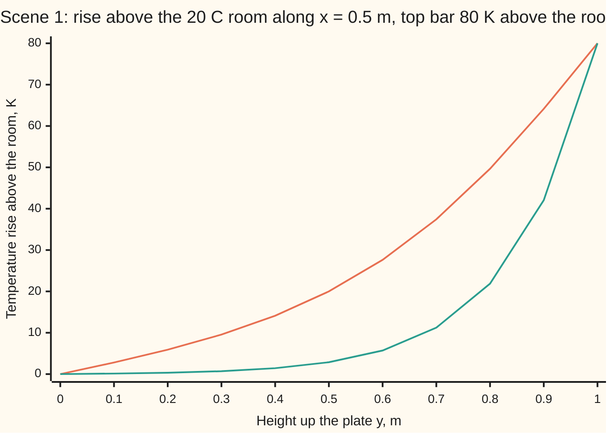
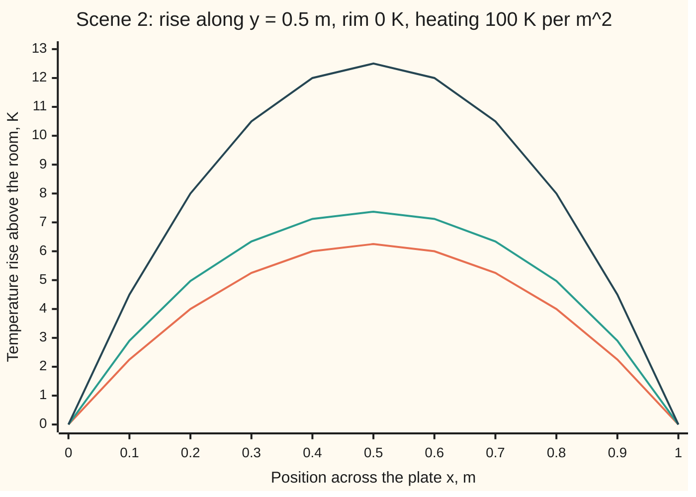

# Maximum principles: the extreme values sit on the boundary

[Syllabus](../../../SYLLABUS.md) → [Partial differential equations](../README.md) → [Classification and Well-Posedness](../README.md#s01) → Maximum principles

---

## General Overview

[Laplace's equation](../../08-Differential%20equations%20and%20dynamics/10-The%20Classical%20PDEs/07-laplaces-equation-and-harmonic-functions.md) proved one fact for a settled plate with no heater inside: its hottest and coldest points sit on the edge. This card proves the same fact for a whole family of equations, in any number of dimensions. Then it turns the fact into a tool that bounds a solution nobody has written down.

The plate is steel, 1 m square and 1 cm thick, in a room at 20 °C. A frame of bars clamps its rim (its edge), and each bar is held at a fixed temperature. The **unknown** is the settled temperature at each point. The **region** is the square. The **data** are the bar temperatures and any heat made inside.

**Scene 1: heated only at the rim.** The top bar is at 100 °C; the other three bars are at the room's 20 °C. The two faces lose heat to the air. Where is the hottest point? On the rim. The centre settles at 22.87 °C. Even 2.5 cm below the hot bar, the plate reads only 88.18 °C. With the faces insulated, the centre reads 40 °C, and still nothing inside reaches 100 °C.

**Scene 2: heated inside.** All four bars are at 20 °C, the faces are insulated for this scene, and an electric current heats the plate evenly: 50 W in all. Now the hottest point is the centre. How hot does it get? Two hand formulas pin it between 26.25 °C and 32.5 °C before any equation is solved. The full solution gives 27.37 °C.

**With no net heating inside and no heat gained from its surroundings, a solution of an elliptic equation never exceeds the larger of its highest boundary value and the room's; so lower on the boundary and heated less inside means lower everywhere.**

**What kind of fact this is:** a theorem, proved on this card in Why it works. The barrier bounds are its consequences, and the code checks every number against a series and a grid.

### The picture: temperature up the middle of the rim-heated plate



The upper line is the plate with insulated faces; the lower line is the plate losing heat to the air. Both climb to the hot bar and never pass it. The cooled line sits below the insulated one at every height: the comparison principle at work.

---

## The formula

Temperatures from here on are rises above the room, in kelvin (K): the top bar is 80 K, the room-temperature bars 0 K. Reminders: [A PDE problem](01-what-a-pde-problem-is.md) names the region $`\Omega`$ (the plate's inside), its boundary $`\partial\Omega`$ (the rim), the closed plate $`\bar\Omega`$ (inside plus rim) and the dimension $`d`$. $`\Delta u`$ is the Laplacian, the sum of the second derivatives.

**The plate's equation.** Heat flows in the plate by conduction, steel carrying 50 W per metre per kelvin. The air takes 10 W per square metre per kelvin from each face. A heat balance on a small patch, divided by conductivity times thickness, gives

```math
-\Delta u + c\,u = f, \qquad c = \frac{2 \times 10}{50 \times 0.01} = 40\ \mathrm{m^{-2}}, \qquad f = \frac{5000}{50} = 100\ \mathrm{K\,m^{-2}}
```

Here $`c`$ is the loss to the air, not the wave speed it names on other cards, and $`f`$ is the heating, 5000 W per cubic metre, over the conductivity. Both coefficients are illustrative values for still air and plain steel.

**The family.** The plate's equation is one case of the general second-order operator $`L`$, a rule that turns a function into another function:

```math
Lu = -\sum_{i,j=1}^{d} a_{ij}(x)\,u_{ij} + \sum_{i=1}^{d} b_i(x)\,u_i + c(x)\,u
```

Here $`u_i`$ is the slope of $`u`$ in direction $`i`$ and $`u_{ij}`$ its second derivative in directions $`i`$ and $`j`$. $`L`$ is **elliptic** ([Elliptic, parabolic, hyperbolic](04-classification-elliptic-parabolic-hyperbolic.md)) when every direction gets a positive weight: $`\sum a_{ij}\xi_i\xi_j \ge \theta\,|\xi|^2`$ for every direction $`\xi`$, with a constant $`\theta > 0`$. For the plate, $`a_{ij}`$ is the identity, $`b = 0`$ and $`\theta = 1`$.

**The weak maximum principle.** Let $`L`$ be elliptic with $`c \ge 0`$, and let $`u`$ have continuous second derivatives inside and be continuous up to the rim. Then

```math
Lu \le 0 \ \text{in } \Omega \quad\Longrightarrow\quad \max_{\bar\Omega} u \;\le\; \max_{\partial\Omega} u^{+}
```

**Read it aloud:** if nothing inside pushes the temperature up, the plate is never hotter than the larger of its hottest rim point and the room.

Here $`u^{+}`$ is the larger of $`u`$ and 0. With $`c = 0`$ the room drops out: $`\max_{\bar\Omega} u = \max_{\partial\Omega} u`$.

**The comparison principle.** Under the same conditions,

```math
Lu \le Lv \ \text{in } \Omega \ \text{ and } \ u \le v \ \text{on } \partial\Omega \quad\Longrightarrow\quad u \le v \ \text{on } \bar\Omega
```

**Read it aloud:** a temperature that starts no higher on the rim, and is heated no more inside, stays no higher everywhere.

**The barrier bound.** A **barrier** is a comparison function $`w`$ built by hand. If $`-\Delta u = f \le F`$ inside, with a constant $`F \ge 0`$, $`u = g`$ on the rim, and the region fits inside a ball of radius $`R`$, then

```math
u \;\le\; \max_{\partial\Omega} g^{+} + \frac{F\,R^2}{2d}
```

**Read it aloud:** the hottest point is at most the hottest rim point plus the largest heating times the squared radius, over twice the dimension.

For the heated plate: $`R^2 = 1/2`$, $`d = 2`$, $`F = 100`$, so the cap is $`100 \times 0.5 / 4 = 12.5`$ K above the room, or 32.5 °C.

| Symbol | Plain meaning | In our example | Push it up and the answer… |
| --- | --- | --- | --- |
| $`\Omega`$, $`\partial\Omega`$, $`\bar\Omega`$ | the plate's inside; its rim; the two together | the 1 m square | — |
| $`d`$, $`x = (x_1, \dots, x_d)`$ | number of space directions; position, m | $`d = 2`$; centre (0.5, 0.5) | the inner-bowl bound $`F/(8d)`$ falls |
| $`u`$, $`u^{+}`$ | temperature rise above the room, K; the larger of $`u`$ and 0 | centre 2.87 K (scene 1, cooled) | — |
| $`L`$, $`u_i`$, $`u_{ij}`$ | the operator; slope in direction $`i`$; second derivative in $`i`$ and $`j`$ | $`Lu = -\Delta u + 40u`$ | — |
| $`a_{ij}`$, $`\theta`$, $`\xi`$ | conduction weights (a matrix); the least weight any direction gets; a direction | identity; $`\theta = 1`$ | — |
| $`b_i`$ | drift: heat carried along by a flow, per metre | 0 | the profile tilts downstream |
| $`c`$ | loss to the surroundings, per square metre | 40 cooled, 0 insulated | the inside sinks toward the room: centre 2.87 K against 20 K |
| $`f`$, $`F`$ | heating over conductivity, K per square metre; its largest value | 100 | the centre rises in proportion: 7.37 K |
| $`g`$ | rim temperatures, K | 80 on the top bar, 0 elsewhere | the inside rises, never by more than $`g`$ did |
| $`v`$, $`w`$ | a comparison function; a barrier built by hand | $`w = 50\,x(1 - x)`$ | — |
| $`R`$, $`x_0`$ | radius and centre of a ball holding the region, m | $`\sqrt{1/2} = 0.71`$; (0.5, 0.5) | the cap grows as $`R^2`$ |
| $`\varepsilon`$, $`\lambda`$, $`V`$, $`K`$, $`h`$ | proof helpers: tilt size, tilt steepness, the hot part of the plate, $`L`$ without its loss term; grid step in the code, m | $`h = 1/40`$ | the grid error falls as $`h^2`$ |

### When it holds

- **Elliptic, $`\theta > 0`$.** Drop it and $`u_{xx} - u_{yy} = 0`$ has a solution that is 0 on the whole rim and 10 K at the centre.
- **No gain from the surroundings, $`c \ge 0`$.** With $`c = -2\pi^2`$, a heat source that grows with temperature, the same 10 K bump fits a 0 K rim.
- **No net heating inside, $`Lu \le 0`$.** With the current on, the centre sits 7.37 K above a 0 K rim. The minimum stays on the rim, and the comparison principle still bounds the maximum.
- **A bounded region, $`u`$ continuous up to the rim.** On an endless half-plane, $`u = y`$ and $`u = 0`$ share a 0 K edge ([Laplace's equation](../../08-Differential%20equations%20and%20dynamics/10-The%20Classical%20PDEs/07-laplaces-equation-and-harmonic-functions.md)).
- **Bounded coefficients.** The proof's tilt needs the drift $`b`$ to be bounded against $`\theta`$.

---

## Why it works

### Step 0: a hilltop cannot be pushed down

At an inside maximum the surface is a cap. Its slope is zero, and it bends down, or stays flat, in every direction. An elliptic operator adds up those bends with positive weights, then flips the sign. So at a cap the bend part of $`Lu`$ is zero or positive, and an equation that demands $`Lu < 0`$ there cannot be met. The steps below make this exact.

The Laplace card used the same idea for $`\Delta u = 0`$, tilting by $`\varepsilon(x^2 + y^2)`$. This card handles the weights $`a_{ij}`$, the drift $`b`$, the loss $`c`$ and any dimension.

### Step 1: weighted bends at a cap are never positive

The weight matrix $`a_{ij}`$ can always be taken symmetric, because $`u_{ij} = u_{ji}`$. So it has $`d`$ perpendicular main directions, each with its own weight, and ellipticity makes every weight at least $`\theta`$. Measured along those directions,

```math
\sum_{i,j} a_{ij}\,u_{ij} \;=\; \text{sum over the main directions of } (\text{weight}) \times (\text{second derivative of } u \text{ along it})
```

At a cap each second derivative along a line is $`\le 0`$, and each weight is positive. So the sum is $`\le 0`$, and the first term of $`Lu`$, which carries a minus sign, is $`\ge 0`$.

### Step 2: a strict inequality forbids an inside maximum

Take $`c = 0`$ and suppose $`Lu < 0`$ everywhere inside. At an inside maximum the slopes $`u_i`$ are zero, so $`Lu`$ is only the bend term, which Step 1 made $`\ge 0`$. That contradicts $`Lu < 0`$. A continuous function on the closed, bounded plate does reach a maximum, so it must reach it on the rim.

### Step 3: a tilt turns "at most 0" into "below 0"

The equation $`Lu = 0`$ only gives $`Lu \le 0`$, not $`< 0`$. Add a small tilt: $`v = u + \varepsilon\, e^{\lambda x_1}`$, rising steeply in direction 1. With $`c = 0`$ still,

```math
L\big(e^{\lambda x_1}\big) = \big(-a_{11}\lambda^2 + b_1\lambda\big)\,e^{\lambda x_1} \;\le\; \big(-\theta\lambda^2 + \lambda \max|b|\big)\,e^{\lambda x_1} \;<\; 0
```

once $`\lambda > \max|b|/\theta`$. So $`Lv < 0`$ and Step 2 puts $`v`$'s maximum on the rim. Inside, $`u \le v`$, and on the rim $`v`$ exceeds $`u`$ by at most $`\varepsilon`$ times the largest $`e^{\lambda x_1}`$ on the plate. Let $`\varepsilon`$ shrink to 0. The exponential, not $`x^2`$, is what absorbs the drift.

### Step 4: a loss term lets the room in

With $`c > 0`$, the loss pulls the plate toward the room, 0 K. Where $`u > 0`$, the term $`cu`$ is positive, so the rest of $`Lu`$ is at most $`-cu \le 0`$. Steps 2 and 3 then apply on the hot part of the plate. Its edge is either the rim or a line where $`u = 0`$. So $`u \le \max_{\partial\Omega} u^{+}`$.

The $`u^{+}`$ is not a technicality. Hold all four bars at 10 °C, that is $`-10`$ K. The air warms the plate toward 20 °C, and the centre settles at $`-1.43`$ K (18.57 °C), well above every rim point.


<details>
<summary>Detailed proof: the weak maximum principle with a loss term</summary>

Let $`V`$ be the part of the plate's inside where $`u > 0`$. It is open, because $`u`$ is continuous. If $`V`$ is empty, $`u \le 0 \le \max_{\partial\Omega} u^{+}`$ and there is nothing to prove.

On $`V`$ write $`Ku = Lu - cu`$, the operator with its loss term removed. There $`c \ge 0`$ and $`u > 0`$, so

$`\displaystyle Ku = Lu - c\,u \le -c\,u \le 0 .`$

$`K`$ has no loss term, so Steps 2 and 3 apply to it on the region $`V`$: the maximum of $`u`$ over $`V`$ with its edge is reached on that edge. Each edge point of $`V`$ either lies on the rim $`\partial\Omega`$, or lies inside the plate where $`u`$ has dropped to 0. So

$`\displaystyle \max_{\bar\Omega} u = \max_{\bar V} u = \max_{\partial V} u \le \max\Big(\max_{\partial\Omega} u,\ 0\Big) = \max_{\partial\Omega} u^{+} .`$

The first equality holds because outside $`V`$ the temperature is at most 0, below its value anywhere in $`V`$.

</details>

### Step 5: comparison is the maximum principle applied to a gap

Suppose $`Lu \le Lv`$ inside and $`u \le v`$ on the rim. The gap $`u - v`$ obeys $`L(u - v) = Lu - Lv \le 0`$, because $`L`$ is linear ([Linear or not](02-linear-nonlinear-and-superposition.md)). On the rim the gap is $`\le 0`$, so its positive part is 0 there. Step 4 makes the gap $`\le 0`$ everywhere: $`u \le v`$.

Three uses follow at once.

1. **Uniqueness.** Two solutions with the same rim data bound each other both ways, so they are equal. [Energy methods](07-energy-methods-and-uniqueness.md) reach the same answer by integrating; this road needs no integral.
2. **Stability.** Apply it to $`u_1 - u_2 - \max|g_1 - g_2|`$ and its mirror: two solutions never differ inside by more than their rim data differ. Raise the hot bar by 0.5 K and the centre moves 0.125 K insulated, 0.018 K cooled, both within 0.5 K. This is the "does not amplify errors" part of [Well posed](06-well-posedness-and-hadamard.md).
3. **Ordering.** Cooling only lowers the plate. Feed the insulated temperature into the cooled operator $`-\Delta + 40`$: it returns 40 times that temperature, which is $`\ge 0`$. The cooled temperature returns exactly 0, and the rims match. So the cooled plate is colder at every point: 2.87 K against 20 K at the centre.

### Step 6: barriers bound a solution nobody has written

To cap the heated plate, build $`w`$ by hand with $`-\Delta w \ge F`$ inside and $`w \ge u`$ on the rim. Then $`-\Delta u = f \le F \le -\Delta w`$, and Step 5 gives $`u \le w`$.

- **The strip.** $`w = F\,x_1(1 - x_1)/2`$ has $`-\Delta w = F`$ exactly. It is 0 on the left and right bars and positive on the others. At the centre: $`100 \times 0.5 \times 0.5 / 2 = 12.5`$ K.
- **The outer ball.** $`w = F\,(R^2 - |x - x_0|^2)/(2d)`$ has $`-\Delta w = F \cdot 2d/(2d) = F`$. On a ball of radius $`R`$ holding the plate, $`w \ge 0`$ on the rim. With $`R^2 = 1/2`$: $`100 \times 0.5/4 = 12.5`$ K.
- **The inner bowl, a floor.** On the largest disc inside the plate, radius 0.5 m, the same shape is a lower barrier. On that disc's edge $`u \ge 0`$, because the minimum of a heated plate stays on its rim. So $`u \ge F\,(0.25 - |x - x_0|^2)/(2d)`$ there: $`100 \times 0.25/4 = 6.25`$ K at the centre.

With loss, $`c\,w \ge 0`$ only adds to $`Lw`$, so every upper barrier still works. The floor does not: it needs $`c = 0`$. With loss, the bowl has $`Lw = F + c\,w`$, above $`F`$ wherever $`w > 0`$, so the comparison runs the wrong way. Cool the faces of the heated plate and its centre falls to 2.14 K, below the 6.25 K floor.

### Step 7: the strong form, stated

The weak principle still allows an inside maximum equal to the rim maximum. The **strong maximum principle** (Hopf, 1927) forbids it: on a connected region with $`Lu \le 0`$ and $`c = 0`$, an inside maximum forces $`u`$ to be constant. With $`c \ge 0`$ the same holds for a maximum that is $`\ge 0`$.

Its proof builds a small barrier at the edge of a ball (Hopf's lemma, proved on [General elliptic operators](../06-Weak%20Solutions%20and%20Free%20Boundaries/12-hopf-lemma-fredholm-alternative-and-the-principal-eigenvalue.md); Gilbarg and Trudinger, Theorem 3.5). It is why every inside point of the plate sits strictly below the bar's 80 K; the grid's warmest inside point, 68.19 K on the cooled plate, shows it.

---

## Worked numbers, by hand

| Step | Arithmetic | Value |
| --- | --- | --- |
| loss coefficient | $`c = 2 \times 10 / (50 \times 0.01)`$ | 40 per m² |
| heating over conductivity | $`f = 5000 / 50`$ | 100 K per m² |
| scene 1, insulated centre | heat each bar in turn and add: all four at 80 K give 80 K everywhere, and the centre takes a quarter: 80 / 4 | 20 K (40 °C) |
| scene 1, cooled centre | series; grid at $`h = 1/40`$ | 2.87 K (22.87 °C) |
| scene 2, strip cap | $`100 \times 0.5 \times 0.5 / 2`$ | 12.5 K |
| scene 2, outer-ball cap | $`100 \times (1/2) / 4`$ | 12.5 K |
| scene 2, inner-bowl floor | $`100 \times 0.25 / 4`$ | 6.25 K |
| scene 2, true centre | series; grid | 7.37 K |
| scene 2 with the faces cooled, for contrast | series | 2.14 K: below 7.37 K, and below the floor, which needs insulated faces (Step 6) |
| **the bound, insulated faces** | 20 + 6.25 to 20 + 12.5 | **26.25 °C ≤ centre ≤ 32.5 °C** |

With insulated faces, the heated plate's centre must lie between 26.25 °C and 32.5 °C, and the full solution, 27.37 °C, does.

The bound works in any dimension. A 1 m steel cube heated the same way has floor $`F/(8d)`$ and cap $`F/8`$:

| Region | $`d`$ | Inner-bowl floor, K | True centre, K | Strip cap, K |
| --- | ---: | ---: | ---: | ---: |
| rod, 1 m | 1 | 12.50 | 12.50 | 12.50 |
| plate, 1 m square | 2 | 6.25 | 7.37 | 12.50 |
| cube, 1 m | 3 | 4.17 | 5.62 | 12.50 |

On a rod the two barriers meet, because the bowl is the solution. Each added direction lets heat leave another way, so the centre falls.

### The picture: the true temperature sandwiched between two barriers



Bottom line: the inner-bowl floor. Middle line: the true temperature, from the series. Top line: the strip cap. The grid confirms the sandwich at all 1,521 of its inside points.

### What breaks if you drop a piece

| Mistake | Comes out at | What went wrong |
| --- | --- | --- |
| Not elliptic: $`u_{xx} - u_{yy} = 0`$ | $`u = 10\sin(\pi x)\sin(\pi y)`$: 0 K on the whole rim, 10 K at the centre | one direction has a negative weight, so a cap is allowed |
| Gain, not loss: $`-\Delta u - 2\pi^2 u = 0`$ | the same 10 K bump on a 0 K rim | $`c < 0`$ feeds the bump; a source that grows with temperature |
| Heat made inside | centre 7.37 K above a 0 K rim | $`Lu = f > 0`$; only the minimum stays on the rim (grid minimum 0.1354 K) |
| The inner bowl used as a cap | 6.25 K, below the true 7.37 K | at a corner the bowl reads −6.25 K, under the rim's 0 K, so it is not above $`u`$ on the rim |

The code prints all four and checks the bump by centred differences.

---

## Code, from first principles, and it actually runs

The code solves both scenes four ways. Road one is a sine series, one sine mode across the plate solved exactly up it, as on [Laplace on a rectangle](../../08-Differential%20equations%20and%20dynamics/10-The%20Classical%20PDEs/08-laplace-on-a-rectangle.md). Road two is a grid, swept until every point equals its weighted neighbour average ([Iterating instead of factoring](../../16-Numerical%20analysis/03-Numerical%20Linear%20Algebra/09-iterative-methods-jacobi-gauss-seidel-and-conjugate-gradient.md)). Road three is the symmetry value 20 K. Road four is the hand barriers. The cube gets a double series and a three-dimensional grid. Halving a grid's step cuts its error fourfold.

### Python

```python
# Maximum principles on a 1 m square steel plate, temperatures as rises above the 20 C room (K).
# Scene 1: top bar 80 K, other bars 0 K, faces cooled (c = 40 per m^2) or insulated (c = 0).
# Scene 2: rim 0 K, heater inside f = 100 K per m^2, bounded by comparison with barriers.
# Roads: sine series, a grid swept to its neighbour average, symmetry, and hand barriers.
from math import pi, sin, sqrt, exp
F, C, TOP = 5000 / 50, 2 * 10 / (50 * 0.01), 80.0    # f = heat / conductivity; c = 2 air / (k t)

def rim(x, y, c, top=TOP):          # top bar `top`, others 0: sum of sin(n pi x) sinh(b y)/sinh(b)
    return sum(4 * top / (n * pi) * sin(n * pi * x) * (exp(b * (y - 1)) - exp(-b * (y + 1)))
               / (1 - exp(-2 * b)) for n in range(1, 800, 2) for b in [sqrt((n * pi) ** 2 + c)])

def heated(x, y, c):                 # rim 0, source F: each sine mode in x solved exactly in y
    return sum(4 * F / (m * pi) / k ** 2 * sin(m * pi * x) * (1 - (exp(k * (y - 1)) + exp(-k * y))
               / (1 + exp(-k))) for m in range(1, 400, 2) for k in [sqrt((m * pi) ** 2 + c)])

def cube(N):                         # unit cube, rim 0, source F: double sine series at the centre
    s = 0.0
    for m in range(1, N, 2):
        for n in range(1, N, 2):
            k = pi * sqrt(m * m + n * n)
            s += 16 * F / (pi * pi * m * n * k * k) * (1 - 2 * exp(-k / 2) / (1 + exp(-k))) \
                * (-1) ** ((m + n) // 2 - 1)
    return s

def relax(n, top, src, c):           # sweep u = (neighbours + h^2 src) / (4 + h^2 c) until settled
    h, w = 1 / n, 2 / (1 + sin(pi / n))
    u = [[0.0] * (n + 1) for _ in range(n + 1)]          # u[i][j] at x = i h, y = j h
    for i in range(n + 1):
        u[i][n] = top
    while True:
        big = 0.0
        for i in range(1, n):
            for j in range(1, n):
                new = (u[i+1][j] + u[i-1][j] + u[i][j+1] + u[i][j-1] + h * h * src) / (4 + h * h * c)
                big = max(big, abs(new - u[i][j]))
                u[i][j] += w * (new - u[i][j])
        if big < 1e-11:
            return u

def relax3(n):                       # the cube on a grid: six neighbours
    h, w = 1 / n, 2 / (1 + sin(pi / n))
    u = [[[0.0] * (n + 1) for _ in range(n + 1)] for _ in range(n + 1)]
    while True:
        big = 0.0
        for i in range(1, n):
            for j in range(1, n):
                for k in range(1, n):
                    new = (u[i+1][j][k] + u[i-1][j][k] + u[i][j+1][k] + u[i][j-1][k]
                           + u[i][j][k+1] + u[i][j][k-1] + h * h * F) / 6
                    big = max(big, abs(new - u[i][j][k]))
                    u[i][j][k] += w * (new - u[i][j][k])
        if big < 1e-11:
            return u[n // 2][n // 2][n // 2]

N = 40
G0, GC, GH = relax(N, TOP, 0, 0), relax(N, TOP, 0, C), relax(N, 0, F, 0)
pts = [(i, j) for i in range(1, N) for j in range(1, N)]
f2 = lambda v: ", ".join(f"{t:.2f}" for t in v)
low = lambda x, y: max(0.0, F * (0.25 - (x - 0.5) ** 2 - (y - 0.5) ** 2) / 4)   # inner-disc bowl
upp = lambda x, y: F * x * (1 - x) / 2                                          # strip barrier
print(f"setup: c = 2*10/(50*0.01) = {C:.2f} per m^2; f = 5000/50 = {F:.2f} K per m^2")
print(f"scene 1 centre, insulated: four turns 80/4 = {TOP / 4:.4f}, series {rim(.5, .5, 0):.4f}, grid {G0[20][20]:.4f}")
print(f"scene 1 centre, cooled c=40: series {rim(.5, .5, C):.4f}, grid {GC[20][20]:.4f}")
print(f"midline x=0.5, y=0,0.1..1, insulated series: {f2([rim(.5, k / 10, 0) for k in range(10)] + [TOP])}")
print(f"midline x=0.5, y=0,0.1..1, cooled series:    {f2([rim(.5, k / 10, C) for k in range(10)] + [TOP])}")
print(f"midline x=0.5, y=0,0.1..1, cooled grid:      {f2([GC[20][4 * k] for k in range(11)])}")
for name, g in (("insulated", G0), ("cooled", GC)):
    i, j = max(pts, key=lambda p: g[p[0]][p[1]])
    print(f"{name} grid: interior max {g[i][j]:.4f} at ({i / N:.3f}, {j / N:.3f}), "
          f"min {min(g[a][b] for a, b in pts):.4f}; rim 0 to 80")
gap = min(G0[i][j] - GC[i][j] for i, j in pts)
print(f"comparison: insulated minus cooled at every grid point >= 0: {'yes' if gap >= 0 else 'no'}")
d0, dc = rim(.5, .5, 0, 80.5) - rim(.5, .5, 0), rim(.5, .5, C, 80.5) - rim(.5, .5, C)
print(f"stability: top bar 80 -> 80.5 moves the centre {d0:.4f} (insulated), {dc:.4f} (cooled), cap 0.5")
p20, p40, pex = relax(20, 0, F, 0)[10][10], GH[20][20], heated(.5, .5, 0)
print(f"scene 2 centre: series {pex:.4f}, grid h=1/20 {p20:.4f}, h=1/40 {p40:.4f}, error ratio {(pex - p20) / (pex - p40):.2f}")
print(f"scene 2 first omitted series term at the centre: {4 * F / (401 * pi) ** 3:.7f}")
print(f"barriers at the centre: strip 100*0.5*0.5/2 = {upp(.5, .5):.4f}, outer disc 100*(1/2)/4 = {F * 0.5 / 4:.4f}, "
      f"inner disc 100*0.25/4 = {low(.5, .5):.4f}")
print(f"midline y=0.5, x=0,0.1..1, lower bowl: {f2([low(k / 10, .5) for k in range(11)])}")
print(f"midline y=0.5, x=0,0.1..1, series:     {f2([heated(k / 10, .5, 0) for k in range(11)])}")
print(f"midline y=0.5, x=0,0.1..1, strip:      {f2([upp(k / 10, .5) for k in range(11)])}")
ok = all(low(i / N, j / N) <= GH[i][j] <= upp(i / N, j / N) for i, j in pts)
print(f"sandwich bowl <= u <= strip at all {len(pts)} grid points: {'yes' if ok else 'no'}; grid max {max(GH[i][j] for i, j in pts):.4f}")
pc = heated(.5, .5, C)
print(f"scene 2 cooled c=40: centre {pc:.4f}, below the insulated {pex:.4f}")
c100, c200, g10, g20 = cube(100), cube(200), relax3(10), relax3(20)
print(f"d=1 rod: bowl 100/8 = {F / 8:.4f}, exact {F * 0.25 / 2:.4f}, strip {F / 8:.4f}")
print(f"d=2 plate: bowl 100/16 = {F / 16:.4f}, exact {pex:.4f}, strip {F / 8:.4f}")
print(f"d=3 cube: bowl 100/24 = {F / 24:.4f}, exact {c200:.4f}, strip {F / 8:.4f}")
print(f"cube centre: series N=100 {c100:.6f}, N=200 {c200:.6f}; grid h=1/10 {g10:.4f}, h=1/20 {g20:.4f}, "
      f"error ratio {(c200 - g10) / (c200 - g20):.2f}")
zs, zg = 10 * C / F * heated(.5, .5, C), relax(N, 0, 10 * C, C)[20][20]   # u = -10 + z
print(f"cold frame at -10 K, cooled: centre series {zs - 10:.4f}, grid {zg - 10:.4f}; rim -10, room 0")
print(f"in C, room 20: scene 1 centre {20 + rim(.5, .5, C):.2f}, series 2.5 cm below the hot bar {20 + rim(.5, .975, C):.2f}; "
      f"scene 2 {20 + F / 16:.2f} <= {20 + pex:.2f} <= {20 + F / 8:.2f}; cold frame {30 + zs - 20:.2f}; heat 5000*0.01 = {50.0:.0f} W")
s, res = lambda x, y: 10 * sin(pi * x) * sin(pi * y), []
for e in (0.01, 0.005):
    dxx = (s(.3 + e, .6) - 2 * s(.3, .6) + s(.3 - e, .6)) / e ** 2
    dyy = (s(.3, .6 + e) - 2 * s(.3, .6) + s(.3, .6 - e)) / e ** 2
    res += [abs(dxx - dyy), abs(-dxx - dyy - 2 * pi * pi * s(.3, .6))]
    print(f"breaks residuals at (0.3, 0.6), step {e}: u_xx - u_yy {abs(dxx - dyy):.6f}, "
          f"-u_xx - u_yy - 2 pi^2 u {abs(-dxx - dyy - 2 * pi * pi * s(.3, .6)):.6f}")
print(f"breaks 1-2, u = 10 sin(pi x) sin(pi y): rim 0, centre {s(.5, .5):.4f} K, above every rim point")
print(f"breaks 3, heater inside: centre {pex:.4f} K above a 0 K rim; grid min {min(GH[i][j] for i, j in pts):.4f}")
print(f"breaks 4, inner bowl without the max(0, .) at a corner: {F * (0.25 - 0.5) / 4:.4f} K, below the rim's 0 K")
assert abs(rim(.5, .5, 0) - TOP / 4) < 1e-9 and abs(G0[20][20] - TOP / 4) < 1e-6   # series, grid, symmetry
assert max(abs(rim(.5, k / 10, C) - GC[20][4 * k]) for k in range(10)) < 0.1         # two roads, cooled
assert gap >= 0 and max(GC[i][j] for i, j in pts) < TOP and min(GC[i][j] for i, j in pts) > 0
assert 3.8 < (pex - p20) / (pex - p40) < 4.2 and ok and F / 16 < pex < F / 8 and pc < pex
assert abs(c200 - g20) < 0.03 and 3.8 < (c200 - g10) / (c200 - g20) < 4.2 and F / 24 < c200 < F / 8
assert abs(zs - zg) < 0.01 and -10 < zs - 10 < 0
assert 0 < d0 <= 0.5 and 0 < dc < d0 and res[0] < 1e-6 and 3.9 < res[1] / res[3] < 4.1
print("ALL CHECKS PASS")
```

**Ran 2026-11-15 on macOS, Python 3.14.10, standard library only. All checks passed. Output, pasted from the run:**

```
setup: c = 2*10/(50*0.01) = 40.00 per m^2; f = 5000/50 = 100.00 K per m^2
scene 1 centre, insulated: four turns 80/4 = 20.0000, series 20.0000, grid 20.0000
scene 1 centre, cooled c=40: series 2.8673, grid 2.8776
midline x=0.5, y=0,0.1..1, insulated series: 0.00, 2.81, 5.90, 9.55, 14.12, 20.00, 27.63, 37.43, 49.66, 64.14, 80.00
midline x=0.5, y=0,0.1..1, cooled series:    0.00, 0.13, 0.33, 0.70, 1.43, 2.87, 5.70, 11.23, 21.87, 42.06, 80.00
midline x=0.5, y=0,0.1..1, cooled grid:      0.00, 0.13, 0.34, 0.71, 1.44, 2.88, 5.72, 11.25, 21.89, 42.08, 80.00
insulated grid: interior max 75.9700 at (0.500, 0.975), min 0.0548; rim 0 to 80
cooled grid: interior max 68.1916 at (0.500, 0.975), min 0.0025; rim 0 to 80
comparison: insulated minus cooled at every grid point >= 0: yes
stability: top bar 80 -> 80.5 moves the centre 0.1250 (insulated), 0.0179 (cooled), cap 0.5
scene 2 centre: series 7.3671, grid h=1/20 7.3527, h=1/40 7.3635, error ratio 3.99
scene 2 first omitted series term at the centre: 0.0000002
barriers at the centre: strip 100*0.5*0.5/2 = 12.5000, outer disc 100*(1/2)/4 = 12.5000, inner disc 100*0.25/4 = 6.2500
midline y=0.5, x=0,0.1..1, lower bowl: 0.00, 2.25, 4.00, 5.25, 6.00, 6.25, 6.00, 5.25, 4.00, 2.25, 0.00
midline y=0.5, x=0,0.1..1, series:     0.00, 2.90, 4.97, 6.34, 7.12, 7.37, 7.12, 6.34, 4.97, 2.90, 0.00
midline y=0.5, x=0,0.1..1, strip:      0.00, 4.50, 8.00, 10.50, 12.00, 12.50, 12.00, 10.50, 8.00, 4.50, 0.00
sandwich bowl <= u <= strip at all 1521 grid points: yes; grid max 7.3635
scene 2 cooled c=40: centre 2.1416, below the insulated 7.3671
d=1 rod: bowl 100/8 = 12.5000, exact 12.5000, strip 12.5000
d=2 plate: bowl 100/16 = 6.2500, exact 7.3671, strip 12.5000
d=3 cube: bowl 100/24 = 4.1667, exact 5.6213, strip 12.5000
cube centre: series N=100 5.621270, N=200 5.621281; grid h=1/10 5.5374, h=1/20 5.6000, error ratio 3.94
cold frame at -10 K, cooled: centre series -1.4337, grid -1.4388; rim -10, room 0
in C, room 20: scene 1 centre 22.87, series 2.5 cm below the hot bar 88.18; scene 2 26.25 <= 27.37 <= 32.50; cold frame 18.57; heat 5000*0.01 = 50 W
breaks residuals at (0.3, 0.6), step 0.01: u_xx - u_yy 0.000000, -u_xx - u_yy - 2 pi^2 u 0.012491
breaks residuals at (0.3, 0.6), step 0.005: u_xx - u_yy 0.000000, -u_xx - u_yy - 2 pi^2 u 0.003123
breaks 1-2, u = 10 sin(pi x) sin(pi y): rim 0, centre 10.0000 K, above every rim point
breaks 3, heater inside: centre 7.3671 K above a 0 K rim; grid min 0.1354
breaks 4, inner bowl without the max(0, .) at a corner: -6.2500 K, below the rim's 0 K
ALL CHECKS PASS
```

### Rust

Same numbers, same labels.

```rust
// Maximum principles on a 1 m square steel plate, temperatures as rises above the 20 C room (K).
// Scene 1: top bar 80 K, other bars 0 K, faces cooled (c = 40 per m^2) or insulated (c = 0).
// Scene 2: rim 0 K, heater inside f = 100 K per m^2, bounded by comparison with barriers.
// Roads: sine series, a grid swept to its neighbour average, symmetry, and hand barriers.
use std::f64::consts::PI;
const F: f64 = 5000.0 / 50.0; // f = heat / conductivity
const C: f64 = 2.0 * 10.0 / (50.0 * 0.01); // c = 2 air / (k t)
const TOP: f64 = 80.0;
const N: usize = 40;

fn rim(x: f64, y: f64, c: f64, top: f64) -> f64 { // top bar `top`, others 0: sin(n pi x) sinh(b y)/sinh(b)
    (1..800).step_by(2).map(|n| { let a = n as f64 * PI; let b = (a * a + c).sqrt();
        4.0 * top / a * (a * x).sin() * ((b * (y - 1.0)).exp() - (-b * (y + 1.0)).exp()) / (1.0 - (-2.0 * b).exp())
    }).sum()
}
fn heated(x: f64, y: f64, c: f64) -> f64 { // rim 0, source F: each sine mode in x solved exactly in y
    (1..400).step_by(2).map(|m| { let a = m as f64 * PI; let k = (a * a + c).sqrt();
        4.0 * F / a / (k * k) * (a * x).sin() * (1.0 - ((k * (y - 1.0)).exp() + (-k * y).exp()) / (1.0 + (-k).exp()))
    }).sum()
}
fn cube(nn: usize) -> f64 { // unit cube, rim 0, source F: double sine series at the centre
    let mut s = 0.0;
    for m in (1..nn).step_by(2) { for n in (1..nn).step_by(2) {
        let k = PI * ((m * m + n * n) as f64).sqrt();
        let sign = if ((m + n) / 2 - 1) % 2 == 0 { 1.0 } else { -1.0 };
        s += 16.0 * F / (PI * PI * (m * n) as f64 * k * k) * (1.0 - 2.0 * (-k / 2.0).exp() / (1.0 + (-k).exp())) * sign;
    } }
    s
}
fn relax(n: usize, top: f64, src: f64, c: f64) -> Vec<Vec<f64>> { // u = (neighbours + h^2 src)/(4 + h^2 c)
    let (h, w) = (1.0 / n as f64, 2.0 / (1.0 + (PI / n as f64).sin()));
    let mut u = vec![vec![0.0; n + 1]; n + 1]; // u[i][j] at x = i h, y = j h
    for i in 0..=n { u[i][n] = top; }
    loop {
        let mut big: f64 = 0.0;
        for i in 1..n { for j in 1..n {
            let new = (u[i + 1][j] + u[i - 1][j] + u[i][j + 1] + u[i][j - 1] + h * h * src) / (4.0 + h * h * c);
            big = big.max((new - u[i][j]).abs());
            u[i][j] += w * (new - u[i][j]);
        } }
        if big < 1e-11 { return u; }
    }
}
fn relax3(n: usize) -> f64 { // the cube on a grid: six neighbours
    let (h, w) = (1.0 / n as f64, 2.0 / (1.0 + (PI / n as f64).sin()));
    let mut u = vec![vec![vec![0.0; n + 1]; n + 1]; n + 1];
    loop {
        let mut big: f64 = 0.0;
        for i in 1..n { for j in 1..n { for k in 1..n {
            let new = (u[i + 1][j][k] + u[i - 1][j][k] + u[i][j + 1][k] + u[i][j - 1][k]
                + u[i][j][k + 1] + u[i][j][k - 1] + h * h * F) / 6.0;
            big = big.max((new - u[i][j][k]).abs());
            u[i][j][k] += w * (new - u[i][j][k]);
        } } }
        if big < 1e-11 { return u[n / 2][n / 2][n / 2]; }
    }
}
fn f2(v: &[f64]) -> String { v.iter().map(|t| format!("{:.2}", t)).collect::<Vec<_>>().join(", ") }
fn low(x: f64, y: f64) -> f64 { (F * (0.25 - (x - 0.5).powi(2) - (y - 0.5).powi(2)) / 4.0).max(0.0) } // inner-disc bowl
fn upp(x: f64, _y: f64) -> f64 { F * x * (1.0 - x) / 2.0 } // strip barrier
fn s(x: f64, y: f64) -> f64 { 10.0 * (PI * x).sin() * (PI * y).sin() }

fn main() {
    let (g0, gc, gh) = (relax(N, TOP, 0.0, 0.0), relax(N, TOP, 0.0, C), relax(N, 0.0, F, 0.0));
    let pts: Vec<(usize, usize)> = (1..N).flat_map(|i| (1..N).map(move |j| (i, j))).collect();
    let k10: Vec<f64> = (0..11).map(|k| k as f64 / 10.0).collect();
    println!("setup: c = 2*10/(50*0.01) = {:.2} per m^2; f = 5000/50 = {:.2} K per m^2", C, F);
    println!("scene 1 centre, insulated: four turns 80/4 = {:.4}, series {:.4}, grid {:.4}", TOP / 4.0, rim(0.5, 0.5, 0.0, TOP), g0[20][20]);
    println!("scene 1 centre, cooled c=40: series {:.4}, grid {:.4}", rim(0.5, 0.5, C, TOP), gc[20][20]);
    let line = |c: f64| -> Vec<f64> { (0..11).map(|k| if k < 10 { rim(0.5, k10[k], c, TOP) } else { TOP }).collect() };
    println!("midline x=0.5, y=0,0.1..1, insulated series: {}", f2(&line(0.0)));
    println!("midline x=0.5, y=0,0.1..1, cooled series:    {}", f2(&line(C)));
    println!("midline x=0.5, y=0,0.1..1, cooled grid:      {}", f2(&(0..11).map(|k| gc[20][4 * k]).collect::<Vec<_>>()));
    for (name, g) in [("insulated", &g0), ("cooled", &gc)] {
        let mut b = pts[0];
        for &p in &pts { if g[p.0][p.1] > g[b.0][b.1] { b = p; } }
        let mn = pts.iter().map(|&(i, j)| g[i][j]).fold(f64::MAX, f64::min);
        println!("{} grid: interior max {:.4} at ({:.3}, {:.3}), min {:.4}; rim 0 to 80", name, g[b.0][b.1], b.0 as f64 / N as f64, b.1 as f64 / N as f64, mn);
    }
    let gap = pts.iter().map(|&(i, j)| g0[i][j] - gc[i][j]).fold(f64::MAX, f64::min);
    println!("comparison: insulated minus cooled at every grid point >= 0: {}", if gap >= 0.0 { "yes" } else { "no" });
    let d0 = rim(0.5, 0.5, 0.0, 80.5) - rim(0.5, 0.5, 0.0, TOP);
    let dc = rim(0.5, 0.5, C, 80.5) - rim(0.5, 0.5, C, TOP);
    println!("stability: top bar 80 -> 80.5 moves the centre {:.4} (insulated), {:.4} (cooled), cap 0.5", d0, dc);
    let (p20, p40, pex) = (relax(20, 0.0, F, 0.0)[10][10], gh[20][20], heated(0.5, 0.5, 0.0));
    println!("scene 2 centre: series {:.4}, grid h=1/20 {:.4}, h=1/40 {:.4}, error ratio {:.2}", pex, p20, p40, (pex - p20) / (pex - p40));
    println!("scene 2 first omitted series term at the centre: {:.7}", 4.0 * F / (401.0 * PI).powi(3));
    println!("barriers at the centre: strip 100*0.5*0.5/2 = {:.4}, outer disc 100*(1/2)/4 = {:.4}, inner disc 100*0.25/4 = {:.4}",
             upp(0.5, 0.5), F * 0.5 / 4.0, low(0.5, 0.5));
    println!("midline y=0.5, x=0,0.1..1, lower bowl: {}", f2(&k10.iter().map(|&x| low(x, 0.5)).collect::<Vec<_>>()));
    println!("midline y=0.5, x=0,0.1..1, series:     {}", f2(&k10.iter().map(|&x| heated(x, 0.5, 0.0)).collect::<Vec<_>>()));
    println!("midline y=0.5, x=0,0.1..1, strip:      {}", f2(&k10.iter().map(|&x| upp(x, 0.5)).collect::<Vec<_>>()));
    let nf = N as f64;
    let ok = pts.iter().all(|&(i, j)| low(i as f64 / nf, j as f64 / nf) <= gh[i][j] && gh[i][j] <= upp(i as f64 / nf, j as f64 / nf));
    let ghmax = pts.iter().map(|&(i, j)| gh[i][j]).fold(f64::MIN, f64::max);
    println!("sandwich bowl <= u <= strip at all {} grid points: {}; grid max {:.4}", pts.len(), if ok { "yes" } else { "no" }, ghmax);
    let pc = heated(0.5, 0.5, C);
    println!("scene 2 cooled c=40: centre {:.4}, below the insulated {:.4}", pc, pex);
    let (c100, c200, g10, g20) = (cube(100), cube(200), relax3(10), relax3(20));
    println!("d=1 rod: bowl 100/8 = {:.4}, exact {:.4}, strip {:.4}", F / 8.0, F * 0.25 / 2.0, F / 8.0);
    println!("d=2 plate: bowl 100/16 = {:.4}, exact {:.4}, strip {:.4}", F / 16.0, pex, F / 8.0);
    println!("d=3 cube: bowl 100/24 = {:.4}, exact {:.4}, strip {:.4}", F / 24.0, c200, F / 8.0);
    println!("cube centre: series N=100 {:.6}, N=200 {:.6}; grid h=1/10 {:.4}, h=1/20 {:.4}, error ratio {:.2}",
             c100, c200, g10, g20, (c200 - g10) / (c200 - g20));
    let (zs, zg) = (10.0 * C / F * heated(0.5, 0.5, C), relax(N, 0.0, 10.0 * C, C)[20][20]); // u = -10 + z
    println!("cold frame at -10 K, cooled: centre series {:.4}, grid {:.4}; rim -10, room 0", zs - 10.0, zg - 10.0);
    println!("in C, room 20: scene 1 centre {:.2}, series 2.5 cm below the hot bar {:.2}; scene 2 {:.2} <= {:.2} <= {:.2}; cold frame {:.2}; heat 5000*0.01 = {:.0} W",
             20.0 + rim(0.5, 0.5, C, TOP), 20.0 + rim(0.5, 0.975, C, TOP), 20.0 + F / 16.0, 20.0 + pex, 20.0 + F / 8.0, 30.0 + zs - 20.0, 50.0);
    let mut res = vec![];
    for e in [0.01, 0.005] {
        let dxx = (s(0.3 + e, 0.6) - 2.0 * s(0.3, 0.6) + s(0.3 - e, 0.6)) / (e * e);
        let dyy = (s(0.3, 0.6 + e) - 2.0 * s(0.3, 0.6) + s(0.3, 0.6 - e)) / (e * e);
        res.push((dxx - dyy).abs());
        res.push((-dxx - dyy - 2.0 * PI * PI * s(0.3, 0.6)).abs());
        println!("breaks residuals at (0.3, 0.6), step {}: u_xx - u_yy {:.6}, -u_xx - u_yy - 2 pi^2 u {:.6}", e, res[res.len() - 2], res[res.len() - 1]);
    }
    println!("breaks 1-2, u = 10 sin(pi x) sin(pi y): rim 0, centre {:.4} K, above every rim point", s(0.5, 0.5));
    let ghmin = pts.iter().map(|&(i, j)| gh[i][j]).fold(f64::MAX, f64::min);
    println!("breaks 3, heater inside: centre {:.4} K above a 0 K rim; grid min {:.4}", pex, ghmin);
    println!("breaks 4, inner bowl without the max(0, .) at a corner: {:.4} K, below the rim's 0 K", F * (0.25 - 0.5) / 4.0);
    assert!((rim(0.5, 0.5, 0.0, TOP) - TOP / 4.0).abs() < 1e-9 && (g0[20][20] - TOP / 4.0).abs() < 1e-6); // three roads
    let cl = line(C);
    assert!((0..10).map(|k| (cl[k] - gc[20][4 * k]).abs()).fold(0.0, f64::max) < 0.1); // two roads, cooled
    let gcmax = pts.iter().map(|&(i, j)| gc[i][j]).fold(f64::MIN, f64::max);
    let gcmin = pts.iter().map(|&(i, j)| gc[i][j]).fold(f64::MAX, f64::min);
    assert!(gap >= 0.0 && gcmax < TOP && gcmin > 0.0);
    let r = (pex - p20) / (pex - p40);
    assert!(3.8 < r && r < 4.2 && ok && F / 16.0 < pex && pex < F / 8.0 && pc < pex);
    let r3 = (c200 - g10) / (c200 - g20);
    assert!((c200 - g20).abs() < 0.03 && 3.8 < r3 && r3 < 4.2 && F / 24.0 < c200 && c200 < F / 8.0);
    assert!((zs - zg).abs() < 0.01 && -10.0 < zs - 10.0 && zs - 10.0 < 0.0);
    assert!(0.0 < d0 && d0 <= 0.5 && 0.0 < dc && dc < d0 && res[0] < 1e-6 && 3.9 < res[1] / res[3] && res[1] / res[3] < 4.1);
    println!("ALL CHECKS PASS");
}
```

**Ran 2026-11-15 on macOS, rustc 1.98.1, no crates. All checks passed. Output, pasted from the run:**

```
setup: c = 2*10/(50*0.01) = 40.00 per m^2; f = 5000/50 = 100.00 K per m^2
scene 1 centre, insulated: four turns 80/4 = 20.0000, series 20.0000, grid 20.0000
scene 1 centre, cooled c=40: series 2.8673, grid 2.8776
midline x=0.5, y=0,0.1..1, insulated series: 0.00, 2.81, 5.90, 9.55, 14.12, 20.00, 27.63, 37.43, 49.66, 64.14, 80.00
midline x=0.5, y=0,0.1..1, cooled series:    0.00, 0.13, 0.33, 0.70, 1.43, 2.87, 5.70, 11.23, 21.87, 42.06, 80.00
midline x=0.5, y=0,0.1..1, cooled grid:      0.00, 0.13, 0.34, 0.71, 1.44, 2.88, 5.72, 11.25, 21.89, 42.08, 80.00
insulated grid: interior max 75.9700 at (0.500, 0.975), min 0.0548; rim 0 to 80
cooled grid: interior max 68.1916 at (0.500, 0.975), min 0.0025; rim 0 to 80
comparison: insulated minus cooled at every grid point >= 0: yes
stability: top bar 80 -> 80.5 moves the centre 0.1250 (insulated), 0.0179 (cooled), cap 0.5
scene 2 centre: series 7.3671, grid h=1/20 7.3527, h=1/40 7.3635, error ratio 3.99
scene 2 first omitted series term at the centre: 0.0000002
barriers at the centre: strip 100*0.5*0.5/2 = 12.5000, outer disc 100*(1/2)/4 = 12.5000, inner disc 100*0.25/4 = 6.2500
midline y=0.5, x=0,0.1..1, lower bowl: 0.00, 2.25, 4.00, 5.25, 6.00, 6.25, 6.00, 5.25, 4.00, 2.25, 0.00
midline y=0.5, x=0,0.1..1, series:     0.00, 2.90, 4.97, 6.34, 7.12, 7.37, 7.12, 6.34, 4.97, 2.90, 0.00
midline y=0.5, x=0,0.1..1, strip:      0.00, 4.50, 8.00, 10.50, 12.00, 12.50, 12.00, 10.50, 8.00, 4.50, 0.00
sandwich bowl <= u <= strip at all 1521 grid points: yes; grid max 7.3635
scene 2 cooled c=40: centre 2.1416, below the insulated 7.3671
d=1 rod: bowl 100/8 = 12.5000, exact 12.5000, strip 12.5000
d=2 plate: bowl 100/16 = 6.2500, exact 7.3671, strip 12.5000
d=3 cube: bowl 100/24 = 4.1667, exact 5.6213, strip 12.5000
cube centre: series N=100 5.621270, N=200 5.621281; grid h=1/10 5.5374, h=1/20 5.6000, error ratio 3.94
cold frame at -10 K, cooled: centre series -1.4337, grid -1.4388; rim -10, room 0
in C, room 20: scene 1 centre 22.87, series 2.5 cm below the hot bar 88.18; scene 2 26.25 <= 27.37 <= 32.50; cold frame 18.57; heat 5000*0.01 = 50 W
breaks residuals at (0.3, 0.6), step 0.01: u_xx - u_yy 0.000000, -u_xx - u_yy - 2 pi^2 u 0.012491
breaks residuals at (0.3, 0.6), step 0.005: u_xx - u_yy 0.000000, -u_xx - u_yy - 2 pi^2 u 0.003123
breaks 1-2, u = 10 sin(pi x) sin(pi y): rim 0, centre 10.0000 K, above every rim point
breaks 3, heater inside: centre 7.3671 K above a 0 K rim; grid min 0.1354
breaks 4, inner bowl without the max(0, .) at a corner: -6.2500 K, below the rim's 0 K
ALL CHECKS PASS
```

The outputs agree line for line.

### Lean

Lean proves the weak maximum principle, comparison and the barrier bound on a bounded region in any dimension, and checks the worked numbers.

- Take an elliptic $`L`$ with bounded drift $`b`$ and $`c \ge 0`$, and $`u`$ as in the theorem with $`Lu \le 0`$ inside. Then $`\max_{\bar\Omega} u \le \max_{\partial\Omega} u^{+}`$.
- Take the same $`L`$, with $`Lu \le Lv`$ inside and $`u \le v`$ on the rim. Then $`u \le v`$ on all of $`\bar\Omega`$.
- Take $`-\Delta u \le F`$ inside, with $`F \ge 0`$, rim values $`g`$, and the region inside a ball of radius $`R`$. Then $`u \le \max_{\partial\Omega} g^{+} + F R^2/(2d)`$.
- The loss is 40 per m², the heating 100 K per m², and the insulated centre 20 K.
- Raising the hot bar by 0.5 K moves the insulated centre by 0.125 K.
- The strip and outer-ball caps are 12.5 K and the inner-bowl floor 6.25 K, giving 26.25 °C to 32.5 °C.
- The floors for the rod, plate and cube are 12.5 K, 6.25 K and 25/6 K (4.17 K).
- The inner bowl reads −6.25 K at a corner, below the 0 K rim.

The series and grid solutions, the cooled plate, the true centre values and the broken cases are left to the Python and Rust checks.

```lean
-- Maximum principles: for an elliptic operator with no gain from its surroundings, a solution with no net heating inside never exceeds the larger of its highest boundary value and zero, so lower on the boundary and heated less inside means lower everywhere, and a hand-built bowl caps a heated solution.
import Mathlib.Analysis.InnerProductSpace.Laplacian
import Mathlib.Analysis.InnerProductSpace.PiL2
import Mathlib.Analysis.Calculus.ContDiff.Basic
import Mathlib.Analysis.Matrix.Spectrum
import Mathlib.Analysis.Calculus.DerivativeTest
import Mathlib.Analysis.SpecialFunctions.ExpDeriv
import Mathlib.Analysis.Calculus.FDeriv.Symmetric
import Mathlib.Tactic.NormNum

/-! The region `Ω` is an open, bounded set in `d`-dimensional space `EuclideanSpace ℝ (Fin d)`,
with `d ≥ 1`. Its boundary (the rim) is `frontier Ω` and the closed region is `closure Ω`.
Temperatures are rises above the room, so the room is `0`.

The slope of `u` in direction `i` at `x` is `fderiv ℝ u x eᵢ`, and its second derivative in
directions `i` and `j` is `iteratedFDeriv ℝ 2 u x ![eᵢ, eⱼ]`, where `eᵢ` is the `i`-th unit vector
`EuclideanSpace.single i 1`. The card's operator is

  `L u = - ∑ᵢⱼ aᵢⱼ(x) u_ij + ∑ᵢ bᵢ(x) u_i + c(x) u`. -/

open InnerProductSpace Laplacian


/-- The general second-order operator of the card:
`L u (x) = - ∑ᵢⱼ aᵢⱼ(x) u_ij(x) + ∑ᵢ bᵢ(x) u_i(x) + c(x) u(x)`. -/
noncomputable def ellipticOp {d : ℕ} (a : EuclideanSpace ℝ (Fin d) → Fin d → Fin d → ℝ)
    (b : EuclideanSpace ℝ (Fin d) → Fin d → ℝ) (c : EuclideanSpace ℝ (Fin d) → ℝ)
    (u : EuclideanSpace ℝ (Fin d) → ℝ) (x : EuclideanSpace ℝ (Fin d)) : ℝ :=
  -(∑ i, ∑ j, a x i j *
      iteratedFDeriv ℝ 2 u x ![EuclideanSpace.single i 1, EuclideanSpace.single j 1])
    + ∑ i, b x i * fderiv ℝ u x (EuclideanSpace.single i 1) + c x * u x

open Matrix in
theorem mp_trace_nonpos {d : ℕ} (A H : Matrix (Fin d) (Fin d) ℝ) (hH : H.IsHermitian)
    (hHneg : ∀ ξ : Fin d → ℝ, ∑ i, ∑ j, H i j * ξ i * ξ j ≤ 0)
    (hA : ∀ ξ : Fin d → ℝ, 0 ≤ ∑ i, ∑ j, A i j * ξ i * ξ j) :
    ∑ i, ∑ j, A i j * H i j ≤ 0 := by
  obtain ⟨U, hU⟩ : ∃ U : Matrix (Fin d) (Fin d) ℝ,
      U = (hH.eigenvectorUnitary : Matrix (Fin d) (Fin d) ℝ) := ⟨_, rfl⟩
  obtain ⟨μ, hμdef⟩ : ∃ μ : Fin d → ℝ, μ = hH.eigenvalues := ⟨_, rfl⟩
  have hspec : H = U * diagonal μ * Uᵀ := by
    have := hH.spectral_theorem
    rw [Unitary.conjStarAlgAut_apply] at this
    rw [hU, hμdef]
    simpa [star_eq_conjTranspose] using this
  have hdiag : diagonal μ = Uᵀ * H * U := by
    have := hH.conjStarAlgAut_star_eigenvectorUnitary
    rw [Unitary.conjStarAlgAut_star_apply] at this
    rw [hU, hμdef]
    simpa [star_eq_conjTranspose] using this.symm
  have hμ : ∀ k, μ k ≤ 0 := by
    intro k
    have h1 : μ k = (Uᵀ * H * U) k k := by rw [← hdiag]; simp
    rw [h1, Matrix.mul_apply]
    have := hHneg (fun i => U i k)
    calc _ = ∑ j, ∑ i, H i j * U i k * U j k := by
            refine Finset.sum_congr rfl fun j _ => ?_
            rw [Matrix.mul_apply, Finset.sum_mul]
            refine Finset.sum_congr rfl fun i _ => ?_
            rw [Matrix.transpose_apply]; ring
      _ = ∑ i, ∑ j, H i j * U i k * U j k := Finset.sum_comm
      _ ≤ 0 := this
  have hentry : ∀ i j, H i j = ∑ k, μ k * (U i k * U j k) := by
    intro i j
    conv_lhs => rw [hspec]
    rw [Matrix.mul_apply]
    refine Finset.sum_congr rfl fun k _ => ?_
    rw [Matrix.mul_apply, Matrix.transpose_apply]
    simp only [diagonal_apply, mul_ite, mul_zero, Finset.sum_ite_eq', Finset.mem_univ, ↓reduceIte]
    ring
  calc ∑ i, ∑ j, A i j * H i j = ∑ i, ∑ j, ∑ k, μ k * (A i j * U i k * U j k) := by
        refine Finset.sum_congr rfl fun i _ => Finset.sum_congr rfl fun j _ => ?_
        rw [hentry, Finset.mul_sum]
        exact Finset.sum_congr rfl fun k _ => by ring
    _ = ∑ i, ∑ k, ∑ j, μ k * (A i j * U i k * U j k) :=
        Finset.sum_congr rfl fun i _ => Finset.sum_comm
    _ = ∑ k, ∑ i, ∑ j, μ k * (A i j * U i k * U j k) := Finset.sum_comm
    _ = ∑ k, μ k * ∑ i, ∑ j, A i j * U i k * U j k := by
        simp only [Finset.mul_sum]
    _ ≤ 0 := Finset.sum_nonpos fun k _ => mul_nonpos_of_nonpos_of_nonneg (hμ k) (hA _)

#print axioms mp_trace_nonpos

open Filter Topology in
theorem mp_second_deriv_nonpos {E : Type*} [NormedAddCommGroup E] [NormedSpace ℝ E]
    {v : E → ℝ} {x : E} (hv : ContDiffAt ℝ 2 v x) (hmax : IsLocalMax v x) (ξ : E) :
    fderiv ℝ (fderiv ℝ v) x ξ ξ ≤ 0 := by
  set g : ℝ → ℝ := fun t => v (x + t • ξ) with hg
  have hline : ∀ t : ℝ, HasDerivAt (fun t : ℝ => x + t • ξ) ξ t := fun t => by
    simpa using ((hasDerivAt_id t).smul_const ξ).const_add x
  have hlim : Tendsto (fun t : ℝ => x + t • ξ) (𝓝 0) (𝓝 x) := by
    have := (hline 0).continuousAt.tendsto
    simpa using this
  have hdiff : ∀ᶠ y in 𝓝 x, DifferentiableAt ℝ v y :=
    (hv.eventually (by simp)).mono fun y hy => hy.differentiableAt (by simp)
  have hg' : deriv g =ᶠ[𝓝 0] fun t => fderiv ℝ v (x + t • ξ) ξ :=
    (hlim.eventually hdiff).mono fun t ht => (ht.hasFDerivAt.comp_hasDerivAt t (hline t)).deriv
  have hfd : DifferentiableAt ℝ (fderiv ℝ v) x :=
    (hv.fderiv_right (m := 1) (by norm_num)).differentiableAt (by simp)
  have hd2 : deriv (deriv g) 0 = fderiv ℝ (fderiv ℝ v) x ξ ξ := by
    rw [hg'.deriv_eq]
    have h1 : HasDerivAt (fun t : ℝ => fderiv ℝ v (x + t • ξ)) (fderiv ℝ (fderiv ℝ v) x ξ) 0 := by
      have hfd' : HasFDerivAt (fderiv ℝ v) (fderiv ℝ (fderiv ℝ v) x) (x + (0 : ℝ) • ξ) := by
        simpa using hfd.hasFDerivAt
      exact hfd'.comp_hasDerivAt (0 : ℝ) (hline 0)
    exact (h1.clm_apply (hasDerivAt_const 0 ξ)).deriv.trans (by simp)
  have hgmax : IsLocalMax g 0 := by
    have := hlim.eventually hmax
    simpa [IsLocalMax, IsMaxFilter, hg] using this
  have hgcont : ContinuousAt g 0 := by
    have : ContinuousAt v (x + (0 : ℝ) • ξ) := by simpa using hv.continuousAt
    exact ContinuousAt.comp (f := fun t : ℝ => x + t • ξ) this (hline 0).continuousAt
  by_contra hpos
  push Not at hpos
  have hmin := isLocalMin_of_deriv_deriv_pos (by rw [hd2]; exact hpos) hgmax.deriv_eq_zero hgcont
  have heq : g =ᶠ[𝓝 0] fun _ => g 0 :=
    (hmin.and hgmax).mono fun t ht => le_antisymm ht.2 ht.1
  have hd0 : deriv g =ᶠ[𝓝 0] fun _ => 0 :=
    heq.eventuallyEq_nhds.mono fun t ht => by rw [ht.deriv_eq]; simp
  rw [hd0.deriv_eq] at hd2
  simp at hd2
  linarith

#print axioms mp_second_deriv_nonpos

theorem mp_hess_sum_nonpos {d : ℕ} {v : EuclideanSpace ℝ (Fin d) → ℝ}
    {x : EuclideanSpace ℝ (Fin d)} (hv : ContDiffAt ℝ 2 v x) (hmax : IsLocalMax v x)
    (a : Fin d → Fin d → ℝ) (ha : ∀ ξ : Fin d → ℝ, 0 ≤ ∑ i, ∑ j, a i j * ξ i * ξ j) :
    ∑ i, ∑ j, a i j * fderiv ℝ (fderiv ℝ v) x (EuclideanSpace.single i 1)
      (EuclideanSpace.single j 1) ≤ 0 := by
  set B := fderiv ℝ (fderiv ℝ v) x
  have hsymm := (hv.isSymmSndFDerivAt (by simp))
  let H : Matrix (Fin d) (Fin d) ℝ :=
    Matrix.of fun i j => B (EuclideanSpace.single i 1) (EuclideanSpace.single j 1)
  have hH : H.IsHermitian := by
    ext i j
    simp only [H, Matrix.conjTranspose_apply, Matrix.of_apply, star_trivial]
    exact hsymm.eq _ _
  have hneg : ∀ ξ : Fin d → ℝ, ∑ i, ∑ j, H i j * ξ i * ξ j ≤ 0 := by
    intro ξ
    have h := mp_second_deriv_nonpos hv hmax (∑ i, ξ i • EuclideanSpace.single i (1 : ℝ))
    have : B (∑ i, ξ i • EuclideanSpace.single i (1 : ℝ)) (∑ i, ξ i • EuclideanSpace.single i 1)
        = ∑ i, ∑ j, H i j * ξ i * ξ j := by
      simp only [map_sum, map_smul, FunLike.coe_sum, Finset.sum_apply, FunLike.coe_smul, Pi.smul_apply,
        smul_eq_mul, H, Matrix.of_apply, Finset.mul_sum]
      refine Finset.sum_congr rfl fun i _ => Finset.sum_congr rfl fun j _ => ?_
      rw [show B (EuclideanSpace.single j 1) (EuclideanSpace.single i 1)
          = B (EuclideanSpace.single i 1) (EuclideanSpace.single j 1) from hsymm.eq _ _]
      ring
    rw [← this]; exact h
  exact mp_trace_nonpos (Matrix.of a) H hH hneg ha

#print axioms mp_hess_sum_nonpos

/-- The weak maximum principle. Let `L` be elliptic on a bounded open region `Ω`
(`∑ aᵢⱼ ξᵢ ξⱼ ≥ θ |ξ|²` for every direction `ξ`, with a constant `θ > 0`), with a bounded drift `b`
and no gain from the surroundings (`c ≥ 0`). Let `u` have continuous second derivatives inside
and be continuous up to the rim. If `L u ≤ 0` inside (no net heating), then `u` never exceeds
the larger of its highest rim value and the room: any `M ≥ 0` that is at least `u` on the rim is
at least `u` on the whole closed region, that is `max_{Ω̄} u ≤ max_{∂Ω} u⁺`. -/
theorem weak_maximum_principle {d : ℕ} (hd : 1 ≤ d) {Ω : Set (EuclideanSpace ℝ (Fin d))}
    (hΩ : IsOpen Ω) (hbdd : Bornology.IsBounded Ω)
    {a : EuclideanSpace ℝ (Fin d) → Fin d → Fin d → ℝ}
    {b : EuclideanSpace ℝ (Fin d) → Fin d → ℝ} {c : EuclideanSpace ℝ (Fin d) → ℝ}
    {θ : ℝ} (hθ : 0 < θ)
    (hell : ∀ x ∈ Ω, ∀ ξ : Fin d → ℝ, θ * ∑ i, ξ i ^ 2 ≤ ∑ i, ∑ j, a x i j * ξ i * ξ j)
    (hb : ∃ B : ℝ, ∀ x ∈ Ω, ∀ i, |b x i| ≤ B)
    (hc : ∀ x ∈ Ω, 0 ≤ c x)
    {u : EuclideanSpace ℝ (Fin d) → ℝ} (hu2 : ContDiffOn ℝ 2 u Ω)
    (hucont : ContinuousOn u (closure Ω))
    (hLu : ∀ x ∈ Ω, ellipticOp a b c u x ≤ 0)
    {M : ℝ} (hM : 0 ≤ M) (hrim : ∀ y ∈ frontier Ω, u y ≤ M) :
    ∀ x ∈ closure Ω, u x ≤ M := by
  intro x₀ hx₀
  by_contra hlt
  push Not at hlt
  obtain ⟨B, hB⟩ := hb
  set i₀ : Fin d := ⟨0, hd⟩
  set lam : ℝ := (|B| + 1) / θ with hlam
  have hlam_pos : 0 < lam := by positivity
  have hlamθ : lam * θ = |B| + 1 := by rw [hlam]; field_simp
  set K := closure Ω
  have hK : IsCompact K := hbdd.isCompact_closure
  set φ : EuclideanSpace ℝ (Fin d) → ℝ := fun y => Real.exp (lam * y i₀) with hφ
  have hφc : Continuous φ := by
    simp only [hφ]; fun_prop
  obtain ⟨W, hW⟩ : ∃ W, ∀ y ∈ K, φ y ≤ W := by
    obtain ⟨W, hW⟩ := hK.bddAbove_image hφc.continuousOn
    exact ⟨W, fun y hy => hW ⟨y, hy, rfl⟩⟩
  have hWpos : 0 < W := lt_of_lt_of_le (Real.exp_pos _) (hW x₀ hx₀)
  set ε : ℝ := (u x₀ - M) / (2 * W) with hε
  have hεpos : 0 < ε := div_pos (by linarith) (by linarith)
  have hεW : ε * W < u x₀ - M := by
    rw [hε]; field_simp; linarith
  set ψ : EuclideanSpace ℝ (Fin d) → ℝ := fun y => ε * Real.exp (lam * y i₀) with hψ
  set v := u + ψ with hv
  have hvcont : ContinuousOn v K := hucont.add (by simp only [hψ]; fun_prop)
  obtain ⟨x, hxK, hxmax⟩ := hK.exists_isMaxOn ⟨x₀, hx₀⟩ hvcont
  have hvx : u x₀ < v x := by
    have h1 := hxmax hx₀
    simp only [Set.mem_ofPred_eq, hv, Pi.add_apply, hψ] at h1 ⊢
    have := Real.exp_pos (lam * x₀ i₀)
    nlinarith
  have hψxW : ψ x ≤ ε * W := by
    simp only [hψ]
    exact mul_le_mul_of_nonneg_left (hW x hxK) hεpos.le
  have hxΩ : x ∈ Ω := by
    have : x ∉ frontier Ω := by
      intro hfr
      have := hrim x hfr
      simp only [hv, Pi.add_apply] at hvx
      linarith
    have hx' : x ∈ closure Ω \ frontier Ω := ⟨hxK, this⟩
    rwa [closure_sdiff_frontier, hΩ.interior_eq] at hx'
  have hux : 0 ≤ u x := by
    simp only [hv, Pi.add_apply] at hvx
    linarith
  have hxnhds : Ω ∈ nhds x := hΩ.mem_nhds hxΩ
  have hloc : IsLocalMax v x := hxmax.isLocalMax (Filter.mem_of_superset hxnhds subset_closure)
  have huC : ContDiffAt ℝ 2 u x := (hu2 x hxΩ).contDiffAt hxnhds
  set P : EuclideanSpace ℝ (Fin d) →L[ℝ] ℝ := EuclideanSpace.proj i₀
  have hP : ∀ y, P y = y i₀ := fun y => rfl
  have hψC : ContDiff ℝ 2 ψ := by simp only [hψ]; fun_prop
  have hψ1 : ∀ y, HasFDerivAt ψ ((ε * lam * Real.exp (lam * y i₀)) • P) y := by
    intro y
    have := ((P.hasFDerivAt (x := y)).const_mul lam).exp.const_mul ε
    refine this.congr_fderiv ?_
    ext z; simp [hP]; ring
  have hfψ : fderiv ℝ ψ = fun y => (ε * lam * Real.exp (lam * y i₀)) • P :=
    funext fun y => (hψ1 y).fderiv
  have hψ2 : HasFDerivAt (fun y => (ε * lam * Real.exp (lam * y i₀)) • P)
      (((ε * lam * lam * Real.exp (lam * x i₀)) • P).smulRight P) x := by
    have := (((P.hasFDerivAt (x := x)).const_mul lam).exp.const_mul (ε * lam)).smul_const P
    refine this.congr_fderiv ?_
    ext z w; simp [hP]; ring_nf; simp
  have hD2ψ : ∀ i j, fderiv ℝ (fderiv ℝ ψ) x (EuclideanSpace.single i 1)
      (EuclideanSpace.single j 1) = ε * lam * lam * Real.exp (lam * x i₀) *
        ((EuclideanSpace.single i (1 : ℝ) : EuclideanSpace ℝ (Fin d)) i₀) *
        ((EuclideanSpace.single j (1 : ℝ) : EuclideanSpace ℝ (Fin d)) i₀) := by
    intro i j
    rw [hfψ, hψ2.fderiv]
    simp only [ContinuousLinearMap.smulRight_apply, FunLike.coe_smul, Pi.smul_apply, hP,
      smul_eq_mul]
  have hD1ψ : ∀ i, fderiv ℝ ψ x (EuclideanSpace.single i 1) = ε * lam * Real.exp (lam * x i₀) *
        ((EuclideanSpace.single i (1 : ℝ) : EuclideanSpace ℝ (Fin d)) i₀) := by
    intro i
    rw [hfψ]
    simp only [FunLike.coe_smul, Pi.smul_apply, hP, smul_eq_mul]
  have hD2v : ∀ i j, fderiv ℝ (fderiv ℝ v) x (EuclideanSpace.single i 1)
      (EuclideanSpace.single j 1) = fderiv ℝ (fderiv ℝ u) x (EuclideanSpace.single i 1)
      (EuclideanSpace.single j 1) + fderiv ℝ (fderiv ℝ ψ) x (EuclideanSpace.single i 1)
      (EuclideanSpace.single j 1) := by
    intro i j
    have := congrArg (fun T => T ![EuclideanSpace.single i (1 : ℝ), EuclideanSpace.single j 1])
      (iteratedFDeriv_add_apply (i := 2) huC hψC.contDiffAt)
    simpa [iteratedFDeriv_two_apply, hv] using this
  have hD1v : fderiv ℝ v x = 0 := hloc.fderiv_eq_zero
  have hD1u : ∀ i, fderiv ℝ u x (EuclideanSpace.single i 1)
      = - fderiv ℝ ψ x (EuclideanSpace.single i 1) := by
    intro i
    have h := congrArg (fun T => T (EuclideanSpace.single i (1 : ℝ))) hD1v
    rw [hv, fderiv_add (huC.differentiableAt (by simp)) (hψC.contDiffAt.differentiableAt (by simp))]
      at h
    simp at h
    linarith
  have hvC : ContDiffAt ℝ 2 v x := huC.add hψC.contDiffAt
  have ha_pos : ∀ ξ : Fin d → ℝ, 0 ≤ ∑ i, ∑ j, a x i j * ξ i * ξ j := fun ξ =>
    le_trans (by positivity) (hell x hxΩ ξ)
  have hHv := mp_hess_sum_nonpos hvC hloc (a x) ha_pos
  have ha00 : θ ≤ a x i₀ i₀ := by
    have := hell x hxΩ (Pi.single i₀ 1)
    simpa [Pi.single_apply] using this
  have hb0 : b x i₀ ≤ |B| := (le_abs_self _).trans ((hB x hxΩ i₀).trans (le_abs_self _))
  have hL := hLu x hxΩ
  simp only [ellipticOp, iteratedFDeriv_two_apply, Matrix.cons_val_zero, Matrix.cons_val_one,
    ] at hL
  simp only [hD2v] at hHv
  simp only [hD1u] at hL
  set e := Real.exp (lam * x i₀) with he
  have hepos : 0 < e := Real.exp_pos _
  have hs2 : ∑ i, ∑ j, a x i j * fderiv ℝ (fderiv ℝ ψ) x (EuclideanSpace.single i 1)
      (EuclideanSpace.single j 1) = ε * lam * lam * e * a x i₀ i₀ := by
    simp only [hD2ψ, PiLp.single_apply]
    simp [Finset.sum_ite_eq, mul_ite]
    ring
  have hs1 : ∑ i, b x i * -fderiv ℝ ψ x (EuclideanSpace.single i 1)
      = -(ε * lam * e * b x i₀) := by
    simp only [hD1ψ, PiLp.single_apply]
    simp [Finset.sum_ite_eq, mul_ite]
    ring
  simp only [mul_add, Finset.sum_add_distrib] at hHv
  rw [hs2] at hHv
  rw [hs1] at hL
  have hcu : 0 ≤ c x * u x := mul_nonneg (hc x hxΩ) hux
  have h1 : ε * lam * lam * e * θ ≤ ε * lam * lam * e * a x i₀ i₀ :=
    mul_le_mul_of_nonneg_left ha00 (by positivity)
  have h2 : ε * lam * e * b x i₀ ≤ ε * lam * e * |B| :=
    mul_le_mul_of_nonneg_left hb0 (by positivity)
  have h3 : ε * lam * lam * e * θ = ε * lam * e * (|B| + 1) := by
    rw [← hlamθ]; ring
  have h4 : 0 < ε * lam * e := by positivity
  nlinarith

/-- The comparison principle. Under the same conditions on `L` and `Ω`, if `u` and `v` have
continuous second derivatives inside, are continuous up to the rim, `L u ≤ L v` inside and
`u ≤ v` on the rim, then `u ≤ v` on the whole closed region: lower on the rim and heated less
inside means lower everywhere. -/
theorem comparison_principle {d : ℕ} (hd : 1 ≤ d) {Ω : Set (EuclideanSpace ℝ (Fin d))}
    (hΩ : IsOpen Ω) (hbdd : Bornology.IsBounded Ω)
    {a : EuclideanSpace ℝ (Fin d) → Fin d → Fin d → ℝ}
    {b : EuclideanSpace ℝ (Fin d) → Fin d → ℝ} {c : EuclideanSpace ℝ (Fin d) → ℝ}
    {θ : ℝ} (hθ : 0 < θ)
    (hell : ∀ x ∈ Ω, ∀ ξ : Fin d → ℝ, θ * ∑ i, ξ i ^ 2 ≤ ∑ i, ∑ j, a x i j * ξ i * ξ j)
    (hb : ∃ B : ℝ, ∀ x ∈ Ω, ∀ i, |b x i| ≤ B)
    (hc : ∀ x ∈ Ω, 0 ≤ c x)
    {u v : EuclideanSpace ℝ (Fin d) → ℝ} (hu2 : ContDiffOn ℝ 2 u Ω) (hv2 : ContDiffOn ℝ 2 v Ω)
    (hucont : ContinuousOn u (closure Ω)) (hvcont : ContinuousOn v (closure Ω))
    (hL : ∀ x ∈ Ω, ellipticOp a b c u x ≤ ellipticOp a b c v x)
    (hrim : ∀ y ∈ frontier Ω, u y ≤ v y) :
    ∀ x ∈ closure Ω, u x ≤ v x := by
  have hLw : ∀ x ∈ Ω, ellipticOp a b c (u - v) x ≤ 0 := by
    intro x hx
    have huC : ContDiffAt ℝ 2 u x := (hu2 x hx).contDiffAt (hΩ.mem_nhds hx)
    have hvC : ContDiffAt ℝ 2 v x := (hv2 x hx).contDiffAt (hΩ.mem_nhds hx)
    have h2 : ∀ m, iteratedFDeriv ℝ 2 (u - v) x m
        = iteratedFDeriv ℝ 2 u x m - iteratedFDeriv ℝ 2 v x m := by
      intro m
      rw [iteratedFDeriv_sub_apply huC hvC]
      rfl
    have h1 : ∀ h, fderiv ℝ (u - v) x h = fderiv ℝ u x h - fderiv ℝ v x h := by
      intro h
      rw [fderiv_sub (huC.differentiableAt (by simp)) (hvC.differentiableAt (by simp))]
      rfl
    have := hL x hx
    simp only [ellipticOp, h2, h1, Pi.sub_apply, mul_sub, Finset.sum_sub_distrib] at this ⊢
    linarith
  have hw := weak_maximum_principle hd hΩ hbdd hθ hell hb hc (hu2.sub hv2)
    (hucont.sub hvcont) hLw le_rfl (fun y hy => by simpa using hrim y hy)
  intro x hx
  have := hw x hx
  have e1 : (u - v) x = u x - v x := rfl
  linarith

/-- The barrier bound. If `-Δu ≤ F` inside, with a constant `F ≥ 0`, the region fits inside a
ball of radius `R` round `x₀`, `u` has continuous second derivatives inside and is continuous up
to the rim, and `M ≥ 0` is at least `u` on the rim (so `M = max_{∂Ω} g⁺` for rim data `g`), then
`u ≤ M + F R² / (2d)` on the whole closed region. -/
theorem barrier_bound {d : ℕ} (hd : 1 ≤ d) {Ω : Set (EuclideanSpace ℝ (Fin d))}
    (hΩ : IsOpen Ω) {x₀ : EuclideanSpace ℝ (Fin d)} {R : ℝ}
    (hball : Ω ⊆ Metric.closedBall x₀ R)
    {u : EuclideanSpace ℝ (Fin d) → ℝ} (hu2 : ContDiffOn ℝ 2 u Ω)
    (hucont : ContinuousOn u (closure Ω))
    {F : ℝ} (hF : 0 ≤ F) (hf : ∀ x ∈ Ω, -(Δ u) x ≤ F)
    {M : ℝ} (hM : 0 ≤ M) (hrim : ∀ y ∈ frontier Ω, u y ≤ M) :
    ∀ x ∈ closure Ω, u x ≤ M + F * R ^ 2 / (2 * d) := by
  have hbdd : Bornology.IsBounded Ω := Metric.isBounded_closedBall.subset hball
  have hdpos : (0 : ℝ) < d := by exact_mod_cast hd
  set k : ℝ := F / (2 * d) with hkdef
  have hk : 0 ≤ k := by positivity
  have hkd : (d : ℝ) * (2 * k) = F := by rw [hkdef]; field_simp
  have hcl : closure Ω ⊆ Metric.closedBall x₀ R :=
    closure_minimal hball Metric.isClosed_closedBall
  set ψ : EuclideanSpace ℝ (Fin d) → ℝ := fun y => k * ‖y - x₀‖ ^ 2 with hψ
  have hψC : ContDiff ℝ 2 ψ := by
    simp only [hψ]
    exact contDiff_const.mul ((contDiff_norm_sq ℝ).comp (contDiff_id.sub contDiff_const))
  have hψ1 : ∀ y, HasFDerivAt ψ ((2 * k) • innerSL ℝ (y - x₀)) y := by
    intro y
    have := (((hasFDerivAt_id y).sub_const x₀).norm_sq).const_mul k
    refine this.congr_fderiv ?_
    ext z; simp; ring
  have hfψ : fderiv ℝ ψ = fun y => (2 * k) • innerSL ℝ (y - x₀) :=
    funext fun y => (hψ1 y).fderiv
  have hD2ψ : ∀ x i, fderiv ℝ (fderiv ℝ ψ) x (EuclideanSpace.single i 1)
      (EuclideanSpace.single i 1) = 2 * k := by
    intro x i
    have h2 : HasFDerivAt (fun y => (2 * k) • innerSL ℝ (y - x₀)) ((2 * k) • innerSL ℝ) x := by
      have := (((innerSL ℝ).hasFDerivAt (x := x - x₀)).comp x
        ((hasFDerivAt_id x).sub_const x₀)).const_smul (2 * k)
      refine this.congr_fderiv ?_
      ext z w; simp
    rw [hfψ, h2.fderiv]
    simp only [FunLike.coe_smul, Pi.smul_apply, smul_eq_mul]
    erw [innerSL_apply_apply]
    simp
  set a : EuclideanSpace ℝ (Fin d) → Fin d → Fin d → ℝ := fun _ i j => if i = j then 1 else 0
    with ha
  have hell : ∀ x ∈ Ω, ∀ ξ : Fin d → ℝ, 1 * ∑ i, ξ i ^ 2 ≤ ∑ i, ∑ j, a x i j * ξ i * ξ j := by
    intro x _ ξ
    simp [ha, ite_mul, sq]
  have hLw : ∀ x ∈ Ω, ellipticOp a (fun _ _ => 0) (fun _ => 0) (u + ψ) x ≤ 0 := by
    intro x hx
    have huC : ContDiffAt ℝ 2 u x := (hu2 x hx).contDiffAt (hΩ.mem_nhds hx)
    have h2 : ∀ m, iteratedFDeriv ℝ 2 (u + ψ) x m
        = iteratedFDeriv ℝ 2 u x m + iteratedFDeriv ℝ 2 ψ x m := by
      intro m
      rw [iteratedFDeriv_add_apply huC hψC.contDiffAt]
      rfl
    have hΔ : Δ u x = ∑ i, iteratedFDeriv ℝ 2 u x
        ![EuclideanSpace.single i 1, EuclideanSpace.single i 1] := by
      rw [laplacian_eq_iteratedFDeriv_orthonormalBasis u (EuclideanSpace.basisFun (Fin d) ℝ)]
      simp [EuclideanSpace.basisFun_apply]
    have hf' := hf x hx
    rw [hΔ] at hf'
    simp only [ellipticOp, h2, ha, ite_mul, one_mul, zero_mul, Finset.sum_ite_eq,
      Finset.mem_univ, ↓reduceIte, add_zero, Finset.sum_const_zero, mul_add,
      Finset.sum_add_distrib]
    simp only [iteratedFDeriv_two_apply, Matrix.cons_val_zero, Matrix.cons_val_one,
      hD2ψ] at hf' ⊢
    simp only [Finset.sum_const, Finset.card_univ, Fintype.card_fin, nsmul_eq_mul] 
    linarith
  have hrimw : ∀ y ∈ frontier Ω, (u + ψ) y ≤ M + k * R ^ 2 := by
    intro y hy
    have hyb : dist y x₀ ≤ R := hcl (frontier_subset_closure hy)
    have hR : ‖y - x₀‖ ^ 2 ≤ R ^ 2 := by
      rw [← dist_eq_norm]
      exact pow_le_pow_left₀ dist_nonneg hyb 2
    simp only [Pi.add_apply, hψ]
    have := hrim y hy
    nlinarith
  have hw := weak_maximum_principle hd hΩ hbdd one_pos hell ⟨0, fun _ _ _ => by simp⟩
    (fun _ _ => le_rfl) (hu2.add hψC.contDiffOn) (hucont.add hψC.continuous.continuousOn) hLw
    (by positivity) hrimw
  intro x hx
  have := hw x hx
  have hψx : 0 ≤ ψ x := by simp only [hψ]; positivity
  have e1 : (u + ψ) x = u x + ψ x := rfl
  have : k * R ^ 2 = F * R ^ 2 / (2 * d) := by rw [hkdef]; ring
  linarith


-- Loss to the air: c = 2 × 10 / (50 × 1/100) = 40 per square metre.
example : (2 * 10 : ℚ) / (50 * (1 / 100)) = 40 := by norm_num
-- Heating over conductivity: f = 5000 / 50 = 100 K per square metre; heat 5000 × 1/100 = 50 W.
example : (5000 : ℚ) / 50 = 100 ∧ (5000 : ℚ) * (1 / 100) = 50 := by norm_num
-- Scene 1, insulated centre: four turns give 80 K, so the centre takes 80 / 4 = 20 K (40 °C).
example : (80 : ℚ) / 4 = 20 ∧ (20 : ℚ) + 20 = 40 := by norm_num
-- Stability: raising the hot bar by 1/2 K moves the insulated centre by (1/2) / 4 = 1/8 K.
example : ((1 : ℚ) / 2) / 4 = 1 / 8 ∧ (1 : ℚ) / 8 ≤ 1 / 2 := by norm_num
-- Scene 2 barriers at the centre: strip 100 × 1/2 × 1/2 / 2 = 25/2 K, outer ball
-- 100 × (1/2) / 4 = 25/2 K, inner bowl 100 × 1/4 / 4 = 25/4 K.
example : (100 : ℚ) * (1 / 2) * (1 / 2) / 2 = 25 / 2 ∧ (100 : ℚ) * (1 / 2) / (2 * 2) = 25 / 2 ∧
    (100 : ℚ) * (1 / 4) / (2 * 2) = 25 / 4 := by norm_num
-- The bound in °C: 20 + 25/4 = 105/4 (26.25 °C) up to 20 + 25/2 = 65/2 (32.5 °C).
example : (20 : ℚ) + 25 / 4 = 105 / 4 ∧ (20 : ℚ) + 25 / 2 = 65 / 2 := by norm_num
-- Floors F / (8d) for the rod, plate and cube, and the common strip cap F / 8.
example : (100 : ℚ) / (8 * 1) = 25 / 2 ∧ (100 : ℚ) / (8 * 2) = 25 / 4 ∧
    (100 : ℚ) / (8 * 3) = 25 / 6 ∧ (100 : ℚ) / 8 = 25 / 2 := by norm_num
-- What breaks: the inner bowl read at a corner, 100 × (1/4 - 1/2) / 4 = -25/4 K, below the 0 K rim.
example : (100 : ℚ) * (1 / 4 - 1 / 2) / 4 = -25 / 4 ∧ (-25 / 4 : ℚ) < 0 := by norm_num

#print axioms weak_maximum_principle
#print axioms comparison_principle
#print axioms barrier_bound
```

**Checked 2026-11-15 on macOS, Lean 4.36.0-rc2, Mathlib v4.36.0-rc2. Every proof is complete and uses only Lean's standard axioms. Output, pasted from the run:**

```
'mp_trace_nonpos' depends on axioms: [propext, Classical.choice, Quot.sound]
'mp_second_deriv_nonpos' depends on axioms: [propext, Classical.choice, Quot.sound]
'mp_hess_sum_nonpos' depends on axioms: [propext, Classical.choice, Quot.sound]
'weak_maximum_principle' depends on axioms: [propext, Classical.choice, Quot.sound]
'comparison_principle' depends on axioms: [propext, Classical.choice, Quot.sound]
'barrier_bound' depends on axioms: [propext, Classical.choice, Quot.sound]
```

> [!TIP]
> **Try changing**
> - **A windy room.** Change the air's 10 to 40 in the line that sets `C`, so $`c = 160`$. Guess first. The cooled centre of scene 1 drops from 2.87 K to 0.14 K, and the warmest inside grid point from 68.19 K to 58.38 K. The two-roads assert fails: the grid at $`h = 1/40`$ is too coarse for the steep layer by the hot bar.
> - **Double the current's heat**, 5000 to 10000. Guess first. Every scene 2 number doubles: centre 14.73 K, floor 12.5 K, cap 25 K, cube 11.24 K. The equation is linear. The cube's fixed 0.03 K grid tolerance then fails, because the grid error doubles too.
> - **Insulate the faces**: set `C` to 0.0. Guess first. The cooled and insulated plates become one: centre 20 K, gaps 0. The cold-frame centre falls to −10 K, the rim's own value, since the room no longer reaches the plate. The asserts that need cooling to lower the plate fail.

---

## The usual mistake

> [!warning]
> **Applying "the hottest point is on the rim" to a plate with heat made inside.** The principle needs $`Lu \le 0`$: no net heating. With the current on, the centre sits 7.37 K above a 0 K rim. The comparison principle still caps it at 12.5 K, but only after a barrier is built.
>
> - **Dropping the $`u^{+}`$ when there is loss.** A frame at −10 K in a cooled plate does not hold the inside at −10 K: the air lifts the centre to −1.43 K.
> - **Using a barrier on the wrong side.** The inner bowl gives 6.25 K, a floor. Read as a cap, it would claim the 7.37 K centre is impossible.
> - **Forgetting the sign of $`c`$ or the ellipticity.** With $`c = -2\pi^2`$, or with $`u_{xx} - u_{yy} = 0`$, a 0 K rim allows a 10 K bump, and uniqueness itself fails.

---

## Where you meet it in real life

- **Heat in electronics and machinery.** A designer caps the hottest point of a heated board or casting with a barrier, without solving the full equation, then checks it against the part's limit.
- **Numerical schemes.** A grid solver that keeps every point at a positive-weight average of its neighbours obeys a discrete maximum principle. It cannot invent a new hot spot; this code's grids never left 0 to 80 K.
- **Option prices.** In log price, the Black–Scholes operator has diffusion, a drift and a loss term equal to the interest rate. Comparison is why a payoff that is larger everywhere gives a larger price. [Diffusion's maximum principle](../03-The%20Heat%20Equation%20in%20Depth/04-maximum-principle-for-the-heat-equation.md) covers that time-dependent form.
- **Electrostatics.** Voltage in a charge-free region obeys Laplace's equation, so its extreme values sit on the surrounding conductors. A grounded box holding positive charge stays at or above 0 V inside.

> **Say it back**
> An elliptic operator adds up a function's bends with positive weights, and at an inside maximum every bend points down. So a solution with no net heating inside, and no gain from its surroundings, takes its largest value on the boundary, or at the room temperature when there is loss. Applied to the gap between two solutions, this gives comparison: lower on the boundary and heated less inside means lower everywhere. Comparison gives uniqueness, stability and barriers. On the heated steel plate with insulated faces, two hand barriers pin the centre between 26.25 °C and 32.5 °C, and the true value is 27.37 °C.

---

## What this builds on

- [Energy methods](07-energy-methods-and-uniqueness.md): uniqueness by integrating the square of a difference; this card reaches it by comparison instead, with no integral.
- [Laplace's equation](../../08-Differential%20equations%20and%20dynamics/10-The%20Classical%20PDEs/07-laplaces-equation-and-harmonic-functions.md): the maximum principle for the plain Laplacian in two dimensions, proved by the circle average and by the $`x^2 + y^2`$ tilt.

## Where this goes next

- [Dependence and influence](09-domains-of-dependence-and-influence.md): the next card; for waves, which have no maximum principle, the question becomes which data can reach a point at all.
- [Diffusion's maximum principle](../03-The%20Heat%20Equation%20in%20Depth/04-maximum-principle-for-the-heat-equation.md): the same idea for the heat equation, where the starting moment joins the rim as boundary.
- [Harmonic functions](../04-Laplace%2C%20Poisson%20and%20Potentials/01-harmonic-functions-and-mean-values.md): the mean-value property, which proves the strong maximum principle for Laplace's equation in $`d`$ dimensions in a few lines.
- [Harnack and regularity](../04-Laplace%2C%20Poisson%20and%20Potentials/10-harnack-and-regularity-in-outline.md): Harnack's inequality and Liouville's theorem for solutions of Laplace's equation.
- [General elliptic operators](../06-Weak%20Solutions%20and%20Free%20Boundaries/12-hopf-lemma-fredholm-alternative-and-the-principal-eigenvalue.md): Hopf's lemma, the Fredholm alternative, and a first eigenvalue with a positive mode.
- [Schauder estimates](../06-Weak%20Solutions%20and%20Free%20Boundaries/14-holder-spaces-and-schauder-estimates.md): a Hölder source gives a solution with Hölder second derivatives.
- [De Giorgi-Nash-Moser](../06-Weak%20Solutions%20and%20Free%20Boundaries/15-de-giorgi-nash-moser.md): rough coefficients still give Hölder-continuous solutions.
- [Leray-Schauder](../07-Nonlinear%20PDE%20and%20Fluids/13-leray-schauder-and-a-priori-bounds.md): an a priori bound is enough to prove a solution exists.

Left open: the barriers here bound the temperature, but how far can the bound be pushed for a general $`L`$ with only measured, rough coefficients? That question leads to the Alexandrov–Bakelman–Pucci estimate and Harnack's inequality.

---

## Sources

Verified 2026-11-15: every link below resolves to the publisher's page.

- Evans, Lawrence C. *Partial Differential Equations*, 2nd ed. AMS Graduate Studies in Mathematics 19, 2010. [doi:10.1090/gsm/019](https://doi.org/10.1090/gsm/019). Section 6.4: the weak and strong maximum principles for a general elliptic operator, the $`e^{\lambda x_1}`$ tilt and the $`u^{+}`$ form for $`c \ge 0`$.
- Gilbarg, David, and Neil S. Trudinger. *Elliptic Partial Differential Equations of Second Order*. Springer, Classics in Mathematics, 2001. [doi:10.1007/978-3-642-61798-0](https://doi.org/10.1007/978-3-642-61798-0). Chapter 3: Theorem 3.1 (weak), Theorem 3.3 (comparison), Theorem 3.5 (strong, by Hopf's lemma) and Theorem 3.7 (the barrier bound).
- Protter, Murray H., and Hans F. Weinberger. *Maximum Principles in Differential Equations*. Springer, 1984. [doi:10.1007/978-1-4612-5282-5](https://doi.org/10.1007/978-1-4612-5282-5). Chapter 2: maximum principles and their use to bound solutions with hand-built comparison functions.
