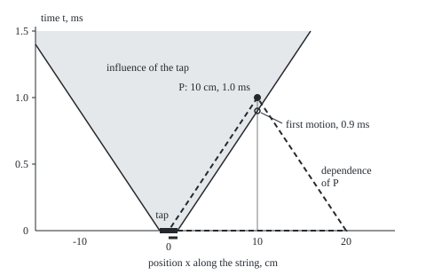
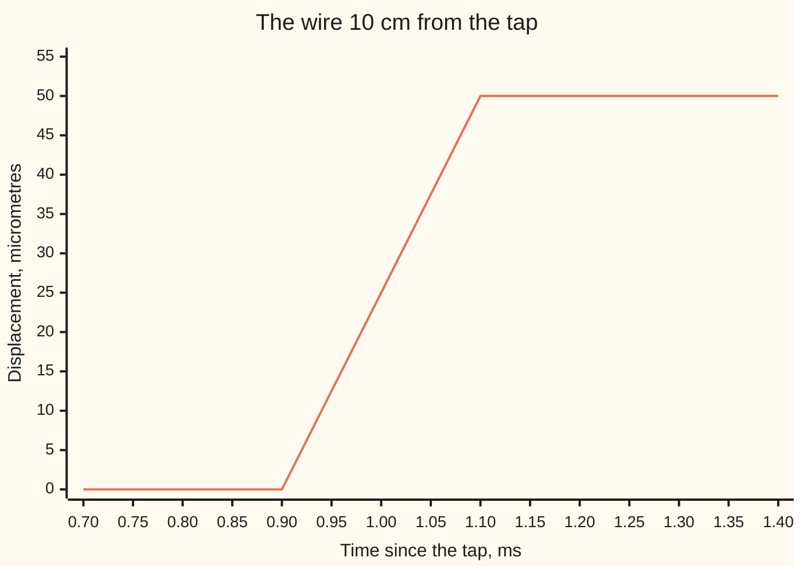

# Dependence and influence: which data reaches a point, and how far it spreads

[Syllabus](../../../SYLLABUS.md) → [Partial differential equations](../README.md) → [Classification and Well-Posedness](../README.md#s01) → Dependence and influence

---

## General Overview

A steel wire is stretched at 100 N of tension. It has a mass of 10 g per metre, so a disturbance runs along it at the wave speed $`c`$ = 100 m/s. A small hammer taps a 2 cm stretch of it, giving that stretch a speed of 0.5 m/s. A sensor sits 10 cm from the middle of the tap.

The sensor reads exactly zero until 0.90 ms after the tap. It then rises for 0.2 ms and holds at 50 µm (micrometres, thousandths of a millimetre). Nothing that happens 30 cm away can change what it reads at 1 ms.

Now heat the same 2 cm stretch instead of tapping it. The heat equation says the point 10 cm away warms at once: after 1 ms the warming there is a fraction $`10^{-73290}`$ of the hot spot's excess. That is not zero, but no instrument could see it. The warming at 10 cm peaks only after about 415 s, at 4.84% of the excess.

The card [The wave equation](../../08-Differential%20equations%20and%20dynamics/10-The%20Classical%20PDEs/05-the-wave-equation-and-dalemberts-formula.md) read the first fact off d'Alembert's formula for a string. This card proves it in any number of space dimensions, by a method that needs no formula, and sets it against diffusion.

Two words carry the card. The **domain of dependence** of a point and time is the set of starting data that can affect the answer there. The **domain of influence** of a piece of starting data is the set of later points and times it can affect.

**For the wave equation, the answer at a point at time t depends only on the starting data within distance c·t of the point, the distance the wave covers in that time, and a disturbance influences only points within c·t of where it began; for the heat equation both sets are the whole space.**

**What kind of fact this is:** a theorem, proved on this card in Why it works by an energy estimate; the string and the heat equation are models, and the heat equation's instant reach is where its physics departs from real heat flow.

### The picture: the tap's wedge and the sensor's triangle

<p align="center"></p>

Horizontal: position along the wire, cm. Vertical: time, ms. To scale: 10 px per cm across, 150 px per ms up, so every edge has the slope of the speed, 10 cm per ms. The shaded wedge is the tap's domain of influence. The dashed triangle below P is P's domain of dependence. The short bar under the axis marks the 1 cm of tap that P can see.

---

## The formula

Notation, as in [The wave equation](../../08-Differential%20equations%20and%20dynamics/10-The%20Classical%20PDEs/05-the-wave-equation-and-dalemberts-formula.md): a subscript names a rate, so $`u_{tt}`$ is the acceleration. The Laplacian $`\Delta u`$ adds the second rates of $`u`$ in each of the $`d`$ space directions. Here $`d`$ is the space dimension: 1 for the wire, 3 for air.

```math
u_{tt} = c^2\,\Delta u, \qquad u = f \text{ and } u_t = g \text{ at } t = 0
```

The theorem names two sets. The first is the dependence of a point $`x_0`$ at a time $`t_0`$. The second is the influence of a starting region $`D`$ at a later time $`t`$.

```math
\text{dependence of } (x_0, t_0) = \{\,x : |x - x_0| \le c\,t_0\,\}, \qquad \text{influence of } D \text{ at } t = \{\,x : \mathrm{dist}(x, D) \le c\,t\,\}
```

**Read it aloud:** the answer at $`x_0`$ at time $`t_0`$ is fixed by the starting shape and speed inside the ball of radius $`c\,t_0`$ around $`x_0`$; and data in $`D`$ can reach only points within $`c\,t`$ of $`D`$ by time $`t`$.

In space and time together, the first set is a cone pointing down from $`(x_0, t_0)`$, and the second is a cone opening up from $`D`$. On a line the cones are triangles and wedges, as in the picture.

The proof watches one number, the energy inside a shrinking ball:

```math
E(t) = \frac{\rho}{2}\int_{|x - x_0| \le c\,(t_0 - t)} \big(u_t^2 + c^2\,|\nabla u|^2\big)\,dx \quad \text{never increases.}
```

For the heat equation $`u_t = \kappa\,\Delta u`$ there is no such cone. The answer at any point after any time $`t > 0`$ depends on the starting temperature everywhere.

| Symbol | Plain meaning | In our example | Push it up and the answer… |
| --- | --- | --- | --- |
| $`u(x, t)`$ | the sideways displacement of the wire at position $`x`$ and time $`t`$ | 25 µm at 10 cm, 1 ms | — |
| $`x`$, $`t`$ | position, m; time since the tap, s | 0.10 m; 0.001 s | — |
| $`c`$ | wave speed, $`\sqrt{T/\rho}`$ | 100 m/s | both cones widen; signals arrive sooner |
| $`T`$, $`\rho`$ | tension, N; mass per metre, kg/m (illustrative values) | 100 N; 0.01 kg/m | tension speeds signals up, mass slows them |
| $`f`$, $`g`$; $`v_0`$, $`a`$ | starting shape and starting speed; the tap's speed and half-width | $`f = 0`$, $`g = v_0`$ on the tap; 0.5 m/s, 1 cm | the response scales with $`v_0`$; larger $`a`$: earlier arrival, larger plateau |
| $`x_0`$, $`t_0`$ | the point and time asked about (P in the picture) | 10 cm; 1.0 ms | later $`t_0`$: a wider base |
| $`D`$ | a region of starting data | the tap, $`\lvert x\rvert \le 1`$ cm | a bigger wedge |
| $`d`$, $`\Delta`$, $`\nabla u`$; $`r`$ | space dimension; Laplacian; gradient (the vector of slopes); distance from the tap's centre, in 3-D | 1 for the wire, 3 for air; $`r`$ = 10 cm | in 3-D the signal also passes and stops; larger $`r`$: arrival $`(r - a)/c`$, smaller peak |
| $`E(t)`$ | energy inside the shrinking ball, J | 25 µJ at the start, in the cone below (10 cm, 1.5 ms) | — |
| $`B_t`$, $`S_t`$, $`n`$ | the shrinking ball, its surface, the outward unit normal (in the proof) | radius 15 cm at the start | — |
| $`S`$, $`m`$ | Holmgren's starting surface; the order of the equation | the line $`t = 0`$; $`m = 2`$ | — |
| $`\kappa`$ | diffusivity, for the heat equation (typical for steel) | 12 mm²/s | heat spreads faster; peak at 10 cm comes sooner |

### When it holds

- **Finite speed $`c`$ everywhere.** If $`c`$ varies with position, the cone's sides bend but the cone remains, with the largest local speed setting its edge. If the speed has no bound, there is no cone.
- **A hyperbolic equation, with $`t = 0`$ not characteristic.** For heat the line $`t = 0`$ is a characteristic, so information spreads along it instantly. The cone then opens flat, to the whole line.
- **Enough smoothness for the energy.** The proof needs $`u_t`$ and $`\nabla u`$ to be square-integrable, so that $`E(t)`$ exists. The tap's speed jumps at its edges, which is fine: smooth the jump over a tiny width, apply the proof, and let the width shrink; $`E`$ stays finite throughout.
- **Whole space, or a time before the cone hits a boundary.** A held end reflects the wave back, and then the ball of radius $`c\,t_0`$ must be measured along paths inside the region.
- **Exact physics.** The model leaves out the wire's bending stiffness. Stiffness adds a fourth-order term with no finite speed, so a real wire leaks a very small high-frequency signal ahead of the front.

---

## Why it works

### Step 0: information moves at a finite speed, and energy follows it

A piece of wire moves only when the pieces next to it pull on it. Each pull passes the motion one neighbour along, and that relay runs at speed $`c`$. So the sensor, 9 cm beyond the tap's near edge, cannot feel anything before 9 cm ÷ 10 cm per ms = 0.90 ms.

To make that a proof in any dimension, track the energy (motion plus stretch) inside a ball that shrinks at speed $`c`$. Energy can leave through the moving wall, but it cannot come in, because nothing outruns the wall. If the ball starts empty, it stays empty, and so the wire inside stays at rest.

### Step 1: on a line, the cones come straight from d'Alembert

For one dimension, [The wave equation](../../08-Differential%20equations%20and%20dynamics/10-The%20Classical%20PDEs/05-the-wave-equation-and-dalemberts-formula.md) gives the answer in closed form. Released from rest ($`f = 0`$), it is

```math
u(x, t) = \frac{1}{2c}\int_{x - ct}^{x + ct} g(s)\,ds .
```

Only the interval from $`x - ct`$ to $`x + ct`$ appears. That interval is the domain of dependence. For the tap, the integral is $`v_0`$ times the length of tap inside the interval, divided by $`2c`$.

### Step 2: the edges of the cones are characteristics

The card [Elliptic, parabolic, hyperbolic](04-classification-elliptic-parabolic-hyperbolic.md) calls the wave equation hyperbolic: it has two real families of characteristics (curves along which a jump in the data can travel). Here they are the lines $`x - ct = \text{const}`$ and $`x + ct = \text{const}`$. The sides of both cones are these lines.

The heat equation is parabolic. Its only characteristics are the lines $`t = \text{const}`$. Information travels along them at no time cost, so a change anywhere at $`t = 0`$ is felt everywhere at once.

### Step 3: in any dimension, energy in a shrinking ball never grows

Fix the point $`x_0`$ and the time $`t_0`$. At each time $`t`$ before $`t_0`$, take the ball of radius $`c(t_0 - t)`$ around $`x_0`$, and let $`E(t)`$ be the energy in it. Its rate of change has two parts.

1. The equation moves energy around inside the ball. By the divergence theorem, that part is the energy flux through the wall, at most $`c`$ times the energy density there.
2. The wall moves inward at speed $`c`$, which drops exactly $`c`$ times the energy density at the wall.

The second part always wins, so $`E(t)`$ never increases. The fold has the calculation.

<details>
<summary>Detailed proof: the energy in the shrinking ball never increases, so zero data give zero solution</summary>

Let $`u`$ have continuous second rates and solve $`u_{tt} = c^2 \Delta u`$. Write $`B_t`$ for the ball $`|x - x_0| \le c(t_0 - t)`$, $`S_t`$ for its surface, $`n`$ for the outward unit normal, and $`\partial u/\partial n`$ for the rate of $`u`$ in direction $`n`$. Take $`\rho = 1`$, which scales $`E`$ and changes nothing.

The radius falls at rate $`c`$, so differentiating the integral over a shrinking ball gives a volume term and a surface term:

$`\displaystyle E'(t) = \int_{B_t} \big(u_t u_{tt} + c^2\,\nabla u \cdot \nabla u_t\big)\,dx \;-\; \frac{c}{2}\int_{S_t} \big(u_t^2 + c^2 |\nabla u|^2\big)\,dS .`$

Replace $`u_{tt}`$ by $`c^2 \Delta u`$. Then the volume integrand is $`c^2\,\nabla\cdot(u_t \nabla u)`$, and the divergence theorem turns it into a surface integral:

$`\displaystyle E'(t) = \int_{S_t} \Big(c^2\,u_t\,\frac{\partial u}{\partial n} - \frac{c}{2}\,u_t^2 - \frac{c^3}{2}\,|\nabla u|^2\Big)\,dS .`$

For any two numbers, $`|pq| \le (p^2 + q^2)/2`$. With $`p = u_t`$ and $`q = c\,\partial u/\partial n`$, and since $`|\partial u/\partial n| \le |\nabla u|`$,

$`\displaystyle c^2\,u_t\,\frac{\partial u}{\partial n} \le \frac{c}{2}\Big(u_t^2 + c^2 \Big(\frac{\partial u}{\partial n}\Big)^2\Big) \le \frac{c}{2}\,u_t^2 + \frac{c^3}{2}\,|\nabla u|^2 .`$

So $`E'(t) \le 0`$.

Now suppose $`f = g = 0`$ on the base ball $`|x - x_0| \le c\,t_0`$. Then $`E(0) = 0`$, so $`E(t) = 0`$ for $`0 \le t \le t_0`$. Hence $`u_t = 0`$ and $`\nabla u = 0`$ throughout the cone, so $`u`$ is constant there. It is zero on the base, so it is zero in the whole cone, and in particular $`u(x_0, t_0) = 0`$.

The equation is linear, so apply this to the difference of two solutions. Two solutions whose data agree on the base ball agree at $`(x_0, t_0)`$. That is the domain of dependence. The domain of influence follows: data in $`D`$ cannot affect any point whose base ball misses $`D`$, that is, any point farther than $`c\,t`$ from $`D`$.

</details>

The [Energy methods](07-energy-methods-and-uniqueness.md) card uses the same move on a fixed region to prove uniqueness. This card's change is to shrink the region at the wave speed.

### Step 4: in three dimensions the signal also stops

In 3-D, the answer for a ball-shaped tap released from rest is $`t`$ times the average of $`g`$ over the sphere of radius $`c\,t`$ around the point (Kirchhoff's formula). That sphere meets the tap only while $`|r - c\,t| < a`$. So a point 10 cm away moves from 0.90 ms to 1.10 ms, and then it is still again.

On the wire, the whole interval counts, not just its two ends, so the displacement stays at 50 µm. Both answers sit inside the same cone. In 3-D only the cone's surface carries signal, and in 1-D the inside of the cone counts too.

### Step 5: Holmgren upgrades uniqueness to all smooth solutions

The [Well posed](06-well-posedness-and-hadamard.md) card states the Cauchy–Kovalevskaya theorem: with analytic coefficients and analytic data on a non-characteristic surface, there is exactly one analytic solution near it. (Analytic means equal to its own power series near each point.) That theorem says nothing about solutions that are smooth but not analytic.

**Holmgren's theorem** (1901) fills that gap. Let a linear equation of order $`m`$, with no forcing term, have analytic coefficients, and let $`S`$ be a non-characteristic surface. If a solution with continuous rates up to order $`m`$ has $`u`$ and its first $`m - 1`$ rates across $`S`$ equal to zero on $`S`$, then $`u`$ is zero in a neighbourhood of $`S`$.

The wave equation has constant coefficients, which are analytic. Sweeping a family of non-characteristic surfaces up through the cone repeats Holmgren's step until the whole cone is covered. The result is the domain-of-dependence theorem for every solution with continuous second rates, with no energy needed. Fritz John's textbook gives this sweep (Sources).

Holmgren is uniqueness only: it gives no bound on how much a small error in the data can grow. For heat, $`t = 0`$ is characteristic, so Holmgren does not apply there. Tychonoff's example shows uniqueness really fails without a limit on growth at infinity.

---

## Worked numbers, by hand

The wire: $`c = 100`$ m/s, tap $`v_0 = 0.5`$ m/s on $`|x| \le 1`$ cm, sensor at $`x_0 = 10`$ cm.

| Step | Arithmetic | Value |
| --- | --- | --- |
| wave speed | $`\sqrt{100 / 0.01}`$ | 100 m/s, that is 10 cm per ms |
| dependence of (10 cm, 1.00 ms) | $`10 \pm 10 \times 1.00`$ cm | 0 cm to 20 cm |
| tap inside that interval | from 0 cm to 1 cm | 1 cm |
| $`u(10\text{ cm}, 1\text{ ms})`$ | $`0.5 \times 0.01 / (2 \times 100)`$ m | 25 µm |
| influence of the tap at 1.00 ms | $`1 + 10 \times 1.00`$ cm | $`\lvert x\rvert \le 11`$ cm |
| first motion at 10 cm | $`(10 - 1)\text{ cm} / 10\text{ cm per ms}`$ | 0.90 ms |
| full by | $`(10 + 1) / 10`$ | 1.10 ms |
| plateau | $`v_0\,a / c = 0.5 \times 0.01 / 100`$ m | **50 µm** |

The sensor is still until 0.90 ms, moves for 0.2 ms, then holds a permanent 50 µm displacement until reflections arrive.

The same tap as a ball of radius 1 cm in 3-D, read 10 cm away, gives $`u = v_0 (a^2 - (r - c\,t)^2)/(4\,c\,r)`$ while $`|r - c\,t| < a`$. At 1.00 ms that is $`0.5 \times 0.0001 / 40`$ m = 1.2500 µm. By 1.10 ms it is back at 0.



The line is the wire's displacement at the sensor: flat at zero, a straight rise from 0.90 ms to 1.10 ms, then flat at 50 µm. The 3-D point over the same times reads 0, 0, 0, 0, 0, 0.9375, 1.2500, 0.9375, then 0 µm: a short bump, then silence.

Heat in the same wire, $`\kappa`$ = 12 mm²/s, the same 2 cm hot spot:

| Time | Fraction of the hot spot's excess at 10 cm |
| --- | --- |
| 1 ms | $`10^{-73290.36}`$ |
| 1 s | $`10^{-74.95}`$ |
| 100 s | 0.020724 |
| 415.3 s, the peak | 4.84% |

The peak time is close to the point-source rule $`x_0^2/(2\kappa) = 0.01/(2.4\times10^{-5})`$ = 416.7 s. The wave delivers its full plateau in 1.10 ms; diffusion takes minutes to deliver 5%. The heat equation's reach at 1 ms is real in the mathematics and meaningless in the metal: real heat is carried by electrons and crystal vibrations, both at finite speed.

### What breaks if you drop a piece

| Mistake | Comes out at | What went wrong |
| --- | --- | --- |
| Time the arrival from the tap's centre | 1.00 ms; but the wire there is already at 25 µm | the near edge of the tap is 9 cm away, not 10 |
| Forget the tap's own width | influence edge at 10 cm at 1 ms, not 11 cm | the wedge starts from the whole tap, not a point |
| Expect 3-D to hold its displacement like the wire | 50 µm at 1.50 ms; the 3-D point is at 0 µm | in 3-D only the cone's surface carries signal |
| Step a grid with time step × $`c`$ ÷ spacing = 1.1 | first motion at 1.00 ms, not 0.90; largest value $`10^{49.7}`$ µm by 1.50 ms | the grid's cone is narrower than the true cone, so it misses the signal; the same step also makes the scheme unstable, so it blows up |

The last row is a hypothesis failing. A grid that passes information one cell per step has its own cone. It must contain the true cone, or the grid cannot see data the answer depends on. That ratio is the Courant number, and the condition is the CFL condition; wing 16 treats it in full.

---

## Code, from first principles, and it actually runs

The code takes five roads, each built without the one it is checked against.

1. **D'Alembert:** the tap length inside $`[x - ct, x + ct]`$.
2. **A grid** that updates each point from its two neighbours only, with time step × $`c`$ ÷ spacing = 1. It never sees the formula, and it lands on it to rounding error. Its first motion at 10 cm sits on the cone's edge.
3. **The energy** in the shrinking cone below (10 cm, 1.50 ms), from centred differences of $`u`$. It is checked against a count of how much of each half-tap is still inside, and checked never to rise.
4. **In 3-D**, the closed form against Kirchhoff's sphere average done by a sum over angles.
5. **For heat**, an erf series against Simpson's rule (a weighted sum of samples). For the far tail it uses an asymptotic series against Simpson's rule in logarithms, which avoids underflow (a number too small for the computer to store).

A second tap at 30 cm leaves the wire at (10 cm, 1 ms) unchanged on the grid, but a second hot spot at 30 cm changes the heat at 10 cm.

### Python

```python
# Dependence and influence -- the check behind the card.  Standard library only.
# A tap on a steel string, felt 10 cm away.  Roads: d'Alembert's formula; a grid
# stepped from neighbours only; the energy in a shrinking cone; in 3-D, a closed
# form against Kirchhoff's sphere average; for heat, an erf series against Simpson.
import math
T, RHO = 100.0, 0.01                 # tension N, mass per metre kg/m (illustrative)
C = math.sqrt(T / RHO)               # wave speed, m/s
V0, A, X = 0.5, 0.01, 0.10           # tap speed m/s, tap half-width m, listening point m
KAPPA = 1.2e-5                       # diffusivity of steel, m^2/s (typical value)

def tap(x, centre=0.0):              # starting velocity: V0 on the tap, half at its edges
    d = abs(x - centre)
    return V0 if d < A - 1e-12 else V0 / 2 if abs(d - A) < 1e-12 else 0.0

def string(x, t, taps=(0.0,)):       # road 1, d'Alembert: (1/2c) times the tap length inside [x-ct, x+ct]
    s = 0.0
    for p in taps:
        s += max(min(x + C * t, p + A) - max(x - C * t, p - A), 0.0)
    return V0 * s / (2 * C)

def grid(r, steps, taps=(0.0,), dx=0.001, n=500):   # road 2: each point sees only its two neighbours
    dt = r * dx / C
    old = [0.0] * (2 * n + 1)
    new = [dt * sum(tap((j - n) * dx, p) for p in taps) for j in range(2 * n + 1)]
    seen = [0.0, new[n + 100]]       # history at x = 10 cm
    for _ in range(steps - 1):
        nxt = [0.0] * (2 * n + 1)
        for j in range(1, 2 * n):
            nxt[j] = 2 * (1 - r * r) * new[j] + r * r * (new[j + 1] + new[j - 1]) - old[j]
        old, new = new, nxt
        seen.append(new[n + 100])
    return seen, new, dt

def cone_energy(t, x0=0.10, t0=0.0015, h=2e-5):     # road 3: (rho/2) sum of u_t^2 + c^2 u_x^2 over |x - x0| <= c(t0 - t)
    R, e, k = C * (t0 - t), 0.0, 0
    while -R + (k + 0.5) * h < R:
        x = x0 - R + (k + 0.5) * h
        ut = (string(x, t + h / C) - string(x, max(t - h / C, 0.0))) / ((t + h / C) - max(t - h / C, 0.0))
        ux = (string(x + h, t) - string(x - h, t)) / (2 * h)
        e += 0.5 * RHO * (ut * ut + C * C * ux * ux) * h
        k += 1
    return e

def halves_inside(t, x0=0.10, t0=0.0015):           # closed form: each half-tap carries rho V0^2 A / 2 of energy
    lo, hi = x0 - C * (t0 - t), x0 + C * (t0 - t)
    part = lambda p, q: max(min(q, hi) - max(p, lo), 0.0) / (2 * A)
    return RHO * V0 * V0 * A / 2 * (part(-A - C * t, A - C * t) + part(-A + C * t, A + C * t))

def ball_closed(r, t):               # 3-D, radial reduction: v0 (a^2 - (r - ct)^2) / (4 c r) inside the shell
    L = r - C * t
    return V0 * (A * A - L * L) / (4 * C * r) if abs(L) < A else 0.0

def ball_kirchhoff(r, t, m=200000):  # 3-D, Kirchhoff: t times the average tap speed on the sphere of radius ct
    R, s = C * t, 0.0
    for k in range(m):
        th = (k + 0.5) * math.pi / m
        if r * r + R * R + 2 * r * R * math.cos(th) < A * A:
            s += math.sin(th)
    return t * V0 * s * (math.pi / m) / 2

def erf(z):                          # erf from its all-positive series, 2/sqrt(pi) e^(-z^2) sum 2^n z^(2n+1)/(1.3...(2n+1))
    term, s, n = z, z, 0
    while abs(term) > 1e-17 * abs(s):
        n += 1
        term *= 2 * z * z / (2 * n + 1)
        s += term
    return 2 / math.sqrt(math.pi) * math.exp(-z * z) * s

def heat(x, t):                      # heat road 1: fraction of the hot spot's excess reaching x after t
    s = math.sqrt(4 * KAPPA * t)
    return 0.5 * (erf((x + A) / s) - erf((x - A) / s))

def heat_simpson(x, t, m=2000):      # heat road 2: the bell G(x - y, t) summed over the hot spot by Simpson's rule
    h = 2 * A / m
    G = lambda y: math.exp(-(x - y) ** 2 / (4 * KAPPA * t)) / math.sqrt(4 * math.pi * KAPPA * t)
    return h / 3 * sum((1 if k in (0, m) else 4 if k % 2 else 2) * G(-A + k * h) for k in range(m + 1))

def heat_log10(x, t):                # far tail: two roads to log10 of the fraction, no underflow
    s = math.sqrt(4 * KAPPA * t)
    z1, z2 = (x - A) / s, (x + A) / s
    asym = (-z1 * z1 - math.log(2 * z1 * math.sqrt(math.pi)) + math.log(1 - 1 / (2 * z1 * z1) + 3 / (4 * z1 ** 4))) / math.log(10)
    w, m = min(z2 - z1, 40 / z1), 20000
    hw = w / m
    I = hw / 3 * sum((1 if k in (0, m) else 4 if k % 2 else 2) * math.exp(-2 * z1 * k * hw - (k * hw) ** 2) for k in range(m + 1))
    simp = (-z1 * z1 + math.log(I / math.sqrt(math.pi))) / math.log(10)
    return asym, simp

ms, um = 1000.0, 1e6
print(f"string: c = sqrt({T:.0f} N / {RHO} kg/m) = {C:.0f} m/s; tap {V0} m/s on |x| <= {A*100:.0f} cm")
print(f"dependence of (10 cm, 1.00 ms): x from {(X - C*0.001)*100:.0f} cm to {(X + C*0.001)*100:.0f} cm; it holds {string(X, 0.001) * 2 * C / V0 * 100:.0f} cm of the tap")
print(f"influence of the tap at 1.00 ms: |x| <= {(A + C*0.001)*100:.0f} cm")
t_on, t_full = (X - A) / C, (X + A) / C
print(f"first motion at 10 cm: {t_on*ms:.2f} ms; full by {t_full*ms:.2f} ms; plateau {V0*A/C*um:.0f} um")
seen, _, dt = grid(1.0, 150)
gap = max(abs(seen[k] - string(X, k * dt)) for k in range(151))
first = next(k for k in range(151) if seen[k] != 0.0)
print(f"grid, Courant 1: largest gap to d'Alembert at 10 cm = {gap*um:.6f} um; first nonzero sample {first*dt*ms:.2f} ms")
print("string u(10 cm, t) um, t = 0.70 to 1.40 ms step 0.05:", " ".join(f"{string(X, (0.70 + 0.05*k)/ms)*um:.1f}" for k in range(15)))
print("3-D  u(10 cm, t) um, t = 0.70 to 1.40 ms step 0.05:", " ".join(f"{ball_closed(X, (0.70 + 0.05*k)/ms)*um:.4f}" for k in range(15)))
for tm in (0.95, 1.00, 1.20):
    print(f"3-D at {tm:.2f} ms: closed form {ball_closed(X, tm/ms)*um:.4f} um, Kirchhoff average {ball_kirchhoff(X, tm/ms)*um:.4f} um")
E = [(tm, cone_energy(tm / ms), halves_inside(tm / ms)) for tm in (0.0, 0.25, 0.5, 1.0, 1.25, 1.4)]
for tm, e, ex in E:
    print(f"energy in the cone to (10 cm, 1.50 ms) at {tm:.2f} ms: differences {e*1e6:.3f} uJ, half-taps {ex*1e6:.3f} uJ")
a2, s2 = grid(1.0, 100, taps=(0.0, 0.30))[0][100], grid(1.0, 100)[0][100]
print(f"second tap at 30 cm: u(10 cm, 1.00 ms) = {s2*um:.3f} um without, {a2*um:.3f} um with")
lg = [heat_log10(X, ts) for ts in (0.001, 1.0)]
for ts, (l1, l2) in zip(("1 ms", "1 s"), lg):
    print(f"heat, kappa = {KAPPA*1e6:.0f} mm^2/s: fraction at 10 cm after {ts} = 10^{l1:.2f} (tail series), 10^{l2:.2f} (Simpson)")
print(f"heat fraction at 10 cm after 100 s: erf series {heat(X, 100.0):.6f}, Simpson {heat_simpson(X, 100.0):.6f}")
print(f"second hot spot at 30 cm: heat at 10 cm after 100 s goes from {heat(X, 100.0):.6f} to {heat(X, 100.0) + heat(X - 0.30, 100.0):.6f}")
lo, hi = 10.0, 2000.0                # golden-section search for the heat peak at 10 cm
gr = (math.sqrt(5) - 1) / 2
while hi - lo > 1e-3:
    m1, m2 = hi - gr * (hi - lo), lo + gr * (hi - lo)
    lo, hi = (m1, hi) if heat(X, m1) < heat(X, m2) else (lo, m2)
tp = (lo + hi) / 2
print(f"heat peak at 10 cm: {tp:.1f} s, {heat(X, tp)*100:.2f} % of the excess; point-source rule x^2/(2 kappa) = {X*X/(2*KAPPA):.1f} s")
print(f"what breaks: timing from the tap centre gives {X/C*ms:.2f} ms, but u there is already {string(X, X/C)*um:.0f} um")
print(f"what breaks: forgetting the tap width puts the influence edge at {C*0.001*100:.0f} cm, not {(A + C*0.001)*100:.0f} cm")
print(f"what breaks: 3-D read as a string at 1.50 ms gives {string(X, 0.0015)*um:.0f} um; 3-D is at {ball_closed(X, 0.0015)*um:.0f} um")
s11, last11, dt11 = grid(1.1, 136)
f11 = next(k for k in range(137) if s11[k] != 0.0)
print(f"what breaks: Courant 1.1, first motion at {f11*dt11*ms:.2f} ms; largest |u| at {136*dt11*ms:.2f} ms = 10^{math.log10(max(abs(v) for v in last11)*um):.1f} um")
print(f"figure, px: tap ({40 + 10*(-1+15):.0f}..{40 + 10*(1+15):.0f}, 260); P ({40 + 10*(10+15):.0f}, {260 - 150*1.0:.0f}); base ({40 + 10*(0+15):.0f}..{40 + 10*(20+15):.0f}, 260); first motion y {260 - 150*t_on*ms:.0f}")
assert gap < 1e-12                                   # the neighbour-only grid lands on d'Alembert's formula
assert abs(first * dt - t_on) < dt + 1e-12            # and the grid's first motion sits at the cone's edge
assert all(abs(e - ex) < 0.01 * V0 * V0 * RHO * A for _, e, ex in E)    # differenced energy matches the half-tap count
assert all(E[k + 1][1] <= E[k][1] + 1e-9 for k in range(len(E) - 1))    # energy in the shrinking cone never rises
assert all(abs(ball_closed(X, tm / ms) - ball_kirchhoff(X, tm / ms)) < 1e-3 * V0 * A * A / (4 * C * X) for tm in (0.95, 1.0, 1.2))
assert abs(a2 - s2) < 1e-15 and abs(s2 - string(X, 0.001)) < 1e-12   # data outside [0, 20] cm changes nothing
assert all(abs(l1 - l2) < 0.01 for l1, l2 in lg)      # two roads to the heat's far tail
assert abs(heat(X, 100.0) - heat_simpson(X, 100.0)) < 1e-9 and heat(X - 0.30, 100.0) > 1e-6
assert abs(tp - X * X / (2 * KAPPA)) < 0.01 * tp     # the peak time matches the point-source rule
assert f11 * dt11 > t_on + 0.05e-3                   # Courant 1.1: the grid's cone is too narrow to see the tap in time
print("ALL CHECKS PASS")
```

**Ran 2026-11-15 on macOS, Python 3.14.10, standard library only. All checks passed. Output, pasted from the run:**

```
string: c = sqrt(100 N / 0.01 kg/m) = 100 m/s; tap 0.5 m/s on |x| <= 1 cm
dependence of (10 cm, 1.00 ms): x from 0 cm to 20 cm; it holds 1 cm of the tap
influence of the tap at 1.00 ms: |x| <= 11 cm
first motion at 10 cm: 0.90 ms; full by 1.10 ms; plateau 50 um
grid, Courant 1: largest gap to d'Alembert at 10 cm = 0.000000 um; first nonzero sample 0.91 ms
string u(10 cm, t) um, t = 0.70 to 1.40 ms step 0.05: 0.0 0.0 0.0 0.0 0.0 12.5 25.0 37.5 50.0 50.0 50.0 50.0 50.0 50.0 50.0
3-D  u(10 cm, t) um, t = 0.70 to 1.40 ms step 0.05: 0.0000 0.0000 0.0000 0.0000 0.0000 0.9375 1.2500 0.9375 0.0000 0.0000 0.0000 0.0000 0.0000 0.0000 0.0000
3-D at 0.95 ms: closed form 0.9375 um, Kirchhoff average 0.9374 um
3-D at 1.00 ms: closed form 1.2500 um, Kirchhoff average 1.2501 um
3-D at 1.20 ms: closed form 0.0000 um, Kirchhoff average 0.0000 um
energy in the cone to (10 cm, 1.50 ms) at 0.00 ms: differences 24.981 uJ, half-taps 25.000 uJ
energy in the cone to (10 cm, 1.50 ms) at 0.25 ms: differences 18.736 uJ, half-taps 18.750 uJ
energy in the cone to (10 cm, 1.50 ms) at 0.50 ms: differences 12.491 uJ, half-taps 12.500 uJ
energy in the cone to (10 cm, 1.50 ms) at 1.00 ms: differences 12.491 uJ, half-taps 12.500 uJ
energy in the cone to (10 cm, 1.50 ms) at 1.25 ms: differences 6.245 uJ, half-taps 6.250 uJ
energy in the cone to (10 cm, 1.50 ms) at 1.40 ms: differences 0.000 uJ, half-taps 0.000 uJ
second tap at 30 cm: u(10 cm, 1.00 ms) = 25.000 um without, 25.000 um with
heat, kappa = 12 mm^2/s: fraction at 10 cm after 1 ms = 10^-73290.36 (tail series), 10^-73290.36 (Simpson)
heat, kappa = 12 mm^2/s: fraction at 10 cm after 1 s = 10^-74.95 (tail series), 10^-74.95 (Simpson)
heat fraction at 10 cm after 100 s: erf series 0.020724, Simpson 0.020724
second hot spot at 30 cm: heat at 10 cm after 100 s goes from 0.020724 to 0.020767
heat peak at 10 cm: 415.3 s, 4.84 % of the excess; point-source rule x^2/(2 kappa) = 416.7 s
what breaks: timing from the tap centre gives 1.00 ms, but u there is already 25 um
what breaks: forgetting the tap width puts the influence edge at 10 cm, not 11 cm
what breaks: 3-D read as a string at 1.50 ms gives 50 um; 3-D is at 0 um
what breaks: Courant 1.1, first motion at 1.00 ms; largest |u| at 1.50 ms = 10^49.7 um
figure, px: tap (180..200, 260); P (290, 110); base (190..390, 260); first motion y 125
ALL CHECKS PASS
```

### Rust

```rust
// Dependence and influence -- the check behind the card.  std only, no crates.
// A tap on a steel string, felt 10 cm away.  Roads: d'Alembert's formula; a grid
// stepped from neighbours only; the energy in a shrinking cone; in 3-D, a closed
// form against Kirchhoff's sphere average; for heat, an erf series against Simpson.
use std::f64::consts::PI;
const T: f64 = 100.0; const RHO: f64 = 0.01; // tension N, mass per metre kg/m (illustrative)
const V0: f64 = 0.5; const A: f64 = 0.01; const X: f64 = 0.10; // tap speed m/s, tap half-width m, listening point m
const KAPPA: f64 = 1.2e-5; // diffusivity of steel, m^2/s (typical value)

fn c() -> f64 { (T / RHO).sqrt() }

fn tap(x: f64, centre: f64) -> f64 { // starting velocity: V0 on the tap, half at its edges
    let d = (x - centre).abs(); if d < A - 1e-12 { V0 } else if (d - A).abs() < 1e-12 { V0 / 2.0 } else { 0.0 }
}

fn string(x: f64, t: f64, taps: &[f64]) -> f64 { // road 1, d'Alembert: tap length inside [x-ct, x+ct], over 2c
    let s: f64 = taps.iter().map(|&p| ((x + c() * t).min(p + A) - (x - c() * t).max(p - A)).max(0.0)).sum();
    V0 * s / (2.0 * c())
}

fn grid(r: f64, steps: usize, taps: &[f64]) -> (Vec<f64>, Vec<f64>, f64) { // road 2: neighbours only
    let (dx, n) = (0.001, 500usize);
    let dt = r * dx / c();
    let mut old = vec![0.0; 2 * n + 1];
    let mut new: Vec<f64> = (0..2 * n + 1)
        .map(|j| { let mut g = 0.0; for &p in taps { g += tap((j as f64 - n as f64) * dx, p); } dt * g })
        .collect();
    let mut seen = vec![0.0, new[n + 100]]; // history at x = 10 cm
    for _ in 0..steps - 1 {
        let mut nxt = vec![0.0; 2 * n + 1];
        for j in 1..2 * n {
            nxt[j] = 2.0 * (1.0 - r * r) * new[j] + r * r * (new[j + 1] + new[j - 1]) - old[j];
        }
        old = std::mem::replace(&mut new, nxt);
        seen.push(new[n + 100]);
    }
    (seen, new, dt)
}

fn cone_energy(t: f64) -> f64 { // road 3: (rho/2) sum of u_t^2 + c^2 u_x^2 over |x - x0| <= c(t0 - t)
    let (x0, t0, h) = (0.10, 0.0015, 2e-5);
    let rr = c() * (t0 - t);
    let (mut e, mut k) = (0.0, 0.0);
    while -rr + (k + 0.5) * h < rr {
        let x = x0 - rr + (k + 0.5) * h;
        let tm = (t - h / c()).max(0.0);
        let ut = (string(x, t + h / c(), &[0.0]) - string(x, tm, &[0.0])) / ((t + h / c()) - tm);
        let ux = (string(x + h, t, &[0.0]) - string(x - h, t, &[0.0])) / (2.0 * h);
        e += 0.5 * RHO * (ut * ut + c() * c() * ux * ux) * h;
        k += 1.0;
    }
    e
}

fn halves_inside(t: f64) -> f64 { // closed form: each half-tap carries rho V0^2 A / 2 of energy
    let (x0, t0) = (0.10, 0.0015);
    let (lo, hi) = (x0 - c() * (t0 - t), x0 + c() * (t0 - t));
    let part = |p: f64, q: f64| (q.min(hi) - p.max(lo)).max(0.0) / (2.0 * A);
    RHO * V0 * V0 * A / 2.0 * (part(-A - c() * t, A - c() * t) + part(-A + c() * t, A + c() * t))
}

fn ball_closed(r: f64, t: f64) -> f64 { // 3-D, radial reduction
    let l = r - c() * t; if l.abs() < A { V0 * (A * A - l * l) / (4.0 * c() * r) } else { 0.0 }
}

fn ball_kirchhoff(r: f64, t: f64) -> f64 { // 3-D, Kirchhoff: t times the average tap speed on the sphere
    let (rr, m) = (c() * t, 200000usize);
    let mut s = 0.0;
    for k in 0..m {
        let th = (k as f64 + 0.5) * PI / m as f64;
        if r * r + rr * rr + 2.0 * r * rr * th.cos() < A * A { s += th.sin(); }
    }
    t * V0 * s * (PI / m as f64) / 2.0
}

fn erf(z: f64) -> f64 { // all-positive series
    let (mut term, mut s, mut n) = (z, z, 0.0);
    while term.abs() > 1e-17 * s.abs() {
        n += 1.0;
        term *= 2.0 * z * z / (2.0 * n + 1.0);
        s += term;
    }
    2.0 / PI.sqrt() * (-z * z).exp() * s
}

fn heat(x: f64, t: f64) -> f64 { // heat road 1
    let s = (4.0 * KAPPA * t).sqrt();
    0.5 * (erf((x + A) / s) - erf((x - A) / s))
}

fn simpson_w(k: usize, m: usize) -> f64 { if k == 0 || k == m { 1.0 } else if k % 2 == 1 { 4.0 } else { 2.0 } }

fn heat_simpson(x: f64, t: f64) -> f64 { // heat road 2: the bell summed over the hot spot
    let m = 2000usize;
    let h = 2.0 * A / m as f64;
    let g = |y: f64| (-(x - y).powi(2) / (4.0 * KAPPA * t)).exp() / (4.0 * PI * KAPPA * t).sqrt();
    h / 3.0 * (0..=m).map(|k| simpson_w(k, m) * g(-A + k as f64 * h)).sum::<f64>()
}

fn heat_log10(x: f64, t: f64) -> (f64, f64) { // far tail: two roads to log10 of the fraction
    let s = (4.0 * KAPPA * t).sqrt();
    let (z1, z2) = ((x - A) / s, (x + A) / s);
    let asym = (-z1 * z1 - (2.0 * z1 * PI.sqrt()).ln() + (1.0 - 1.0 / (2.0 * z1 * z1) + 3.0 / (4.0 * z1.powi(4))).ln()) / 10f64.ln();
    let (w, m) = ((z2 - z1).min(40.0 / z1), 20000usize);
    let hw = w / m as f64;
    let mut i = 0.0;
    for k in 0..=m { let v = k as f64 * hw; i += simpson_w(k, m) * (-2.0 * z1 * v - v.powi(2)).exp(); }
    let i = hw / 3.0 * i;
    (asym, (-z1 * z1 + (i / PI.sqrt()).ln()) / 10f64.ln())
}

fn main() {
    let (ms, um, cc) = (1000.0, 1e6, c());
    println!("string: c = sqrt({:.0} N / {} kg/m) = {:.0} m/s; tap {} m/s on |x| <= {:.0} cm", T, RHO, cc, V0, A * 100.0);
    println!("dependence of (10 cm, 1.00 ms): x from {:.0} cm to {:.0} cm; it holds {:.0} cm of the tap", (X - cc * 0.001) * 100.0, (X + cc * 0.001) * 100.0, string(X, 0.001, &[0.0]) * 2.0 * cc / V0 * 100.0);
    println!("influence of the tap at 1.00 ms: |x| <= {:.0} cm", (A + cc * 0.001) * 100.0);
    let (t_on, t_full) = ((X - A) / cc, (X + A) / cc);
    println!("first motion at 10 cm: {:.2} ms; full by {:.2} ms; plateau {:.0} um", t_on * ms, t_full * ms, V0 * A / cc * um);
    let (seen, _, dt) = grid(1.0, 150, &[0.0]);
    let gap = (0..151).map(|k| (seen[k] - string(X, k as f64 * dt, &[0.0])).abs()).fold(0.0, f64::max);
    let first = (0..151).find(|&k| seen[k] != 0.0).unwrap();
    println!("grid, Courant 1: largest gap to d'Alembert at 10 cm = {:.6} um; first nonzero sample {:.2} ms", gap * um, first as f64 * dt * ms);
    let row = |f: &dyn Fn(f64) -> String| (0..15).map(|k| f((0.70 + 0.05 * k as f64) / ms)).collect::<Vec<_>>().join(" ");
    println!("string u(10 cm, t) um, t = 0.70 to 1.40 ms step 0.05: {}", row(&|t| format!("{:.1}", string(X, t, &[0.0]) * um)));
    println!("3-D  u(10 cm, t) um, t = 0.70 to 1.40 ms step 0.05: {}", row(&|t| format!("{:.4}", ball_closed(X, t) * um)));
    for tm in [0.95, 1.00, 1.20] { println!("3-D at {:.2} ms: closed form {:.4} um, Kirchhoff average {:.4} um", tm, ball_closed(X, tm / ms) * um, ball_kirchhoff(X, tm / ms) * um); }
    let e: Vec<(f64, f64, f64)> = [0.0, 0.25, 0.5, 1.0, 1.25, 1.4].iter().map(|&tm| (tm, cone_energy(tm / ms), halves_inside(tm / ms))).collect();
    for &(tm, en, ex) in &e { println!("energy in the cone to (10 cm, 1.50 ms) at {:.2} ms: differences {:.3} uJ, half-taps {:.3} uJ", tm, en * 1e6, ex * 1e6); }
    let (a2, s2) = (grid(1.0, 100, &[0.0, 0.30]).0[100], grid(1.0, 100, &[0.0]).0[100]);
    println!("second tap at 30 cm: u(10 cm, 1.00 ms) = {:.3} um without, {:.3} um with", s2 * um, a2 * um);
    let lg = [heat_log10(X, 0.001), heat_log10(X, 1.0)];
    for (ts, &(l1, l2)) in ["1 ms", "1 s"].iter().zip(lg.iter()) { println!("heat, kappa = {:.0} mm^2/s: fraction at 10 cm after {} = 10^{:.2} (tail series), 10^{:.2} (Simpson)", KAPPA * 1e6, ts, l1, l2); }
    println!("heat fraction at 10 cm after 100 s: erf series {:.6}, Simpson {:.6}", heat(X, 100.0), heat_simpson(X, 100.0));
    println!("second hot spot at 30 cm: heat at 10 cm after 100 s goes from {:.6} to {:.6}", heat(X, 100.0), heat(X, 100.0) + heat(X - 0.30, 100.0));
    let (mut lo, mut hi) = (10.0f64, 2000.0f64); // golden-section search for the heat peak at 10 cm
    let gr = (5f64.sqrt() - 1.0) / 2.0;
    while hi - lo > 1e-3 {
        let (m1, m2) = (hi - gr * (hi - lo), lo + gr * (hi - lo));
        if heat(X, m1) < heat(X, m2) { lo = m1; } else { hi = m2; }
    }
    let tp = (lo + hi) / 2.0;
    println!("heat peak at 10 cm: {:.1} s, {:.2} % of the excess; point-source rule x^2/(2 kappa) = {:.1} s", tp, heat(X, tp) * 100.0, X * X / (2.0 * KAPPA));
    println!("what breaks: timing from the tap centre gives {:.2} ms, but u there is already {:.0} um", X / cc * ms, string(X, X / cc, &[0.0]) * um);
    println!("what breaks: forgetting the tap width puts the influence edge at {:.0} cm, not {:.0} cm", cc * 0.001 * 100.0, (A + cc * 0.001) * 100.0);
    println!("what breaks: 3-D read as a string at 1.50 ms gives {:.0} um; 3-D is at {:.0} um", string(X, 0.0015, &[0.0]) * um, ball_closed(X, 0.0015) * um);
    let (s11, last11, dt11) = grid(1.1, 136, &[0.0]);
    let f11 = (0..137).find(|&k| s11[k] != 0.0).unwrap();
    let big = last11.iter().fold(0.0f64, |m, v| m.max(v.abs()));
    println!("what breaks: Courant 1.1, first motion at {:.2} ms; largest |u| at {:.2} ms = 10^{:.1} um", f11 as f64 * dt11 * ms, 136.0 * dt11 * ms, (big * um).log10());
    let px = |xc: f64| 40.0 + 10.0 * (xc + 15.0);
    println!("figure, px: tap ({:.0}..{:.0}, 260); P ({:.0}, {:.0}); base ({:.0}..{:.0}, 260); first motion y {:.0}", px(-1.0), px(1.0), px(10.0), 260.0 - 150.0 * 1.0, px(0.0), px(20.0), 260.0 - 150.0 * t_on * ms);
    assert!(gap < 1e-12); // the neighbour-only grid lands on d'Alembert's formula
    assert!((first as f64 * dt - t_on).abs() < dt + 1e-12); // first motion at the cone's edge
    assert!(e.iter().all(|&(_, en, ex)| (en - ex).abs() < 0.01 * V0 * V0 * RHO * A)); // differenced energy = half-tap count
    assert!(e.windows(2).all(|w| w[1].1 <= w[0].1 + 1e-9)); // energy in the shrinking cone never rises
    assert!([0.95, 1.0, 1.2].iter().all(|&tm| (ball_closed(X, tm / ms) - ball_kirchhoff(X, tm / ms)).abs() < 1e-3 * V0 * A * A / (4.0 * cc * X)));
    assert!((a2 - s2).abs() < 1e-15 && (s2 - string(X, 0.001, &[0.0])).abs() < 1e-12); // data outside [0, 20] cm changes nothing
    assert!(lg.iter().all(|&(l1, l2)| (l1 - l2).abs() < 0.01)); // two roads to the heat's far tail
    assert!((heat(X, 100.0) - heat_simpson(X, 100.0)).abs() < 1e-9 && heat(X - 0.30, 100.0) > 1e-6);
    assert!((tp - X * X / (2.0 * KAPPA)).abs() < 0.01 * tp); // peak time matches the point-source rule
    assert!(f11 as f64 * dt11 > t_on + 0.05e-3); // Courant 1.1: the grid's cone is too narrow
    println!("ALL CHECKS PASS");
}
```

**Ran 2026-11-15 on macOS, rustc 1.98.1, no crates. All checks passed. Output, pasted from the run:**

```
string: c = sqrt(100 N / 0.01 kg/m) = 100 m/s; tap 0.5 m/s on |x| <= 1 cm
dependence of (10 cm, 1.00 ms): x from 0 cm to 20 cm; it holds 1 cm of the tap
influence of the tap at 1.00 ms: |x| <= 11 cm
first motion at 10 cm: 0.90 ms; full by 1.10 ms; plateau 50 um
grid, Courant 1: largest gap to d'Alembert at 10 cm = 0.000000 um; first nonzero sample 0.91 ms
string u(10 cm, t) um, t = 0.70 to 1.40 ms step 0.05: 0.0 0.0 0.0 0.0 0.0 12.5 25.0 37.5 50.0 50.0 50.0 50.0 50.0 50.0 50.0
3-D  u(10 cm, t) um, t = 0.70 to 1.40 ms step 0.05: 0.0000 0.0000 0.0000 0.0000 0.0000 0.9375 1.2500 0.9375 0.0000 0.0000 0.0000 0.0000 0.0000 0.0000 0.0000
3-D at 0.95 ms: closed form 0.9375 um, Kirchhoff average 0.9374 um
3-D at 1.00 ms: closed form 1.2500 um, Kirchhoff average 1.2501 um
3-D at 1.20 ms: closed form 0.0000 um, Kirchhoff average 0.0000 um
energy in the cone to (10 cm, 1.50 ms) at 0.00 ms: differences 24.981 uJ, half-taps 25.000 uJ
energy in the cone to (10 cm, 1.50 ms) at 0.25 ms: differences 18.736 uJ, half-taps 18.750 uJ
energy in the cone to (10 cm, 1.50 ms) at 0.50 ms: differences 12.491 uJ, half-taps 12.500 uJ
energy in the cone to (10 cm, 1.50 ms) at 1.00 ms: differences 12.491 uJ, half-taps 12.500 uJ
energy in the cone to (10 cm, 1.50 ms) at 1.25 ms: differences 6.245 uJ, half-taps 6.250 uJ
energy in the cone to (10 cm, 1.50 ms) at 1.40 ms: differences 0.000 uJ, half-taps 0.000 uJ
second tap at 30 cm: u(10 cm, 1.00 ms) = 25.000 um without, 25.000 um with
heat, kappa = 12 mm^2/s: fraction at 10 cm after 1 ms = 10^-73290.36 (tail series), 10^-73290.36 (Simpson)
heat, kappa = 12 mm^2/s: fraction at 10 cm after 1 s = 10^-74.95 (tail series), 10^-74.95 (Simpson)
heat fraction at 10 cm after 100 s: erf series 0.020724, Simpson 0.020724
second hot spot at 30 cm: heat at 10 cm after 100 s goes from 0.020724 to 0.020767
heat peak at 10 cm: 415.3 s, 4.84 % of the excess; point-source rule x^2/(2 kappa) = 416.7 s
what breaks: timing from the tap centre gives 1.00 ms, but u there is already 25 um
what breaks: forgetting the tap width puts the influence edge at 10 cm, not 11 cm
what breaks: 3-D read as a string at 1.50 ms gives 50 um; 3-D is at 0 um
what breaks: Courant 1.1, first motion at 1.00 ms; largest |u| at 1.50 ms = 10^49.7 um
figure, px: tap (180..200, 260); P (290, 110); base (190..390, 260); first motion y 125
ALL CHECKS PASS
```

### Lean

Lean proves both cones for wave solutions with continuous second rates on the whole space, in any dimension, and the heat equation's instant reach.

- Suppose two solutions of the wave equation start with the same shape and speed within $`c\,t_0`$ of $`x_0`$. Then they agree at $`x_0`$ at time $`t_0`$.
- Suppose two solutions share their starting shape and speed outside a region $`D`$, and $`x`$ is farther than $`c\,t`$ from every point of $`D`$. Then they agree at $`x`$ at time $`t`$.
- Take a hot spot on a line, one unit above its surroundings over a stretch of any width, and any $`\kappa > 0`$. Then the heat-kernel formula for its warming is above zero at every point, after every time $`t > 0`$.
- The worked numbers hold as exact fractions, among them the 100 m/s speed, the 50 µm plateau and the 1.25 µm 3-D value.

The grid, the energy totals, Kirchhoff's sphere average and the heat's actual sizes and peak time are left to the Python and Rust checks.

```lean
-- Dependence and influence: a wave-equation solution at a point and time depends only on the starting data within distance c·t of that point, while a heat-equation hot spot warms every point at once.
import Mathlib.Analysis.InnerProductSpace.Laplacian
import Mathlib.Analysis.InnerProductSpace.PiL2
import Mathlib.Analysis.SpecialFunctions.Sqrt
import Mathlib.Analysis.SpecialFunctions.Exp
import Mathlib.Analysis.SpecialFunctions.Trigonometric.Basic
import Mathlib.MeasureTheory.Integral.IntervalIntegral.Basic
import Mathlib.Analysis.Calculus.LineDeriv.IntegrationByParts
import Mathlib.Analysis.Calculus.ParametricIntegral
import Mathlib.Analysis.SpecialFunctions.SmoothTransition
import Mathlib.Analysis.Calculus.FDeriv.Symmetric
import Mathlib.Analysis.InnerProductSpace.Calculus

open Laplacian Metric

section WaveHelpers

open MeasureTheory Set Filter Topology

lemma wave_aux_time {d : ℕ} {F : ℝ × EuclideanSpace ℝ (Fin d) → ℝ}
    {F' : ℝ × EuclideanSpace ℝ (Fin d) →L[ℝ] ℝ} {t : ℝ} {x : EuclideanSpace ℝ (Fin d)}
    (h : HasFDerivAt F F' (t, x)) : HasDerivAt (fun s => F (s, x)) (F' (1, 0)) t := by
  have hl : HasDerivAt (fun s : ℝ => (s, x)) ((1 : ℝ), (0 : EuclideanSpace ℝ (Fin d))) t :=
    (hasDerivAt_id t).prodMk (hasDerivAt_const t x)
  exact h.comp_hasDerivAt t hl

lemma wave_aux_space {d : ℕ} {V : Type*} [NormedAddCommGroup V] [NormedSpace ℝ V]
    {F : ℝ × EuclideanSpace ℝ (Fin d) → V}
    {F' : ℝ × EuclideanSpace ℝ (Fin d) →L[ℝ] V} {t : ℝ} {x : EuclideanSpace ℝ (Fin d)}
    (h : HasFDerivAt F F' (t, x)) :
    HasFDerivAt (fun y => F (t, y)) (F'.comp (ContinuousLinearMap.inr ℝ ℝ _)) x := by
  have hl : HasFDerivAt (fun y : EuclideanSpace ℝ (Fin d) => (t, y))
      (ContinuousLinearMap.inr ℝ ℝ (EuclideanSpace ℝ (Fin d))) x :=
    (hasFDerivAt_const t x).prodMk (hasFDerivAt_id x)
  exact h.comp x hl
lemma wave_aux_integrable {d : ℕ} {φ : EuclideanSpace ℝ (Fin d) → ℝ}
    (x₀ : EuclideanSpace ℝ (Fin d)) (R : ℝ) (hφ : Continuous φ)
    (hs : ∀ x, R < ‖x - x₀‖ → φ x = 0) : Integrable φ := by
  apply hφ.integrable_of_hasCompactSupport
  apply HasCompactSupport.intro (isCompact_closedBall x₀ R)
  intro x hx
  apply hs
  simpa [mem_closedBall, dist_eq_norm] using hx

lemma wave_aux_glue_deriv (s : ℝ) :
    0 ≤ deriv expNegInvGlue s ∧ (s ≤ 0 → deriv expNegInvGlue s = 0) := by
  constructor
  · exact expNegInvGlue.monotone.deriv_nonneg
  · intro hs
    apply IsLocalMin.deriv_eq_zero
    filter_upwards with y
    rw [expNegInvGlue.zero_of_nonpos hs]
    exact expNegInvGlue.nonneg y

lemma wave_aux_hasDerivAt_integral {d : ℕ} {K : ℝ × EuclideanSpace ℝ (Fin d) → ℝ}
    (hK : ContDiff ℝ 1 K) (x₀ : EuclideanSpace ℝ (Fin d)) (R a b t : ℝ)
    (hsupp : ∀ s ∈ Ioo a b, ∀ x, R < ‖x - x₀‖ → K (s, x) = 0) (ht : t ∈ Ioo a b) :
    HasDerivAt (fun s => ∫ x, K (s, x)) (∫ x, fderiv ℝ K (t, x) (1, 0)) t := by
  have hKc : Continuous K := hK.continuous
  have hK'c : Continuous (fderiv ℝ K) := hK.continuous_fderiv one_ne_zero
  have hKd : ∀ p, HasFDerivAt K (fderiv ℝ K p) p :=
    fun p => (hK.differentiable one_ne_zero p).hasFDerivAt
  have hc1 : Continuous fun p : ℝ × EuclideanSpace ℝ (Fin d) => fderiv ℝ K p (1, 0) := by
    fun_prop
  obtain ⟨M, hM⟩ : ∃ M, ∀ p ∈ Icc a b ×ˢ closedBall x₀ R, ‖fderiv ℝ K p (1, 0)‖ ≤ M :=
    (isCompact_Icc.prod (isCompact_closedBall x₀ R)).exists_bound_of_continuousOn hc1.continuousOn
  have hvan : ∀ s ∈ Ioo a b, ∀ x, R < ‖x - x₀‖ → fderiv ℝ K (s, x) (1, 0) = 0 := by
    intro s hs x hx
    have hopen : IsOpen (Ioo a b ×ˢ {y : EuclideanSpace ℝ (Fin d) | R < ‖y - x₀‖}) :=
      isOpen_Ioo.prod (isOpen_lt continuous_const (by fun_prop))
    have : K =ᶠ[𝓝 (s, x)] fun _ => 0 := by
      filter_upwards [hopen.mem_nhds ⟨hs, hx⟩] with p hp
      exact hsupp p.1 hp.1 p.2 hp.2
    rw [this.fderiv_eq]
    simp
  refine (hasDerivAt_integral_of_dominated_loc_of_deriv_le (Ioo_mem_nhds ht.1 ht.2)
    (F := fun s x => K (s, x)) (F' := fun s x => fderiv ℝ K (s, x) (1, 0))
    (bound := indicator (closedBall x₀ R) (fun _ => M)) ?_ ?_ ?_ ?_ ?_ ?_).2
  · exact Eventually.of_forall fun s => (by fun_prop : Continuous fun x => K (s, x)).aestronglyMeasurable
  · exact wave_aux_integrable x₀ R (by fun_prop) (hsupp t ht)
  · exact (by fun_prop : Continuous fun x => fderiv ℝ K (t, x) (1, 0)).aestronglyMeasurable
  · refine Eventually.of_forall fun x s hs => ?_
    by_cases hx : x ∈ closedBall x₀ R
    · rw [indicator_of_mem hx]
      exact hM (s, x) ⟨Ioo_subset_Icc_self hs, hx⟩
    · rw [indicator_of_notMem hx]
      have : R < ‖x - x₀‖ := by simpa [mem_closedBall, dist_eq_norm] using hx
      simp [hvan s hs x this]
  · exact (integrable_indicator_iff measurableSet_closedBall).2
      (integrableOn_const measure_closedBall_lt_top.ne)
  · exact Eventually.of_forall fun x s _ => wave_aux_time (hKd (s, x))

lemma wave_aux_core {d : ℕ} (W : ℝ × EuclideanSpace ℝ (Fin d) → ℝ) (hW : ContDiff ℝ 2 W)
    (c t₀ : ℝ) (x₀ : EuclideanSpace ℝ (Fin d)) (hc : 0 < c) (ht₀ : 0 ≤ t₀)
    (hwave : ∀ t ∈ Icc (0 : ℝ) t₀, ∀ x, fderiv ℝ (fderiv ℝ W) (t, x) (1, 0) (1, 0) =
      c ^ 2 * ∑ i, fderiv ℝ (fderiv ℝ W) (t, x) (0, EuclideanSpace.single i 1)
        (0, EuclideanSpace.single i 1))
    (h0 : ∀ y ∈ closedBall x₀ (c * t₀), W (0, y) = 0)
    (h1 : ∀ y ∈ closedBall x₀ (c * t₀), fderiv ℝ W (0, y) (1, 0) = 0) :
    W (t₀, x₀) = 0 := by
  set D := fderiv ℝ W with hDdef
  set D2 := fderiv ℝ (fderiv ℝ W) with hD2def
  have hD1 : ContDiff ℝ 1 D := hW.fderiv_right (m := 1) (by norm_num)
  have hDd : ∀ p, HasFDerivAt W (D p) p :=
    fun p => (hW.differentiable (by norm_num) p).hasFDerivAt
  have hD2d : ∀ p, HasFDerivAt D (D2 p) p :=
    fun p => (hD1.differentiable (by norm_num) p).hasFDerivAt
  have hD2c : Continuous D2 := hD1.continuous_fderiv one_ne_zero
  have hsymm : ∀ p v w, D2 p v w = D2 p w v :=
    fun p v w => hW.contDiffAt.isSymmSndFDerivAt (by simp) v w
  let h := expNegInvGlue
  let h' := deriv expNegInvGlue
  have hh : ContDiff ℝ 2 h := expNegInvGlue.contDiff
  have hh'c : Continuous h' := hh.continuous_deriv (by norm_num)
  let τ : ℝ × EuclideanSpace ℝ (Fin d) := (1, 0)
  let η : Fin d → ℝ × EuclideanSpace ℝ (Fin d) := fun i => (0, EuclideanSpace.single i 1)
  let q : ℝ × EuclideanSpace ℝ (Fin d) → ℝ := fun p => c ^ 2 * (t₀ - p.1) ^ 2 - ‖p.2 - x₀‖ ^ 2
  have hq : ContDiff ℝ 2 q := by
    have : ContDiff ℝ 2 fun p : ℝ × EuclideanSpace ℝ (Fin d) => ‖p.2 - x₀‖ ^ 2 :=
      (contDiff_norm_sq ℝ).comp (contDiff_snd.sub contDiff_const)
    exact (contDiff_const.mul ((contDiff_const.sub contDiff_fst).pow 2)).sub this
  let ψ : ℝ × EuclideanSpace ℝ (Fin d) → ℝ := fun p => h (q p)
  let A : ℝ × EuclideanSpace ℝ (Fin d) → ℝ := fun p => D p τ
  let G : Fin d → ℝ × EuclideanSpace ℝ (Fin d) → ℝ := fun i p => D p (η i)
  let K : ℝ × EuclideanSpace ℝ (Fin d) → ℝ :=
    fun p => ψ p * (A p ^ 2 + c ^ 2 * ∑ i, G i p ^ 2)
  have hK : ContDiff ℝ 1 K := by
    have hA : ContDiff ℝ 1 A := hD1.clm_apply contDiff_const
    have hG : ∀ i, ContDiff ℝ 1 (G i) := fun i => hD1.clm_apply contDiff_const
    have hψ : ContDiff ℝ 1 ψ := (hh.comp hq).of_le (by norm_num)
    exact hψ.mul ((hA.pow 2).add (contDiff_const.mul (ContDiff.sum fun i _ => (hG i).pow 2)))
  have hKd : ∀ p, HasFDerivAt K (fderiv ℝ K p) p :=
    fun p => (hK.differentiable one_ne_zero p).hasFDerivAt
  have hh'd : ∀ r, HasDerivAt h (h' r) r :=
    fun r => (hh.differentiable (by norm_num) r).hasDerivAt
  -- time derivative of K
  have hKt : ∀ t x, fderiv ℝ K (t, x) τ =
      h' (q (t, x)) * (-2 * c ^ 2 * (t₀ - t)) * (A (t, x) ^ 2 + c ^ 2 * ∑ i, G i (t, x) ^ 2)
      + ψ (t, x) * (2 * A (t, x) * D2 (t, x) τ τ
        + c ^ 2 * ∑ i, 2 * G i (t, x) * D2 (t, x) τ (η i)) := by
    intro t x
    have hqt : HasDerivAt (fun s => q (s, x)) (-2 * c ^ 2 * (t₀ - t)) t := by
      have := ((((hasDerivAt_id t).const_sub t₀).pow 2).const_mul (c ^ 2)).sub_const
        (‖x - x₀‖ ^ 2)
      convert this using 1
      · rfl
      · simp only [id_eq]; norm_num; ring
    have hψt := (hh'd (q (t, x))).comp t hqt
    have hAt : HasDerivAt (fun s => A (s, x)) (D2 (t, x) τ τ) t := by
      simpa using wave_aux_time ((hD2d (t, x)).clm_apply (hasFDerivAt_const τ (t, x)))
    have hGt : ∀ i, HasDerivAt (fun s => G i (s, x)) (D2 (t, x) τ (η i)) t := by
      intro i
      simpa using wave_aux_time ((hD2d (t, x)).clm_apply (hasFDerivAt_const (η i) (t, x)))
    have hsum := HasDerivAt.fun_sum (u := Finset.univ) fun i _ => (hGt i).pow 2
    have := hψt.mul ((hAt.pow 2).add (hsum.const_mul (c ^ 2)))
    rw [(wave_aux_time (hKd (t, x))).unique this]
    simp only [Function.comp_apply, Pi.add_apply, Pi.pow_apply, ψ]
    push_cast
    ring_nf
  -- space derivatives
  have hfd : ∀ t x i, fderiv ℝ (fun y => ψ (t, y) * A (t, y)) x (EuclideanSpace.single i 1) =
      h' (q (t, x)) * (-2 * (x - x₀) i) * A (t, x) + ψ (t, x) * D2 (t, x) (η i) τ := by
    intro t x i
    have h1 := (((hasFDerivAt_id x).sub_const x₀).norm_sq).const_sub (c ^ 2 * (t₀ - t) ^ 2)
    have h2 := (hh'd (q (t, x))).comp_hasFDerivAt x h1
    have h3 := wave_aux_space ((hD2d (t, x)).clm_apply (hasFDerivAt_const τ (t, x)))
    have h4 : HasFDerivAt (fun y => ψ (t, y) * A (t, y)) _ x := h2.mul h3
    rw [h4.fderiv]
    simp [EuclideanSpace.inner_single_right, η, ψ, A]
    ring
  have hgd : ∀ t x i, fderiv ℝ (fun y => G i (t, y)) x (EuclideanSpace.single i 1) =
      D2 (t, x) (η i) (η i) := by
    intro t x i
    have h3 := wave_aux_space ((hD2d (t, x)).clm_apply (hasFDerivAt_const (η i) (t, x)))
    have h4 : HasFDerivAt (fun y => G i (t, y)) _ x := h3
    rw [h4.fderiv]
    simp [η]
  -- where `q ≤ 0`, the weight and its rate vanish
  have hvan : ∀ p, q p ≤ 0 → ψ p = 0 ∧ h' (q p) = 0 :=
    fun p hp => ⟨expNegInvGlue.zero_of_nonpos hp, (wave_aux_glue_deriv _).2 hp⟩
  have hqneg : ∀ t ∈ Icc (0 : ℝ) t₀, ∀ x, c * t₀ < ‖x - x₀‖ → q (t, x) ≤ 0 := by
    intro t ht x hx
    have h1' : c * (t₀ - t) ≤ c * t₀ := by nlinarith [ht.1]
    have h2' : 0 ≤ c * (t₀ - t) := by nlinarith [ht.2]
    show c ^ 2 * (t₀ - t) ^ 2 - ‖x - x₀‖ ^ 2 ≤ 0
    nlinarith [norm_nonneg (x - x₀)]
  have hA1 : ContDiff ℝ 1 A := hD1.clm_apply contDiff_const
  have hG1 : ∀ i, ContDiff ℝ 1 (G i) := fun i => hD1.clm_apply contDiff_const
  have hψ1 : ContDiff ℝ 1 ψ := (hh.comp hq).of_le (by norm_num)
  have hAc : Continuous A := hD1.continuous.clm_apply continuous_const
  have hGc : ∀ i, Continuous (G i) := fun i => hD1.continuous.clm_apply continuous_const
  have hqc : Continuous q := hq.continuous
  have hψc : Continuous ψ := hh.continuous.comp hqc
  have hKc : Continuous K := hK.continuous
  have hsec : ∀ t, Continuous fun x : EuclideanSpace ℝ (Fin d) => ((t, x) : ℝ × _) :=
    fun t => by fun_prop
  -- the pointwise sign
  have hP : ∀ t ∈ Icc (0 : ℝ) t₀, ∀ x,
      h' (q (t, x)) * (-2 * c ^ 2 * (t₀ - t)) * (A (t, x) ^ 2 + c ^ 2 * ∑ i, G i (t, x) ^ 2)
      + 4 * c ^ 2 * h' (q (t, x)) * A (t, x) * ∑ i, (x - x₀) i * G i (t, x) ≤ 0 := by
    intro t ht x
    have hnn : 0 ≤ h' (q (t, x)) := (wave_aux_glue_deriv (q (t, x))).1
    have hz : q (t, x) ≤ 0 → h' (q (t, x)) = 0 := (wave_aux_glue_deriv (q (t, x))).2
    by_cases hpos : 0 < q (t, x)
    · have hL : 0 ≤ c * (t₀ - t) := by nlinarith [ht.2]
      have hnorm : ‖x - x₀‖ ^ 2 = ∑ i, (x - x₀) i ^ 2 := EuclideanSpace.real_norm_sq_eq _
      have hρ : ∑ i, (x - x₀) i ^ 2 < (c * (t₀ - t)) ^ 2 := by
        rw [← hnorm]; have : 0 < q (t, x) := hpos; simp only [q] at this; nlinarith
      have hCS := Finset.sum_mul_sq_le_sq_mul_sq Finset.univ (fun i => (x - x₀) i)
        (fun i => G i (t, x))
      have hS : 0 ≤ ∑ i, G i (t, x) ^ 2 := Finset.sum_nonneg fun i _ => sq_nonneg _
      have hρ0 : 0 ≤ ∑ i, (x - x₀) i ^ 2 := Finset.sum_nonneg fun i _ => sq_nonneg _
      set S := ∑ i, G i (t, x) ^ 2
      set Pp := ∑ i, (x - x₀) i * G i (t, x)
      set ρ2 := ∑ i, (x - x₀) i ^ 2
      set L := c * (t₀ - t)
      set a := A (t, x)
      have hLpos : 0 < L := by nlinarith
      have hPp : Pp ^ 2 ≤ L ^ 2 * S := le_trans hCS (by nlinarith)
      have hbr : 0 ≤ L * (a ^ 2 + c ^ 2 * S) - 2 * c * a * Pp := by
        have : 0 ≤ L * (L * (a ^ 2 + c ^ 2 * S) - 2 * c * a * Pp) := by
          nlinarith [sq_nonneg (L * a - c * Pp), sq_nonneg c]
        by_contra hneg
        push Not at hneg
        nlinarith
      have heq : h' (q (t, x)) * (-2 * c ^ 2 * (t₀ - t)) * (a ^ 2 + c ^ 2 * S)
          + 4 * c ^ 2 * h' (q (t, x)) * a * Pp
          = -(2 * c * h' (q (t, x))) * (L * (a ^ 2 + c ^ 2 * S) - 2 * c * a * Pp) := by
        simp only [L]; ring
      rw [heq]
      have : 0 ≤ 2 * c * h' (q (t, x)) := by positivity
      nlinarith
    · rw [hz (not_lt.1 hpos)]
      simp
  -- the energy rate at each time in `[0, t₀]` is at most zero
  have key : ∀ t ∈ Icc (0 : ℝ) t₀, ∫ x, fderiv ℝ K (t, x) τ ≤ 0 := by
    intro t ht
    let f : EuclideanSpace ℝ (Fin d) → ℝ := fun y => ψ (t, y) * A (t, y)
    let g : Fin d → EuclideanSpace ℝ (Fin d) → ℝ := fun i y => G i (t, y)
    let f' : Fin d → EuclideanSpace ℝ (Fin d) → ℝ := fun i x =>
      h' (q (t, x)) * (-2 * (x - x₀) i) * A (t, x) + ψ (t, x) * D2 (t, x) (η i) τ
    let g' : Fin d → EuclideanSpace ℝ (Fin d) → ℝ := fun i x => D2 (t, x) (η i) (η i)
    let P : EuclideanSpace ℝ (Fin d) → ℝ := fun x =>
      h' (q (t, x)) * (-2 * c ^ 2 * (t₀ - t)) * (A (t, x) ^ 2 + c ^ 2 * ∑ i, G i (t, x) ^ 2)
      + 4 * c ^ 2 * h' (q (t, x)) * A (t, x) * ∑ i, (x - x₀) i * G i (t, x)
    have hpt : ∀ x, fderiv ℝ K (t, x) τ =
        P x + 2 * c ^ 2 * ∑ i, (f x * g' i x + f' i x * g i x) := by
      intro x
      have hs1 : ∑ i, (f x * g' i x + f' i x * g i x) =
          ψ (t, x) * A (t, x) * ∑ i, D2 (t, x) (η i) (η i)
          + (-2 * h' (q (t, x)) * A (t, x)) * ∑ i, (x - x₀) i * G i (t, x)
          + ψ (t, x) * ∑ i, G i (t, x) * D2 (t, x) τ (η i) := by
        simp only [Finset.mul_sum, ← Finset.sum_add_distrib]
        refine Finset.sum_congr rfl fun i _ => ?_
        simp only [f, f', g, g']
        rw [hsymm (t, x) (η i) τ]
        ring
      have hs2 : ∑ i, 2 * G i (t, x) * D2 (t, x) τ (η i) =
          2 * ∑ i, G i (t, x) * D2 (t, x) τ (η i) := by
        rw [Finset.mul_sum]
        exact Finset.sum_congr rfl fun i _ => by ring
      rw [hKt, hs1, hs2]
      have hw := hwave t ht x
      simp only [P]
      have hAτ : D2 (t, x) τ τ = c ^ 2 * ∑ i, D2 (t, x) (η i) (η i) := hw
      rw [hAτ]
      ring
    have hint : ∀ φ : EuclideanSpace ℝ (Fin d) → ℝ, Continuous φ →
        (∀ x, q (t, x) ≤ 0 → φ x = 0) → Integrable φ :=
      fun φ hφ hz => wave_aux_integrable x₀ (c * t₀) hφ fun x hx => hz x (hqneg t ht x hx)
    have hAx : Continuous fun x => A (t, x) := hAc.comp (hsec t)
    have hGx : ∀ i, Continuous fun x => G i (t, x) := fun i => (hGc i).comp (hsec t)
    have hψx : Continuous fun x => ψ (t, x) := hψc.comp (hsec t)
    have hh'x : Continuous fun x => h' (q (t, x)) := hh'c.comp (hqc.comp (hsec t))
    have hD2x : ∀ v w, Continuous fun x => D2 (t, x) v w :=
      fun v w => ((hD2c.comp (hsec t)).clm_apply continuous_const).clm_apply continuous_const
    have hcoord : ∀ i, Continuous fun x : EuclideanSpace ℝ (Fin d) => (x - x₀) i :=
      fun i => (EuclideanSpace.proj (𝕜 := ℝ) i).continuous.comp (continuous_id.sub continuous_const)
    have hfg' : ∀ i, Integrable fun x => f x * g' i x := fun i =>
      hint _ ((hψx.mul hAx).mul (hD2x _ _)) fun x hx => by simp [f, (hvan _ hx).1]
    have hf'g : ∀ i, Integrable fun x => f' i x * g i x := fun i =>
      hint _ (((hh'x.mul (continuous_const.mul (hcoord i))).mul hAx).add
        (hψx.mul (hD2x _ _)) |>.mul (hGx i))
        fun x hx => by simp [f', g, (hvan _ hx).1, (hvan _ hx).2]
    have hfg : ∀ i, Integrable fun x => f x * g i x := fun i =>
      hint _ ((hψx.mul hAx).mul (hGx i)) fun x hx => by simp [f, (hvan _ hx).1]
    have hibp : ∀ i, ∫ x, (f x * g' i x + f' i x * g i x) = 0 := by
      intro i
      have hfdf : (fun x => fderiv ℝ f x (EuclideanSpace.single i 1)) = f' i :=
        funext fun x => hfd t x i
      have hgdf : (fun x => fderiv ℝ (g i) x (EuclideanSpace.single i 1)) = g' i :=
        funext fun x => hgd t x i
      have hf'g2 : Integrable fun x => fderiv ℝ f x (EuclideanSpace.single i 1) * g i x := by
        simpa only [← hfdf] using hf'g i
      have hfg'2 : Integrable fun x => f x * fderiv ℝ (g i) x (EuclideanSpace.single i 1) := by
        simpa only [← hgdf] using hfg' i
      have hfdiff : Differentiable ℝ f :=
        ((hψ1.comp (contDiff_const.prodMk contDiff_id)).mul
          (hA1.comp (contDiff_const.prodMk contDiff_id))).differentiable one_ne_zero
      have hgdiff : Differentiable ℝ (g i) :=
        ((hG1 i).comp (contDiff_const.prodMk contDiff_id)).differentiable one_ne_zero
      have := integral_mul_fderiv_eq_neg_fderiv_mul_of_integrable (μ := volume)
        hf'g2 hfg'2 (hfg i) (fun x _ => hfdiff x) (fun x _ => hgdiff x)
      have e1 : ∀ x, fderiv ℝ f x (EuclideanSpace.single i 1) = f' i x := fun x => hfd t x i
      have e2 : ∀ x, fderiv ℝ (g i) x (EuclideanSpace.single i 1) = g' i x :=
        fun x => hgd t x i
      simp only [e1, e2] at this
      rw [integral_add (hfg' i) (hf'g i), this]
      ring
    have hsumint : Integrable fun x => 2 * c ^ 2 * ∑ i, (f x * g' i x + f' i x * g i x) :=
      (integrable_finsetSum _ fun i _ => (hfg' i).add (hf'g i)).const_mul _
    have hPint : Integrable P :=
      hint _ (by
        have hsum1 : Continuous fun x => ∑ i, G i (t, x) ^ 2 :=
          continuous_finsetSum _ fun i _ => (hGx i).pow 2
        have hsum2 : Continuous fun x => ∑ i, (x - x₀) i * G i (t, x) :=
          continuous_finsetSum _ fun i _ => (hcoord i).mul (hGx i)
        exact ((hh'x.mul continuous_const).mul ((hAx.pow 2).add (continuous_const.mul hsum1))).add
          (((continuous_const.mul hh'x).mul hAx).mul hsum2))
        fun x hx => by simp [P, (hvan _ hx).2]
    rw [integral_congr_ae (Eventually.of_forall hpt), integral_add hPint hsumint,
      integral_const_mul, integral_finsetSum (f := fun i x => f x * g' i x + f' i x * g i x) _
        fun i _ => (hfg' i).add (hf'g i)]
    simp only [hibp, Finset.sum_const_zero, mul_zero, add_zero]
    exact integral_nonpos fun x => hP t ht x
  -- the energy `E t = ∫ K (t, x) dx`
  have hsupp : ∀ s ∈ Ioo (-1 : ℝ) (t₀ + 1), ∀ x, c * (t₀ + 1) < ‖x - x₀‖ → K (s, x) = 0 := by
    intro s hs x hx
    have hq0 : q (s, x) ≤ 0 := by
      have h1' : (t₀ - s) ^ 2 ≤ (t₀ + 1) ^ 2 := by nlinarith [hs.1, hs.2]
      have h2' : (c * (t₀ + 1)) ^ 2 ≤ ‖x - x₀‖ ^ 2 := by
        have : 0 ≤ c * (t₀ + 1) := by positivity
        nlinarith
      show c ^ 2 * (t₀ - s) ^ 2 - ‖x - x₀‖ ^ 2 ≤ 0
      nlinarith [sq_nonneg c]
    simp [K, (hvan _ hq0).1]
  have hEd : ∀ t ∈ Ioo (-1 : ℝ) (t₀ + 1),
      HasDerivAt (fun s => ∫ x, K (s, x)) (∫ x, fderiv ℝ K (t, x) τ) t :=
    fun t ht => wave_aux_hasDerivAt_integral hK x₀ (c * (t₀ + 1)) (-1) (t₀ + 1) t hsupp ht
  have hIcc : ∀ t ∈ Icc (0 : ℝ) t₀, t ∈ Ioo (-1 : ℝ) (t₀ + 1) :=
    fun t ht => ⟨by linarith [ht.1], by linarith [ht.2]⟩
  have hanti : AntitoneOn (fun s => ∫ x, K (s, x)) (Icc 0 t₀) := by
    apply antitoneOn_of_deriv_nonpos (convex_Icc 0 t₀)
    · exact fun t ht => (hEd t (hIcc t ht)).continuousAt.continuousWithinAt
    · rw [interior_Icc]
      exact fun t ht =>
        (hEd t (hIcc t (Ioo_subset_Icc_self ht))).differentiableAt.differentiableWithinAt
    · rw [interior_Icc]
      intro t ht
      rw [(hEd t (hIcc t (Ioo_subset_Icc_self ht))).deriv]
      exact key t (Ioo_subset_Icc_self ht)
  have hKnn : ∀ p, 0 ≤ K p := fun p =>
    mul_nonneg (expNegInvGlue.nonneg _) (by positivity)
  -- at time zero the energy vanishes
  have hK0 : ∀ x, K (0, x) = 0 := by
    intro x
    by_cases hq0 : q (0, x) ≤ 0
    · simp [K, (hvan _ hq0).1]
    · have hxb : x ∈ ball x₀ (c * t₀) := by
        rw [mem_ball, dist_eq_norm]
        have : 0 < q (0, x) := lt_of_not_ge hq0
        simp only [q] at this
        have : 0 ≤ c * t₀ := by positivity
        nlinarith [norm_nonneg (x - x₀)]
      have hA0 : A (0, x) = 0 := h1 x (ball_subset_closedBall hxb)
      have hG0 : ∀ i, G i (0, x) = 0 := by
        intro i
        have hz : (fun y => W (0, y)) =ᶠ[𝓝 x] fun _ => (0 : ℝ) := by
          filter_upwards [isOpen_ball.mem_nhds hxb] with y hy
          exact h0 y (ball_subset_closedBall hy)
        have hf := (wave_aux_space (hDd (0, x))).fderiv
        rw [hz.fderiv_eq] at hf
        have := congrArg (fun L => L (EuclideanSpace.single i (1 : ℝ))) hf
        simpa [G, η] using this.symm
      simp [K, hA0, hG0]
  have hE0 : ∫ x, K (0, x) = 0 := by simp [hK0]
  have hKz : ∀ t ∈ Icc (0 : ℝ) t₀, ∀ x, K (t, x) = 0 := by
    intro t ht x
    have hEt : ∫ x, K (t, x) = 0 :=
      le_antisymm (hE0 ▸ hanti ⟨le_rfl, ht₀⟩ ht ht.1) (integral_nonneg fun x => hKnn _)
    have hint : Integrable fun x => K (t, x) :=
      wave_aux_integrable x₀ (c * t₀) (hKc.comp (hsec t)) fun x hx => by
        simp [K, (hvan _ (hqneg t ht x hx)).1]
    have hae := (integral_eq_zero_iff_of_nonneg (fun x => hKnn _) hint).1 hEt
    have := (Continuous.ae_eq_iff_eq volume (hKc.comp (hsec t)) continuous_const).1 hae
    exact congrFun this x
  -- so the time rate at `x₀` vanishes on `[0, t₀)`
  have hAz : ∀ s ∈ Ico (0 : ℝ) t₀, A (s, x₀) = 0 := by
    intro s hs
    have hKs := hKz s (Ico_subset_Icc_self hs) x₀
    have hψpos : 0 < ψ (s, x₀) := by
      apply expNegInvGlue.pos_of_pos
      show 0 < c ^ 2 * (t₀ - s) ^ 2 - ‖x₀ - x₀‖ ^ 2
      have : 0 < t₀ - s := by linarith [hs.2]
      rw [sub_self, norm_zero]
      nlinarith [pow_pos (mul_pos hc this) 2]
    have he : A (s, x₀) ^ 2 + c ^ 2 * ∑ i, G i (s, x₀) ^ 2 = 0 := by
      rcases mul_eq_zero.1 hKs with h | h
      · exact absurd h hψpos.ne'
      · exact h
    have hS : 0 ≤ c ^ 2 * ∑ i, G i (s, x₀) ^ 2 := by positivity
    have : A (s, x₀) ^ 2 = 0 := le_antisymm (by linarith) (sq_nonneg _)
    exact pow_eq_zero_iff (n := 2) (by norm_num) |>.1 this
  have hconst := constant_of_has_deriv_right_zero (f := fun s => W (s, x₀)) (a := 0) (b := t₀)
    (fun s _ => (hW.continuous.comp (continuous_id.prodMk continuous_const)).continuousAt
      |>.continuousWithinAt)
    (fun s hs => by
      have := wave_aux_time (hDd (s, x₀))
      have h0' : D (s, x₀) (1, 0) = 0 := hAz s hs
      rw [h0'] at this
      exact this.hasDerivWithinAt)
    t₀ ⟨ht₀, le_rfl⟩
  rw [hconst]
  exact h0 x₀ (mem_closedBall_self (by positivity))

lemma wave_aux_iteratedDeriv {d : ℕ} {U : ℝ × EuclideanSpace ℝ (Fin d) → ℝ}
    (hU : ContDiff ℝ 2 U) (t : ℝ) (x : EuclideanSpace ℝ (Fin d)) :
    iteratedDeriv 2 (fun s => U (s, x)) t = fderiv ℝ (fderiv ℝ U) (t, x) (1, 0) (1, 0) := by
  have hd : ∀ p, HasFDerivAt U (fderiv ℝ U p) p :=
    fun p => (hU.differentiable (by norm_num) p).hasFDerivAt
  have hd2 : ∀ p, HasFDerivAt (fderiv ℝ U) (fderiv ℝ (fderiv ℝ U) p) p :=
    fun p => ((hU.fderiv_right (m := 1) (by norm_num)).differentiable (by norm_num) p).hasFDerivAt
  have h1 : deriv (fun s => U (s, x)) = fun s => fderiv ℝ U (s, x) (1, 0) :=
    funext fun s => (wave_aux_time (hd (s, x))).deriv
  rw [iteratedDeriv_succ, iteratedDeriv_one, h1]
  have := wave_aux_time ((hd2 (t, x)).clm_apply
    (hasFDerivAt_const ((1 : ℝ), (0 : EuclideanSpace ℝ (Fin d))) (t, x)))
  rw [this.deriv]
  simp

lemma wave_aux_deriv {d : ℕ} {U : ℝ × EuclideanSpace ℝ (Fin d) → ℝ}
    (hU : ContDiff ℝ 2 U) (t : ℝ) (x : EuclideanSpace ℝ (Fin d)) :
    deriv (fun s => U (s, x)) t = fderiv ℝ U (t, x) (1, 0) :=
  (wave_aux_time ((hU.differentiable (by norm_num) _).hasFDerivAt)).deriv

lemma wave_aux_laplacian {d : ℕ} {U : ℝ × EuclideanSpace ℝ (Fin d) → ℝ}
    (hU : ContDiff ℝ 2 U) (t : ℝ) (x : EuclideanSpace ℝ (Fin d)) :
    Δ (fun y => U (t, y)) x = ∑ i, fderiv ℝ (fderiv ℝ U) (t, x)
      (0, EuclideanSpace.single i 1) (0, EuclideanSpace.single i 1) := by
  have hd : ∀ p, HasFDerivAt U (fderiv ℝ U p) p :=
    fun p => (hU.differentiable (by norm_num) p).hasFDerivAt
  have hd2 : ∀ p, HasFDerivAt (fderiv ℝ U) (fderiv ℝ (fderiv ℝ U) p) p :=
    fun p => ((hU.fderiv_right (m := 1) (by norm_num)).differentiable (by norm_num) p).hasFDerivAt
  have h1 : fderiv ℝ (fun y => U (t, y)) = fun y =>
      (fderiv ℝ U (t, y)).comp (ContinuousLinearMap.inr ℝ ℝ _) :=
    funext fun y => (wave_aux_space (hd (t, y))).fderiv
  rw [InnerProductSpace.laplacian_eq_iteratedFDeriv_orthonormalBasis _ (EuclideanSpace.basisFun (Fin d) ℝ)]
  simp only [iteratedFDeriv_two_apply, EuclideanSpace.basisFun_apply, h1]
  refine Finset.sum_congr rfl fun i _ => ?_
  have := (wave_aux_space (hd2 (t, x))).clm_comp
    (hasFDerivAt_const (ContinuousLinearMap.inr ℝ ℝ (EuclideanSpace ℝ (Fin d))) x)
  rw [this.fderiv]
  simp

#print axioms wave_aux_time
#print axioms wave_aux_space
#print axioms wave_aux_integrable
#print axioms wave_aux_glue_deriv
#print axioms wave_aux_hasDerivAt_integral
#print axioms wave_aux_core
#print axioms wave_aux_iteratedDeriv
#print axioms wave_aux_deriv
#print axioms wave_aux_laplacian

end WaveHelpers

/-- Domain of dependence for the wave equation in any number `d` of space dimensions.
Let `c > 0`, and let `u` and `v` be solutions with continuous second rates of
`u_tt = c² Δu` for `0 ≤ t ≤ t₀` on the whole space. If their starting shapes and starting
speeds agree on the ball of radius `c·t₀` around `x₀`, then `u` and `v` agree at `x₀` at time
`t₀`: the answer there depends only on the starting data within distance `c·t₀`. -/
theorem wave_solution_depends_only_on_data_in_backward_cone
    {d : ℕ} (c t₀ : ℝ) (x₀ : EuclideanSpace ℝ (Fin d))
    (u v : ℝ → EuclideanSpace ℝ (Fin d) → ℝ)
    (hc : 0 < c) (ht₀ : 0 ≤ t₀)
    (hu : ContDiff ℝ 2 (fun p : ℝ × EuclideanSpace ℝ (Fin d) => u p.1 p.2))
    (hv : ContDiff ℝ 2 (fun p : ℝ × EuclideanSpace ℝ (Fin d) => v p.1 p.2))
    (hu_wave : ∀ t ∈ Set.Icc (0 : ℝ) t₀, ∀ x,
      iteratedDeriv 2 (fun s => u s x) t = c ^ 2 * Δ (u t) x)
    (hv_wave : ∀ t ∈ Set.Icc (0 : ℝ) t₀, ∀ x,
      iteratedDeriv 2 (fun s => v s x) t = c ^ 2 * Δ (v t) x)
    (h_shape : ∀ y ∈ closedBall x₀ (c * t₀), u 0 y = v 0 y)
    (h_speed : ∀ y ∈ closedBall x₀ (c * t₀),
      deriv (fun s => u s y) 0 = deriv (fun s => v s y) 0) :
    u t₀ x₀ = v t₀ x₀ := by
  set U : ℝ × EuclideanSpace ℝ (Fin d) → ℝ := fun p => u p.1 p.2 with hUdef
  set V : ℝ × EuclideanSpace ℝ (Fin d) → ℝ := fun p => v p.1 p.2 with hVdef
  have hUd : Differentiable ℝ U := hu.differentiable (by norm_num)
  have hVd : Differentiable ℝ V := hv.differentiable (by norm_num)
  have hU1d : Differentiable ℝ (fderiv ℝ U) :=
    (hu.fderiv_right (m := 1) (by norm_num)).differentiable (by norm_num)
  have hV1d : Differentiable ℝ (fderiv ℝ V) :=
    (hv.fderiv_right (m := 1) (by norm_num)).differentiable (by norm_num)
  have hD : fderiv ℝ (fun p => U p - V p) = fun p => fderiv ℝ U p - fderiv ℝ V p :=
    funext fun p => fderiv_sub (hUd p) (hVd p)
  have hD2 : ∀ p, fderiv ℝ (fderiv ℝ (fun p => U p - V p)) p =
      fderiv ℝ (fderiv ℝ U) p - fderiv ℝ (fderiv ℝ V) p := by
    intro p
    rw [hD]
    exact fderiv_sub (hU1d p) (hV1d p)
  have key := wave_aux_core (fun p => U p - V p) (hu.sub hv) c t₀ x₀ hc ht₀
    (fun t ht x => by
      rw [hD2]
      have e1 := wave_aux_iteratedDeriv hu t x
      have e2 := wave_aux_iteratedDeriv hv t x
      have l1 := wave_aux_laplacian hu t x
      have l2 := wave_aux_laplacian hv t x
      have w1 := hu_wave t ht x
      have w2 := hv_wave t ht x
      simp only [sub_apply, Finset.sum_sub_distrib]
      have a1 : fderiv ℝ (fderiv ℝ U) (t, x) (1, 0) (1, 0) =
          c ^ 2 * ∑ i, fderiv ℝ (fderiv ℝ U) (t, x)
            (0, EuclideanSpace.single i 1) (0, EuclideanSpace.single i 1) := by
        rw [← e1, ← l1]; exact w1
      have a2 : fderiv ℝ (fderiv ℝ V) (t, x) (1, 0) (1, 0) =
          c ^ 2 * ∑ i, fderiv ℝ (fderiv ℝ V) (t, x)
            (0, EuclideanSpace.single i 1) (0, EuclideanSpace.single i 1) := by
        rw [← e2, ← l2]; exact w2
      rw [a1, a2]
      ring)
    (fun y hy => by simp [U, V, h_shape y hy])
    (fun y hy => by
      rw [hD]
      simp only [sub_apply]
      rw [← wave_aux_deriv hu 0 y, ← wave_aux_deriv hv 0 y]
      exact sub_eq_zero.2 (h_speed y hy))
  exact sub_eq_zero.1 key

/-- Domain of influence for the wave equation. Let `c > 0`, and let `u` and `v` be solutions
with continuous second rates of `u_tt = c² Δu` for `0 ≤ s ≤ t`, whose starting shapes and
speeds differ only inside a region `D`. Then at time `t` they agree at every point `x` farther
than `c·t` from every point of `D`: data in `D` reach only points within `c·t` of `D`. -/
theorem wave_data_influence_stays_within_ct
    {d : ℕ} (c t : ℝ) (D : Set (EuclideanSpace ℝ (Fin d))) (x : EuclideanSpace ℝ (Fin d))
    (u v : ℝ → EuclideanSpace ℝ (Fin d) → ℝ)
    (hc : 0 < c) (ht : 0 ≤ t)
    (hu : ContDiff ℝ 2 (fun p : ℝ × EuclideanSpace ℝ (Fin d) => u p.1 p.2))
    (hv : ContDiff ℝ 2 (fun p : ℝ × EuclideanSpace ℝ (Fin d) => v p.1 p.2))
    (hu_wave : ∀ s ∈ Set.Icc (0 : ℝ) t, ∀ y,
      iteratedDeriv 2 (fun r => u r y) s = c ^ 2 * Δ (u s) y)
    (hv_wave : ∀ s ∈ Set.Icc (0 : ℝ) t, ∀ y,
      iteratedDeriv 2 (fun r => v r y) s = c ^ 2 * Δ (v s) y)
    (h_shape : ∀ y ∉ D, u 0 y = v 0 y)
    (h_speed : ∀ y ∉ D, deriv (fun s => u s y) 0 = deriv (fun s => v s y) 0)
    (hx : ∀ y ∈ D, c * t < dist x y) :
    u t x = v t x := by
  have hnot : ∀ y ∈ closedBall x (c * t), y ∉ D := by
    intro y hy hyD
    have h1 := hx y hyD
    rw [mem_closedBall, dist_comm] at hy
    linarith
  exact wave_solution_depends_only_on_data_in_backward_cone c t x u v hc ht hu hv hu_wave hv_wave
    (fun y hy => h_shape y (hnot y hy)) (fun y hy => h_speed y (hnot y hy))

/-- Diffusion's instant reach. Heat a stretch of a line, from `b - a` to `b + a` with `a > 0`,
by one unit above the surroundings, and let it spread by the heat equation `u_t = κ u_xx` with
`κ > 0`. The heat-kernel solution `u(x, t) = ∫_{b-a}^{b+a} e^{-(x-s)²/(4κt)} / √(4πκt) ds` is
strictly positive at every point `x` after every time `t > 0`, however far `x` is from the hot
spot: for the heat equation the domain of influence is the whole line. -/
theorem heat_hot_spot_reaches_every_point_instantly
    (κ a b t x : ℝ) (hκ : 0 < κ) (ha : 0 < a) (ht : 0 < t) :
    0 < ∫ s in (b - a)..(b + a),
      Real.exp (-(x - s) ^ 2 / (4 * κ * t)) / Real.sqrt (4 * Real.pi * κ * t) := by
  apply intervalIntegral.intervalIntegral_pos_of_pos_on
  · apply Continuous.intervalIntegrable
    fun_prop
  · intro s _
    have : 0 < 4 * Real.pi * κ * t := by positivity
    exact div_pos (Real.exp_pos _) (Real.sqrt_pos.2 this)
  · linarith

-- The card's worked numbers, in SI units as exact fractions.
-- Wave speed: c² = T/ρ = 100 N / (1/100 kg/m), so c = 100 m/s.
example : (100 : ℚ) ^ 2 = 100 / (1 / 100) := by norm_num
-- Dependence of (10 cm, 1 ms) at 10 cm per ms: from 0 cm to 20 cm.
example : (10 : ℚ) - 10 * 1 = 0 ∧ (10 : ℚ) + 10 * 1 = 20 := by norm_num
-- Influence of the tap (half-width 1 cm) at 1 ms: |x| ≤ 11 cm.
example : (1 : ℚ) + 10 * 1 = 11 := by norm_num
-- u(10 cm, 1 ms) = v₀ · (1 cm of tap) / (2c) = 1/40000 m = 25 µm.
example : (1 / 2 : ℚ) * (1 / 100) / (2 * 100) = 25 / 1000000 := by norm_num
-- First motion at 10 cm: (10 - 1) cm / (10 cm per ms) = 9/10 ms; full by 11/10 ms.
example : ((10 : ℚ) - 1) / 10 = 9 / 10 ∧ ((10 : ℚ) + 1) / 10 = 11 / 10 := by norm_num
-- Plateau v₀ a / c = 0.5 · 0.01 / 100 m = 50 µm.
example : (1 / 2 : ℚ) * (1 / 100) / 100 = 50 / 1000000 := by norm_num
-- 3-D ball tap at r = 10 cm, t = 1 ms: v₀ (a² - (r - ct)²) / (4 c r) = 1.25 µm.
example : (1 / 2 : ℚ) * ((1 / 100) ^ 2 - (1 / 10 - 100 * (1 / 1000)) ^ 2) / (4 * 100 * (1 / 10))
    = 125 / 100000000 := by norm_num
-- Point-source rule for the heat peak: x₀² / (2κ) with κ = 12 mm²/s is 1250/3 s, about 416.7 s.
example : (1 / 10 : ℚ) ^ 2 / (2 * (12 / 1000000)) = 1250 / 3 := by norm_num

#print axioms wave_solution_depends_only_on_data_in_backward_cone
#print axioms wave_data_influence_stays_within_ct
#print axioms heat_hot_spot_reaches_every_point_instantly
```

**Checked 2026-11-15 on macOS, Lean 4.36.0-rc2, Mathlib v4.36.0-rc2. Every proof is complete and uses only Lean's standard axioms. Output, pasted from the run:**

```
'wave_aux_time' depends on axioms: [propext, Classical.choice, Quot.sound]
'wave_aux_space' depends on axioms: [propext, Classical.choice, Quot.sound]
'wave_aux_integrable' depends on axioms: [propext, Classical.choice, Quot.sound]
'wave_aux_glue_deriv' depends on axioms: [propext, Classical.choice, Quot.sound]
'wave_aux_hasDerivAt_integral' depends on axioms: [propext, Classical.choice, Quot.sound]
'wave_aux_core' depends on axioms: [propext, Classical.choice, Quot.sound]
'wave_aux_iteratedDeriv' depends on axioms: [propext, Classical.choice, Quot.sound]
'wave_aux_deriv' depends on axioms: [propext, Classical.choice, Quot.sound]
'wave_aux_laplacian' depends on axioms: [propext, Classical.choice, Quot.sound]
'wave_solution_depends_only_on_data_in_backward_cone' depends on axioms: [propext, Classical.choice, Quot.sound]
'wave_data_influence_stays_within_ct' depends on axioms: [propext, Classical.choice, Quot.sound]
'heat_hot_spot_reaches_every_point_instantly' depends on axioms: [propext, Classical.choice, Quot.sound]
```

> [!TIP]
> **Try changing**
> - Guess first: a harder tap? Set `V0, A, X = 1.0, 0.01, 0.10`. The plateau doubles to 100 µm and the 3-D peak to 2.5000 µm. First motion stays at 0.90 ms: the cone does not care how hard you hit.
> - Guess first: a wider tap? Set `A = 0.02` in that line. First motion moves to 0.80 ms, and the plateau is 100 µm. The heat peak moves to 411.1 s at 9.68%, and the assert on the point-source rule fails: a 4 cm hot spot is no longer small next to 10 cm.
> - Guess first: a finer time step on the grid? Change `grid(1.0, 150)` to `grid(0.5, 300)`. The grid's cone is now twice as wide as the true one. Its first nonzero sample at 10 cm comes at 0.46 ms, long before 0.90 ms, and the first-motion assert fails. The early values are tiny, but they are not zero.
> - Guess first: a copper wire? Set `KAPPA = 1.1e-4` (typical for copper). The heat peak at 10 cm comes after 45.3 s instead of 415.3 s, at the same 4.84%. After 1 s the fraction is 10^-9.19 instead of 10^-74.95.

---

## The usual mistake

> [!warning]
> **Reading the heat equation's instant reach as a physical signal.** After 1 ms the heat equation puts a fraction $`10^{-73290}`$ of the excess at 10 cm. It is a property of the model, not a message sent faster than sound. Use the heat equation where the times are long compared with the material's collision time and the distances large compared with its mean free path (how far a heat carrier travels between collisions).
>
> - **Swapping the two cones.** Dependence looks back from one point to a stretch of data, 0 to 20 cm for P. Influence looks forward from data to a region, $`\lvert x\rvert \le 11`$ cm at 1 ms. Using one for the other measures the wrong thing.
> - **Measuring from the tap's centre.** The front leaves from the near edge, so the sensor moves at 0.90 ms, not 1.00 ms.
> - **Treating the cone's surface as the whole story.** In 1-D the inside of the cone counts too, so the wire stays at 50 µm after the pulse passes; in 3-D the point returns to 0.
> - **Running a grid with too large a time step.** At a Courant number of 1.1 the grid cannot see the tap before 1.00 ms. The same step makes the scheme unstable, and it reaches $`10^{49.7}`$ µm by 1.50 ms.

---

## Where you meet it in real life

- **Earthquake warning.** Sensors near the source detect the fast P wave, and warnings go out before the slower, stronger S wave arrives. The time between the two is a gap between two cones.
- **Musical instruments.** A piano hammer is the tap on this card. The string at the bridge does not move until the front arrives, distance over speed.
- **Simulation codes.** Every explicit wave or fluid solver limits its time step so that its grid cone contains the physical cone. Ignore that and the run blows up, as in the last row of What breaks.
- **Relativity.** Light cones are the domain of influence for the wave equation with $`c`$ the speed of light: no event outside the cone can affect you.
- **Heat treatment.** The heat equation gives correct answers in steel over seconds and minutes. Its instant reach is invisible at those scales, as the $`10^{-74.95}`$ at 1 s shows.

> **Say it back**
> For the wave equation, the answer at a point depends only on the starting data within distance c·t, and data influence only points within c·t of where they start. On the wire, a tap 10 cm away is felt from 0.90 ms and leaves 50 µm. The proof tracks energy in a ball that shrinks at speed c: energy can leave but cannot enter, so empty stays empty. Holmgren's theorem gives the same uniqueness for every smooth solution when the coefficients are analytic. The heat equation has no cone: it reaches everywhere at once, but too faintly to measure at short times.

---

## What this builds on

- [Elliptic, parabolic, hyperbolic](04-classification-elliptic-parabolic-hyperbolic.md): the hyperbolic family and its real characteristics, which are the edges of the cones.
- [The wave equation](../../08-Differential%20equations%20and%20dynamics/10-The%20Classical%20PDEs/05-the-wave-equation-and-dalemberts-formula.md): d'Alembert's formula and the domain of dependence on a line, read straight off the formula.
- [The heat kernel](../../08-Differential%20equations%20and%20dynamics/10-The%20Classical%20PDEs/10-the-heat-kernel.md): the bell curve that is positive everywhere for any $`t > 0`$, which is diffusion's instant reach.
- [Energy methods](07-energy-methods-and-uniqueness.md): multiplying by $`u_t`$ and integrating, the move Step 3 makes on a shrinking ball.
- [Well posed](06-well-posedness-and-hadamard.md): Hadamard's three conditions and the Cauchy–Kovalevskaya theorem that Holmgren completes.

## Where this goes next

- [Wave energy is conserved, and nothing outruns the wave speed](../05-Waves/02-energy-and-finite-speed.md): the same energy bookkeeping on a whole guitar string with fixed ends, where reflections enter; this card's cones work in any number of dimensions, before any boundary is reached.
- [Kirchhoff's formula](../05-Waves/04-kirchhoff-and-huygens.md): why a 3-D pulse passes and leaves silence while a 2-D one keeps ringing.
- [Diffusion smooths instantly, and is felt everywhere at once](../03-The%20Heat%20Equation%20in%20Depth/05-smoothing-and-infinite-speed.md): diffusion's instant reach proved and measured.
- [Characteristics](../02-First-Order%20Equations%20and%20Characteristics/01-method-of-characteristics.md): first-order equations, where the cone shrinks to a single line.

This card leaves open what happens when the speed itself depends on the solution, so the cone's edges bend and can cross.

---

## Sources

Verified 2026-11-15: every link below resolves to the publisher's page, and every DOI was checked against Crossref.

- Evans, Lawrence C. *Partial Differential Equations*, 2nd ed. Graduate Studies in Mathematics 19. American Mathematical Society, 2010. [doi:10.1090/gsm/019](https://doi.org/10.1090/gsm/019). The energy proof of finite propagation speed in a shrinking ball (§2.4.3), as in Step 3.
- John, Fritz. *Partial Differential Equations*, 4th ed. Applied Mathematical Sciences 1. Springer, 1982. [doi:10.1007/978-1-4684-9333-7](https://doi.org/10.1007/978-1-4684-9333-7). Holmgren's theorem and its sweep to the domain of dependence, in the chapter "Characteristic Manifolds and the Cauchy Problem".
- Hörmander, Lars. *The Analysis of Linear Partial Differential Operators I*. Classics in Mathematics. Springer, 2003. [doi:10.1007/978-3-642-61497-2](https://doi.org/10.1007/978-3-642-61497-2). Holmgren's uniqueness theorem in its general modern form, in chapter 8.
- Courant, Richard, Kurt Friedrichs, and Hans Lewy. "Über die partiellen Differenzengleichungen der mathematischen Physik." *Mathematische Annalen* 100 (1928): 32–74. [doi:10.1007/BF01448839](https://doi.org/10.1007/BF01448839). The grid's own cone and the condition that it contain the true one.
