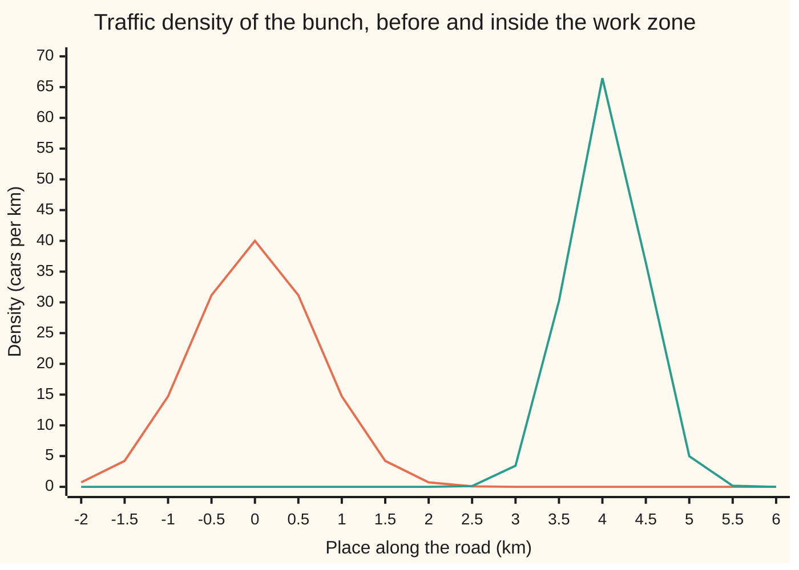
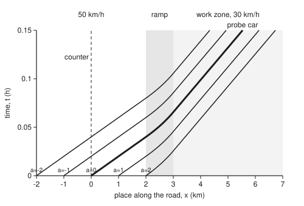

# Characteristics: curves along which a PDE becomes an ODE

[Syllabus](../../../SYLLABUS.md) → [Partial differential equations](../README.md) → [First-Order Equations and Characteristics](../README.md#s02) → Characteristics

---

## General Overview

[The transport equation](../../08-Differential%20equations%20and%20dynamics/10-The%20Classical%20PDEs/02-the-transport-equation-and-characteristics.md) showed that a shape carried at a steady speed is read back along straight paths. This card turns that trick into a method for every first-order equation, and shows where it stops.

A bunch of 70.8982 cars, about 71, drives along a one-lane road at rush hour. At its middle there are 40 cars per kilometre. Every car drives at 50 km/h. Starting 2 km ahead of the bunch's middle, drivers slow down over 1 km to 30 km/h. A work zone at 30 km/h runs from 3 km on. How dense is the bunch inside the work zone?

The unknown is the traffic density $`\rho(x, t)`$: cars per kilometre at place $`x`$ (km) and time $`t`$ (hours). The region is the whole road at every time after the start. The data are the densities at $`t = 0`$. The equation says one thing: no car appears or vanishes.

The method follows each car. Along a car's path the partial differential equation (PDE, a rule linking rates in time and in place) becomes an ordinary differential equation (ODE, a rule in one variable). Here that ODE says the flow (cars per hour past a point) stays the same along each car's path. At 50 km/h, 40 cars per km pass at 2000 cars per hour. At 30 km/h, the same flow needs 5/3 times the density.

So after 6 minutes, the bunch's middle sits at 4.0338 km with 66.6667 cars per km, 5/3 of 40. At 4 km the density is 66.4559 cars per km: the car there began 56 m behind the middle. The bunch is 0.6 times as long and still holds 70.8982 cars.

**Characteristics are curves along which a first-order PDE says only how the unknown changes along the curve; solve those ODEs from data on a curve that crosses them, and the answer is read back along them, until two of them meet or the data curve runs along one.**

**What kind of fact this is:** a theorem, proved on this card in Why it works: near a data curve that crosses the characteristics, the method gives the only classical solution (one with continuous first derivatives). The work-zone answer is classical except at 2 and 3 km, where it stays continuous but its slope jumps: there it is a weak solution, one that keeps the car count over every stretch of road without needing a slope at every point (see [Conservation laws](02-conservation-laws-and-shocks.md)). The traffic rules are models, not laws.

### The picture: the bunch at the start and 6 minutes later



Orange: the bunch at $`t = 0`$, peak 40.00 cars per km at 0 km. Green: at $`t = 0.1`$ h (6 minutes), inside the work zone. Its true peak, 66.6667 cars per km, sits at the bunch's middle, 4.0338 km; the chart samples every 0.5 km, so its tallest point is 66.46 at 4 km. Taller and narrower, with the same area: the same cars.

---

## The formula

Notation. Write $`u`$ for the unknown. As on [A PDE problem](../01-Classification%20and%20Well-Posedness/01-what-a-pde-problem-is.md), a subscript names the variable a partial derivative is taken in: $`u_x`$ is the rate of change of $`u`$ along the road with time held fixed, $`u_t`$ the rate in time at a fixed place. This card introduces $`\rho`$ for traffic density; the rest of this shelf uses it too.

A **quasilinear first-order equation** (one whose coefficients may depend on the unknown, but not on its derivatives) has the form

```math
P(x, t, u)\,u_x + Q(x, t, u)\,u_t = R(x, t, u).
```

Its **characteristic system** is three ODEs in a parameter $`s`$, one curve for each label $`a`$:

```math
\frac{dx}{ds} = P, \qquad \frac{dt}{ds} = Q, \qquad \frac{du}{ds} = R, \qquad \text{starting from } \big(x_0(a),\, t_0(a),\, h(a)\big).
```

The start points $`(x_0(a), t_0(a))`$ trace the **data curve**, where $`u = h(a)`$ is given. The method needs the data curve to cross the characteristics:

```math
J(a) = P\,t_0'(a) - Q\,x_0'(a) \neq 0.
```

**Read it aloud:** move through place and time in the direction $`(P, Q)`$, and the unknown changes at rate $`R`$; start one such curve at each point of the data, and the curves must leave the data curve rather than run along it.

The equation is **linear** when $`P`$ and $`Q`$ depend only on $`(x, t)`$ and $`R`$ is a first-degree expression in $`u`$, such as $`-v'(x)\,u`$. The card's three traffic equations:

| Situation | Equation | $`P`$, $`Q`$, $`R`$ | Kind |
| --- | --- | --- | --- |
| everyone at 50 km/h | $`\rho_t + 50\,\rho_x = 0`$ | 50, 1, 0 | linear, constant |
| speed $`v(x)`$ set by the road | $`\rho_t + v(x)\,\rho_x = -v'(x)\,\rho`$ | $`v(x)`$, 1, $`-v'(x)\rho`$ | linear |
| speed set by the crowd | $`\rho_t + (60 - 0.8\rho)\,\rho_x = 0`$ | $`60 - 0.8\rho`$, 1, 0 | quasilinear |

| Symbol | Plain meaning | In our example | Push it up and the answer… |
| --- | --- | --- | --- |
| $`u`$, $`\rho`$, $`\tilde u`$ | the unknown; for traffic, density; $`\tilde u`$ a second solution in the proof | cars per km | — |
| $`x`$, $`t`$ | place along the road; time since the start | km; hours | — |
| $`u_x`$, $`u_t`$ | rate along the road at a fixed time; rate in time at a fixed place | $`\rho_x`$, $`\rho_t`$ | — |
| $`P`$, $`Q`$ | the direction the characteristic moves in place and in time | $`v(x)`$ and 1: a car's path | a larger $`P/Q`$ tilts the paths toward faster travel |
| $`R`$ | how fast the unknown changes along a characteristic | $`-v'(x)\rho`$: density rises where the road slows | a larger $`R`$ raises the value carried |
| $`s`$, $`a`$ | the parameter along one characteristic; its label, saying which one by where it starts | time itself, since $`Q = 1`$; the car's place at $`t = 0`$ | — |
| $`x_0, t_0, h`$ | the data curve and the values given on it | start line: $`x_0 = a`$, $`t_0 = 0`$, $`h = \rho_0`$ | — |
| $`J`$ | the crossing test between data curve and characteristics | −1 for the start line; 0 for a probe car | — |
| $`v(x)`$, $`v'(x)`$ | the speed the road allows; its slope along the road | 50 km/h, down a 1 km ramp to 30 km/h; −20 km/h per km on the ramp | a lower zone speed gives denser traffic there |
| $`\tau(x)`$ | the clock: hours to drive from 2 km to $`x`$ | 0.025541 h at 3 km | — |
| $`\rho_0`$ | starting density | $`40\,e^{-x^2}`$ cars per km | every later density scales with it |
| $`c(\rho)`$ | speed at which a density value travels, crowd model | $`60 - 0.8\rho`$ km/h | paths cross sooner if it falls faster |

### The picture: characteristics through the work zone

<p align="center"></p>

To scale: 45 px per km across, 16 px per 0.01 h up. Cars start at −2 to 2 km. They reach the ramp at 0.0800, 0.0600, 0.0400, 0.0200 and 0 h and the zone 0.0255 h later. At 0.15 h they are at 4.3338, 4.9338, 5.5338, 6.1338 and 6.7338 km: still 0.6 km apart, not 1 km. The dashed line is a roadside counter at 0 km. The heavy path is a probe car riding in the traffic.

### When it holds

- **Smooth coefficients.** Continuous first derivatives give one characteristic through each point. This ramp has corners at 2 and 3 km, so the density's slope jumps across those two places; the density itself stays continuous.
- **A data curve that crosses the characteristics.** If $`J = 0`$ the data run along a characteristic and fix nothing off it: a probe car fits both 14.7152 and 40.0000 cars per km at the same point.
- **Every point reached from the data.** A counter at 0 km switched on at $`t = 0`$ fixes the density only where $`x \le 50t`$: at cars that pass it after it starts. Cars already past it at the start are never counted.
- **Linear, or quasilinear before a crossing.** In the crowd model the paths depend on the answer and first meet after 2.1859 minutes. After that, three densities arrive at one point.

---

## Why it works

### Step 0: the left side is a rate along a direction

$`P u_x + Q u_t`$ is the rate of change of $`u`$ when moving through place and time in the direction $`(P, Q)`$. The PDE fixes that one rate and says nothing about others. So along curves moving in that direction, it is an ODE.

### Step 1: the chain rule turns the PDE into the characteristic system

Take a curve with $`dx/ds = P`$ and $`dt/ds = Q`$. By the chain rule, the value along it changes at

```math
\frac{d}{ds}\,u\big(x(s), t(s)\big) = u_x\,\frac{dx}{ds} + u_t\,\frac{dt}{ds} = P\,u_x + Q\,u_t = R.
```

That is the third equation of the system. For constant speed, $`R = 0`$ and the value rides unchanged: the transport card's result.

### Step 2: build the solution from the data curve

Start one characteristic at each data point $`(x_0(a), t_0(a))`$ with value $`h(a)`$. Solving the system gives place, time and value as functions of $`(s, a)`$. To read off $`u(x, t)`$, find the $`(s, a)`$ that lands at $`(x, t)`$.

That inversion works near the data curve exactly when $`J \neq 0`$. At $`s = 0`$, moving along $`s`$ goes in direction $`(P, Q)`$ and moving along $`a`$ goes in direction $`(x_0', t_0')`$. $`J`$ is the area spanned by those two directions. A zero area means the two directions line up, and nearby points cannot be told apart.

### Step 3: there is no other solution

Take any classical solution. Along a curve moving in direction $`(P, Q)`$, Step 1 shows its value obeys $`du/ds = R`$ from the same start. An ODE with smooth right side has only one solution from a given start. So any solution equals the one built in Step 2.

<details>
<summary>Detailed proof: local existence and uniqueness for quasilinear equations</summary>

Assume $`P`$, $`Q`$, $`R`$, $`x_0`$, $`t_0`$ and $`h`$ have continuous first derivatives, and $`J(a) \neq 0`$ on the data curve.

Existence. Write $`(x(s, a), t(s, a), u(s, a))`$ for the solution of the characteristic system from the data point with label $`a`$. ODE solutions depend smoothly on their start, so these have continuous first derivatives. The map $`(s, a) \mapsto (x, t)`$ has Jacobian determinant, at $`s = 0`$,

$`\displaystyle \det\begin{pmatrix} x_s & x_a \\ t_s & t_a \end{pmatrix} = \det\begin{pmatrix} P & x_0' \\ Q & t_0' \end{pmatrix} = P\,t_0' - Q\,x_0' = J(a) \neq 0.`$

By the inverse function theorem, the map has a smooth inverse near each data point. Read $`u`$ at a point $`(x, t)`$ as $`u(s, a)`$ at the $`(s, a)`$ that maps there. By the chain rule, $`u_s = u_x x_s + u_t t_s = P u_x + Q u_t`$, and $`u_s = R`$ by construction. So $`u`$ solves the PDE, and at $`s = 0`$ it equals $`h`$.

Uniqueness. Let $`\tilde u`$ be any classical solution with the same data. Solve $`dx/ds = P(x, t, \tilde u(x, t))`$, $`dt/ds = Q(x, t, \tilde u(x, t))`$ from a data point. Along that curve, Step 1 gives $`d\tilde u/ds = R`$. So the curve and $`\tilde u`$ solve the characteristic system from the same start, and ODE uniqueness makes them equal to the curve and values built above.

Where the proof stops. The inverse function theorem is local. For a linear equation the curves in the $`(x, t)`$ plane do not depend on $`u`$, so two never meet, and the solution extends to every point reached by a characteristic that crosses the data curve exactly once. For a quasilinear equation the curves depend on $`u`$ and can meet; the Jacobian then reaches zero.

</details>

### Step 4: the work zone, solved by the system

Cars are conserved, so $`\rho_t + (v\rho)_x = 0`$. Expanding the product gives $`\rho_t + v\rho_x = -v'(x)\rho`$, so $`P = v`$, $`Q = 1`$, $`R = -v'\rho`$. With $`s = t`$ the system is

```math
\frac{dx}{dt} = v(x), \qquad \frac{d\rho}{dt} = -v'(x)\,\rho.
```

Along the path, $`v`$ changes at $`v'(x)\,dx/dt = v'v`$. So $`(\rho v)' = -v'\rho v + \rho v' v = 0`$: the flow $`\rho v`$, cars per hour, stays the same along each car's path. The value is not constant. The flow is.

The path itself follows from the clock $`\tau(x)`$, the hours needed to drive from 2 km to $`x`$: $`\tau(2) = 0`$ and $`\tau'(x) = 1/v(x)`$. On the ramp $`v = 50 - 20(x - 2)`$, and solving gives $`\tau = \ln(50/v)/20`$ there, so the ramp takes $`\ln(5/3)/20 = 0.025541`$ h, or 1.5325 minutes. The car at $`(x, t)`$ began at the label $`a`$ with $`\tau(x) - \tau(a) = t`$, and

```math
\rho(x, t) = \rho_0(a)\,\frac{v(a)}{v(x)}.
```

Every car takes the same time to cover the same stretch of road. So two cars keep their gap in time, and their gap in distance scales with speed: 30/50 = 0.6. The bunch's width at half height falls from 1.6651 km to 0.9991 km.

### Step 5: where the method stops

**Data along a characteristic.** A probe car rides in the traffic, along $`x = 50t`$ before the ramp. Then $`x_0' = 50`$, $`t_0' = 1`$, and $`J = 50 \times 1 - 1 \times 50 = 0`$. The PDE already fixes how $`\rho`$ changes along that line ($`R = 0`$: not at all). So the probe's readings must be constant, or no solution exists.

If they are constant, they say nothing off the line. A steady reading of 40 cars per km fits both $`\rho = 40\,e^{-(x - 50t)^2}`$ and $`\rho = 40`$, which differ at 1 km at the start: 14.7152 against 40.0000 cars per km.

A roadside counter at 0 km is different: $`x_0' = 0`$, $`t_0' = 1`$, $`J = 50`$. Its record $`h(t)`$ fixes $`\rho(x, t) = h(t - x/50)`$ wherever $`x \le 50t`$. At 1 km after 0.03 h this reads 31.1520 cars per km, the same as the start-line answer.

**Characteristics that meet.** Real drivers slow down in a crowd. An illustrative straight-line rule: car speed $`60(1 - \rho/150)`$ km/h, with 60 km/h on an empty road and a jam at 150 cars per km. The flow is then $`60\rho - 0.4\rho^2`$ cars per hour, and conservation with the chain rule gives

```math
\rho_t + c(\rho)\,\rho_x = 0, \qquad c(\rho) = 60 - 0.8\rho.
```

Now $`P = c(\rho)`$ depends on the answer: a quasilinear equation. Each density value rides a straight line at its own speed $`c`$. At 40 cars per km a car drives at 44 km/h, but the density value moves at only 28 km/h. The answer is defined implicitly, $`\rho = \rho_0\big(x - c(\rho)t\big)`$, through the label map $`x = a + c(\rho_0(a))\,t`$.

Behind the bunch's middle, fast low-density lines run into slow high-density ones. Neighbouring lines first meet when $`\partial x/\partial a = 1 - 0.8\,\rho_0'(a)\,t`$ reaches zero. The steepest rise of $`\rho_0`$ is $`40\sqrt{2}\,e^{-1/2}`$ cars per km per km, so this happens at 0.036432 h, or 2.1859 minutes. After that the implicit formula has three answers at some points. What happens next is the subject of [Conservation laws](02-conservation-laws-and-shocks.md).

---

## Worked numbers, by hand

The density at 4 km after 6 minutes, traced back along the car's path:

| Step | Arithmetic | Value |
| --- | --- | --- |
| time inside the zone, from 3 km to 4 km | (4 − 3) / 30 | 0.033333 h |
| time on the ramp, from 2 km to 3 km | ln(5/3) / 20 | 0.025541 h |
| time left before the ramp | 0.1 − 0.033333 − 0.025541 | 0.041125 h |
| where the car began | 2 − 50 × 0.041125 | −0.0563 km |
| density there at the start | 40 × e^(−0.0563²) | 39.8736 cars per km |
| flow carried along the path | 39.8736 × 50 | 1993.68 cars per hour |
| density at 4 km, 0.1 h | 1993.68 / 30 | **66.4559 cars per km** |
| crowd model: density at 1 km, 0.02 h | label 0.3616 km, check 0.3616 + 31.9215 × 0.02 = 1 | **35.0981 cars per km** |

Six minutes in, the car that began 56 m behind the bunch's middle is at 4 km, in traffic 5/3 times denser than at the start. The cars still pass at 1993.68 per hour.

### What breaks if you drop a piece

| Mistake | Comes out at | What went wrong |
| --- | --- | --- |
| value kept constant along the path ($`R = 0`$) | 39.8736 cars per km at 4 km, 0.1 h, not 66.4559 | the flow is carried, not the density |
| work zone ignored, shift at 50 km/h | 14.7152 cars per km, not 66.4559 | a straight line misses the bending path |
| data from a probe car, along a characteristic | 14.7152 or 40.0000 cars per km at 1 km, 0 h | $`J = 0`$: the data fix nothing off the line |
| crowd model used after 2.1859 minutes | three densities, 2.30, 20.41 and 39.60 cars per km, at 1.8 km, 0.06 h | the characteristics have crossed |

The checks print all four.

---

## Code, from first principles, and it actually runs

Three roads to the work-zone answer. Road 1 is the closed form along the path. Road 2 steps the raw characteristic system by Runge-Kutta 4 (RK4, a step that averages four slopes), using place as the parameter so each step stays on one piece of the road, and finds the starting label by bisection (halving an interval until it is small). Road 3 puts the closed form back into the PDE by centred differences, whose error falls fourfold when the step halves, and counts the cars. The crowd model is checked by its own residual and by a search for the first crossing against the formula.

### Python

```python
# Characteristics -- the check behind the card.  A bunch of cars, density
# rho0(x) = 40 e^(-x^2) cars/km, rides a one-lane road at 50 km/h and slows to
# 30 km/h through a work zone.  Road 1 is the closed form along characteristics;
# road 2 steps the characteristic ODEs by RK4; road 3 puts the answer back into
# the PDE by centred differences and counts the cars.  math gives exp, log, sqrt.
from math import exp, log, sqrt, pi

def rho0(a): return 40 * exp(-a * a)                 # cars/km at t = 0, at label a km
def v(x): return 50.0 if x <= 2 else (50 - 20 * (x - 2) if x <= 3 else 30.0)  # km/h
RAMP = log(5 / 3) / 20                               # hours to cross the ramp, 2 to 3 km

def clock(x):                                        # hours to drive from 2 km to x km
    if x <= 2: return (x - 2) / 50
    return log(50 / v(x)) / 20 if x <= 3 else RAMP + (x - 3) / 30

def unclock(T):                                      # the place reached after T hours
    if T <= 0: return 2 + 50 * T
    return 2 + 2.5 * (1 - exp(-20 * T)) if T <= RAMP else 3 + 30 * (T - RAMP)

def label(x, t): return unclock(clock(x) - t)        # where the car at (x, t) began
def rho(x, t): a = label(x, t); return rho0(a) * v(a) / v(x)   # rho * v rides along

def ride(a, x_end, n):                               # road 2: RK4 in x along the path
    t, r = 0.0, rho0(a); pts = [a] + [b for b in (2, 3) if a < b < x_end] + [x_end]
    for x0, x1 in zip(pts, pts[1:]):
        s = -20.0 if 2 <= x0 < 3 else 0.0; h = (x1 - x0) / n   # slope of v on the piece
        F = lambda x, r: (1 / v(x), -s * r / v(x))   # dt/dx = 1/v, drho/dx = -v' rho / v
        for i in range(n):
            x = x0 + i * h; k1 = F(x, r); k2 = F(x + h / 2, r + h * k1[1] / 2)
            k3 = F(x + h / 2, r + h * k2[1] / 2); k4 = F(x + h, r + h * k3[1])
            t += h * (k1[0] + 2 * k2[0] + 2 * k3[0] + k4[0]) / 6
            r += h * (k1[1] + 2 * k2[1] + 2 * k3[1] + k4[1]) / 6
    return t, r

def shoot(x, t, n):                                  # bisection: the label that arrives on time
    lo, hi = -3.0, x
    for _ in range(60):
        m = (lo + hi) / 2
        if ride(m, x, n)[0] > t: lo = m
        else: hi = m
    return m, ride(m, x, n)[1]

X, T = 4.0, 0.1
a = label(X, T); ans = rho(X, T)
print(f"ramp crossing time ln(5/3)/20 = {RAMP:.6f} h = {60 * RAMP:.4f} min")
print(f"work zone, x = {X:g} km, t = {T:g} h: label a = {a:.4f} km, rho0(a) = {rho0(a):.4f} cars/km")
print(f"trace back: {(X - 3) / 30:.6f} h in the zone, {RAMP:.6f} h on the ramp, {T - (X - 3) / 30 - RAMP:.6f} h before it")
print(f"road 1, closed form rho0(a) * 50/30 = {ans:.4f} cars/km")
for n in (5, 10):
    m, r = shoot(X, T, n)
    print(f"road 2, RK4 {n} steps per piece + bisection: label {m:.6f} km, rho {r:.6f} cars/km")
print(f"flow carried along: {rho0(a) * 50:.2f} cars/h at the start, {ans * 30:.2f} cars/h in the zone")
def res(f, x, t, h):                                 # rho_t + (v rho)_x by centred differences
    return (f(x, t + h) - f(x, t - h)) / (2 * h) + (v(x + h) * f(x + h, t) - v(x - h) * f(x - h, t)) / (2 * h)
wrong = lambda x, t: rho0(label(x, t))               # mistake: value constant along the path
r1, r2 = res(rho, 2.5, 0.05, 0.002), res(rho, 2.5, 0.05, 0.001)
print(f"road 3, residual on the ramp at 2.5 km, 0.05 h: h = 0.002 {r1:+.6f}, h = 0.001 {r2:+.6f}, ratio {r1 / r2:.2f}")
print(f"same residual for rho0(label), the zero-R mistake: {res(wrong, 2.5, 0.05, 0.001):+.2f} cars/km/h")
cars = lambda t: 0.002 * sum(rho(-6 + 0.002 * i, t) for i in range(9001))
print(f"cars on the road: 40 sqrt(pi) = {40 * sqrt(pi):.4f}; summed at t = 0: {cars(0):.4f}, at t = 0.1 h: {cars(0.1):.4f}")
w0 = 2 * sqrt(log(2))
wl = unclock(clock(-w0 / 2) + T); wr = unclock(clock(w0 / 2) + T)
xm = unclock(clock(0) + T)                           # the bunch's middle, label 0, at T
print(f"half-height width: {w0:.4f} km at t = 0, {wr - wl:.4f} km at t = 0.1 h; middle at {xm:.4f} km, peak {rho(xm, T):.4f} cars/km")
print(f"mistake 1, R dropped: rho0(a) = {wrong(X, T):.4f} cars/km, not {ans:.4f}")
print(f"mistake 2, zone ignored, shift at 50 km/h: rho0(4 - 5) = {rho0(X - 50 * T):.4f} cars/km, not {ans:.4f}")
J = lambda P, Q, dx, dt: P * dt - Q * dx             # data curve against the characteristic
print(f"J = P t0' - Q x0': start line {J(50, 1, 1, 0):.0f}, counter at 0 km {J(50, 1, 0, 1):.0f}, probe car {J(50, 1, 50, 1):.0f}")
g = lambda t: rho0(-50 * t)                          # what the counter at 0 km records
print(f"counter read back, x = 1 km, t = 0.03 h: g(t - x/50) = {g(0.03 - 1 / 50):.4f}, rho0(x - 50t) = {rho0(1 - 50 * 0.03):.4f} cars/km")
A, B = rho0(1 - 50 * 0), 40.0                        # two solutions with the probe's data
print(f"mistake 3, probe reads 40 cars/km: 40 e^(-(x-50t)^2) gives {A:.4f} at 1 km, 0 h; constant 40 gives {B:.4f}")
c = lambda r: 60 - 0.8 * r                           # quasilinear: speed of a density value
print(f"at 40 cars/km: car speed 60(1 - 40/150) = {60 * (1 - 40 / 150):.4f} km/h, the density value moves at c = {c(40):.4f} km/h")
print(f"trap, car speed used for c: after 0.02 h the 40 cars/km value sits at {c(40) * 0.02:.4f} km, not "
      f"{60 * (1 - 40 / 150) * 0.02:.4f} km, {(60 * (1 - 40 / 150) - c(40)) * 0.02:.4f} km too far ahead")
def qlabel(x, t):                                    # bisection on a + c(rho0(a)) t = x
    lo, hi = x - 60 * t, x - 28 * t
    for _ in range(60):
        m = (lo + hi) / 2
        lo, hi = (m, hi) if m + c(rho0(m)) * t < x else (lo, m)
    return m
q = lambda x, t: rho0(qlabel(x, t)); qa = qlabel(1.0, 0.02)
print(f"quasilinear, x = 1 km, t = 0.02 h: label {qa:.4f} km, rho {q(1.0, 0.02):.4f} cars/km, speed c {c(q(1.0, 0.02)):.4f} km/h")
qr = lambda h: (q(1, 0.02 + h) - q(1, 0.02 - h)) / (2 * h) + c(q(1, 0.02)) * (q(1 + h, 0.02) - q(1 - h, 0.02)) / (2 * h)
print(f"residual rho_t + c(rho) rho_x: h = 0.002 {qr(0.002):+.6f}, h = 0.001 {qr(0.001):+.6f}")
L = [-3 + i / 1000 for i in range(6001)]; C = [c(rho0(a)) for a in L]
tc = min((L[i + 1] - L[i]) / (C[i] - C[i + 1]) for i in range(6000) if C[i] > C[i + 1])
tf = 1 / (0.8 * 40 * sqrt(2) * exp(-0.5))
print(f"first crossing: {tc:.6f} h by search, 1/(0.8 * 40 sqrt(2) e^(-1/2)) = {tf:.6f} h = {60 * tf:.4f} min")
tm = 0.06                                            # a time after the first crossing, h
arrive = lambda a: a + c(rho0(a)) * tm - 1.8         # zero where label a reaches 1.8 km
hits = [i for i in range(6000) if arrive(L[i]) * arrive(L[i + 1]) < 0]
def root(lo, hi):                                    # bisection inside one sign-change bracket
    for _ in range(60):
        m = (lo + hi) / 2
        lo, hi = (m, hi) if arrive(lo) * arrive(m) > 0 else (lo, m)
    return (lo + hi) / 2
print(f"mistake 4, at x = 1.8 km, t = {tm} h: {len(hits)} labels arrive, densities", ", ".join(f"{rho0(root(L[i], L[i + 1])):.2f}" for i in hits))
for t in (0, 0.1):
    print(f"chart, t = {t} h:", ", ".join(f"{rho(-2 + k / 2, t):.2f}" for k in range(17)))
print("figure, label a: t entering ramp, t entering zone, x at 0.15 h (h, h, km):", "; ".join(
    f"{b}: {0 - clock(b):.4f} {RAMP - clock(b):.4f} {unclock(clock(b) + 0.15):.4f}" for b in range(-2, 3)))
assert abs(shoot(X, T, 10)[1] - ans) < 1e-4 and abs(shoot(X, T, 10)[0] - a) < 1e-4   # RK4 meets closed form
assert abs(r2) < 1 and 3.5 < r1 / r2 < 4.5 and abs(res(wrong, 2.5, 0.05, 0.001)) > 100  # residual
assert abs(cars(0.1) - 40 * sqrt(pi)) < 1e-3 and abs(wr - wl - 0.6 * w0) < 1e-9          # cars conserved
assert abs(g(0.03 - 1 / 50) - rho(1, 0.03)) < 1e-9                                   # counter data suffice
assert abs(tc - tf) < 1e-5 and abs(qr(0.001)) < 1 and len(hits) == 3             # quasilinear
print("ALL CHECKS PASS")
```

**Ran 2026-11-15 on macOS, Python 3.14.10, standard library only. All checks passed. Output, pasted from the run:**

```
ramp crossing time ln(5/3)/20 = 0.025541 h = 1.5325 min
work zone, x = 4 km, t = 0.1 h: label a = -0.0563 km, rho0(a) = 39.8736 cars/km
trace back: 0.033333 h in the zone, 0.025541 h on the ramp, 0.041125 h before it
road 1, closed form rho0(a) * 50/30 = 66.4559 cars/km
road 2, RK4 5 steps per piece + bisection: label -0.056268 km, rho 66.455929 cars/km
road 2, RK4 10 steps per piece + bisection: label -0.056269 km, rho 66.455919 cars/km
flow carried along: 1993.68 cars/h at the start, 1993.68 cars/h in the zone
road 3, residual on the ramp at 2.5 km, 0.05 h: h = 0.002 -2.867022, h = 0.001 -0.719435, ratio 3.99
same residual for rho0(label), the zero-R mistake: -797.90 cars/km/h
cars on the road: 40 sqrt(pi) = 70.8982; summed at t = 0: 70.8982, at t = 0.1 h: 70.8982
half-height width: 1.6651 km at t = 0, 0.9991 km at t = 0.1 h; middle at 4.0338 km, peak 66.6667 cars/km
mistake 1, R dropped: rho0(a) = 39.8736 cars/km, not 66.4559
mistake 2, zone ignored, shift at 50 km/h: rho0(4 - 5) = 14.7152 cars/km, not 66.4559
J = P t0' - Q x0': start line -1, counter at 0 km 50, probe car 0
counter read back, x = 1 km, t = 0.03 h: g(t - x/50) = 31.1520, rho0(x - 50t) = 31.1520 cars/km
mistake 3, probe reads 40 cars/km: 40 e^(-(x-50t)^2) gives 14.7152 at 1 km, 0 h; constant 40 gives 40.0000
at 40 cars/km: car speed 60(1 - 40/150) = 44.0000 km/h, the density value moves at c = 28.0000 km/h
trap, car speed used for c: after 0.02 h the 40 cars/km value sits at 0.5600 km, not 0.8800 km, 0.3200 km too far ahead
quasilinear, x = 1 km, t = 0.02 h: label 0.3616 km, rho 35.0981 cars/km, speed c 31.9215 km/h
residual rho_t + c(rho) rho_x: h = 0.002 +0.846539, h = 0.001 +0.211935
first crossing: 0.036432 h by search, 1/(0.8 * 40 sqrt(2) e^(-1/2)) = 0.036432 h = 2.1859 min
mistake 4, at x = 1.8 km, t = 0.06 h: 3 labels arrive, densities 2.30, 20.41, 39.60
chart, t = 0 h: 0.73, 4.22, 14.72, 31.15, 40.00, 31.15, 14.72, 4.22, 0.73, 0.08, 0.00, 0.00, 0.00, 0.00, 0.00, 0.00, 0.00
chart, t = 0.1 h: 0.00, 0.00, 0.00, 0.00, 0.00, 0.00, 0.00, 0.00, 0.00, 0.13, 3.43, 30.21, 66.46, 36.45, 4.98, 0.17, 0.00
figure, label a: t entering ramp, t entering zone, x at 0.15 h (h, h, km): -2: 0.0800 0.1055 4.3338; -1: 0.0600 0.0855 4.9338; 0: 0.0400 0.0655 5.5338; 1: 0.0200 0.0455 6.1338; 2: 0.0000 0.0255 6.7338
ALL CHECKS PASS
```

### Rust

Same numbers, same labels, built with `rustc --edition 2021 -O`.

```rust
// Characteristics -- the same check in Rust, std only.  A bunch of cars,
// density rho0(x) = 40 e^(-x^2) cars/km, rides a one-lane road at 50 km/h and
// slows to 30 km/h through a work zone.  Road 1 is the closed form along
// characteristics; road 2 steps the characteristic ODEs by RK4; road 3 puts the
// answer back into the PDE by centred differences and counts the cars.
fn rho0(a: f64) -> f64 { 40.0 * (-a * a).exp() }          // cars/km at t = 0, at label a km
fn v(x: f64) -> f64 { if x <= 2.0 { 50.0 } else if x <= 3.0 { 50.0 - 20.0 * (x - 2.0) } else { 30.0 } }
fn ramp() -> f64 { (5.0f64 / 3.0).ln() / 20.0 }         // hours to cross the ramp, 2 to 3 km

fn clock(x: f64) -> f64 {                                 // hours to drive from 2 km to x km
    if x <= 2.0 { (x - 2.0) / 50.0 } else if x <= 3.0 { (50.0 / v(x)).ln() / 20.0 } else { ramp() + (x - 3.0) / 30.0 }
}
fn unclock(t: f64) -> f64 {                               // the place reached after t hours
    if t <= 0.0 { 2.0 + 50.0 * t } else if t <= ramp() { 2.0 + 2.5 * (1.0 - (-20.0 * t).exp()) } else { 3.0 + 30.0 * (t - ramp()) }
}
fn label(x: f64, t: f64) -> f64 { unclock(clock(x) - t) } // where the car at (x, t) began
fn rho(x: f64, t: f64) -> f64 { let a = label(x, t); rho0(a) * v(a) / v(x) }   // rho * v rides along

fn ride(a: f64, x_end: f64, n: usize) -> (f64, f64) {     // road 2: RK4 in x along the path
    let (mut t, mut r) = (0.0, rho0(a));
    let mut pts = vec![a];
    for b in [2.0, 3.0] { if a < b && b < x_end { pts.push(b) } }
    pts.push(x_end);
    for w in pts.windows(2) {
        let (x0, x1) = (w[0], w[1]);
        let s = if 2.0 <= x0 && x0 < 3.0 { -20.0 } else { 0.0 };   // slope of v on the piece
        let h = (x1 - x0) / n as f64;
        let f = |x: f64, r: f64| (1.0 / v(x), -s * r / v(x));     // dt/dx = 1/v, drho/dx = -v' rho / v
        for i in 0..n {
            let x = x0 + i as f64 * h;
            let k1 = f(x, r); let k2 = f(x + h / 2.0, r + h * k1.1 / 2.0);
            let k3 = f(x + h / 2.0, r + h * k2.1 / 2.0); let k4 = f(x + h, r + h * k3.1);
            t += h * (k1.0 + 2.0 * k2.0 + 2.0 * k3.0 + k4.0) / 6.0;
            r += h * (k1.1 + 2.0 * k2.1 + 2.0 * k3.1 + k4.1) / 6.0;
        }
    }
    (t, r)
}

fn shoot(x: f64, t: f64, n: usize) -> (f64, f64) {        // bisection: the label that arrives on time
    let (mut lo, mut hi, mut m) = (-3.0, x, 0.0);
    for _ in 0..60 {
        m = (lo + hi) / 2.0;
        if ride(m, x, n).0 > t { lo = m } else { hi = m }
    }
    (m, ride(m, x, n).1)
}

fn res(f: &dyn Fn(f64, f64) -> f64, x: f64, t: f64, h: f64) -> f64 {   // rho_t + (v rho)_x
    (f(x, t + h) - f(x, t - h)) / (2.0 * h) + (v(x + h) * f(x + h, t) - v(x - h) * f(x - h, t)) / (2.0 * h)
}
fn c(r: f64) -> f64 { 60.0 - 0.8 * r }                    // quasilinear: speed of a density value
fn qlabel(x: f64, t: f64) -> f64 {                        // bisection on a + c(rho0(a)) t = x
    let (mut lo, mut hi, mut m) = (x - 60.0 * t, x - 28.0 * t, 0.0);
    for _ in 0..60 {
        m = (lo + hi) / 2.0;
        if m + c(rho0(m)) * t < x { lo = m } else { hi = m }
    }
    m
}
fn q(x: f64, t: f64) -> f64 { rho0(qlabel(x, t)) }

fn main() {
    let (xq, tq) = (4.0, 0.1);
    let a = label(xq, tq);
    let ans = rho(xq, tq);
    println!("ramp crossing time ln(5/3)/20 = {:.6} h = {:.4} min", ramp(), 60.0 * ramp());
    println!("work zone, x = {} km, t = {} h: label a = {:.4} km, rho0(a) = {:.4} cars/km", xq, tq, a, rho0(a));
    println!("trace back: {:.6} h in the zone, {:.6} h on the ramp, {:.6} h before it", (xq - 3.0) / 30.0, ramp(), tq - (xq - 3.0) / 30.0 - ramp());
    println!("road 1, closed form rho0(a) * 50/30 = {:.4} cars/km", ans);
    for n in [5, 10] {
        let (m, r) = shoot(xq, tq, n);
        println!("road 2, RK4 {} steps per piece + bisection: label {:.6} km, rho {:.6} cars/km", n, m, r);
    }
    println!("flow carried along: {:.2} cars/h at the start, {:.2} cars/h in the zone", rho0(a) * 50.0, ans * 30.0);
    let wrong = |x: f64, t: f64| rho0(label(x, t));       // mistake: value constant along the path
    let (r1, r2) = (res(&rho, 2.5, 0.05, 0.002), res(&rho, 2.5, 0.05, 0.001));
    println!("road 3, residual on the ramp at 2.5 km, 0.05 h: h = 0.002 {:+.6}, h = 0.001 {:+.6}, ratio {:.2}", r1, r2, r1 / r2);
    let rw = res(&wrong, 2.5, 0.05, 0.001);
    println!("same residual for rho0(label), the zero-R mistake: {:+.2} cars/km/h", rw);
    let cars = |t: f64| 0.002 * (0..9001).map(|i| rho(-6.0 + 0.002 * i as f64, t)).sum::<f64>();
    let sp = std::f64::consts::PI.sqrt();
    println!("cars on the road: 40 sqrt(pi) = {:.4}; summed at t = 0: {:.4}, at t = 0.1 h: {:.4}", 40.0 * sp, cars(0.0), cars(0.1));
    let w0 = 2.0 * 2f64.ln().sqrt();
    let (wl, wr) = (unclock(clock(-w0 / 2.0) + tq), unclock(clock(w0 / 2.0) + tq));
    let xm = unclock(clock(0.0) + tq);                    // the bunch's middle, label 0, at tq
    println!("half-height width: {:.4} km at t = 0, {:.4} km at t = 0.1 h; middle at {:.4} km, peak {:.4} cars/km", w0, wr - wl, xm, rho(xm, tq));
    println!("mistake 1, R dropped: rho0(a) = {:.4} cars/km, not {:.4}", wrong(xq, tq), ans);
    println!("mistake 2, zone ignored, shift at 50 km/h: rho0(4 - 5) = {:.4} cars/km, not {:.4}", rho0(xq - 50.0 * tq), ans);
    let j = |p: f64, qq: f64, dx: f64, dt: f64| p * dt - qq * dx;   // data curve against the characteristic
    println!("J = P t0' - Q x0': start line {:.0}, counter at 0 km {:.0}, probe car {:.0}", j(50.0, 1.0, 1.0, 0.0), j(50.0, 1.0, 0.0, 1.0), j(50.0, 1.0, 50.0, 1.0));
    let g = |t: f64| rho0(-50.0 * t);                     // what the counter at 0 km records
    println!("counter read back, x = 1 km, t = 0.03 h: g(t - x/50) = {:.4}, rho0(x - 50t) = {:.4} cars/km", g(0.03 - 1.0 / 50.0), rho0(1.0 - 50.0 * 0.03));
    let (pa, pb) = (rho0(1.0 - 50.0 * 0.0), 40.0);         // two solutions with the probe's data
    println!("mistake 3, probe reads 40 cars/km: 40 e^(-(x-50t)^2) gives {:.4} at 1 km, 0 h; constant 40 gives {:.4}", pa, pb);
    println!("at 40 cars/km: car speed 60(1 - 40/150) = {:.4} km/h, the density value moves at c = {:.4} km/h", 60.0 * (1.0 - 40.0 / 150.0), c(40.0));
    println!("trap, car speed used for c: after 0.02 h the 40 cars/km value sits at {:.4} km, not {:.4} km, {:.4} km too far ahead",
        c(40.0) * 0.02, 60.0 * (1.0 - 40.0 / 150.0) * 0.02, (60.0 * (1.0 - 40.0 / 150.0) - c(40.0)) * 0.02);
    let qa = qlabel(1.0, 0.02);
    println!("quasilinear, x = 1 km, t = 0.02 h: label {:.4} km, rho {:.4} cars/km, speed c {:.4} km/h", qa, q(1.0, 0.02), c(q(1.0, 0.02)));
    let qr = |h: f64| (q(1.0, 0.02 + h) - q(1.0, 0.02 - h)) / (2.0 * h) + c(q(1.0, 0.02)) * (q(1.0 + h, 0.02) - q(1.0 - h, 0.02)) / (2.0 * h);
    println!("residual rho_t + c(rho) rho_x: h = 0.002 {:+.6}, h = 0.001 {:+.6}", qr(0.002), qr(0.001));
    let l: Vec<f64> = (0..6001).map(|i| -3.0 + i as f64 / 1000.0).collect();
    let cc: Vec<f64> = l.iter().map(|&a| c(rho0(a))).collect();
    let tc = (0..6000).filter(|&i| cc[i] > cc[i + 1]).map(|i| (l[i + 1] - l[i]) / (cc[i] - cc[i + 1])).fold(f64::INFINITY, f64::min);
    let tf = 1.0 / (0.8 * 40.0 * 2f64.sqrt() * (-0.5f64).exp());
    println!("first crossing: {:.6} h by search, 1/(0.8 * 40 sqrt(2) e^(-1/2)) = {:.6} h = {:.4} min", tc, tf, 60.0 * tf);
    let tm = 0.06;                                        // a time after the first crossing, h
    let arrive = |a: f64| a + c(rho0(a)) * tm - 1.8;      // zero where label a reaches 1.8 km
    let hits: Vec<usize> = (0..6000).filter(|&i| arrive(l[i]) * arrive(l[i + 1]) < 0.0).collect();
    let root = |mut lo: f64, mut hi: f64| {               // bisection inside one sign-change bracket
        for _ in 0..60 { let m = (lo + hi) / 2.0; if arrive(lo) * arrive(m) > 0.0 { lo = m } else { hi = m } }
        (lo + hi) / 2.0
    };
    let dens: Vec<String> = hits.iter().map(|&i| format!("{:.2}", rho0(root(l[i], l[i + 1])))).collect();
    println!("mistake 4, at x = 1.8 km, t = {} h: {} labels arrive, densities {}", tm, hits.len(), dens.join(", "));
    for t in [0.0, 0.1] {
        let row: Vec<String> = (0..17).map(|k| format!("{:.2}", rho(-2.0 + k as f64 / 2.0, t))).collect();
        println!("chart, t = {} h: {}", t, row.join(", "));
    }
    let fig: Vec<String> = (-2..3).map(|b| { let b = b as f64;
        format!("{}: {:.4} {:.4} {:.4}", b, 0.0 - clock(b), ramp() - clock(b), unclock(clock(b) + 0.15)) }).collect();
    println!("figure, label a: t entering ramp, t entering zone, x at 0.15 h (h, h, km): {}", fig.join("; "));
    let (m10, r10) = shoot(xq, tq, 10);
    assert!((r10 - ans).abs() < 1e-4 && (m10 - a).abs() < 1e-4);                     // RK4 meets closed form
    assert!(r2.abs() < 1.0 && r1 / r2 > 3.5 && r1 / r2 < 4.5 && rw.abs() > 100.0);   // residual
    assert!((cars(0.1) - 40.0 * sp).abs() < 1e-3 && (wr - wl - 0.6 * w0).abs() < 1e-9);  // cars conserved
    assert!((g(0.03 - 1.0 / 50.0) - rho(1.0, 0.03)).abs() < 1e-9);                   // counter data suffice
    assert!((tc - tf).abs() < 1e-5 && qr(0.001).abs() < 1.0 && hits.len() == 3);    // quasilinear
    println!("ALL CHECKS PASS");
}
```

**Ran 2026-11-15 on macOS, rustc 1.98.1, no crates. All checks passed. Output, pasted from the run:**

```
ramp crossing time ln(5/3)/20 = 0.025541 h = 1.5325 min
work zone, x = 4 km, t = 0.1 h: label a = -0.0563 km, rho0(a) = 39.8736 cars/km
trace back: 0.033333 h in the zone, 0.025541 h on the ramp, 0.041125 h before it
road 1, closed form rho0(a) * 50/30 = 66.4559 cars/km
road 2, RK4 5 steps per piece + bisection: label -0.056268 km, rho 66.455929 cars/km
road 2, RK4 10 steps per piece + bisection: label -0.056269 km, rho 66.455919 cars/km
flow carried along: 1993.68 cars/h at the start, 1993.68 cars/h in the zone
road 3, residual on the ramp at 2.5 km, 0.05 h: h = 0.002 -2.867022, h = 0.001 -0.719435, ratio 3.99
same residual for rho0(label), the zero-R mistake: -797.90 cars/km/h
cars on the road: 40 sqrt(pi) = 70.8982; summed at t = 0: 70.8982, at t = 0.1 h: 70.8982
half-height width: 1.6651 km at t = 0, 0.9991 km at t = 0.1 h; middle at 4.0338 km, peak 66.6667 cars/km
mistake 1, R dropped: rho0(a) = 39.8736 cars/km, not 66.4559
mistake 2, zone ignored, shift at 50 km/h: rho0(4 - 5) = 14.7152 cars/km, not 66.4559
J = P t0' - Q x0': start line -1, counter at 0 km 50, probe car 0
counter read back, x = 1 km, t = 0.03 h: g(t - x/50) = 31.1520, rho0(x - 50t) = 31.1520 cars/km
mistake 3, probe reads 40 cars/km: 40 e^(-(x-50t)^2) gives 14.7152 at 1 km, 0 h; constant 40 gives 40.0000
at 40 cars/km: car speed 60(1 - 40/150) = 44.0000 km/h, the density value moves at c = 28.0000 km/h
trap, car speed used for c: after 0.02 h the 40 cars/km value sits at 0.5600 km, not 0.8800 km, 0.3200 km too far ahead
quasilinear, x = 1 km, t = 0.02 h: label 0.3616 km, rho 35.0981 cars/km, speed c 31.9215 km/h
residual rho_t + c(rho) rho_x: h = 0.002 +0.846539, h = 0.001 +0.211935
first crossing: 0.036432 h by search, 1/(0.8 * 40 sqrt(2) e^(-1/2)) = 0.036432 h = 2.1859 min
mistake 4, at x = 1.8 km, t = 0.06 h: 3 labels arrive, densities 2.30, 20.41, 39.60
chart, t = 0 h: 0.73, 4.22, 14.72, 31.15, 40.00, 31.15, 14.72, 4.22, 0.73, 0.08, 0.00, 0.00, 0.00, 0.00, 0.00, 0.00, 0.00
chart, t = 0.1 h: 0.00, 0.00, 0.00, 0.00, 0.00, 0.00, 0.00, 0.00, 0.00, 0.13, 3.43, 30.21, 66.46, 36.45, 4.98, 0.17, 0.00
figure, label a: t entering ramp, t entering zone, x at 0.15 h (h, h, km): -2: 0.0800 0.1055 4.3338; -1: 0.0600 0.0855 4.9338; 0: 0.0400 0.0655 5.5338; 1: 0.0200 0.0455 6.1338; 2: 0.0000 0.0255 6.7338
ALL CHECKS PASS
```

The two outputs match line for line.

### Lean

Lean proves the Step 3 theorem for every quasilinear equation, the flow rule of Step 4, and the probe-car example.

- Suppose $`P`$, $`Q`$, $`R`$, $`x_0`$, $`t_0`$ and $`h`$ have continuous first derivatives, and $`J \neq 0`$ at one label. Then near that data point there is a classical solution taking the data, and any other classical solution with the same data equals it nearby.
- Suppose the road speed $`v`$ has a continuous slope, and a car's path and density follow the system in Step 4. Then the flow $`\rho v`$ stays the same along that path.
- Take the probe car's line $`x = 50t`$ and the equation $`\rho_t + 50\,\rho_x = 0`$. Then $`40\,e^{-(x - 50t)^2}`$ and the constant 40 both solve it and both read 40 along that line. Yet at 1 km at the start one is $`40\,e^{-1}`$ and the other is 40.
- The crossing tests, the 2000 cars per hour, the times to reach the ramp and the crowd-model speeds also check exactly.

The work-zone densities, the car count and the crowd-model crossing time are left to the Python and Rust checks.

```lean
-- Characteristics: near a data curve that crosses the characteristics, a quasilinear first-order equation P u_x + Q u_t = R with smooth coefficients has exactly one classical solution taking the given data, the flow rho v rides unchanged along each car's path, and data given along a characteristic fix nothing off it.
import Mathlib.Analysis.Calculus.ContDiff.Basic
import Mathlib.Analysis.Calculus.Deriv.Basic
import Mathlib.Analysis.SpecialFunctions.ExpDeriv
import Mathlib

open Filter Topology

section MocHelpers

open Set Metric Function
open scoped NNReal


theorem moc_gronwallBound_zero_eq (B δ x : ℝ) :
    gronwallBound 0 B δ x = δ * gronwallBound 0 B 1 x := by
  unfold gronwallBound; split_ifs <;> ring

#print axioms moc_gronwallBound_zero_eq

theorem moc_gronwall_symm {V : Type*} [NormedAddCommGroup V] [NormedSpace ℝ V]
    {e e' : ℝ → V} {T B δ : ℝ} (hB : 0 ≤ B) (hδ : 0 ≤ δ)
    (he : ∀ s ∈ Ioo (-T) T, HasDerivAt e (e' s) s) (h0 : e 0 = 0)
    (hb : ∀ s ∈ Ioo (-T) T, ‖e' s‖ ≤ B * ‖e s‖ + δ) :
    ∀ s ∈ Ioo (-T) T, ‖e s‖ ≤ δ * gronwallBound 0 B 1 T := by
  intro s hs
  have hs1 := hs.1
  have hs2 := hs.2
  have hmono : ∀ x, 0 ≤ x → x ≤ T → δ * gronwallBound 0 B 1 x ≤ δ * gronwallBound 0 B 1 T :=
    fun x _ hx => mul_le_mul_of_nonneg_left (gronwallBound_mono le_rfl zero_le_one hB hx) hδ
  rcases le_total 0 s with h | h
  · have := norm_le_gronwallBound_of_norm_deriv_right_le (f := e) (f' := e') (δ := 0) (K := B)
      (ε := δ) (a := 0) (b := s)
      (fun x hx => (he x ⟨by linarith [hx.1, hs.1], by linarith [hx.2, hs.2]⟩).continuousAt.continuousWithinAt)
      (fun x hx => (he x ⟨by linarith [hx.1, hs.1], by linarith [hx.2, hs.2]⟩).hasDerivWithinAt)
      (by simp [h0])
      (fun x hx => hb x ⟨by linarith [hx.1, hs.1], by linarith [hx.2, hs.2]⟩) s ⟨h, le_rfl⟩
    rw [moc_gronwallBound_zero_eq, sub_zero] at this
    exact this.trans (hmono s h hs.2.le)
  · have := norm_le_gronwallBound_of_norm_deriv_right_le (f := fun σ => e (-σ))
      (f' := fun σ => (-1 : ℝ) • e' (-σ)) (δ := 0) (K := B)
      (ε := δ) (a := 0) (b := -s)
      (fun x hx => ((he (-x) ⟨by linarith [hx.2, hs.1], by linarith [hx.1, hs.2]⟩).scomp x
        (hasDerivAt_neg x)).continuousAt.continuousWithinAt)
      (fun x hx => ((he (-x) ⟨by linarith [hx.2, hs.1], by linarith [hx.1, hs.2]⟩).scomp x
        (hasDerivAt_neg x)).hasDerivWithinAt)
      (by simp [h0])
      (fun x hx => by
        rw [norm_smul]
        simpa using hb (-x) ⟨by linarith [hx.2, hs.1], by linarith [hx.1, hs.2]⟩) (-s)
      ⟨by linarith, le_rfl⟩
    rw [moc_gronwallBound_zero_eq, sub_zero, neg_neg] at this
    exact this.trans (hmono (-s) (by linarith) (by linarith [hs.1]))

#print axioms moc_gronwall_symm

variable {E : Type*} [NormedAddCommGroup E] [NormedSpace ℝ E] [FiniteDimensional ℝ E]

theorem moc_flow_C1 (F : E → E) (hF : ContDiff ℝ 1 F) (y₀ : E) :
    ∃ T > 0, ∃ r > 0, ∃ Φ : ℝ × E → E,
      (∀ y ∈ ball y₀ r, Φ (0, y) = y) ∧
      (∀ s ∈ Ioo (-T) T, ∀ y ∈ ball y₀ r, HasDerivAt (fun σ => Φ (σ, y)) (F (Φ (s, y))) s) ∧
      ContDiffOn ℝ 1 Φ (Ioo (-T) T ×ˢ ball y₀ r) := by
  classical
  obtain ⟨ε, hε, a, r, L, K, hr, hpl⟩ := IsPicardLindelof.of_contDiffAt_one (hF.contDiffAt (x := y₀))
  obtain ⟨α, hα, L', hL'⟩ := (hpl 0).exists_forall_mem_closedBall_eq_hasDerivWithinAt_lipschitzOnWith
  simp only [zero_sub, zero_add] at hα hL'
  set DF := fderiv ℝ F with hDF_def
  have hDFc : Continuous DF := hF.continuous_fderiv one_ne_zero
  have hFd : ∀ z, HasFDerivAt F (DF z) z := fun z =>
    ((hF.differentiable one_ne_zero) z).hasFDerivAt
  obtain ⟨C0, hC0⟩ := (isCompact_closedBall y₀ 1).exists_bound_of_continuousOn hDFc.continuousOn
  set Bd : ℝ≥0 := C0.toNNReal with hBd_def
  have hBd : ∀ z ∈ closedBall y₀ 1, ‖DF z‖ ≤ Bd := fun z hz =>
    (hC0 z hz).trans (Real.le_coe_toNNReal C0)
  have hUC := Metric.uniformContinuousOn_iff.mp
    ((isCompact_closedBall y₀ 1).uniformContinuousOn_of_continuous hDFc.continuousOn)
  -- continuity of α y₀ at 0
  have hα0 : ContinuousAt (α y₀) 0 :=
    ((hα y₀ (mem_closedBall_self r.2)).2 0 ⟨by linarith, by linarith⟩).continuousWithinAt
      |>.continuousAt (Icc_mem_nhds (by linarith) (by linarith))
  obtain ⟨δ₁, hδ₁, hδ₁'⟩ := Metric.continuousAt_iff.mp hα0 (1/2) (by norm_num)
  rw [(hα y₀ (mem_closedBall_self r.2)).1] at hδ₁'
  set r₁ : ℝ := min (r : ℝ) (1 / (2 * ((L' : ℝ) + 1))) with hr₁_def
  have hr₁ : 0 < r₁ := lt_min hr (by positivity)
  set T : ℝ := min (min (ε / 2) (δ₁ / 2)) (1 / (4 * ((Bd : ℝ) + 1))) with hT_def
  have hT : 0 < T := lt_min (lt_min (by linarith) (by linarith)) (by positivity)
  have hTε : T ≤ ε / 2 := (min_le_left _ _).trans (min_le_left _ _)
  have hTδ : T ≤ δ₁ / 2 := (min_le_left _ _).trans (min_le_right _ _)
  have hTB : T ≤ 1 / (4 * ((Bd : ℝ) + 1)) := min_le_right _ _
  have hball_r : ∀ y ∈ ball y₀ r₁, y ∈ closedBall y₀ r := fun y hy =>
    mem_closedBall.2 ((mem_ball.1 hy).le.trans (min_le_left _ _))
  have hIcc : ∀ t ∈ Icc (-T) T, t ∈ Icc (-ε) ε := fun t ht =>
    ⟨by linarith [ht.1], by linarith [ht.2]⟩
  have hin : ∀ y ∈ ball y₀ r₁, ∀ t ∈ Icc (-T) T, α y t ∈ ball y₀ 1 := by
    intro y hy t ht
    have h1 := (hL' t (hIcc t ht)).dist_le_mul y (hball_r y hy) y₀ (mem_closedBall_self r.2)
    have h2 := hδ₁' (x := t) (by rw [Real.dist_eq, sub_zero, abs_lt]; constructor <;> linarith [ht.1, ht.2])
    have h3 : dist y y₀ < r₁ := hy
    have h4 : (L' : ℝ) * r₁ ≤ 1 / 2 := by
      calc (L' : ℝ) * r₁ ≤ L' * (1 / (2 * ((L' : ℝ) + 1))) := by
            gcongr; exact min_le_right _ _
        _ ≤ 1 / 2 := by
            rw [mul_one_div, div_le_div_iff₀ (by positivity) (by norm_num)]; nlinarith
    rw [mem_ball]
    calc dist (α y t) y₀ ≤ dist (α y t) (α y₀ t) + dist (α y₀ t) y₀ := dist_triangle _ _ _
      _ < 1 / 2 + 1 / 2 := by
          apply add_lt_add_of_le_of_lt _ h2
          calc dist (α y t) (α y₀ t) ≤ L' * dist y y₀ := h1
            _ ≤ L' * r₁ := by gcongr
            _ ≤ 1 / 2 := h4
      _ = 1 := by norm_num
  have hαd : ∀ y ∈ ball y₀ r₁, ∀ s ∈ Ioo (-T) T, HasDerivAt (α y) (F (α y s)) s := by
    intro y hy s hs
    exact ((hα y (hball_r y hy)).2 s (hIcc s (Ioo_subset_Icc_self hs))).hasDerivAt
      (Icc_mem_nhds (by linarith [hs.1]) (by linarith [hs.2]))
  have hαc : ∀ y ∈ ball y₀ r₁, ContinuousOn (α y) (Icc (-T) T) := fun y hy t ht =>
    ((hα y (hball_r y hy)).2 t (hIcc t ht)).continuousWithinAt.mono (fun x hx => hIcc x hx)
  have hid : ‖ContinuousLinearMap.id ℝ E‖ ≤ 1 := ContinuousLinearMap.norm_id_le
  have hBdT : (Bd : ℝ) * T ≤ 1 / 4 := by
    calc (Bd : ℝ) * T ≤ Bd * (1 / (4 * ((Bd : ℝ) + 1))) := by gcongr
      _ ≤ 1 / 4 := by
        rw [mul_one_div, div_le_div_iff₀ (by positivity) (by norm_num)]; nlinarith
  have hM : ∀ y, ∃ β : ℝ → (E →L[ℝ] E), y ∈ ball y₀ r₁ →
      β 0 = ContinuousLinearMap.id ℝ E ∧
      ∀ t ∈ Icc (-T) T, HasDerivWithinAt β (DF (α y t) ∘L β t) (Icc (-T) T) t := by
    intro y
    by_cases hy : y ∈ ball y₀ r₁
    swap
    · exact ⟨0, fun h => absurd h hy⟩
    have hpl2 : IsPicardLindelof (fun t (m : E →L[ℝ] E) => DF (α y t) ∘L m)
        (tmin := -T) (tmax := T) ⟨0, ⟨by linarith, by linarith⟩⟩
        (ContinuousLinearMap.id ℝ E) 1 0 (2 * Bd) Bd := by
      refine ⟨?_, ?_, ?_, ?_⟩
      · intro t ht
        apply LipschitzWith.lipschitzOnWith
        apply LipschitzWith.of_dist_le_mul
        intro m m'
        rw [dist_eq_norm, dist_eq_norm, ← ContinuousLinearMap.comp_sub]
        exact (ContinuousLinearMap.opNorm_comp_le _ _).trans
          (mul_le_mul_of_nonneg_right (hBd _ (ball_subset_closedBall (hin y hy t ht)))
            (norm_nonneg _))
      · intro m _
        exact ((hDFc.comp_continuousOn (hαc y hy)).clm_comp continuousOn_const)
      · intro t ht m hm
        have hm1 : ‖m - ContinuousLinearMap.id ℝ E‖ ≤ 1 := by
          simpa [mem_closedBall, dist_eq_norm] using hm
        have hm' : ‖m‖ ≤ 2 := by
          have := norm_le_norm_add_norm_sub' m (ContinuousLinearMap.id ℝ E)
          linarith
        calc ‖DF (α y t) ∘L m‖ ≤ ‖DF (α y t)‖ * ‖m‖ := ContinuousLinearMap.opNorm_comp_le _ _
          _ ≤ Bd * 2 := by
            gcongr
            exact hBd _ (ball_subset_closedBall (hin y hy t ht))
          _ = ((2 * Bd : ℝ≥0) : ℝ) := by push_cast; ring
      · simp only [NNReal.coe_mul, NNReal.coe_ofNat, NNReal.coe_one, NNReal.coe_zero, sub_zero,
          zero_sub, neg_neg, max_self]
        linarith
    obtain ⟨β, hβ0, hβ⟩ := hpl2.exists_eq_forall_mem_Icc_hasDerivWithinAt₀
    exact ⟨β, fun _ => ⟨hβ0, hβ⟩⟩
  choose M hM using hM
  have hMd : ∀ y ∈ ball y₀ r₁, ∀ s ∈ Ioo (-T) T,
      HasDerivAt (M y) (DF (α y s) ∘L M y s) s := by
    intro y hy s hs
    exact ((hM y hy).2 s (Ioo_subset_Icc_self hs)).hasDerivAt (Icc_mem_nhds hs.1 hs.2)
  set G := gronwallBound 0 Bd 1 T with hG_def
  have hG : 0 ≤ G := by
    have := gronwallBound_mono (δ := 0) (ε := 1) (K := Bd) le_rfl zero_le_one Bd.2 hT.le
    simpa [gronwallBound_x0] using this
  have hMb : ∀ y ∈ ball y₀ r₁, ∀ s ∈ Ioo (-T) T, ‖M y s‖ ≤ 1 + Bd * G := by
    intro y hy s hs
    have := moc_gronwall_symm (e := fun s => M y s - ContinuousLinearMap.id ℝ E)
      (e' := fun s => DF (α y s) ∘L M y s) (B := Bd) (δ := Bd) Bd.2 Bd.2
      (fun s hs => (hMd y hy s hs).sub_const _) (by simp [(hM y hy).1])
      (fun s hs => by
        have hA := hBd _ (ball_subset_closedBall (hin y hy s (Ioo_subset_Icc_self hs)))
        have h1 := norm_le_norm_add_norm_sub' (M y s) (ContinuousLinearMap.id ℝ E)
        calc ‖DF (α y s) ∘L M y s‖ ≤ ‖DF (α y s)‖ * ‖M y s‖ :=
              ContinuousLinearMap.opNorm_comp_le _ _
          _ ≤ Bd * (‖M y s - ContinuousLinearMap.id ℝ E‖ + 1) := by
              gcongr; linarith
          _ = Bd * ‖M y s - ContinuousLinearMap.id ℝ E‖ + Bd := by ring) s hs
    have h1 := norm_le_norm_add_norm_sub' (M y s) (ContinuousLinearMap.id ℝ E)
    linarith
  have hLip : ∀ y ∈ ball y₀ r₁, ∀ y' ∈ ball y₀ r₁, ∀ t ∈ Icc (-T) T,
      ‖α y' t - α y t‖ ≤ L' * ‖y' - y‖ := by
    intro y hy y' hy' t ht
    have := (hL' t (hIcc t ht)).dist_le_mul y' (hball_r y' hy') y (hball_r y hy)
    simpa [dist_eq_norm] using this
  have hTay : ∀ η > 0, ∃ δ > 0, ∀ z ∈ ball y₀ 1, ∀ w ∈ ball y₀ 1, ‖z - w‖ < δ →
      ‖F z - F w - DF w (z - w)‖ ≤ η * ‖z - w‖ := by
    intro η hη
    obtain ⟨δ, hδ, hδ'⟩ := hUC η hη
    refine ⟨δ, hδ, fun z hz w hw hzw => ?_⟩
    have hconv : Convex ℝ (ball y₀ 1 ∩ ball w δ) := (convex_ball _ _).inter (convex_ball _ _)
    exact hconv.norm_image_sub_le_of_norm_hasFDerivWithin_le' (f := F) (f' := DF) (φ := DF w)
      (C := η) (fun x _ => (hFd x).hasFDerivWithinAt)
      (fun x hx => by
        have := hδ' x (ball_subset_closedBall hx.1) w (ball_subset_closedBall hw)
          (by simpa using hx.2)
        rw [dist_eq_norm] at this; exact this.le)
      ⟨hw, mem_ball_self hδ⟩ ⟨hz, by rw [mem_ball, dist_eq_norm]; exact hzw⟩
  have hDy : ∀ y ∈ ball y₀ r₁, ∀ s ∈ Ioo (-T) T, HasFDerivAt (fun x => α x s) (M y s) y := by
    intro y hy s hs
    rw [hasFDerivAt_iff_isLittleO_nhds_zero, Asymptotics.isLittleO_iff]
    intro c hc
    set η := c / (((L' : ℝ) + 1) * (G + 1)) with hη_def
    have hη : 0 < η := by positivity
    obtain ⟨δu, hδu, hTay'⟩ := hTay η hη
    have hy' : dist y y₀ < r₁ := hy
    have hρ : 0 < min (r₁ - dist y y₀) (δu / ((L' : ℝ) + 1)) :=
      lt_min (by linarith) (by positivity)
    filter_upwards [ball_mem_nhds (0 : E) hρ] with k hk
    rw [mem_ball, dist_zero_right] at hk
    have hk1 : ‖k‖ < r₁ - dist y y₀ := hk.trans_le (min_le_left _ _)
    have hyk : y + k ∈ ball y₀ r₁ := by
      rw [mem_ball]
      calc dist (y + k) y₀ ≤ dist (y + k) y + dist y y₀ := dist_triangle _ _ _
        _ = ‖k‖ + dist y y₀ := by rw [dist_eq_norm]; simp
        _ < r₁ := by linarith
    have hk2 : (L' : ℝ) * ‖k‖ < δu := by
      have hk' : ‖k‖ < δu / ((L' : ℝ) + 1) := hk.trans_le (min_le_right _ _)
      rw [lt_div_iff₀ (by positivity)] at hk'
      nlinarith [norm_nonneg k]
    have key := moc_gronwall_symm (e := fun σ => α (y + k) σ - α y σ - M y σ k)
      (e' := fun σ => F (α (y + k) σ) - F (α y σ) - (DF (α y σ) ∘L M y σ) k) (B := Bd)
      (δ := η * L' * ‖k‖) Bd.2 (by positivity)
      (fun σ hσ => by
        have := ((hαd (y + k) hyk σ hσ).sub (hαd y hy σ hσ)).sub
          ((hMd y hy σ hσ).clm_apply (hasDerivAt_const σ k))
        convert this using 1
        simp)
      (by simp [(hα _ (hball_r _ hyk)).1, (hα _ (hball_r _ hy)).1, (hM y hy).1])
      (fun σ hσ => by
        have hσ' := Ioo_subset_Icc_self hσ
        have hz := hin _ hyk σ hσ'
        have hw := hin y hy σ hσ'
        have hzw : ‖α (y + k) σ - α y σ‖ ≤ L' * ‖k‖ := by
          simpa using hLip y hy (y + k) hyk σ hσ'
        have h1 := hTay' _ hz _ hw (by linarith)
        have hA := hBd _ (ball_subset_closedBall hw)
        have heq : F (α (y + k) σ) - F (α y σ) - (DF (α y σ) ∘L M y σ) k =
            (F (α (y + k) σ) - F (α y σ) - DF (α y σ) (α (y + k) σ - α y σ)) +
              DF (α y σ) (α (y + k) σ - α y σ - M y σ k) := by
          simp only [ContinuousLinearMap.comp_apply, map_sub]; abel
        rw [heq]
        calc _ ≤ ‖F (α (y + k) σ) - F (α y σ) - DF (α y σ) (α (y + k) σ - α y σ)‖ +
              ‖DF (α y σ) (α (y + k) σ - α y σ - M y σ k)‖ := norm_add_le _ _
          _ ≤ η * ‖α (y + k) σ - α y σ‖ + Bd * ‖α (y + k) σ - α y σ - M y σ k‖ :=
              add_le_add h1 ((DF _).le_opNorm _ |>.trans (by gcongr))
          _ ≤ η * (L' * ‖k‖) + Bd * ‖α (y + k) σ - α y σ - M y σ k‖ := by gcongr
          _ = _ := by ring) s hs
    have hc' : η * ((L' : ℝ) * G) ≤ c := by
      rw [hη_def, div_mul_eq_mul_div, div_le_iff₀ (by positivity)]
      have : (L' : ℝ) * G ≤ ((L' : ℝ) + 1) * (G + 1) := by nlinarith [L'.2]
      nlinarith
    calc ‖α (y + k) s - α y s - M y s k‖ ≤ η * L' * ‖k‖ * G := key
      _ = (η * ((L' : ℝ) * G)) * ‖k‖ := by ring
      _ ≤ c * ‖k‖ := by gcongr
  have hMy : ∀ y ∈ ball y₀ r₁, ∀ c > 0, ∃ δ > 0, ∀ y' ∈ ball y₀ r₁, ‖y' - y‖ < δ →
      ∀ s ∈ Ioo (-T) T, ‖M y' s - M y s‖ ≤ c := by
    intro y hy c hc
    set Mb : ℝ := 1 + Bd * G with hMb_def
    have hMb0 : 0 < Mb := by positivity
    set η := c / (Mb * (G + 1)) with hη_def
    have hη : 0 < η := by positivity
    obtain ⟨δu, hδu, hδu'⟩ := hUC η hη
    refine ⟨δu / ((L' : ℝ) + 1), by positivity, fun y' hy' hyy' s hs => ?_⟩
    have hyy'2 : (L' : ℝ) * ‖y' - y‖ < δu := by
      rw [lt_div_iff₀ (by positivity)] at hyy'
      nlinarith [norm_nonneg (y' - y)]
    have key := moc_gronwall_symm (e := fun σ => M y' σ - M y σ)
      (e' := fun σ => DF (α y' σ) ∘L M y' σ - DF (α y σ) ∘L M y σ) (B := Bd)
      (δ := η * Mb) Bd.2 (by positivity)
      (fun σ hσ => (hMd y' hy' σ hσ).sub (hMd y hy σ hσ))
      (by simp [(hM y hy).1, (hM y' hy').1])
      (fun σ hσ => by
        have hσ' := Ioo_subset_Icc_self hσ
        have hz := hin _ hy' σ hσ'
        have hw := hin y hy σ hσ'
        have hzw : ‖α y' σ - α y σ‖ ≤ L' * ‖y' - y‖ := hLip y hy y' hy' σ hσ'
        have h1 : ‖DF (α y' σ) - DF (α y σ)‖ ≤ η := by
          have := hδu' _ (ball_subset_closedBall hz) _ (ball_subset_closedBall hw)
            (by rw [dist_eq_norm]; linarith)
          rw [dist_eq_norm] at this; exact this.le
        have hA := hBd _ (ball_subset_closedBall hz)
        have hMb' := hMb y hy σ hσ
        have heq : DF (α y' σ) ∘L M y' σ - DF (α y σ) ∘L M y σ =
            DF (α y' σ) ∘L (M y' σ - M y σ) + (DF (α y' σ) - DF (α y σ)) ∘L M y σ := by
          rw [ContinuousLinearMap.comp_sub, ContinuousLinearMap.sub_comp]; abel
        rw [heq]
        calc _ ≤ ‖DF (α y' σ) ∘L (M y' σ - M y σ)‖ + ‖(DF (α y' σ) - DF (α y σ)) ∘L M y σ‖ :=
              norm_add_le _ _
          _ ≤ ‖DF (α y' σ)‖ * ‖M y' σ - M y σ‖ + ‖DF (α y' σ) - DF (α y σ)‖ * ‖M y σ‖ :=
              add_le_add (ContinuousLinearMap.opNorm_comp_le _ _)
                (ContinuousLinearMap.opNorm_comp_le _ _)
          _ ≤ Bd * ‖M y' σ - M y σ‖ + η * Mb := by gcongr
          _ = _ := by ring) s hs
    have hc' : η * Mb * G ≤ c := by
      rw [hη_def, div_mul_eq_mul_div, div_mul_eq_mul_div, div_le_iff₀ (by positivity)]
      have : Mb * G ≤ Mb * (G + 1) := by nlinarith
      nlinarith
    exact key.trans hc'
  have hS : IsOpen (Ioo (-T) T ×ˢ ball y₀ r₁) := isOpen_Ioo.prod isOpen_ball
  have hMc : ∀ p ∈ Ioo (-T) T ×ˢ ball y₀ r₁, ContinuousAt (fun q : ℝ × E => M q.2 q.1) p := by
    rintro ⟨s, y⟩ ⟨hs, hy⟩
    rw [Metric.continuousAt_iff]
    intro c hc
    obtain ⟨δ1, hδ1, h1⟩ := hMy y hy (c / 2) (by positivity)
    obtain ⟨δ2, hδ2, h2⟩ := Metric.continuousAt_iff.mp (hMd y hy s hs).continuousAt (c / 2)
      (by positivity)
    obtain ⟨δ3, hδ3, h3⟩ := Metric.isOpen_iff.mp hS (s, y) ⟨hs, hy⟩
    refine ⟨min δ1 (min δ2 δ3), by positivity, fun {q} hq => ?_⟩
    have hq3 : q ∈ Ioo (-T) T ×ˢ ball y₀ r₁ :=
      h3 (mem_ball.2 (hq.trans_le ((min_le_right _ _).trans (min_le_right _ _))))
    rw [Prod.dist_eq, max_lt_iff] at hq
    obtain ⟨hq1, hq2⟩ := hq
    rw [dist_eq_norm]
    calc ‖M q.2 q.1 - M y s‖ ≤ ‖M q.2 q.1 - M y q.1‖ + ‖M y q.1 - M y s‖ :=
          norm_sub_le_norm_sub_add_norm_sub _ _ _
      _ < c / 2 + c / 2 := by
          apply add_lt_add_of_le_of_lt
          · exact h1 q.2 hq3.2 (by rw [← dist_eq_norm]; exact hq2.trans_le (min_le_left _ _))
              q.1 hq3.1
          · rw [← dist_eq_norm]
            exact h2 (hq1.trans_le ((min_le_right _ _).trans (min_le_left _ _)))
      _ = c := by ring
  have hαjc : ∀ p ∈ Ioo (-T) T ×ˢ ball y₀ r₁, ContinuousAt (fun q : ℝ × E => α q.2 q.1) p := by
    rintro ⟨s, y⟩ ⟨hs, hy⟩
    rw [Metric.continuousAt_iff]
    intro c hc
    obtain ⟨δ2, hδ2, h2⟩ := Metric.continuousAt_iff.mp (hαd y hy s hs).continuousAt (c / 2)
      (by positivity)
    obtain ⟨δ3, hδ3, h3⟩ := Metric.isOpen_iff.mp hS (s, y) ⟨hs, hy⟩
    refine ⟨min (c / 2 / ((L' : ℝ) + 1)) (min δ2 δ3), by positivity, fun {q} hq => ?_⟩
    have hq3 : q ∈ Ioo (-T) T ×ˢ ball y₀ r₁ :=
      h3 (mem_ball.2 (hq.trans_le ((min_le_right _ _).trans (min_le_right _ _))))
    rw [Prod.dist_eq, max_lt_iff] at hq
    obtain ⟨hq1, hq2⟩ := hq
    have hq2' : ‖q.2 - y‖ < c / 2 / ((L' : ℝ) + 1) := by
      rw [← dist_eq_norm]; exact hq2.trans_le (min_le_left _ _)
    rw [lt_div_iff₀ (by positivity)] at hq2'
    rw [dist_eq_norm]
    calc ‖α q.2 q.1 - α y s‖ ≤ ‖α q.2 q.1 - α y q.1‖ + ‖α y q.1 - α y s‖ :=
          norm_sub_le_norm_sub_add_norm_sub _ _ _
      _ < c / 2 + c / 2 := by
          apply add_lt_add_of_le_of_lt
          · calc ‖α q.2 q.1 - α y q.1‖ ≤ L' * ‖q.2 - y‖ :=
                  hLip y hy q.2 hq3.2 q.1 (Ioo_subset_Icc_self hq3.1)
              _ ≤ c / 2 := by nlinarith [norm_nonneg (q.2 - y)]
          · rw [← dist_eq_norm]
            exact h2 (hq1.trans_le ((min_le_right _ _).trans (min_le_left _ _)))
      _ = c := by ring
  have hf1c : ∀ p ∈ Ioo (-T) T ×ˢ ball y₀ r₁, ContinuousAt
      (fun q : ℝ × E => ContinuousLinearMap.toSpanSingleton ℝ (F (α q.2 q.1))) p := by
    intro p hp
    have := (ContinuousLinearMap.toSpanSingletonCLE (𝕜 := ℝ) (E := E)).continuous.continuousAt.comp
      ((hF.continuous.continuousAt).comp (hαjc p hp))
    exact this
  have hstrict : ∀ p ∈ Ioo (-T) T ×ˢ ball y₀ r₁, HasStrictFDerivAt (fun q : ℝ × E => α q.2 q.1)
      ((ContinuousLinearMap.toSpanSingleton ℝ (F (α p.2 p.1))).coprod (M p.2 p.1)) p := by
    intro p hp
    have hev := hS.mem_nhds hp
    exact hasStrictFDerivAt_uncurry_coprod (f := fun s y => α y s)
      (f₁ := fun s y => ContinuousLinearMap.toSpanSingleton ℝ (F (α y s)))
      (f₂ := fun s y => M y s)
      (by filter_upwards [hev] with v hv using hαd v.2 hv.2 v.1 hv.1)
      (by filter_upwards [hev] with v hv using hDy v.2 hv.2 v.1 hv.1)
      (hf1c p hp) (hMc p hp)
  refine ⟨T, hT, r₁, hr₁, fun p => α p.2 p.1, fun y hy => (hα y (hball_r y hy)).1,
    fun s hs y hy => hαd y hy s hs, ?_⟩
  intro p hp
  apply ContDiffAt.contDiffWithinAt
  rw [contDiffAt_one_iff]
  refine ⟨fun q => (ContinuousLinearMap.toSpanSingleton ℝ (F (α q.2 q.1))).coprod (M q.2 q.1),
    Ioo (-T) T ×ˢ ball y₀ r₁, hS.mem_nhds hp, ?_, fun q hq => (hstrict q hq).hasFDerivAt⟩
  intro q hq
  apply ContinuousAt.continuousWithinAt
  have := (ContinuousLinearMap.coprodEquivL (𝕜 := ℝ) (E := ℝ) (F := E) (G := E) ℝ).continuous.continuousAt.comp
    ((hf1c q hq).prodMk (hMc q hq))
  exact this

#print axioms moc_flow_C1

theorem moc_quasilinear_main
    (P Q R : ℝ × ℝ × ℝ → ℝ) (hP : ContDiff ℝ 1 P) (hQ : ContDiff ℝ 1 Q)
    (hR : ContDiff ℝ 1 R)
    (x₀ t₀ h : ℝ → ℝ) (hx₀ : ContDiff ℝ 1 x₀) (ht₀ : ContDiff ℝ 1 t₀)
    (hh : ContDiff ℝ 1 h) (a₀ : ℝ)
    (hJ : P (x₀ a₀, t₀ a₀, h a₀) * deriv t₀ a₀ - Q (x₀ a₀, t₀ a₀, h a₀) * deriv x₀ a₀ ≠ 0) :
    ∃ U : Set (ℝ × ℝ), IsOpen U ∧ (x₀ a₀, t₀ a₀) ∈ U ∧ ∃ ε > 0, ∃ u : ℝ × ℝ → ℝ,
      ContDiffOn ℝ 1 u U ∧
      (∀ p ∈ U, P (p.1, p.2, u p) * deriv (fun y => u (y, p.2)) p.1
          + Q (p.1, p.2, u p) * deriv (fun s => u (p.1, s)) p.2 = R (p.1, p.2, u p)) ∧
      (∀ a : ℝ, |a - a₀| < ε → (x₀ a, t₀ a) ∈ U ∧ u (x₀ a, t₀ a) = h a) ∧
      (∀ W : Set (ℝ × ℝ), IsOpen W → (x₀ a₀, t₀ a₀) ∈ W →
        ∀ v : ℝ × ℝ → ℝ, ContDiffOn ℝ 1 v W →
        (∀ p ∈ W, P (p.1, p.2, v p) * deriv (fun y => v (y, p.2)) p.1
          + Q (p.1, p.2, v p) * deriv (fun s => v (p.1, s)) p.2 = R (p.1, p.2, v p)) →
        (∀ a : ℝ, |a - a₀| < ε → (x₀ a, t₀ a) ∈ W → v (x₀ a, t₀ a) = h a) →
        ∀ᶠ p in 𝓝 (x₀ a₀, t₀ a₀), v p = u p) := by
  classical
  set F : ℝ × ℝ × ℝ → ℝ × ℝ × ℝ := fun y => (P y, Q y, R y) with hF_def
  have hF : ContDiff ℝ 1 F := hP.prodMk (hQ.prodMk hR)
  set γ : ℝ → ℝ × ℝ × ℝ := fun a => (x₀ a, t₀ a, h a) with hγ_def
  have hγ : ContDiff ℝ 1 γ := hx₀.prodMk (ht₀.prodMk hh)
  set y₀ := γ a₀ with hy₀_def
  obtain ⟨T, hT, r, hr, Φ, hΦ0, hΦd, hΦC⟩ := moc_flow_C1 F hF y₀
  set S := Ioo (-T) T ×ˢ ball y₀ r with hS_def
  have hSo : IsOpen S := isOpen_Ioo.prod isOpen_ball
  set g : ℝ × ℝ → ℝ × (ℝ × ℝ × ℝ) := fun p => (p.2, γ p.1) with hg_def
  have hgC : ContDiff ℝ 1 g := contDiff_snd.prodMk (hγ.comp contDiff_fst)
  set B0 := g ⁻¹' S with hB0_def
  have hB0o : IsOpen B0 := hSo.preimage hgC.continuous
  set πL : ℝ × ℝ × ℝ →L[ℝ] ℝ × ℝ := (ContinuousLinearMap.fst ℝ ℝ (ℝ × ℝ)).prod
      ((ContinuousLinearMap.fst ℝ ℝ ℝ).comp (ContinuousLinearMap.snd ℝ ℝ (ℝ × ℝ))) with hπL_def
  set ζ : ℝ × ℝ × ℝ →L[ℝ] ℝ :=
    (ContinuousLinearMap.snd ℝ ℝ ℝ).comp (ContinuousLinearMap.snd ℝ ℝ (ℝ × ℝ)) with hζ_def
  have hπL : ∀ w : ℝ × ℝ × ℝ, πL w = (w.1, w.2.1) := fun w => rfl
  have hζ : ∀ w : ℝ × ℝ × ℝ, ζ w = w.2.2 := fun w => rfl
  set Ψ : ℝ × ℝ → ℝ × ℝ := fun p => πL (Φ (g p)) with hΨ_def
  set Z : ℝ × ℝ → ℝ := fun p => ζ (Φ (g p)) with hZ_def
  have hΦgC : ContDiffOn ℝ 1 (fun p => Φ (g p)) B0 := hΦC.comp hgC.contDiffOn (fun p hp => hp)
  have hΨC : ContDiffOn ℝ 1 Ψ B0 := πL.contDiff.comp_contDiffOn hΦgC
  have hZC : ContDiffOn ℝ 1 Z B0 := ζ.contDiff.comp_contDiffOn hΦgC
  have h0T : (0 : ℝ) ∈ Ioo (-T) T := ⟨by linarith, hT⟩
  have hp0 : (a₀, (0 : ℝ)) ∈ B0 := ⟨h0T, mem_ball_self hr⟩
  have hΦγ : ∀ a, γ a ∈ ball y₀ r → Φ (0, γ a) = γ a := fun a ha => hΦ0 _ ha
  -- derivative of Φ at the data point
  have hΦdiff : HasFDerivAt Φ (fderiv ℝ Φ (0, y₀)) (0, y₀) :=
    (((hΦC.differentiableOn one_ne_zero) _ ⟨h0T, mem_ball_self hr⟩).differentiableAt
      (hSo.mem_nhds ⟨h0T, mem_ball_self hr⟩)).hasFDerivAt
  set D := fderiv ℝ Φ (0, y₀) with hD_def
  have hD1 : D (1, 0) = F y₀ := by
    have h1 := hΦdiff.comp_hasDerivAt (0 : ℝ)
      ((hasDerivAt_id (0 : ℝ)).prodMk (hasDerivAt_const (0 : ℝ) y₀))
    have h2 := hΦd 0 h0T y₀ (mem_ball_self hr)
    rw [hΦ0 y₀ (mem_ball_self hr)] at h2
    exact h1.unique h2
  have hD2 : ∀ v, D (0, v) = v := by
    have h1 := hΦdiff.comp y₀ ((hasFDerivAt_const (0 : ℝ) y₀).prodMk (hasFDerivAt_id y₀))
    have h2 : HasFDerivAt (fun y => Φ (0, y)) (ContinuousLinearMap.id ℝ _) y₀ := by
      apply (hasFDerivAt_id y₀).congr_of_eventuallyEq
      filter_upwards [ball_mem_nhds y₀ hr] with y hy using hΦ0 y hy
    have h3 := h1.unique h2
    intro v
    have := congrArg (fun L : (ℝ × ℝ × ℝ) →L[ℝ] (ℝ × ℝ × ℝ) => L v) h3
    simpa using this
  set x₁ := deriv x₀ a₀ with hx₁_def
  set t₁ := deriv t₀ a₀ with ht₁_def
  set h₁ := deriv h a₀ with hh₁_def
  set P₀ := P y₀ with hP₀_def
  set Q₀ := Q y₀ with hQ₀_def
  have hγd : HasDerivAt γ (x₁, t₁, h₁) a₀ :=
    ((hx₀.differentiable one_ne_zero) a₀).hasDerivAt.prodMk
      (((ht₀.differentiable one_ne_zero) a₀).hasDerivAt.prodMk
        ((hh.differentiable one_ne_zero) a₀).hasDerivAt)
  have hgd : HasFDerivAt g ((ContinuousLinearMap.snd ℝ ℝ ℝ).prod
      ((ContinuousLinearMap.toSpanSingleton ℝ (x₁, t₁, h₁)).comp
        (ContinuousLinearMap.fst ℝ ℝ ℝ))) (a₀, 0) :=
    have hg1 : HasFDerivAt (fun p : ℝ × ℝ => γ p.1)
        ((ContinuousLinearMap.toSpanSingleton ℝ (x₁, t₁, h₁)).comp
          (ContinuousLinearMap.fst ℝ ℝ ℝ)) (a₀, 0) :=
      HasFDerivAt.comp (g := γ) (f := Prod.fst) (a₀, (0 : ℝ)) hγd.hasFDerivAt hasFDerivAt_fst
    hasFDerivAt_snd.prodMk hg1
  have hΨd0 := πL.hasFDerivAt.comp (a₀, (0 : ℝ)) (hΦdiff.comp (a₀, (0 : ℝ)) hgd)
  set L₁ : ℝ × ℝ →L[ℝ] ℝ × ℝ :=
    (x₁ • ContinuousLinearMap.fst ℝ ℝ ℝ + P₀ • ContinuousLinearMap.snd ℝ ℝ ℝ).prod
      (t₁ • ContinuousLinearMap.fst ℝ ℝ ℝ + Q₀ • ContinuousLinearMap.snd ℝ ℝ ℝ) with hL₁_def
  have hL₁ : πL.comp (D.comp ((ContinuousLinearMap.snd ℝ ℝ ℝ).prod
      ((ContinuousLinearMap.toSpanSingleton ℝ (x₁, t₁, h₁)).comp
        (ContinuousLinearMap.fst ℝ ℝ ℝ)))) = L₁ := by
    refine ContinuousLinearMap.ext fun p => ?_
    obtain ⟨α, σ⟩ := p
    have e1 : ((σ, α • (x₁, t₁, h₁)) : ℝ × ℝ × ℝ × ℝ) =
        σ • ((1 : ℝ), (0 : ℝ × ℝ × ℝ)) + ((0 : ℝ), α • (x₁, t₁, h₁)) := by
      ext <;> simp
    simp only [ContinuousLinearMap.comp_apply, ContinuousLinearMap.prod_apply,
      ContinuousLinearMap.coe_snd', ContinuousLinearMap.coe_fst',
      ContinuousLinearMap.toSpanSingleton_apply]
    rw [e1, map_add, map_smul, hD1, hD2]
    ext <;> simp [hπL, hL₁_def, F] <;> ring
  set Dt := x₁ * Q₀ - P₀ * t₁ with hDt_def
  have hDt : Dt ≠ 0 := by
    intro h0; apply hJ; linarith
  set L₂ : ℝ × ℝ →L[ℝ] ℝ × ℝ :=
    ((Q₀ / Dt) • ContinuousLinearMap.fst ℝ ℝ ℝ - (P₀ / Dt) • ContinuousLinearMap.snd ℝ ℝ ℝ).prod
      ((-t₁ / Dt) • ContinuousLinearMap.fst ℝ ℝ ℝ + (x₁ / Dt) • ContinuousLinearMap.snd ℝ ℝ ℝ)
    with hL₂_def
  have hinv1 : Function.LeftInverse L₂ L₁ := by
    rintro ⟨α, σ⟩
    ext <;> simp [hL₁_def, hL₂_def] <;> field_simp <;> ring
  have hinv2 : Function.RightInverse L₂ L₁ := by
    rintro ⟨α, σ⟩
    ext <;> simp [hL₁_def, hL₂_def] <;> field_simp <;> ring
  set Le : (ℝ × ℝ) ≃L[ℝ] (ℝ × ℝ) := ContinuousLinearEquiv.equivOfInverse L₁ L₂ hinv1 hinv2
    with hLe_def
  have hΨd : HasFDerivAt Ψ (Le : ℝ × ℝ →L[ℝ] ℝ × ℝ) (a₀, 0) := by
    have : (Le : ℝ × ℝ →L[ℝ] ℝ × ℝ) = L₁ := rfl
    rw [this, ← hL₁]
    exact hΨd0
  have hΨc : ContDiffAt ℝ 1 Ψ (a₀, 0) := hΨC.contDiffAt (hB0o.mem_nhds hp0)
  set e := hΨc.toOpenPartialHomeomorph Ψ hΨd one_ne_zero with he_def
  have he_coe : ∀ p, e p = Ψ p := fun p => rfl
  have hp0src : (a₀, (0 : ℝ)) ∈ e.source := hΨc.mem_toOpenPartialHomeomorph_source hΨd one_ne_zero
  have hΨγ : ∀ a, γ a ∈ ball y₀ r → Ψ (a, 0) = (x₀ a, t₀ a) := by
    intro a ha
    show πL (Φ (0, γ a)) = _
    rw [hΦ0 _ ha, hπL]
  have hZγ : ∀ a, γ a ∈ ball y₀ r → Z (a, 0) = h a := by
    intro a ha
    show ζ (Φ (0, γ a)) = _
    rw [hΦ0 _ ha, hζ]
  have hq₀ : Ψ (a₀, 0) = (x₀ a₀, t₀ a₀) := hΨγ a₀ (mem_ball_self hr)
  have hsymmC : ContDiffAt ℝ 1 e.symm (Ψ (a₀, 0)) := hΨc.to_localInverse hΨd one_ne_zero
  obtain ⟨tset, htset, htso, hq₀t⟩ := _root_.eventually_nhds_iff.mp (hsymmC.eventually (by simp))
  set U := tset ∩ (e.target ∩ e.symm ⁻¹' B0) with hU_def
  have hUo : IsOpen U := htso.inter (e.isOpen_inter_preimage_symm hB0o)
  set u : ℝ × ℝ → ℝ := fun q => Z (e.symm q) with hu_def
  have hq₀U : (x₀ a₀, t₀ a₀) ∈ U := by
    rw [← hq₀]
    refine ⟨hq₀t, e.map_source hp0src, ?_⟩
    show e.symm (e (a₀, 0)) ∈ B0
    rw [e.left_inv hp0src]; exact hp0
  have huC : ContDiffOn ℝ 1 u U := by
    intro q hq
    have h1 : ContDiffAt ℝ 1 e.symm q := htset q hq.1
    have h2 : ContDiffAt ℝ 1 Z (e.symm q) := hZC.contDiffAt (hB0o.mem_nhds hq.2.2)
    exact (h2.comp q h1).contDiffWithinAt
  have hev : ∀ᶠ a in 𝓝 a₀, (a, (0 : ℝ)) ∈ e.source ∩ B0 ∧ (x₀ a, t₀ a) ∈ tset := by
    have c1 : Tendsto (fun a : ℝ => (a, (0 : ℝ))) (𝓝 a₀) (𝓝 (a₀, 0)) :=
      (continuous_id.prodMk continuous_const).tendsto a₀
    have c2 : Tendsto (fun a => (x₀ a, t₀ a)) (𝓝 a₀) (𝓝 (x₀ a₀, t₀ a₀)) :=
      (hx₀.continuous.prodMk ht₀.continuous).tendsto a₀
    exact (c1.eventually ((e.open_source.inter hB0o).mem_nhds ⟨hp0src, hp0⟩)).and
      (c2.eventually (htso.mem_nhds (hq₀ ▸ hq₀t)))
  obtain ⟨ε, hε, hεa⟩ := Metric.eventually_nhds_iff.mp hev
  have hlin : ∀ (L : ℝ × ℝ →L[ℝ] ℝ) (c d : ℝ), L (c, d) = c * L (1, 0) + d * L (0, 1) := by
    intro L c d
    have : ((c, d) : ℝ × ℝ) = c • ((1 : ℝ), (0 : ℝ)) + d • ((0 : ℝ), (1 : ℝ)) := by
      ext <;> simp
    rw [this, map_add, map_smul, map_smul, smul_eq_mul, smul_eq_mul]
  have hslices : ∀ (w : ℝ × ℝ → ℝ) (q : ℝ × ℝ) (L : ℝ × ℝ →L[ℝ] ℝ), HasFDerivAt w L q →
      deriv (fun y => w (y, q.2)) q.1 = L (1, 0) ∧ deriv (fun s => w (q.1, s)) q.2 = L (0, 1) := by
    intro w q L hw
    constructor
    · exact (hw.comp_hasDerivAt q.1 ((hasDerivAt_id q.1).prodMk (hasDerivAt_const q.1 q.2))).deriv
    · exact (hw.comp_hasDerivAt q.2 ((hasDerivAt_const q.2 q.1).prodMk (hasDerivAt_id q.2))).deriv
  refine ⟨U, hUo, hq₀U, ε, hε, u, huC, ?_, ?_, ?_⟩
  · -- the equation
    intro q hq
    set p := e.symm q with hp_def
    have hpB : p ∈ B0 := hq.2.2
    have hpsrc : p ∈ e.source := e.map_target hq.2.1
    have hep : Ψ p = q := e.right_inv hq.2.1
    have hu_diff : HasFDerivAt u (fderiv ℝ u q) q :=
      (((huC q hq).contDiffAt (hUo.mem_nhds hq)).differentiableAt one_ne_zero).hasFDerivAt
    have hcurve : HasDerivAt (fun σ => Ψ (p.1, σ)) (πL (F (Φ (g p)))) p.2 :=
      πL.hasFDerivAt.comp_hasDerivAt p.2 (hΦd p.2 hpB.1 (γ p.1) hpB.2)
    have hZcurve : HasDerivAt (fun σ => Z (p.1, σ)) (ζ (F (Φ (g p)))) p.2 :=
      ζ.hasFDerivAt.comp_hasDerivAt p.2 (hΦd p.2 hpB.1 (γ p.1) hpB.2)
    have hmem : ∀ᶠ σ in 𝓝 p.2, (p.1, σ) ∈ e.source ∩ B0 :=
      (continuous_const.prodMk continuous_id).continuousAt.preimage_mem_nhds
        ((e.open_source.inter hB0o).mem_nhds ⟨hpsrc, hpB⟩)
    have hevq : (fun σ => u (Ψ (p.1, σ))) =ᶠ[𝓝 p.2] (fun σ => Z (p.1, σ)) := by
      filter_upwards [hmem] with σ hσ
      show Z (e.symm (Ψ (p.1, σ))) = Z (p.1, σ)
      rw [show e.symm (Ψ (p.1, σ)) = (p.1, σ) from e.left_inv hσ.1]
    have hu_diff' : HasFDerivAt u (fderiv ℝ u q) (Ψ (p.1, p.2)) := by
      rw [Prod.mk.eta, hep]; exact hu_diff
    have hcomp := hu_diff'.comp_hasDerivAt p.2 hcurve
    have key : fderiv ℝ u q (πL (F (Φ (g p)))) = ζ (F (Φ (g p))) :=
      hcomp.unique (hZcurve.congr_of_eventuallyEq hevq)
    have hw : Φ (g p) = (q.1, q.2, u q) := by
      have h1 : q.1 = (Φ (g p)).1 := by rw [← hep]; rfl
      have h2 : q.2 = (Φ (g p)).2.1 := by rw [← hep]; rfl
      have h3 : u q = (Φ (g p)).2.2 := rfl
      rw [h1, h2, h3]
    obtain ⟨hs1, hs2⟩ := hslices u q _ hu_diff
    rw [hs1, hs2, ← hw]
    rw [hπL, hζ, hlin] at key
    exact key
  · intro a ha
    obtain ⟨⟨hsrc, hB⟩, _⟩ := hεa (by rw [Real.dist_eq]; exact ha)
    have hγa : γ a ∈ ball y₀ r := hB.2
    have hx : e (a, 0) = (x₀ a, t₀ a) := hΨγ a hγa
    refine ⟨?_, ?_⟩
    · rw [← hx]
      refine ⟨?_, e.map_source hsrc, ?_⟩
      · rw [hx]; exact (hεa (by rw [Real.dist_eq]; exact ha)).2
      · show e.symm (e (a, 0)) ∈ B0
        rw [e.left_inv hsrc]; exact hB
    · show Z (e.symm (x₀ a, t₀ a)) = h a
      rw [← hx, e.left_inv hsrc, hZγ a hγa]
  · intro W hWo hq₀W v hvC hvPDE hvdata
    have hv0 : v (x₀ a₀, t₀ a₀) = h a₀ := hvdata a₀ (by simp [hε]) hq₀W
    obtain ⟨LF, hLF⟩ := (hF.contDiffOn (s := closedBall y₀ 1)).exists_lipschitzOnWith one_ne_zero
      (convex_closedBall _ _) (isCompact_closedBall _ _)
    have hvdiff : ∀ q ∈ W, HasFDerivAt v (fderiv ℝ v q) q := fun q hq =>
      (((hvC.differentiableOn one_ne_zero) q hq).differentiableAt (hWo.mem_nhds hq)).hasFDerivAt
    have hDvc : ContinuousAt (fderiv ℝ v) (x₀ a₀, t₀ a₀) :=
      (hvC.continuousOn_fderiv_of_isOpen hWo le_rfl).continuousAt (hWo.mem_nhds hq₀W)
    have hvc : ContinuousAt v (x₀ a₀, t₀ a₀) :=
      hvC.continuousOn.continuousAt (hWo.mem_nhds hq₀W)
    set Dvb := ‖fderiv ℝ v (x₀ a₀, t₀ a₀)‖ + 1 with hDvb_def
    have hGood : ∀ᶠ q in 𝓝 (x₀ a₀, t₀ a₀), q ∈ W ∧ ‖fderiv ℝ v q‖ ≤ Dvb ∧
        (q.1, q.2, v q) ∈ closedBall y₀ 1 := by
      have hc : ContinuousAt (fun q : ℝ × ℝ => (q.1, q.2, v q)) (x₀ a₀, t₀ a₀) :=
        continuousAt_fst.prodMk (continuousAt_snd.prodMk hvc)
      have hev3 : ∀ᶠ q in 𝓝 (x₀ a₀, t₀ a₀), (q.1, q.2, v q) ∈ closedBall y₀ 1 := by
        have : (fun q : ℝ × ℝ => (q.1, q.2, v q)) ⁻¹' closedBall y₀ 1 ∈ 𝓝 (x₀ a₀, t₀ a₀) :=
          hc.preimage_mem_nhds (by
            show closedBall y₀ 1 ∈ 𝓝 (x₀ a₀, t₀ a₀, v (x₀ a₀, t₀ a₀))
            rw [hv0]; exact closedBall_mem_nhds y₀ one_pos)
        exact this
      have hev2 : ∀ᶠ q in 𝓝 (x₀ a₀, t₀ a₀), ‖fderiv ℝ v q‖ ≤ Dvb :=
        (hDvc.norm.eventually (Iio_mem_nhds (lt_add_one _))).mono fun q hq => le_of_lt hq
      exact (hWo.eventually_mem hq₀W).and (hev2.and hev3)
    have hΨt : Tendsto Ψ (𝓝 (a₀, 0)) (𝓝 (x₀ a₀, t₀ a₀)) := by
      rw [← hq₀]; exact hΨc.continuousAt.tendsto
    have hΦgc : ContinuousAt (fun p => Φ (g p)) (a₀, 0) :=
      hΦgC.continuousOn.continuousAt (hB0o.mem_nhds hp0)
    have hΦg0 : Φ (g (a₀, 0)) = y₀ := hΦ0 y₀ (mem_ball_self hr)
    have hBox : ∀ᶠ p in 𝓝 ((a₀, 0) : ℝ × ℝ), p ∈ B0 ∧ dist p.1 a₀ < ε ∧
        Φ (g p) ∈ closedBall y₀ 1 ∧ (Ψ p ∈ W ∧ ‖fderiv ℝ v (Ψ p)‖ ≤ Dvb ∧
        ((Ψ p).1, (Ψ p).2, v (Ψ p)) ∈ closedBall y₀ 1) := by
      have hev2 : ∀ᶠ p in 𝓝 ((a₀, 0) : ℝ × ℝ), dist p.1 a₀ < ε :=
        (continuous_fst.tendsto ((a₀, 0) : ℝ × ℝ)).eventually (ball_mem_nhds a₀ hε)
      have hev3 : ∀ᶠ p in 𝓝 ((a₀, 0) : ℝ × ℝ), Φ (g p) ∈ closedBall y₀ 1 := by
        have : (fun p => Φ (g p)) ⁻¹' closedBall y₀ 1 ∈ 𝓝 ((a₀, 0) : ℝ × ℝ) :=
          hΦgc.preimage_mem_nhds (by
            show closedBall y₀ 1 ∈ 𝓝 (Φ (g (a₀, 0)))
            rw [hΦg0]; exact closedBall_mem_nhds y₀ one_pos)
        exact this
      exact (hB0o.eventually_mem hp0).and (hev2.and (hev3.and (hΨt.eventually hGood)))
    obtain ⟨δ, hδ, hδb⟩ := Metric.eventually_nhds_iff_ball.mp hBox
    have hπn : ∀ x : ℝ × ℝ × ℝ, ‖πL x‖ ≤ ‖x‖ := fun x => by
      rw [hπL]
      exact norm_prod_le_iff.2 ⟨norm_fst_le x, (norm_fst_le x.2).trans (norm_snd_le x)⟩
    have hζn : ∀ x : ℝ × ℝ × ℝ, ‖ζ x‖ ≤ ‖x‖ := fun x => by
      rw [hζ]; exact (norm_snd_le x.2).trans (norm_snd_le x)
    have hclaim : ∀ p ∈ ball ((a₀, 0) : ℝ × ℝ) δ, v (Ψ p) = Z p := by
      intro p hp
      have hp' := hp
      rw [mem_ball, Prod.dist_eq, max_lt_iff] at hp'
      have hbox : ∀ σ ∈ Ioo (-δ) δ, (p.1, σ) ∈ ball ((a₀, 0) : ℝ × ℝ) δ := by
        intro σ hσ
        rw [mem_ball, Prod.dist_eq, max_lt_iff, Real.dist_eq σ 0, sub_zero, abs_lt]
        exact ⟨hp'.1, hσ.1, hσ.2⟩
      have hp2 : p.2 ∈ Ioo (-δ) δ := by
        have := hp'.2
        rw [Real.dist_eq, sub_zero, abs_lt] at this
        exact this
      have hderiv : ∀ σ ∈ Ioo (-δ) δ, HasDerivAt (fun σ => v (Ψ (p.1, σ)) - Z (p.1, σ))
          (fderiv ℝ v (Ψ (p.1, σ)) (πL (F (Φ (g (p.1, σ))))) - ζ (F (Φ (g (p.1, σ))))) σ := by
        intro σ hσ
        obtain ⟨hB, -, -, hW, -, -⟩ := hδb _ (hbox σ hσ)
        have hcurve : HasDerivAt (fun σ => Ψ (p.1, σ)) (πL (F (Φ (g (p.1, σ))))) σ :=
          πL.hasFDerivAt.comp_hasDerivAt σ (hΦd σ hB.1 (γ p.1) hB.2)
        have hZcurve : HasDerivAt (fun σ => Z (p.1, σ)) (ζ (F (Φ (g (p.1, σ))))) σ :=
          ζ.hasFDerivAt.comp_hasDerivAt σ (hΦd σ hB.1 (γ p.1) hB.2)
        exact ((hvdiff _ hW).comp_hasDerivAt σ hcurve).sub hZcurve
      have key := moc_gronwall_symm (e := fun σ => v (Ψ (p.1, σ)) - Z (p.1, σ))
        (e' := fun σ => fderiv ℝ v (Ψ (p.1, σ)) (πL (F (Φ (g (p.1, σ))))) -
          ζ (F (Φ (g (p.1, σ))))) (T := δ) (B := (Dvb + 1) * LF) (δ := 0)
        (by positivity) le_rfl hderiv
        (by
          obtain ⟨hB, hdist, -, hW, -, -⟩ := hδb _ (hbox 0 ⟨by linarith, hδ⟩)
          have hγa : γ p.1 ∈ ball y₀ r := hB.2
          show v (Ψ (p.1, 0)) - Z (p.1, 0) = 0
          rw [hZγ _ hγa]
          rw [hΨγ _ hγa] at hW ⊢
          rw [hvdata p.1 (by rw [← Real.dist_eq]; exact hdist) hW, sub_self])
        (by
          intro σ hσ
          obtain ⟨hB, -, hwb, hW, hDv, hw'b⟩ := hδb _ (hbox σ hσ)
          set w := Φ (g (p.1, σ)) with hw_def
          set q := Ψ (p.1, σ) with hq_def
          set w' : ℝ × ℝ × ℝ := (q.1, q.2, v q) with hw'_def
          have hqw : q = (w.1, w.2.1) := rfl
          have hPDE := hvPDE q hW
          obtain ⟨hs1, hs2⟩ := hslices v q _ (hvdiff q hW)
          rw [hs1, hs2] at hPDE
          have hPDE' : fderiv ℝ v q (πL (F w')) = ζ (F w') := by
            rw [hπL, hζ, hlin]; exact hPDE
          have hsplit : fderiv ℝ v q (πL (F w)) - ζ (F w) =
              fderiv ℝ v q (πL (F w - F w')) - ζ (F w - F w') := by
            rw [map_sub, map_sub, map_sub, hPDE']; ring
          have hww' : ‖w - w'‖ ≤ ‖v q - Z (p.1, σ)‖ := by
            have h1 : w - w' = (0, 0, w.2.2 - v q) := by
              rw [hw'_def, hqw]; ext <;> simp
            rw [h1, norm_sub_rev]
            refine norm_prod_le_iff.2 ⟨by simp, norm_prod_le_iff.2 ⟨by simp, le_rfl⟩⟩
          have hLip := hLF.norm_sub_le hwb hw'b
          show ‖fderiv ℝ v q (πL (F w)) - ζ (F w)‖ ≤
            (Dvb + 1) * LF * ‖v q - Z (p.1, σ)‖ + 0
          rw [hsplit]
          calc ‖fderiv ℝ v q (πL (F w - F w')) - ζ (F w - F w')‖
              ≤ ‖fderiv ℝ v q (πL (F w - F w'))‖ + ‖ζ (F w - F w')‖ := norm_sub_le _ _
            _ ≤ Dvb * ‖F w - F w'‖ + ‖F w - F w'‖ := by
                gcongr
                · exact ((fderiv ℝ v q).le_opNorm _).trans
                    (mul_le_mul hDv (hπn _) (norm_nonneg _) (by positivity))
                · exact hζn _
            _ = (Dvb + 1) * ‖F w - F w'‖ := by ring
            _ ≤ (Dvb + 1) * (LF * ‖w - w'‖) := by gcongr
            _ ≤ (Dvb + 1) * (LF * ‖v q - Z (p.1, σ)‖) := by gcongr
            _ = _ := by ring)
        p.2 hp2
      simp only [zero_mul, norm_le_zero_iff, sub_eq_zero] at key
      exact key
    rw [← hq₀]
    have hq₀tgt : Ψ (a₀, 0) ∈ e.target := e.map_source hp0src
    have hsymm0 : e.symm (Ψ (a₀, 0)) = (a₀, 0) := e.left_inv hp0src
    have hsymm_t : Tendsto e.symm (𝓝 (Ψ (a₀, 0))) (𝓝 (a₀, 0)) := by
      have := (e.continuousAt_symm hq₀tgt).tendsto
      rwa [hsymm0] at this
    filter_upwards [hsymm_t.eventually (ball_mem_nhds _ hδ), e.open_target.mem_nhds hq₀tgt]
      with q hq1 hq2
    have := hclaim _ hq1
    rw [show Ψ (e.symm q) = q from e.right_inv hq2] at this
    exact this

#print axioms moc_quasilinear_main

end MocHelpers

/-- The method of characteristics, local existence and uniqueness. Take a quasilinear
first-order equation `P(x, t, u) u_x + Q(x, t, u) u_t = R(x, t, u)` whose coefficients
`P`, `Q`, `R` have continuous first derivatives, and a data curve `a ↦ (x₀ a, t₀ a)`
carrying values `h a`, all with continuous first derivatives. If the data curve crosses
the characteristics at the label `a₀`, that is `J(a₀) = P t₀'(a₀) - Q x₀'(a₀) ≠ 0`, then
near the data point there is a classical solution `u` (continuous first derivatives)
that solves the equation and equals `h a` on the data curve for labels `a` near `a₀`;
and any other classical solution `v` on an open set around the data point with the same
data equals `u` at every point close enough to the data point. Here `u (x, t)` is the
value at place `x` and time `t`, and the partial derivatives are the derivatives of the
slices `y ↦ u (y, t)` and `s ↦ u (x, s)`. -/
theorem quasilinear_equation_solved_uniquely_by_characteristics
    (P Q R : ℝ × ℝ × ℝ → ℝ) (hP : ContDiff ℝ 1 P) (hQ : ContDiff ℝ 1 Q)
    (hR : ContDiff ℝ 1 R)
    (x₀ t₀ h : ℝ → ℝ) (hx₀ : ContDiff ℝ 1 x₀) (ht₀ : ContDiff ℝ 1 t₀)
    (hh : ContDiff ℝ 1 h) (a₀ : ℝ)
    (hJ : P (x₀ a₀, t₀ a₀, h a₀) * deriv t₀ a₀ - Q (x₀ a₀, t₀ a₀, h a₀) * deriv x₀ a₀ ≠ 0) :
    ∃ U : Set (ℝ × ℝ), IsOpen U ∧ (x₀ a₀, t₀ a₀) ∈ U ∧ ∃ ε > 0, ∃ u : ℝ × ℝ → ℝ,
      ContDiffOn ℝ 1 u U ∧
      (∀ p ∈ U, P (p.1, p.2, u p) * deriv (fun y => u (y, p.2)) p.1
          + Q (p.1, p.2, u p) * deriv (fun s => u (p.1, s)) p.2 = R (p.1, p.2, u p)) ∧
      (∀ a : ℝ, |a - a₀| < ε → (x₀ a, t₀ a) ∈ U ∧ u (x₀ a, t₀ a) = h a) ∧
      (∀ W : Set (ℝ × ℝ), IsOpen W → (x₀ a₀, t₀ a₀) ∈ W →
        ∀ v : ℝ × ℝ → ℝ, ContDiffOn ℝ 1 v W →
        (∀ p ∈ W, P (p.1, p.2, v p) * deriv (fun y => v (y, p.2)) p.1
          + Q (p.1, p.2, v p) * deriv (fun s => v (p.1, s)) p.2 = R (p.1, p.2, v p)) →
        (∀ a : ℝ, |a - a₀| < ε → (x₀ a, t₀ a) ∈ W → v (x₀ a, t₀ a) = h a) →
        ∀ᶠ p in 𝓝 (x₀ a₀, t₀ a₀), v p = u p) := by
  exact moc_quasilinear_main P Q R hP hQ hR x₀ t₀ h hx₀ ht₀ hh a₀ hJ

/-- The work zone: for traffic obeying `ρ_t + (v(x) ρ)_x = 0` with a road speed `v` that has
a continuous slope, the characteristic system is `dx/dt = v(x)`, `dρ/dt = -v'(x) ρ`. Along
any solution of that system the flow `ρ v(x)`, cars per hour, stays the same: the density
itself changes, the flow does not. -/
theorem flow_constant_along_car_path (v : ℝ → ℝ) (hv : ContDiff ℝ 1 v) (x ρ : ℝ → ℝ)
    (hx : ∀ s : ℝ, HasDerivAt x (v (x s)) s)
    (hρ : ∀ s : ℝ, HasDerivAt ρ (-(deriv v (x s)) * ρ s) s) :
    ∀ s : ℝ, ρ s * v (x s) = ρ 0 * v (x 0) := by
  have hd : ∀ s, HasDerivAt (fun s => ρ s * v (x s)) 0 s := by
    intro s
    have hv' : HasDerivAt v (deriv v (x s)) (x s) :=
      ((hv.differentiable one_ne_zero) (x s)).hasDerivAt
    have := (hρ s).mul (hv'.comp s (hx s))
    convert this using 1
    · rfl
    · simp only [Function.comp_apply]; ring
  intro s
  have := is_const_of_deriv_eq_zero (f := fun s => ρ s * v (x s))
    (fun s => (hd s).differentiableAt) (fun s => (hd s).deriv) s 0
  simpa using this

/-- Data along a characteristic fix nothing off it. For `ρ_t + 50 ρ_x = 0` a probe car riding
along `x = 50 t` gives a data curve with `J = 0`. Both `40 e^(-(x - 50 t)^2)` and the constant
`40` solve the equation and both read 40 cars per km along the probe's path, yet at 1 km at
the start one is `40 e^(-1)` and the other is 40. -/
theorem probe_car_data_fix_nothing :
    (∀ x t : ℝ, deriv (fun s => 40 * Real.exp (-(x - 50 * s) ^ 2)) t
        + 50 * deriv (fun y => 40 * Real.exp (-(y - 50 * t) ^ 2)) x = 0) ∧
    (∀ x t : ℝ, deriv (fun _ : ℝ => (40 : ℝ)) t + 50 * deriv (fun _ : ℝ => (40 : ℝ)) x = 0) ∧
    (∀ t : ℝ, 40 * Real.exp (-(50 * t - 50 * t) ^ 2) = 40) ∧
    40 * Real.exp (-((1 : ℝ) - 50 * 0) ^ 2) = 40 * Real.exp (-1) ∧
    40 * Real.exp (-1) ≠ (40 : ℝ) := by
  refine ⟨fun x t => ?_, fun x t => by simp, fun t => by simp, by norm_num, ?_⟩
  · have h1 : HasDerivAt (fun s => 40 * Real.exp (-(x - 50 * s) ^ 2))
        (40 * (Real.exp (-(x - 50 * t) ^ 2) * (-(2 * (x - 50 * t) * (0 - 50 * 1))))) t := by
      apply HasDerivAt.const_mul
      apply HasDerivAt.exp
      have := HasDerivAt.pow (n := 2) ((hasDerivAt_const t x).sub ((hasDerivAt_id t).const_mul 50))
      convert this.neg using 1
      · funext s; simp
      · simp
    have h2 : HasDerivAt (fun y => 40 * Real.exp (-(y - 50 * t) ^ 2))
        (40 * (Real.exp (-(x - 50 * t) ^ 2) * (-(2 * (x - 50 * t) * (1 - 0))))) x := by
      apply HasDerivAt.const_mul
      apply HasDerivAt.exp
      have := HasDerivAt.pow (n := 2) ((hasDerivAt_id x).sub (hasDerivAt_const x (50 * t)))
      convert this.neg using 1
      · funext s; simp
      · simp
    rw [h1.deriv, h2.deriv]; ring
  · intro h
    have : Real.exp (-1) = 1 := by linarith
    rw [Real.exp_eq_one_iff] at this
    norm_num at this

-- The crossing test J = P t₀' - Q x₀' with P = 50, Q = 1: start line (x₀' = 1, t₀' = 0) gives -1,
-- the counter at 0 km (x₀' = 0, t₀' = 1) gives 50, the probe car (x₀' = 50, t₀' = 1) gives 0.
example : (50 : ℤ) * 0 - 1 * 1 = -1 ∧ (50 : ℤ) * 1 - 1 * 0 = 50 ∧ (50 : ℤ) * 1 - 1 * 50 = 0 := by
  norm_num
-- 40 cars per km at 50 km/h is a flow of 2000 cars per hour; at 30 km/h it needs 200/3 = 5/3 of 40.
example : (40 : ℚ) * 50 = 2000 ∧ (2000 : ℚ) / 30 = 5 / 3 * 40 := by norm_num
-- The ramp speed 50 - 20 (x - 2) is 50 km/h at 2 km and 30 km/h at 3 km; the slope is -20 km/h per km.
example : (50 : ℤ) - 20 * (2 - 2) = 50 ∧ (50 : ℤ) - 20 * (3 - 2) = 30 := by norm_num
-- Gaps scale with speed: 30/50 = 3/5.
example : (30 : ℚ) / 50 = 3 / 5 := by norm_num
-- Cars starting at -2, -1, 0, 1, 2 km reach the ramp at 2 km after (2 - a)/50 h: 2/25, 3/50, 1/25, 1/50, 0.
example : ([-2, -1, 0, 1, 2] : List ℚ).map (fun a => (2 - a) / 50) = [2 / 25, 3 / 50, 1 / 25, 1 / 50, 0] := by
  norm_num
-- Crowd model: car speed 60 (1 - ρ/150) gives flow 60ρ - (2/5)ρ², whose slope is c(ρ) = 60 - (4/5)ρ.
example (ρ : ℚ) : ρ * (60 * (1 - ρ / 150)) = 60 * ρ - 2 / 5 * ρ ^ 2 := by ring
-- At 40 cars per km a car drives at 44 km/h but the density value moves at c = 28 km/h.
example : (60 : ℚ) * (1 - 40 / 150) = 44 ∧ (60 : ℚ) - 4 / 5 * 40 = 28 := by norm_num
-- After 1/50 h (0.02 h) the 40 cars/km value sits at 14/25 km (0.56), not 22/25 km (0.88): 8/25 km (0.32) too far.
example : (28 : ℚ) * (1 / 50) = 14 / 25 ∧ (44 : ℚ) * (1 / 50) = 22 / 25 ∧
    (22 : ℚ) / 25 - 14 / 25 = 8 / 25 := by norm_num

#print axioms quasilinear_equation_solved_uniquely_by_characteristics
#print axioms flow_constant_along_car_path
#print axioms probe_car_data_fix_nothing
```

**Checked 2026-11-15 on macOS, Lean 4.36.0-rc2, Mathlib v4.36.0-rc2. Every proof is complete and uses only Lean's standard axioms. Output, pasted from the run:**

```
'moc_gronwallBound_zero_eq' depends on axioms: [propext, Classical.choice, Quot.sound]
'moc_gronwall_symm' depends on axioms: [propext, Classical.choice, Quot.sound]
'moc_flow_C1' depends on axioms: [propext, Classical.choice, Quot.sound]
'moc_quasilinear_main' depends on axioms: [propext, Classical.choice, Quot.sound]
'quasilinear_equation_solved_uniquely_by_characteristics' depends on axioms: [propext, Classical.choice, Quot.sound]
'flow_constant_along_car_path' depends on axioms: [propext, Classical.choice, Quot.sound]
'probe_car_data_fix_nothing' depends on axioms: [propext, Classical.choice, Quot.sound]
```

> [!TIP]
> **Try changing**
> Guess first, then run it.
> - **Look further ahead.** Set `X, T = 5.0, 0.1` (Rust: `let (xq, tq) = (5.0, 0.1);`). The car at 5 km after 6 minutes began at 1.6104 km, on the bunch's front tail, and the density there is 4.9845 cars per km. All checks still pass.
> - **Before the crossing.** Set `tm = 0.03` (Rust: `let tm = 0.03;`), before the 0.036432 h crossing. Only one label reaches 1.8 km, with 26.61 cars per km, and the last assert stops the run: no crossing yet.
> - **A slower probe.** Change the probe car's `J(50, 1, 50, 1)` to `J(50, 1, 40, 1)`: a car at 40 km/h gives $`J = 10`$, not 0. It is passed by the traffic, so its readings, like the counter's, fix the density.

---

## The usual mistake

> [!warning]
> **Assuming the value is constant along every characteristic.** That holds only when $`R = 0`$. In the work zone the density rises along each path and the flow $`\rho v`$ is what stays fixed. Keeping the density fixed gives 39.8736 cars per km at 4 km after 6 minutes, not 66.4559.
>
> - **Taking car speed for characteristic speed.** In the crowd model a car at 40 cars per km drives at 44 km/h, but the density value travels at 28 km/h. Using the car speed puts the bunch's 40 cars per km at 0.8800 km after 0.02 h instead of 0.5600 km: 0.3200 km too far ahead.
> - **Giving data along a characteristic.** A probe car riding in the traffic reports the same reading in two different worlds: 14.7152 or 40.0000 cars per km at 1 km at the start.
> - **Using the implicit formula after the crossing.** After 2.1859 minutes, $`\rho = \rho_0(x - c(\rho)t)`$ has three answers at 1.8 km after 0.06 h: 2.30, 20.41 and 39.60 cars per km. None of them alone is the traffic.

---

## Where you meet it in real life

- **Traffic engineering.** The crowd model is the standard first model of road traffic. Planners use its characteristics to predict how a slowdown or a queue travels back along a road.
- **Population by age.** The number of people of each age changes in time and in age at once, and deaths remove a share each year. Each characteristic is one birth cohort: it ages one year per year and thins as it goes.
- **Pollutants that decay.** A river carrying a pollutant that breaks down has $`R`$ equal to minus a decay rate times $`u`$. Along each path of water the concentration falls by the same factor every hour.
- **Optimal control and arrival times.** Equations for the value of a decision or the arrival time of a front are first-order too. They are solved along characteristics on [Hamilton-Jacobi](05-hamilton-jacobi-equations.md).

> **Say it back**
> A first-order PDE fixes only one rate: the change of the unknown along the direction $`(P, Q)`$. Along curves moving that way it is an ODE, the characteristic system. Start one curve at each data point and read the answer back along them. For the bunch of cars the flow $`\rho v`$ rides along each car's path, so the density in the 30 km/h zone is 5/3 times its starting value. The method fails when the data curve runs along a characteristic, as for a probe car, and when the characteristics of a quasilinear equation cross.

---

## What this builds on

- [A PDE problem](../01-Classification%20and%20Well-Posedness/01-what-a-pde-problem-is.md): unknown, region, data and what a classical solution is.
- [The transport equation](../../08-Differential%20equations%20and%20dynamics/10-The%20Classical%20PDEs/02-the-transport-equation-and-characteristics.md): the constant-speed case, a speed that varies with place, and a first look at crossing lines.

## Where this goes next

- [Conservation laws](02-conservation-laws-and-shocks.md): what the traffic does once characteristics cross, a moving jump called a shock.
- [Hamilton-Jacobi](05-hamilton-jacobi-equations.md): fully nonlinear first-order equations, where the characteristic system also carries the slopes of the unknown.
- [d'Alembert](../05-Waves/01-dalembert-and-characteristics-for-waves.md): the wave equation split into two families of characteristics running in opposite directions.

Left open: once two characteristics meet, which of the three answers does the real traffic pick?

---

## Sources

Verified 2026-11-15: every link below resolves to the publisher's page.

- Evans, Lawrence C. *Partial Differential Equations*, 2nd ed. American Mathematical Society, 2010. [doi:10.1090/gsm/019](https://doi.org/10.1090/gsm/019). Chapter 3: the characteristic system, the noncharacteristic condition and the local existence proof.
- John, Fritz. *Partial Differential Equations*, 4th ed. Springer, 1982. [doi:10.1007/978-1-4684-9333-7](https://doi.org/10.1007/978-1-4684-9333-7). Chapter 1: quasilinear equations, the Cauchy problem along a curve, and data on a characteristic.
- Strauss, Walter A. *Partial Differential Equations: An Introduction*, 2nd ed. Wiley, 2008. [Publisher page](https://www.wiley.com/en-us/Partial+Differential+Equations:+An+Introduction,+2nd+Edition-p-9780470054567). Chapters 1 and 14: linear equations with variable coefficients, and characteristics that cross.
- Lighthill, M. J. and Whitham, G. B. "On kinematic waves II. A theory of traffic flow on long crowded roads." *Proceedings of the Royal Society A* 229 (1955). [doi:10.1098/rspa.1955.0089](https://doi.org/10.1098/rspa.1955.0089). Traffic density as a conserved quantity, and density values travelling slower than cars.
- Richards, Paul I. "Shock waves on the highway." *Operations Research* 4 (1956). [doi:10.1287/opre.4.1.42](https://doi.org/10.1287/opre.4.1.42). The same traffic model, solved by characteristics.
