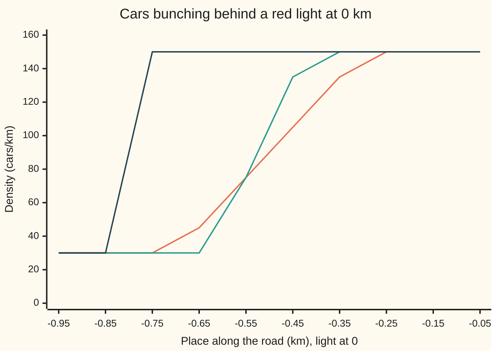
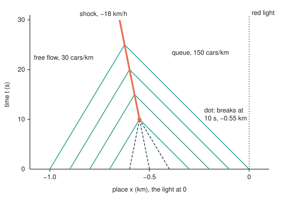

# Conservation laws: characteristics cross, and a front appears

[Syllabus](../../../SYLLABUS.md) → [Partial differential equations](../README.md) → [First-Order Equations and Characteristics](../README.md#s02) → Conservation laws

---

## General Overview

A one-lane road at rush hour. Cars arrive at 30 cars per kilometre, driving at 72 km/h. Ahead, a red light holds a queue packed at 150 cars/km, one car every 6.7 m. Between the two, from 700 m to 300 m before the light, drivers brake, and the density rises steadily from 30 to 150 cars/km. The numbers are illustrative.

Watch the braking zone. It shrinks. After 10.0 s the smooth rise has become a jump: density leaps from 30 to 150 cars/km at one place. That jump is a **shock** (a front where the density changes instantly). It is the tail of the queue, and from then on it moves backward at 18 km/h. After 60 s the queue reaches 800 m back from the light and holds 120 cars.

Three tools produce those numbers, and they are this card:

1. **The conservation law.** Counting cars, which are never made or lost, turns into a partial differential equation.
2. **The breaking time.** Density values travel along straight lines called characteristics. The time when two of them first cross is when the jump appears.
3. **The Rankine-Hugoniot rule.** The jump's speed is the jump in flow divided by the jump in density. Any other speed would lose or invent cars.

[The transport equation](../../08-Differential%20equations%20and%20dynamics/10-The%20Classical%20PDEs/02-the-transport-equation-and-characteristics.md) already showed that for $`u_t + u\,u_x = 0`$ each characteristic carries a constant value, and that neighbours first meet at time −1 over the steepest downward slope of the start. This card does that for any flow rule, and then says where the front goes once it exists.

**Counting cars gives the conservation law $`\rho_t + q(\rho)_x = 0`$; each density value travels at the wave speed $`q'(\rho)`$; where faster values catch slower ones, characteristics cross at the breaking time; and from then on a jump moves at the one speed $`s = [q]/[\rho]`$ that keeps every car counted.**

**What kind of fact this is:** the conservation law is exact bookkeeping: cars are counted, not modelled. The flow rule $`q(\rho)`$ is a model, an assumption that fits roughly. The breaking-time formula and the Rankine-Hugoniot rule are theorems, proved on this card in Why it works.

### The picture: the density along the road at 0 s, 5 s and 60 s



Orange: the start, a 400 m braking zone. Green: 5 s later, the zone is half as wide and twice as steep. Dark blue: 60 s, a jump at 0.8 km before the light, with the queue behind it.

---

## The formula

Notation first. As on [Characteristics](01-method-of-characteristics.md), $`\rho(x, t)`$ is the traffic density: cars per kilometre at place $`x`$ and time $`t`$. The **flow** $`q`$ is the number of cars passing one point per hour. Flow is density times car speed, and car speed depends on how crowded the road is. Subscripts are partial derivatives, as in wing 08: $`\rho_t`$ is the rate of change in time at a fixed place.

```math
\rho_t + q(\rho)_x = 0, \qquad q(\rho) = v_{\max}\,\rho\left(1 - \frac{\rho}{\rho_{\max}}\right)
```

**Read it aloud:** the density at a place rises exactly as fast as more cars flow in than flow out; and the flow is density times a car speed that falls in a straight line from the top speed on an empty road to zero at a jam.

The general **scalar conservation law** is $`u_t + f(u)_x = 0`$: one amount $`u`$ per unit length, carried by a **flux** $`f(u)`$ (the amount crossing a point per unit time). Traffic is the case $`u = \rho`$, $`f = q`$.

The breaking time, for any flux:

```math
t_b = \frac{-1}{\min_x \dfrac{d}{dx}\, q'\big(\rho_0(x)\big)} = \frac{-1}{\min_x\, q''\big(\rho_0(x)\big)\,\rho_0'(x)}
```

**Read it aloud:** find the place where the wave speed falls fastest from back to front; the first crossing comes at minus one over that rate of fall.

The shock speed, the **Rankine-Hugoniot rule**:

```math
s = \frac{[q]}{[\rho]} = \frac{q(\rho_R) - q(\rho_L)}{\rho_R - \rho_L}
```

**Read it aloud:** the front moves at the jump in flow across it divided by the jump in density across it.

| Symbol | Plain meaning | In our example | Push it up and the answer… |
| --- | --- | --- | --- |
| $`u`$, $`f(u)`$ | any conserved amount per unit length, and its flux | $`\rho`$ and $`q(\rho)`$ | — |
| $`\rho(x, t)`$ | density: cars per km at place $`x`$, time $`t`$ | 30 to 150 cars/km | — |
| $`x`$, $`t`$; $`a`$, $`b`$ | place along the road, light at 0; time; the two ends of a stretch of road | km; s or h; $`[-2, 0]`$ km in the car count | — |
| $`q(\rho)`$ | flow: cars passing a point per hour | 2160 cars/h at 30 cars/km | the queue grows faster |
| $`v(\rho)`$ | car speed, so that $`q = \rho\,v`$ | 72 km/h at 30 cars/km | — |
| $`v_{\max}`$, $`\rho_{\max}`$ | top speed on an empty road; jam density | 90 km/h; 150 cars/km | — |
| $`q'(\rho)`$ | wave speed: how fast one density value travels | +54, −18, −90 km/h | — |
| $`\rho_0(x)`$ | starting density, at $`t = 0`$ | 30, then a 400 m ramp, then 150 | a steeper ramp breaks sooner |
| $`\rho_L`$, $`\rho_R`$; $`[\,\cdot\,]`$ | density just behind and just ahead of a jump; the jump: value ahead minus value behind | 30 and 150 cars/km; $`[\rho] = 120`$, $`[q] = -2160`$ | — |
| $`s`$, $`X(t)`$ | shock speed, negative means backward; the shock's place, so $`X' = s`$ | −18 km/h; −0.8 km at 60 s | — |
| $`t_b`$ | breaking time: when characteristics first cross | 10.0 s | — |
| $`x_0`$, $`\delta`$; $`k`$, $`m`$, $`\phi_t`$ | where a characteristic starts, and a small gap between two starts; in the proof, the wave speed $`k(x_0) = q'(\rho_0(x_0))`$ carried from a start, its steepest fall per km, and the map from start to place at time $`t`$ | $`k`$ from +54 to −90 km/h; $`m = 1.2 \times 300`$ per hour, so $`t_b = 1/m`$ | — |

### When it holds

- **Cars are conserved.** No on-ramps or exits in the stretch. An on-ramp or exit adds a source term to the right-hand side, and the car count in the Rankine-Hugoniot argument gains it too.
- **Flow depends on density alone.** Real drivers react with a delay. Models with a second equation for speed allow stop-and-go waves that this one cannot make.
- **The flux is curved.** With $`q'' = 0`$ every density travels at one speed, the law is plain transport, and nothing ever crosses.
- **The right jump is chosen.** The Rankine-Hugoniot rule fits any jump that keeps the count, including a jump from 150 down to 30 cars/km that no real traffic makes. [Entropy conditions](03-entropy-conditions-and-vanishing-viscosity.md) picks the real one: characteristics must run *into* the shock from both sides. Here they do: +54 > −18 > −90 km/h.
- **The conserved quantity is the right one.** Multiply a conservation law by something and it may still hold where smooth, but it moves its jumps at a different speed. Traffic conserves cars.

The red light is a wall: no flow crosses $`x = 0`$. The jump from 150 cars/km to an empty road beyond it has Rankine-Hugoniot speed (0 − 0)/(0 − 150) = 0, so it stays at the stop line. When the light turns green, that jump fans out instead; that is [The Riemann problem](04-rarefaction-and-the-riemann-problem.md).

---

## Why it works

### Step 0: count the cars in a stretch

Take any stretch of road from $`a`$ to $`b`$. The number of cars in it changes only because cars cross its two ends. That single fact gives the equation, the crossing and the shock speed.

### Step 1: the count becomes an equation

The number of cars in the stretch is the integral of density. Its rate of change is the flow in at $`a`$ minus the flow out at $`b`$:

```math
\frac{d}{dt}\int_a^b \rho(x, t)\,dx = q\big(\rho(a, t)\big) - q\big(\rho(b, t)\big).
```

This **integral form** is the law itself. If $`\rho`$ is smooth, write the right side as $`-\int_a^b q(\rho)_x\,dx`$. Then the integral of $`\rho_t + q(\rho)_x`$ is zero over every stretch, so the integrand is zero: $`\rho_t + q(\rho)_x = 0`$.

### Step 2: each density value rides its own line

By the chain rule, $`q(\rho)_x = q'(\rho)\,\rho_x`$. So the law reads $`\rho_t + q'(\rho)\,\rho_x = 0`$. That is the transport equation, with speed $`q'(\rho)`$. As on [The transport equation](../../08-Differential%20equations%20and%20dynamics/10-The%20Classical%20PDEs/02-the-transport-equation-and-characteristics.md), the density is constant along each path with that speed. Since the density is constant there, so is the speed, and each path is a straight line:

```math
x = x_0 + q'\big(\rho_0(x_0)\big)\,t.
```

The wave speed is not the car speed. Differentiate $`q = \rho\,v`$: $`q' = v + \rho\,v'`$, and $`v' < 0`$, so a pattern always travels slower than the cars in it. At 30 cars/km the cars do 72 km/h and the pattern does +54 km/h. In the queue the cars stand still, and the pattern moves at −90 km/h: the news "brake" travels backward.

### Step 3: when neighbouring lines cross

Two lines starting a small distance $`\delta`$ apart stay apart by $`\delta\,(1 + t\,\tfrac{d}{dx_0} q'(\rho_0(x_0)))`$. Where the wave speed falls from back to front, the bracket shrinks, and it first reaches zero at the breaking time $`t_b`$ of The formula. At that moment the lines touch, and the density slope, which is the starting slope divided by the same bracket, becomes infinite.

For our road, $`q'' = -2\,v_{\max}/\rho_{\max} = -1.2`$ (km/h per car/km), and the ramp rises 300 cars/km per km. So $`t_b = 1/(1.2 \times 300)`$ h = 10.0 s. A quadratic flux and a straight ramp make every ramp line meet at one point, (−0.55 km, 10.0 s), shown below.

<p align="center"></p>

To scale: 400 px per km across, 10 px per second up. Lines from 1.0, 0.9, 0.8 and 0.7 km before the light, and from 0.3, 0.2, 0.1 and 0 km, run into the shock at 25, 20, 15, 10 s and at 10, 15, 20, 25 s. The shock runs from (−0.55 km, 10 s) to (−0.65 km, 30 s). Lines starting at the stop line after 0 s are left out.

### Step 4: the jump keeps the count

After $`t_b`$ the smooth solution would need two densities at one place. A jump replaces it. Put the jump at $`X(t)`$, with density $`\rho_L`$ behind and $`\rho_R`$ ahead, and a stretch $`a < X < b`$ around it. The cars in the stretch number $`\rho_L\,(X - a) + \rho_R\,(b - X)`$. Their rate of change is $`(\rho_L - \rho_R)\,X'`$. By Step 1 it must equal $`q(\rho_L) - q(\rho_R)`$. Divide:

```math
X'(t) = \frac{q(\rho_R) - q(\rho_L)}{\rho_R - \rho_L} = \frac{0 - 2160}{150 - 30} = -18 \text{ km/h}.
```

For this flux the rule has a shortcut: $`s = v_{\max}\,(1 - (\rho_L + \rho_R)/\rho_{\max})`$, which gives 90 (1 − 180/150) = −18 km/h again.

### Step 5: which kind of solution this is

After $`t_b`$ there is no classical solution (one with derivatives everywhere). There is a **weak solution**: a density that obeys the integral form of Step 1 over every stretch, jumps included. Weak solutions are not unique. The one that is unique is the **entropy solution**, which adds an entropy condition (for a curved flux like this one, the condition in When it holds); Kružkov proved that in 1970, and [Entropy conditions](03-entropy-conditions-and-vanishing-viscosity.md) states his theorem and cites it. The queue on this card is that entropy solution.

<details>
<summary>Detailed proof: the breaking time and the jump rule from the integral form</summary>

**Breaking time.** Let $`\rho_0`$ have a continuous slope and let $`k(x_0) = q'(\rho_0(x_0))`$ have a bounded slope with a negative minimum $`-m`$. The map from start to place at time $`t`$ is $`\phi_t(x_0) = x_0 + k(x_0)\,t`$, with slope

$`\displaystyle \phi_t'(x_0) = 1 + k'(x_0)\,t \ge 1 - m\,t.`$

For $`t < 1/m`$ the slope is positive everywhere, so $`\phi_t`$ is one-to-one and onto. Each point then lies on exactly one line, and $`\rho(x, t) = \rho_0(\phi_t^{-1}(x))`$ is a classical solution, by Step 2. Its slope is

$`\displaystyle \rho_x = \frac{\rho_0'(x_0)}{1 + k'(x_0)\,t}.`$

At a start where $`k' = -m`$, the denominator reaches zero as $`t \to 1/m`$. There $`\rho_0' \ne 0`$, since $`k' = q''\rho_0'`$ is not zero. So the slope becomes infinite and no classical solution continues. Hence $`t_b = 1/m`$.

**Jump rule.** Suppose $`\rho`$ is smooth on each side of a curve $`X(t)`$ with a continuous slope, obeys the law on each side, and obeys the integral form across it. Split the integral at $`X`$ and differentiate each part by the Leibniz rule:

$`\displaystyle \frac{d}{dt}\int_a^b \rho\,dx = \int_a^{X} \rho_t\,dx + \int_X^b \rho_t\,dx + \rho_L X' - \rho_R X'.`$

On each side $`\rho_t = -q(\rho)_x`$, so the two integrals give $`q(\rho(a)) - q(\rho_L) + q(\rho_R) - q(\rho(b))`$. Set the total equal to $`q(\rho(a)) - q(\rho(b))`$ and cancel:

$`\displaystyle (\rho_L - \rho_R)\,X' = q(\rho_L) - q(\rho_R).`$

That is the Rankine-Hugoniot rule. It holds at every point of the curve.

</details>

A third road needs no formula at all: cut the road into cells and pass cars between them, each cell sending what it can and the next accepting what it has room for. That grid is road 3 in the code; the method is the subject of [Flow problems](../../16-Numerical%20analysis/07-PDE%20Solvers/06-upwind-schemes-and-conservation-laws.md).

---

## Worked numbers, by hand

| Step | Arithmetic | Value |
| --- | --- | --- |
| flow arriving | 90 × 30 × (1 − 30/150) | 2160 cars/h |
| wave speed arriving, $`q'(30)`$ | 90 × (1 − 60/150) | +54 km/h |
| wave speed in the queue, $`q'(150)`$ | 90 × (1 − 300/150) | −90 km/h |
| curvature, $`q''`$ | −2 × 90/150 | −1.2 |
| breaking time | 1/(1.2 × 300) h = 0.002778 h | **10.0 s** |
| where it breaks | ramp centre −0.5 km, wave speed −18 km/h, for 10 s | −0.550 km |
| shock speed | (0 − 2160)/(150 − 30) | **−18 km/h** = −5.0 m/s |
| tail at 60 s | −0.55 + (−18) × 50/3600 | −0.8000 km |
| cars in the queue | 0.8 × 150 | **120 cars** |
| check by counting, on [−2, 0] km | 120 at start + 36 in = 156 = 30(X + 2) + 150(−X) | X = −0.8000 km |

A 60 s red light leaves the tail of the queue 800 m before the light. It moves back at 5.0 m/s, so a driver arriving at 72 km/h meets it sooner than the queue's start suggests.

### What breaks if you drop a piece

| Mistake | Comes out at | What went wrong |
| --- | --- | --- |
| characteristics drawn at the car speed $`v`$, not $`q'`$ | breaks at 20.0 s, not 10.0 s | patterns travel slower than cars |
| shock speed with its sign flipped, +18 km/h | tail at −0.3000 km after 60 s; 96 cars counted, not 156 | the queue shrinks while cars arrive, so cars vanish |
| Burgers $`u_t + u\,u_x = 0`$ rewritten as $`(u^2/2)_t + (u^3/3)_x = 0`$ | its 1-to-0 jump moves at 2/3, not 1/2 | same smooth equation, different conserved quantity |

The checks print all three. The third shows that "the same equation" is not enough: the jump depends on which quantity is conserved.

---

## Code, from first principles, and it actually runs

Three roads. Road 1 is the formulas: breaking time, Rankine-Hugoniot, the exact queue. Road 2 checks each formula a second way: a search over 20001 neighbouring characteristics for the first crossing, both for the straight ramp and for a smooth $`\tanh`$-shaped braking zone with the same steepest slope; bisection back along characteristics for the profile at 5 s; and a plain car count for the tail at 60 s. Road 3 is a cell grid (the cell transmission model, Godunov's method for traffic) that knows no formula. It conserves cars exactly, puts the tail where the formula does, and misplaces fewer cars each time the cell halves, at order 1.

### Python

```python
# Conservation law rho_t + q(rho)_x = 0 -- the check behind the card.  Cars bunch behind
# a red light on a one-lane road.  Greenshields flux q = VM rho (1 - rho/RM).  Roads: the
# breaking-time formula against a search over characteristics; Rankine-Hugoniot against
# counting cars; both against a cell-transmission grid that knows no formula.
from fractions import Fraction as F
from math import exp

VM, RM = 90.0, 150.0                       # top speed km/h, jam density cars/km
def q(r): return VM * r * (1 - r / RM)     # flow, cars/h
def c(r): return VM * (1 - 2 * r / RM)     # characteristic (wave) speed q'(rho), km/h
def v(r): return VM * (1 - r / RM)         # car speed, km/h
def rho0(x):                               # t = 0: 30 cars/km, braking zone, queue to the light
    return 30.0 if x <= -0.7 else 30 + 300 * (x + 0.7) if x <= -0.3 else 150.0
def smooth0(x): return 90 + 60 * (1 - 2 / (1 + exp(2 * (x + 0.5) / 0.2)))  # 90 + 60 tanh
TB = 1 / (2 * VM / RM * 300)               # breaking time: -1/(q'' * steepest slope), h
XS = -0.5 + c(90) * TB                     # where: the ramp's centre line, km
S = (q(150) - q(30)) / (150 - 30)          # Rankine-Hugoniot shock speed, km/h

def exact(x, t):                           # the entropy solution, x <= 0 km, t in h
    if t < TB:
        a, b = -0.7 + c(30) * t, -0.3 + c(150) * t
        return 30.0 if x <= a else 150.0 if x >= b else 30 + 120 * (x - a) / (b - a)
    return 30.0 if x < XS + S * (t - TB) else 150.0

def by_characteristics(x, t):              # road 2 before breaking: solve x0 + c(rho0(x0)) t = x
    lo, hi = -3.0, 0.0
    for _ in range(60):
        m = (lo + hi) / 2
        if m + c(rho0(m)) * t < x: lo = m
        else: hi = m
    return rho0((lo + hi) / 2)

def search(prof, n=20000):                 # earliest crossing of neighbouring characteristics
    xs = [-1.5 + 1.5 * i / n for i in range(n + 1)]; cs = [c(prof(x)) for x in xs]
    return min((xs[i] - xs[i + 1]) / (cs[i + 1] - cs[i]) for i in range(n) if cs[i + 1] < cs[i])

def grid(h, T):                            # road 3: cell transmission (Godunov) on [-2, 0] km
    n = round(2 / h); r = [rho0(-2 + (i + 0.5) * h) for i in range(n)]
    qm = q(RM / 2); dem = lambda a: q(a) if a < RM / 2 else qm; sup = lambda a: qm if a < RM / 2 else q(a)
    steps = int(T / (0.9 * h / VM)) + 1; k = T / steps   # each step inside the CFL limit
    for _ in range(steps):                 # inflow at 30 cars/km on the left, red light on the right
        fl = [min(dem(30.0), sup(r[0]))] + [min(dem(r[i]), sup(r[i + 1])) for i in range(n - 1)] + [0.0]
        r = [r[i] - k / h * (fl[i + 1] - fl[i]) for i in range(n)]
    return r

def tail(r, h):                            # where the grid's density crosses 90 cars/km
    i = next(i for i in range(len(r)) if r[i] >= 90); xa = -2 + (i - 0.5) * h
    return xa + (90 - r[i - 1]) / (r[i] - r[i - 1]) * h

print(f"start: 30 cars/km to -0.7 km, rising 300 cars/km per km over 400 m to 150 at -0.3 km, queue to the light at 0 km")
print(f"top speed {VM:.0f} km/h, jam {RM:.0f} cars/km = one car per {1000 / RM:.1f} m; top flow q(75) = {q(75):.0f} cars/h")
print(f"flux q(rho) = {VM:.0f} rho (1 - rho/{RM:.0f}): q(30) = {q(30):.0f} cars/h at {v(30):.0f} km/h; q(150) = {q(150):.0f}")
print(f"wave speeds q'(30) = {c(30):+.0f} km/h, q'(90) = {c(90):+.0f} km/h, q'(150) = {c(150):+.0f} km/h")
print(f"breaking time by formula: 1/(1.2 x 300) = {TB:.6f} h = {TB * 3600:.1f} s, at x = {XS:.3f} km")
lin, smo = search(rho0), search(smooth0)
print(f"road 2, search over 20001 characteristics: braking ramp {lin * 3600:.4f} s, smooth tanh zone {smo * 3600:.4f} s")
print(f"slope inside the ramp at 5 s: 300/(1 - 5/10) = {300 / (1 - 5 / (TB * 3600)):.0f} cars/km per km")
qf = lambda r: F(90 * r * (150 - r), 150)  # exact flow, cars/h
Fs = (qf(150) - qf(30)) / (150 - 30)
print(f"Rankine-Hugoniot: s = (0 - 2160)/(150 - 30) = {Fs} km/h exactly = {S / 3.6:.1f} m/s")
print(f"same by the Greenshields shortcut 90 (1 - 180/150) = {VM * (1 - 180 / RM):.0f} km/h")
T = 1 / 60; X = XS + S * (T - TB)
print(f"queue tail at 60 s: -0.55 + (-18)(50/3600) = {X:.4f} km; queue {-X * 1000:.0f} m holding {-X * 150:.0f} cars")
cars0 = 1.3 * 30 + 0.4 * 90 + 0.3 * 150; inflow = q(30) * T
Xc = (cars0 + inflow - 30 * 2) / (30 - 150)
print(f"road 2, count cars on [-2, 0] km: {cars0:.0f} at start + {inflow:.0f} in = {cars0 + inflow:.0f}; tail where 30(X + 2) + 150(-X) = 156: X = {Xc:.4f} km")
errs = []
for h in (0.01, 0.005, 0.0025):
    r5, r60 = grid(h, 5 / 3600), grid(h, T)
    errs.append(sum(abs(r5[i] - exact(-2 + (i + 0.5) * h, 5 / 3600)) for i in range(len(r5))) * h)
    print(f"road 3, cell grid h = {h * 1000:g} m: tail at 60 s {tail(r60, h):.4f} km, cars {sum(r60) * h:.4f};"
          f" at 5 s {errs[-1]:.4f} cars out of place")
print(f"error ratios as h halves: {errs[0] / errs[1]:.2f}, {errs[1] / errs[2]:.2f} (order 1)")
mid = [-0.95 + 0.1 * i for i in range(10)]
gap = max(abs(by_characteristics(x, 5 / 3600) - exact(x, 5 / 3600)) for x in mid)
print(f"profile at 5 s by tracing characteristics back, largest gap from formula: {gap:.6f} cars/km")
for t in (0, 5, 60):
    print(f"chart, t = {t} s:", ", ".join(f"{exact(x, t / 3600):.0f}" for x in mid))
tw = 1 / (VM / RM * 300)
print(f"mistake 1, characteristics at car speed v: breaks at {tw * 3600:.1f} s, not {TB * 3600:.1f} s")
Xw = XS - S * (T - TB); cw = 30 * (Xw + 2) + 150 * (-Xw)
print(f"mistake 2, sign flipped, +18 km/h: tail at {Xw:.4f} km, cars counted {cw:.0f}, not 156")
jmp = lambda f: f(F(0)) - f(F(1))          # Burgers 1-to-0 jump [f] = f(u_R) - f(u_L), exact
b1 = jmp(lambda u: u * u / 2) / jmp(lambda u: u); b2 = jmp(lambda u: u ** 3 / 3) / jmp(lambda u: u * u / 2)
print(f"mistake 3, Burgers 1-to-0 jump: conserving u gives {b1}, conserving u^2/2 gives {b2}")
print(f"try, arriving at 60 cars/km: s = {(q(150) - q(60)) / 90:.0f} km/h; braking zone 800 m: breaks at {1 / (1.2 * 150) * 3600:.1f} s")
print(f"figure, shock from ({XS:.3f} km, {TB * 3600:.1f} s) to ({XS + S * (30 / 3600 - TB):.3f} km, 30.0 s)")
up = [(-0.5 - x0) / ((c(30) - S) / 3600) for x0 in (-1.0, -0.9, -0.8, -0.7)]
dn = [(x0 + 0.5) / ((S - c(150)) / 3600) for x0 in (-0.3, -0.2, -0.1, 0.0)]
print("figure, lines from -1.0 -0.9 -0.8 -0.7 km hit the shock at", " ".join(f"{t:.1f}" for t in up),
      "s; from -0.3 -0.2 -0.1 0.0 km at", " ".join(f"{t:.1f}" for t in dn), "s")
assert abs(lin - TB) < 1e-9 and abs(smo - TB) < 1e-4 * TB      # search meets breaking formula
assert Fs == -18 and abs(Xc - X) < 1e-12                        # RH meets the car count
assert abs(tail(r60, 0.0025) - X) < 1e-4 and abs(sum(r60) * 0.0025 - 156) < 1e-6  # grid meets RH, count
assert errs[2] < 0.1 and 1.8 < errs[1] / errs[2] < 2.2         # grid meets the profile at order 1
assert gap < 1e-9                                               # characteristics meet formula
assert b1 == F(1, 2) and b2 == F(2, 3)                          # Burgers: the jump depends on what is conserved
print("ALL CHECKS PASS")
```

**Ran 2026-11-15 on macOS, Python 3.14.10, standard library only. All checks passed. Output, pasted from the run:**

```
start: 30 cars/km to -0.7 km, rising 300 cars/km per km over 400 m to 150 at -0.3 km, queue to the light at 0 km
top speed 90 km/h, jam 150 cars/km = one car per 6.7 m; top flow q(75) = 3375 cars/h
flux q(rho) = 90 rho (1 - rho/150): q(30) = 2160 cars/h at 72 km/h; q(150) = 0
wave speeds q'(30) = +54 km/h, q'(90) = -18 km/h, q'(150) = -90 km/h
breaking time by formula: 1/(1.2 x 300) = 0.002778 h = 10.0 s, at x = -0.550 km
road 2, search over 20001 characteristics: braking ramp 10.0000 s, smooth tanh zone 10.0000 s
slope inside the ramp at 5 s: 300/(1 - 5/10) = 600 cars/km per km
Rankine-Hugoniot: s = (0 - 2160)/(150 - 30) = -18 km/h exactly = -5.0 m/s
same by the Greenshields shortcut 90 (1 - 180/150) = -18 km/h
queue tail at 60 s: -0.55 + (-18)(50/3600) = -0.8000 km; queue 800 m holding 120 cars
road 2, count cars on [-2, 0] km: 120 at start + 36 in = 156; tail where 30(X + 2) + 150(-X) = 156: X = -0.8000 km
road 3, cell grid h = 10 m: tail at 60 s -0.8000 km, cars 156.0000; at 5 s 0.2717 cars out of place
road 3, cell grid h = 5 m: tail at 60 s -0.8000 km, cars 156.0000; at 5 s 0.1364 cars out of place
road 3, cell grid h = 2.5 m: tail at 60 s -0.8000 km, cars 156.0000; at 5 s 0.0704 cars out of place
error ratios as h halves: 1.99, 1.94 (order 1)
profile at 5 s by tracing characteristics back, largest gap from formula: 0.000000 cars/km
chart, t = 0 s: 30, 30, 30, 45, 75, 105, 135, 150, 150, 150
chart, t = 5 s: 30, 30, 30, 30, 75, 135, 150, 150, 150, 150
chart, t = 60 s: 30, 30, 150, 150, 150, 150, 150, 150, 150, 150
mistake 1, characteristics at car speed v: breaks at 20.0 s, not 10.0 s
mistake 2, sign flipped, +18 km/h: tail at -0.3000 km, cars counted 96, not 156
mistake 3, Burgers 1-to-0 jump: conserving u gives 1/2, conserving u^2/2 gives 2/3
try, arriving at 60 cars/km: s = -36 km/h; braking zone 800 m: breaks at 20.0 s
figure, shock from (-0.550 km, 10.0 s) to (-0.650 km, 30.0 s)
figure, lines from -1.0 -0.9 -0.8 -0.7 km hit the shock at 25.0 20.0 15.0 10.0 s; from -0.3 -0.2 -0.1 0.0 km at 10.0 15.0 20.0 25.0 s
ALL CHECKS PASS
```

### Rust

Same numbers, same labels, built with `rustc --edition 2021 -O`.

```rust
// Conservation law rho_t + q(rho)_x = 0 -- the same check in Rust, std only.  Cars bunch
// behind a red light on a one-lane road.  Greenshields flux q = VM rho (1 - rho/RM).  Roads:
// the breaking-time formula against a search over characteristics; Rankine-Hugoniot against
// counting cars; both against a cell-transmission grid that knows no formula.
const VM: f64 = 90.0; // top speed, km/h
const RM: f64 = 150.0; // jam density, cars/km
fn q(r: f64) -> f64 { VM * r * (1.0 - r / RM) } // flow, cars/h
fn c(r: f64) -> f64 { VM * (1.0 - 2.0 * r / RM) } // characteristic (wave) speed q'(rho), km/h
fn v(r: f64) -> f64 { VM * (1.0 - r / RM) } // car speed, km/h
fn rho0(x: f64) -> f64 { // t = 0: 30 cars/km, braking zone, queue to the light
    if x <= -0.7 { 30.0 } else if x <= -0.3 { 30.0 + 300.0 * (x + 0.7) } else { 150.0 }
}
fn smooth0(x: f64) -> f64 { 90.0 + 60.0 * (1.0 - 2.0 / (1.0 + (2.0 * (x + 0.5) / 0.2).exp())) } // 90 + 60 tanh
const TB: f64 = 1.0 / (2.0 * VM / RM * 300.0); // breaking time: -1/(q'' * steepest slope), h
fn xs() -> f64 { -0.5 + c(90.0) * TB } // where: the ramp's centre line, km
fn s() -> f64 { (q(150.0) - q(30.0)) / (150.0 - 30.0) } // Rankine-Hugoniot shock speed, km/h

fn exact(x: f64, t: f64) -> f64 { // the entropy solution, x <= 0 km, t in h
    if t < TB {
        let (a, b) = (-0.7 + c(30.0) * t, -0.3 + c(150.0) * t);
        return if x <= a { 30.0 } else if x >= b { 150.0 } else { 30.0 + 120.0 * (x - a) / (b - a) };
    }
    if x < xs() + s() * (t - TB) { 30.0 } else { 150.0 }
}

fn by_characteristics(x: f64, t: f64) -> f64 { // road 2 before breaking: solve x0 + c(rho0(x0)) t = x
    let (mut lo, mut hi) = (-3.0, 0.0);
    for _ in 0..60 {
        let m = (lo + hi) / 2.0;
        if m + c(rho0(m)) * t < x { lo = m } else { hi = m }
    }
    rho0((lo + hi) / 2.0)
}

fn search(prof: fn(f64) -> f64) -> f64 { // earliest crossing of neighbouring characteristics
    let n = 20000;
    let xs: Vec<f64> = (0..=n).map(|i| -1.5 + 1.5 * i as f64 / n as f64).collect();
    let cs: Vec<f64> = xs.iter().map(|&x| c(prof(x))).collect();
    (0..n).filter(|&i| cs[i + 1] < cs[i]).map(|i| (xs[i] - xs[i + 1]) / (cs[i + 1] - cs[i]))
        .fold(f64::INFINITY, f64::min)
}

fn grid(h: f64, t: f64) -> Vec<f64> { // road 3: cell transmission (Godunov) on [-2, 0] km
    let n = (2.0 / h).round() as usize;
    let mut r: Vec<f64> = (0..n).map(|i| rho0(-2.0 + (i as f64 + 0.5) * h)).collect();
    let qm = q(RM / 2.0);
    let dem = |a: f64| if a < RM / 2.0 { q(a) } else { qm };
    let sup = |a: f64| if a < RM / 2.0 { qm } else { q(a) };
    let steps = (t / (0.9 * h / VM)) as usize + 1; // each step inside the CFL limit
    let k = t / steps as f64;
    for _ in 0..steps { // inflow at 30 cars/km on the left, red light on the right
        let mut fl = vec![dem(30.0).min(sup(r[0]))];
        for i in 0..n - 1 { fl.push(dem(r[i]).min(sup(r[i + 1]))) }
        fl.push(0.0);
        r = (0..n).map(|i| r[i] - k / h * (fl[i + 1] - fl[i])).collect();
    }
    r
}

fn tail(r: &[f64], h: f64) -> f64 { // where the grid's density crosses 90 cars/km
    let i = (0..r.len()).find(|&i| r[i] >= 90.0).unwrap();
    let xa = -2.0 + (i as f64 - 0.5) * h;
    xa + (90.0 - r[i - 1]) / (r[i] - r[i - 1]) * h
}

fn gcd(a: i64, b: i64) -> i64 { if b == 0 { a.abs() } else { gcd(b, a % b) } }
fn frac(n: i64, d: i64) -> String { // exact rational, printed like Python's Fraction
    let g = gcd(n, d); let (n, d) = if d / g < 0 { (-n / g, -d / g) } else { (n / g, d / g) };
    if d == 1 { format!("{}", n) } else { format!("{}/{}", n, d) }
}

fn main() {
    let (xs_, s_) = (xs(), s());
    println!("start: 30 cars/km to -0.7 km, rising 300 cars/km per km over 400 m to 150 at -0.3 km, queue to the light at 0 km");
    println!("top speed {:.0} km/h, jam {:.0} cars/km = one car per {:.1} m; top flow q(75) = {:.0} cars/h", VM, RM, 1000.0 / RM, q(75.0));
    println!("flux q(rho) = {:.0} rho (1 - rho/{:.0}): q(30) = {:.0} cars/h at {:.0} km/h; q(150) = {:.0}", VM, RM, q(30.0), v(30.0), q(150.0));
    println!("wave speeds q'(30) = {:+.0} km/h, q'(90) = {:+.0} km/h, q'(150) = {:+.0} km/h", c(30.0), c(90.0), c(150.0));
    println!("breaking time by formula: 1/(1.2 x 300) = {:.6} h = {:.1} s, at x = {:.3} km", TB, TB * 3600.0, xs_);
    let (lin, smo) = (search(rho0), search(smooth0));
    println!("road 2, search over 20001 characteristics: braking ramp {:.4} s, smooth tanh zone {:.4} s", lin * 3600.0, smo * 3600.0);
    println!("slope inside the ramp at 5 s: 300/(1 - 5/10) = {:.0} cars/km per km", 300.0 / (1.0 - 5.0 / (TB * 3600.0)));
    let qf = |r: i64| (90 * r * (150 - r), 150); // exact flow, cars/h, as numerator and denominator
    let (fs_n, fs_d) = (qf(150).0 * qf(30).1 - qf(30).0 * qf(150).1, qf(150).1 * qf(30).1 * (150 - 30));
    println!("Rankine-Hugoniot: s = (0 - 2160)/(150 - 30) = {} km/h exactly = {:.1} m/s", frac(fs_n, fs_d), s_ / 3.6);
    println!("same by the Greenshields shortcut 90 (1 - 180/150) = {:.0} km/h", VM * (1.0 - 180.0 / RM));
    let t60 = 1.0 / 60.0;
    let x60 = xs_ + s_ * (t60 - TB);
    println!("queue tail at 60 s: -0.55 + (-18)(50/3600) = {:.4} km; queue {:.0} m holding {:.0} cars", x60, -x60 * 1000.0, -x60 * 150.0);
    let cars0 = 1.3 * 30.0 + 0.4 * 90.0 + 0.3 * 150.0;
    let inflow = q(30.0) * t60;
    let xc = (cars0 + inflow - 30.0 * 2.0) / (30.0 - 150.0);
    println!("road 2, count cars on [-2, 0] km: {:.0} at start + {:.0} in = {:.0}; tail where 30(X + 2) + 150(-X) = 156: X = {:.4} km", cars0, inflow, cars0 + inflow, xc);
    let mut errs = vec![];
    let mut r60 = vec![];
    for h in [0.01, 0.005, 0.0025] {
        let r5 = grid(h, 5.0 / 3600.0);
        r60 = grid(h, t60);
        errs.push((0..r5.len()).map(|i| (r5[i] - exact(-2.0 + (i as f64 + 0.5) * h, 5.0 / 3600.0)).abs()).sum::<f64>() * h);
        println!("road 3, cell grid h = {} m: tail at 60 s {:.4} km, cars {:.4}; at 5 s {:.4} cars out of place",
            h * 1000.0, tail(&r60, h), r60.iter().sum::<f64>() * h, errs[errs.len() - 1]);
    }
    println!("error ratios as h halves: {:.2}, {:.2} (order 1)", errs[0] / errs[1], errs[1] / errs[2]);
    let mid: Vec<f64> = (0..10).map(|i| -0.95 + 0.1 * i as f64).collect();
    let gap = mid.iter().map(|&x| (by_characteristics(x, 5.0 / 3600.0) - exact(x, 5.0 / 3600.0)).abs()).fold(0.0, f64::max);
    println!("profile at 5 s by tracing characteristics back, largest gap from formula: {:.6} cars/km", gap);
    for t in [0, 5, 60] {
        let row: Vec<String> = mid.iter().map(|&x| format!("{:.0}", exact(x, t as f64 / 3600.0))).collect();
        println!("chart, t = {} s: {}", t, row.join(", "));
    }
    let tw = 1.0 / (VM / RM * 300.0);
    println!("mistake 1, characteristics at car speed v: breaks at {:.1} s, not {:.1} s", tw * 3600.0, TB * 3600.0);
    let xw = xs_ - s_ * (t60 - TB);
    let cw = 30.0 * (xw + 2.0) + 150.0 * (-xw);
    println!("mistake 2, sign flipped, +18 km/h: tail at {:.4} km, cars counted {:.0}, not 156", xw, cw);
    let jmp = |f: fn(i64) -> (i64, i64)| { let (r, l) = (f(0), f(1)); (r.0 * l.1 - l.0 * r.1, r.1 * l.1) }; // Burgers 1-to-0 jump [f], exact
    let ratio = |a: (i64, i64), b: (i64, i64)| frac(a.0 * b.1, a.1 * b.0); // [flux] / [conserved quantity]
    let (b1, b2) = (ratio(jmp(|u| (u * u, 2)), jmp(|u| (u, 1))), ratio(jmp(|u| (u * u * u, 3)), jmp(|u| (u * u, 2))));
    println!("mistake 3, Burgers 1-to-0 jump: conserving u gives {}, conserving u^2/2 gives {}", b1, b2);
    println!("try, arriving at 60 cars/km: s = {:.0} km/h; braking zone 800 m: breaks at {:.1} s", (q(150.0) - q(60.0)) / 90.0, 1.0 / (1.2 * 150.0) * 3600.0);
    println!("figure, shock from ({:.3} km, {:.1} s) to ({:.3} km, 30.0 s)", xs_, TB * 3600.0, xs_ + s_ * (30.0 / 3600.0 - TB));
    let up: Vec<String> = [-1.0, -0.9, -0.8, -0.7].iter().map(|x0: &f64| format!("{:.1}", (-0.5 - x0) / ((c(30.0) - s_) / 3600.0))).collect();
    let dn: Vec<String> = [-0.3, -0.2, -0.1, 0.0].iter().map(|x0: &f64| format!("{:.1}", (x0 + 0.5) / ((s_ - c(150.0)) / 3600.0))).collect();
    println!("figure, lines from -1.0 -0.9 -0.8 -0.7 km hit the shock at {} s; from -0.3 -0.2 -0.1 0.0 km at {} s", up.join(" "), dn.join(" "));
    assert!((lin - TB).abs() < 1e-9 && (smo - TB).abs() < 1e-4 * TB); // search meets breaking formula
    assert!(frac(fs_n, fs_d) == "-18" && (xc - x60).abs() < 1e-12); // RH meets the car count
    assert!((tail(&r60, 0.0025) - x60).abs() < 1e-4 && (r60.iter().sum::<f64>() * 0.0025 - 156.0).abs() < 1e-6); // grid meets RH, count
    assert!(errs[2] < 0.1 && errs[1] / errs[2] > 1.8 && errs[1] / errs[2] < 2.2); // grid meets the profile at order 1
    assert!(gap < 1e-9); // characteristics meet formula
    assert!(b1 == "1/2" && b2 == "2/3"); // Burgers: the jump depends on what is conserved
    println!("ALL CHECKS PASS");
}
```

**Ran 2026-11-15 on macOS, rustc 1.98.1, no crates. All checks passed. Output, pasted from the run:**

```
start: 30 cars/km to -0.7 km, rising 300 cars/km per km over 400 m to 150 at -0.3 km, queue to the light at 0 km
top speed 90 km/h, jam 150 cars/km = one car per 6.7 m; top flow q(75) = 3375 cars/h
flux q(rho) = 90 rho (1 - rho/150): q(30) = 2160 cars/h at 72 km/h; q(150) = 0
wave speeds q'(30) = +54 km/h, q'(90) = -18 km/h, q'(150) = -90 km/h
breaking time by formula: 1/(1.2 x 300) = 0.002778 h = 10.0 s, at x = -0.550 km
road 2, search over 20001 characteristics: braking ramp 10.0000 s, smooth tanh zone 10.0000 s
slope inside the ramp at 5 s: 300/(1 - 5/10) = 600 cars/km per km
Rankine-Hugoniot: s = (0 - 2160)/(150 - 30) = -18 km/h exactly = -5.0 m/s
same by the Greenshields shortcut 90 (1 - 180/150) = -18 km/h
queue tail at 60 s: -0.55 + (-18)(50/3600) = -0.8000 km; queue 800 m holding 120 cars
road 2, count cars on [-2, 0] km: 120 at start + 36 in = 156; tail where 30(X + 2) + 150(-X) = 156: X = -0.8000 km
road 3, cell grid h = 10 m: tail at 60 s -0.8000 km, cars 156.0000; at 5 s 0.2717 cars out of place
road 3, cell grid h = 5 m: tail at 60 s -0.8000 km, cars 156.0000; at 5 s 0.1364 cars out of place
road 3, cell grid h = 2.5 m: tail at 60 s -0.8000 km, cars 156.0000; at 5 s 0.0704 cars out of place
error ratios as h halves: 1.99, 1.94 (order 1)
profile at 5 s by tracing characteristics back, largest gap from formula: 0.000000 cars/km
chart, t = 0 s: 30, 30, 30, 45, 75, 105, 135, 150, 150, 150
chart, t = 5 s: 30, 30, 30, 30, 75, 135, 150, 150, 150, 150
chart, t = 60 s: 30, 30, 150, 150, 150, 150, 150, 150, 150, 150
mistake 1, characteristics at car speed v: breaks at 20.0 s, not 10.0 s
mistake 2, sign flipped, +18 km/h: tail at -0.3000 km, cars counted 96, not 156
mistake 3, Burgers 1-to-0 jump: conserving u gives 1/2, conserving u^2/2 gives 2/3
try, arriving at 60 cars/km: s = -36 km/h; braking zone 800 m: breaks at 20.0 s
figure, shock from (-0.550 km, 10.0 s) to (-0.650 km, 30.0 s)
figure, lines from -1.0 -0.9 -0.8 -0.7 km hit the shock at 25.0 20.0 15.0 10.0 s; from -0.3 -0.2 -0.1 0.0 km at 10.0 15.0 20.0 25.0 s
ALL CHECKS PASS
```

The two outputs match line for line.

### Lean

Lean proves the jump rule, the breaking time and the slower wave speed for any flux, and checks the worked numbers.

- Take a moving jump from $`\rho_L`$ behind to a different $`\rho_R`$ ahead, at $`X(t)`$ inside a stretch from $`a`$ to $`b`$. Then the car count changes at $`q(\rho_L) - q(\rho_R)`$ exactly when $`X'(t) = [q]/[\rho]`$.
- Suppose $`q''`$ and $`\rho_0'`$ are continuous, and $`k`$ has steepest fall $`m > 0`$, reached somewhere. Then for $`0 \le t < 1/m`$, $`\phi_t`$ is one-to-one and onto: no two characteristics cross.
- With the same flux and start, take any time after $`1/m`$. Then two characteristics from different starts have already met before it.
- Suppose $`q = \rho\,v`$, with $`v' < 0`$ and $`\rho > 0`$. Then the wave speed $`q'(\rho)`$ is below the car speed $`v(\rho)`$.
- The worked numbers, the three mistakes and the two `try,` lines also check, in exact fractions.

The characteristic search, the 5 s profile, the smooth $`\tanh`$ zone and the cell grid are left to the Python and Rust checks.

```lean
-- Conservation laws: a jump keeps the car count exactly when it moves at the Rankine-Hugoniot speed [q]/[ρ], characteristics first cross at t_b = 1/m, and density patterns travel slower than the cars.
import Mathlib.MeasureTheory.Integral.IntervalIntegral.Basic
import Mathlib.Analysis.Calculus.ContDiff.Defs
import Mathlib.Analysis.Calculus.Deriv.Mul
import Mathlib.Tactic.NormNum
import Mathlib.Analysis.Calculus.Deriv.MeanValue
import Mathlib.Analysis.Calculus.Deriv.Slope
import Mathlib.Analysis.Calculus.ContDiff.Deriv
import Mathlib.Topology.Order.IntermediateValue

open MeasureTheory

/-- Helper: the integral of a one-jump step function over an interval containing the jump. -/
theorem step_interval_integral (ρL ρR a b c : ℝ) (ha : a < c) (hb : c < b) :
    ∫ x in a..b, (if x < c then ρL else ρR) = ρL * (c - a) + ρR * (b - c) := by
  have h1 : Set.EqOn (fun _ : ℝ => ρL) (fun x => if x < c then ρL else ρR) (Set.uIoo a c) := by
    intro x hx
    rw [Set.uIoo_of_le ha.le] at hx
    simp [hx.2]
  have h2 : Set.EqOn (fun _ : ℝ => ρR) (fun x => if x < c then ρL else ρR) (Set.uIoo c b) := by
    intro x hx
    rw [Set.uIoo_of_le hb.le] at hx
    simp [not_lt.2 hx.1.le]
  have i1 : IntervalIntegrable (fun x : ℝ => if x < c then ρL else ρR) volume a c :=
    (intervalIntegrable_const (c := ρL)).congr_uIoo h1
  have i2 : IntervalIntegrable (fun x : ℝ => if x < c then ρL else ρR) volume c b :=
    (intervalIntegrable_const (c := ρR)).congr_uIoo h2
  rw [← intervalIntegral.integral_add_adjacent_intervals i1 i2,
    ← intervalIntegral.integral_congr_uIoo h1, ← intervalIntegral.integral_congr_uIoo h2]
  simp [intervalIntegral.integral_const]
  ring

/-- The Rankine-Hugoniot rule. A jump at place `X t` has density `ρL` behind it and `ρR` ahead
of it, and the flow `q` depends on density alone. Take a stretch of road `[a, b]` around the jump.
The number of cars in the stretch changes at the rate "flow in at `a` minus flow out at `b`"
(cars are conserved) exactly when the jump moves at
`X' = (q ρR - q ρL) / (ρR - ρL)`, the jump in flow over the jump in density.
Any other speed would lose or invent cars. -/
theorem rankine_hugoniot (q : ℝ → ℝ) (ρL ρR a b : ℝ) (X : ℝ → ℝ) (t : ℝ)
    (hjump : ρL ≠ ρR) (hX : DifferentiableAt ℝ X t) (ha : a < X t) (hb : X t < b) :
    HasDerivAt (fun τ => ∫ x in a..b, if x < X τ then ρL else ρR) (q ρL - q ρR) t ↔
      deriv X t = (q ρR - q ρL) / (ρR - ρL) := by
  have hev : (fun τ => ∫ x in a..b, if x < X τ then ρL else ρR) =ᶠ[nhds t]
      (fun τ => (ρL - ρR) * X τ + (ρR * b - ρL * a)) := by
    have hc := hX.continuousAt
    filter_upwards [hc.eventually (lt_mem_nhds ha), hc.eventually (gt_mem_nhds hb)]
      with τ h1 h2
    rw [step_interval_integral ρL ρR a b (X τ) h1 h2]
    ring
  rw [hev.hasDerivAt_iff]
  have hd : HasDerivAt (fun τ => (ρL - ρR) * X τ + (ρR * b - ρL * a))
      ((ρL - ρR) * deriv X t) t :=
    (hX.hasDerivAt.const_mul (ρL - ρR)).add_const _
  have hne : ρR - ρL ≠ 0 := sub_ne_zero.2 (Ne.symm hjump)
  constructor
  · intro h
    have := h.unique hd
    rw [eq_div_iff hne]
    linear_combination this
  · intro h
    convert hd using 1
    rw [h]
    field_simp
    ring

/-- The breaking time. Each start `x₀` sends a straight characteristic
`x = x₀ + q'(ρ₀ x₀) t`. Suppose the wave speed `k x₀ = q'(ρ₀ x₀)` falls from back to front at
most at rate `m > 0` per unit length, and at exactly that rate somewhere. Then before
`t_b = 1/m` the characteristics never cross: the map from start to place is one-to-one and
onto. After `t_b`, two characteristics from different starts have already met. -/
theorem breaking_time (q ρ₀ : ℝ → ℝ) (m : ℝ) (hm : 0 < m)
    (hq : ContDiff ℝ 2 q) (hρ₀ : ContDiff ℝ 1 ρ₀)
    (hmin : ∀ x₀, -m ≤ deriv (fun x => deriv q (ρ₀ x)) x₀)
    (hattain : ∃ x₀, deriv (fun x => deriv q (ρ₀ x)) x₀ = -m) :
    (∀ t, 0 ≤ t → t < 1 / m →
        Function.Bijective (fun x₀ => x₀ + deriv q (ρ₀ x₀) * t)) ∧
      ∀ t, 1 / m < t → ∃ x₁ x₂ τ, x₁ ≠ x₂ ∧ 0 < τ ∧ τ < t ∧
        x₁ + deriv q (ρ₀ x₁) * τ = x₂ + deriv q (ρ₀ x₂) * τ := by
  have hk1 : ContDiff ℝ 1 (fun x => deriv q (ρ₀ x)) := by
    have : ContDiff ℝ 1 (deriv q) := hq.deriv'
    exact this.comp hρ₀
  have hkd : Differentiable ℝ (fun x => deriv q (ρ₀ x)) := hk1.differentiable (by norm_num)
  set k : ℝ → ℝ := fun x => deriv q (ρ₀ x) with hk
  constructor
  · intro t ht0 htm
    have hmt : t * m < 1 := (lt_div_iff₀ hm).1 htm
    set c : ℝ := 1 - m * t with hc
    have hcpos : 0 < c := by rw [hc]; linarith
    have hderiv : ∀ x, HasDerivAt (fun x₀ => x₀ + k x₀ * t) (1 + deriv k x * t) x :=
      fun x => (hasDerivAt_id' x).add ((hkd x).hasDerivAt.mul_const t)
    have hlow : ∀ x, c ≤ 1 + deriv k x * t := by
      intro x
      have := hmin x
      rw [hc]
      nlinarith
    refine ⟨(strictMono_of_deriv_pos (fun x => by
      rw [(hderiv x).deriv]; linarith [hlow x])).injective, ?_⟩
    set f : ℝ → ℝ := fun x₀ => x₀ + k x₀ * t with hf
    have hfd : Differentiable ℝ f := fun x => (hderiv x).differentiableAt
    have hgd : ∀ x, HasDerivAt (fun x => f x - c * x) (1 + deriv k x * t - c * 1) x :=
      fun x => (hderiv x).sub ((hasDerivAt_id' x).const_mul c)
    have hgmono : Monotone (fun x => f x - c * x) :=
      monotone_of_deriv_nonneg (fun x => (hgd x).differentiableAt)
        (fun x => by rw [(hgd x).deriv]; linarith [hlow x])
    have htop : Filter.Tendsto f Filter.atTop Filter.atTop := by
      refine Filter.tendsto_atTop_mono' Filter.atTop ?_
        (Filter.tendsto_atTop_add_const_left Filter.atTop (f 0)
          (Filter.tendsto_id.const_mul_atTop hcpos))
      filter_upwards [Filter.eventually_ge_atTop 0] with x hx
      have := hgmono hx
      simp only [id] at this ⊢
      linarith
    have hbot : Filter.Tendsto f Filter.atBot Filter.atBot := by
      refine Filter.tendsto_atBot_mono' Filter.atBot ?_
        (Filter.tendsto_atBot_add_const_left Filter.atBot (f 0)
          (Filter.tendsto_id.const_mul_atBot hcpos))
      filter_upwards [Filter.eventually_le_atBot 0] with x hx
      have := hgmono hx
      simp only [id] at this ⊢
      linarith
    exact hfd.continuous.surjective htop hbot
  · intro t ht
    obtain ⟨x₀, hx₀⟩ := hattain
    have htpos : 0 < t := lt_trans (by positivity) ht
    have hD : HasDerivAt k (-m) x₀ := hx₀ ▸ (hkd x₀).hasDerivAt
    have hlt : -m < -1 / t := by
      have : 1 / t < m := by
        rw [div_lt_iff₀ htpos]
        rw [div_lt_iff₀ hm] at ht
        linarith
      rw [neg_div]; linarith
    have hev := (hasDerivAt_iff_tendsto_slope.1 hD).eventually (gt_mem_nhds hlt)
    obtain ⟨x, hxs, hxne⟩ := (hev.and self_mem_nhdsWithin).exists
    have hxne' : x ≠ x₀ := hxne
    rw [slope_def_field] at hxs
    set s := (k x - k x₀) / (x - x₀) with hs
    have hspos : 0 < -s := by
      have : -1 / t < 0 := by apply div_neg_of_neg_of_pos <;> linarith
      linarith
    have hst : 1 < -s * t := by
      have h1 : s * t < -1 / t * t := mul_lt_mul_of_pos_right hxs htpos
      rw [div_mul_cancel₀ _ htpos.ne'] at h1
      linarith
    have hdx : x - x₀ ≠ 0 := sub_ne_zero.2 hxne'
    have hdk : k x - k x₀ ≠ 0 := by
      intro h; rw [hs, h, zero_div] at hspos; linarith
    refine ⟨x₀, x, 1 / (-s), hxne'.symm, by positivity, ?_, ?_⟩
    · rw [div_lt_iff₀ hspos]; linarith
    · rw [hs]
      field_simp
      ring

/-- The wave speed is not the car speed. If the flow is density times car speed,
`q ρ = ρ * v ρ`, and the car speed falls as density rises (`v' < 0`), then at any positive
density the wave speed `q'(ρ)` is below the car speed `v ρ`: a pattern always travels slower
than the cars in it. -/
theorem wave_speed_lt_car_speed (v : ℝ → ℝ) (ρ : ℝ) (hρ : 0 < ρ)
    (hv : DifferentiableAt ℝ v ρ) (hdec : deriv v ρ < 0) :
    deriv (fun r => r * v r) ρ < v ρ := by
  have h : HasDerivAt (fun r => r * v r) (1 * v ρ + ρ * deriv v ρ) ρ :=
    (hasDerivAt_id' ρ).mul hv.hasDerivAt
  rw [h.deriv]
  nlinarith

-- The card's worked numbers, exactly, with q(ρ) = 90 ρ (1 - ρ/150) in cars/h.
-- Flow arriving: q(30) = 2160 cars/h; car speed 72 km/h; the queue's flow q(150) = 0.
example : (90 : ℚ) * 30 * (1 - 30 / 150) = 2160 := by norm_num
example : (90 : ℚ) * (1 - 30 / 150) = 72 := by norm_num
example : (90 : ℚ) * 150 * (1 - 150 / 150) = 0 := by norm_num
-- Top flow q(75) = 3375 cars/h.
example : (90 : ℚ) * 75 * (1 - 75 / 150) = 3375 := by norm_num
-- Wave speeds q'(ρ) = 90 (1 - 2ρ/150): +54, -18 and -90 km/h; curvature q'' = -2·90/150 = -6/5.
example : (90 : ℚ) * (1 - 2 * 30 / 150) = 54 := by norm_num
example : (90 : ℚ) * (1 - 2 * 90 / 150) = -18 := by norm_num
example : (90 : ℚ) * (1 - 2 * 150 / 150) = -90 := by norm_num
example : -(2 : ℚ) * 90 / 150 = -6 / 5 := by norm_num
-- Breaking time 1/((6/5)·300) h = 10 s; where it breaks: -0.5 km + (-18 km/h)(10 s) = -0.55 km.
example : 1 / ((6 / 5 : ℚ) * 300) * 3600 = 10 := by norm_num
example : (-1 / 2 : ℚ) + (-18) * (10 / 3600) = -11 / 20 := by norm_num
-- Rankine-Hugoniot: (0 - 2160)/(150 - 30) = -18 km/h, and the shortcut 90 (1 - 180/150) = -18.
example : ((0 : ℚ) - 2160) / (150 - 30) = -18 := by norm_num
example : (90 : ℚ) * (1 - 180 / 150) = -18 := by norm_num
-- Tail at 60 s: -0.55 + (-18)(50/3600) = -0.8 km, so the queue holds 0.8 · 150 = 120 cars.
example : (-11 / 20 : ℚ) + (-18) * (50 / 3600) = -4 / 5 := by norm_num
example : (4 / 5 : ℚ) * 150 = 120 := by norm_num
-- Count on [-2, 0] km: 1.3·30 + 0.4·90 + 0.3·150 = 120 at start, 2160/60 = 36 in, and
-- 30 (X + 2) + 150 (-X) = 156 at X = -0.8 km.
example : (13 / 10 : ℚ) * 30 + 2 / 5 * 90 + 3 / 10 * 150 = 120 := by norm_num
example : (2160 : ℚ) / 60 = 36 := by norm_num
example : (30 : ℚ) * (-4 / 5 + 2) + 150 * (4 / 5) = 156 := by norm_num
-- Mistake 1: characteristics at the car speed, v' = -90/150, break at 20 s, not 10 s.
example : 1 / ((90 / 150 : ℚ) * 300) * 3600 = 20 := by norm_num
-- Mistake 2: shock speed +18 km/h puts the tail at -0.3 km and counts 96 cars, not 156.
example : (-11 / 20 : ℚ) + 18 * (50 / 3600) = -3 / 10 := by norm_num
example : (30 : ℚ) * (-3 / 10 + 2) + 150 * (3 / 10) = 96 := by norm_num
-- Mistake 3: Burgers' 1-to-0 jump moves at 1/2 conserving u, at 2/3 conserving u^2/2.
example : ((0 : ℚ) ^ 2 / 2 - 1 ^ 2 / 2) / (0 - 1) = 1 / 2 := by norm_num
example : ((0 : ℚ) ^ 3 / 3 - 1 ^ 3 / 3) / (0 ^ 2 / 2 - 1 ^ 2 / 2) = 2 / 3 := by norm_num
-- Try: arriving at 60 cars/km, s = (0 - q(60))/90 = -36 km/h; an 800 m braking zone breaks at 20 s.
example : ((0 : ℚ) - 90 * 60 * (1 - 60 / 150)) / (150 - 60) = -36 := by norm_num
example : 1 / ((6 / 5 : ℚ) * 150) * 3600 = 20 := by norm_num

#print axioms step_interval_integral
#print axioms rankine_hugoniot
#print axioms breaking_time
#print axioms wave_speed_lt_car_speed
```

**Checked 2026-11-15 on macOS, Lean 4.36.0-rc2, Mathlib v4.36.0-rc2. Every proof is complete and uses only Lean's standard axioms. Output, pasted from the run:**

```
'step_interval_integral' depends on axioms: [propext, Classical.choice, Quot.sound]
'rankine_hugoniot' depends on axioms: [propext, Classical.choice, Quot.sound]
'breaking_time' depends on axioms: [propext, Classical.choice, Quot.sound]
'wave_speed_lt_car_speed' depends on axioms: [propext, Classical.choice, Quot.sound]
```

> [!TIP]
> **Try changing**
> Guess first, then run it.
> - **Heavier arrivals.** Guess first: does the tail move back faster or slower if cars arrive at 60 cars/km? Put 60 in place of 30 in the Rankine-Hugoniot rule, `(q(150) - q(60)) / (150 - 60)`, as the `try,` line does. The tail moves back at 36 km/h, twice as fast.
> - **Gentler braking.** Guess first: when do the lines cross if the braking zone is 800 m long, so the ramp rises 150 cars/km per km? Put 150 in place of 300 in the breaking-time formula, as the `try,` line does. They cross at 20.0 s, twice as late.
> - **Draw the lines at the car speed.** Change `c(r)` to return `v(r)`. The search now finds 20.0 s against the formula's 10.0 s, and the first assert stops the run.

---

## The usual mistake

> [!warning]
> **Treating the car speed as the speed of the pattern.** Cars at 30 cars/km drive at 72 km/h, but the density pattern moves at +54 km/h, and in the queue it moves backward at −90 km/h while the cars stand still. Draw the characteristics at the car speed and the jump appears at 20.0 s instead of 10.0 s.
>
> - **Getting the shock's direction wrong.** The tail of the queue moves *back*, toward the arriving cars, at 18 km/h. With +18 km/h the count fails: 96 cars, not 156.
> - **Conserving the wrong quantity.** Two conservation forms of one smooth equation give different shocks: 1/2 against 2/3 for Burgers. Conserve what is really counted.
> - **Expecting a jump only from a jumpy start.** The smooth $`\tanh`$ braking zone, with no corner anywhere, breaks at 10.0000 s, the same as the ramp. Steepness decides, not corners.
> - **Trusting the smooth solution after $`t_b`$.** Past 10.0 s the characteristics overlap and would give three densities at one place. Only the jump answer counts the cars correctly.

---

## Where you meet it in real life

- **Traffic signals.** Engineers estimate how far a queue reaches back at a light from the flow and density on each side, using this rule. The same arithmetic sets how long a turn lane must be.
- **Motorway jams.** A sudden slowdown on a fast road is a shock moving back through the traffic. Drivers see brake lights coming toward them faster than any car is moving.
- **Traffic simulators.** Road agencies run the cell transmission model, road 3 here, to predict queues on whole networks.
- **Flood waves.** A flood moving down a river obeys a conservation law for water, and its front can steepen into a bore, a moving wall of water.
- **Gas dynamics.** Mass, momentum and energy obey conservation laws. Their shocks, such as a sonic boom, move at speeds given by the same jump rule, applied to each quantity.

> **Say it back**
> Counting cars in every stretch of road gives the conservation law $`\rho_t + q(\rho)_x = 0`$. Each density value travels along a straight line at the wave speed $`q'(\rho)`$, which is slower than the cars. Where faster values sit behind slower ones, the lines cross at the breaking time, 10.0 s for the braking zone here. After that the density jumps, and the jump moves at the flow jump over the density jump, −18 km/h, because any other speed would lose or invent cars. The jump that counts is the one characteristics run into from both sides.

---

## What this builds on

- [Characteristics](01-method-of-characteristics.md): traffic density $`\rho`$, and solving a first-order equation along characteristics.
- [The transport equation](../../08-Differential%20equations%20and%20dynamics/10-The%20Classical%20PDEs/02-the-transport-equation-and-characteristics.md): values constant along characteristics, and the first crossing for $`u_t + u\,u_x = 0`$, which this card extends to any flux.

## Where this goes next

- [Entropy conditions](03-entropy-conditions-and-vanishing-viscosity.md): many jumps keep the count; adding a small viscosity and letting it vanish picks the one real traffic makes.
- [Eikonal and traffic](07-eikonal-and-traffic-models.md): arrival times, and the tail of a jam behind a crash as a kink in the count of cars that have passed.

Left open: the Rankine-Hugoniot rule also allows a jump from a full queue down to free traffic, so which jumps happen in reality, and what replaces the others when the light turns green?

---

## Sources

Verified 2026-11-15: every link below resolves to the publisher's page.

- Lighthill, M. J., and G. B. Whitham. "On kinematic waves II. A theory of traffic flow on long crowded roads." *Proceedings of the Royal Society of London A* 229 (1955): 317–345. [doi:10.1098/rspa.1955.0089](https://doi.org/10.1098/rspa.1955.0089). Traffic as a conservation law, kinematic waves slower than cars, and shocks at queues.
- Richards, Paul I. "Shock Waves on the Highway." *Operations Research* 4, no. 1 (1956): 42–51. [doi:10.1287/opre.4.1.42](https://doi.org/10.1287/opre.4.1.42). The same traffic model found independently, with shock waves at signals.
- Lax, Peter D. "Hyperbolic systems of conservation laws II." *Communications on Pure and Applied Mathematics* 10 (1957): 537–566. [doi:10.1002/cpa.3160100406](https://doi.org/10.1002/cpa.3160100406). Weak solutions, the jump rule, and the condition that characteristics run into a shock.
- Daganzo, Carlos F. "The cell transmission model: A dynamic representation of highway traffic consistent with the hydrodynamic theory." *Transportation Research Part B* 28, no. 4 (1994): 269–287. [doi:10.1016/0191-2615(94)90002-7](https://doi.org/10.1016/0191-2615(94)90002-7). The cell grid of road 3.
- LeVeque, Randall J. *Finite Volume Methods for Hyperbolic Problems*. Cambridge University Press, 2002. [doi:10.1017/CBO9780511791253](https://doi.org/10.1017/CBO9780511791253). Breaking time, the Rankine-Hugoniot rule, traffic flow and Godunov's method, worked together.
