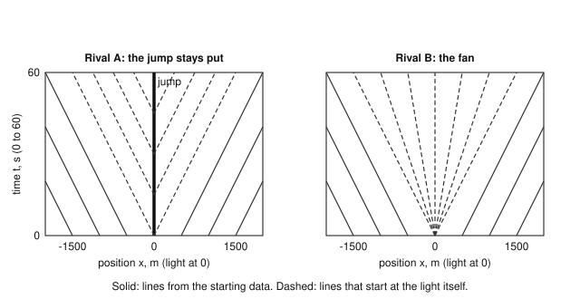
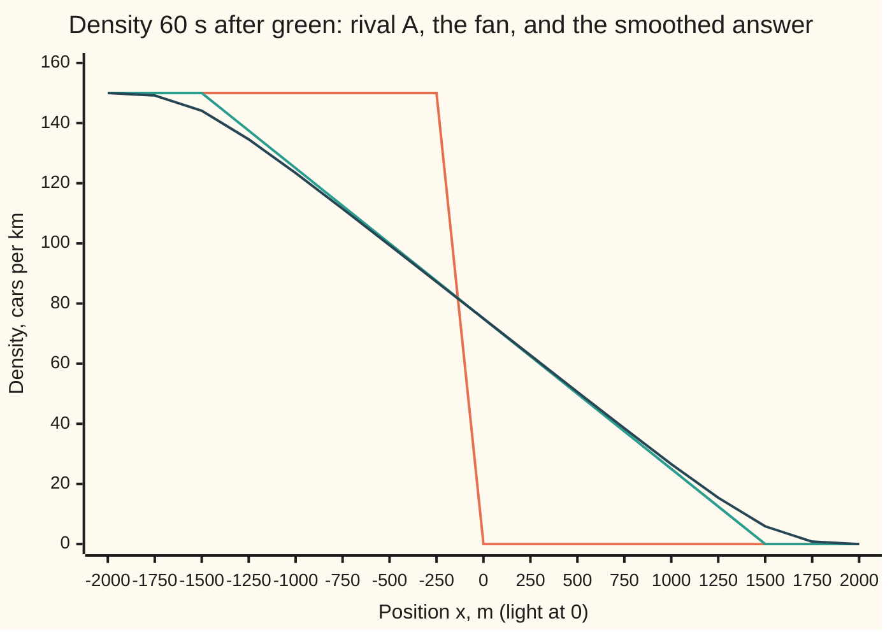

# Entropy conditions: choosing the jump the real system would pick

[Syllabus](../../../SYLLABUS.md) → [Partial differential equations](../README.md) → [First-Order Equations and Characteristics](../README.md#s02) → Entropy conditions

---

## General Overview

Wing 08's [The heat kernel](../../08-Differential%20equations%20and%20dynamics/10-The%20Classical%20PDEs/10-the-heat-kernel.md) showed that diffusion smooths any start at once. This card adds a little of that smoothing to the traffic equation and lets it fade, and that picks the jump real traffic makes.

A queue of cars waits at a red light on a one-lane road. The cars are bumper to bumper: 150 cars per kilometre, one car every 6.67 m. The road past the light is empty. At t = 0 s the light turns green. It is the road of [Conservation laws](02-conservation-laws-and-shocks.md): top speed 25 m/s (90 km/h) on an empty road.

The traffic equation from that card gives two rival answers for the next minute. Both keep every car. Both obey the jump rule that card proved.

- **Rival A:** the sharp edge of the queue stays at the light for ever. No car ever moves.
- **Rival B:** the queue spreads out in a fan (a smooth slope of density). The front cars leave at once. A "start wave" runs back through the queue. In the first 60 s, 56.25 cars cross the light.

Everyone has seen rival B happen. Nobody has seen rival A. Yet the equation alone cannot tell them apart.

The unknown is the traffic density $`\rho(x, t)`$: cars per km at place $`x`$ (m, light at 0) and time $`t`$ (s since green). The region is the whole road, $`-\infty < x < \infty`$, for $`t > 0`$. The data are 150 cars/km behind the light and 0 cars/km ahead of it.

This card gives two tests that pick the real answer, and shows that they agree.

- **The Lax entropy condition:** a jump may stand only if the waves on both sides run *into* it.
- **Vanishing viscosity:** add back the small smoothing that the equation dropped (drivers look ahead), solve that exactly, and let the smoothing shrink to zero. The limit is the real answer.

**A jump is real only if waves run into it from both sides; that is the same as asking which answer survives when a tiny smoothing is added and then taken away.**

**What kind of fact this is:** a theorem. On this card, Why it works proves that a smoothed jump exists only when the Lax condition holds, and that the smoothed green-light answer tends to the fan. Uniqueness of the answer picked this way is a theorem stated with its source.

<p align="center"></p>

The figure is drawn to scale for 60 s and 4,000 m of road. Each line is a characteristic: a path along which the density stays the same (see [Characteristics](01-method-of-characteristics.md)). In rival A, the dashed lines are born at the jump and carry information away from it. Information created out of nothing at a point is the sign of a false answer.

---

## The formula

The road obeys the traffic equation, a conservation law for cars:

```math
\rho_t + q(\rho)_x = 0, \qquad q(\rho) = v_{\max}\,\rho\left(1 - \frac{\rho}{\rho_{\max}}\right)
```

A jump from density $`\rho_L`$ (just behind it) to $`\rho_R`$ (just ahead) moves at the jump speed $`s`$ that [Conservation laws](02-conservation-laws-and-shocks.md) derived. The Lax entropy condition adds one test:

```math
s = \frac{q(\rho_R) - q(\rho_L)}{\rho_R - \rho_L}, \qquad q'(\rho_L) \;>\; s \;>\; q'(\rho_R)
```

The vanishing viscosity answer is the limit of a smoothed equation:

```math
\rho = \lim_{\varepsilon \to 0^+} \rho^{\varepsilon}, \qquad \rho^{\varepsilon}_t + q(\rho^{\varepsilon})_x = \varepsilon\,\rho^{\varepsilon}_{xx}
```

**Read it aloud:** a jump is allowed only if the wave speed behind it is faster than the jump and the wave speed ahead of it is slower, and the true answer is what the smoothed equation gives as the smoothing goes to zero.

| Symbol | Plain meaning | In our example | Push it up and the answer… |
| --- | --- | --- | --- |
| $`x`$, $`t`$ | position along the road (m, light at 0) and time since green (s) | up to 2,000 m each way; 60 s | — |
| $`\rho(x, t)`$ | density: cars per kilometre of road at place $`x`$ and time $`t`$ | 150 cars/km behind the light at the start | — |
| $`\rho_{\max}`$ | jam density: bumper to bumper | 150 cars/km | more cars wait, more cross |
| $`v_{\max}`$ | top speed on an empty road | 25 m/s (90 km/h) | the fan widens; more cars cross per minute |
| $`q(\rho)`$ | flux: cars passing a point per hour | 0 in the queue and on the empty road; 3,375 cars/h at the light | — |
| $`q'(\rho)`$ | wave speed: how fast a small change in density travels; not the speed of a car | −25 m/s in the queue, +25 m/s on the empty road | — |
| $`\rho_L`$, $`\rho_R`$; $`u_L`$, $`u_R`$ | density just behind and just ahead of a jump; the wave speeds there | 150 and 0 cars/km (green light); 30 and 150 cars/km (red light); −25 and 25 m/s at the green light | — |
| $`s`$ | jump speed, from the jump rule | 0 m/s (rival A); −5 m/s, or −18 km/h (red light) | — |
| $`\varepsilon`$ | viscosity: how strongly drivers smooth out density by looking ahead, in m²/s | 200, 20, 2, 0.2 m²/s (illustrative) | edges blur over about $`\sqrt{\varepsilon t}`$ metres |
| $`\rho^{\varepsilon}`$; $`R`$, $`w`$ | the density that solves the smoothed equation; a smoothed jump that slides without changing shape, and its thickness | 37.606 cars/km at 750 m, 60 s, for ε = 20 m²/s; $`w`$ = 2.000 m at the red light | — |
| $`\eta`$, $`\psi`$ | an entropy and its flux: here $`\eta = \rho^2/2`$, with $`\psi' = \eta'\,q'`$ | production 0.09375 at rival A's jump | — |
| $`u`$, $`\varphi`$, $`N`$, $`\sigma`$, $`A`$, $`B`$, $`z`$ | helpers in the Cole-Hopf proof: $`u = q'(\rho)`$; $`\varphi`$ a solution of the heat equation; $`N`$ the bell-curve area to the left of a point, written N as on the finance cards; $`\sigma = \sqrt{2\varepsilon t}`$ the spread; $`A`$, $`B`$ the two terms of $`\varphi`$; $`z`$ a large number | $`u`$ runs from −25 to +25 m/s | — |

The flux $`q`$ is the Greenshields model: cars drive at $`v_{\max}(1 - \rho/\rho_{\max})`$, so flux is density times that speed. Its top is 3,375 cars per hour, at half the jam density. The numbers are illustrative, and match [Conservation laws](02-conservation-laws-and-shocks.md) and [The Riemann problem](04-rarefaction-and-the-riemann-problem.md).

### When it holds

- **The flux bends one way only** ($`q''`$ never changes sign). Greenshields' $`q`$ is a downward parabola, so this holds. With an S-shaped flux, as in water pushing oil through rock, the Lax test is not enough and a stricter chord test is needed.
- **There is one equation, not a system.** For gas flow (three equations) the Lax condition counts waves family by family.
- **The viscosity is positive.** With ε = −1 m²/s, a ripple 1 m long grows by a factor of $`10^{17.15}`$ in one second. The smoothed problem has no answer to take a limit of.
- **The model is the road.** Greenshields' straight-line speed rule is a fit. Real start waves run back far more slowly than the model's 90 km/h. The tests pick the right jump *for the model*; they cannot fix the model.

---

## Why it works

### Step 0: put back what the equation dropped

The traffic equation treats drivers as reacting only to the cars right at their bumper. Real drivers look ahead. They slow before a dense patch and speed up before an open one. That adds a term $`\varepsilon\rho_{xx}`$, which spreads density like heat spreads in a rod.

With that term, the problem has exactly one smooth solution. So we do not argue about jumps at all. We solve the smoothed equation and then let ε shrink. Whatever survives is the real answer.

The Lax condition is a shortcut: a test you can apply to a jump without solving anything. Step 2 shows it is exactly the condition for a jump to survive smoothing.

### Step 1: two answers that both obey the jump rule

**Rival A.** Queue behind the light, empty road ahead, with the jump fixed at x = 0. The flux is zero on both sides: no cars move in a jam, and none on an empty road. The jump rule gives

```math
s = \frac{0 - 0}{0 - 150} = 0 \text{ m/s}
```

So the standing jump obeys the conservation law, including the jump rule. Cars are conserved because none move.

**Rival B.** Look for a density that depends only on the ratio $`x/t`$. Then the equation forces $`q'(\rho) = x/t`$: each density value travels at its own wave speed from the light. Solving $`25(1 - 2\rho/150) = x/t`$ for $`\rho`$ gives the fan

```math
\rho(x, t) = \frac{\rho_{\max}}{2}\left(1 - \frac{x}{v_{\max}\,t}\right), \qquad -v_{\max}t \le x \le v_{\max}t
```

with the jam behind and the empty road ahead. [The Riemann problem](04-rarefaction-and-the-riemann-problem.md) builds this fan for every pair of densities.

Both rivals conserve cars. The equation, read as a conservation law with jumps, accepts both.

### Step 2: a smoothed jump exists only if the Lax condition holds

Ask when a jump can survive a small viscosity. Look for a smoothed jump that keeps its shape and slides at speed $`s`$: $`\rho^{\varepsilon}(x, t) = R(x - st)`$, with $`R`$ going from $`\rho_L`$ far behind to $`\rho_R`$ far ahead.

Put this into the smoothed equation and integrate once. Far behind, $`R = \rho_L`$ and $`R' = 0`$, and that fixes the constant:

```math
\varepsilon R' = q(R) - q(\rho_L) - s\,(R - \rho_L)
```

Far ahead, $`R'`$ must vanish at $`\rho_R`$ too, and that holds exactly when $`s`$ obeys the jump rule. The right side is the curve $`q`$ minus its chord (the straight line) from $`\rho_L`$ to $`\rho_R`$. Our $`q`$ bends down, so the curve lies above its chord between the two end points. The right side is positive there, and so $`R' > 0`$: density must *rise* through the jump.

- **Red light:** arrivals at 30 cars/km meet a queue at 150 cars/km. Density rises, so the smoothed jump exists.
- **Green light:** density falls from 150 cars/km to 0. No smoothed jump exists, however small ε is. Rival A cannot survive.

For a downward-bending $`q`$, "density rises through the jump" is the same as $`q'(\rho_L) > q'(\rho_R)`$. The chord slope $`s`$ always lies between the two end slopes. That is the Lax condition.

For our flux the equation for $`R`$ is solvable. The chord gap is $`(v_{\max}/\rho_{\max})(R - \rho_L)(\rho_R - R)`$, and $`R`$ is a tanh-shaped step: the midpoint density plus half the jump times $`\tanh\bigl((x - st)/w\bigr)`$. Its thickness is $`w = 4\varepsilon / (q'(\rho_L) - q'(\rho_R))`$. At the red light that is $`4\varepsilon/40`$: 2.000 m at ε = 20 m²/s and 0.020 m at ε = 0.2 m²/s. As ε shrinks, the smooth step sharpens into the true jump.

### Step 3: at the green light, the smoothing picks the fan

The smoothed equation for our flux can be solved exactly. Write $`u = q'(\rho)`$, the wave speed. Then $`u_t + u\,u_x = \varepsilon u_{xx}`$, which is Burgers' equation with viscosity. The Cole-Hopf substitution $`u = -2\varepsilon\,\varphi_x/\varphi`$ turns it into the heat equation $`\varphi_t = \varepsilon\varphi_{xx}`$, which [The heat kernel](../../08-Differential%20equations%20and%20dynamics/10-The%20Classical%20PDEs/10-the-heat-kernel.md) solves for any starting data.

For the green light, this gives the density as a closed formula built from two normal tail areas. The fold below works the limit. In short, as ε shrinks, each tail area is controlled by the same Gaussian factor, and what is left is $`u = x/t`$ inside the fan: rival B, exactly.

<details>
<summary>Detailed proof: the Cole-Hopf solution tends to the fan</summary>

Take $`u_L = -25`$ and $`u_R = 25`$ m/s. The starting data for $`\varphi`$ is $`e^{-u_L x/(2\varepsilon)}`$ for $`x < 0`$ and $`e^{-u_R x/(2\varepsilon)}`$ for $`x > 0`$. Smooth it with the heat kernel of variance $`\sigma^2 = 2\varepsilon t`$. Completing the square in each half gives two terms,

$`\displaystyle \varphi = A + B, \quad A = e^{(-u_L x + u_L^2 t/2)/(2\varepsilon)}\,N\!\left(\frac{u_L t - x}{\sigma}\right), \quad B = e^{(-u_R x + u_R^2 t/2)/(2\varepsilon)}\,N\!\left(\frac{x - u_R t}{\sigma}\right),`$

where $`N`$ is the area under the standard bell curve to the left of a point. When you take $`\varphi_x`$, the bell-curve heights from the two terms are equal and cancel, so

$`\displaystyle u = \frac{u_L A + u_R B}{A + B}, \qquad \rho^{\varepsilon} = \frac{\rho_{\max}}{2}\left(1 - \frac{u}{v_{\max}}\right).`$

Now let ε shrink with $`u_L t < x < u_R t`$ (inside the fan). Both $`N`$ arguments go to minus infinity. For a large number $`z`$, the tail estimate $`N(-z) \approx e^{-z^2/2}/(z\sqrt{2\pi})`$ makes each term equal to $`e^{-x^2/(4\varepsilon t)}`$ times a factor $`\sigma/(x - u_L t)`$ for $`A`$ and $`\sigma/(u_R t - x)`$ for $`B`$. The common exponential cancels in the ratio, leaving

$`\displaystyle u \to \frac{u_L (u_R t - x) + u_R (x - u_L t)}{(u_R - u_L)\,t} = \frac{x}{t}.`$

That is $`q'(\rho) = x/t`$, the fan. Outside the fan, one term outweighs the other by a factor that grows without bound as ε shrinks, so $`u`$ tends to $`u_L`$ or $`u_R`$: the jam behind, the empty road ahead.

</details>

The check computes the exact smoothed density at four viscosities and measures how far it sits from the fan. "L1 gap" means the total misplaced cars: the area between the two density curves.

| ε, m²/s | ρ at 750 m, 60 s, cars/km | ρ at 1,500 m, 60 s, cars/km | L1 gap to the fan, cars | cars past the light |
| ---: | ---: | ---: | ---: | ---: |
| 200 | 38.469 | 5.921 | 6.0143 | 59.2572 |
| 20 | 37.606 | 1.929 | 0.8756 | 56.6878 |
| 2 | 37.511 | 0.615 | 0.1152 | 56.3076 |
| 0.2 | 37.501 | 0.195 | 0.0143 | 56.2571 |
| fan (ε → 0) | 37.5 | 0 | 0 | 56.25 |

The gap shrinks by 6.87, 7.60 and 8.07 for each tenfold cut in ε: a little slower than ε itself. Rival A sits 112.50 cars from the fan, and nothing in the column moves toward it.



Orange is rival A, the standing jump. Teal is the fan. Dark blue is the smoothed answer at ε = 200 m²/s: it hugs the fan, rounding its corners at ±1,500 m, and is nowhere near the jump.

### Step 4: the entropy inequality, and why the answer is unique

Take any *convex* function $`\eta(\rho)`$ (one that bends upward), called an entropy. Define its flux $`\psi`$ by $`\psi' = \eta'\,q'`$. Multiply the smoothed equation by $`\eta'(\rho^{\varepsilon})`$:

```math
\eta_t + \psi_x = \varepsilon\,\eta_{xx} - \varepsilon\,\eta''\,(\rho^{\varepsilon}_x)^2 \;\le\; \varepsilon\,\eta_{xx}
```

Let ε go to zero. The right side vanishes in the limit, so the true answer obeys $`\eta_t + \psi_x \le 0`$. Entropy can be destroyed at a jump, never created. At a jump moving at speed $`s`$, this reads

```math
\bigl(\psi(\rho_R) - \psi(\rho_L)\bigr) - s\,\bigl(\eta(\rho_R) - \eta(\rho_L)\bigr) \;\le\; 0
```

With $`\eta = \rho^2/2`$, worked in cars per metre and seconds, rival A's jump scores +0.09375: it fails. The red-light queue scores −0.04800: it passes. This is a third test, and it agrees with the other two.

The reason for asking for every convex η is uniqueness. Kružkov proved in 1970 that, for any bounded starting density, exactly one answer satisfies this inequality for every convex η. Two such answers never drift further apart in total misplaced cars. That answer is called the entropy solution. It is also the vanishing viscosity limit. For one equation with a downward-bending flux, it is the answer whose every jump passes the Lax test.

---

## Worked numbers, by hand

The green light, and the red light for contrast. Top speed 90 km/h, which is 25 m/s; jam density 150 cars/km.

| Step | Arithmetic | Value |
| --- | --- | --- |
| flux in the queue | 90 × 150 × (1 − 150/150) | 0 cars/h |
| flux on the empty road | 90 × 0 × 1 | 0 cars/h |
| rival A's jump speed | (0 − 0) ÷ (0 − 150) | 0 m/s |
| wave speed in the queue | 25 × (1 − 2 × 150/150) | −25 m/s |
| wave speed on the empty road | 25 × (1 − 0) | +25 m/s |
| Lax test for rival A | is −25 > 0 > 25? | no: rejected |
| fan density at the light | 150/2 × (1 − 0) | 75 cars/km |
| flux at the light | 90 × 75 × (1 − 0.5) | 3,375 cars/h |
| fan edges at 60 s | ±25 × 60 | ±1,500 m |
| cars across the light in 60 s | 3,375 × 60/3,600 | **56.25 cars** |
| red light: arrivals' flux | 90 × 30 × (1 − 0.2) | 2,160 cars/h |
| red light: jump speed | (0 − 2,160) ÷ (150 − 30) | −18 km/h = −5 m/s |
| red light: Lax test | 25 × (1 − 0.4) = 15 > −5 > −25 | yes: allowed |

In the first minute, 56.25 cars cross the light; rival A says 0. The start wave reaches 1,500 m back. The car 300 m back, with 45 cars ahead of it, starts moving at 12.0 s. At the red light, the back of the queue grows toward oncoming traffic at 5 m/s, the 18 km/h found on [Conservation laws](02-conservation-laws-and-shocks.md).

### What breaks if you drop a piece

| Mistake | Comes out at | What went wrong |
| --- | --- | --- |
| Accepting any jump that obeys the jump rule | 0.00 cars cross in 60 s | Rival A conserves cars, but its waves leave the jump |
| Running the Lax test on car speeds, not wave speeds | red light: 20 > −5 > 0 is false, so the real queue is rejected | A car's speed is $`v_{\max}(1 - \rho/\rho_{\max})`$; a wave's is $`q'(\rho)`$ |
| Viscosity with the wrong sign, ε = −1 m²/s | a 1 m ripple grows by $`10^{17.15}`$ in one second | Backward diffusion: the smoothed problem has no answer to take a limit of |
| Stopping at a large viscosity, ε = 200 m²/s | 59.26 cars cross, not 56.25; 6.01 cars misplaced | The smoothed answer only approaches the true one as ε → 0 |

The checks print every row.

---

## Code, from first principles, and it actually runs

Both programs work the green light and the red light. They reach the verdict by five roads: the Lax test, the entropy inequality, the exact smoothed answer by Cole-Hopf, an explicit grid for the smoothed equation, and the residual of the Cole-Hopf answer by centred differences. The normal tail area is written out: a power series in the middle, a continued fraction in the tails. The grid takes ε = 50 m²/s, starts at t = 50 s from the Cole-Hopf answer, runs to 60 s inside its stability limit, and shows second-order accuracy. The red-light jump speed is also computed in exact fractions.

### Python

```python
# Entropy conditions -- the check behind the card.  Standard library only.
# A one-lane road, Greenshields flux q(rho) = V rho (1 - rho/RM).  A light at
# x = 0 turns green at t = 0: a jammed queue behind it, an empty road ahead.
# Roads: the Lax test, the entropy inequality, the Cole-Hopf formula for the
# viscous road, a finite-difference grid for the viscous road, and its residual.
import math
from fractions import Fraction as Fr

V, RM, T = 25.0, 0.15, 60.0          # top speed m/s, jam density cars/m, time s
def q(r): return V * r * (1 - r / RM)              # flux, cars per second
def dq(r): return V * (1 - 2 * r / RM)             # wave speed q'(rho), m/s
def yn(b): return "yes" if b else "no"
def pf(d): return "passes" if d <= 0 else "fails"
def sci(v):                          # e-notation with the same digits in Rust
    e = math.floor(math.log10(abs(v))); m = v / 10 ** e
    return f"{m:.3f}e{'-' if e < 0 else '+'}{abs(e):02d}"
def fan(x, t): return min(RM, max(0.0, RM / 2 * (1 - x / (V * t))))

def log_phi(z):                      # log of the normal CDF, written out
    if z < -3:                       # continued fraction for the far left tail
        x = -z; f = x
        for k in range(30 + int(300 / x), 0, -1): f = x + k / f
        return -x * x / 2 - 0.5 * math.log(2 * math.pi) - math.log(f)
    if z > 3: return math.log1p(-math.exp(log_phi(-z)))
    term = s = z; n = 0              # power series in the middle
    while abs(term) > 1e-17 * abs(s):
        n += 1; term *= z * z / (2 * n + 1); s += term
    return math.log(0.5 + s * math.exp(-z * z / 2) / math.sqrt(2 * math.pi))

def visc(x, t, eps):                 # exact viscous density, by Cole-Hopf
    sg = math.sqrt(2 * eps * t)
    d = -V * x / eps + log_phi((x - V * t) / sg) - log_phi(-(x + V * t) / sg)
    return 0.0 if d > 700 else RM / (1 + math.exp(d))

def grid(eps, dx, t0=50.0, t1=T, half=2000.0):     # second road: explicit grid
    n = int(2 * half / dx); xs = [-half + i * dx for i in range(n + 1)]
    r = [visc(x, t0, eps) for x in xs]
    steps = round((t1 - t0) * 4 * eps / dx ** 2); dt = (t1 - t0) / steps
    a, b = dt / (2 * dx), eps * dt / dx ** 2
    for _ in range(steps):
        f = [q(v) for v in r]
        r = [r[0]] + [r[i] - a * (f[i + 1] - f[i - 1])
                      + b * (r[i + 1] - 2 * r[i] + r[i - 1]) for i in range(1, n)] + [r[n]]
    return max(abs(r[i] - visc(xs[i], t1, eps)) for i in range(n + 1)) * 1000

def jump(rl, rr):                    # speed, Lax test, entropy production
    s = (q(rr) - q(rl)) / (rr - rl)
    psi = lambda r: V * (r * r / 2 - 2 * r ** 3 / (3 * RM))   # eta = rho^2/2
    return s, dq(rl) > s > dq(rr), (psi(rr) - psi(rl)) - s * (rr * rr - rl * rl) / 2

K, H = 1000.0, 3600.0                # cars/m to cars/km; cars/s to cars/h
print("GREEN LIGHT: queue at 150 cars/km behind x = 0, empty road ahead")
sA, laxA, dA = jump(RM, 0.0)
print(f"rival A, the jump stays put: q left {q(RM) * H:.0f}, q right {q(0.0) * H:.0f} cars/h, "
      f"speed {sA + 0.0:.1f} m/s")
print(f"  wave speeds: left {dq(RM):.0f} m/s, right {dq(0.0):.0f} m/s; Lax test passes: {yn(laxA)}")
print(f"  entropy production {dA:.5f} (must be <= 0): {pf(dA)}")
h = 0.01; past_fan = sum(fan((i + 0.5) * h, T) for i in range(int(V * T / h))) * h
print(f"rival B, the fan: density at the light {fan(0.0, T) * K:.1f} cars/km, "
      f"flow {q(RM / 2) * H:.0f} cars/h")
print(f"  at t = 60 s: fan edges at x = {-V * T:.0f} m and {V * T:.0f} m, "
      f"density at x = 750 m {fan(750.0, T) * K:.1f} cars/km")
print(f"  cars past the light in 60 s: flow x time {q(RM / 2) * T:.2f}, "
      f"area under the fan {past_fan:.2f}, rival A {0.0:.2f}")
print(f"  start wave: the car at x = -300 m has {300 * RM:.0f} cars ahead and starts at "
      f"{300 / V:.1f} s; jam spacing {1 / RM:.2f} m")
print(f"  top speed {V:.0f} m/s = {V * 3.6:.0f} km/h; L1 gap rival A to fan {2 * past_fan:.2f} cars")

print("RED LIGHT: arrivals at 30 cars/km run into a queue at 150 cars/km")
def qx(r): return 25 * r * (1 - r / Fr(15, 100))       # the flux in exact rationals
s_exact = (qx(Fr(15, 100)) - qx(Fr(3, 100))) / (Fr(15, 100) - Fr(3, 100))
sR, laxR, dR = jump(0.03, RM)
print(f"  arrivals flow {q(0.03) * H:.0f} cars/h; shock speed {sR:.4f} m/s "
      f"= {sR * 3.6:.1f} km/h, exact {s_exact}")
print(f"  wave speeds: behind {dq(0.03):.0f} m/s, ahead {dq(RM):.0f} m/s; Lax test passes: {yn(laxR)}")
print(f"  entropy production {dR:.5f} (must be <= 0): {pf(dR)}")
car = lambda r: V * (1 - r / RM)
print(f"  mistake, car speeds in the test: {car(0.03):.0f} > {sR:.0f} > {car(RM):.0f} holds: "
      f"{yn(car(0.03) > sR > car(RM))}")
for eps in (20.0, 2.0, 0.2):
    w = 4 * eps / (dq(0.03) - dq(RM))
    print(f"  viscous shock, eps = {eps:>4.1f} m^2/s: thickness 4 eps/40 = {w:.3f} m")

print("VANISHING VISCOSITY at t = 60 s (Cole-Hopf, exact for each eps)")
print("  eps m^2/s | cars/km at 750 m | cars/km at 1500 m | L1 gap to fan, cars | cars past light")
gaps, past = [], []
for eps in (200.0, 20.0, 2.0, 0.2):
    dx = 0.5; xs = [(i + 0.5) * dx for i in range(4000)]           # symmetric: x > 0
    gaps.append(2 * sum(abs(visc(x, T, eps) - fan(x, T)) for x in xs) * dx)
    past.append(sum(visc(x, T, eps) for x in xs) * dx)
    print(f"  {eps:>9.1f} | {visc(750.0, T, eps) * K:>16.3f} | {visc(1500.0, T, eps) * K:>17.3f} |"
          f" {gaps[-1]:>19.4f} | {past[-1]:>15.4f}")
print(f"  gap shrinks by {gaps[0] / gaps[1]:.2f}, {gaps[1] / gaps[2]:.2f}, "
      f"{gaps[2] / gaps[3]:.2f} per tenfold cut in eps")
print(f"  mistake, stop at eps = 200: {past[0]:.2f} cars cross, {gaps[0]:.2f} cars misplaced")
e2, e1 = grid(50.0, 2.0), grid(50.0, 1.0)
print(f"  grid road, eps = 50, 50 s to 60 s: max error {sci(e2)} cars/km at dx = 2 m, "
      f"{sci(e1)} at dx = 1 m, order {math.log2(e2 / e1):.2f}")
res = []
for hh in (1.0, 0.5):                # residual rho_t + q_x - eps rho_xx at (750 m, 60 s)
    f = lambda x, t: visc(x, t, 20.0)
    rt = (f(750, T + hh) - f(750, T - hh)) / (2 * hh)
    qd = (q(f(750 + hh, T)) - q(f(750 - hh, T))) / (2 * hh)
    rxx = (f(750 + hh, T) - 2 * f(750, T) + f(750 - hh, T)) / hh ** 2
    res.append(rt + qd - 20.0 * rxx)
print(f"  residual of the Cole-Hopf answer, eps = 20: {sci(res[0])} at step 1, {sci(res[1])} at step 0.5")
k = 2 * math.pi / 1.0                # a ripple 1 m long; eps = -1 m^2/s, t = 1 s
grow = 1.0 * k * k * 1.0 / math.log(10)     # log10 of e^(|eps| k^2 t)
print(f"mistake, eps = -1 m^2/s: a 1 m ripple grows by 10^{grow:.2f} in one second")
pts = range(-2000, 2001, 250)
print("chart x m:   " + ", ".join(str(x) for x in pts))
print("chart A:     " + ", ".join(f"{(RM if x < 0 else 0.0) * K:.1f}" for x in pts))
print("chart fan:   " + ", ".join(f"{fan(x, T) * K:.1f}" for x in pts))
print("chart eps200:" + ", ".join(f"{visc(x, T, 200.0) * K:.1f}" for x in pts))
print(f"figure, x from {-2000} to {2000} m, t from 0 to {T:.0f} s, fan edges ({-V * T:.0f}, {T:.0f})"
      f" and ({V * T:.0f}, {T:.0f}), rival A jump x = 0")

assert sA == 0.0 and not laxA and dA > 0 and laxR and dR < 0      # Lax and entropy agree
assert Fr(sR).limit_denominator(1000) == s_exact == -5
assert abs(past_fan - q(RM / 2) * T) < 1e-6 and abs(q(RM / 2) * T - 56.25) < 1e-12
assert gaps[0] > gaps[1] > gaps[2] > gaps[3] and gaps[3] < 0.05   # viscous -> fan
assert abs(past[3] - 56.25) < 0.05 and abs(visc(0.0, T, 2.0) - fan(0.0, T)) < 1e-12
assert e1 < 0.1 and 3.5 < e2 / e1 < 4.5 and abs(res[1]) < abs(res[0]) < 1e-5
print("ALL CHECKS PASS")
```

**Ran 2026-11-15 on macOS, Python 3.14.10, standard library only. All checks passed. Output, pasted from the run:**

```
GREEN LIGHT: queue at 150 cars/km behind x = 0, empty road ahead
rival A, the jump stays put: q left 0, q right 0 cars/h, speed 0.0 m/s
  wave speeds: left -25 m/s, right 25 m/s; Lax test passes: no
  entropy production 0.09375 (must be <= 0): fails
rival B, the fan: density at the light 75.0 cars/km, flow 3375 cars/h
  at t = 60 s: fan edges at x = -1500 m and 1500 m, density at x = 750 m 37.5 cars/km
  cars past the light in 60 s: flow x time 56.25, area under the fan 56.25, rival A 0.00
  start wave: the car at x = -300 m has 45 cars ahead and starts at 12.0 s; jam spacing 6.67 m
  top speed 25 m/s = 90 km/h; L1 gap rival A to fan 112.50 cars
RED LIGHT: arrivals at 30 cars/km run into a queue at 150 cars/km
  arrivals flow 2160 cars/h; shock speed -5.0000 m/s = -18.0 km/h, exact -5
  wave speeds: behind 15 m/s, ahead -25 m/s; Lax test passes: yes
  entropy production -0.04800 (must be <= 0): passes
  mistake, car speeds in the test: 20 > -5 > 0 holds: no
  viscous shock, eps = 20.0 m^2/s: thickness 4 eps/40 = 2.000 m
  viscous shock, eps =  2.0 m^2/s: thickness 4 eps/40 = 0.200 m
  viscous shock, eps =  0.2 m^2/s: thickness 4 eps/40 = 0.020 m
VANISHING VISCOSITY at t = 60 s (Cole-Hopf, exact for each eps)
  eps m^2/s | cars/km at 750 m | cars/km at 1500 m | L1 gap to fan, cars | cars past light
      200.0 |           38.469 |             5.921 |              6.0143 |         59.2572
       20.0 |           37.606 |             1.929 |              0.8756 |         56.6878
        2.0 |           37.511 |             0.615 |              0.1152 |         56.3076
        0.2 |           37.501 |             0.195 |              0.0143 |         56.2571
  gap shrinks by 6.87, 7.60, 8.07 per tenfold cut in eps
  mistake, stop at eps = 200: 59.26 cars cross, 6.01 cars misplaced
  grid road, eps = 50, 50 s to 60 s: max error 1.183e-02 cars/km at dx = 2 m, 2.947e-03 at dx = 1 m, order 2.01
  residual of the Cole-Hopf answer, eps = 20: 1.681e-07 at step 1, 4.202e-08 at step 0.5
mistake, eps = -1 m^2/s: a 1 m ripple grows by 10^17.15 in one second
chart x m:   -2000, -1750, -1500, -1250, -1000, -750, -500, -250, 0, 250, 500, 750, 1000, 1250, 1500, 1750, 2000
chart A:     150.0, 150.0, 150.0, 150.0, 150.0, 150.0, 150.0, 150.0, 0.0, 0.0, 0.0, 0.0, 0.0, 0.0, 0.0, 0.0, 0.0
chart fan:   150.0, 150.0, 150.0, 137.5, 125.0, 112.5, 100.0, 87.5, 75.0, 62.5, 50.0, 37.5, 25.0, 12.5, 0.0, 0.0, 0.0
chart eps200:150.0, 149.2, 144.1, 134.6, 123.4, 111.5, 99.4, 87.2, 75.0, 62.8, 50.6, 38.5, 26.6, 15.4, 5.9, 0.8, 0.0
figure, x from -2000 to 2000 m, t from 0 to 60 s, fan edges (-1500, 60) and (1500, 60), rival A jump x = 0
ALL CHECKS PASS
```

### Rust

Same numbers, same labels, built with `rustc --edition 2021 -O`.

```rust
// Entropy conditions -- the same check as the Python, in Rust.  No crates.
// A one-lane road, Greenshields flux q(rho) = V rho (1 - rho/RM).  A light at
// x = 0 turns green at t = 0: a jammed queue behind it, an empty road ahead.
// Roads: the Lax test, the entropy inequality, the Cole-Hopf formula for the
// viscous road, a finite-difference grid for the viscous road, and its residual.
use std::f64::consts::PI;
const V: f64 = 25.0; // top speed, m/s
const RM: f64 = 0.15; // jam density, cars/m
const T: f64 = 60.0; // time, s
fn q(r: f64) -> f64 { V * r * (1.0 - r / RM) } // flux, cars per second
fn dq(r: f64) -> f64 { V * (1.0 - 2.0 * r / RM) } // wave speed q'(rho), m/s
fn yn(b: bool) -> &'static str { if b { "yes" } else { "no" } }
fn pf(d: f64) -> &'static str { if d <= 0.0 { "passes" } else { "fails" } }
fn sci(v: f64) -> String { // e-notation with the same digits as the Python
    let e = v.abs().log10().floor() as i32;
    let m = v / 10f64.powi(e);
    format!("{:.3}e{}{:02}", m, if e < 0 { "-" } else { "+" }, e.abs())
}
fn fan(x: f64, t: f64) -> f64 { (RM / 2.0 * (1.0 - x / (V * t))).max(0.0).min(RM) }
fn log_phi(z: f64) -> f64 { // log of the normal CDF, written out
    if z < -3.0 { // continued fraction for the far left tail
        let x = -z;
        let mut f = x;
        for k in (1..=(30 + (300.0 / x) as i64)).rev() { f = x + k as f64 / f; }
        return -x * x / 2.0 - 0.5 * (2.0 * PI).ln() - f.ln();
    }
    if z > 3.0 { return (-log_phi(-z).exp()).ln_1p(); }
    let (mut term, mut s, mut n) = (z, z, 0.0); // power series in the middle
    while term.abs() > 1e-17 * s.abs() {
        n += 1.0;
        term *= z * z / (2.0 * n + 1.0);
        s += term;
    }
    (0.5 + s * (-z * z / 2.0).exp() / (2.0 * PI).sqrt()).ln()
}
fn visc(x: f64, t: f64, eps: f64) -> f64 { // exact viscous density, by Cole-Hopf
    let sg = (2.0 * eps * t).sqrt();
    let d = -V * x / eps + log_phi((x - V * t) / sg) - log_phi(-(x + V * t) / sg);
    if d > 700.0 { 0.0 } else { RM / (1.0 + d.exp()) }
}
fn grid(eps: f64, dx: f64) -> f64 { // second road: explicit grid, t = 50 s to 60 s
    let (t0, t1, half) = (50.0, T, 2000.0);
    let n = (2.0 * half / dx) as usize;
    let xs: Vec<f64> = (0..=n).map(|i| -half + i as f64 * dx).collect();
    let mut r: Vec<f64> = xs.iter().map(|&x| visc(x, t0, eps)).collect();
    let steps = ((t1 - t0) * 4.0 * eps / (dx * dx)).round() as usize;
    let dt = (t1 - t0) / steps as f64;
    let (a, b) = (dt / (2.0 * dx), eps * dt / (dx * dx));
    for _ in 0..steps {
        let f: Vec<f64> = r.iter().map(|&v| q(v)).collect();
        let mut nr = r.clone();
        for i in 1..n {
            nr[i] = r[i] - a * (f[i + 1] - f[i - 1]) + b * (r[i + 1] - 2.0 * r[i] + r[i - 1]);
        }
        r = nr;
    }
    (0..=n).map(|i| (r[i] - visc(xs[i], t1, eps)).abs()).fold(0.0, f64::max) * 1000.0
}
fn jump(rl: f64, rr: f64) -> (f64, bool, f64) { // speed, Lax test, entropy production
    let s = (q(rr) - q(rl)) / (rr - rl);
    let psi = |r: f64| V * (r * r / 2.0 - 2.0 * r.powi(3) / (3.0 * RM)); // eta = rho^2/2
    (s, dq(rl) > s && s > dq(rr), (psi(rr) - psi(rl)) - s * (rr * rr - rl * rl) / 2.0)
}
fn gcd(a: i128, b: i128) -> i128 { if b == 0 { a.abs() } else { gcd(b, a % b) } }
fn qx(n: i128, d: i128) -> (i128, i128) { // flux 25 r (1 - r/(15/100)) at r = n/d, exact
    let (num, den) = (25 * n * (15 * d - 100 * n), d * 15 * d);
    let g = gcd(num, den);
    (num / g, den / g)
}
fn main() {
    let (kk, hh_) = (1000.0, 3600.0); // cars/m to cars/km; cars/s to cars/h
    println!("GREEN LIGHT: queue at 150 cars/km behind x = 0, empty road ahead");
    let (sa, laxa, da) = jump(RM, 0.0);
    println!("rival A, the jump stays put: q left {:.0}, q right {:.0} cars/h, speed {:.1} m/s",
             q(RM) * hh_, q(0.0) * hh_, sa + 0.0);
    println!("  wave speeds: left {:.0} m/s, right {:.0} m/s; Lax test passes: {}", dq(RM), dq(0.0), yn(laxa));
    println!("  entropy production {:.5} (must be <= 0): {}", da, pf(da));
    let h = 0.01;
    let past_fan: f64 = (0..(V * T / h) as usize).map(|i| fan((i as f64 + 0.5) * h, T)).sum::<f64>() * h;
    println!("rival B, the fan: density at the light {:.1} cars/km, flow {:.0} cars/h", fan(0.0, T) * kk, q(RM / 2.0) * hh_);
    println!("  at t = 60 s: fan edges at x = {:.0} m and {:.0} m, density at x = 750 m {:.1} cars/km",
             -V * T, V * T, fan(750.0, T) * kk);
    println!("  cars past the light in 60 s: flow x time {:.2}, area under the fan {:.2}, rival A {:.2}",
             q(RM / 2.0) * T, past_fan, 0.0);
    println!("  start wave: the car at x = -300 m has {:.0} cars ahead and starts at {:.1} s; jam spacing {:.2} m",
             300.0 * RM, 300.0 / V, 1.0 / RM);
    println!("  top speed {:.0} m/s = {:.0} km/h; L1 gap rival A to fan {:.2} cars", V, V * 3.6, 2.0 * past_fan);

    println!("RED LIGHT: arrivals at 30 cars/km run into a queue at 150 cars/km");
    let ((a1, b1), (a2, b2)) = (qx(15, 100), qx(3, 100)); // exact shock speed
    let (num, den) = ((a1 * b2 - a2 * b1) * 100, b1 * b2 * 12);
    let g = gcd(num, den);
    let (sn, sd) = (num / g * den.signum(), den.abs() / g);
    let (sr, laxr, dr) = jump(0.03, RM);
    let s_exact = if sd == 1 { format!("{}", sn) } else { format!("{}/{}", sn, sd) };
    println!("  arrivals flow {:.0} cars/h; shock speed {:.4} m/s = {:.1} km/h, exact {}",
             q(0.03) * hh_, sr, sr * 3.6, s_exact);
    println!("  wave speeds: behind {:.0} m/s, ahead {:.0} m/s; Lax test passes: {}", dq(0.03), dq(RM), yn(laxr));
    println!("  entropy production {:.5} (must be <= 0): {}", dr, pf(dr));
    let car = |r: f64| V * (1.0 - r / RM);
    println!("  mistake, car speeds in the test: {:.0} > {:.0} > {:.0} holds: {}",
             car(0.03), sr, car(RM), yn(car(0.03) > sr && sr > car(RM)));
    for eps in [20.0, 2.0, 0.2] {
        let w = 4.0 * eps / (dq(0.03) - dq(RM));
        println!("  viscous shock, eps = {:>4.1} m^2/s: thickness 4 eps/40 = {:.3} m", eps, w);
    }

    println!("VANISHING VISCOSITY at t = 60 s (Cole-Hopf, exact for each eps)");
    println!("  eps m^2/s | cars/km at 750 m | cars/km at 1500 m | L1 gap to fan, cars | cars past light");
    let (mut gaps, mut past) = (vec![], vec![]);
    for eps in [200.0, 20.0, 2.0, 0.2] {
        let dx = 0.5; // symmetric about the light: integrate x > 0 only
        let xs: Vec<f64> = (0..4000).map(|i| (i as f64 + 0.5) * dx).collect();
        gaps.push(2.0 * xs.iter().map(|&x| (visc(x, T, eps) - fan(x, T)).abs()).sum::<f64>() * dx);
        past.push(xs.iter().map(|&x| visc(x, T, eps)).sum::<f64>() * dx);
        println!("  {:>9.1} | {:>16.3} | {:>17.3} | {:>19.4} | {:>15.4}", eps, visc(750.0, T, eps) * kk,
                 visc(1500.0, T, eps) * kk, gaps[gaps.len() - 1], past[past.len() - 1]);
    }
    println!("  gap shrinks by {:.2}, {:.2}, {:.2} per tenfold cut in eps",
             gaps[0] / gaps[1], gaps[1] / gaps[2], gaps[2] / gaps[3]);
    println!("  mistake, stop at eps = 200: {:.2} cars cross, {:.2} cars misplaced", past[0], gaps[0]);
    let (e2, e1) = (grid(50.0, 2.0), grid(50.0, 1.0));
    println!("  grid road, eps = 50, 50 s to 60 s: max error {} cars/km at dx = 2 m, {} at dx = 1 m, order {:.2}",
             sci(e2), sci(e1), (e2 / e1).log2());
    let mut res = vec![];
    for hh in [1.0, 0.5] { // residual rho_t + q_x - eps rho_xx at (750 m, 60 s)
        let f = |x: f64, t: f64| visc(x, t, 20.0);
        let rt = (f(750.0, T + hh) - f(750.0, T - hh)) / (2.0 * hh);
        let qd = (q(f(750.0 + hh, T)) - q(f(750.0 - hh, T))) / (2.0 * hh);
        let rxx = (f(750.0 + hh, T) - 2.0 * f(750.0, T) + f(750.0 - hh, T)) / (hh * hh);
        res.push(rt + qd - 20.0 * rxx);
    }
    println!("  residual of the Cole-Hopf answer, eps = 20: {} at step 1, {} at step 0.5", sci(res[0]), sci(res[1]));
    let k = 2.0 * PI / 1.0; // a ripple 1 m long; eps = -1 m^2/s, t = 1 s
    let grow = 1.0 * k * k * 1.0 / 10f64.ln(); // log10 of e^(|eps| k^2 t)
    println!("mistake, eps = -1 m^2/s: a 1 m ripple grows by 10^{:.2} in one second", grow);
    let pts: Vec<f64> = (0..17).map(|i| -2000.0 + 250.0 * i as f64).collect();
    let row = |g: &dyn Fn(f64) -> f64| pts.iter().map(|&x| format!("{:.1}", g(x) * kk)).collect::<Vec<_>>().join(", ");
    println!("chart x m:   {}", pts.iter().map(|x| format!("{}", x)).collect::<Vec<_>>().join(", "));
    println!("chart A:     {}", row(&|x| if x < 0.0 { RM } else { 0.0 }));
    println!("chart fan:   {}", row(&|x| fan(x, T)));
    println!("chart eps200:{}", row(&|x| visc(x, T, 200.0)));
    println!("figure, x from {} to {} m, t from 0 to {:.0} s, fan edges ({:.0}, {:.0}) and ({:.0}, {:.0}), rival A jump x = 0",
             -2000, 2000, T, -V * T, T, V * T, T);

    assert!(sa == 0.0 && !laxa && da > 0.0 && laxr && dr < 0.0); // Lax and entropy agree
    assert!(sn == -5 && sd == 1 && (sr + 5.0).abs() < 1e-12);
    assert!((past_fan - q(RM / 2.0) * T).abs() < 1e-6 && (q(RM / 2.0) * T - 56.25).abs() < 1e-12);
    assert!(gaps[0] > gaps[1] && gaps[1] > gaps[2] && gaps[2] > gaps[3] && gaps[3] < 0.05); // viscous -> fan
    assert!((past[3] - 56.25).abs() < 0.05 && (visc(0.0, T, 2.0) - fan(0.0, T)).abs() < 1e-12);
    assert!(e1 < 0.1 && 3.5 < e2 / e1 && e2 / e1 < 4.5 && res[1].abs() < res[0].abs() && res[0].abs() < 1e-5);
    println!("ALL CHECKS PASS");
}
```

**Ran 2026-11-15 on macOS, rustc 1.98.1, no crates. All checks passed. Output, pasted from the run:**

```
GREEN LIGHT: queue at 150 cars/km behind x = 0, empty road ahead
rival A, the jump stays put: q left 0, q right 0 cars/h, speed 0.0 m/s
  wave speeds: left -25 m/s, right 25 m/s; Lax test passes: no
  entropy production 0.09375 (must be <= 0): fails
rival B, the fan: density at the light 75.0 cars/km, flow 3375 cars/h
  at t = 60 s: fan edges at x = -1500 m and 1500 m, density at x = 750 m 37.5 cars/km
  cars past the light in 60 s: flow x time 56.25, area under the fan 56.25, rival A 0.00
  start wave: the car at x = -300 m has 45 cars ahead and starts at 12.0 s; jam spacing 6.67 m
  top speed 25 m/s = 90 km/h; L1 gap rival A to fan 112.50 cars
RED LIGHT: arrivals at 30 cars/km run into a queue at 150 cars/km
  arrivals flow 2160 cars/h; shock speed -5.0000 m/s = -18.0 km/h, exact -5
  wave speeds: behind 15 m/s, ahead -25 m/s; Lax test passes: yes
  entropy production -0.04800 (must be <= 0): passes
  mistake, car speeds in the test: 20 > -5 > 0 holds: no
  viscous shock, eps = 20.0 m^2/s: thickness 4 eps/40 = 2.000 m
  viscous shock, eps =  2.0 m^2/s: thickness 4 eps/40 = 0.200 m
  viscous shock, eps =  0.2 m^2/s: thickness 4 eps/40 = 0.020 m
VANISHING VISCOSITY at t = 60 s (Cole-Hopf, exact for each eps)
  eps m^2/s | cars/km at 750 m | cars/km at 1500 m | L1 gap to fan, cars | cars past light
      200.0 |           38.469 |             5.921 |              6.0143 |         59.2572
       20.0 |           37.606 |             1.929 |              0.8756 |         56.6878
        2.0 |           37.511 |             0.615 |              0.1152 |         56.3076
        0.2 |           37.501 |             0.195 |              0.0143 |         56.2571
  gap shrinks by 6.87, 7.60, 8.07 per tenfold cut in eps
  mistake, stop at eps = 200: 59.26 cars cross, 6.01 cars misplaced
  grid road, eps = 50, 50 s to 60 s: max error 1.183e-02 cars/km at dx = 2 m, 2.947e-03 at dx = 1 m, order 2.01
  residual of the Cole-Hopf answer, eps = 20: 1.681e-07 at step 1, 4.202e-08 at step 0.5
mistake, eps = -1 m^2/s: a 1 m ripple grows by 10^17.15 in one second
chart x m:   -2000, -1750, -1500, -1250, -1000, -750, -500, -250, 0, 250, 500, 750, 1000, 1250, 1500, 1750, 2000
chart A:     150.0, 150.0, 150.0, 150.0, 150.0, 150.0, 150.0, 150.0, 0.0, 0.0, 0.0, 0.0, 0.0, 0.0, 0.0, 0.0, 0.0
chart fan:   150.0, 150.0, 150.0, 137.5, 125.0, 112.5, 100.0, 87.5, 75.0, 62.5, 50.0, 37.5, 25.0, 12.5, 0.0, 0.0, 0.0
chart eps200:150.0, 149.2, 144.1, 134.6, 123.4, 111.5, 99.4, 87.2, 75.0, 62.8, 50.6, 38.5, 26.6, 15.4, 5.9, 0.8, 0.0
figure, x from -2000 to 2000 m, t from 0 to 60 s, fan edges (-1500, 60) and (1500, 60), rival A jump x = 0
ALL CHECKS PASS
```

The two outputs match line for line.

### Lean

Lean proves Step 2 for any downward-bending flux and for the Greenshields flux, and checks the worked numbers.

- Suppose $`q`$ bends down, $`\varepsilon > 0`$, and a smoothed jump runs from $`\rho_L`$ to $`\rho_R`$ at the jump-rule speed $`s`$. Then $`q'(\rho_L) > s > q'(\rho_R)`$: the jump passes the Lax test.
- Suppose $`q`$ bends down and $`s`$ is the jump-rule speed for $`\rho_L \ne \rho_R`$. Then the Lax test passes exactly when $`\rho_L < \rho_R`$: density rises through the jump.
- Take the Greenshields flux, $`\varepsilon > 0`$, and a jump that passes the Lax test. Then the tanh-shaped step, with thickness $`w > 0`$, solves the smoothed equation and runs from $`\rho_L`$ to $`\rho_R`$.
- The worked-numbers table, the car-speed mistake, both entropy scores and the 2.000 m red-light thickness also check, in exact fractions.

The Cole-Hopf limit to the fan, the grid road and the wrong-sign viscosity ripple are left to the Python and Rust checks.

```lean
-- Entropy conditions: for a downward-bending flux, a jump survives a small viscosity only if it passes the Lax test, the Lax test is the same as density rising through the jump, and for the Greenshields traffic flux a tanh-shaped smoothed jump then exists.
import Mathlib.Analysis.Calculus.Deriv.Basic
import Mathlib.Analysis.Calculus.ContDiff.Defs
import Mathlib.Analysis.Convex.Deriv
import Mathlib.Analysis.SpecialFunctions.Artanh
import Mathlib.Order.Filter.AtTopBot.Basic
import Mathlib.Analysis.SpecialFunctions.Trigonometric.DerivHyp
import Mathlib.Analysis.Calculus.Deriv.Shift
import Mathlib.Analysis.Calculus.ContDiff.Deriv
import Mathlib.MeasureTheory.Integral.IntervalIntegral.FundThmCalculus

open Filter Topology

/-- The Greenshields traffic flux `q(ρ) = v_max ρ (1 − ρ/ρ_max)`: cars per unit time past a point. -/
noncomputable def greenshields (vmax ρmax ρ : ℝ) : ℝ := vmax * ρ * (1 - ρ / ρmax)

lemma lax_helper
    (q : ℝ → ℝ) (hq : Differentiable ℝ q) (hconc : StrictConcaveOn ℝ Set.univ q)
    (ρL ρR s : ℝ) (hLR : ρL ≠ ρR) (hs : s = (q ρR - q ρL) / (ρR - ρL)) :
    (deriv q ρL > s ∧ s > deriv q ρR) ↔ ρL < ρR := by
  have hs' : s = slope q ρL ρR := by rw [hs, slope_def_field]
  constructor
  · rintro ⟨h1, _⟩
    by_contra h
    have hlt : ρR < ρL := lt_of_le_of_ne (not_lt.mp h) (Ne.symm hLR)
    have := hconc.deriv_lt_slope (Set.mem_univ _) (Set.mem_univ _) hlt (hq ρL)
    rw [slope_comm, ← hs'] at this
    linarith
  · intro h
    refine ⟨?_, ?_⟩
    · have := hconc.slope_lt_deriv (Set.mem_univ _) (Set.mem_univ _) h (hq ρL)
      rw [← hs'] at this; exact this
    · have := hconc.deriv_lt_slope (Set.mem_univ _) (Set.mem_univ _) h (hq ρR)
      rw [← hs'] at this; exact this

lemma deriv_limit_zero_atBot (R : ℝ → ℝ) (hR : Differentiable ℝ R) (a L : ℝ)
    (h1 : Tendsto R atBot (𝓝 a)) (h2 : Tendsto (deriv R) atBot (𝓝 L)) : L = 0 := by
  have hex : ∀ x : ℝ, ∃ c ∈ Set.Ioo (x - 1) x, deriv R c = (R x - R (x - 1)) / (x - (x - 1)) :=
    fun x => exists_deriv_eq_slope R (by linarith) hR.continuous.continuousOn
      (fun y _ => (hR y).differentiableWithinAt)
  choose c hc hc' using hex
  have hcbot : Tendsto c atBot atBot := tendsto_atBot_mono (fun x => (hc x).2.le) tendsto_id
  have e1 : Tendsto (fun x => deriv R (c x)) atBot (𝓝 L) := h2.comp hcbot
  have hsh : Tendsto (fun x : ℝ => x - 1) atBot atBot := by
    simpa [sub_eq_add_neg] using tendsto_atBot_add_const_right atBot (-1 : ℝ) tendsto_id
  have e2 : Tendsto (fun x => deriv R (c x)) atBot (𝓝 0) := by
    have : Tendsto (fun x => R x - R (x - 1)) atBot (𝓝 (a - a)) := h1.sub (h1.comp hsh)
    rw [sub_self] at this
    refine this.congr (fun x => ?_)
    rw [hc' x]; ring
  exact tendsto_nhds_unique e1 e2

lemma travel_terms (P P1 P2 q : ℝ → ℝ) (hP : ∀ ξ, HasDerivAt P (P1 ξ) ξ)
    (hP1 : ∀ ξ, HasDerivAt P1 (P2 ξ) ξ) (hq : Differentiable ℝ q) (s ε x t : ℝ) :
    deriv (fun τ => P (x - s * τ)) t + deriv (fun y => q (P (y - s * t))) x
        - ε * deriv (fun y => deriv (fun z => P (z - s * t)) y) x
      = -s * P1 (x - s * t) + deriv q (P (x - s * t)) * P1 (x - s * t)
        - ε * P2 (x - s * t) := by
  have h : HasDerivAt (fun τ => x - s * τ) (-s) t := by
    simpa using ((hasDerivAt_id t).const_mul s).const_sub x
  have e1 : HasDerivAt (fun τ => P (x - s * τ)) (P1 (x - s * t) * (-s)) t :=
    (hP (x - s * t)).comp t h
  have e2 : HasDerivAt (fun y => q (P (y - s * t))) (deriv q (P (x - s * t)) * P1 (x - s * t)) x :=
    (hq _).hasDerivAt.comp x ((hP (x - s * t)).comp_sub_const x (s * t))
  have e3 : (fun y => deriv (fun z => P (z - s * t)) y) = fun y => P1 (y - s * t) :=
    funext fun y => ((hP (y - s * t)).comp_sub_const y (s * t)).deriv
  have e4 : HasDerivAt (fun y => P1 (y - s * t)) (P2 (x - s * t)) x :=
    (hP1 _).comp_sub_const x (s * t)
  rw [e1.deriv, e2.deriv, e3, e4.deriv]; ring

lemma hasDerivAt_tanh' (y : ℝ) : HasDerivAt Real.tanh (1 - Real.tanh y ^ 2) y := by
  have hc : Real.cosh y ≠ 0 := (Real.cosh_pos y).ne'
  have h := (Real.hasDerivAt_sinh y).div (Real.hasDerivAt_cosh y) hc
  have hf : Real.tanh = fun x => Real.sinh x / Real.cosh x := funext fun x => Real.tanh_eq_sinh_div_cosh x
  have h' : HasDerivAt (fun x => Real.sinh x / Real.cosh x) (1 - (Real.sinh y / Real.cosh y) ^ 2) y := by
    refine h.congr_deriv ?_
    field_simp
  rw [Real.tanh_eq_sinh_div_cosh y, hf]
  exact h'

lemma tanh_eq_one_sub (x : ℝ) : Real.tanh x = 1 - 2 / (Real.exp (2 * x) + 1) := by
  have h2 : Real.exp (2 * x) = Real.exp x * Real.exp x := by rw [← Real.exp_add]; ring_nf
  have hp := Real.exp_pos x
  rw [Real.tanh_eq, Real.exp_neg, h2]
  field_simp
  ring

lemma tendsto_tanh_atTop' : Tendsto Real.tanh atTop (𝓝 1) := by
  have h1 : Tendsto (fun x : ℝ => Real.exp (2 * x) + 1) atTop atTop :=
    tendsto_atTop_add_const_right _ 1
      (Real.tendsto_exp_atTop.comp (tendsto_id.const_mul_atTop two_pos))
  have h2 : Tendsto (fun x : ℝ => (2 : ℝ) / (Real.exp (2 * x) + 1)) atTop (𝓝 0) :=
    tendsto_const_nhds.div_atTop h1
  have h3 := (tendsto_const_nhds (x := (1 : ℝ))).sub h2
  rw [sub_zero] at h3
  exact h3.congr (fun x => (tanh_eq_one_sub x).symm)

lemma tendsto_tanh_atBot' : Tendsto Real.tanh atBot (𝓝 (-1)) := by
  have h := (tendsto_tanh_atTop'.comp tendsto_neg_atBot_atTop).neg
  refine h.congr (fun x => ?_)
  simp [Real.tanh_neg]

lemma hasDerivAt_greenshields (vmax ρmax ρ : ℝ) (hm : ρmax ≠ 0) :
    HasDerivAt (greenshields vmax ρmax) (vmax * (1 - 2 * ρ / ρmax)) ρ := by
  have h := ((hasDerivAt_id ρ).const_mul vmax).mul (((hasDerivAt_id ρ).div_const ρmax).const_sub 1)
  have hf : greenshields vmax ρmax = fun y => vmax * id y * (1 - id y / ρmax) := rfl
  rw [hf]
  convert h using 1
  simp only [id]
  field_simp
  ring

/-- A smoothed jump exists only if the Lax condition holds.
Let the flux `q` be differentiable and bend downward (strictly concave), let the viscosity `ε`
be positive, and let a jump from `ρL` (behind) to `ρR` (ahead), `ρL ≠ ρR`, move at the speed
`s` given by the jump rule. If a smooth profile `R` makes `ρ(x, t) = R(x − s t)` a solution of the
smoothed equation `ρ_t + q(ρ)_x = ε ρ_xx` with `R → ρL` far behind and `R → ρR` far ahead,
then the wave speed behind the jump is faster than the jump and the wave speed ahead is slower:
`q'(ρL) > s > q'(ρR)`. -/
theorem viscous_profile_only_if_lax
    (q : ℝ → ℝ) (hq : Differentiable ℝ q) (hconc : StrictConcaveOn ℝ Set.univ q)
    (ε : ℝ) (hε : 0 < ε) (ρL ρR s : ℝ) (hLR : ρL ≠ ρR)
    (hs : s = (q ρR - q ρL) / (ρR - ρL))
    (R : ℝ → ℝ) (hR : ContDiff ℝ 2 R)
    (hPDE : ∀ x t : ℝ,
      deriv (fun τ => R (x - s * τ)) t + deriv (fun y => q (R (y - s * t))) x
        = ε * deriv (fun y => deriv (fun z => R (z - s * t)) y) x)
    (hbehind : Tendsto R atBot (𝓝 ρL)) (hahead : Tendsto R atTop (𝓝 ρR)) :
    deriv q ρL > s ∧ s > deriv q ρR := by
  have hRd : Differentiable ℝ R := hR.differentiable (by norm_num)
  have hR'd : Differentiable ℝ (deriv R) := hR.differentiable_deriv_two
  have hode : ∀ x, -s * deriv R x + deriv q (R x) * deriv R x - ε * deriv (deriv R) x = 0 := by
    intro x
    have h1 := travel_terms R (deriv R) (deriv (deriv R)) q (fun ξ => (hRd ξ).hasDerivAt)
      (fun ξ => (hR'd ξ).hasDerivAt) hq s ε x 0
    have h2 := hPDE x 0
    simp only [mul_zero, sub_zero] at h1 h2
    linarith
  -- first integral
  set h : ℝ → ℝ := fun ξ => ε * deriv R ξ - q (R ξ) + s * R ξ with hh
  have hhd : ∀ ξ, HasDerivAt h (ε * deriv (deriv R) ξ - deriv q (R ξ) * deriv R ξ
      + s * deriv R ξ) ξ := by
    intro ξ
    exact ((((hR'd ξ).hasDerivAt.const_mul ε).sub
      ((hq (R ξ)).hasDerivAt.comp ξ (hRd ξ).hasDerivAt)).add
      ((hRd ξ).hasDerivAt.const_mul s))
  have hconst : ∀ ξ, h ξ = h 0 := by
    intro ξ
    refine is_const_of_deriv_eq_zero (fun y => (hhd y).differentiableAt) (fun y => ?_) ξ 0
    rw [(hhd y).deriv]; linarith [hode y]
  set K := h 0 with hK
  have hfirst : ∀ ξ, deriv R ξ = (q (R ξ) - s * R ξ + K) / ε := by
    intro ξ
    have := hconst ξ
    simp only [hh] at this
    field_simp
    linarith
  have hlim : Tendsto (deriv R) atBot (𝓝 ((q ρL - s * ρL + K) / ε)) := by
    have := ((((hq.continuous.tendsto ρL).comp hbehind).sub (hbehind.const_mul s)).add_const K).div_const ε
    exact this.congr (fun ξ => (hfirst ξ).symm)
  have hL0 := deriv_limit_zero_atBot R hRd ρL _ hbehind hlim
  have hKv : K = s * ρL - q ρL := by
    rw [div_eq_zero_iff] at hL0
    rcases hL0 with h0 | h0
    · linarith
    · exact absurd h0 hε.ne'
  -- the reduced flux
  set f : ℝ → ℝ := fun r => q r - s * r - (q ρL - s * ρL) with hf
  have hfc : Continuous f := by
    exact (hq.continuous.sub (continuous_const.mul continuous_id)).sub continuous_const
  have hRf : ∀ ξ, ε * deriv R ξ = f (R ξ) := by
    intro ξ; rw [hfirst ξ, hKv]; simp only [hf]; field_simp; ring
  have hρ : ρL < ρR := by
    by_contra hnot
    have hlt : ρR < ρL := lt_of_le_of_ne (not_lt.mp hnot) (Ne.symm hLR)
    have hdiff : ρL - ρR ≠ 0 := sub_ne_zero.mpr hLR
    have hfpos : ∀ x ∈ Set.Ioo ρR ρL, 0 < f x := by
      rintro x ⟨hx1, hx2⟩
      have hd : 0 < ρL - ρR := by linarith
      have key : ((ρL - x) / (ρL - ρR)) • q ρR + ((x - ρR) / (ρL - ρR)) • q ρL
          < q (((ρL - x) / (ρL - ρR)) • ρR + ((x - ρR) / (ρL - ρR)) • ρL) :=
        hconc.2 (Set.mem_univ ρR) (Set.mem_univ ρL) (Ne.symm hLR)
          (div_pos (by linarith) hd) (div_pos (by linarith) hd) (by field_simp; ring)
      have hx : ((ρL - x) / (ρL - ρR)) • ρR + ((x - ρR) / (ρL - ρR)) • ρL = x := by
        simp only [smul_eq_mul]; field_simp; ring
      rw [hx] at key
      simp only [smul_eq_mul] at key
      simp only [hf]
      have hs2 : s * (ρL - ρR) = q ρL - q ρR := by
        rw [hs]; have : ρR - ρL ≠ 0 := sub_ne_zero.mpr (Ne.symm hLR)
        field_simp; ring
      have e : (ρL - x) / (ρL - ρR) * q ρR + (x - ρR) / (ρL - ρR) * q ρL
          = q ρL - s * (ρL - x) := by
        field_simp
        linear_combination (ρL - x) * hs2
      linarith
    set F : ℝ → ℝ := fun u => ∫ t in ρR..u, f t with hF
    have hFd : ∀ u, HasDerivAt F (f u) u := fun u => (hfc.integral_hasStrictDerivAt ρR u).hasDerivAt
    have hFc : Continuous F := continuous_iff_continuousAt.2 fun u => (hFd u).continuousAt
    have hGd : ∀ ξ, HasDerivAt (fun ξ => F (R ξ)) (f (R ξ) * deriv R ξ) ξ :=
      fun ξ => (hFd (R ξ)).comp ξ (hRd ξ).hasDerivAt
    have hGmono : Monotone (fun ξ => F (R ξ)) := by
      refine monotone_of_deriv_nonneg (fun ξ => (hGd ξ).differentiableAt) (fun ξ => ?_)
      rw [(hGd ξ).deriv, ← hRf ξ]
      have := sq_nonneg (deriv R ξ)
      nlinarith
    have hbot : Tendsto (fun ξ => F (R ξ)) atBot (𝓝 (F ρL)) := (hFc.tendsto ρL).comp hbehind
    have htop : Tendsto (fun ξ => F (R ξ)) atTop (𝓝 (F ρR)) := (hFc.tendsto ρR).comp hahead
    have i1 := hGmono.le_of_tendsto hbot 0
    have i2 := hGmono.ge_of_tendsto htop 0
    have hFR : F ρR = 0 := by simp [hF]
    have hFL : 0 < F ρL :=
      intervalIntegral.intervalIntegral_pos_of_pos_on (hfc.intervalIntegrable _ _) hfpos hlt
    linarith
  exact (lax_helper q hq hconc ρL ρR s hLR hs).2 hρ

/-- For a downward-bending flux, the Lax condition `q'(ρL) > s > q'(ρR)`, with `s` the jump-rule
speed, holds exactly when density rises through the jump: `ρL < ρR`. -/
theorem lax_iff_density_rises
    (q : ℝ → ℝ) (hq : Differentiable ℝ q) (hconc : StrictConcaveOn ℝ Set.univ q)
    (ρL ρR s : ℝ) (hLR : ρL ≠ ρR) (hs : s = (q ρR - q ρL) / (ρR - ρL)) :
    (deriv q ρL > s ∧ s > deriv q ρR) ↔ ρL < ρR := by
  exact lax_helper q hq hconc ρL ρR s hLR hs

/-- For the Greenshields flux, every jump that passes the Lax test has a smoothed version:
`R(ξ) = (ρL + ρR)/2 + (ρR − ρL)/2 · tanh(ξ / w)` with thickness `w = 4ε / (q'(ρL) − q'(ρR)) > 0`
makes `ρ(x, t) = R(x − s t)` solve `ρ_t + q(ρ)_x = ε ρ_xx`, and runs from `ρL` far behind to
`ρR` far ahead. -/
theorem greenshields_tanh_profile
    (vmax ρmax ε : ℝ) (hv : 0 < vmax) (hm : 0 < ρmax) (hε : 0 < ε)
    (ρL ρR s : ℝ) (hLR : ρL ≠ ρR)
    (hs : s = (greenshields vmax ρmax ρR - greenshields vmax ρmax ρL) / (ρR - ρL))
    (hLax : deriv (greenshields vmax ρmax) ρL > s ∧ s > deriv (greenshields vmax ρmax) ρR) :
    let w := 4 * ε / (deriv (greenshields vmax ρmax) ρL - deriv (greenshields vmax ρmax) ρR)
    let R : ℝ → ℝ := fun ξ => (ρL + ρR) / 2 + (ρR - ρL) / 2 * Real.tanh (ξ / w)
    0 < w ∧
    (∀ x t : ℝ,
      deriv (fun τ => R (x - s * τ)) t
          + deriv (fun y => greenshields vmax ρmax (R (y - s * t))) x
        = ε * deriv (fun y => deriv (fun z => R (z - s * t)) y) x) ∧
    Tendsto R atBot (𝓝 ρL) ∧ Tendsto R atTop (𝓝 ρR) := by
  intro w R
  have hgd : ∀ ρ, deriv (greenshields vmax ρmax) ρ = vmax * (1 - 2 * ρ / ρmax) :=
    fun ρ => (hasDerivAt_greenshields vmax ρmax ρ hm.ne').deriv
  have hD : deriv (greenshields vmax ρmax) ρL - deriv (greenshields vmax ρmax) ρR
      = 2 * vmax * (ρR - ρL) / ρmax := by
    rw [hgd, hgd]; field_simp; ring
  have hDpos : 0 < 2 * vmax * (ρR - ρL) / ρmax := by rw [← hD]; linarith [hLax.1, hLax.2]
  have hρ : ρL < ρR := by
    by_contra hn
    have : 2 * vmax * (ρR - ρL) / ρmax ≤ 0 :=
      div_nonpos_of_nonpos_of_nonneg (by nlinarith) hm.le
    linarith
  have hw : w = 2 * ε * ρmax / (vmax * (ρR - ρL)) := by
    simp only [w]; rw [hD]
    have : ρR - ρL ≠ 0 := by linarith
    field_simp; ring
  have hwpos : 0 < w := by rw [hw]; apply div_pos <;> nlinarith
  have hwne : w ≠ 0 := hwpos.ne'
  have hsv : s = vmax * (1 - (ρL + ρR) / ρmax) := by
    rw [hs]; simp only [greenshields]
    have : ρR - ρL ≠ 0 := by linarith
    field_simp; ring
  set m := (ρL + ρR) / 2 with hmdef
  set a := (ρR - ρL) / 2 with hadef
  have hRdef : R = fun ξ => m + a * Real.tanh (ξ / w) := rfl
  set R1 : ℝ → ℝ := fun ξ => a / w * (1 - Real.tanh (ξ / w) ^ 2) with hR1
  set R2 : ℝ → ℝ := fun ξ => a / w * (-(2 * Real.tanh (ξ / w) * ((1 - Real.tanh (ξ / w) ^ 2) / w)))
    with hR2
  have hRD : ∀ ξ, HasDerivAt R (R1 ξ) ξ := by
    intro ξ
    have h := (((hasDerivAt_tanh' (ξ / w)).comp ξ ((hasDerivAt_id ξ).div_const w)).const_mul a).const_add m
    refine h.congr_deriv ?_
    simp only [hR1]; field_simp
  have hR1D : ∀ ξ, HasDerivAt R1 (R2 ξ) ξ := by
    intro ξ
    have ht := (hasDerivAt_tanh' (ξ / w)).comp ξ ((hasDerivAt_id ξ).div_const w)
    have h := (((ht.pow 2).const_sub 1).const_mul (a / w))
    refine h.congr_deriv ?_
    simp only [hR2, id, Function.comp_apply]
    norm_num only [Nat.cast_ofNat, pow_one]
    ring
  refine ⟨hwpos, ?_, ?_, ?_⟩
  · intro x t
    have h1 := travel_terms R R1 R2 (greenshields vmax ρmax) hRD hR1D
      (fun y => (hasDerivAt_greenshields vmax ρmax y hm.ne').differentiableAt) s ε x t
    rw [hgd] at h1
    have key : -s * R1 (x - s * t) + vmax * (1 - 2 * R (x - s * t) / ρmax) * R1 (x - s * t)
        - ε * R2 (x - s * t) = 0 := by
      have hε' : ε = w * vmax * a / ρmax := by
        rw [hw, hadef]; field_simp
      simp only [hR1, hR2, hRdef, hsv, hε', hmdef, hadef]
      field_simp
      ring
    linarith
  · have h1 : Tendsto (fun ξ : ℝ => ξ / w) atBot atBot := tendsto_id.atBot_div_const hwpos
    have h2 := ((tendsto_tanh_atBot'.comp h1).const_mul a).const_add m
    have e : m + a * (-1) = ρL := by simp only [hmdef, hadef]; ring
    rw [← e]
    exact h2
  · have h1 : Tendsto (fun ξ : ℝ => ξ / w) atTop atTop := tendsto_id.atTop_div_const hwpos
    have h2 := ((tendsto_tanh_atTop'.comp h1).const_mul a).const_add m
    have e : m + a * (1) = ρR := by simp only [hmdef, hadef]; ring
    rw [← e]
    exact h2

/- Worked numbers from the card. Speeds in km/h and densities in cars/km for the fluxes
(top speed 90 km/h, jam density 150 cars/km); wave speeds in m/s (top speed 25 m/s). -/

-- Green light: no flux in the queue or on the empty road, so rival A's jump speed is 0.
example : greenshields 90 150 150 = 0 ∧ greenshields 90 150 0 = 0 := by
  norm_num [greenshields]
example : ((0 : ℝ) - 0) / (0 - 150) = 0 := by norm_num

-- Wave speeds q'(ρ) = 25 (1 − 2ρ/150): −25 m/s in the queue, +25 m/s ahead; Lax rejects rival A.
example : (25 : ℝ) * (1 - 2 * 150 / 150) = -25 ∧ (25 : ℝ) * (1 - 2 * 0 / 150) = 25 := by norm_num
example : ¬ ((-25 : ℝ) > 0 ∧ (0 : ℝ) > 25) := by norm_num

-- The fan: 75 cars/km and 3,375 cars/h at the light, so 3,375 × 60/3,600 = 225/4 cars cross in 60 s.
example : (150 : ℝ) / 2 * (1 - 0) = 75 := by norm_num
example : greenshields 90 150 75 = 3375 := by norm_num [greenshields]
example : (3375 : ℝ) * 60 / 3600 = 225 / 4 := by norm_num

-- Fan edges at ±25 × 60 = ±1,500 m; the car 300 m back has 45 cars ahead and starts at 12 s.
example : (25 : ℝ) * 60 = 1500 ∧ (300 : ℝ) * 150 / 1000 = 45 ∧ (300 : ℝ) / 25 = 12 := by norm_num

-- Red light: arrivals at 30 cars/km carry 2,160 cars/h; the jump moves at −18 km/h = −5 m/s.
example : greenshields 90 150 30 = 2160 := by norm_num [greenshields]
example : ((0 : ℝ) - 2160) / (150 - 30) = -18 ∧ (-18 : ℝ) * 1000 / 3600 = -5 := by norm_num

-- Red light Lax test: 25 (1 − 0.4) = 15 > −5 > −25, so the jump is allowed.
example : (25 : ℝ) * (1 - 2 * 30 / 150) = 15 ∧ (15 : ℝ) > -5 ∧ (-5 : ℝ) > -25 := by norm_num

-- Car speeds in place of wave speeds: 20 > −5 > 0 is false, so that mistake rejects the real queue.
example : (25 : ℝ) * (1 - 30 / 150) = 20 ∧ ¬ ((20 : ℝ) > -5 ∧ (-5 : ℝ) > 0) := by norm_num

-- Entropy production with η = ρ²/2, ψ(ρ) = 25 (ρ²/2 − 2ρ³/(3 · 3/20)), in cars/m and m/s:
-- rival A scores +3/32 (fails), the red-light queue scores −6/125 (passes).
example :
    let ψ : ℚ → ℚ := fun r => 25 * (r ^ 2 / 2 - 2 * r ^ 3 / (3 * (3 / 20)))
    (ψ 0 - ψ (3 / 20)) - 0 * ((0 : ℚ) ^ 2 / 2 - (3 / 20) ^ 2 / 2) = 3 / 32 := by
  norm_num
example :
    let ψ : ℚ → ℚ := fun r => 25 * (r ^ 2 / 2 - 2 * r ^ 3 / (3 * (3 / 20)))
    (ψ (3 / 20) - ψ (3 / 100)) - (-5) * ((3 / 20 : ℚ) ^ 2 / 2 - (3 / 100) ^ 2 / 2) = -6 / 125 := by
  norm_num

-- Red-light smoothed jump thickness 4ε/(15 − (−25)): 2 m at ε = 20 m²/s.
example : (4 : ℝ) * 20 / (15 - (-25)) = 2 := by norm_num

#print axioms lax_helper
#print axioms deriv_limit_zero_atBot
#print axioms travel_terms
#print axioms hasDerivAt_tanh'
#print axioms tanh_eq_one_sub
#print axioms tendsto_tanh_atTop'
#print axioms tendsto_tanh_atBot'
#print axioms hasDerivAt_greenshields
#print axioms viscous_profile_only_if_lax
#print axioms lax_iff_density_rises
#print axioms greenshields_tanh_profile
```

**Checked 2026-11-15 on macOS, Lean 4.36.0-rc2, Mathlib v4.36.0-rc2. Every proof is complete and uses only Lean's standard axioms. Output, pasted from the run:**

```
'lax_helper' depends on axioms: [propext, Classical.choice, Quot.sound]
'deriv_limit_zero_atBot' depends on axioms: [propext, Classical.choice, Quot.sound]
'travel_terms' depends on axioms: [propext, Classical.choice, Quot.sound]
'hasDerivAt_tanh'' depends on axioms: [propext, Classical.choice, Quot.sound]
'tanh_eq_one_sub' depends on axioms: [propext, Classical.choice, Quot.sound]
'tendsto_tanh_atTop'' depends on axioms: [propext, Classical.choice, Quot.sound]
'tendsto_tanh_atBot'' depends on axioms: [propext, Classical.choice, Quot.sound]
'hasDerivAt_greenshields' depends on axioms: [propext, Classical.choice, Quot.sound]
'viscous_profile_only_if_lax' depends on axioms: [propext, Classical.choice, Quot.sound]
'lax_iff_density_rises' depends on axioms: [propext, Classical.choice, Quot.sound]
'greenshields_tanh_profile' depends on axioms: [propext, Classical.choice, Quot.sound]
```

> [!TIP]
> **Try changing**
> Guess first, then run it. An assert is a line that stops the program if a number comes out wrong. They are pinned to this road, so expect one to stop it.
> - **Guess first: a slower road.** Set the top speed `V` to `20.0`. The fan edges move to ±1,200 m and 45.00 cars cross the light in 60 s. The second assert stops it first: the red-light shock now moves at −4 m/s, not −5.
> - **Guess first: flip the red light.** Change `jump(0.03, RM)` to `jump(RM, 0.03)`, so density falls through the jump. The Lax test says no and the entropy production turns to +0.04800. The first assert stops it.
> - **Guess first: half the viscosity in the grid.** Multiply `b` in `grid` by 0.5. The grid now solves the ε = 25 m²/s problem, so its error stalls at 5.481e-02 cars/km with order 0.22. The last assert stops it.

---

## The usual mistake

> [!warning]
> **Treating any jump that obeys the jump rule as an answer.** The jump rule only says cars are conserved. A queue that never moves conserves cars too. At the green light that gives 0 cars across the light in a minute, against 56.25. The jump also needs waves running into it from both sides.
>
> - **Car speed is not wave speed.** In the red-light test, car speeds 20 and 0 m/s wrongly reject the queue; wave speeds 15 and −25 m/s accept it.
> - **Copying the rule for Burgers' equation.** There, allowed jumps drop going forward. Traffic flux bends the other way, so allowed jumps *rise* in density going forward. Using the dropping rule accepts rival A, and 0 cars cross.
> - **Reading a smoothed answer as the answer.** At ε = 200 m²/s, 59.26 cars cross, not 56.25. The smoothing is a way to choose, then it is taken away.

---

## Where you meet it in real life

- **Traffic lights and ramp meters.** Traffic models built on this equation release queues as fans and grow queues as jumps. A model that let a standing jump sit at a green light would hold traffic still for ever.
- **Shock waves in air.** A supersonic jet makes jumps in pressure and density. The second law of thermodynamics allows only jumps where entropy rises. The name "entropy condition" comes from this case. The η on this card plays the part of minus the physical entropy, so it falls where physical entropy rises.
- **Simulation codes.** A program that solves conservation laws on a grid can settle on a false jump like rival A. Well-known schemes add an "entropy fix" to stop exactly this.
- **Oil and water in rock.** Water pushing oil has an S-shaped flux. There the simple Lax test is not enough, and engineers use the stricter chord test to find the water front.

> **Say it back**
> A conservation law with jumps can have more than one answer, and every one of them conserves cars. At a green light, a queue that never moves and a queue that fans out both pass the jump rule. The Lax test keeps a jump only when the wave speed behind it is faster than the jump and the wave speed ahead is slower. Adding a small viscosity and letting it shrink gives the same verdict, and picks the fan: 56.25 cars cross in the first minute. The answer chosen this way is the unique entropy solution.

---

## What this builds on

- [Conservation laws](02-conservation-laws-and-shocks.md): the traffic equation, the jump rule for $`s`$, and how characteristics cross to make a jump. This card decides which jumps are real.
- [Characteristics](01-method-of-characteristics.md): the lines along which density is constant. The Lax test asks which way they run at a jump.

## Where this goes next

- [The Riemann problem](04-rarefaction-and-the-riemann-problem.md): every pair of left and right densities, solved with the right mix of fans and allowed jumps.
- [Hamilton-Jacobi](05-hamilton-jacobi-equations.md): the same vanishing viscosity idea picks the right answer when a value or an arrival time has a kink.
- [Eikonal and traffic](07-eikonal-and-traffic-models.md): traffic models that use these tests on real roads.

Left open: for a system like gas flow, or an S-shaped flux, which test picks the real jump, and is the answer still unique?

---

## Sources

Verified 2026-11-15: every link below resolves to the publisher's page.

- Lighthill, M. J., and G. B. Whitham. "On kinematic waves II. A theory of traffic flow on long crowded roads." *Proceedings of the Royal Society A* 229 (1955): 317–345. [doi:10.1098/rspa.1955.0089](https://doi.org/10.1098/rspa.1955.0089). The traffic equation, and queues as shock waves.
- Hopf, E. "The partial differential equation u_t + uu_x = μu_xx." *Communications on Pure and Applied Mathematics* 3 (1950): 201–230. [doi:10.1002/cpa.3160030302](https://doi.org/10.1002/cpa.3160030302). The exact solution with viscosity and its limit as viscosity vanishes.
- Cole, J. D. "On a quasi-linear parabolic equation occurring in aerodynamics." *Quarterly of Applied Mathematics* 9 (1951): 225–236. [doi:10.1090/qam/42889](https://doi.org/10.1090/qam/42889). The same substitution to the heat equation, found independently.
- Lax, P. D. "Hyperbolic systems of conservation laws II." *Communications on Pure and Applied Mathematics* 10 (1957): 537–566. [doi:10.1002/cpa.3160100406](https://doi.org/10.1002/cpa.3160100406). The entropy condition on wave speeds at a jump.
- Kružkov, S. N. "First order quasilinear equations in several independent variables." *Mathematics of the USSR-Sbornik* 10 (1970): 217–243. [doi:10.1070/SM1970v010n02ABEH002156](https://doi.org/10.1070/SM1970v010n02ABEH002156). Existence and uniqueness of the entropy solution through the entropy inequality.
