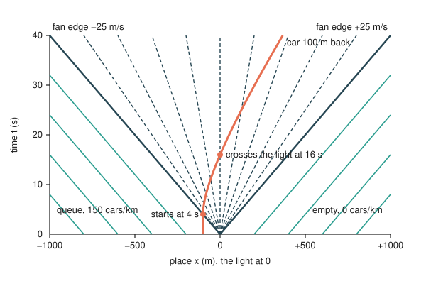
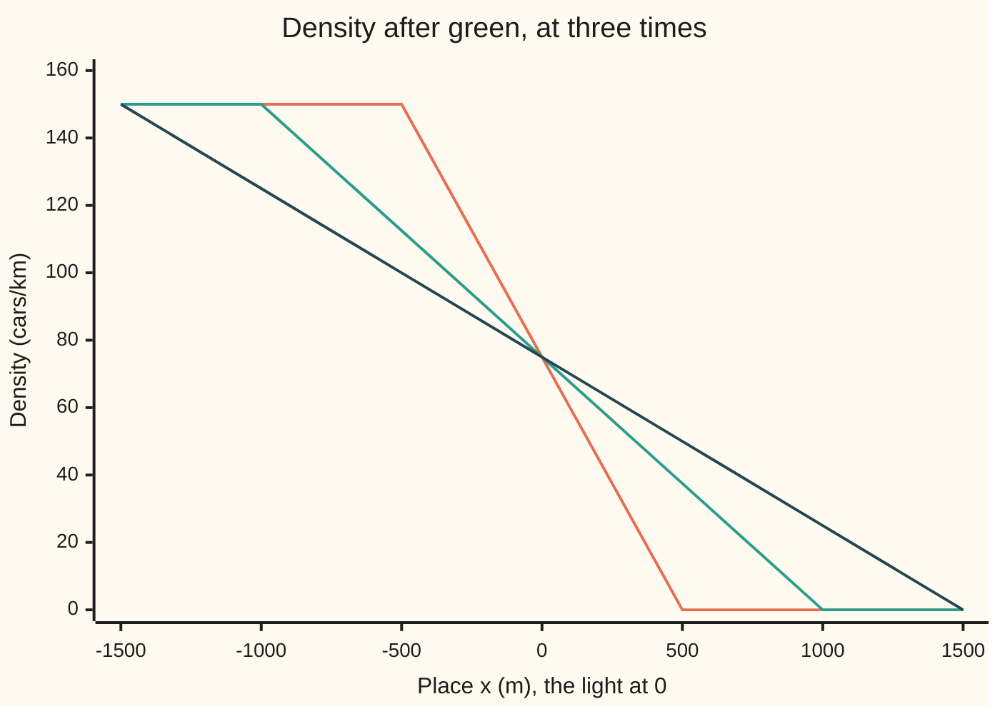

# The Riemann problem: two constant states meeting at one point

[Syllabus](../../../SYLLABUS.md) → [Partial differential equations](../README.md) → [First-Order Equations and Characteristics](../README.md#s02) → The Riemann problem

---

## General Overview

Wing 08's [The transport equation](../../08-Differential%20equations%20and%20dynamics/10-The%20Classical%20PDEs/02-the-transport-equation-and-characteristics.md) carries a shape along at one speed. Traffic is harder: each density moves at its own speed. This card solves the simplest data where that matters, a single jump.

Take the one-lane road of [Conservation laws](02-conservation-laws-and-shocks.md). Cars drive at up to 90 km/h (25 m/s) on an empty road and stop at a jam of 150 cars/km. A red light at place $`x = 0`$ has held a jammed queue behind it. The road ahead is empty. At time $`t = 0`$ the light turns green.

The queue does not leave as a block. The front car goes at once. A car 100 m back waits 4 s, then creeps off and crosses the light at 16 s, already doing 45 km/h. The light passes 3,375 cars/h, and 56.25 cars clear it in the first minute.

The unknown is the traffic density $`\rho(x, t)`$ in cars per km. The region is the whole road, $`-\infty < x < \infty`$, for $`t > 0`$. The data are two constant densities, 150 cars/km left of the light and 0 cars/km right of it. Data like this, two constant states that meet at one point, are a **Riemann problem** (after Bernhard Riemann, who posed it for gas in 1860).

Every Riemann problem for Burgers' equation, the simplest nonlinear conservation law, has one of two answers. If the waves on the left are faster than the waves on the right, the jump holds together as a **shock**: a moving jump. If the waves on the left are slower, the jump opens into a **fan**: a smooth ramp from one state to the other that widens with time. The green light is a fan. A red light that cars run into is a shock.

**Two constant states meeting at one point either stay one jump, moving at the average of their two wave speeds, when the left state's waves are faster, or spread into a fan in which the wave speed equals place divided by time, when the right state's waves are faster.**

**What kind of fact this is:** a theorem about Burgers' equation, proved on this card in Why it works, with uniqueness quoted from Kružkov (1970). The traffic law it is applied to is a model, and its numbers are illustrative.

<p align="center"></p>

Each straight line is a characteristic: a path in place and time along which the density stays fixed. Dashed lines are the fan's characteristics, one for every 5 m/s of wave speed. The solid fan edges move at ±25 m/s, so at 40 s they sit at −1000 m and +1000 m. The thick curve is the car that starts 100 m back.

---

## The formula

Traffic obeys the conservation law $`\rho_t + q(\rho)_x = 0`$ from [Conservation laws](02-conservation-laws-and-shocks.md): cars are counted, never made or lost. Here the flow (cars passing a point per hour) is Greenshields' rule $`q(\rho) = v_{\max}\rho\,(1 - \rho/\rho_{\max})`$.

Rewrite it in the **wave speed** $`u = q'(\rho) = v_{\max}(1 - 2\rho/\rho_{\max})`$, the speed at which a given density travels along the road. Because $`u`$ is a straight-line function of $`\rho`$, the traffic law becomes exactly Burgers' equation $`u_t + (u^2/2)_x = 0`$ (proved in the fold under Step 1). The Riemann data are $`u = u_L`$ left of $`x = 0`$ and $`u = u_R`$ right of it.

If $`u_L > u_R`$, the answer is a shock:

```math
u(x, t) = \begin{cases} u_L, & x < s\,t \\ u_R, & x > s\,t \end{cases} \qquad s = \tfrac12\,(u_L + u_R)
```

If $`u_L < u_R`$, the answer is a fan:

```math
u(x, t) = \begin{cases} u_L, & x \le u_L\,t \\ x/t, & u_L\,t < x < u_R\,t \\ u_R, & x \ge u_R\,t \end{cases}
```

**Read it aloud:** "When the left waves are faster, they pile into one jump that moves at the average of the two speeds; when they are slower, the gap fills with a ramp where every point's wave speed is just how far it is from the start, divided by the time."

| Symbol | Plain meaning | In our example | Push it up and the answer… |
| --- | --- | --- | --- |
| $`x`$ | place along the road, the light at 0 | −100 m for the car we follow | further back, the car waits longer |
| $`t`$ | time since the light turned green | 16 s when that car crosses | the fan widens in proportion |
| $`\rho`$ | traffic density, cars per km | 150 behind, 0 ahead | denser means slower cars |
| $`\rho_{\max}`$ | jam density, where cars stand still | 150 cars/km | more cars fit, more cars flow |
| $`v_{\max}`$ | top speed on an empty road | 90 km/h (25 m/s) | the fan opens faster, flow rises |
| $`q(\rho)`$ | flow: cars passing a point per hour | 3,375 cars/h at the light | — |
| $`u`$ | wave speed $`q'(\rho)`$, the speed a density travels at | −90 km/h in the queue | — |
| $`u_L,\ u_R`$ | wave speeds of the left and right states, whose densities are $`\rho_L,\ \rho_R`$ | −90 and +90 km/h | their order picks shock or fan |
| $`s`$ | speed of a shock; $`[\,\cdot\,]`$ is a jump, right value minus left | −18 km/h for a red light | — |
| $`\xi`$ | place divided by time, $`x/t`$; $`U(\xi)`$ is the answer written in it | 0 at the light | — |
| $`X_0,\ t_0`$ | how far back a car starts, and when it starts moving | 100 m, 4 s | the car starts later |
| $`v`$ | a car's own speed, $`v_{\max}(1 - \rho/\rho_{\max}) = \tfrac12(v_{\max} + u)`$ | 45 km/h at the light | — |

Two speeds live on this card and must not be mixed. A car moves at $`v`$. A density, and so a wave, moves at $`u`$. In the queue the cars stand still ($`v = 0`$) while the news that the light changed runs backwards at $`u = -90`$ km/h.

Back to density: $`\rho = \tfrac12\rho_{\max}\,(1 - u/v_{\max})`$. In the green-light fan $`u = x/t`$, so

```math
\rho(x, t) = \tfrac12\,\rho_{\max}\left(1 - \frac{x}{v_{\max}\,t}\right) \qquad \text{for } -v_{\max} t < x < v_{\max} t
```

### When it holds

- **The flux bends one way only.** Burgers' flux $`u^2/2`$ is convex, so wave speed rises with $`u`$. A flux with a bend in it (an inflection) gives answers that are part shock, part fan, and this formula misses them.
- **The conserved quantity is the physical one.** The road conserves cars. Conserve $`u^2/2`$ instead and the red-light shock moves at −114 km/h, not −18 km/h.
- **"The solution" means the entropy solution.** Weak solutions (ones that satisfy the conservation law across jumps) are not unique. The green light also has a weak solution where the jump never moves and no car ever leaves: see What breaks.
- **The data are exactly two constants.** Real queues taper. Then the Riemann answer is the picture close to the light at early times, and the waves later meet and interact.
- **Drivers respond at once to the density just ahead.** Real drivers react with a delay, and the straight-line speed rule is a rough fit. Real stop lines pass fewer cars per hour than this model.

---

## Why it works

### Step 0: stretching place and time together changes nothing

Stretch every place and every time by the same factor, for example double them. The equation $`u_t + u\,u_x = 0`$ looks the same, because both derivatives pick up the same factor. The data look the same too, because a jump at $`x = 0`$ stays a jump at $`x = 0`$.

So the answer cannot change either. It can depend only on the ratio $`\xi = x/t`$, the speed you would need to reach place $`x`$ at time $`t`$ from the light. That one fact cuts a PDE down to an ordinary equation in $`\xi`$.

### Step 1: write the answer as a function of one variable

Put $`u(x, t) = U(\xi)`$ with $`\xi = x/t`$. Each straight ray $`x = \xi t`$ out of the light carries one value. This uses uniqueness: if the problem has only one entropy solution, every stretched copy, such as $`u(2x, 2t)`$ or $`u(3x, 3t)`$, must be that same solution. Since any factor works, the value at $`(x, t)`$ equals the value at $`(x/t, 1)`$.

<details>
<summary>Detailed proof: traffic is exactly Burgers' equation in the wave speed</summary>

Start from $`\rho_t + q(\rho)_x = 0`$ with $`q(\rho) = v_{\max}\rho(1 - \rho/\rho_{\max})`$, and set $`u = v_{\max}(1 - 2\rho/\rho_{\max})`$.

Solve for $`\rho`$, then for $`1 - \rho/\rho_{\max}`$:

$`\displaystyle \rho = \frac{\rho_{\max} (v_{\max} - u)}{2v_{\max}}, \qquad 1 - \frac{\rho}{\rho_{\max}} = \frac{v_{\max} + u}{2v_{\max}}`$

Multiply to get the flow in terms of $`u`$:

$`\displaystyle q = v_{\max} \cdot \frac{\rho_{\max} (v_{\max} - u)}{2v_{\max}} \cdot \frac{v_{\max} + u}{2v_{\max}} = \frac{\rho_{\max}}{4v_{\max}}\,(v_{\max}^2 - u^2)`$

Now $`u_t = -\tfrac{2v_{\max}}{\rho_{\max}}\,\rho_t = \tfrac{2v_{\max}}{\rho_{\max}}\, q_x`$, and so

$`\displaystyle u_t = \frac{2v_{\max}}{\rho_{\max}} \cdot \frac{\rho_{\max}}{4v_{\max}}\,(v_{\max}^2 - u^2)_x = -\left(\frac{u^2}{2}\right)_x`$

That is $`u_t + (u^2/2)_x = 0`$. The step multiplied a conservation law by a constant and added a constant, so it holds in conservation form. Jumps therefore obey the same jump rule in either variable: the shock speed $`(q(\rho_R) - q(\rho_L))/(\rho_R - \rho_L)`$ equals $`\tfrac12(u_L + u_R)`$.

The car speed follows too: $`v = v_{\max}(1 - \rho/\rho_{\max}) = v_{\max} \cdot \tfrac{v_{\max} + u}{2v_{\max}} = \tfrac12(v_{\max} + u)`$.

</details>

### Step 2: the equation leaves only two choices

With $`u = U(x/t)`$, the chain rule gives $`u_t = -\tfrac{x}{t^2}U'`$ and $`u_x = \tfrac1t U'`$. Put them into $`u_t + u\,u_x = 0`$ and multiply by $`t`$:

```math
\bigl(U(\xi) - \xi\bigr)\,U'(\xi) = 0
```

So at every $`\xi`$, either $`U' = 0`$ (the value is constant there) or $`U(\xi) = \xi`$. The only smooth piece that is not constant is the fan $`u = x/t`$. In words: on a fan line, the density sitting there travels at exactly the speed that carries it from the light to where it now is.

### Step 3: glue constant pieces with the jump rule

Where two constant pieces meet at a jump moving at speed $`s`$, counting cars across the jump gives the Rankine–Hugoniot rule from [Conservation laws](02-conservation-laws-and-shocks.md): $`s = [u^2/2]/[u]`$, with $`[\,\cdot\,]`$ the jump, right value minus left. For Burgers this is

```math
s = \frac{u_R^2/2 - u_L^2/2}{u_R - u_L} = \tfrac12\,(u_L + u_R)
```

### Step 4: the entropy test picks one

[Entropy conditions](03-entropy-conditions-and-vanishing-viscosity.md) admits a jump only if characteristics run into it from both sides: $`u_L > s > u_R`$. With $`s`$ the average, that holds exactly when $`u_L > u_R`$.

- **If $`u_L > u_R`$:** the jump passes the test. The shock is the answer.
- **If $`u_L < u_R`$:** the jump fails, so the gap between the rays $`x = u_L t`$ and $`x = u_R t`$ must be filled smoothly. Step 2 allows only $`u = x/t`$ there. It meets $`u_L`$ at the left edge and $`u_R`$ at the right edge, so the answer is continuous. It satisfies the equation exactly inside each piece, so it is a weak solution, and it has no jump to fail the test.

### Step 5: there is no other answer

Kružkov's theorem (1970) says a conservation law with bounded data has exactly one entropy solution. The shock or fan built in Step 4 is an entropy solution, so it is the solution. That also closes the loop on Step 1.

---

## Worked numbers, by hand

Green light: $`v_{\max} = 90`$ km/h, $`\rho_{\max} = 150`$ cars/km, queue $`\rho_L = 150`$, empty road $`\rho_R = 0`$.

| Step | Arithmetic | Value |
| --- | --- | --- |
| queue's wave speed $`u_L`$ | $`90\,(1 - 2 \times 150/150)`$ | −90 km/h |
| empty road's wave speed $`u_R`$ | $`90\,(1 - 0)`$ | +90 km/h |
| which answer | $`u_L = -90 < u_R = +90`$ | a fan |
| fan edges after 10 s | $`\mp 25 \text{ m/s} \times 10 \text{ s}`$ | −250 m and +250 m |
| wave speed at the light | $`u = x/t = 0/t`$ | 0 |
| density at the light | $`\tfrac12 \times 150 \times (1 - 0)`$ | 75 cars/km |
| car speed at the light | $`\tfrac12\,(90 + 0)`$ | 45 km/h |
| flow at the light | $`75 \times 45`$ | 3,375 cars/h |
| **cars through in 60 s** | $`3375 / 60`$ | **56.25 cars** |

The density at the light sits at 75 cars/km, half of jam, for the whole green phase. That is the density where Greenshields' flow is largest, so a light releasing a jammed queue runs at the road's full capacity. In one minute of green, about 56 cars get through.

The other way round is a shock. A red light holds a queue at 150 cars/km, and cars arrive at 30 cars/km. Their wave speed is $`90\,(1 - 2 \times 30/150) = 54`$ km/h. Now $`u_L = 54 > u_R = -90`$, so the jump holds, and it moves at $`\tfrac12(54 - 90) = -18`$ km/h, the shock speed of [Conservation laws](02-conservation-laws-and-shocks.md). The back of the queue grows backwards at 18 km/h. If the light turns red at $`t = 0`$, the queue's back starts at the light, and after 60 s it sits 300 m behind it.

### What breaks if you drop a piece

| Mistake | Comes out at | What went wrong |
| --- | --- | --- |
| Keep the jump at the green light | the jump moves at 0.0 km/h; 0 cars/h pass, not 3,375 | a weak solution that fails the entropy test: waves leave the jump on both sides |
| Shock at the average car speed | +36.0 km/h, not −18.0 | car speed is not wave speed: the queue's back moves against the traffic |
| Conserve $`u^2/2`$ instead of cars | −31.7 m/s = −114.0 km/h, not −18.0 | the jump rule depends on what is conserved; only cars are |
| Draw a fan for the red light | 400 m of road given two densities after 10 s | with $`u_L > u_R`$ the fan's edges cross and the ramp folds over |

The third row is a hypothesis failing. The smooth equation $`u_t + u\,u_x = 0`$ is the same in both forms, but a jump needs to know which quantity is conserved across it.

---

## How the queue empties

The fan says what the density is. Each car still has to find its own way through it. A car's speed is $`v = \tfrac12(v_{\max} + u)`$, and inside the fan $`u = x/t`$, so the car's place obeys

```math
\frac{dx}{dt} = \tfrac12\left(v_{\max} + \frac{x}{t}\right)
```

A car that starts a distance $`X_0`$ back stands still until the fan's left edge reaches it, at $`t_0 = X_0/v_{\max}`$. After that the equation above is a linear ODE with solution $`x(t) = v_{\max} t - 2\sqrt{v_{\max} X_0\, t}`$. Setting $`x = 0`$ gives its crossing time $`4X_0/v_{\max}`$.

### One car, 100 m back

Here $`X_0 = 100`$ m and $`v_{\max} = 25`$ m/s, so $`x(t) = 25t - 100\sqrt t`$ metres.

| Time | Place | Speed | What is happening |
| --- | --- | --- | --- |
| 4 s | −100 m | 0 km/h | the fan reaches it: it starts |
| 9 s | −75 m | 30 km/h | creeping forward in dense traffic |
| 16 s | 0 m | 45 km/h | crosses the light |
| 25 s | 125 m | 54 km/h | still speeding up |
| 36 s | 300 m | 60 km/h | the top speed 90 km/h is still far off |

The count agrees. At 150 cars/km, 15 cars stand ahead of it. The light passes 3,375 cars/h for 16 s, which is also 15 cars. No car overtakes another, so it crosses exactly when the 15 ahead have gone.

### The road at 40 s

Density along the road, 40 s after green, in cars/km:

```
  −1500 m   ██████████████████████████████  150.0
  −1000 m   ██████████████████████████████  150.0
   −500 m   ██████████████████████          112.5
      0 m   ███████████████                 75.0
   +500 m   ███████                         37.5
  +1000 m                                   0.0
  +1500 m                                   0.0
```

Behind −1000 m the queue has not heard the news yet. Ahead of +1000 m no car has arrived yet. Between them the density falls in a straight line.

### The fan widening



Orange: 20 s after green. Teal: 40 s. Dark blue: 60 s. Every profile passes through 75 cars/km at the light. The ramp keeps its shape and stretches: the 60 s profile is the 20 s profile drawn three times wider. That is Step 0's stretching, seen on the road.

---

## Code, from first principles, and it actually runs

The code solves the green light by the fan formula and checks it by four other roads. It counts the cars past the light two ways: flow times time, and adding up density along the road. It follows the car 100 m back by RK4 (the classical fourth-order Runge–Kutta stepper) and compares with the closed-form path. It measures the equation's residual (what is left over when the formula is put into $`u_t + u\,u_x`$) by centred differences at three steps. And it runs a grid that knows nothing of the fan: cells of 20, 10 and 5 m, updated with Rusanov's flux, a simple averaged flux with no Riemann solution inside. The red-light shock speed is found in exact fractions by the traffic jump rule and by the Burgers average.

### Python

```python
# The Riemann problem -- the check behind the card.  Standard library only.
# A one-lane road (illustrative numbers): top speed 25 m/s, jam 150 cars/km,
# flow q = V rho (1 - rho/RJ).  At t = 0 the light at x = 0 turns green: a
# jammed queue behind it, an empty road ahead.  Roads: the fan formula; a
# grid with a Rusanov flux (no Riemann solution inside) at three steps; a car's
# path by RK4 against its closed form; the equation's residual by centred
# differences; shock speeds in exact fractions.
from fractions import Fraction as F
from math import log2

V, RJ = 25.0, 0.15                         # top speed m/s, jam density cars/m
def q(r): return V * r * (1 - r / RJ)      # flow, cars/s
def wave(r): return V * (1 - 2 * r / RJ)   # wave speed u = q'(rho), m/s
def car(r): return V * (1 - r / RJ)        # car speed, m/s
def rho_of(u): return RJ * (1 - u / V) / 2 # back from wave speed to density

def riemann(uL, uR, x, t):                 # Burgers u_t + (u^2/2)_x = 0
    if uL > uR:                            # shock at the average speed
        return uL if x < (uL + uR) / 2 * t else uR
    if x <= uL * t: return uL              # fan: u = x/t between the edges
    if x >= uR * t: return uR
    return x / t
def rho(x, t): return rho_of(riemann(wave(RJ), wave(0.0), x, t))

uL, uR = wave(RJ), wave(0.0)
print(f"wave speeds: queue {uL * 3.6:.1f} km/h, empty road {uR * 3.6:.1f} km/h")
print(f"fan edges at 10 s: {uL * 10:.0f} m and {uR * 10:.0f} m")
r0 = rho(0.0, 30.0)
print(f"at the light: density {r0 * 1000:.1f} cars/km, car speed {car(r0) * 3.6:.1f} km/h, flow {q(r0) * 3600:.1f} cars/h")
through = q(r0) * 60
w = V * 60 / 6000; past = sum(rho((k + 0.5) * w, 60.0) * w for k in range(6000))   # cars past the light
print(f"cars through in 60 s: flow x time {through:.4f}, counted on the road {past:.4f}")
assert abs(r0 - RJ / 2) < 1e-12 and abs(through - past) < 1e-6 and abs(through - V * RJ / 4 * 60) < 1e-9

# one car, 100 m back: closed form x = V t - 2 sqrt(V X0 t) after it starts at X0/V
X0 = 100.0
def path(t): return V * t - 2 * (V * X0 * t) ** 0.5 if t > X0 / V else -X0
def vel(x, t): return car(rho(x, t))
def rk4(s, n=4000):                        # RK4 from the moment the fan reaches it
    x, t = -X0, X0 / V
    if s <= t: return x
    h = (s - t) / n
    for _ in range(n):
        k1 = vel(x, t); k2 = vel(x + h / 2 * k1, t + h / 2)
        k3 = vel(x + h / 2 * k2, t + h / 2); k4 = vel(x + h * k3, t + h)
        x += h / 6 * (k1 + 2 * k2 + 2 * k3 + k4); t += h
    return x
print("car 100 m back:  t s   closed x m   RK4 x m   speed km/h")
for s in (4.0, 9.0, 16.0, 25.0, 36.0):
    xc, xr = path(s), rk4(s)
    print(f"              {s:5.0f}   {xc:9.3f}  {xr if abs(xr) > 5e-4 else 0.0:8.3f}   {car(rho(xc, s)) * 3.6:8.2f}")
    assert abs(xc - xr) < 1e-3
tc = 4 * X0 / V
print(f"it crosses the light at {tc:.1f} s; cars ahead of it: {X0 * RJ:.1f}; flow x time {q(r0) * tc:.1f}")
assert abs(path(tc)) < 1e-9 and abs(q(r0) * tc - X0 * RJ) < 1e-9

# the equation's residual u_t + u u_x at (x, t) = (-100 m, 20 s), centred differences
print("residual u_t + u u_x at -100 m, 20 s, in mm/s^2:", end="")
res = []
for d in (1.0, 0.5, 0.25):
    f = lambda xx, tt: riemann(uL, uR, xx, tt)
    ut = (f(-100, 20 + d) - f(-100, 20 - d)) / (2 * d)
    ux = (f(-100 + d, 20) - f(-100 - d, 20)) / (2 * d)
    res.append(ut + f(-100, 20) * ux); print(f"  step {d} -> {res[-1] * 1000:.4f}", end="")
print()
assert abs(res[0] / res[1] - 4) < 0.01 and abs(res[1] / res[2] - 4) < 0.01

# a grid that knows no Riemann solution: Rusanov flux, cells of h metres, to 60 s
def grid(hx):
    nx = int(4000 / hx); r = [RJ if -2000 + (i + 0.5) * hx < 0 else 0.0 for i in range(nx)]
    dt = 0.5 * hx / V; steps = int(round(60 / dt)); thru = 0.0
    for _ in range(steps):
        e = [r[0]] + r + [r[-1]]
        fl = [(q(e[i]) + q(e[i + 1])) / 2 - max(abs(wave(e[i])), abs(wave(e[i + 1]))) / 2 * (e[i + 1] - e[i]) for i in range(nx + 1)]
        thru += fl[nx // 2] * dt
        r = [r[i] - dt / hx * (fl[i + 1] - fl[i]) for i in range(nx)]
    err = sum(abs(r[i] - rho(-2000 + (i + 0.5) * hx, 60.0)) * hx for i in range(nx))
    return err, thru, sum(r) * hx
errs, thrus = [], []
for hx in (20.0, 10.0, 5.0):
    err, thru, tot = grid(hx); errs.append(err); thrus.append(thru)
    print(f"grid h = {hx:4.1f} m: misplaced cars {err:.4f}, through the light {thru:.4f}, total cars {tot:.4f}")
    assert abs(tot - 2000 * RJ) < 1e-9
print(f"error ratio per halving: {errs[0] / errs[1]:.3f} and {errs[1] / errs[2]:.3f}; observed order {log2(errs[0] / errs[1]):.2f} and {log2(errs[1] / errs[2]):.2f}")
assert errs[2] < errs[1] < errs[0] and errs[1] / errs[2] > 1.4
assert abs(thrus[2] - past) < abs(thrus[1] - past) < abs(thrus[0] - past)

# the other branch: red light, 30 cars/km meets the queue -> a shock
def qk(r): return F(90) * r * (1 - F(r, 150))   # exact, km/h and cars/km
def wk(r): return F(90) * (1 - F(2 * r, 150))
s_rh = (qk(150) - qk(30)) / (150 - 30); s_b = (wk(30) + wk(150)) / 2
print(f"red light: wave speeds {float(wk(30)):.1f} and {float(wk(150)):.1f} km/h; shock {float(s_rh):.1f} km/h (cars), {float(s_b):.1f} km/h (Burgers)")
assert s_rh == s_b == -18
rl, rr = 0.03, RJ                          # the same shock from the float solver
cnt = sum(rho_of(riemann(wave(rl), wave(rr), -2000 + (k + 0.5) * 0.5, 60.0)) * 0.5 for k in range(8000))
inflow = 2000 * (rl + rr) + q(rl) * 60     # cars at t = 0 plus cars driven in
print(f"red light, 60 s: shock at {(wave(rl) + wave(rr)) / 2 * 60:.0f} m; cars on 4 km counted {cnt:.4f}, by inflow {inflow:.4f}")
assert abs(cnt - inflow) < 1e-6

# what breaks
jump = (qk(150) - qk(0)) / 150
print(f"breaks: green-light jump kept: speed {float(jump):.1f} km/h, flow at light {float(qk(150)):.0f} cars/h (right: {q(r0) * 3600:.0f})")
cs = (90 * (1 - F(30, 150)) + 0) / 2
print(f"breaks: shock at the average car speed: {float(cs):.1f} km/h (right: {float(s_rh):.1f})")
a, b = wk(30) / F(18, 5), wk(150) / F(18, 5)    # m/s
wrong = F(2, 3) * (a * a + a * b + b * b) / (a + b)
print(f"breaks: conserve u^2/2 instead of cars: {float(wrong):.1f} m/s = {float(wrong * F(18, 5)):.1f} km/h (right: {float(s_rh):.1f})")
print(f"breaks: fan drawn for the red light: {float((a - b) * 10):.0f} m of road given two densities at 10 s")
assert jump == 0 and cs == 36
assert wrong == F(-95, 3) and (a - b) * 10 == 400

for tt in (20.0, 40.0, 60.0):
    print(f"chart, t = {tt:.0f} s:", " ".join(f"{rho(xx, tt) * 1000:.1f}" for xx in range(-1500, 1501, 500)))
fig = ", ".join(f"({path(s):.1f}, {s:.0f})" for s in (4.0, 9.0, 16.0, 25.0, 40.0))
print(f"figure, fan edges at 40 s: {uL * 40:.0f} m, {uR * 40:.0f} m; car path (x m, t s): {fig}")
print("ALL CHECKS PASS")
```

**Ran 2026-11-15 on macOS, Python 3.14.10, standard library only. All checks passed. Output, pasted from the run:**

```
wave speeds: queue -90.0 km/h, empty road 90.0 km/h
fan edges at 10 s: -250 m and 250 m
at the light: density 75.0 cars/km, car speed 45.0 km/h, flow 3375.0 cars/h
cars through in 60 s: flow x time 56.2500, counted on the road 56.2500
car 100 m back:  t s   closed x m   RK4 x m   speed km/h
                  4    -100.000  -100.000       0.00
                  9     -75.000   -75.000      30.00
                 16       0.000     0.000      45.00
                 25     125.000   125.000      54.00
                 36     300.000   300.000      60.00
it crosses the light at 16.0 s; cars ahead of it: 15.0; flow x time 15.0
residual u_t + u u_x at -100 m, 20 s, in mm/s^2:  step 1.0 -> 0.6266  step 0.5 -> 0.1563  step 0.25 -> 0.0391
grid h = 20.0 m: misplaced cars 4.4951, through the light 57.0972, total cars 300.0000
grid h = 10.0 m: misplaced cars 2.6520, through the light 56.6776, total cars 300.0000
grid h =  5.0 m: misplaced cars 1.5378, through the light 56.4649, total cars 300.0000
error ratio per halving: 1.695 and 1.725; observed order 0.76 and 0.79
red light: wave speeds 54.0 and -90.0 km/h; shock -18.0 km/h (cars), -18.0 km/h (Burgers)
red light, 60 s: shock at -300 m; cars on 4 km counted 396.0000, by inflow 396.0000
breaks: green-light jump kept: speed 0.0 km/h, flow at light 0 cars/h (right: 3375)
breaks: shock at the average car speed: 36.0 km/h (right: -18.0)
breaks: conserve u^2/2 instead of cars: -31.7 m/s = -114.0 km/h (right: -18.0)
breaks: fan drawn for the red light: 400 m of road given two densities at 10 s
chart, t = 20 s: 150.0 150.0 150.0 75.0 0.0 0.0 0.0
chart, t = 40 s: 150.0 150.0 112.5 75.0 37.5 0.0 0.0
chart, t = 60 s: 150.0 125.0 100.0 75.0 50.0 25.0 0.0
figure, fan edges at 40 s: -1000 m, 1000 m; car path (x m, t s): (-100.0, 4), (-75.0, 9), (0.0, 16), (125.0, 25), (367.5, 40)
ALL CHECKS PASS
```

Five roads agree. The two car counts match to four decimals. RK4 lands on the closed-form path to a thousandth of a metre. The residual falls by 4 each time the step halves, as centred differences should when the formula solves the equation exactly. The grid's misplaced cars fall at each halving, at an observed order near 0.8. That is below the grid's formal first order, because the corners at the fan's edges and the jump at $`t = 0`$ cost it accuracy. Its count through the light, 56.4649 at 5 m, closes in on 56.25 from above: the grid's built-in smearing lets a few cars leak early.

### Rust

The same checks with the same inputs and the same output. Rust has no fraction type, so the code writes a small one for the exact shock speeds.

```rust
// The Riemann problem -- the same check as rarefaction_and_the_riemann_problem_check.py,
// in Rust.  Standard library only, no crates.  A one-lane road (illustrative
// numbers): top speed 25 m/s, jam 150 cars/km, flow q = V rho (1 - rho/RJ).  The
// light at x = 0 turns green at t = 0.  Roads: the fan formula; a Rusanov grid at
// three steps; a car's path by RK4; centred-difference residuals; exact fractions.
// Compile: rustc --edition 2021 -O rarefaction_and_the_riemann_problem_check.rs

const V: f64 = 25.0; // top speed, m/s
const RJ: f64 = 0.15; // jam density, cars/m
fn q(r: f64) -> f64 { V * r * (1.0 - r / RJ) } // flow, cars/s
fn wave(r: f64) -> f64 { V * (1.0 - 2.0 * r / RJ) } // wave speed u = q'(rho), m/s
fn car(r: f64) -> f64 { V * (1.0 - r / RJ) } // car speed, m/s
fn rho_of(u: f64) -> f64 { RJ * (1.0 - u / V) / 2.0 }

fn riemann(ul: f64, ur: f64, x: f64, t: f64) -> f64 { // Burgers u_t + (u^2/2)_x = 0
    if ul > ur { return if x < (ul + ur) / 2.0 * t { ul } else { ur }; } // shock
    if x <= ul * t { return ul; } // fan: u = x/t between the edges
    if x >= ur * t { return ur; }
    x / t
}
fn rho(x: f64, t: f64) -> f64 { rho_of(riemann(wave(RJ), wave(0.0), x, t)) }

const X0: f64 = 100.0; // the car starts 100 m behind the light
fn path(t: f64) -> f64 { if t > X0 / V { V * t - 2.0 * (V * X0 * t).sqrt() } else { -X0 } }
fn vel(x: f64, t: f64) -> f64 { car(rho(x, t)) }
fn rk4(s: f64, n: usize) -> f64 { // RK4 from the moment the fan reaches the car
    let (mut x, mut t) = (-X0, X0 / V);
    if s <= t { return x; }
    let h = (s - t) / n as f64;
    for _ in 0..n {
        let k1 = vel(x, t); let k2 = vel(x + h / 2.0 * k1, t + h / 2.0);
        let k3 = vel(x + h / 2.0 * k2, t + h / 2.0); let k4 = vel(x + h * k3, t + h);
        x += h / 6.0 * (k1 + 2.0 * k2 + 2.0 * k3 + k4); t += h;
    }
    x
}

// exact fractions, numerator and denominator
#[derive(Clone, Copy, PartialEq, Debug)]
struct Fr(i64, i64);
fn gcd(a: i64, b: i64) -> i64 { if b == 0 { a.abs() } else { gcd(b, a % b) } }
fn fr(n: i64, d: i64) -> Fr { let g = gcd(n, d).max(1) * d.signum(); Fr(n / g, d / g) }
impl Fr {
    fn add(self, o: Fr) -> Fr { fr(self.0 * o.1 + o.0 * self.1, self.1 * o.1) }
    fn sub(self, o: Fr) -> Fr { fr(self.0 * o.1 - o.0 * self.1, self.1 * o.1) }
    fn mul(self, o: Fr) -> Fr { fr(self.0 * o.0, self.1 * o.1) }
    fn div(self, o: Fr) -> Fr { fr(self.0 * o.1, self.1 * o.0) }
    fn f(self) -> f64 { self.0 as f64 / self.1 as f64 }
}
fn qk(r: i64) -> Fr { fr(90 * r, 1).mul(fr(1, 1).sub(fr(r, 150))) } // km/h, cars/km
fn wk(r: i64) -> Fr { fr(90, 1).mul(fr(1, 1).sub(fr(2 * r, 150))) }

fn grid(hx: f64) -> (f64, f64, f64) { // Rusanov flux, no Riemann solution inside
    let nx = (4000.0 / hx) as usize;
    let mut r: Vec<f64> = (0..nx).map(|i| if -2000.0 + (i as f64 + 0.5) * hx < 0.0 { RJ } else { 0.0 }).collect();
    let dt = 0.5 * hx / V;
    let steps = (60.0 / dt).round() as usize;
    let mut thru = 0.0;
    for _ in 0..steps {
        let mut e = vec![r[0]]; e.extend_from_slice(&r); e.push(r[nx - 1]);
        let fl: Vec<f64> = (0..nx + 1).map(|i| (q(e[i]) + q(e[i + 1])) / 2.0
            - wave(e[i]).abs().max(wave(e[i + 1]).abs()) / 2.0 * (e[i + 1] - e[i])).collect();
        thru += fl[nx / 2] * dt;
        r = (0..nx).map(|i| r[i] - dt / hx * (fl[i + 1] - fl[i])).collect();
    }
    let err: f64 = (0..nx).map(|i| (r[i] - rho(-2000.0 + (i as f64 + 0.5) * hx, 60.0)).abs() * hx).sum();
    (err, thru, r.iter().sum::<f64>() * hx)
}

fn main() {
    let (ul, ur) = (wave(RJ), wave(0.0));
    println!("wave speeds: queue {:.1} km/h, empty road {:.1} km/h", ul * 3.6, ur * 3.6);
    println!("fan edges at 10 s: {:.0} m and {:.0} m", ul * 10.0, ur * 10.0);
    let r0 = rho(0.0, 30.0);
    println!("at the light: density {:.1} cars/km, car speed {:.1} km/h, flow {:.1} cars/h", r0 * 1000.0, car(r0) * 3.6, q(r0) * 3600.0);
    let through = q(r0) * 60.0;
    let w = V * 60.0 / 6000.0; // count the cars past the light, cell by cell
    let past: f64 = (0..6000).map(|k| rho((k as f64 + 0.5) * w, 60.0) * w).sum();
    println!("cars through in 60 s: flow x time {:.4}, counted on the road {:.4}", through, past);
    assert!((r0 - RJ / 2.0).abs() < 1e-12 && (through - past).abs() < 1e-6 && (through - V * RJ / 4.0 * 60.0).abs() < 1e-9);

    println!("car 100 m back:  t s   closed x m   RK4 x m   speed km/h");
    for s in [4.0, 9.0, 16.0, 25.0, 36.0].iter() {
        let (xc, xr) = (path(*s), rk4(*s, 4000));
        println!("              {:5.0}   {:9.3}  {:8.3}   {:8.2}", s, xc, if xr.abs() > 5e-4 { xr } else { 0.0 }, car(rho(xc, *s)) * 3.6);
        assert!((xc - xr).abs() < 1e-3);
    }
    let tc = 4.0 * X0 / V;
    println!("it crosses the light at {:.1} s; cars ahead of it: {:.1}; flow x time {:.1}", tc, X0 * RJ, q(r0) * tc);
    assert!(path(tc).abs() < 1e-9 && (q(r0) * tc - X0 * RJ).abs() < 1e-9);

    print!("residual u_t + u u_x at -100 m, 20 s, in mm/s^2:");
    let mut res = vec![];
    for (d, name) in [(1.0, "1.0"), (0.5, "0.5"), (0.25, "0.25")] {
        let f = |xx: f64, tt: f64| riemann(ul, ur, xx, tt);
        let ut = (f(-100.0, 20.0 + d) - f(-100.0, 20.0 - d)) / (2.0 * d);
        let ux = (f(-100.0 + d, 20.0) - f(-100.0 - d, 20.0)) / (2.0 * d);
        res.push(ut + f(-100.0, 20.0) * ux);
        print!("  step {} -> {:.4}", name, res[res.len() - 1] * 1000.0);
    }
    println!();
    assert!((res[0] / res[1] - 4.0).abs() < 0.01 && (res[1] / res[2] - 4.0).abs() < 0.01);

    let (mut errs, mut thrus) = (vec![], vec![]);
    for hx in [20.0, 10.0, 5.0] {
        let (err, thru, tot) = grid(hx);
        errs.push(err); thrus.push(thru);
        println!("grid h = {:4.1} m: misplaced cars {:.4}, through the light {:.4}, total cars {:.4}", hx, err, thru, tot);
        assert!((tot - 2000.0 * RJ).abs() < 1e-9);
    }
    println!("error ratio per halving: {:.3} and {:.3}; observed order {:.2} and {:.2}", errs[0] / errs[1], errs[1] / errs[2],
        (errs[0] / errs[1]).log2(), (errs[1] / errs[2]).log2());
    assert!(errs[2] < errs[1] && errs[1] < errs[0] && errs[1] / errs[2] > 1.4);
    let gap = |v: f64| (v - past).abs();
    assert!(gap(thrus[2]) < gap(thrus[1]) && gap(thrus[1]) < gap(thrus[0]));

    // the other branch: red light, 30 cars/km meets the queue -> a shock
    let s_rh = qk(150).sub(qk(30)).div(fr(150 - 30, 1));
    let s_b = wk(30).add(wk(150)).div(fr(2, 1));
    println!("red light: wave speeds {:.1} and {:.1} km/h; shock {:.1} km/h (cars), {:.1} km/h (Burgers)", wk(30).f(), wk(150).f(), s_rh.f(), s_b.f());
    assert!(s_rh == s_b && s_b == fr(-18, 1));
    let (rl, rr) = (0.03, RJ); // the same shock from the float solver
    let cnt: f64 = (0..8000).map(|k| rho_of(riemann(wave(rl), wave(rr), -2000.0 + (k as f64 + 0.5) * 0.5, 60.0)) * 0.5).sum();
    let inflow = 2000.0 * (rl + rr) + q(rl) * 60.0; // cars at t = 0 plus cars driven in
    println!("red light, 60 s: shock at {:.0} m; cars on 4 km counted {:.4}, by inflow {:.4}", (wave(rl) + wave(rr)) / 2.0 * 60.0, cnt, inflow);
    assert!((cnt - inflow).abs() < 1e-6);

    // what breaks
    let jump = qk(150).sub(qk(0)).div(fr(150, 1));
    println!("breaks: green-light jump kept: speed {:.1} km/h, flow at light {:.0} cars/h (right: {:.0})", jump.f(), qk(150).f(), q(r0) * 3600.0);
    let cs = fr(90, 1).mul(fr(1, 1).sub(fr(30, 150))).add(fr(0, 1)).div(fr(2, 1));
    println!("breaks: shock at the average car speed: {:.1} km/h (right: {:.1})", cs.f(), s_rh.f());
    let (a, b) = (wk(30).div(fr(18, 5)), wk(150).div(fr(18, 5))); // m/s
    let wrong = fr(2, 3).mul(a.mul(a).add(a.mul(b)).add(b.mul(b))).div(a.add(b));
    println!("breaks: conserve u^2/2 instead of cars: {:.1} m/s = {:.1} km/h (right: {:.1})", wrong.f(), wrong.mul(fr(18, 5)).f(), s_rh.f());
    let over = a.sub(b).mul(fr(10, 1));
    println!("breaks: fan drawn for the red light: {:.0} m of road given two densities at 10 s", over.f());
    assert!(jump == fr(0, 1) && cs == fr(36, 1));
    assert!(wrong == fr(-95, 3) && over == fr(400, 1));

    for tt in [20.0, 40.0, 60.0] {
        let pts: Vec<String> = (0..7).map(|k| format!("{:.1}", rho(-1500.0 + 500.0 * k as f64, tt) * 1000.0)).collect();
        println!("chart, t = {:.0} s: {}", tt, pts.join(" "));
    }
    let fig: Vec<String> = [4.0, 9.0, 16.0, 25.0, 40.0].iter().map(|s| format!("({:.1}, {:.0})", path(*s), s)).collect();
    println!("figure, fan edges at 40 s: {:.0} m, {:.0} m; car path (x m, t s): {}", ul * 40.0, ur * 40.0, fig.join(", "));
    println!("ALL CHECKS PASS");
}
```

**Ran 2026-11-15 on macOS, rustc 1.98.1, no crates. All checks passed. Output, pasted from the run:**

```
wave speeds: queue -90.0 km/h, empty road 90.0 km/h
fan edges at 10 s: -250 m and 250 m
at the light: density 75.0 cars/km, car speed 45.0 km/h, flow 3375.0 cars/h
cars through in 60 s: flow x time 56.2500, counted on the road 56.2500
car 100 m back:  t s   closed x m   RK4 x m   speed km/h
                  4    -100.000  -100.000       0.00
                  9     -75.000   -75.000      30.00
                 16       0.000     0.000      45.00
                 25     125.000   125.000      54.00
                 36     300.000   300.000      60.00
it crosses the light at 16.0 s; cars ahead of it: 15.0; flow x time 15.0
residual u_t + u u_x at -100 m, 20 s, in mm/s^2:  step 1.0 -> 0.6266  step 0.5 -> 0.1563  step 0.25 -> 0.0391
grid h = 20.0 m: misplaced cars 4.4951, through the light 57.0972, total cars 300.0000
grid h = 10.0 m: misplaced cars 2.6520, through the light 56.6776, total cars 300.0000
grid h =  5.0 m: misplaced cars 1.5378, through the light 56.4649, total cars 300.0000
error ratio per halving: 1.695 and 1.725; observed order 0.76 and 0.79
red light: wave speeds 54.0 and -90.0 km/h; shock -18.0 km/h (cars), -18.0 km/h (Burgers)
red light, 60 s: shock at -300 m; cars on 4 km counted 396.0000, by inflow 396.0000
breaks: green-light jump kept: speed 0.0 km/h, flow at light 0 cars/h (right: 3375)
breaks: shock at the average car speed: 36.0 km/h (right: -18.0)
breaks: conserve u^2/2 instead of cars: -31.7 m/s = -114.0 km/h (right: -18.0)
breaks: fan drawn for the red light: 400 m of road given two densities at 10 s
chart, t = 20 s: 150.0 150.0 150.0 75.0 0.0 0.0 0.0
chart, t = 40 s: 150.0 150.0 112.5 75.0 37.5 0.0 0.0
chart, t = 60 s: 150.0 125.0 100.0 75.0 50.0 25.0 0.0
figure, fan edges at 40 s: -1000 m, 1000 m; car path (x m, t s): (-100.0, 4), (-75.0, 9), (0.0, 16), (125.0, 25), (367.5, 40)
ALL CHECKS PASS
```

### Lean

Lean proves the shock or fan answer for any two wave speeds, Step 2's equation and the traffic rewrite, and checks the worked numbers.

- Take any place left of the light. Then for a short time after the start the answer is $`u_L`$; right of the light it is $`u_R`$.
- Suppose $`u_L > u_R`$. Then the jump rule gives the speed $`s = \tfrac12(u_L + u_R)`$, and the jump passes the entropy test.
- With $`u_L > u_R`$ still, take any point with $`t > 0`$ off the jump line. Then Burgers' equation holds exactly there.
- Suppose $`u_L < u_R`$. Then the jump at the average speed fails the entropy test. The answer is $`x/t`$ between the rays $`x = u_L t`$ and $`x = u_R t`$.
- With $`u_L < u_R`$ still, take $`t > 0`$. Then the fan answer is continuous, and Burgers' equation holds exactly everywhere off the two edge rays.
- Suppose $`u = U(\xi)`$ with $`\xi = x/t`$, $`t > 0`$ and $`U`$ differentiable. Then $`u_t + u u_x = 0`$ exactly when $`(U(\xi) - \xi) U'(\xi) = 0`$.
- Take Greenshields' flow with $`v_{\max} > 0`$ and $`\rho_{\max} > 0`$. Then $`q'(\rho) = u`$ and $`q = \rho_{\max}(v_{\max}^2 - u^2)/(4v_{\max})`$. So the traffic law becomes Burgers' equation in the wave speed.
- Take two different densities. Then the traffic jump rule gives the same shock speed as Burgers, $`\tfrac12(u_L + u_R)`$.
- Take any density. Then a car's own speed $`v_{\max}(1 - \rho/\rho_{\max})`$ equals $`\tfrac12(v_{\max} + u)`$.
- The green-light and red-light numbers, and the four mistakes in What breaks, also check, in exact fractions.

The car's path, the two car counts and the grid are left to the Python and Rust checks; uniqueness stays quoted from Kružkov.

```lean
-- The Riemann problem: for Burgers' equation two constant states meeting at one point stay one jump moving at the average of their wave speeds when the left state's waves are faster, and open into the fan u = x/t, which solves the equation and is continuous, when the right state's waves are faster.
import Mathlib.Analysis.Calculus.Deriv.Basic
import Mathlib.Analysis.Calculus.Deriv.Add
import Mathlib.Analysis.Calculus.Deriv.Mul
import Mathlib.Analysis.Calculus.Deriv.Pow
import Mathlib.Analysis.Calculus.Deriv.Comp
import Mathlib.Analysis.Calculus.Deriv.Inv
import Mathlib.Topology.ContinuousOn
import Mathlib.Topology.Instances.Real.Lemmas

/-- The card's answer to the Riemann problem for Burgers' equation `u_t + (u^2/2)_x = 0`
with wave speed `uL` left of the point `x = 0` and `uR` right of it, at place `x` and
time `t`. If `uL > uR` it is one jump at the speed `(uL + uR)/2`; otherwise it is `uL`
up to the ray `x = uL t`, the fan `x/t` between the rays, and `uR` from the ray
`x = uR t` on. -/
noncomputable def riemannSol (uL uR x t : ℝ) : ℝ :=
  if uR < uL then (if x < (uL + uR) / 2 * t then uL else uR)
  else if x ≤ uL * t then uL
  else if uR * t ≤ x then uR
  else x / t

/-- Two constant states meeting at one point, under Burgers' equation
`u_t + (u^2/2)_x = 0` (written with the slices `s ↦ u (x, s)` and `y ↦ u (y, t)^2/2`).
The answer starts from the data: just after the start it equals `uL` at every place
left of the point and `uR` at every place right of it.
If the left state's waves are faster (`uL > uR`), the answer is one jump moving at the
average `s = (uL + uR)/2`: that speed is the Rankine–Hugoniot jump rule
`s = [u^2/2]/[u]`, the jump passes the entropy test `uL > s > uR`, and the equation holds
exactly everywhere off the jump line `x = s t`.
If the right state's waves are faster (`uL < uR`), the jump at that speed fails the
entropy test, and the answer is the fan instead: it equals `x/t` (wave speed equals
place divided by time) between the rays `x = uL t` and `x = uR t`, it is continuous for
`t > 0`, and the equation holds exactly everywhere off those two rays. -/
theorem riemann_problem_shock_or_fan (uL uR : ℝ) :
    (∀ x : ℝ, x < 0 → ∀ᶠ t in nhdsWithin (0 : ℝ) (Set.Ioi 0), riemannSol uL uR x t = uL) ∧
    (∀ x : ℝ, 0 < x → ∀ᶠ t in nhdsWithin (0 : ℝ) (Set.Ioi 0), riemannSol uL uR x t = uR) ∧
    (uR < uL →
      (uR ^ 2 / 2 - uL ^ 2 / 2) / (uR - uL) = (uL + uR) / 2 ∧
      uR < (uL + uR) / 2 ∧ (uL + uR) / 2 < uL ∧
      ∀ x t : ℝ, 0 < t → x ≠ (uL + uR) / 2 * t →
        deriv (fun s => riemannSol uL uR x s) t +
          deriv (fun y => riemannSol uL uR y t ^ 2 / 2) x = 0) ∧
    (uL < uR →
      ¬ (uR < (uL + uR) / 2 ∧ (uL + uR) / 2 < uL) ∧
      (∀ x t : ℝ, 0 < t → uL * t < x → x < uR * t → riemannSol uL uR x t = x / t) ∧
      ContinuousOn (fun p : ℝ × ℝ => riemannSol uL uR p.1 p.2) {p | 0 < p.2} ∧
      ∀ x t : ℝ, 0 < t → x ≠ uL * t → x ≠ uR * t →
        deriv (fun s => riemannSol uL uR x s) t +
          deriv (fun y => riemannSol uL uR y t ^ 2 / 2) x = 0) := by
  have ev_lt : ∀ (a b x0 : ℝ), a * x0 < b → ∀ᶠ s in nhds x0, a * s < b := by
    intro a b x0 h
    exact ((continuous_const.mul continuous_id).tendsto x0).eventually (gt_mem_nhds h)
  have ev_gt : ∀ (a b x0 : ℝ), b < a * x0 → ∀ᶠ s in nhds x0, b < a * s := by
    intro a b x0 h
    exact ((continuous_const.mul continuous_id).tendsto x0).eventually (lt_mem_nhds h)
  have ev0_gt : ∀ (a x : ℝ), x < 0 → ∀ᶠ t in nhdsWithin (0 : ℝ) (Set.Ioi 0), x < a * t := by
    intro a x hx
    apply nhdsWithin_le_nhds
    exact ev_gt a x 0 (by simpa using hx)
  have ev0_lt : ∀ (a x : ℝ), 0 < x → ∀ᶠ t in nhdsWithin (0 : ℝ) (Set.Ioi 0), a * t < x := by
    intro a x hx
    apply nhdsWithin_le_nhds
    exact ev_lt a x 0 (by simpa using hx)
  refine ⟨?_, ?_, ?_, ?_⟩
  · intro x hx
    filter_upwards [ev0_gt ((uL + uR) / 2) x hx, ev0_gt uL x hx] with t h1 h2
    unfold riemannSol
    split_ifs <;> first | rfl | linarith
  · intro x hx
    filter_upwards [ev0_lt ((uL + uR) / 2) x hx, ev0_lt uL x hx, ev0_lt uR x hx] with t h1 h2 h3
    unfold riemannSol
    split_ifs <;> first | rfl | linarith
  · intro hLR
    refine ⟨?_, by linarith, by linarith, ?_⟩
    · have : uR - uL ≠ 0 := sub_ne_zero.mpr (ne_of_lt hLR)
      field_simp
      ring
    · intro x t ht hx
      rcases lt_or_gt_of_ne hx with hx | hx
      · have e1 : (fun s => riemannSol uL uR x s) =ᶠ[nhds t] fun _ => uL := by
          filter_upwards [ev_gt ((uL + uR) / 2) x t hx] with s hs
          simp [riemannSol, hLR, hs]
        have e2 : (fun y => riemannSol uL uR y t ^ 2 / 2) =ᶠ[nhds x] fun _ => uL ^ 2 / 2 := by
          filter_upwards [gt_mem_nhds hx] with y hy
          simp [riemannSol, hLR, hy]
        rw [e1.deriv_eq, e2.deriv_eq]
        simp
      · have e1 : (fun s => riemannSol uL uR x s) =ᶠ[nhds t] fun _ => uR := by
          filter_upwards [ev_lt ((uL + uR) / 2) x t hx] with s hs
          simp [riemannSol, hLR, not_lt.mpr hs.le]
        have e2 : (fun y => riemannSol uL uR y t ^ 2 / 2) =ᶠ[nhds x] fun _ => uR ^ 2 / 2 := by
          filter_upwards [lt_mem_nhds hx] with y hy
          simp [riemannSol, hLR, not_lt.mpr (le_of_lt hy)]
        rw [e1.deriv_eq, e2.deriv_eq]
        simp
  · intro hLR
    have hn : ¬ uR < uL := not_lt.mpr hLR.le
    refine ⟨fun h => by linarith [h.1, h.2], ?_, ?_, ?_⟩
    · intro x t ht h1 h2
      simp [riemannSol, hn, not_le.mpr h1, not_le.mpr h2]
    · have hg : ContinuousOn (fun p : ℝ × ℝ => max uL (min uR (p.1 / p.2))) {p | 0 < p.2} :=
        (continuous_const.max (continuous_const.min continuous_id)).comp_continuousOn
          (continuousOn_fst.div continuousOn_snd (fun p hp => ne_of_gt hp))
      refine hg.congr ?_
      intro p hp
      have hp' : (0 : ℝ) < p.2 := hp
      show riemannSol uL uR p.1 p.2 = max uL (min uR (p.1 / p.2))
      unfold riemannSol
      simp only [hn, ↓reduceIte]
      split_ifs with h1 h2
      · have : p.1 / p.2 ≤ uL := (div_le_iff₀ hp').mpr h1
        rw [min_eq_right (by linarith), max_eq_left this]
      · have : uR ≤ p.1 / p.2 := (le_div_iff₀ hp').mpr h2
        rw [min_eq_left this, max_eq_right hLR.le]
      · have a1 : uL < p.1 / p.2 := (lt_div_iff₀ hp').mpr (not_le.mp h1)
        have a2 : p.1 / p.2 < uR := (div_lt_iff₀ hp').mpr (not_le.mp h2)
        rw [min_eq_right a2.le, max_eq_right a1.le]
    · intro x t ht h1 h2
      have hLt : uL * t < uR * t := mul_lt_mul_of_pos_right hLR ht
      rcases lt_or_gt_of_ne h1 with h1 | h1
      · have e1 : (fun s => riemannSol uL uR x s) =ᶠ[nhds t] fun _ => uL := by
          filter_upwards [ev_gt uL x t h1] with s hs
          simp [riemannSol, hn, hs.le]
        have e2 : (fun y => riemannSol uL uR y t ^ 2 / 2) =ᶠ[nhds x] fun _ => uL ^ 2 / 2 := by
          filter_upwards [gt_mem_nhds h1] with y hy
          simp [riemannSol, hn, hy.le]
        rw [e1.deriv_eq, e2.deriv_eq]
        simp
      rcases lt_or_gt_of_ne h2 with h2 | h2
      · have e1 : (fun s => riemannSol uL uR x s) =ᶠ[nhds t] fun s => x / s := by
          filter_upwards [ev_lt uL x t h1, ev_gt uR x t h2] with s hs1 hs2
          simp [riemannSol, hn, not_le.mpr hs1, not_le.mpr hs2]
        have e2 : (fun y => riemannSol uL uR y t ^ 2 / 2) =ᶠ[nhds x]
            fun y => (y / t) ^ 2 / 2 := by
          filter_upwards [lt_mem_nhds h1,
            gt_mem_nhds h2] with y hy1 hy2
          simp [riemannSol, hn, not_le.mpr hy1, not_le.mpr hy2]
        have d1 : HasDerivAt (fun s => x / s) (-x / t ^ 2) t := by
          have := (hasDerivAt_inv ht.ne').const_mul x
          convert this using 1
          · ext s; simp [div_eq_mul_inv]
          · field_simp
        have d2 : HasDerivAt (fun y => (y / t) ^ 2 / 2) (x / t ^ 2) x := by
          have := (((hasDerivAt_id' x).div_const t).pow 2).div_const 2
          convert this using 1
          simp
          field_simp
        rw [e1.deriv_eq, e2.deriv_eq, d1.deriv, d2.deriv]
        ring
      · have e1 : (fun s => riemannSol uL uR x s) =ᶠ[nhds t] fun _ => uR := by
          filter_upwards [ev_lt uL x t (by linarith), ev_lt uR x t h2] with s hs1 hs2
          simp [riemannSol, hn, not_le.mpr hs1, hs2.le]
        have e2 : (fun y => riemannSol uL uR y t ^ 2 / 2) =ᶠ[nhds x] fun _ => uR ^ 2 / 2 := by
          filter_upwards [lt_mem_nhds (by linarith : uL * t < x),
            lt_mem_nhds h2] with y hy1 hy2
          simp [riemannSol, hn, not_le.mpr hy1, hy2.le]
        rw [e1.deriv_eq, e2.deriv_eq]
        simp

/-- Stretching place and time together reduces the equation to one variable: for an answer
of the form `u (x, t) = U (x/t)` with `U` differentiable, Burgers' equation
`u_t + u u_x = 0` holds at `(x, t)`, `t > 0`, exactly when `(U(ξ) - ξ) U'(ξ) = 0` at
`ξ = x/t`. So at each `ξ` either `U` is flat or `U(ξ) = ξ`, the fan. -/
theorem self_similar_burgers_iff (U : ℝ → ℝ) (hU : Differentiable ℝ U) (x t : ℝ)
    (ht : 0 < t) :
    deriv (fun s => U (x / s)) t + U (x / t) * deriv (fun y => U (y / t)) x = 0 ↔
      (U (x / t) - x / t) * deriv U (x / t) = 0 := by
  have ht' : t ≠ 0 := ht.ne'
  have h1 : deriv (fun s => U (x / s)) t = deriv U (x / t) * (-x / t ^ 2) := by
    have hd : HasDerivAt (fun s => x / s) (-x / t ^ 2) t := by
      have := (hasDerivAt_inv ht').const_mul x
      convert this using 1
      · ext s; simp [div_eq_mul_inv]
      · field_simp
    exact ((hU (x / t)).hasDerivAt.comp t hd).deriv
  have h2 : deriv (fun y => U (y / t)) x = deriv U (x / t) * (1 / t) := by
    have hd : HasDerivAt (fun y => y / t) (1 / t) x := (hasDerivAt_id x).div_const t
    exact ((hU (x / t)).hasDerivAt.comp x hd).deriv
  have key : deriv (fun s => U (x / s)) t + U (x / t) * deriv (fun y => U (y / t)) x =
      ((U (x / t) - x / t) * deriv U (x / t)) / t := by
    rw [h1, h2]
    field_simp
    ring
  rw [key, div_eq_zero_iff]
  simp [ht']

/-- Traffic is exactly Burgers' equation in the wave speed. With top speed `vmax > 0`, jam
density `ρmax > 0`, Greenshields' flow `q(ρ) = vmax ρ (1 - ρ/ρmax)` and wave speed
`u(ρ) = q'(ρ) = vmax (1 - 2ρ/ρmax)`: the flow is `ρmax/(4 vmax) (vmax^2 - u^2)`, so
`u_t + (u^2/2)_x = 0` follows from `ρ_t + q(ρ)_x = 0`; the traffic jump rule
`(q(ρR) - q(ρL))/(ρR - ρL)` equals the Burgers shock speed `(uL + uR)/2`; and a car's own
speed `vmax (1 - ρ/ρmax)` is `(vmax + u)/2`. -/
theorem traffic_is_burgers_in_wave_speed (vmax ρmax : ℝ) (hv : 0 < vmax) (hρ : 0 < ρmax) :
    let q : ℝ → ℝ := fun ρ => vmax * ρ * (1 - ρ / ρmax)
    let u : ℝ → ℝ := fun ρ => vmax * (1 - 2 * ρ / ρmax)
    (∀ ρ : ℝ, q ρ = ρmax / (4 * vmax) * (vmax ^ 2 - u ρ ^ 2)) ∧
    (∀ ρ : ℝ, HasDerivAt q (u ρ) ρ) ∧
    (∀ ρL ρR : ℝ, ρL ≠ ρR → (q ρR - q ρL) / (ρR - ρL) = (u ρL + u ρR) / 2) ∧
    (∀ ρ : ℝ, vmax * (1 - ρ / ρmax) = (vmax + u ρ) / 2) := by
  intro q u
  have hv' : vmax ≠ 0 := hv.ne'
  have hρ' : ρmax ≠ 0 := hρ.ne'
  refine ⟨?_, ?_, ?_, ?_⟩
  · intro ρ
    simp only [q, u]
    field_simp
    ring
  · intro ρ
    have := ((hasDerivAt_id' ρ).const_mul vmax).mul
      (HasDerivAt.const_sub 1 ((hasDerivAt_id' ρ).div_const ρmax))
    convert this using 1
    · simp only [u]
      simp
      field_simp
      ring
  · intro ρL ρR h
    have hne : ρR - ρL ≠ 0 := sub_ne_zero.mpr (Ne.symm h)
    simp only [q, u]
    rw [div_eq_iff hne]
    field_simp
    ring
  · intro ρ
    simp only [u]
    field_simp
    ring

-- Green light, km/h and cars/km: queue 150 cars/km behind, empty road ahead.
example : (90 : ℚ) * (1 - 2 * 150 / 150) = -90 := by norm_num
example : (90 : ℚ) * (1 - 2 * 0 / 150) = 90 := by norm_num
-- at the light: wave speed 0, density 75 cars/km, car speed 45 km/h, flow 3,375 cars/h
example : riemannSol (-90) 90 0 1 = 0 := by norm_num [riemannSol]
example : (1 / 2 : ℚ) * 150 * (1 - 0 / 90) = 75 ∧ (1 / 2 : ℚ) * (90 + 0) = 45 ∧
    (75 : ℚ) * 45 = 3375 := by norm_num
-- 56.25 cars clear the light in the first minute
example : (3375 : ℚ) / 60 = 225 / 4 := by norm_num
-- fan edges at ±25 m/s after 10 s, and the density 112.5 cars/km at -500 m after 40 s
example : (-25 : ℚ) * 10 = -250 ∧ (25 : ℚ) * 10 = 250 := by norm_num
example : (1 / 2 : ℚ) * 150 * (1 - (-500) / (25 * 40)) = 225 / 2 := by norm_num
-- the car 100 m back starts at 4 s, crosses at 16 s, behind 15 cars that pass in 16 s
example : (100 : ℚ) / 25 = 4 ∧ 4 * (100 : ℚ) / 25 = 16 ∧ (100 : ℚ) * 150 / 1000 = 15 ∧
    (3375 : ℚ) * 16 / 3600 = 15 := by norm_num
-- Red light: 30 cars/km arrive at a 150 cars/km queue; wave speeds 54 and -90 km/h,
-- shock at -18 km/h by both jump rules, 300 m back after 60 s
example : (90 : ℚ) * (1 - 2 * 30 / 150) = 54 ∧ ((54 : ℚ) + -90) / 2 = -18 := by norm_num
example : ((90 : ℚ) * 150 * (1 - 150 / 150) - 90 * 30 * (1 - 30 / 150)) / (150 - 30) = -18 := by
  norm_num
example : (-18 : ℚ) * 1000 / 3600 * 60 = -300 := by norm_num
-- what breaks: the green-light jump kept moves at 0 km/h; the average car speed gives
-- +36 km/h; conserving u^2/2 (wave speeds 15 and -25 m/s) gives -95/3 m/s = -114 km/h
example : ((90 : ℚ) * 150 * (1 - 150 / 150) - 90 * 0 * (1 - 0 / 150)) / 150 = 0 := by norm_num
example : ((90 : ℚ) * (1 - 30 / 150) + 0) / 2 = 36 := by norm_num
example : (2 / 3 : ℚ) * (15 ^ 2 + 15 * (-25) + (-25) ^ 2) / (15 + -25) = -95 / 3 ∧
    (-95 / 3 : ℚ) * 18 / 5 = -114 := by norm_num
-- the red-light fan drawn wrongly: edges 15 and -25 m/s overlap by 400 m after 10 s
example : ((15 : ℚ) - (-25)) * 10 = 400 := by norm_num

#print axioms riemann_problem_shock_or_fan
#print axioms self_similar_burgers_iff
#print axioms traffic_is_burgers_in_wave_speed
```

**Checked 2026-11-15 on macOS, Lean 4.36.0-rc2, Mathlib v4.36.0-rc2. Every proof is complete and uses only Lean's standard axioms. Output, pasted from the run:**

```
'riemann_problem_shock_or_fan' depends on axioms: [propext, Classical.choice, Quot.sound]
'self_similar_burgers_iff' depends on axioms: [propext, Classical.choice, Quot.sound]
'traffic_is_burgers_in_wave_speed' depends on axioms: [propext, Classical.choice, Quot.sound]
```

> [!TIP]
> **Try changing**
> - **Guess first:** a city street, top speed 54 km/h. Set `V, RJ = 15.0, 0.15`. The density at the light stays at 75 cars/km, but the flow there falls to **2,025 cars/h**, so **33.75 cars** clear in a minute. The car 100 m back now crosses at **26.7 s**.
> - **Guess first:** a lighter stream arriving at the red light. Set `rl, rr = 0.075, RJ` (75 cars/km). Its wave speed is 0, so the shock moves at half of −90 km/h: the queue's back sits at **−750 m** after 60 s.
> - **Guess first:** a time step longer than a wave takes to cross one cell. Set `dt = 1.2 * hx / V` in `grid`. The grid blows up to `nan` within the first run, and the total-cars check fails. The formula has no such limit, which is one reason to trust it over a grid.
> - **Guess first:** what happens if the fan is replaced by the jump. Change `return x / t` to `return uR`. The car count at the light drops to 0 and the first assert fails: without the fan, no car leaves.

---

## The usual mistake

> [!warning]
> **Mixing up car speed and wave speed.** Cars never move backwards, yet the start-up wave runs backwards through the queue at 90 km/h, and a red-light queue's back grows backwards at 18 km/h. Every speed in the Riemann answer is a wave speed $`u = q'(\rho)`$. Averaging car speeds instead puts the red-light shock at +36 km/h, moving the wrong way.
>
> Smaller traps:
> - **Reading "left faster" in densities.** In traffic, the shock comes when the denser state is ahead ($`\rho_L < \rho_R`$), because denser traffic has the slower waves. Read the rule in densities without the flip and you would draw a fan for the red light, with 400 m of road holding two densities after 10 s.
> - **Accepting any weak solution.** The green-light jump that never moves passes the jump rule (its speed is 0 km/h) but lets 0 cars/h through instead of 3,375. The entropy test, not the jump rule, rules it out.
> - **Using a different conserved quantity.** $`u_t + u\,u_x = 0`$ and $`(u^2/2)_t + (u^3/3)_x = 0`$ agree for smooth flow, but the second puts the red-light shock at −114 km/h.
> - **Thinking the light passes the queue's density.** It passes 75 cars/km at 45 km/h, not 150 cars/km. The queue thins out before it reaches the light.

---

## Where you meet it in real life

- **Traffic signals.** Signal timing starts from how many cars clear a green phase. The fan gives the model's answer: the stop line runs at the road's capacity until the queue is gone.
- **Ramp metering and queue spillback.** The shock half of the problem says how fast a queue grows back towards the junction upstream, which decides when a queue blocks it.
- **Grid schemes for conservation laws.** Godunov's method splits the road into cells and solves a Riemann problem at every cell edge at every step. See [Flow problems](../../16-Numerical%20analysis/07-PDE%20Solvers/06-upwind-schemes-and-conservation-laws.md) for the upwind schemes this grows from.
- **Gas in a pipe.** A shock tube is a pipe with a membrane between high and low pressure. Burst the membrane and a shock runs one way while a fan runs the other: Riemann's original problem for gas.
- **Dam breaks.** The shallow-water equations ([Systems of conservation laws](08-systems-of-conservation-laws.md)) give a fan of water spreading downstream when a dam fails suddenly, the same shape as the green light.

> **Say it back**
> A Riemann problem starts with two constant states that meet at one point. Stretching place and time together leaves it unchanged, so the answer depends only on place divided by time. Burgers' equation then allows only constant pieces or the fan $`u = x/t`$. If the left waves are faster the jump stays and moves at the average of the two wave speeds; if they are slower the entropy test rejects the jump and the fan opens instead. At a green light the fan holds the light at half the jam density, so a jammed queue drains at the road's full capacity.

---

## What this builds on

- [Entropy conditions](03-entropy-conditions-and-vanishing-viscosity.md): the test that admits a jump only when characteristics run into it. It is what rejects the green-light jump and leaves the fan.
- [Conservation laws](02-conservation-laws-and-shocks.md): the traffic law $`\rho_t + q(\rho)_x = 0`$, the flux $`q(\rho)`$, the jump rule for the shock speed and the red-light shock.
- [Characteristics](01-method-of-characteristics.md): the straight lines along which density stays fixed, drawn in the figure.

## Where this goes next

- [Hamilton-Jacobi](05-hamilton-jacobi-equations.md): integrate Burgers' equation once in place and it becomes a Hamilton–Jacobi equation, the kind that card solves by the Hopf–Lax formula. In that form the fan's start is a corner that the formula rounds into a parabola, while a shock stays a corner.
- [Eikonal and traffic](07-eikonal-and-traffic-models.md): traffic models beyond one light, with arrival times and jams as first-order equations.
- [The HJB equation](06-hamilton-jacobi-bellman-and-verification.md): the same first-order machinery used for the value of steering a system well.
- [Flow problems](../../16-Numerical%20analysis/07-PDE%20Solvers/06-upwind-schemes-and-conservation-laws.md): grid schemes that solve conservation laws, where Riemann problems at cell edges become the building block.
- [Systems of conservation laws](08-systems-of-conservation-laws.md): several wave families, and the shocks, fans and contacts between them.

The question this card leaves open: when several jumps sit near each other, their shocks and fans collide, so how do the waves interact?

---

## Sources

Verified 2026-11-15: every link below resolves to the publisher's page.

- Lighthill, M. J., and G. B. Whitham. "On kinematic waves II. A theory of traffic flow on long crowded roads." *Proceedings of the Royal Society of London A* 229, no. 1178 (1955): 317–345. [doi:10.1098/rspa.1955.0089](https://doi.org/10.1098/rspa.1955.0089). The traffic conservation law and its waves.
- Richards, Paul I. "Shock Waves on the Highway." *Operations Research* 4, no. 1 (1956): 42–51. [doi:10.1287/opre.4.1.42](https://doi.org/10.1287/opre.4.1.42). The same model found independently, with shocks at queues.
- Lax, P. D. "Hyperbolic systems of conservation laws II." *Communications on Pure and Applied Mathematics* 10, no. 4 (1957): 537–566. [doi:10.1002/cpa.3160100406](https://doi.org/10.1002/cpa.3160100406). Solves the Riemann problem with shocks and fans, and the entropy test used in Step 4.
- Kružkov, S. N. "First order quasilinear equations in several independent variables." *Mathematics of the USSR-Sbornik* 10, no. 2 (1970): 217–243. [doi:10.1070/SM1970v010n02ABEH002156](https://doi.org/10.1070/SM1970v010n02ABEH002156). Existence and uniqueness of the entropy solution, used in Step 5.
- LeVeque, Randall J. *Finite Volume Methods for Hyperbolic Problems*. Cambridge University Press, 2002. [doi:10.1017/CBO9780511791253](https://doi.org/10.1017/CBO9780511791253). The Riemann problem for Burgers' equation and traffic, and the Rusanov (local Lax–Friedrichs) flux used by the grid.
