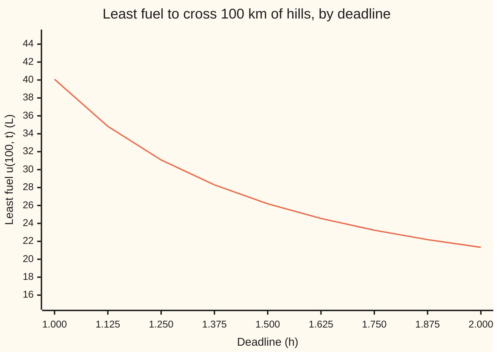
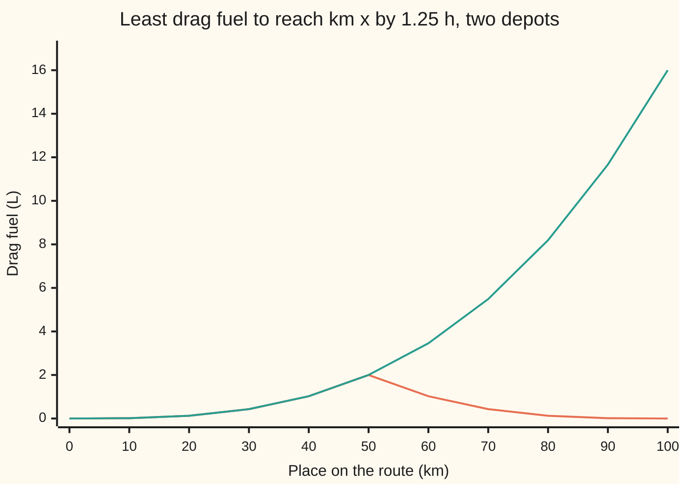

# Hamilton-Jacobi: a first-order equation for a value or an arrival time

[Syllabus](../../../SYLLABUS.md) → [Partial differential equations](../README.md) → [First-Order Equations and Characteristics](../README.md#s02) → Hamilton-Jacobi

---

## General Overview

The ODE wing's [Hamilton's equations](../../08-Differential%20equations%20and%20dynamics/12-Calculus%20of%20Variations%20and%20Optimal%20Control/05-hamiltons-equations.md) turned a motion into two first-order ODEs. This card shows that those two equations are the characteristics of one partial differential equation (PDE), the Hamilton-Jacobi equation, whose unknown is a least cost.

A 40 t truck must cross a 100 km route over rolling hills in 1.25 h, an average of 80 km/h. The driver picks the speed at every moment. Air drag burns more fuel the faster the truck goes. Rolling resistance and climbing burn fuel for every km, at any speed. What is the least fuel that gets the truck to the far end on time?

The unknown is a function of place and time: $`u(x, t)`$, the least fuel, in litres (L), with which the truck can stand at km $`x`$ at time $`t`$ hours. The region is the route, $`0 \le x \le 100`$ km, and all times $`t > 0`$. The data: at $`t = 0`$ the truck stands at km 0.

The answer is **31.08 L**: drive at a steady 80 km/h, even over the hills. Drag costs 16.00 L, rolling 14.00 L and the net 40 m climb 1.08 L. The hill fuel is the same at every speed, so slowing on climbs only adds drag fuel.

One equation holds the answers for every place and every deadline. Its characteristics are the cheapest paths. When the cost does not depend on place, one minimum, the Hopf-Lax formula, gives the solution.

**The least cost to reach a place by a given time solves a first-order PDE, the Hamilton-Jacobi equation; its characteristics are Hamilton's equations, and when the cost per hour depends only on speed the Hopf-Lax formula gives the solution as a minimum over starting places.**

**What kind of fact this is:** a theorem, proved on this card in Why it works, applied to a model. The fuel figures are illustrative values typical of a 40 t truck, not measurements.

### The picture: a later deadline saves fuel



The one line is $`u(100, t)`$, the least fuel to reach km 100 by deadline $`t`$. The fall is steep at first: a 1.00 h deadline costs 9.00 L more than 1.25 h. Its slope at 1.25 h is $`u_t`$ = −25.60 L/h.

---

## The formula

The cost per hour of driving at speed $`v`$ at km $`x`$ is the **Lagrangian** $`L(v, x)`$, as on the Hamilton's equations card (not shelf 01's operator $`L`$). The **Hamiltonian** $`H(p, x)`$ is its slope transform. The least fuel $`u`$ then obeys the Hamilton-Jacobi equation:

```math
u_t + H(u_x, x) = 0, \qquad H(p, x) = \max_{v \ge 0}\big(p\,v - L(v, x)\big), \qquad L(v, x) = k\,v^3 + b(x)\,v
```

**Read it aloud:** the fuel saved per extra hour equals the best that speed can earn, where each km is worth the price $`u_x`$ and each hour costs the Lagrangian.

Along the curves that carry the solution, the characteristics, place, price and fuel move by Hamilton's equations. A dot means the rate in time along the curve:

```math
\dot x = \frac{\partial H}{\partial p}, \qquad \dot p = -\frac{\partial H}{\partial x}, \qquad \dot u = p\,\frac{\partial H}{\partial p} - H = L
```

When $`L`$ curves upward in $`v`$ and does not depend on $`x`$, the **Hopf-Lax formula** gives the solution from the starting cost $`g`$:

```math
u(x, t) = \min_{y}\Big(g(y) + t\,L\big(\tfrac{x - y}{t}\big)\Big)
```

**Read it aloud:** try every starting place $`y`$, drive straight from it at the one steady speed that arrives on time, and keep the cheapest.

| Symbol | Plain meaning | In our example | Push it up and the answer… |
| --- | --- | --- | --- |
| $`u(x, t)`$ | least fuel to stand at km $`x`$ at time $`t`$, L | 31.08 L at km 100, 1.25 h | — |
| $`x`$, $`t`$, $`\Delta t`$ | place on the route, km; time since leaving km 0, h; a short time step | 100 km; 1.25 h | farther: more fuel; later: less |
| $`v`$ | speed, km/h | 80 km/h, steady | drag fuel grows as $`v^3`$ |
| $`p = u_x`$ | the **price** of a km: extra fuel to stand a little farther at the same time, L/km | on the 80 km/h path: 0.73259 as it leaves km 0, 0.52901 at km 25 | the truck drives faster |
| $`u_t`$ | change in least fuel per extra hour of deadline, L/h | −25.60 L/h | — |
| $`L(v, x)`$ | the Lagrangian: fuel per hour at speed $`v`$ at km $`x`$, L/h | drag part $`k v^3`$ = 12.80 L/h | — |
| $`H(p, x)`$ | the Hamiltonian: the most $`p\,v - L`$ can be, L/h | 25.60 L/h | — |
| $`k`$ | drag fuel coefficient, L h²/km³ | 0.000025 | drag fuel rises in proportion |
| $`b(x)`$, $`B(x)`$ | fuel per km at any speed: rolling plus climbing, L/km; its total from km 0 to km $`x`$, L | 0.0490 to 0.2526 L/km; $`B(100)`$ = 15.08 L | fixed fuel rises, speed unchanged |
| $`r`$, $`w`$, $`h(x)`$ | rolling fuel, L/km; climbing fuel per metre up, L/m; elevation, m | 0.14; 0.027; $`200 + 0.4x + 30\sin(2\pi x/50)`$ | — |
| $`g(y)`$, $`y`$, $`z`$ | starting cost at place $`y`$, L; a path's starting place, or a place it passes, km | $`g(0) = 0`$, no other start ($`g = +\infty`$ elsewhere) | — |
| $`F`$, $`q`$, $`s`$ | a general first-order equation $`F(x, t, u, p, q) = 0`$; $`q = u_t`$; a curve parameter | for this card $`F = q + H(p, x)`$ | — |

Here $`b(x) = r + w\,h'(x)`$, with the grade $`h'(x)`$ in metres per km, and $`B(x) = r\,x + w\,(h(x) - h(0))`$.

For this Lagrangian the maximum sits at the speed $`v = \sqrt{(p - b)/(3k)}`$, and

```math
H(p, x) = \frac{2}{3\sqrt{3k}}\,\big(p - b(x)\big)^{3/2} \quad \text{for } p \ge b(x).
```

### When it holds

- **The truck never coasts or brakes.** Then every metre of climb costs 0.027 L and every descent gives it back. That needs the fuel per km, $`k v^2 + b(x)`$, to stay at or above zero on the path actually driven; at 80 km/h, $`b(x) \ge -0.16`$ L/km. Here $`b(x)`$ stays at or above 0.0490 L/km. With 60 m hills it falls to −0.0528 L/km, so $`L`$ is negative below 45.95 km/h there, but at 80 km/h the truck still burns 0.1072 L/km and 31.08 L stands. From hills of about 91.6 m the truck would coast at 80 km/h; the model then credits fuel no engine gives back, and 31.08 L is only a lower bound.
- **The Lagrangian curves upward in the speed.** Then the maximum defining $`H`$ has one top, and $`L`$ is recovered from $`H`$. A cost that is straight in $`v`$ has no such top.
- **Hopf-Lax needs a cost free of $`x`$.** With hills, it applies only after the fixed hill fuel is taken out (Step 4). Freezing the grade at its km 0 value gives 41.26 L.
- **Characteristics carry the solution only until they cross.** Past a crossing, the least-cost solution has a kink, and only the minimum picks the right branch (Step 5). That solution is the **viscosity solution** (a weak sense of solving that allows corners), unique among solutions of that kind.

---

## Why it works

### Step 0: the cheapest way to a place passes through a cheapest way to an earlier place

Any cheapest path to km $`x`$ at time $`t`$ was somewhere a moment earlier. Its last stretch must be the best choice from there, or a cheaper path would exist. This is **dynamic programming**: least costs at one time build the least costs a moment later. Written over a tiny time step, it becomes a PDE.

### Step 1: one small step gives the equation

Over a short time $`\Delta t`$ at speed $`v`$, the truck covers $`v\,\Delta t`$ km and burns $`L\,\Delta t`$ L. So

```math
u(x, t) = \min_{v}\Big(u(x - v\,\Delta t,\; t - \Delta t) + L(v, x)\,\Delta t\Big).
```

Expand $`u`$ to first order, $`u - u_x v\,\Delta t - u_t\,\Delta t`$, divide by $`\Delta t`$ and move terms across. The result is $`u_t + \max_v\big(u_x\,v - L\big) = 0`$, which is $`u_t + H(u_x, x) = 0`$.

The maximum is the slope transform of $`L`$ ([The slope transform](../../18-Functional%20analysis/06-Banach%20Algebras%20and%20Fixed%20Points/07-legendre-fenchel-and-subgradients.md) computes such conjugates and recovers $`L`$ from $`H`$). On a flat road with $`b = 0`$ and price $`p`$ = 0.48 L/km, the best speed is 80 km/h. There $`p\,v`$ = 38.40 L/h and $`k v^3`$ = 12.80 L/h, so $`H`$ = 25.60 L/h.

### Step 2: the characteristics are Hamilton's equations

The equation is **fully nonlinear**: $`H`$ is not linear in the derivative $`u_x`$. The [Characteristics](01-method-of-characteristics.md) card follows $`u`$ along curves for equations linear in the derivatives. For a fully nonlinear equation, the price $`p = u_x`$ must ride along the curve too, because $`p`$ sets the direction.

For a general first-order equation $`F(x, t, u, p, q) = 0`$, with $`q = u_t`$, these are **Charpit's equations** (fold below). For $`F = q + H(p, x)`$ they reduce to the three equations of The formula. The first two are Hamilton's equations. The third says that $`u`$ gains the fuel per hour $`L`$ along the path, so $`u`$ is the path's total cost, its **action**.

Two facts come free. The rate $`\dot q`$ is zero, so $`u_t = -H`$ keeps its value along each characteristic: −25.60 L/h here. That is the Hamiltonian's conservation, shown on the Hamilton's equations card. And the speed $`\dot x = \partial H/\partial p`$ is the speed the maximum chose.

<details>
<summary>Detailed proof: Charpit's equations for any first-order equation</summary>

Let $`u`$ be a smooth solution of $`F(x, t, u, u_x, u_t) = 0`$. Pick a curve $`(x(s), t(s))`$ with $`\dot x = F_p`$ and $`\dot t = F_q`$, a dot now meaning the rate in $`s`$. Set $`p = u_x`$ and $`q = u_t`$ along it.

The chain rule gives

$`\displaystyle \dot u = p\,\dot x + q\,\dot t = p\,F_p + q\,F_q.`$

Differentiate the identity $`F(x, t, u, u_x, u_t) = 0`$ in $`x`$. Since $`u_{xx}F_p + u_{xt}F_q`$ is exactly $`\dot p`$ along the curve,

$`\displaystyle \dot p = -F_x - p\,F_u, \qquad \text{and in the same way} \qquad \dot q = -F_t - q\,F_u.`$

These five ODEs need no second derivatives of $`u`$, which is the point. For $`F = q + H(p, x)`$: $`\dot t = 1`$, so $`s`$ is time; $`\dot x = H_p`$; $`\dot p = -H_x`$; $`\dot q = 0`$; and $`\dot u = p\,H_p + q = p\,H_p - H`$. By the slope transform, $`p\,H_p - H`$ is $`L`$ at the speed $`H_p`$.

</details>

### Step 3: the Hopf-Lax formula, when the cost depends only on speed

Take a flat road with drag only, $`L(v) = k v^3`$. Then $`\dot p = 0`$: the price, and so the speed, never changes. Every characteristic is a straight line in the $`(x, t)`$ plane.

A second argument says the same thing without the PDE. Any path from $`y`$ to $`x`$ in time $`t`$ has average speed $`(x - y)/t`$. Because $`L`$ curves upward, the average of $`L`$ over the trip is at least $`L`$ of the average speed (Jensen's inequality). So the steady speed is cheapest. What remains is the choice of start, and that is the Hopf-Lax minimum.

The formula also replans. At 0.5 h a dispatcher may take the least-fuel map $`u(y, 0.5) = k y^3/0.25`$ as the starting cost and look 0.75 h ahead. The minimum over $`y`$ lands at 40.00 km. Drag fuel so far is 6.40 L and the rest costs 9.60 L, total 16.00 L, the same as planning the whole trip at once.

<details>
<summary>Detailed proof: the Hopf-Lax minimum solves the equation where it is smooth</summary>

Let $`L`$ be convex (curving upward), $`H`$ its slope transform, and $`g`$ Lipschitz (its slope bounded by a fixed number). Define $`u(x, t)`$ by the Hopf-Lax minimum. The same steps cover this card's single start, $`g(0) = 0`$ with no other start allowed ($`g = +\infty`$ elsewhere), for $`t > 0`$.

**Step back in time.** For $`0 < \Delta t < t`$, the minimum over paths splits at the earlier time $`t - \Delta t`$, and straight lines stay optimal. So

$`\displaystyle u(x, t) = \min_{z}\Big(u(z, t - \Delta t) + \Delta t\,L\big(\tfrac{x - z}{\Delta t}\big)\Big).`$

**Upper bound.** Take $`z = x - v\,\Delta t`$ for a fixed $`v`$. Then $`u(x, t) \le u(x - v\,\Delta t, t - \Delta t) + \Delta t\,L(v)`$. Where $`u`$ is differentiable, this gives $`u_t + v\,u_x - L(v) \le 0`$ for every $`v`$, so $`u_t + H(u_x) \le 0`$.

**Lower bound.** Let $`y`$ be the best start for $`(x, t)`$ and $`v^* = (x - y)/t`$. Along the straight path, $`u(x, t) - u(x - v^*\Delta t, t - \Delta t) \ge \Delta t\,L(v^*)`$, because the same start is allowed for the earlier point. So $`u_t + v^* u_x - L(v^*) \ge 0`$, and therefore $`u_t + H(u_x) \ge 0`$.

The two bounds give the equation wherever $`u`$ is differentiable, which is almost everywhere. At its kinks, $`u`$ is the viscosity solution (Crandall and Lions); the full argument is in Evans, section 3.3.

</details>

### Step 4: the hills, a fully nonlinear case with $`x`$ in it

Now $`b(x)`$ varies, so $`H`$ depends on $`x`$ and Hopf-Lax does not apply directly. Charpit's equations still do. Here

```math
\dot x = \sqrt{\frac{p - b(x)}{3k}}, \qquad \dot p = \dot x\, b'(x).
```

So $`(p - b(x))`$ has rate $`\dot p - b'(x)\,\dot x = 0`$. The gap between price and fixed fuel stays at 0.48 L/km, so the speed stays at 80 km/h.

The price itself climbs and falls with the road. On the 80 km/h path it is 0.73259 L/km as the path leaves km 0, where the road climbs at 4.17 m/km, and 0.52901 L/km at km 25, where it descends at 3.37 m/km. A km of climb is worth more fuel than a km of descent; the speed that buys it is the same.

Integrating $`\dot u = L`$ along the steady path gives a smooth, classical solution for $`x > 0`$ and $`t > 0`$:

```math
u(x, t) = \frac{k\,x^3}{t^2} + B(x).
```

The hill and rolling fuel $`B(x)`$ is the same for every path that reaches km $`x`$. Take it away and what is left obeys the flat-road equation, where Hopf-Lax applies. At km 100 and 1.25 h, 16.00 + 15.08 = 31.08 L.

### Step 5: when characteristics cross, the minimum decides

Drop rolling and hills, keep drag (in either direction, $`k\,|v|^3`$), and add a second depot at km 100. A customer at km $`x`$ can be reached by 1.25 h from either end. Characteristics now come from both ends and cross.



The first line is the Hopf-Lax minimum from both depots: a tent with a kink at km 50, 2.000 L. The second follows only the characteristics from the west depot past the crossing.

At km 70 the west family says 5.488 L; the east depot does it for 0.432 L. At the kink the price jumps from 0.120 to −0.120 L/km. Differentiating the equation in $`x`$ gives $`p_t + (H(p))_x = 0`$, a conservation law, and the jump in $`p`$ is a shock that stands still ([Conservation laws](02-conservation-laws-and-shocks.md)). Choosing the right jump is the job of [Entropy conditions](03-entropy-conditions-and-vanishing-viscosity.md); for $`u`$, the minimum makes that choice.

---

## Worked numbers, by hand

| Step | Arithmetic | Value |
| --- | --- | --- |
| steady speed | 100 km / 1.25 h | 80 km/h |
| drag price $`3k v^2`$ | 3 × 0.000025 × 80² | 0.48 L/km |
| $`H`$ at that price | 0.48 × 80 − 0.000025 × 80³ = 38.40 − 12.80 | 25.60 L/h |
| drag fuel | 0.000025 × 100³ / 1.25² | 16.00 L |
| rolling fuel | 0.14 × 100 | 14.00 L |
| climbing fuel | 0.027 × 40 m net | 1.08 L |
| **least fuel $`u(100, 1.25)`$** | 16.00 + 14.00 + 1.08 | **31.08 L** |
| grade at km 0 | 0.4 + 30 × 2π/50 = 0.4 + 3.7699 | 4.17 m/km |
| price on the 80 km/h path as it leaves km 0 | 0.14 + 0.027 × (0.4 + 3.7699) + 0.48 = 0.25259 + 0.48 | 0.73259 L/km |
| $`u_t`$ | −2 × 0.000025 × 100³ / 1.25³ | −25.60 L/h |

The least fuel to cross on time is 31.08 L, about 0.31 L per km, and each extra hour of deadline would save fuel at a starting rate of 25.60 L/h.

### What breaks if you drop a piece

| Mistake | Comes out at | What went wrong |
| --- | --- | --- |
| Fuel per km used as fuel per hour, $`L = k v^2`$ | drag 0.20 L, not 16.00 L | Drag fuel per km is $`k v^2`$; per hour it is $`k v^3`$. The Lagrangian is a rate in time. |
| 70 km/h on the 53.38 km of climbs, 95.65 km/h elsewhere | drag 17.20 L, total 32.28 L | Hill fuel is fixed; uneven speed only raises drag (Jensen). |
| Two depots, west characteristics followed past the crossing | 5.488 L at km 70, not 0.432 L | Crossed characteristics give two values; the minimum is the solution. |
| Hopf-Lax with the grade frozen at its km 0 value | 41.26 L, not 31.08 L | Hopf-Lax needs a cost free of $`x`$; take out $`B(x)`$ first. |

---

## Code, from first principles, and it actually runs

The scripts reach 31.08 L by three roads. Road 1 is the closed form of Step 4. Road 2 steps Hamilton's equations by Runge-Kutta 4 (RK4, four slope samples per step), shooting for the starting price that lands on km 100; it checks the hill part on its own. Road 3 is a dynamic-programming grid: the cheapest piecewise-steady path through 1 km by 0.05 h cells, with the hill fuel of each step from km $`y`$ to km $`x`$ taken as $`B(x) - B(y)`$. It tests the steady-speed claim, but shares Step 4's hill argument with road 1. The scripts also find $`H`$ by searching for the maximum, run the Hopf-Lax replan by searching over $`y`$, and check the residual $`u_t + H(u_x, x)`$ (what is left when the answer is put into the equation) by centred differences (slopes from points just either side). In the code, `L0` and `H0` are the flat-road drag Lagrangian and Hamiltonian, with $`b = 0`$.

### Python

```python
# Hamilton-Jacobi equations -- the check behind the card.  Imports only math's sin, cos, sqrt, pi.
# A 40 t truck crosses a 100 km route over rolling hills; u(x, t) = least fuel (L) to be at km x at time t (h).
# Roads: the closed form, characteristics (Hamilton's equations) by RK4, a dynamic-programming grid,
# the Hopf-Lax minimum by search, and the residual u_t + H(u_x, x) by centred differences.
from math import sin, cos, sqrt, pi
K, R, W, D, T = 2.5e-5, 0.14, 0.027, 100.0, 1.25   # drag L h^2/km^3, rolling L/km, climb L/m, km, h
AMP, LAM = 30.0, 50.0                               # hills: 30 m up and down every 50 km, plus 0.4 m/km
h = lambda x: 200 + 0.4 * x + AMP * sin(2 * pi * x / LAM)         # elevation, m
dh = lambda x: 0.4 + AMP * 2 * pi / LAM * cos(2 * pi * x / LAM)   # grade, m per km
d2h = lambda x: -AMP * (2 * pi / LAM) ** 2 * sin(2 * pi * x / LAM)
b = lambda x: R + W * dh(x)                         # fuel per km that does not depend on speed, L/km
B = lambda x: R * x + W * (h(x) - h(0))             # its total from km 0 to km x, L
C = 2 / (3 * sqrt(3 * K))
L0 = lambda v: K * abs(v) ** 3                      # drag fuel per hour at speed v, L/h
H0 = lambda q: C * abs(q) ** 1.5                    # its slope transform
dH0 = lambda q: (1 if q >= 0 else -1) * sqrt(abs(q) / (3 * K))   # = speed chosen at price q
H = lambda x, p: H0(p - b(x))                       # the Hamiltonian with hills
exact = lambda x, t: K * x ** 3 / t ** 2 + B(x)     # road 1: straight line in (x, t), hills added
def tern(f, lo, hi):                                # minimiser of a one-dip function, by ternary search
    for _ in range(200):
        a, c = lo + (hi - lo) / 3, hi - (hi - lo) / 3
        lo, hi = (lo, c) if f(a) < f(c) else (a, hi)
    return lo
def chars(p0, n=500):                               # road 2: x' = H_p, p' = -H_x, u' = p H_p - H, by RK4
    def f(s):
        x, p, u = s; v = dH0(p - b(x)); return (v, v * W * d2h(x), p * v - H(x, p))
    s, dt, vs = (0.0, p0, 0.0), T / n, []
    for _ in range(n):
        k1 = f(s); k2 = f([a + dt / 2 * k for a, k in zip(s, k1)]); k3 = f([a + dt / 2 * k for a, k in zip(s, k2)])
        k4 = f([a + dt * k for a, k in zip(s, k3)]); s = [a + dt / 6 * (q + 2 * r + 2 * w + z) for a, q, r, w, z in zip(s, k1, k2, k3, k4)]
        vs.append(dH0(s[1] - b(s[0])))
    return s, min(vs), max(vs)
lo, hi = b(0), b(0) + 2.0                           # shoot: find the starting price that lands on km 100
for _ in range(60):
    mid = (lo + hi) / 2; lo, hi = (mid, hi) if chars(mid)[0][0] < D else (lo, mid)
(xc, pc, uc), vmin, vmax = chars(lo)
def dp(n, M=100):                                   # road 3: best path through a 1 km x (T/n) h grid
    dt, big = T / n, 1e18; u = [0.0] + [big] * M
    for _ in range(n):
        u = [min(u[y] + K * abs(x - y) ** 3 / dt ** 2 + B(x) - B(y) for y in range(M + 1) if u[y] < big) for x in range(M + 1)]
    return u[M]
u_dp, u_dp7 = dp(25), dp(7)
ex = exact(D, T)
v_leg = tern(lambda v: -(0.48 * v - L0(v)), 0.0, 300.0)            # Legendre: H0(0.48) as a maximum
y_star = tern(lambda y: K * y ** 3 / 0.5 ** 2 + 0.75 * L0((D - y) / 0.75), 0.0, D)   # Hopf-Lax replan at 0.5 h
hl = K * y_star ** 3 / 0.25 + 0.75 * L0((D - y_star) / 0.75)
res = []
for e in (0.002, 0.001):
    ut = (exact(D, T + e) - exact(D, T - e)) / (2 * e); ux = (exact(D + e, T) - exact(D - e, T)) / (2 * e)
    res.append(abs(ut + H(D, ux)))
print(f"route: {D:.0f} km in {T:.2f} h, so {D / T:.0f} km/h; drag {K * (D / T) ** 2:.2f} L/km, rolling {R:.2f} L/km")
print(f"inputs: k = {K:.6f} L h^2/km^3, climb {W:.3f} L/m, hills h = 200 + 0.4 x + {AMP:.0f} sin(2 pi x / {LAM:.0f}) m")
print(f"by hand: 3 k v^2 = {3 * K * (D / T) ** 2:.2f} L/km, k v^3 = {K * (D / T) ** 3:.2f} L/h, 0.48 x 80 = {0.48 * D / T:.2f}; grade wave {AMP * 2 * pi / LAM:.4f} m/km, b(0) = {b(0):.5f} L/km")
print(f"climb: net {h(D) - h(0):.0f} m, costing {W * (h(D) - h(0)):.2f} L; grade from {dh(LAM / 2):.2f} to {dh(0):.2f} m/km")
print(f"speed-free fuel per km b(x): {min(b(x / 10) for x in range(1001)):.4f} to {max(b(x / 10) for x in range(1001)):.4f} L/km")
print(f"closed form: drag {K * D ** 3 / T ** 2:.2f} + rolling {R * D:.2f} + climb {W * (h(D) - h(0)):.2f} = {ex:.2f} L")
print(f"fixed fuel B(100) = {B(D):.2f} L; average {ex / D:.2f} L/km; 1.0 h deadline costs {exact(D, 1.0) - ex:.2f} L more; at 1.5 h drag {K * D ** 3 / 1.5 ** 2:.2f} L")
print(f"slopes at km 100: u_x = p = {b(D) + 3 * K * (D / T) ** 2:.5f} L/km, u_t = {-2 * K * D ** 3 / T ** 3:.2f} L/h")
print(f"price p on the 80 km/h path at km 0, 25, 50: {b(0) + 0.48:.5f} {b(25) + 0.48:.5f} {b(50) + 0.48:.5f} L/km")
print(f"Legendre: H0(0.48) = max of 0.48 v - L0(v) = {0.48 * v_leg - L0(v_leg):.2f} L/h at v = {v_leg:.2f} km/h")
print(f"characteristics: start price {lo:.5f} L/km, ends at km {xc:.4f}, fuel {uc:.4f} L, end price {pc:.5f}")
print(f"characteristics: speed stays between {vmin:.4f} and {vmax:.4f} km/h; H along it {H(xc, pc):.4f} L/h")
print(f"grid, 25 steps of {T / 25:.2f} h: {u_dp:.4f} L; 7 steps of {T / 7:.4f} h: {u_dp7:.4f} L")
print(f"Hopf-Lax replan at 0.5 h: best place {y_star:.2f} km, drag fuel {K * y_star ** 3 / 0.25:.2f} + {0.75 * L0((D - y_star) / 0.75):.2f} = {hl:.2f} L")
print(f"residual |u_t + H(u_x, x)| at step 0.002, 0.001 h or km: {1e6 * res[0]:.3f} {1e6 * res[1]:.3f} x 1e-6")
up = sum(1 for i in range(100000) if dh((i + 0.5) / 1000) > 0) / 1000   # km of climbing, by midpoint count
t_up = up / 70; v_dn = (D - up) / (T - t_up); slow = K * (70 ** 2 * up + v_dn ** 2 * (D - up))
print(f"mistake 1, fuel per km taken as per hour: drag {T * K * (D / T) ** 2:.2f} L")
print(f"mistake 2, 70 km/h on the {up:.2f} km of climbs, {v_dn:.2f} km/h elsewhere: drag {slow:.2f} L, total {slow + B(D):.2f} L")
two = lambda x, t: min(K * x ** 3 / t ** 2, K * (D - x) ** 3 / t ** 2)    # depots at km 0 and km 100, drag only
print(f"mistake 3, two depots, km 70: west characteristics {K * 70 ** 3 / T ** 2:.3f} L, Hopf-Lax minimum {two(70, T):.3f} L")
print(f"mistake 4, hill grade frozen at km 0: {K * D ** 3 / T ** 2 + b(0) * D:.2f} L")
print(f"kink at km 50: value {two(50, T):.3f} L, slope {3 * K * 50 ** 2 / T ** 2:.3f} then {-3 * K * 50 ** 2 / T ** 2:.3f} L/km")
bmin60 = R + W * (0.4 - 60 * 2 * pi / LAM)
print(f"try: deadline 1.5 h {exact(D, 1.5):.2f} L; replan at 0.75 h, best place {tern(lambda y: K * y ** 3 / 0.75 ** 2 + 0.5 * L0((D - y) / 0.5), 0.0, D):.2f} km; 60 m hills, lowest b {bmin60:.4f} L/km")
a_coast = (0.4 + (R + K * (D / T) ** 2) / W) / (2 * pi / LAM)   # hill height at which 80 km/h first coasts
print(f"try: on 60 m hills 80 km/h still burns {K * (D / T) ** 2 + bmin60:.4f} L/km on the steepest descent; L < 0 only below {sqrt(-bmin60 / K):.2f} km/h; coasting from {a_coast:.1f} m hills")
print("chart, deadline h  " + " ".join(f"{1 + i / 8:6.3f}" for i in range(9)))
print("chart, fuel L      " + " ".join(f"{exact(D, 1 + i / 8):6.2f}" for i in range(9)))
print("chart, km          " + " ".join(f"{10 * i:6d}" for i in range(11)))
print("chart, two depots  " + " ".join(f"{two(10 * i, T):6.3f}" for i in range(11)))
print("chart, west only   " + " ".join(f"{K * (10 * i) ** 3 / T ** 2:6.3f}" for i in range(11)))
assert abs(uc - ex) < 1e-6 and abs(xc - D) < 1e-6           # characteristics land on the closed form
assert abs(u_dp - ex) < 1e-6 < u_dp7 - ex                    # grid minimum over all paths agrees; misaligned grid is above
assert abs(hl - K * D ** 3 / T ** 2) < 1e-6 and abs(y_star - 40) < 1e-4   # Hopf-Lax replan = whole-trip drag
assert res[1] < res[0] / 3 and res[1] < 1e-4                # residual shrinks like step^2
assert abs(0.48 * v_leg - L0(v_leg) - H0(0.48)) < 1e-9 and vmax - vmin < 1e-6
assert slow > K * D ** 3 / T ** 2 and two(70, T) < K * 70 ** 3 / T ** 2
print("ALL CHECKS PASS")
```

**Ran 2026-11-15 on macOS, Python 3.14.10, standard library only. All checks passed. Output, pasted from the run:**

```
route: 100 km in 1.25 h, so 80 km/h; drag 0.16 L/km, rolling 0.14 L/km
inputs: k = 0.000025 L h^2/km^3, climb 0.027 L/m, hills h = 200 + 0.4 x + 30 sin(2 pi x / 50) m
by hand: 3 k v^2 = 0.48 L/km, k v^3 = 12.80 L/h, 0.48 x 80 = 38.40; grade wave 3.7699 m/km, b(0) = 0.25259 L/km
climb: net 40 m, costing 1.08 L; grade from -3.37 to 4.17 m/km
speed-free fuel per km b(x): 0.0490 to 0.2526 L/km
closed form: drag 16.00 + rolling 14.00 + climb 1.08 = 31.08 L
fixed fuel B(100) = 15.08 L; average 0.31 L/km; 1.0 h deadline costs 9.00 L more; at 1.5 h drag 11.11 L
slopes at km 100: u_x = p = 0.73259 L/km, u_t = -25.60 L/h
price p on the 80 km/h path at km 0, 25, 50: 0.73259 0.52901 0.73259 L/km
Legendre: H0(0.48) = max of 0.48 v - L0(v) = 25.60 L/h at v = 80.00 km/h
characteristics: start price 0.73259 L/km, ends at km 100.0000, fuel 31.0800 L, end price 0.73259
characteristics: speed stays between 80.0000 and 80.0000 km/h; H along it 25.6000 L/h
grid, 25 steps of 0.05 h: 31.0800 L; 7 steps of 0.1786 h: 31.1285 L
Hopf-Lax replan at 0.5 h: best place 40.00 km, drag fuel 6.40 + 9.60 = 16.00 L
residual |u_t + H(u_x, x)| at step 0.002, 0.001 h or km: 131.153 32.788 x 1e-6
mistake 1, fuel per km taken as per hour: drag 0.20 L
mistake 2, 70 km/h on the 53.38 km of climbs, 95.65 km/h elsewhere: drag 17.20 L, total 32.28 L
mistake 3, two depots, km 70: west characteristics 5.488 L, Hopf-Lax minimum 0.432 L
mistake 4, hill grade frozen at km 0: 41.26 L
kink at km 50: value 2.000 L, slope 0.120 then -0.120 L/km
try: deadline 1.5 h 26.19 L; replan at 0.75 h, best place 60.00 km; 60 m hills, lowest b -0.0528 L/km
try: on 60 m hills 80 km/h still burns 0.1072 L/km on the steepest descent; L < 0 only below 45.95 km/h; coasting from 91.6 m hills
chart, deadline h   1.000  1.125  1.250  1.375  1.500  1.625  1.750  1.875  2.000
chart, fuel L       40.08  34.83  31.08  28.30  26.19  24.55  23.24  22.19  21.33
chart, km               0     10     20     30     40     50     60     70     80     90    100
chart, two depots   0.000  0.016  0.128  0.432  1.024  2.000  1.024  0.432  0.128  0.016  0.000
chart, west only    0.000  0.016  0.128  0.432  1.024  2.000  3.456  5.488  8.192 11.664 16.000
ALL CHECKS PASS
```

All three roads give 31.0800 L. The residual falls four-fold when the step halves, as centred differences should. The speed along the characteristic stays at 80 km/h while the price moves.

### Rust

Same roads, same labels, built with `rustc --edition 2021 -O`.

```rust
// Hamilton-Jacobi equations -- the same check as the Python, in Rust.  Standard library only, no crates.
// A 40 t truck crosses a 100 km route over rolling hills; u(x, t) = least fuel (L) to be at km x at time t (h).
// Roads: the closed form, characteristics (Hamilton's equations) by RK4, a dynamic-programming grid,
// the Hopf-Lax minimum by search, and the residual u_t + H(u_x, x) by centred differences.
use std::f64::consts::PI;
const K: f64 = 2.5e-5; const R: f64 = 0.14; const W: f64 = 0.027; const D: f64 = 100.0; const T: f64 = 1.25;
const AMP: f64 = 30.0; const LAM: f64 = 50.0;          // hills: 30 m up and down every 50 km, plus 0.4 m/km
fn h(x: f64) -> f64 { 200.0 + 0.4 * x + AMP * (2.0 * PI * x / LAM).sin() }        // elevation, m
fn dh(x: f64) -> f64 { 0.4 + AMP * 2.0 * PI / LAM * (2.0 * PI * x / LAM).cos() } // grade, m per km
fn d2h(x: f64) -> f64 { -AMP * (2.0 * PI / LAM).powi(2) * (2.0 * PI * x / LAM).sin() }
fn b(x: f64) -> f64 { R + W * dh(x) }                  // fuel per km that does not depend on speed, L/km
fn bb(x: f64) -> f64 { R * x + W * (h(x) - h(0.0)) }   // its total from km 0 to km x, L
fn c() -> f64 { 2.0 / (3.0 * (3.0 * K).sqrt()) }
fn l0(v: f64) -> f64 { K * v.abs().powi(3) }          // drag fuel per hour at speed v, L/h
fn h0(q: f64) -> f64 { c() * q.abs().powf(1.5) }      // its slope transform
fn dh0(q: f64) -> f64 { (if q >= 0.0 { 1.0 } else { -1.0 }) * (q.abs() / (3.0 * K)).sqrt() } // speed chosen at price q
fn ham(x: f64, p: f64) -> f64 { h0(p - b(x)) }        // the Hamiltonian with hills
fn exact(x: f64, t: f64) -> f64 { K * x.powi(3) / (t * t) + bb(x) } // road 1: straight line, hills added
fn tern(f: &dyn Fn(f64) -> f64, mut lo: f64, mut hi: f64) -> f64 { // minimiser of a one-dip function
    for _ in 0..200 {
        let a = lo + (hi - lo) / 3.0; let cc = hi - (hi - lo) / 3.0;
        if f(a) < f(cc) { hi = cc; } else { lo = a; }
    }
    lo
}
fn rate(s: [f64; 3]) -> [f64; 3] {                    // x' = H_p, p' = -H_x, u' = p H_p - H
    let v = dh0(s[1] - b(s[0])); [v, v * W * d2h(s[0]), s[1] * v - ham(s[0], s[1])]
}
fn chars(p0: f64, n: usize) -> ([f64; 3], f64, f64) { // road 2: RK4 along the characteristic
    let (mut s, dt) = ([0.0, p0, 0.0], T / n as f64); let (mut vmin, mut vmax) = (f64::MAX, f64::MIN);
    let add = |s: [f64; 3], k: [f64; 3], m: f64| [s[0] + m * k[0], s[1] + m * k[1], s[2] + m * k[2]];
    for _ in 0..n {
        let k1 = rate(s); let k2 = rate(add(s, k1, dt / 2.0)); let k3 = rate(add(s, k2, dt / 2.0)); let k4 = rate(add(s, k3, dt));
        for i in 0..3 { s[i] += dt / 6.0 * (k1[i] + 2.0 * k2[i] + 2.0 * k3[i] + k4[i]); }
        let v = dh0(s[1] - b(s[0])); vmin = vmin.min(v); vmax = vmax.max(v);
    }
    (s, vmin, vmax)
}
fn dp(n: usize) -> f64 {                              // road 3: best path through a 1 km x (T/n) h grid
    let (dt, big, m) = (T / n as f64, 1e18, 100usize); let mut u = vec![big; m + 1]; u[0] = 0.0;
    for _ in 0..n {
        u = (0..=m).map(|x| (0..=m).filter(|&y| u[y] < big)
            .map(|y| u[y] + K * (x as f64 - y as f64).abs().powi(3) / (dt * dt) + bb(x as f64) - bb(y as f64))
            .fold(f64::MAX, f64::min)).collect();
    }
    u[m]
}
fn two(x: f64, t: f64) -> f64 { (K * x.powi(3) / (t * t)).min(K * (D - x).powi(3) / (t * t)) } // depots at 0 and 100
fn row(label: &str, v: Vec<String>) { println!("{}{}", label, v.join(" ")); }
fn main() {
    let (mut lo, mut hi) = (b(0.0), b(0.0) + 2.0);    // shoot: the starting price that lands on km 100
    for _ in 0..60 { let mid = (lo + hi) / 2.0; if chars(mid, 500).0[0] < D { lo = mid; } else { hi = mid; } }
    let (s, vmin, vmax) = chars(lo, 500); let (xc, pc, uc) = (s[0], s[1], s[2]);
    let (u_dp, u_dp7, ex) = (dp(25), dp(7), exact(D, T));
    let v_leg = tern(&|v| -(0.48 * v - l0(v)), 0.0, 300.0);
    let y_star = tern(&|y| K * y.powi(3) / 0.25 + 0.75 * l0((D - y) / 0.75), 0.0, D);
    let hl = K * y_star.powi(3) / 0.25 + 0.75 * l0((D - y_star) / 0.75);
    let res: Vec<f64> = [0.002, 0.001].iter().map(|&e| {
        let ut = (exact(D, T + e) - exact(D, T - e)) / (2.0 * e); let ux = (exact(D + e, T) - exact(D - e, T)) / (2.0 * e);
        (ut + ham(D, ux)).abs() }).collect();
    let bs: Vec<f64> = (0..1001).map(|x| b(x as f64 / 10.0)).collect();
    println!("route: {:.0} km in {:.2} h, so {:.0} km/h; drag {:.2} L/km, rolling {:.2} L/km", D, T, D / T, K * (D / T).powi(2), R);
    println!("inputs: k = {:.6} L h^2/km^3, climb {:.3} L/m, hills h = 200 + 0.4 x + {:.0} sin(2 pi x / {:.0}) m", K, W, AMP, LAM);
    println!("by hand: 3 k v^2 = {:.2} L/km, k v^3 = {:.2} L/h, 0.48 x 80 = {:.2}; grade wave {:.4} m/km, b(0) = {:.5} L/km", 3.0 * K * (D / T).powi(2), K * (D / T).powi(3), 0.48 * D / T, AMP * 2.0 * PI / LAM, b(0.0));
    println!("climb: net {:.0} m, costing {:.2} L; grade from {:.2} to {:.2} m/km", h(D) - h(0.0), W * (h(D) - h(0.0)), dh(LAM / 2.0), dh(0.0));
    println!("speed-free fuel per km b(x): {:.4} to {:.4} L/km", bs.iter().cloned().fold(f64::MAX, f64::min), bs.iter().cloned().fold(f64::MIN, f64::max));
    println!("closed form: drag {:.2} + rolling {:.2} + climb {:.2} = {:.2} L", K * D.powi(3) / (T * T), R * D, W * (h(D) - h(0.0)), ex);
    println!("fixed fuel B(100) = {:.2} L; average {:.2} L/km; 1.0 h deadline costs {:.2} L more; at 1.5 h drag {:.2} L", bb(D), ex / D, exact(D, 1.0) - ex, K * D.powi(3) / 2.25);
    println!("slopes at km 100: u_x = p = {:.5} L/km, u_t = {:.2} L/h", b(D) + 3.0 * K * (D / T).powi(2), -2.0 * K * D.powi(3) / T.powi(3));
    println!("price p on the 80 km/h path at km 0, 25, 50: {:.5} {:.5} {:.5} L/km", b(0.0) + 0.48, b(25.0) + 0.48, b(50.0) + 0.48);
    println!("Legendre: H0(0.48) = max of 0.48 v - L0(v) = {:.2} L/h at v = {:.2} km/h", 0.48 * v_leg - l0(v_leg), v_leg);
    println!("characteristics: start price {:.5} L/km, ends at km {:.4}, fuel {:.4} L, end price {:.5}", lo, xc, uc, pc);
    println!("characteristics: speed stays between {:.4} and {:.4} km/h; H along it {:.4} L/h", vmin, vmax, ham(xc, pc));
    println!("grid, 25 steps of {:.2} h: {:.4} L; 7 steps of {:.4} h: {:.4} L", T / 25.0, u_dp, T / 7.0, u_dp7);
    println!("Hopf-Lax replan at 0.5 h: best place {:.2} km, drag fuel {:.2} + {:.2} = {:.2} L", y_star, K * y_star.powi(3) / 0.25, 0.75 * l0((D - y_star) / 0.75), hl);
    println!("residual |u_t + H(u_x, x)| at step 0.002, 0.001 h or km: {:.3} {:.3} x 1e-6", 1e6 * res[0], 1e6 * res[1]);
    let up = (0..100000).filter(|&i| dh((i as f64 + 0.5) / 1000.0) > 0.0).count() as f64 / 1000.0; // km of climbing
    let t_up = up / 70.0; let v_dn = (D - up) / (T - t_up); let slow = K * (70.0f64.powi(2) * up + v_dn * v_dn * (D - up));
    println!("mistake 1, fuel per km taken as per hour: drag {:.2} L", T * K * (D / T).powi(2));
    println!("mistake 2, 70 km/h on the {:.2} km of climbs, {:.2} km/h elsewhere: drag {:.2} L, total {:.2} L", up, v_dn, slow, slow + bb(D));
    println!("mistake 3, two depots, km 70: west characteristics {:.3} L, Hopf-Lax minimum {:.3} L", K * 70.0f64.powi(3) / (T * T), two(70.0, T));
    println!("mistake 4, hill grade frozen at km 0: {:.2} L", K * D.powi(3) / (T * T) + b(0.0) * D);
    println!("kink at km 50: value {:.3} L, slope {:.3} then {:.3} L/km", two(50.0, T), 3.0 * K * 2500.0 / (T * T), -3.0 * K * 2500.0 / (T * T));
    let bmin60 = R + W * (0.4 - 60.0 * 2.0 * PI / LAM);
    let y75 = tern(&|y| K * y.powi(3) / 0.5625 + 0.5 * l0((D - y) / 0.5), 0.0, D);
    println!("try: deadline 1.5 h {:.2} L; replan at 0.75 h, best place {:.2} km; 60 m hills, lowest b {:.4} L/km", exact(D, 1.5), y75, bmin60);
    let a_coast = (0.4 + (R + K * (D / T).powi(2)) / W) / (2.0 * PI / LAM); // hill height at which 80 km/h first coasts
    println!("try: on 60 m hills 80 km/h still burns {:.4} L/km on the steepest descent; L < 0 only below {:.2} km/h; coasting from {:.1} m hills", K * (D / T).powi(2) + bmin60, (-bmin60 / K).sqrt(), a_coast);
    row("chart, deadline h  ", (0..9).map(|i| format!("{:6.3}", 1.0 + i as f64 / 8.0)).collect());
    row("chart, fuel L      ", (0..9).map(|i| format!("{:6.2}", exact(D, 1.0 + i as f64 / 8.0))).collect());
    row("chart, km          ", (0..11).map(|i| format!("{:6}", 10 * i)).collect());
    row("chart, two depots  ", (0..11).map(|i| format!("{:6.3}", two(10.0 * i as f64, T))).collect());
    row("chart, west only   ", (0..11).map(|i| format!("{:6.3}", K * (10.0 * i as f64).powi(3) / (T * T))).collect());
    assert!((uc - ex).abs() < 1e-6 && (xc - D).abs() < 1e-6);       // characteristics land on the closed form
    assert!((u_dp - ex).abs() < 1e-6 && u_dp7 - ex > 1e-6);         // grid minimum agrees; misaligned grid is above
    assert!((hl - K * D.powi(3) / (T * T)).abs() < 1e-6 && (y_star - 40.0).abs() < 1e-4); // Hopf-Lax replan
    assert!(res[1] < res[0] / 3.0 && res[1] < 1e-4);                // residual shrinks like step^2
    assert!((0.48 * v_leg - l0(v_leg) - h0(0.48)).abs() < 1e-9 && vmax - vmin < 1e-6);
    assert!(slow > K * D.powi(3) / (T * T) && two(70.0, T) < K * 70.0f64.powi(3) / (T * T));
    println!("ALL CHECKS PASS");
}
```

**Ran 2026-11-15 on macOS, rustc 1.98.1, no crates. All checks passed. Output, pasted from the run:**

```
route: 100 km in 1.25 h, so 80 km/h; drag 0.16 L/km, rolling 0.14 L/km
inputs: k = 0.000025 L h^2/km^3, climb 0.027 L/m, hills h = 200 + 0.4 x + 30 sin(2 pi x / 50) m
by hand: 3 k v^2 = 0.48 L/km, k v^3 = 12.80 L/h, 0.48 x 80 = 38.40; grade wave 3.7699 m/km, b(0) = 0.25259 L/km
climb: net 40 m, costing 1.08 L; grade from -3.37 to 4.17 m/km
speed-free fuel per km b(x): 0.0490 to 0.2526 L/km
closed form: drag 16.00 + rolling 14.00 + climb 1.08 = 31.08 L
fixed fuel B(100) = 15.08 L; average 0.31 L/km; 1.0 h deadline costs 9.00 L more; at 1.5 h drag 11.11 L
slopes at km 100: u_x = p = 0.73259 L/km, u_t = -25.60 L/h
price p on the 80 km/h path at km 0, 25, 50: 0.73259 0.52901 0.73259 L/km
Legendre: H0(0.48) = max of 0.48 v - L0(v) = 25.60 L/h at v = 80.00 km/h
characteristics: start price 0.73259 L/km, ends at km 100.0000, fuel 31.0800 L, end price 0.73259
characteristics: speed stays between 80.0000 and 80.0000 km/h; H along it 25.6000 L/h
grid, 25 steps of 0.05 h: 31.0800 L; 7 steps of 0.1786 h: 31.1285 L
Hopf-Lax replan at 0.5 h: best place 40.00 km, drag fuel 6.40 + 9.60 = 16.00 L
residual |u_t + H(u_x, x)| at step 0.002, 0.001 h or km: 131.153 32.788 x 1e-6
mistake 1, fuel per km taken as per hour: drag 0.20 L
mistake 2, 70 km/h on the 53.38 km of climbs, 95.65 km/h elsewhere: drag 17.20 L, total 32.28 L
mistake 3, two depots, km 70: west characteristics 5.488 L, Hopf-Lax minimum 0.432 L
mistake 4, hill grade frozen at km 0: 41.26 L
kink at km 50: value 2.000 L, slope 0.120 then -0.120 L/km
try: deadline 1.5 h 26.19 L; replan at 0.75 h, best place 60.00 km; 60 m hills, lowest b -0.0528 L/km
try: on 60 m hills 80 km/h still burns 0.1072 L/km on the steepest descent; L < 0 only below 45.95 km/h; coasting from 91.6 m hills
chart, deadline h   1.000  1.125  1.250  1.375  1.500  1.625  1.750  1.875  2.000
chart, fuel L       40.08  34.83  31.08  28.30  26.19  24.55  23.24  22.19  21.33
chart, km               0     10     20     30     40     50     60     70     80     90    100
chart, two depots   0.000  0.016  0.128  0.432  1.024  2.000  1.024  0.432  0.128  0.016  0.000
chart, west only    0.000  0.016  0.128  0.432  1.024  2.000  3.456  5.488  8.192 11.664 16.000
ALL CHECKS PASS
```

The two outputs are identical, line for line.

### Lean

Lean proves the Hopf-Lax claim, Hamilton's equations along characteristics, and the hill solution, each in general, and checks the worked numbers.

- Take a convex $`L`$ and a finite starting cost $`g`$, with the Hopf-Lax minimum reached at every place and time $`t > 0`$. Then $`u_t + H(u_x) = 0`$ wherever $`u`$ has a slope.
- Suppose $`H`$ and $`u`$ are smooth, $`u`$ solves the Hamilton-Jacobi equation everywhere, and a path moves at $`\dot x = \partial H/\partial p`$. Then along it $`\dot p = -\partial H/\partial x`$ and $`\dot u = p\,\partial H/\partial p - H`$.
- Take $`k > 0`$, any $`B(x)`$ with slope $`b(x)`$, and $`H(p, x)`$ from The formula. Then $`u = k x^3/t^2 + B(x)`$ solves the Hamilton-Jacobi equation for all $`x, t > 0`$.
- The worked numbers, the replan, the two depots, the kink and the first mistake also check, in exact fractions.

The characteristics by RK4, the grid, the residual and the second and fourth mistakes are left to the Python and Rust checks.

```lean
-- Hamilton-Jacobi: the Hopf-Lax minimum solves u_t + H(u_x) = 0 wherever it has a slope, the characteristics of u_t + H(u_x, x) = 0 are Hamilton's equations, and the truck's least fuel k x³/t² + B(x) solves the hill equation.
import Mathlib.Analysis.Convex.Function
import Mathlib.Analysis.Calculus.FDeriv.Basic
import Mathlib.Analysis.Calculus.Deriv.Basic
import Mathlib.Analysis.Calculus.ContDiff.Basic
import Mathlib.Data.Real.Archimedean
import Mathlib.Tactic.NormNum
import Mathlib.Analysis.Calculus.Deriv.Slope
import Mathlib.Analysis.Calculus.Deriv.Comp
import Mathlib.Analysis.Calculus.Deriv.Prod
import Mathlib.Analysis.Calculus.Deriv.Mul
import Mathlib.Analysis.Calculus.Deriv.Pow
import Mathlib.Analysis.Calculus.Deriv.Add
import Mathlib.Analysis.Calculus.Deriv.Inv
import Mathlib.Analysis.Calculus.ContDiff.Comp
import Mathlib.Analysis.Calculus.FDeriv.Symmetric

/-! Points of the route-and-time plane are pairs `(x, t)` in `ℝ × ℝ`. For a function `u` of
`(x, t)`, its slope in place is `u_x = fderiv ℝ u (x, t) (1, 0)` and its slope in time is
`u_t = fderiv ℝ u (x, t) (0, 1)`.

The Lagrangian `L v` is the cost per hour at speed `v`. Its slope transform, the Hamiltonian,
is `H p = sup_v (p v - L v)`. The Hopf-Lax value from a starting cost `g` is
`u(x, t) = min_y (g y + t L((x - y)/t))`. -/

/-- The Hamiltonian of a Lagrangian `L`: the most `p v - L v` can be, over all speeds `v`. -/
noncomputable def hamiltonian (L : ℝ → ℝ) (p : ℝ) : ℝ := ⨆ v : ℝ, (p * v - L v)

/-- The Hopf-Lax value at `(x, t)`: the least of `g y + t L((x - y)/t)` over starting places `y`. -/
noncomputable def hopfLax (g L : ℝ → ℝ) (z : ℝ × ℝ) : ℝ := ⨅ y : ℝ, (g y + z.2 * L ((z.1 - y) / z.2))

/-- The Hopf-Lax formula solves the Hamilton-Jacobi equation. Let the cost per hour `L` depend
only on the speed and curve upward (convex), and let `H` be its slope transform. Suppose the
minimum over starting places in `u(x, t) = min_y (g y + t L((x - y)/t))` is reached at every
place and every time `t > 0`. Then wherever `u` has a slope at a time `t > 0`,
`u_t + H(u_x) = 0`. -/
theorem hopf_lax_solves_hamilton_jacobi {L g : ℝ → ℝ} (hL : ConvexOn ℝ Set.univ L)
    (hmin : ∀ x t : ℝ, 0 < t → ∃ y : ℝ, ∀ y' : ℝ,
      g y + t * L ((x - y) / t) ≤ g y' + t * L ((x - y') / t))
    {x t : ℝ} (ht : 0 < t) (hdiff : DifferentiableAt ℝ (hopfLax g L) (x, t)) :
    fderiv ℝ (hopfLax g L) (x, t) (0, 1)
      + hamiltonian L (fderiv ℝ (hopfLax g L) (x, t) (1, 0)) = 0 := by
  -- upper bound at any point with positive time
  have hA : ∀ a s : ℝ, 0 < s → ∀ y' : ℝ, hopfLax g L (a, s) ≤ g y' + s * L ((a - y') / s) := by
    intro a s hs y'
    obtain ⟨y, hy⟩ := hmin a s hs
    exact ciInf_le ⟨_, by rintro _ ⟨w, rfl⟩; exact hy w⟩ y'
  obtain ⟨y, hy⟩ := hmin x t ht
  have hB : hopfLax g L (x, t) = g y + t * L ((x - y) / t) :=
    le_antisymm (hA x t ht y) (le_ciInf hy)
  set D := fderiv ℝ (hopfLax g L) (x, t) with hD
  set p := D (1, 0)
  set q := D (0, 1)
  have hphi : ∀ v : ℝ, HasDerivAt (fun h : ℝ => hopfLax g L (x + h * v, t + h)) (v * p + q) 0 := by
    intro v
    have hpath : HasDerivAt (fun h : ℝ => (x + h * v, t + h)) ((v, 1) : ℝ × ℝ) 0 := by
      refine HasDerivAt.prodMk ?_ ?_
      · simpa using ((hasDerivAt_id (0:ℝ)).mul_const v).const_add x
      · simpa using (hasDerivAt_id (0:ℝ)).const_add t
    have h0 : ((x, t) : ℝ × ℝ) = (x + (0:ℝ) * v, t + 0) := by simp
    have := hdiff.hasFDerivAt.comp_hasDerivAt_of_eq (0:ℝ) hpath h0
    have hv : ((v, 1) : ℝ × ℝ) = v • ((1, 0) : ℝ × ℝ) + ((0, 1) : ℝ × ℝ) := by
      ext <;> simp
    rw [hv, map_add, map_smul, smul_eq_mul] at this
    exact this
  -- Step 1: v p + q ≤ L v for all v
  have h1 : ∀ v : ℝ, v * p + q ≤ L v := by
    intro v
    have key : ∀ h : ℝ, 0 < h → hopfLax g L (x + h * v, t + h) ≤ hopfLax g L (x, t) + h * L v := by
      intro h hh
      have hth : 0 < t + h := by linarith
      refine (hA _ _ hth y).trans ?_
      rw [hB]
      have hc := hL.2 (Set.mem_univ ((x - y) / t)) (Set.mem_univ v)
        (div_pos ht hth).le (div_pos hh hth).le (by field_simp)
      have he : (x + h * v - y) / (t + h) = t / (t + h) * ((x - y) / t) + h / (t + h) * v := by
        have e1 : t / (t + h) * ((x - y) / t) = (x - y) / (t + h) := by
          rw [div_mul_div_comm, mul_comm t, mul_div_mul_right _ _ ht.ne']
        rw [e1, div_mul_eq_mul_div, ← add_div]
        congr 1; ring
      rw [he]
      have := mul_le_mul_of_nonneg_left hc hth.le
      simp only [smul_eq_mul] at this
      have e2 : (t + h) * (t / (t + h) * L ((x - y) / t) + h / (t + h) * L v)
          = t * L ((x - y) / t) + h * L v := by field_simp
      linarith
    have ht' := (hphi v).tendsto_slope_zero_right
    refine le_of_tendsto ht' ?_
    filter_upwards [self_mem_nhdsWithin] with h hh
    have hh' : (0:ℝ) < h := hh
    have := key h hh'
    simp only [zero_add, zero_mul, add_zero, smul_eq_mul]
    rw [inv_mul_le_iff₀ hh']
    linarith
  -- Step 2: at v0 the reverse inequality
  set v0 := (x - y) / t
  have h2 : L v0 ≤ v0 * p + q := by
    have key : ∀ h : ℝ, -t < h → hopfLax g L (x + h * v0, t + h) ≤ hopfLax g L (x, t) + h * L v0 := by
      intro h hh
      have hth : 0 < t + h := by linarith
      refine (hA _ _ hth y).trans ?_
      rw [hB]
      have he : (x + h * v0 - y) / (t + h) = v0 := by
        simp only [v0]; field_simp; ring
      rw [he]; simp only [v0]; ring_nf; rfl
    have ht' := (hphi v0).tendsto_slope_zero_left
    refine ge_of_tendsto ht' ?_
    have hm : Set.Ioi (-t) ∈ nhdsWithin (0:ℝ) (Set.Iio 0) :=
      nhdsWithin_le_nhds (Ioi_mem_nhds (by linarith))
    filter_upwards [self_mem_nhdsWithin, hm] with h hh hh2
    have hh' : h < 0 := hh
    have := key h hh2
    simp only [zero_add, zero_mul, add_zero, smul_eq_mul]
    rw [inv_mul_eq_div, le_div_iff_of_neg hh']
    linarith
  have hbdd : BddAbove (Set.range fun v : ℝ => p * v - L v) := by
    refine ⟨-q, ?_⟩
    rintro _ ⟨v, rfl⟩
    have := h1 v
    simp only; linarith
  have hH1 : hamiltonian L p ≤ -q := ciSup_le fun v => by have := h1 v; linarith
  have hH2 : p * v0 - L v0 ≤ hamiltonian L p := le_ciSup hbdd v0
  show q + hamiltonian L p = 0
  linarith

/-- The characteristics of a Hamilton-Jacobi equation are Hamilton's equations. Let `u(x, t)`
have continuous second derivatives and solve `u_t + H(u_x, x) = 0` everywhere, with `H(p, x)`
continuously differentiable. Follow a path `x(t)` whose speed is `ẋ = ∂H/∂p` at the price
`p = u_x` it meets. Then along the path the price moves by `ṗ = -∂H/∂x`, and the value
`u(x(t), t)` grows at the rate `p ∂H/∂p - H`. -/
theorem characteristics_are_hamiltons_equations {H u : ℝ × ℝ → ℝ}
    (hH : ContDiff ℝ 1 H) (hu : ContDiff ℝ 2 u)
    (hHJ : ∀ z : ℝ × ℝ, fderiv ℝ u z (0, 1) + H (fderiv ℝ u z (1, 0), z.1) = 0)
    {X : ℝ → ℝ}
    (hX : ∀ s : ℝ, HasDerivAt X (fderiv ℝ H (fderiv ℝ u (X s, s) (1, 0), X s) (1, 0)) s)
    (s : ℝ) :
    HasDerivAt (fun r => fderiv ℝ u (X r, r) (1, 0))
        (-fderiv ℝ H (fderiv ℝ u (X s, s) (1, 0), X s) (0, 1)) s ∧
      HasDerivAt (fun r => u (X r, r))
        (fderiv ℝ u (X s, s) (1, 0) * fderiv ℝ H (fderiv ℝ u (X s, s) (1, 0), X s) (1, 0)
          - H (fderiv ℝ u (X s, s) (1, 0), X s)) s := by
  have hdec : ∀ a b : ℝ, ((a, b) : ℝ × ℝ) = a • ((1, 0) : ℝ × ℝ) + b • ((0, 1) : ℝ × ℝ) := by
    intro a b; ext <;> simp
  have hud : Differentiable ℝ u := hu.differentiable (by norm_num)
  have hDu : Differentiable ℝ (fderiv ℝ u) :=
    (hu.fderiv_right (m := 1) (by norm_num)).differentiable (by norm_num)
  have hHd : Differentiable ℝ H := hH.differentiable (by norm_num)
  set z : ℝ × ℝ := (X s, s) with hz
  set p := fderiv ℝ u z (1, 0) with hp
  set D2 := fderiv ℝ (fderiv ℝ u) z with hD2
  set DH := fderiv ℝ H (p, X s) with hDH
  -- derivative of z ↦ u_x z
  have hP : ∀ w : ℝ × ℝ, HasFDerivAt (fun w => fderiv ℝ u w (1, 0))
      ((ContinuousLinearMap.apply ℝ ℝ ((1, 0) : ℝ × ℝ)).comp (fderiv ℝ (fderiv ℝ u) w)) w := by
    intro w
    exact (ContinuousLinearMap.apply ℝ ℝ ((1, 0) : ℝ × ℝ)).hasFDerivAt.comp w (hDu w).hasFDerivAt
  have hQ : ∀ w : ℝ × ℝ, HasFDerivAt (fun w => fderiv ℝ u w (0, 1))
      ((ContinuousLinearMap.apply ℝ ℝ ((0, 1) : ℝ × ℝ)).comp (fderiv ℝ (fderiv ℝ u) w)) w := by
    intro w
    exact (ContinuousLinearMap.apply ℝ ℝ ((0, 1) : ℝ × ℝ)).hasFDerivAt.comp w (hDu w).hasFDerivAt
  -- differentiate the equation in x
  have hPhi : HasFDerivAt (fun w : ℝ × ℝ => fderiv ℝ u w (0, 1) + H (fderiv ℝ u w (1, 0), w.1))
      ((ContinuousLinearMap.apply ℝ ℝ ((0, 1) : ℝ × ℝ)).comp D2 +
        DH.comp (((ContinuousLinearMap.apply ℝ ℝ ((1, 0) : ℝ × ℝ)).comp D2).prod
          (ContinuousLinearMap.fst ℝ ℝ ℝ))) z := by
    refine (hQ z).add ?_
    have hin : HasFDerivAt (fun w : ℝ × ℝ => (fderiv ℝ u w (1, 0), w.1))
        (((ContinuousLinearMap.apply ℝ ℝ ((1, 0) : ℝ × ℝ)).comp D2).prod
          (ContinuousLinearMap.fst ℝ ℝ ℝ)) z :=
      (hP z).prodMk (hasFDerivAt_fst)
    exact (hHd (p, X s)).hasFDerivAt.comp z hin
  have hzero : HasFDerivAt (fun w : ℝ × ℝ => fderiv ℝ u w (0, 1) + H (fderiv ℝ u w (1, 0), w.1))
      (0 : ℝ × ℝ →L[ℝ] ℝ) z := by
    have : (fun w : ℝ × ℝ => fderiv ℝ u w (0, 1) + H (fderiv ℝ u w (1, 0), w.1)) = fun _ => 0 := by
      funext w; exact hHJ w
    rw [this]; exact hasFDerivAt_const _ _
  have hE := congrArg (fun L : ℝ × ℝ →L[ℝ] ℝ => L (1, 0)) (hPhi.unique hzero)
  simp only [add_apply, ContinuousLinearMap.comp_apply,
    ContinuousLinearMap.apply_apply, ContinuousLinearMap.prod_apply,
    ContinuousLinearMap.coe_fst', zero_apply] at hE
  rw [hdec (D2 (1, 0) (1, 0)) 1, map_add, map_smul, map_smul, smul_eq_mul, smul_eq_mul, one_mul] at hE
  have hsym : D2 (0, 1) (1, 0) = D2 (1, 0) (0, 1) :=
    (hu.contDiffAt.isSymmSndFDerivAt (by simp)) _ _
  -- the path
  have hpath : HasDerivAt (fun r : ℝ => ((X r, r) : ℝ × ℝ)) ((DH (1, 0), 1) : ℝ × ℝ) s :=
    (hX s).prodMk (hasDerivAt_id s)
  constructor
  · have h := (hP z).comp_hasDerivAt_of_eq s hpath rfl
    simp only [ContinuousLinearMap.comp_apply, ContinuousLinearMap.apply_apply] at h
    rw [hdec (DH (1, 0)) 1, map_add, map_smul, map_smul, one_smul] at h
    simp only [add_apply, smul_apply, smul_eq_mul] at h
    refine h.congr_deriv ?_
    rw [← hD2, hsym]
    linarith
  · have h := (hud z).hasFDerivAt.comp_hasDerivAt_of_eq s hpath rfl
    rw [hdec (DH (1, 0)) 1, map_add, map_smul, map_smul, one_smul, smul_eq_mul] at h
    refine h.congr_deriv ?_
    have := hHJ z
    simp only [hz] at this ⊢
    linarith

/-- The truck's least fuel over the hills is a classical solution. With drag coefficient
`k > 0` and speed-free fuel per km `b(x)`, whose total from km 0 is `B(x)` (so `B' = b`), the
cost per hour at speed `v ≥ 0` is `k v³ + b(x) v` and the Hamiltonian is
`H(p, x) = sup_{v ≥ 0} (p v - k v³ - b(x) v)`. Then `u(x, t) = k x³/t² + B(x)` solves
`u_t + H(u_x, x) = 0` at every `x > 0` and `t > 0`. -/
theorem hills_least_fuel_solves_hamilton_jacobi {k : ℝ} (hk : 0 < k) {B b : ℝ → ℝ}
    (hB : ∀ x, HasDerivAt B (b x) x) {x t : ℝ} (hx : 0 < x) (ht : 0 < t) :
    fderiv ℝ (fun z : ℝ × ℝ => k * z.1 ^ 3 / z.2 ^ 2 + B z.1) (x, t) (0, 1)
      + ⨆ v : Set.Ici (0 : ℝ),
          (fderiv ℝ (fun z : ℝ × ℝ => k * z.1 ^ 3 / z.2 ^ 2 + B z.1) (x, t) (1, 0) * v
            - (k * (v : ℝ) ^ 3 + b x * v)) = 0 := by
  set f := fun z : ℝ × ℝ => k * z.1 ^ 3 / z.2 ^ 2 + B z.1 with hf
  have hBd : Differentiable ℝ B := fun y => (hB y).differentiableAt
  have hdiff : DifferentiableAt ℝ f (x, t) := by
    have h1 : DifferentiableAt ℝ (fun z : ℝ × ℝ => k * z.1 ^ 3) (x, t) := by fun_prop
    have h2 : DifferentiableAt ℝ (fun z : ℝ × ℝ => z.2 ^ 2) (x, t) := by fun_prop
    have h3 : DifferentiableAt ℝ (fun z : ℝ × ℝ => B z.1) (x, t) := by fun_prop
    have hne : (fun z : ℝ × ℝ => z.2 ^ 2) (x, t) ≠ 0 := by simp; exact ht.ne'
    have h2' : DifferentiableAt ℝ (fun z : ℝ × ℝ => (z.2 ^ 2)⁻¹) (x, t) :=
      DifferentiableAt.fun_inv h2 hne
    have hfe : f = fun z : ℝ × ℝ => k * z.1 ^ 3 * (z.2 ^ 2)⁻¹ + B z.1 := by
      funext z; simp only [hf, div_eq_mul_inv]
    rw [hfe]
    exact (h1.fun_mul h2').fun_add h3
  -- slope in time
  have hq : fderiv ℝ f (x, t) (0, 1) = -2 * k * x ^ 3 / t ^ 3 := by
    have hpath : HasDerivAt (fun h : ℝ => ((x, t + h) : ℝ × ℝ)) ((0, 1) : ℝ × ℝ) 0 := by
      refine HasDerivAt.prodMk (hasDerivAt_const _ _) ?_
      simpa using HasDerivAt.const_add t (hasDerivAt_id (0:ℝ))
    have h1 := hdiff.hasFDerivAt.comp_hasDerivAt_of_eq (0:ℝ) hpath (by simp)
    have h2 : HasDerivAt (fun h : ℝ => f (x, t + h)) (-2 * k * x ^ 3 / t ^ 3) 0 := by
      simp only [hf]
      have hd : HasDerivAt (fun h : ℝ => (t + h) ^ 2) (2 * t) 0 := by
        have := HasDerivAt.pow (HasDerivAt.const_add t (hasDerivAt_id (0:ℝ))) 2
        convert this using 1
        · funext h; simp
        · simp
      have := HasDerivAt.add_const (B x)
        (HasDerivAt.fun_div (hasDerivAt_const (0:ℝ) (k * x ^ 3)) hd (by simp; exact ht.ne'))
      convert this using 1
      field_simp; ring
    exact h1.unique h2
  have hp : fderiv ℝ f (x, t) (1, 0) = 3 * k * x ^ 2 / t ^ 2 + b x := by
    have hpath : HasDerivAt (fun h : ℝ => ((x + h, t) : ℝ × ℝ)) ((1, 0) : ℝ × ℝ) 0 := by
      refine HasDerivAt.prodMk ?_ (hasDerivAt_const _ _)
      simpa using HasDerivAt.const_add x (hasDerivAt_id (0:ℝ))
    have h1 := hdiff.hasFDerivAt.comp_hasDerivAt_of_eq (0:ℝ) hpath (by simp)
    have h2 : HasDerivAt (fun h : ℝ => f (x + h, t)) (3 * k * x ^ 2 / t ^ 2 + b x) 0 := by
      simp only [hf]
      have hx1 : HasDerivAt (fun h : ℝ => x + h) 1 0 := by
        simpa using HasDerivAt.const_add x (hasDerivAt_id (0:ℝ))
      have hBc : HasDerivAt (fun h : ℝ => B (x + h)) (b x * 1) 0 := by
        have := HasDerivAt.comp (0:ℝ) (by simpa using hB x) hx1
        exact this
      have hp3 : HasDerivAt (fun h : ℝ => (x + h) ^ 3) (3 * x ^ 2) 0 := by
        have := HasDerivAt.pow hx1 3
        convert this using 1
        simp
      have := HasDerivAt.fun_add (HasDerivAt.div_const (HasDerivAt.const_mul k hp3) (t ^ 2)) hBc
      convert this using 1
      ring
    exact h1.unique h2
  rw [hq, hp]
  set a := x / t with ha
  have ha0 : 0 < a := div_pos hx ht
  have e2 : x ^ 2 / t ^ 2 = a ^ 2 := by rw [ha, div_pow]
  have e3 : x ^ 3 / t ^ 3 = a ^ 3 := by rw [ha, div_pow]
  have hP : 3 * k * x ^ 2 / t ^ 2 = 3 * k * a ^ 2 := by rw [mul_div_assoc, e2]
  have hQ : -2 * k * x ^ 3 / t ^ 3 = -(2 * k * a ^ 3) := by rw [mul_div_assoc, e3]; ring
  rw [hP, hQ]
  have hbound : ∀ v : Set.Ici (0 : ℝ),
      (3 * k * a ^ 2 + b x) * v - (k * (v : ℝ) ^ 3 + b x * v) ≤ 2 * k * a ^ 3 := by
    rintro ⟨v, hv⟩
    have hv' : (0:ℝ) ≤ v := hv
    simp only
    have := mul_nonneg (mul_nonneg hk.le (sq_nonneg (v - a))) (by linarith : (0:ℝ) ≤ v + 2 * a)
    nlinarith [this]
  have : Nonempty (Set.Ici (0:ℝ)) := ⟨⟨0, Set.mem_Ici.2 le_rfl⟩⟩
  have hS : (⨆ v : Set.Ici (0 : ℝ),
      ((3 * k * a ^ 2 + b x) * v - (k * (v : ℝ) ^ 3 + b x * v))) = 2 * k * a ^ 3 := by
    refine le_antisymm (ciSup_le hbound) ?_
    have := le_ciSup ⟨_, by rintro _ ⟨w, rfl⟩; exact hbound w⟩ (⟨a, ha0.le⟩ : Set.Ici (0:ℝ))
    refine le_trans (le_of_eq ?_) this
    simp only; ring
  rw [hS]; ring

-- Steady speed: 100 km in 5/4 h is 80 km/h.
example : (100 : ℚ) / (5 / 4) = 80 := by norm_num
-- Drag price 3 k v² with k = 1/40000: 3 × (1/40000) × 80² = 12/25 L/km (0.48).
example : 3 * (1 / 40000 : ℚ) * 80 ^ 2 = 12 / 25 := by norm_num
-- H at that price: (12/25) × 80 - (1/40000) × 80³ = 192/5 - 64/5 = 128/5 L/h (25.60).
example : (12 / 25 : ℚ) * 80 = 192 / 5 ∧ (1 / 40000 : ℚ) * 80 ^ 3 = 64 / 5 ∧
    (12 / 25 : ℚ) * 80 - (1 / 40000) * 80 ^ 3 = 128 / 5 := by norm_num
-- Least fuel: drag (1/40000) × 100³ / (5/4)² = 16, rolling (7/50) × 100 = 14,
-- climb (27/1000) × 40 = 27/25 (1.08); total 777/25 L (31.08).
example : (1 / 40000 : ℚ) * 100 ^ 3 / (5 / 4) ^ 2 = 16 ∧ (7 / 50 : ℚ) * 100 = 14 ∧
    (27 / 1000 : ℚ) * 40 = 27 / 25 ∧ (16 : ℚ) + 14 + 27 / 25 = 777 / 25 := by norm_num
-- u_t = -2 × (1/40000) × 100³ / (5/4)³ = -128/5 L/h (-25.60).
example : -2 * (1 / 40000 : ℚ) * 100 ^ 3 / (5 / 4) ^ 3 = -128 / 5 := by norm_num
-- A 1 h deadline: 25 + 14 + 27/25 L, which is 9 L more than at 5/4 h; at 3/2 h drag is 100/9 L.
example : ((1 / 40000 : ℚ) * 100 ^ 3 / 1 ^ 2 + 14 + 27 / 25) - 777 / 25 = 9 ∧
    (1 / 40000 : ℚ) * 100 ^ 3 / (3 / 2) ^ 2 = 100 / 9 := by norm_num
-- Hopf-Lax replan at 1/2 h from km 40: (1/40000) × 40³ / (1/4) = 32/5 so far,
-- (3/4) × (1/40000) × (60 / (3/4))³ = 48/5 to go, 16 L in all.
example : (1 / 40000 : ℚ) * 40 ^ 3 / (1 / 4) = 32 / 5 ∧
    (3 / 4 : ℚ) * ((1 / 40000) * (60 / (3 / 4)) ^ 3) = 48 / 5 ∧ (32 / 5 : ℚ) + 48 / 5 = 16 := by
  norm_num
-- Two depots at km 70: west 686/125 L (5.488), east 54/125 L (0.432); the minimum is the east one.
example : (1 / 40000 : ℚ) * 70 ^ 3 / (5 / 4) ^ 2 = 686 / 125 ∧
    (1 / 40000 : ℚ) * 30 ^ 3 / (5 / 4) ^ 2 = 54 / 125 ∧
    min ((686 : ℚ) / 125) (54 / 125) = 54 / 125 := by norm_num
-- The kink at km 50: value 2 L, slopes ±3/25 L/km (±0.120).
example : (1 / 40000 : ℚ) * 50 ^ 3 / (5 / 4) ^ 2 = 2 ∧
    3 * (1 / 40000 : ℚ) * 50 ^ 2 / (5 / 4) ^ 2 = 3 / 25 := by norm_num
-- Mistake 1, fuel per km taken as per hour: (5/4) × (1/40000) × 80² = 1/5 L (0.20).
example : (5 / 4 : ℚ) * (1 / 40000) * 80 ^ 2 = 1 / 5 := by norm_num

#print axioms hopf_lax_solves_hamilton_jacobi
#print axioms characteristics_are_hamiltons_equations
#print axioms hills_least_fuel_solves_hamilton_jacobi
```

**Checked 2026-11-15 on macOS, Lean 4.36.0-rc2, Mathlib v4.36.0-rc2. Every proof is complete and uses only Lean's standard axioms. Output, pasted from the run:**

```
'hopf_lax_solves_hamilton_jacobi' depends on axioms: [propext, Classical.choice, Quot.sound]
'characteristics_are_hamiltons_equations' depends on axioms: [propext, Classical.choice, Quot.sound]
'hills_least_fuel_solves_hamilton_jacobi' depends on axioms: [propext, Classical.choice, Quot.sound]
```

> [!TIP]
> **Try changing**
> - Guess first: a 1.5 h deadline instead of 1.25 h saves how much? The script's `try` line puts 1.5 h into the closed form. The least fuel falls to **26.19 L**: drag drops from 16.00 to about 11.11 L, the fixed 15.08 L stays. (Editing `T` itself breaks the replan asserts, which are written for 1.25 h.)
> - Guess first: where should the truck be at 0.75 h? Replan from 0.75 h, as the script's `try` line does. The minimum lands at **60.00 km**: the steady 80 km/h path again.
> - Guess first: does a coarser grid still find 31.08 L? Call `dp(7)`. It gives **31.1285 L**: 80 km/h is no longer a whole number of 1 km cells per step, so the grid cannot hold the steady speed.
> - Guess first: double the hills to 60 m. Does the truck still drive a steady 80 km/h? Set `AMP = 60.0`. The lowest $`b`$ becomes **−0.0528 L/km**, but at 80 km/h the steepest descent still takes **0.1072 L/km**, so the truck never coasts, and all three roads still give 31.08 L. The steady trip holds until hills of about 91.6 m (the second `try` line).

---

## The usual mistake

> [!warning]
> **Following characteristics after they cross.** Characteristics give one value of $`u`$ along each curve. Where two curves reach the same place, each carries its own value, and a smooth formula picks one by accident. With two depots, the west family says 5.488 L at km 70; the true least fuel is 0.432 L. The solution is the minimum, with a kink where the branches tie.
>
> - **Writing fuel per km as the Lagrangian.** $`L`$ is a cost per hour. Using $`k v^2`$ prices the drag at 0.20 L instead of 16.00 L.
> - **Slowing down on the climbs.** Without coasting or braking, the climb fuel is fixed. Driving 70 km/h uphill and 95.65 km/h elsewhere costs 32.28 L, not 31.08 L.
> - **Applying Hopf-Lax with $`x`$ in the cost.** Freezing the grade at its km 0 value gives 41.26 L. Take out the path-independent part $`B(x)`$ first, or use the characteristics.
> - **Mixing up $`H`$ and $`L`$.** The Hopf-Lax minimum uses $`L`$, the cost per hour; the PDE uses $`H`$, its slope transform. At $`p`$ = 0.48 L/km, $`H`$ = 25.60 L/h, while the drag Lagrangian at 80 km/h is 12.80 L/h.

---

## Where you meet it in real life

- **Truck cruise control that looks ahead.** Heavy trucks read the road's elevation from maps and plan speeds by dynamic programming over the next few km, the discrete form of this equation (Hellström and co-authors, 2009). On this card's gentle hills the best speed is steady. On steeper hills, where a truck would coast or brake, the best speeds vary, and that is where look-ahead control saves fuel.
- **Mechanics.** Hamilton's principal function, the action along the true motion, solves this same equation with the mechanical Hamiltonian as $`H`$. Solving the PDE once gives every motion.
- **Light and sound.** A wavefront's arrival time solves a Hamilton-Jacobi equation, and the rays are its characteristics. That is the eikonal equation of [Eikonal and traffic](07-eikonal-and-traffic-models.md).
- **Steering at least cost.** When a control is chosen at every moment and noise may act, the value obeys the Hamilton-Jacobi-Bellman equation: [The HJB equation](06-hamilton-jacobi-bellman-and-verification.md).

> **Say it back**
> The least cost to reach a place by a given time obeys a first-order PDE, $`u_t + H(u_x, x) = 0`$. The Hamiltonian is the slope transform of the cost per hour. Its characteristics are Hamilton's equations, and along them $`u`$ gains the cost per hour. When the cost depends only on speed, the cheapest paths are straight lines and the Hopf-Lax minimum over starting places gives the solution. For the truck, a steady 80 km/h crosses the hills for 31.08 L, and where characteristics cross, the minimum picks the solution and leaves a kink.

---

## What this builds on

- [Characteristics](01-method-of-characteristics.md): curves along which a first-order PDE becomes ODEs. This card extends them to a fully nonlinear equation by carrying the price $`p`$ as well.
- [Hamilton's equations](../../08-Differential%20equations%20and%20dynamics/12-Calculus%20of%20Variations%20and%20Optimal%20Control/05-hamiltons-equations.md): the Hamiltonian as the Legendre transform of the Lagrangian, and the two first-order equations it drives. Here they are the characteristics.
- [The slope transform](../../18-Functional%20analysis/06-Banach%20Algebras%20and%20Fixed%20Points/07-legendre-fenchel-and-subgradients.md): convex conjugates and how to recover a function from its conjugate. Hopf-Lax uses $`L`$, the conjugate of $`H`$, directly.

## Where this goes next

- [The HJB equation](06-hamilton-jacobi-bellman-and-verification.md): the same equation with a control inside the maximum, and the check that a candidate value really is optimal.
- [Eikonal and traffic](07-eikonal-and-traffic-models.md): arrival times $`T(x)`$ solving a stationary Hamilton-Jacobi equation, and a jam behind a crash on the shelf's one-lane road.
- [Viscosity solutions](../06-Weak%20Solutions%20and%20Free%20Boundaries/06-viscosity-solutions.md): which kinked function is the solution once characteristics cross, and why it is unique.

The question this card leaves open: when the derivative is not defined at a kink, in what sense does the minimum still solve the equation, and why only that one?

---

## Sources

Verified 2026-11-15: every link below resolves to the publisher's page.

- Hopf, Eberhard. "Generalized Solutions of Non-Linear Equations of First Order." *Journal of Mathematics and Mechanics* 14 (1965): 951–973. [doi:10.1512/iumj.1965.14.14061](https://doi.org/10.1512/iumj.1965.14.14061). The minimum formula for Hamilton-Jacobi equations.
- Lax, Peter D. "Hyperbolic Systems of Conservation Laws II." *Communications on Pure and Applied Mathematics* 10 (1957): 537–566. [doi:10.1002/cpa.3160100406](https://doi.org/10.1002/cpa.3160100406). The same minimum for conservation laws, the link in Step 5.
- Crandall, Michael G., and Pierre-Louis Lions. "Viscosity Solutions of Hamilton-Jacobi Equations." *Transactions of the American Mathematical Society* 277 (1983): 1–42. [doi:10.1090/S0002-9947-1983-0690039-8](https://doi.org/10.1090/S0002-9947-1983-0690039-8). The kind of solution the minimum gives, and its uniqueness.
- Evans, Lawrence C. *Partial Differential Equations*, 2nd ed. American Mathematical Society, 2010. [doi:10.1090/gsm/019](https://doi.org/10.1090/gsm/019). Section 3.3: characteristics of Hamilton-Jacobi equations and the Hopf-Lax proof.
- Hellström, Erik, Maria Ivarsson, Jan Åslund, and Lars Nielsen. "Look-ahead Control for Heavy Trucks to Minimize Trip Time and Fuel Consumption." *Control Engineering Practice* 17 (2009): 245–254. [doi:10.1016/j.conengprac.2008.07.005](https://doi.org/10.1016/j.conengprac.2008.07.005). Dynamic programming of truck speed over real hills.
