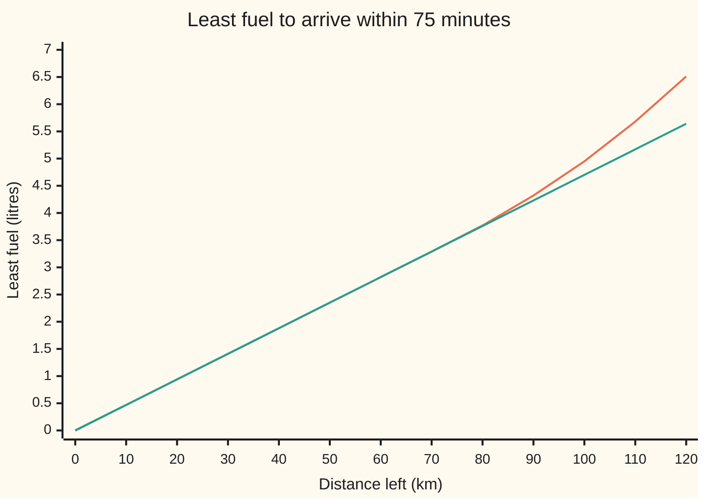

# The HJB equation: the value of steering a system well

[Syllabus](../../../SYLLABUS.md) → [Partial differential equations](../README.md) → [First-Order Equations and Characteristics](../README.md#s02) → The HJB equation

---

## General Overview

A car has 100 km of motorway to cover and 75 minutes before a meeting. The driver wants to arrive on time and burn as little fuel as possible. Cruise control will hold any speed the driver sets. Which speed, and how much fuel will it take?

Fuel use has three parts: idling costs fuel every hour, the tyres cost fuel every kilometre, and air drag grows fast with speed. Too slow, and the engine runs for hours; too fast, and drag wins. On this car the cheapest speed per kilometre is 60 km/h, but 100 km at 60 km/h takes 1 h 40 min, 25 minutes too long. The answer is to drive at a steady 80 km/h, which burns 4.95 litres.

The tool behind that answer is the **value function**: the least fuel needed, written as a function of the distance left and the time left. It obeys a first-order partial differential equation, the **Hamilton-Jacobi-Bellman equation** (HJB). [The HJB equation](../../08-Differential%20equations%20and%20dynamics/12-Calculus%20of%20Variations%20and%20Optimal%20Control/08-the-hjb-equation-and-the-linear-quadratic-regulator.md) of wing 08 derived it over a short step and solved it for a car whose cost was a square. This card derives it from the balance over a whole stretch of the trip, reads it as a Hamilton-Jacobi equation, and confirms a value that is not a square.

**The least fuel from any state, as a function of time left and distance left, obeys the HJB equation, a Hamilton-Jacobi equation whose Hamiltonian is minus a minimum over the controls; and a guessed function that solves it, takes the right boundary values and picks a trip that is allowed, is the true least fuel.**

**What kind of fact this is:** the dynamic programming principle, the HJB equation and the verification theorem are theorems, proved in Why it works; the verification theorem is proved there in outline, with a link to its full proof. The fuel model is a model: its three coefficients are illustrative, chosen to give realistic figures for a mid-size petrol car.

### The picture: least fuel against distance, with 75 minutes left



Orange: the least fuel with the deadline. Green: 0.047 litres per kilometre, the cost at the economy speed with no deadline. The two agree up to 75 km, the distance 60 km/h covers in 75 minutes. Past that the deadline forces a faster speed and the orange line bends up. The bend is gentle: the two pieces meet with the same slope.

---

## The formula

Notation first, in words.

- $`x`$ is the **distance left**, in km. It is the state: the one number that says where the trip stands.
- $`\tau`$ (tau) is the **time left** before the deadline, in hours.
- $`u`$ is the **speed**, in km/h. It is the control: the number the driver chooses. As the time left runs down, the distance left falls at rate $`u`$.
- $`F(u)`$ is the **fuel burn rate**, in litres per hour, at speed $`u`$. For this car

```math
F(u) = a + c\,u + b\,u^3, \qquad a = 1.08 \ \text{L/h}, \quad c = 0.02 \ \text{L/km}, \quad b = 2.5\times10^{-6} \ \text{L h}^2/\text{km}^3 .
```

The three terms are idling, rolling and air drag. Drag force grows as the speed squared, so the power that fights it, and the fuel per hour, grows as the speed cubed.

The **value function** $`V(\tau, x)`$ is the least fuel, in litres, over every speed schedule that covers $`x`$ km within $`\tau`$ hours. Subscripts are partial derivatives, as in wing 08: $`V_\tau`$ is the rate of change with the time left, and $`V_x`$ the rate of change with the distance left.

The HJB equation:

```math
\begin{aligned} &V_\tau + H(V_x) = 0 \quad \text{for } \tau > 0,\ x > 0, \qquad H(p) = -\min_{u \ge 0}\big(F(u) - p\,u\big), \\ &V(\tau, 0) = 0, \qquad V(0, x) = +\infty \quad \text{for } x > 0 . \end{aligned}
```

**Read it aloud:** one more hour of time left changes the least fuel by minus the Hamiltonian of its slope in distance. The Hamiltonian asks: if each kilometre is worth $`p`$ litres, which speed makes the fuel burned, minus the kilometres gained valued at $`p`$ litres each, the smallest? With no distance left, nothing more is burned; with distance left and no time, no trip is allowed, so the least fuel is infinite.

The number $`p`$ has a plain meaning. It is a **price per kilometre**: how many litres one more kilometre of distance is worth. At $`p = V_x`$ it is the true price, the extra fuel the trip needs per extra kilometre.

The value this card confirms:

```math
V(\tau, x) = \begin{cases} c_{\mathrm{eco}}\,x & \text{if } x \le u_{\mathrm{eco}}\,\tau \quad \text{(time to spare: drive at } u_{\mathrm{eco}}\text{)}, \\ \tau\,F(x/\tau) & \text{if } x > u_{\mathrm{eco}}\,\tau \quad \text{(deadline binds: drive at } x/\tau\text{)}. \end{cases}
```

**Read it aloud:** with time to spare, drive at the economy speed and pay its fuel per kilometre. With too little time, drive at the speed that arrives exactly on the deadline, and pay its fuel per hour for the whole time left.

Here $`u_{\mathrm{eco}} = 60`$ km/h is the speed of least fuel per kilometre, and $`c_{\mathrm{eco}} = 0.047`$ L/km is that least fuel per kilometre.

| Symbol | Plain meaning | In our example | Push it up and the answer… |
| --- | --- | --- | --- |
| $`x`$ | distance left, the state | 100 km | more fuel: 0.047 L/km with time to spare, faster growth past the seam |
| $`\tau`$ | time left before the deadline | 1.25 h | less fuel, until the deadline stops binding |
| $`u`$ | speed, the control | 80 km/h on the best trip | — |
| $`F(u)`$ | fuel burn rate, litres per hour | 3.96 L/h at 80 km/h | — |
| $`a`$, $`c`$, $`b`$ | idling, rolling and drag coefficients | 1.08 L/h; 0.02 L/km; 2.5e-6 L h²/km³ | bigger $`b`$: lower economy speed, more fuel |
| $`V(\tau, x)`$ | value: least fuel to arrive in time | 4.95 L | — |
| $`V_\tau`$, $`V_x`$ | its rates of change with time left and with distance left | −1.48 L/h; 0.068 L/km | — |
| $`p`$, $`H(p)`$ | a price per kilometre; the Hamiltonian at that price | $`p = 0.068`$ L/km picks 80 km/h | bigger $`p`$: faster best speed |
| $`u_{\mathrm{eco}}`$, $`c_{\mathrm{eco}}`$ | economy speed; fuel per km there | 60 km/h; 0.047 L/km | — |
| $`W`$ | a guessed value, before it is confirmed | the two-piece formula above | — |
| $`t`$, $`w`$, $`y`$ | time since the start; the speed $`x/\tau`$ that arrives exactly on time; distance left after a first stretch | 0 to 1.25 h; 80 km/h; 60 km after 0.5 h | — |
| $`\delta`$, $`\theta`$ | length of a first stretch; arrival time | 0.5 h; 1.25 h | — |

### When it holds

- **Fuel rate convex in speed.** $`F`$ curves upward ($`F'' > 0`$ for $`u > 0`$), so a steady speed beats any mix of speeds. With a car whose fuel rate dips at one gear change, the best trip can switch between two speeds and the value is no longer the formula above.
- **The state is distance and time alone.** Hills, wind and traffic make $`F`$ depend on the place too. The HJB equation still holds, with $`H(V_x, x)`$, but the closed form is gone; trucks solve that version on a grid.
- **A deadline that can be met.** Every allowed schedule arrives by the deadline, so $`V`$ is infinite at $`\tau = 0`$ for any $`x > 0`$. Drop that condition and $`0.047\,x`$, which solves the equation and is zero on arrival, passes for the value (see What breaks).
- **A value with a slope.** The verification theorem below uses the chain rule, so the guess must have continuous first derivatives. Here it does, even across the seam. When the best value has a corner, as for a minimum-time problem with capped speed, the right meaning is a **viscosity solution** (a weak sense of solving that allows corners), the subject of [Viscosity solutions](../06-Weak%20Solutions%20and%20Free%20Boundaries/06-viscosity-solutions.md).
- **No noise.** A random delay adds a second-derivative term: [Stochastic control](../../11-Stochastic%20processes%20and%20calculus/09-Beyond%20Brownian/03-stochastic-control-and-the-hjb-equation.md).

---

## Why it works

### Step 0: the rest of a best trip is a best trip

Halfway through the best trip, the remaining half is the best way to finish from where the car stands. If a cheaper finish existed, splicing it on would make the whole trip cheaper. That one fact, the **dynamic programming principle** (DPP), holds over a stretch of any length. Shrink the stretch to an instant and it becomes the HJB equation. Then a guess that solves HJB is checked against every possible trip at once by the **verification theorem**.

### Step 1: the dynamic programming principle over a whole stretch

For any first stretch of length $`\delta`$ hours, with $`0 < \delta \le \tau`$:

```math
V(\tau, x) = \min_{u \text{ on the first } \delta} \Big( \int_0^\delta F(u(t))\,dt \;+\; V\big(\tau - \delta,\; x - \textstyle\int_0^\delta u(t)\,dt\big) \Big).
```

Here $`t`$ is time since the start, in hours. In words: least fuel equals the fuel of the first stretch plus the least fuel from where the stretch ends, minimised over what to do during the stretch.

The proof has two halves. **Not more:** follow any first stretch with a best finish; that is one allowed trip, so $`V`$ is no bigger than its cost. **Not less:** cut any allowed trip at $`\delta`$; its tail is an allowed finish, so it costs at least $`V`$ from there. The fold below writes it out.

Test it with $`\delta = 0.5`$ h. The checks try every steady first-half speed from 0 to 200 km/h, in steps of 0.01 km/h, then add the least fuel from where the car stands. The minimum is 4.95 L, at 80 km/h: 1.98 L in the first half hour plus 2.97 L for the last 60 km in 45 minutes.

<details>
<summary>Detailed proof: the dynamic programming principle, and the guess solving HJB</summary>

**Not more.** Fix any speed schedule on $`[0, \delta]`$ that leaves $`y`$ km at time $`\delta`$, and any schedule from $`(\tau - \delta, y)`$ that arrives in time and burns within $`\varepsilon`$ litres (any small positive amount) of $`V(\tau - \delta, y)`$. Joined, they form an allowed trip from $`(\tau, x)`$. So $`V(\tau, x)`$ is at most the first stretch's fuel plus $`V(\tau - \delta, y) + \varepsilon`$. Take the least over first stretches and let $`\varepsilon`$ shrink to zero.

**Not less.** Any allowed trip from $`(\tau, x)`$ that has not arrived by $`\delta`$ splits at $`\delta`$. Its tail covers the remaining $`y`$ km within $`\tau - \delta`$ hours, so it burns at least $`V(\tau - \delta, y)`$. So the trip burns at least the right-hand side. A trip that arrives before $`\delta`$ counts as a first stretch that ends at $`y = 0`$, where $`V = 0`$.

**The guess solves HJB where the deadline binds.** Write $`w = x/\tau`$ for the speed that arrives exactly on time. Then $`W = a\tau + c\,x + b\,x^3/\tau^2`$, so

$`\displaystyle W_x = c + 3b\,w^2, \qquad W_\tau = a - 2b\,w^3 .`$

At price $`p = W_x`$ the best speed solves $`F'(u) = p`$, that is $`c + 3bu^2 = c + 3bw^2`$, so $`u = w`$. Then $`H(W_x) = p\,w - F(w) = 2b\,w^3 - a = -W_\tau`$, which is HJB.

**The guess solves HJB with time to spare.** $`W = c_{\mathrm{eco}}\,x`$ has $`W_\tau = 0`$ and $`W_x = c_{\mathrm{eco}}`$. The quantity $`F(u) - c_{\mathrm{eco}}\,u`$ is $`u`$ times the fuel per km minus its least value, so it is never negative and it is zero at $`u_{\mathrm{eco}}`$. So $`H(c_{\mathrm{eco}}) = 0`$, which is HJB.

</details>

### Step 2: shrink the stretch, and HJB appears

Hold one speed $`u`$ for a short $`\delta`$. The stretch burns about $`F(u)\,\delta`$ and takes the car from $`(\tau, x)`$ to $`(\tau - \delta, x - u\delta)`$. To first order, $`V`$ there is $`V - V_\tau\,\delta - V_x\,u\,\delta`$. Put that into Step 1, cancel $`V`$ and divide by $`\delta`$:

```math
0 = \min_{u \ge 0}\big(F(u) - u\,V_x\big) - V_\tau .
```

That is HJB, written with the Hamiltonian $`H(p) = -\min_u (F(u) - p\,u)`$ as $`V_\tau + H(V_x) = 0`$. It is the equation of [Hamilton-Jacobi](05-hamilton-jacobi-equations.md), written there for a least cost of place and time; here the time left $`\tau`$ plays the part of time, and nothing depends on place. The fuel rate $`F`$ plays the part of that card's Lagrangian, and $`H`$ is its Legendre transform (the best "price times speed minus cost" over all speeds).

The minimum over speeds is a bowl. Its bottom is where the slope $`F'(u) - p`$ is zero: **the extra fuel per hour of going a little faster equals the price of the extra kilometres**. For this $`F`$ and a price $`p > c`$, that gives $`u = \sqrt{(p - c)/(3b)}`$ and $`H(p) = 2b\,u^3 - a`$. At the start of the trip $`V_x = 0.068`$ L/km, and the bowl's bottom is at 80 km/h. The checks find it by searching, without this algebra.

One more reading links this card to its shelf. Differentiate HJB in $`x`$: the price $`p = V_x`$ obeys $`p_\tau + H(p)_x = 0`$, a conservation law as on [Conservation laws](02-conservation-laws-and-shocks.md). Where the deadline binds, $`p`$ depends only on $`x/\tau`$: it is a fan of the kind on [The Riemann problem](04-rarefaction-and-the-riemann-problem.md).

### Step 3: guess the value

Two facts fix the guess.

1. **A steady speed is best.** For a fixed distance and arrival time, the average speed is fixed. Because $`F`$ curves upward, any wobble around that average burns more (Jensen's inequality: the average of a convex function is at least the function of the average).
2. **Then choose the arrival time.** Arriving at time $`\theta \le \tau`$ at steady speed $`x/\theta`$ burns $`\theta\,F(x/\theta)`$. So

```math
V(\tau, x) = \min_{0 < \theta \le \tau} \theta\,F(x/\theta).
```

That is the Hopf-Lax formula of [Hamilton-Jacobi](05-hamilton-jacobi-equations.md), with the arrival time as the free choice. The minimum runs over arrival times because the car may stop at the goal with the engine off. That card's formula at one fixed time gives $`\tau F(x/\tau)`$, which charges idling at 1.08 L/h for time not needed: 4.785 L with 2 h left, against 4.70 L. Per kilometre, $`\theta F(x/\theta)`$ is $`F(u)/u = a/u + c + b\,u^2`$ at $`u = x/\theta`$. Its least value is where $`a/u^2 = 2b\,u`$, so $`u^3 = a/(2b)`$ and $`u_{\mathrm{eco}} = 60`$ km/h, with $`c_{\mathrm{eco}} = F(60)/60 = 2.82/60 = 0.047`$ L/km. If 60 km/h arrives in time, drive it. If not, the fuel per kilometre rises with speed above 60, so drive as slowly as the deadline allows: $`x/\tau`$. Those are the two pieces of The formula.

### Step 4: check the guess solves HJB, and see where it is not smooth

The fold in Step 1 checks each piece. Where the deadline binds, $`W_\tau = a - 2b\,w^3`$: at 80 km/h that is −1.48 L/h, so every extra minute of slack saves 0.0247 L, about 25 millilitres. With time to spare, $`W_\tau = 0`$: extra slack saves nothing.

The seam is the line $`x = 60\,\tau`$; at 75 minutes it sits at 75 km. There both pieces give 3.525 L, both slopes in $`x`$ are 0.047 L/km, and both slopes in $`\tau`$ are 0, since $`a - 2b\cdot 60^3 = 0`$. So $`W`$ has continuous first derivatives. Its second derivative in $`x`$ jumps, from 0 to 0.00072 L/km². This value is not a square, as in wing 08's car, and not twice differentiable. The verification theorem asks for less.

### Step 5: the verification theorem confirms the guess

The theorem, proved in [The HJB equation](../../08-Differential%20equations%20and%20dynamics/12-Calculus%20of%20Variations%20and%20Optimal%20Control/08-the-hjb-equation-and-the-linear-quadratic-regulator.md) for a smooth value, reads here as follows. Let $`W`$ have continuous first derivatives, solve $`W_\tau + H(W_x) = 0`$, and take $`W(\tau, 0) = 0`$. Then:

1. **Lower bound.** Every schedule that arrives by the deadline burns at least $`W(\tau, x)`$.
2. **Attained.** If driving at the speed that achieves the minimum in $`H(W_x)`$ gives a trip that arrives by the deadline, that trip burns exactly $`W(\tau, x)`$. So $`W`$ is the value and the trip is best.

The reason is one line of chain rule. Along any schedule, as clock time passes, $`W`$ at the car's current state changes at rate

```math
\frac{d}{dt}\,W\big(\tau - t,\; x(t)\big) = -W_\tau - u\,W_x = H(W_x) - u\,W_x \;\ge\; -F(u),
```

because $`H(p) \ge p\,u - F(u)`$ for every speed $`u`$. So $`W`$ falls no faster than fuel is burned. Integrate from the start to the arrival, where $`W = 0`$: the fuel burned is at least $`W(\tau, x)`$. At the best speed the inequality is an equality, and the fuel is exactly $`W(\tau, x)`$.

For the meeting, the best speed is 80 km/h from the start, and it stays 80 km/h all the way (see the trip below). The trip arrives at 75 minutes exactly. Both conditions hold, so 4.95 L is the least possible. The checks confirm the lower bound on finite instances: over every schedule on a grid of speeds, 0, 5, 10, … 200 km/h, changed every 3 minutes, none beats $`W`$ at any grid state, and the best grid schedule reaches 4.95 L exactly.

### Step 6: which kind of solution this is

$`V`$ is a **classical solution** of the problem in The formula: it has continuous first derivatives, satisfies the equation at every point with $`\tau > 0`$, $`x > 0`$, and takes both data. It is the only one. Any such solution $`W`$ is a lower bound, by half 1 of Step 5. Along the trip that drives at $`W`$'s best speed, $`W`$ falls exactly as fast as fuel burns, so it stays finite; reaching the deadline short of the goal would make it infinite. So that trip arrives in time, and half 2 makes $`W`$ the least fuel. When the value has corners, the unique solution is instead the viscosity solution of Crandall and Lions.

---

## Worked numbers, by hand

The meeting: $`x = 100`$ km, $`\tau = 1.25`$ h.

| Step | Arithmetic | Value |
| --- | --- | --- |
| economy speed | $`u^3 = a/(2b)`$ | 60 km/h |
| fuel per km there | $`F(60)/60 = 2.82/60`$ | 0.047 L/km |
| time 60 km/h needs | $`100/60`$ | 1.6667 h: 25 min late |
| speed the deadline forces | $`100/1.25`$ | 80 km/h |
| fuel rate at 80 km/h | $`1.08 + 0.02 \times 80 + 2.5\times10^{-6} \times 80^3`$ | 3.96 L/h |
| idling, rolling, drag | $`1.25 \times 1.08`$; $`100 \times 0.02`$; $`1.25 \times 2.5\times10^{-6} \times 80^3`$ | 1.35, 2.00, 1.60 L |
| **least fuel** | $`1.25 \times 3.96`$ | **4.95 L** |
| price of a km, $`V_x`$ | $`c + 3b \times 80^2`$ | 0.068 L/km |
| value of slack, $`V_\tau`$ | $`a - 2b \times 80^3`$ | −1.48 L/h |

The deadline raises the fuel from the 4.70 L of the economy speed to 4.95 L. Each extra minute before the meeting would save about 25 millilitres (0.0247 L).

### What breaks if you drop a piece

| Mistake | Comes out at | What went wrong |
| --- | --- | --- |
| Drop the deadline: take $`W = 0.047\,x`$ | 4.70 L, arriving 25 min late | $`W`$ solves HJB everywhere and is a true lower bound, but its best speed, 60 km/h, does not arrive in time: half 2 of the verification theorem fails |
| Always arrive exactly on the deadline, $`W = \tau F(x/\tau)`$, with 2 h left | 4.785 L, against 4.70 L | it also solves HJB, but $`W(\tau, 0) = a\tau \ne 0`$: it charges idling for time not needed, so half 1 fails |
| Drive 45 min at the economy speed, then 110 km/h for the last 55 km | 5.42 L, against 4.95 L | a mix of speeds; $`F`$ curves up, so a steady 80 km/h is cheaper |
| Guess a square, $`P x^2`$ with a constant $`P`$, fitted to 4.95 L at 100 km | 1.24 L at 50 km, against 2.35 L | the value is linear with time to spare; wing 08's square came from squared costs, which this problem does not have |

The first two rows are the theorem's hypotheses failing: each $`W`$ is a genuine solution of the equation, and still not the least fuel.

---

## The value along the trip, and after a jam

The best trip, traced every 15 minutes. "Fuel used" is what the car has burned; "least fuel left" is $`V`$ at the current state.

| Clock (min) | Distance left (km) | Fuel used (L) | Least fuel left (L) | Sum (L) |
| --- | --- | --- | --- | --- |
| 0 | 100 | 0.00 | 4.95 | 4.95 |
| 15 | 80 | 0.99 | 3.96 | 4.95 |
| 30 | 60 | 1.98 | 2.97 | 4.95 |
| 45 | 40 | 2.97 | 1.98 | 4.95 |
| 60 | 20 | 3.96 | 0.99 | 4.95 |
| 75 | 0 | 4.95 | 0.00 | 4.95 |

The sum never moves. That is the dynamic programming principle seen along the best trip: what is spent plus what is still needed stays equal to the starting value.

Now a jam. At 30 minutes the car stops for 10 minutes, engine idling. It now has 60 km to go and 35 minutes left. The value function already holds the answer: the new state is in the binding region, so the best speed is $`60/0.5833`$ = 102.86 km/h. The whole trip now burns 5.5769 L, against 4.95 L. The sum jumped because the jam was not a choice; from the new state, the best finish again keeps the sum fixed.

---

## Code, from first principles, and it actually runs

The scripts take five roads to the least fuel: the guessed value $`W`$; a ternary search over the arrival time (Hopf-Lax); Bellman's backward recursion over every grid schedule, none of which beats $`W`$; the dynamic programming principle over a 30-minute first stretch; and the HJB residual by centred differences at three steps, with the Hamiltonian found by its own search. The residual falls as the step squared. The scripts also check the seam, trace the trip and the jam, and print every wrong answer in What breaks.

### Python

```python
# HJB and verification -- the check behind the card.  Standard library only.
# A car must cover x km with tau hours left before a deadline, burning least fuel.
# Fuel burn rate at speed u km/h: F(u) = a + c u + b u^3 litres per hour
# (illustrative: idling, rolling, air drag).  Roads to the least fuel V(tau, x):
# the guessed value W; a scan over arrival times (Hopf-Lax); Bellman's backward
# recursion over every schedule on a grid of speeds; the HJB residual by centred
# differences with the Hamiltonian found by a search; and the dynamic programming
# principle over a whole 30-minute first stretch.
A, C, B = 1.08, 0.02, 2.5e-6         # L/h idling, L/km rolling, L h^2/km^3 drag

def F(u, a=A, b=B): return a + C * u + b * u ** 3
def eco(a=A, b=B):                   # speed of least fuel per km, and that fuel per km
    u = (a / (2 * b)) ** (1 / 3)
    return u, F(u, a, b) / u

def W(tau, x, a=A, b=B):             # the guessed value: two pieces, glued on x = u_eco tau
    u, ce = eco(a, b)
    if x <= 0.0: return 0.0
    if x <= u * tau: return ce * x
    return tau * F(x / tau, a, b)

def H(p):                            # Hamiltonian max_u (p u - F(u)), by ternary search
    lo, hi = 0.0, 400.0
    for _ in range(200):
        m1, m2 = lo + (hi - lo) / 3, hi - (hi - lo) / 3
        if p * m1 - F(m1) < p * m2 - F(m2): lo = m1
        else: hi = m2
    u = (lo + hi) / 2
    return p * u - F(u), u

def hopf_lax(tau, x):                # least over arrival times theta <= tau of theta F(x/theta)
    lo, hi = 1e-6, tau
    for _ in range(200):
        m1, m2 = lo + (hi - lo) / 3, hi - (hi - lo) / 3
        if m1 * F(x / m1) < m2 * F(x / m2): hi = m2
        else: lo = m1
    t = (lo + hi) / 2
    return t * F(x / t), t

def bellman(steps, dt=0.05, dx=0.25, nx=401, kmax=40):
    # speeds u = k dx/dt = 5k km/h; arriving mid-step costs distance times fuel per km
    INF = float("inf")
    V = [0.0] + [INF] * (nx - 1)
    out = [V]
    for _ in range(steps):
        new = [0.0] * nx
        for i in range(1, nx):
            best = dt * A + V[i]
            for k in range(1, kmax + 1):
                u = k * dx / dt
                cost = i * dx * F(u) / u if k >= i else dt * F(u) + V[i - k]
                if cost < best: best = cost
            new[i] = best
        V = new
        out.append(V)
    return out

U, CE = eco()
print(f"economy speed u_eco (km/h)              {U:.4f}")
print(f"fuel per km at u_eco (L/km)             {CE:.6f}")
print(f"F(60), F(80) (L/h)                      {F(60.0):.4f} {F(80.0):.4f}")
v_main, v_free = W(1.25, 100.0), W(2.0, 100.0)
print(f"W(1.25 h, 100 km), needs 80 km/h (L)    {v_main:.4f}")
print(f"W(2 h, 100 km), drives 60 km/h (L)      {v_free:.4f}")
print(f"80 km/h parts: idle, rolling, drag (L)  {1.25 * A:.4f} {100 * C:.4f} {1.25 * B * 80.0 ** 3:.4f}")
hl, th = hopf_lax(1.25, 100.0)
hl2, th2 = hopf_lax(2.0, 100.0)
print(f"Hopf-Lax 1.25 h: fuel, arrival (h)      {hl:.4f} {th:.4f}")
print(f"Hopf-Lax 2 h: fuel, arrival (h)         {hl2:.4f} {th2:.4f}")
G = bellman(40)
g125, g2, g90 = G[25][400], G[40][400], G[25][360]
print(f"Bellman grid 1.25 h, 100 km (L)         {g125:.4f}")
print(f"Bellman grid 2 h, 100 km (L)            {g2:.4f}")
print(f"Bellman grid 1.25 h, 90 km; W (L)       {g90:.4f} {W(1.25, 90.0):.4f}")
beat = max(W(n * 0.05, i * 0.25) - G[n][i] for n in range(1, 41) for i in range(401) if G[n][i] < 1e9)
print(f"most any grid schedule beats W by (L)   {max(beat, 0.0):.9f}")
dpp, arg = min((0.5 * F(k / 100) + W(0.75, 100.0 - 0.5 * k / 100), k / 100) for k in range(20001))
print(f"DPP over first 0.5 h: min, at u (km/h)  {dpp:.4f} {arg:.2f}")
pts = [(1.25, 100.0), (1.25, 50.0), (2.0, 100.0), (1.0, 30.0), (0.5, 45.0)]
res = []
for d in (1e-2, 1e-3, 1e-4):
    r = 0.0
    for tau, x in pts:
        Wt = (W(tau + d, x) - W(tau - d, x)) / (2 * d)
        Wx = (W(tau, x + d) - W(tau, x - d)) / (2 * d)
        r = max(r, abs(Wt + H(Wx)[0]))
    res.append(r)
    print(f"max HJB residual, step {d:.4f}           {r:.9f}")
Wt = (W(1.25 + 1e-4, 100.0) - W(1.25 - 1e-4, 100.0)) / 2e-4
Wx = (W(1.25, 100.0 + 1e-4) - W(1.25, 100.0 - 1e-4)) / 2e-4
print(f"V_tau, V_x at 1.25 h, 100 km            {Wt:.4f} {Wx:.4f}")
print(f"best speed for that V_x (km/h)          {H(Wx)[1]:.4f}")
print(f"slack: fuel saved per extra minute (L)  {-Wt / 60:.4f}")
e = 1e-6                             # the seam x = 60 tau, at tau = 1.25 h, x = 75 km
s1 = (W(1.25, 75.0) - W(1.25, 75.0 - e)) / e
s2 = (W(1.25, 75.0 + e) - W(1.25, 75.0)) / e
print(f"seam 75 km: W; slope left, right        {W(1.25, 75.0):.4f} {s1:.4f} {s2:.4f}")
print(f"seam: W_xx left, right (L/km^2)         {0.0:.6f} {6 * B * 75.0 / 1.25 ** 2:.6f}")
print("trip at 1.25 h: clock (min), km left, fuel used, W left, sum")
for m in range(0, 76, 15):
    x = 100.0 - 80.0 * m / 60
    used = F(80.0) * m / 60
    print(f"  {m:3d} {x:6.1f} {used:7.4f} {W(1.25 - m / 60, x):7.4f} {used + W(1.25 - m / 60, x):7.4f}")
jam = F(80.0) * 0.5 + A / 6
tl = 1.25 - 0.5 - 1 / 6
print(f"10-min jam at 30 min: new speed, total  {60.0 / tl:.4f} {jam + W(tl, 60.0):.4f}")
print("value at 1.25 h, x = 0..120 km step 10 (L):")
print("  W      " + " ".join(f"{W(1.25, 10.0 * j):.2f}" for j in range(13)))
print("  0.047x " + " ".join(f"{CE * 10.0 * j:.2f}" for j in range(13)))
late = 100.0 / U - 1.25
exact = 2.0 * F(50.0)
sprint = 45.0 * CE + 0.5 * F(110.0)
P = v_main / 100.0 ** 2
print(f"wrong: drop deadline: fuel, late (min)  {CE * 100:.4f} {late * 60:.4f}")
print(f"wrong: arrive exactly at 2 h (L)        {exact:.4f}")
print(f"wrong: 45 min at 60, then 110 (L)       {sprint:.4f}")
print(f"wrong: square P x^2 at 50 km; W (L)     {P * 2500:.4f} {W(1.25, 50.0):.4f}")
print(f"try: deadline 1 h, 1.5 h (L)            {W(1.0, 100.0):.4f} {W(1.5, 100.0):.4f}")
u2, _ = eco(b=2 * B)
print(f"try: double drag: u_eco, W(1.25,100)    {u2:.4f} {W(1.25, 100.0, b=2 * B):.4f}")
assert abs(v_main - 4.95) < 1e-9     # 1.25 h x 3.96 L/h, by hand
assert abs(hl - v_main) < 1e-6 and abs(hl2 - v_free) < 1e-6   # Hopf-Lax road agrees
assert abs(g125 - v_main) < 1e-9 and abs(g2 - v_free) < 1e-9  # grid schedules reach W
assert beat < 1e-9                   # verification: no schedule on the grid beats W
assert g90 >= W(1.25, 90.0)          # off the grid's speeds, the grid can only lose
assert abs(dpp - v_main) < 1e-6 and abs(arg - 80.0) < 0.02    # DPP over 30 minutes
assert res[2] < 1e-6 and res[1] < 0.02 * res[0]   # HJB holds; residual falls as step^2
assert abs(H(Wx)[1] - 80.0) < 1e-3   # the Hamiltonian's best speed is the trip's speed
assert abs(s1 - s2) < 1e-4           # the glued value has one slope across the seam
assert exact > v_free and sprint > v_main   # the two wrong plans cost more
print("ALL CHECKS PASS")
```

**Ran 2026-11-15 on macOS, Python 3.14.10, standard library only. All checks passed. Output, pasted from the run:**

```
economy speed u_eco (km/h)              60.0000
fuel per km at u_eco (L/km)             0.047000
F(60), F(80) (L/h)                      2.8200 3.9600
W(1.25 h, 100 km), needs 80 km/h (L)    4.9500
W(2 h, 100 km), drives 60 km/h (L)      4.7000
80 km/h parts: idle, rolling, drag (L)  1.3500 2.0000 1.6000
Hopf-Lax 1.25 h: fuel, arrival (h)      4.9500 1.2500
Hopf-Lax 2 h: fuel, arrival (h)         4.7000 1.6667
Bellman grid 1.25 h, 100 km (L)         4.9500
Bellman grid 2 h, 100 km (L)            4.7000
Bellman grid 1.25 h, 90 km; W (L)       4.3205 4.3164
most any grid schedule beats W by (L)   0.000000000
DPP over first 0.5 h: min, at u (km/h)  4.9500 80.00
max HJB residual, step 0.0100           0.002917661
max HJB residual, step 0.0010           0.000029159
max HJB residual, step 0.0001           0.000000291
V_tau, V_x at 1.25 h, 100 km            -1.4800 0.0680
best speed for that V_x (km/h)          80.0000
slack: fuel saved per extra minute (L)  0.0247
seam 75 km: W; slope left, right        3.5250 0.0470 0.0470
seam: W_xx left, right (L/km^2)         0.000000 0.000720
trip at 1.25 h: clock (min), km left, fuel used, W left, sum
    0  100.0  0.0000  4.9500  4.9500
   15   80.0  0.9900  3.9600  4.9500
   30   60.0  1.9800  2.9700  4.9500
   45   40.0  2.9700  1.9800  4.9500
   60   20.0  3.9600  0.9900  4.9500
   75    0.0  4.9500  0.0000  4.9500
10-min jam at 30 min: new speed, total  102.8571 5.5769
value at 1.25 h, x = 0..120 km step 10 (L):
  W      0.00 0.47 0.94 1.41 1.88 2.35 2.82 3.29 3.77 4.32 4.95 5.68 6.51
  0.047x 0.00 0.47 0.94 1.41 1.88 2.35 2.82 3.29 3.76 4.23 4.70 5.17 5.64
wrong: drop deadline: fuel, late (min)  4.7000 25.0000
wrong: arrive exactly at 2 h (L)        4.7850
wrong: 45 min at 60, then 110 (L)       5.4188
wrong: square P x^2 at 50 km; W (L)     1.2375 2.3500
try: deadline 1 h, 1.5 h (L)            5.5800 4.7311
try: double drag: u_eco, W(1.25,100)    47.6220 6.5500
ALL CHECKS PASS
```

### Rust

```rust
// HJB and verification -- the check behind the card.  Rust std only.
// A car must cover x km with tau hours left before a deadline, burning least fuel.
// Fuel burn rate at speed u km/h: F(u) = a + c u + b u^3 litres per hour
// (illustrative: idling, rolling, air drag).  Roads to the least fuel V(tau, x):
// the guessed value W; a scan over arrival times (Hopf-Lax); Bellman's backward
// recursion over every schedule on a grid of speeds; the HJB residual by centred
// differences with the Hamiltonian found by a search; and the dynamic programming
// principle over a whole 30-minute first stretch.
const A: f64 = 1.08; // L/h idling
const C: f64 = 0.02; // L/km rolling
const B: f64 = 2.5e-6; // L h^2/km^3 drag

fn fa(u: f64, a: f64, b: f64) -> f64 { a + C * u + b * u.powf(3.0) }
fn f(u: f64) -> f64 { fa(u, A, B) }
fn eco(a: f64, b: f64) -> (f64, f64) {
    // speed of least fuel per km, and that fuel per km
    let u = (a / (2.0 * b)).powf(1.0 / 3.0);
    (u, fa(u, a, b) / u)
}

fn wab(tau: f64, x: f64, a: f64, b: f64) -> f64 {
    // the guessed value: two pieces, glued on x = u_eco tau
    let (u, ce) = eco(a, b);
    if x <= 0.0 { return 0.0; }
    if x <= u * tau { return ce * x; }
    tau * fa(x / tau, a, b)
}
fn w(tau: f64, x: f64) -> f64 { wab(tau, x, A, B) }

fn ham(p: f64) -> (f64, f64) {
    // Hamiltonian max_u (p u - F(u)), by ternary search
    let (mut lo, mut hi) = (0.0f64, 400.0f64);
    for _ in 0..200 {
        let m1 = lo + (hi - lo) / 3.0;
        let m2 = hi - (hi - lo) / 3.0;
        if p * m1 - f(m1) < p * m2 - f(m2) { lo = m1; } else { hi = m2; }
    }
    let u = (lo + hi) / 2.0;
    (p * u - f(u), u)
}

fn hopf_lax(tau: f64, x: f64) -> (f64, f64) {
    // least over arrival times theta <= tau of theta F(x/theta)
    let (mut lo, mut hi) = (1e-6f64, tau);
    for _ in 0..200 {
        let m1 = lo + (hi - lo) / 3.0;
        let m2 = hi - (hi - lo) / 3.0;
        if m1 * f(x / m1) < m2 * f(x / m2) { hi = m2; } else { lo = m1; }
    }
    let t = (lo + hi) / 2.0;
    (t * f(x / t), t)
}

fn bellman(steps: usize) -> Vec<Vec<f64>> {
    // speeds u = k dx/dt = 5k km/h; arriving mid-step costs distance times fuel per km
    let (dt, dx, nx, kmax) = (0.05f64, 0.25f64, 401usize, 40usize);
    let mut v = vec![f64::INFINITY; nx];
    v[0] = 0.0;
    let mut out = vec![v.clone()];
    for _ in 0..steps {
        let mut new = vec![0.0f64; nx];
        for i in 1..nx {
            let mut best = dt * A + v[i];
            for k in 1..=kmax {
                let u = k as f64 * dx / dt;
                let cost = if k >= i { i as f64 * dx * f(u) / u } else { dt * f(u) + v[i - k] };
                if cost < best { best = cost; }
            }
            new[i] = best;
        }
        v = new;
        out.push(v.clone());
    }
    out
}

fn main() {
    let (u_eco, ce) = eco(A, B);
    println!("economy speed u_eco (km/h)              {:.4}", u_eco);
    println!("fuel per km at u_eco (L/km)             {:.6}", ce);
    println!("F(60), F(80) (L/h)                      {:.4} {:.4}", f(60.0), f(80.0));
    let (v_main, v_free) = (w(1.25, 100.0), w(2.0, 100.0));
    println!("W(1.25 h, 100 km), needs 80 km/h (L)    {:.4}", v_main);
    println!("W(2 h, 100 km), drives 60 km/h (L)      {:.4}", v_free);
    println!("80 km/h parts: idle, rolling, drag (L)  {:.4} {:.4} {:.4}", 1.25 * A, 100.0 * C, 1.25 * B * 80.0f64.powf(3.0));
    let (hl, th) = hopf_lax(1.25, 100.0);
    let (hl2, th2) = hopf_lax(2.0, 100.0);
    println!("Hopf-Lax 1.25 h: fuel, arrival (h)      {:.4} {:.4}", hl, th);
    println!("Hopf-Lax 2 h: fuel, arrival (h)         {:.4} {:.4}", hl2, th2);
    let g = bellman(40);
    let (g125, g2, g90) = (g[25][400], g[40][400], g[25][360]);
    println!("Bellman grid 1.25 h, 100 km (L)         {:.4}", g125);
    println!("Bellman grid 2 h, 100 km (L)            {:.4}", g2);
    println!("Bellman grid 1.25 h, 90 km; W (L)       {:.4} {:.4}", g90, w(1.25, 90.0));
    let mut beat = f64::NEG_INFINITY;
    for n in 1..41 {
        for i in 0..401 {
            if g[n][i] < 1e9 { beat = beat.max(w(n as f64 * 0.05, i as f64 * 0.25) - g[n][i]); }
        }
    }
    println!("most any grid schedule beats W by (L)   {:.9}", beat.max(0.0));
    let (mut dpp, mut arg) = (f64::INFINITY, 0.0f64);
    for k in 0..20001 {
        let u = k as f64 / 100.0;
        let val = 0.5 * f(u) + w(0.75, 100.0 - 0.5 * u);
        if val < dpp { dpp = val; arg = u; }
    }
    println!("DPP over first 0.5 h: min, at u (km/h)  {:.4} {:.2}", dpp, arg);
    let pts = [(1.25, 100.0), (1.25, 50.0), (2.0, 100.0), (1.0, 30.0), (0.5, 45.0)];
    let mut res = Vec::new();
    for &d in &[1e-2f64, 1e-3, 1e-4] {
        let mut r = 0.0f64;
        for &(tau, x) in &pts {
            let wt = (w(tau + d, x) - w(tau - d, x)) / (2.0 * d);
            let wx = (w(tau, x + d) - w(tau, x - d)) / (2.0 * d);
            r = r.max((wt + ham(wx).0).abs());
        }
        res.push(r);
        println!("max HJB residual, step {:.4}           {:.9}", d, r);
    }
    let wt = (w(1.25 + 1e-4, 100.0) - w(1.25 - 1e-4, 100.0)) / 2e-4;
    let wx = (w(1.25, 100.0 + 1e-4) - w(1.25, 100.0 - 1e-4)) / 2e-4;
    println!("V_tau, V_x at 1.25 h, 100 km            {:.4} {:.4}", wt, wx);
    println!("best speed for that V_x (km/h)          {:.4}", ham(wx).1);
    println!("slack: fuel saved per extra minute (L)  {:.4}", -wt / 60.0);
    let e = 1e-6; // the seam x = 60 tau, at tau = 1.25 h, x = 75 km
    let s1 = (w(1.25, 75.0) - w(1.25, 75.0 - e)) / e;
    let s2 = (w(1.25, 75.0 + e) - w(1.25, 75.0)) / e;
    println!("seam 75 km: W; slope left, right        {:.4} {:.4} {:.4}", w(1.25, 75.0), s1, s2);
    println!("seam: W_xx left, right (L/km^2)         {:.6} {:.6}", 0.0, 6.0 * B * 75.0 / 1.25f64.powf(2.0));
    println!("trip at 1.25 h: clock (min), km left, fuel used, W left, sum");
    for m in (0..76).step_by(15) {
        let mf = m as f64;
        let x = 100.0 - 80.0 * mf / 60.0;
        let used = f(80.0) * mf / 60.0;
        let wl = w(1.25 - mf / 60.0, x);
        println!("  {:3} {:6.1} {:7.4} {:7.4} {:7.4}", m, x, used, wl, used + wl);
    }
    let jam = f(80.0) * 0.5 + A / 6.0;
    let tl = 1.25 - 0.5 - 1.0 / 6.0;
    println!("10-min jam at 30 min: new speed, total  {:.4} {:.4}", 60.0 / tl, jam + w(tl, 60.0));
    println!("value at 1.25 h, x = 0..120 km step 10 (L):");
    let row1: Vec<String> = (0..13).map(|j| format!("{:.2}", w(1.25, 10.0 * j as f64))).collect();
    let row2: Vec<String> = (0..13).map(|j| format!("{:.2}", ce * 10.0 * j as f64)).collect();
    println!("  W      {}", row1.join(" "));
    println!("  0.047x {}", row2.join(" "));
    let late = 100.0 / u_eco - 1.25;
    let exact = 2.0 * f(50.0);
    let sprint = 45.0 * ce + 0.5 * f(110.0);
    let p = v_main / 100.0f64.powf(2.0);
    println!("wrong: drop deadline: fuel, late (min)  {:.4} {:.4}", ce * 100.0, late * 60.0);
    println!("wrong: arrive exactly at 2 h (L)        {:.4}", exact);
    println!("wrong: 45 min at 60, then 110 (L)       {:.4}", sprint);
    println!("wrong: square P x^2 at 50 km; W (L)     {:.4} {:.4}", p * 2500.0, w(1.25, 50.0));
    println!("try: deadline 1 h, 1.5 h (L)            {:.4} {:.4}", w(1.0, 100.0), w(1.5, 100.0));
    let (u2, _) = eco(A, 2.0 * B);
    println!("try: double drag: u_eco, W(1.25,100)    {:.4} {:.4}", u2, wab(1.25, 100.0, A, 2.0 * B));
    assert!((v_main - 4.95).abs() < 1e-9); // 1.25 h x 3.96 L/h, by hand
    assert!((hl - v_main).abs() < 1e-6 && (hl2 - v_free).abs() < 1e-6); // Hopf-Lax road agrees
    assert!((g125 - v_main).abs() < 1e-9 && (g2 - v_free).abs() < 1e-9); // grid schedules reach W
    assert!(beat < 1e-9); // verification: no schedule on the grid beats W
    assert!(g90 >= w(1.25, 90.0)); // off the grid's speeds, the grid can only lose
    assert!((dpp - v_main).abs() < 1e-6 && (arg - 80.0).abs() < 0.02); // DPP over 30 minutes
    assert!(res[2] < 1e-6 && res[1] < 0.02 * res[0]); // HJB holds; residual falls as step^2
    assert!((ham(wx).1 - 80.0).abs() < 1e-3); // the Hamiltonian's best speed is the trip's speed
    assert!((s1 - s2).abs() < 1e-4); // the glued value has one slope across the seam
    assert!(exact > v_free && sprint > v_main); // the two wrong plans cost more
    println!("ALL CHECKS PASS");
}
```

**Ran 2026-11-15 on macOS, rustc 1.98.1, no crates. All checks passed. Output, pasted from the run:**

```
economy speed u_eco (km/h)              60.0000
fuel per km at u_eco (L/km)             0.047000
F(60), F(80) (L/h)                      2.8200 3.9600
W(1.25 h, 100 km), needs 80 km/h (L)    4.9500
W(2 h, 100 km), drives 60 km/h (L)      4.7000
80 km/h parts: idle, rolling, drag (L)  1.3500 2.0000 1.6000
Hopf-Lax 1.25 h: fuel, arrival (h)      4.9500 1.2500
Hopf-Lax 2 h: fuel, arrival (h)         4.7000 1.6667
Bellman grid 1.25 h, 100 km (L)         4.9500
Bellman grid 2 h, 100 km (L)            4.7000
Bellman grid 1.25 h, 90 km; W (L)       4.3205 4.3164
most any grid schedule beats W by (L)   0.000000000
DPP over first 0.5 h: min, at u (km/h)  4.9500 80.00
max HJB residual, step 0.0100           0.002917661
max HJB residual, step 0.0010           0.000029159
max HJB residual, step 0.0001           0.000000291
V_tau, V_x at 1.25 h, 100 km            -1.4800 0.0680
best speed for that V_x (km/h)          80.0000
slack: fuel saved per extra minute (L)  0.0247
seam 75 km: W; slope left, right        3.5250 0.0470 0.0470
seam: W_xx left, right (L/km^2)         0.000000 0.000720
trip at 1.25 h: clock (min), km left, fuel used, W left, sum
    0  100.0  0.0000  4.9500  4.9500
   15   80.0  0.9900  3.9600  4.9500
   30   60.0  1.9800  2.9700  4.9500
   45   40.0  2.9700  1.9800  4.9500
   60   20.0  3.9600  0.9900  4.9500
   75    0.0  4.9500  0.0000  4.9500
10-min jam at 30 min: new speed, total  102.8571 5.5769
value at 1.25 h, x = 0..120 km step 10 (L):
  W      0.00 0.47 0.94 1.41 1.88 2.35 2.82 3.29 3.77 4.32 4.95 5.68 6.51
  0.047x 0.00 0.47 0.94 1.41 1.88 2.35 2.82 3.29 3.76 4.23 4.70 5.17 5.64
wrong: drop deadline: fuel, late (min)  4.7000 25.0000
wrong: arrive exactly at 2 h (L)        4.7850
wrong: 45 min at 60, then 110 (L)       5.4188
wrong: square P x^2 at 50 km; W (L)     1.2375 2.3500
try: deadline 1 h, 1.5 h (L)            5.5800 4.7311
try: double drag: u_eco, W(1.25,100)    47.6220 6.5500
ALL CHECKS PASS
```

### Lean

Lean proves the verification theorem for any upward-curving fuel rate, shows both pieces of the guess solve HJB, and checks the worked numbers.

- Suppose $`F`$ curves upward, and $`W`$ has continuous first derivatives, solves HJB and is zero on arrival. Then every schedule that arrives by the deadline burns at least $`W(\tau, x)`$.
- Take such a $`W`$ and a trip at its best speed that arrives in time, with $`W`$ falling to 0 at arrival. Then that trip burns exactly $`W(\tau, x)`$.
- Take $`F(u) = a + c\,u + b\,u^3`$ with $`b > 0`$. Then $`W = \tau F(x/\tau)`$ solves HJB at every $`\tau > 0`$, $`x > 0`$, with best speed $`x/\tau`$.
- Take that $`F`$ with $`a > 0`$ and $`u_{\mathrm{eco}}^3 = a/(2b)`$. Then $`W = c_{\mathrm{eco}}\,x`$ solves HJB everywhere, with best speed $`u_{\mathrm{eco}}`$.
- The worked numbers check in exact fractions: 60 km/h, 0.047 L/km, 4.95 L and its parts, the seam, and two wrong plans.

The dynamic programming principle, the matching slopes at the seam, the grid recursion and the HJB residual are left to the Python and Rust checks.

```lean
-- The HJB equation: a function with continuous first derivatives that solves the HJB equation and is zero on arrival is a lower bound for the fuel of every allowed trip and equals the fuel of a trip driven at its best speed, and the card's two-piece guess solves the equation.
import Mathlib.Analysis.Calculus.ContDiff.Basic
import Mathlib.Analysis.Convex.Function
import Mathlib.Analysis.Calculus.FDeriv.Prod
import Mathlib.MeasureTheory.Integral.IntervalIntegral.FundThmCalculus
import Mathlib.Tactic.NormNum
import Mathlib.Tactic.Ring
import Mathlib.Analysis.Calculus.Deriv.Pow
import Mathlib.Analysis.Calculus.Deriv.Prod
import Mathlib.Analysis.Calculus.Deriv.Mul
import Mathlib.Analysis.Calculus.Deriv.Comp
import Mathlib.Analysis.Calculus.Deriv.Inv
import Mathlib.Analysis.Calculus.FDeriv.Mul
import Mathlib.MeasureTheory.Integral.DominatedConvergence

open Set Filter Topology MeasureTheory

/-- An allowed trip from the state with `τ` hours left and `x` km left, for the fuel burn rate `F`
(litres per hour as a function of speed). The car drives at speed `u t ≥ 0` at clock time `t`;
`X t` is the distance left, continuous, falling at rate `u t` as the clock moves forward
(a right derivative, so speeds may jump, as on a grid of schedules). The car has not arrived
before time `θ`, arrives at `θ`, and `θ` is within the deadline `τ`. The distance it drives,
`∫ t in 0..θ, u t`, and its fuel, `∫ t in 0..θ, F (u t)`, are finite. -/
def AllowedTrip (F : ℝ → ℝ) (τ x θ : ℝ) (u X : ℝ → ℝ) : Prop :=
  0 ≤ θ ∧ θ ≤ τ ∧ X 0 = x ∧ X θ = 0 ∧ (∀ t ∈ Ico 0 θ, 0 < X t) ∧
    ContinuousOn X (Icc 0 θ) ∧ (∀ t ∈ Ico 0 θ, HasDerivWithinAt X (-u t) (Ioi t) t) ∧
    (∀ t ∈ Ico 0 θ, 0 ≤ u t) ∧ IntervalIntegrable u volume 0 θ ∧
    IntervalIntegrable (fun t => F (u t)) volume 0 θ

/-- Chain rule along a trip: the right derivative of `s ↦ W (T - s, X s)`. -/
lemma hjb_path_deriv (W : ℝ × ℝ → ℝ) (hC1 : ContDiffOn ℝ 1 W {q | 0 < q.1 ∧ 0 < q.2})
    (T : ℝ) (X : ℝ → ℝ) (v t : ℝ) (hX : HasDerivWithinAt X (-v) (Ioi t) t)
    (h1 : 0 < T - t) (h2 : 0 < X t) :
    HasDerivWithinAt (fun s => W (T - s, X s))
      (-(fderiv ℝ W (T - t, X t) (1, 0)) - v * fderiv ℝ W (T - t, X t) (0, 1)) (Ioi t) t := by
  have hopen : IsOpen {q : ℝ × ℝ | 0 < q.1 ∧ 0 < q.2} :=
    (isOpen_lt continuous_const continuous_fst).inter (isOpen_lt continuous_const continuous_snd)
  have hdiff : DifferentiableAt ℝ W (T - t, X t) :=
    (hC1.differentiableOn one_ne_zero).differentiableAt (hopen.mem_nhds ⟨h1, h2⟩)
  have hγ : HasDerivWithinAt (fun s => (T - s, X s)) ((-1 : ℝ), -v) (Ioi t) t :=
    ((hasDerivAt_id' t).const_sub T).hasDerivWithinAt.prodMk hX
  have := hdiff.hasFDerivAt.comp_hasDerivWithinAt t hγ
  refine HasDerivWithinAt.congr_deriv this ?_
  have e : ((-1 : ℝ), -v) = (-1 : ℝ) • ((1 : ℝ), (0 : ℝ)) + (-v) • ((0 : ℝ), (1 : ℝ)) := by
    ext <;> simp
  rw [e, map_add, map_smul, map_smul, smul_eq_mul, smul_eq_mul]
  ring

/-- Part 1 with a strictly later deadline `T > θ`. -/
lemma hjb_lower (F : ℝ → ℝ) (W : ℝ × ℝ → ℝ)
    (hC1 : ContDiffOn ℝ 1 W {q | 0 < q.1 ∧ 0 < q.2})
    (hcont : ContinuousOn W {q | 0 < q.1 ∧ 0 ≤ q.2})
    (hzero : ∀ s, 0 ≤ s → W (s, 0) = 0)
    (hHJB : ∀ q : ℝ × ℝ, 0 < q.1 → 0 < q.2 →
      IsLeast ((fun u => F u - fderiv ℝ W q (0, 1) * u) '' Ici 0) (fderiv ℝ W q (1, 0)))
    (T θ x : ℝ) (u X : ℝ → ℝ) (hθT : θ < T) (hθ0 : 0 ≤ θ)
    (hX0 : X 0 = x) (hXθ : X θ = 0) (hpos : ∀ t ∈ Ico 0 θ, 0 < X t)
    (hXc : ContinuousOn X (Icc 0 θ))
    (hXd : ∀ t ∈ Ico 0 θ, HasDerivWithinAt X (-u t) (Ioi t) t)
    (hu : ∀ t ∈ Ico 0 θ, 0 ≤ u t)
    (hFi : IntervalIntegrable (fun t => F (u t)) volume 0 θ) :
    W (T, x) ≤ ∫ t in (0)..θ, F (u t) := by
  have hgc : ContinuousOn (fun s => W (T - s, X s)) (Icc 0 θ) := by
    refine hcont.comp ((continuousOn_const.sub continuousOn_id).prodMk hXc) ?_
    intro t ht
    refine ⟨by simp only; linarith [ht.2], ?_⟩
    rcases ht.2.lt_or_eq with h | h
    · exact (hpos t ⟨ht.1, h⟩).le
    · simp only; rw [h, hXθ]
  have key := intervalIntegral.integral_le_sub_of_hasDeriv_right_of_le (φ := fun t => -F (u t))
    hθ0 hgc
    (fun t ht => hjb_path_deriv W hC1 T X (u t) t (hXd t ⟨ht.1.le, ht.2⟩) (by linarith [ht.2])
      (hpos t ⟨ht.1.le, ht.2⟩))
    ((intervalIntegrable_iff_integrableOn_Icc_of_le hθ0).mp hFi.neg)
    (fun t ht => by
      have hq := (hHJB (T - t, X t) (by simp only; linarith [ht.2])
        (hpos t ⟨ht.1.le, ht.2⟩)).2 ⟨u t, hu t ⟨ht.1.le, ht.2⟩, rfl⟩
      simp only at hq
      linarith)
  simp only [intervalIntegral.integral_neg, sub_zero, hX0, hXθ] at key
  rw [hzero _ (by linarith)] at key
  linarith

/-- Directional derivatives of `W (τ, x) = τ F (x / τ)` for `F(u) = a + c u + b u³`. -/
lemma hjb_db_derivs (a c b τ x : ℝ) (hτ : 0 < τ) :
    fderiv ℝ (fun q : ℝ × ℝ => q.1 * (a + c * (q.2 / q.1) + b * (q.2 / q.1) ^ 3)) (τ, x) (1, 0)
      = a - 2 * b * (x / τ) ^ 3 ∧
    fderiv ℝ (fun q : ℝ × ℝ => q.1 * (a + c * (q.2 / q.1) + b * (q.2 / q.1) ^ 3)) (τ, x) (0, 1)
      = c + 3 * b * (x / τ) ^ 2 := by
  have hd : DifferentiableAt ℝ
      (fun q : ℝ × ℝ => q.1 * (a + c * (q.2 / q.1) + b * (q.2 / q.1) ^ 3)) (τ, x) := by
    have hτ0 := hτ.ne'
    have h1 : DifferentiableAt ℝ (fun q : ℝ × ℝ => q.2 / q.1) (τ, x) := by
      simp_rw [div_eq_mul_inv]
      exact differentiableAt_snd.fun_mul (differentiableAt_fst.fun_inv (by simpa using hτ0))
    fun_prop
  constructor
  · have hl : HasDerivAt (fun t : ℝ => ((t, x) : ℝ × ℝ)) ((1 : ℝ), (0 : ℝ)) τ :=
      (hasDerivAt_id' τ).prodMk (hasDerivAt_const τ x)
    have h1 := hd.hasFDerivAt.comp_hasDerivAt τ hl
    have h2 : HasDerivAt (fun t : ℝ => t * (a + c * (x / t) + b * (x / t) ^ 3))
        (a - 2 * b * (x / τ) ^ 3) τ := by
      have hq : HasDerivAt (fun t : ℝ => x / t) (-(x / τ ^ 2)) τ := by
        convert HasDerivAt.div (hasDerivAt_const τ x) (hasDerivAt_id' τ) hτ.ne' using 1
        field_simp
        ring
      have := (hasDerivAt_id' τ).mul
        (((hasDerivAt_const τ a).add (hq.const_mul c)).add ((hq.pow 3).const_mul b))
      convert this using 1
      have hτ0 := hτ.ne'
      simp only [Pi.add_apply, Pi.pow_apply]
      norm_num
      field_simp
      ring
    exact h1.unique h2
  · have hl : HasDerivAt (fun y : ℝ => ((τ, y) : ℝ × ℝ)) ((0 : ℝ), (1 : ℝ)) x :=
      (hasDerivAt_const x τ).prodMk (hasDerivAt_id' x)
    have h1 := hd.hasFDerivAt.comp_hasDerivAt x hl
    have h2 : HasDerivAt (fun y : ℝ => τ * (a + c * (y / τ) + b * (y / τ) ^ 3))
        (c + 3 * b * (x / τ) ^ 2) x := by
      have hq : HasDerivAt (fun y : ℝ => y / τ) (1 / τ) x := (hasDerivAt_id' x).div_const τ
      have := (((hasDerivAt_const x a).add (hq.const_mul c)).add
        ((hq.pow 3).const_mul b)).const_mul τ
      convert this using 1
      have hτ0 := hτ.ne'
      norm_num
      field_simp
    exact h1.unique h2

#print axioms hjb_path_deriv
#print axioms hjb_lower
#print axioms hjb_db_derivs

/-- The verification theorem. Let the fuel rate `F` curve upward in speed (strictly convex for
speeds `u ≥ 0`). Let `W (τ, x)` be a guessed least fuel, as a function of the time
left `τ` and the distance left `x`, with continuous first derivatives where `τ > 0` and `x > 0`,
continuous up to arrival (`x = 0`), and zero on arrival. Let it solve the HJB equation
`W_τ + H(W_x) = 0` with `H(p) = -min_{u ≥ 0} (F(u) - p u)`, written here as: the least value of
`F(u) - W_x u` over speeds `u ≥ 0` exists and equals `W_τ`. Then
1. every allowed trip burns at least `W (τ, x)`; and
2. a trip driven at a speed that achieves that minimum at every moment, along which `W` takes
   its arrival value `0` at the moment of arrival, burns exactly `W (τ, x)`.
So such a `W` is the true least fuel, and that trip is a best trip. -/
theorem hjb_verification (F : ℝ → ℝ) (W : ℝ × ℝ → ℝ) (hF : StrictConvexOn ℝ (Ici 0) F)
    (hC1 : ContDiffOn ℝ 1 W {q | 0 < q.1 ∧ 0 < q.2})
    (hcont : ContinuousOn W {q | 0 < q.1 ∧ 0 ≤ q.2})
    (hzero : ∀ s, 0 ≤ s → W (s, 0) = 0)
    (hHJB : ∀ q : ℝ × ℝ, 0 < q.1 → 0 < q.2 →
      IsLeast ((fun u => F u - fderiv ℝ W q (0, 1) * u) '' Ici 0) (fderiv ℝ W q (1, 0)))
    {τ x : ℝ} (hτ : 0 < τ) (hx : 0 < x) :
    (∀ θ u X, AllowedTrip F τ x θ u X → W (τ, x) ≤ ∫ t in (0)..θ, F (u t)) ∧
    (∀ θ u X, AllowedTrip F τ x θ u X →
      (∀ t ∈ Ico 0 θ,
        F (u t) - fderiv ℝ W (τ - t, X t) (0, 1) * u t = fderiv ℝ W (τ - t, X t) (1, 0)) →
      Tendsto (fun t => W (τ - t, X t)) (𝓝[<] θ) (𝓝 0) →
      (∫ t in (0)..θ, F (u t)) = W (τ, x)) := by
  have hopen : IsOpen {q : ℝ × ℝ | 0 < q.1 ∧ 0 < q.2} :=
    (isOpen_lt continuous_const continuous_fst).inter (isOpen_lt continuous_const continuous_snd)
  constructor
  · rintro θ u X ⟨h0θ, hθτ, hX0, hXθ, hpos, hXc, hXd, hu, -, hFi⟩
    have hWc : ContinuousAt W (τ, x) := hC1.continuousOn.continuousAt (hopen.mem_nhds ⟨hτ, hx⟩)
    have hlim : Tendsto (fun T => W (T, x)) (𝓝[>] τ) (𝓝 (W (τ, x))) := by
      have : ContinuousAt (fun T => W (T, x)) τ :=
        ContinuousAt.comp (f := fun T : ℝ => ((T, x) : ℝ × ℝ)) hWc
          (continuous_id.prodMk continuous_const).continuousAt
      exact this.tendsto.mono_left nhdsWithin_le_nhds
    refine le_of_tendsto hlim (eventually_nhdsWithin_of_forall fun T hT => ?_)
    exact hjb_lower F W hC1 hcont hzero hHJB T θ x u X (lt_of_le_of_lt hθτ hT) h0θ hX0 hXθ hpos
      hXc hXd hu hFi
  · rintro θ u X ⟨h0θ, hθτ, hX0, hXθ, hpos, hXc, hXd, hu, -, hFi⟩ hEq hT
    have hθpos : 0 < θ := by
      rcases h0θ.lt_or_eq with h | h
      · exact h
      · rw [← h, hX0] at hXθ; linarith
    -- On `[0, s]` with `s < θ`, the fuel used equals the drop in `W` along the trip.
    have hstep : ∀ s ∈ Ioo 0 θ,
        (∫ t in (0)..s, F (u t)) + W (τ - s, X s) = W (τ, x) := by
      intro s hs
      have hgc : ContinuousOn (fun t => W (τ - t, X t)) (Icc 0 s) := by
        refine hcont.comp ((continuousOn_const.sub continuousOn_id).prodMk
          (hXc.mono (Icc_subset_Icc_right hs.2.le))) ?_
        intro t ht
        exact ⟨by simp only; linarith [ht.2, hs.2], (hpos t ⟨ht.1, by linarith [ht.2, hs.2]⟩).le⟩
      have key := intervalIntegral.integral_eq_sub_of_hasDeriv_right_of_le (f' := fun t => -F (u t))
        hs.1.le hgc
        (fun t ht => (hjb_path_deriv W hC1 τ X (u t) t (hXd t ⟨ht.1.le, by linarith [ht.2, hs.2]⟩)
          (by linarith [ht.2, hs.2]) (hpos t ⟨ht.1.le, by linarith [ht.2, hs.2]⟩)).congr_deriv
          (by rw [← hEq t ⟨ht.1.le, by linarith [ht.2, hs.2]⟩]; ring))
        (hFi.mono_set (by
          rw [uIcc_of_le hs.1.le, uIcc_of_le h0θ]; exact Icc_subset_Icc_right hs.2.le)).neg
      simp only [intervalIntegral.integral_neg, sub_zero, hX0] at key
      linarith
    have hprim : Tendsto (fun s => ∫ t in (0)..s, F (u t)) (𝓝[<] θ)
        (𝓝 (∫ t in (0)..θ, F (u t))) := by
      have hc := intervalIntegral.continuousOn_primitive_interval' hFi left_mem_uIcc θ
        right_mem_uIcc
      refine (hc.mono_of_mem_nhdsWithin ?_).tendsto
      refine mem_of_superset (Ioo_mem_nhdsLT hθpos) ?_
      rw [uIcc_of_le h0θ]
      exact Ioo_subset_Icc_self
    have h1 := hprim.add hT
    rw [add_zero] at h1
    have h2 : Tendsto (fun s => (∫ t in (0)..s, F (u t)) + W (τ - s, X s)) (𝓝[<] θ)
        (𝓝 (W (τ, x))) :=
      tendsto_const_nhds.congr' (eventually_of_mem (Ioo_mem_nhdsLT hθpos)
        fun s hs => (hstep s hs).symm)
    exact tendsto_nhds_unique h1 h2

/-- Where the deadline binds, the guess `W (τ, x) = τ F(x/τ)` (drive at the speed `x/τ` that
arrives exactly on time) solves the HJB equation for the fuel rate `F(u) = a + c u + b u³` with
drag `b > 0`: at the price `W_x`, the least value of `F(u) - W_x u` over speeds `u ≥ 0` is `W_τ`,
reached at the arrival speed `x/τ`. -/
theorem hjb_deadline_binds (a c b : ℝ) (hb : 0 < b) {τ x : ℝ} (hτ : 0 < τ) (hx : 0 < x) :
    let F : ℝ → ℝ := fun u => a + c * u + b * u ^ 3
    let W : ℝ × ℝ → ℝ := fun q => q.1 * F (q.2 / q.1)
    IsLeast ((fun u => F u - fderiv ℝ W (τ, x) (0, 1) * u) '' Ici 0)
        (fderiv ℝ W (τ, x) (1, 0)) ∧
      F (x / τ) - fderiv ℝ W (τ, x) (0, 1) * (x / τ) = fderiv ℝ W (τ, x) (1, 0) := by
  intro F W
  obtain ⟨h1, h2⟩ := hjb_db_derivs a c b τ x hτ
  have e1 : fderiv ℝ W (τ, x) (1, 0) = a - 2 * b * (x / τ) ^ 3 := h1
  have e2 : fderiv ℝ W (τ, x) (0, 1) = c + 3 * b * (x / τ) ^ 2 := h2
  rw [e1, e2]
  have hv : 0 < x / τ := div_pos hx hτ
  refine ⟨⟨⟨x / τ, hv.le, ?_⟩, ?_⟩, ?_⟩
  · simp only [F]; ring
  · rintro _ ⟨w, hw, rfl⟩
    have hw' : (0 : ℝ) ≤ w := hw
    simp only [F]
    nlinarith [mul_nonneg (mul_nonneg hb.le (sq_nonneg (w - x / τ))) (by linarith : 0 ≤ w + 2 * (x / τ))]
  · simp only [F]; ring

/-- With time to spare, the guess `W (τ, x) = c_eco x` solves the HJB equation for the fuel rate
`F(u) = a + c u + b u³` with `a, b > 0`, where the economy speed `u_eco` solves
`u_eco³ = a / (2 b)` and `c_eco = F(u_eco) / u_eco` is the least fuel per kilometre:
the least value of `F(u) - c_eco u` over speeds `u ≥ 0` is `W_τ = 0`, reached at `u_eco`. -/
theorem hjb_time_to_spare (a c b ue : ℝ) (ha : 0 < a) (hb : 0 < b) (hue : 0 < ue)
    (heco : ue ^ 3 = a / (2 * b)) {τ x : ℝ} :
    let F : ℝ → ℝ := fun u => a + c * u + b * u ^ 3
    let W : ℝ × ℝ → ℝ := fun q => F ue / ue * q.2
    IsLeast ((fun u => F u - fderiv ℝ W (τ, x) (0, 1) * u) '' Ici 0)
        (fderiv ℝ W (τ, x) (1, 0)) ∧
      F ue - fderiv ℝ W (τ, x) (0, 1) * ue = fderiv ℝ W (τ, x) (1, 0) := by
  intro F W
  have ha2 : a = 2 * b * ue ^ 3 := by
    rw [heco]; field_simp
  have hk : F ue / ue = c + 3 * b * ue ^ 2 := by
    simp only [F]
    rw [ha2]
    field_simp
    ring
  have hf : HasFDerivAt W ((F ue / ue) • ContinuousLinearMap.snd ℝ ℝ ℝ) (τ, x) :=
    (hasFDerivAt_snd).const_mul (F ue / ue)
  rw [hf.fderiv]
  simp only [smul_apply, ContinuousLinearMap.coe_snd', smul_eq_mul, mul_one,
    mul_zero]
  rw [hk]
  refine ⟨⟨⟨ue, hue.le, ?_⟩, ?_⟩, ?_⟩
  · simp only [F]; rw [ha2]; ring
  · rintro _ ⟨w, hw, rfl⟩
    have hw' : (0 : ℝ) ≤ w := hw
    simp only [F]
    rw [ha2]
    nlinarith [mul_nonneg (mul_nonneg hb.le (sq_nonneg (w - ue))) (by linarith : 0 ≤ w + 2 * ue)]
  · simp only [F]; rw [ha2]; ring

-- The card's car, in exact fractions: a = 27/25 L/h, c = 1/50 L/km, b = 1/400000 L h²/km³.
-- Economy speed: u³ = a / (2 b) = 60³ km³/h³.
example : (27 / 25 : ℚ) / (2 * (1 / 400000)) = 60 ^ 3 := by norm_num
-- Fuel rate at 60 km/h is 2.82 L/h, so 0.047 L/km there.
example : (27 / 25 : ℚ) + 1 / 50 * 60 + 1 / 400000 * 60 ^ 3 = 141 / 50 := by norm_num
example : ((27 / 25 : ℚ) + 1 / 50 * 60 + 1 / 400000 * 60 ^ 3) / 60 = 47 / 1000 := by norm_num
-- Fuel rate at 80 km/h is 3.96 L/h; for 1.25 h that is the least fuel, 4.95 L.
example : (27 / 25 : ℚ) + 1 / 50 * 80 + 1 / 400000 * 80 ^ 3 = 99 / 25 := by norm_num
example : (5 / 4 : ℚ) * (99 / 25) = 99 / 20 := by norm_num
-- Its parts: idling 1.35 L, rolling 2.00 L, drag 1.60 L.
example : (5 / 4 : ℚ) * (27 / 25) = 27 / 20 ∧ (100 : ℚ) * (1 / 50) = 2 ∧
    (5 / 4 : ℚ) * (1 / 400000) * 80 ^ 3 = 8 / 5 := by norm_num
-- Price of a km V_x = c + 3 b 80² = 0.068 L/km; value of slack V_τ = a - 2 b 80³ = -1.48 L/h.
example : (1 / 50 : ℚ) + 3 * (1 / 400000) * 80 ^ 2 = 17 / 250 := by norm_num
example : (27 / 25 : ℚ) - 2 * (1 / 400000) * 80 ^ 3 = -37 / 25 := by norm_num
-- On the seam, at 60 km/h, V_τ = a - 2 b 60³ = 0.
example : (27 / 25 : ℚ) - 2 * (1 / 400000) * 60 ^ 3 = 0 := by norm_num
-- With 2 h left: 100 km at 0.047 L/km is 4.70 L; arriving exactly at 2 h costs 2 F(50) = 4.785 L.
example : (100 : ℚ) * (47 / 1000) = 47 / 10 := by norm_num
example : 2 * ((27 / 25 : ℚ) + 1 / 50 * 50 + 1 / 400000 * 50 ^ 3) = 957 / 200 := by norm_num
-- Dynamic programming over the first 0.5 h: 1.98 L, then 2.97 L for 60 km in 0.75 h.
example : (1 / 2 : ℚ) * (99 / 25) + (3 / 4) * ((27 / 25) + 1 / 50 * (60 / (3 / 4)) +
    1 / 400000 * (60 / (3 / 4)) ^ 3) = 99 / 20 := by norm_num
-- The seam at 75 km: both pieces give 3.525 L; W_xx jumps from 0 to 6 b 75 / 1.25² = 0.00072.
example : (47 / 1000 : ℚ) * 75 = 5 / 4 * ((27 / 25) + 1 / 50 * (75 / (5 / 4)) +
    1 / 400000 * (75 / (5 / 4)) ^ 3) := by norm_num
example : 6 * (1 / 400000 : ℚ) * 75 / (5 / 4) ^ 2 = 9 / 12500 := by norm_num
-- 45 min at 60 km/h, then 110 km/h for the last 55 km, costs more than 4.95 L.
example : (45 : ℚ) * (47 / 1000) + 1 / 2 * ((27 / 25) + 1 / 50 * 110 + 1 / 400000 * 110 ^ 3)
    > 99 / 20 := by norm_num

#print axioms hjb_verification
#print axioms hjb_deadline_binds
#print axioms hjb_time_to_spare
```

**Checked 2026-11-15 on macOS, Lean 4.36.0-rc2, Mathlib v4.36.0-rc2. Every proof is complete and uses only Lean's standard axioms. Output, pasted from the run:**

```
'hjb_path_deriv' depends on axioms: [propext, Classical.choice, Quot.sound]
'hjb_lower' depends on axioms: [propext, Classical.choice, Quot.sound]
'hjb_db_derivs' depends on axioms: [propext, Classical.choice, Quot.sound]
'hjb_verification' depends on axioms: [propext, Classical.choice, Quot.sound]
'hjb_deadline_binds' depends on axioms: [propext, Classical.choice, Quot.sound]
'hjb_time_to_spare' depends on axioms: [propext, Classical.choice, Quot.sound]
```

> [!TIP]
> **Try changing**
> - Guess first: with the meeting 15 minutes sooner, how much more fuel? Set the deadline to 1 h (`W(1.0, 100.0)`). The car must do 100 km/h and burns **5.58 L** against 4.95 L: drag grows as the speed cubed.
> - Guess first: with 90 minutes, is the economy speed reachable? Set `W(1.5, 100.0)`. No: 100 km at 60 km/h needs 1.6667 h, so the deadline still binds, gently, and the car burns **4.7311 L**, just above 4.70 L.
> - Guess first: a roof box doubles the drag coefficient. Does the economy speed fall or rise? Set `b = 2 * B`. It falls to **47.62 km/h**, and the meeting trip at 80 km/h now burns **6.55 L**.
> - Guess first: what does the grid recursion give for 90 km in 75 minutes, where the needed 72 km/h is not a grid speed? It gives **4.3205 L**, slightly above the exact 4.3164 L: a grid schedule is an allowed schedule, so it can never beat the value.

---

## The usual mistake

> [!warning]
> **Trusting a solution of the equation without checking the boundary and the trip.** The HJB equation alone has many solutions. Here $`0.047\,x`$ and $`\tau F(x/\tau)`$ both solve it at every point, and neither is the least fuel. The verification theorem needs $`W = 0`$ on arrival and a best speed whose trip arrives in time. Without them, a solution can promise 4.70 L for a meeting that needs 4.95 L, or charge 4.785 L for a trip that needs 4.70 L.
>
> Smaller traps:
> - **Minimising fuel per hour instead of fuel per kilometre.** Fuel per hour is least when the car stands still, burning 1.08 L/h and never arriving. The economy speed minimises $`F(u)/u`$, which gives 60 km/h.
> - **Saving fuel early, catching up late.** 45 minutes at 60 km/h, then 110 km/h, burns 5.42 L against 4.95 L. With a convex fuel rate, a steady speed wins.
> - **Getting the sign of the drift wrong.** The distance left falls at rate $`u`$, so HJB has $`-u\,V_x`$. Write $`+u\,V_x`$ and the minimum over speeds runs to standing still.
> - **Reading $`V_\tau`$ as a cost of time.** Here it is −1.48 L/h: more time left means less fuel. Its size is the price of slack, 0.0247 L per minute.

---

## Where you meet it in real life

- **Predictive cruise control in trucks.** Heavy trucks read the road's hills ahead from a map and solve a dynamic-programming version of this problem over the next few kilometres, trading trip time against fuel.
- **Airline cost index.** Flight computers pick a cruise speed by weighing the cost of fuel against the cost of time, the same balance as $`F'(u) = p`$ with time given a price.
- **Slow steaming at sea.** Container lines cut ship speeds when fuel is dear, because drag fuel grows faster than the time saved; the economy speed of this card is the ship's version.
- **Minimum-time travel.** With fuel rate 1 per hour and a top speed, the least "fuel" is the travel time, and HJB becomes the eikonal equation of [Eikonal and traffic](07-eikonal-and-traffic-models.md).
- **Portfolios.** With noise, HJB chooses how much wealth to hold in shares; [Merton's problem](../../12-Financial%20mathematics/38-Performance%20and%20Multi-Period/03-mertons-portfolio-problem.md) solves it and finds a fixed fraction.

> **Say it back**
> The value function is the least cost from each state, here the least fuel from each distance and time left. The rest of a best trip is a best trip, over any stretch; shrinking the stretch gives the HJB equation, a Hamilton-Jacobi equation whose Hamiltonian is minus a minimum over speeds. For the car, a steady speed is best: 60 km/h when there is time, the deadline speed when there is not, so the value has two pieces glued with one slope. A guess that solves HJB, is zero on arrival, and picks a trip that arrives in time is the true least fuel. For 100 km in 75 minutes that is 80 km/h and 4.95 litres.

---

## What this builds on

- [Hamilton-Jacobi](05-hamilton-jacobi-equations.md): the equation written here as $`V_\tau + H(V_x) = 0`$, and the Hopf-Lax formula; this card's HJB is that equation with a Hamiltonian made from a minimum over controls.
- [The HJB equation](../../08-Differential%20equations%20and%20dynamics/12-Calculus%20of%20Variations%20and%20Optimal%20Control/08-the-hjb-equation-and-the-linear-quadratic-regulator.md): HJB from Bellman's balance over a short step, the verification theorem's proof, and a value that is a square.
- [Stochastic control](../../11-Stochastic%20processes%20and%20calculus/09-Beyond%20Brownian/03-stochastic-control-and-the-hjb-equation.md): the same equation when noise drives the state, with a second-derivative term and its own verification theorem.
- [Merton's problem](../../12-Financial%20mathematics/38-Performance%20and%20Multi-Period/03-mertons-portfolio-problem.md): the noisy HJB's best-known answer, a constant fraction of wealth in shares, one half for that card's saver.

## Where this goes next

- [Eikonal and traffic](07-eikonal-and-traffic-models.md): the next card. Minimum-time problems, where the value is an arrival time $`T(x)`$ and HJB becomes $`|\nabla T| = 1/\text{top speed}`$.
- [Viscosity solutions](../06-Weak%20Solutions%20and%20Free%20Boundaries/06-viscosity-solutions.md): the meaning of HJB when the value has a corner, and why that solution is unique.

The question this card leaves open: when the value has a corner, so the chain rule in Step 5 fails, what does it mean to solve HJB, and which solution is the least cost?

---

## Sources

Verified 2026-11-15: every link below resolves to the publisher's page.

- Bellman, Richard. "On the Theory of Dynamic Programming." *Proceedings of the National Academy of Sciences* 38, no. 8 (1952): 716–719. [doi:10.1073/pnas.38.8.716](https://doi.org/10.1073/pnas.38.8.716). The principle of optimality behind Step 1.
- Crandall, Michael G., and Pierre-Louis Lions. "Viscosity Solutions of Hamilton-Jacobi Equations." *Transactions of the American Mathematical Society* 277, no. 1 (1983): 1–42. [doi:10.1090/S0002-9947-1983-0690039-8](https://doi.org/10.1090/S0002-9947-1983-0690039-8). The weak solutions that make HJB well posed when the value has corners.
- Evans, Lawrence C. *Partial Differential Equations*, 2nd ed. American Mathematical Society, 2010. [doi:10.1090/gsm/019](https://doi.org/10.1090/gsm/019). Hamilton-Jacobi equations, Hopf-Lax, and the HJB equation with its verification theorem.
- Fleming, Wendell H., and H. Mete Soner. *Controlled Markov Processes and Viscosity Solutions*, 2nd ed. Springer, 2006. [doi:10.1007/0-387-31071-1](https://doi.org/10.1007/0-387-31071-1). The dynamic programming principle and verification theorems for deterministic and noisy control.
- Hellström, Erik, Maria Ivarsson, Jan Åslund, and Lars Nielsen. "Look-ahead Control for Heavy Trucks to Minimize Trip Time and Fuel Consumption." *Control Engineering Practice* 17, no. 2 (2009): 245–254. [doi:10.1016/j.conengprac.2008.07.005](https://doi.org/10.1016/j.conengprac.2008.07.005). Dynamic programming for fuel and trip time on real trucks, the real-life use above.
