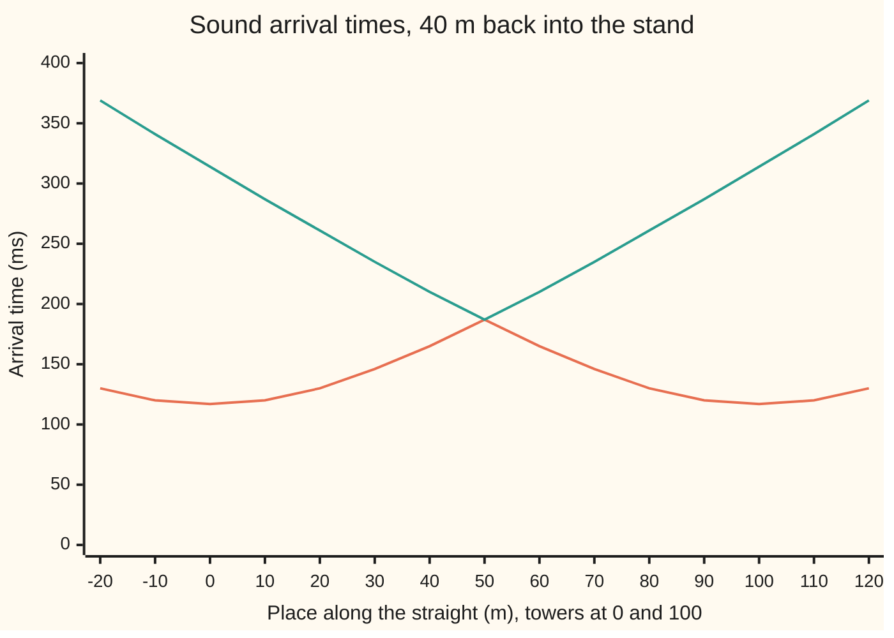
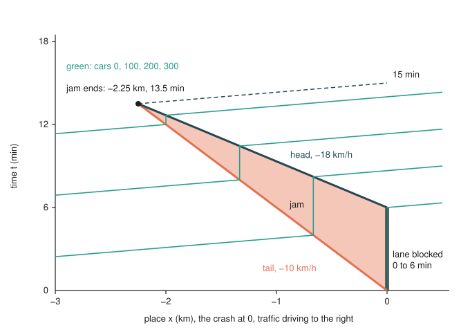

# Eikonal and traffic: arrival times and jams as first-order equations

[Syllabus](../../../SYLLABUS.md) → [Partial differential equations](../README.md) → [First-Order Equations and Characteristics](../README.md#s02) → Eikonal and traffic

---

## General Overview

A stadium announcer speaks through two speaker towers, one at each end of the 100 m straight. A fan sits 30 m along the straight and 40 m back into the stand. The near tower is 50 m away, so its sound arrives after 0.1458 s. The far tower is 80.62 m away, so a second copy arrives 89.3 ms later. A gap that long blurs speech, and sound engineers design stadium systems to avoid it.

The **arrival time** $`T(\mathbf{x})`$ is the moment the first sound reaches the point $`\mathbf{x}`$. It obeys one first-order equation, the **eikonal equation**: the steepness of $`T`$ is one over the speed of sound everywhere. Its answer is a minimum: the time along the quickest route from any source.

On a one-lane stretch of motorway, through roadworks, a crash blocks the lane for 6 minutes. Cars arrive at 1350 cars per hour. A jam builds behind the crash, and its tail moves back at 10 km/h. When the lane reopens, the jam does not vanish. Its head also moves back, at 18 km/h, and catches the tail 2.25 km behind the crash, 13.5 minutes after it. The crash costs 16.875 car-hours of waiting, 3.00 minutes per delayed car.

That jam has an arrival-time equation too. Count the cars that have passed each point; that count obeys an equation of the same family as the eikonal equation. Its answer is again a minimum, over observers who move at the two speeds the road allows.

[The transport equation](../../08-Differential%20equations%20and%20dynamics/10-The%20Classical%20PDEs/02-the-transport-equation-and-characteristics.md) showed that a first-order equation carries values along straight lines. This card does that for two arrival times, of sound and of cars.

**An arrival time, of sound or of cars, solves a first-order equation whose answer is a minimum over routes; where two families of routes tie, the answer has a kink, and for traffic that kink is the jam's tail moving backward.**

**What kind of fact this is:** the eikonal equation is the short-wavelength limit of the sound wave equation. The car-count equation is exact once a flow rule is chosen. The minimum formulas are theorems, proved on this card in Why it works. The triangular flow rule for traffic is a model, an assumption that fits motorway data roughly. The traffic numbers are illustrative but realistic.

### The picture: arrival times along one row of seats



Orange: the first arrival $`T`$, the answer to the eikonal equation. It peaks in a sharp roof at 50 m, where both towers are equally far. Green: the later arrival from the other tower. It has a sharp valley at 50 m. Both curves have the right steepness away from 50 m; only the orange one is the real arrival time.

---

## The formula

Notation first. A bold $`\mathbf{x}`$ is a point in the stadium, measured in metres. The **gradient** $`\nabla T`$ (wing 06) points the way $`T`$ rises fastest, and its size $`|\nabla T|`$ is that rate of rise, in seconds per metre.

The **eikonal equation**, with the sources as data:

```math
|\nabla T(\mathbf{x})| = \frac{1}{c}, \qquad T(\mathbf{a}_k) = 0 \text{ at each tower } \mathbf{a}_k
```

**Read it aloud:** walking away from the sources, the arrival time rises by one over the speed of sound for every metre, along the steepest direction.

Its answer, for a constant speed:

```math
T(\mathbf{x}) = \min_k \frac{|\mathbf{x} - \mathbf{a}_k|}{c}
```

**Read it aloud:** the arrival time is the shortest distance to a source, divided by the speed of sound.

For traffic, put the crash at $`x = 0`$, with cars driving toward larger $`x`$. The **car count** $`N(x, t)`$ is the number of cars that have passed the point $`x`$ by time $`t`$, counted from the car at the crash when it happens. Subscripts are partial derivatives, as in wing 08. Then the density is $`\rho = -N_x`$ and the flow is $`q = N_t`$. As on [Conservation laws](02-conservation-laws-and-shocks.md), a flow rule $`q(\rho)`$ links them, so

```math
N_t = q(-N_x), \qquad q(\rho) = \min\big(v_f\,\rho,\; w\,(\rho_j - \rho)\big)
```

**Read it aloud:** the count at a point rises at the flow the local density allows; the flow is free speed times density on an open road, and backward wave speed times the empty room left in a crowded one.

Newell's formula solves it, looking back a time $`\Delta`$ over road whose density stays on one side of capacity:

```math
N(x, t) = \min\Big(N(x - v_f\Delta,\; t - \Delta),\;\; N(x + w\Delta,\; t - \Delta) + \rho_j\, w\,\Delta\Big)
```

**Read it aloud:** the count here and now is the smaller of two older counts: the one a free-flowing car brought, and the one a backward wave brought, plus the cars that pack into the stretch that wave crossed.

Where a queue empties into free road inside that stretch, a third term, the capacity flow, joins the minimum (Step 5).

The jam itself, from these:

```math
s = \frac{0 - q_u}{\rho_j - \rho_u}, \qquad \text{jam ends at } t = \frac{w\,\tau}{w - |s|}, \qquad D = \frac{\rho_j\,|s|\,w\,\tau^2}{2\,(w - |s|)}
```

**Read it aloud:** the tail moves back at the arriving flow over the density jump; the jam lives until the head, moving back faster, catches it; the total delay grows with the square of the blocked time.

| Symbol | Plain meaning | In our example | Push it up and the answer… |
| --- | --- | --- | --- |
| $`T(\mathbf{x})`$ | arrival time: when the first sound reaches $`\mathbf{x}`$ | 0.1458 s at the seat | — |
| $`\mathbf{x}`$, $`\mathbf{a}_k`$ | a point in the stadium; speaker tower $`k`$ | seat (30, 40) m; towers (0, 0) and (100, 0) m | — |
| $`c`$ | speed of sound in air | 343 m/s at 20 °C | every arrival comes sooner |
| $`\nabla T`$ | gradient of $`T`$: direction and rate of fastest rise | size 1/343 s per m | — |
| $`x`$, $`t`$; $`\Delta`$, $`v`$ | place on the road in km, crash at 0; time since the crash; a look-back time; an observer's speed | the tail at −1.00 km at 6 min; $`\Delta`$ up to $`t`$; $`v`$ = 90 or −18 km/h | — |
| $`N(x, t)`$, $`n`$ | car count: cars past $`x`$ by time $`t`$; a car's number | 0 at the crash until 6 min; 337.5 at 15 min | — |
| $`\rho`$, $`q(\rho)`$ | density, cars per km; flow, cars per hour | — | — |
| $`v_f`$, $`w`$ | free speed; backward wave speed in congestion | 90 km/h; 18 km/h | larger $`w`$: the jam dies sooner |
| $`\rho_j`$; $`\rho_c`$, $`q_c`$ | jam density; the density and flow at capacity | 150 cars/km; 25 cars/km, 2250 cars/h | — |
| $`\rho_u`$, $`q_u`$ | arriving density and flow | 15 cars/km, 1350 cars/h | the jam grows faster and lives longer |
| $`s`$ | speed of the jam's tail; negative means backward | −10 km/h | — |
| $`\tau`$; $`D`$ | how long the lane is blocked; total delay, in car-hours | 6 min; 16.875 car-hours | $`D`$ grows as $`\tau^2`$ |

### When it holds

- **Sound travels at one speed in straight lines.** Warm air near the ground changes $`c`$ from place to place, and routes bend. The eikonal equation still holds with $`c(\mathbf{x})`$, but the distance formula fails. A wind also makes the speed depend on direction, and the equation takes a direction-dependent form.
- **Sound is treated as a front, not a wave.** The equation tracks the first wavefront, which is right when wavelengths are short next to the stadium. Low notes bend round obstacles (diffraction) in ways no arrival time describes.
- **The first arrival is the one that counts.** That choice makes $`T`$ a minimum. Ask for the later arrival and the equation still holds almost everywhere, so the equation alone cannot tell the two apart.
- **Cars are conserved and flow depends on density alone.** On-ramps, lane changes and drivers' reaction delays break this. Stop-and-go waves inside a jam need richer models.
- **The flow rule is triangular.** Every congested density then sends its signal back at the one speed $`w`$. With [Conservation laws](02-conservation-laws-and-shocks.md)' curved rule, the jam's head would spread into a fan, as on [The Riemann problem](04-rarefaction-and-the-riemann-problem.md).

---

## Why it works

### Step 0: an arrival time is a minimum

Sound reaches a seat by every route at once. The seat hears the quickest one first. So the arrival time is a minimum over routes, and a minimum over routes changes in a simple way as you move: one more metre of distance costs at most $`1/c`$ more seconds, and exactly $`1/c`$ along the quickest route. Those two facts are the whole equation.

[Hamilton-Jacobi](05-hamilton-jacobi-equations.md) states the general version. When a rate of change equals minus a convex function of the slope (a concave function of it, like the flow rule $`q`$), the Hopf-Lax formula solves the equation: the answer is a minimum, over straight paths, of the starting value plus a travel cost. Both arrival times on this card are that formula, worked out. For sound, travel is free up to the speed $`c`$ and impossible faster; the formula then marks the points the sound has reached by each time $`t`$, and $`T(\mathbf{x})`$ is the first time that includes $`\mathbf{x}`$. For cars it is Newell's formula (Step 5).

### Step 1: the front moves at the speed of sound

The set of points with $`T = t`$ is the **front** at time $`t`$: the edge of the sound. In a short time $`dt`$ the front moves a distance $`c\,dt`$, at right angles to itself. So $`T`$ rises by $`dt`$ over a distance $`c\,dt`$ in the steepest direction. Its rate of rise is $`1/c`$, which is $`|\nabla T| = 1/c`$.

### Step 2: characteristics are rays

As on [Characteristics](01-method-of-characteristics.md), a first-order equation becomes ordinary equations along special curves. For the eikonal equation these curves are **rays**: straight lines out from a source, travelled at speed $`c`$, along which $`T`$ rises by $`1/c`$ per metre. Integrate along the ray from tower $`\mathbf{a}_k`$ and $`T = |\mathbf{x} - \mathbf{a}_k|/c`$.

Each tower sends its own family of rays. At the seat (30, 40) m the rays from the near tower give 50 m / 343 m/s = 0.1458 s. Those from the far tower give 0.2351 s. The first arrival is the smaller one.

### Step 3: where two families meet, the minimum makes a roof

On the line 50 m along the straight, both families give the same time. There $`T`$ has a kink shaped like a roof: rising on both sides toward it. At the ridge seat (50, 40) m, $`T = 0.1867`$ s. Measured by centred differences, $`|\nabla T|`$ times $`c`$ comes out at 0.6247 there instead of 1. No classical solution (one with a slope everywhere) exists.

The later arrival, the maximum, has the right steepness off the ridge as well, but it has a valley at 50 m. Rays run *into* a roof from both sides, like characteristics into a shock. A valley would need rays running *out* of it, with no source to start them. The rule that keeps roofs and bans valleys is the **viscosity solution** (Crandall and Lions, 1983). It exists and is unique, and here it is the minimum.

### Step 4: traffic as an arrival time

Number the cars, and let $`N(x, t)`$ count those past $`x`$ by $`t`$. Going forward one km at a fixed time, you pass the $`\rho`$ cars in that km, so $`N`$ falls: $`N_x = -\rho`$. Waiting one hour at a fixed place, $`q`$ cars go by: $`N_t = q`$. The conservation law $`\rho_t + q_x = 0`$ is then automatic, because $`N_{xt} = N_{tx}`$.

Inverting the count gives arrival times: car number $`n`$ passes $`x`$ at the time when $`N(x, t) = n`$. The flow rule turns the count into one equation, $`N_t = q(-N_x)`$, a Hamilton-Jacobi equation like the eikonal one.

### Step 5: Newell's minimum over observers

Picture an observer moving along the road at speed $`v`$. Cars at density $`\rho`$ overtake them at the rate $`q(\rho) - \rho\,v`$ per hour. The count at the observer's position can rise no faster than the largest such rate. For the triangular rule, two observers are special:

- **One riding with free traffic, at $`v_f`$.** On a free road no car overtakes, so the count she carries stays fixed.
- **One riding the backward wave, at $`-w`$.** At any congested density, cars pass her at $`\rho_j w`$ per hour, so the count she carries rises at that rate.

The real count is the smallest that any observer allows, which is Newell's formula. For a straight-line start every other observer gives a larger value, so these two are enough. The crash adds a third start: the count at $`x = 0`$ stays 0 while the lane is blocked. In the code that is one more term inside the minimum.

<details>
<summary>Detailed proof: both minimum formulas, and the jam's numbers</summary>

**The eikonal minimum.** Away from $`\mathbf{a}_k`$, the gradient of the distance $`|\mathbf{x} - \mathbf{a}_k|`$ is the unit vector from $`\mathbf{a}_k`$ to $`\mathbf{x}`$, so its size is 1. Where one distance is strictly smallest, $`T`$ is that distance over $`c`$ near $`\mathbf{x}`$, and $`|\nabla T| = 1/c`$. Where two tie, $`T`$ is the minimum of two smooth functions, so it lies under each. A smooth function touching $`T`$ from above at such a point must have a gradient between the two, which is no longer than $`1/c`$; none can touch from below. Those are exactly the viscosity conditions for $`|\nabla T| - 1/c = 0`$. The maximum fails them: smooth functions touch it from below with gradients shorter than $`1/c`$.

**Newell's minimum.** For an observer moving at constant speed $`v`$ from a known count, the overtaking rate is at most

$`\displaystyle \max_{\rho}\big(q(\rho) - \rho\,v\big) = q_c - \rho_c\,v, \qquad -w \le v \le v_f,`$

because $`q(\rho) - \rho\,v`$ is made of two straight pieces that meet at $`\rho_c`$. The Hopf-Lax formula takes the least start-plus-cost over all starts. From a start where the count rises at $`\rho_u`$ per km going back, the total is a straight-line function of the start's place, so the least value sits at an end of the allowed range, $`v = v_f`$ or $`v = -w`$. At $`v_f`$ the cost is $`q_c - \rho_c v_f = 0`$. At $`-w`$ it is $`q_c + \rho_c w = \rho_j w`$, since $`q_c = w(\rho_j - \rho_c)`$. That is Newell's formula.

**The jam.** Behind the tail the density is $`\rho_u`$ and inside it $`\rho_j`$, with no flow, so Rankine-Hugoniot gives $`s = -q_u/(\rho_j - \rho_u)`$. At reopening the jam is $`|s|\tau`$ long. The head starts at the crash at $`t = \tau`$ and moves at $`-w`$. The two meet when $`|s|\,t = w\,(t - \tau)`$, at $`t = w\tau/(w - |s|)`$. Every car in the jam is stopped and every other car drives at $`v_f`$, so the total delay is $`\rho_j`$ times the jam's area in the $`(x, t)`$ plane. Cut that triangle along the reopening moment. The two pieces share the base $`|s|\tau`$, the jam's length then, and their heights add up to the jam's whole life:

$`\displaystyle D = \rho_j \cdot \tfrac12\,|s|\tau \cdot \frac{w\tau}{w - |s|}.`$

</details>

### Step 6: which kind of solution this is

The arrival time $`T`$ is the unique viscosity solution of the eikonal equation with the towers as data. The car count $`N`$ is the unique viscosity solution of $`N_t = q(-N_x)`$. Its slope, the density, is then the entropy solution of the conservation law: the jump its characteristics run into, as on [Entropy conditions](03-entropy-conditions-and-vanishing-viscosity.md). The jam's tail is a roof in $`N`$, just as the 50 m ridge is a roof in $`T`$.

---

## Worked numbers, by hand

| Step | Arithmetic | Value |
| --- | --- | --- |
| seat to near tower | $`\sqrt{30^2 + 40^2}`$ | 50.00 m |
| seat to far tower | $`\sqrt{70^2 + 40^2}`$ | 80.62 m |
| first arrival | 50.00 / 343 | **0.1458 s** |
| later arrival, and the gap | 80.62 / 343; 0.2351 − 0.1458 | 0.2351 s; 89.3 ms |
| capacity of the lane | $`\rho_c = 18 \times 150 / (90 + 18)`$; $`q_c = 90 \times 25`$ | 25 cars/km; 2250 cars/h |
| tail speed | (0 − 1350) / (150 − 15) | **−10.0 km/h** |
| jam at reopening, 6 min | 10 × 0.1 h; 150 × 1.00 | 1.00 km; 150 cars |
| check by counting | 15 cars already on that km + 1350 × 0.1 arrived | 150 cars |
| jam ends | 18 × 0.1 / (18 − 10) h | **13.5 min**, at −2.25 km |
| total delay | 150 × ½ × 1.00 km × (13.5/60) h | **16.875 car-hours** |
| cars delayed | 1350 + 15 × 10 = 1500 cars/h cross the tail, for 13.5 min | 337.5 cars |
| delay per car | 16.875 / 337.5 h | 3.00 min |

The fan 30 m along the straight hears every word twice, 89.3 ms apart. On the motorway, the jam outlives the crash by 7.5 minutes and dies 2.25 km upstream, where a driver sees no cause at all.

### What breaks if you drop a piece

| Mistake | Comes out at | What went wrong |
| --- | --- | --- |
| the jam ends when the lane reopens | 7.500 car-hours, not 16.875 | the head moves back at 18 km/h; the jam lives 7.5 min longer |
| every jam edge moves at the backward wave speed, 18 km/h | a 1.8 km jam holding 270 cars, though only 162 arrived | the tail is a shock between free and jammed traffic; its speed comes from the count |
| the later arrival, the maximum, as the answer | 0.2351 s at the seat, not 0.1458 s | it satisfies the equation away from the ridge, but its valley is not a viscosity solution |

The checks print all three. The third is a failed hypothesis: the equation alone does not pick the answer.

---

## The jam, minute by minute

Two forces shape the jam. Arriving cars push its tail back at 10 km/h. Once the lane reopens, departing cars eat its head at 18 km/h, also moving back. The second force is faster, so it wins, but only after the jam has moved well upstream.

| Time | Tail | Head | Jam length | Cars past the crash | Without the crash |
| --- | --- | --- | --- | --- | --- |
| 0 min | 0.00 km | 0.00 km | 0.00 km | 0.0 | 0.0 |
| 3 min | −0.50 km | 0.00 km | 0.50 km | 0.0 | 67.5 |
| 6 min | −1.00 km | 0.00 km | 1.00 km | 0.0 | 135.0 |
| 9 min | −1.50 km | −0.90 km | 0.60 km | 112.5 | 202.5 |
| 12 min | −2.00 km | −1.80 km | 0.20 km | 225.0 | 270.0 |
| 15 min | gone | gone | 0 | 337.5 | 337.5 |

The last two columns are $`N(0, t)`$ from Newell's formula and the free count $`1350\,t`$. The gap between them is the backlog. It closes at 15 min, when car 337.5, the last delayed car, passes the crash site.

Jam length, every 3 minutes:

```
 0 min                        0.00 km
 3 min  ██████████            0.50 km
 6 min  ████████████████████  1.00 km
 9 min  ████████████          0.60 km
12 min  ████                  0.20 km
15 min                        gone
```

<p align="center"></p>

To scale: 160 px per km across, 20 px per minute up. Car 100 stops at −0.667 km at 4.00 min and restarts at 8.22 min. Car 300 stops at −2.000 km at 12.00 min and restarts at 12.67 min. The dashed line carries the jam's end to the crash site at 15 min.

---

## Code, from first principles, and it actually runs

Two roads for each half. For sound, road 1 is the distance formula, checked against the equation by centred differences. Road 2 is a fast-sweeping grid (Zhao's method): it updates each grid point from its neighbours by the upwind rule (a point takes its value only from neighbours the front reaches first), knows no distances, and settles on the minimum, not the maximum. Its error falls by 1.71 and then 1.74 each time the step halves, a little less than order 1 because the towers are single points. For traffic, road 1 is Rankine-Hugoniot, the backward wave and the triangle's area. Road 2 is Newell's minimum formula, which contains no shock rule; it reproduces the tail, the head, the delay and the arrival time of car 100. Its backward-wave term from the counts at $`t = 0`$ never wins here, because the arriving density, 15 cars/km, is below capacity, 25 cars/km. The free term and the crash term make the whole jam, so this example leaves that term untested.

### Python

```python
# Eikonal and traffic -- the check behind the card.  Standard library only.
# Sound: arrival time T = min over the speaker towers of distance / c, against a fast-sweeping
# grid that knows no formula, and the residual |grad T| c = 1 by centred differences.
# Traffic: a motorway lane blocked for 6 min.  Rankine-Hugoniot and the backward wave speed
# against Newell's minimum formula for the car count N(x, t), which knows neither.
from math import sqrt

C = 343.0                                    # speed of sound in air at 20 C, m/s
TOWERS = ((0.0, 0.0), (100.0, 0.0))          # speaker towers at the two ends of the straight, m
def dists(x, y): return [sqrt((x - a) ** 2 + (y - b) ** 2) for a, b in TOWERS]
def T(x, y): return min(dists(x, y)) / C     # first arrival: the viscosity solution, s
def Tlate(x, y): return max(dists(x, y)) / C # later arrival: also |grad T| = 1/c off the ridge

def grad_c(f, x, y, d=0.01):                 # |grad f| times c, by centred differences
    gx = (f(x + d, y) - f(x - d, y)) / (2 * d); gy = (f(x, y + d) - f(x, y - d)) / (2 * d)
    return sqrt(gx * gx + gy * gy) * C

def sweep(h, X0=-20.0, LX=140.0, LY=60.0):  # road 2: fast sweeping with the upwind update
    nx, ny = round(LX / h) + 1, round(LY / h) + 1
    INF = 1e9; G = [[INF] * ny for _ in range(nx)]
    for a, b in TOWERS: G[round((a - X0) / h)][round(b / h)] = 0.0
    f = h / C
    for _ in range(2):
        for I in (range(nx), range(nx - 1, -1, -1)):
            for J in (range(ny), range(ny - 1, -1, -1)):
                for i in I:
                    Gi = G[i]; Gl = G[i - 1] if i > 0 else None; Gr = G[i + 1] if i < nx - 1 else None
                    for j in J:
                        a = min(Gl[j] if Gl else INF, Gr[j] if Gr else INF)
                        b = min(Gi[j - 1] if j > 0 else INF, Gi[j + 1] if j < ny - 1 else INF)
                        t = min(a, b) + f if abs(a - b) >= f else (a + b + sqrt(2 * f * f - (a - b) ** 2)) / 2
                        if t < Gi[j]: Gi[j] = t
    err = max(abs(G[i][j] - T(X0 + i * h, j * h)) for i in range(nx) for j in range(ny))
    return G[round((30 - X0) / h)][round(40 / h)], err

print("SOUND: towers at (0, 0) m and (100, 0) m, c = 343 m/s; seat at (30, 40) m")
d = dists(30, 40)
print(f"seat: {d[0]:.2f} m from the near tower, {d[1]:.2f} m from the far one")
print(f"first arrival T = {T(30, 40):.4f} s; later arrival {Tlate(30, 40):.4f} s; gap {1000 * (Tlate(30, 40) - T(30, 40)):.1f} ms")
print(f"ridge seat (50, 40): {dists(50, 40)[0]:.2f} m from both towers, T = {T(50, 40):.4f} s")
r_seat, r_late, r_ridge = grad_c(T, 30, 40), grad_c(Tlate, 30, 40), grad_c(T, 50, 40)
print(f"residual |grad T| c: seat {r_seat:.6f}, later arrival at seat {r_late:.6f}, on the ridge {r_ridge:.4f}")
errs = []
for h in (1.0, 0.5, 0.25):
    seat, err = sweep(h); errs.append(err)
    print(f"road 2, fast sweeping h = {h} m: seat {seat:.4f} s, largest error {1000 * err:.2f} ms")
print(f"error ratios as h halves: {errs[0] / errs[1]:.2f}, {errs[1] / errs[2]:.2f} (order about 1, slowed by log(1/h) at the towers)")
print(f"hand timing, gun to finish 100 m: {100 / C:.4f} s; try, 35 C day, c = 352 m/s: seat {50 / 352:.4f} s")
xs = [-20 + 10 * k for k in range(15)]
print("chart, row 40 m back, first arrival ms:", ", ".join(f"{1000 * T(x, 40):.0f}" for x in xs))
print("chart, row 40 m back, later arrival ms:", ", ".join(f"{1000 * Tlate(x, 40):.0f}" for x in xs))

VF, W, RJ = 90.0, 18.0, 150.0                # free speed km/h, backward wave speed km/h, jam cars/km
RC = W * RJ / (VF + W); QC = VF * RC         # critical density, capacity
RU = 15.0; QU = VF * RU; TAU = 0.1           # arriving density and flow; lane blocked 0.1 h = 6 min
def q(r): return min(VF * r, W * (RJ - r))   # Newell's triangular flow rule, cars/h
S = (q(RJ) - q(RU)) / (RJ - RU)              # Rankine-Hugoniot speed of the tail, km/h
L = -S * TAU                                 # jam length when the lane reopens, km
TEND = TAU + L / (W + S); XEND = -W * (TEND - TAU)   # head (at -W) meets tail (at S)
D = RJ * 0.5 * L * TEND                      # car-hours stopped: the jam's area in (x, t) times RJ
CAUGHT = (QU - RU * S) * TEND                # cars that cross the tail
def car_delay(n):                            # car n starts at -n/RU km, drives at VF until the tail
    t1 = n / (RU * (VF - S)); t2 = TAU - S * t1 / W
    return t2 - t1, t2 + (-S * t1) / VF      # stopped time, arrival at the crash site

def N0(x): return -RU * x                    # car count at the crash, t = 0
def newell(x, t):                            # road 2: Newell's minimum formula, no shock rule inside
    best = min(N0(x - VF * t), N0(x + W * t) + RJ * W * t)
    tp = min(TAU, t + x / W) if x <= 0 else min(TAU, t - x / VF)   # latest usable blocked moment
    return min(best, QC * (t - tp) - RC * x) if tp >= 0 else best
def rho(x, t, e=1e-7): return -(newell(x + e, t) - newell(x - e, t)) / (2 * e)
def bisect(f, lo, hi):
    for _ in range(60):
        m = (lo + hi) / 2
        if f(m): hi = m
        else: lo = m
    return (lo + hi) / 2

print(f"TRAFFIC: free {VF:.0f} km/h, wave back {W:.0f} km/h, jam {RJ:.0f} cars/km; capacity {QC:.0f} cars/h at {RC:.0f} cars/km")
print(f"arriving {QU:.0f} cars/h at {RU:.0f} cars/km; lane blocked {60 * TAU:.0f} min")
print(f"tail speed (0 - {QU:.0f})/({RJ:.0f} - {RU:.0f}) = {S:.1f} km/h; jam {L:.2f} km, {RJ * L:.0f} cars at reopening")
print(f"count: {RU * L:.0f} cars were on that km + {QU * TAU:.0f} arrived = {RU * L + QU * TAU:.0f}")
print(f"head at {-W:.0f} km/h meets tail at {60 * TEND:.1f} min, {XEND:.2f} km; jam outlives the crash by {60 * (TEND - TAU):.1f} min")
print(f"cars cross the tail at {QU:.0f} + {RU:.0f} x {-S:.0f} = {QU - RU * S:.0f} cars/h for {60 * TEND:.1f} min")
print(f"delay {D:.3f} car-hours over {CAUGHT:.1f} cars = {60 * D / CAUGHT:.2f} min each; first car {60 * car_delay(0)[0]:.2f} min")
x6 = bisect(lambda x: rho(x, TAU) > 82.5, -3.0, -0.2)
x12h = bisect(lambda x: rho(x, 0.2) < 87.5, -1.9, -0.5); x12t = bisect(lambda x: rho(x, 0.2) > 82.5, -3.0, -1.9)
print(f"road 2, Newell: tail at 6 min {x6:.4f} km; at 12 min tail {x12t:.4f} km, head {x12h:.4f} km")
print(f"road 2, Newell: cars in the jam at 6 min N(-1, 6 min) - N(0, 6 min) = {newell(-1, TAU) - newell(0, TAU):.4f}")
n = 3600; Dn = sum((QU * k / n - newell(0, k / n) + QU * (k + 1) / n - newell(0, (k + 1) / n)) / 2 for k in range(n)) / n
print(f"road 2, Newell: delay = area between free and real counts at the crash site = {Dn:.4f} car-hours")
t100 = bisect(lambda t: newell(0, t) >= 100, TAU, 0.3); tl = bisect(lambda t: newell(0, t) >= QU * t - 1e-9, TAU, 0.3)
dl, ar = car_delay(100)
print(f"car 100: formula arrives {60 * ar:.3f} min, stopped {60 * dl:.3f} min; Newell arrives {60 * t100:.3f} min, free {60 * 100 / QU:.3f} min")
print(f"last delayed car passes the crash site at {60 * tl:.3f} min, car {QU * tl:.1f}")
for m in range(0, 19, 3):
    t = m / 60; tail = S * t; head = min(0.0, -W * (t - TAU))
    where = f"tail {tail + 0.0:5.2f} km, head {head + 0.0:5.2f} km, jam {head - tail:.2f} km" if t <= TEND else "jam gone"
    print(f"story, {m:2d} min: {where}; past the crash N(0, t) = {newell(0, t) + 0.0:5.1f}, free {QU * t:5.1f}")
print(f"mistake 1, jam gone at reopening: {RJ * 0.5 * L * TAU:.3f} car-hours, not {D:.3f}")
print(f"mistake 2, tail at -{W:.0f} km/h: jam {W * TAU:.1f} km holding {RJ * W * TAU:.0f} cars, but only {RU * W * TAU + QU * TAU:.0f} arrived")
print(f"mistake 3, later arrival at the seat: {Tlate(30, 40):.4f} s, not {T(30, 40):.4f} s")
for ru, tau in ((20.0, 0.1), (15.0, 0.2)):
    s = -VF * ru / (RJ - ru); te = tau * W / (W + s)
    print(f"try, arriving {ru:.0f} cars/km, blocked {60 * tau:.0f} min: jam ends at {60 * te:.1f} min, {-W * (te - tau):.2f} km, delay {RJ * 0.5 * (-s * tau) * te:.3f} car-hours")
print(f"figure, tail (0, 0) to ({XEND:.2f} km, {60 * TEND:.1f} min); head (0, 6.0 min) to the same; free front to (0, {60 * tl:.1f} min)")
print("figure, cars 0 100 200 300 stop at", " ".join(f"({S * k / (RU * (VF - S)) + 0.0:.3f} km, {60 * k / (RU * (VF - S)):.2f} min)" for k in (0, 100, 200, 300)),
      "and leave at", " ".join(f"{60 * (TAU - S * k / (RU * (VF - S)) / W):.2f}" for k in (0, 100, 200, 300)), "min")
assert abs(r_seat - 1) < 1e-6 and abs(r_ridge - 1) > 0.3                     # T obeys the eikonal, not on the ridge
assert errs[2] < 0.0015 and errs[0] > errs[1] > errs[2]                      # the grid settles on min, not max
assert abs(x6 + L) < 1e-9 and abs(x12t - S * 0.2) < 1e-9 and abs(x12h + W * 0.1) < 1e-9   # Newell meets RH, -W
assert abs(Dn - D) < 1e-9 and abs(newell(-1, TAU) - newell(0, TAU) - RJ * L) < 1e-9          # Newell meets areas
assert abs(t100 - ar) < 1e-9 and abs(QU * tl - CAUGHT) < 1e-6               # arrival times agree
print("ALL CHECKS PASS")
```

**Ran 2026-11-15 on macOS, Python 3.14.10, standard library only. All checks passed. Output, pasted from the run:**

```
SOUND: towers at (0, 0) m and (100, 0) m, c = 343 m/s; seat at (30, 40) m
seat: 50.00 m from the near tower, 80.62 m from the far one
first arrival T = 0.1458 s; later arrival 0.2351 s; gap 89.3 ms
ridge seat (50, 40): 64.03 m from both towers, T = 0.1867 s
residual |grad T| c: seat 1.000000, later arrival at seat 1.000000, on the ridge 0.6247
road 2, fast sweeping h = 1.0 m: seat 0.1491 s, largest error 3.86 ms
road 2, fast sweeping h = 0.5 m: seat 0.1478 s, largest error 2.26 ms
road 2, fast sweeping h = 0.25 m: seat 0.1469 s, largest error 1.30 ms
error ratios as h halves: 1.71, 1.74 (order about 1, slowed by log(1/h) at the towers)
hand timing, gun to finish 100 m: 0.2915 s; try, 35 C day, c = 352 m/s: seat 0.1420 s
chart, row 40 m back, first arrival ms: 130, 120, 117, 120, 130, 146, 165, 187, 165, 146, 130, 120, 117, 120, 130
chart, row 40 m back, later arrival ms: 369, 341, 314, 287, 261, 235, 210, 187, 210, 235, 261, 287, 314, 341, 369
TRAFFIC: free 90 km/h, wave back 18 km/h, jam 150 cars/km; capacity 2250 cars/h at 25 cars/km
arriving 1350 cars/h at 15 cars/km; lane blocked 6 min
tail speed (0 - 1350)/(150 - 15) = -10.0 km/h; jam 1.00 km, 150 cars at reopening
count: 15 cars were on that km + 135 arrived = 150
head at -18 km/h meets tail at 13.5 min, -2.25 km; jam outlives the crash by 7.5 min
cars cross the tail at 1350 + 15 x 10 = 1500 cars/h for 13.5 min
delay 16.875 car-hours over 337.5 cars = 3.00 min each; first car 6.00 min
road 2, Newell: tail at 6 min -1.0000 km; at 12 min tail -2.0000 km, head -1.8000 km
road 2, Newell: cars in the jam at 6 min N(-1, 6 min) - N(0, 6 min) = 150.0000
road 2, Newell: delay = area between free and real counts at the crash site = 16.8750 car-hours
car 100: formula arrives 8.667 min, stopped 4.222 min; Newell arrives 8.667 min, free 4.444 min
last delayed car passes the crash site at 15.000 min, car 337.5
story,  0 min: tail  0.00 km, head  0.00 km, jam 0.00 km; past the crash N(0, t) =   0.0, free   0.0
story,  3 min: tail -0.50 km, head  0.00 km, jam 0.50 km; past the crash N(0, t) =   0.0, free  67.5
story,  6 min: tail -1.00 km, head  0.00 km, jam 1.00 km; past the crash N(0, t) =   0.0, free 135.0
story,  9 min: tail -1.50 km, head -0.90 km, jam 0.60 km; past the crash N(0, t) = 112.5, free 202.5
story, 12 min: tail -2.00 km, head -1.80 km, jam 0.20 km; past the crash N(0, t) = 225.0, free 270.0
story, 15 min: jam gone; past the crash N(0, t) = 337.5, free 337.5
story, 18 min: jam gone; past the crash N(0, t) = 405.0, free 405.0
mistake 1, jam gone at reopening: 7.500 car-hours, not 16.875
mistake 2, tail at -18 km/h: jam 1.8 km holding 270 cars, but only 162 arrived
mistake 3, later arrival at the seat: 0.2351 s, not 0.1458 s
try, arriving 20 cars/km, blocked 6 min: jam ends at 26.0 min, -6.00 km, delay 45.000 car-hours
try, arriving 15 cars/km, blocked 12 min: jam ends at 27.0 min, -4.50 km, delay 67.500 car-hours
figure, tail (0, 0) to (-2.25 km, 13.5 min); head (0, 6.0 min) to the same; free front to (0, 15.0 min)
figure, cars 0 100 200 300 stop at (0.000 km, 0.00 min) (-0.667 km, 4.00 min) (-1.333 km, 8.00 min) (-2.000 km, 12.00 min) and leave at 6.00 8.22 10.44 12.67 min
ALL CHECKS PASS
```

### Rust

Same numbers, same labels, built with `rustc --edition 2021 -O`.

```rust
// Eikonal and traffic -- the same check in Rust, std only.
// Sound: arrival time T = min over the speaker towers of distance / c, against a fast-sweeping
// grid that knows no formula, and the residual |grad T| c = 1 by centred differences.
// Traffic: a motorway lane blocked for 6 min.  Rankine-Hugoniot and the backward wave speed
// against Newell's minimum formula for the car count N(x, t), which knows neither.
const C: f64 = 343.0; // speed of sound in air at 20 C, m/s
const TOWERS: [(f64, f64); 2] = [(0.0, 0.0), (100.0, 0.0)]; // speaker towers at the two ends of the straight, m
fn dists(x: f64, y: f64) -> [f64; 2] { TOWERS.map(|(a, b)| ((x - a).powi(2) + (y - b).powi(2)).sqrt()) }
fn t_first(x: f64, y: f64) -> f64 { let d = dists(x, y); d[0].min(d[1]) / C } // the viscosity solution, s
fn t_late(x: f64, y: f64) -> f64 { let d = dists(x, y); d[0].max(d[1]) / C } // also |grad T| = 1/c off the ridge

fn grad_c(f: fn(f64, f64) -> f64, x: f64, y: f64) -> f64 { // |grad f| times c, by centred differences
    let d = 0.01;
    let gx = (f(x + d, y) - f(x - d, y)) / (2.0 * d);
    let gy = (f(x, y + d) - f(x, y - d)) / (2.0 * d);
    (gx * gx + gy * gy).sqrt() * C
}

fn sweep(h: f64) -> (f64, f64) { // road 2: fast sweeping with the upwind update
    let (x0, lx, ly) = (-20.0, 140.0, 60.0);
    let (nx, ny) = ((lx / h).round() as usize + 1, (ly / h).round() as usize + 1);
    let inf: f64 = 1e9;
    let mut g = vec![vec![inf; ny]; nx];
    for (a, b) in TOWERS { g[((a - x0) / h).round() as usize][(b / h).round() as usize] = 0.0; }
    let f = h / C;
    for _ in 0..2 {
        for di in [false, true] {
            for dj in [false, true] {
                for ii in 0..nx {
                    let i = if di { nx - 1 - ii } else { ii };
                    for jj in 0..ny {
                        let j = if dj { ny - 1 - jj } else { jj };
                        let a = (if i > 0 { g[i - 1][j] } else { inf }).min(if i < nx - 1 { g[i + 1][j] } else { inf });
                        let b = (if j > 0 { g[i][j - 1] } else { inf }).min(if j < ny - 1 { g[i][j + 1] } else { inf });
                        let t = if (a - b).abs() >= f { a.min(b) + f } else { (a + b + (2.0 * f * f - (a - b).powi(2)).sqrt()) / 2.0 };
                        if t < g[i][j] { g[i][j] = t; }
                    }
                }
            }
        }
    }
    let mut err: f64 = 0.0;
    for i in 0..nx { for j in 0..ny { err = err.max((g[i][j] - t_first(x0 + i as f64 * h, j as f64 * h)).abs()); } }
    (g[((30.0 - x0) / h).round() as usize][(40.0 / h).round() as usize], err)
}

const VF: f64 = 90.0; // free speed, km/h
const W: f64 = 18.0; // backward wave speed, km/h
const RJ: f64 = 150.0; // jam density, cars/km
const RC: f64 = W * RJ / (VF + W); // critical density
const QC: f64 = VF * RC; // capacity
const RU: f64 = 15.0; // arriving density, cars/km
const QU: f64 = VF * RU; // arriving flow
const TAU: f64 = 0.1; // lane blocked 0.1 h = 6 min
fn q(r: f64) -> f64 { (VF * r).min(W * (RJ - r)) } // Newell's triangular flow rule, cars/h
fn n0(x: f64) -> f64 { -RU * x } // car count at the crash, t = 0
fn newell(x: f64, t: f64) -> f64 { // road 2: Newell's minimum formula, no shock rule inside
    let best = n0(x - VF * t).min(n0(x + W * t) + RJ * W * t);
    let tp = if x <= 0.0 { TAU.min(t + x / W) } else { TAU.min(t - x / VF) }; // latest usable blocked moment
    if tp >= 0.0 { best.min(QC * (t - tp) - RC * x) } else { best }
}
fn rho(x: f64, t: f64) -> f64 { let e = 1e-7; -(newell(x + e, t) - newell(x - e, t)) / (2.0 * e) }
fn bisect(f: &dyn Fn(f64) -> bool, mut lo: f64, mut hi: f64) -> f64 {
    for _ in 0..60 { let m = (lo + hi) / 2.0; if f(m) { hi = m } else { lo = m } }
    (lo + hi) / 2.0
}

fn main() {
    println!("SOUND: towers at (0, 0) m and (100, 0) m, c = 343 m/s; seat at (30, 40) m");
    let d = dists(30.0, 40.0);
    println!("seat: {:.2} m from the near tower, {:.2} m from the far one", d[0], d[1]);
    let (ts, tl8) = (t_first(30.0, 40.0), t_late(30.0, 40.0));
    println!("first arrival T = {:.4} s; later arrival {:.4} s; gap {:.1} ms", ts, tl8, 1000.0 * (tl8 - ts));
    println!("ridge seat (50, 40): {:.2} m from both towers, T = {:.4} s", dists(50.0, 40.0)[0], t_first(50.0, 40.0));
    let (r_seat, r_late, r_ridge) = (grad_c(t_first, 30.0, 40.0), grad_c(t_late, 30.0, 40.0), grad_c(t_first, 50.0, 40.0));
    println!("residual |grad T| c: seat {:.6}, later arrival at seat {:.6}, on the ridge {:.4}", r_seat, r_late, r_ridge);
    let mut errs = vec![];
    for (h, hs) in [(1.0, "1.0"), (0.5, "0.5"), (0.25, "0.25")] {
        let (seat, err) = sweep(h);
        errs.push(err);
        println!("road 2, fast sweeping h = {} m: seat {:.4} s, largest error {:.2} ms", hs, seat, 1000.0 * err);
    }
    println!("error ratios as h halves: {:.2}, {:.2} (order about 1, slowed by log(1/h) at the towers)", errs[0] / errs[1], errs[1] / errs[2]);
    println!("hand timing, gun to finish 100 m: {:.4} s; try, 35 C day, c = 352 m/s: seat {:.4} s", 100.0 / C, 50.0 / 352.0);
    let xs: Vec<f64> = (0..15).map(|k| -20.0 + 10.0 * k as f64).collect();
    let row = |f: fn(f64, f64) -> f64| xs.iter().map(|&x| format!("{:.0}", 1000.0 * f(x, 40.0))).collect::<Vec<_>>().join(", ");
    println!("chart, row 40 m back, first arrival ms: {}", row(t_first));
    println!("chart, row 40 m back, later arrival ms: {}", row(t_late));

    let s = (q(RJ) - q(RU)) / (RJ - RU); // Rankine-Hugoniot speed of the tail, km/h
    let l = -s * TAU; // jam length when the lane reopens, km
    let tend = TAU + l / (W + s);
    let xend = -W * (tend - TAU); // head (at -W) meets tail (at s)
    let dd = RJ * 0.5 * l * tend; // car-hours stopped: the jam's area in (x, t) times RJ
    let caught = (QU - RU * s) * tend; // cars that cross the tail
    let car_delay = |n: f64| { // car n starts at -n/RU km, drives at VF until the tail
        let t1 = n / (RU * (VF - s));
        let t2 = TAU - s * t1 / W;
        (t2 - t1, t2 + (-s * t1) / VF) // stopped time, arrival at the crash site
    };
    println!("TRAFFIC: free {:.0} km/h, wave back {:.0} km/h, jam {:.0} cars/km; capacity {:.0} cars/h at {:.0} cars/km", VF, W, RJ, QC, RC);
    println!("arriving {:.0} cars/h at {:.0} cars/km; lane blocked {:.0} min", QU, RU, 60.0 * TAU);
    println!("tail speed (0 - {:.0})/({:.0} - {:.0}) = {:.1} km/h; jam {:.2} km, {:.0} cars at reopening", QU, RJ, RU, s, l, RJ * l);
    println!("count: {:.0} cars were on that km + {:.0} arrived = {:.0}", RU * l, QU * TAU, RU * l + QU * TAU);
    println!("head at {:.0} km/h meets tail at {:.1} min, {:.2} km; jam outlives the crash by {:.1} min", -W, 60.0 * tend, xend, 60.0 * (tend - TAU));
    println!("cars cross the tail at {:.0} + {:.0} x {:.0} = {:.0} cars/h for {:.1} min", QU, RU, -s, QU - RU * s, 60.0 * tend);
    println!("delay {:.3} car-hours over {:.1} cars = {:.2} min each; first car {:.2} min", dd, caught, 60.0 * dd / caught, 60.0 * car_delay(0.0).0);
    let x6 = bisect(&|x| rho(x, TAU) > 82.5, -3.0, -0.2);
    let x12h = bisect(&|x| rho(x, 0.2) < 87.5, -1.9, -0.5);
    let x12t = bisect(&|x| rho(x, 0.2) > 82.5, -3.0, -1.9);
    println!("road 2, Newell: tail at 6 min {:.4} km; at 12 min tail {:.4} km, head {:.4} km", x6, x12t, x12h);
    println!("road 2, Newell: cars in the jam at 6 min N(-1, 6 min) - N(0, 6 min) = {:.4}", newell(-1.0, TAU) - newell(0.0, TAU));
    let n = 3600;
    let dn = (0..n).map(|k| { let (a, b) = (k as f64 / n as f64, (k + 1) as f64 / n as f64);
        (QU * a - newell(0.0, a) + QU * b - newell(0.0, b)) / 2.0 }).sum::<f64>() / n as f64;
    println!("road 2, Newell: delay = area between free and real counts at the crash site = {:.4} car-hours", dn);
    let t100 = bisect(&|t| newell(0.0, t) >= 100.0, TAU, 0.3);
    let tl = bisect(&|t| newell(0.0, t) >= QU * t - 1e-9, TAU, 0.3);
    let (dl, ar) = car_delay(100.0);
    println!("car 100: formula arrives {:.3} min, stopped {:.3} min; Newell arrives {:.3} min, free {:.3} min", 60.0 * ar, 60.0 * dl, 60.0 * t100, 60.0 * 100.0 / QU);
    println!("last delayed car passes the crash site at {:.3} min, car {:.1}", 60.0 * tl, QU * tl);
    for m in (0..19).step_by(3) {
        let t = m as f64 / 60.0;
        let (tail, head) = (s * t, (-W * (t - TAU)).min(0.0));
        let at = if t <= tend { format!("tail {:5.2} km, head {:5.2} km, jam {:.2} km", tail + 0.0, head + 0.0, head - tail) } else { "jam gone".to_string() };
        println!("story, {:2} min: {}; past the crash N(0, t) = {:5.1}, free {:5.1}", m, at, newell(0.0, t) + 0.0, QU * t);
    }
    println!("mistake 1, jam gone at reopening: {:.3} car-hours, not {:.3}", RJ * 0.5 * l * TAU, dd);
    println!("mistake 2, tail at -{:.0} km/h: jam {:.1} km holding {:.0} cars, but only {:.0} arrived", W, W * TAU, RJ * W * TAU, RU * W * TAU + QU * TAU);
    println!("mistake 3, later arrival at the seat: {:.4} s, not {:.4} s", tl8, ts);
    for (ru, tau) in [(20.0, 0.1), (15.0, 0.2)] {
        let s2 = -VF * ru / (RJ - ru);
        let te = tau * W / (W + s2);
        println!("try, arriving {:.0} cars/km, blocked {:.0} min: jam ends at {:.1} min, {:.2} km, delay {:.3} car-hours", ru, 60.0 * tau, 60.0 * te, -W * (te - tau), RJ * 0.5 * (-s2 * tau) * te);
    }
    println!("figure, tail (0, 0) to ({:.2} km, {:.1} min); head (0, 6.0 min) to the same; free front to (0, {:.1} min)", xend, 60.0 * tend, 60.0 * tl);
    let ks = [0.0, 100.0, 200.0, 300.0];
    let stops: Vec<String> = ks.iter().map(|k| format!("({:.3} km, {:.2} min)", s * k / (RU * (VF - s)) + 0.0, 60.0 * k / (RU * (VF - s)))).collect();
    let leaves: Vec<String> = ks.iter().map(|k| format!("{:.2}", 60.0 * (TAU - s * k / (RU * (VF - s)) / W))).collect();
    println!("figure, cars 0 100 200 300 stop at {} and leave at {} min", stops.join(" "), leaves.join(" "));
    assert!((r_seat - 1.0).abs() < 1e-6 && (r_ridge - 1.0).abs() > 0.3); // T obeys the eikonal, not on the ridge
    assert!(errs[2] < 0.0015 && errs[0] > errs[1] && errs[1] > errs[2]); // the grid settles on min, not max
    assert!((x6 + l).abs() < 1e-9 && (x12t - s * 0.2).abs() < 1e-9 && (x12h + W * 0.1).abs() < 1e-9); // Newell meets RH, -W
    assert!((dn - dd).abs() < 1e-9 && (newell(-1.0, TAU) - newell(0.0, TAU) - RJ * l).abs() < 1e-9); // Newell meets areas
    assert!((t100 - ar).abs() < 1e-9 && (QU * tl - caught).abs() < 1e-6); // arrival times agree
    println!("ALL CHECKS PASS");
}
```

**Ran 2026-11-15 on macOS, rustc 1.98.1, no crates. All checks passed. Output, pasted from the run:**

```
SOUND: towers at (0, 0) m and (100, 0) m, c = 343 m/s; seat at (30, 40) m
seat: 50.00 m from the near tower, 80.62 m from the far one
first arrival T = 0.1458 s; later arrival 0.2351 s; gap 89.3 ms
ridge seat (50, 40): 64.03 m from both towers, T = 0.1867 s
residual |grad T| c: seat 1.000000, later arrival at seat 1.000000, on the ridge 0.6247
road 2, fast sweeping h = 1.0 m: seat 0.1491 s, largest error 3.86 ms
road 2, fast sweeping h = 0.5 m: seat 0.1478 s, largest error 2.26 ms
road 2, fast sweeping h = 0.25 m: seat 0.1469 s, largest error 1.30 ms
error ratios as h halves: 1.71, 1.74 (order about 1, slowed by log(1/h) at the towers)
hand timing, gun to finish 100 m: 0.2915 s; try, 35 C day, c = 352 m/s: seat 0.1420 s
chart, row 40 m back, first arrival ms: 130, 120, 117, 120, 130, 146, 165, 187, 165, 146, 130, 120, 117, 120, 130
chart, row 40 m back, later arrival ms: 369, 341, 314, 287, 261, 235, 210, 187, 210, 235, 261, 287, 314, 341, 369
TRAFFIC: free 90 km/h, wave back 18 km/h, jam 150 cars/km; capacity 2250 cars/h at 25 cars/km
arriving 1350 cars/h at 15 cars/km; lane blocked 6 min
tail speed (0 - 1350)/(150 - 15) = -10.0 km/h; jam 1.00 km, 150 cars at reopening
count: 15 cars were on that km + 135 arrived = 150
head at -18 km/h meets tail at 13.5 min, -2.25 km; jam outlives the crash by 7.5 min
cars cross the tail at 1350 + 15 x 10 = 1500 cars/h for 13.5 min
delay 16.875 car-hours over 337.5 cars = 3.00 min each; first car 6.00 min
road 2, Newell: tail at 6 min -1.0000 km; at 12 min tail -2.0000 km, head -1.8000 km
road 2, Newell: cars in the jam at 6 min N(-1, 6 min) - N(0, 6 min) = 150.0000
road 2, Newell: delay = area between free and real counts at the crash site = 16.8750 car-hours
car 100: formula arrives 8.667 min, stopped 4.222 min; Newell arrives 8.667 min, free 4.444 min
last delayed car passes the crash site at 15.000 min, car 337.5
story,  0 min: tail  0.00 km, head  0.00 km, jam 0.00 km; past the crash N(0, t) =   0.0, free   0.0
story,  3 min: tail -0.50 km, head  0.00 km, jam 0.50 km; past the crash N(0, t) =   0.0, free  67.5
story,  6 min: tail -1.00 km, head  0.00 km, jam 1.00 km; past the crash N(0, t) =   0.0, free 135.0
story,  9 min: tail -1.50 km, head -0.90 km, jam 0.60 km; past the crash N(0, t) = 112.5, free 202.5
story, 12 min: tail -2.00 km, head -1.80 km, jam 0.20 km; past the crash N(0, t) = 225.0, free 270.0
story, 15 min: jam gone; past the crash N(0, t) = 337.5, free 337.5
story, 18 min: jam gone; past the crash N(0, t) = 405.0, free 405.0
mistake 1, jam gone at reopening: 7.500 car-hours, not 16.875
mistake 2, tail at -18 km/h: jam 1.8 km holding 270 cars, but only 162 arrived
mistake 3, later arrival at the seat: 0.2351 s, not 0.1458 s
try, arriving 20 cars/km, blocked 6 min: jam ends at 26.0 min, -6.00 km, delay 45.000 car-hours
try, arriving 15 cars/km, blocked 12 min: jam ends at 27.0 min, -4.50 km, delay 67.500 car-hours
figure, tail (0, 0) to (-2.25 km, 13.5 min); head (0, 6.0 min) to the same; free front to (0, 15.0 min)
figure, cars 0 100 200 300 stop at (0.000 km, 0.00 min) (-0.667 km, 4.00 min) (-1.333 km, 8.00 min) (-2.000 km, 12.00 min) and leave at 6.00 8.22 10.44 12.67 min
ALL CHECKS PASS
```

The two outputs match line for line.

### Lean

Lean proves both arrival-time claims for any towers and Newell's overtaking bound, and checks the worked numbers.

- Take any towers and a speed $`c > 0`$. Then $`T = 0`$ at each tower.
- Suppose one tower is strictly nearest to $`\mathbf{x}`$. Then $`T`$ has a gradient at $`\mathbf{x}`$, and $`|\nabla T| = 1/c`$ there.
- Take any point that is not a tower, ridge points included. Then $`T`$ is a viscosity solution there. A smooth function touching $`T`$ from above has gradient no longer than $`1/c`$. One touching from below has gradient at least $`1/c`$.
- Take two different towers. Then at some point that is not a tower, a smooth function touches the later arrival from below with gradient shorter than $`1/c`$. So the later arrival is not a viscosity solution.
- Take the triangular flow rule and an observer at speed $`v`$, with $`-w \le v \le v_f`$. Then the largest overtaking rate, over densities from 0 to $`\rho_j`$, is $`q_c - \rho_c\,v`$.
- That rate is 0 for the observer at $`v_f`$, and $`\rho_j w`$ for the one at $`-w`$.
- The seat's 50 m, the jam's worked numbers, the first two mistakes and the two traffic `try,` lines also check, in exact fractions.

The fast-sweeping grid and Newell's car count are left to the Python and Rust checks; uniqueness stays quoted from Crandall and Lions.

```lean
-- Eikonal and traffic: the first arrival time from point sources, distance over speed, solves the eikonal equation in the viscosity sense, the later arrival does not, and on a triangular flow rule an observer is overtaken at most at the capacity rate minus critical density times its speed.
import Mathlib.Analysis.InnerProductSpace.Basic
import Mathlib.Analysis.Calculus.FDeriv.Basic
import Mathlib.Topology.Order.LocalExtr
import Mathlib.Data.Finset.Lattice.Fold
import Mathlib.Tactic.NormNum
import Mathlib.Analysis.InnerProductSpace.Calculus
import Mathlib.Analysis.Calculus.FDeriv.Norm
import Mathlib.Analysis.Calculus.FDeriv.Const
import Mathlib.Analysis.Calculus.LocalExtr.Basic
import Mathlib.Analysis.Calculus.Deriv.Slope
import Mathlib.Analysis.Calculus.Deriv.Comp
import Mathlib.Tactic.Module

open Set

/-- The arrival time of sound from the towers `a 0, ..., a m`, travelling at speed `c` in straight
lines: the shortest distance to a tower, divided by `c`. -/
noncomputable def arrivalTime {E : Type*} [NormedAddCommGroup E] {m : ℕ}
    (a : Fin (m + 1) → E) (c : ℝ) (x : E) : ℝ :=
  (Finset.univ.inf' Finset.univ_nonempty fun k => ‖x - a k‖) / c

/-- Helper: the cone `y ↦ ‖y - p‖ / c` is differentiable away from its tip, with gradient of length `1/c`. -/
theorem eikonal_cone_hasFDerivAt
    {E : Type*} [NormedAddCommGroup E] [InnerProductSpace ℝ E]
    (p x : E) (hx : x ≠ p) {c : ℝ} (hc : 0 < c) :
    ∃ D : E →L[ℝ] ℝ, HasFDerivAt (fun y => ‖y - p‖ / c) D x ∧ ‖D‖ = 1 / c := by
  have : Nontrivial E := nontrivial_of_ne x p hx
  have hxp : x - p ≠ 0 := sub_ne_zero.mpr hx
  have hd : DifferentiableAt ℝ (‖·‖) (x - p) := (contDiffAt_norm ℝ (n := 1) hxp).differentiableAt (by norm_num)
  have h1 : HasFDerivAt (fun y : E => ‖y - p‖) ((fderiv ℝ (‖·‖) (x - p)).comp (ContinuousLinearMap.id ℝ E)) x :=
    hd.hasFDerivAt.comp x ((hasFDerivAt_id x).sub_const p)
  refine ⟨c⁻¹ • ((fderiv ℝ (‖·‖) (x - p)).comp (ContinuousLinearMap.id ℝ E)), ?_, ?_⟩
  · have := h1.const_smul c⁻¹
    convert this using 1
    funext y
    simp [div_eq_inv_mul]
  · rw [norm_smul, ContinuousLinearMap.comp_id, norm_fderiv_norm hd, Real.norm_eq_abs,
      abs_of_pos (inv_pos.mpr hc)]
    simp

#print axioms eikonal_cone_hasFDerivAt

open Filter Topology in
/-- Helper: a one-sided Lipschitz bound from below near `x` bounds the derivative from below in every direction. -/
theorem eikonal_lower_slope_bound
    {E : Type*} [NormedAddCommGroup E] [NormedSpace ℝ E]
    {φ : E → ℝ} {x : E} {L : E →L[ℝ] ℝ} (hφ : HasFDerivAt φ L x) {b : ℝ}
    (h : ∀ᶠ y in 𝓝 x, -(b * ‖y - x‖) ≤ φ y - φ x) (v : E) : -(b * ‖v‖) ≤ L v := by
  have hg : HasDerivAt (fun t : ℝ => φ (x + t • v)) (L v) 0 := by
    have h2 : HasDerivAt (fun t : ℝ => x + t • v) v 0 := by
      simpa using ((hasDerivAt_id (0 : ℝ)).smul_const v).const_add x
    exact hφ.comp_hasDerivAt_of_eq 0 h2 (by simp)
  have ht : Tendsto (fun t : ℝ => x + t • v) (𝓝[>] 0) (𝓝 x) := by
    have : Continuous (fun t : ℝ => x + t • v) := by fun_prop
    have := this.tendsto 0
    simp only [zero_smul, add_zero] at this
    exact this.mono_left nhdsWithin_le_nhds
  have hev := (ht.eventually h).and self_mem_nhdsWithin
  refine ge_of_tendsto hg.tendsto_slope_zero_right ?_
  filter_upwards [hev] with t ⟨h1, h2⟩
  have h2 : (0:ℝ) < t := h2
  simp only [zero_add, zero_smul, add_zero, add_sub_cancel_left, norm_smul, Real.norm_eq_abs,
    abs_of_pos h2, smul_eq_mul] at h1 ⊢
  rw [le_inv_mul_iff₀ h2]
  linarith

#print axioms eikonal_lower_slope_bound

/-- The first arrival time `T(x) = min_k |x - a_k| / c`, for sound at one constant speed `c > 0`
from finitely many towers, solves the eikonal problem: `T = 0` at each tower; where one tower is
strictly nearest, `T` is differentiable with `|∇T| = 1/c`; and at every point that is not a tower,
ridge points included, `T` is a viscosity solution of `|∇T| = 1/c`: a test function touching `T`
from above has slope at most `1/c`, and one touching from below has slope at least `1/c`. -/
theorem first_arrival_is_viscosity_solution_of_eikonal
    {E : Type*} [NormedAddCommGroup E] [InnerProductSpace ℝ E]
    {m : ℕ} (a : Fin (m + 1) → E) {c : ℝ} (hc : 0 < c) :
    (∀ k, arrivalTime a c (a k) = 0) ∧
    (∀ x i, x ≠ a i → (∀ j, j ≠ i → ‖x - a i‖ < ‖x - a j‖) →
      DifferentiableAt ℝ (arrivalTime a c) x ∧ ‖fderiv ℝ (arrivalTime a c) x‖ = 1 / c) ∧
    (∀ x, (∀ k, x ≠ a k) → ∀ φ : E → ℝ, DifferentiableAt ℝ φ x →
      (IsLocalMax (fun y => arrivalTime a c y - φ y) x → ‖fderiv ℝ φ x‖ ≤ 1 / c) ∧
      (IsLocalMin (fun y => arrivalTime a c y - φ y) x → 1 / c ≤ ‖fderiv ℝ φ x‖)) := by
  -- the arrival time lies below each tower's cone
  have hle : ∀ y k, arrivalTime a c y ≤ ‖y - a k‖ / c := fun y k =>
    div_le_div_of_nonneg_right (Finset.inf'_le _ (Finset.mem_univ k)) hc.le
  refine ⟨fun k => ?_, fun x i hxi hnear => ?_, fun x hx φ hφ => ⟨fun hmax => ?_, fun hmin => ?_⟩⟩
  · apply le_antisymm
    · simpa using hle (a k) k
    · exact div_nonneg (Finset.le_inf' _ _ fun j _ => norm_nonneg _) hc.le
  · have hev : ∀ᶠ y in nhds x, ∀ j, j ≠ i → ‖y - a i‖ < ‖y - a j‖ := by
      rw [Filter.eventually_all]
      intro j
      by_cases hj : j = i
      · exact Filter.Eventually.of_forall fun y h => absurd hj h
      · have h1 : ContinuousAt (fun y : E => ‖y - a i‖) x := by fun_prop
        have h2 : ContinuousAt (fun y : E => ‖y - a j‖) x := by fun_prop
        filter_upwards [h1.eventually_lt h2 (hnear j hj)] with y hy _ using hy
    have heq : arrivalTime a c =ᶠ[nhds x] fun y => ‖y - a i‖ / c := by
      filter_upwards [hev] with y hy
      unfold arrivalTime
      congr 1
      apply le_antisymm (Finset.inf'_le _ (Finset.mem_univ i))
      refine Finset.le_inf' _ _ fun j _ => ?_
      by_cases hj : j = i
      · rw [hj]
      · exact (hy j hj).le
    obtain ⟨D, hD, hDn⟩ := eikonal_cone_hasFDerivAt (a i) x hxi hc
    have hT : HasFDerivAt (arrivalTime a c) D x := hD.congr_of_eventuallyEq heq
    exact ⟨hT.differentiableAt, by rw [hT.fderiv, hDn]⟩
  · -- touching from above: one-sided Lipschitz bound
    have hlip : ∀ y, arrivalTime a c x - ‖y - x‖ / c ≤ arrivalTime a c y := by
      intro y
      unfold arrivalTime
      rw [← sub_div]
      apply div_le_div_of_nonneg_right _ hc.le
      refine Finset.le_inf' _ _ fun j _ => ?_
      have h1 : Finset.univ.inf' Finset.univ_nonempty (fun k => ‖x - a k‖) ≤ ‖x - a j‖ :=
        Finset.inf'_le (fun k => ‖x - a k‖) (Finset.mem_univ j)
      have h2 : ‖x - a j‖ ≤ ‖y - x‖ + ‖y - a j‖ := by
        calc ‖x - a j‖ = ‖-(y - x) + (y - a j)‖ := by congr 1; abel
          _ ≤ ‖-(y - x)‖ + ‖y - a j‖ := norm_add_le _ _
          _ = ‖y - x‖ + ‖y - a j‖ := by rw [norm_neg]
      linarith
    have hb : ∀ᶠ y in nhds x, -(c⁻¹ * ‖y - x‖) ≤ φ y - φ x := by
      filter_upwards [hmax] with y hy
      have := hlip y
      rw [div_eq_inv_mul] at this
      linarith
    have key := eikonal_lower_slope_bound hφ.hasFDerivAt hb
    refine ContinuousLinearMap.opNorm_le_bound _ (by positivity) fun v => ?_
    rw [Real.norm_eq_abs, abs_le, one_div]
    have h1 := key v
    have h2 := key (-v)
    rw [map_neg, norm_neg] at h2
    constructor <;> linarith
  · -- touching from below: compare with the nearest tower's cone
    obtain ⟨k, -, hk⟩ := Finset.exists_mem_eq_inf' Finset.univ_nonempty (fun k => ‖x - a k‖)
    have hTx : arrivalTime a c x = ‖x - a k‖ / c := by unfold arrivalTime; rw [hk]
    obtain ⟨D, hD, hDn⟩ := eikonal_cone_hasFDerivAt (a k) x (hx k) hc
    have hmax' : IsLocalMax (fun y => φ y - ‖y - a k‖ / c) x := by
      filter_upwards [hmin] with y hy
      have := hle y k
      linarith
    have h0 := hmax'.hasFDerivAt_eq_zero (hφ.hasFDerivAt.sub hD)
    rw [sub_eq_zero] at h0
    rw [h0, hDn]

/-- The later arrival from two distinct towers, `max(|x - a|, |x - b|) / c`, is not a viscosity
solution of `|∇T| = 1/c`: at some point that is not a tower, a test function touches it from below
with slope shorter than `1/c`. -/
theorem later_arrival_is_not_viscosity_solution
    {E : Type*} [NormedAddCommGroup E] [InnerProductSpace ℝ E]
    (a b : E) (hab : a ≠ b) {c : ℝ} (hc : 0 < c) :
    ∃ x : E, x ≠ a ∧ x ≠ b ∧ ∃ φ : E → ℝ, DifferentiableAt ℝ φ x ∧
      IsLocalMin (fun y => max ‖y - a‖ ‖y - b‖ / c - φ y) x ∧ ‖fderiv ℝ φ x‖ < 1 / c := by
  have hba : b - a ≠ 0 := sub_ne_zero.mpr hab.symm
  have hxa : a + (1 / 2 : ℝ) • (b - a) - a = (1 / 2 : ℝ) • (b - a) := by module
  have hxb : a + (1 / 2 : ℝ) • (b - a) - b = -((1 / 2 : ℝ) • (b - a)) := by module
  refine ⟨a + (1 / 2 : ℝ) • (b - a), ?_, ?_, fun _ => 0, differentiableAt_const _, ?_, ?_⟩
  · intro h
    rw [h, sub_self, eq_comm, smul_eq_zero] at hxa
    norm_num at hxa
    exact hba hxa
  · intro h
    rw [h, sub_self, eq_comm, neg_eq_zero, smul_eq_zero] at hxb
    norm_num at hxb
    exact hba hxb
  · refine Filter.Eventually.of_forall fun y => ?_
    simp only [sub_zero]
    apply div_le_div_of_nonneg_right _ hc.le
    rw [hxa, hxb, norm_neg, norm_smul, max_self]
    have h1 : ‖b - a‖ ≤ ‖y - a‖ + ‖y - b‖ := by
      calc ‖b - a‖ = ‖(y - a) - (y - b)‖ := by congr 1; abel
        _ ≤ ‖y - a‖ + ‖y - b‖ := norm_sub_le _ _
    have h2 := le_max_left ‖y - a‖ ‖y - b‖
    have h3 := le_max_right ‖y - a‖ ‖y - b‖
    rw [Real.norm_of_nonneg (by norm_num)]
    linarith
  · rw [fderiv_const_apply, norm_zero]
    positivity

/-- Newell's observers: on the triangular flow rule `q(ρ) = min(v_f ρ, w (ρ_j - ρ))`, an observer
moving at speed `v` with `-w ≤ v ≤ v_f` is overtaken at most at the rate `q_c - ρ_c v`, over all
densities from 0 to `ρ_j`, where `ρ_c = w ρ_j / (v_f + w)` and `q_c = v_f ρ_c`. That rate is 0 for
the observer riding free traffic (`v = v_f`) and `ρ_j w` for the one riding the backward wave
(`v = -w`). -/
theorem max_overtaking_rate_triangular
    {vf w ρj v : ℝ} (hvf : 0 < vf) (hw : 0 < w) (hρj : 0 < ρj) (hv₁ : -w ≤ v) (hv₂ : v ≤ vf) :
    IsGreatest ((fun ρ => min (vf * ρ) (w * (ρj - ρ)) - ρ * v) '' Icc 0 ρj)
        (vf * (w * ρj / (vf + w)) - w * ρj / (vf + w) * v) ∧
      vf * (w * ρj / (vf + w)) - w * ρj / (vf + w) * vf = 0 ∧
      vf * (w * ρj / (vf + w)) - w * ρj / (vf + w) * (-w) = ρj * w := by
  have hs : 0 < vf + w := by linarith
  set ρc := w * ρj / (vf + w) with hρc
  have hkey : vf * ρc = w * (ρj - ρc) := by
    rw [hρc]; field_simp; ring
  have hρc0 : 0 ≤ ρc := by positivity
  have hρc1 : ρc ≤ ρj := by
    rw [hρc, div_le_iff₀ hs]; nlinarith
  refine ⟨⟨⟨ρc, ⟨hρc0, hρc1⟩, ?_⟩, ?_⟩, by ring, ?_⟩
  · simp only
    rw [← hkey, min_self]
  · rintro _ ⟨ρ, ⟨h0, h1⟩, rfl⟩
    simp only
    rcases le_total ρ ρc with h | h
    · have := min_le_left (vf * ρ) (w * (ρj - ρ))
      nlinarith
    · have := min_le_right (vf * ρ) (w * (ρj - ρ))
      nlinarith
  · have : vf * ρc + ρc * w = ρj * w := by
      rw [hkey]; ring
    linarith

-- The seat at (30, 40) m is 50 m from the tower at (0, 0) m: 30² + 40² = 50².
example : (30 : ℕ) ^ 2 + 40 ^ 2 = 50 ^ 2 := by norm_num

-- Capacity of the lane: ρ_c = 18 × 150 / (90 + 18) = 25 cars/km, q_c = 90 × 25 = 18 × (150 − 25) = 2250 cars/h.
example : (18 * 150 / (90 + 18) : ℚ) = 25 ∧ (90 * 25 : ℚ) = 2250 ∧ (18 * (150 - 25) : ℚ) = 2250 := by
  norm_num

-- Tail speed by Rankine-Hugoniot: (0 − 1350) / (150 − 15) = −10 km/h.
example : ((0 - 1350) / (150 - 15) : ℚ) = -10 := by norm_num

-- The jam ends at 18 × (1/10) / (18 − 10) h = 9/40 h = 13.5 min, at −18 × (9/40 − 1/10) = −9/4 km.
example : (18 * (1 / 10) / (18 - 10) : ℚ) = 9 / 40 ∧ (60 * (9 / 40) : ℚ) = 27 / 2 ∧
    (-18 * (9 / 40 - 1 / 10) : ℚ) = -9 / 4 := by norm_num

-- Total delay D = ρ_j |s| w τ² / (2 (w − |s|)) = 150 × ½ × 1 km × 9/40 h = 135/8 = 16.875 car-hours.
example : (150 * 10 * 18 * (1 / 10) ^ 2 / (2 * (18 - 10)) : ℚ) = 135 / 8 ∧
    (150 * (1 / 2) * 1 * (9 / 40) : ℚ) = 135 / 8 := by norm_num

-- Cars delayed: (1350 + 15 × 10) × 9/40 = 337.5; delay per car (135/8) / (675/2) h = 1/20 h = 3 min.
example : ((1350 + 15 * 10) * (9 / 40) : ℚ) = 675 / 2 ∧ ((135 / 8) / (675 / 2) : ℚ) = 1 / 20 ∧
    (60 * (1 / 20) : ℚ) = 3 := by norm_num

-- Mistakes: ending the jam at reopening gives 150 × ½ × 1 × 1/10 = 7.5 car-hours; a tail at
-- 18 km/h gives a 1.8 km jam of 270 cars, though only 15 × 1.8 + 135 = 162 arrived.
example : (150 * (1 / 2) * 1 * (1 / 10) : ℚ) = 15 / 2 ∧ (150 * (18 * (1 / 10)) : ℚ) = 270 ∧
    (15 * (18 * (1 / 10)) + 1350 * (1 / 10) : ℚ) = 162 := by norm_num

-- Try lines: arriving 20 cars/km, s = −90 × 20 / 130 = −180/13 km/h, jam ends at 13/30 h = 26 min,
-- delay 45 car-hours; blocked 12 min, jam ends at 9/20 h = 27 min, delay 67.5 car-hours.
example : (-90 * 20 / (150 - 20) : ℚ) = -180 / 13 ∧
    ((1 / 10) * 18 / (18 - 180 / 13) : ℚ) = 13 / 30 ∧
    (150 * (1 / 2) * (180 / 13 * (1 / 10)) * (13 / 30) : ℚ) = 45 ∧
    ((2 / 10) * 18 / (18 - 10) : ℚ) = 9 / 20 ∧
    (150 * (1 / 2) * (10 * (2 / 10)) * (9 / 20) : ℚ) = 135 / 2 := by norm_num

#print axioms first_arrival_is_viscosity_solution_of_eikonal
#print axioms later_arrival_is_not_viscosity_solution
#print axioms max_overtaking_rate_triangular
```

**Checked 2026-11-15 on macOS, Lean 4.36.0-rc2, Mathlib v4.36.0-rc2. Every proof is complete and uses only Lean's standard axioms. Output, pasted from the run:**

```
'eikonal_cone_hasFDerivAt' depends on axioms: [propext, Classical.choice, Quot.sound]
'eikonal_lower_slope_bound' depends on axioms: [propext, Classical.choice, Quot.sound]
'first_arrival_is_viscosity_solution_of_eikonal' depends on axioms: [propext, Classical.choice, Quot.sound]
'later_arrival_is_not_viscosity_solution' depends on axioms: [propext, Classical.choice, Quot.sound]
'max_overtaking_rate_triangular' depends on axioms: [propext, Classical.choice, Quot.sound]
```

> [!TIP]
> **Try changing**
> - **A hot day.** Guess first: does the seat hear the near tower sooner or later at 35 °C, when sound travels at about 352 m/s? Divide 50 m by 352, as the `try,` line in the sound half does. It hears it at 0.1420 s, against 0.1458 s.
> - **Heavier arrivals.** Guess first: how long does the jam last if cars arrive at 20 cars/km instead of 15? The first traffic `try,` line sets `ru = 20`. The jam ends at 26.0 min, 6.00 km back, and the delay is 45.000 car-hours.
> - **A longer blockage.** Guess first: what does a 12 min blockage cost, against 6 min? The second `try,` line gives 67.500 car-hours: four times as much, because the delay grows with the square of the blocked time.
> - **Take the later arrival.** Change `min(dists(x, y))` to `max(dists(x, y))` in `T`. The grid still settles on the first arrival, and the second assert stops the run.

---

## The usual mistake

> [!warning]
> **Thinking the jam ends when the crash is cleared.** The jam's head moves *back* at 18 km/h after reopening, so the jam lives on upstream. Here it outlasts the crash by 7.5 min and dies 2.25 km back. Counting only the blocked time gives 7.500 car-hours of delay instead of 16.875.
>
> - **Taking the later arrival.** Both the first and the later arrival have the right steepness almost everywhere. Only the first, the minimum, is the arrival time: 0.1458 s at the seat, not 0.2351 s.
> - **Moving every jam edge at the wave speed.** The head is a congested wave and moves at −18 km/h. The tail is a shock between free and jammed traffic, and moves at −10.0 km/h. Treat the tail as a wave and the jam holds 270 cars when only 162 arrived.
> - **Reading a grid answer as exact.** The fast-sweeping grid is 1.30 ms off at its worst with 0.25 m steps. It confirms the formula; it does not replace it.

---

## Where you meet it in real life

- **Hand timing in athletics.** A timer at the finish of a 100 m race who starts the watch on the sound of the gun starts 0.2915 s late. That is why hand timers start on the gun's flash or smoke.
- **Stadium and concert sound.** Engineers delay the signal to distant speakers so that their sound arrives with the main speakers' sound, not after it. That is an arrival-time calculation, with the ridge moved to where nobody sits.
- **Locating earthquakes.** Seismologists compute first-arrival times of waves through the Earth by solving the eikonal equation with a speed that changes with depth, then match them to the times recorded at stations.
- **Route planning and robotics.** The fast-marching method solves the eikonal equation on a grid to find the quickest path through terrain or around obstacles. It is a continuous cousin of [Dijkstra's algorithm](../../04-Combinatorics%20and%20graphs/10-Trees%20and%20Cheapest%20Routes/05-dijkstra.md).
- **Motorway incident management.** Traffic centres use the triangular flow rule and Newell's formula to estimate how far back a jam will reach and how long it will last after a crash is cleared.

> **Say it back**
> An arrival time obeys a first-order equation: for sound, its steepness is one over the speed of sound. The answer is a minimum over routes, so where two routes tie it has a roof-shaped kink, and the first arrival, not the later one, is the right answer. A count of cars is an arrival time too: it obeys $`N_t = q(-N_x)`$, and Newell's formula gives it as a minimum over observers moving at the free speed and the backward wave speed. Behind a crash the jam's tail moves back at the arriving flow over the density jump, and after reopening its head moves back faster, so the jam outlives the crash and dies upstream.

---

## What this builds on

- [Conservation laws](02-conservation-laws-and-shocks.md): the traffic conservation law, the flow rule $`q(\rho)`$, and the Rankine-Hugoniot rule that gives the jam's tail speed.
- [Hamilton-Jacobi](05-hamilton-jacobi-equations.md): first-order equations in which a rate of change is minus a convex function of the slope, and the Hopf-Lax formula that solves them; this card works that formula out for sound and for cars.

## Where this goes next

- [The HJB equation](06-hamilton-jacobi-bellman-and-verification.md): the arrival time is the value of steering toward a target as fast as possible; the HJB equation does the same with a running cost and a choice at every moment.
- [Stochastic control](../../11-Stochastic%20processes%20and%20calculus/09-Beyond%20Brownian/03-stochastic-control-and-the-hjb-equation.md): the same value equation when the path is pushed around by noise.
- [Flow problems](../../16-Numerical%20analysis/07-PDE%20Solvers/06-upwind-schemes-and-conservation-laws.md): the upwind grid methods behind the fast-sweeping road and the cell grids traffic agencies run.

Left open: when the speed of sound changes from place to place, rays bend and the distance formula fails, so how accurate must a grid be to place a ridge to within a seat?

---

## Sources

Verified 2026-11-15: every link below resolves to the publisher's page.

- Crandall, Michael G., and Pierre-Louis Lions. "Viscosity solutions of Hamilton-Jacobi equations." *Transactions of the American Mathematical Society* 277, no. 1 (1983): 1–42. [doi:10.1090/S0002-9947-1983-0690039-8](https://doi.org/10.1090/S0002-9947-1983-0690039-8). The viscosity solution, and its existence and uniqueness, which pick the first arrival.
- Sethian, J. A. "A fast marching level set method for monotonically advancing fronts." *Proceedings of the National Academy of Sciences* 93, no. 4 (1996): 1591–1595. [doi:10.1073/pnas.93.4.1591](https://doi.org/10.1073/pnas.93.4.1591). Arrival times of fronts computed on a grid by the upwind rule, in Dijkstra's order.
- Zhao, Hongkai. "A fast sweeping method for Eikonal equations." *Mathematics of Computation* 74, no. 250 (2005): 603–627. [doi:10.1090/S0025-5718-04-01678-3](https://doi.org/10.1090/S0025-5718-04-01678-3). The sweeping grid of road 2 for sound, and its convergence.
- Newell, G. F. "A simplified theory of kinematic waves in highway traffic, part I: General theory." *Transportation Research Part B* 27, no. 4 (1993): 281–287. [doi:10.1016/0191-2615(93)90038-C](https://doi.org/10.1016/0191-2615(93)90038-C). The car count $`N(x, t)`$, the triangular flow rule and the minimum formula.
- Daganzo, Carlos F. "A variational formulation of kinematic waves: basic theory and complex boundary conditions." *Transportation Research Part B* 39, no. 2 (2005): 187–196. [doi:10.1016/j.trb.2004.04.003](https://doi.org/10.1016/j.trb.2004.04.003). Newell's formula as a minimum over observers' paths, with bottlenecks such as the blocked lane.
