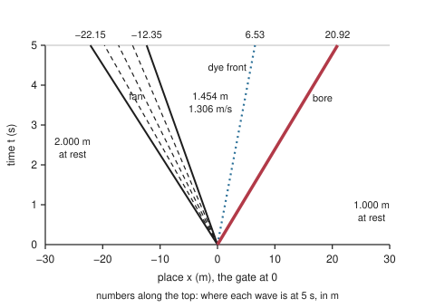
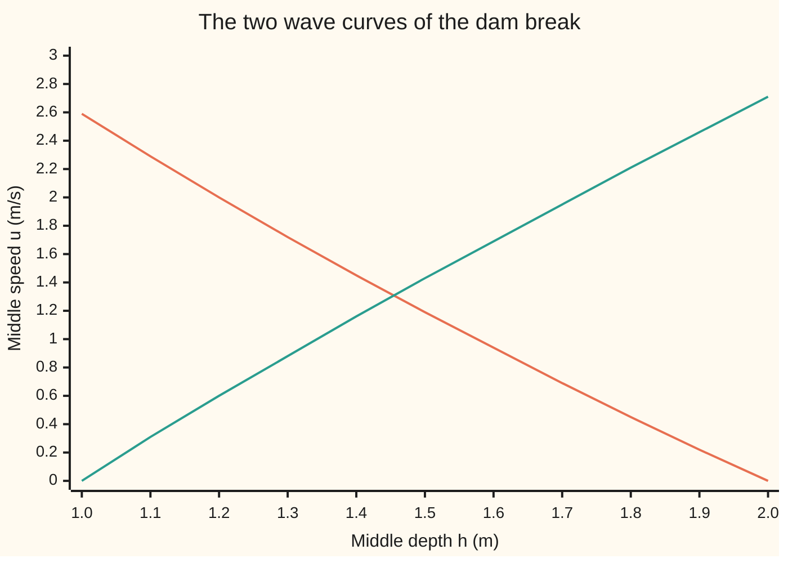

# Systems of conservation laws: several wave families, and the shocks, fans and contacts between them

[Syllabus](../../../SYLLABUS.md) → [Partial differential equations](../README.md) → [First-Order Equations and Characteristics](../README.md#s02) → Systems of conservation laws

---

## General Overview

Wing 08's [The wave equation](../../08-Differential%20equations%20and%20dynamics/10-The%20Classical%20PDEs/05-the-wave-equation-and-dalemberts-formula.md) split a small disturbance into two copies running opposite ways at one speed; small waves on still water do just that. A dam break is not small. [The Riemann problem](04-rarefaction-and-the-riemann-problem.md) solved one jump in one conserved amount, and its "Dam breaks" line pictured a fan of water spreading downstream. That holds over a dry bed. With water ahead, the fan runs back into the reservoir and a bore (a moving step in the water surface) runs downstream. Water carries two conserved amounts, its volume and its momentum, so one jump now breaks into more than one wave. This card solves that dam break.

A flat channel has a gate across it. Behind the gate, still water stands 2 m deep. In front, still water stands 1 m deep. At time $`t = 0`$ s the gate lifts out at once. Gravity is $`g = 9.81`$ m/s².

Five seconds later the channel holds four zones and one moving step, read from the reservoir forward (the gate at place $`x = 0`$ m):

- **Behind −22.15 m:** the reservoir, still 2 m deep and at rest. The news that the gate opened has not reached it yet.
- **From −22.15 m to −12.35 m:** a **fan**: the surface slopes smoothly down, and the water speeds up.
- **From −12.35 m to 20.92 m:** a flat middle level, 1.454 m deep, flowing forward at 1.306 m/s.
- **At 20.92 m:** a **bore**, a moving step in the water surface 0.454 m high, running into the still 1 m water at 4.183 m/s. A bore is a shock: a moving jump.
- **Beyond 20.92 m:** still water, 1 m deep and at rest, not yet reached.

Now put dye in the reservoir water before the gate lifts. At 5 s the dyed water ends at 6.53 m, far behind the bore. Depth and speed are the same on both sides of that line. Only the colour jumps, and the line moves with the water at 1.306 m/s. This is a third kind of wave, a **contact discontinuity**: a jump that the flow carries along without any force across it.

The unknowns are the depth $`h(x, t)`$ in m, the water speed $`u(x, t)`$ in m/s and the dye fraction $`\phi(x, t)`$, 1 for reservoir water and 0 for clear water. The region is the whole channel, $`-\infty < x < \infty`$, for $`t > 0`$. The data are the two still states on either side of the gate.

**A system of conservation laws splits a jump into one wave per eigenvalue of its Jacobian, slowest first: a fan or a shock where that family's speed changes along its own eigenvector, and a contact where it does not.**

**What kind of fact this is:** a theorem, proved on this card for shallow water in Why it works. The solution is the entropy solution (a weak solution whose shocks pass the Lax test), unique among solutions built from one admissible wave per family. The shallow-water equations are a model, not a law; When it holds says where they stop.

<p align="center"></p>

Place runs across, time runs up. Each line starts at the gate. The black lines are characteristics of the upstream family (paths that carry one value of the solution), spread into a fan. The dotted blue line is the dye front. The thick red line is the bore.

---

## The formula

On this card $`u`$ is the water speed, not the generic unknown of earlier cards. A capital $`U`$ is the list of conserved amounts per metre of channel, and a capital $`F(U)`$ is the list of their fluxes (amounts crossing a point per second). The **shallow-water system with dye** is

```math
U_t + F(U)_x = 0, \qquad U = \begin{pmatrix} h \\ h u \\ h \phi \end{pmatrix}, \qquad F(U) = \begin{pmatrix} h u \\ h u^2 + \tfrac12 g h^2 \\ h u \phi \end{pmatrix}
```

**Read it aloud:** water volume changes only by what flows in and out; momentum changes by what flows in and out plus the push of the pressure from the water's own weight; and dye rides with the water.

The **Jacobian** $`A(U)`$ is the 3 by 3 matrix of the flux's derivatives, entry $`(i, j)`$ being $`\partial F_i / \partial U_j`$. Its eigenvalues are the wave speeds of the three families, with $`c = \sqrt{g h}`$:

```math
\lambda_1 = u - c, \qquad \lambda_2 = u, \qquad \lambda_3 = u + c
```

The dam break joins the reservoir to the middle level by a fan of family 1, and the middle level to the still water by a bore of family 3. The middle state $`(h_*, u_*)`$ is where the two meet:

```math
u_* = u_L + 2\,(c_L - c_*) = u_R + (h_* - h_R)\sqrt{\frac{g\,(h_* + h_R)}{2\,h_* h_R}}, \qquad s = \frac{h_* u_* - h_R u_R}{h_* - h_R}
```

**Read it aloud:** the middle speed is what the fan can give from the reservoir side and also what the bore can give from the still-water side; the one depth that makes them agree is the middle depth, and the bore moves at the jump in flow divided by the jump in depth.

The bore must pass the **Lax entropy test**: $`\lambda_3(U_*) > s > \lambda_3(U_R)`$ and $`s > \lambda_2(U_*)`$.

| Symbol | Plain meaning | In our example | Push it up and the answer… |
| --- | --- | --- | --- |
| $`x`$, $`t`$; $`\xi`$ | place along the channel (m, gate at 0) and time since the gate lifted (s); $`\xi = x/t`$, the speed needed to get from the gate to $`x`$ in time $`t`$ | up to ±30 m; 5 s; $`\xi = -3`$ m/s at −15 m | every wave sits further from the gate; the state depends on $`\xi`$ alone |
| $`h`$ | water depth | 2 m behind, 1 m ahead, 1.4538 m in the middle | small waves run faster |
| $`u`$ | water speed, forward positive | 0 m/s at rest; 1.3058 m/s in the middle | all three wave speeds shift by the same amount |
| $`\phi`$ | dye fraction: 1 for reservoir water, 0 for clear water | 1 behind the dye front, 0 ahead | nothing else changes: dye is passive |
| $`g`$, $`c`$; $`c_L`$, $`c_R`$ | gravity; $`c = \sqrt{g h}`$, the speed of a small surface wave relative to the water; its value in the reservoir and in the water ahead | 9.81 m/s²; 4.4294 m/s and 3.1321 m/s | every wave runs faster |
| $`U`$, $`F(U)`$; $`\delta U`$ | conserved amounts per metre (volume, momentum, dye) and their fluxes; a small change in $`U`$ | $`U = (2, 0, 2)`$ in the reservoir | — |
| $`A(U)`$; $`R`$, $`\Lambda`$, $`w`$ | the Jacobian: how each flux changes with each amount; the matrix of its eigenvectors, the diagonal matrix of its eigenvalues, and a small change split into one part per family | 3 by 3 matrices at each state | — |
| $`\lambda_k`$, $`r_k`$ | the $`k`$-th eigenvalue (a wave speed) and its eigenvector (the direction in $`U`$ that this wave changes) | −2.4707, 1.3058, 5.0824 m/s in the middle | — |
| $`\nabla \lambda_k \cdot r_k`$ | the bending rate: how fast family $`k`$'s speed changes as the state moves along $`r_k`$ | −3.8964, 0, +3.8964 per s in the middle | further from 0: fans spread and fronts steepen faster; at 0, contacts only |
| $`U_L`$, $`U_R`$; $`h_L`$, $`h_R`$, $`u_L`$, $`u_R`$ | the states left and right of the gate, and their depths and speeds | 2 m and 1 m, both at 0 m/s | a taller reservoir gives a faster bore |
| $`h_*`$, $`u_*`$, $`c_*`$ | the middle state: depth, speed, small-wave speed | 1.4538 m, 1.3058 m/s, 3.7765 m/s | a deeper middle means a faster bore |
| $`s`$; $`[\,\cdot\,]`$ | speed of a jump; the jump in a quantity, right value minus left | bore at 4.1831 m/s | — |

### When it holds

- **The system is strictly hyperbolic: the three speeds are real and different.** That needs $`h > 0`$. Over a dry channel, $`c = 0`$ at the front and all three speeds meet. There is no middle state and no bore; the water front runs out at $`2 c_L = 8.8589`$ m/s.
- **Each family either changes its speed along its eigenvector or never does.** Families 1 and 3 always change theirs (they are **genuinely nonlinear**); family 2 never does (it is **linearly degenerate**). A family whose speed first rises and then falls along its eigenvector, like a scalar flux with a bend, needs waves that are part shock, part fan, and the formula above misses them.
- **The conserved amounts are volume and momentum.** For smooth flow, the speed equation $`u_t + (u^2/2 + g h)_x = 0`$ says the same thing. Across a bore it does not, and What breaks shows the wrong bore it gives.
- **"The solution" means the entropy solution.** Weak solutions (ones that keep the conservation laws across jumps) are not unique. A solution with two shocks also keeps them, and fails the Lax test.
- **The water is shallow, the bed is flat and has no friction.** The model assumes waves much longer than the depth and pressure that grows with depth as in still water. A real bore this weak usually trails a train of short waves (an undular bore), which the model cannot show, and bed friction slows a real front.

---

## Why it works

### Step 0: freeze the state, and the system splits into separate signals

Near one fixed state, a small disturbance $`\delta U`$ obeys $`\delta U_t + A\,\delta U_x = 0`$ with the Jacobian $`A`$ held fixed. Write $`A = R \Lambda R^{-1}`$ ([Diagonalisation](../../03-Algebra/07-Eigenvalues%20and%20Symmetric%20Matrices/03-diagonalisation-and-matrix-powers.md)): $`R`$ has the eigenvectors $`r_k`$ as columns and $`\Lambda`$ the eigenvalues on its diagonal. Then the parts $`w = R^{-1}\delta U`$ each obey their own transport equation, $`(w_k)_t + \lambda_k (w_k)_x = 0`$.

So a system of three laws is three signals, each travelling at its own speed along its own [Characteristics](01-method-of-characteristics.md). The nonlinear system is the same idea with speeds that depend on the state. Each family then behaves like the scalar law of [Conservation laws](02-conservation-laws-and-shocks.md): it can fan out, steepen into a shock, or just be carried.

### Step 1: find the three speeds and directions

Written in depth, speed and dye, the equations are $`h_t + u h_x + h u_x = 0`$, $`u_t + g h_x + u u_x = 0`$ and $`\phi_t + u \phi_x = 0`$. The matrix of this form has the same eigenvalues as $`A(U)`$, and its eigenvalue equation is $`(u - \lambda)^2 - g h = 0`$ together with $`\lambda = u`$. So the speeds are $`u - c`$, $`u`$ and $`u + c`$ ([Eigenvalues and eigenvectors](../../03-Algebra/07-Eigenvalues%20and%20Symmetric%20Matrices/02-eigenvalues-and-eigenvectors.md)).

In the conserved amounts $`U = (h, hu, h\phi)`$ the eigenvectors are

```math
r_1 = \begin{pmatrix} 1 \\ u - c \\ \phi \end{pmatrix}, \qquad r_2 = \begin{pmatrix} 0 \\ 0 \\ 1 \end{pmatrix}, \qquad r_3 = \begin{pmatrix} 1 \\ u + c \\ \phi \end{pmatrix}
```

In the middle state the speeds are −2.4707, 1.3058 and 5.0824 m/s. Upstream-family waves go back towards the reservoir, dye goes with the water, downstream-family waves outrun it.

### Step 2: two families bend, one does not

Ask whether a family's speed changes when the state moves along that family's own eigenvector. The test is the number $`\nabla \lambda_k \cdot r_k`$ (the rate of change of $`\lambda_k`$ in the direction $`r_k`$; here $`\nabla`$ takes derivatives with respect to the amounts $`h`$, $`hu`$ and $`h\phi`$, not place).

- **Family 1:** $`\nabla \lambda_1 \cdot r_1 = -3c/(2h)`$, which is −3.8964 per s in the middle state. Never zero while $`h > 0`$: genuinely nonlinear.
- **Family 3:** $`+3c/(2h)`$, +3.8964 per s. Genuinely nonlinear.
- **Family 2:** moving along $`r_2`$ changes only the dye, and $`\lambda_2 = u`$ does not see dye. The rate is 0: linearly degenerate.

A genuinely nonlinear family behaves like Burgers' equation from [The Riemann problem](04-rarefaction-and-the-riemann-problem.md): a family speed larger on the left than on the right (forward counted positive) makes a shock, a smaller one makes a fan. A linearly degenerate family has one speed on both sides of any jump in it, so the jump neither spreads nor steepens. It is carried, as a contact.

### Step 3: the fan, and the Riemann invariants

Multiply the depth equation by $`g/c`$, then add it to the speed equation, and also subtract it from the speed equation. Because $`d(2c) = (g/c)\,dh`$, the sum and the difference are exactly

```math
(u + 2c)_t + (u + c)\,(u + 2c)_x = 0, \qquad (u - 2c)_t + (u - c)\,(u - 2c)_x = 0
```

So $`u + 2c`$ stays fixed along every path moving at $`u + c`$, and $`u - 2c`$ along every path at $`u - c`$. These two quantities are the **Riemann invariants** of the 2 by 2 depth-and-speed system. A 3 by 3 or larger system does not in general have them; a 2 by 2 system always does.

In the upstream fan, the family-3 paths come straight from the reservoir, so $`u + 2c`$ keeps its reservoir value $`2 c_L = 8.8589`$ m/s all through the fan. The fan's own family-1 lines leave the gate at speed $`u - c = \xi = x/t`$, as in the scalar fan. Two equations, two unknowns:

```math
c = \tfrac13\,(2 c_L - \xi), \qquad u = \tfrac23\,(c_L + \xi), \qquad h = c^2 / g
```

At the fan's right end the depth is $`h_*`$, which gives the left half of the middle-state formula: $`u_* = 2\,(c_L - c_*)`$.

### Step 4: the bore, and the Hugoniot locus

A jump moving at speed $`s`$ must keep every conserved amount, one equation per amount. This is the Rankine-Hugoniot rule of [Conservation laws](02-conservation-laws-and-shocks.md), now in a list:

```math
s\,[U] = [F(U)]
```

Three equations share one unknown speed $`s`$. Eliminating $`s`$ leaves the states that can sit behind a jump into the still 1 m water: a curve, the **Hugoniot locus** $`u = (h - h_R)\sqrt{g (h + h_R)/(2 h h_R)}`$ (the fold has the algebra). The dye row gives $`s = u`$ wherever only $`\phi`$ jumps, which is the contact again.

<details>
<summary>Detailed proof: the bore's speed and the Hugoniot locus through still water</summary>

The water ahead is at rest: depth $`h_R`$, speed 0. Behind the jump: depth $`h`$, speed $`u`$. The volume row of $`s[U] = [F(U)]`$ reads $`s\,(h - h_R) = h u`$, so

$`\displaystyle s = \frac{h u}{h - h_R}`$

The momentum row reads $`s\,h u = h u^2 + \tfrac12 g (h^2 - h_R^2)`$. Put in $`s`$:

$`\displaystyle \frac{h^2 u^2}{h - h_R} - h u^2 = \tfrac12 g (h - h_R)(h + h_R)`$

The left side is $`h u^2 \cdot h_R/(h - h_R)`$. Solve for $`u^2`$:

$`\displaystyle u^2 = \frac{g\,(h - h_R)^2 (h + h_R)}{2\,h\,h_R}`$

Take the root with the sign that makes the jump run forward into the still water. That is the locus. At $`h_* = 1.4538`$ m: $`h_* u_* = 1.8985`$ m²/s and $`h_* - h_R = 0.4538`$ m, so $`s = 4.1831`$ m/s. The momentum row gives the same 4.1831 m/s, which the code checks separately.

</details>

### Step 5: the Lax test picks which jumps may stand

[Entropy conditions](03-entropy-conditions-and-vanishing-viscosity.md) let a scalar jump stand only if characteristics run into it from both sides. For a system, Lax's version asks the same of the jump's own family and lets the other families pass through. For a family-3 jump: $`\lambda_3(U_*) > s > \lambda_3(U_R)`$, and the slower family 2 behind it must fall back, $`s > \lambda_2(U_*)`$.

The bore passes: 5.0824 > 4.1831 > 3.1321 m/s, and 4.1831 > 1.3058 m/s. It must have deeper water behind it.

A family-1 jump from the reservoir down to a shallower level fails. It would move at −3.5132 m/s, but the test needs a speed below the reservoir's family-1 speed, −4.4294 m/s. As it stands, the reservoir's waves would run away from the jump instead of into it. So family 1 must be a fan.

### Step 6: walk from left to right through one wave of each family

All states reachable from the reservoir by an admissible family-1 wave form one curve in the depth-speed plane: the fan curve where $`h < h_L`$, the shock part of its Hugoniot locus where $`h > h_L`$. The states reachable backwards from the still water by a family-3 wave form a second curve. The contact changes only $`\phi`$, so it leaves depth and speed alone and adds nothing to the matching.



Orange: the speeds the reservoir's fan can reach at each middle depth. Teal: the speeds a bore into the still water needs. The orange curve falls and the teal curve rises, so they cross exactly once, between 1.4 and 1.5 m: at $`h_* = 1.4538`$ m, $`u_* = 1.3058`$ m/s.

That one crossing proves the solution exists and is unique among solutions built from one admissible wave per family. Lax (1957) proved the same for any strictly hyperbolic system whose families are each genuinely nonlinear or linearly degenerate, when the two states are close. The general uniqueness theorem for systems (Bressan 2000) needs data of small total variation (the total amount the data rise and fall, smooth changes included), and the dam break's jump is not small. So this card claims no more uniqueness than the walk above proves.

---

## Worked numbers, by hand

Reservoir $`h_L = 2`$ m, still water $`h_R = 1`$ m, both at rest, $`g = 9.81`$ m/s². The middle depth $`h_* = 1.4538`$ m comes from the code's bisection; the table checks it by hand.

| Step | Arithmetic | Value |
| --- | --- | --- |
| reservoir small-wave speed $`c_L`$ | $`\sqrt{9.81 \times 2}`$ | 4.4294 m/s |
| middle small-wave speed $`c_*`$ | $`\sqrt{9.81 \times 1.4538}`$ | 3.7765 m/s |
| still-water small-wave speed $`c_R`$ | $`\sqrt{9.81 \times 1}`$ | 3.1321 m/s |
| speed from the fan side | $`2 \times (4.4294 - 3.7765)`$ | 1.3058 m/s |
| speed from the bore side | $`0.4538 \times \sqrt{9.81 \times (1.4538 + 1) / (2 \times 1.4538)} = 0.4538 \times 2.8773`$ | 1.3058 m/s |
| bore speed $`s`$ | $`1.8985 / 0.4538`$ | 4.1831 m/s |
| Lax test on the bore | $`1.3058 + 3.7765 = 5.0824 > 4.1831 > 3.1321`$ | passes |
| fan edges | $`-4.4294`$ and $`1.3058 - 3.7765`$ | −4.4294 and −2.4707 m/s |
| inside the fan, −15 m at 5 s | $`\xi = -3`$; $`c = (8.8589 + 3)/3`$; $`u = \xi + c`$ | $`c`$ = 3.9530 m/s, $`u`$ = 0.9530 m/s, $`h`$ = 1.5929 m |
| **where everything is at 5 s** | each speed × 5 s | **fan −22.15 to −12.35 m, dye 6.53 m, bore 20.92 m** |

Five seconds after the gate lifts, a 0.454 m step of water is 20.92 m down the channel, the reservoir has felt the opening 22.15 m back, and the dyed water has moved only 6.53 m.

### What breaks if you drop a piece

| Mistake | Comes out at | What went wrong |
| --- | --- | --- |
| Two shocks, no fan | middle depth 1.4562 m; upstream jump at −3.5132 m/s | the upstream jump fails the Lax test: its speed must be below −4.4294 m/s |
| Conserve speed, not momentum | middle depth 1.4582 m, bore at 4.1196 m/s | the jump rule depends on which amounts are conserved; water conserves momentum |
| Linearise about 1.5 m | middle speed 1.2787 m/s, bore at 3.8360 m/s | frozen speeds miss that the deeper water behind a bore pushes it faster |
| Dye carried at the bore speed | dye front at 20.92 m at 5 s, not 6.53 m | dye is family 2: it moves with the water, not with the bore |
| Dry channel ahead, $`h_R = 0`$ | no middle state; the front runs at 8.8589 m/s | strict hyperbolicity fails: at the dry front $`c = 0`$ and all three speeds meet |

The first row is the Lax hypothesis failing and the last row is strict hyperbolicity failing. The code prints all five.

---

## How the water moves

The channel at 5 s, depth in m, from the code's exact solution:

```
   −30 m   ██████████████████████████████  2.000
   −25 m   ██████████████████████████████  2.000
   −20 m   ████████████████████████████    1.873
   −15 m   ████████████████████████        1.593
   −10 m   ██████████████████████          1.454
    −5 m   ██████████████████████          1.454
     0 m   ██████████████████████          1.454
    +5 m   ██████████████████████          1.454
   +10 m   ██████████████████████          1.454
   +15 m   ██████████████████████          1.454
   +20 m   ██████████████████████          1.454
   +25 m   ███████████████                 1.000
   +30 m   ███████████████                 1.000
```

The fan is the slope from −22.15 to −12.35 m. The flat run is the middle level. The drop between +20 and +25 m is the bore at 20.92 m. The dye front at 6.53 m is invisible here: depth does not change across it.

The whole pattern depends only on $`\xi = x/t`$, as in the scalar fan. At 10 s every wave is twice as far from the gate, and the shape is the same.

---

## Code, from first principles, and it actually runs

The code finds the middle state by bisection on the two wave curves, then checks it by three other roads. First, it builds the 3 by 3 Jacobian by centred differences of the flux, with no formula for the speeds, and checks that each claimed eigenvalue and eigenvector satisfies $`A r = \lambda r`$; the same differences measure $`\nabla \lambda \cdot r`$. Second, it puts the exact fan into both equations and measures the residual (what is left over) by centred differences at two steps. Third, it runs a grid that knows nothing about fans, bores or contacts: 200, 400 and 800 cells on 100 m of channel, updated with Rusanov's flux (the average of the two neighbouring fluxes, plus a smoothing term set by the fastest local wave). The bore's speed is found twice, from the volume row and from the momentum row.

### Python

```python
# Systems of conservation laws -- the check behind the card.  Standard library only.
# Dam break on a flat channel: water 2 m deep behind the gate, 1 m in front, both at
# rest, g = 9.81 m/s^2.  Unknowns per metre of channel width: depth h, flow hu, dye h*phi.
import math
G, HL, HR, T = 9.81, 2.0, 1.0, 5.0
sq = math.sqrt
def bore_u(h, h0): return (h - h0) * sq(G / 2 * (h + h0) / (h * h0))  # Hugoniot locus
def u_left(h):     # wave curve of family 1 from the reservoir: fan if h < HL, else shock
    return 2 * (sq(G * HL) - sq(G * h)) if h <= HL else -bore_u(h, HL)
def u_right(h):    # wave curve of family 3 into the still water ahead
    return bore_u(h, HR) if h >= HR else -2 * (sq(G * HR) - sq(G * h))
def bisect(f, a, b):
    for _ in range(200):
        m = 0.5 * (a + b)
        if (f(a) > 0) == (f(m) > 0): a = m
        else: b = m
    return 0.5 * (a + b)
def flux(U):
    h, m, z = U
    return [m, m * m / h + G * h * h / 2, m * z / h]
hs = bisect(lambda h: u_left(h) - u_right(h), 0.5, 3.0); us = u_right(hs)
cl, cs, cr = sq(G * HL), sq(G * hs), sq(G * HR)
s_mass, s_mom = hs * us / (hs - HR), (hs * us * us + G * (hs * hs - HR * HR) / 2) / (hs * us)
print(f"middle state: depth {hs:.4f} m, speed {us:.4f} m/s")
print(f"in short: middle {hs:.3f} m at {us:.3f} m/s; bore {hs - HR:.3f} m high at {s_mass:.3f} m/s")
print(f"hand: c_L {cl:.4f}, c_* {cs:.4f}, c_R {cr:.4f} m/s; h*u* {hs * us:.4f} m^2/s; h* - h_R {hs - HR:.4f} m;"
      f" bore factor {sq(G / 2 * (hs + HR) / (hs * HR)):.4f} per s")
print(f"bore speed from mass {s_mass:.4f} m/s, from momentum {s_mom:.4f} m/s")
# Road 1: eigenvalues by formula, against a Jacobian built by centred differences
U, e = [hs, hs * us, hs * 0.5], 1e-6
J = [[0.0] * 3 for _ in range(3)]
for j in range(3):
    Up, Um = U[:], U[:]; Up[j] += e; Um[j] -= e
    Fp, Fm = flux(Up), flux(Um)
    for i in range(3): J[i][j] = (Fp[i] - Fm[i]) / (2 * e)
lams, vecs = [us - cs, us, us + cs], [[1, us - cs, 0.5], [0, 0, 1], [1, us + cs, 0.5]]
res = max(abs(sum(J[i][k] * r[k] for k in range(3)) - l * r[i])
          for l, r in zip(lams, vecs) for i in range(3))
print(f"speeds in the middle: {lams[0]:.4f}, {lams[1]:.4f}, {lams[2]:.4f} m/s; largest |J r - lam r| {res:.6f}")
def lam(V, k): return V[1] / V[0] + (k - 2) * sq(G * V[0])
dl = [(lam([a + e * b for a, b in zip(U, r)], k) - lam([a - e * b for a, b in zip(U, r)], k)) / (2 * e)
      for k, r in zip((1, 2, 3), vecs)]
print(f"grad lam . r: family 1 {dl[0]:.4f}, family 2 {dl[1]:.4f}, family 3 {dl[2]:.4f} (per s)")
print(f"family 1 by formula {-1.5 * cs / hs:.4f}, family 3 {1.5 * cs / hs:.4f}")
# Lax entropy test on the bore, and the Riemann invariants
print(f"Lax: {us + cs:.4f} > {s_mass:.4f} > {cr:.4f}, and {s_mass:.4f} > {us:.4f} m/s")
print(f"u + 2c: reservoir {2 * cl:.4f}, middle {us + 2 * cs:.4f} m/s")
print(f"u - 2c: middle {us - 2 * cs:.4f}, ahead {-2 * cr:.4f}; change across bore {us - 2 * cs + 2 * cr:.4f} m/s")
edges = [-cl * T, (us - cs) * T, us * T, s_mass * T]
print("at 5 s: fan from {:.2f} to {:.2f} m, dye front {:.2f} m, bore {:.2f} m".format(*edges))
def exact(x, t):
    if x < -cl * t: return HL, 0.0, 1.0
    if x < (us - cs) * t:
        c = (2 * cl - x / t) / 3
        return c * c / G, x / t + c, 1.0
    if x < us * t: return hs, us, 1.0
    if x < s_mass * t: return hs, us, 0.0
    return HR, 0.0, 0.0
hf, uf, _ = exact(-15, T)
print(f"fan at -15 m, 5 s: x/t -3.0 m/s, c {(2 * cl + 3) / 3:.4f} m/s, u {uf:.4f} m/s, depth {hf:.4f} m")
# Road 2: the fan obeys both equations; centred-difference residual at x = -15 m
row = []
for d in (0.1, 0.05):
    def q(x, t): h, u, _ = exact(x, t); return h, h * u, h * u * u + G * h * h / 2
    r1 = (q(-15, T + d)[0] - q(-15, T - d)[0] + q(-15 + d, T)[1] - q(-15 - d, T)[1]) / (2 * d)
    r2 = (q(-15, T + d)[1] - q(-15, T - d)[1] + q(-15 + d, T)[2] - q(-15 - d, T)[2]) / (2 * d)
    row.append((abs(r1), abs(r2)))
print(f"fan residual at -15 m, 5 s, steps 0.1 and 0.05: mass {row[0][0]:.6f}, {row[1][0]:.6f} m/s;"
      f" momentum {row[0][1]:.6f}, {row[1][1]:.6f} m^2/s^2")
# Road 3: a grid that knows nothing of fans or bores (Rusanov's averaged flux)
def grid(n):
    dx = 100.0 / n; xs = [-50 + (i + 0.5) * dx for i in range(n)]
    W = [[HL, 0.0, HL] if x < 0 else [HR, 0.0, 0.0] for x in xs]; t = 0.0
    while t < T - 1e-12:
        sp = [abs(w[1] / w[0]) + sq(G * w[0]) for w in W]
        dt = min(0.45 * dx / max(sp), T - t); Wx = [W[0]] + W + [W[-1]]
        Fx = [flux(w) for w in Wx]; spx = [sp[0]] + sp + [sp[-1]]; Fh = []
        for i in range(n + 1):
            a = max(spx[i], spx[i + 1])
            Fh.append([0.5 * (Fx[i][k] + Fx[i + 1][k]) - 0.5 * a * (Wx[i + 1][k] - Wx[i][k]) for k in range(3)])
        W = [[W[i][k] - dt / dx * (Fh[i + 1][k] - Fh[i][k]) for k in range(3)] for i in range(n)]; t += dt
    err = sum(abs(w[0] - exact(x, T)[0]) for w, x in zip(W, xs)) * dx
    fan = sum(abs(w[0] - exact(x, T)[0]) for w, x in zip(W, xs) if x < -5) * dx
    mid = [w[0] for w, x in zip(W, xs) if -8 <= x <= 2]
    dye = next(x for w, x in zip(W, xs) if w[2] / w[0] < 0.5)
    return err, fan, sum(mid) / len(mid), dye, sum(w[0] for w in W) * dx, sum(w[2] for w in W) * dx
errs, fans = [], []
for n in (200, 400, 800):
    err, fan, mid, dye, vol, ink = grid(n); errs.append(err); fans.append(fan)
    print(f"grid {n} cells: depth error {err:.4f} m^2, middle depth {mid:.4f} m, dye front {dye:.2f} m, water {vol:.4f} m^2, dye {ink:.4f} m^2")
r1, r2 = errs[0] / errs[1], errs[1] / errs[2]
print(f"error ratio per halving: {r1:.3f} and {r2:.3f}; observed order {math.log2(r1):.2f} and {math.log2(r2):.2f}")
bores = [a - b for a, b in zip(errs, fans)]
for name, v in (("fan side, x < -5 m:", fans), ("bore side, x >= -5 m:", bores)):
    print(f"{name} depth error {v[0]:.4f}, {v[1]:.4f}, {v[2]:.4f} m^2; ratio per halving {v[0] / v[1]:.3f} and {v[1] / v[2]:.3f}")
# What breaks
h2 = bisect(lambda h: -bore_u(h, HL) - bore_u(h, HR), 0.5, 3.0); u2 = bore_u(h2, HR)
s1 = h2 * u2 / (h2 - HL)
print(f"breaks: two shocks: depth {h2:.4f} m, upstream jump at {s1:.4f} m/s, but Lax needs {-cl:.4f} > s1 > {u2 - sq(G * h2):.4f}")
def uvel(h): return (h - HR) * sq(2 * G / (h + HR))
h3 = bisect(lambda h: u_left(h) - uvel(h), 0.5, 3.0)
print(f"breaks: conserve speed, not momentum: depth {h3:.4f} m, bore {h3 * uvel(h3) / (h3 - HR):.4f} m/s")
cb = sq(G * 1.5)
print(f"breaks: linearise about 1.5 m: speed {G * 0.5 / cb:.4f} m/s, bore {cb:.4f} m/s")
print(f"breaks: dye carried at the bore speed: {s_mass * T:.2f} m at 5 s, not {us * T:.2f} m")
print(f"breaks: dry channel ahead: no middle state; front at 2 c_L = {2 * cl:.4f} m/s, where c = 0 and lam1 = lam2 = lam3")
print("chart, depth h m: " + " ".join(f"{1 + i / 10:.1f}" for i in range(11)))
print("chart, family 1:  " + " ".join(f"{u_left(1 + i / 10):.2f}" for i in range(11)))
print("chart, family 3:  " + " ".join(f"{u_right(1 + i / 10):.2f}" for i in range(11)))
print("bars, depth at 5 s: " + " ".join(f"{x}:{exact(x, T)[0]:.3f}" for x in range(-30, 31, 5)))
print("figure, x at 5 s: {:.2f} {:.2f} {:.2f} {:.2f}".format(*edges))
assert abs(hs - 1.4538) < 1e-4 and abs(us - 1.3058) < 1e-4            # the spec's numbers
assert abs(s_mass - s_mom) < 1e-9 and abs(us + 2 * cs - 2 * cl) < 1e-9  # Hugoniot, invariant
assert res < 1e-6 and abs(dl[0] + 1.5 * cs / hs) < 1e-6 and abs(dl[1]) < 1e-6 and abs(dl[2] - 1.5 * cs / hs) < 1e-6
assert us + cs > s_mass > cr and s_mass > us and s1 > -cl  # Lax fails
assert all(3.5 < row[0][k] / row[1][k] < 4.5 for k in (0, 1))   # residual falls as step^2
assert errs[0] > errs[1] > errs[2] and abs(mid - hs) < 0.01 and abs(dye - us * T) < 1.0
assert bores[0] / bores[1] > 1.85 and bores[1] / bores[2] > 1.85 and fans[0] / fans[1] < 1.7 and fans[1] / fans[2] < 1.7
assert abs(vol - 150) < 1e-9 and abs(ink - 100) < 1e-9
print("ALL CHECKS PASS")
```

**Ran 2026-11-24 on macOS, Python 3.14.10, standard library only. All checks passed. Output, pasted from the run:**

```
middle state: depth 1.4538 m, speed 1.3058 m/s
in short: middle 1.454 m at 1.306 m/s; bore 0.454 m high at 4.183 m/s
hand: c_L 4.4294, c_* 3.7765, c_R 3.1321 m/s; h*u* 1.8985 m^2/s; h* - h_R 0.4538 m; bore factor 2.8773 per s
bore speed from mass 4.1831 m/s, from momentum 4.1831 m/s
speeds in the middle: -2.4707, 1.3058, 5.0824 m/s; largest |J r - lam r| 0.000000
grad lam . r: family 1 -3.8964, family 2 0.0000, family 3 3.8964 (per s)
family 1 by formula -3.8964, family 3 3.8964
Lax: 5.0824 > 4.1831 > 3.1321, and 4.1831 > 1.3058 m/s
u + 2c: reservoir 8.8589, middle 8.8589 m/s
u - 2c: middle -6.2472, ahead -6.2642; change across bore 0.0170 m/s
at 5 s: fan from -22.15 to -12.35 m, dye front 6.53 m, bore 20.92 m
fan at -15 m, 5 s: x/t -3.0 m/s, c 3.9530 m/s, u 0.9530 m/s, depth 1.5929 m
fan residual at -15 m, 5 s, steps 0.1 and 0.05: mass 0.000080, 0.000020 m/s; momentum 0.000442, 0.000110 m^2/s^2
grid 200 cells: depth error 1.3945 m^2, middle depth 1.4551 m, dye front 6.75 m, water 150.0000 m^2, dye 100.0000 m^2
grid 400 cells: depth error 0.8417 m^2, middle depth 1.4534 m, dye front 6.62 m, water 150.0000 m^2, dye 100.0000 m^2
grid 800 cells: depth error 0.4971 m^2, middle depth 1.4534 m, dye front 6.56 m, water 150.0000 m^2, dye 100.0000 m^2
error ratio per halving: 1.657 and 1.693; observed order 0.73 and 0.76
fan side, x < -5 m: depth error 0.9179, 0.5904, 0.3694 m^2; ratio per halving 1.555 and 1.598
bore side, x >= -5 m: depth error 0.4766, 0.2513, 0.1277 m^2; ratio per halving 1.897 and 1.967
breaks: two shocks: depth 1.4562 m, upstream jump at -3.5132 m/s, but Lax needs -4.4294 > s1 > -2.4675
breaks: conserve speed, not momentum: depth 1.4582 m, bore 4.1196 m/s
breaks: linearise about 1.5 m: speed 1.2787 m/s, bore 3.8360 m/s
breaks: dye carried at the bore speed: 20.92 m at 5 s, not 6.53 m
breaks: dry channel ahead: no middle state; front at 2 c_L = 8.8589 m/s, where c = 0 and lam1 = lam2 = lam3
chart, depth h m: 1.0 1.1 1.2 1.3 1.4 1.5 1.6 1.7 1.8 1.9 2.0
chart, family 1:  2.59 2.29 2.00 1.72 1.45 1.19 0.94 0.69 0.45 0.22 0.00
chart, family 3:  0.00 0.31 0.60 0.88 1.16 1.43 1.69 1.95 2.21 2.46 2.71
bars, depth at 5 s: -30:2.000 -25:2.000 -20:1.873 -15:1.593 -10:1.454 -5:1.454 0:1.454 5:1.454 10:1.454 15:1.454 20:1.454 25:1.000 30:1.000
figure, x at 5 s: -22.15 -12.35 6.53 20.92
ALL CHECKS PASS
```

The roads agree. The Jacobian built by differences matches the claimed speeds and directions to six decimals, and gives −3.8964, 0.0000 and 3.8964 per s for the three bending rates, as Step 2 says. The fan's residual falls by 4 when the step halves, as centred differences should when the formula solves the equations exactly. The grid keeps 150 m² of water and 100 m² of dye to four decimals. Its depth error falls at an observed order of 0.73 and then 0.76, below its formal first order. Splitting the error at −5 m shows why. On the bore's side it falls by 1.897 and 1.967 per halving, close to the factor 2 of first order. On the fan's side it falls by only 1.555 and 1.598: the fan's edges are corners in the water surface, and the scheme's smoothing rounds them off. Depth never sees the dye: no flux of water or momentum, and no wave speed, depends on $`\phi`$. The middle depth is 1.4534 m at both 400 and 800 cells, against the exact 1.4538 m; that is not a settled value, and finer grids keep closing the gap. The dye front closes in on 6.53 m from 6.75 m.

### Rust

The same checks with the same inputs and the same output, built with `rustc --edition 2021 -O`.

```rust
// Systems of conservation laws -- the same check as the Python, in Rust.  No crates.
// Dam break on a flat channel: water 2 m deep behind the gate, 1 m in front, both at
// rest, g = 9.81 m/s^2.  Unknowns per metre of channel width: depth h, flow hu, dye h*phi.
const G: f64 = 9.81;
const HL: f64 = 2.0;
const HR: f64 = 1.0;
const T: f64 = 5.0;
fn sq(x: f64) -> f64 { x.sqrt() }
fn bore_u(h: f64, h0: f64) -> f64 { (h - h0) * sq(G / 2.0 * (h + h0) / (h * h0)) } // Hugoniot locus
fn u_left(h: f64) -> f64 { // wave curve of family 1 from the reservoir: fan if h < HL, else shock
    if h <= HL { 2.0 * (sq(G * HL) - sq(G * h)) } else { -bore_u(h, HL) }
}
fn u_right(h: f64) -> f64 { // wave curve of family 3 into the still water ahead
    if h >= HR { bore_u(h, HR) } else { -2.0 * (sq(G * HR) - sq(G * h)) }
}
fn bisect(f: &dyn Fn(f64) -> f64, mut a: f64, mut b: f64) -> f64 {
    for _ in 0..200 {
        let m = 0.5 * (a + b);
        if (f(a) > 0.0) == (f(m) > 0.0) { a = m } else { b = m }
    }
    0.5 * (a + b)
}
fn flux(u: &[f64; 3]) -> [f64; 3] {
    let (h, m, z) = (u[0], u[1], u[2]);
    [m, m * m / h + G * h * h / 2.0, m * z / h]
}
fn lam(v: &[f64; 3], k: f64) -> f64 { v[1] / v[0] + (k - 2.0) * sq(G * v[0]) }
struct S { hs: f64, us: f64, cs: f64, cl: f64, s: f64 }
fn exact(p: &S, x: f64, t: f64) -> (f64, f64, f64) {
    if x < -p.cl * t { return (HL, 0.0, 1.0); }
    if x < (p.us - p.cs) * t {
        let c = (2.0 * p.cl - x / t) / 3.0;
        return (c * c / G, x / t + c, 1.0);
    }
    if x < p.us * t { return (p.hs, p.us, 1.0); }
    if x < p.s * t { return (p.hs, p.us, 0.0); }
    (HR, 0.0, 0.0)
}
fn grid(p: &S, n: usize) -> (f64, f64, f64, f64, f64, f64) {
    let dx = 100.0 / n as f64;
    let xs: Vec<f64> = (0..n).map(|i| -50.0 + (i as f64 + 0.5) * dx).collect();
    let mut w: Vec<[f64; 3]> = xs.iter().map(|&x| if x < 0.0 { [HL, 0.0, HL] } else { [HR, 0.0, 0.0] }).collect();
    let mut t = 0.0;
    while t < T - 1e-12 {
        let sp: Vec<f64> = w.iter().map(|v| (v[1] / v[0]).abs() + sq(G * v[0])).collect();
        let dt = (0.45 * dx / sp.iter().cloned().fold(f64::MIN, f64::max)).min(T - t);
        let mut wx = vec![w[0]]; wx.extend(w.iter().cloned()); wx.push(w[n - 1]);
        let fx: Vec<[f64; 3]> = wx.iter().map(flux).collect();
        let mut spx = vec![sp[0]]; spx.extend(sp.iter().cloned()); spx.push(sp[n - 1]);
        let mut fh = Vec::with_capacity(n + 1);
        for i in 0..=n {
            let a = spx[i].max(spx[i + 1]);
            let mut f = [0.0; 3];
            for k in 0..3 { f[k] = 0.5 * (fx[i][k] + fx[i + 1][k]) - 0.5 * a * (wx[i + 1][k] - wx[i][k]); }
            fh.push(f);
        }
        for i in 0..n { for k in 0..3 { w[i][k] = w[i][k] - dt / dx * (fh[i + 1][k] - fh[i][k]); } }
        t += dt;
    }
    let err = w.iter().zip(&xs).map(|(v, &x)| (v[0] - exact(p, x, T).0).abs()).sum::<f64>() * dx;
    let fan = w.iter().zip(&xs).filter(|(_, &x)| x < -5.0).map(|(v, &x)| (v[0] - exact(p, x, T).0).abs()).sum::<f64>() * dx;
    let mid: Vec<f64> = w.iter().zip(&xs).filter(|(_, &x)| -8.0 <= x && x <= 2.0).map(|(v, _)| v[0]).collect();
    let dye = w.iter().zip(&xs).find(|(v, _)| v[2] / v[0] < 0.5).unwrap().1;
    let vol = w.iter().map(|v| v[0]).sum::<f64>() * dx;
    let ink = w.iter().map(|v| v[2]).sum::<f64>() * dx;
    (err, fan, mid.iter().sum::<f64>() / mid.len() as f64, *dye, vol, ink)
}
fn main() {
    let hs = bisect(&|h| u_left(h) - u_right(h), 0.5, 3.0);
    let us = u_right(hs);
    let (cl, cs, cr) = (sq(G * HL), sq(G * hs), sq(G * HR));
    let s_mass = hs * us / (hs - HR);
    let s_mom = (hs * us * us + G * (hs * hs - HR * HR) / 2.0) / (hs * us);
    println!("middle state: depth {:.4} m, speed {:.4} m/s", hs, us);
    println!("in short: middle {:.3} m at {:.3} m/s; bore {:.3} m high at {:.3} m/s", hs, us, hs - HR, s_mass);
    println!("hand: c_L {:.4}, c_* {:.4}, c_R {:.4} m/s; h*u* {:.4} m^2/s; h* - h_R {:.4} m; bore factor {:.4} per s",
             cl, cs, cr, hs * us, hs - HR, sq(G / 2.0 * (hs + HR) / (hs * HR)));
    println!("bore speed from mass {:.4} m/s, from momentum {:.4} m/s", s_mass, s_mom);
    // Road 1: eigenvalues by formula, against a Jacobian built by centred differences
    let (u, e) = ([hs, hs * us, hs * 0.5], 1e-6);
    let mut j = [[0.0; 3]; 3];
    for c in 0..3 {
        let (mut up, mut um) = (u, u); up[c] += e; um[c] -= e;
        let (fp, fm) = (flux(&up), flux(&um));
        for i in 0..3 { j[i][c] = (fp[i] - fm[i]) / (2.0 * e); }
    }
    let lams = [us - cs, us, us + cs];
    let vecs = [[1.0, us - cs, 0.5], [0.0, 0.0, 1.0], [1.0, us + cs, 0.5]];
    let mut res: f64 = 0.0;
    for (l, r) in lams.iter().zip(&vecs) { for i in 0..3 {
        let jr: f64 = (0..3).map(|k| j[i][k] * r[k]).sum();
        res = res.max((jr - l * r[i]).abs());
    } }
    println!("speeds in the middle: {:.4}, {:.4}, {:.4} m/s; largest |J r - lam r| {:.6}", lams[0], lams[1], lams[2], res);
    let mut dl = [0.0; 3];
    for k in 0..3 {
        let r = vecs[k];
        let (mut a, mut b) = (u, u);
        for i in 0..3 { a[i] = u[i] + e * r[i]; b[i] = u[i] - e * r[i]; }
        dl[k] = (lam(&a, k as f64 + 1.0) - lam(&b, k as f64 + 1.0)) / (2.0 * e);
    }
    println!("grad lam . r: family 1 {:.4}, family 2 {:.4}, family 3 {:.4} (per s)", dl[0], dl[1], dl[2]);
    println!("family 1 by formula {:.4}, family 3 {:.4}", -1.5 * cs / hs, 1.5 * cs / hs);
    // Lax entropy test on the bore, and the Riemann invariants
    println!("Lax: {:.4} > {:.4} > {:.4}, and {:.4} > {:.4} m/s", us + cs, s_mass, cr, s_mass, us);
    println!("u + 2c: reservoir {:.4}, middle {:.4} m/s", 2.0 * cl, us + 2.0 * cs);
    println!("u - 2c: middle {:.4}, ahead {:.4}; change across bore {:.4} m/s", us - 2.0 * cs, -2.0 * cr, us - 2.0 * cs + 2.0 * cr);
    let edges = [-cl * T, (us - cs) * T, us * T, s_mass * T];
    println!("at 5 s: fan from {:.2} to {:.2} m, dye front {:.2} m, bore {:.2} m", edges[0], edges[1], edges[2], edges[3]);
    let p = S { hs, us, cs, cl, s: s_mass };
    let (hf, uf, _) = exact(&p, -15.0, T);
    println!("fan at -15 m, 5 s: x/t -3.0 m/s, c {:.4} m/s, u {:.4} m/s, depth {:.4} m", (2.0 * cl + 3.0) / 3.0, uf, hf);
    // Road 2: the fan obeys both equations; centred-difference residual at x = -15 m
    let q = |x: f64, t: f64| { let (h, v, _) = exact(&p, x, t); [h, h * v, h * v * v + G * h * h / 2.0] };
    let mut row = Vec::new();
    for d in [0.1, 0.05] {
        let r1 = (q(-15.0, T + d)[0] - q(-15.0, T - d)[0] + q(-15.0 + d, T)[1] - q(-15.0 - d, T)[1]) / (2.0 * d);
        let r2 = (q(-15.0, T + d)[1] - q(-15.0, T - d)[1] + q(-15.0 + d, T)[2] - q(-15.0 - d, T)[2]) / (2.0 * d);
        row.push((r1.abs(), r2.abs()));
    }
    println!("fan residual at -15 m, 5 s, steps 0.1 and 0.05: mass {:.6}, {:.6} m/s; momentum {:.6}, {:.6} m^2/s^2",
             row[0].0, row[1].0, row[0].1, row[1].1);
    // Road 3: a grid that knows nothing of fans or bores (Rusanov's averaged flux)
    let (mut errs, mut fans) = (Vec::new(), Vec::new());
    let (mut mid, mut dye, mut vol, mut ink) = (0.0, 0.0, 0.0, 0.0);
    for n in [200usize, 400, 800] {
        let g = grid(&p, n);
        errs.push(g.0); fans.push(g.1); mid = g.2; dye = g.3; vol = g.4; ink = g.5;
        println!("grid {} cells: depth error {:.4} m^2, middle depth {:.4} m, dye front {:.2} m, water {:.4} m^2, dye {:.4} m^2",
                 n, g.0, g.2, g.3, g.4, g.5);
    }
    let (r1, r2) = (errs[0] / errs[1], errs[1] / errs[2]);
    println!("error ratio per halving: {:.3} and {:.3}; observed order {:.2} and {:.2}", r1, r2, r1.log2(), r2.log2());
    let bores: Vec<f64> = errs.iter().zip(&fans).map(|(a, b)| a - b).collect();
    for (name, v) in [("fan side, x < -5 m:", &fans), ("bore side, x >= -5 m:", &bores)] {
        println!("{} depth error {:.4}, {:.4}, {:.4} m^2; ratio per halving {:.3} and {:.3}", name, v[0], v[1], v[2], v[0] / v[1], v[1] / v[2]);
    }
    // What breaks
    let h2 = bisect(&|h| -bore_u(h, HL) - bore_u(h, HR), 0.5, 3.0);
    let u2 = bore_u(h2, HR);
    let s1 = h2 * u2 / (h2 - HL);
    println!("breaks: two shocks: depth {:.4} m, upstream jump at {:.4} m/s, but Lax needs {:.4} > s1 > {:.4}", h2, s1, -cl, u2 - sq(G * h2));
    let uvel = |h: f64| (h - HR) * sq(2.0 * G / (h + HR));
    let h3 = bisect(&|h| u_left(h) - uvel(h), 0.5, 3.0);
    println!("breaks: conserve speed, not momentum: depth {:.4} m, bore {:.4} m/s", h3, h3 * uvel(h3) / (h3 - HR));
    let cb = sq(G * 1.5);
    println!("breaks: linearise about 1.5 m: speed {:.4} m/s, bore {:.4} m/s", G * 0.5 / cb, cb);
    println!("breaks: dye carried at the bore speed: {:.2} m at 5 s, not {:.2} m", s_mass * T, us * T);
    println!("breaks: dry channel ahead: no middle state; front at 2 c_L = {:.4} m/s, where c = 0 and lam1 = lam2 = lam3", 2.0 * cl);
    let hh: Vec<f64> = (0..11).map(|i| 1.0 + i as f64 / 10.0).collect();
    let join = |v: Vec<String>| v.join(" ");
    println!("chart, depth h m: {}", join(hh.iter().map(|h| format!("{:.1}", h)).collect()));
    println!("chart, family 1:  {}", join(hh.iter().map(|&h| format!("{:.2}", u_left(h))).collect()));
    println!("chart, family 3:  {}", join(hh.iter().map(|&h| format!("{:.2}", u_right(h))).collect()));
    println!("bars, depth at 5 s: {}", join((-6..=6).map(|i| format!("{}:{:.3}", i * 5, exact(&p, (i * 5) as f64, T).0)).collect()));
    println!("figure, x at 5 s: {:.2} {:.2} {:.2} {:.2}", edges[0], edges[1], edges[2], edges[3]);
    assert!((hs - 1.4538).abs() < 1e-4 && (us - 1.3058).abs() < 1e-4);            // the spec's numbers
    assert!((s_mass - s_mom).abs() < 1e-9 && (us + 2.0 * cs - 2.0 * cl).abs() < 1e-9); // Hugoniot, invariant
    assert!(res < 1e-6 && (dl[0] + 1.5 * cs / hs).abs() < 1e-6 && dl[1].abs() < 1e-6 && (dl[2] - 1.5 * cs / hs).abs() < 1e-6);
    assert!(us + cs > s_mass && s_mass > cr && s_mass > us && s1 > -cl); // Lax fails
    assert!((0..2).all(|k| { let r = if k == 0 { row[0].0 / row[1].0 } else { row[0].1 / row[1].1 }; 3.5 < r && r < 4.5 }));
    assert!(errs[0] > errs[1] && errs[1] > errs[2] && (mid - hs).abs() < 0.01 && (dye - us * T).abs() < 1.0);
    assert!(bores[0] / bores[1] > 1.85 && bores[1] / bores[2] > 1.85 && fans[0] / fans[1] < 1.7 && fans[1] / fans[2] < 1.7);
    assert!((vol - 150.0).abs() < 1e-9 && (ink - 100.0).abs() < 1e-9);
    println!("ALL CHECKS PASS");
}
```

**Ran 2026-11-24 on macOS, rustc 1.98.1, no crates. All checks passed. Output, pasted from the run:**

```
middle state: depth 1.4538 m, speed 1.3058 m/s
in short: middle 1.454 m at 1.306 m/s; bore 0.454 m high at 4.183 m/s
hand: c_L 4.4294, c_* 3.7765, c_R 3.1321 m/s; h*u* 1.8985 m^2/s; h* - h_R 0.4538 m; bore factor 2.8773 per s
bore speed from mass 4.1831 m/s, from momentum 4.1831 m/s
speeds in the middle: -2.4707, 1.3058, 5.0824 m/s; largest |J r - lam r| 0.000000
grad lam . r: family 1 -3.8964, family 2 0.0000, family 3 3.8964 (per s)
family 1 by formula -3.8964, family 3 3.8964
Lax: 5.0824 > 4.1831 > 3.1321, and 4.1831 > 1.3058 m/s
u + 2c: reservoir 8.8589, middle 8.8589 m/s
u - 2c: middle -6.2472, ahead -6.2642; change across bore 0.0170 m/s
at 5 s: fan from -22.15 to -12.35 m, dye front 6.53 m, bore 20.92 m
fan at -15 m, 5 s: x/t -3.0 m/s, c 3.9530 m/s, u 0.9530 m/s, depth 1.5929 m
fan residual at -15 m, 5 s, steps 0.1 and 0.05: mass 0.000080, 0.000020 m/s; momentum 0.000442, 0.000110 m^2/s^2
grid 200 cells: depth error 1.3945 m^2, middle depth 1.4551 m, dye front 6.75 m, water 150.0000 m^2, dye 100.0000 m^2
grid 400 cells: depth error 0.8417 m^2, middle depth 1.4534 m, dye front 6.62 m, water 150.0000 m^2, dye 100.0000 m^2
grid 800 cells: depth error 0.4971 m^2, middle depth 1.4534 m, dye front 6.56 m, water 150.0000 m^2, dye 100.0000 m^2
error ratio per halving: 1.657 and 1.693; observed order 0.73 and 0.76
fan side, x < -5 m: depth error 0.9179, 0.5904, 0.3694 m^2; ratio per halving 1.555 and 1.598
bore side, x >= -5 m: depth error 0.4766, 0.2513, 0.1277 m^2; ratio per halving 1.897 and 1.967
breaks: two shocks: depth 1.4562 m, upstream jump at -3.5132 m/s, but Lax needs -4.4294 > s1 > -2.4675
breaks: conserve speed, not momentum: depth 1.4582 m, bore 4.1196 m/s
breaks: linearise about 1.5 m: speed 1.2787 m/s, bore 3.8360 m/s
breaks: dye carried at the bore speed: 20.92 m at 5 s, not 6.53 m
breaks: dry channel ahead: no middle state; front at 2 c_L = 8.8589 m/s, where c = 0 and lam1 = lam2 = lam3
chart, depth h m: 1.0 1.1 1.2 1.3 1.4 1.5 1.6 1.7 1.8 1.9 2.0
chart, family 1:  2.59 2.29 2.00 1.72 1.45 1.19 0.94 0.69 0.45 0.22 0.00
chart, family 3:  0.00 0.31 0.60 0.88 1.16 1.43 1.69 1.95 2.21 2.46 2.71
bars, depth at 5 s: -30:2.000 -25:2.000 -20:1.873 -15:1.593 -10:1.454 -5:1.454 0:1.454 5:1.454 10:1.454 15:1.454 20:1.454 25:1.000 30:1.000
figure, x at 5 s: -22.15 -12.35 6.53 20.92
ALL CHECKS PASS
```

The two outputs match line for line.

### Lean

Lean proves Steps 1 and 2, the Hugoniot locus through still water and the Lax test on a bore, for any $`g > 0`$.

- Take any state with depth $`h > 0`$, speed $`u`$ and dye fraction $`\phi`$. Then $`r_1`$, $`r_2`$, $`r_3`$ are eigenvectors of $`A(U)`$ with eigenvalues $`u - c < u < u + c`$.
- Take the same state. Then the bending rates are $`-3c/(2h)`$, 0 and $`3c/(2h)`$. So families 1 and 3 are genuinely nonlinear, and family 2 is linearly degenerate.
- Take still water of depth $`h_R > 0`$ ahead, and depth $`h > 0`$, $`h \ne h_R`$, behind, with one dye fraction. Then the jump rule $`s\,[U] = [F(U)]`$ has a solution $`s`$ exactly when $`u^2`$ takes the value in Step 4's fold.
- Take $`h > h_R > 0`$, $`u`$ on the Hugoniot locus, and $`s = h u/(h - h_R)`$. Then $`\lambda_3`$ behind $`> s >`$ $`\lambda_3`$ ahead, and $`s > u`$. So the bore passes the Lax test.
- Take the reservoir: 2 m deep, at rest, fully dyed. Then $`U = (2, 0, 2)`$.

The dam-break numbers, the fan, the What breaks table and the grid are left to the Python and Rust checks.

```lean
-- Systems of conservation laws: the shallow-water system with dye has three wave families at speeds u - c, u and u + c (two that bend, one that does not), its bores into still water lie on the Hugoniot locus, and every such bore with deeper water behind passes the Lax entropy test.
import Mathlib.Analysis.Calculus.FDeriv.Pi
import Mathlib.Analysis.Calculus.FDeriv.Mul
import Mathlib.Analysis.Calculus.Deriv.Inv
import Mathlib.Analysis.Calculus.Deriv.Prod
import Mathlib.Analysis.Calculus.Deriv.Add
import Mathlib.Analysis.SpecialFunctions.Sqrt
import Mathlib.Data.Fin.VecNotation
import Mathlib.Tactic.NormNum
import Mathlib.Tactic.Ring

/-- The conserved amounts per metre of channel, `U = (h, h u, h φ)`: water volume, momentum and
dye, for depth `h`, water speed `u` and dye fraction `φ`. -/
def swState (h u φ : ℝ) : Fin 3 → ℝ := ![h, h * u, h * φ]

/-- The flux of the shallow-water system with dye, written in the conserved amounts
`U = (U₀, U₁, U₂) = (h, h u, h φ)`: `F(U) = (h u, h u² + g h² / 2, h u φ)`. -/
noncomputable def swFlux (g : ℝ) (U : Fin 3 → ℝ) : Fin 3 → ℝ :=
  ![U 1, U 1 ^ 2 / U 0 + g * U 0 ^ 2 / 2, U 1 * U 2 / U 0]

/-- Family 1's speed `λ₁ = u - c`, with `c = √(g h)`, as a function of the conserved amounts. -/
noncomputable def swLam1 (g : ℝ) (U : Fin 3 → ℝ) : ℝ := U 1 / U 0 - √(g * U 0)

/-- Family 2's speed `λ₂ = u`, as a function of the conserved amounts. -/
noncomputable def swLam2 (U : Fin 3 → ℝ) : ℝ := U 1 / U 0

/-- Family 3's speed `λ₃ = u + c`, with `c = √(g h)`, as a function of the conserved amounts. -/
noncomputable def swLam3 (g : ℝ) (U : Fin 3 → ℝ) : ℝ := U 1 / U 0 + √(g * U 0)

theorem fderiv_apply_of_line {F : Type*} [NormedAddCommGroup F] [NormedSpace ℝ F]
    {f : (Fin 3 → ℝ) → F} {x v : Fin 3 → ℝ} {w : F} (hf : DifferentiableAt ℝ f x)
    (hw : HasDerivAt (fun t : ℝ => f (x + t • v)) w 0) : fderiv ℝ f x v = w := by
  have hl : HasDerivAt (fun t : ℝ => x + t • v) v 0 :=
    HasDerivAt.congr_deriv ((hasDerivAt_const_add_iff x).mpr ((hasDerivAt_id (0:ℝ)).smul_const v)) (by simp)
  have h2 : HasFDerivAt f (fderiv ℝ f x) ((fun t : ℝ => x + t • v) 0) := by
    simpa using hf.hasFDerivAt
  exact (h2.comp_hasDerivAt (0:ℝ) hl).unique hw

theorem line_coord (x v : Fin 3 → ℝ) (i : Fin 3) :
    HasDerivAt (fun t : ℝ => x i + t * v i) (v i) 0 :=
  HasDerivAt.congr_deriv ((hasDerivAt_const_add_iff (x i)).mpr ((hasDerivAt_id (0:ℝ)).mul_const (v i))) (by simp)

theorem swFlux_differentiableAt (g : ℝ) (x : Fin 3 → ℝ) (hx : x 0 ≠ 0) :
    DifferentiableAt ℝ (swFlux g) x := by
  rw [differentiableAt_pi]
  intro i
  fin_cases i <;> simp [swFlux] <;> fun_prop (disch := exact hx)

theorem swFlux_line (g : ℝ) (x v : Fin 3 → ℝ) (hx : x 0 ≠ 0) :
    HasDerivAt (fun t : ℝ => swFlux g (x + t • v))
      ![v 1, 2 * x 1 * v 1 / x 0 - x 1 ^ 2 * v 0 / x 0 ^ 2 + g * x 0 * v 0,
        (v 1 * x 2 + x 1 * v 2) / x 0 - x 1 * x 2 * v 0 / x 0 ^ 2] 0 := by
  rw [hasDerivAt_pi]
  intro i
  have e0 := line_coord x v 0
  have e1 := line_coord x v 1
  have e2 := line_coord x v 2
  have hx0 : x 0 + 0 * v 0 ≠ 0 := by simpa using hx
  fin_cases i
  · exact e1
  · exact HasDerivAt.congr_deriv (HasDerivAt.add ((e1.fun_pow 2).fun_div e0 hx0) ((e0.fun_pow 2).const_mul g |>.div_const 2))
      (by simp; field_simp)
  · exact ((e1.fun_mul e2).fun_div e0 hx0).congr_deriv (by simp; field_simp)

theorem swLam1_line (g : ℝ) (x v : Fin 3 → ℝ) (hx : x 0 ≠ 0) (hgx : g * x 0 ≠ 0) :
    DifferentiableAt ℝ (swLam1 g) x ∧ HasDerivAt (fun t : ℝ => swLam1 g (x + t • v))
      ((v 1 * x 0 - x 1 * v 0) / x 0 ^ 2 - g * v 0 / (2 * √(g * x 0))) 0 := by
  have e0 := line_coord x v 0
  have e1 := line_coord x v 1
  have hx0 : x 0 + 0 * v 0 ≠ 0 := by simpa using hx
  have hgx0 : g * (x 0 + 0 * v 0) ≠ 0 := by simpa using hgx
  refine ⟨?_, ?_⟩
  · unfold swLam1
    have h1 : DifferentiableAt ℝ (fun U : Fin 3 → ℝ => U 1 / U 0) x := by fun_prop (disch := exact hx)
    have h2 : DifferentiableAt ℝ (fun U : Fin 3 → ℝ => g * U 0) x := by fun_prop
    exact h1.sub (h2.sqrt hgx)
  · exact HasDerivAt.congr_deriv (HasDerivAt.sub (e1.fun_div e0 hx0) ((e0.const_mul g).sqrt hgx0))
      (by simp)

theorem swLam3_line (g : ℝ) (x v : Fin 3 → ℝ) (hx : x 0 ≠ 0) (hgx : g * x 0 ≠ 0) :
    DifferentiableAt ℝ (swLam3 g) x ∧ HasDerivAt (fun t : ℝ => swLam3 g (x + t • v))
      ((v 1 * x 0 - x 1 * v 0) / x 0 ^ 2 + g * v 0 / (2 * √(g * x 0))) 0 := by
  have e0 := line_coord x v 0
  have e1 := line_coord x v 1
  have hx0 : x 0 + 0 * v 0 ≠ 0 := by simpa using hx
  have hgx0 : g * (x 0 + 0 * v 0) ≠ 0 := by simpa using hgx
  refine ⟨?_, ?_⟩
  · unfold swLam3
    have h1 : DifferentiableAt ℝ (fun U : Fin 3 → ℝ => U 1 / U 0) x := by fun_prop (disch := exact hx)
    have h2 : DifferentiableAt ℝ (fun U : Fin 3 → ℝ => g * U 0) x := by fun_prop
    exact h1.add (h2.sqrt hgx)
  · exact HasDerivAt.congr_deriv (HasDerivAt.add (e1.fun_div e0 hx0) ((e0.const_mul g).sqrt hgx0))
      (by simp)

theorem swLam2_line (x v : Fin 3 → ℝ) (hx : x 0 ≠ 0) :
    DifferentiableAt ℝ swLam2 x ∧ HasDerivAt (fun t : ℝ => swLam2 (x + t • v))
      ((v 1 * x 0 - x 1 * v 0) / x 0 ^ 2) 0 := by
  have e0 := line_coord x v 0
  have e1 := line_coord x v 1
  have hx0 : x 0 + 0 * v 0 ≠ 0 := by simpa using hx
  refine ⟨?_, ?_⟩
  · unfold swLam2
    fun_prop (disch := exact hx)
  · exact HasDerivAt.congr_deriv (e1.fun_div e0 hx0) (by simp)

/-- The shallow-water system with dye, `U_t + F(U)_x = 0`, is strictly hyperbolic while the
water has depth `h > 0`: its Jacobian `A(U)` (the derivative of the flux with respect to the
conserved amounts) has the eigenvectors `r₁ = (1, u - c, φ)`, `r₂ = (0, 0, 1)`,
`r₃ = (1, u + c, φ)` with the three different real eigenvalues `u - c < u < u + c`, where
`c = √(g h)`. Families 1 and 3 are genuinely nonlinear, their speed changing along their own
eigenvector at the rates `∇λ₁ · r₁ = -3c/(2h)` and `∇λ₃ · r₃ = 3c/(2h)`, never zero; family 2
is linearly degenerate, `∇λ₂ · r₂ = 0`, so its jumps are contacts. -/
theorem shallow_water_three_wave_families (g h u φ : ℝ) (hg : 0 < g) (hh : 0 < h) :
    fderiv ℝ (swFlux g) (swState h u φ) ![1, u - √(g * h), φ] =
        (u - √(g * h)) • ![1, u - √(g * h), φ] ∧
    fderiv ℝ (swFlux g) (swState h u φ) ![0, 0, 1] = u • ![0, 0, 1] ∧
    fderiv ℝ (swFlux g) (swState h u φ) ![1, u + √(g * h), φ] =
        (u + √(g * h)) • ![1, u + √(g * h), φ] ∧
    (u - √(g * h) < u ∧ u < u + √(g * h)) ∧
    fderiv ℝ (swLam1 g) (swState h u φ) ![1, u - √(g * h), φ] = -(3 * √(g * h) / (2 * h)) ∧
    fderiv ℝ swLam2 (swState h u φ) ![0, 0, 1] = 0 ∧
    fderiv ℝ (swLam3 g) (swState h u φ) ![1, u + √(g * h), φ] = 3 * √(g * h) / (2 * h) := by
  have hgh : 0 < g * h := mul_pos hg hh
  have hc : √(g * h) ^ 2 = g * h := Real.sq_sqrt hgh.le
  have hcpos : 0 < √(g * h) := Real.sqrt_pos.mpr hgh
  have hc' : √(h * g) ^ 2 = h * g := by rw [mul_comm h g]; exact hc
  have hx : swState h u φ 0 ≠ 0 := by simp [swState]; exact hh.ne'
  have hgx : g * swState h u φ 0 ≠ 0 := by simp [swState]; exact ⟨hg.ne', hh.ne'⟩
  have hF := swFlux_differentiableAt g _ hx
  refine ⟨?_, ?_, ?_, ⟨by linarith, by linarith⟩, ?_, ?_, ?_⟩
  · rw [fderiv_apply_of_line hF (swFlux_line g _ _ hx)]
    ext i; fin_cases i <;> simp [swState] <;> field_simp
    all_goals first | ring1 | linear_combination (-1 : ℝ) * hc'
  · rw [fderiv_apply_of_line hF (swFlux_line g _ _ hx)]
    ext i; fin_cases i <;> simp [swState, hh.ne']
  · rw [fderiv_apply_of_line hF (swFlux_line g _ _ hx)]
    ext i; fin_cases i <;> simp [swState] <;> field_simp
    all_goals first | ring1 | linear_combination (-1 : ℝ) * hc'
  · obtain ⟨d, l⟩ := swLam1_line g (swState h u φ) ![1, u - √(g * h), φ] hx hgx
    rw [fderiv_apply_of_line d l]
    simp [swState]
    field_simp
    linear_combination hc
  · obtain ⟨d, l⟩ := swLam2_line (swState h u φ) ![0, 0, 1] hx
    rw [fderiv_apply_of_line d l]
    simp [swState]
  · obtain ⟨d, l⟩ := swLam3_line g (swState h u φ) ![1, u + √(g * h), φ] hx hgx
    rw [fderiv_apply_of_line d l]
    simp [swState]
    field_simp
    linear_combination (-1 : ℝ) * hc

/-- The Hugoniot locus through still water: a state of depth `h` and speed `u` can sit behind a
jump into still water of depth `h_R` (the same dye fraction on both sides, `h ≠ h_R`) exactly
when some speed `s` satisfies the Rankine-Hugoniot rule `s [U] = [F(U)]`, and that happens
exactly when `u² = g (h - h_R)² (h + h_R) / (2 h h_R)`. -/
theorem hugoniot_locus_through_still_water (g h hR u φ : ℝ) (hg : 0 < g) (hh : 0 < h)
    (hR0 : 0 < hR) (hne : h ≠ hR) :
    (∃ s : ℝ, s • (swState h u φ - swState hR 0 φ) =
        swFlux g (swState h u φ) - swFlux g (swState hR 0 φ)) ↔
      u ^ 2 = g * (h - hR) ^ 2 * (h + hR) / (2 * h * hR) := by
  have hd : h - hR ≠ 0 := sub_ne_zero.mpr hne
  constructor
  · rintro ⟨s, hs⟩
    have e1 := congrFun hs 0
    have e2 := congrFun hs 1
    simp [swState, swFlux] at e1 e2
    field_simp at e2
    rw [eq_div_iff (by positivity)]
    linear_combination (h - hR) * e2 - 2 * h * u * e1
  · intro hu
    rw [eq_div_iff (by positivity)] at hu
    refine ⟨h * u / (h - hR), ?_⟩
    ext i; fin_cases i <;> simp [swState, swFlux] <;> field_simp
    linear_combination hu

/-- The Lax entropy test on a bore: a family-3 jump from depth `h` into still water of depth
`h_R`, with deeper water behind (`h > h_R > 0`), the forward branch of the Hugoniot locus
`u = (h - h_R) √(g (h + h_R) / (2 h h_R))` and speed `s = h u / (h - h_R)`, passes the Lax test:
`λ₃` behind `> s >` `λ₃` ahead, `u + √(g h) > s > √(g h_R)`, and family 2 behind falls back,
`s > u`. -/
theorem bore_into_still_water_passes_lax_test (g h hR : ℝ) (hg : 0 < g) (hR0 : 0 < hR)
    (hdeep : hR < h) :
    let u := (h - hR) * √(g * (h + hR) / (2 * h * hR))
    let s := h * u / (h - hR)
    (u + √(g * h) > s ∧ s > √(g * hR)) ∧ s > u := by
  intro u s
  have hh : 0 < h := hR0.trans hdeep
  have hd : 0 < h - hR := sub_pos.mpr hdeep
  set q := √(g * (h + hR) / (2 * h * hR)) with hqdef
  have hqa : 0 < g * (h + hR) / (2 * h * hR) := by positivity
  have hq : 0 < q := Real.sqrt_pos.mpr hqa
  have hq2 : q ^ 2 = g * (h + hR) / (2 * h * hR) := Real.sq_sqrt hqa.le
  have hs : s = h * q := by
    show h * ((h - hR) * q) / (h - hR) = h * q
    field_simp
  have hu : u = (h - hR) * q := rfl
  refine ⟨⟨?_, ?_⟩, ?_⟩
  · rw [hs, hu, gt_iff_lt, ← sub_lt_iff_lt_add']
    have : h * q - (h - hR) * q = hR * q := by ring
    rw [this, Real.lt_sqrt (by positivity), mul_pow, hq2]
    have e : hR ^ 2 * (g * (h + hR) / (2 * h * hR)) = g * hR * (h + hR) / (2 * h) := by
      field_simp
    rw [e, div_lt_iff₀ (by positivity)]
    nlinarith [mul_pos hg (mul_pos hd (by linarith : (0:ℝ) < 2 * h + hR))]
  · rw [hs, gt_iff_lt, Real.sqrt_lt' (by positivity), mul_pow, hq2]
    have e : h ^ 2 * (g * (h + hR) / (2 * h * hR)) = g * h * (h + hR) / (2 * hR) := by
      field_simp
    rw [e, lt_div_iff₀ (by positivity)]
    nlinarith [mul_pos hg (mul_pos hd (by linarith : (0:ℝ) < h + 2 * hR))]
  · rw [hs, hu]; nlinarith

-- The reservoir, 2 m deep, at rest and fully dyed, holds U = (2, 0, 2).
example : swState 2 0 1 = ![2, 0, 2] := by
  ext i; fin_cases i <;> norm_num [swState]

#print axioms fderiv_apply_of_line
#print axioms line_coord
#print axioms swFlux_differentiableAt
#print axioms swFlux_line
#print axioms swLam1_line
#print axioms swLam3_line
#print axioms swLam2_line
#print axioms shallow_water_three_wave_families
#print axioms hugoniot_locus_through_still_water
#print axioms bore_into_still_water_passes_lax_test
```

**Checked 2026-11-24 on macOS, Lean 4.36.0-rc2, Mathlib v4.36.0-rc2. Every proof is complete and uses only Lean's standard axioms. Output, pasted from the run:**

```
'fderiv_apply_of_line' depends on axioms: [propext, Classical.choice, Quot.sound]
'line_coord' depends on axioms: [propext, Classical.choice, Quot.sound]
'swFlux_differentiableAt' depends on axioms: [propext, Classical.choice, Quot.sound]
'swFlux_line' depends on axioms: [propext, Classical.choice, Quot.sound]
'swLam1_line' depends on axioms: [propext, Classical.choice, Quot.sound]
'swLam3_line' depends on axioms: [propext, Classical.choice, Quot.sound]
'swLam2_line' depends on axioms: [propext, Classical.choice, Quot.sound]
'shallow_water_three_wave_families' depends on axioms: [propext, Classical.choice, Quot.sound]
'hugoniot_locus_through_still_water' depends on axioms: [propext, Classical.choice, Quot.sound]
'bore_into_still_water_passes_lax_test' depends on axioms: [propext, Classical.choice, Quot.sound]
```

> [!TIP]
> **Try changing**
> Guess first, then run it. The asserts are pinned to the dam break's numbers, so a changed setting stops the program after it prints.
> - **Guess first:** shallower water ahead. Set `HR` to `0.5`. The bore is taller and the middle runs faster: depth **1.1035 m**, speed **2.2785 m/s**, bore at **4.1663 m/s**. The bore is barely slower, because its step is taller: 0.603 m, not 0.454 m.
> - **Guess first:** a reservoir twice as deep. Set `HL` to `4.0`. The middle reaches **2.2070 m** at **3.2223 m/s**, and the bore runs at **5.8921 m/s**.
> - **Guess first:** a grid time step longer than a wave takes to cross a cell. Change `0.45 * dx` to `1.2 * dx` in `grid`. The depth goes negative within the first run and Python stops with "expected a nonnegative input" at the square root.
> - **Guess first:** a dry channel. Set `HR` to `0.0`. Python stops with a division by zero inside `bore_u`: the bore formula has no meaning without water ahead, which is the dry-bed row of What breaks.

---

## The usual mistake

> [!warning]
> **Treating the dam break as one wave.** A scalar law turns one jump into one shock or one fan. A system of three laws turns it into three waves: here a fan running upstream, a dye front moving with the water and a bore running ahead. Merge them and the answer is wrong somewhere; carry the dye with the bore and the dyed water appears at 20.92 m after 5 s instead of 6.53 m.
>
> Smaller traps:
> - **Making both outer waves shocks.** The Rankine-Hugoniot rule alone allows it, with a middle depth of 1.4562 m, but the upstream jump at −3.5132 m/s fails the Lax test of Step 5.
> - **Using the speed equation for jumps.** Right for smooth flow; across a bore it gives 4.1196 m/s, not 4.1831 m/s.
> - **Linearising.** Frozen speeds about 1.5 m put the bore at 3.8360 m/s instead of 4.1831 m/s.
> - **Assuming the Riemann invariants survive a shock.** $`u - 2c`$ is −6.2642 m/s ahead of the bore and −6.2472 m/s behind it, a change of 0.0170 m/s. Small for a weak bore, but not zero.

---

## Where you meet it in real life

- **Dam failure and flood mapping.** Flood models solve the shallow-water system, and the dam-break Riemann problem is their first test case.
- **Tidal bores.** Some rivers, such as the Severn in England, carry a bore upstream on a rising tide: a family-3 shock in the same equations.
- **Gas dynamics.** A shock tube is the gas version of the dam break: three equations (mass, momentum, energy), and a fan, a contact and a shock, by the same theory.
- **Grid solvers.** [Godunov's method](../../16-Numerical%20analysis/07-PDE%20Solvers/11-godunov-method-and-riemann-solvers.md) solves a small Riemann problem like this one at every cell edge at every step.
- **Pollutant and sediment tracking.** A tracer in a river rides the contact family, at the water speed, not at the speed of surface waves.

> **Say it back**
> A system of conservation laws has one wave family for each eigenvalue of its Jacobian, each with its own speed. A family whose speed changes along its eigenvector makes fans and shocks, like a scalar law; a family whose speed does not makes contacts, carried with the flow. Shocks are kept by the Rankine-Hugoniot rule for every conserved amount and allowed only if they pass the Lax test. The dam break of 2 m into 1 m of water gives a fan upstream, a dye front at 1.306 m/s and a bore at 4.183 m/s, with a middle level 1.454 m deep. That middle state is the one crossing of the two wave curves.

---

## What this builds on

- [Conservation laws](02-conservation-laws-and-shocks.md): the conservation law, the flux and the Rankine-Hugoniot rule for one amount, used here row by row.
- [Entropy conditions](03-entropy-conditions-and-vanishing-viscosity.md): the test that admits a jump only when characteristics run into it, extended here to a jump of one family among three.
- [The Riemann problem](04-rarefaction-and-the-riemann-problem.md): the scalar fan and shock, and the idea that the answer depends only on $`x/t`$. Each family of the system copies it.
- [Characteristics](01-method-of-characteristics.md): the paths along which a value stays fixed; here three sets of them, and the Riemann invariants ride two.
- [Eigenvalues and eigenvectors](../../03-Algebra/07-Eigenvalues%20and%20Symmetric%20Matrices/02-eigenvalues-and-eigenvectors.md): the speeds and directions of the three families.
- [Diagonalisation](../../03-Algebra/07-Eigenvalues%20and%20Symmetric%20Matrices/03-diagonalisation-and-matrix-powers.md): splitting a frozen system into separate transport equations.
- [Flow problems](../../16-Numerical%20analysis/07-PDE%20Solvers/06-upwind-schemes-and-conservation-laws.md): upwind schemes for conservation laws and their smearing; the code's Rusanov flux is one.

## Where this goes next

- [Vorticity](../07-Nonlinear%20PDE%20and%20Fluids/04-vorticity-and-the-euler-equations.md): the Euler equations of an incompressible fluid, where spin, not waves, carries the story. A compressible gas adds sound waves and shocks; in one dimension it is this card's theory with an energy row.

The question this card leaves open: when two of these wave patterns meet, for example the bore reflecting off a wall, how do waves of different families pass through each other?

---

## Sources

Verified 2026-11-24: every link below resolves to the publisher's page.

- Lax, P. D. "Hyperbolic systems of conservation laws II." *Communications on Pure and Applied Mathematics* 10, no. 4 (1957): 537–566. [doi:10.1002/cpa.3160100406](https://doi.org/10.1002/cpa.3160100406). Genuinely nonlinear fields, the shock inequalities and the solution of the Riemann problem for nearby states.
- Evans, Lawrence C. *Partial Differential Equations*, 2nd ed. American Mathematical Society, 2010. [doi:10.1090/gsm/019](https://doi.org/10.1090/gsm/019). Chapter 11, sections 11.1 to 11.3: hyperbolic systems, simple waves, Riemann invariants, the Lax entropy condition and the Riemann problem.
- LeVeque, Randall J. *Finite Volume Methods for Hyperbolic Problems*. Cambridge University Press, 2002. [doi:10.1017/CBO9780511791253](https://doi.org/10.1017/CBO9780511791253). Chapter 13: the shallow-water equations, Hugoniot loci, integral curves, wave curves and the dam-break problem.
- Stoker, J. J. *Water Waves: The Mathematical Theory with Applications*. Interscience, 1957; Wiley Classics reprint, 1992. [doi:10.1002/9781118033159](https://doi.org/10.1002/9781118033159). The shallow-water theory of bores and the dam break.
- Bressan, Alberto. *Hyperbolic Systems of Conservation Laws: The One-Dimensional Cauchy Problem*. Oxford University Press, 2000. [doi:10.1093/oso/9780198507000.001.0001](https://doi.org/10.1093/oso/9780198507000.001.0001). Existence of entropy solutions for systems with data of small total variation, and their uniqueness among solutions of small total variation.
