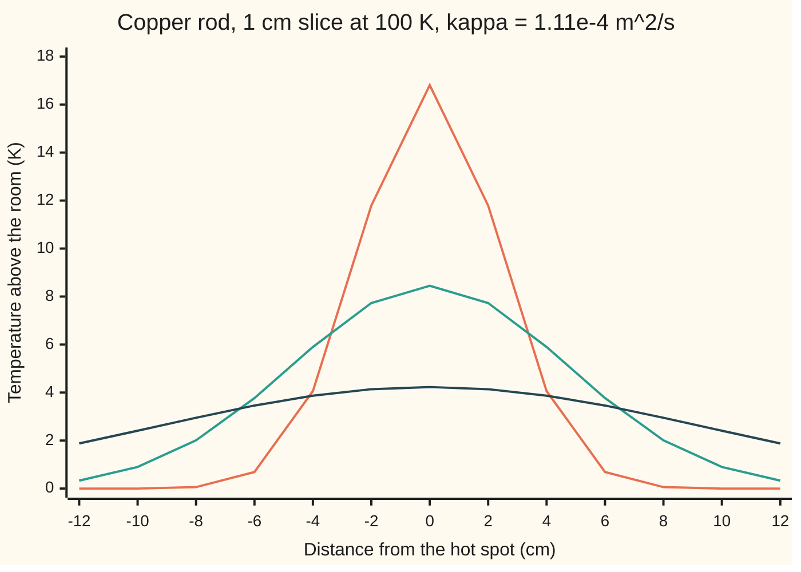

# The heat kernel: the bell-shaped answer to a single hot spot

[Syllabus](../../../SYLLABUS.md) → [Partial differential equations](../README.md) → [The Heat Equation in Depth](../README.md#s03) → The heat kernel

---

## General Overview

A copper rod 1 m long lies at room temperature. A torch flame touches its middle for a moment and heats a slice 1 cm wide to 100 K above the rest of the rod. Every temperature on this card is measured above the room. Where is that heat 10 seconds later?

It has spread into a bell. The centre has fallen to 8.45 K, and the bell has a standard width of 4.71 cm. The rod's ends are 50 cm away, more than ten widths, so on this time scale the rod behaves like an endless line.

[The heat kernel](../../08-Differential%20equations%20and%20dynamics/10-The%20Classical%20PDEs/10-the-heat-kernel.md) in wing 08 found this bell on a line by scaling, and proved that blending bells solves any start. This card does three new things:

- It finds the bell in any number of dimensions $`d`$: a rod ($`d = 1`$), a copper sheet ($`d = 2`$), a copper block ($`d = 3`$).
- It shows the bell is the answer to a start with all the heat at one point: a **point mass** of heat.
- It proves the bell's answer is the only solution that does not grow too fast far out, and shows a strange second solution that does.

As a problem in the sense of [A PDE problem](../01-Classification%20and%20Well-Posedness/01-what-a-pde-problem-is.md): the **unknown** is the temperature $`u(x, t)`$; the **region** is all of space, with no edges, for times $`0 < t \le T`$; the **data** is the start $`u(x, 0) = f(x)`$. A problem on all of space, fixed only by its start, is a **Cauchy problem**.

**A point of heat spreads into a bell of width $`\sqrt{2\kappa t}`$ in every direction, called the heat kernel; convolving any start with the kernel solves the heat equation, and this is the only solution that grows no faster than $`e^{a|x|^2}`$ far out, for some constant $`a`$.**

**What kind of fact this is:** a theorem, proved on this card in Why it works. The kernel and the convolution are proved in full, and the uniqueness proof is complete in a fold. Treating the 1 m rod as an endless line is a model; the code prints its error.

### The picture: the rod at 2.5 s, 10 s and 40 s



Orange: 2.5 s, peak 16.81 K. Teal: 10 s, peak 8.45 K. Dark blue: 40 s, peak 4.23 K. Each wait is four times the one before; each time the bell gets twice as wide and half as tall. The area under each curve is the same 1 K·m of heat.

---

## The formula

Notation, in words first. The dimension $`d`$ and the Laplacian come from earlier cards. A point is $`x = (x_1, \dots, x_d)`$, and $`|x|`$ is its distance from the hot spot. The Laplacian $`\Delta u = u_{x_1x_1} + \dots + u_{x_dx_d}`$ is the total bend of $`u`$ over all directions. The heat equation is $`u_t = \kappa\,\Delta u`$, where $`\kappa`$ (kappa) is the diffusivity.

This card introduces $`G`$ in $`d`$ dimensions: the **heat kernel**, the temperature grown from one unit of heat placed at the origin.

```math
G(x, t) = \frac{1}{(4\pi\kappa t)^{d/2}}\; e^{-|x|^2/(4\kappa t)}, \qquad t > 0
```

**Read it aloud:** the temperature at distance $`|x|`$ falls off as e to the minus distance squared over $`4\kappa t`$, and the factor in front keeps the total heat equal to one.

```math
u(x, t) = \int_{\mathbb{R}^d} G(x - y, t)\, f(y)\, dy
```

**Read it aloud:** each starting point $`y`$ sends out its own bell, sized by the heat $`f(y)`$ that sits there; the temperature at $`x`$ is the sum of all those bells.

That integral is a **convolution**: the kernel slid to every point and weighted by the start. The uniqueness theorem says it is the only solution in this class:

```math
|u(x, t)| \le M\, e^{a|x|^2} \quad \text{for all } x \text{ and } 0 \le t \le T
```

| Symbol | Plain meaning | In our example | Push it up and the answer… |
| --- | --- | --- | --- |
| $`u`$, $`f`$, $`Q`$ | temperature above the room, in K; $`f`$ the start; $`Q = \int f`$, the start's heat content, in K·m for the rod | $`f`$ = 100 K on the 1 cm slice; $`Q`$ = 100 K × 0.01 m = 1.00 K·m | every temperature grows in proportion to $`Q`$ |
| $`x`$, $`y`$, $`r`$ | a point; a starting point; $`r = \lvert x \rvert`$, the distance from the spot, in m | centre $`x = 0`$ | the bell's value falls |
| $`d`$ | dimension: number of space coordinates | 1 for the rod, 2 sheet, 3 block | lower peak, heat farther out |
| $`t`$, $`T`$ | time since the start, in s; the last time asked about | $`t`$ = 10 s | wider, lower bell |
| $`\kappa`$ | diffusivity: the spreading rate, in m²/s | $`1.11 \times 10^{-4}`$, copper, illustrative | faster spreading |
| $`G`$, $`\Delta`$ | heat kernel: temperature per unit of heat, per m$`^d`$; the Laplacian, total bend over all $`d`$ directions | peak of $`G`$ 8.4671 per m at 10 s, rod | — |
| $`\sigma`$, $`h`$ | width of the bell in each direction, $`\sqrt{2\kappa t}`$; grid spacing in the code | 4.71 cm at 10 s; $`h`$ = 2.5, 1.25, 0.625 mm | flatter bell; larger grid error |
| $`M`$, $`a`$ | the growth limit: size and rate in $`M e^{a\lvert x\rvert^2}`$ | the rod's $`u`$ is bounded: $`a = 0`$ | a larger class to be unique in |
| $`z`$, $`F`$, $`C`$, $`L`$ | scaled distance $`r/\sqrt{\kappa t}`$; the bell's fixed shape; its constant; a stretch length | $`z`$ = 0 at the centre | — |
| $`\varphi`$, $`b`$, $`\delta`$ | a smooth test shape; its width; the point mass | bump of width $`b`$ = 10 cm | wider bump: averages nearer 1 |
| $`g`$, $`k`$ | Tychonoff's time factor $`e^{-1/t^2}`$; the term number in his sum | terms up to $`k`$ = 80 | — |
| $`B`$, $`S`$, $`R`$, $`\mu`$, $`\gamma`$, $`\varepsilon`$ | the proof's barrier, its end time, ball radius, small multiple, spare rate and spare time ($`\varepsilon`$ is also an error allowance in the convolution proof) | — | — |

### When it holds

- **No edges, or edges far away.** The rod's held ends act like a mirror image of the hot spot 1 m away; at the centre at 10 s that image changes the answer by $`2.6 \times 10^{-97}`$ K. Once the bell's width is a sizable part of the distance to the ends, use the finite-rod methods instead.
- **Constant $`\kappa`$ and no flow.** A moving medium carries the bell along: [Convection-diffusion](06-convection-diffusion-and-drift.md). A $`\kappa`$ that varies with place bends the bell out of shape.
- **Forward in time.** $`G`$ exists only for $`t > 0`$. Run backwards, the equation multiplies small ripples without limit.
- **A growth limit.** Uniqueness needs $`|u| \le M e^{a|x|^2}`$. Without it, a nonzero solution starts from zero (Step 7).
- **A start that is not too wild.** The convolution converges if $`f`$ is continuous with $`|f(y)| \le M e^{a|y|^2}`$, and then at least for $`t < 1/(4a\kappa)`$.

---

## Why it works

### Step 0: a point of heat has no length of its own

The heat equation links a length squared to $`\kappa`$ times a time. A single point of heat brings no length of its own. So the only length in the problem is $`\sqrt{\kappa t}`$, and the answer must be one fixed shape, stretched by that length.

The total heat stays fixed. In $`d`$ dimensions a stretch by a length $`L`$ spreads the heat over a volume $`L^d`$. So the height must fall like $`(\kappa t)^{-d/2}`$.

### Step 1: the scaling form

Two more facts fix the form. If $`u(x, t)`$ solves the equation, so does $`u(Lx, L^2 t)`$ for any stretch $`L`$, because both sides gain a factor $`L^2`$. And a point source looks the same in every direction, so $`G`$ depends on $`x`$ only through $`r = |x|`$. Together:

```math
G(x, t) = (\kappa t)^{-d/2}\, F(z), \qquad z = \frac{r}{\sqrt{\kappa t}}
```

### Step 2: the equation becomes an ODE, and the ODE solves

For a function of $`r`$ alone, the Laplacian is $`G_{rr} + \frac{d-1}{r}G_r`$: the bend along the radius, plus a term for the spheres growing outward. Put the scaling form into $`u_t = \kappa\Delta u`$ with the chain rule. Every term carries $`(\kappa t)^{-d/2}/t`$, which cancels:

```math
F'' + \Big(\frac{d-1}{z} + \frac{z}{2}\Big) F' + \frac{d}{2} F = 0
```

Multiply by $`z^{d-1}`$. The left side becomes one exact derivative:

```math
\Big( z^{d-1} \big( F' + \tfrac{z}{2} F \big) \Big)' = 0
```

So $`z^{d-1}(F' + zF/2)`$ is a constant. At $`z = 0`$ it is 0: for $`d \ge 2`$ the factor $`z^{d-1}`$ is 0, and for $`d = 1`$ the bell is symmetric, so $`F'(0) = 0`$. So it is 0 everywhere. Then $`F' = -zF/2`$, which gives $`F = C e^{-z^2/4}`$ for a constant $`C`$. Back in $`x`$ and $`t`$, that is $`C\,(\kappa t)^{-d/2} e^{-|x|^2/(4\kappa t)}`$.

The constant comes from the total heat. The exponential splits into one factor per coordinate, $`e^{-x_1^2/(4\kappa t)} \cdots e^{-x_d^2/(4\kappa t)}`$. Each factor has area $`\sqrt{4\pi\kappa t}`$ (the Gaussian integral). So the total is $`(4\pi\kappa t)^{d/2}`$, and dividing by it gives the formula.

### Step 3: what the bell looks like in 1, 2 and 3 dimensions

The split in Step 2 says more: **the $`d`$-dimensional kernel is the product of $`d`$ one-dimensional kernels.** Each coordinate spreads on its own, as a [Normal](../../09-Probability%20and%20statistics/04-Continuous%20Distributions/04-normal-distribution.md) bell with centre 0 and variance $`2\kappa t`$.

So the width in each direction is $`\sigma = \sqrt{2\kappa t}`$ = 4.71 cm at 10 s, in any dimension. The mean squared distance adds over the $`d`$ directions, to $`2d\kappa t`$.

| Copper, 10 s after a point of heat | rod, $`d = 1`$ | sheet, $`d = 2`$ | block, $`d = 3`$ |
| --- | ---: | ---: | ---: |
| peak of $`G`$ | 8.4671 per m | 71.691 per m² | 607.02 per m³ |
| root-mean-square distance $`\sqrt{2d\kappa t}`$ | 4.71 cm | 6.66 cm | 8.16 cm |
| share of the heat within 4.71 cm | 0.6827 | 0.3935 | 0.1987 |
| peak falls from 10 s to 40 s by | 2 | 4 | 8 |

The width per direction is the same. But in more dimensions there is more room far out, so less of the heat stays near the spot. The peak falls like $`t^{-d/2}`$: in a block, four times the wait gives one eighth of the peak.

### Step 4: the kernel is the answer to a point mass

What does "starts as a point mass" mean, when $`G`$ has no value at $`t = 0`$? It means: average any smooth, bounded shape $`\varphi`$ against $`G`$, and the result tends to the shape's value at the spot.

```math
\int_{\mathbb{R}^d} G(x, t)\, \varphi(x)\, dx \;\longrightarrow\; \varphi(0) \quad \text{as } t \to 0
```

The reason: $`G`$ always holds one unit of heat, and squeezes it into a width $`\sqrt{2\kappa t}`$ that shrinks to nothing. The first correction is $`\kappa t\,\Delta\varphi(0)`$. For a bump $`\varphi(x) = e^{-x^2/(2b^2)}`$ on the rod, with $`b`$ = 10 cm, the code finds:

| $`t`$ | average of the bump against $`G`$ | exact, $`b/\sqrt{b^2 + 2\kappa t}`$ | first-order guess $`1 - \kappa t/b^2`$ |
| --- | ---: | ---: | ---: |
| 10 s | 0.904616 | 0.904616 | 0.889000 |
| 1 s | 0.989081 | 0.989081 | 0.988900 |
| 0.1 s | 0.998892 | 0.998892 | 0.998890 |

The averages close in on $`\varphi(0) = 1`$. In the language of distributions, $`G(\cdot, t) \to \delta`$, the point mass. So $`G`$ solves the heat equation for $`t > 0`$ and starts at $`\delta`$. That is exactly what [Fundamental solution](../../18-Functional%20analysis/04-Distributions%20and%20Sobolev%20Spaces/04-fundamental-solutions-and-the-response-to-a-spike.md) asks for: set to 0 for $`t < 0`$, $`G`$ solves $`G_t - \kappa\Delta G = \delta`$ in space and time together.

### Step 5: any start is a blend of point masses

The equation is linear and looks the same at every place. So a point mass at $`y`$ grows into $`G(x - y, t)`$, and a start $`f`$, cut into small pieces $`f(y)\,dy`$, grows into the sum of their bells: the convolution.

For the rod's slice the convolution has a closed form through the error function $`\mathrm{erf}`$ (wing 08):

```math
u(x, t) = 50\,\Big( \mathrm{erf}\Big(\frac{x + 0.005}{2\sqrt{\kappa t}}\Big) - \mathrm{erf}\Big(\frac{x - 0.005}{2\sqrt{\kappa t}}\Big) \Big)\ \mathrm{K}
```

At the centre at 10 s, three roads agree:

- the erf form: 8.4512 K;
- the convolution, added up by Simpson's rule: 8.4512 K;
- a grid on the real 1 m rod, ends held at room temperature, where each point steps toward the average of its two neighbours: 8.445127, 8.449691, 8.450833 K at spacings 2.5, 1.25 and 0.625 mm. The error falls fourfold each time: observed order 2.00.

Treating the slice as a point mass gives $`Q\,G(0, t)`$ = 8.4671 K, 0.19% high. A 1 cm slice is nearly a point next to a 4.71 cm bell.

<details>
<summary>Detailed proof: the convolution solves the equation and starts at f, in d dimensions</summary>

Let $`f`$ be bounded and continuous. For $`t > 0`$, every derivative of $`G`$ is a polynomial times $`G`$, so it is bounded by a constant times a wider bell, which has finite integral. So derivatives pass under the integral:

$`\displaystyle u_t - \kappa\Delta u = \int_{\mathbb{R}^d} \big(G_t - \kappa\Delta G\big)(x - y, t)\, f(y)\, dy = 0.`$

For the start, use that $`G`$ has total 1:

$`\displaystyle u(x, t) - f(x) = \int_{\mathbb{R}^d} G(x - y, t)\, \big(f(y) - f(x)\big)\, dy.`$

Given $`\varepsilon > 0`$, pick a radius $`R`$ with $`|f(y) - f(x)| < \varepsilon`$ when $`|y - x| < R`$. The part of the integral near $`x`$ is below $`\varepsilon`$. The rest is at most $`2\sup|f|`$ times the heat of $`G`$ beyond distance $`R`$. That heat tends to 0 as $`t \to 0`$, because the width $`\sqrt{2\kappa t}`$ does. So $`u(x, t) \to f(x)`$.

</details>

### Step 6: the only solution with limited growth

**Theorem.** Let $`u`$ be continuous for $`x`$ in $`\mathbb{R}^d`$ and $`0 \le t \le T`$, with $`u_t`$ and all second space derivatives continuous for $`t > 0`$. Suppose $`u_t = \kappa\Delta u`$, $`u(x, 0) = 0`$, and $`|u(x, t)| \le M e^{a|x|^2}`$. Then $`u = 0`$ everywhere.

Apply it to the difference of two solutions with the same start. The difference starts at 0 and, if both grow no faster than $`M e^{a|x|^2}`$, so does it. So it is 0, and the two solutions agree.

The idea in words. On a bounded region, over a time interval, a solution's largest value sits at the start or on the sides: [Diffusion's maximum principle](04-maximum-principle-for-the-heat-equation.md). Space has no sides, so build them: take a large ball. On its surface the solution is at most $`M e^{a|x|^2}`$. Subtract a small multiple of a **barrier**, a solution of the heat equation that grows even faster than that. Then the difference is at most 0 on the surface and at the start, so at most 0 inside. Let the multiple shrink to 0.

<details>
<summary>Detailed proof: the barrier and the maximum principle</summary>

First suppose $`4a\kappa T < 1`$. Then $`4a\kappa(T + \varepsilon) < 1`$ for some $`\varepsilon > 0`$, so $`\frac{1}{4\kappa(T + \varepsilon)} = a + \gamma`$ with $`\gamma > 0`$.

Fix a point $`y`$ and a small $`\mu > 0`$. Write $`S = T + \varepsilon`$. The barrier is

$`\displaystyle B(x, t) = (S - t)^{-d/2}\, e^{|x - y|^2/(4\kappa(S - t))}.`$

It solves the heat equation for $`t < S`$. Direct differentiation gives both $`B_t`$ and $`\kappa\Delta B`$ as $`\big(\tfrac{d}{2(S - t)} + \tfrac{|x - y|^2}{4\kappa(S - t)^2}\big)B`$. The code checks this by centred differences.

Let $`v = u - \mu B`$. It solves the heat equation. Take the cylinder $`|x - y| < R`$, $`0 \le t \le T`$.

- At $`t = 0`$: $`v \le u = 0`$.
- On the side $`|x - y| = R`$: $`B \ge S^{-d/2} e^{(a + \gamma)R^2}`$, while $`u \le M e^{a(|y| + R)^2}`$. The exponent $`(a + \gamma)R^2`$ outgrows $`a(|y| + R)^2`$, so for $`R`$ large, $`v \le 0`$ there.

By the maximum principle on the cylinder, $`v \le 0`$ inside. At $`x = y`$ this reads $`u(y, t) \le \mu (S - t)^{-d/2}`$. Let $`\mu \to 0`$: $`u(y, t) \le 0`$. The same argument for $`-u`$ gives $`u(y, t) \ge 0`$.

For a longer $`T`$, repeat on time slabs of length $`1/(8a\kappa)`$, each starting where the last ended at 0.

</details>

### Step 7: without the growth limit, zero can grow into something

The limit is needed. Tychonoff built a nonzero solution that starts at 0 (scaled: $`x`$ in metres and time in units of (1 m)² over copper's $`\kappa`$, which is 9009 s, so that $`\kappa = 1`$). Take $`g(t) = e^{-1/t^2}`$, which tends to 0 with all its derivatives as $`t \to 0`$, and set

```math
u(x, t) = \sum_{k=0}^{\infty} g^{(k)}(t)\, \frac{x^{2k}}{(2k)!}
```

Here $`g^{(k)}`$ is the $`k`$-th derivative. Differentiating the sum twice in $`x`$ shifts every term down by one, which is what one more $`t`$ derivative does. So $`u_t = u_{xx}`$.

| $`t`$ (scaled) | $`u(0, t)`$ | $`u(1, t)`$ | $`u(2, t)`$ |
| --- | ---: | ---: | ---: |
| 0.4 | $`1.930 \times 10^{-3}`$ | $`1.200 \times 10^{-1}`$ | $`1.983`$ |
| 0.2 | $`1.389 \times 10^{-11}`$ | $`8.553 \times 10^{-6}`$ | $`1.716 \times 10^{-1}`$ |
| 0.1 | $`3.720 \times 10^{-44}`$ | $`1.178 \times 10^{-26}`$ | $`2.420 \times 10^{-12}`$ |

At every place, $`u`$ fades to 0 as $`t \to 0`$. Yet it is not 0. The theorem then forces it to break every limit $`M e^{a x^2}`$: far out it grows faster. The code sums the terms up to $`k`$ = 80; the first omitted term, $`k`$ = 81, is at most $`1.0 \times 10^{-37}`$. It also puts the sum back into the equation at $`x = 1`$, $`t = 0.4`$: $`u_t`$ = 1.5528 and $`u_{xx}`$ = 1.5533, with a gap that falls fourfold as the step halves.

So "the solution of the Cauchy problem" means the solution with limited growth. Physically, Tychonoff's solution needs heat pouring in from infinity.

---

## Worked numbers, by hand

The rod at its centre, 10 s after the torch.

| Step | Arithmetic | Value |
| --- | --- | --- |
| heat in the slice, $`Q`$ | 100 K × 0.01 m | 1.00 K·m |
| $`4\kappa t`$ | 4 × 1.11 × 10⁻⁴ × 10 | $`4.440 \times 10^{-3}`$ m² |
| height factor $`\sqrt{4\pi\kappa t}`$ | $`\sqrt{\pi \times 4.440 \times 10^{-3}}`$ | 0.11810 m |
| peak of $`G`$ | 1 / 0.11810 | 8.4671 per m |
| point-mass centre, $`Q\,G(0, t)`$ | 1.00 × 8.4671 | 8.4671 K |
| true centre, slice by the erf form | Step 5 | **8.4512 K** |
| width $`\sqrt{2\kappa t}`$ | $`\sqrt{2 \times 1.11 \times 10^{-4} \times 10}`$ | **4.71 cm** |
| root-mean-square distance in a block | $`\sqrt{6\kappa t}`$ | 8.16 cm |

Ten seconds after the torch, the centre of the rod is 8.45 K above the room, and the heat sits in a bell of width 4.71 cm.

### What breaks if you drop a piece

| Mistake | Comes out at | What went wrong |
| --- | --- | --- |
| Width taken as $`\sqrt{\kappa t}`$ | 3.33 cm, not 4.71 cm | the variance in each direction is $`2\kappa t`$ |
| A block's spread taken as the rod's width | 4.71 cm, not 8.16 cm | the mean squared distance adds over 3 directions |
| One-dimensional factor $`(4\pi\kappa t)^{-1/2}`$ used in 3-D | total heat 0.01395 m², not 1 | the factor must be $`(4\pi\kappa t)^{-d/2}`$ |
| A block's peak taken to fall like $`t^{-1/2}`$ | falls by 2 from 10 s to 40 s; truly by 8.0 | the peak falls like $`t^{-d/2}`$ |

The code prints all four.

---

## How the hot spot spreads in time

Same rod, same slice. The centre, read at four-fold steps in time:

```
time   centre temperature
 2.5 s ████████████████████████████████  16.81 K
10   s ████████████████                   8.45 K
40   s ████████                           4.23 K
```

Each four-fold wait halves the peak and doubles the width. Heat near the centre goes fast; heat that must travel far goes slowly. The chart in the General Overview shows the three whole profiles.

---

## Code, from first principles, and it actually runs

The code computes every number on this card from scratch: its own erf (a series of positive terms), its own Simpson's rule and its own grid. It takes these independent roads:

1. The closed-form kernel, checked against radial Simpson integrals: total heat 1, mean squared distance $`2d\kappa t`$, and the share within 4.71 cm against its closed forms, for $`d`$ = 1, 2, 3.
2. The three-dimensional kernel put back into the equation by centred differences, the gap falling fourfold as the step halves.
3. The rod's centre three ways: erf form, Simpson convolution, and an explicit grid on the real 1 m rod at three spacings.
4. The point-mass limit against its exact value.
5. Tychonoff's series and the proof's barrier, each put back into the equation.

### Python

```python
# The heat kernel in d dimensions: a hot spot in a 1 m copper rod, 10 s later.
# Standard library only. erf, Simpson's rule and the grid are written out here.
from math import sqrt, exp, log, pi

KAPPA, T, A, U0 = 1.11e-4, 10.0, 0.005, 100.0   # copper m^2/s; s; slice half-width m; K

def erf(z):                     # 2/sqrt(pi) e^(-z^2) sum 2^n z^(2n+1)/(1*3*...*(2n+1)): all terms positive
    if z < 0: return -erf(-z)
    s = term = z
    for n in range(1, 400):
        term *= 2 * z * z / (2 * n + 1); s += term
        if term < 1e-17 * s: break
    return 2 / sqrt(pi) * exp(-z * z) * s

def G(r2, t, d, k=KAPPA):       # the kernel at squared distance r2, in d dimensions
    return exp(-r2 / (4 * k * t)) / (4 * pi * k * t) ** (d / 2)

def simpson(f, a, b, n):
    h = (b - a) / n
    return h / 3 * (f(a) + f(b) + sum((4 if i % 2 else 2) * f(a + i * h) for i in range(1, n)))

def box(x, t):                  # the 1 cm slice at 100 K, spread by t seconds: closed form
    w = 2 * sqrt(KAPPA * t)
    return U0 / 2 * (erf((x + A) / w) - erf((x - A) / w))

def grid(m):                    # explicit grid on the whole 1 m rod, ends held at 0 K above the room
    N, n = 400 * m, 445 * m * m; h, dt = 1.0 / N, T / n
    r = KAPPA * dt / h ** 2; assert r <= 0.5
    u = [U0 if abs(-0.5 + i * h) < A - 1e-12 else 0.0 for i in range(N + 1)]
    for i in (N // 2 - 2 * m, N // 2 + 2 * m): u[i] = U0 / 2      # slice edges fall on nodes
    for _ in range(n):
        u = [0.0] + [u[i] + r * (u[i - 1] - 2 * u[i] + u[i + 1]) for i in range(1, N)] + [0.0]
    return u[N // 2], h, r

sig = sqrt(2 * KAPPA * T)
print(f"hand: heat in the slice {U0:.0f} K x {200*A:.0f} cm = {U0*2*A:.2f} K m; 4 kappa t = {4*KAPPA*T:.3e} m^2;"
      f" sqrt(4 pi kappa t) = {sqrt(4*pi*KAPPA*T):.5f} m; 1/that = {1/sqrt(4*pi*KAPPA*T):.4f} per m")
print(f"rod: kappa {KAPPA:.3e} m^2/s, t = {T:.0f} s, width sqrt(2 kappa t) = {100*sig:.2f} cm")
OMEGA = {1: 2.0, 2: 2 * pi, 3: 4 * pi}         # size of the unit sphere's surface in d dimensions
close = {1: erf(sqrt(0.5)), 2: 1 - exp(-0.5), 3: erf(sqrt(0.5)) - sqrt(2 / pi) * exp(-0.5)}
for d in (1, 2, 3):
    mass = simpson(lambda r: OMEGA[d] * r ** (d - 1) * G(r * r, T, d), 0, 0.5, 2000)
    msq = simpson(lambda r: OMEGA[d] * r ** (d + 1) * G(r * r, T, d), 0, 0.5, 2000)
    near = simpson(lambda r: OMEGA[d] * r ** (d - 1) * G(r * r, T, d), 0, sig, 2000)
    print(f"d = {d}: peak {G(0, T, d):.4e} per m^{d}; total {mass:.9f}; rms distance {100*sqrt(msq):.2f} cm"
          f" (sqrt(2 d kappa t) {100*sqrt(2*d*KAPPA*T):.2f}); share within {100*sig:.2f} cm {near:.4f} (closed form {close[d]:.4f})")
    assert abs(mass - 1) < 1e-9
    assert abs(msq - 2 * d * KAPPA * T) < 1e-12
    assert abs(near - close[d]) < 1e-9

p, res = (0.02, 0.01, 0.01), []                  # the 3-d kernel put back into u_t = kappa Lap u
g3 = lambda q, t: G(sum(c * c for c in q), t, 3)
for h in (0.002, 0.001):
    ut = (g3(p, T + h * 50) - g3(p, T - h * 50)) / (h * 100)
    lap = sum((g3([c + h * (j == i) for j, c in enumerate(p)], T) - 2 * g3(p, T)
               + g3([c - h * (j == i) for j, c in enumerate(p)], T)) / h ** 2 for i in range(3))
    res.append(ut - KAPPA * lap)
print(f"d = 3 at (2, 1, 1) cm: u_t = {ut:.4f}, kappa Lap u = {KAPPA*lap:.4f} per m^3 per s;"
      f" residual {res[0]:.3e} then {res[1]:.3e}, ratio {res[0]/res[1]:.2f}")
assert abs(res[0] / res[1] - 4) < 0.1
assert abs(ut - KAPPA * lap) < 1e-3 * abs(ut)

exact = box(0, T)
conv = simpson(lambda y: U0 * G(y * y, T, 1), -A, A, 200)
point = U0 * 2 * A * G(0, T, 1)
print(f"rod centre at 10 s: erf form {exact:.4f} K, kernel convolution {conv:.4f} K, point mass {point:.4f} K"
      f" ({100*(point/exact-1):.2f}% high)")
assert abs(conv - exact) < 1e-9
assert abs(point / exact - 1) < 0.002
errs = []
for m in (1, 2, 4):
    c, h, r = grid(m); errs.append(abs(c - exact))
    print(f"grid h = {1000*h:.3f} mm, r = {r:.4f}: centre {c:.6f} K, error {errs[-1]:.2e} K")
print(f"observed order {log(errs[0]/errs[1], 2):.2f}, {log(errs[1]/errs[2], 2):.2f}")
assert 1.8 < log(errs[1] / errs[2], 2) < 2.2
print(f"first image term from the held ends, at the centre: {2*U0*2*A*G(1.0, T, 1):.1e} K")

b = 0.1                          # the kernel tends to a point mass: test bump e^(-x^2/(2b^2)), b = 10 cm
for t in (10.0, 1.0, 0.1):
    v = simpson(lambda x: G(x * x, t, 1) * exp(-x * x / (2 * b * b)), -1, 1, 4000)
    print(f"t = {t:4.1f} s: integral of G times bump {v:.6f}; exact b/sqrt(b^2+2 kappa t)"
          f" {b/sqrt(b*b+2*KAPPA*t):.6f}; 1 - kappa t/b^2 {1-KAPPA*t/b**2:.6f}")
    assert abs(v - b / sqrt(b * b + 2 * KAPPA * t)) < 1e-9

for t in (2.5, 10.0, 40.0):
    print(f"figure, t = {t:4.1f} s, x = -12..12 cm step 2: " + ", ".join(f"{box(x/100, t):.2f}" for x in range(-12, 13, 2)))
print(f"peaks at 2.5, 10, 40 s: {box(0, 2.5):.2f} {box(0, 10):.2f} {box(0, 40):.2f} K")

def tych(x, t0, K=80):           # Tychonoff, scaled kappa = 1: sum g^(k)(t) x^(2k)/(2k)!, g = e^(-1/t^2)
    a = [-((-1) ** j) * (j + 1) / t0 ** 2 for j in range(K + 2)]
    bk = [exp(a[0])]
    for k in range(1, K + 2): bk.append(sum(j * a[j] * bk[k - j] for j in range(1, k + 1)) / k)
    s, c = 0.0, 1.0
    for k in range(K + 1):
        s += c * bk[k]; c *= (k + 1) / ((2 * k + 1) * (2 * k + 2)) * x * x / t0
    return s, abs(c * bk[K + 1])     # the sum to term K, and the first omitted term, K + 1
print(f"Tychonoff, scaled: x in m, time unit (1 m)^2/kappa = {1/KAPPA:.0f} s, so kappa = 1")
for t in (0.4, 0.2, 0.1):
    print(f"Tychonoff, scaled, t = {t}: u(0) = {tych(0, t)[0]:.3e}, u(1) = {tych(1, t)[0]:.3e}, u(2) = {tych(2, t)[0]:.3e}")
print(f"Tychonoff, largest first omitted term (term 81) over these: {max(tych(x, t)[1] for x in (1, 2) for t in (0.4, 0.2, 0.1)):.1e}")
tr = []
for h in (0.01, 0.005):
    ut = (tych(1, 0.4 + h)[0] - tych(1, 0.4 - h)[0]) / (2 * h)
    uxx = (tych(1 + h, 0.4)[0] - 2 * tych(1, 0.4)[0] + tych(1 - h, 0.4)[0]) / h ** 2
    tr.append(ut - uxx)
print(f"Tychonoff at x = 1, t = 0.4: u_t = {ut:.4f}, u_xx = {uxx:.4f}; residual {tr[0]:.2e} then {tr[1]:.2e}")
assert abs(tr[0] / tr[1] - 4) < 0.2
assert tych(1, 0.1)[0] < 1e-25 < tych(1, 0.4)[0]

B = lambda x, t: exp(x * x / (4 * (1 - t))) / sqrt(1 - t)     # the proof's barrier, scaled, S = 1
br = (B(0.5, 0.51) - B(0.5, 0.49)) / 0.02 - (B(0.51, 0.5) - 2 * B(0.5, 0.5) + B(0.49, 0.5)) / 1e-4
print(f"barrier at x = 0.5, t = 0.5, scaled: u_t - u_xx = {br:.2e} (step 0.01)")
assert abs(br) < 1e-3

print(f"mistake 1, width sqrt(kappa t): {100*sqrt(KAPPA*T):.2f} cm, not {100*sig:.2f}")
print(f"mistake 2, 3-d spread taken as the 1-d width: {100*sig:.2f} cm, rms is {100*sqrt(6*KAPPA*T):.2f}")
print(f"mistake 3, 1-d prefactor in 3-d: total {4*pi*KAPPA*T:.5f} m^2, not 1")
print("peak falls from 10 s to 40 s, d = 1, 2, 3: " + " ".join(f"{G(0, 10, d)/G(0, 40, d):.1f}" for d in (1, 2, 3)))
print(f"mistake 4, 3-d peak from 10 s to 40 s: falls by {G(0,10,3)/G(0,40,3):.1f}, not {G(0,10,1)/G(0,40,1):.1f}")
print(f"finance: volatility 0.20, kappa = volatility^2/2 = {0.2**2/2:.2f} per year; width after 1 year {sqrt(2*0.02*1):.4f} in log price")
print("ALL CHECKS PASS")
```

**Ran 2026-11-15 on macOS, Python 3.14.10, standard library only. All checks passed. Output, pasted from the run:**

```
hand: heat in the slice 100 K x 1 cm = 1.00 K m; 4 kappa t = 4.440e-03 m^2; sqrt(4 pi kappa t) = 0.11810 m; 1/that = 8.4671 per m
rod: kappa 1.110e-04 m^2/s, t = 10 s, width sqrt(2 kappa t) = 4.71 cm
d = 1: peak 8.4671e+00 per m^1; total 1.000000000; rms distance 4.71 cm (sqrt(2 d kappa t) 4.71); share within 4.71 cm 0.6827 (closed form 0.6827)
d = 2: peak 7.1691e+01 per m^2; total 1.000000000; rms distance 6.66 cm (sqrt(2 d kappa t) 6.66); share within 4.71 cm 0.3935 (closed form 0.3935)
d = 3: peak 6.0702e+02 per m^3; total 1.000000000; rms distance 8.16 cm (sqrt(2 d kappa t) 8.16); share within 4.71 cm 0.1987 (closed form 0.1987)
d = 3 at (2, 1, 1) cm: u_t = -72.3794, kappa Lap u = -72.3698 per m^3 per s; residual -3.814e-02 then -9.538e-03, ratio 4.00
rod centre at 10 s: erf form 8.4512 K, kernel convolution 8.4512 K, point mass 8.4671 K (0.19% high)
grid h = 2.500 mm, r = 0.3991: centre 8.445127 K, error 6.09e-03 K
grid h = 1.250 mm, r = 0.3991: centre 8.449691 K, error 1.52e-03 K
grid h = 0.625 mm, r = 0.3991: centre 8.450833 K, error 3.81e-04 K
observed order 2.00, 2.00
first image term from the held ends, at the centre: 2.6e-97 K
t = 10.0 s: integral of G times bump 0.904616; exact b/sqrt(b^2+2 kappa t) 0.904616; 1 - kappa t/b^2 0.889000
t =  1.0 s: integral of G times bump 0.989081; exact b/sqrt(b^2+2 kappa t) 0.989081; 1 - kappa t/b^2 0.988900
t =  0.1 s: integral of G times bump 0.998892; exact b/sqrt(b^2+2 kappa t) 0.998892; 1 - kappa t/b^2 0.998890
figure, t =  2.5 s, x = -12..12 cm step 2: 0.00, 0.00, 0.06, 0.69, 4.06, 11.79, 16.81, 11.79, 4.06, 0.69, 0.06, 0.00, 0.00
figure, t = 10.0 s, x = -12..12 cm step 2: 0.33, 0.90, 2.01, 3.77, 5.90, 7.73, 8.45, 7.73, 5.90, 3.77, 2.01, 0.90, 0.33
figure, t = 40.0 s, x = -12..12 cm step 2: 1.88, 2.41, 2.95, 3.46, 3.87, 4.14, 4.23, 4.14, 3.87, 3.46, 2.95, 2.41, 1.88
peaks at 2.5, 10, 40 s: 16.81 8.45 4.23 K
Tychonoff, scaled: x in m, time unit (1 m)^2/kappa = 9009 s, so kappa = 1
Tychonoff, scaled, t = 0.4: u(0) = 1.930e-03, u(1) = 1.200e-01, u(2) = 1.983e+00
Tychonoff, scaled, t = 0.2: u(0) = 1.389e-11, u(1) = 8.553e-06, u(2) = 1.716e-01
Tychonoff, scaled, t = 0.1: u(0) = 3.720e-44, u(1) = 1.178e-26, u(2) = 2.420e-12
Tychonoff, largest first omitted term (term 81) over these: 1.0e-37
Tychonoff at x = 1, t = 0.4: u_t = 1.5528, u_xx = 1.5533; residual -2.14e-03 then -5.34e-04
barrier at x = 0.5, t = 0.5, scaled: u_t - u_xx = 6.66e-04 (step 0.01)
mistake 1, width sqrt(kappa t): 3.33 cm, not 4.71
mistake 2, 3-d spread taken as the 1-d width: 4.71 cm, rms is 8.16
mistake 3, 1-d prefactor in 3-d: total 0.01395 m^2, not 1
peak falls from 10 s to 40 s, d = 1, 2, 3: 2.0 4.0 8.0
mistake 4, 3-d peak from 10 s to 40 s: falls by 8.0, not 2.0
finance: volatility 0.20, kappa = volatility^2/2 = 0.02 per year; width after 1 year 0.2000 in log price
ALL CHECKS PASS
```

### Rust

Same numbers, same labels, built with `rustc --edition 2021 -O`.

```rust
// The heat kernel in d dimensions: a hot spot in a 1 m copper rod, 10 s later.
// std only. erf, Simpson's rule and the grid are written out here.
use std::f64::consts::PI;

const KAPPA: f64 = 1.11e-4; // copper, m^2/s
const T: f64 = 10.0; // s
const A: f64 = 0.005; // slice half-width, m
const U0: f64 = 100.0; // K

fn sci(x: f64, p: usize) -> String { // Python's e-format: mantissa, sign, two-digit exponent
    let s = format!("{:.*e}", p, x);
    let (m, e) = s.split_once('e').unwrap();
    let e: i32 = e.parse().unwrap();
    format!("{}e{}{:02}", m, if e < 0 { '-' } else { '+' }, e.abs())
}
fn erf(z: f64) -> f64 { // 2/sqrt(pi) e^(-z^2) sum 2^n z^(2n+1)/(1*3*...*(2n+1)): all terms positive
    if z < 0.0 { return -erf(-z); }
    let (mut s, mut term) = (z, z);
    for n in 1..400 {
        term *= 2.0 * z * z / (2 * n + 1) as f64; s += term;
        if term < 1e-17 * s { break; }
    }
    2.0 / PI.sqrt() * (-z * z).exp() * s
}
fn g(r2: f64, t: f64, d: i32, k: f64) -> f64 { // the kernel at squared distance r2, in d dimensions
    (-r2 / (4.0 * k * t)).exp() / (4.0 * PI * k * t).powf(d as f64 / 2.0)
}
fn simpson<F: Fn(f64) -> f64>(f: F, a: f64, b: f64, n: usize) -> f64 {
    let h = (b - a) / n as f64;
    let mut s = 0.0;
    for i in 1..n { s += (if i % 2 == 1 { 4.0 } else { 2.0 }) * f(a + i as f64 * h); }
    h / 3.0 * (f(a) + f(b) + s)
}
fn bx(x: f64, t: f64) -> f64 { // the 1 cm slice at 100 K, spread by t seconds: closed form
    let w = 2.0 * (KAPPA * t).sqrt();
    U0 / 2.0 * (erf((x + A) / w) - erf((x - A) / w))
}
fn grid(m: usize) -> (f64, f64, f64) { // explicit grid on the whole 1 m rod, ends held at 0 K above the room
    let (nn, n) = (400 * m, 445 * m * m);
    let (h, dt) = (1.0 / nn as f64, T / n as f64);
    let r = KAPPA * dt / h.powf(2.0);
    assert!(r <= 0.5);
    let mut u: Vec<f64> = (0..=nn).map(|i| if (-0.5 + i as f64 * h).abs() < A - 1e-12 { U0 } else { 0.0 }).collect();
    for i in [nn / 2 - 2 * m, nn / 2 + 2 * m] { u[i] = U0 / 2.0; } // slice edges fall on nodes
    for _ in 0..n {
        let mut v = vec![0.0; nn + 1];
        for i in 1..nn { v[i] = u[i] + r * (u[i - 1] - 2.0 * u[i] + u[i + 1]); }
        u = v;
    }
    (u[nn / 2], h, r)
}
fn tych(x: f64, t0: f64, kk: usize) -> (f64, f64) { // Tychonoff, scaled kappa = 1: sum g^(k)(t) x^(2k)/(2k)!, g = e^(-1/t^2)
    let a: Vec<f64> = (0..=kk + 1).map(|j| -(if j % 2 == 0 { 1.0 } else { -1.0 }) * (j + 1) as f64 / t0.powf(2.0)).collect();
    let mut bk = vec![a[0].exp()];
    for k in 1..=kk + 1 {
        let mut s = 0.0;
        for j in 1..=k { s += j as f64 * a[j] * bk[k - j]; }
        bk.push(s / k as f64);
    }
    let (mut s, mut c) = (0.0, 1.0);
    for k in 0..=kk {
        s += c * bk[k];
        c *= (k + 1) as f64 / ((2 * k + 1) as f64 * (2 * k + 2) as f64) * x * x / t0;
    }
    (s, (c * bk[kk + 1]).abs()) // the sum to term kk, and the first omitted term, kk + 1
}

fn main() {
    let sig = (2.0 * KAPPA * T).sqrt();
    println!("hand: heat in the slice {:.0} K x {:.0} cm = {:.2} K m; 4 kappa t = {} m^2; sqrt(4 pi kappa t) = {:.5} m; 1/that = {:.4} per m",
        U0, 200.0 * A, U0 * 2.0 * A, sci(4.0 * KAPPA * T, 3), (4.0 * PI * KAPPA * T).sqrt(), 1.0 / (4.0 * PI * KAPPA * T).sqrt());
    println!("rod: kappa {} m^2/s, t = {:.0} s, width sqrt(2 kappa t) = {:.2} cm", sci(KAPPA, 3), T, 100.0 * sig);
    for d in 1..=3 {
        let om = [2.0, 2.0 * PI, 4.0 * PI][d as usize - 1]; // size of the unit sphere's surface
        let close = [erf(0.5f64.sqrt()), 1.0 - (-0.5f64).exp(), erf(0.5f64.sqrt()) - (2.0 / PI).sqrt() * (-0.5f64).exp()][d as usize - 1];
        let mass = simpson(|r| om * r.powf((d - 1) as f64) * g(r * r, T, d, KAPPA), 0.0, 0.5, 2000);
        let msq = simpson(|r| om * r.powf((d + 1) as f64) * g(r * r, T, d, KAPPA), 0.0, 0.5, 2000);
        let near = simpson(|r| om * r.powf((d - 1) as f64) * g(r * r, T, d, KAPPA), 0.0, sig, 2000);
        println!("d = {}: peak {} per m^{}; total {:.9}; rms distance {:.2} cm (sqrt(2 d kappa t) {:.2}); share within {:.2} cm {:.4} (closed form {:.4})",
            d, sci(g(0.0, T, d, KAPPA), 4), d, mass, 100.0 * msq.sqrt(), 100.0 * (2.0 * d as f64 * KAPPA * T).sqrt(), 100.0 * sig, near, close);
        assert!((mass - 1.0).abs() < 1e-9);
        assert!((msq - 2.0 * d as f64 * KAPPA * T).abs() < 1e-12);
        assert!((near - close).abs() < 1e-9);
    }

    let p = [0.02, 0.01, 0.01]; // the 3-d kernel put back into u_t = kappa Lap u
    let g3 = |q: [f64; 3], t: f64| g(q[0] * q[0] + q[1] * q[1] + q[2] * q[2], t, 3, KAPPA);
    let (mut res, mut ut, mut lap) = (vec![], 0.0, 0.0);
    for h in [0.002, 0.001] {
        ut = (g3(p, T + h * 50.0) - g3(p, T - h * 50.0)) / (h * 100.0);
        lap = 0.0;
        for i in 0..3 {
            let (mut up, mut dn) = (p, p);
            up[i] += h; dn[i] -= h;
            lap += (g3(up, T) - 2.0 * g3(p, T) + g3(dn, T)) / h.powf(2.0);
        }
        res.push(ut - KAPPA * lap);
    }
    println!("d = 3 at (2, 1, 1) cm: u_t = {:.4}, kappa Lap u = {:.4} per m^3 per s; residual {} then {}, ratio {:.2}",
        ut, KAPPA * lap, sci(res[0], 3), sci(res[1], 3), res[0] / res[1]);
    assert!((res[0] / res[1] - 4.0).abs() < 0.1);
    assert!((ut - KAPPA * lap).abs() < 1e-3 * ut.abs());

    let exact = bx(0.0, T);
    let conv = simpson(|y| U0 * g(y * y, T, 1, KAPPA), -A, A, 200);
    let point = U0 * 2.0 * A * g(0.0, T, 1, KAPPA);
    println!("rod centre at 10 s: erf form {:.4} K, kernel convolution {:.4} K, point mass {:.4} K ({:.2}% high)",
        exact, conv, point, 100.0 * (point / exact - 1.0));
    assert!((conv - exact).abs() < 1e-9);
    assert!((point / exact - 1.0).abs() < 0.002);
    let mut errs = vec![];
    for m in [1, 2, 4] {
        let (c, h, r) = grid(m);
        errs.push((c - exact).abs());
        println!("grid h = {:.3} mm, r = {:.4}: centre {:.6} K, error {} K", 1000.0 * h, r, c, sci(errs[errs.len() - 1], 2));
    }
    let o = |a: f64, b: f64| (a / b).ln() / 2f64.ln();
    println!("observed order {:.2}, {:.2}", o(errs[0], errs[1]), o(errs[1], errs[2]));
    assert!(1.8 < o(errs[1], errs[2]) && o(errs[1], errs[2]) < 2.2);
    println!("first image term from the held ends, at the centre: {} K", sci(2.0 * U0 * 2.0 * A * g(1.0, T, 1, KAPPA), 1));

    let b = 0.1; // the kernel tends to a point mass: test bump e^(-x^2/(2b^2)), b = 10 cm
    for t in [10.0, 1.0, 0.1] {
        let v = simpson(|x| g(x * x, t, 1, KAPPA) * (-x * x / (2.0 * b * b)).exp(), -1.0, 1.0, 4000);
        println!("t = {:4.1} s: integral of G times bump {:.6}; exact b/sqrt(b^2+2 kappa t) {:.6}; 1 - kappa t/b^2 {:.6}",
            t, v, b / (b * b + 2.0 * KAPPA * t).sqrt(), 1.0 - KAPPA * t / b.powf(2.0));
        assert!((v - b / (b * b + 2.0 * KAPPA * t).sqrt()).abs() < 1e-9);
    }

    for t in [2.5, 10.0, 40.0] {
        let pts: Vec<String> = (-12..13).step_by(2).map(|x| format!("{:.2}", bx(x as f64 / 100.0, t))).collect();
        println!("figure, t = {:4.1} s, x = -12..12 cm step 2: {}", t, pts.join(", "));
    }
    println!("peaks at 2.5, 10, 40 s: {:.2} {:.2} {:.2} K", bx(0.0, 2.5), bx(0.0, 10.0), bx(0.0, 40.0));

    println!("Tychonoff, scaled: x in m, time unit (1 m)^2/kappa = {:.0} s, so kappa = 1", 1.0 / KAPPA);
    for t in [0.4, 0.2, 0.1] {
        println!("Tychonoff, scaled, t = {}: u(0) = {}, u(1) = {}, u(2) = {}", t,
            sci(tych(0.0, t, 80).0, 3), sci(tych(1.0, t, 80).0, 3), sci(tych(2.0, t, 80).0, 3));
    }
    let mut big: f64 = 0.0;
    for x in [1.0, 2.0] { for t in [0.4, 0.2, 0.1] { big = big.max(tych(x, t, 80).1); } }
    println!("Tychonoff, largest first omitted term (term 81) over these: {}", sci(big, 1));
    let (mut tr, mut tut, mut uxx) = (vec![], 0.0, 0.0);
    for h in [0.01, 0.005] {
        tut = (tych(1.0, 0.4 + h, 80).0 - tych(1.0, 0.4 - h, 80).0) / (2.0 * h);
        uxx = (tych(1.0 + h, 0.4, 80).0 - 2.0 * tych(1.0, 0.4, 80).0 + tych(1.0 - h, 0.4, 80).0) / h.powf(2.0);
        tr.push(tut - uxx);
    }
    println!("Tychonoff at x = 1, t = 0.4: u_t = {:.4}, u_xx = {:.4}; residual {} then {}", tut, uxx, sci(tr[0], 2), sci(tr[1], 2));
    assert!((tr[0] / tr[1] - 4.0).abs() < 0.2);
    assert!(tych(1.0, 0.1, 80).0 < 1e-25 && 1e-25 < tych(1.0, 0.4, 80).0);

    let bb = |x: f64, t: f64| (x * x / (4.0 * (1.0 - t))).exp() / (1.0 - t).sqrt(); // the proof's barrier, scaled, S = 1
    let br = (bb(0.5, 0.51) - bb(0.5, 0.49)) / 0.02 - (bb(0.51, 0.5) - 2.0 * bb(0.5, 0.5) + bb(0.49, 0.5)) / 1e-4;
    println!("barrier at x = 0.5, t = 0.5, scaled: u_t - u_xx = {} (step 0.01)", sci(br, 2));
    assert!(br.abs() < 1e-3);

    println!("mistake 1, width sqrt(kappa t): {:.2} cm, not {:.2}", 100.0 * (KAPPA * T).sqrt(), 100.0 * sig);
    println!("mistake 2, 3-d spread taken as the 1-d width: {:.2} cm, rms is {:.2}", 100.0 * sig, 100.0 * (6.0 * KAPPA * T).sqrt());
    println!("mistake 3, 1-d prefactor in 3-d: total {:.5} m^2, not 1", 4.0 * PI * KAPPA * T);
    let fall: Vec<String> = (1..=3).map(|d| format!("{:.1}", g(0.0, 10.0, d, KAPPA) / g(0.0, 40.0, d, KAPPA))).collect();
    println!("peak falls from 10 s to 40 s, d = 1, 2, 3: {}", fall.join(" "));
    println!("mistake 4, 3-d peak from 10 s to 40 s: falls by {:.1}, not {:.1}",
        g(0.0, 10.0, 3, KAPPA) / g(0.0, 40.0, 3, KAPPA), g(0.0, 10.0, 1, KAPPA) / g(0.0, 40.0, 1, KAPPA));
    println!("finance: volatility 0.20, kappa = volatility^2/2 = {:.2} per year; width after 1 year {:.4} in log price",
        0.2f64.powf(2.0) / 2.0, (2.0 * 0.02 * 1.0f64).sqrt());
    println!("ALL CHECKS PASS");
}
```

**Ran 2026-11-15 on macOS, rustc 1.98.1, no crates. All checks passed. Output, pasted from the run:**

```
hand: heat in the slice 100 K x 1 cm = 1.00 K m; 4 kappa t = 4.440e-03 m^2; sqrt(4 pi kappa t) = 0.11810 m; 1/that = 8.4671 per m
rod: kappa 1.110e-04 m^2/s, t = 10 s, width sqrt(2 kappa t) = 4.71 cm
d = 1: peak 8.4671e+00 per m^1; total 1.000000000; rms distance 4.71 cm (sqrt(2 d kappa t) 4.71); share within 4.71 cm 0.6827 (closed form 0.6827)
d = 2: peak 7.1691e+01 per m^2; total 1.000000000; rms distance 6.66 cm (sqrt(2 d kappa t) 6.66); share within 4.71 cm 0.3935 (closed form 0.3935)
d = 3: peak 6.0702e+02 per m^3; total 1.000000000; rms distance 8.16 cm (sqrt(2 d kappa t) 8.16); share within 4.71 cm 0.1987 (closed form 0.1987)
d = 3 at (2, 1, 1) cm: u_t = -72.3794, kappa Lap u = -72.3698 per m^3 per s; residual -3.814e-02 then -9.538e-03, ratio 4.00
rod centre at 10 s: erf form 8.4512 K, kernel convolution 8.4512 K, point mass 8.4671 K (0.19% high)
grid h = 2.500 mm, r = 0.3991: centre 8.445127 K, error 6.09e-03 K
grid h = 1.250 mm, r = 0.3991: centre 8.449691 K, error 1.52e-03 K
grid h = 0.625 mm, r = 0.3991: centre 8.450833 K, error 3.81e-04 K
observed order 2.00, 2.00
first image term from the held ends, at the centre: 2.6e-97 K
t = 10.0 s: integral of G times bump 0.904616; exact b/sqrt(b^2+2 kappa t) 0.904616; 1 - kappa t/b^2 0.889000
t =  1.0 s: integral of G times bump 0.989081; exact b/sqrt(b^2+2 kappa t) 0.989081; 1 - kappa t/b^2 0.988900
t =  0.1 s: integral of G times bump 0.998892; exact b/sqrt(b^2+2 kappa t) 0.998892; 1 - kappa t/b^2 0.998890
figure, t =  2.5 s, x = -12..12 cm step 2: 0.00, 0.00, 0.06, 0.69, 4.06, 11.79, 16.81, 11.79, 4.06, 0.69, 0.06, 0.00, 0.00
figure, t = 10.0 s, x = -12..12 cm step 2: 0.33, 0.90, 2.01, 3.77, 5.90, 7.73, 8.45, 7.73, 5.90, 3.77, 2.01, 0.90, 0.33
figure, t = 40.0 s, x = -12..12 cm step 2: 1.88, 2.41, 2.95, 3.46, 3.87, 4.14, 4.23, 4.14, 3.87, 3.46, 2.95, 2.41, 1.88
peaks at 2.5, 10, 40 s: 16.81 8.45 4.23 K
Tychonoff, scaled: x in m, time unit (1 m)^2/kappa = 9009 s, so kappa = 1
Tychonoff, scaled, t = 0.4: u(0) = 1.930e-03, u(1) = 1.200e-01, u(2) = 1.983e+00
Tychonoff, scaled, t = 0.2: u(0) = 1.389e-11, u(1) = 8.553e-06, u(2) = 1.716e-01
Tychonoff, scaled, t = 0.1: u(0) = 3.720e-44, u(1) = 1.178e-26, u(2) = 2.420e-12
Tychonoff, largest first omitted term (term 81) over these: 1.0e-37
Tychonoff at x = 1, t = 0.4: u_t = 1.5528, u_xx = 1.5533; residual -2.14e-03 then -5.34e-04
barrier at x = 0.5, t = 0.5, scaled: u_t - u_xx = 6.66e-04 (step 0.01)
mistake 1, width sqrt(kappa t): 3.33 cm, not 4.71
mistake 2, 3-d spread taken as the 1-d width: 4.71 cm, rms is 8.16
mistake 3, 1-d prefactor in 3-d: total 0.01395 m^2, not 1
peak falls from 10 s to 40 s, d = 1, 2, 3: 2.0 4.0 8.0
mistake 4, 3-d peak from 10 s to 40 s: falls by 8.0, not 2.0
finance: volatility 0.20, kappa = volatility^2/2 = 0.02 per year; width after 1 year 0.2000 in log price
ALL CHECKS PASS
```

The two outputs match line for line.

### Lean

Lean proves the kernel's properties, the convolution theorem and the uniqueness theorem in every dimension $`d`$, and checks the worked numbers.

- Take $`\kappa > 0`$ and $`t > 0`$. Then $`G`$ holds one unit of heat, and its mean squared distance from the spot is $`2d\kappa t`$.
- For $`t > 0`$, $`G`$ is twice differentiable in space and solves the heat equation at every point.
- Take any smooth, bounded shape $`\varphi`$. Then the average of $`\varphi`$ against $`G`$ tends to $`\varphi(0)`$ as $`t \to 0`$: $`G`$ starts as a point mass.
- Suppose $`f`$ is continuous with $`|f(y)| \le M e^{a|y|^2}`$, and $`4a\kappa t < 1`$. Then the convolution solves the heat equation at time $`t`$.
- With the same start $`f`$, the convolution at each point $`x`$ tends to $`f(x)`$ as $`t \to 0`$.
- Suppose $`u`$ meets every condition of the Step 6 theorem, the growth limit included. Then $`u = 0`$ for all $`x`$ and $`0 \le t \le T`$.
- The worked numbers also check, in exact fractions: $`Q`$, $`4\kappa t`$, $`2\kappa t`$ and the block's $`2d\kappa t`$.
- The peak drops of 2, 4 and 8 from 10 s to 40 s, and the grid spacings, also check exactly.

The derivation by scaling, Tychonoff's solution, the erf form, the grid and the decimal values are left to the Python and Rust checks.

```lean
-- The heat kernel: in any dimension d the bell G(x, t) = (4πκt)^(-d/2) e^(-|x|²/(4κt)) holds one unit of heat, solves u_t = κΔu and starts as a point mass, convolving a start with it solves the heat equation and tends to that start, and a solution that starts at 0 and grows no faster than M e^(a|x|²) is 0.
import Mathlib.Analysis.InnerProductSpace.Laplacian
import Mathlib.Analysis.SpecialFunctions.Gaussian.FourierTransform
import Mathlib.MeasureTheory.Measure.Haar.InnerProductSpace
import Mathlib.Analysis.SpecialFunctions.Pow.Real
import Mathlib.Tactic.NormNum
import Mathlib.Analysis.InnerProductSpace.Calculus
import Mathlib.Analysis.Calculus.DerivativeTest

open MeasureTheory Filter Topology Real Laplacian
open scoped ContDiff

/-- The heat kernel in `d` dimensions with diffusivity `κ`:
`G(x, t) = (4πκt)^(-d/2) · e^(-|x|²/(4κt))`, the temperature at the point `x` at time `t > 0`
grown from one unit of heat placed at the origin. -/
noncomputable def heatKernel (d : ℕ) (κ : ℝ) (x : EuclideanSpace ℝ (Fin d)) (t : ℝ) : ℝ :=
  (4 * π * κ * t) ^ (-(d : ℝ) / 2) * exp (-‖x‖ ^ 2 / (4 * κ * t))

-- Helper definitions and lemmas used by the three theorems below.

noncomputable def gau {d : ℕ} (β : ℝ) (y x : EuclideanSpace ℝ (Fin d)) : ℝ :=
  exp (β * ‖x - y‖ ^ 2)

noncomputable def innerR (d : ℕ) :
    EuclideanSpace ℝ (Fin d) →L[ℝ] EuclideanSpace ℝ (Fin d) →L[ℝ] ℝ := innerSL ℝ

theorem innerR_apply {d : ℕ} (v w : EuclideanSpace ℝ (Fin d)) : innerR d v w = inner ℝ v w := rfl

noncomputable def Dgau {d : ℕ} (β : ℝ) (y x : EuclideanSpace ℝ (Fin d)) :
    EuclideanSpace ℝ (Fin d) →L[ℝ] ℝ :=
  (2 * β * gau β y x) • innerSL ℝ (x - y)

noncomputable def D2gau {d : ℕ} (β : ℝ) (y x : EuclideanSpace ℝ (Fin d)) :
    EuclideanSpace ℝ (Fin d) →L[ℝ] EuclideanSpace ℝ (Fin d) →L[ℝ] ℝ :=
  (2 * β * gau β y x) • innerR d
    + ((2 * β) • Dgau β y x).smulRight (innerSL ℝ (x - y))

theorem hasFDerivAt_gau {d : ℕ} (β : ℝ) (y x : EuclideanSpace ℝ (Fin d)) :
    HasFDerivAt (gau β y) (Dgau β y x) x := by
  have h1 : HasFDerivAt (fun z : EuclideanSpace ℝ (Fin d) => ‖z - y‖ ^ 2)
      (2 • (innerSL ℝ (x - y)).comp (ContinuousLinearMap.id ℝ _)) x :=
    HasFDerivAt.norm_sq ((hasFDerivAt_id x).sub_const y)
  have h2 := (h1.const_mul β).exp
  refine HasFDerivAt.congr_fderiv h2 ?_
  unfold Dgau
  ext v
  simp [gau]
  ring

theorem hasFDerivAt_Dgau {d : ℕ} (β : ℝ) (y x : EuclideanSpace ℝ (Fin d)) :
    HasFDerivAt (Dgau β y) (D2gau β y x) x := by
  have h1 : HasFDerivAt (fun z : EuclideanSpace ℝ (Fin d) => 2 * β * gau β y z)
      ((2 * β) • Dgau β y x) x := (hasFDerivAt_gau β y x).const_mul (2 * β)
  have h2 : HasFDerivAt (fun z : EuclideanSpace ℝ (Fin d) => innerSL ℝ (z - y))
      (innerSL ℝ) x := by
    have := ((innerSL ℝ (E := EuclideanSpace ℝ (Fin d))).hasFDerivAt (x := x - y)).comp x
      ((hasFDerivAt_id x).sub_const y)
    exact this
  have h3 := h1.smul h2
  exact h3

theorem D2gau_apply {d : ℕ} (β : ℝ) (y x v w : EuclideanSpace ℝ (Fin d)) :
    D2gau β y x v w = (2 * β * gau β y x) * inner ℝ v w
      + 4 * β ^ 2 * gau β y x * (inner ℝ (x - y) v * inner ℝ (x - y) w) := by
  simp [D2gau, Dgau, innerR_apply, inner_sub_left]
  ring

theorem sum_D2gau {d : ℕ} (β : ℝ) (y x : EuclideanSpace ℝ (Fin d)) :
    ∑ i, D2gau β y x (EuclideanSpace.basisFun (Fin d) ℝ i) (EuclideanSpace.basisFun (Fin d) ℝ i)
      = (2 * β * d + 4 * β ^ 2 * ‖x - y‖ ^ 2) * gau β y x := by
  simp only [D2gau_apply, Finset.sum_add_distrib, ← Finset.mul_sum]
  have h1 : ∀ i, inner ℝ (EuclideanSpace.basisFun (Fin d) ℝ i)
      (EuclideanSpace.basisFun (Fin d) ℝ i) = (1 : ℝ) := fun i => by
    simp
  have h2 := (EuclideanSpace.basisFun (Fin d) ℝ).sum_inner_mul_inner (x - y) (x - y)
  simp only [h1, Finset.sum_const, Finset.card_univ, Fintype.card_fin, nsmul_eq_mul, mul_one]
  rw [show ∑ i, inner ℝ (x - y) (EuclideanSpace.basisFun (Fin d) ℝ i) *
      inner ℝ (x - y) (EuclideanSpace.basisFun (Fin d) ℝ i) = ‖x - y‖ ^ 2 by
    rw [← real_inner_self_eq_norm_sq, ← h2]
    congr 1; ext i; rw [real_inner_comm (x - y) (EuclideanSpace.basisFun (Fin d) ℝ i)]]
  ring

theorem norm_Dgau_le {d : ℕ} (β : ℝ) (y x : EuclideanSpace ℝ (Fin d)) :
    ‖Dgau β y x‖ ≤ 2 * |β| * ‖x - y‖ * gau β y x := by
  have hg : 0 < gau β y x := exp_pos _
  rw [Dgau, norm_smul, innerSL_apply_norm, Real.norm_eq_abs, abs_mul, abs_mul,
    abs_of_pos hg]
  norm_num
  exact le_of_eq (by ring)

theorem norm_D2gau_le {d : ℕ} (β : ℝ) (y x : EuclideanSpace ℝ (Fin d)) :
    ‖D2gau β y x‖ ≤ (2 * |β| + 4 * β ^ 2 * ‖x - y‖ ^ 2) * gau β y x := by
  have hg : 0 < gau β y x := exp_pos _
  have h1 : ‖innerR d‖ ≤ 1 := norm_innerSL_le ℝ (E := EuclideanSpace ℝ (Fin d))
  have e1 : ‖(2 * β * gau β y x) • innerR d‖ ≤ 2 * |β| * gau β y x := by
    refine (ContinuousLinearMap.opNorm_smul_le _ _).trans ?_
    rw [Real.norm_eq_abs, abs_mul, abs_mul, abs_of_pos hg]
    have : |(2:ℝ)| = 2 := by norm_num
    rw [this]
    calc 2 * |β| * gau β y x * ‖innerR d‖ ≤ 2 * |β| * gau β y x * 1 := by gcongr
      _ = _ := by ring
  have e2 : ‖((2 * β) • Dgau β y x).smulRight (innerSL ℝ (x - y))‖
      ≤ 4 * β ^ 2 * ‖x - y‖ ^ 2 * gau β y x := by
    rw [ContinuousLinearMap.norm_smulRight_apply, norm_smul, innerSL_apply_norm,
      Real.norm_eq_abs, abs_mul]
    have : |(2:ℝ)| = 2 := by norm_num
    rw [this]
    calc 2 * |β| * ‖Dgau β y x‖ * ‖x - y‖ ≤ 2 * |β| * (2 * |β| * ‖x - y‖ * gau β y x) * ‖x - y‖ := by
          gcongr; exact norm_Dgau_le β y x
      _ = 4 * |β| ^ 2 * ‖x - y‖ ^ 2 * gau β y x := by ring
      _ = _ := by rw [sq_abs]
  unfold D2gau
  refine (norm_add_le (E := EuclideanSpace ℝ (Fin d) →L[ℝ] EuclideanSpace ℝ (Fin d) →L[ℝ] ℝ)
    _ _).trans ?_
  linarith

theorem laplacian_gau {d : ℕ} (A β : ℝ) (y x : EuclideanSpace ℝ (Fin d)) :
    Δ (fun z => A * gau β y z) x = A * ((2 * β * d + 4 * β ^ 2 * ‖x - y‖ ^ 2) * gau β y x) := by
  have hf : fderiv ℝ (fun z => A * gau β y z) = fun z => A • Dgau β y z := by
    ext1 z; exact ((hasFDerivAt_gau β y z).const_mul A).fderiv
  have hf2 : fderiv ℝ (fderiv ℝ (fun z => A * gau β y z)) x = A • D2gau β y x := by
    rw [hf]; exact ((hasFDerivAt_Dgau β y x).const_smul A).fderiv
  rw [InnerProductSpace.laplacian_eq_iteratedFDeriv_orthonormalBasis _ (EuclideanSpace.basisFun (Fin d) ℝ)]
  have : ∀ i, iteratedFDeriv ℝ 2 (fun z => A * gau β y z) x
      ![EuclideanSpace.basisFun (Fin d) ℝ i, EuclideanSpace.basisFun (Fin d) ℝ i] =
      A * D2gau β y x (EuclideanSpace.basisFun (Fin d) ℝ i) (EuclideanSpace.basisFun (Fin d) ℝ i) := by
    intro i; rw [iteratedFDeriv_two_apply]; simp only [hf2]; rfl
  simp only [this, ← Finset.mul_sum, sum_D2gau]


noncomputable instance instCENormEuc2 {d : ℕ} :
    ContinuousENorm (EuclideanSpace ℝ (Fin d) →L[ℝ] EuclideanSpace ℝ (Fin d) →L[ℝ] ℝ) := by
  letI : NormedAddCommGroup (EuclideanSpace ℝ (Fin d) →L[ℝ] EuclideanSpace ℝ (Fin d) →L[ℝ] ℝ) :=
    ContinuousLinearMap.toNormedAddCommGroup
  exact inferInstance

theorem D2gau_sub {d : ℕ} (β : ℝ) (y x : EuclideanSpace ℝ (Fin d)) :
    D2gau β y x = D2gau β 0 (x - y) := by
  simp only [D2gau, Dgau, gau, sub_zero]

theorem continuous_D2gau0 {d : ℕ} (β : ℝ) :
    Continuous (D2gau β (0 : EuclideanSpace ℝ (Fin d))) := by
  have hg : ContDiff ℝ ∞ (gau β (0 : EuclideanSpace ℝ (Fin d))) := by
    have : gau β (0 : EuclideanSpace ℝ (Fin d)) = fun x => exp (β * ‖x‖ ^ 2) := by
      ext x; simp [gau]
    rw [this]
    exact ContDiff.exp (contDiff_const.mul (contDiff_norm_sq ℝ))
  have h1 : fderiv ℝ (gau β (0 : EuclideanSpace ℝ (Fin d))) = Dgau β 0 := by
    ext1 z; exact (hasFDerivAt_gau β 0 z).fderiv
  have h2 : fderiv ℝ (Dgau β (0 : EuclideanSpace ℝ (Fin d))) = D2gau β 0 := by
    ext1 z; exact (hasFDerivAt_Dgau β 0 z).fderiv
  have h3 : ContDiff ℝ ∞ (Dgau β (0 : EuclideanSpace ℝ (Fin d))) := by
    rw [← h1]; exact hg.fderiv_right (by simp)
  rw [← h2]
  exact h3.continuous_fderiv (by simp)

theorem Dgau_sub {d : ℕ} (β : ℝ) (y x : EuclideanSpace ℝ (Fin d)) :
    Dgau β y x = Dgau β 0 (x - y) := by
  simp only [Dgau, gau, sub_zero]

theorem continuous_Dgau0 {d : ℕ} (β : ℝ) :
    Continuous (Dgau β (0 : EuclideanSpace ℝ (Fin d))) := by
  have := fun z => (hasFDerivAt_Dgau β (0 : EuclideanSpace ℝ (Fin d)) z).continuousAt
  exact continuous_iff_continuousAt.mpr this

theorem continuous_gau {d : ℕ} (β : ℝ) :
    Continuous (fun p : EuclideanSpace ℝ (Fin d) × EuclideanSpace ℝ (Fin d) => gau β p.2 p.1) := by
  unfold gau; fun_prop


theorem poly_gauss {c s : ℝ} (hc : 0 < c) (hs : 0 ≤ s) :
    (1 + s) * exp (-c * s) ≤ (1 + 2 / c) * exp (-(c / 2) * s) := by
  have h1 : c / 2 * s + 1 ≤ exp (c / 2 * s) := add_one_le_exp _
  have h3 : exp (-c * s) = exp (-(c / 2) * s) * exp (-(c / 2) * s) := by
    rw [← exp_add]; ring_nf
  have h6 : exp (c / 2 * s) * exp (-(c / 2) * s) = 1 := by
    rw [← exp_add]; ring_nf; simp
  have h4 : 0 < exp (-(c / 2) * s) := exp_pos _
  have h5 : 1 + s ≤ (1 + 2 / c) * exp (c / 2 * s) := by
    have : s ≤ 2 / c * exp (c / 2 * s) := by
      rw [div_mul_eq_mul_div, le_div_iff₀ hc]; nlinarith
    nlinarith [one_le_exp (by positivity : 0 ≤ c / 2 * s)]
  have h7 : (1 + s) * exp (-(c / 2) * s) ≤ 1 + 2 / c := by
    calc (1 + s) * exp (-(c / 2) * s) ≤ (1 + 2 / c) * exp (c / 2 * s) * exp (-(c / 2) * s) := by
          gcongr
      _ = 1 + 2 / c := by rw [mul_assoc, h6, mul_one]
  rw [h3, ← mul_assoc]
  gcongr

theorem integrable_gauss {d : ℕ} {b : ℝ} (hb : 0 < b) :
    Integrable (fun x : EuclideanSpace ℝ (Fin d) => exp (-b * ‖x‖ ^ 2)) := by
  have := (GaussianFourier.integrable_cexp_neg_mul_sq_norm_add (V := EuclideanSpace ℝ (Fin d))
    (b := (b : ℂ)) (by simpa using hb) 0 0).norm
  refine this.congr (Eventually.of_forall fun x => ?_)
  simp only [zero_mul, add_zero, Complex.norm_exp]
  congr 1
  simp [← Complex.ofReal_pow]

theorem integral_gauss {d : ℕ} {b : ℝ} (hb : 0 < b) :
    ∫ x : EuclideanSpace ℝ (Fin d), exp (-b * ‖x‖ ^ 2) = (π / b) ^ ((d : ℝ) / 2) := by
  have := GaussianFourier.integral_rexp_neg_mul_sq_norm (V := EuclideanSpace ℝ (Fin d)) hb
  simpa using this

theorem integrable_sq_gauss {d : ℕ} {b : ℝ} (hb : 0 < b) :
    Integrable (fun x : EuclideanSpace ℝ (Fin d) => ‖x‖ ^ 2 * exp (-b * ‖x‖ ^ 2)) := by
  refine ((integrable_gauss (d := d) (half_pos hb)).const_mul (1 + 2 / b)).mono' ?_
    (Eventually.of_forall fun x => ?_)
  · exact (by fun_prop : Continuous fun x : EuclideanSpace ℝ (Fin d) =>
      ‖x‖ ^ 2 * exp (-b * ‖x‖ ^ 2)).aestronglyMeasurable
  · have := poly_gauss hb (sq_nonneg ‖x‖)
    rw [Real.norm_eq_abs, abs_of_nonneg (by positivity)]
    have h0 : 0 ≤ exp (-b * ‖x‖ ^ 2) := (exp_pos _).le
    nlinarith

theorem integral_sq_gauss {d : ℕ} {b : ℝ} (hb : 0 < b) :
    ∫ x : EuclideanSpace ℝ (Fin d), ‖x‖ ^ 2 * exp (-b * ‖x‖ ^ 2)
      = d / (2 * b) * (π / b) ^ ((d : ℝ) / 2) := by
  -- differentiate b ↦ ∫ exp(-b‖x‖²)
  have hderiv := hasDerivAt_integral_of_dominated_loc_of_deriv_le (μ := volume)
    (F := fun (c : ℝ) (x : EuclideanSpace ℝ (Fin d)) => exp (-c * ‖x‖ ^ 2))
    (F' := fun (c : ℝ) (x : EuclideanSpace ℝ (Fin d)) => -(‖x‖ ^ 2 * exp (-c * ‖x‖ ^ 2)))
    (x₀ := b) (s := Metric.ball b (b / 2))
    (bound := fun x => ‖x‖ ^ 2 * exp (-(b / 2) * ‖x‖ ^ 2))
    (Metric.ball_mem_nhds b (half_pos hb))
    (Eventually.of_forall fun c => (by fun_prop : Continuous fun x : EuclideanSpace ℝ (Fin d) =>
      exp (-c * ‖x‖ ^ 2)).aestronglyMeasurable)
    (integrable_gauss hb)
    ((by fun_prop : Continuous fun x : EuclideanSpace ℝ (Fin d) =>
      -(‖x‖ ^ 2 * exp (-b * ‖x‖ ^ 2))).aestronglyMeasurable)
    (Eventually.of_forall fun x c hc => ?_)
    (integrable_sq_gauss (half_pos hb))
    (Eventually.of_forall fun x c _ => ?_)
  rotate_left
  · rw [norm_neg, Real.norm_eq_abs, abs_of_nonneg (by positivity)]
    have : b / 2 ≤ c := by
      have := Metric.mem_ball.mp hc
      rw [Real.dist_eq] at this
      linarith [(abs_lt.mp this).1]
    gcongr
  · have := ((hasDerivAt_neg c).mul_const (‖x‖ ^ 2)).exp
    convert this using 1
    ring
  have hclosed : HasDerivAt (fun c : ℝ => (π / c) ^ ((d : ℝ) / 2))
      (-(d / (2 * b) * (π / b) ^ ((d : ℝ) / 2))) b := by
    have h1 : HasDerivAt (fun c : ℝ => π / c) (-(π / b ^ 2)) b := by
      have := (hasDerivAt_inv hb.ne').const_mul π
      convert this using 1 <;> [ext; skip] <;> field_simp
    have h2 := h1.rpow_const (p := (d : ℝ) / 2) (Or.inl (by positivity))
    convert h2 using 1
    rw [rpow_sub_one (by positivity)]
    field_simp
  have heq : (fun c : ℝ => ∫ x : EuclideanSpace ℝ (Fin d), exp (-c * ‖x‖ ^ 2))
      =ᶠ[𝓝 b] fun c : ℝ => (π / c) ^ ((d : ℝ) / 2) := by
    filter_upwards [lt_mem_nhds hb] with c hc
    exact integral_gauss hc
  have := hderiv.2.congr_of_eventuallyEq heq.symm
  have huniq := this.unique hclosed
  rw [integral_neg] at huniq
  linarith


theorem sq_add_le_split {P Q e α₁ : ℝ} (he : 0 < e) :
    α₁ * (P + Q) ^ 2 ≤ (α₁ + e) * P ^ 2 + (α₁ + α₁ ^ 2 / e) * Q ^ 2 := by
  have h : 2 * α₁ * P * Q ≤ e * P ^ 2 + α₁ ^ 2 / e * Q ^ 2 := by
    have h1 : 0 ≤ (e * P - α₁ * Q) ^ 2 := sq_nonneg _
    have h2 : e * (2 * α₁ * P * Q) ≤ e * (e * P ^ 2 + α₁ ^ 2 / e * Q ^ 2) := by
      have : e * (α₁ ^ 2 / e * Q ^ 2) = α₁ ^ 2 * Q ^ 2 := by field_simp
      rw [mul_add, this]; nlinarith
    exact le_of_mul_le_mul_left h2 he
  nlinarith

/-- The master domination estimate. -/
theorem master_est {d : ℕ} {α β : ℝ} (hα : 0 ≤ α) (hαβ : α < β) :
    ∃ K L γ : ℝ, 0 < γ ∧ 0 ≤ L ∧ ∀ x y : EuclideanSpace ℝ (Fin d),
      (1 + ‖x - y‖ ^ 2) * exp (-β * ‖x - y‖ ^ 2) * exp (α * ‖y‖ ^ 2)
        ≤ K * exp (L * ‖x‖ ^ 2) * exp (-γ * ‖y‖ ^ 2) := by
  set e := (β - α) / 3 with he_def
  have he : 0 < e := by rw [he_def]; linarith
  set α₁ := α + e
  have hα₁ : 0 ≤ α₁ := by positivity
  refine ⟨1 + 2 / e, α₁ + α₁ ^ 2 / e, e, he, by positivity, fun x y => ?_⟩
  set s := ‖x - y‖ ^ 2
  have hs : 0 ≤ s := sq_nonneg _
  have hpg := poly_gauss he hs
  have hsplit : exp (-β * s) = exp (-e * s) * exp (-(α₁ + e) * s) := by
    rw [← exp_add]; congr 1; simp only [α₁, he_def]; ring
  have hy : ‖y‖ ≤ ‖x - y‖ + ‖x‖ := by
    calc ‖y‖ = ‖x - (x - y)‖ := by congr 1; abel
      _ ≤ ‖x‖ + ‖x - y‖ := norm_sub_le _ _
      _ = _ := by ring
  have hyy : α₁ * ‖y‖ ^ 2 ≤ (α₁ + e) * s + (α₁ + α₁ ^ 2 / e) * ‖x‖ ^ 2 := by
    calc α₁ * ‖y‖ ^ 2 ≤ α₁ * (‖x - y‖ + ‖x‖) ^ 2 := by gcongr
      _ ≤ _ := sq_add_le_split he
  have hexp : exp (-(α₁ + e) * s) * exp (α * ‖y‖ ^ 2)
      ≤ exp ((α₁ + α₁ ^ 2 / e) * ‖x‖ ^ 2) * exp (-e * ‖y‖ ^ 2) := by
    rw [← exp_add, ← exp_add]
    apply exp_le_exp.mpr
    have : α * ‖y‖ ^ 2 = α₁ * ‖y‖ ^ 2 - e * ‖y‖ ^ 2 := by simp only [α₁]; ring
    rw [this]; linarith
  have h2pos : 0 ≤ exp (-(e / 2) * s) := (exp_pos _).le
  have h3 : exp (-(e / 2) * s) ≤ 1 := exp_le_one_iff.mpr (by nlinarith)
  calc (1 + s) * exp (-β * s) * exp (α * ‖y‖ ^ 2)
      = ((1 + s) * exp (-e * s)) * (exp (-(α₁ + e) * s) * exp (α * ‖y‖ ^ 2)) := by
        rw [hsplit]; ring
    _ ≤ ((1 + 2 / e) * exp (-(e / 2) * s)) *
        (exp ((α₁ + α₁ ^ 2 / e) * ‖x‖ ^ 2) * exp (-e * ‖y‖ ^ 2)) := by
        gcongr
    _ ≤ ((1 + 2 / e) * 1) * (exp ((α₁ + α₁ ^ 2 / e) * ‖x‖ ^ 2) * exp (-e * ‖y‖ ^ 2)) := by
        gcongr
    _ = _ := by ring

/-- Domination on a ball, with an integrable bound. -/
theorem dom_bound {d : ℕ} {α β : ℝ} (hα : 0 ≤ α) (hαβ : α < β)
    (x₀ : EuclideanSpace ℝ (Fin d)) :
    ∃ B : EuclideanSpace ℝ (Fin d) → ℝ, Integrable B ∧ Continuous B ∧
      ∀ x ∈ Metric.ball x₀ 1, ∀ y,
        (1 + ‖x - y‖ ^ 2) * exp (-β * ‖x - y‖ ^ 2) * exp (α * ‖y‖ ^ 2) ≤ B y := by
  obtain ⟨K, L, γ, hγ, hL, h⟩ := master_est (d := d) hα hαβ
  refine ⟨fun y => K * exp (L * (‖x₀‖ + 1) ^ 2) * exp (-γ * ‖y‖ ^ 2),
    (integrable_gauss hγ).const_mul _, by fun_prop, fun x hx y => ?_⟩
  have hK : 0 ≤ K := by
    have := h x y
    have h1 : 0 ≤ (1 + ‖x - y‖ ^ 2) * exp (-β * ‖x - y‖ ^ 2) * exp (α * ‖y‖ ^ 2) := by
      positivity
    have h2 : 0 < exp (L * ‖x‖ ^ 2) * exp (-γ * ‖y‖ ^ 2) := by positivity
    by_contra hneg
    rw [not_le] at hneg
    nlinarith [mul_pos_of_neg_of_neg hneg (neg_neg_of_pos h2)]
  refine (h x y).trans ?_
  have hx' : ‖x‖ ≤ ‖x₀‖ + 1 := by
    have := Metric.mem_ball.mp hx
    rw [dist_eq_norm] at this
    calc ‖x‖ = ‖(x - x₀) + x₀‖ := by congr 1; abel
      _ ≤ ‖x - x₀‖ + ‖x₀‖ := norm_add_le _ _
      _ ≤ _ := by linarith
  show K * exp (L * ‖x‖ ^ 2) * exp (-γ * ‖y‖ ^ 2) ≤
    K * exp (L * (‖x₀‖ + 1) ^ 2) * exp (-γ * ‖y‖ ^ 2)
  gcongr

theorem hk_eq_gau {d : ℕ} (κ t : ℝ) (x y : EuclideanSpace ℝ (Fin d)) :
    heatKernel d κ (x - y) t = (4 * π * κ * t) ^ (-(d : ℝ) / 2) * gau (-(1 / (4 * κ * t))) y x := by
  unfold heatKernel gau
  congr 2
  ring

theorem hk_hasDerivAt_time {d : ℕ} {κ s : ℝ} (hκ : 0 < κ) (hs : 0 < s)
    (w : EuclideanSpace ℝ (Fin d)) :
    HasDerivAt (fun s => heatKernel d κ w s)
      ((-(d / (2 * s)) + ‖w‖ ^ 2 / (4 * κ * s ^ 2)) * heatKernel d κ w s) s := by
  have hpos : 0 < 4 * π * κ * s := by positivity
  have h1 : HasDerivAt (fun s : ℝ => 4 * π * κ * s) (4 * π * κ) s := by
    simpa using (hasDerivAt_id s).const_mul (4 * π * κ)
  have h1' := h1.rpow_const (p := -(d : ℝ) / 2) (Or.inl hpos.ne')
  have h2 : HasDerivAt (fun s : ℝ => -‖w‖ ^ 2 / (4 * κ * s))
      ((-‖w‖ ^ 2 / (4 * κ)) * (-(s ^ 2)⁻¹)) s := by
    have := (hasDerivAt_inv hs.ne').const_mul (-‖w‖ ^ 2 / (4 * κ))
    convert this using 1
    ext s'
    field_simp
  have h3 := h1'.mul h2.exp
  unfold heatKernel
  convert h3 using 1
  rw [rpow_sub_one hpos.ne']
  field_simp

theorem hk_time_eq_lap {d : ℕ} {κ s : ℝ} (hκ : 0 < κ) (hs : 0 < s) (ρ : ℝ) :
    -(d / (2 * s)) + ρ / (4 * κ * s ^ 2) =
      κ * (2 * (-(1 / (4 * κ * s))) * d + 4 * (-(1 / (4 * κ * s))) ^ 2 * ρ) := by
  field_simp
  ring


theorem le_one_add_sq (r : ℝ) : r ≤ 1 + r ^ 2 := by nlinarith [sq_nonneg (r - 1 / 2)]

/-- Pointwise bounds on the Gaussian and its first two derivatives. -/
theorem gau_family_bounds {d : ℕ} {β : ℝ} (hβ : 0 < β) (y x : EuclideanSpace ℝ (Fin d)) :
    |gau (-β) y x| ≤ (1 + 2 * β + 4 * β ^ 2) * ((1 + ‖x - y‖ ^ 2) * exp (-β * ‖x - y‖ ^ 2)) ∧
    ‖Dgau (-β) y x‖ ≤ (1 + 2 * β + 4 * β ^ 2) * ((1 + ‖x - y‖ ^ 2) * exp (-β * ‖x - y‖ ^ 2)) ∧
    ‖D2gau (-β) y x‖ ≤ (1 + 2 * β + 4 * β ^ 2) * ((1 + ‖x - y‖ ^ 2) * exp (-β * ‖x - y‖ ^ 2)) := by
  have hg : gau (-β) y x = exp (-β * ‖x - y‖ ^ 2) := rfl
  have hgpos : 0 < exp (-β * ‖x - y‖ ^ 2) := exp_pos _
  have hn := norm_nonneg (x - y)
  have hs := sq_nonneg ‖x - y‖
  have h1 := le_one_add_sq ‖x - y‖
  have hb : |(-β)| = β := by rw [abs_neg, abs_of_pos hβ]
  refine ⟨?_, ?_, ?_⟩
  · rw [hg, abs_of_pos hgpos]
    have : 1 ≤ (1 + 2 * β + 4 * β ^ 2) * (1 + ‖x - y‖ ^ 2) := by nlinarith
    nlinarith
  · refine (norm_Dgau_le _ _ _).trans ?_
    rw [hb, hg]
    have : 2 * β * ‖x - y‖ ≤ (1 + 2 * β + 4 * β ^ 2) * (1 + ‖x - y‖ ^ 2) := by nlinarith
    nlinarith
  · refine (norm_D2gau_le _ _ _).trans ?_
    rw [hb, hg, neg_sq]
    have : 2 * β + 4 * β ^ 2 * ‖x - y‖ ^ 2 ≤ (1 + 2 * β + 4 * β ^ 2) * (1 + ‖x - y‖ ^ 2) := by
      nlinarith
    nlinarith

theorem conv_bound {d : ℕ} {c β M α : ℝ} (hc : 0 ≤ c) (hβ : 0 < β)
    (f : EuclideanSpace ℝ (Fin d) → ℝ) (hfg : ∀ y, |f y| ≤ M * exp (α * ‖y‖ ^ 2))
    {X : ℝ} (y x : EuclideanSpace ℝ (Fin d))
    (hX : X ≤ (1 + 2 * β + 4 * β ^ 2) * ((1 + ‖x - y‖ ^ 2) * exp (-β * ‖x - y‖ ^ 2))) :
    |c * f y| * X ≤ c * M * (1 + 2 * β + 4 * β ^ 2) *
      ((1 + ‖x - y‖ ^ 2) * exp (-β * ‖x - y‖ ^ 2) * exp (α * ‖y‖ ^ 2)) := by
  rw [abs_mul, abs_of_nonneg hc]
  have h1 : 0 ≤ (1 + 2 * β + 4 * β ^ 2) * ((1 + ‖x - y‖ ^ 2) * exp (-β * ‖x - y‖ ^ 2)) := by
    positivity
  calc c * |f y| * X ≤ c * |f y| * ((1 + 2 * β + 4 * β ^ 2) *
        ((1 + ‖x - y‖ ^ 2) * exp (-β * ‖x - y‖ ^ 2))) := by
        gcongr
    _ ≤ c * (M * exp (α * ‖y‖ ^ 2)) * ((1 + 2 * β + 4 * β ^ 2) *
        ((1 + ‖x - y‖ ^ 2) * exp (-β * ‖x - y‖ ^ 2))) := by
        gcongr; exact hfg y
    _ = _ := by ring

theorem conv_smooth {d : ℕ} {c β M α : ℝ} (hc : 0 ≤ c) (hβ : 0 < β) (hα : 0 ≤ α) (hαβ : α < β)
    (f : EuclideanSpace ℝ (Fin d) → ℝ) (hf : Continuous f)
    (hfg : ∀ y, |f y| ≤ M * exp (α * ‖y‖ ^ 2)) :
    (∀ x, HasFDerivAt (fun x => ∫ y, (c * f y) * gau (-β) y x)
      (∫ y, (c * f y) • Dgau (-β) y x) x) ∧
    (∀ x, HasFDerivAt (fun x => ∫ y, (c * f y) • Dgau (-β) y x)
      (∫ y, (c * f y) • D2gau (-β) y x) x) ∧
    (∀ x, ContinuousAt (fun x => ∫ y, (c * f y) • D2gau (-β) y x) x) ∧
    (∀ x, Integrable (fun y => (c * f y) • D2gau (-β) y x)) ∧
    (∀ x, Integrable (fun y => (c * f y) * gau (-β) y x)) := by
  set C := c * M * (1 + 2 * β + 4 * β ^ 2)
  -- measurability
  have m0 : ∀ x, AEStronglyMeasurable (fun y => (c * f y) * gau (-β) y x) := fun x =>
    ((continuous_const.mul hf).mul ((continuous_gau (-β)).comp
      (continuous_const.prodMk continuous_id))).aestronglyMeasurable
  have m1 : ∀ x, AEStronglyMeasurable (fun y => (c * f y) • Dgau (-β) y x) := fun x => by
    simp_rw [Dgau_sub (-β) _ x]
    exact ((continuous_const.mul hf).smul ((continuous_Dgau0 (-β)).comp
      (continuous_const.sub continuous_id))).aestronglyMeasurable
  have m2 : ∀ x, AEStronglyMeasurable (fun y => (c * f y) • D2gau (-β) y x) := fun x => by
    simp_rw [D2gau_sub (-β) _ x]
    exact ((continuous_const.mul hf).smul ((continuous_D2gau0 (-β)).comp
      (continuous_const.sub continuous_id))).aestronglyMeasurable
  -- bounds
  have b0 : ∀ x y, ‖(c * f y) * gau (-β) y x‖ ≤ C *
      ((1 + ‖x - y‖ ^ 2) * exp (-β * ‖x - y‖ ^ 2) * exp (α * ‖y‖ ^ 2)) := fun x y => by
    rw [Real.norm_eq_abs, abs_mul]
    exact conv_bound hc hβ f hfg y x (gau_family_bounds hβ y x).1
  have b1 : ∀ x y, ‖(c * f y) • Dgau (-β) y x‖ ≤ C *
      ((1 + ‖x - y‖ ^ 2) * exp (-β * ‖x - y‖ ^ 2) * exp (α * ‖y‖ ^ 2)) := fun x y => by
    rw [norm_smul, Real.norm_eq_abs]
    exact conv_bound hc hβ f hfg y x (gau_family_bounds hβ y x).2.1
  have b2 : ∀ x y, ‖(c * f y) • D2gau (-β) y x‖ ≤ C *
      ((1 + ‖x - y‖ ^ 2) * exp (-β * ‖x - y‖ ^ 2) * exp (α * ‖y‖ ^ 2)) := fun x y => by
    refine (ContinuousLinearMap.opNorm_smul_le _ _).trans ?_
    rw [Real.norm_eq_abs]
    exact conv_bound hc hβ f hfg y x (gau_family_bounds hβ y x).2.2
  have hC : 0 ≤ C := by
    have := (b0 0 0).trans' (norm_nonneg _)
    have hpos : 0 < (1 + ‖(0 : EuclideanSpace ℝ (Fin d)) - 0‖ ^ 2) *
        exp (-β * ‖(0 : EuclideanSpace ℝ (Fin d)) - 0‖ ^ 2) * exp (α * ‖(0 : EuclideanSpace ℝ (Fin d))‖ ^ 2) := by
      positivity
    by_contra h
    rw [not_le] at h
    linarith [mul_neg_of_neg_of_pos h hpos]
  -- domination on balls
  have dom : ∀ x₀ : EuclideanSpace ℝ (Fin d), ∃ B : EuclideanSpace ℝ (Fin d) → ℝ,
      Integrable B ∧ ∀ x ∈ Metric.ball x₀ 1, ∀ y,
        C * ((1 + ‖x - y‖ ^ 2) * exp (-β * ‖x - y‖ ^ 2) * exp (α * ‖y‖ ^ 2)) ≤ B y := by
    intro x₀
    obtain ⟨B, hB, -, hBb⟩ := dom_bound (d := d) hα hαβ x₀
    exact ⟨fun y => C * B y, hB.const_mul C, fun x hx y => mul_le_mul_of_nonneg_left (hBb x hx y) hC⟩
  have int0 : ∀ x, Integrable (fun y => (c * f y) * gau (-β) y x) := fun x => by
    obtain ⟨B, hB, hBb⟩ := dom x
    exact hB.mono' (m0 x) (Eventually.of_forall fun y =>
      (b0 x y).trans (hBb x (Metric.mem_ball_self one_pos) y))
  have int1 : ∀ x, Integrable (fun y => (c * f y) • Dgau (-β) y x) := fun x => by
    obtain ⟨B, hB, hBb⟩ := dom x
    exact hB.mono' (m1 x) (Eventually.of_forall fun y =>
      (b1 x y).trans (hBb x (Metric.mem_ball_self one_pos) y))
  have int2 : ∀ x, Integrable (fun y => (c * f y) • D2gau (-β) y x) := fun x => by
    obtain ⟨B, hB, hBb⟩ := dom x
    refine Integrable.mono' (f := fun y => (c * f y) • D2gau (-β) y x) hB (m2 x) ?_
    refine Eventually.of_forall fun y => ?_
    exact (b2 x y).trans (hBb x (Metric.mem_ball_self one_pos) y)
  refine ⟨fun x₀ => ?_, fun x₀ => ?_, fun x₀ => ?_, int2, int0⟩
  · obtain ⟨B, hB, hBb⟩ := dom x₀
    exact hasFDerivAt_integral_of_dominated_of_fderiv_le (Metric.ball_mem_nhds x₀ one_pos)
      (Eventually.of_forall m0) (int0 x₀) (m1 x₀)
      (Eventually.of_forall fun y x hx => (b1 x y).trans (hBb x hx y)) hB
      (Eventually.of_forall fun y x _ => (hasFDerivAt_gau (-β) y x).const_mul (c * f y))
  · obtain ⟨B, hB, hBb⟩ := dom x₀
    exact hasFDerivAt_integral_of_dominated_of_fderiv_le (Metric.ball_mem_nhds x₀ one_pos)
      (Eventually.of_forall m1) (int1 x₀) (m2 x₀)
      (Eventually.of_forall fun y x hx => (b2 x y).trans (hBb x hx y)) hB
      (Eventually.of_forall fun y x _ => (hasFDerivAt_Dgau (-β) y x).const_smul (c * f y))
  · obtain ⟨B, hB, hBb⟩ := dom x₀
    refine continuousAt_of_dominated (Eventually.of_forall m2) ?_ hB
      (Eventually.of_forall fun y => ?_)
    · filter_upwards [Metric.ball_mem_nhds x₀ one_pos] with x hx
      exact Eventually.of_forall fun y => (b2 x y).trans (hBb x hx y)
    · have : (fun x => (c * f y) • D2gau (-β) y x) = fun x => (c * f y) • D2gau (-β) 0 (x - y) := by
        ext1 x; rw [D2gau_sub]
      rw [this]
      have hc : Continuous fun x => (c * f y) • D2gau (-β) 0 (x - y) :=
        Continuous.smul (continuous_const : Continuous fun _ : EuclideanSpace ℝ (Fin d) => c * f y)
          ((continuous_D2gau0 (-β)).comp (continuous_id.sub continuous_const))
      exact hc.continuousAt


/-- The Laplacian of the Gaussian convolution, and its second-order smoothness. -/
theorem conv_C2_lap {d : ℕ} {c β M α : ℝ} (hc : 0 ≤ c) (hβ : 0 < β) (hα : 0 ≤ α) (hαβ : α < β)
    (f : EuclideanSpace ℝ (Fin d) → ℝ) (hf : Continuous f)
    (hfg : ∀ y, |f y| ≤ M * exp (α * ‖y‖ ^ 2)) (x : EuclideanSpace ℝ (Fin d)) :
    ContDiffAt ℝ 2 (fun x => ∫ y, (c * f y) * gau (-β) y x) x ∧
    Δ (fun x => ∫ y, (c * f y) * gau (-β) y x) x =
      ∫ y, (c * f y) * ((2 * (-β) * d + 4 * (-β) ^ 2 * ‖x - y‖ ^ 2) * gau (-β) y x) := by
  obtain ⟨h1, h2, h3, hint2, -⟩ := conv_smooth hc hβ hα hαβ f hf hfg
  set U := fun x => ∫ y, (c * f y) * gau (-β) y x
  set F1 := fun x => ∫ y, (c * f y) • Dgau (-β) y x
  set F2 := fun x => ∫ y, (c * f y) • D2gau (-β) y x
  refine ⟨?_, ?_⟩
  · show ContDiffAt ℝ ((1 : ℕ) + 1) U x
    rw [contDiffAt_succ_iff_hasFDerivAt]
    refine ⟨F1, ⟨Set.univ, Filter.univ_mem, fun z _ => h1 z⟩, ?_⟩
    show ContDiffAt ℝ ((0 : ℕ) + 1) F1 x
    rw [contDiffAt_succ_iff_hasFDerivAt]
    refine ⟨F2, ⟨Set.univ, Filter.univ_mem, fun z _ => h2 z⟩, ?_⟩
    rw [Nat.cast_zero, contDiffAt_zero]
    exact ⟨Set.univ, Filter.univ_mem, fun z _ => (h3 z).continuousWithinAt⟩
  · have hU : fderiv ℝ U = F1 := by ext1 z; exact (h1 z).fderiv
    have hF1 : fderiv ℝ (fderiv ℝ U) x = F2 x := by rw [hU]; exact (h2 x).fderiv
    rw [InnerProductSpace.laplacian_eq_iteratedFDeriv_orthonormalBasis _
      (EuclideanSpace.basisFun (Fin d) ℝ)]
    set e := EuclideanSpace.basisFun (Fin d) ℝ
    have key : ∀ i, iteratedFDeriv ℝ 2 U x ![e i, e i] =
        ∫ y, (c * f y) * D2gau (-β) y x (e i) (e i) := by
      intro i
      rw [iteratedFDeriv_two_apply]
      simp only [Matrix.cons_val_zero, Matrix.cons_val_one, hF1]
      show (∫ y, (c * f y) • D2gau (-β) y x) (e i) (e i) = _
      rw [ContinuousLinearMap.integral_apply (hint2 x),
        ContinuousLinearMap.integral_apply ((hint2 x).apply_continuousLinearMap (e i))]
      rfl
    have hint : ∀ i, Integrable (fun y => (c * f y) * D2gau (-β) y x (e i) (e i)) := fun i =>
      ((hint2 x).apply_continuousLinearMap (e i)).apply_continuousLinearMap (e i)
    simp only [key]
    rw [← integral_finsetSum _ (fun i _ => hint i)]
    congr 1
    ext y
    rw [← Finset.mul_sum, sum_D2gau]


theorem time_bound {d : ℕ} {κ t t₁ s : ℝ} (hκ : 0 < κ) (ht : 0 < t) (hs1 : t / 2 < s)
    (hs2 : s ≤ t₁) (w : EuclideanSpace ℝ (Fin d)) :
    |(-(d / (2 * s)) + ‖w‖ ^ 2 / (4 * κ * s ^ 2)) * heatKernel d κ w s| ≤
      (d / t + 1 / (κ * t ^ 2)) * (4 * π * κ * (t / 2)) ^ (-(d : ℝ) / 2) *
        ((1 + ‖w‖ ^ 2) * exp (-(1 / (4 * κ * t₁)) * ‖w‖ ^ 2)) := by
  have hs : 0 < s := by linarith
  set ρ := ‖w‖ ^ 2
  have hρ : 0 ≤ ρ := sq_nonneg _
  have hd : (0 : ℝ) ≤ d := Nat.cast_nonneg d
  have e1 : (4 * π * κ * s) ^ (-(d : ℝ) / 2) ≤ (4 * π * κ * (t / 2)) ^ (-(d : ℝ) / 2) := by
    apply rpow_le_rpow_of_nonpos (by positivity)
    · have := pi_pos; gcongr
    · have : (0 : ℝ) ≤ d := hd
      linarith
  have e2 : exp (-ρ / (4 * κ * s)) ≤ exp (-(1 / (4 * κ * t₁)) * ρ) := by
    apply exp_le_exp.mpr
    have h1 : ρ / (4 * κ * t₁) ≤ ρ / (4 * κ * s) :=
      div_le_div_of_nonneg_left hρ (by positivity) (by nlinarith)
    have h2 : -ρ / (4 * κ * s) = -(ρ / (4 * κ * s)) := by ring
    have h3 : -(1 / (4 * κ * t₁)) * ρ = -(ρ / (4 * κ * t₁)) := by ring
    rw [h2, h3]; linarith
  have e3 : |-(d / (2 * s)) + ρ / (4 * κ * s ^ 2)| ≤ (d / t + 1 / (κ * t ^ 2)) * (1 + ρ) := by
    have a1 : d / (2 * s) ≤ d / t := div_le_div_of_nonneg_left hd ht (by linarith)
    have a2 : ρ / (4 * κ * s ^ 2) ≤ ρ / (κ * t ^ 2) := by
      have : t ^ 2 ≤ 4 * s ^ 2 := by nlinarith
      exact div_le_div_of_nonneg_left hρ (by positivity) (by nlinarith)
    have a3 : 0 ≤ d / (2 * s) := by positivity
    have a4 : 0 ≤ ρ / (4 * κ * s ^ 2) := by positivity
    have a5 : 0 ≤ d / t * ρ := by positivity
    have a6 : 0 ≤ 1 / (κ * t ^ 2) := by positivity
    have a7 : ρ / (κ * t ^ 2) = 1 / (κ * t ^ 2) * ρ := by ring
    calc |-(d / (2 * s)) + ρ / (4 * κ * s ^ 2)| ≤ |-(d / (2 * s))| + |ρ / (4 * κ * s ^ 2)| :=
          abs_add_le _ _
      _ = d / (2 * s) + ρ / (4 * κ * s ^ 2) := by
          rw [abs_neg, abs_of_nonneg a3, abs_of_nonneg a4]
      _ ≤ (d / t + 1 / (κ * t ^ 2)) * (1 + ρ) := by nlinarith
  have hk : heatKernel d κ w s = (4 * π * κ * s) ^ (-(d : ℝ) / 2) * exp (-ρ / (4 * κ * s)) := rfl
  have hkpos : 0 ≤ heatKernel d κ w s := by rw [hk]; positivity
  rw [abs_mul, abs_of_nonneg hkpos, hk]
  have hA : 0 ≤ (d / t + 1 / (κ * t ^ 2)) := by positivity
  calc |-(d / (2 * s)) + ρ / (4 * κ * s ^ 2)| *
        ((4 * π * κ * s) ^ (-(d : ℝ) / 2) * exp (-ρ / (4 * κ * s)))
      ≤ ((d / t + 1 / (κ * t ^ 2)) * (1 + ρ)) *
        ((4 * π * κ * (t / 2)) ^ (-(d : ℝ) / 2) * exp (-(1 / (4 * κ * t₁)) * ρ)) := by
        gcongr
    _ = _ := by ring

theorem exists_t1 {α κ t : ℝ} (hα : 0 ≤ α) (hκ : 0 < κ) (hat : 4 * α * κ * t < 1) :
    ∃ t₁, t < t₁ ∧ 4 * α * κ * t₁ < 1 := by
  set p := 4 * α * κ
  have hp : 0 ≤ p := by positivity
  set q := 1 - p * t
  have hq : 0 < q := by simp only [q, p]; linarith
  refine ⟨t + q / (p + 1), by have : 0 < q / (p + 1) := by positivity
                              linarith, ?_⟩
  have h1 : p * (q / (p + 1)) < q := by
    rw [mul_div_assoc', div_lt_iff₀ (by linarith)]; nlinarith
  show p * (t + q / (p + 1)) < 1
  have : p * t + q = 1 := by simp only [q]; ring
  nlinarith

/-- Part (a) of the convolution theorem: smoothness in space and the heat equation. -/
theorem conv_heat {d : ℕ} {κ M a : ℝ} (hκ : 0 < κ)
    (f : EuclideanSpace ℝ (Fin d) → ℝ) (hf : Continuous f)
    (hgrowth : ∀ y, |f y| ≤ M * exp (a * ‖y‖ ^ 2))
    (x : EuclideanSpace ℝ (Fin d)) (t : ℝ) (ht : 0 < t) (hat : 4 * a * κ * t < 1) :
    ContDiffAt ℝ 2 (fun y => ∫ z, heatKernel d κ (y - z) t * f z) x ∧
      HasDerivAt (fun s => ∫ z, heatKernel d κ (x - z) s * f z)
        (κ * Δ (fun y => ∫ z, heatKernel d κ (y - z) t * f z) x) t := by
  set α := max a 0
  have hα : 0 ≤ α := le_max_right _ _
  have hM : 0 ≤ M := by
    have := hgrowth 0
    simp only [norm_zero, ne_eq, OfNat.ofNat_ne_zero, not_false_eq_true, zero_pow, mul_zero,
      exp_zero, mul_one] at this
    linarith [abs_nonneg (f 0)]
  have hfg : ∀ y, |f y| ≤ M * exp (α * ‖y‖ ^ 2) := fun y =>
    (hgrowth y).trans (by gcongr; exact le_max_left _ _)
  have h4 : 0 < 4 * κ * t := by positivity
  have hαt : 4 * α * κ * t < 1 := by
    rcases le_total a 0 with h | h
    · simp only [α, max_eq_right h]; linarith
    · simp only [α, max_eq_left h]; exact hat
  set β := 1 / (4 * κ * t) with hβdef
  have hβ : 0 < β := by positivity
  have hαβ : α < β := by rw [hβdef, lt_div_iff₀ h4]; linarith
  set c := (4 * π * κ * t) ^ (-(d : ℝ) / 2)
  have hc : 0 ≤ c := rpow_nonneg (by positivity) _
  have hU : (fun y => ∫ z, heatKernel d κ (y - z) t * f z) =
      fun y => ∫ z, (c * f z) * gau (-β) z y := by
    ext y; congr 1; ext z; rw [hk_eq_gau]; ring
  obtain ⟨hC2, hlap⟩ := conv_C2_lap hc hβ hα hαβ f hf hfg x
  obtain ⟨-, -, -, -, hint0⟩ := conv_smooth hc hβ hα hαβ f hf hfg
  rw [hU]
  refine ⟨hC2, ?_⟩
  rw [hlap]
  obtain ⟨t₁, htt₁, ht₁⟩ := exists_t1 hα hκ hαt
  have h4₁ : 0 < 4 * κ * t₁ := by nlinarith
  set β₁ := 1 / (4 * κ * t₁) with hβ₁def
  have hαβ₁ : α < β₁ := by rw [hβ₁def, lt_div_iff₀ h4₁]; linarith
  obtain ⟨B, hB, -, hBb⟩ := dom_bound (d := d) hα hαβ₁ x
  set ε := min (t / 2) (t₁ - t)
  have hε : 0 < ε := lt_min (by linarith) (by linarith)
  set K₀ := (d / t + 1 / (κ * t ^ 2)) * (4 * π * κ * (t / 2)) ^ (-(d : ℝ) / 2) * M
  have hK₀ : 0 ≤ K₀ := by positivity
  have hball : ∀ s ∈ Metric.ball t ε, t / 2 < s ∧ s ≤ t₁ := by
    intro s hs
    rw [Metric.mem_ball, Real.dist_eq, abs_lt] at hs
    have := min_le_left (t / 2) (t₁ - t)
    have := min_le_right (t / 2) (t₁ - t)
    constructor <;> linarith
  have hderiv := hasDerivAt_integral_of_dominated_loc_of_deriv_le (μ := volume)
    (F := fun (s : ℝ) (z : EuclideanSpace ℝ (Fin d)) => heatKernel d κ (x - z) s * f z)
    (F' := fun (s : ℝ) (z : EuclideanSpace ℝ (Fin d)) =>
      ((-(d / (2 * s)) + ‖x - z‖ ^ 2 / (4 * κ * s ^ 2)) * heatKernel d κ (x - z) s) * f z)
    (x₀ := t) (s := Metric.ball t ε) (bound := fun z => K₀ * B z)
    (Metric.ball_mem_nhds t hε)
    (Eventually.of_forall fun s => (by unfold heatKernel; fun_prop :
      Continuous fun z => heatKernel d κ (x - z) s * f z).aestronglyMeasurable)
    (by
      have := hint0 x
      refine this.congr (Eventually.of_forall fun z => ?_)
      simp only; rw [hk_eq_gau]; ring)
    ((by unfold heatKernel; fun_prop : Continuous fun z =>
      ((-(d / (2 * t)) + ‖x - z‖ ^ 2 / (4 * κ * t ^ 2)) * heatKernel d κ (x - z) t) * f z)
        |>.aestronglyMeasurable)
    (Eventually.of_forall fun z s hs => ?_)
    (hB.const_mul K₀)
    (Eventually.of_forall fun z s hs => ?_)
  rotate_left
  · obtain ⟨hs1, hs2⟩ := hball s hs
    rw [Real.norm_eq_abs, abs_mul]
    have tb := time_bound (t₁ := t₁) hκ ht hs1 hs2 (x - z)
    have hb := hBb x (Metric.mem_ball_self one_pos) z
    calc |(-(d / (2 * s)) + ‖x - z‖ ^ 2 / (4 * κ * s ^ 2)) * heatKernel d κ (x - z) s| * |f z|
        ≤ ((d / t + 1 / (κ * t ^ 2)) * (4 * π * κ * (t / 2)) ^ (-(d : ℝ) / 2) *
          ((1 + ‖x - z‖ ^ 2) * exp (-(1 / (4 * κ * t₁)) * ‖x - z‖ ^ 2))) *
          (M * exp (α * ‖z‖ ^ 2)) := by
          exact mul_le_mul tb (hfg z) (abs_nonneg _) (by positivity)
      _ = K₀ * ((1 + ‖x - z‖ ^ 2) * exp (-β₁ * ‖x - z‖ ^ 2) * exp (α * ‖z‖ ^ 2)) := by
          simp only [K₀, β₁]; ring
      _ ≤ K₀ * B z := by gcongr
  · obtain ⟨hs1, -⟩ := hball s hs
    exact (hk_hasDerivAt_time hκ (by linarith) (x - z)).mul_const (f z)
  have hval : ∫ z, ((-(d / (2 * t)) + ‖x - z‖ ^ 2 / (4 * κ * t ^ 2)) *
      heatKernel d κ (x - z) t) * f z =
      κ * ∫ y, (c * f y) * ((2 * (-β) * d + 4 * (-β) ^ 2 * ‖x - y‖ ^ 2) * gau (-β) y x) := by
    rw [← integral_const_mul]
    congr 1; ext z
    rw [hk_eq_gau, hk_time_eq_lap hκ ht]
    ring
  rw [← hval]
  exact hderiv.2


theorem integral_g0 {d : ℕ} {κ : ℝ} (hκ : 0 < κ) :
    ∫ v : EuclideanSpace ℝ (Fin d), (4 * π * κ) ^ (-(d : ℝ) / 2) * exp (-(1 / (4 * κ)) * ‖v‖ ^ 2)
      = 1 := by
  rw [integral_const_mul, integral_gauss (by positivity)]
  have : π / (1 / (4 * κ)) = 4 * π * κ := by field_simp
  rw [this, neg_div, rpow_neg (by positivity)]
  exact inv_mul_cancel₀ (by positivity)

theorem hk_scale {d : ℕ} {κ t : ℝ} (hκ : 0 < κ) (ht : 0 < t) (v : EuclideanSpace ℝ (Fin d)) :
    sqrt t ^ d * heatKernel d κ (sqrt t • v) t =
      (4 * π * κ) ^ (-(d : ℝ) / 2) * exp (-(1 / (4 * κ)) * ‖v‖ ^ 2) := by
  unfold heatKernel
  have h1 : ‖sqrt t • v‖ ^ 2 = t * ‖v‖ ^ 2 := by
    rw [norm_smul, mul_pow, Real.norm_eq_abs, sq_abs, sq_sqrt ht.le]
  have h2 : -(t * ‖v‖ ^ 2) / (4 * κ * t) = -(1 / (4 * κ)) * ‖v‖ ^ 2 := by
    field_simp
  rw [h1, h2]
  have h3 : sqrt t ^ d = t ^ ((d : ℝ) / 2) := by
    rw [sqrt_eq_rpow, ← rpow_natCast, ← rpow_mul ht.le]
    congr 1; ring
  have h4 : (4 * π * κ * t) ^ (-(d : ℝ) / 2) =
      (4 * π * κ) ^ (-(d : ℝ) / 2) * t ^ (-(d : ℝ) / 2) :=
    mul_rpow (by positivity) ht.le
  have h5 : t ^ ((d : ℝ) / 2) * t ^ (-(d : ℝ) / 2) = 1 := by
    rw [← rpow_add ht, show (d : ℝ) / 2 + -(d : ℝ) / 2 = 0 by ring, rpow_zero]
  rw [h3, h4]
  calc t ^ ((d : ℝ) / 2) * ((4 * π * κ) ^ (-(d : ℝ) / 2) * t ^ (-(d : ℝ) / 2) *
        exp (-(1 / (4 * κ)) * ‖v‖ ^ 2))
      = (t ^ ((d : ℝ) / 2) * t ^ (-(d : ℝ) / 2)) * ((4 * π * κ) ^ (-(d : ℝ) / 2) *
        exp (-(1 / (4 * κ)) * ‖v‖ ^ 2)) := by ring
    _ = _ := by rw [h5, one_mul]

theorem conv_rescale {d : ℕ} {κ t : ℝ} (hκ : 0 < κ) (ht : 0 < t)
    (f : EuclideanSpace ℝ (Fin d) → ℝ) (x : EuclideanSpace ℝ (Fin d)) :
    ∫ y, heatKernel d κ (x - y) t * f y =
      ∫ v, (4 * π * κ) ^ (-(d : ℝ) / 2) * exp (-(1 / (4 * κ)) * ‖v‖ ^ 2) * f (x - sqrt t • v) := by
  have e1 : ∫ y, heatKernel d κ (x - y) t * f y = ∫ w, heatKernel d κ w t * f (x - w) := by
    rw [← integral_sub_left_eq_self (fun y => heatKernel d κ (x - y) t * f y) volume x]
    simp
  have hR : 0 < sqrt t := sqrt_pos.mpr ht
  have e2 := Measure.integral_comp_smul_of_nonneg volume (fun w => heatKernel d κ w t * f (x - w)) (sqrt t)
    (hR := hR.le)
  simp only [finrank_euclideanSpace_fin, smul_eq_mul] at e2
  rw [e1]
  have hpow : sqrt t ^ d ≠ 0 := pow_ne_zero _ hR.ne'
  rw [show (∫ w, heatKernel d κ w t * f (x - w)) =
      sqrt t ^ d * ∫ v, heatKernel d κ (sqrt t • v) t * f (x - sqrt t • v) by
    rw [e2, ← mul_assoc, mul_inv_cancel₀ hpow, one_mul]]
  rw [← integral_const_mul]
  congr 1; ext v
  rw [← hk_scale hκ ht v]; ring

/-- Part (b) of the convolution theorem: the solution tends to its start. -/
theorem conv_limit {d : ℕ} {κ M a : ℝ} (hκ : 0 < κ)
    (f : EuclideanSpace ℝ (Fin d) → ℝ) (hf : Continuous f)
    (hgrowth : ∀ y, |f y| ≤ M * exp (a * ‖y‖ ^ 2)) (x : EuclideanSpace ℝ (Fin d)) :
    Tendsto (fun t => ∫ y, heatKernel d κ (x - y) t * f y) (𝓝[>] 0) (𝓝 (f x)) := by
  set α := max a 0
  have hα : 0 ≤ α := le_max_right _ _
  have hM : 0 ≤ M := by
    have := hgrowth 0
    simp only [norm_zero, ne_eq, OfNat.ofNat_ne_zero, not_false_eq_true, zero_pow, mul_zero,
      exp_zero, mul_one] at this
    linarith [abs_nonneg (f 0)]
  have hfg : ∀ y, |f y| ≤ M * exp (α * ‖y‖ ^ 2) := fun y =>
    (hgrowth y).trans (by gcongr; exact le_max_left _ _)
  set c₁ := (4 * π * κ) ^ (-(d : ℝ) / 2)
  have hc₁ : 0 ≤ c₁ := rpow_nonneg (by positivity) _
  set g₀ := fun v : EuclideanSpace ℝ (Fin d) => c₁ * exp (-(1 / (4 * κ)) * ‖v‖ ^ 2)
  have hlim : Tendsto (fun t => ∫ v, g₀ v * f (x - sqrt t • v)) (𝓝[>] 0)
      (𝓝 (∫ v, g₀ v * f x)) := by
    set t₂ := 1 / (16 * κ * (α + 1))
    have ht₂ : 0 < t₂ := by positivity
    refine tendsto_integral_filter_of_dominated_convergence
      (fun v => c₁ * M * exp (2 * α * ‖x‖ ^ 2) * exp (-(1 / (8 * κ)) * ‖v‖ ^ 2))
      (Eventually.of_forall fun t => (by fun_prop : Continuous fun v =>
        g₀ v * f (x - sqrt t • v)).aestronglyMeasurable) ?_
      ((integrable_gauss (by positivity)).const_mul _) ?_
    · filter_upwards [Ioo_mem_nhdsGT ht₂] with t ht
      refine Eventually.of_forall fun v => ?_
      have ht0 : 0 < t := ht.1
      have htt : 16 * κ * (α + 1) * t < 1 := by
        have := ht.2
        rw [show t₂ = 1 / (16 * κ * (α + 1)) from rfl, lt_div_iff₀ (by positivity)] at this
        linarith
      have hn : ‖x - sqrt t • v‖ ^ 2 ≤ 2 * ‖x‖ ^ 2 + 2 * t * ‖v‖ ^ 2 := by
        have h1 : ‖sqrt t • v‖ = sqrt t * ‖v‖ := by
          rw [norm_smul, Real.norm_eq_abs, abs_of_nonneg (sqrt_nonneg _)]
        have h2 := norm_sub_le x (sqrt t • v)
        rw [h1] at h2
        have h3 : (sqrt t * ‖v‖) ^ 2 = t * ‖v‖ ^ 2 := by rw [mul_pow, sq_sqrt ht0.le]
        nlinarith [sq_nonneg (‖x‖ - sqrt t * ‖v‖), norm_nonneg (x - sqrt t • v)]
      have hgpos : 0 ≤ g₀ v := by positivity
      rw [Real.norm_eq_abs, abs_mul, abs_of_nonneg hgpos]
      calc g₀ v * |f (x - sqrt t • v)| ≤ g₀ v * (M * exp (α * (2 * ‖x‖ ^ 2 + 2 * t * ‖v‖ ^ 2))) := by
            gcongr
            exact (hfg _).trans (by gcongr)
        _ = c₁ * M * exp (2 * α * ‖x‖ ^ 2) *
            exp (-(1 / (4 * κ)) * ‖v‖ ^ 2 + 2 * α * t * ‖v‖ ^ 2) := by
            simp only [g₀]; rw [exp_add]
            rw [show α * (2 * ‖x‖ ^ 2 + 2 * t * ‖v‖ ^ 2) = 2 * α * ‖x‖ ^ 2 + 2 * α * t * ‖v‖ ^ 2 by
              ring, exp_add]
            ring
        _ ≤ _ := by
            gcongr
            have hαt : 2 * α * t ≤ 1 / (8 * κ) := by
              rw [le_div_iff₀ (by positivity)]; nlinarith
            have hv := sq_nonneg ‖v‖
            have : -(1 / (4 * κ)) + 2 * α * t ≤ -(1 / (8 * κ)) := by
              have : 1 / (4 * κ) = 2 * (1 / (8 * κ)) := by field_simp; ring
              linarith
            nlinarith
    · refine Eventually.of_forall fun v => ?_
      refine Tendsto.const_mul _ ((hf.tendsto x).comp ?_)
      have : Tendsto (fun t : ℝ => x - sqrt t • v) (𝓝 0) (𝓝 (x - sqrt 0 • v)) :=
        ((continuous_const.sub (continuous_sqrt.smul continuous_const)).tendsto 0)
      simp only [sqrt_zero, zero_smul, sub_zero] at this
      exact this.mono_left nhdsWithin_le_nhds
  have hone : ∫ v, g₀ v * f x = f x := by
    rw [integral_mul_const, integral_g0 hκ, one_mul]
  rw [hone] at hlim
  refine hlim.congr' ?_
  filter_upwards [self_mem_nhdsWithin] with t ht
  exact (conv_rescale hκ ht f x).symm

theorem hk_eq_gau0 {d : ℕ} (κ t : ℝ) (y : EuclideanSpace ℝ (Fin d)) :
    heatKernel d κ y t = (4 * π * κ * t) ^ (-(d : ℝ) / 2) * gau (-(1 / (4 * κ * t))) 0 y := by
  have := hk_eq_gau κ t y 0
  rwa [sub_zero] at this

theorem hk_eq_exp {d : ℕ} (κ t : ℝ) (y : EuclideanSpace ℝ (Fin d)) :
    heatKernel d κ y t =
      (4 * π * κ * t) ^ (-(d : ℝ) / 2) * exp (-(1 / (4 * κ * t)) * ‖y‖ ^ 2) := by
  unfold heatKernel; congr 2; ring


/-- One-dimensional second derivative test at a local maximum. -/
theorem second_deriv_nonpos_of_isLocalMax {g g' : ℝ → ℝ} {D : ℝ}
    (hg : ∀ᶠ s in 𝓝 0, HasDerivAt g (g' s) s) (hg' : HasDerivAt g' D 0) (h0 : g' 0 = 0)
    (hmax : IsLocalMax g 0) : D ≤ 0 := by
  by_contra hD
  rw [not_le] at hD
  have hsign := eventually_nhdsWithin_sign_eq_of_deriv_pos (f := g') (x₀ := 0)
    (by rw [hg'.deriv]; exact hD) h0
  obtain ⟨δ, hδ, hball⟩ := Metric.eventually_nhds_iff.mp ((hg.and hsign).and hmax)
  set s := δ / 2
  have hs : 0 < s := by positivity
  have hsδ : ∀ x, 0 ≤ x → x ≤ s → dist x 0 < δ := by
    intro x hx hxs
    rw [Real.dist_eq, sub_zero, abs_of_nonneg hx]
    have : s = δ / 2 := rfl
    linarith
  have hcont : ContinuousOn g (Set.Icc 0 s) := fun x hx =>
    (hball (hsδ x hx.1 hx.2)).1.1.continuousAt.continuousWithinAt
  obtain ⟨ξ, hξ, hξeq⟩ := exists_hasDerivAt_eq_slope g g' hs hcont
    (fun x hx => (hball (hsδ x hx.1.le hx.2.le)).1.1)
  have hξpos : 0 < g' ξ := by
    have h1 := (hball (hsδ ξ hξ.1.le hξ.2.le)).1.2
    rw [sub_zero, sign_pos hξ.1] at h1
    exact sign_eq_one_iff.mp h1
  have hgs : g s ≤ g 0 := (hball (hsδ s hs.le le_rfl)).2
  rw [hξeq, sub_zero] at hξpos
  have : 0 < g s - g 0 := by
    have := mul_pos hξpos hs
    rwa [div_mul_cancel₀ _ hs.ne'] at this
  linarith

/-- At a local maximum of a `C²` function, every second directional derivative is `≤ 0`. -/
theorem fderiv_fderiv_nonpos_of_isLocalMax {d : ℕ} {f : EuclideanSpace ℝ (Fin d) → ℝ}
    {x₀ : EuclideanSpace ℝ (Fin d)} (hf : ContDiffAt ℝ 2 f x₀) (hmax : IsLocalMax f x₀)
    (v : EuclideanSpace ℝ (Fin d)) : fderiv ℝ (fderiv ℝ f) x₀ v v ≤ 0 := by
  have hev : ∀ᶠ y in 𝓝 x₀, DifferentiableAt ℝ f y :=
    (hf.eventually (by simp)).mono fun y hy => hy.differentiableAt (by simp)
  have hdf : DifferentiableAt ℝ (fderiv ℝ f) x₀ :=
    (hf.fderiv_right (m := 1) (by norm_num)).differentiableAt (by simp)
  set L : ℝ → EuclideanSpace ℝ (Fin d) := fun s => x₀ + s • v
  have hL : ∀ s, HasDerivAt L v s := fun s => by
    have h := ((hasDerivAt_id s).smul_const v).const_add x₀
    simpa only [id, one_smul] using h
  have hL0 : L 0 = x₀ := by simp [L]
  have hLc : Continuous L := by fun_prop
  have hev' : ∀ᶠ s in 𝓝 (0 : ℝ), DifferentiableAt ℝ f (L s) := by
    have := hLc.continuousAt (x := 0)
    rw [ContinuousAt, hL0] at this
    exact this.eventually hev
  refine second_deriv_nonpos_of_isLocalMax (g := f ∘ L) (g' := fun s => fderiv ℝ f (L s) v)
    (hev'.mono fun s hs => hs.hasFDerivAt.comp_hasDerivAt s (hL s)) ?_ ?_ ?_
  · have h1 : HasDerivAt (fun s => fderiv ℝ f (L s)) (fderiv ℝ (fderiv ℝ f) x₀ v) 0 := by
      have := (hL0 ▸ hdf).hasFDerivAt.comp_hasDerivAt (0 : ℝ) (hL 0)
      rw [hL0] at this
      exact this
    have := h1.clm_apply (hasDerivAt_const (0 : ℝ) v)
    simpa using this
  · simp [hL0, hmax.fderiv_eq_zero]
  · exact (hL0 ▸ hmax).comp_continuous hLc.continuousAt

theorem laplacian_nonpos_of_isLocalMax {d : ℕ} {f : EuclideanSpace ℝ (Fin d) → ℝ}
    {x₀ : EuclideanSpace ℝ (Fin d)} (hf : ContDiffAt ℝ 2 f x₀) (hmax : IsLocalMax f x₀) :
    Δ f x₀ ≤ 0 := by
  rw [InnerProductSpace.laplacian_eq_iteratedFDeriv_orthonormalBasis _
    (EuclideanSpace.basisFun (Fin d) ℝ)]
  refine Finset.sum_nonpos fun i _ => ?_
  rw [iteratedFDeriv_two_apply]
  exact fderiv_fderiv_nonpos_of_isLocalMax hf hmax _

/-- At a maximum from the left, the derivative is `≥ 0`. -/
theorem deriv_nonneg_of_left_max {g : ℝ → ℝ} {g' t₀ : ℝ} (hg : HasDerivAt g g' t₀)
    (h : ∀ᶠ s in 𝓝[<] t₀, g s ≤ g t₀) : 0 ≤ g' := by
  have ht := (hasDerivAt_iff_tendsto_slope.mp hg).mono_left (nhdsLT_le_nhdsNE t₀)
  refine ge_of_tendsto ht ?_
  filter_upwards [h, self_mem_nhdsWithin] with s hs hlt
  rw [slope_def_field]
  have : s - t₀ < 0 := by have := Set.mem_Iio.mp hlt; linarith
  exact div_nonneg_of_nonpos (by linarith) this.le


/-- Weak maximum principle for the heat equation on a cylinder over a ball. -/
theorem max_principle {d : ℕ} {κ : ℝ} (hκ : 0 < κ) {w : EuclideanSpace ℝ (Fin d) → ℝ → ℝ}
    {y : EuclideanSpace ℝ (Fin d)} {r T' : ℝ} (hT' : 0 ≤ T')
    (hcont : ContinuousOn (fun p : EuclideanSpace ℝ (Fin d) × ℝ => w p.1 p.2)
      (Metric.closedBall y r ×ˢ Set.Icc 0 T'))
    (hsub : ∀ x ∈ Metric.ball y r, ∀ t ∈ Set.Ioc 0 T',
      ContDiffAt ℝ 2 (fun z => w z t) x ∧
        HasDerivAt (fun s => w x s) (κ * Δ (fun z => w z t) x) t)
    (hbot : ∀ x ∈ Metric.closedBall y r, w x 0 ≤ 0)
    (hside : ∀ x, dist x y = r → ∀ t ∈ Set.Icc 0 T', w x t ≤ 0) :
    ∀ x ∈ Metric.closedBall y r, ∀ t ∈ Set.Icc 0 T', w x t ≤ 0 := by
  intro x₁ hx₁ t₁ ht₁
  by_contra hpos
  rw [not_le] at hpos
  set m := w x₁ t₁
  set ε := m / (2 * (T' + 1)) with hεdef
  have hε : 0 < ε := by positivity
  set K := Metric.closedBall y r ×ˢ Set.Icc (0 : ℝ) T'
  have hK : IsCompact K := (isCompact_closedBall y r).prod isCompact_Icc
  have hvc : ContinuousOn (fun p : EuclideanSpace ℝ (Fin d) × ℝ => w p.1 p.2 - ε * p.2) K :=
    hcont.sub (continuousOn_const.mul continuous_snd.continuousOn)
  obtain ⟨⟨x₀, t₀⟩, hmem, hmax⟩ := hK.exists_isMaxOn ⟨(x₁, t₁), hx₁, ht₁⟩ hvc
  have hmax' : ∀ x t, x ∈ Metric.closedBall y r → t ∈ Set.Icc 0 T' →
      w x t - ε * t ≤ w x₀ t₀ - ε * t₀ := fun x t hx ht =>
    isMaxOn_iff.mp hmax (x, t) ⟨hx, ht⟩
  have hv1 := hmax' x₁ t₁ hx₁ ht₁
  have hεT : ε * t₁ < m := by
    have h1 : ε * t₁ ≤ ε * T' := mul_le_mul_of_nonneg_left ht₁.2 hε.le
    have h2 : ε * T' < m := by
      rw [hεdef, div_mul_eq_mul_div, div_lt_iff₀ (by positivity)]
      nlinarith
    linarith
  have hv0 : 0 < w x₀ t₀ - ε * t₀ := by linarith
  obtain ⟨hx₀, ht₀⟩ : x₀ ∈ Metric.closedBall y r ∧ t₀ ∈ Set.Icc 0 T' := hmem
  have ht₀pos : 0 < t₀ := by
    rcases ht₀.1.eq_or_lt with h | h
    · exfalso
      have := hbot x₀ hx₀
      rw [← h] at hv0
      linarith
    · exact h
  have hx₀b : x₀ ∈ Metric.ball y r := by
    rcases (Metric.mem_closedBall.mp hx₀).eq_or_lt with h | h
    · exfalso
      have := hside x₀ h t₀ ht₀
      nlinarith
    · exact h
  obtain ⟨hC2, hder⟩ := hsub x₀ hx₀b t₀ ⟨ht₀pos, ht₀.2⟩
  have hlm : IsLocalMax (fun z => w z t₀) x₀ := by
    filter_upwards [Metric.isOpen_ball.mem_nhds hx₀b] with z hz
    have := hmax' z t₀ (Metric.ball_subset_closedBall hz) ht₀
    linarith
  have hlap := laplacian_nonpos_of_isLocalMax hC2 hlm
  have hder2 : HasDerivAt (fun s => w x₀ s - ε * s) (κ * Δ (fun z => w z t₀) x₀ - ε) t₀ := by
    have hε' : HasDerivAt (fun s : ℝ => ε * s) ε t₀ := by
      simpa using (hasDerivAt_id t₀).const_mul ε
    exact hder.sub hε'
  have htime : 0 ≤ κ * Δ (fun z => w z t₀) x₀ - ε := by
    refine deriv_nonneg_of_left_max hder2 ?_
    filter_upwards [Ioo_mem_nhdsLT ht₀pos] with s hs
    exact hmax' x₀ s hx₀ ⟨hs.1.le, hs.2.le.trans ht₀.2⟩
  nlinarith [mul_nonpos_of_nonneg_of_nonpos hκ.le hlap]


/-- The comparison function of Tychonoff's argument. -/
noncomputable def psi (d : ℕ) (κ T₀ : ℝ) (y x : EuclideanSpace ℝ (Fin d)) (t : ℝ) : ℝ :=
  (T₀ - t) ^ (-(d : ℝ) / 2) * gau (1 / (4 * κ * (T₀ - t))) y x

theorem psi_pos {d : ℕ} {κ T₀ t : ℝ} (ht : t < T₀) (y x : EuclideanSpace ℝ (Fin d)) :
    0 < psi d κ T₀ y x t := by
  unfold psi gau
  have : 0 < T₀ - t := by linarith
  positivity

theorem psi_contDiff {d : ℕ} (κ T₀ t : ℝ) (y : EuclideanSpace ℝ (Fin d)) :
    ContDiff ℝ 2 (fun z => psi d κ T₀ y z t) := by
  unfold psi gau
  exact contDiff_const.mul (ContDiff.exp (contDiff_const.mul
    ((contDiff_id.sub contDiff_const).norm_sq ℝ)))

theorem psi_heat {d : ℕ} {κ T₀ t : ℝ} (hκ : 0 < κ) (ht : t < T₀)
    (y x : EuclideanSpace ℝ (Fin d)) :
    HasDerivAt (fun s => psi d κ T₀ y x s) (κ * Δ (fun z => psi d κ T₀ y z t) x) t := by
  have hσ : 0 < T₀ - t := by linarith
  set ρ := ‖x - y‖ ^ 2
  have hA : HasDerivAt (fun s => (T₀ - s) ^ (-(d : ℝ) / 2))
      ((-1) * (-(d : ℝ) / 2) * (T₀ - t) ^ (-(d : ℝ) / 2 - 1)) t := by
    have h1 : HasDerivAt (fun s : ℝ => T₀ - s) (-1) t := by
      simpa using (hasDerivAt_id t).const_sub T₀
    exact h1.rpow_const (Or.inl hσ.ne')
  have hB : HasDerivAt (fun s => (4 * κ * (T₀ - s))⁻¹ * ρ)
      (-(4 * κ * (-1)) / (4 * κ * (T₀ - t)) ^ 2 * ρ) t := by
    have h1 : HasDerivAt (fun s : ℝ => 4 * κ * (T₀ - s)) (4 * κ * (-1)) t := by
      have : HasDerivAt (fun s : ℝ => T₀ - s) (-1) t := by
        simpa using (hasDerivAt_id t).const_sub T₀
      exact this.const_mul (4 * κ)
    exact (h1.inv (by positivity)).mul_const ρ
  have hfun : (fun s => psi d κ T₀ y x s) =
      fun s => (T₀ - s) ^ (-(d : ℝ) / 2) * exp ((4 * κ * (T₀ - s))⁻¹ * ρ) := by
    ext s; unfold psi gau; rw [one_div]
  rw [hfun]
  have hlap : Δ (fun z => psi d κ T₀ y z t) x = (T₀ - t) ^ (-(d : ℝ) / 2) *
      ((2 * (1 / (4 * κ * (T₀ - t))) * d + 4 * (1 / (4 * κ * (T₀ - t))) ^ 2 * ρ) *
        gau (1 / (4 * κ * (T₀ - t))) y x) := by
    have := laplacian_gau (d := d) ((T₀ - t) ^ (-(d : ℝ) / 2)) (1 / (4 * κ * (T₀ - t))) y x
    exact this
  rw [hlap]
  convert hA.mul hB.exp using 1
  rw [rpow_sub_one hσ.ne']
  unfold gau
  rw [one_div]
  field_simp
  ring

theorem psi_continuousAt {d : ℕ} {κ T₀ : ℝ} (hκ : 0 < κ) (y : EuclideanSpace ℝ (Fin d))
    (p : EuclideanSpace ℝ (Fin d) × ℝ) (hp : p.2 < T₀) :
    ContinuousAt (fun q : EuclideanSpace ℝ (Fin d) × ℝ => psi d κ T₀ y q.1 q.2) p := by
  have hσ : T₀ - p.2 ≠ 0 := by linarith
  unfold psi gau
  refine ContinuousAt.mul ?_ ?_
  · exact ContinuousAt.rpow_const (by fun_prop) (Or.inl hσ)
  · refine ContinuousAt.rexp (ContinuousAt.mul ?_ (by fun_prop))
    refine ContinuousAt.div continuousAt_const (by fun_prop) ?_
    exact mul_ne_zero (by positivity) hσ


theorem lap_sub_smul {d : ℕ} {f g : EuclideanSpace ℝ (Fin d) → ℝ} {x : EuclideanSpace ℝ (Fin d)}
    (hf : ContDiffAt ℝ 2 f x) (hg : ContDiffAt ℝ 2 g x) (μ : ℝ) :
    Δ (fun z => f z - μ * g z) x = Δ f x - μ * Δ g x := by
  have h1 : (fun z => f z - μ * g z) = f - μ • g := by ext z; simp
  have hg' : ContDiffAt ℝ 2 (μ • g) x := hg.const_smul μ
  rw [h1, hf.laplacian_sub hg', InnerProductSpace.laplacian_smul μ hg, smul_eq_mul]

/-- Uniqueness on a short time slab, one sign. -/
theorem short_time {d : ℕ} {κ M a T : ℝ} (hκ : 0 < κ) (ha : 0 < a) (hM : 0 ≤ M)
    (hT : 32 * a * κ * T ≤ 1)
    (u : EuclideanSpace ℝ (Fin d) → ℝ → ℝ)
    (hcont : ContinuousOn (fun p : EuclideanSpace ℝ (Fin d) × ℝ => u p.1 p.2)
      (Set.univ ×ˢ Set.Icc 0 T))
    (hspace : ∀ x, ∀ t ∈ Set.Ioo 0 T, ContDiffAt ℝ 2 (fun y => u y t) x)
    (hheat : ∀ x, ∀ t ∈ Set.Ioo 0 T, HasDerivAt (fun s => u x s) (κ * Δ (fun y => u y t) x) t)
    (hstart : ∀ x, u x 0 = 0)
    (hgrowth : ∀ x, ∀ t ∈ Set.Icc 0 T, |u x t| ≤ M * exp (a * ‖x‖ ^ 2)) :
    ∀ x, ∀ t ∈ Set.Icc 0 T, u x t ≤ 0 := by
  set T₀ := 1 / (16 * a * κ) with hT₀def
  have hT₀ : 0 < T₀ := by positivity
  have hTT₀ : 2 * T ≤ T₀ := by
    rw [hT₀def, le_div_iff₀ (by positivity)]; linarith
  have hγ : 1 / (4 * κ * T₀) = 4 * a := by
    rw [hT₀def]; field_simp; norm_num
  have hint : ∀ y, ∀ ts ∈ Set.Ioo 0 T, u y ts ≤ 0 := by
    intro y ts hts
    have hts0 := hts.1
    have htsT := hts.2
    have hσ : 0 < T₀ - ts := by linarith
    have key : ∀ μ > 0, u y ts ≤ μ * (T₀ - ts) ^ (-(d : ℝ) / 2) := by
      intro μ hμ
      set c₀ := μ * T₀ ^ (-(d : ℝ) / 2)
      have hc₀ : 0 < c₀ := by positivity
      set Kc := M * exp (2 * a * ‖y‖ ^ 2) / c₀
      have hKc : 0 ≤ Kc := by positivity
      set r := sqrt (Kc / (2 * a)) + 1
      have hr : 0 < r := by positivity
      have hr2 : Kc ≤ exp (2 * a * r ^ 2) := by
        have h1 : Kc / (2 * a) ≤ r ^ 2 := by
          have hs := sq_sqrt (show 0 ≤ Kc / (2 * a) by positivity)
          have hs0 := sqrt_nonneg (Kc / (2 * a))
          nlinarith
        have h2 : Kc ≤ 2 * a * r ^ 2 := by
          rw [div_le_iff₀ (by positivity)] at h1; linarith
        linarith [add_one_le_exp (2 * a * r ^ 2)]
      set w := fun x t => u x t - μ * psi d κ T₀ y x t
      have hmp := max_principle hκ (w := w) (y := y) (r := r) (T' := ts) hts0.le ?_ ?_ ?_ ?_
      · have := hmp y (Metric.mem_closedBall_self hr.le) ts ⟨hts0.le, le_rfl⟩
        simp only [w, psi, gau, sub_self, norm_zero] at this
        simpa using this
      · -- continuity
        refine (hcont.mono ?_).sub (continuousOn_const.mul fun p hp => ?_)
        · exact Set.prod_mono (Set.subset_univ _) (Set.Icc_subset_Icc le_rfl htsT.le)
        · refine (psi_continuousAt hκ y p ?_).continuousWithinAt
          have := hp.2.2
          linarith
      · -- heat equation for w
        intro x _ t ht
        have htT : t ∈ Set.Ioo 0 T := ⟨ht.1, lt_of_le_of_lt ht.2 htsT⟩
        have htT₀ : t < T₀ := by linarith [ht.2]
        have hC1 := hspace x t htT
        have hC2 := (psi_contDiff (d := d) κ T₀ t y).contDiffAt (x := x)
        refine ⟨hC1.sub (contDiffAt_const.mul hC2), ?_⟩
        have hd := (hheat x t htT).sub ((psi_heat hκ htT₀ y x).const_mul μ)
        convert hd using 1
        show κ * Δ (fun z => u z t - μ * psi d κ T₀ y z t) x = _
        rw [lap_sub_smul hC1 hC2 μ]
        ring
      · -- bottom
        intro x _
        simp only [w, hstart, zero_sub, neg_nonpos]
        exact (mul_pos hμ (psi_pos (by linarith) y x)).le
      · -- side
        intro x hx t ht
        have htT : t ∈ Set.Icc 0 T := ⟨ht.1, ht.2.trans htsT.le⟩
        have htT₀ : t < T₀ := by linarith [ht.2]
        have hσt : 0 < T₀ - t := by linarith
        simp only [w]
        have hxy : ‖x - y‖ = r := by rw [← dist_eq_norm]; exact hx
        have hxn : ‖x‖ ^ 2 ≤ 2 * ‖y‖ ^ 2 + 2 * r ^ 2 := by
          have h1 : ‖x‖ ≤ ‖y‖ + r := by
            calc ‖x‖ = ‖(x - y) + y‖ := by congr 1; abel
              _ ≤ ‖x - y‖ + ‖y‖ := norm_add_le _ _
              _ = ‖y‖ + r := by rw [hxy]; ring
          nlinarith [norm_nonneg x, norm_nonneg y, sq_nonneg (‖y‖ - r)]
        have hu : u x t ≤ M * exp (2 * a * ‖y‖ ^ 2) * exp (2 * a * r ^ 2) := by
          calc u x t ≤ |u x t| := le_abs_self _
            _ ≤ M * exp (a * ‖x‖ ^ 2) := hgrowth x t htT
            _ ≤ M * exp (a * (2 * ‖y‖ ^ 2 + 2 * r ^ 2)) := by gcongr
            _ = M * exp (2 * a * ‖y‖ ^ 2) * exp (2 * a * r ^ 2) := by
                rw [mul_assoc, ← exp_add]; ring_nf
        have hpsi : c₀ * exp (4 * a * r ^ 2) ≤ μ * psi d κ T₀ y x t := by
          unfold psi gau
          rw [hxy]
          have e1 : T₀ ^ (-(d : ℝ) / 2) ≤ (T₀ - t) ^ (-(d : ℝ) / 2) := by
            apply rpow_le_rpow_of_nonpos hσt (by linarith [ht.1])
            have : (0 : ℝ) ≤ d := Nat.cast_nonneg d
            linarith
          have e2 : 4 * a ≤ 1 / (4 * κ * (T₀ - t)) := by
            rw [← hγ]
            apply one_div_le_one_div_of_le (by positivity)
            nlinarith [ht.1]
          have e3 : exp (4 * a * r ^ 2) ≤ exp (1 / (4 * κ * (T₀ - t)) * r ^ 2) := by
            gcongr
          calc c₀ * exp (4 * a * r ^ 2) = μ * (T₀ ^ (-(d : ℝ) / 2) * exp (4 * a * r ^ 2)) := by
                simp only [c₀]; ring
            _ ≤ μ * ((T₀ - t) ^ (-(d : ℝ) / 2) * exp (1 / (4 * κ * (T₀ - t)) * r ^ 2)) := by
                gcongr
        have hfin : M * exp (2 * a * ‖y‖ ^ 2) * exp (2 * a * r ^ 2) ≤ c₀ * exp (4 * a * r ^ 2) := by
          have h4 : exp (4 * a * r ^ 2) = exp (2 * a * r ^ 2) * exp (2 * a * r ^ 2) := by
            rw [← exp_add]; ring_nf
          have hKc' : M * exp (2 * a * ‖y‖ ^ 2) = c₀ * Kc := by
            simp only [Kc]; field_simp
          rw [h4, hKc']
          have := exp_pos (2 * a * r ^ 2)
          calc c₀ * Kc * exp (2 * a * r ^ 2) ≤ c₀ * exp (2 * a * r ^ 2) * exp (2 * a * r ^ 2) := by
                gcongr
            _ = _ := by ring
        linarith
    have hP : 0 < (T₀ - ts) ^ (-(d : ℝ) / 2) := by positivity
    by_contra hneg
    rw [not_le] at hneg
    have := key (u y ts / (2 * (T₀ - ts) ^ (-(d : ℝ) / 2))) (by positivity)
    have e : u y ts / (2 * (T₀ - ts) ^ (-(d : ℝ) / 2)) * (T₀ - ts) ^ (-(d : ℝ) / 2) =
        u y ts / 2 := by field_simp
    rw [e] at this
    linarith
  intro x t ht
  rcases eq_or_lt_of_le ht.1 with h0 | h0
  · rw [← h0, hstart]
  rcases eq_or_lt_of_le ht.2 with hTt | hTt
  · -- t = T: by continuity from the left
    have hc : ContinuousWithinAt (fun s => u x s) (Set.Icc 0 T) T := by
      have h1 : ContinuousOn (fun s => u x s) (Set.Icc 0 T) :=
        hcont.comp (continuous_const.prodMk continuous_id).continuousOn
          (fun s hs => ⟨Set.mem_univ _, hs⟩)
      exact h1 _ ⟨by linarith, le_rfl⟩
    have hT0 : 0 < T := by linarith
    have hlim : Tendsto (fun s => u x s) (𝓝[<] T) (𝓝 (u x T)) := by
      have := (hc.mono Set.Ico_subset_Icc_self).tendsto
      rwa [nhdsWithin_Ico_eq_nhdsLT hT0] at this
    rw [hTt]
    refine le_of_tendsto hlim ?_
    filter_upwards [Ioo_mem_nhdsLT hT0] with s hs
    exact hint x s hs
  · exact hint x t ⟨h0, hTt⟩


theorem slab_le {d : ℕ} {κ M a T : ℝ} (hκ : 0 < κ) (ha : 0 < a) (hM : 0 ≤ M)
    (u : EuclideanSpace ℝ (Fin d) → ℝ → ℝ)
    (hcont : ContinuousOn (fun p : EuclideanSpace ℝ (Fin d) × ℝ => u p.1 p.2)
      (Set.univ ×ˢ Set.Icc 0 T))
    (hspace : ∀ x, ∀ t ∈ Set.Ioo 0 T, ContDiffAt ℝ 2 (fun y => u y t) x)
    (hheat : ∀ x, ∀ t ∈ Set.Ioo 0 T, HasDerivAt (fun s => u x s) (κ * Δ (fun y => u y t) x) t)
    (hgrowth : ∀ x, ∀ t ∈ Set.Icc 0 T, |u x t| ≤ M * exp (a * ‖x‖ ^ 2))
    {s₀ T₁ : ℝ} (hs₀ : 0 ≤ s₀) (hsum : s₀ + T₁ ≤ T) (hsmall : 32 * a * κ * T₁ ≤ 1)
    (hzero : ∀ x, u x s₀ = 0) :
    ∀ x, ∀ s ∈ Set.Icc 0 T₁, u x (s₀ + s) ≤ 0 := by
  refine short_time hκ ha hM hsmall (fun x s => u x (s₀ + s)) ?_ ?_ ?_ ?_ ?_
  · have hc : Continuous fun p : EuclideanSpace ℝ (Fin d) × ℝ => (p.1, s₀ + p.2) := by fun_prop
    refine hcont.comp (f := fun p : EuclideanSpace ℝ (Fin d) × ℝ => (p.1, s₀ + p.2))
      hc.continuousOn ?_
    intro p hp
    exact ⟨Set.mem_univ _, by simp only; linarith [hp.2.1], by simp only; linarith [hp.2.2]⟩
  · intro x t ht
    exact hspace x (s₀ + t) ⟨by linarith [ht.1], by linarith [ht.2]⟩
  · intro x t ht
    exact (hheat x (s₀ + t) ⟨by linarith [ht.1], by linarith [ht.2]⟩).comp_const_add s₀ t
  · intro x
    simp only [add_zero]
    exact hzero x
  · intro x t ht
    exact hgrowth x (s₀ + t) ⟨by linarith [ht.1], by linarith [ht.2]⟩

#print axioms innerR_apply
#print axioms hasFDerivAt_gau
#print axioms hasFDerivAt_Dgau
#print axioms D2gau_apply
#print axioms sum_D2gau
#print axioms norm_Dgau_le
#print axioms norm_D2gau_le
#print axioms laplacian_gau
#print axioms D2gau_sub
#print axioms continuous_D2gau0
#print axioms Dgau_sub
#print axioms continuous_Dgau0
#print axioms continuous_gau
#print axioms poly_gauss
#print axioms integrable_gauss
#print axioms integral_gauss
#print axioms integrable_sq_gauss
#print axioms integral_sq_gauss
#print axioms sq_add_le_split
#print axioms master_est
#print axioms dom_bound
#print axioms hk_eq_gau
#print axioms hk_hasDerivAt_time
#print axioms hk_time_eq_lap
#print axioms le_one_add_sq
#print axioms gau_family_bounds
#print axioms conv_bound
#print axioms conv_smooth
#print axioms conv_C2_lap
#print axioms time_bound
#print axioms exists_t1
#print axioms conv_heat
#print axioms integral_g0
#print axioms hk_scale
#print axioms conv_rescale
#print axioms conv_limit
#print axioms hk_eq_gau0
#print axioms hk_eq_exp
#print axioms second_deriv_nonpos_of_isLocalMax
#print axioms fderiv_fderiv_nonpos_of_isLocalMax
#print axioms laplacian_nonpos_of_isLocalMax
#print axioms deriv_nonneg_of_left_max
#print axioms max_principle
#print axioms psi_pos
#print axioms psi_contDiff
#print axioms psi_heat
#print axioms psi_continuousAt
#print axioms lap_sub_smul
#print axioms short_time
#print axioms slab_le

/-- Convolving any start with the kernel solves the heat equation. Let the diffusivity `κ` be a
positive constant and the start `f` be continuous with `|f(y)| ≤ M e^(a|y|²)`. Then
`u(x, t) = ∫ G(x - y, t) f(y) dy` is twice differentiable in space and solves `u_t = κ Δu` at
every point, for every time `t > 0` with `4aκt < 1`, and at every point `u(x, t) → f(x)` as
`t → 0` from above. -/
theorem heat_kernel_convolution_solves_cauchy_problem {d : ℕ} {κ M a : ℝ} (hκ : 0 < κ)
    (f : EuclideanSpace ℝ (Fin d) → ℝ) (hf : Continuous f)
    (hgrowth : ∀ y, |f y| ≤ M * exp (a * ‖y‖ ^ 2)) :
    let u : EuclideanSpace ℝ (Fin d) → ℝ → ℝ := fun x t => ∫ y, heatKernel d κ (x - y) t * f y
    (∀ x t, 0 < t → 4 * a * κ * t < 1 →
        ContDiffAt ℝ 2 (fun y => u y t) x ∧
          HasDerivAt (fun s => u x s) (κ * Δ (fun y => u y t) x) t) ∧
      ∀ x, Tendsto (fun t => u x t) (𝓝[>] 0) (𝓝 (f x)) := by
  intro u
  exact ⟨fun x t ht hat => conv_heat hκ f hf hgrowth x t ht hat,
    fun x => conv_limit hκ f hf hgrowth x⟩

/-- The kernel is the answer to a point mass of heat. For a positive diffusivity `κ` and every
time `t > 0`: the kernel holds exactly one unit of heat, its mean squared distance from the spot
is `2dκt` (width `√(2κt)` in each of the `d` directions), and it is smooth in space and solves
`G_t = κ ΔG`. As `t → 0` from above, the average of any smooth bounded shape `φ` against
`G(·, t)` tends to `φ(0)`: the kernel starts as the point mass `δ`. -/
theorem heat_kernel_is_point_source_solution {d : ℕ} {κ : ℝ} (hκ : 0 < κ) :
    (∀ t, 0 < t → ∫ x, heatKernel d κ x t = 1) ∧
      (∀ t, 0 < t → ∫ x, ‖x‖ ^ 2 * heatKernel d κ x t = 2 * d * κ * t) ∧
      (∀ x t, 0 < t →
        ContDiffAt ℝ 2 (fun y => heatKernel d κ y t) x ∧
          HasDerivAt (fun s => heatKernel d κ x s) (κ * Δ (fun y => heatKernel d κ y t) x) t) ∧
      ∀ φ : EuclideanSpace ℝ (Fin d) → ℝ, ContDiff ℝ ∞ φ → (∃ C, ∀ x, |φ x| ≤ C) →
        Tendsto (fun t => ∫ x, heatKernel d κ x t * φ x) (𝓝[>] 0) (𝓝 (φ 0)) := by
  refine ⟨fun t ht => ?_, fun t ht => ?_, fun x t ht => ?_, fun φ hφ ⟨C, hC⟩ => ?_⟩
  · simp_rw [hk_eq_exp κ t]
    rw [integral_const_mul, integral_gauss (by positivity)]
    have : π / (1 / (4 * κ * t)) = 4 * π * κ * t := by field_simp
    rw [this, neg_div, rpow_neg (by positivity)]
    exact inv_mul_cancel₀ (by positivity)
  · simp_rw [hk_eq_exp κ t]
    have : ∀ x : EuclideanSpace ℝ (Fin d), ‖x‖ ^ 2 * ((4 * π * κ * t) ^ (-(d : ℝ) / 2) *
        exp (-(1 / (4 * κ * t)) * ‖x‖ ^ 2)) = (4 * π * κ * t) ^ (-(d : ℝ) / 2) *
        (‖x‖ ^ 2 * exp (-(1 / (4 * κ * t)) * ‖x‖ ^ 2)) := fun x => by ring
    simp_rw [this]
    rw [integral_const_mul, integral_sq_gauss (by positivity)]
    have : π / (1 / (4 * κ * t)) = 4 * π * κ * t := by field_simp
    rw [this, neg_div, rpow_neg (by positivity)]
    have hpos : 0 < (4 * π * κ * t) ^ ((d : ℝ) / 2) := by positivity
    field_simp
    ring
  · have hfun : (fun y => heatKernel d κ y t) =
        fun y => (4 * π * κ * t) ^ (-(d : ℝ) / 2) * gau (-(1 / (4 * κ * t))) 0 y := by
      ext y; exact hk_eq_gau0 κ t y
    refine ⟨?_, ?_⟩
    · rw [hfun]
      have : ContDiff ℝ 2 (fun y : EuclideanSpace ℝ (Fin d) =>
          (4 * π * κ * t) ^ (-(d : ℝ) / 2) * gau (-(1 / (4 * κ * t))) 0 y) := by
        unfold gau
        simp only [sub_zero]
        exact contDiff_const.mul (ContDiff.exp (contDiff_const.mul (contDiff_norm_sq ℝ)))
      exact this.contDiffAt
    · rw [hfun, laplacian_gau]
      have h := hk_hasDerivAt_time (d := d) hκ ht x
      convert h using 1
      rw [hk_eq_gau0 κ t x, hk_time_eq_lap hκ ht, sub_zero]
      ring
  · have hg : ∀ y, |φ y| ≤ C * exp (0 * ‖y‖ ^ 2) := fun y => by simpa using hC y
    have := conv_limit hκ φ hφ.continuous hg 0
    refine this.congr (fun t => ?_)
    congr 1; ext y
    unfold heatKernel
    rw [zero_sub, norm_neg]

/-- Uniqueness with limited growth (Tychonoff). Let `κ > 0`, and let `u` be continuous for all
`x` in `ℝ^d` and `0 ≤ t ≤ T`, with `u_t` and all second space derivatives existing and continuous
for `0 < t < T`. If `u_t = κ Δu` there, `u(x, 0) = 0`, and `|u(x, t)| ≤ M e^(a|x|²)` for all `x`
and `0 ≤ t ≤ T`, then `u = 0` everywhere on `ℝ^d × [0, T]`. Applied to the difference of two
solutions, the solution with limited growth is the only one. -/
theorem heat_equation_unique_with_limited_growth {d : ℕ} {κ M a T : ℝ} (hκ : 0 < κ)
    (u : EuclideanSpace ℝ (Fin d) → ℝ → ℝ)
    (hcont : ContinuousOn (fun p : EuclideanSpace ℝ (Fin d) × ℝ => u p.1 p.2)
      (Set.univ ×ˢ Set.Icc 0 T))
    (hspace : ∀ x, ∀ t ∈ Set.Ioo 0 T, ContDiffAt ℝ 2 (fun y => u y t) x)
    (hheat : ∀ x, ∀ t ∈ Set.Ioo 0 T, HasDerivAt (fun s => u x s) (κ * Δ (fun y => u y t) x) t)
    (hut : ContinuousOn (fun p : EuclideanSpace ℝ (Fin d) × ℝ => deriv (fun s => u p.1 s) p.2)
      (Set.univ ×ˢ Set.Ioo 0 T))
    (huxx : ContinuousOn
      (fun p : EuclideanSpace ℝ (Fin d) × ℝ => iteratedFDeriv ℝ 2 (fun y => u y p.2) p.1)
      (Set.univ ×ˢ Set.Ioo 0 T))
    (hstart : ∀ x, u x 0 = 0)
    (hgrowth : ∀ x, ∀ t ∈ Set.Icc 0 T, |u x t| ≤ M * exp (a * ‖x‖ ^ 2)) :
    ∀ x, ∀ t ∈ Set.Icc 0 T, u x t = 0 := by
  have _ := hut; have _ := huxx
  rcases lt_or_ge T 0 with hT | hT
  · intro x t ht; exact absurd (ht.1.trans ht.2) (not_le.mpr hT)
  have hM : 0 ≤ M := by
    have := hgrowth 0 0 ⟨le_rfl, hT⟩
    rw [hstart] at this
    simp only [abs_zero, norm_zero, ne_eq, OfNat.ofNat_ne_zero, not_false_eq_true, zero_pow,
      mul_zero, exp_zero, mul_one] at this
    exact this
  set a' := max a 1
  have ha' : 0 < a' := lt_of_lt_of_le one_pos (le_max_right _ _)
  have hg' : ∀ x, ∀ t ∈ Set.Icc 0 T, |u x t| ≤ M * exp (a' * ‖x‖ ^ 2) := fun x t ht =>
    (hgrowth x t ht).trans (by gcongr; exact le_max_left _ _)
  -- the same facts for `-u`
  have hcont' : ContinuousOn (fun p : EuclideanSpace ℝ (Fin d) × ℝ => -u p.1 p.2)
      (Set.univ ×ˢ Set.Icc 0 T) := hcont.neg
  have hspace' : ∀ x, ∀ t ∈ Set.Ioo 0 T, ContDiffAt ℝ 2 (fun y => -u y t) x :=
    fun x t ht => (hspace x t ht).neg
  have hheat' : ∀ x, ∀ t ∈ Set.Ioo 0 T,
      HasDerivAt (fun s => -u x s) (κ * Δ (fun y => -u y t) x) t := by
    intro x t ht
    have h1 : (fun y => -u y t) = -(fun y => u y t) := rfl
    rw [h1, InnerProductSpace.laplacian_neg, Pi.neg_apply, mul_neg]
    exact (hheat x t ht).neg
  have hg'' : ∀ x, ∀ t ∈ Set.Icc 0 T, |-u x t| ≤ M * exp (a' * ‖x‖ ^ 2) := fun x t ht => by
    rw [abs_neg]; exact hg' x t ht
  set τ := 1 / (32 * a' * κ) with hτdef
  have hτ : 0 < τ := by positivity
  have hslab : ∀ n : ℕ, ∀ x, ∀ t ∈ Set.Icc 0 T, t ≤ n * τ → u x t = 0 := by
    intro n
    induction n with
    | zero =>
      intro x t ht htn
      simp only [Nat.cast_zero, zero_mul] at htn
      rw [le_antisymm htn ht.1, hstart]
    | succ n ih =>
      intro x t ht htn
      by_cases hle : t ≤ n * τ
      · exact ih x t ht hle
      rw [not_le] at hle
      set s₀ := (n : ℝ) * τ
      have hs₀ : 0 ≤ s₀ := by positivity
      have hs₀T : s₀ < T := lt_of_lt_of_le hle ht.2
      set T₁ := min τ (T - s₀)
      have hT₁τ : T₁ ≤ τ := min_le_left _ _
      have hsum : s₀ + T₁ ≤ T := by have := min_le_right τ (T - s₀); linarith
      have hsmall : 32 * a' * κ * T₁ ≤ 1 := by
        have : 32 * a' * κ * τ = 1 := by rw [hτdef]; field_simp
        have h32 : 0 ≤ 32 * a' * κ := by positivity
        nlinarith
      have hzero : ∀ x, u x s₀ = 0 := fun x => ih x s₀ ⟨hs₀, hs₀T.le⟩ le_rfl
      have hzero' : ∀ x, -u x s₀ = 0 := fun x => by rw [hzero x, neg_zero]
      have h1 := slab_le hκ ha' hM u hcont hspace hheat hg' hs₀ hsum hsmall hzero
      have h2 := slab_le hκ ha' hM (fun x t => -u x t) hcont' hspace' hheat' hg'' hs₀ hsum
        hsmall hzero'
      have hs : t - s₀ ∈ Set.Icc 0 T₁ := by
        refine ⟨by linarith, le_min ?_ (by linarith [ht.2])⟩
        push_cast at htn
        linarith
      have e : s₀ + (t - s₀) = t := by ring
      have a1 := h1 x (t - s₀) hs
      have a2 := h2 x (t - s₀) hs
      simp only [e] at a1 a2
      linarith
  intro x t ht
  obtain ⟨n, hn⟩ := exists_nat_ge (T / τ)
  refine hslab n x t ht ?_
  have : T ≤ n * τ := by rwa [div_le_iff₀ hτ] at hn
  linarith [ht.2]

-- The card's worked numbers, exactly, for copper (κ = 1.11e-4 m²/s) at t = 10 s.
-- Heat in the slice: 100 K × 0.01 m = 1 K·m.
example : (100 : ℚ) * (1 / 100) = 1 := by norm_num
-- 4κt = 4.44e-3 m²; the variance 2κt = 2.22e-3 m² (width √(2κt) ≈ 4.71 cm).
example : 4 * (111 / 1000000 : ℚ) * 10 = 444 / 100000 := by norm_num
example : 2 * (111 / 1000000 : ℚ) * 10 = 222 / 100000 := by norm_num
-- Mean squared distance 2dκt in a block (d = 3): 6.66e-3 m² (rms ≈ 8.16 cm).
example : 2 * 3 * (111 / 1000000 : ℚ) * 10 = 666 / 100000 := by norm_num
-- From 10 s to 40 s the peak falls by (40/10)^(d/2): 2 for the rod, 4 for the sheet, 8 for the
-- block (2² = 4, 4 = 4¹, 8² = 4³).
example : (2 : ℚ) ^ 2 = 40 / 10 := by norm_num
example : (4 : ℚ) = (40 / 10) ^ 1 := by norm_num
example : (8 : ℚ) ^ 2 = (40 / 10) ^ 3 := by norm_num
-- Grid spacings 1/400, 1/800, 1/1600 m are 2.5, 1.25 and 0.625 mm.
example : (1000 : ℚ) / 400 = 5 / 2 ∧ (1000 : ℚ) / 800 = 5 / 4 ∧ (1000 : ℚ) / 1600 = 5 / 8 := by
  norm_num

#print axioms heat_kernel_convolution_solves_cauchy_problem
#print axioms heat_kernel_is_point_source_solution
#print axioms heat_equation_unique_with_limited_growth
```

**Checked 2026-11-15 on macOS, Lean 4.36.0-rc2, Mathlib v4.36.0-rc2. Every proof is complete and uses only Lean's standard axioms. Output, pasted from the run:**

```
'innerR_apply' depends on axioms: [propext, Classical.choice, Quot.sound]
'hasFDerivAt_gau' depends on axioms: [propext, Classical.choice, Quot.sound]
'hasFDerivAt_Dgau' depends on axioms: [propext, Classical.choice, Quot.sound]
'D2gau_apply' depends on axioms: [propext, Classical.choice, Quot.sound]
'sum_D2gau' depends on axioms: [propext, Classical.choice, Quot.sound]
'norm_Dgau_le' depends on axioms: [propext, Classical.choice, Quot.sound]
'norm_D2gau_le' depends on axioms: [propext, Classical.choice, Quot.sound]
'laplacian_gau' depends on axioms: [propext, Classical.choice, Quot.sound]
'D2gau_sub' depends on axioms: [propext, Classical.choice, Quot.sound]
'continuous_D2gau0' depends on axioms: [propext, Classical.choice, Quot.sound]
'Dgau_sub' depends on axioms: [propext, Classical.choice, Quot.sound]
'continuous_Dgau0' depends on axioms: [propext, Classical.choice, Quot.sound]
'continuous_gau' depends on axioms: [propext, Classical.choice, Quot.sound]
'poly_gauss' depends on axioms: [propext, Classical.choice, Quot.sound]
'integrable_gauss' depends on axioms: [propext, Classical.choice, Quot.sound]
'integral_gauss' depends on axioms: [propext, Classical.choice, Quot.sound]
'integrable_sq_gauss' depends on axioms: [propext, Classical.choice, Quot.sound]
'integral_sq_gauss' depends on axioms: [propext, Classical.choice, Quot.sound]
'sq_add_le_split' depends on axioms: [propext, Classical.choice, Quot.sound]
'master_est' depends on axioms: [propext, Classical.choice, Quot.sound]
'dom_bound' depends on axioms: [propext, Classical.choice, Quot.sound]
'hk_eq_gau' depends on axioms: [propext, Classical.choice, Quot.sound]
'hk_hasDerivAt_time' depends on axioms: [propext, Classical.choice, Quot.sound]
'hk_time_eq_lap' depends on axioms: [propext, Classical.choice, Quot.sound]
'le_one_add_sq' depends on axioms: [propext, Classical.choice, Quot.sound]
'gau_family_bounds' depends on axioms: [propext, Classical.choice, Quot.sound]
'conv_bound' depends on axioms: [propext, Classical.choice, Quot.sound]
'conv_smooth' depends on axioms: [propext, Classical.choice, Quot.sound]
'conv_C2_lap' depends on axioms: [propext, Classical.choice, Quot.sound]
'time_bound' depends on axioms: [propext, Classical.choice, Quot.sound]
'exists_t1' depends on axioms: [propext, Classical.choice, Quot.sound]
'conv_heat' depends on axioms: [propext, Classical.choice, Quot.sound]
'integral_g0' depends on axioms: [propext, Classical.choice, Quot.sound]
'hk_scale' depends on axioms: [propext, Classical.choice, Quot.sound]
'conv_rescale' depends on axioms: [propext, Classical.choice, Quot.sound]
'conv_limit' depends on axioms: [propext, Classical.choice, Quot.sound]
'hk_eq_gau0' depends on axioms: [propext, Classical.choice, Quot.sound]
'hk_eq_exp' depends on axioms: [propext, Classical.choice, Quot.sound]
'second_deriv_nonpos_of_isLocalMax' depends on axioms: [propext, Classical.choice, Quot.sound]
'fderiv_fderiv_nonpos_of_isLocalMax' depends on axioms: [propext, Classical.choice, Quot.sound]
'laplacian_nonpos_of_isLocalMax' depends on axioms: [propext, Classical.choice, Quot.sound]
'deriv_nonneg_of_left_max' depends on axioms: [propext, Classical.choice, Quot.sound]
'max_principle' depends on axioms: [propext, Classical.choice, Quot.sound]
'psi_pos' depends on axioms: [propext, Classical.choice, Quot.sound]
'psi_contDiff' depends on axioms: [propext, Classical.choice, Quot.sound]
'psi_heat' depends on axioms: [propext, Classical.choice, Quot.sound]
'psi_continuousAt' depends on axioms: [propext, Classical.choice, Quot.sound]
'lap_sub_smul' depends on axioms: [propext, Classical.choice, Quot.sound]
'short_time' depends on axioms: [propext, Classical.choice, Quot.sound]
'slab_le' depends on axioms: [propext, Classical.choice, Quot.sound]
'heat_kernel_convolution_solves_cauchy_problem' depends on axioms: [propext, Classical.choice, Quot.sound]
'heat_kernel_is_point_source_solution' depends on axioms: [propext, Classical.choice, Quot.sound]
'heat_equation_unique_with_limited_growth' depends on axioms: [propext, Classical.choice, Quot.sound]
```

> [!TIP]
> **Try changing**
> Guess first, then run it. Some asserts are pinned to the 10 s rod, so expect one to stop the program.
> - **Wait 40 s.** Set `T` to `40.0`. The width doubles to 9.42 cm. The first assert stops it: the rod's total comes out 0.999999888, because by 40 s about $`1.1 \times 10^{-7}`$ of the heat lies past 50 cm, where the rod ends. The endless-line model is starting to wear thin.
> - **A wider hot spot.** Set `A` to `0.02`, a 4 cm slice. The centre is 32.8782 K, and the point-mass guess, 33.8683 K, is 3.01% high. The assert that allows 0.2% stops it.
> - **A narrower test bump.** Set `b` to `0.02`. The averages become 0.390732, 0.801927 and 0.973354, still closing in on 1. The first-order guess at 10 s is −1.775000: it holds only while $`\kappa t`$ is small next to $`b^2`$.

---

## The usual mistake

> [!warning]
> **Carrying the rod's numbers into a sheet or a block.** The width per direction, $`\sqrt{2\kappa t}`$, is the same in any dimension. Almost nothing else is. In a copper block the root-mean-square distance after 10 s is 8.16 cm, not 4.71 cm; only 0.1987 of the heat stays within 4.71 cm, not 0.6827; and the peak falls by 8.0 from 10 s to 40 s, not by 2.
>
> - **Width $`\sqrt{\kappa t}`$.** It gives 3.33 cm, not 4.71 cm. The factor 2 comes from the 4 in $`4\kappa t`$.
> - **The one-dimensional height factor in three dimensions.** The total heat comes out 0.01395 m² instead of 1, and even its units are wrong.
> - **"The" solution without its class.** Tychonoff's solution starts at 0 and is not 0. The convolution is the only solution that grows no faster than $`M e^{a|x|^2}`$.
> - **Forgetting the edges are only far, not absent.** At 10 s the rod's ends change the centre by $`2.6 \times 10^{-97}`$ K. That is safe to ignore, but the error grows fast as the bell widens toward the ends.

---

## Where you meet it in real life

- **Point heating in manufacturing.** A short laser pulse or weld spot on a thick metal part is, to first approximation, a point of heat in a block: the $`d = 3`$ kernel, with its peak falling like $`t^{-3/2}`$.
- **Medical imaging.** Diffusion MRI measures how far water molecules spread in a few milliseconds. Free water spreads as the three-dimensional kernel, root-mean-square distance $`\sqrt{6\kappa t}`$; tissue walls slow it, and that is what the scan sees.
- **Blurring an image.** A Gaussian blur is the two-dimensional kernel applied to the picture, with $`2\kappa t`$ equal to the blur's variance.
- **The option grid.** In log price and time to expiry, once the drift and the discounting are removed, the Black–Scholes equation is the heat equation with $`\kappa`$ equal to half the volatility squared. With volatility 0.20 that is $`\kappa`$ = 0.02 per year, and after one year the bell's width is 0.2000 in log price: the volatility times the square root of the time, as in the pricing formula. See [Black-Scholes is the heat equation after a change of variables](07-black-scholes-to-the-heat-equation.md).

> **Say it back**
> A point of heat has no length of its own, so it spreads as one fixed bell stretched by $`\sqrt{\kappa t}`$. In $`d`$ dimensions the bell is $`(4\pi\kappa t)^{-d/2} e^{-|x|^2/(4\kappa t)}`$, a product of $`d`$ one-dimensional bells, each of width $`\sqrt{2\kappa t}`$. It is the answer to a point-mass start, and convolving it with any start gives that start's answer. That answer is the only one that grows no faster than $`M e^{a|x|^2}`$; Tychonoff's solution shows the limit is needed. Ten seconds after a torch heats a 1 cm slice of a copper rod to 100 K, the centre is 8.45 K and the bell is 4.71 cm wide.

---

## What this builds on

- [A PDE problem](../01-Classification%20and%20Well-Posedness/01-what-a-pde-problem-is.md): unknown, region, data and kind of solution; the Cauchy problem this card solves.
- [The heat kernel](../../08-Differential%20equations%20and%20dynamics/10-The%20Classical%20PDEs/10-the-heat-kernel.md): the one-dimensional bell by scaling, its width, and the convolution proof on a line.
- [Normal](../../09-Probability%20and%20statistics/04-Continuous%20Distributions/04-normal-distribution.md): the bell curve and its 68.27% within one width, which is the rod's share here.

## Where this goes next

- [Similarity solutions](02-similarity-solutions-and-the-error-function.md): the scaling of Step 1 used on other starts, and the error function in full.
- [Duhamel's principle](03-duhamels-principle.md): a heat source switched on over time, as a stream of kernels.
- [Diffusion's maximum principle](04-maximum-principle-for-the-heat-equation.md): the bounded-region tool that the uniqueness proof leans on.
- [Diffusion smooths instantly, and is felt everywhere at once](05-smoothing-and-infinite-speed.md): why the bell is positive everywhere at once, and smooth at once.
- [Convection-diffusion](06-convection-diffusion-and-drift.md): the bell carried along by a flow.
- [Reaction-diffusion](../07-Nonlinear%20PDE%20and%20Fluids/05-reaction-diffusion-and-pattern-formation.md): the bell with heat made or used up as it spreads.
- The Gaussian and Poisson kernels (planned): shrinking bells as tools for smoothing other functions.

The open question this card leaves: when heat is fed in steadily from a source rather than all at once, how does the single bell build the answer?

---

## Sources

Verified 2026-11-15: every link below resolves to the publisher's page.

- Evans, Lawrence C. *Partial Differential Equations*, 2nd ed. American Mathematical Society, 2010. [doi:10.1090/gsm/019](https://doi.org/10.1090/gsm/019). The heat kernel in $`d`$ dimensions by scaling, and the uniqueness proof by a barrier (section 2.3).
- John, Fritz. *Partial Differential Equations*, 4th ed. Springer, 1982. [doi:10.1007/978-1-4684-9333-7](https://doi.org/10.1007/978-1-4684-9333-7). The Cauchy problem for heat, and Tychonoff's example of non-uniqueness.
- Tychonoff, A. "Théorèmes d'unicité pour l'équation de la chaleur." *Matematicheskii Sbornik* 42, no. 2 (1935): 199–216. [Math-Net.Ru record](https://www.mathnet.ru/eng/sm6410). The original uniqueness class and the counterexample.
- Strauss, Walter A. *Partial Differential Equations: An Introduction*, 2nd ed. Wiley, 2008. [Publisher page](https://www.wiley.com/en-us/Partial+Differential+Equations%3A+An+Introduction%2C+2nd+Edition-p-9780470054567). Diffusion on the whole line and in space at an introductory level.
