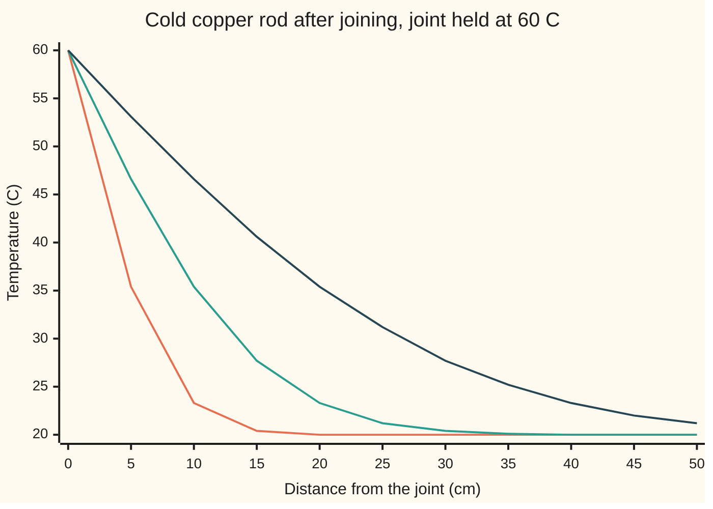

# Similarity solutions: diffusion looks the same at every scale

[Syllabus](../../../SYLLABUS.md) → [Partial differential equations](../README.md) → [The Heat Equation in Depth](../README.md#s03) → Similarity solutions

---

## General Overview

Two copper rods, each 1 m long, lie end to end. One is at 100 °C, the other at 20 °C. At time zero they are pressed together, so heat flows from the hot rod into the cold one.

The joint jumps to 60 °C at once and stays there. After 60 s, a point 5 cm into the cold rod reads 46.59 °C. The same 46.59 °C appears 10 cm in after 240 s, and 2.5 cm in after 15 s. Twice as far takes four times as long, every time.

That is the idea of this card. The heated stretch of rod never changes its shape. It only stretches, and its width grows like the square root of time. So one curve, drawn once, gives the temperature at every place and every moment.

[The heat kernel](../../08-Differential%20equations%20and%20dynamics/10-The%20Classical%20PDEs/10-the-heat-kernel.md) in wing 08 already found the variable $`x/\sqrt{\kappa t}`$, solved the step start with the error function, and saw the joint sit at the average. This card turns that into a **method**: how to find the right variable and its powers for any problem with no built-in ruler or clock, and why the answer is then forced.

**When neither the equation nor its data has a length or a time of its own, stretching distance by λ and time by λ² changes nothing, so the solution depends only on $`x/\sqrt{\kappa t}`$; the heat equation then shrinks to an ordinary differential equation, and a step start solves it with the error function.**

**What kind of fact this is:** a theorem, proved on this card in Why it works, for bounded solutions, except one limiting step at the corner where the data jump, which Cannon's book in Sources gives. Copper's diffusivity and the heat equation itself are a model of the metal, which fits well for small temperature changes.

### The picture: the cold rod at 15 s, 60 s and 240 s



Orange: 15 s. Teal: 60 s. Dark blue: 240 s. Each curve is the one before it stretched to twice the width. The value 35.4 °C sits at 5 cm, 10 cm and 20 cm in turn, and 46.6 °C at 5 cm and then 10 cm.

---

## The formula

**The problem.** The unknown is $`T(x, t)`$: the temperature in °C of the cold rod at distance $`x`$ metres from the joint, $`t`$ seconds after joining. The region is the half-line $`x > 0`$ (the rod is long enough to count as endless; When it holds says how long). The data are a start at 20 °C, a joint held at 60 °C, and 20 °C far away:

```math
T_t = \kappa\,T_{xx}\ \ (x > 0,\ t > 0), \qquad T(x, 0) = 20, \qquad T(0, t) = 60, \qquad T \to 20 \text{ as } x \to \infty.
```

Subscripts are partial derivatives, as in wing 08: $`T_t`$ is the rate of change at a fixed place, $`T_{xx}`$ the curvature along the rod. $`\kappa`$ is the diffusivity (how fast heat spreads, in m^2/s).

**The solution**, the one classical solution that stays bounded:

```math
T(x, t) = 60 - 40\,\mathrm{erf}(\eta), \qquad \eta = \frac{x}{2\sqrt{\kappa t}}, \qquad \mathrm{erf}(z) = \frac{2}{\sqrt{\pi}}\int_0^z e^{-s^2}\,ds.
```

**Read it aloud:** the temperature falls from 60 °C at the joint toward 20 °C, along one fixed curve, the error function, read at the distance divided by twice the square root of κ times t.

The error function $`\mathrm{erf}`$ rises from 0 at $`z = 0`$ to 1 far out; $`s`$ is only the integral's running variable. Its partner $`\mathrm{erfc}(z) = 1 - \mathrm{erf}(z)`$ falls from 1 to 0, so the same answer reads $`T = 20 + 40\,\mathrm{erfc}(\eta)`$: the cold start plus 40 °C times the fraction of the rise that has arrived.

**The method**, for any diffusion problem with no ruler or clock of its own. Try a solution that is a fixed shape $`F`$, stretched sideways by a power of time and scaled up or down by another:

```math
u(x, t) = t^{\alpha}\,F\!\left(\frac{x}{t^{\beta}}\right), \qquad \beta = \tfrac12 \text{ from the equation}, \qquad \alpha \text{ from the data}.
```

**Read it aloud:** the solution is one shape, widened like t to the power beta and raised like t to the power alpha; the heat equation forces beta to be one half, and what the data hold fixed decides alpha.

| Symbol | Plain meaning | In our example | Push it up and the answer… |
| --- | --- | --- | --- |
| $`T(x, t)`$, $`u(x, t)`$ | temperature of the cold rod; $`u`$ any diffusing amount | 46.59 °C at 5 cm, 60 s | — |
| $`x`$, $`t`$ | distance from the joint, in m; time since joining, in s | 0.05 m; 60 s | $`x`$: colder; $`t`$: warmer |
| $`\kappa`$ | diffusivity: how fast heat spreads, in m^2/s | $`1.11\times10^{-4}`$ for copper | the same profile, reached sooner |
| $`\eta`$ | similarity variable: distance over $`2\sqrt{\kappa t}`$, no unit | 0.3063 | colder point |
| $`\mathrm{erf}`$, $`\mathrm{erfc}`$ | error function and its complement, $`1 - \mathrm{erf}`$ | erf(0.3063) = 0.3352 | — |
| $`F`$ | the fixed shape that every profile stretches | $`F(\eta) = 60 - 40\,\mathrm{erf}(\eta)`$ | — |
| $`z`$, $`s`$; $`S`$, $`w`$, $`M`$, $`v`$, $`R`$, $`t_1`$ | $`z = x/t^{\beta}`$ in the trial form; $`s`$ only the integral's running variable; in the uniqueness proof, a second bounded solution $`S`$, the difference $`w = T - S`$, its bound $`M`$, the comparison function $`v`$, a length $`R`$ and a time $`t_1`$ | — | — |
| $`T_J`$, $`C`$ | the joint's temperature; the constant in $`F' = C\,e^{-\eta^2}`$ | 60 °C; −45.135167 °C | — |
| $`\lambda`$ | a stretch factor: distance times λ, time times λ² | λ = 2 takes (5 cm, 60 s) to (10 cm, 240 s) | — |
| $`\alpha`$, $`\beta`$ | the powers of time in the trial form | α = 0, β = 1/2 | — |
| $`J`$, $`k`$ | heat flux into an end, in W/m^2; conductivity, in W/(m K) | $`10^5`$ W/m^2; 401 for copper | $`J`$: hotter end |
| $`b`$ | effusivity $`k/\sqrt{\kappa}`$, in W s^0.5/(m^2 K): how hard a metal pulls a joint toward its own temperature | 38061 copper, 7497 stainless steel | joint nearer that metal's start |

The values for copper ($`\kappa = 1.11\times10^{-4}`$ m^2/s, $`k = 401`$ W/(m K)) and for stainless steel ($`\kappa = 3.95\times10^{-6}`$ m^2/s, $`k = 14.9`$ W/(m K)) are typical handbook values, used here as illustrations.

### When it holds

- **No length in the data.** Real rods end. Once heat reaches the far end, the end acts as a ruler and the stretching argument fails. At 3600 s the far end of the 1 m cold rod reads 41.00 °C on a grid, while the half-line formula says 30.5 °C. Adding mirror-image rods beyond each end (the image method) repairs it: four images give 41.00 °C, and the first image pair left out adds only 8.9e-07 °C.
- **The same metal on both sides.** The joint sits at the plain average only then. Copper at 100 °C on stainless steel at 20 °C holds the joint at 86.8 °C, nearer copper's start. It is still constant in time, because each side is still free of rulers and clocks.
- **Constant diffusivity.** If κ changes with temperature, the equation is nonlinear. A step start still collapses onto $`x/\sqrt{t}`$, because the stretch of Step 1 still leaves the equation and the data unchanged. But the shape is no longer the error function, and the joint is no longer the plain average. The powers change only for data with a fixed total, such as Barenblatt's point source in the porous medium equation.
- **Bounded solutions.** The argument needs one answer. Among bounded solutions there is exactly one; allow wild growth far out and Tychonoff's example adds others.
- **Heat's instant reach.** The formula warms every point of the rod at once, by an amount far below any thermometer. Real heat moves at a finite speed, so this is the model, not the metal; [Diffusion smooths instantly, and is felt everywhere at once](05-smoothing-and-infinite-speed.md) studies it.

---

## Why it works

### Step 0: a problem with no ruler cannot tell a zoomed copy from itself

Stretch the picture: every distance times λ, every time times λ². The heat equation still holds, and the data are still "20 °C everywhere, 60 °C at the end". So the stretched solution solves the same problem. A problem with one answer must then be its own stretched copy, and the answer can depend on $`x`$ and $`t`$ only through a combination the stretch leaves alone: $`x/\sqrt{t}`$.

### Step 1: the stretch leaves the equation unchanged

Let $`T`$ solve $`T_t = \kappa T_{xx}`$ and set $`T_\lambda(x, t) = T(\lambda x, \lambda^2 t)`$. By the chain rule, a time derivative gains λ² and each space derivative gains λ:

```math
(T_\lambda)_t = \lambda^2\,T_t, \qquad (T_\lambda)_{xx} = \lambda^2\,T_{xx}.
```

Both sides of the equation gain the same λ², so $`T_\lambda`$ solves it too. Only the pairing "distance with the square root of time" works. Stretching time by λ instead of λ² gives λ on the left and λ² on the right.

### Step 2: the stretch leaves the data unchanged, so the answer is a function of η

Check each piece of data. At $`t = 0`$, $`T_\lambda = T(\lambda x, 0) = 20`$. At the joint, $`T_\lambda(0, t) = T(0, \lambda^2 t) = 60`$. Far out it still tends to 20. So $`T_\lambda`$ solves the same problem, and by uniqueness (Step 5) $`T_\lambda = T`$ for every λ > 0.

Choose $`\lambda = \sqrt{60/t}`$, with $`t`$ in seconds. Then $`T(x, t) = T\big(x\sqrt{60/t},\ 60\big)`$: the 60 s profile, read at a shifted place. So $`T`$ depends on $`x/\sqrt{t}`$ alone, which is η up to the fixed factor $`2\sqrt{\kappa}`$. Call it $`F(\eta)`$.

A start with a length in it, such as a hot strip 3 cm wide, breaks Step 2. With λ = 2 the stretched start, $`T_\lambda(x, 0) = T(2x, 0)`$, is hot only on a 1.5 cm strip: a different problem.

### Step 3: choosing the powers in general

For other data the answer may also grow or shrink in height. Try $`u = t^{\alpha} F(x/t^{\beta})`$ and write $`z = x/t^{\beta}`$. The chain rule gives

```math
u_t = t^{\alpha - 1}\big(\alpha F - \beta\,z\,F'\big), \qquad \kappa\,u_{xx} = \kappa\,t^{\alpha - 2\beta}\,F''.
```

The equation can lose $`t`$ only if the two powers match: $`\alpha - 1 = \alpha - 2\beta`$, so $`\beta = \tfrac12`$ for every problem. The data then fix α. Each kind of data holds one quantity fixed, and that quantity must not depend on $`t`$:

| What the data hold fixed | How it scales | α | What comes out |
| --- | --- | --- | --- |
| the temperature at the end (this card) | $`u(0, t) = t^{\alpha} F(0)`$ | 0 | $`60 - 40\,\mathrm{erf}(\eta)`$: the profile keeps its height |
| the total heat, from a point of heat | $`\int u\,dx = t^{\alpha + 1/2}\int F\,dz`$ | −1/2 | [The heat kernel](01-heat-kernel-and-fundamental-solution.md): the peak falls like $`1/\sqrt{t}`$ |
| the heat flux $`J`$ into the end | $`-k\,u_x(0, t) = -k\,t^{\alpha - 1/2} F'(0)`$ | 1/2 | the end warms like $`\sqrt{t}`$ |

The third row is a prediction made before solving anything. Feed $`J = 10^5`$ W/m^2 into the end of a 20 °C copper rod. The grid in the code, which knows nothing of similarity, warms the end by 22.96 °C in 60 s and 45.93 °C in 240 s. Four times the time, twice the rise: ratio 2.000.

### Step 4: the heat equation becomes an ordinary differential equation

Put $`T = F(\eta)`$ with $`\eta = x/(2\sqrt{\kappa t})`$ into $`T_t = \kappa T_{xx}`$. The chain rule gives $`T_t = -\eta F'/(2t)`$ and $`T_{xx} = F''/(4\kappa t)`$. Multiply both sides by $`4t`$:

```math
F'' + 2\eta\,F' = 0, \qquad F(0) = 60, \qquad F(\infty) = 20.
```

The start and the far-away condition both become $`F(\infty) = 20`$, because $`t \to 0`$ and $`x \to \infty`$ both send η to infinity. Two conditions, one second-order equation: a well-matched problem.

Multiply by $`e^{\eta^2}`$. The left side becomes $`(e^{\eta^2} F')'`$, so $`e^{\eta^2} F'`$ is a constant $`C`$, and $`F' = C\,e^{-\eta^2}`$. Integrate from 0:

```math
F(\eta) = 60 + C\int_0^{\eta} e^{-s^2}\,ds = 60 + C\,\tfrac{\sqrt{\pi}}{2}\,\mathrm{erf}(\eta).
```

[The Gaussian integral](../../06-Calculus%20and%20analysis/08-Multiple%20Integrals/04-gaussian-integral.md) gives $`\int_0^\infty e^{-s^2}\,ds = \sqrt{\pi}/2`$, so $`\mathrm{erf}(\infty) = 1`$. Then $`F(\infty) = 20`$ needs $`C\sqrt{\pi}/2 = -40`$, so $`C = -80/\sqrt{\pi} = -45.135167`$ °C, and $`F = 60 - 40\,\mathrm{erf}(\eta)`$. The code's second road shoots the ordinary differential equation numerically from η = 0 and finds the same starting slope.

### Step 5: why the joint holds still, and why the answer is the only one

**The joint.** Run the whole two-rod problem. The temperature minus 60 °C starts as +40 on the left and −40 on the right: a mirror image with the sign flipped. The heat equation keeps that symmetry, so the joint stays at exactly 60 °C. The grid in the code starts its joint node at the midpoint of the jump and never holds it; at 60 s it still reads 60.0000 °C. Each rod is then a half-line problem with its end held at 60 °C, which is this card's problem.

The flow of heat says the same. The cold rod's profile has slope $`-40/\sqrt{\pi\kappa t}`$ at the joint, so heat enters it at $`40k/\sqrt{\pi\kappa t}`$ W/m^2. The hot rod sends out the same expression with its own drop, 100 − 60. Equal drops balance, at every time. With two different metals, the balance $`b_1 (100 - T_J) = b_2 (T_J - 20)`$ fixes the joint temperature $`T_J`$ at 86.8 °C for copper on stainless steel. The factor $`1/\sqrt{t}`$ cancels from both sides, so the joint is constant there too.

**Uniqueness.** The answer is a classical solution: smooth for $`t > 0`$, taking its data continuously except at the corner $`(0, 0)`$, where 20 °C meets 60 °C. It is the only bounded one. The difference of two bounded solutions starts at zero, is zero at the joint, and [Diffusion's maximum principle](04-maximum-principle-for-the-heat-equation.md) keeps it at zero. The fold proves it.

<details>
<summary>Detailed proof: two bounded solutions agree, so the stretched copy is the same solution</summary>

Let $`T`$ and $`S`$ be bounded classical solutions of the problem, and $`w = T - S`$. Then $`w`$ solves the heat equation on $`x > 0`$, with $`w(x, 0) = 0`$, $`w(0, t) = 0`$ and $`|w| \le M`$ for some bound $`M`$.

Fix a time $`t_1`$ and a length $`R`$. Compare $`w`$ on the rectangle $`0 \le x \le R`$, $`0 \le t \le t_1`$ with

$`\displaystyle v(x, t) = \frac{M}{R^2}\,\big(x^2 + 2\kappa t\big).`$

This $`v`$ also solves the heat equation, since $`v_t = 2\kappa M/R^2 = \kappa\,v_{xx}`$. On the bottom edge $`v \ge 0 = w`$. On the left edge $`v \ge 0 = w`$. On the right edge $`v \ge M \ge w`$.

So $`v - w`$ solves the heat equation and is at least zero on the bottom and both sides. By the weak maximum principle, it is at least zero inside: $`w \le v`$. The same argument with $`-w`$ gives $`-w \le v`$. Hence

$`\displaystyle |w(x, t)| \le \frac{M}{R^2}\,\big(x^2 + 2\kappa t_1\big).`$

Let $`R \to \infty`$ with $`x`$ and $`t_1`$ fixed. The right side tends to zero, so $`w(x, t) = 0`$. The corner $`(0, 0)`$, where the data jump, needs one extra limiting step, because $`w`$ is not continuous there; Cannon's book in Sources gives it.

For the stretch, $`T_\lambda`$ is bounded by the same bound as $`T`$ and solves the same problem (Step 2). So $`T_\lambda = T`$, and Step 2's choice of λ shows that $`T`$ depends on η alone.

Finally, $`60 - 40\,\mathrm{erf}(\eta)`$ is bounded, solves the equation by Step 4, equals 60 at $`x = 0`$, and tends to 20 as $`t \to 0`$ at any fixed $`x > 0`$. So it is that one solution.

</details>

---

## Worked numbers, by hand

The cold rod, 5 cm from the joint, 60 s after joining.

| Step | Arithmetic | Value |
| --- | --- | --- |
| spreading length | $`2\sqrt{1.11\times10^{-4} \times 60}`$ m | 16.32 cm |
| similarity variable | η = 5 / 16.32 | 0.3063 |
| error function | erf(0.3063), from its series | 0.3352 |
| temperature | 60 − 40 × 0.3352 | **46.59 °C** |
| same η, twice the distance | 10 cm needs 16.32 × 2 = 32.64 cm of spreading: 4 × 60 s | **240 s** |
| heat's reach (a 4 °C rise, one tenth of 40) | erf(η) = 0.9 at η = 1.1631; 1.1631 × 16.32 cm | **19.0 cm** at 60 s, 38.0 cm at 240 s |

A thermometer 5 cm into the cold rod reads 46.59 °C after one minute. Anywhere past 19.0 cm the rod has barely noticed, and that reach doubles only when the time quadruples.

The grid in the code, which steps the two joined rods with no similarity built in, gives the same temperature at three scales:

| Place, time | η | Grid temperature, cells 2.5 mm |
| --- | --- | --- |
| 2.5 cm, 15 s | 0.3063 | 46.5998 °C |
| 5 cm, 60 s | 0.3063 | 46.5954 °C |
| 10 cm, 240 s | 0.3063 | 46.5943 °C |

The three readings agree to within 0.01 °C; the small differences are the grid's own error.

### What breaks if you drop a piece

| Mistake | Comes out at | What went wrong |
| --- | --- | --- |
| η taken as $`x/\sqrt{\kappa t}`$, without the 2 | 35.45 °C at 5 cm, 60 s, not 46.59 | erf's own variable needs the factor 2; this reads the curve at twice the distance |
| "twice the distance in twice the time" | 41.60 °C at 10 cm, 120 s, not 46.59 | the width grows like $`\sqrt{t}`$, so twice the distance needs four times the time |
| erf where erfc belongs: 20 + 40 erf(η) | 33.41 °C at 5 cm, 60 s | the rise is largest at the joint, where erf is 0 |
| half-line formula after heat reaches the far end | 30.5 °C at the far end at 3600 s; grid 41.00 °C | the rod's length is a ruler, so the stretch changes the problem |

The checks print all four.

---

## Code, from first principles, and it actually runs

Four roads to the same temperatures. Road 1 is the formula, with the error function summed from its series and, beyond 3, a continued fraction. Road 2 solves the reduced equation $`F'' + 2\eta F' = 0`$ by a hand-written Runge-Kutta method (RK4), shooting from η = 0 until it lands on 20 °C. Road 3 is a grid on both rods together, which knows nothing of similarity and never holds the joint (its joint node only starts at the midpoint of the jump, 60 °C): its error falls fourfold each time the cells halve, and it shows the collapse and the flux prediction. Road 4 puts the formula back into the heat equation by centred differences.

### Python

```python
# Similarity solutions -- the check behind the card.  Standard library only.  Two 1 m copper
# rods, one at 100 C and one at 20 C, joined end to end at t = 0.  kappa = 1.11e-4 m^2/s.
# Roads: the similarity formula 60 - 40 erf(eta) with erf summed by hand; the reduced ODE
# F'' + 2 eta F' = 0 shot by RK4; a grid on both rods that knows no similarity; the PDE
# residual by centred differences.  Nothing imported knows erf or solves an equation.
from math import exp, sqrt, pi, ceil
K, TH, TC, L = 1.11e-4, 100.0, 20.0, 1.0      # copper diffusivity m^2/s, hot, cold C, rod length m
TJ = (TH + TC) / 2                            # the joint, held by symmetry
def erfc(z):                                  # 1 - erf: continued fraction beyond 3, series below
    if z <= 3: return 1 - erf(z)
    c = z
    for k in range(60, 0, -1): c = z + k / 2 / c
    return exp(-z * z) / sqrt(pi) / c
def erf(z):                                   # Maclaurin series, summed to the last term
    if z > 3: return 1 - erfc(z)
    s, term, n = 0.0, z, 0
    while abs(term) > 1e-17 * max(1.0, abs(s)):
        s += term / (2 * n + 1); n += 1; term *= -z * z / n
    return 2 / sqrt(pi) * s
def eta(x, t): return x / (2 * sqrt(K * t))   # the similarity variable
def T(x, t): return TJ - (TJ - TC) * erf(eta(x, t))   # cold rod, x >= 0 m from the joint

def shoot(slope, h=1e-3, top=6.0):            # road 2: RK4 on F' = G, G' = -2 eta G, F(0) = 60
    f, g, e, out = TJ, slope, 0.0, {0.0: TJ}
    for i in range(round(top / h)):
        k1f, k1g = g, -2 * e * g
        k2f, k2g = g + h / 2 * k1g, -2 * (e + h / 2) * (g + h / 2 * k1g)
        k3f, k3g = g + h / 2 * k2g, -2 * (e + h / 2) * (g + h / 2 * k2g)
        k4f, k4g = g + h * k3g, -2 * (e + h) * (g + h * k3g)
        f += h / 6 * (k1f + 2 * k2f + 2 * k3f + k4f); g += h / 6 * (k1g + 2 * k2g + 2 * k3g + k4g)
        e = (i + 1) * h; out[round(e, 6)] = f
    return out
a, b = shoot(-40.0), shoot(-50.0)             # linear ODE: two shots fix the slope that ends at 20 C
s = -40.0 + (TC - a[6.0]) / (b[6.0] - a[6.0]) * (-10.0)
ode = shoot(s)

def grid(h, times, flux=None):                # road 3: explicit steps on [-1, 1] m, insulated ends
    n = round(2 * L / h); r = 0.4             # r = kappa dt / h^2, inside the limit 1/2
    u = [TH if i < n // 2 else TC if i > n // 2 else TJ for i in range(n + 1)]
    if flux: u = [TC] * (n // 2 + 1)          # or: one rod on [0, 1] m, heated at x = 0
    n1 = ceil(times[0] / (r * h * h / K)); dt = times[0] / n1; r = K * dt / (h * h); out, done = [], 0
    for tt in times:
        for _ in range(round(tt / dt) - done):
            g0 = u[1] + 2 * h * flux / 401 if flux else u[1]     # ghost node: the end condition
            u = [u[0] + r * (g0 - 2 * u[0] + u[1])] + [u[i] + r * (u[i - 1] - 2 * u[i] + u[i + 1])
                 for i in range(1, len(u) - 1)] + [u[-1] + 2 * r * (u[-2] - u[-1])]
        out.append(list(u)); done = round(tt / dt)
    return out
def at(u, h, x, flux=None): return u[round(x / h) + (0 if flux else round(L / h))]

print(f"copper, kappa = {K * 1e4:.2f}e-4 m^2/s; hot rod {TH:.0f} C joined to cold rod {TC:.0f} C; each {L:.0f} m long")
print(f"joint at once and for good: ({TH:.0f} + {TC:.0f})/2 = {TJ:.0f} C; cold rod T = 60 - 40 erf(x / (2 sqrt(kappa t)))")
for t in (15, 60, 240): print(f"t = {t:3d} s: 2 sqrt(kappa t) = {200 * sqrt(K * t):.2f} cm")
e5 = eta(0.05, 60)
print(f"at 5 cm, 60 s: eta = {e5:.4f}, erf(eta) = {erf(e5):.4f}, T = 60 - 40 x {erf(e5):.4f} = {T(0.05, 60):.2f} C")
lo, hi = 0.0, 3.0
for _ in range(60): m = (lo + hi) / 2; lo, hi = (m, hi) if erf(m) < 0.9 else (lo, m)
print(f"heat's reach (rise of 4 C, a tenth of 40): erf(eta) = 0.9 at eta = {lo:.4f}; depth {200 * lo * sqrt(K * 60):.1f} cm at 60 s, {200 * lo * sqrt(K * 240):.1f} cm at 240 s")
gap = max(abs(ode[round(0.1 * i, 6)] - (TJ - (TJ - TC) * erf(0.1 * i))) for i in range(31))
print(f"road 2, RK4 shooting: slope F'(0) = {s:.6f} C, by formula -80/sqrt(pi) = {-80 / sqrt(pi):.6f}; largest gap on 0..3 = {gap:.1e} C")
res = []
for d in (1e-3, 5e-4):                       # residual T_t - kappa T_xx at (5 cm, 60 s); dx = d m, dt = 1000 d s
    tt = (T(0.05, 60 + 1000 * d) - T(0.05, 60 - 1000 * d)) / (2000 * d)
    xx = K * (T(0.05 + d, 60) - 2 * T(0.05, 60) + T(0.05 - d, 60)) / d ** 2
    res.append(tt - xx); print(f"road 4, residual at 5 cm, 60 s, dx = {1000 * d:g} mm: T_t = {tt:.6f}, kappa T_xx = {xx:.6f}, gap {tt - xx:.2e} C/s")
errs = []
for h in (0.01, 0.005, 0.0025):
    u15, u60 = grid(h, [15, 60])
    errs.append(abs(at(u60, h, 0.05) - T(0.05, 60)))
    print(f"road 3, grid h = {1000 * h:g} mm: T(5 cm, 60 s) = {at(u60, h, 0.05):.4f} C, error {errs[-1]:.4f}; joint {at(u60, h, 0):.4f} C")
print(f"error ratios as h halves: {errs[0] / errs[1]:.2f}, {errs[1] / errs[2]:.2f} (order 2)")
g = grid(0.0025, [15, 60, 240])
trio = [at(g[0], 0.0025, 0.025), at(g[1], 0.0025, 0.05), at(g[2], 0.0025, 0.10)]
print(f"collapse on the grid: T(2.5 cm, 15 s) = {trio[0]:.4f}, T(5 cm, 60 s) = {trio[1]:.4f}, T(10 cm, 240 s) = {trio[2]:.4f} C")
img = (TJ - TC) * erfc((2 * L - 0.10) / (2 * sqrt(K * 240)))
print(f"first omitted image term (insulated far end) at 10 cm, 240 s: {img:.1e} C")
q, f60, f240 = 1e5, *grid(0.0025, [60, 240], flux=1e5)
ex = lambda t: 2 * q * sqrt(K * t / pi) / 401
print(f"flux start, 100 kW/m^2 into a 20 C rod, k = 401 W/(m K): end rises {f60[0] - TC:.2f} C by 60 s, {f240[0] - TC:.2f} C by 240 s; ratio {(f240[0] - TC) / (f60[0] - TC):.3f}")
print(f"  exact end rise 2 q sqrt(kappa t / pi) / k: {ex(60):.2f} and {ex(240):.2f} C")
es = 14.9 / sqrt(3.95e-6); ec = 401 / sqrt(K)
print(f"copper at 100 C on stainless steel at 20 C: effusivities {ec:.0f} and {es:.0f}; joint {(ec * TH + es * TC) / (ec + es):.1f} C")
far = grid(0.01, [3600])[0]
pair = lambda m, x, t: (TJ - TC) * (erfc(eta(2 * m * L - x, t)) - erfc(eta(2 * m * L + x, t)))  # images at +-2mL
fix = T(1.0, 3600) + pair(1, 1.0, 3600) - pair(2, 1.0, 3600)
print(f"breaks, finite rods at 3600 s, far end of cold rod: half-line formula {T(1.0, 3600):.1f} C, with four images {fix:.2f} C, grid {at(far, 0.01, 1.0):.2f} C; first omitted image pair {pair(3, 1.0, 3600):.1e} C")
print(f"mistake, eta without the 2: T(5 cm, 60 s) = {TJ - (TJ - TC) * erf(2 * e5):.2f} C, not {T(0.05, 60):.2f}")
print(f"mistake, twice the distance in twice the time: T(10 cm, 120 s) = {T(0.10, 120):.2f} C, not {T(0.05, 60):.2f}")
print(f"mistake, erf where erfc belongs, 20 + 40 erf(eta): {TC + (TJ - TC) * erf(e5):.2f} C")
for t in (15, 60, 240): print(f"chart, t = {t} s:", ", ".join(f"{T(0.05 * i, t):.1f}" for i in range(11)))
print(f"try, hot rod at 200 C: joint 110 C, T(5 cm, 60 s) = {110 - 90 * erf(e5):.2f} C")
print(f"try, both rods stainless steel: {T(0.05, 60):.2f} C at 5 cm after {60 * K / 3.95e-6:.0f} s = {K / 3.95e-6:.1f} min")
assert abs(s + 80 / sqrt(pi)) < 1e-6 and gap < 1e-6          # ODE shooting meets the erf formula
assert abs(res[1]) < 1e-5 and abs(res[0]) > 3.5 * abs(res[1])  # formula obeys the PDE, gap shrinks as h^2
assert errs[2] < 5e-3 and 3.5 < errs[1] / errs[2] < 4.5        # grid meets the formula at order 2
assert max(trio) - min(trio) < 1e-2 and abs(trio[1] - T(0.05, 60)) < 1e-2   # grid collapses onto eta
assert abs((f240[0] - TC) / (f60[0] - TC) - 2) < 5e-3          # flux start: rise grows as sqrt(t)
assert abs(f60[0] - TC - ex(60)) < 1e-2                        # flux start meets the exact end rise
assert abs(fix - at(far, 0.01, 1.0)) < 0.01 and at(far, 0.01, 1.0) - T(1.0, 3600) > 5   # images fix the finite rod
print("ALL CHECKS PASS")
```

**Ran 2026-11-15 on macOS, Python 3.14.10, standard library only. All checks passed. Output, pasted from the run:**

```
copper, kappa = 1.11e-4 m^2/s; hot rod 100 C joined to cold rod 20 C; each 1 m long
joint at once and for good: (100 + 20)/2 = 60 C; cold rod T = 60 - 40 erf(x / (2 sqrt(kappa t)))
t =  15 s: 2 sqrt(kappa t) = 8.16 cm
t =  60 s: 2 sqrt(kappa t) = 16.32 cm
t = 240 s: 2 sqrt(kappa t) = 32.64 cm
at 5 cm, 60 s: eta = 0.3063, erf(eta) = 0.3352, T = 60 - 40 x 0.3352 = 46.59 C
heat's reach (rise of 4 C, a tenth of 40): erf(eta) = 0.9 at eta = 1.1631; depth 19.0 cm at 60 s, 38.0 cm at 240 s
road 2, RK4 shooting: slope F'(0) = -45.135167 C, by formula -80/sqrt(pi) = -45.135167; largest gap on 0..3 = 1.1e-12 C
road 4, residual at 5 cm, 60 s, dx = 1 mm: T_t = 0.104917, kappa T_xx = 0.104899, gap 1.78e-05 C/s
road 4, residual at 5 cm, 60 s, dx = 0.5 mm: T_t = 0.104905, kappa T_xx = 0.104901, gap 4.46e-06 C/s
road 3, grid h = 10 mm: T(5 cm, 60 s) = 46.6170 C, error 0.0231; joint 60.0000 C
road 3, grid h = 5 mm: T(5 cm, 60 s) = 46.5997 C, error 0.0058; joint 60.0000 C
road 3, grid h = 2.5 mm: T(5 cm, 60 s) = 46.5954 C, error 0.0015; joint 60.0000 C
error ratios as h halves: 3.97, 3.99 (order 2)
collapse on the grid: T(2.5 cm, 15 s) = 46.5998, T(5 cm, 60 s) = 46.5954, T(10 cm, 240 s) = 46.5943 C
first omitted image term (insulated far end) at 10 cm, 240 s: 7.4e-15 C
flux start, 100 kW/m^2 into a 20 C rod, k = 401 W/(m K): end rises 22.96 C by 60 s, 45.93 C by 240 s; ratio 2.000
  exact end rise 2 q sqrt(kappa t / pi) / k: 22.96 and 45.93 C
copper at 100 C on stainless steel at 20 C: effusivities 38061 and 7497; joint 86.8 C
breaks, finite rods at 3600 s, far end of cold rod: half-line formula 30.5 C, with four images 41.00 C, grid 41.00 C; first omitted image pair 8.9e-07 C
mistake, eta without the 2: T(5 cm, 60 s) = 35.45 C, not 46.59
mistake, twice the distance in twice the time: T(10 cm, 120 s) = 41.60 C, not 46.59
mistake, erf where erfc belongs, 20 + 40 erf(eta): 33.41 C
chart, t = 15 s: 60.0, 35.4, 23.3, 20.4, 20.0, 20.0, 20.0, 20.0, 20.0, 20.0, 20.0
chart, t = 60 s: 60.0, 46.6, 35.4, 27.7, 23.3, 21.2, 20.4, 20.1, 20.0, 20.0, 20.0
chart, t = 240 s: 60.0, 53.1, 46.6, 40.6, 35.4, 31.2, 27.7, 25.2, 23.3, 22.0, 21.2
try, hot rod at 200 C: joint 110 C, T(5 cm, 60 s) = 79.84 C
try, both rods stainless steel: 46.59 C at 5 cm after 1686 s = 28.1 min
ALL CHECKS PASS
```

### Rust

Same numbers, same labels, built with `rustc --edition 2021 -O`.

```rust
// Similarity solutions -- the same check in Rust, std only.  Two 1 m copper rods, one at
// 100 C and one at 20 C, joined end to end at t = 0.  kappa = 1.11e-4 m^2/s.  Roads: the
// similarity formula 60 - 40 erf(eta) with erf summed by hand; the reduced ODE
// F'' + 2 eta F' = 0 shot by RK4; a grid on both rods that knows no similarity; the PDE
// residual by centred differences.  Rust has no erf, so it is written out here too.
use std::f64::consts::PI;
const K: f64 = 1.11e-4; // copper diffusivity, m^2/s
const TH: f64 = 100.0; // hot rod, C
const TC: f64 = 20.0; // cold rod, C
const L: f64 = 1.0; // rod length, m
const TJ: f64 = (TH + TC) / 2.0; // the joint, held by symmetry

fn erfc(z: f64) -> f64 { // 1 - erf: continued fraction beyond 3, series below
    if z <= 3.0 { return 1.0 - erf(z); }
    let mut c = z;
    for k in (1..=60).rev() { c = z + k as f64 / 2.0 / c; }
    (-z * z).exp() / PI.sqrt() / c
}
fn erf(z: f64) -> f64 { // Maclaurin series, summed to the last term
    if z > 3.0 { return 1.0 - erfc(z); }
    let (mut s, mut term, mut n) = (0.0f64, z, 0.0f64);
    while term.abs() > 1e-17 * s.abs().max(1.0) {
        s += term / (2.0 * n + 1.0); n += 1.0; term *= -z * z / n;
    }
    2.0 / PI.sqrt() * s
}
fn eta(x: f64, t: f64) -> f64 { x / (2.0 * (K * t).sqrt()) } // the similarity variable
fn temp(x: f64, t: f64) -> f64 { TJ - (TJ - TC) * erf(eta(x, t)) } // cold rod, x >= 0 m from the joint

fn shoot(slope: f64) -> Vec<f64> { // road 2: RK4 on F' = G, G' = -2 eta G, F(0) = 60
    let h = 1e-3;
    let (mut f, mut g, mut e, mut out) = (TJ, slope, 0.0, vec![TJ]);
    for i in 0..6000 {
        let (k1f, k1g) = (g, -2.0 * e * g);
        let (k2f, k2g) = (g + h / 2.0 * k1g, -2.0 * (e + h / 2.0) * (g + h / 2.0 * k1g));
        let (k3f, k3g) = (g + h / 2.0 * k2g, -2.0 * (e + h / 2.0) * (g + h / 2.0 * k2g));
        let (k4f, k4g) = (g + h * k3g, -2.0 * (e + h) * (g + h * k3g));
        f += h / 6.0 * (k1f + 2.0 * k2f + 2.0 * k3f + k4f);
        g += h / 6.0 * (k1g + 2.0 * k2g + 2.0 * k3g + k4g);
        e = (i + 1) as f64 * h;
        out.push(f);
    }
    out
}

fn grid(h: f64, times: &[f64], flux: f64) -> Vec<Vec<f64>> { // road 3: explicit steps on [-1, 1] m, insulated ends
    let n = (2.0 * L / h).round() as usize;
    let mut r = 0.4; // r = kappa dt / h^2, inside the limit 1/2
    let mut u: Vec<f64> = (0..=n).map(|i| if i < n / 2 { TH } else if i > n / 2 { TC } else { TJ }).collect();
    if flux > 0.0 { u = vec![TC; n / 2 + 1]; } // or: one rod on [0, 1] m, heated at x = 0
    let n1 = (times[0] / (r * h * h / K)).ceil();
    let dt = times[0] / n1;
    r = K * dt / (h * h);
    let (mut out, mut done) = (vec![], 0i64);
    for &tt in times {
        for _ in 0..((tt / dt).round() as i64 - done) {
            let g0 = if flux > 0.0 { u[1] + 2.0 * h * flux / 401.0 } else { u[1] }; // ghost node: the end condition
            let m = u.len();
            let mut v = vec![u[0] + r * (g0 - 2.0 * u[0] + u[1])];
            for i in 1..m - 1 { v.push(u[i] + r * (u[i - 1] - 2.0 * u[i] + u[i + 1])); }
            v.push(u[m - 1] + 2.0 * r * (u[m - 2] - u[m - 1]));
            u = v;
        }
        out.push(u.clone());
        done = (tt / dt).round() as i64;
    }
    out
}
fn at(u: &[f64], h: f64, x: f64, flux: bool) -> f64 {
    u[(x / h).round() as usize + if flux { 0 } else { (L / h).round() as usize }]
}
fn pye(x: f64, d: usize) -> String { // e-notation with a two-digit exponent, as Python prints it
    let s = format!("{:.*e}", d, x);
    let (m, e) = s.split_once('e').unwrap();
    let e: i32 = e.parse().unwrap();
    format!("{}e{}{:02}", m, if e < 0 { "-" } else { "+" }, e.abs())
}

fn main() {
    println!("copper, kappa = {:.2}e-4 m^2/s; hot rod {:.0} C joined to cold rod {:.0} C; each {:.0} m long", K * 1e4, TH, TC, L);
    println!("joint at once and for good: ({:.0} + {:.0})/2 = {:.0} C; cold rod T = 60 - 40 erf(x / (2 sqrt(kappa t)))", TH, TC, TJ);
    for t in [15.0f64, 60.0, 240.0] { println!("t = {:3} s: 2 sqrt(kappa t) = {:.2} cm", t as i64, 200.0 * (K * t).sqrt()); }
    let e5 = eta(0.05, 60.0);
    println!("at 5 cm, 60 s: eta = {:.4}, erf(eta) = {:.4}, T = 60 - 40 x {:.4} = {:.2} C", e5, erf(e5), erf(e5), temp(0.05, 60.0));
    let (mut lo, mut hi) = (0.0f64, 3.0f64);
    for _ in 0..60 { let m = (lo + hi) / 2.0; if erf(m) < 0.9 { lo = m } else { hi = m } }
    let _ = hi;
    println!("heat's reach (rise of 4 C, a tenth of 40): erf(eta) = 0.9 at eta = {:.4}; depth {:.1} cm at 60 s, {:.1} cm at 240 s",
        lo, 200.0 * lo * (K * 60.0).sqrt(), 200.0 * lo * (K * 240.0).sqrt());
    let (a, b) = (shoot(-40.0), shoot(-50.0)); // linear ODE: two shots fix the slope that ends at 20 C
    let s = -40.0 + (TC - a[6000]) / (b[6000] - a[6000]) * (-10.0);
    let ode = shoot(s);
    let gap = (0..31).map(|i| (ode[100 * i] - (TJ - (TJ - TC) * erf(0.1 * i as f64))).abs()).fold(0.0, f64::max);
    println!("road 2, RK4 shooting: slope F'(0) = {:.6} C, by formula -80/sqrt(pi) = {:.6}; largest gap on 0..3 = {} C", s, -80.0 / PI.sqrt(), pye(gap, 1));
    let mut res = vec![];
    for d in [1e-3f64, 5e-4] { // residual T_t - kappa T_xx at (5 cm, 60 s); dx = d m, dt = 1000 d s
        let tt = (temp(0.05, 60.0 + 1000.0 * d) - temp(0.05, 60.0 - 1000.0 * d)) / (2000.0 * d);
        let xx = K * (temp(0.05 + d, 60.0) - 2.0 * temp(0.05, 60.0) + temp(0.05 - d, 60.0)) / d.powi(2);
        res.push(tt - xx);
        println!("road 4, residual at 5 cm, 60 s, dx = {} mm: T_t = {:.6}, kappa T_xx = {:.6}, gap {} C/s", 1000.0 * d, tt, xx, pye(tt - xx, 2));
    }
    let mut errs = vec![];
    for h in [0.01f64, 0.005, 0.0025] {
        let g = grid(h, &[15.0, 60.0], 0.0);
        errs.push((at(&g[1], h, 0.05, false) - temp(0.05, 60.0)).abs());
        println!("road 3, grid h = {} mm: T(5 cm, 60 s) = {:.4} C, error {:.4}; joint {:.4} C",
            1000.0 * h, at(&g[1], h, 0.05, false), errs[errs.len() - 1], at(&g[1], h, 0.0, false));
    }
    println!("error ratios as h halves: {:.2}, {:.2} (order 2)", errs[0] / errs[1], errs[1] / errs[2]);
    let g = grid(0.0025, &[15.0, 60.0, 240.0], 0.0);
    let trio = [at(&g[0], 0.0025, 0.025, false), at(&g[1], 0.0025, 0.05, false), at(&g[2], 0.0025, 0.10, false)];
    println!("collapse on the grid: T(2.5 cm, 15 s) = {:.4}, T(5 cm, 60 s) = {:.4}, T(10 cm, 240 s) = {:.4} C", trio[0], trio[1], trio[2]);
    let img = (TJ - TC) * erfc((2.0 * L - 0.10) / (2.0 * (K * 240.0).sqrt()));
    println!("first omitted image term (insulated far end) at 10 cm, 240 s: {} C", pye(img, 1));
    let q = 1e5;
    let fl = grid(0.0025, &[60.0, 240.0], q);
    let (f60, f240) = (fl[0][0], fl[1][0]);
    let ex = |t: f64| 2.0 * q * (K * t / PI).sqrt() / 401.0;
    println!("flux start, 100 kW/m^2 into a 20 C rod, k = 401 W/(m K): end rises {:.2} C by 60 s, {:.2} C by 240 s; ratio {:.3}",
        f60 - TC, f240 - TC, (f240 - TC) / (f60 - TC));
    println!("  exact end rise 2 q sqrt(kappa t / pi) / k: {:.2} and {:.2} C", ex(60.0), ex(240.0));
    let (es, ec) = (14.9 / 3.95e-6f64.sqrt(), 401.0 / K.sqrt());
    println!("copper at 100 C on stainless steel at 20 C: effusivities {:.0} and {:.0}; joint {:.1} C", ec, es, (ec * TH + es * TC) / (ec + es));
    let far = grid(0.01, &[3600.0], 0.0).remove(0);
    let pair = |m: f64, x: f64, t: f64| (TJ - TC) * (erfc(eta(2.0 * m * L - x, t)) - erfc(eta(2.0 * m * L + x, t))); // images at +-2mL
    let fix = temp(1.0, 3600.0) + pair(1.0, 1.0, 3600.0) - pair(2.0, 1.0, 3600.0);
    let gf = at(&far, 0.01, 1.0, false);
    println!("breaks, finite rods at 3600 s, far end of cold rod: half-line formula {:.1} C, with four images {:.2} C, grid {:.2} C; first omitted image pair {} C",
        temp(1.0, 3600.0), fix, gf, pye(pair(3.0, 1.0, 3600.0), 1));
    println!("mistake, eta without the 2: T(5 cm, 60 s) = {:.2} C, not {:.2}", TJ - (TJ - TC) * erf(2.0 * e5), temp(0.05, 60.0));
    println!("mistake, twice the distance in twice the time: T(10 cm, 120 s) = {:.2} C, not {:.2}", temp(0.10, 120.0), temp(0.05, 60.0));
    println!("mistake, erf where erfc belongs, 20 + 40 erf(eta): {:.2} C", TC + (TJ - TC) * erf(e5));
    for t in [15.0f64, 60.0, 240.0] {
        let row: Vec<String> = (0..11).map(|i| format!("{:.1}", temp(0.05 * i as f64, t))).collect();
        println!("chart, t = {} s: {}", t as i64, row.join(", "));
    }
    println!("try, hot rod at 200 C: joint 110 C, T(5 cm, 60 s) = {:.2} C", 110.0 - 90.0 * erf(e5));
    println!("try, both rods stainless steel: {:.2} C at 5 cm after {:.0} s = {:.1} min", temp(0.05, 60.0), 60.0 * K / 3.95e-6, K / 3.95e-6);
    assert!((s + 80.0 / PI.sqrt()).abs() < 1e-6 && gap < 1e-6); // ODE shooting meets the erf formula
    assert!(res[1].abs() < 1e-5 && res[0].abs() > 3.5 * res[1].abs()); // formula obeys the PDE, gap shrinks as h^2
    assert!(errs[2] < 5e-3 && errs[1] / errs[2] > 3.5 && errs[1] / errs[2] < 4.5); // grid meets the formula at order 2
    let spread = trio.iter().cloned().fold(f64::MIN, f64::max) - trio.iter().cloned().fold(f64::MAX, f64::min);
    assert!(spread < 1e-2 && (trio[1] - temp(0.05, 60.0)).abs() < 1e-2); // grid collapses onto eta
    assert!(((f240 - TC) / (f60 - TC) - 2.0).abs() < 5e-3); // flux start: rise grows as sqrt(t)
    assert!((f60 - TC - ex(60.0)).abs() < 1e-2); // flux start meets the exact end rise
    assert!((fix - gf).abs() < 0.01 && gf - temp(1.0, 3600.0) > 5.0); // images fix the finite rod
    println!("ALL CHECKS PASS");
}
```

**Ran 2026-11-15 on macOS, rustc 1.98.1, no crates. All checks passed. Output, pasted from the run:**

```
copper, kappa = 1.11e-4 m^2/s; hot rod 100 C joined to cold rod 20 C; each 1 m long
joint at once and for good: (100 + 20)/2 = 60 C; cold rod T = 60 - 40 erf(x / (2 sqrt(kappa t)))
t =  15 s: 2 sqrt(kappa t) = 8.16 cm
t =  60 s: 2 sqrt(kappa t) = 16.32 cm
t = 240 s: 2 sqrt(kappa t) = 32.64 cm
at 5 cm, 60 s: eta = 0.3063, erf(eta) = 0.3352, T = 60 - 40 x 0.3352 = 46.59 C
heat's reach (rise of 4 C, a tenth of 40): erf(eta) = 0.9 at eta = 1.1631; depth 19.0 cm at 60 s, 38.0 cm at 240 s
road 2, RK4 shooting: slope F'(0) = -45.135167 C, by formula -80/sqrt(pi) = -45.135167; largest gap on 0..3 = 1.1e-12 C
road 4, residual at 5 cm, 60 s, dx = 1 mm: T_t = 0.104917, kappa T_xx = 0.104899, gap 1.78e-05 C/s
road 4, residual at 5 cm, 60 s, dx = 0.5 mm: T_t = 0.104905, kappa T_xx = 0.104901, gap 4.46e-06 C/s
road 3, grid h = 10 mm: T(5 cm, 60 s) = 46.6170 C, error 0.0231; joint 60.0000 C
road 3, grid h = 5 mm: T(5 cm, 60 s) = 46.5997 C, error 0.0058; joint 60.0000 C
road 3, grid h = 2.5 mm: T(5 cm, 60 s) = 46.5954 C, error 0.0015; joint 60.0000 C
error ratios as h halves: 3.97, 3.99 (order 2)
collapse on the grid: T(2.5 cm, 15 s) = 46.5998, T(5 cm, 60 s) = 46.5954, T(10 cm, 240 s) = 46.5943 C
first omitted image term (insulated far end) at 10 cm, 240 s: 7.4e-15 C
flux start, 100 kW/m^2 into a 20 C rod, k = 401 W/(m K): end rises 22.96 C by 60 s, 45.93 C by 240 s; ratio 2.000
  exact end rise 2 q sqrt(kappa t / pi) / k: 22.96 and 45.93 C
copper at 100 C on stainless steel at 20 C: effusivities 38061 and 7497; joint 86.8 C
breaks, finite rods at 3600 s, far end of cold rod: half-line formula 30.5 C, with four images 41.00 C, grid 41.00 C; first omitted image pair 8.9e-07 C
mistake, eta without the 2: T(5 cm, 60 s) = 35.45 C, not 46.59
mistake, twice the distance in twice the time: T(10 cm, 120 s) = 41.60 C, not 46.59
mistake, erf where erfc belongs, 20 + 40 erf(eta): 33.41 C
chart, t = 15 s: 60.0, 35.4, 23.3, 20.4, 20.0, 20.0, 20.0, 20.0, 20.0, 20.0, 20.0
chart, t = 60 s: 60.0, 46.6, 35.4, 27.7, 23.3, 21.2, 20.4, 20.1, 20.0, 20.0, 20.0
chart, t = 240 s: 60.0, 53.1, 46.6, 40.6, 35.4, 31.2, 27.7, 25.2, 23.3, 22.0, 21.2
try, hot rod at 200 C: joint 110 C, T(5 cm, 60 s) = 79.84 C
try, both rods stainless steel: 46.59 C at 5 cm after 1686 s = 28.1 min
ALL CHECKS PASS
```

The two outputs match line for line.

### Lean

Lean proves Steps 1, 2 and 4 and the solution itself, for constant $`\kappa > 0`$ and any joint and start temperatures.

- Take constant $`\kappa > 0`$, the joint held at $`T_J`$, and any start temperature. Then $`T_J`$ minus the drop times $`\mathrm{erf}(\eta)`$ is a bounded classical solution on the half-line.
- Take that solution and any stretch $`\lambda > 0`$. Then its value at $`(\lambda x, \lambda^2 t)`$ equals its value at $`(x, t)`$.
- Take any bounded classical solution $`T`$ and any $`\lambda > 0`$. Then $`T(\lambda x, \lambda^2 t)`$ solves the same problem, as Steps 1 and 2 say.
- Take a twice-differentiable profile $`F(\eta)`$ solving the heat equation, with $`F(0) = T_J`$ and $`F(\infty)`$ the start. Then $`F`$ is the erf profile at every $`\eta \ge 0`$.
- Take the hot rod at 100 °C and the cold one at 20 °C. Then the joint sits at 60 °C, and the profile reads 60 °C there.
- Take a hot rod at 200 °C instead. Then the joint sits at 110 °C and the drop is 90 °C.
- Take $`\lambda = 2`$ and $`\lambda = 1/2`$. Then (5 cm, 60 s) goes to (10 cm, 240 s) and (2.5 cm, 15 s).
- Take twice the distance in twice the time. Then no λ works, since it would need $`\lambda^2 = 2`$ and $`\lambda = 2`$.
- Take the trial form's powers of time. Then the equation forces $`\beta = 1/2`$.
- Take $`F' = C\,e^{-\eta^2}`$ with a 40 °C drop. Then $`C = -80/\sqrt{\pi}`$.

The decimals, grids, two-metal joint and flux start are left to the Python and Rust checks; uniqueness rests on the folded proof.

```lean
-- Similarity solutions: the error-function profile solves the half-line step problem for the heat equation and looks the same at every scale, the stretch x to λx, t to λ²t maps solutions to solutions, and a one-variable profile F(x/(2√(κt))) that solves it must be that error function.
import Mathlib.Analysis.SpecialFunctions.Gaussian.GaussianIntegral
import Mathlib.Analysis.Calculus.ContDiff.Basic
import Mathlib.MeasureTheory.Integral.IntervalIntegral.Basic
import Mathlib.Analysis.Calculus.Deriv.CompMul
import Mathlib.Analysis.Calculus.ContDiff.Deriv
import Mathlib.Analysis.Calculus.MeanValue
import Mathlib.Analysis.Calculus.Deriv.MeanValue
import Mathlib.Analysis.SpecialFunctions.Sqrt
import Mathlib.MeasureTheory.Integral.IntervalIntegral.FundThmCalculus
import Mathlib.MeasureTheory.Integral.IntegralEqImproper

open Real MeasureTheory Filter Topology

/-- The error function, as the card defines it: erf z = (2/√π) ∫₀^z e^(-s^2) ds. -/
noncomputable def erf (z : ℝ) : ℝ :=
  2 / Real.sqrt π * ∫ s in (0 : ℝ)..z, Real.exp (-s ^ 2)

/-- The card's answer: T(x, t) = T_J − (T_J − T_C) erf(x / (2√(κt))). -/
noncomputable def stepProfile (κ TJ TC : ℝ) (x t : ℝ) : ℝ :=
  TJ - (TJ - TC) * erf (x / (2 * Real.sqrt (κ * t)))

/-- The card's problem on the half-line x > 0: T is a bounded classical solution of
T_t = κ T_xx for x > 0, t > 0, with its end held at T_J, starting at T_C, and tending to T_C far
away. Classical means twice differentiable in x, differentiable in t, and taking the data
continuously everywhere except the corner (0, 0). -/
def SolvesStepProblem (κ TJ TC : ℝ) (T : ℝ → ℝ → ℝ) : Prop :=
  (∀ t, 0 < t → ContDiffOn ℝ 2 (fun x => T x t) (Set.Ioi 0)) ∧
  (∀ x t, 0 < x → 0 < t →
    HasDerivAt (fun s => T x s) (κ * deriv (deriv (fun z => T z t)) x) t) ∧
  (∀ t, 0 < t → T 0 t = TJ) ∧
  (∀ t₀, 0 < t₀ → Tendsto (fun p : ℝ × ℝ => T p.1 p.2)
    (𝓝[Set.Ioi (0 : ℝ) ×ˢ Set.Ioi (0 : ℝ)] (0, t₀)) (𝓝 TJ)) ∧
  (∀ x₀, 0 < x₀ → Tendsto (fun p : ℝ × ℝ => T p.1 p.2)
    (𝓝[Set.Ioi (0 : ℝ) ×ˢ Set.Ioi (0 : ℝ)] (x₀, 0)) (𝓝 TC)) ∧
  (∀ t, 0 < t → Tendsto (fun x => T x t) atTop (𝓝 TC)) ∧
  (∃ M, ∀ x t, 0 ≤ x → 0 < t → |T x t| ≤ M)

lemma erf_hasDerivAt (z : ℝ) : HasDerivAt erf (2 / Real.sqrt π * Real.exp (-z ^ 2)) z := by
  have hc : Continuous fun s : ℝ => Real.exp (-s ^ 2) := by fun_prop
  exact ((hc.integral_hasStrictDerivAt 0 z).hasDerivAt).const_mul (2 / Real.sqrt π)

lemma erf_differentiable : Differentiable ℝ erf := fun z => (erf_hasDerivAt z).differentiableAt

lemma deriv_erf : deriv erf = fun z => 2 / Real.sqrt π * Real.exp (-z ^ 2) :=
  funext fun z => (erf_hasDerivAt z).deriv

lemma erf_contDiff : ContDiff ℝ 2 erf := by
  have h : ContDiff ℝ ((⊤ : ℕ∞) : WithTop ℕ∞) erf := by
    rw [contDiff_infty_iff_deriv]
    refine ⟨erf_differentiable, ?_⟩
    rw [deriv_erf]
    fun_prop
  exact h.of_le (WithTop.coe_le_coe.mpr le_top)

lemma erf_zero : erf 0 = 0 := by simp [erf]

lemma erf_monotone : Monotone erf :=
  monotone_of_deriv_nonneg erf_differentiable (fun z => by rw [deriv_erf]; positivity)

lemma gaussian_interval_tendsto :
    Tendsto (fun z => ∫ s in (0 : ℝ)..z, Real.exp (-s ^ 2)) atTop (𝓝 (Real.sqrt π / 2)) := by
  have hi : IntegrableOn (fun s : ℝ => Real.exp (-s ^ 2)) (Set.Ioi 0) := by
    have := (integrable_exp_neg_mul_sq (b := 1) one_pos).integrableOn (s := Set.Ioi (0 : ℝ))
    simpa using this
  have h := intervalIntegral_tendsto_integral_Ioi 0 hi tendsto_id
  have hv : ∫ s in Set.Ioi (0 : ℝ), Real.exp (-s ^ 2) = Real.sqrt π / 2 := by
    have := integral_gaussian_Ioi 1
    simpa using this
  rw [hv] at h
  exact h

lemma erf_tendsto : Tendsto erf atTop (𝓝 1) := by
  have h2 := gaussian_interval_tendsto.const_mul (2 / Real.sqrt π)
  have hpi : Real.sqrt π ≠ 0 := (Real.sqrt_pos.mpr Real.pi_pos).ne'
  have : 2 / Real.sqrt π * (Real.sqrt π / 2) = 1 := by field_simp
  rw [this] at h2
  exact h2

lemma erf_nonneg {z : ℝ} (hz : 0 ≤ z) : 0 ≤ erf z := erf_zero ▸ erf_monotone hz

lemma erf_le_one (z : ℝ) : erf z ≤ 1 := erf_monotone.ge_of_tendsto erf_tendsto z

#print axioms erf_hasDerivAt
#print axioms erf_differentiable
#print axioms deriv_erf
#print axioms erf_contDiff
#print axioms erf_zero
#print axioms erf_monotone
#print axioms gaussian_interval_tendsto
#print axioms erf_tendsto
#print axioms erf_nonneg
#print axioms erf_le_one

/-- A step start is solved by the error function: with constant diffusivity κ > 0, a rod with no
length of its own (the half-line x > 0), its end held at T_J and its start at T_C, the profile
T_J − (T_J − T_C) erf(x/(2√(κt))) is a bounded classical solution, and it looks the same at every
scale: stretching distance by λ and time by λ² leaves every value unchanged. -/
theorem step_start_solved_by_erf_profile (κ TJ TC : ℝ) (hκ : 0 < κ) :
    SolvesStepProblem κ TJ TC (stepProfile κ TJ TC) ∧
    ∀ (l x t : ℝ), 0 < l → 0 < t →
      stepProfile κ TJ TC (l * x) (l ^ 2 * t) = stepProfile κ TJ TC x t := by
  have hpi : Real.sqrt π ≠ 0 := (Real.sqrt_pos.mpr Real.pi_pos).ne'
  refine ⟨⟨?_, ?_, ?_, ?_, ?_, ?_, ?_⟩, ?_⟩
  · intro t ht
    unfold stepProfile
    exact (contDiff_const.sub (contDiff_const.mul
      (erf_contDiff.comp (contDiff_id.div_const _)))).contDiffOn
  · intro x t hx ht
    have hkt : 0 < κ * t := mul_pos hκ ht
    have hr0 : 0 < Real.sqrt (κ * t) := Real.sqrt_pos.mpr hkt
    have hr2 : Real.sqrt (κ * t) ^ 2 = κ * t := Real.sq_sqrt hkt.le
    have hd1 : ∀ z, HasDerivAt (fun z => stepProfile κ TJ TC z t)
        (-((TJ - TC) * (2 / Real.sqrt π * Real.exp (-(z / (2 * Real.sqrt (κ * t))) ^ 2) *
          (1 / (2 * Real.sqrt (κ * t)))))) z := by
      intro z
      exact (((erf_hasDerivAt _).comp z ((hasDerivAt_id z).div_const
        (2 * Real.sqrt (κ * t)))).const_mul (TJ - TC)).const_sub TJ
    have e1 : deriv (fun z => stepProfile κ TJ TC z t) = fun z =>
        -((TJ - TC) * (2 / Real.sqrt π * Real.exp (-(z / (2 * Real.sqrt (κ * t))) ^ 2) *
          (1 / (2 * Real.sqrt (κ * t))))) := funext fun z => (hd1 z).deriv
    have h2 := (((((((hasDerivAt_id x).div_const (2 * Real.sqrt (κ * t))).pow 2).neg.exp).const_mul
      (2 / Real.sqrt π)).mul_const (1 / (2 * Real.sqrt (κ * t)))).const_mul (TJ - TC)).neg
    have h2' : HasDerivAt (fun z => -((TJ - TC) * (2 / Real.sqrt π *
        Real.exp (-(z / (2 * Real.sqrt (κ * t))) ^ 2) * (1 / (2 * Real.sqrt (κ * t)))))) _ x := h2
    rw [e1, h2'.deriv]
    have hs1 : HasDerivAt (fun s => κ * s) κ t := by
      simpa using (hasDerivAt_id t).const_mul κ
    have hs2 := (hs1.sqrt hkt.ne').const_mul 2
    have hs3 := (hasDerivAt_const t x).div hs2 (by positivity)
    have hs4 := (((erf_hasDerivAt _).comp t hs3).const_mul (TJ - TC)).const_sub TJ
    refine hs4.congr_deriv ?_
    simp only [Pi.div_apply, Pi.pow_apply, Pi.neg_apply, id, Nat.cast_ofNat]
    field_simp
    rw [show (2 : ℕ) - 1 = 1 from rfl, pow_one]
    field_simp
    ring
  · intro t ht
    simp [stepProfile, erf]
  · intro t₀ ht₀
    have hden : (2 * Real.sqrt (κ * t₀)) ≠ 0 := by
      have : 0 < Real.sqrt (κ * t₀) := Real.sqrt_pos.mpr (mul_pos hκ ht₀)
      positivity
    have hc : ContinuousAt (fun p : ℝ × ℝ => p.1 / (2 * Real.sqrt (κ * p.2))) (0, t₀) :=
      ContinuousAt.div (by fun_prop) (by fun_prop) hden
    have h := (erf_contDiff.continuous.continuousAt.comp hc).tendsto
    have h' := (tendsto_const_nhds (x := TJ)).sub ((tendsto_const_nhds (x := TJ - TC)).mul h)
    have h'' := h'.mono_left (nhdsWithin_le_nhds (s := Set.Ioi (0 : ℝ) ×ˢ Set.Ioi (0 : ℝ)))
    simpa [Function.comp_def, erf_zero, stepProfile] using h''
  · intro x₀ hx₀
    have hden : Tendsto (fun p : ℝ × ℝ => 2 * Real.sqrt (κ * p.2))
        (𝓝[Set.Ioi (0 : ℝ) ×ˢ Set.Ioi (0 : ℝ)] (x₀, 0)) (𝓝[>] 0) := by
      rw [tendsto_nhdsWithin_iff]
      constructor
      · have : Continuous (fun p : ℝ × ℝ => 2 * Real.sqrt (κ * p.2)) := by fun_prop
        have h := this.tendsto (x₀, 0)
        simp only [mul_zero, Real.sqrt_zero] at h
        exact h.mono_left nhdsWithin_le_nhds
      · filter_upwards [self_mem_nhdsWithin] with p hp
        have : 0 < Real.sqrt (κ * p.2) := Real.sqrt_pos.mpr (mul_pos hκ hp.2)
        show 0 < 2 * Real.sqrt (κ * p.2)
        positivity
    have hnum : Tendsto (fun p : ℝ × ℝ => p.1)
        (𝓝[Set.Ioi (0 : ℝ) ×ˢ Set.Ioi (0 : ℝ)] (x₀, 0)) (𝓝 x₀) :=
      (continuous_fst.tendsto (x₀, 0)).mono_left nhdsWithin_le_nhds
    have hq := hnum.pos_mul_atTop hx₀ (tendsto_inv_nhdsGT_zero.comp hden)
    have h := erf_tendsto.comp hq
    have h' := (tendsto_const_nhds (x := TJ)).sub ((tendsto_const_nhds (x := TJ - TC)).mul h)
    simp only [mul_one, sub_sub_cancel] at h'
    refine h'.congr (fun p => ?_)
    simp [stepProfile, div_eq_mul_inv]
  · intro t ht
    have hc : 0 < 2 * Real.sqrt (κ * t) := by
      have : 0 < Real.sqrt (κ * t) := Real.sqrt_pos.mpr (mul_pos hκ ht)
      positivity
    have h := erf_tendsto.comp (tendsto_id.atTop_div_const hc)
    have h' := (tendsto_const_nhds (x := TJ)).sub ((tendsto_const_nhds (x := TJ - TC)).mul h)
    simp only [mul_one, sub_sub_cancel] at h'
    exact h'
  · refine ⟨|TJ| + |TJ - TC|, fun x t hx ht => ?_⟩
    have hc : 0 < 2 * Real.sqrt (κ * t) := by
      have : 0 < Real.sqrt (κ * t) := Real.sqrt_pos.mpr (mul_pos hκ ht)
      positivity
    have h0 := erf_nonneg (div_nonneg hx hc.le)
    have h1 := erf_le_one (x / (2 * Real.sqrt (κ * t)))
    unfold stepProfile
    calc |TJ - (TJ - TC) * erf (x / (2 * Real.sqrt (κ * t)))|
        ≤ |TJ| + |(TJ - TC) * erf (x / (2 * Real.sqrt (κ * t)))| := abs_sub _ _
      _ = |TJ| + |TJ - TC| * |erf (x / (2 * Real.sqrt (κ * t)))| := by rw [abs_mul]
      _ ≤ |TJ| + |TJ - TC| * 1 := by
          gcongr
          rw [abs_le]
          constructor <;> linarith
      _ = |TJ| + |TJ - TC| := by ring
  · intro l x t hl ht
    unfold stepProfile
    have hkt : 0 < κ * t := mul_pos hκ ht
    have hr0 : 0 < Real.sqrt (κ * t) := Real.sqrt_pos.mpr hkt
    have hs : Real.sqrt (κ * (l ^ 2 * t)) = l * Real.sqrt (κ * t) := by
      rw [show κ * (l ^ 2 * t) = l ^ 2 * (κ * t) by ring, Real.sqrt_mul (sq_nonneg l),
        Real.sqrt_sq hl.le]
    rw [hs]
    congr 2
    field_simp

/-- A problem with no ruler cannot tell a zoomed copy from itself: if T solves the half-line step
problem, then so does its stretched copy T(λx, λ²t) for every λ > 0, because the heat equation and
the data are both unchanged by the stretch. -/
theorem stretched_solution_solves_same_problem (κ TJ TC : ℝ) (hκ : 0 < κ) (T : ℝ → ℝ → ℝ)
    (hT : SolvesStepProblem κ TJ TC T) (l : ℝ) (hl : 0 < l) :
    SolvesStepProblem κ TJ TC (fun x t => T (l * x) (l ^ 2 * t)) := by
  obtain ⟨h1, h2, h3, h4, h5, h6, ⟨M, hM⟩⟩ := hT
  have hl2 : 0 < l ^ 2 := by positivity
  refine ⟨?_, ?_, ?_, ?_, ?_, ?_, ⟨M, ?_⟩⟩
  · intro t ht
    have := h1 (l ^ 2 * t) (mul_pos hl2 ht)
    exact this.comp (contDiff_const.mul contDiff_id).contDiffOn (fun x hx => mul_pos hl hx)
  · intro x t hx ht
    have hd := h2 (l * x) (l ^ 2 * t) (mul_pos hl hx) (mul_pos hl2 ht)
    have hc : HasDerivAt (fun s => l ^ 2 * s) (l ^ 2) t := by
      simpa using (hasDerivAt_id t).const_mul (l ^ 2)
    have hcomp := hd.comp t hc
    have e1 : deriv (fun z => T (l * z) (l ^ 2 * t)) =
        fun z => l * deriv (fun z => T z (l ^ 2 * t)) (l * z) := by
      funext z
      exact deriv_comp_mul_left l (fun z => T z (l ^ 2 * t)) z
    have hdd : deriv (deriv (fun z => T (l * z) (l ^ 2 * t))) x =
        l * (l * deriv (deriv (fun z => T z (l ^ 2 * t))) (l * x)) := by
      rw [e1, deriv_const_mul_field']
      show l * deriv (fun z => deriv (fun z => T z (l ^ 2 * t)) (l * z)) x = _
      rw [deriv_comp_mul_left, smul_eq_mul]
    rw [hdd]
    exact hcomp.congr_deriv (by ring)
  · intro t ht
    show T (l * 0) (l ^ 2 * t) = TJ
    rw [mul_zero]
    exact h3 _ (mul_pos hl2 ht)
  · intro t₀ ht₀
    have hc : ContinuousWithinAt (fun p : ℝ × ℝ => (l * p.1, l ^ 2 * p.2))
        (Set.Ioi 0 ×ˢ Set.Ioi 0) (0, t₀) := by fun_prop
    have hmap := hc.tendsto_nhdsWithin (t := Set.Ioi 0 ×ˢ Set.Ioi 0)
      (fun p hp => ⟨mul_pos hl hp.1, mul_pos hl2 hp.2⟩)
    simp only [mul_zero] at hmap
    exact (h4 (l ^ 2 * t₀) (mul_pos hl2 ht₀)).comp hmap
  · intro x₀ hx₀
    have hc : ContinuousWithinAt (fun p : ℝ × ℝ => (l * p.1, l ^ 2 * p.2))
        (Set.Ioi 0 ×ˢ Set.Ioi 0) (x₀, 0) := by fun_prop
    have hmap := hc.tendsto_nhdsWithin (t := Set.Ioi 0 ×ˢ Set.Ioi 0)
      (fun p hp => ⟨mul_pos hl hp.1, mul_pos hl2 hp.2⟩)
    simp only [mul_zero] at hmap
    exact (h5 (l * x₀) (mul_pos hl hx₀)).comp hmap
  · intro t ht
    exact (h6 _ (mul_pos hl2 ht)).comp (tendsto_id.const_mul_atTop hl)
  · intro x t hx ht
    exact hM _ _ (mul_nonneg hl.le hx) (mul_pos hl2 ht)

/-- The heat equation shrinks to an ordinary differential equation, and the data force its
answer: if a profile u(x, t) = F(x/(2√(κt))) of one variable solves T_t = κ T_xx for x > 0, t > 0,
with F(0) = T_J at the end and F(η) → T_C far out, then F(η) = T_J − (T_J − T_C) erf(η) for η ≥ 0. -/
theorem similarity_profile_forced_to_erf (κ TJ TC : ℝ) (hκ : 0 < κ) (F : ℝ → ℝ)
    (hF : ContDiffOn ℝ 2 F (Set.Ici 0))
    (heq : ∀ x t, 0 < x → 0 < t →
      HasDerivAt (fun s => F (x / (2 * Real.sqrt (κ * s))))
        (κ * deriv (deriv (fun z => F (z / (2 * Real.sqrt (κ * t))))) x) t)
    (h0 : F 0 = TJ) (hinf : Tendsto F atTop (𝓝 TC)) :
    ∀ η, 0 ≤ η → F η = TJ - (TJ - TC) * erf η := by
  have hpi : Real.sqrt π ≠ 0 := (Real.sqrt_pos.mpr Real.pi_pos).ne'
  have hk : 0 < Real.sqrt κ := Real.sqrt_pos.mpr hκ
  have hk2 : Real.sqrt κ ^ 2 = κ := Real.sq_sqrt hκ.le
  have hFo : ContDiffOn ℝ 2 F (Set.Ioi 0) := hF.mono Set.Ioi_subset_Ici_self
  obtain ⟨hdiffF, -, hF1⟩ := (contDiffOn_succ_iff_deriv_of_isOpen (n := 1) isOpen_Ioi).1 hFo
  have hdiffF' : DifferentiableOn ℝ (deriv F) (Set.Ioi 0) := hF1.differentiableOn (by norm_num)
  have hdF : ∀ η, 0 < η → HasDerivAt F (deriv F η) η := fun η hη =>
    ((hdiffF η hη).differentiableAt (isOpen_Ioi.mem_nhds hη)).hasDerivAt
  -- the heat equation becomes F'' = -2 η F'
  have hode : ∀ η, 0 < η → deriv (deriv F) η = -2 * η * deriv F η := by
    intro η hη
    obtain ⟨c, hcdef⟩ : ∃ c, c = 2 * Real.sqrt (κ * 1) := ⟨_, rfl⟩
    have hc : c = 2 * Real.sqrt κ := by rw [hcdef, mul_one]
    have hc0 : 0 < c := by rw [hc]; positivity
    obtain ⟨x, hxdef⟩ : ∃ x, x = c * η := ⟨_, rfl⟩
    have hx : 0 < x := by rw [hxdef]; exact mul_pos hc0 hη
    have hxc : x / c = η := by rw [hxdef]; field_simp
    have h := heq x 1 hx one_pos
    rw [← hcdef] at h
    have e1 : deriv (fun z => F (z / c)) = fun z => c⁻¹ * deriv F (c⁻¹ * z) := by
      funext z
      have := deriv_comp_mul_left c⁻¹ F z
      rw [smul_eq_mul] at this
      rw [← this]
      congr 1
      funext w
      rw [div_eq_inv_mul]
    have e2 : deriv (deriv (fun z => F (z / c))) x = c⁻¹ * (c⁻¹ * deriv (deriv F) η) := by
      rw [e1, deriv_const_mul_field']
      show c⁻¹ * deriv (fun z => deriv F (c⁻¹ * z)) x = _
      rw [deriv_comp_mul_left, smul_eq_mul, ← div_eq_inv_mul x c, hxc]
    rw [e2] at h
    have hs1 : HasDerivAt (fun s => κ * s) κ 1 := by
      simpa using (hasDerivAt_id (1 : ℝ)).const_mul κ
    have hs2 := (hs1.sqrt (by simpa using hκ.ne')).const_mul 2
    have hs3 := (hasDerivAt_const (1 : ℝ) x).div hs2 (by simp; positivity)
    have hF' : HasDerivAt F (deriv F (x / (2 * Real.sqrt (κ * 1)))) (x / (2 * Real.sqrt (κ * 1))) := by
      rw [← hcdef, hxc]; exact hdF η hη
    have h2 := hF'.comp (1 : ℝ) hs3
    have hu := h.unique h2
    rw [← hcdef, hxc] at hu
    have key : deriv (deriv F) η = c ^ 2 / κ * (κ * (c⁻¹ * (c⁻¹ * deriv (deriv F) η))) := by
      field_simp
    rw [key, hu, hxdef]
    field_simp
    ring
  -- e^(η²) F'(η) is constant on η > 0
  have hG : ∀ η, 0 < η → HasDerivAt (fun y => Real.exp (y ^ 2) * deriv F y) 0 η := by
    intro η hη
    have h1 : HasDerivAt (deriv F) (deriv (deriv F) η) η :=
      ((hdiffF' η hη).differentiableAt (isOpen_Ioi.mem_nhds hη)).hasDerivAt
    have h2 : HasDerivAt (fun y => Real.exp (y ^ 2)) (Real.exp (η ^ 2) * (2 * η)) η := by
      have := (hasDerivAt_pow 2 η).exp
      convert this using 1
      norm_num
    refine (h2.mul h1).congr_deriv ?_
    rw [hode η hη]
    ring
  obtain ⟨C, hC⟩ : ∃ C, ∀ η, 0 < η → deriv F η = C * Real.exp (-η ^ 2) := by
    obtain ⟨a, ha⟩ := isOpen_Ioi.exists_is_const_of_deriv_eq_zero isPreconnected_Ioi
      (f := fun y => Real.exp (y ^ 2) * deriv F y)
      (fun y hy => (hG y hy).differentiableAt.differentiableWithinAt)
      (fun y hy => (hG y hy).deriv)
    refine ⟨a, fun η hη => ?_⟩
    have h := ha η hη
    rw [← h, mul_comm, ← mul_assoc, ← Real.exp_add]
    simp
  -- integrate F' from 0
  have hFform : ∀ η, 0 ≤ η → F η = TJ + C * ∫ s in (0 : ℝ)..η, Real.exp (-s ^ 2) := by
    intro η hη
    have hcont : ContinuousOn F (Set.Icc 0 η) := hF.continuousOn.mono Set.Icc_subset_Ici_self
    have h := intervalIntegral.integral_eq_sub_of_hasDerivAt_of_le hη hcont
      (f' := fun s => C * Real.exp (-s ^ 2))
      (fun s hs => by rw [← hC s hs.1]; exact hdF s hs.1)
      (by apply Continuous.intervalIntegrable; fun_prop)
    rw [intervalIntegral.integral_const_mul] at h
    rw [h, h0]
    ring
  -- the far-field value fixes C
  have hlim : Tendsto F atTop (𝓝 (TJ + C * (Real.sqrt π / 2))) := by
    have := (gaussian_interval_tendsto.const_mul C).const_add TJ
    refine this.congr' ?_
    filter_upwards [eventually_ge_atTop 0] with η hη
    exact (hFform η hη).symm
  have hTC : TC = TJ + C * (Real.sqrt π / 2) := tendsto_nhds_unique hinf hlim
  intro η hη
  rw [hFform η hη, hTC]
  unfold erf
  field_simp
  ring

-- The card's exact arithmetic.
-- The joint of two equal rods at 100 C and 20 C sits at their average, 60 C; the drop is 40 C.
example : ((100 : ℚ) + 20) / 2 = 60 ∧ (60 : ℚ) - 20 = 40 := by norm_num
-- At the joint η = 0 and erf 0 = 0, so the profile reads 60 C.
example (κ t : ℝ) : stepProfile κ 60 20 0 t = 60 := by
  simp [stepProfile, erf]
-- The stretch λ = 2 takes (5 cm, 60 s) to (10 cm, 240 s); λ = 1/2 takes it to (2.5 cm, 15 s).
example : (2 : ℚ) * 5 = 10 ∧ (2 : ℚ) ^ 2 * 60 = 240 := by norm_num
example : (1 / 2 : ℚ) * 5 = 5 / 2 ∧ (1 / 2 : ℚ) ^ 2 * 60 = 15 := by norm_num
-- Twice the distance in twice the time is the wrong stretch: it needs λ² = 2 and λ = 2 at once.
example : (2 : ℚ) ^ 2 ≠ 2 := by norm_num
-- The powers of time: α − 1 = α − 2β forces β = 1/2.
example (α β : ℚ) (h : α - 1 = α - 2 * β) : β = 1 / 2 := by linarith
-- The constant in F' = C e^(-η^2): C √π / 2 = −40 gives C = −80/√π.
example : (-80 / Real.sqrt π) * Real.sqrt π / 2 = -40 := by
  have h : Real.sqrt π ≠ 0 := (Real.sqrt_pos.mpr Real.pi_pos).ne'
  field_simp
  norm_num
-- A hot rod at 200 C on a 20 C rod: joint (200 + 20)/2 = 110 C, drop 90 C.
example : ((200 : ℚ) + 20) / 2 = 110 ∧ (110 : ℚ) - 20 = 90 := by norm_num

#print axioms step_start_solved_by_erf_profile
#print axioms stretched_solution_solves_same_problem
#print axioms similarity_profile_forced_to_erf
```

**Checked 2026-11-15 on macOS, Lean 4.36.0-rc2, Mathlib v4.36.0-rc2. Every proof is complete and uses only Lean's standard axioms. Output, pasted from the run:**

```
'erf_hasDerivAt' depends on axioms: [propext, Classical.choice, Quot.sound]
'erf_differentiable' depends on axioms: [propext, Classical.choice, Quot.sound]
'deriv_erf' depends on axioms: [propext, Classical.choice, Quot.sound]
'erf_contDiff' depends on axioms: [propext, Classical.choice, Quot.sound]
'erf_zero' depends on axioms: [propext, Classical.choice, Quot.sound]
'erf_monotone' depends on axioms: [propext, Classical.choice, Quot.sound]
'gaussian_interval_tendsto' depends on axioms: [propext, Classical.choice, Quot.sound]
'erf_tendsto' depends on axioms: [propext, Classical.choice, Quot.sound]
'erf_nonneg' depends on axioms: [propext, Classical.choice, Quot.sound]
'erf_le_one' depends on axioms: [propext, Classical.choice, Quot.sound]
'step_start_solved_by_erf_profile' depends on axioms: [propext, Classical.choice, Quot.sound]
'stretched_solution_solves_same_problem' depends on axioms: [propext, Classical.choice, Quot.sound]
'similarity_profile_forced_to_erf' depends on axioms: [propext, Classical.choice, Quot.sound]
```

> [!TIP]
> **Try changing**
> Guess first, then run it.
> - **A hotter rod.** Guess first: with the hot rod at 200 °C instead of 100 °C, what does 5 cm read after 60 s? The joint moves to 110 °C and the drop to 90 °C, so put 110 and 90 in place of 60 and 40, as the `try,` line does. The point reads 79.84 °C. The shape is the same; only its two ends moved.
> - **Stainless steel instead of copper.** Guess first: how long until 5 cm reads 46.59 °C? Put κ = 3.95e-6 in place of 1.11e-4. The η that gave 46.59 °C needs the same κt, so the time grows by 1.11e-4 / 3.95e-6, as the `try,` line computes: 1686 s, or 28.1 min.
> - **Drop the 2 in η.** Change `eta` to return `x / sqrt(K * t)`. The formula no longer solves the heat equation, and the residual assert stops the run.

---

## The usual mistake

> [!warning]
> **Scaling time with distance one to one.** Diffusion's width grows like the square root of time, so twice the distance takes four times as long. The 46.59 °C reading at 5 cm after 60 s appears at 10 cm after 240 s, not 120 s; at 120 s the 10 cm point reads only 41.60 °C.
>
> - **Dropping the 2 in η.** With $`x/\sqrt{\kappa t}`$ fed to erf, the 5 cm point reads 35.45 °C instead of 46.59.
> - **Swapping erf and erfc.** The rise above 20 °C is $`40\,\mathrm{erfc}(\eta)`$, largest at the joint. Writing 20 + 40 erf(η) gives 33.41 °C and a profile that rises away from the heat.
> - **Using the half-line answer on a short rod for too long.** After an hour the far end of the 1 m rod is 41.00 °C, not the formula's 30.5 °C.
> - **Expecting the average for any two metals.** Copper on stainless steel meets at 86.8 °C, not 60 °C. The average holds only for equal effusivities.

---

## Where you meet it in real life

- **Touching metal and wood.** A hand meets a surface the way the two rods meet: the contact temperature is the effusivity-weighted average, constant from the first instant. Metal's large effusivity pulls skin toward its own temperature, so a metal bench feels colder than a wooden one at the same temperature.
- **Case hardening steel.** Carbon diffuses into a steel part held at a fixed surface concentration, with an erfc profile. Doubling the hardened depth takes four times as long in the furnace.
- **Making computer chips.** Dopant atoms (atoms added to silicon to change its conduction) diffuse in from the surface with the same erfc profile, and junction depths grow like the square root of the process time.
- **A cold snap in the ground.** A sudden drop in air temperature reaches into soil as an erfc profile, which is why frost depth grows slowly with the length of the cold spell.
- **A plate jerked into motion.** A flat plate suddenly sliding under still fluid drags it along by an erfc profile, with the kinematic viscosity (viscosity divided by density, in m^2/s) in place of κ: the same equation, so the same similarity answer.

> **Say it back**
> The heat equation is unchanged when distance is stretched by λ and time by λ². If the data have no length or time of their own, the stretched solution solves the same problem, so by uniqueness it is the same solution. The answer is then a function of $`\eta = x/(2\sqrt{\kappa t})`$ alone, and the heat equation becomes $`F'' + 2\eta F' = 0`$. With the end held at 60 °C and the rod at 20 °C, that gives $`60 - 40\,\mathrm{erf}(\eta)`$: 46.59 °C at 5 cm after 60 s and again at 10 cm after 240 s. Other data fix a different power of time in front, but always the width grows like $`\sqrt{t}`$.

---

## What this builds on

- [The heat kernel](01-heat-kernel-and-fundamental-solution.md) on this shelf: the spread of a point of heat, which is the α = −1/2 row of this card's table.
- [The Gaussian integral](../../06-Calculus%20and%20analysis/08-Multiple%20Integrals/04-gaussian-integral.md): the area under $`e^{-s^2}`$, which makes erf tend to 1 and fixes the constant in Step 4.
- [The heat kernel](../../08-Differential%20equations%20and%20dynamics/10-The%20Classical%20PDEs/10-the-heat-kernel.md) in wing 08: the first sight of $`x/\sqrt{\kappa t}`$, the erf solution of a step start, and two touching bars meeting at their average.

## Where this goes next

- [Duhamel's principle](03-duhamels-principle.md), the next card: a heater inside the rod, solved as a stream of fresh starts; its closed form brings back this card's erfc.
- [Diffusion's maximum principle](04-maximum-principle-for-the-heat-equation.md): the uniqueness this card's argument leans on, proved in full.
- [Diffusion smooths instantly, and is felt everywhere at once](05-smoothing-and-infinite-speed.md): why the error function warms every point of the rod at once, and what that means physically.
- [Black-Scholes is the heat equation after a change of variables](07-black-scholes-to-the-heat-equation.md): the pricing equation becomes this card's equation, and a step-shaped payoff gives an error function there too.

Left open: when the rod's far end is a ruler, the stretch no longer leaves the problem alone, so how is a diffusion problem with a length in it solved exactly?

---

## Sources

Verified 2026-11-15: every link below resolves to the publisher's page.

- Barenblatt, G. I. *Scaling, Self-similarity, and Intermediate Asymptotics*. Cambridge University Press, 1996. [doi:10.1017/CBO9781107050242](https://doi.org/10.1017/CBO9781107050242). Similarity solutions found by choosing powers from the equation and the data, including the porous medium equation.
- Cannon, John Rozier. *The One-Dimensional Heat Equation*. Cambridge University Press, 1984. [doi:10.1017/CBO9781139086967](https://doi.org/10.1017/CBO9781139086967). Half-line problems, their erf solutions, and uniqueness among bounded solutions.
- Evans, Lawrence C. *Partial Differential Equations*, 2nd ed. American Mathematical Society, 2010. [doi:10.1090/gsm/019](https://doi.org/10.1090/gsm/019). The scaling invariance of the heat equation, similarity solutions, and the maximum principle.
- Olver, F. W. J., et al., eds. *NIST Digital Library of Mathematical Functions*, Chapter 7: Error Functions. [dlmf.nist.gov/7](https://dlmf.nist.gov/7). The definition of erf and erfc, the power series and the continued fraction used in the code.
