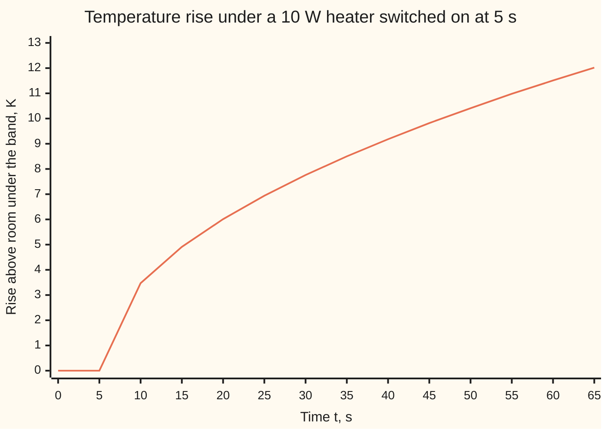
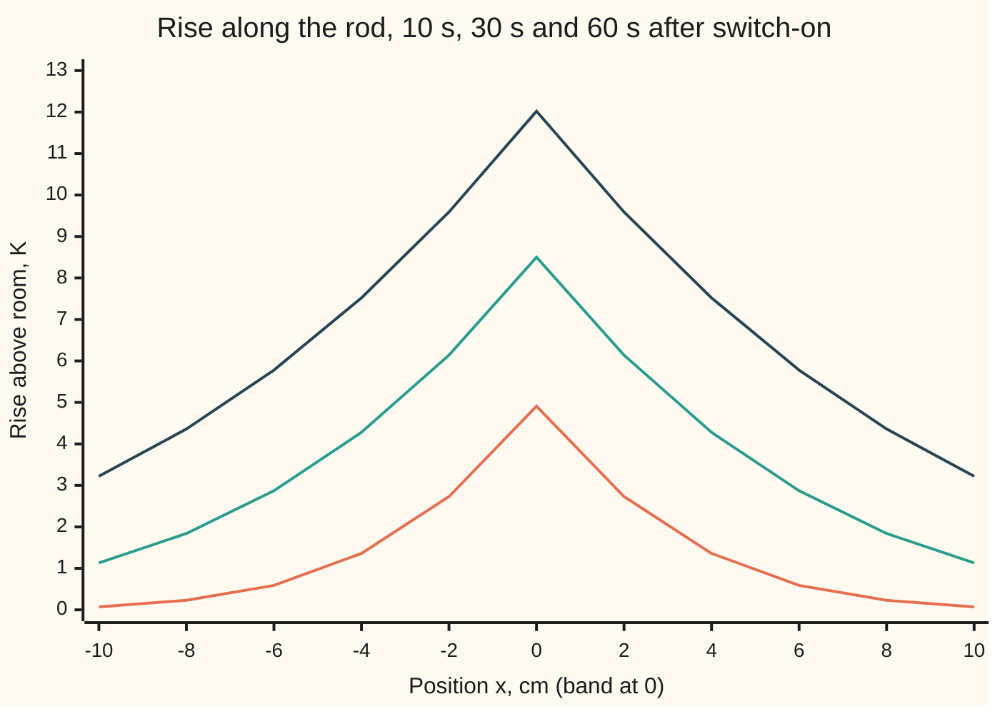

# Duhamel's principle: a forcing term is a stream of fresh starts

[Syllabus](../../../SYLLABUS.md) → [Partial differential equations](../README.md) → [The Heat Equation in Depth](../README.md#s03) → Duhamel's principle

---

## General Overview

A copper rod 1 m long, with a square section of 1 cm², sits at room temperature. At t = 5 s a heater band clamped round its middle switches on and pours in 10 W. How warm is the rod under the band 10 s later, and 2 cm away?

[Convolution](../../08-Differential%20equations%20and%20dynamics/08-Laplace%20Transforms%20for%20Initial-Value%20Problems/07-convolution-and-the-impulse-response.md) in wing 08 showed that the response to any input is a sum of shifted impulse responses. This card proves the same for a whole temperature profile, with the heat kernel as the impulse response.

The idea in words:

- In each short moment the heater adds a thin slab of heat at the middle of the rod.
- From then on, that slab spreads exactly as a hot spot would if the rod had started with it. It is a **fresh start** of the unforced heat equation, launched at that moment.
- The temperature now is the sum of all the slabs launched since 5 s, each spread by its own age.

Adding them up gives 4.91 K above room under the band at t = 15 s, 2.73 K at 2 cm, and 12.02 K under the band at t = 65 s.

**Duhamel's principle: the response to a source that keeps acting is the sum, over every earlier moment, of the unforced solution started at that moment from what the source added then.**

**What kind of fact this is:** a theorem, proved on this card in Why it works for a smooth source. The point heater is a limit of smooth sources. Its temperature is a classical solution (twice differentiable in x, once in t) everywhere except at the band, where the slope jumps by just the amount that carries the 10 W away.



The rise under the band stays at 0 until 5 s, then climbs and slows. Four times the heating time gives twice the rise: 4.91 K after 10 s, 9.82 K after 40 s. Both checks print every point.

---

## The formula

The unknown is the temperature rise $`u(x, t)`$ above room, in kelvin (K). The real rod runs over $`-0.5 \le x \le 0.5`$ m, with the band at $`x = 0`$ and insulated ends (no heat flows out of them). The model region is the whole line, every $`x`$, for times $`t > 0`$: at 65 s the first correction for the insulated ends, under the band, is only $`1.537 \times 10^{-17}`$ K (When it holds). The data are the start $`u(x, 0) = g(x)`$ and the source $`f(x, t)`$. The heat equation from [The heat kernel](01-heat-kernel-and-fundamental-solution.md) gains one term:

```math
u_t = \kappa\, u_{xx} + f(x, t), \qquad u(x, 0) = g(x)
```

Duhamel's principle solves it:

```math
u(x, t) = \int G(x - y, t)\, g(y)\, dy \;+\; \int_0^t\!\! \int G(x - y,\, t - \tau)\, f(y, \tau)\, dy\, d\tau
```

Here $`G(x, t) = e^{-x^2/(4\kappa t)}/\sqrt{4\pi\kappa t}`$ is the heat kernel: the spread of one unit of heat dropped at a point, after time $`t`$.

**Read it aloud:** the temperature now is the starting profile spread for the full time, plus, for every earlier moment τ, the heat added at τ spread for its age t − τ.

For the band, the rod starts at room temperature ($`g = 0`$) and the source is a point at $`x = 0`$ that is on from $`t_0 = 5`$ s: $`f = Q\,\delta(x)`$, with $`Q = P/(\rho c_p A)`$. Writing $`t_{\mathrm{on}} = t - t_0`$ for how long the heater has run, the double integral works out in closed form:

```math
u(x, t) = Q\left[\sqrt{\frac{t_{\mathrm{on}}}{\pi\kappa}}\; e^{-z^2} \;-\; \frac{|x|}{2\kappa}\, \mathrm{erfc}(z)\right], \qquad z = \frac{|x|}{2\sqrt{\kappa\, t_{\mathrm{on}}}}
```

**Read it aloud:** under the band the rise is Q times the square root of the run time over π κ; away from the band, subtract a correction that grows with distance.

| Symbol | Plain meaning | In our example | Push it up and the answer… |
| --- | --- | --- | --- |
| $`x`$, $`t`$ | position along the rod, m, band at 0; time, s | 0, 2 and 5 cm; 15, 35 and 65 s | — |
| $`u(x, t)`$ | temperature rise above room, K | 4.91 K under the band at 15 s | — |
| $`\kappa`$ | diffusivity of copper: how fast heat spreads, m²/s | 1.11 × 10⁻⁴, copper, illustrative (the shelf's value) | heat leaves the band faster; less rise under it |
| $`G(x, t)`$ | the heat kernel: the spread of one unit of heat dropped at a point | width $`\sqrt{2\kappa t}`$ | — |
| $`f(x, t)`$; $`\delta`$ | the source: heating rate, K/s (for the wire: force per kilogram, m/s²); the point mass, whose integral is 1 | $`Q\,\delta(x)`$ from 5 s on | every rise grows in proportion |
| $`\tau`$; $`a`$; $`y`$; $`\varepsilon`$ | the moment one fresh start is launched, s; its age $`t - \tau`$; a position of the source inside an integral; a small time cut used in the proof | τ runs from 5 s to now | — |
| $`t_0`$; $`t_{\mathrm{on}}`$ | the switch-on time; how long the heater has run, $`t - t_0`$ | 5 s; 10 s at t = 15 s | — |
| $`P`$; $`\rho c_p`$; $`A`$; $`Q`$ | heater power, W; heat capacity per volume (density times specific heat), J/(m³ K); section, m²; source strength $`P/(\rho c_p A)`$, K m/s | 10 W; 3.45 × 10⁶; 10⁻⁴; 0.0289855 | rises in proportion to $`Q`$ |
| $`g(x)`$; $`v(x, t; \tau)`$ | the starting rise; the fresh start launched at τ | 0; the slab added at τ, spread | — |
| $`z`$; erfc | scaled distance from the band; the error-function tail, $`\mathrm{erfc}(z) = \frac{2}{\sqrt{\pi}}\int_z^\infty e^{-y^2} dy`$ | z = 0.30015 at 2 cm, 15 s; erfc = 0.67122 | — |
| $`c`$; $`\mu`$; $`F`$; $`T_{\mathrm{s}}`$ | for the string in Step 4: wave speed, m/s; mass per metre, kg/m; pushing force, N; tension, N | 100 m/s; 0.01 kg/m; 0.2 N; 100 N | — |
| $`w(x, t; \tau)`$ | the string's fresh start launched at τ: a speed, not a shape | a box of height $`F/(2\mu c)`$ times dτ | — |

### When it holds

- **The equation is linear.** Fresh starts add only if two sources give the sum of their two answers. If copper's diffusivity changed with temperature, the slabs would interfere and the sum would be wrong.
- **The rod does not change with time.** A slab launched at τ spreads by its age alone. If κ changed during the run, each fresh start would need its own clock-dependent kernel, and $`G(\cdot, t - \tau)`$ would be wrong.
- **The ends are far away.** The formula uses the endless line. For a 1 m rod with insulated ends, the first omitted correction (the two mirror sources at ±1 m) is 1.537 × 10⁻¹⁷ K under the band at 65 s. Heat that the line model puts past the ends is 7.593 × 10⁻⁴ J of 600 J.
- **Heat leaves only along the rod.** Air cooling is left out. With an illustrative surface coefficient of 10 W/(m² K) on the 4 cm rim, it removes about 20.87 J of the 600 J in the first minute: 3.48 %. That is where the model departs from the bench.
- **The source can be integrated.** A point heater is allowed because its integral over the rod is finite. It leaves a kink at the band, so there the equation holds only in the integrated sense.

---

## Why it works

### Step 0: a source is a stream of fresh starts

The unforced heat equation already solves any starting profile: smear it with the heat kernel. A source is a supply of new starting profiles, one per moment.

Over a short interval dτ the heater adds the profile $`f(x, \tau)\,d\tau`$. If nothing else happened, that profile would spread as an unforced solution launched at τ. Linearity lets every such slab spread on its own, without noticing the others. So the answer is their sum: an integral over τ.

### Step 1: one fresh start

The fresh start launched at τ is the function $`v(x, t; \tau)`$ that solves the unforced equation from time τ on, starting from the source's profile at that moment:

```math
v_t = \kappa\, v_{xx} \quad (t > \tau), \qquad v(x, \tau; \tau) = f(x, \tau)
```

The heat kernel solves this: $`v(x, t; \tau) = \int G(x - y, t - \tau)\, f(y, \tau)\, dy`$. Only the age $`t - \tau`$ appears, because copper does not change with the clock.

### Step 2: adding the stream solves the forced equation

Set $`u(x, t) = \int_0^t v(x, t; \tau)\, d\tau`$. Differentiate in t. The upper limit contributes the integrand at τ = t, which is the newest slab, $`f(x, t)`$. Every older slab contributes its own rate, which is κ times its curvature:

```math
u_t = v(x, t; t) + \int_0^t v_t\, d\tau = f(x, t) + \kappa \int_0^t v_{xx}\, d\tau = f + \kappa\, u_{xx}
```

At t = 0 the integral covers no time, so u starts at 0. Add the unforced solution from the start $`g`$, and the sum solves the whole problem.

<details>
<summary>Detailed proof: the differentiation is allowed, and the answer is unique</summary>

Let f be bounded and continuous, with bounded continuous derivatives $`f_x`$, $`f_{xx}`$ and $`f_t`$. The difficulty is that $`G(\cdot, t - \tau)`$ becomes a spike as τ approaches t, so derivatives cannot simply pass under the integral.

Move the derivatives onto f instead. Substitute $`y \to x - y`$ and $`\tau \to t - s`$:

$`\displaystyle u(x, t) = \int_0^t \int G(y, s)\, f(x - y,\, t - s)\, dy\, ds.`$

Now x and t sit only in f, which is smooth. So $`u_{xx} = \int_0^t\!\int G\, f_{xx}\, dy\, ds`$, and $`u_t = \int G(y, t) f(x - y, 0)\, dy + \int_0^t\!\int G\, f_t\, dy\, ds`$. Both are continuous.

Next, split the time integral at a small ε. On $`[\varepsilon, t]`$ the kernel is smooth, so move the derivatives back onto G and use $`G_s = \kappa G_{yy}`$, integrating by parts in s and y:

$`\displaystyle \int_\varepsilon^t\!\int G\,(f_t - \kappa f_{xx})\, dy\, ds = \int G(y, \varepsilon)\, f(x - y, t - \varepsilon)\, dy - \int G(y, t)\, f(x - y, 0)\, dy.`$

The piece on $`[0, \varepsilon]`$ is at most a constant times ε, because G has total 1. As ε shrinks, the first integral on the right tends to $`f(x, t)`$, since G becomes a point mass. Putting the pieces together gives $`u_t - \kappa u_{xx} = f(x, t)`$, with u continuous and u = 0 at t = 0. This is the argument in Evans, section 2.3.1.

**Uniqueness.** If two solutions with the same source and start both stay bounded on each time span, their difference solves the unforced equation from zero. The maximum principle for the whole line ([Diffusion's maximum principle](04-maximum-principle-for-the-heat-equation.md)) then forces the difference to be 0. So the Duhamel answer is the only bounded classical solution.

</details>

### Step 3: the point heater, worked to a closed form

For the band, the source is the point mass $`Q\,\delta(x)`$ from 5 s on. The space integral just reads off the kernel at x, so

```math
u(x, t) = Q \int_{t_0}^{t} G(x,\, t - \tau)\, d\tau = Q \int_0^{t_{\mathrm{on}}} G(x, a)\, da
```

where $`a = t - \tau`$ is the age of each slab. Under the band (x = 0), $`G(0, a) = 1/\sqrt{4\pi\kappa a}`$, and the integral of $`a^{-1/2}`$ is $`2\sqrt{a}`$:

```math
u(0, t) = Q\,\sqrt{\frac{t_{\mathrm{on}}}{\pi\kappa}}
```

That is the square-root law in the chart: heat leaks sideways as fast as it arrives, so the rise slows down. Four times the run time gives twice the rise, and the checks print the ratio 2.0000.

Away from the band, differentiate in x first. The substitution $`z = x/(2\sqrt{\kappa a})`$ turns $`Q\int_0^{t_{\mathrm{on}}} G_x\, da`$ into an erfc. For x > 0:

```math
u_x(x, t) = -\frac{Q}{2\kappa}\, \mathrm{erfc}(z)
```

Integrate once more from x out to where u vanishes, using $`\int_z^\infty \mathrm{erfc} = e^{-z^2}/\sqrt{\pi} - z\,\mathrm{erfc}(z)`$. That gives the closed form on The formula.

The slope formula says something physical. Right beside the band, z = 0 and erfc(0) = 1, so the slope is $`-Q/(2\kappa)`$ = −130.565 K/m at every time. The heat flow out of each side is conductivity times area times that slope. Both sides together carry $`2\kappa\rho c_p A \cdot Q/(2\kappa) = P`$: exactly the 10 W the heater puts in. The kink at the band is where the power leaves.



Orange is t = 15 s, teal t = 35 s, dark blue t = 65 s. Each profile is a tent with a sharp peak at the band, not a bell. The slopes beside the peak are the same in all three: −130.565 K/m.

### Step 4: the same recipe for waves, where the fresh start is a speed

Take a long taut wire: tension $`T_{\mathrm{s}}`$ = 100 N, mass $`\mu`$ = 0.01 kg/m, so waves run at $`c = \sqrt{T_{\mathrm{s}}/\mu}`$ = 100 m/s. At $`t_0`$ = 5 s a steady sideways force F = 0.2 N starts pulling at x = 0. The wire's displacement u obeys $`u_{tt} = c^2 u_{xx} + f`$, where f is force per unit mass: an acceleration.

An acceleration acting for dτ does not move the wire at once. It gives the wire a **speed** $`f\,d\tau`$. So the fresh start w launched at τ starts flat, with that speed:

```math
w_{tt} = c^2 w_{xx}, \quad w(x, \tau; \tau) = 0, \quad w_t(x, \tau; \tau) = f(x, \tau), \qquad u = \int_{t_0}^t w\, d\tau
```

d'Alembert's formula, from [The wave equation](../../08-Differential%20equations%20and%20dynamics/10-The%20Classical%20PDEs/05-the-wave-equation-and-dalemberts-formula.md) (a starting speed splits into halves that run left and right at c), solves each fresh start: $`w = \frac{1}{2c}\int_{x - c(t - \tau)}^{x + c(t - \tau)} f(y, \tau)\, dy`$. For the point force, $`f = (F/\mu)\,\delta(x)`$, so each fresh start is a box of height $`F/(2\mu c)`$ that widens at c in both directions. Stacking boxes from 5 s on gives a growing tent:

```math
u(x, t) = \frac{F}{2\mu c}\,\max\!\left(0,\; t - t_0 - \frac{|x|}{c}\right)
```

The centre moves at $`F/(2\mu c)`$ = 0.1000 m/s, so 4 ms after switch-on it is 0.4000 mm out; 0.1 m away it is 0.3000 mm out. Unlike the rod, nothing leaks away: the centre keeps a steady speed, and the tent has a sharp front at $`c\,(t - t_0)`$.

---

## Worked numbers, by hand

The rod at t = 15 s, so the heater has run $`t_{\mathrm{on}}`$ = 10 s. Copper: κ = 1.11 × 10⁻⁴ m²/s, ρc_p = 3.45 × 10⁶ J/(m³ K). Together these imply a conductivity κρc_p = 382.9 W/(m K), 4.5 % below the 401 W/(m K) that [Similarity solutions](02-similarity-solutions-and-the-error-function.md) pairs with the same κ. The shelf's copper values are illustrative, not one matched handbook set.

| Step | Arithmetic | Value |
| --- | --- | --- |
| heat capacity per metre of rod | 3.45 × 10⁶ × 10⁻⁴ | 345.0 J/(K m) |
| source strength Q | 10 ÷ 345 | 0.0289855 K m/s |
| square-root factor | √(10 ÷ (π × 1.11 × 10⁻⁴)) | 169.342 s/m |
| rise under the band | 0.0289855 × 169.342 | **4.9085 K** |
| scaled distance at 2 cm | 0.02 ÷ (2√(1.11 × 10⁻⁴ × 10)) | z = 0.30015 |
| bell factor | e^(−0.30015²) | 0.91385 |
| tail factor | erfc(0.30015) | 0.67122 |
| distance factor | 0.02 ÷ (2 × 1.11 × 10⁻⁴) | 90.090 s/m |
| bracket | 169.342 × 0.91385 − 90.090 × 0.67122 = 154.753 − 60.470 | 94.282 s/m |
| rise at 2 cm | 0.0289855 × 94.282 | **2.7328 K** |
| slope beside the band | −0.0289855 ÷ (2 × 1.11 × 10⁻⁴) | −130.565 K/m |
| wire: centre speed | 0.2 ÷ (2 × 0.01 × 100) | 0.1000 m/s |
| wire: centre at 4 ms | 0.1 × 0.004 | 0.4000 mm |

Ten seconds after switch-on, the band is 4.91 K above room and the copper 2 cm away 2.73 K. After a minute the band reaches 12.02 K, and 10 cm away the rise is 3.22 K.

### What breaks if you drop a piece

| Mistake | Comes out at | What went wrong |
| --- | --- | --- |
| Starting the stream at 0 s instead of 5 s | 6.0116 K under the band at 15 s, not 4.9085 | The heater was off for the first 5 s; slabs before $`t_0`$ do not exist |
| Feeding the kernel the clock t instead of the age t − τ | 2.0039 K | Every slab is spread as if launched at time 0, so new heat is smeared out too far |
| Putting the power P in as the source without dividing by $`\rho c_p A`$ | 1693.4 K | Watts are not kelvin per second; the heat must be turned into a temperature first |
| Trusting the model on a bench in still air, where heat also leaves through the surface | 600 J kept in the rod by 65 s; the air really takes about 20.87 J of it, 3.48 % | the hypothesis "heat leaves only along the rod" fails: the equation has no surface-loss term, so every fresh start keeps heat it should lose |

The checks print every row.

---

## Code, from first principles, and it actually runs

Both programs work the heater band and then the wire. For the band they take six roads to the same temperatures:

1. the Duhamel integral itself, summed over the slab ages by Simpson's rule, using the square root of the age as the variable to remove the $`a^{-1/2}`$ spike;
2. the closed form, with erfc written out as a series near 0 and a continued fraction far out;
3. an explicit grid (a step-by-step finite-difference solve) of the 1 m rod with insulated ends, at three steps, showing second-order accuracy;
4. the residual $`u_t - \kappa u_{xx}`$ of the closed form by centred differences at two steps;
5. the heat budget: all the heat in the rod equals 10 W times the run time;
6. the slope beside the band, which must carry exactly 10 W away.

For the wire, the closed-form tent is checked against a sum of 4,000 fresh-start boxes and against momentum: the wire's total momentum must equal the push F times the run time.

### Python

```python
# Duhamel's principle -- the check behind the card.  Standard library only.
# A 1 m copper rod, 1 cm^2 section, room temperature everywhere.  At t = 5 s a
# 10 W heater band at its middle (x = 0) switches on.  u = rise above room, K.
# Roads: the Duhamel integral by Simpson's rule; its closed form (erfc written
# out); an explicit grid with insulated ends; the residual u_t - kappa u_xx;
# the heat budget; the slope jump at the heater.  Then a string pushed at 5 s.
import math

K, RC, A, P, T0 = 1.11e-4, 3.45e6, 1e-4, 10.0, 5.0   # m^2/s, J/(m^3 K), m^2, W, s
Q = P / (RC * A)                                      # source strength, K m/s

def sci(v):                          # e-notation with the same digits in Rust
    e = math.floor(math.log10(abs(v))); m = v / 10 ** e
    return f"{m:.3f}e{'-' if e < 0 else '+'}{abs(e):02d}"

def erfc(z):                         # z >= 0: series near 0, continued fraction far out
    if z > 3:
        f = z
        for k in range(60, 0, -1): f = z + (k / 2) / f
        return math.exp(-z * z) / (math.sqrt(math.pi) * f)
    term = s = z; n = 0
    while term > 1e-17 * s:
        n += 1; term *= 2 * z * z / (2 * n + 1); s += term
    return 1 - 2 / math.sqrt(math.pi) * math.exp(-z * z) * s

def simpson(f, a, b, n):
    h = (b - a) / n
    return h / 3 * (f(a) + f(b) + sum((4 if i % 2 else 2) * f(a + i * h) for i in range(1, n)))

def kernel(x, age): return math.exp(-x * x / (4 * K * age)) / math.sqrt(4 * math.pi * K * age)

def duhamel(x, t, n=400, start=T0):  # road 1: add up fresh starts, age a = w^2
    if t <= start: return 0.0
    f = lambda w: Q * 2 * w * kernel(x, w * w) if w > 0 else (Q / math.sqrt(math.pi * K) if x == 0 else 0.0)
    return simpson(f, 0.0, math.sqrt(t - start), n)

def closed(x, t, start=T0):          # road 2: the same integral done by hand
    if t <= start: return 0.0
    tau = t - start; z = abs(x) / (2 * math.sqrt(K * tau))
    return Q * (math.sqrt(tau / (math.pi * K)) * math.exp(-z * z) - abs(x) / (2 * K) * erfc(z))

def grid(dx, t1=65.0, half=0.5):     # road 3: explicit grid, heater in the middle cell
    n = round(2 * half / dx); m = n // 2
    steps = math.ceil((t1 - T0) * 4 * K / dx ** 2); dt = (t1 - T0) / steps; r = K * dt / dx ** 2
    u = [0.0] * (n + 1)
    for _ in range(steps):
        v = [u[i] + r * (u[max(i - 1, 0) if i else 1] - 2 * u[i] + u[i + 1 if i < n else n - 1])
             for i in range(n + 1)]
        v[m] += Q * dt / dx; u = v
    return u[m], u[m + round(0.02 / dx)]

print(f"source strength Q = P/(rho c A) = {Q:.7f} K m/s")
print("chart, heater band, t = 0..65 s by 5 s: " + ", ".join(f"{closed(0, 5.0 * i):.2f}" for i in range(14)))
for t in (15.0, 35.0, 65.0):
    print(f"chart, profile at t = {t:.0f} s, x = -10..10 cm by 2 cm: " + ", ".join(f"{closed(0.02 * i, t):.2f}" for i in range(-5, 6)))
print(f"before switch-on, t = 4 s, x = 0: {duhamel(0, 4.0):.6f} K, {closed(0, 4.0):.6f} K")
print("t s | x m | Duhamel integral K | closed form K")
for t in (15.0, 35.0, 65.0):
    for x in (0.0, 0.02, 0.05):
        d, c = duhamel(x, t), closed(x, t)
        assert abs(d - c) < 1e-9, (t, x)
        print(f"{t:4.0f} | {x:.2f} | {d:.6f} | {c:.6f}")
u10, u40 = closed(0, 15.0), closed(0, 45.0)
assert abs(u40 / u10 - 2) < 1e-12                     # square-root law
print(f"heater band after 10 s and 40 s: {u10:.4f} K, {u40:.4f} K; ratio {u40 / u10:.4f}")

print("grid at t = 65 s | dx cm | u(0) K | u(2 cm) K | error at 0")
errs = []
for dx in (0.02, 0.01, 0.005):
    g0, g2 = grid(dx); e = abs(g0 - closed(0, 65.0)); errs.append(e)
    print(f"grid | {dx * 100:.1f} | {g0:.5f} | {g2:.5f} | {sci(e)}")
orders = [math.log2(errs[i] / errs[i + 1]) for i in range(2)]
assert errs[2] < 0.01 and all(1.7 < p < 2.3 for p in orders)
print("observed order: " + ", ".join(f"{p:.2f}" for p in orders))
img = 2 * closed(1.0, 65.0)
print(f"first omitted term, the two end images at x = 0, t = 65 s: {sci(img)} K")

for h in (1e-3, 5e-4):                                # road 4: residual at x = 2 cm, t = 15 s
    x, t = 0.02, 15.0
    ut = (closed(x, t + h * 10) - closed(x, t - h * 10)) / (20 * h)
    uxx = (closed(x + h, t) - 2 * closed(x, t) + closed(x - h, t)) / h ** 2
    assert abs(ut - K * uxx) < 1e-4 * abs(ut)
    print(f"residual, step {h * 1000:.1f} mm: u_t = {ut:.6f} K/s, kappa u_xx = {K * uxx:.6f} K/s")

half = lambda b: simpson(lambda x: closed(x, 65.0), 0.0, b, 800)  # u is even in x
heat = 2 * RC * A * half(1.0)
past = 2 * RC * A * simpson(lambda x: closed(x, 65.0), 0.5, 1.0, 800)
assert abs(heat - P * 60) < 1e-8 * P * 60              # road 5: the heat budget
print(f"heat on the line at 65 s: {heat:.4f} J; heater gave {P * 60:.1f} J; past the rod ends {sci(past)} J")
for tau in (10.0, 60.0):                               # road 6: slope jump carries the power
    s = (closed(1e-6, T0 + tau) - closed(0.0, T0 + tau)) / 1e-6
    assert abs(s + Q / (2 * K)) < 1e-3 * Q / (2 * K)
    print(f"slope beside the heater, t_on = {tau:.0f} s: {s:.3f} K/m (exact -Q/(2 kappa) = {-Q / (2 * K):.3f}); "
          f"flow out both sides {-2 * K * RC * A * s:.4f} W")
print(f"air cooling, illustrative 10 W/(m^2 K) on a 4 cm rim: {10 * 0.04 * Q * 1800:.2f} J of 600 J, {10 * 0.04 * Q * 1800 / 6:.2f} %")
print(f"conductivity these values imply, kappa rho c = {K * RC:.1f} W/(m K), {100 * (1 - K * RC / 401):.1f} % below 401 W/(m K)")

z = 0.02 / (2 * math.sqrt(K * 10))                     # by hand at t = 15 s
print(f"by hand: rho c A = {RC * A:.1f} J/(K m); sqrt(10/(pi kappa)) = {math.sqrt(10 / (math.pi * K)):.3f} s/m; "
      f"at 2 cm: z = {z:.5f}, e^(-z^2) = {math.exp(-z * z):.5f}, erfc(z) = {erfc(z):.5f}, x/(2 kappa) = {0.02 / (2 * K):.3f} s/m")
t1, t2 = math.sqrt(10 / (math.pi * K)) * math.exp(-z * z), 0.02 / (2 * K) * erfc(z)
print(f"by hand at 2 cm: {t1:.3f} - {t2:.3f} = {t1 - t2:.3f} s/m; times Q: {Q * (t1 - t2):.4f} K")
print("what breaks, at x = 0, t = 15 s:")
print(f"  stream started at 0 s, not 5 s: {closed(0, 15.0, start=0.0):.4f} K, not {u10:.4f}")
wrong = simpson(lambda s: Q * kernel(0, 15.0), T0, 15.0, 10)
print(f"  kernel fed the clock t, not the age t - tau: {wrong:.4f} K")
print(f"  power not divided by rho c A: {P / Q * u10:.1f} K")

F, TS, MU = 0.2, 100.0, 0.01                           # the wave: string, N, N, kg/m
C = math.sqrt(TS / MU)
def tent(x, t): return F / (2 * MU * C) * max(0.0, (t - T0) - abs(x) / C)
def kicks(x, t, n):                                    # each kick: d'Alembert box of height F/(2 mu c)
    ds = (t - T0) / n
    return sum(F / (2 * MU * C) * ds for k in range(n) if abs(x) < C * (t - T0 - (k + 0.5) * ds))
print(f"string: c = {C:.1f} m/s; centre speed F/(2 mu c) = {F / (2 * MU * C):.4f} m/s")
for x in (0.0, 0.1, 0.3):
    a, b = tent(x, 5.004), kicks(x, 5.004, 4000)
    assert abs(a - b) < 1e-3 * a + 1e-9
    print(f"string at t = 5.004 s, x = {x:.1f} m: tent {a * 1000:.4f} mm, sum of 4000 kicks {b * 1000:.4f} mm")
mom = MU * simpson(lambda x: (tent(x, 5.0041) - tent(x, 5.0039)) / 2e-4, -0.5, 0.5, 2000)
assert abs(mom - F * 0.004) < 1e-3 * F * 0.004
print(f"string momentum at 5.004 s: {mom * 1000:.4f} g m/s; impulse F (t - 5) = {F * 4:.4f} g m/s")
off = closed(0, 125.0) - closed(0, 125.0, start=65.0)  # try changing
print(f"try: heater off at 65 s, x = 0 at 125 s: {off:.4f} K; tension 200 N: centre speed {F / (2 * math.sqrt(200 * MU)):.4f} m/s")
print("ALL CHECKS PASS")
```

**Ran 2026-11-15 on macOS, Python 3.14.10, standard library only. All checks passed. Output, pasted from the run:**

```
source strength Q = P/(rho c A) = 0.0289855 K m/s
chart, heater band, t = 0..65 s by 5 s: 0.00, 0.00, 3.47, 4.91, 6.01, 6.94, 7.76, 8.50, 9.18, 9.82, 10.41, 10.98, 11.51, 12.02
chart, profile at t = 15 s, x = -10..10 cm by 2 cm: 0.07, 0.23, 0.59, 1.36, 2.73, 4.91, 2.73, 1.36, 0.59, 0.23, 0.07
chart, profile at t = 35 s, x = -10..10 cm by 2 cm: 1.13, 1.84, 2.87, 4.28, 6.14, 8.50, 6.14, 4.28, 2.87, 1.84, 1.13
chart, profile at t = 65 s, x = -10..10 cm by 2 cm: 3.22, 4.36, 5.78, 7.52, 9.59, 12.02, 9.59, 7.52, 5.78, 4.36, 3.22
before switch-on, t = 4 s, x = 0: 0.000000 K, 0.000000 K
t s | x m | Duhamel integral K | closed form K
  15 | 0.00 | 4.908451 | 4.908451
  15 | 0.02 | 2.732825 | 2.732825
  15 | 0.05 | 0.911098 | 0.911098
  35 | 0.00 | 8.501687 | 8.501687
  35 | 0.02 | 6.144416 | 6.144416
  35 | 0.05 | 3.520980 | 3.520980
  65 | 0.00 | 12.023201 | 12.023201
  65 | 0.02 | 9.591972 | 9.591972
  65 | 0.05 | 6.605915 | 6.605915
heater band after 10 s and 40 s: 4.9085 K, 9.8169 K; ratio 2.0000
grid at t = 65 s | dx cm | u(0) K | u(2 cm) K | error at 0
grid | 2.0 | 12.00052 | 9.56941 | 2.268e-02
grid | 1.0 | 12.01755 | 9.58635 | 5.653e-03
grid | 0.5 | 12.02179 | 9.59057 | 1.411e-03
observed order: 2.00, 2.00
first omitted term, the two end images at x = 0, t = 65 s: 1.537e-17 K
residual, step 1.0 mm: u_t = 0.224279 K/s, kappa u_xx = 0.224272 K/s
residual, step 0.5 mm: u_t = 0.224279 K/s, kappa u_xx = 0.224277 K/s
heat on the line at 65 s: 600.0000 J; heater gave 600.0 J; past the rod ends 7.593e-04 J
slope beside the heater, t_on = 10 s: -130.564 K/m (exact -Q/(2 kappa) = -130.565); flow out both sides 9.9999 W
slope beside the heater, t_on = 60 s: -130.565 K/m (exact -Q/(2 kappa) = -130.565); flow out both sides 10.0000 W
air cooling, illustrative 10 W/(m^2 K) on a 4 cm rim: 20.87 J of 600 J, 3.48 %
conductivity these values imply, kappa rho c = 382.9 W/(m K), 4.5 % below 401 W/(m K)
by hand: rho c A = 345.0 J/(K m); sqrt(10/(pi kappa)) = 169.342 s/m; at 2 cm: z = 0.30015, e^(-z^2) = 0.91385, erfc(z) = 0.67122, x/(2 kappa) = 90.090 s/m
by hand at 2 cm: 154.753 - 60.470 = 94.282 s/m; times Q: 2.7328 K
what breaks, at x = 0, t = 15 s:
  stream started at 0 s, not 5 s: 6.0116 K, not 4.9085
  kernel fed the clock t, not the age t - tau: 2.0039 K
  power not divided by rho c A: 1693.4 K
string: c = 100.0 m/s; centre speed F/(2 mu c) = 0.1000 m/s
string at t = 5.004 s, x = 0.0 m: tent 0.4000 mm, sum of 4000 kicks 0.4000 mm
string at t = 5.004 s, x = 0.1 m: tent 0.3000 mm, sum of 4000 kicks 0.3000 mm
string at t = 5.004 s, x = 0.3 m: tent 0.1000 mm, sum of 4000 kicks 0.1000 mm
string momentum at 5.004 s: 0.8000 g m/s; impulse F (t - 5) = 0.8000 g m/s
try: heater off at 65 s, x = 0 at 125 s: 4.9802 K; tension 200 N: centre speed 0.0707 m/s
ALL CHECKS PASS
```

### Rust

```rust
// Duhamel's principle -- the check behind the card.  Rust std only.
// A 1 m copper rod, 1 cm^2 section, room temperature everywhere.  At t = 5 s a
// 10 W heater band at its middle (x = 0) switches on.  u = rise above room, K.
// Roads: the Duhamel integral by Simpson's rule; its closed form (erfc written
// out); an explicit grid with insulated ends; the residual u_t - kappa u_xx;
// the heat budget; the slope jump at the heater.  Then a string pushed at 5 s.
use std::f64::consts::PI;

const K: f64 = 1.11e-4; const RC: f64 = 3.45e6; const A: f64 = 1e-4; const P: f64 = 10.0; const T0: f64 = 5.0;
const Q: f64 = P / (RC * A); // source strength, K m/s

fn sci(v: f64) -> String { // e-notation with the same digits as Python
    let e = v.abs().log10().floor() as i32; let m = v / 10f64.powi(e);
    format!("{:.3}e{}{:02}", m, if e < 0 { '-' } else { '+' }, e.abs())
}

fn erfc(z: f64) -> f64 { // z >= 0: series near 0, continued fraction far out
    if z > 3.0 {
        let mut f = z;
        for k in (1..=60).rev() { f = z + (k as f64 / 2.0) / f; }
        return (-z * z).exp() / (PI.sqrt() * f);
    }
    let (mut term, mut s, mut n) = (z, z, 0);
    while term > 1e-17 * s { n += 1; term *= 2.0 * z * z / (2 * n + 1) as f64; s += term; }
    1.0 - 2.0 / PI.sqrt() * (-z * z).exp() * s
}

fn simpson(f: &dyn Fn(f64) -> f64, a: f64, b: f64, n: usize) -> f64 {
    let h = (b - a) / n as f64;
    let mut s = 0.0;
    for i in 1..n { s += (if i % 2 == 1 { 4.0 } else { 2.0 }) * f(a + i as f64 * h); }
    h / 3.0 * (f(a) + f(b) + s)
}

fn kernel(x: f64, age: f64) -> f64 { (-x * x / (4.0 * K * age)).exp() / (4.0 * PI * K * age).sqrt() }

fn duhamel(x: f64, t: f64) -> f64 { // road 1: add up fresh starts, age a = w^2
    if t <= T0 { return 0.0; }
    let f = |w: f64| if w > 0.0 { Q * 2.0 * w * kernel(x, w * w) } else if x == 0.0 { Q / (PI * K).sqrt() } else { 0.0 };
    simpson(&f, 0.0, (t - T0).sqrt(), 400)
}

fn closed_from(x: f64, t: f64, start: f64) -> f64 { // road 2: the same integral done by hand
    if t <= start { return 0.0; }
    let tau = t - start; let z = x.abs() / (2.0 * (K * tau).sqrt());
    Q * ((tau / (PI * K)).sqrt() * (-z * z).exp() - x.abs() / (2.0 * K) * erfc(z))
}
fn closed(x: f64, t: f64) -> f64 { closed_from(x, t, T0) }

fn grid(dx: f64) -> (f64, f64) { // road 3: explicit grid, heater in the middle cell
    let (t1, half) = (65.0, 0.5);
    let n = (2.0 * half / dx).round() as usize; let m = n / 2;
    let steps = ((t1 - T0) * 4.0 * K / (dx * dx)).ceil(); let dt = (t1 - T0) / steps; let r = K * dt / (dx * dx);
    let mut u = vec![0.0; n + 1];
    for _ in 0..steps as usize {
        let mut v = vec![0.0; n + 1];
        for i in 0..=n {
            let l = if i > 0 { u[i - 1] } else { u[1] }; let rr = if i < n { u[i + 1] } else { u[n - 1] };
            v[i] = u[i] + r * (l - 2.0 * u[i] + rr);
        }
        v[m] += Q * dt / dx; u = v;
    }
    (u[m], u[m + (0.02 / dx).round() as usize])
}

fn join(v: &[f64]) -> String { v.iter().map(|x| format!("{:.2}", x)).collect::<Vec<_>>().join(", ") }

fn main() {
    println!("source strength Q = P/(rho c A) = {:.7} K m/s", Q);
    let band: Vec<f64> = (0..14).map(|i| closed(0.0, 5.0 * i as f64)).collect();
    println!("chart, heater band, t = 0..65 s by 5 s: {}", join(&band));
    for t in [15.0, 35.0, 65.0] {
        let pr: Vec<f64> = (-5..=5).map(|i| closed(0.02 * i as f64, t)).collect();
        println!("chart, profile at t = {:.0} s, x = -10..10 cm by 2 cm: {}", t, join(&pr));
    }
    println!("before switch-on, t = 4 s, x = 0: {:.6} K, {:.6} K", duhamel(0.0, 4.0), closed(0.0, 4.0));
    println!("t s | x m | Duhamel integral K | closed form K");
    for t in [15.0, 35.0, 65.0] {
        for x in [0.0, 0.02, 0.05] {
            let (d, c) = (duhamel(x, t), closed(x, t));
            assert!((d - c).abs() < 1e-9);
            println!("{:4.0} | {:.2} | {:.6} | {:.6}", t, x, d, c);
        }
    }
    let (u10, u40) = (closed(0.0, 15.0), closed(0.0, 45.0));
    assert!((u40 / u10 - 2.0).abs() < 1e-12); // square-root law
    println!("heater band after 10 s and 40 s: {:.4} K, {:.4} K; ratio {:.4}", u10, u40, u40 / u10);

    println!("grid at t = 65 s | dx cm | u(0) K | u(2 cm) K | error at 0");
    let mut errs = vec![];
    for dx in [0.02, 0.01, 0.005] {
        let (g0, g2) = grid(dx); let e = (g0 - closed(0.0, 65.0)).abs(); errs.push(e);
        println!("grid | {:.1} | {:.5} | {:.5} | {}", dx * 100.0, g0, g2, sci(e));
    }
    let orders: Vec<f64> = (0..2).map(|i| (errs[i] / errs[i + 1]).log2()).collect();
    assert!(errs[2] < 0.01 && orders.iter().all(|&p| 1.7 < p && p < 2.3));
    println!("observed order: {:.2}, {:.2}", orders[0], orders[1]);
    println!("first omitted term, the two end images at x = 0, t = 65 s: {} K", sci(2.0 * closed(1.0, 65.0)));

    for h in [1e-3, 5e-4] { // road 4: residual at x = 2 cm, t = 15 s
        let (x, t) = (0.02, 15.0);
        let ut = (closed(x, t + h * 10.0) - closed(x, t - h * 10.0)) / (20.0 * h);
        let uxx = (closed(x + h, t) - 2.0 * closed(x, t) + closed(x - h, t)) / (h * h);
        assert!((ut - K * uxx).abs() < 1e-4 * ut.abs());
        println!("residual, step {:.1} mm: u_t = {:.6} K/s, kappa u_xx = {:.6} K/s", h * 1000.0, ut, K * uxx);
    }

    let u65 = |x: f64| closed(x, 65.0); // u is even in x
    let heat = 2.0 * RC * A * simpson(&u65, 0.0, 1.0, 800);
    let past = 2.0 * RC * A * simpson(&u65, 0.5, 1.0, 800);
    assert!((heat - P * 60.0).abs() < 1e-8 * P * 60.0); // road 5: the heat budget
    println!("heat on the line at 65 s: {:.4} J; heater gave {:.1} J; past the rod ends {} J", heat, P * 60.0, sci(past));
    for tau in [10.0, 60.0] { // road 6: slope jump carries the power
        let s = (closed(1e-6, T0 + tau) - closed(0.0, T0 + tau)) / 1e-6;
        assert!((s + Q / (2.0 * K)).abs() < 1e-3 * Q / (2.0 * K));
        println!("slope beside the heater, t_on = {:.0} s: {:.3} K/m (exact -Q/(2 kappa) = {:.3}); flow out both sides {:.4} W",
                 tau, s, -Q / (2.0 * K), -2.0 * K * RC * A * s);
    }
    println!("air cooling, illustrative 10 W/(m^2 K) on a 4 cm rim: {:.2} J of 600 J, {:.2} %",
             10.0 * 0.04 * Q * 1800.0, 10.0 * 0.04 * Q * 1800.0 / 6.0);
    println!("conductivity these values imply, kappa rho c = {:.1} W/(m K), {:.1} % below 401 W/(m K)", K * RC, 100.0 * (1.0 - K * RC / 401.0));

    let z = 0.02 / (2.0 * (K * 10.0).sqrt()); // by hand at t = 15 s
    println!("by hand: rho c A = {:.1} J/(K m); sqrt(10/(pi kappa)) = {:.3} s/m; at 2 cm: z = {:.5}, e^(-z^2) = {:.5}, erfc(z) = {:.5}, x/(2 kappa) = {:.3} s/m",
             RC * A, (10.0 / (PI * K)).sqrt(), z, (-z * z).exp(), erfc(z), 0.02 / (2.0 * K));
    let (t1, t2) = ((10.0 / (PI * K)).sqrt() * (-z * z).exp(), 0.02 / (2.0 * K) * erfc(z));
    println!("by hand at 2 cm: {:.3} - {:.3} = {:.3} s/m; times Q: {:.4} K", t1, t2, t1 - t2, Q * (t1 - t2));
    println!("what breaks, at x = 0, t = 15 s:");
    println!("  stream started at 0 s, not 5 s: {:.4} K, not {:.4}", closed_from(0.0, 15.0, 0.0), u10);
    let wrong = simpson(&|_s: f64| Q * kernel(0.0, 15.0), T0, 15.0, 10);
    println!("  kernel fed the clock t, not the age t - tau: {:.4} K", wrong);
    println!("  power not divided by rho c A: {:.1} K", P / Q * u10);

    let (f, ts, mu): (f64, f64, f64) = (0.2, 100.0, 0.01); // the wave: string, N, N, kg/m
    let c = (ts / mu).sqrt();
    let tent = |x: f64, t: f64| f / (2.0 * mu * c) * ((t - T0) - x.abs() / c).max(0.0);
    let kicks = |x: f64, t: f64, n: usize| { // each kick: d'Alembert box of height F/(2 mu c)
        let ds = (t - T0) / n as f64; let mut s = 0.0;
        for k in 0..n { if x.abs() < c * (t - T0 - (k as f64 + 0.5) * ds) { s += f / (2.0 * mu * c) * ds; } }
        s
    };
    println!("string: c = {:.1} m/s; centre speed F/(2 mu c) = {:.4} m/s", c, f / (2.0 * mu * c));
    for x in [0.0, 0.1, 0.3] {
        let (a, b) = (tent(x, 5.004), kicks(x, 5.004, 4000));
        assert!((a - b).abs() < 1e-3 * a + 1e-9);
        println!("string at t = 5.004 s, x = {:.1} m: tent {:.4} mm, sum of 4000 kicks {:.4} mm", x, a * 1000.0, b * 1000.0);
    }
    let mom = mu * simpson(&|x: f64| (tent(x, 5.0041) - tent(x, 5.0039)) / 2e-4, -0.5, 0.5, 2000);
    assert!((mom - f * 0.004).abs() < 1e-3 * f * 0.004);
    println!("string momentum at 5.004 s: {:.4} g m/s; impulse F (t - 5) = {:.4} g m/s", mom * 1000.0, f * 4.0);
    let off = closed(0.0, 125.0) - closed_from(0.0, 125.0, 65.0); // try changing
    println!("try: heater off at 65 s, x = 0 at 125 s: {:.4} K; tension 200 N: centre speed {:.4} m/s", off, f / (2.0 * (200.0 * mu).sqrt()));
    println!("ALL CHECKS PASS");
}
```

**Ran 2026-11-15 on macOS, rustc 1.98.1, no crates. All checks passed. Output, pasted from the run:**

```
source strength Q = P/(rho c A) = 0.0289855 K m/s
chart, heater band, t = 0..65 s by 5 s: 0.00, 0.00, 3.47, 4.91, 6.01, 6.94, 7.76, 8.50, 9.18, 9.82, 10.41, 10.98, 11.51, 12.02
chart, profile at t = 15 s, x = -10..10 cm by 2 cm: 0.07, 0.23, 0.59, 1.36, 2.73, 4.91, 2.73, 1.36, 0.59, 0.23, 0.07
chart, profile at t = 35 s, x = -10..10 cm by 2 cm: 1.13, 1.84, 2.87, 4.28, 6.14, 8.50, 6.14, 4.28, 2.87, 1.84, 1.13
chart, profile at t = 65 s, x = -10..10 cm by 2 cm: 3.22, 4.36, 5.78, 7.52, 9.59, 12.02, 9.59, 7.52, 5.78, 4.36, 3.22
before switch-on, t = 4 s, x = 0: 0.000000 K, 0.000000 K
t s | x m | Duhamel integral K | closed form K
  15 | 0.00 | 4.908451 | 4.908451
  15 | 0.02 | 2.732825 | 2.732825
  15 | 0.05 | 0.911098 | 0.911098
  35 | 0.00 | 8.501687 | 8.501687
  35 | 0.02 | 6.144416 | 6.144416
  35 | 0.05 | 3.520980 | 3.520980
  65 | 0.00 | 12.023201 | 12.023201
  65 | 0.02 | 9.591972 | 9.591972
  65 | 0.05 | 6.605915 | 6.605915
heater band after 10 s and 40 s: 4.9085 K, 9.8169 K; ratio 2.0000
grid at t = 65 s | dx cm | u(0) K | u(2 cm) K | error at 0
grid | 2.0 | 12.00052 | 9.56941 | 2.268e-02
grid | 1.0 | 12.01755 | 9.58635 | 5.653e-03
grid | 0.5 | 12.02179 | 9.59057 | 1.411e-03
observed order: 2.00, 2.00
first omitted term, the two end images at x = 0, t = 65 s: 1.537e-17 K
residual, step 1.0 mm: u_t = 0.224279 K/s, kappa u_xx = 0.224272 K/s
residual, step 0.5 mm: u_t = 0.224279 K/s, kappa u_xx = 0.224277 K/s
heat on the line at 65 s: 600.0000 J; heater gave 600.0 J; past the rod ends 7.593e-04 J
slope beside the heater, t_on = 10 s: -130.564 K/m (exact -Q/(2 kappa) = -130.565); flow out both sides 9.9999 W
slope beside the heater, t_on = 60 s: -130.565 K/m (exact -Q/(2 kappa) = -130.565); flow out both sides 10.0000 W
air cooling, illustrative 10 W/(m^2 K) on a 4 cm rim: 20.87 J of 600 J, 3.48 %
conductivity these values imply, kappa rho c = 382.9 W/(m K), 4.5 % below 401 W/(m K)
by hand: rho c A = 345.0 J/(K m); sqrt(10/(pi kappa)) = 169.342 s/m; at 2 cm: z = 0.30015, e^(-z^2) = 0.91385, erfc(z) = 0.67122, x/(2 kappa) = 90.090 s/m
by hand at 2 cm: 154.753 - 60.470 = 94.282 s/m; times Q: 2.7328 K
what breaks, at x = 0, t = 15 s:
  stream started at 0 s, not 5 s: 6.0116 K, not 4.9085
  kernel fed the clock t, not the age t - tau: 2.0039 K
  power not divided by rho c A: 1693.4 K
string: c = 100.0 m/s; centre speed F/(2 mu c) = 0.1000 m/s
string at t = 5.004 s, x = 0.0 m: tent 0.4000 mm, sum of 4000 kicks 0.4000 mm
string at t = 5.004 s, x = 0.1 m: tent 0.3000 mm, sum of 4000 kicks 0.3000 mm
string at t = 5.004 s, x = 0.3 m: tent 0.1000 mm, sum of 4000 kicks 0.1000 mm
string momentum at 5.004 s: 0.8000 g m/s; impulse F (t - 5) = 0.8000 g m/s
try: heater off at 65 s, x = 0 at 125 s: 4.9802 K; tension 200 N: centre speed 0.0707 m/s
ALL CHECKS PASS
```

### Lean

Lean proves Duhamel's principle for a smooth source, the point heater's rise under the band and the wire's tent, and checks the worked numbers.

- Suppose $`\kappa > 0`$, $`g = 0`$, and $`f`$ is bounded and continuous, with bounded continuous $`f_x`$, $`f_{xx}`$ and $`f_t`$. Then the double integral $`u`$ is twice differentiable in $`x`$, and $`u_t = \kappa\, u_{xx} + f`$ at every $`t > 0`$. As $`t`$ shrinks to 0, $`u`$ tends to 0.
- Take $`\kappa > 0`$ and a run time $`t_{\mathrm{on}} \ge 0`$. Then $`Q \int_0^{t_{\mathrm{on}}} G(0, a)\, da = Q\sqrt{t_{\mathrm{on}}/(\pi\kappa)}`$, the rise under the band.
- Take wave speed $`c > 0`$, and a box of height $`F/(2\mu c)`$ over $`|x| < c\,(t - \tau)`$ launched at each τ. Then the boxes from $`t_0`$ to $`t`$ stack to the tent $`F/(2\mu c) \cdot \max(0,\, t - t_0 - |x|/c)`$.
- The worked numbers check as exact fractions: $`Q`$, the slope beside the band, the 10 W it carries, and the wire's speed, centre and momentum.

The erfc profile, the decimal rises, the grid, the end images and air cooling are left to the Python and Rust checks.

```lean
-- Duhamel's principle: the sum of heat-kernel fresh starts u(x, t) = ∫₀ᵗ ∫ G(x − y, t − τ) f(y, τ) dy dτ solves the forced heat equation u_t = κ u_xx + f and starts at 0, a point heater gives the rise Q √(t_on/(πκ)) under it, and a point force on a wire gives a growing tent.
import Mathlib.Analysis.SpecialFunctions.Gaussian.GaussianIntegral
import Mathlib.Analysis.Calculus.ContDiff.Basic
import Mathlib.MeasureTheory.Integral.IntervalIntegral.Basic
import Mathlib.Analysis.SpecialFunctions.Sqrt
import Mathlib.Analysis.SpecialFunctions.Integrals.Basic
import Mathlib.MeasureTheory.Integral.IntegralEqImproper
import Mathlib.Analysis.Calculus.ParametricIntegral
import Mathlib.Analysis.Calculus.ParametricIntervalIntegral
import Mathlib.MeasureTheory.Integral.IntervalIntegral.FundThmCalculus
import Mathlib.Analysis.Calculus.Deriv.MeanValue
import Mathlib.Analysis.Calculus.ContDiff.Deriv

open Real MeasureTheory Filter Topology

/-- The heat kernel on the line: G(x, t) = e^(-x^2/(4κt)) / √(4πκt), the spread of one unit
of heat dropped at a point, after time t. -/
noncomputable def heatKernel (κ t x : ℝ) : ℝ :=
  Real.exp (-x ^ 2 / (4 * κ * t)) / Real.sqrt (4 * π * κ * t)

noncomputable def gφ (ζ : ℝ) : ℝ := (Real.sqrt (2 * π))⁻¹ * Real.exp (-(1/2) * ζ ^ 2)

lemma gφ_nonneg (ζ : ℝ) : 0 ≤ gφ ζ := by unfold gφ; positivity

#print axioms gφ_nonneg

lemma gφ_continuous : Continuous gφ := by unfold gφ; fun_prop

#print axioms gφ_continuous

lemma gφ_integrable : Integrable gφ :=
  (integrable_exp_neg_mul_sq (by norm_num : (0:ℝ) < 1/2)).const_mul _

#print axioms gφ_integrable

lemma gφ_integral : ∫ ζ, gφ ζ = 1 := by
  unfold gφ
  rw [integral_const_mul, integral_gaussian, show π / (1/2) = 2 * π by ring]
  exact inv_mul_cancel₀ (Real.sqrt_pos.2 (by positivity)).ne'

#print axioms gφ_integral

lemma gφ_mul_integrable : Integrable (fun ζ => ζ * gφ ζ) := by
  have := (integrable_mul_exp_neg_mul_sq (by norm_num : (0:ℝ) < 1/2)).const_mul (Real.sqrt (2 * π))⁻¹
  refine this.congr (ae_of_all _ (fun ζ => ?_))
  simp only [gφ]; ring

#print axioms gφ_mul_integrable

lemma gφ_abs_mul_integrable : Integrable (fun ζ => |ζ| * gφ ζ) := by
  refine gφ_mul_integrable.norm.congr (ae_of_all _ (fun ζ => ?_))
  simp only [Real.norm_eq_abs, abs_mul, abs_of_nonneg (gφ_nonneg ζ)]

#print axioms gφ_abs_mul_integrable

lemma gφ_hasDerivAt (ζ : ℝ) : HasDerivAt gφ (-(ζ * gφ ζ)) ζ := by
  unfold gφ
  have h1 : HasDerivAt (fun ζ : ℝ => -(1/2) * ζ ^ 2) (-(1/2) * (2 * ζ)) ζ := by
    simpa using (hasDerivAt_pow 2 ζ).const_mul (-(1/2:ℝ))
  have := (h1.exp).const_mul (Real.sqrt (2 * π))⁻¹
  convert this using 1; ring

#print axioms gφ_hasDerivAt

lemma gφ_tendsto_atTop : Tendsto gφ atTop (𝓝 0) := by
  unfold gφ
  have h : Tendsto (fun ζ : ℝ => (1/2) * ζ ^ 2) atTop atTop :=
    (tendsto_pow_atTop two_ne_zero).const_mul_atTop (by norm_num)
  have := (tendsto_exp_neg_atTop_nhds_zero.comp h).const_mul (Real.sqrt (2 * π))⁻¹
  simp only [mul_zero] at this
  refine this.congr (fun ζ => ?_)
  simp [Function.comp]

#print axioms gφ_tendsto_atTop

lemma gφ_tendsto_atBot : Tendsto gφ atBot (𝓝 0) := by
  have : gφ = gφ ∘ (fun ζ => -ζ) := by funext ζ; simp [gφ]
  rw [this]
  exact gφ_tendsto_atTop.comp tendsto_neg_atBot_atTop

#print axioms gφ_tendsto_atBot

/-- Gaussian integration by parts (Stein's identity). -/

lemma stein (k k' : ℝ → ℝ) (B B' : ℝ) (hk : ∀ ζ, HasDerivAt k (k' ζ) ζ) (hkb : ∀ ζ, |k ζ| ≤ B)
    (hk'b : ∀ ζ, |k' ζ| ≤ B') (hk'c : Continuous k') :
    ∫ ζ, ζ * gφ ζ * k ζ = ∫ ζ, gφ ζ * k' ζ := by
  have hkc : Continuous k := continuous_iff_continuousAt.2 (fun ζ => (hk ζ).continuousAt)
  have h1 : Integrable (k * fun ζ => -(ζ * gφ ζ)) := by
    refine Integrable.mono' (gφ_abs_mul_integrable.const_mul B) ?_ (ae_of_all _ (fun ζ => ?_))
    · exact (hkc.mul (continuous_id.mul gφ_continuous).neg).aestronglyMeasurable
    · simp only [Pi.mul_apply, norm_mul, Real.norm_eq_abs, abs_neg, abs_mul, abs_of_nonneg (gφ_nonneg ζ)]
      exact mul_le_mul_of_nonneg_right (hkb ζ) (mul_nonneg (abs_nonneg _) (gφ_nonneg ζ))
  have h2 : Integrable (k' * gφ) := by
    refine Integrable.mono' (gφ_integrable.const_mul B') ?_ (ae_of_all _ (fun ζ => ?_))
    · exact (hk'c.mul gφ_continuous).aestronglyMeasurable
    · simp only [Pi.mul_apply, norm_mul, Real.norm_eq_abs, abs_of_nonneg (gφ_nonneg ζ)]
      exact mul_le_mul_of_nonneg_right (hk'b ζ) (gφ_nonneg ζ)
  have hlim : ∀ l : Filter ℝ, Tendsto gφ l (𝓝 0) → Tendsto (k * gφ) l (𝓝 0) := by
    intro l hl
    refine squeeze_zero_norm (a := fun ζ => B * gφ ζ) (fun ζ => ?_) ?_
    · simp only [Pi.mul_apply, norm_mul, Real.norm_eq_abs, abs_of_nonneg (gφ_nonneg ζ)]
      exact mul_le_mul_of_nonneg_right (hkb ζ) (gφ_nonneg ζ)
    · simpa using hl.const_mul B
  have := integral_mul_deriv_eq_deriv_mul (u := k) (v := gφ) (u' := k') (v' := fun ζ => -(ζ * gφ ζ))
    (fun ζ _ => hk ζ) (fun ζ _ => gφ_hasDerivAt ζ) h1 h2 (hlim _ gφ_tendsto_atBot) (hlim _ gφ_tendsto_atTop)
  simp only [sub_zero, zero_sub, mul_neg, integral_neg, neg_inj] at this
  calc ∫ ζ, ζ * gφ ζ * k ζ = ∫ ζ, k ζ * (ζ * gφ ζ) := by congr 1; funext ζ; ring
    _ = ∫ ζ, k' ζ * gφ ζ := this
    _ = _ := by congr 1; funext ζ; ring

#print axioms stein

noncomputable def Sm (κ : ℝ) (h : ℝ → ℝ → ℝ) (x s τ : ℝ) : ℝ :=
  ∫ ζ, gφ ζ * h (x - Real.sqrt (2 * κ * s) * ζ) τ

lemma uncurry_comp {X : Type*} [TopologicalSpace X] {h : ℝ → ℝ → ℝ} (hc : Continuous (Function.uncurry h))
    {a b : X → ℝ} (ha : Continuous a) (hb : Continuous b) : Continuous (fun p => h (a p) (b p)) :=
  hc.comp (ha.prodMk hb)

#print axioms uncurry_comp

lemma gφ_mul_le {h : ℝ → ℝ → ℝ} {M : ℝ} (hb : ∀ y τ, |h y τ| ≤ M) (ζ y τ : ℝ) :
    ‖gφ ζ * h y τ‖ ≤ M * gφ ζ := by
  rw [Real.norm_eq_abs, abs_mul, abs_of_nonneg (gφ_nonneg ζ), mul_comm]
  exact mul_le_mul_of_nonneg_right (hb y τ) (gφ_nonneg ζ)

#print axioms gφ_mul_le

lemma Sm_integrable {h : ℝ → ℝ → ℝ} {M : ℝ} (hc : Continuous (Function.uncurry h))
    (hb : ∀ y τ, |h y τ| ≤ M) (κ x s τ : ℝ) :
    Integrable (fun ζ => gφ ζ * h (x - Real.sqrt (2 * κ * s) * ζ) τ) :=
  Integrable.mono' (gφ_integrable.const_mul M)
    (gφ_continuous.mul (uncurry_comp hc (by fun_prop) continuous_const)).aestronglyMeasurable
    (ae_of_all _ (fun ζ => gφ_mul_le hb _ _ _))

#print axioms Sm_integrable

lemma Sm_abs_le (κ : ℝ) {h : ℝ → ℝ → ℝ} {M : ℝ} (hb : ∀ y τ, |h y τ| ≤ M) (x s τ : ℝ) :
    |Sm κ h x s τ| ≤ M := by
  have := norm_integral_le_of_norm_le (gφ_integrable.const_mul M)
    (ae_of_all _ (fun ζ => gφ_mul_le hb ζ (x - Real.sqrt (2 * κ * s) * ζ) τ))
  rwa [integral_const_mul, gφ_integral, mul_one] at this

#print axioms Sm_abs_le

lemma Sm_zero (κ : ℝ) (h : ℝ → ℝ → ℝ) (x τ : ℝ) : Sm κ h x 0 τ = h x τ := by
  simp [Sm, integral_mul_const, gφ_integral]

#print axioms Sm_zero

lemma Sm_continuous (κ : ℝ) {h : ℝ → ℝ → ℝ} {M : ℝ} (hc : Continuous (Function.uncurry h))
    (hb : ∀ y τ, |h y τ| ≤ M) : Continuous (fun p : ℝ × ℝ × ℝ => Sm κ h p.1 p.2.1 p.2.2) := by
  unfold Sm
  refine continuous_of_dominated (bound := fun ζ => M * gφ ζ) (fun p => ?_)
    (fun p => ae_of_all _ (fun ζ => gφ_mul_le hb _ _ _)) (gφ_integrable.const_mul M)
    (ae_of_all _ (fun ζ => ?_))
  · exact (gφ_continuous.mul (uncurry_comp hc (by fun_prop) continuous_const)).aestronglyMeasurable
  · exact continuous_const.mul (uncurry_comp hc (by fun_prop) (by fun_prop))

#print axioms Sm_continuous

lemma Sm_hasDerivAt_x (κ : ℝ) {h hx : ℝ → ℝ → ℝ} {M : ℝ} (hc : Continuous (Function.uncurry h))
    (hxc : Continuous (Function.uncurry hx)) (hb : ∀ y τ, |h y τ| ≤ M) (hbx : ∀ y τ, |hx y τ| ≤ M)
    (hd : ∀ y τ, HasDerivAt (fun y => h y τ) (hx y τ) y) (x s τ : ℝ) :
    HasDerivAt (fun x => Sm κ h x s τ) (Sm κ hx x s τ) x := by
  unfold Sm
  set σ := Real.sqrt (2 * κ * s)
  have := hasDerivAt_integral_of_dominated_loc_of_deriv_le (μ := volume) (x₀ := x) (s := Set.univ)
    (F := fun x ζ => gφ ζ * h (x - σ * ζ) τ) (F' := fun x ζ => gφ ζ * hx (x - σ * ζ) τ)
    (bound := fun ζ => M * gφ ζ) Filter.univ_mem
    (Eventually.of_forall (fun x => (Sm_integrable hc hb κ x s τ).aestronglyMeasurable))
    (Sm_integrable hc hb κ x s τ) (Sm_integrable hxc hbx κ x s τ).aestronglyMeasurable
    (ae_of_all _ (fun ζ x _ => gφ_mul_le hbx _ _ _)) (gφ_integrable.const_mul M)
    (ae_of_all _ (fun ζ x _ => ?_))
  · exact this.2
  · have := (hd (x - σ * ζ) τ).comp x ((hasDerivAt_id x).sub_const (σ * ζ))
    simpa using this.const_mul (gφ ζ)

#print axioms Sm_hasDerivAt_x

lemma sqrt_hasDerivAt (κ s : ℝ) (hκ : 0 < κ) (hs : 0 < s) :
    HasDerivAt (fun s => Real.sqrt (2 * κ * s)) (κ / Real.sqrt (2 * κ * s)) s := by
  have h0 : 2 * κ * s ≠ 0 := by positivity
  have := ((hasDerivAt_id s).const_mul (2 * κ)).sqrt (by simpa using h0)
  convert this using 1
  · rfl
  show κ / √(2 * κ * s) = 2 * κ * 1 / (2 * √(2 * κ * s))
  have hp : 0 < Real.sqrt (2 * κ * s) := Real.sqrt_pos.2 (by positivity)
  field_simp

#print axioms sqrt_hasDerivAt

lemma Sm_hasDerivAt_s (κ : ℝ) (hκ : 0 < κ) {h hx hxx : ℝ → ℝ → ℝ} {M : ℝ}
    (hc : Continuous (Function.uncurry h)) (hxc : Continuous (Function.uncurry hx))
    (hxxc : Continuous (Function.uncurry hxx))
    (hb : ∀ y τ, |h y τ| ≤ M) (hbx : ∀ y τ, |hx y τ| ≤ M) (hbxx : ∀ y τ, |hxx y τ| ≤ M)
    (hd : ∀ y τ, HasDerivAt (fun y => h y τ) (hx y τ) y)
    (hd2 : ∀ y τ, HasDerivAt (fun y => hx y τ) (hxx y τ) y) (x s τ : ℝ) (hs : 0 < s) :
    HasDerivAt (fun s => Sm κ h x s τ) (κ * Sm κ hxx x s τ) s := by
  unfold Sm
  set σ : ℝ → ℝ := fun s => Real.sqrt (2 * κ * s) with hσ
  have hσpos : ∀ r, 0 < r → 0 < σ r := fun r hr => Real.sqrt_pos.2 (by positivity)
  set c := κ / σ (s / 2)
  have hM : 0 ≤ M := (abs_nonneg _).trans (hb 0 0)
  have key := hasDerivAt_integral_of_dominated_loc_of_deriv_le (μ := volume) (x₀ := s)
    (s := Set.Ioi (s / 2))
    (F := fun r ζ => gφ ζ * h (x - σ r * ζ) τ)
    (F' := fun r ζ => gφ ζ * (hx (x - σ r * ζ) τ * -(κ / σ r * ζ)))
    (bound := fun ζ => M * c * (|ζ| * gφ ζ)) (Ioi_mem_nhds (by linarith))
    (Eventually.of_forall (fun r => (Sm_integrable hc hb κ x r τ).aestronglyMeasurable))
    (Sm_integrable hc hb κ x s τ)
    ((gφ_continuous.mul ((uncurry_comp hxc (by fun_prop) continuous_const).mul
      (by fun_prop))).aestronglyMeasurable)
    (ae_of_all _ (fun ζ r hr => ?_)) ((gφ_abs_mul_integrable).const_mul (M * c))
    (ae_of_all _ (fun ζ r hr => ?_))
  · have hk : ∀ ζ, HasDerivAt (fun ζ => hx (x - σ s * ζ) τ) (hxx (x - σ s * ζ) τ * (-(σ s))) ζ := by
      intro ζ
      have := (hd2 (x - σ s * ζ) τ).comp ζ (((hasDerivAt_id ζ).const_mul (σ s)).const_sub x)
      exact this.congr_deriv (by simp)
    have hst := stein (fun ζ => hx (x - σ s * ζ) τ) (fun ζ => hxx (x - σ s * ζ) τ * (-(σ s))) M (M * σ s)
      hk (fun ζ => hbx _ _) (fun ζ => by
        rw [abs_mul, abs_neg, abs_of_pos (hσpos s hs)]
        exact mul_le_mul_of_nonneg_right (hbxx _ _) (hσpos s hs).le)
      ((uncurry_comp hxxc (by fun_prop) continuous_const).mul continuous_const)
    have e1 : (∫ ζ, gφ ζ * (hx (x - σ s * ζ) τ * -(κ / σ s * ζ)))
        = -(κ / σ s) * ∫ ζ, ζ * gφ ζ * hx (x - σ s * ζ) τ := by
      rw [← integral_const_mul]; congr 1; funext ζ; ring
    have e2 : (∫ ζ, gφ ζ * (hxx (x - σ s * ζ) τ * -σ s))
        = -(σ s) * ∫ ζ, gφ ζ * hxx (x - σ s * ζ) τ := by
      rw [← integral_const_mul]; congr 1; funext ζ; ring
    have := key.2
    rw [e1, hst, e2] at this
    convert this using 1
    have := (hσpos s hs).ne'
    rw [← mul_assoc, neg_mul_neg, div_mul_cancel₀ _ this]
  · have hr' : 0 < r := by simp only [Set.mem_Ioi] at hr; linarith
    have hr2 : s / 2 < r := hr
    have hle : σ (s / 2) ≤ σ r := Real.sqrt_le_sqrt (by nlinarith)
    have hcr : κ / σ r ≤ c := div_le_div_of_nonneg_left hκ.le (hσpos _ (by linarith)) hle
    rw [Real.norm_eq_abs, abs_mul, abs_mul, abs_neg, abs_mul, abs_of_nonneg (gφ_nonneg ζ),
      abs_of_pos (div_pos hκ (hσpos r hr'))]
    have := hbx (x - σ r * ζ) τ
    have h1 : 0 ≤ gφ ζ := gφ_nonneg ζ
    have h2 : 0 ≤ |ζ| := abs_nonneg ζ
    have h3 : 0 ≤ κ / σ r := (div_pos hκ (hσpos r hr')).le
    calc gφ ζ * (|hx (x - σ r * ζ) τ| * (κ / σ r * |ζ|)) ≤ gφ ζ * (M * (c * |ζ|)) := by gcongr
      _ = _ := by ring
  · have hr' : 0 < r := by simp only [Set.mem_Ioi] at hr; linarith
    have := (hd (x - σ r * ζ) τ).comp r (((sqrt_hasDerivAt κ r hκ hr').mul_const ζ).const_sub x)
    exact this.const_mul (gφ ζ)

#print axioms Sm_hasDerivAt_s

lemma Sm_max (κ : ℝ) (hκ : 0 < κ) (h : ℝ → ℝ → ℝ) (x s τ : ℝ) :
    Sm κ h x s τ = Sm κ h x (max s 0) τ := by
  rcases le_total s 0 with hs | hs
  · rw [max_eq_right hs]
    unfold Sm
    rw [Real.sqrt_eq_zero'.2 (by nlinarith), mul_zero, Real.sqrt_zero]
  · rw [max_eq_left hs]

#print axioms Sm_max

lemma Sm_lip_nonneg (κ : ℝ) (hκ : 0 < κ) {h hx hxx : ℝ → ℝ → ℝ} {M : ℝ}
    (hc : Continuous (Function.uncurry h)) (hxc : Continuous (Function.uncurry hx))
    (hxxc : Continuous (Function.uncurry hxx))
    (hb : ∀ y τ, |h y τ| ≤ M) (hbx : ∀ y τ, |hx y τ| ≤ M) (hbxx : ∀ y τ, |hxx y τ| ≤ M)
    (hd : ∀ y τ, HasDerivAt (fun y => h y τ) (hx y τ) y)
    (hd2 : ∀ y τ, HasDerivAt (fun y => hx y τ) (hxx y τ) y) (x τ a b : ℝ) (ha : 0 ≤ a) (hab : a ≤ b) :
    |Sm κ h x b τ - Sm κ h x a τ| ≤ κ * M * (b - a) := by
  rcases eq_or_lt_of_le hab with rfl | hlt
  · simp
  obtain ⟨c, hc', heq⟩ := exists_hasDerivAt_eq_slope (fun s => Sm κ h x s τ)
    (fun s => κ * Sm κ hxx x s τ) hlt
    (((Sm_continuous κ hc hb).comp (by fun_prop : Continuous fun s : ℝ => (x, s, τ))).continuousOn)
    (fun s hs => Sm_hasDerivAt_s κ hκ hc hxc hxxc hb hbx hbxx hd hd2 x s τ (by linarith [hs.1]))
  have hba : 0 < b - a := by linarith
  have : Sm κ h x b τ - Sm κ h x a τ = κ * Sm κ hxx x c τ * (b - a) := by
    rw [heq]; field_simp
  rw [this, abs_mul, abs_mul, abs_of_pos hκ, abs_of_pos hba]
  have := Sm_abs_le κ hbxx x c τ
  gcongr

#print axioms Sm_lip_nonneg

lemma Sm_lip (κ : ℝ) (hκ : 0 < κ) {h hx hxx : ℝ → ℝ → ℝ} {M : ℝ}
    (hc : Continuous (Function.uncurry h)) (hxc : Continuous (Function.uncurry hx))
    (hxxc : Continuous (Function.uncurry hxx))
    (hb : ∀ y τ, |h y τ| ≤ M) (hbx : ∀ y τ, |hx y τ| ≤ M) (hbxx : ∀ y τ, |hxx y τ| ≤ M)
    (hd : ∀ y τ, HasDerivAt (fun y => h y τ) (hx y τ) y)
    (hd2 : ∀ y τ, HasDerivAt (fun y => hx y τ) (hxx y τ) y) (x τ a b : ℝ) :
    |Sm κ h x b τ - Sm κ h x a τ| ≤ κ * M * |b - a| := by
  have hM : 0 ≤ M := (abs_nonneg _).trans (hb 0 0)
  rw [Sm_max κ hκ h x b, Sm_max κ hκ h x a]
  have hmax := abs_max_sub_max_le_abs b a 0
  have hk : 0 ≤ κ * M := by positivity
  rcases le_total (max a 0) (max b 0) with hle | hle
  · have := Sm_lip_nonneg κ hκ hc hxc hxxc hb hbx hbxx hd hd2 x τ _ _ (le_max_right a 0) hle
    calc _ ≤ κ * M * (max b 0 - max a 0) := this
      _ ≤ κ * M * |max b 0 - max a 0| := by gcongr; exact le_abs_self _
      _ ≤ _ := by gcongr
  · have := Sm_lip_nonneg κ hκ hc hxc hxxc hb hbx hbxx hd hd2 x τ _ _ (le_max_right b 0) hle
    rw [abs_sub_comm]
    calc _ ≤ κ * M * (max a 0 - max b 0) := this
      _ ≤ κ * M * |max b 0 - max a 0| := by gcongr; rw [abs_sub_comm]; exact le_abs_self _
      _ ≤ _ := by gcongr

#print axioms Sm_lip

lemma heat_eq_Sm (κ : ℝ) (hκ : 0 < κ) (h : ℝ → ℝ → ℝ) (x s τ : ℝ) (hs : 0 < s) :
    ∫ y, heatKernel κ s (x - y) * h y τ = Sm κ h x s τ := by
  have h1 := integral_sub_left_eq_self (fun z => heatKernel κ s z * h (x - z) τ) volume x
  simp only [sub_sub_cancel] at h1
  rw [h1]
  set σ := Real.sqrt (2 * κ * s) with hσ
  have hσpos : 0 < σ := Real.sqrt_pos.2 (by positivity)
  have hσsq : σ ^ 2 = 2 * κ * s := Real.sq_sqrt (by positivity)
  have h2 := Measure.integral_comp_mul_left (fun z => heatKernel κ s z * h (x - z) τ) σ
  rw [abs_of_pos (inv_pos.2 hσpos), smul_eq_mul] at h2
  have h3 : ∫ y, heatKernel κ s y * h (x - y) τ = σ * ∫ ζ, heatKernel κ s (σ * ζ) * h (x - σ * ζ) τ := by
    rw [h2, ← mul_assoc, mul_inv_cancel₀ hσpos.ne', one_mul]
  rw [h3, ← integral_const_mul]
  unfold Sm
  congr 1; funext ζ
  rw [← mul_assoc]
  congr 1
  unfold heatKernel gφ
  have hs4 : Real.sqrt (4 * π * κ * s) = Real.sqrt (2 * π) * σ := by
    rw [hσ, ← Real.sqrt_mul (by positivity)]; congr 1; ring
  have hexp : -(σ * ζ) ^ 2 / (4 * κ * s) = -(1/2) * ζ ^ 2 := by
    rw [mul_pow, hσsq]; field_simp; ring
  rw [hs4, hexp]
  have : 0 < Real.sqrt (2 * π) := Real.sqrt_pos.2 (by positivity)
  field_simp

#print axioms heat_eq_Sm

noncomputable def Dm (κ : ℝ) (h : ℝ → ℝ → ℝ) (x t : ℝ) : ℝ := ∫ τ in (0:ℝ)..t, Sm κ h x (t - τ) τ

lemma Sm_path_cont (κ : ℝ) {h : ℝ → ℝ → ℝ} {M : ℝ} (hc : Continuous (Function.uncurry h))
    (hb : ∀ y τ, |h y τ| ≤ M) (x t : ℝ) : Continuous (fun τ => Sm κ h x (t - τ) τ) :=
  (Sm_continuous κ hc hb).comp (by fun_prop : Continuous fun τ : ℝ => (x, t - τ, τ))

#print axioms Sm_path_cont

lemma Dm_hasDerivAt_x (κ : ℝ) {h hx : ℝ → ℝ → ℝ} {M : ℝ} (hc : Continuous (Function.uncurry h))
    (hxc : Continuous (Function.uncurry hx)) (hb : ∀ y τ, |h y τ| ≤ M) (hbx : ∀ y τ, |hx y τ| ≤ M)
    (hd : ∀ y τ, HasDerivAt (fun y => h y τ) (hx y τ) y) (x t : ℝ) :
    HasDerivAt (fun x => Dm κ h x t) (Dm κ hx x t) x := by
  unfold Dm
  exact (intervalIntegral.hasDerivAt_integral_of_dominated_loc_of_deriv_le (μ := volume) (x₀ := x)
    (s := Set.univ) (F := fun x τ => Sm κ h x (t - τ) τ) (F' := fun x τ => Sm κ hx x (t - τ) τ)
    (bound := fun _ => M) Filter.univ_mem
    (Eventually.of_forall (fun x => (Sm_path_cont κ hc hb x t).aestronglyMeasurable))
    ((Sm_path_cont κ hc hb x t).intervalIntegrable _ _)
    ((Sm_path_cont κ hxc hbx x t).aestronglyMeasurable)
    (ae_of_all _ (fun τ _ x _ => by rw [Real.norm_eq_abs]; exact Sm_abs_le κ hbx _ _ _))
    intervalIntegrable_const
    (ae_of_all _ (fun τ _ x _ => Sm_hasDerivAt_x κ hc hxc hb hbx hd x (t - τ) τ))).2

#print axioms Dm_hasDerivAt_x

lemma Dm_continuous_x (κ : ℝ) {h : ℝ → ℝ → ℝ} {M : ℝ} (hc : Continuous (Function.uncurry h))
    (hb : ∀ y τ, |h y τ| ≤ M) (t : ℝ) : Continuous (fun x => Dm κ h x t) := by
  unfold Dm
  exact intervalIntegral.continuous_parametric_intervalIntegral_of_continuous'
    (f := fun x τ => Sm κ h x (t - τ) τ)
    ((Sm_continuous κ hc hb).comp (by fun_prop : Continuous fun p : ℝ × ℝ => (p.1, t - p.2, p.2))) 0 t

#print axioms Dm_continuous_x

lemma Dm_abs_le (κ : ℝ) {h : ℝ → ℝ → ℝ} {M : ℝ} (hb : ∀ y τ, |h y τ| ≤ M) (x t : ℝ) :
    |Dm κ h x t| ≤ M * |t| := by
  have := intervalIntegral.norm_integral_le_of_norm_le_const (a := 0) (b := t) (C := M)
    (f := fun τ => Sm κ h x (t - τ) τ) (fun τ _ => by rw [Real.norm_eq_abs]; exact Sm_abs_le κ hb _ _ _)
  simpa [Dm] using this

#print axioms Dm_abs_le

lemma Dm_hasDerivAt_t (κ : ℝ) (hκ : 0 < κ) {h hx hxx : ℝ → ℝ → ℝ} {M : ℝ}
    (hc : Continuous (Function.uncurry h)) (hxc : Continuous (Function.uncurry hx))
    (hxxc : Continuous (Function.uncurry hxx))
    (hb : ∀ y τ, |h y τ| ≤ M) (hbx : ∀ y τ, |hx y τ| ≤ M) (hbxx : ∀ y τ, |hxx y τ| ≤ M)
    (hd : ∀ y τ, HasDerivAt (fun y => h y τ) (hx y τ) y)
    (hd2 : ∀ y τ, HasDerivAt (fun y => hx y τ) (hxx y τ) y) (x t₀ : ℝ) (ht₀ : 0 < t₀) :
    HasDerivAt (fun t => Dm κ h x t) (κ * Dm κ hxx x t₀ + h x t₀) t₀ := by
  have hM : 0 ≤ M := (abs_nonneg _).trans (hb 0 0)
  set A : ℝ → ℝ := fun t => ∫ τ in (0:ℝ)..t₀, Sm κ h x (t - τ) τ with hA
  set B : ℝ → ℝ := fun t => ∫ τ in t₀..t, Sm κ h x (t - τ) τ with hB
  set C : ℝ → ℝ := fun t => ∫ τ in t₀..t, Sm κ h x 0 τ with hC
  have hsplit : (fun t => Dm κ h x t) = fun t => A t + (C t + (B t - C t)) := by
    funext t
    simp only [A, B, Dm, add_sub_cancel]
    exact (intervalIntegral.integral_add_adjacent_intervals
      ((Sm_path_cont κ hc hb x t).intervalIntegrable _ _)
      ((Sm_path_cont κ hc hb x t).intervalIntegrable _ _)).symm
  rw [hsplit]
  -- the old slabs
  have hAd : HasDerivAt A (κ * Dm κ hxx x t₀) t₀ := by
    have key := intervalIntegral.hasDerivAt_integral_of_dominated_loc_of_lip (μ := volume) (x₀ := t₀)
      (a := 0) (b := t₀)
      (s := Set.univ) (F := fun t τ => Sm κ h x (t - τ) τ) (F' := fun τ => κ * Sm κ hxx x (t₀ - τ) τ)
      (bound := fun _ => κ * M) Filter.univ_mem
      (Eventually.of_forall (fun t => (Sm_path_cont κ hc hb x t).aestronglyMeasurable))
      ((Sm_path_cont κ hc hb x t₀).intervalIntegrable _ _)
      ((continuous_const.mul (Sm_path_cont κ hxxc hbxx x t₀)).aestronglyMeasurable)
      (ae_of_all _ (fun τ _ => ?_)) intervalIntegrable_const ?_
    · have := key.2
      simp only [intervalIntegral.integral_const_mul] at this
      exact this
    · refine LipschitzOnWith.of_dist_le_mul (fun t₁ _ t₂ _ => ?_)
      rw [Real.dist_eq, Real.dist_eq, Real.coe_nnabs, abs_of_nonneg (mul_nonneg hκ.le hM)]
      have := Sm_lip κ hκ hc hxc hxxc hb hbx hbxx hd hd2 x τ (t₂ - τ) (t₁ - τ)
      rwa [show t₁ - τ - (t₂ - τ) = t₁ - t₂ by ring] at this
    · filter_upwards [Measure.ae_ne volume t₀] with τ hne hτ
      rw [Set.uIoc_of_le ht₀.le] at hτ
      have hpos : 0 < t₀ - τ := by
        rcases lt_or_eq_of_le hτ.2 with h' | h'
        · linarith
        · exact absurd h' hne
      have := (Sm_hasDerivAt_s κ hκ hc hxc hxxc hb hbx hbxx hd hd2 x (t₀ - τ) τ hpos).comp t₀
        ((hasDerivAt_id t₀).sub_const τ)
      simp only [mul_one] at this
      exact this
  -- the newest slab
  have hC0 : Continuous fun τ => Sm κ h x 0 τ :=
    (Sm_continuous κ hc hb).comp (by fun_prop : Continuous fun τ : ℝ => (x, (0:ℝ), τ))
  have hCd : HasDerivAt C (h x t₀) t₀ := by
    have hCd' : HasDerivAt C (Sm κ h x 0 t₀) t₀ := (hC0.integral_hasStrictDerivAt t₀ t₀).hasDerivAt
    rwa [Sm_zero] at hCd'
  have hRd : HasDerivAt (fun t => B t - C t) 0 t₀ := by
    rw [hasDerivAt_iff_isLittleO]
    have hR0 : B t₀ - C t₀ = 0 := by simp [B, C]
    simp only [hR0, sub_zero, smul_zero]
    refine Asymptotics.IsBigO.trans_isLittleO (g := fun t => ‖t - t₀‖ ^ 2) ?_
      (Asymptotics.isLittleO_pow_sub_sub t₀ one_lt_two)
    refine Asymptotics.IsBigO.of_bound (κ * M) (Eventually.of_forall (fun t => ?_))
    have hBC : B t - C t = ∫ τ in t₀..t, (Sm κ h x (t - τ) τ - Sm κ h x 0 τ) := by
      simp only [B, C]
      rw [intervalIntegral.integral_sub ((Sm_path_cont κ hc hb x t).intervalIntegrable _ _)
        (hC0.intervalIntegrable _ _)]
    rw [hBC]
    have := intervalIntegral.norm_integral_le_of_norm_le_const (a := t₀) (b := t)
      (C := κ * M * |t - t₀|)
      (f := fun τ => Sm κ h x (t - τ) τ - Sm κ h x 0 τ) (fun τ hτ => by
        rw [Real.norm_eq_abs]
        exact (Sm_lip κ hκ hc hxc hxxc hb hbx hbxx hd hd2 x τ 0 (t - τ)).trans (by
          have hk : 0 ≤ κ * M := by positivity
          refine mul_le_mul_of_nonneg_left ?_ hk
          rw [sub_zero]
          rcases Set.mem_uIoc.1 hτ with h' | h'
          · rw [abs_of_nonneg (by linarith), abs_of_nonneg (by linarith)]; linarith
          · rw [abs_of_nonpos (by linarith), abs_of_nonpos (by linarith)]; linarith))
    calc _ ≤ κ * M * |t - t₀| * |t - t₀| := this
      _ = κ * M * ‖‖t - t₀‖ ^ 2‖ := by rw [Real.norm_eq_abs, Real.norm_eq_abs, abs_pow, abs_abs, sq]; ring
  convert hAd.add (hCd.add hRd) using 1
  ring

#print axioms Dm_hasDerivAt_t

/-- Duhamel's principle for the forced heat equation on the whole line. Let κ > 0 and let the
source f(x, t) be bounded and continuous, with bounded continuous derivatives f_x, f_xx and f_t.
Add up the fresh starts: u(x, t) = ∫₀ᵗ ∫ G(x − y, t − τ) f(y, τ) dy dτ, each slab f(·, τ) spread
by its own age t − τ. Then u is twice differentiable in x, solves u_t = κ u_xx + f at every
point with t > 0, and tends to 0 as t → 0⁺. (The free part from a start g is the heat kernel
card's blend; adding it solves the whole problem by linearity.) -/
theorem duhamel_fresh_starts_solve_forced_heat_equation (κ : ℝ) (hκ : 0 < κ)
    (f fx fxx ft : ℝ → ℝ → ℝ)
    (hf : Continuous (Function.uncurry f)) (hfx_c : Continuous (Function.uncurry fx))
    (hfxx_c : Continuous (Function.uncurry fxx)) (hft_c : Continuous (Function.uncurry ft))
    (hfx : ∀ x t, HasDerivAt (fun y => f y t) (fx x t) x)
    (hfxx : ∀ x t, HasDerivAt (fun y => fx y t) (fxx x t) x)
    (hft : ∀ x t, HasDerivAt (fun s => f x s) (ft x t) t)
    (hbd : ∃ M, ∀ x t, |f x t| ≤ M ∧ |fx x t| ≤ M ∧ |fxx x t| ≤ M ∧ |ft x t| ≤ M) :
    let u : ℝ → ℝ → ℝ := fun x t =>
      ∫ τ in (0 : ℝ)..t, ∫ y, heatKernel κ (t - τ) (x - y) * f y τ
    (∀ t, 0 < t → ContDiff ℝ 2 (fun x => u x t)) ∧
    (∀ x t, 0 < t →
      HasDerivAt (fun s => u x s) (κ * deriv (deriv (fun z => u z t)) x + f x t) t) ∧
    (∀ x₀, Tendsto (fun p : ℝ × ℝ => u p.1 p.2) (𝓝[{p | 0 < p.2}] (x₀, 0)) (𝓝 0)) := by
  intro u
  obtain ⟨M, hM⟩ := hbd
  have hb : ∀ y τ, |f y τ| ≤ M := fun y τ => (hM y τ).1
  have hbx : ∀ y τ, |fx y τ| ≤ M := fun y τ => (hM y τ).2.1
  have hbxx : ∀ y τ, |fxx y τ| ≤ M := fun y τ => (hM y τ).2.2.1
  have hu : ∀ x t, 0 < t → u x t = Dm κ f x t := by
    intro x t ht
    simp only [u, Dm]
    refine intervalIntegral.integral_congr_ae ?_
    filter_upwards [Measure.ae_ne volume t] with τ hne hτ
    rw [Set.uIoc_of_le ht.le] at hτ
    have hpos : 0 < t - τ := by
      rcases lt_or_eq_of_le hτ.2 with h' | h'
      · linarith
      · exact absurd h' hne
    exact heat_eq_Sm κ hκ f x (t - τ) τ hpos
  have hd1 : ∀ t, deriv (fun x => Dm κ f x t) = fun x => Dm κ fx x t := fun t => funext fun x =>
    (Dm_hasDerivAt_x κ hf hfx_c hb hbx hfx x t).deriv
  have hd2 : ∀ t, deriv (fun x => Dm κ fx x t) = fun x => Dm κ fxx x t := fun t => funext fun x =>
    (Dm_hasDerivAt_x κ hfx_c hfxx_c hbx hbxx hfxx x t).deriv
  have hut : ∀ t, 0 < t → (fun x => u x t) = fun x => Dm κ f x t := fun t ht =>
    funext fun x => hu x t ht
  refine ⟨fun t ht => ?_, fun x t ht => ?_, fun x₀ => ?_⟩
  · rw [hut t ht, show (2 : WithTop ℕ∞) = 1 + 1 from rfl, contDiff_succ_iff_deriv]
    refine ⟨fun x => (Dm_hasDerivAt_x κ hf hfx_c hb hbx hfx x t).differentiableAt,
      fun h => absurd h (by decide), ?_⟩
    rw [hd1, contDiff_one_iff_deriv, hd2]
    exact ⟨fun x => (Dm_hasDerivAt_x κ hfx_c hfxx_c hbx hbxx hfxx x t).differentiableAt,
      Dm_continuous_x κ hfxx_c hbxx t⟩
  · rw [hut t ht, hd1, hd2]
    refine (Dm_hasDerivAt_t κ hκ hf hfx_c hfxx_c hb hbx hbxx hfx hfxx x t ht).congr_of_eventuallyEq ?_
    filter_upwards [Ioi_mem_nhds ht] with s hs
    exact hu x s hs
  · refine squeeze_zero_norm' (a := fun p : ℝ × ℝ => M * |p.2|) ?_ ?_
    · filter_upwards [self_mem_nhdsWithin] with p hp
      rw [Real.norm_eq_abs, hu p.1 p.2 hp]
      exact Dm_abs_le κ hb p.1 p.2
    · refine tendsto_nhdsWithin_of_tendsto_nhds ?_
      have : Continuous fun p : ℝ × ℝ => M * |p.2| := by fun_prop
      simpa using this.tendsto (x₀, 0)

/-- The point heater, worked to a closed form: under a point source of strength Q that has run
for a time t_on, the sum of the fresh starts by age, Q ∫₀^{t_on} G(0, a) da, equals
Q √(t_on/(πκ)). So the rise under the band grows as the square root of the run time. -/
theorem point_heater_rise_under_band (κ Q t_on : ℝ) (hκ : 0 < κ) (hton : 0 ≤ t_on) :
    Q * ∫ a in (0 : ℝ)..t_on, heatKernel κ a 0 = Q * Real.sqrt (t_on / (π * κ)) := by
  have hc : 0 < 4 * π * κ := by positivity
  have h1 : ∀ a ∈ Set.uIcc (0:ℝ) t_on, heatKernel κ a 0 = (Real.sqrt (4 * π * κ))⁻¹ * a ^ (-(1/2:ℝ)) := by
    intro a ha
    rw [Set.uIcc_of_le hton] at ha
    have ha0 : 0 ≤ a := ha.1
    unfold heatKernel
    rw [Real.rpow_neg ha0, ← Real.sqrt_eq_rpow, Real.sqrt_mul hc.le]
    simp [mul_comm]
  rw [intervalIntegral.integral_congr h1, intervalIntegral.integral_const_mul,
    integral_rpow (Or.inl (by norm_num))]
  congr 1
  rw [Real.zero_rpow (by norm_num), show (-(1/2:ℝ)) + 1 = 1/2 by norm_num, ← Real.sqrt_eq_rpow,
    Real.sqrt_div' _ (by positivity : 0 ≤ π * κ)]
  have : Real.sqrt (4 * π * κ) = 2 * Real.sqrt (π * κ) := by
    rw [show 4 * π * κ = 2^2 * (π * κ) by ring, Real.sqrt_mul (by norm_num), Real.sqrt_sq (by norm_num)]
  rw [this]
  have : 0 < Real.sqrt (π * κ) := Real.sqrt_pos.2 (by positivity)
  field_simp
  ring

/-- The same recipe for waves: a point force F switched on at t₀ on a wire of mass μ per metre and
wave speed c > 0 launches, at each moment τ, a d'Alembert box of height F/(2μc) covering
|x| < c(t − τ). Stacking the boxes from t₀ to t gives the growing tent
u(x, t) = F/(2μc) · max(0, t − t₀ − |x|/c). -/
theorem wave_point_force_boxes_stack_to_tent (c F μ t₀ x t : ℝ) (hc : 0 < c) :
    (∫ τ in t₀..t, if |x| < c * (t - τ) then F / (2 * μ * c) else 0)
      = F / (2 * μ * c) * max 0 (t - t₀ - |x| / c) := by
  set k := F / (2 * μ * c)
  set s := t - |x| / c
  have hiff : ∀ τ, |x| < c * (t - τ) ↔ τ < s := by
    intro τ
    simp only [s]
    rw [← div_lt_iff₀' hc]
    constructor <;> intro h <;> linarith
  have hfun : (fun τ => if |x| < c * (t - τ) then k else 0) = Set.indicator (Set.Iio s) (fun _ => k) := by
    funext τ
    simp only [Set.indicator, Set.mem_Iio, hiff]
  rw [hfun]
  have hs_le : s ≤ t := by simp only [s]; have := abs_nonneg x; have : 0 ≤ |x| / c := by positivity
                           linarith
  rcases le_total t₀ t with h | h
  · rw [intervalIntegral.integral_of_le h, integral_indicator measurableSet_Iio, Measure.restrict_restrict measurableSet_Iio,
      setIntegral_const]
    have hset : Set.Iio s ∩ Set.Ioc t₀ t = Set.Ioo t₀ s := by
      ext τ; simp only [Set.mem_inter_iff, Set.mem_Iio, Set.mem_Ioc, Set.mem_Ioo]
      constructor
      · rintro ⟨h1, h2, _⟩; exact ⟨h2, h1⟩
      · rintro ⟨h1, h2⟩; exact ⟨h2, h1, by linarith⟩
    rw [hset, Measure.real, Real.volume_Ioo, ENNReal.toReal_ofReal', smul_eq_mul, mul_comm]
    congr 1
    simp only [s]; rw [max_comm]; ring_nf
  · rw [intervalIntegral.integral_symm, intervalIntegral.integral_of_le h, integral_indicator measurableSet_Iio,
      Measure.restrict_restrict measurableSet_Iio]
    have hset : Set.Iio s ∩ Set.Ioc t t₀ = ∅ := by
      ext τ; simp only [Set.mem_inter_iff, Set.mem_Iio, Set.mem_Ioc, Set.mem_empty_iff_false, iff_false]
      rintro ⟨h1, h2, _⟩; linarith
    rw [hset]
    have : t - t₀ - |x| / c ≤ 0 := by have : 0 ≤ |x| / c := by positivity
                                      linarith
    simp [max_eq_left this]

-- Worked numbers from the card, in exact fractions.
-- Heat capacity per metre of rod: ρc_p · A = 3.45 × 10⁶ × 10⁻⁴ = 345 J/(K m).
example : (345 * 10 ^ 4 : ℚ) * (1 / 10 ^ 4) = 345 := by norm_num
-- Source strength Q = P/(ρ c_p A) = 10/345 = 2/69 K m/s (0.0289855 on the card).
example : (10 : ℚ) / ((345 * 10 ^ 4) * (1 / 10 ^ 4)) = 2 / 69 := by norm_num
-- Slope beside the band: Q/(2κ) = (2/69)/(2 × 1.11 × 10⁻⁴) = 10⁶/7659 K/m (130.565 on the card).
example : (2 / 69 : ℚ) / (2 * (111 / 10 ^ 6)) = 10 ^ 6 / 7659 := by norm_num
-- That slope carries exactly the heater's power out of both sides: 2κ · ρc_p A · Q/(2κ) = 10 W.
example : 2 * (111 / 10 ^ 6 : ℚ) * ((345 * 10 ^ 4) * (1 / 10 ^ 4)) * (10 ^ 6 / 7659) = 10 := by
  norm_num
-- Heat budget: 10 W for 60 s is 600 J.
example : (10 : ℚ) * 60 = 600 := by norm_num
-- Wire: centre speed F/(2μc) = 0.2/(2 × 0.01 × 100) = 1/10 m/s.
example : (1 / 5 : ℚ) / (2 * (1 / 100) * 100) = 1 / 10 := by norm_num
-- Wire: c = √(T_s/μ) = √(100/0.01) = 100 m/s, since 100/0.01 = 100².
example : (100 : ℚ) / (1 / 100) = 100 ^ 2 := by norm_num
-- Wire at 4 ms: centre 0.1 × 0.004 = 0.0004 m (0.4 mm); 0.1 m out, 0.1 × (0.004 − 0.1/100) = 0.0003 m.
example : (1 / 10 : ℚ) * (4 / 1000) = 4 / 10000 := by norm_num
example : (1 / 10 : ℚ) * (4 / 1000 - (1 / 10) / 100) = 3 / 10000 := by norm_num
-- Wire momentum at 4 ms equals the impulse F (t − t₀) = 0.2 × 0.004 = 0.0008 kg m/s.
example : (1 / 5 : ℚ) * (4 / 1000) = 8 / 10000 := by norm_num

#print axioms duhamel_fresh_starts_solve_forced_heat_equation
#print axioms point_heater_rise_under_band
#print axioms wave_point_force_boxes_stack_to_tent
```

**Checked 2026-11-15 on macOS, Lean 4.36.0-rc2, Mathlib v4.36.0-rc2. Every proof is complete and uses only Lean's standard axioms. Output, pasted from the run:**

```
'gφ_nonneg' depends on axioms: [propext, Classical.choice, Quot.sound]
'gφ_continuous' depends on axioms: [propext, Classical.choice, Quot.sound]
'gφ_integrable' depends on axioms: [propext, Classical.choice, Quot.sound]
'gφ_integral' depends on axioms: [propext, Classical.choice, Quot.sound]
'gφ_mul_integrable' depends on axioms: [propext, Classical.choice, Quot.sound]
'gφ_abs_mul_integrable' depends on axioms: [propext, Classical.choice, Quot.sound]
'gφ_hasDerivAt' depends on axioms: [propext, Classical.choice, Quot.sound]
'gφ_tendsto_atTop' depends on axioms: [propext, Classical.choice, Quot.sound]
'gφ_tendsto_atBot' depends on axioms: [propext, Classical.choice, Quot.sound]
'stein' depends on axioms: [propext, Classical.choice, Quot.sound]
'uncurry_comp' depends on axioms: [propext, Classical.choice, Quot.sound]
'gφ_mul_le' depends on axioms: [propext, Classical.choice, Quot.sound]
'Sm_integrable' depends on axioms: [propext, Classical.choice, Quot.sound]
'Sm_abs_le' depends on axioms: [propext, Classical.choice, Quot.sound]
'Sm_zero' depends on axioms: [propext, Classical.choice, Quot.sound]
'Sm_continuous' depends on axioms: [propext, Classical.choice, Quot.sound]
'Sm_hasDerivAt_x' depends on axioms: [propext, Classical.choice, Quot.sound]
'sqrt_hasDerivAt' depends on axioms: [propext, Classical.choice, Quot.sound]
'Sm_hasDerivAt_s' depends on axioms: [propext, Classical.choice, Quot.sound]
'Sm_max' depends on axioms: [propext, Classical.choice, Quot.sound]
'Sm_lip_nonneg' depends on axioms: [propext, Classical.choice, Quot.sound]
'Sm_lip' depends on axioms: [propext, Classical.choice, Quot.sound]
'heat_eq_Sm' depends on axioms: [propext, Classical.choice, Quot.sound]
'Sm_path_cont' depends on axioms: [propext, Classical.choice, Quot.sound]
'Dm_hasDerivAt_x' depends on axioms: [propext, Classical.choice, Quot.sound]
'Dm_continuous_x' depends on axioms: [propext, Classical.choice, Quot.sound]
'Dm_abs_le' depends on axioms: [propext, Classical.choice, Quot.sound]
'Dm_hasDerivAt_t' depends on axioms: [propext, Classical.choice, Quot.sound]
'duhamel_fresh_starts_solve_forced_heat_equation' depends on axioms: [propext, Classical.choice, Quot.sound]
'point_heater_rise_under_band' depends on axioms: [propext, Classical.choice, Quot.sound]
'wave_point_force_boxes_stack_to_tent' depends on axioms: [propext, Classical.choice, Quot.sound]
```

> [!TIP]
> **Try changing**
> - Guess first: the heater runs from 5 s to 65 s and then switches off. What is the rise under the band at 125 s? Switching off is a second stream of negative slabs from 65 s on, so subtract the formula with $`t_0`$ = 65 s from the one with $`t_0`$ = 5 s. Answer: 4.9802 K, down from 12.02 K.
> - Guess first: quadruple the run time from 10 s to 40 s. Does the rise under the band quadruple? Set the reading time to 45 s. Answer: 9.8169 K, exactly twice 4.9085 K.
> - Guess first: refine the grid from 2 cm to 1 cm. How much does its error at the band shrink? Answer: from 2.268 × 10⁻² K to 5.653 × 10⁻³ K, a factor of 4, as second order predicts.
> - Guess first: double the wire's tension to 200 N. Does the centre move faster or slower? Answer: slower, 0.0707 m/s, because the speed is $`F/(2\sqrt{T_{\mathrm{s}}\mu})`$ and a stiffer wire spreads the push further.

---

## The usual mistake

> [!warning]
> **The kernel takes the age of each slab, t − τ, not the clock time t.** A slab added at 14 s has had 1 s to spread at 15 s, not 15 s. Using the clock smears every slab equally wide and gives 2.0039 K under the band instead of 4.9085 K.
>
> - **Starting the stream at time 0.** Only moments when the source is on contribute. Integrating from 0 when the heater came on at 5 s gives 6.0116 K at 15 s.
> - **Forgetting the units of the source.** The source in $`u_t = \kappa u_{xx} + f`$ is in kelvin per second; for a point band, Q is in kelvin metres per second. Feeding in 10 W unchanged gives 1693.4 K.
> - **Making the wave's fresh start a shape.** For the wave equation the source is an acceleration, so the fresh start begins flat with a speed. Starting it with the shape f has the wrong units (m/s² where metres are needed) and loses the factor 1/(2c).
> - **Dropping the free part.** If the rod starts warm, Duhamel's integral gives only the heater's share. The spread of the starting profile must be added on top.

---

## Where you meet it in real life

- **Measuring thermal conductivity.** The transient hot-wire and needle-probe methods switch on a thin heater in a fluid, soil or food sample and record its temperature. Duhamel's integral of the line source predicts that rise, and fitting it gives the conductivity.
- **Electronics cooling.** A chip on a copper spreader is a heater switched on and off. Engineers measure the rise after one switch-on, then add shifted copies of it to predict any power pattern.
- **Buildings and earthquakes.** Structural engineers call the same sum "the Duhamel integral": the sway of a frame under any ground motion is its response to one kick, added over all earlier kicks.
- **Finance.** A running cash flow, such as a dividend stream, is a source term in a pricing equation. [Feynman-Kac](08-feynman-kac-and-the-kolmogorov-equations.md) writes the answer as an expected sum of those flows: Duhamel's principle in probability language.

> **Say it back**
> A source that keeps acting is a stream of fresh starts, one launched each moment. Each fresh start spreads by the unforced equation, using its own age. The answer is the spread of the starting profile plus the sum of all the fresh starts. For the 10 W band in the copper rod, the rise under the band grows as the square root of the run time: 4.91 K after 10 s, 12.02 K after 60 s. For a wave, the fresh start is a speed, not a shape.

---

## What this builds on

- [The heat kernel](01-heat-kernel-and-fundamental-solution.md): the spread of a point of heat, which here spreads each slab.
- [Convolution](../../08-Differential%20equations%20and%20dynamics/08-Laplace%20Transforms%20for%20Initial-Value%20Problems/07-convolution-and-the-impulse-response.md): the same principle for one quantity in time, response equals impulse response convolved with the input. This card does it for a whole profile.
- [Duhamel](../../18-Functional%20analysis/05-Unbounded%20Operators%20and%20Semigroups/06-duhamels-principle-for-a-forced-evolution.md), in the functional-analysis wing: the same principle for any linear evolution, stated once. The answer is the free evolution of the start plus the integral of the free evolution of each slab. This card spends its space on the heat and wave equations, with numbers.

---

## Where this goes next

- [The retarded Green's function](../05-Waves/05-retarded-greens-function-and-forced-waves.md): packs every fresh start into one function $`G(x, t; y, \tau)`$, the response at x and t to a kick at y and τ, which is zero before the kick.
- On this shelf, [Diffusion's maximum principle](04-maximum-principle-for-the-heat-equation.md) gives the uniqueness used above, and [Convection-diffusion](06-convection-diffusion-and-drift.md) adds a drift, which carries each fresh start downstream.

The open question: what happens when the source depends on the temperature itself, such as a heater that switches with a thermostat? Then the principle turns into an equation for u, not a formula.

---

## Sources

Verified 2026-11-15: every link below resolves to the publisher's page.

- Evans, Lawrence C. *Partial Differential Equations*, 2nd ed. American Mathematical Society, Graduate Studies in Mathematics 19, 2010. [doi:10.1090/gsm/019](https://doi.org/10.1090/gsm/019). Section 2.3.1: the forced heat equation solved by Duhamel's principle, with the proof in the fold; section 2.4.2: the forced wave equation.
- John, Fritz. *Partial Differential Equations*, 4th ed. Springer, Applied Mathematical Sciences 1, 1982. [doi:10.1007/978-1-4684-9333-7](https://doi.org/10.1007/978-1-4684-9333-7). Duhamel's principle for the wave equation, with the fresh start as an initial speed.
- Strauss, Walter A. *Partial Differential Equations: An Introduction*, 2nd ed. Wiley. [Publisher page](https://www.wiley.com/en-us/Partial+Differential+Equations%3A+An+Introduction%2C+2nd+Edition-p-9780470054567). Diffusion and waves with a source on the whole line, at an introductory level.
- Bergman, T. L., A. S. Lavine, F. P. Incropera and D. P. DeWitt. *Fundamentals of Heat and Mass Transfer*, 8th ed. Wiley. [Publisher page](https://www.wiley.com/en-us/Fundamentals+of+Heat+and+Mass+Transfer%2C+8th+Edition-p-9781119353881). Property tables for copper (density, specific heat, diffusivity), against which the illustrative values here were set, and typical convection coefficients for still air.
