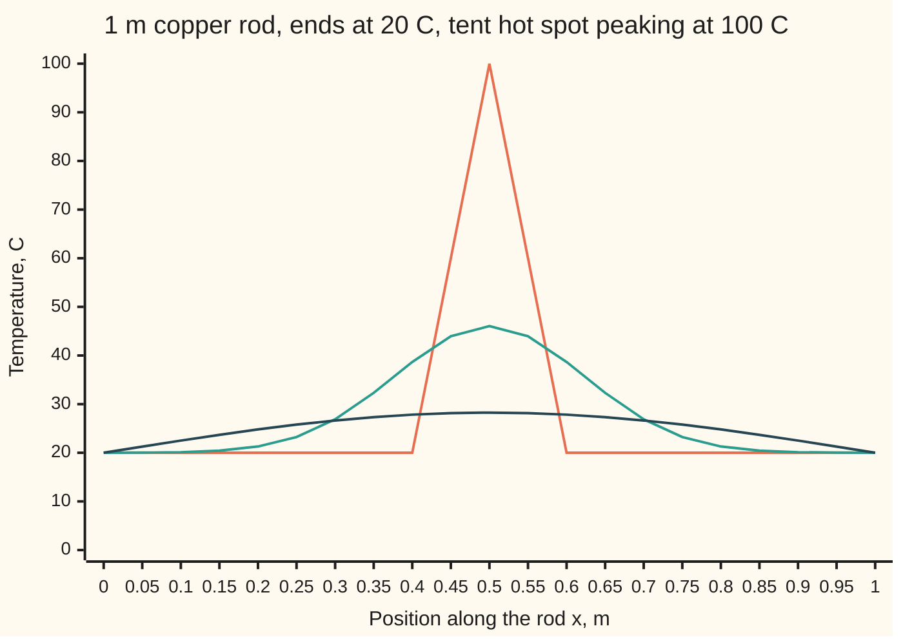

# Diffusion's maximum principle: the extremes sit on the start or the sides

[Syllabus](../../../SYLLABUS.md) → [Partial differential equations](../README.md) → [The Heat Equation in Depth](../README.md#s03) → Diffusion's maximum principle

---

## General Overview

[The heat equation](../../08-Differential%20equations%20and%20dynamics/10-The%20Classical%20PDEs/03-the-heat-equation.md) proved one fact for a rod: with no heater inside, no point ever gets hotter than the hottest start value or end value. This card proves the same fact in any number of space directions. Then it turns the fact into a tool: comparison (a solution that starts lower and is held lower stays lower), uniqueness, and a bound on a solution nobody has written down. Last, it shows the fact failing on an endless rod, and the growth condition (a cap on how fast the temperature may grow far out) that repairs it.

A copper rod is 1 m long. Both ends sit in water baths at 20 °C. At noon a torch has just heated its middle: the temperature rises in a straight-sided tent from 20 °C at 0.4 m to 100 °C at 0.5 m and back to 20 °C at 0.6 m. The torch is then taken away. The **unknown** is the temperature at each point and time. The **region** is the rod. The **data** are the start profile and the two end temperatures.

The heat spreads out. After one minute the middle reads 46.04 °C; after ten minutes, 28.26 °C. The rod never reads above 100 °C or below 20 °C, and those two limits were known at noon, before any equation was solved.

**With no heat source inside, a solution of the heat equation takes its largest and smallest values on the start or on the sides, never later inside; so a solution that starts lower and is held lower on the sides stays lower everywhere.**

**What kind of fact this is:** a theorem, proved on this card in Why it works, for every bounded region in any number of dimensions. On an endless rod it is false without a growth condition. Tychonoff's example shows the failure, and the code checks it.

### The picture: the hot spot spreading, never rising



The sharp tent is the start, at noon. The middle line is one minute later; the flat arch is ten minutes later. Every profile stays inside the band from 20 °C to 100 °C, and the peak only falls.

---

## The formula

Reminders. [A PDE problem](../01-Classification%20and%20Well-Posedness/01-what-a-pde-problem-is.md) named the region $`\Omega`$, its boundary $`\partial\Omega`$, the closed region $`\bar\Omega`$ (inside plus boundary) and the dimension $`d`$. $`\Delta u`$ is the Laplacian, the sum of the second derivatives in the $`d`$ space directions. $`\kappa`$ is the diffusivity, in square metres per second. For copper it is $`1/9009 = 1.110 \times 10^{-4}`$ m²/s, the value on the heat equation card.

**The space-time box and its parabolic boundary.** This card introduces two sets. Fix an end time $`T`$. The **space-time box** $`\Omega_T`$ is every inside point at every time after the start, up to and including $`T`$. Its **parabolic boundary** $`\Gamma_T`$ is the start (the closed region at time 0) together with the sides (the boundary at every time):

```math
\Omega_T = \Omega \times (0, T], \qquad \Gamma_T = \big(\bar\Omega \times \{0\}\big) \cup \big(\partial\Omega \times [0, T]\big)
```

For the rod, $`\Gamma_T`$ is the noon profile plus the two ends at every time. The lid, the rod at the final time $`T`$, is not in $`\Gamma_T`$.

**The weak maximum principle.** Let $`u`$ have one continuous time derivative and two continuous space derivatives in $`\Omega_T`$, and be continuous on the closed box. If $`\Omega`$ is bounded, then

```math
u_t - \kappa\,\Delta u \le 0 \ \text{in } \Omega_T \quad\Longrightarrow\quad \max_{\bar\Omega \times [0,T]} u \;=\; \max_{\Gamma_T} u
```

**Read it aloud:** if nothing inside adds heat, the hottest point of the whole history lies on the start or on the sides.

The same holds for the minimum when $`u_t - \kappa\Delta u \ge 0`$. For the rod, both hold: $`20 \le u \le 100`$ °C for all time.

**The comparison principle.** Under the same conditions,

```math
u_t - \kappa\Delta u \le v_t - \kappa\Delta v \ \text{in } \Omega_T \ \text{ and } \ u \le v \ \text{on } \Gamma_T \quad\Longrightarrow\quad u \le v \ \text{everywhere}
```

**Read it aloud:** a temperature that starts no higher, is held no higher on the sides and is heated no more inside, stays no higher.

**The endless rod.** On the whole space $`\mathbb{R}^d`$ there are no sides, only the start. If $`u_t = \kappa\Delta u`$ for $`0 < t \le T`$ and $`u`$ obeys the **growth condition** $`u(x, t) \le A\,e^{a|x|^2}`$ for some constants $`A`$ and $`a`$, then

```math
\sup_{\mathbb{R}^d \times [0,T]} u \;=\; \sup_{\mathbb{R}^d} u(x, 0)
```

**Read it aloud:** a solution that grows no faster than $`A\,e^{a|x|^2}`$ far out is never hotter than its hottest start value.

Here $`\sup`$ (the supremum) is the least upper bound: the largest value, or the value approached when no point reaches it, as can happen on an endless rod.

| Symbol | Plain meaning | In our example | Push it up and the answer… |
| --- | --- | --- | --- |
| $`u`$ | temperature, °C | 100 at the start's peak; 28.26 at the middle after 600 s | — |
| $`x`$, $`d`$, $`\mathbb{R}^d`$ | position, m; number of space directions; the whole space | $`0 \le x \le 1`$; $`d = 1`$ (rod), 2 (plate) | each extra direction cools the middle faster |
| $`t`$, $`T`$ | time since noon, s; end of the time span | $`T = 1800`$ s | the peak keeps falling |
| $`\kappa`$ | diffusivity, m²/s | $`1.110 \times 10^{-4}`$ (copper) | the same profiles arrive sooner |
| $`u_t`$, $`\Delta u`$ | rate of change in time; sum of second derivatives in space | — | — |
| $`\Omega`$, $`\partial\Omega`$, $`\bar\Omega`$ | the rod's inside; its two ends; the two together | the open interval 0 to 1 m | — |
| $`\Omega_T`$, $`\Gamma_T`$ | space-time box: inside points at times $`0 < t \le T`$; parabolic boundary: the start plus the sides | the rod's inside from noon to 12:30; the noon tent and both ends | raise the maximum on $`\Gamma_T`$ and the cap on everything rises with it |
| $`f`$ | heat source, K/s: $`u_t - \kappa\Delta u`$ | 0; $`0.01096\sin(\pi x)`$ K/s in the heater break | the middle can rise above every boundary value |
| $`v`$, $`w`$ | comparison function; barrier built by hand | $`w = 20 + 80\,e^{-\kappa\pi^2 t}\sin(\pi x)`$ | — |
| $`\varepsilon`$, $`M`$, $`R`$, $`y`$, $`\mu`$, $`\rho`$, $`s`$, $`\gamma`$, $`k`$, $`n`$ | proof helpers: tilt size; largest boundary value; largest distance from the origin; a fixed point; size of the subtracted kernel; ball radius; time left, $`T + \varepsilon - t`$; spare growth rate; series indices | — | — |
| $`A`$, $`a`$ | constants in the growth condition | — | larger $`a`$ needs shorter time slabs in the proof |
| $`g(t)`$, $`b_n`$, $`h`$, $`r`$ | Tychonoff's time profile, with $`k`$-th derivative $`g^{(k)}`$; $`n`$-th sine coefficient, K; grid step, m; grid ratio $`\kappa\Delta t/h^2`$, with $`\Delta t`$ the time step | $`g = e^{-1/t^2}`$; $`b_1 = 15.87`$; $`h = 1/50`$; $`r = 0.444`$ | $`r > 1/2`$ breaks the grid's own principle |

### When it holds

- **No heat source inside, $`u_t - \kappa\Delta u \le 0`$.** Add a heater of $`0.01096\sin(\pi x)`$ K/s, spread along the rod and strongest at the middle, and a rod that starts and ends at 20 °C reads 24.82 °C after 600 s.
- **Time runs forward, $`\kappa > 0`$.** Run the equation backward, $`u_t = -\kappa u_{xx}`$, and a 1 K sine bump grows to 1.93 K in 600 s.
- **A bounded region, or a growth condition.** On an endless rod, Tychonoff's solution starts at 0 everywhere and reads 0.368 K at the middle 9009 s later.
- **Continuous up to the start and the sides.** The proof needs the largest value to exist on the closed box. The tent meets the 20 °C ends, so the rod's data join up.

---

## Why it works

### Step 0: an inside hot spot would have to warm while losing heat

Take the hottest point of the whole history, and suppose it sits inside the rod at some time after noon. In space it is a cap, so the temperature bends down there, $`\Delta u \le 0`$, and heat flows away from it. In time it was reached from below, so it was warming or level: $`u_t \ge 0`$. Together, $`u_t - \kappa\Delta u \ge 0`$.

With no heat source the equation says $`u_t - \kappa\Delta u = 0`$. That is not yet a contradiction, only a tie. A small tilt breaks the tie.

The argument only looks backward in time, so it works at the final time $`T`$ too. That is why $`\Gamma_T`$ holds the start and the sides but not the lid.

### Step 1: the tilt, in any number of dimensions

The heat equation card tilted the rod by $`\varepsilon x^2`$. In $`d`$ directions use $`v = u + \varepsilon|x|^2`$, where $`|x|^2 = x_1^2 + \dots + x_d^2`$. Each $`x_i^2`$ has second derivative 2, so $`\Delta|x|^2 = 2d`$ and

```math
v_t - \kappa\Delta v \;=\; \big(u_t - \kappa\Delta u\big) - 2d\,\kappa\,\varepsilon \;<\; 0
```

Now Step 0 gives a true contradiction for $`v`$: its maximum cannot sit in $`\Omega_T`$, so it sits on $`\Gamma_T`$.

<details>
<summary>Detailed proof: the weak maximum principle on a bounded region</summary>

Let $`M`$ be the largest value of $`u`$ on $`\Gamma_T`$, and let $`R`$ be the largest $`|x|`$ in $`\bar\Omega`$, finite because $`\Omega`$ is bounded. Fix $`\varepsilon > 0`$ and set $`v = u + \varepsilon|x|^2`$. Then

$`\displaystyle v_t - \kappa\Delta v = (u_t - \kappa\Delta u) - 2d\kappa\varepsilon \le -2d\kappa\varepsilon < 0 \ \text{ in } \Omega_T .`$

$`v`$ is continuous on the closed, bounded box, so it reaches a largest value at some point $`(x_0, t_0)`$. Suppose $`(x_0, t_0)`$ lies in $`\Omega_T`$: $`x_0`$ inside and $`0 < t_0 \le T`$.

In each direction $`i`$, $`v`$ has a maximum along the line through $`x_0`$, so $`\partial^2 v/\partial x_i^2 \le 0`$; adding them, $`\Delta v(x_0, t_0) \le 0`$. Along time, $`v(x_0, t) \le v(x_0, t_0)`$ for $`t < t_0`$, so the backward rate is $`\ge 0`$: $`v_t(x_0, t_0) \ge 0`$. Then $`v_t - \kappa\Delta v \ge 0`$ at that point, which contradicts the strict inequality.

So the largest value of $`v`$ lies on $`\Gamma_T`$, where $`v \le M + \varepsilon R^2`$. Hence

$`\displaystyle u \le v \le M + \varepsilon R^2 \ \text{ everywhere on the box.}`$

Let $`\varepsilon`$ shrink to 0: $`u \le M`$. Applying this to $`-u`$ gives the minimum.

</details>

### Step 2: comparison, uniqueness and stability

Comparison is the maximum principle applied to a gap. If $`u`$ and $`v`$ satisfy the comparison hypotheses, the gap $`u - v`$ has $`(u - v)_t - \kappa\Delta(u - v) \le 0`$, because the equation is linear ([Linear or not](../01-Classification%20and%20Well-Posedness/02-linear-nonlinear-and-superposition.md)). On $`\Gamma_T`$ the gap is $`\le 0`$, so it is $`\le 0`$ everywhere.

Three uses follow.

1. **Uniqueness.** Two solutions with the same source, start and sides bound each other both ways, so they are equal. [Energy methods](../01-Classification%20and%20Well-Posedness/07-energy-methods-and-uniqueness.md) reach this by integrating; this road needs no integral.
2. **Stability.** Two solutions never differ anywhere by more than their largest difference on $`\Gamma_T`$. A thermometer error of 0.5 K in the start or the end baths moves the answer by at most 0.5 K, anywhere, ever.
3. **Bounds by hand.** Build a $`w`$ that solves the equation and lies above the data on $`\Gamma_T`$. Then $`u \le w`$, with no series and no grid.

### Step 3: a barrier for the rod

Try $`w = 20 + 80\,e^{-\kappa\pi^2 t}\sin(\pi x)`$. It solves the heat equation, because the sine's second derivative is $`-\pi^2`$ times itself. On the ends it is 20 °C, equal to the rod. At noon $`80\sin(\pi x)`$ lies above the tent: both reach 80 K at the middle, and the sine is flat there while the tent falls in a straight line.

So the hot spot's rise above 20 °C is capped by 80 K times $`e^{-\kappa\pi^2 t}`$. That cap halves every $`\ln 2/(\kappa\pi^2) = 632.7`$ s. At 600 s it gives 61.46 °C, against a true 28.26 °C. The cap is loose but certain, and it took one line.

### Step 4: more dimensions cool faster

Put the same hot spot on a 1 m square copper plate: a bump over a 20 cm square, shaped as the tent across times the tent along, peaking at 100 °C, with all four edges at 20 °C. Each direction cools independently, so the rise at the middle is 80 K times the rod's fraction, squared.

Comparison explains the ordering without computing. Spread the rod's solution across the plate, constant in the second direction. It solves the plate's equation. It starts at or above the plate's start, and on the edges it is at or above 20 °C. So it lies above the plate everywhere. At 600 s the plate's middle reads 20.85 °C, the rod's 28.26 °C.

### Step 5: the strong form, stated

The weak principle allows an inside maximum that ties the boundary maximum. The **strong maximum principle** (Nirenberg, 1953) says such a tie happens only for a constant. On a connected region, if $`u_t - \kappa\Delta u \le 0`$ and $`u`$ reaches the largest value of its whole history at an inside point at time $`t_0`$, then $`u`$ is constant at every earlier time.

Only the past is fixed. Take a rod at 20 °C all morning, its ends in 20 °C baths, and from noon cool the baths slowly toward 0 °C. The largest value of the whole history, 20 °C, is reached at inside points all morning, so the rod is constant before noon. After noon it cools, and is not constant. The proof builds small barriers near the maximum point, as Hopf's lemma does for [Maximum principles](../01-Classification%20and%20Well-Posedness/08-maximum-principles.md). [Diffusion smooths instantly, and is felt everywhere at once](05-smoothing-and-infinite-speed.md) draws its consequence: any warmth is felt everywhere at once.

### Step 6: the endless rod needs a growth condition

On the whole line there are no sides. Step 1's proof needs a largest value on a closed, bounded box, and on the endless line there may be none: the maximum can escape to infinity. Heat can then arrive "from infinity", and Tychonoff (1935) built such a solution. Here it is in scaled units: $`x`$ in metres, and time in units of (1 m)² over copper's $`\kappa`$, which is 9009 s. The equation then reads $`u_t = u_{xx}`$ (scaled).

```math
u(x, t) = \sum_{k=0}^{\infty} g^{(k)}(t)\,\frac{x^{2k}}{(2k)!}, \qquad g(t) = e^{-1/t^2} \ (t > 0), \quad g(0) = 0
```

Here $`g^{(k)}`$ is the $`k`$-th time derivative of $`g`$.

- **It solves the equation.** Differentiating $`x^{2k}/(2k)!`$ twice in $`x`$ gives $`x^{2k-2}/(2k-2)!`$, so $`u_{xx}`$ is the same sum with every $`g^{(k)}`$ moved up one place: that is $`u_t`$.
- **It starts at zero.** $`g`$ and all its derivatives tend to 0 as $`t`$ falls to 0, so $`u(x, 0) = 0`$ for every $`x`$.
- **It is not zero.** At the middle, $`u(0, t) = g(t)`$, so $`u(0, 1) = e^{-1} = 0.368`$ K after 9009 s.

So the endless rod has two solutions with a 0 K start: zero, and this one. The series converges for every $`x`$, but it grows so fast as $`|x|`$ grows at small times that no bound $`A\,e^{a x^2}`$ holds over the time span (Cannon gives the estimates).

The growth condition is what restores the principle. Its proof replaces the tilt with a heat kernel run backward in time ([The heat kernel](01-heat-kernel-and-fundamental-solution.md)), which outgrows $`A\,e^{a|x|^2}`$ far out.

<details>
<summary>Detailed proof: the maximum principle on the whole space under the growth condition</summary>

Scale so that $`\kappa = 1`$. Suppose $`u_t = \Delta u`$ for $`0 < t \le T`$, $`u`$ is continuous down to $`t = 0`$, and $`u(x, t) \le A\,e^{a|x|^2}`$. First take $`4aT < 1`$. Then choose $`\varepsilon > 0`$ with $`4a(T + \varepsilon) < 1`$, so that $`1/(4(T + \varepsilon)) = a + \gamma`$ for some $`\gamma > 0`$.

Fix a point $`y`$ and a small $`\mu > 0`$, write $`s = T + \varepsilon - t`$, and set

$`\displaystyle v(x, t) = u(x, t) - \mu\, s^{-d/2} \exp\!\Big(\frac{|x - y|^2}{4s}\Big) .`$

The subtracted term is a heat kernel with time running backward, and it solves the heat equation too, so $`v_t = \Delta v`$.

Work on the ball of radius $`\rho`$ around $`y`$. At the start, $`v \le u(x, 0) \le \sup u(\cdot, 0)`$. On the ball's surface, $`|x - y| = \rho`$ and $`s \le T + \varepsilon`$, so

$`\displaystyle v \le A\,e^{a(|y| + \rho)^2} - \mu\,(T + \varepsilon)^{-d/2}\,e^{(a + \gamma)\rho^2} .`$

For $`\rho`$ large the second term wins, because $`a + \gamma > a`$, and $`v \le \sup u(\cdot, 0)`$ there. The bounded-region principle now gives $`v(y, t) \le \sup u(\cdot, 0)`$, that is

$`\displaystyle u(y, t) \le \sup u(\cdot, 0) + \mu\, s^{-d/2} .`$

Let $`\mu`$ shrink to 0. For a longer span, repeat on time slabs each shorter than $`1/(4a)`$, starting each slab where the last one ended. This is Evans, Section 2.3, Theorem 6.

</details>

Two consequences close the gap Tychonoff opened.

- **Uniqueness in the growth class.** Two solutions on the whole space, both below some $`A\,e^{a|x|^2}`$ in size, with the same start, are equal.
- **Real temperatures are always unique.** Widder (1944) proved that a solution on the line that never goes negative is fixed by its start. A temperature in kelvin never goes below absolute zero. So Tychonoff's solution, added to any real temperature, must push it below absolute zero somewhere: it is unbounded below, and no physical rod follows it.

---

## Worked numbers, by hand

| Step | Arithmetic | Value |
| --- | --- | --- |
| hottest point of $`\Gamma_T`$ | the tent's peak at noon | 100 °C |
| coldest point of $`\Gamma_T`$ | the ends, and the start away from the spot | 20 °C |
| the principle, both ways | max and min on $`\Gamma_T`$ | 20 °C ≤ u ≤ 100 °C, always |
| first sine coefficient | $`320\,(1 - \cos 0.1\pi)/(0.1\,\pi^2)`$ | $`b_1 = 15.87`$ K |
| barrier decay rate | $`\kappa\pi^2 = 9.8696/9009`$ | $`1.0955 \times 10^{-3}`$ per s |
| barrier half-life | $`0.6931 / 0.0010955`$ | 632.7 s |
| barrier at the middle, 600 s | $`20 + 80\,e^{-0.6573} = 20 + 80 \times 0.5182`$ | 61.46 °C |
| true middle, 600 s | sine series; grid | 28.26 °C |
| square plate's middle, 600 s | $`20 + 80 \times 0.1033^2`$ | 20.85 °C |
| **the bound** | | **20 °C ≤ 28.26 °C ≤ 61.46 °C ≤ 100 °C** |

Ten minutes after noon the middle of the rod must lie between 20 °C and 61.46 °C by hand, and the full solution, 28.26 °C, does.

The first sine coefficient carries most of the late profile. $`b_1 e^{-0.6573} = 15.87 \times 0.5182 = 8.22`$ K of the middle's 8.26 K rise comes from it.

### What breaks if you drop a piece

| Mistake | Comes out at | What went wrong |
| --- | --- | --- |
| A heater inside: source $`0.01096\sin(\pi x)`$ K/s, start and ends at 20 °C | middle 24.82 °C at 600 s, above the boundary's 20 °C | $`u_t - \kappa u_{xx} = f > 0`$; heat made inside can peak inside ([Duhamel's principle](03-duhamels-principle.md) solves such cases) |
| Time run backward: $`u_t = -\kappa u_{xx}`$ | a 1 K sine bump grows to 1.93 K in 600 s | at a cap the equation now forces warming; the lid has become data |
| An endless rod with no growth condition | Tychonoff: start 0 K everywhere, middle 0.368 K after 9009 s; 3.60 K at 3 m after 2703 s | no sides, and a solution that grows too fast far out |

The code prints all three and checks each by centred differences.

---

## Code, from first principles, and it actually runs

The code reaches the rod's numbers by four roads. Road one is the sine series, 40 terms, with its first omitted term printed. Road two is an explicit grid at two steps, whose error falls fourfold when the step halves. Road three plugs the series into the equation by centred differences and checks the residual is near 0. Road four is the hand barrier, checked above the series at 204 points. Tychonoff's series is built from the Taylor coefficients of $`e^{-1/t^2}`$, checked against its closed-form derivatives, against a second road at (1 m, 0.5 scaled) that writes each derivative as a polynomial in $`1/t`$ times $`e^{-1/t^2}`$, and by the residual.

### Python

```python
# Diffusion's maximum principle -- the check behind the card.  Standard library only.
# A 1 m copper rod, ends held at 20 C, starts with a tent-shaped hot spot 20 cm wide
# peaking at 100 C.  Roads: a sine series, an explicit grid, the equation's residual
# by centred differences, and a barrier built by hand.  Then the three breaks,
# ending with Tychonoff's solution on an endless rod.
import math

PI = math.pi
KAPPA = 1.0 / 9009.0               # copper's diffusivity, m^2/s (9009 s per m^2)
END, PEAK, W = 20.0, 80.0, 0.1      # end temperature, C; hot spot's rise, K; half-width, m
XS = [i / 20 for i in range(21)]    # chart positions, m


def total(xs):                      # plain left-to-right sum, as in the Rust check
    s = 0.0
    for v in xs:
        s += v
    return s


def tent(x):                        # the start, C
    return END + PEAK * max(0.0, 1.0 - abs(x - 0.5) / W)


def b(n):                           # sine coefficient of the tent's rise
    return 4 * PEAK * math.sin(n * PI / 2) * (1 - math.cos(n * PI * W)) / (W * (n * PI) ** 2)


def rod(x, t, n_max=40):            # road 1: the sine series, C
    return END + total(b(n) * math.exp(-KAPPA * (n * PI) ** 2 * t) * math.sin(n * PI * x)
                       for n in range(1, n_max + 1))


def grid(m, steps, t_end):          # road 2: explicit grid; profile and extremes over the run
    h = 1.0 / m
    dt = t_end / steps
    r = KAPPA * dt / (h * h)
    u = [tent(i * h) for i in range(m + 1)]
    hi, lo = max(u), min(u)
    for _ in range(steps):
        u = [u[0]] + [u[i] + r * (u[i - 1] - 2 * u[i] + u[i + 1]) for i in range(1, m)] + [u[m]]
        hi, lo = max(hi, max(u)), min(lo, min(u))
    return u, hi, lo, r


def row(vals):
    return ", ".join(f"{v:.2f}" for v in vals)


def resid(f, x, t, dx, dt, k):      # u_t - k u_xx by centred differences
    ut = (f(x, t + dt) - f(x, t - dt)) / (2 * dt)
    return ut - k * (f(x + dx, t) - 2 * f(x, t) + f(x - dx, t)) / (dx * dx)


print(f"setup: kappa = 1/9009 = {KAPPA * 1e4:.4f}e-4 m^2/s; boundary max {max(map(tent, XS)):.1f} C, min {END:.1f} C")
print(f"b_1 = 320*(1 - cos(0.1 pi))/(0.1 pi^2) = {b(1):.4f} K; b_2 = {b(2):.4f}; b_3 = {b(3):.4f} K")
s0 = END + total(b(n) * math.sin(n * PI * 0.45) for n in range(1, 2001))
print(f"start at x=0.45: tent {tent(0.45):.4f}, series N=2000 {s0:.4f}, tail bound {4 * PEAK * 2 / (W * PI ** 2) / 2000:.4f}")
assert abs(s0 - tent(0.45)) < 4 * PEAK * 2 / (W * PI ** 2) / 2000
for t in (0, 60, 600):
    vals = [tent(x) for x in XS] if t == 0 else [rod(x, t) for x in XS]
    print(f"profile t={t} s, x=0,0.05..1: {row(vals)}")
print(f"series uses 40 terms; log10 of the first omitted term at t=60 s: {math.log10(abs(b(41))) - KAPPA * (41 * PI) ** 2 * 60 / math.log(10):.1f}")
for t in (60, 300, 600, 1800):
    prof = [rod(i / 200, t) for i in range(201)]
    assert 20.0 - 1e-9 <= min(prof) and max(prof) <= 100.0
    print(f"t={t} s: rod max {max(prof):.4f} C at x={prof.index(max(prof)) / 200:.3f} m, min {min(prof):.4f} C")
centre = {}
for m, steps in ((50, 375), (100, 1500)):
    u, hi, lo, r = grid(m, steps, 600.0)
    centre[m] = u[m // 2]
    assert hi <= 100.0 + 1e-12 and lo >= 20.0 - 1e-12
    print(f"grid h=1/{m}, r={r:.4f}: centre at 600 s {u[m // 2]:.4f} C; over the run max {hi:.4f}, min {lo:.4f}")
exact = rod(0.5, 600)
ratio = (centre[50] - exact) / (centre[100] - exact)
print(f"centre at 600 s: series {exact:.4f} C; grid error ratio {ratio:.2f}")
assert abs(centre[100] - exact) < 0.01 and 3.5 < ratio < 4.5
for k in (1e-3, 5e-4):              # road 3: the equation's residual
    res = resid(rod, 0.3, 600.0, k, 1e4 * k, KAPPA)
    print(f"residual u_t - kappa u_xx at (0.3 m, 600 s), dx={k:.4f} m, dt={1e4 * k:.0f} s: {res * 1e9:.2f} nK/s")
    assert abs(res) < 1e-7
lam = KAPPA * PI ** 2               # road 4: the barrier 20 + 80 exp(-lam t) sin(pi x)
half = math.log(2) / lam
bar = END + PEAK * math.exp(-lam * 600)
print(f"barrier: decay rate kappa pi^2 = {lam * 1e3:.4f}e-3 per s, half-life {half:.1f} s; centre cap at 600 s {bar:.2f} C")
print(f"barrier factor exp(-{lam * 600:.4f}) = {math.exp(-lam * 600):.4f}; b_1 term at the centre {b(1) * math.exp(-lam * 600):.4f} K of the rise {exact - END:.4f} K")
ok = all(rod(i / 50, t) <= END + PEAK * math.exp(-lam * t) * math.sin(PI * i / 50) + 1e-9
         for i in range(51) for t in (60, 300, 600, 1800))
print(f"barrier above the series at 51 points x 4 times: {'yes' if ok else 'no'}")
assert ok and exact < bar
q = (exact - END) / PEAK
print(f"plate 1 m square, hot square spot: centre at 600 s 20 + 80*{q:.4f}^2 = {END + PEAK * q * q:.4f} C, rod {exact:.4f} C")
u, hi, lo, r = grid(50, 30, 60.0)
print(f"try: grid h=1/50, r={r:.4f} > 1/2: after 60 s max {hi:.1f} C, min {lo:.1f} C")
# ---- what breaks ----
A = 10.0                            # heater: source kappa pi^2 A sin(pi x), start and ends 20 C
def heater(x, t):
    return END + A * (1 - math.exp(-lam * t)) * math.sin(PI * x)


src = resid(heater, 0.5, 600.0, 1e-3, 10.0, KAPPA)
print(f"breaks 1, heater: residual = source {src * 1e3:.4f} mK/s, formula {lam * A * 1e3:.4f} mK/s; "
      f"centre at 600 s {heater(0.5, 600):.4f} C, boundary max 20.0000 C")
assert abs(src - lam * A) < 1e-6 and heater(0.5, 600) > END + 4
back = lambda x, t: math.exp(lam * t) * math.sin(PI * x)
res = resid(back, 0.5, 600.0, 1e-3, 10.0, -KAPPA)
print(f"breaks 2, time run backward, u_t = -kappa u_xx (residual {res * 1e9:.2f} nK/s): "
      f"1 K sine bump at 600 s {back(0.5, 600):.4f} K, boundary max 1.0000 K")
assert abs(res) < 1e-7 and back(0.5, 600) > 1.9

def tych(x, t, K=120):              # Tychonoff: sum g^(k)(t) x^(2k)/(2k)!, g = exp(-1/t^2)
    h = [-((-1) ** n) * (n + 1) / t ** (n + 2) for n in range(K + 1)]  # Taylor coefficients of -1/(t+s)^2
    c = [math.exp(h[0])]
    for n in range(1, K + 1):       # coefficients of exp(h): n c_n = sum j h_j c_(n-j)
        c.append(total(j * h[j] * c[n - j] for j in range(1, n + 1)) / n)
    ratio, terms = 1.0, []
    for k in range(K + 1):          # g^(k) = k! c_k, ratio = k!/(2k)!
        if k > 0:
            ratio *= k / ((2 * k) * (2 * k - 1))
        terms.append(c[k] * ratio * x ** (2 * k))
    return total(terms[:K]), terms[K], c

_, _, c = tych(1.0, 0.5)
print(f"breaks 3, Tychonoff g'(0.5)/g = 2/0.5^3: series {c[1] / c[0]:.6f}, closed form {2 / 0.5 ** 3:.6f}")
assert abs(c[1] / c[0] - 16) < 1e-9 and abs(2 * c[2] / c[0] - (4 / 0.5 ** 6 - 6 / 0.5 ** 4)) < 1e-6
for x, t in ((0.0, 1.0), (1.0, 0.5), (3.0, 0.3)):
    val, last, _ = tych(x, t)
    tail = f"log10 of first omitted term {math.log10(abs(last)):.0f}" if x else "exact, one term"
    print(f"  u({x:.0f} m, {t:.1f} scaled = {t * 9009:.1f} s) = {val:.4f} K from a 0 K start; {tail}")
p, ref = [1.0], 0.0                 # second road at (1 m, 0.5): g^(k)(t) = P_k(1/t) e^(-1/t^2), with
for k in range(20):                 # P_(k+1)(s) = 2 s^3 P_k(s) - s^2 P_k'(s), summed at s = 1/t = 2
    ref += total(a * 2.0 ** i for i, a in enumerate(p)) * math.exp(-4) / math.factorial(2 * k)
    p = [2 * (p[i - 3] if i > 2 else 0) - (i - 1) * (p[i - 1] if 0 < i - 1 < len(p) else 0) for i in range(len(p) + 3)]
assert abs(tych(1.0, 0.5)[0] - ref) < 1e-12
for k in (0.01, 0.005):
    res = resid(lambda x, t: tych(x, t)[0], 1.0, 0.5, k, k, 1.0)
    print(f"  residual u_t - u_xx at (1, 0.5) scaled, step {k}: {res:.6f}")
    assert abs(res) < 10 * k * k
print("ALL CHECKS PASS")
```

**Ran 2026-11-15 on macOS, Python 3.14.10, standard library only. All checks passed. Output, pasted from the run:**

```
setup: kappa = 1/9009 = 1.1100e-4 m^2/s; boundary max 100.0 C, min 20.0 C
b_1 = 320*(1 - cos(0.1 pi))/(0.1 pi^2) = 15.8688 K; b_2 = 0.0000; b_3 = -14.8502 K
start at x=0.45: tent 60.0000, series N=2000 60.0000, tail bound 0.3242
profile t=0 s, x=0,0.05..1: 20.00, 20.00, 20.00, 20.00, 20.00, 20.00, 20.00, 20.00, 20.00, 60.00, 100.00, 60.00, 20.00, 20.00, 20.00, 20.00, 20.00, 20.00, 20.00, 20.00, 20.00
profile t=60 s, x=0,0.05..1: 20.00, 20.03, 20.12, 20.43, 21.29, 23.24, 26.88, 32.32, 38.68, 43.97, 46.04, 43.97, 38.68, 32.32, 26.88, 23.24, 21.29, 20.43, 20.12, 20.03, 20.00
profile t=600 s, x=0,0.05..1: 20.00, 21.27, 22.51, 23.69, 24.80, 25.79, 26.64, 27.33, 27.84, 28.16, 28.26, 28.16, 27.84, 27.33, 26.64, 25.79, 24.80, 23.69, 22.51, 21.27, 20.00
series uses 40 terms; log10 of the first omitted term at t=60 s: -50.0
t=60 s: rod max 46.0449 C at x=0.500 m, min 20.0000 C
t=300 s: rod max 32.1984 C at x=0.500 m, min 20.0000 C
t=600 s: rod max 28.2639 C at x=0.500 m, min 20.0000 C
t=1800 s: rod max 22.2087 C at x=0.500 m, min 20.0000 C
grid h=1/50, r=0.4440: centre at 600 s 28.2626 C; over the run max 100.0000, min 20.0000
grid h=1/100, r=0.4440: centre at 600 s 28.2636 C; over the run max 100.0000, min 20.0000
centre at 600 s: series 28.2639 C; grid error ratio 4.00
residual u_t - kappa u_xx at (0.3 m, 600 s), dx=0.0010 m, dt=10 s: 47.20 nK/s
residual u_t - kappa u_xx at (0.3 m, 600 s), dx=0.0005 m, dt=5 s: 11.78 nK/s
barrier: decay rate kappa pi^2 = 1.0955e-3 per s, half-life 632.7 s; centre cap at 600 s 61.46 C
barrier factor exp(-0.6573) = 0.5182; b_1 term at the centre 8.2239 K of the rise 8.2639 K
barrier above the series at 51 points x 4 times: yes
plate 1 m square, hot square spot: centre at 600 s 20 + 80*0.1033^2 = 20.8537 C, rod 28.2639 C
try: grid h=1/50, r=0.5550 > 1/2: after 60 s max 435.7 C, min -339.6 C
breaks 1, heater: residual = source 10.9554 mK/s, formula 10.9553 mK/s; centre at 600 s 24.8176 C, boundary max 20.0000 C
breaks 2, time run backward, u_t = -kappa u_xx (residual 44.02 nK/s): 1 K sine bump at 600 s 1.9296 K, boundary max 1.0000 K
breaks 3, Tychonoff g'(0.5)/g = 2/0.5^3: series 16.000000, closed form 16.000000
  u(0 m, 1.0 scaled = 9009.0 s) = 0.3679 K from a 0 K start; exact, one term
  u(1 m, 0.5 scaled = 4504.5 s) = 0.2879 K from a 0 K start; log10 of first omitted term -222
  u(3 m, 0.3 scaled = 2702.7 s) = 3.5987 K from a 0 K start; log10 of first omitted term -78
  residual u_t - u_xx at (1, 0.5) scaled, step 0.01: -0.000728
  residual u_t - u_xx at (1, 0.5) scaled, step 0.005: -0.000182
ALL CHECKS PASS
```

### Rust

Same numbers, same labels.

```rust
// Diffusion's maximum principle -- the check behind the card.  std only, no crates.
// A 1 m copper rod, ends held at 20 C, starts with a tent-shaped hot spot 20 cm wide
// peaking at 100 C.  Roads: a sine series, an explicit grid, the equation's residual
// by centred differences, and a barrier built by hand.  Then the three breaks,
// ending with Tychonoff's solution on an endless rod.
use std::f64::consts::PI;

const KAPPA: f64 = 1.0 / 9009.0; // copper's diffusivity, m^2/s (9009 s per m^2)
const END: f64 = 20.0; // end temperature, C
const PEAK: f64 = 80.0; // hot spot's rise, K
const W: f64 = 0.1; // half-width, m

fn tent(x: f64) -> f64 {
    END + PEAK * (1.0 - (x - 0.5).abs() / W).max(0.0)
}

fn b(n: usize) -> f64 {
    let nf = n as f64;
    4.0 * PEAK * (nf * PI / 2.0).sin() * (1.0 - (nf * PI * W).cos()) / (W * (nf * PI).powf(2.0))
}

fn rod(x: f64, t: f64) -> f64 {
    let mut s = 0.0;
    for n in 1..=40 {
        let nf = n as f64;
        s += b(n) * (-KAPPA * (nf * PI).powf(2.0) * t).exp() * (nf * PI * x).sin();
    }
    END + s
}

fn grid(m: usize, steps: usize, t_end: f64) -> (Vec<f64>, f64, f64, f64) {
    let h = 1.0 / m as f64;
    let dt = t_end / steps as f64;
    let r = KAPPA * dt / (h * h);
    let mut u: Vec<f64> = (0..=m).map(|i| tent(i as f64 * h)).collect();
    let (mut hi, mut lo) = (vmax(&u), vmin(&u));
    for _ in 0..steps {
        let mut v = u.clone();
        for i in 1..m { v[i] = u[i] + r * (u[i - 1] - 2.0 * u[i] + u[i + 1]); }
        u = v;
        hi = hi.max(vmax(&u));
        lo = lo.min(vmin(&u));
    }
    (u, hi, lo, r)
}

fn vmax(v: &[f64]) -> f64 { v.iter().cloned().fold(f64::NEG_INFINITY, f64::max) }
fn vmin(v: &[f64]) -> f64 { v.iter().cloned().fold(f64::INFINITY, f64::min) }
fn row(v: &[f64]) -> String {
    v.iter().map(|x| format!("{:.2}", x)).collect::<Vec<_>>().join(", ")
}

fn resid(f: &dyn Fn(f64, f64) -> f64, x: f64, t: f64, dx: f64, dt: f64, k: f64) -> f64 {
    let ut = (f(x, t + dt) - f(x, t - dt)) / (2.0 * dt);
    ut - k * (f(x + dx, t) - 2.0 * f(x, t) + f(x - dx, t)) / (dx * dx)
}

// Tychonoff: sum g^(k)(t) x^(2k)/(2k)!, g = exp(-1/t^2); returns (sum, first omitted, c)
fn tych(x: f64, t: f64) -> (f64, f64, Vec<f64>) {
    let kk = 120;
    let h: Vec<f64> = (0..=kk).map(|n| -(if n % 2 == 0 { 1.0 } else { -1.0 }) * (n + 1) as f64 / t.powf((n + 2) as f64)).collect();
    let mut c = vec![h[0].exp()];
    for n in 1..=kk {
        let mut s = 0.0;
        for j in 1..=n { s += j as f64 * h[j] * c[n - j]; }
        c.push(s / n as f64);
    }
    let (mut ratio, mut terms) = (1.0, Vec::new());
    for k in 0..=kk {
        if k > 0 { ratio *= k as f64 / ((2 * k) * (2 * k - 1)) as f64; }
        terms.push(c[k] * ratio * x.powf((2 * k) as f64));
    }
    let mut s = 0.0;
    for v in &terms[..kk] { s += v; }
    (s, terms[kk], c)
}

fn main() {
    let xs: Vec<f64> = (0..21).map(|i| i as f64 / 20.0).collect();
    let tents: Vec<f64> = xs.iter().map(|&x| tent(x)).collect();
    println!("setup: kappa = 1/9009 = {:.4}e-4 m^2/s; boundary max {:.1} C, min {:.1} C", KAPPA * 1e4, vmax(&tents), END);
    println!("b_1 = 320*(1 - cos(0.1 pi))/(0.1 pi^2) = {:.4} K; b_2 = {:.4}; b_3 = {:.4} K", b(1), b(2), b(3));
    let mut s0 = 0.0;
    for n in 1..=2000 { s0 += b(n) * (n as f64 * PI * 0.45).sin(); }
    s0 += END;
    let tail = 4.0 * PEAK * 2.0 / (W * PI.powf(2.0)) / 2000.0;
    println!("start at x=0.45: tent {:.4}, series N=2000 {:.4}, tail bound {:.4}", tent(0.45), s0, tail);
    assert!((s0 - tent(0.45)).abs() < tail);
    for t in [0.0, 60.0, 600.0] {
        let vals: Vec<f64> = xs.iter().map(|&x| if t == 0.0 { tent(x) } else { rod(x, t) }).collect();
        println!("profile t={} s, x=0,0.05..1: {}", t, row(&vals));
    }
    let lg = b(41).abs().log10() - KAPPA * (41.0 * PI).powf(2.0) * 60.0 / 10f64.ln();
    println!("series uses 40 terms; log10 of the first omitted term at t=60 s: {:.1}", lg);
    for t in [60.0, 300.0, 600.0, 1800.0] {
        let prof: Vec<f64> = (0..=200).map(|i| rod(i as f64 / 200.0, t)).collect();
        let (mx, mn) = (vmax(&prof), vmin(&prof));
        assert!(20.0 - 1e-9 <= mn && mx <= 100.0);
        let at = prof.iter().position(|&v| v == mx).unwrap();
        println!("t={} s: rod max {:.4} C at x={:.3} m, min {:.4} C", t, mx, at as f64 / 200.0, mn);
    }
    let mut centre = [0.0; 2];
    for (idx, &(m, steps)) in [(50usize, 375usize), (100, 1500)].iter().enumerate() {
        let (u, hi, lo, r) = grid(m, steps, 600.0);
        centre[idx] = u[m / 2];
        assert!(hi <= 100.0 + 1e-12 && lo >= 20.0 - 1e-12);
        println!("grid h=1/{}, r={:.4}: centre at 600 s {:.4} C; over the run max {:.4}, min {:.4}", m, r, u[m / 2], hi, lo);
    }
    let exact = rod(0.5, 600.0);
    let ratio = (centre[0] - exact) / (centre[1] - exact);
    println!("centre at 600 s: series {:.4} C; grid error ratio {:.2}", exact, ratio);
    assert!((centre[1] - exact).abs() < 0.01 && 3.5 < ratio && ratio < 4.5);
    for k in [1e-3, 5e-4] {
        let res = resid(&rod, 0.3, 600.0, k, 1e4 * k, KAPPA);
        println!("residual u_t - kappa u_xx at (0.3 m, 600 s), dx={:.4} m, dt={:.0} s: {:.2} nK/s", k, 1e4 * k, res * 1e9);
        assert!(res.abs() < 1e-7);
    }
    let lam = KAPPA * PI.powf(2.0); // road 4: the barrier 20 + 80 exp(-lam t) sin(pi x)
    let half = 2f64.ln() / lam;
    let bar = END + PEAK * (-lam * 600.0).exp();
    println!("barrier: decay rate kappa pi^2 = {:.4}e-3 per s, half-life {:.1} s; centre cap at 600 s {:.2} C", lam * 1e3, half, bar);
    println!("barrier factor exp(-{:.4}) = {:.4}; b_1 term at the centre {:.4} K of the rise {:.4} K", lam * 600.0, (-lam * 600.0).exp(), b(1) * (-lam * 600.0).exp(), exact - END);
    let mut ok = true;
    for i in 0..=50 {
        for t in [60.0, 300.0, 600.0, 1800.0] {
            ok &= rod(i as f64 / 50.0, t) <= END + PEAK * (-lam * t).exp() * (PI * i as f64 / 50.0).sin() + 1e-9;
        }
    }
    println!("barrier above the series at 51 points x 4 times: {}", if ok { "yes" } else { "no" });
    assert!(ok && exact < bar);
    let q = (exact - END) / PEAK;
    println!("plate 1 m square, hot square spot: centre at 600 s 20 + 80*{:.4}^2 = {:.4} C, rod {:.4} C", q, END + PEAK * q * q, exact);
    let (_, hi, lo, r) = grid(50, 30, 60.0);
    println!("try: grid h=1/50, r={:.4} > 1/2: after 60 s max {:.1} C, min {:.1} C", r, hi, lo);
    // ---- what breaks ----
    let a = 10.0; // heater: source kappa pi^2 A sin(pi x), start and ends 20 C
    let heater = |x: f64, t: f64| END + a * (1.0 - (-lam * t).exp()) * (PI * x).sin();
    let src = resid(&heater, 0.5, 600.0, 1e-3, 10.0, KAPPA);
    println!("breaks 1, heater: residual = source {:.4} mK/s, formula {:.4} mK/s; centre at 600 s {:.4} C, boundary max 20.0000 C",
             src * 1e3, lam * a * 1e3, heater(0.5, 600.0));
    assert!((src - lam * a).abs() < 1e-6 && heater(0.5, 600.0) > END + 4.0);
    let back = |x: f64, t: f64| (lam * t).exp() * (PI * x).sin();
    let res = resid(&back, 0.5, 600.0, 1e-3, 10.0, -KAPPA);
    println!("breaks 2, time run backward, u_t = -kappa u_xx (residual {:.2} nK/s): 1 K sine bump at 600 s {:.4} K, boundary max 1.0000 K",
             res * 1e9, back(0.5, 600.0));
    assert!(res.abs() < 1e-7 && back(0.5, 600.0) > 1.9);
    let (_, _, c) = tych(1.0, 0.5);
    println!("breaks 3, Tychonoff g'(0.5)/g = 2/0.5^3: series {:.6}, closed form {:.6}", c[1] / c[0], 2.0 / 0.5f64.powf(3.0));
    assert!((c[1] / c[0] - 16.0).abs() < 1e-9 && (2.0 * c[2] / c[0] - (4.0 / 0.5f64.powf(6.0) - 6.0 / 0.5f64.powf(4.0))).abs() < 1e-6);
    for (x, t) in [(0.0, 1.0), (1.0, 0.5), (3.0, 0.3)] {
        let (val, last, _) = tych(x, t);
        let tail = if x != 0.0 { format!("log10 of first omitted term {:.0}", last.abs().log10()) } else { "exact, one term".to_string() };
        println!("  u({:.0} m, {:.1} scaled = {:.1} s) = {:.4} K from a 0 K start; {}", x, t, t * 9009.0, val, tail);
    }
    let (mut p, mut refv, mut fact) = (vec![1.0f64], 0.0, 1.0); // second road at (1 m, 0.5): g^(k)(t) = P_k(1/t) e^(-1/t^2), with
    for k in 0..20 { // P_(k+1)(s) = 2 s^3 P_k(s) - s^2 P_k'(s), summed at s = 1/t = 2
        refv += p.iter().enumerate().map(|(i, a)| a * 2f64.powi(i as i32)).sum::<f64>() * (-4f64).exp() / fact;
        let mut q = vec![0.0; p.len() + 3];
        for (i, a) in p.iter().enumerate() { q[i + 3] += 2.0 * a; q[i + 1] -= i as f64 * a; }
        p = q; fact *= ((2 * k + 1) * (2 * k + 2)) as f64;
    }
    assert!((tych(1.0, 0.5).0 - refv).abs() < 1e-12);
    for k in [0.01, 0.005] {
        let res = resid(&|x, t| tych(x, t).0, 1.0, 0.5, k, k, 1.0);
        println!("  residual u_t - u_xx at (1, 0.5) scaled, step {}: {:.6}", k, res);
        assert!(res.abs() < 10.0 * k * k);
    }
    println!("ALL CHECKS PASS");
}
```

**Ran 2026-11-15 on macOS, rustc 1.98.1, no crates. All checks passed. Output, pasted from the run:**

```
setup: kappa = 1/9009 = 1.1100e-4 m^2/s; boundary max 100.0 C, min 20.0 C
b_1 = 320*(1 - cos(0.1 pi))/(0.1 pi^2) = 15.8688 K; b_2 = 0.0000; b_3 = -14.8502 K
start at x=0.45: tent 60.0000, series N=2000 60.0000, tail bound 0.3242
profile t=0 s, x=0,0.05..1: 20.00, 20.00, 20.00, 20.00, 20.00, 20.00, 20.00, 20.00, 20.00, 60.00, 100.00, 60.00, 20.00, 20.00, 20.00, 20.00, 20.00, 20.00, 20.00, 20.00, 20.00
profile t=60 s, x=0,0.05..1: 20.00, 20.03, 20.12, 20.43, 21.29, 23.24, 26.88, 32.32, 38.68, 43.97, 46.04, 43.97, 38.68, 32.32, 26.88, 23.24, 21.29, 20.43, 20.12, 20.03, 20.00
profile t=600 s, x=0,0.05..1: 20.00, 21.27, 22.51, 23.69, 24.80, 25.79, 26.64, 27.33, 27.84, 28.16, 28.26, 28.16, 27.84, 27.33, 26.64, 25.79, 24.80, 23.69, 22.51, 21.27, 20.00
series uses 40 terms; log10 of the first omitted term at t=60 s: -50.0
t=60 s: rod max 46.0449 C at x=0.500 m, min 20.0000 C
t=300 s: rod max 32.1984 C at x=0.500 m, min 20.0000 C
t=600 s: rod max 28.2639 C at x=0.500 m, min 20.0000 C
t=1800 s: rod max 22.2087 C at x=0.500 m, min 20.0000 C
grid h=1/50, r=0.4440: centre at 600 s 28.2626 C; over the run max 100.0000, min 20.0000
grid h=1/100, r=0.4440: centre at 600 s 28.2636 C; over the run max 100.0000, min 20.0000
centre at 600 s: series 28.2639 C; grid error ratio 4.00
residual u_t - kappa u_xx at (0.3 m, 600 s), dx=0.0010 m, dt=10 s: 47.20 nK/s
residual u_t - kappa u_xx at (0.3 m, 600 s), dx=0.0005 m, dt=5 s: 11.78 nK/s
barrier: decay rate kappa pi^2 = 1.0955e-3 per s, half-life 632.7 s; centre cap at 600 s 61.46 C
barrier factor exp(-0.6573) = 0.5182; b_1 term at the centre 8.2239 K of the rise 8.2639 K
barrier above the series at 51 points x 4 times: yes
plate 1 m square, hot square spot: centre at 600 s 20 + 80*0.1033^2 = 20.8537 C, rod 28.2639 C
try: grid h=1/50, r=0.5550 > 1/2: after 60 s max 435.7 C, min -339.6 C
breaks 1, heater: residual = source 10.9554 mK/s, formula 10.9553 mK/s; centre at 600 s 24.8176 C, boundary max 20.0000 C
breaks 2, time run backward, u_t = -kappa u_xx (residual 44.02 nK/s): 1 K sine bump at 600 s 1.9296 K, boundary max 1.0000 K
breaks 3, Tychonoff g'(0.5)/g = 2/0.5^3: series 16.000000, closed form 16.000000
  u(0 m, 1.0 scaled = 9009.0 s) = 0.3679 K from a 0 K start; exact, one term
  u(1 m, 0.5 scaled = 4504.5 s) = 0.2879 K from a 0 K start; log10 of first omitted term -222
  u(3 m, 0.3 scaled = 2702.7 s) = 3.5987 K from a 0 K start; log10 of first omitted term -78
  residual u_t - u_xx at (1, 0.5) scaled, step 0.01: -0.000728
  residual u_t - u_xx at (1, 0.5) scaled, step 0.005: -0.000182
ALL CHECKS PASS
```

The outputs agree line for line.

### Lean

Lean proves The formula's three principles in any number of space directions, for $`\kappa > 0`$ and $`u`$ as smooth as stated there.

- Suppose $`\Omega`$ is bounded, $`u_t - \kappa\Delta u \le 0`$ in $`\Omega_T`$ and $`u \le M`$ on $`\Gamma_T`$. Then $`u \le M`$ on the whole closed box.
- Suppose $`u`$ is heated no more than $`v`$ inside, and $`u \le v`$ on $`\Gamma_T`$, on the same bounded region. Then $`u \le v`$ everywhere on the closed box.
- Suppose $`u_t = \kappa\Delta u`$ on all of $`\mathbb{R}^d`$, $`u`$ obeys the growth condition, and $`u(x, 0) \le M`$ everywhere. Then $`u \le M`$ at every time up to $`T`$.
- The tent's 60 °C at 0.45 m and its 100 °C peak also check, in exact fractions. So do the 9009 s time unit and Tychonoff's $`g'/g = 16`$ and $`g''/g = 160`$ at $`t = 1/2`$ (scaled).

The series, the grids, the barrier, the plate, the three breaks and Tychonoff's sums are left to the Python and Rust checks.

```lean
-- Diffusion's maximum principle: on a bounded region in any number of dimensions, a solution of the heat equation with no heat source inside is never larger than its largest value on the start and the sides, so a solution that starts lower and is held lower stays lower, and on the whole space the same holds under a growth condition.
import Mathlib.Analysis.InnerProductSpace.Laplacian
import Mathlib.Analysis.InnerProductSpace.PiL2
import Mathlib.Analysis.SpecialFunctions.Exp
import Mathlib.Topology.MetricSpace.Bounded
import Mathlib.Analysis.InnerProductSpace.Calculus
import Mathlib.Analysis.Calculus.DerivativeTest
import Mathlib.Analysis.Calculus.LocalExtr.Basic
import Mathlib.Analysis.SpecialFunctions.ExpDeriv

open Set Laplacian

/-- The parabolic boundary `Γ_T` of the space-time box `Ω × (0, T]`: the start (the closed
region at time 0) together with the sides (the boundary of the region at every time from 0 to
`T`). The lid, the region at the final time `T`, is not in it. -/
def parabolicBoundary {d : ℕ} (Ω : Set (EuclideanSpace ℝ (Fin d))) (T : ℝ) :
    Set (EuclideanSpace ℝ (Fin d) × ℝ) :=
  (closure Ω ×ˢ {0}) ∪ (frontier Ω ×ˢ Icc 0 T)

open Filter Topology

lemma heat_second_deriv_nonpos_of_isLocalMax {g : ℝ → ℝ} (hmax : IsLocalMax g 0)
    (hc : ContinuousAt g 0) : deriv (deriv g) 0 ≤ 0 := by
  by_contra h
  push Not at h
  have hmin := isLocalMin_of_deriv_deriv_pos h hmax.deriv_eq_zero hc
  have heq : g =ᶠ[𝓝 0] fun _ => g 0 := by
    filter_upwards [hmax, hmin] with y h1 h2
    exact le_antisymm h1 h2
  have h2 : deriv g =ᶠ[𝓝 0] fun _ => 0 := by
    filter_upwards [heq.eventuallyEq_nhds] with y hy
    rw [hy.deriv_eq]
    simp
  rw [h2.deriv_eq] at h
  simp at h

#print axioms heat_second_deriv_nonpos_of_isLocalMax

lemma heat_second_deriv_line {E : Type*} [NormedAddCommGroup E] [NormedSpace ℝ E]
    {f : E → ℝ} {x : E} (w : E) (hf : ContDiffAt ℝ 2 f x) :
    deriv (deriv (fun s : ℝ => f (x + s • w))) 0 = iteratedFDeriv ℝ 2 f x ![w, w] := by
  have h1 : ∀ᶠ z in 𝓝 x, DifferentiableAt ℝ f z := by
    filter_upwards [hf.eventually (by simp)] with z hz
    exact hz.differentiableAt (by norm_num)
  have hline : ∀ s : ℝ, HasDerivAt (fun s : ℝ => x + s • w) w s := by
    intro s
    simpa using ((hasDerivAt_id s).smul_const w).const_add x
  have hlim : Tendsto (fun s : ℝ => x + s • w) (𝓝 0) (𝓝 x) := by
    have := (hline 0).continuousAt.tendsto
    simpa using this
  have h2 : ∀ᶠ s in 𝓝 (0:ℝ), DifferentiableAt ℝ f (x + s • w) := hlim.eventually h1
  have h3 : deriv (fun s : ℝ => f (x + s • w)) =ᶠ[𝓝 0] fun s => fderiv ℝ f (x + s • w) w := by
    filter_upwards [h2] with s hs
    exact (hs.hasFDerivAt.comp_hasDerivAt s (hline s)).deriv
  rw [Filter.EventuallyEq.deriv_eq h3]
  have h4 : DifferentiableAt ℝ (fderiv ℝ f) x :=
    (hf.fderiv_right (m := 1) (by norm_num)).differentiableAt (by norm_num)
  have h5 : HasDerivAt (fun s : ℝ => fderiv ℝ f (x + s • w)) (fderiv ℝ (fderiv ℝ f) x w) 0 :=
    h4.hasFDerivAt.comp_hasDerivAt_of_eq 0 (hline 0) (by simp)
  have h6 := h5.clm_apply (hasDerivAt_const (0:ℝ) w)
  simp only [zero_smul, add_zero, map_zero] at h6
  rw [h6.deriv, iteratedFDeriv_two_apply]
  simp

#print axioms heat_second_deriv_line

lemma heat_laplacian_nonpos_of_isLocalMax {d : ℕ} {f : EuclideanSpace ℝ (Fin d) → ℝ}
    {x : EuclideanSpace ℝ (Fin d)} (hf : ContDiffAt ℝ 2 f x) (hmax : IsLocalMax f x) :
    Δ f x ≤ 0 := by
  rw [InnerProductSpace.laplacian_eq_iteratedFDeriv_orthonormalBasis f
    (EuclideanSpace.basisFun (Fin d) ℝ)]
  apply Finset.sum_nonpos
  intro i _
  rw [← heat_second_deriv_line _ hf]
  have hc : Continuous (fun s : ℝ => x + s • (EuclideanSpace.basisFun (Fin d) ℝ) i) := by
    fun_prop
  apply heat_second_deriv_nonpos_of_isLocalMax
  · have : IsLocalMax f ((fun s : ℝ => x + s • (EuclideanSpace.basisFun (Fin d) ℝ) i) 0) := by
      simpa using hmax
    exact IsLocalMax.comp_continuous (g := fun s : ℝ => x + s • (EuclideanSpace.basisFun (Fin d) ℝ) i)
      this hc.continuousAt
  · exact (hf.continuousAt.comp_of_eq hc.continuousAt (by simp))

#print axioms heat_laplacian_nonpos_of_isLocalMax

lemma heat_deriv_nonneg_of_max {f : ℝ → ℝ} {f' a b t : ℝ} (hat : a < t) (htb : t ≤ b)
    (hf : HasDerivWithinAt f f' (Icc a b) t) (hmax : ∀ s ∈ Icc a b, f s ≤ f t) : 0 ≤ f' := by
  have hloc : IsLocalMaxOn f (Icc a b) t := Filter.eventually_of_mem self_mem_nhdsWithin hmax
  have hseg : segment ℝ t a ⊆ Icc a b := by
    rw [segment_symm, segment_eq_Icc hat.le]
    exact Icc_subset_Icc le_rfl htb
  have hy := sub_mem_posTangentConeAt_of_segment_subset hseg
  have := hloc.hasFDerivWithinAt_nonpos hf hy
  simp at this
  nlinarith

#print axioms heat_deriv_nonneg_of_max

lemma heat_gauss_line (b c N p : ℝ) :
    deriv (deriv fun s : ℝ => Real.exp (b * (N + 2 * s * p + s ^ 2) + c)) 0 =
      Real.exp (b * N + c) * (4 * b ^ 2 * p ^ 2 + 2 * b) := by
  have hd1 : ∀ s, HasDerivAt (fun s : ℝ => Real.exp (b * (N + 2 * s * p + s ^ 2) + c))
      (Real.exp (b * (N + 2 * s * p + s ^ 2) + c) * (b * (2 * p + 2 * s))) s := by
    intro s
    have hP : HasDerivAt (fun s : ℝ => b * (N + 2 * s * p + s ^ 2) + c) (b * (2 * p + 2 * s)) s := by
      have := (((((hasDerivAt_id' s).const_mul 2).mul_const p).const_add N).add
        (hasDerivAt_pow 2 s)).const_mul b |>.add_const c
      convert this using 1
      norm_num
    exact hP.exp
  have hderiv : deriv (fun s : ℝ => Real.exp (b * (N + 2 * s * p + s ^ 2) + c)) =
      fun s => Real.exp (b * (N + 2 * s * p + s ^ 2) + c) * (b * (2 * p + 2 * s)) :=
    funext fun s => (hd1 s).deriv
  have h' : HasDerivAt (fun s : ℝ => b * (2 * p + 2 * s)) (b * 2) 0 := by
    have := (((hasDerivAt_id' (0:ℝ)).const_mul 2).const_add (2 * p)).const_mul b
    convert this using 1
    ring
  have hd2 : HasDerivAt
      (fun s => Real.exp (b * (N + 2 * s * p + s ^ 2) + c) * (b * (2 * p + 2 * s))) _ 0 :=
    (hd1 0).mul h'
  rw [hderiv, hd2.deriv]
  simp only [mul_zero, zero_mul, add_zero, ne_eq, OfNat.ofNat_ne_zero, not_false_eq_true,
    zero_pow]
  ring

#print axioms heat_gauss_line

lemma heat_laplacian_gauss {d : ℕ} (b c : ℝ) (y : EuclideanSpace ℝ (Fin d)) :
    Δ (fun x : EuclideanSpace ℝ (Fin d) => Real.exp (b * ‖x‖ ^ 2 + c)) y =
      Real.exp (b * ‖y‖ ^ 2 + c) * (4 * b ^ 2 * ‖y‖ ^ 2 + 2 * b * d) := by
  have hcd : ContDiffAt ℝ 2 (fun x : EuclideanSpace ℝ (Fin d) => Real.exp (b * ‖x‖ ^ 2 + c)) y :=
    ((contDiff_const.mul (contDiff_norm_sq ℝ)).add contDiff_const).exp.contDiffAt
  have key : ∀ e : EuclideanSpace ℝ (Fin d), ‖e‖ = 1 →
      deriv (deriv fun s : ℝ => Real.exp (b * ‖y + s • e‖ ^ 2 + c)) 0 =
        Real.exp (b * ‖y‖ ^ 2 + c) * (4 * b ^ 2 * (inner ℝ y e) ^ 2 + 2 * b) := by
    intro e he
    have hfun : (fun s : ℝ => Real.exp (b * ‖y + s • e‖ ^ 2 + c)) =
        fun s => Real.exp (b * (‖y‖ ^ 2 + 2 * s * inner ℝ y e + s ^ 2) + c) := by
      funext s
      rw [norm_add_sq_real, real_inner_smul_right, norm_smul, he]
      simp only [Real.norm_eq_abs, mul_one, sq_abs]
      ring_nf
    rw [hfun, heat_gauss_line]
  rw [InnerProductSpace.laplacian_eq_iteratedFDeriv_orthonormalBasis _
    (EuclideanSpace.basisFun (Fin d) ℝ)]
  simp only
  rw [Finset.sum_congr rfl fun i _ => (heat_second_deriv_line _ hcd).symm]
  rw [Finset.sum_congr rfl fun i _ => key _ ((EuclideanSpace.basisFun (Fin d) ℝ).orthonormal.1 i)]
  rw [← Finset.mul_sum, Finset.sum_add_distrib, ← Finset.mul_sum,
    (EuclideanSpace.basisFun (Fin d) ℝ).sum_sq_inner_left y]
  simp
  ring

#print axioms heat_laplacian_gauss

lemma heat_wmp_interval {d : ℕ} (κ : ℝ) (hκ : 0 < κ)
    (Ω : Set (EuclideanSpace ℝ (Fin d))) (hΩ : IsOpen Ω) (hΩb : Bornology.IsBounded Ω)
    (t₀ t₁ : ℝ) (u ut : EuclideanSpace ℝ (Fin d) → ℝ → ℝ)
    (hcont : ContinuousOn (fun p : EuclideanSpace ℝ (Fin d) × ℝ => u p.1 p.2)
      (closure Ω ×ˢ Icc t₀ t₁))
    (hspace : ∀ t ∈ Ioc t₀ t₁, ContDiffOn ℝ 2 (fun x => u x t) Ω)
    (htime : ∀ x ∈ Ω, ∀ t ∈ Ioc t₀ t₁, HasDerivWithinAt (fun s => u x s) (ut x t) (Icc t₀ t₁) t)
    (hsub : ∀ x ∈ Ω, ∀ t ∈ Ioc t₀ t₁, ut x t - κ * Δ (fun y => u y t) x ≤ 0)
    (M : ℝ) (hstart : ∀ x ∈ closure Ω, u x t₀ ≤ M)
    (hside : ∀ x ∈ frontier Ω, ∀ t ∈ Icc t₀ t₁, u x t ≤ M) :
    ∀ x ∈ closure Ω, ∀ t ∈ Icc t₀ t₁, u x t ≤ M := by
  intro x0 hx0 t0 ht0
  by_contra hcon
  push Not at hcon
  have hL : 0 ≤ t₁ - t₀ := by linarith [ht0.1, ht0.2]
  set ε := (u x0 t0 - M) / (2 * (t₁ - t₀ + 1)) with hε
  have hεpos : 0 < ε := by apply div_pos <;> linarith
  have hεL : ε * (t₁ - t₀) < u x0 t0 - M := by
    rw [hε, div_mul_eq_mul_div, div_lt_iff₀ (by linarith)]
    nlinarith
  have hKc : IsCompact (closure Ω ×ˢ Icc t₀ t₁) := hΩb.isCompact_closure.prod isCompact_Icc
  have hwc : ContinuousOn (fun p : EuclideanSpace ℝ (Fin d) × ℝ => u p.1 p.2 - ε * (p.2 - t₀))
      (closure Ω ×ˢ Icc t₀ t₁) :=
    hcont.sub (by fun_prop)
  obtain ⟨p, hpK, hpmax⟩ := hKc.exists_isMaxOn ⟨(x0, t0), hx0, ht0⟩ hwc
  have hmax : ∀ q ∈ closure Ω ×ˢ Icc t₀ t₁, u q.1 q.2 - ε * (q.2 - t₀) ≤ u p.1 p.2 - ε * (p.2 - t₀) :=
    fun q hq => hpmax hq
  have hge := hmax (x0, t0) ⟨hx0, ht0⟩
  simp only at hge
  have hgt : M < u p.1 p.2 - ε * (p.2 - t₀) := by
    have : ε * (t0 - t₀) ≤ ε * (t₁ - t₀) := mul_le_mul_of_nonneg_left (by linarith [ht0.2]) hεpos.le
    linarith
  obtain ⟨hp1, hp2⟩ := hpK
  have hp2' : t₀ < p.2 := by
    rcases eq_or_lt_of_le hp2.1 with h | h
    · exfalso
      rw [← h] at hgt
      have := hstart p.1 hp1
      simp at hgt
      linarith
    · exact h
  have hp1' : p.1 ∈ Ω := by
    by_contra hn
    have hfr : p.1 ∈ frontier Ω := by
      rw [frontier, hΩ.interior_eq]
      exact ⟨hp1, hn⟩
    have := hside p.1 hfr p.2 hp2
    have : 0 ≤ ε * (p.2 - t₀) := mul_nonneg hεpos.le (by linarith)
    linarith
  have hpt : p.2 ∈ Ioc t₀ t₁ := ⟨hp2', hp2.2⟩
  have hlap : Δ (fun y => u y p.2) p.1 ≤ 0 := by
    apply heat_laplacian_nonpos_of_isLocalMax ((hspace p.2 hpt).contDiffAt (hΩ.mem_nhds hp1'))
    filter_upwards [hΩ.mem_nhds hp1'] with y hy
    have := hmax (y, p.2) ⟨subset_closure hy, hp2⟩
    simp only at this
    linarith
  have htd : 0 ≤ ut p.1 p.2 - ε := by
    apply heat_deriv_nonneg_of_max (a := t₀) (b := t₁) (t := p.2) hp2' hp2.2
      (f := fun s => u p.1 s - ε * (s - t₀))
    · have h2 : HasDerivWithinAt (fun s => ε * (s - t₀)) ε (Icc t₀ t₁) p.2 := by
        have := (((hasDerivAt_id' p.2).sub_const t₀).const_mul ε).hasDerivWithinAt (s := Icc t₀ t₁)
        convert this using 1
        ring
      exact (htime p.1 hp1' p.2 hpt).sub h2
    · intro s hs
      exact hmax (p.1, s) ⟨hp1, hs⟩
  have := hsub p.1 hp1' p.2 hpt
  nlinarith

#print axioms heat_wmp_interval

lemma heat_gauss_super {d : ℕ} (κ b c g C : ℝ)
    (hg : 4 * κ * b ^ 2 ≤ g) (hC : 2 * κ * b * d ≤ C) (x : EuclideanSpace ℝ (Fin d)) :
    κ * Δ (fun y : EuclideanSpace ℝ (Fin d) => Real.exp (b * ‖y‖ ^ 2 + c)) x ≤
      Real.exp (b * ‖x‖ ^ 2 + c) * (g * ‖x‖ ^ 2 + C) := by
  rw [heat_laplacian_gauss]
  have hE := Real.exp_pos (b * ‖x‖ ^ 2 + c)
  have : κ * (4 * b ^ 2 * ‖x‖ ^ 2 + 2 * b * d) ≤ g * ‖x‖ ^ 2 + C := by
    have := mul_le_mul_of_nonneg_right hg (sq_nonneg ‖x‖)
    nlinarith
  calc κ * (Real.exp (b * ‖x‖ ^ 2 + c) * (4 * b ^ 2 * ‖x‖ ^ 2 + 2 * b * d))
      = Real.exp (b * ‖x‖ ^ 2 + c) * (κ * (4 * b ^ 2 * ‖x‖ ^ 2 + 2 * b * d)) := by ring
    _ ≤ Real.exp (b * ‖x‖ ^ 2 + c) * (g * ‖x‖ ^ 2 + C) :=
      mul_le_mul_of_nonneg_left this hE.le

#print axioms heat_gauss_super

lemma heat_gauss_hasDerivAt (β γ C t₀ N t : ℝ) :
    HasDerivAt (fun s => Real.exp ((β + γ * (s - t₀)) * N + C * (s - t₀)))
      (Real.exp ((β + γ * (t - t₀)) * N + C * (t - t₀)) * (γ * N + C)) t := by
  have h : HasDerivAt (fun s => (β + γ * (s - t₀)) * N + C * (s - t₀)) (γ * N + C) t := by
    have h1 := ((((hasDerivAt_id' t).sub_const t₀).const_mul γ).const_add β).mul_const N
    have h2 := ((hasDerivAt_id' t).sub_const t₀).const_mul C
    convert h1.add h2 using 1
    ring
  exact h.exp

#print axioms heat_gauss_hasDerivAt

lemma heat_whole_step {d : ℕ} (κ T : ℝ) (hκ : 0 < κ)
    (u ut : EuclideanSpace ℝ (Fin d) → ℝ → ℝ)
    (hcont : ContinuousOn (fun p : EuclideanSpace ℝ (Fin d) × ℝ => u p.1 p.2)
      (univ ×ˢ Icc 0 T))
    (hspace : ∀ t ∈ Ioc 0 T, ContDiff ℝ 2 (fun x => u x t))
    (htime : ∀ x, ∀ t ∈ Ioc 0 T, HasDerivWithinAt (fun s => u x s) (ut x t) (Icc 0 T) t)
    (heq : ∀ x, ∀ t ∈ Ioc 0 T, ut x t = κ * Δ (fun y => u y t) x)
    (A a : ℝ) (ha : 0 ≤ a)
    (hgrowth : ∀ x, ∀ t ∈ Icc 0 T, u x t ≤ A * Real.exp (a * ‖x‖ ^ 2))
    (M t₀ t₁ : ℝ) (h0 : 0 ≤ t₀) (h01 : t₀ ≤ t₁) (h1T : t₁ ≤ T)
    (hτ : t₁ - t₀ ≤ 1 / (16 * κ * (a + 1)))
    (hstart : ∀ x, u x t₀ ≤ M) :
    ∀ x, u x t₁ ≤ M := by
  intro x0
  set β := a + 1 with hβ
  have hβpos : 0 < β := by linarith
  set γ := 16 * κ * β ^ 2 with hγ
  set C := 4 * κ * β * d with hC
  have hγpos : 0 ≤ γ := by positivity
  have hCpos : 0 ≤ C := by positivity
  -- the bound on the coefficient b(t) = β + γ (t - t₀)
  have hb : ∀ t ∈ Icc t₀ t₁, β ≤ β + γ * (t - t₀) ∧ β + γ * (t - t₀) ≤ 2 * β := by
    intro t ht
    have h1 : 0 ≤ t - t₀ := by linarith [ht.1]
    have h2 : t - t₀ ≤ 1 / (16 * κ * β) := by linarith [ht.2]
    refine ⟨by nlinarith, ?_⟩
    have h3 : γ * (t - t₀) ≤ γ * (1 / (16 * κ * β)) := mul_le_mul_of_nonneg_left h2 hγpos
    have h4 : γ * (1 / (16 * κ * β)) = β := by
      rw [hγ]
      field_simp
    linarith
  have key : ∀ μ : ℝ, 0 < μ → u x0 t₁ - μ * Real.exp ((β + γ * (t₁ - t₀)) * ‖x0‖ ^ 2 +
      C * (t₁ - t₀)) ≤ M := by
    intro μ hμ
    set R := max (‖x0‖ + 1) ((A + |M|) / μ) with hR
    have hR1 : ‖x0‖ + 1 ≤ R := le_max_left _ _
    have hR2 : (A + |M|) / μ ≤ R := le_max_right _ _
    have hRpos : 0 < R := by linarith [norm_nonneg x0]
    have hR1' : 1 ≤ R := by linarith [norm_nonneg x0]
    have hball := heat_wmp_interval κ hκ (Metric.ball (0 : EuclideanSpace ℝ (Fin d)) R)
      Metric.isOpen_ball Metric.isBounded_ball t₀ t₁
      (fun x t => u x t - μ * Real.exp ((β + γ * (t - t₀)) * ‖x‖ ^ 2 + C * (t - t₀)))
      (fun x t => ut x t - μ * (Real.exp ((β + γ * (t - t₀)) * ‖x‖ ^ 2 + C * (t - t₀)) *
        (γ * ‖x‖ ^ 2 + C)))
      (by
        apply ContinuousOn.sub
        · exact hcont.mono (prod_mono (subset_univ _) (Icc_subset_Icc h0 h1T))
        · exact Continuous.continuousOn (by fun_prop))
      (by
        intro t ht
        have hφ : ContDiff ℝ 2 (fun x : EuclideanSpace ℝ (Fin d) =>
            Real.exp ((β + γ * (t - t₀)) * ‖x‖ ^ 2 + C * (t - t₀))) :=
          ((contDiff_const.mul (contDiff_norm_sq ℝ)).add contDiff_const).exp
        exact ((hspace t ⟨by linarith [ht.1], by linarith [ht.2]⟩).sub
          (contDiff_const.mul hφ)).contDiffOn)
      (by
        intro x _ t ht
        have h1 := (htime x t ⟨by linarith [ht.1], by linarith [ht.2]⟩).mono
          (Icc_subset_Icc h0 h1T)
        have h2 := ((heat_gauss_hasDerivAt β γ C t₀ (‖x‖ ^ 2) t).const_mul μ).hasDerivWithinAt
          (s := Icc t₀ t₁)
        exact h1.sub h2)
      (by
        intro x _ t ht
        have htT : t ∈ Ioc 0 T := ⟨by linarith [ht.1], by linarith [ht.2]⟩
        have h1 : ContDiffAt ℝ 2 (fun y => u y t) x := (hspace t htT).contDiffAt
        have hφ : ContDiff ℝ 2 (fun x : EuclideanSpace ℝ (Fin d) =>
            Real.exp ((β + γ * (t - t₀)) * ‖x‖ ^ 2 + C * (t - t₀))) :=
          ((contDiff_const.mul (contDiff_norm_sq ℝ)).add contDiff_const).exp
        have e : (fun y => u y t - μ * Real.exp ((β + γ * (t - t₀)) * ‖y‖ ^ 2 + C * (t - t₀))) =
            (fun y => u y t) - μ • (fun y : EuclideanSpace ℝ (Fin d) =>
              Real.exp ((β + γ * (t - t₀)) * ‖y‖ ^ 2 + C * (t - t₀))) := by
          funext y
          simp [smul_eq_mul]
        have h2 : ContDiffAt ℝ 2 (μ • fun y : EuclideanSpace ℝ (Fin d) =>
            Real.exp ((β + γ * (t - t₀)) * ‖y‖ ^ 2 + C * (t - t₀))) x :=
          (hφ.contDiffAt).const_smul μ
        rw [e, h1.laplacian_sub h2,
          InnerProductSpace.laplacian_smul μ hφ.contDiffAt]
        simp only [smul_eq_mul]
        have hbt := hb t ⟨ht.1.le, ht.2⟩
        have hsup := heat_gauss_super κ (β + γ * (t - t₀)) (C * (t - t₀)) γ C
          (by
            have hb0 : 0 ≤ β + γ * (t - t₀) := by linarith [hbt.1]
            have hsq : (β + γ * (t - t₀)) ^ 2 ≤ (2 * β) ^ 2 := pow_le_pow_left₀ hb0 hbt.2 2
            rw [hγ]
            nlinarith) (by
            have : (0:ℝ) ≤ d := Nat.cast_nonneg d
            rw [hC]
            nlinarith) x
        have hq := heq x t htT
        have := mul_le_mul_of_nonneg_left hsup hμ.le
        nlinarith)
      M
      (by
        intro x _
        have := hstart x
        have hp := Real.exp_pos ((β + γ * (t₀ - t₀)) * ‖x‖ ^ 2 + C * (t₀ - t₀))
        nlinarith)
      (by
        intro x hx t ht
        rw [frontier_ball _ hRpos.ne', mem_sphere_zero_iff_norm] at hx
        have hu := hgrowth x t ⟨by linarith [ht.1], by linarith [ht.2]⟩
        rw [hx] at hu ⊢
        have hbt := hb t ht
        have hexp1 : Real.exp (β * R ^ 2) ≤
            Real.exp ((β + γ * (t - t₀)) * R ^ 2 + C * (t - t₀)) := by
          apply Real.exp_le_exp.2
          have : 0 ≤ C * (t - t₀) := mul_nonneg hCpos (by linarith [ht.1])
          nlinarith [sq_nonneg R]
        have hsplit : Real.exp (β * R ^ 2) = Real.exp (a * R ^ 2) * Real.exp (R ^ 2) := by
          rw [← Real.exp_add]
          congr 1
          rw [hβ]
          ring
        have hE1 : 1 ≤ Real.exp (a * R ^ 2) := Real.one_le_exp (by positivity)
        have hE2 : R ^ 2 + 1 ≤ Real.exp (R ^ 2) := Real.add_one_le_exp _
        have hRR : R ≤ R ^ 2 := by nlinarith
        have hμR : A + |M| ≤ μ * Real.exp (R ^ 2) := by
          have : A + |M| ≤ μ * R := by
            rw [div_le_iff₀ hμ] at hR2
            linarith
          nlinarith
        have hM := neg_abs_le M
        have hMabs := abs_nonneg M
        have h5 : A * Real.exp (a * R ^ 2) - μ * Real.exp (β * R ^ 2) ≤ M := by
          rw [hsplit]
          nlinarith
        have h6 := mul_le_mul_of_nonneg_left hexp1 hμ.le
        linarith)
    exact hball x0 (subset_closure (by
      rw [mem_ball_zero_iff]
      linarith)) t₁ ⟨h01, le_rfl⟩
  set K := Real.exp ((β + γ * (t₁ - t₀)) * ‖x0‖ ^ 2 + C * (t₁ - t₀)) with hK
  have hKpos : 0 < K := Real.exp_pos _
  apply le_of_forall_pos_le_add
  intro ε hε
  have := key (ε / K) (div_pos hε hKpos)
  rw [div_mul_cancel₀ _ hKpos.ne'] at this
  linarith

#print axioms heat_whole_step

/-- The weak maximum principle for the heat equation in `d` space directions. Let `Ω` be a
bounded open region and `κ > 0` (time runs forward). Let `u` be continuous on the closed box
`Ω̄ × [0, T]`, twice differentiable in space and once in time inside the box `Ω × (0, T]`
(the time derivative `ut` taken within `[0, T]`, so from the past at the lid `t = T`), with no
heat source inside: `u_t - κ Δu ≤ 0`. If `u ≤ M` on the parabolic boundary (the start and the
sides), then `u ≤ M` on the whole closed box: the largest value over the whole history sits on
the start or on the sides. -/
theorem heat_weak_maximum_principle {d : ℕ} (κ T : ℝ) (hκ : 0 < κ)
    (Ω : Set (EuclideanSpace ℝ (Fin d))) (hΩ : IsOpen Ω) (hΩb : Bornology.IsBounded Ω)
    (u ut : EuclideanSpace ℝ (Fin d) → ℝ → ℝ)
    (hcont : ContinuousOn (fun p : EuclideanSpace ℝ (Fin d) × ℝ => u p.1 p.2)
      (closure Ω ×ˢ Icc 0 T))
    (hspace : ∀ t ∈ Ioc 0 T, ContDiffOn ℝ 2 (fun x => u x t) Ω)
    (htime : ∀ x ∈ Ω, ∀ t ∈ Ioc 0 T, HasDerivWithinAt (fun s => u x s) (ut x t) (Icc 0 T) t)
    (hsub : ∀ x ∈ Ω, ∀ t ∈ Ioc 0 T, ut x t - κ * Δ (fun y => u y t) x ≤ 0)
    (M : ℝ) (hΓ : ∀ p ∈ parabolicBoundary Ω T, u p.1 p.2 ≤ M) :
    ∀ x ∈ closure Ω, ∀ t ∈ Icc 0 T, u x t ≤ M := by
  apply heat_wmp_interval κ hκ Ω hΩ hΩb 0 T u ut hcont hspace htime hsub M
  · intro x hx
    exact hΓ (x, 0) (Or.inl ⟨hx, rfl⟩)
  · intro x hx t ht
    exact hΓ (x, t) (Or.inr ⟨hx, ht⟩)

/-- The comparison principle. Under the same conditions on a bounded open region with `κ > 0`:
if `u` is heated no more than `v` inside, `u_t - κ Δu ≤ v_t - κ Δv`, and `u ≤ v` on the start
and the sides, then `u ≤ v` everywhere on the closed box. A temperature that starts no higher,
is held no higher on the sides and is heated no more inside, stays no higher. -/
theorem heat_comparison_principle {d : ℕ} (κ T : ℝ) (hκ : 0 < κ)
    (Ω : Set (EuclideanSpace ℝ (Fin d))) (hΩ : IsOpen Ω) (hΩb : Bornology.IsBounded Ω)
    (u ut v vt : EuclideanSpace ℝ (Fin d) → ℝ → ℝ)
    (hucont : ContinuousOn (fun p : EuclideanSpace ℝ (Fin d) × ℝ => u p.1 p.2)
      (closure Ω ×ˢ Icc 0 T))
    (hvcont : ContinuousOn (fun p : EuclideanSpace ℝ (Fin d) × ℝ => v p.1 p.2)
      (closure Ω ×ˢ Icc 0 T))
    (huspace : ∀ t ∈ Ioc 0 T, ContDiffOn ℝ 2 (fun x => u x t) Ω)
    (hvspace : ∀ t ∈ Ioc 0 T, ContDiffOn ℝ 2 (fun x => v x t) Ω)
    (hutime : ∀ x ∈ Ω, ∀ t ∈ Ioc 0 T, HasDerivWithinAt (fun s => u x s) (ut x t) (Icc 0 T) t)
    (hvtime : ∀ x ∈ Ω, ∀ t ∈ Ioc 0 T, HasDerivWithinAt (fun s => v x s) (vt x t) (Icc 0 T) t)
    (hheat : ∀ x ∈ Ω, ∀ t ∈ Ioc 0 T,
      ut x t - κ * Δ (fun y => u y t) x ≤ vt x t - κ * Δ (fun y => v y t) x)
    (hΓ : ∀ p ∈ parabolicBoundary Ω T, u p.1 p.2 ≤ v p.1 p.2) :
    ∀ x ∈ closure Ω, ∀ t ∈ Icc 0 T, u x t ≤ v x t := by
  intro x hx t ht
  have key := heat_weak_maximum_principle κ T hκ Ω hΩ hΩb (fun x t => u x t - v x t)
    (fun x t => ut x t - vt x t) (hucont.sub hvcont)
    (fun t ht => (huspace t ht).sub (hvspace t ht))
    (fun x hx t ht => (hutime x hx t ht).sub (hvtime x hx t ht))
    (by
      intro x hx t ht
      have h1 := ((huspace t ht).contDiffAt (hΩ.mem_nhds hx))
      have h2 := ((hvspace t ht).contDiffAt (hΩ.mem_nhds hx))
      have e : (fun y => u y t - v y t) = (fun y => u y t) - (fun y => v y t) := rfl
      rw [e, h1.laplacian_sub h2]
      have := hheat x hx t ht
      linarith)
    0 (fun p hp => by simpa using hΓ p hp) x hx t ht
  linarith

/-- The endless rod, in `d` space directions: on the whole space there are no sides, only the
start. If `u` solves the heat equation `u_t = κ Δu` with `κ > 0` for `0 < t ≤ T`, is continuous
down to `t = 0`, and obeys the growth condition `u(x, t) ≤ A e^(a |x|²)` for some constants `A`
and `a`, then `u` is never larger than any upper bound `M` of its start: the supremum over the
whole history equals the supremum of the start. -/
theorem heat_maximum_principle_whole_space_of_growth {d : ℕ} (κ T : ℝ) (hκ : 0 < κ)
    (u ut : EuclideanSpace ℝ (Fin d) → ℝ → ℝ)
    (hcont : ContinuousOn (fun p : EuclideanSpace ℝ (Fin d) × ℝ => u p.1 p.2)
      (univ ×ˢ Icc 0 T))
    (hspace : ∀ t ∈ Ioc 0 T, ContDiff ℝ 2 (fun x => u x t))
    (htime : ∀ x, ∀ t ∈ Ioc 0 T, HasDerivWithinAt (fun s => u x s) (ut x t) (Icc 0 T) t)
    (heq : ∀ x, ∀ t ∈ Ioc 0 T, ut x t = κ * Δ (fun y => u y t) x)
    (A a : ℝ) (hgrowth : ∀ x, ∀ t ∈ Icc 0 T, u x t ≤ A * Real.exp (a * ‖x‖ ^ 2))
    (M : ℝ) (hstart : ∀ x, u x 0 ≤ M) :
    ∀ x, ∀ t ∈ Icc 0 T, u x t ≤ M := by
  have hgrowth' : ∀ x, ∀ t ∈ Icc 0 T,
      u x t ≤ max A 0 * Real.exp (max a 0 * ‖x‖ ^ 2) := by
    intro x t ht
    have h1 : Real.exp (a * ‖x‖ ^ 2) ≤ Real.exp (max a 0 * ‖x‖ ^ 2) :=
      Real.exp_le_exp.2 (mul_le_mul_of_nonneg_right (le_max_left _ _) (by positivity))
    have h2 := hgrowth x t ht
    rcases le_or_gt 0 A with hA | hA
    · rw [max_eq_left hA]
      exact h2.trans (mul_le_mul_of_nonneg_left h1 hA)
    · rw [max_eq_right hA.le, zero_mul]
      nlinarith [Real.exp_pos (a * ‖x‖ ^ 2)]
  set τ := 1 / (16 * κ * (max a 0 + 1)) with hτ
  have hτpos : 0 < τ := by
    have : 0 < max a 0 + 1 := by linarith [le_max_right a 0]
    positivity
  have key : ∀ n : ℕ, ∀ x, ∀ t ∈ Icc 0 T, t ≤ n * τ → u x t ≤ M := by
    intro n
    induction n with
    | zero =>
      intro x t ht hle
      have : t = 0 := by simp at hle; linarith [ht.1]
      rw [this]
      exact hstart x
    | succ n ih =>
      intro x t ht hle
      by_cases h : t ≤ n * τ
      · exact ih x t ht h
      · push Not at h
        have hn0 : 0 ≤ (n : ℝ) * τ := by positivity
        exact heat_whole_step κ T hκ u ut hcont hspace htime heq (max A 0) (max a 0)
          (le_max_right _ _) hgrowth' M (n * τ) t hn0 h.le ht.2
          (by push_cast at hle; rw [← hτ]; linarith)
          (fun y => ih y (n * τ) ⟨hn0, by linarith [ht.2]⟩ le_rfl) x
  intro x t ht
  obtain ⟨n, hn⟩ := exists_nat_ge (t / τ)
  exact key n x t ht (by rwa [div_le_iff₀ hτpos] at hn)

-- The tent start at x = 0.45 m: 20 + 80 (1 - 0.05/0.1) = 60 C.
example : (20 : ℚ) + 80 * (1 - |(45 / 100 : ℚ) - 1 / 2| / (1 / 10)) = 60 := by norm_num [abs_of_neg]
-- The tent's peak at x = 0.5 m is 100 C, the hottest point of the parabolic boundary.
example : (20 : ℚ) + 80 * (1 - |(1 / 2 : ℚ) - 1 / 2| / (1 / 10)) = 100 := by norm_num
-- The scaled time unit: (1 m)^2 over copper's κ = 1/9009 m^2/s is 9009 s.
example : (1 : ℚ) / (1 / 9009) = 9009 := by norm_num
-- Tychonoff's g = e^(-1/t^2): g'/g = 2/t^3, which is 16 at t = 1/2 (scaled).
example : (2 : ℚ) / (1 / 2) ^ 3 = 16 := by norm_num
-- Tychonoff's g''/g = 4/t^6 - 6/t^4, which is 256 - 96 = 160 at t = 1/2 (scaled).
example : (4 : ℚ) / (1 / 2) ^ 6 - 6 / (1 / 2) ^ 4 = 160 := by norm_num

#print axioms heat_weak_maximum_principle
#print axioms heat_comparison_principle
#print axioms heat_maximum_principle_whole_space_of_growth
```

**Checked 2026-11-15 on macOS, Lean 4.36.0-rc2, Mathlib v4.36.0-rc2. Every proof is complete and uses only Lean's standard axioms. Output, pasted from the run:**

```
'heat_second_deriv_nonpos_of_isLocalMax' depends on axioms: [propext, Classical.choice, Quot.sound]
'heat_second_deriv_line' depends on axioms: [propext, Classical.choice, Quot.sound]
'heat_laplacian_nonpos_of_isLocalMax' depends on axioms: [propext, Classical.choice, Quot.sound]
'heat_deriv_nonneg_of_max' depends on axioms: [propext, Classical.choice, Quot.sound]
'heat_gauss_line' depends on axioms: [propext, Classical.choice, Quot.sound]
'heat_laplacian_gauss' depends on axioms: [propext, Classical.choice, Quot.sound]
'heat_wmp_interval' depends on axioms: [propext, Classical.choice, Quot.sound]
'heat_gauss_super' depends on axioms: [propext, Classical.choice, Quot.sound]
'heat_gauss_hasDerivAt' depends on axioms: [propext, Classical.choice, Quot.sound]
'heat_whole_step' depends on axioms: [propext, Classical.choice, Quot.sound]
'heat_weak_maximum_principle' depends on axioms: [propext, Classical.choice, Quot.sound]
'heat_comparison_principle' depends on axioms: [propext, Classical.choice, Quot.sound]
'heat_maximum_principle_whole_space_of_growth' depends on axioms: [propext, Classical.choice, Quot.sound]
```

> [!TIP]
> **Try changing**
> - **Take longer grid steps.** Guess first: can a grid break the principle? The `try:` line runs $`h = 1/50`$ with 30 steps over 60 s, so $`r = 0.555`$, above 1/2. It reads 435.7 °C and −339.6 °C. Change 375 to 30 in the 600 s runs and the grid assert stops the program.
> - **Turn the heater into a cooler.** Change the heater's `A = 10.0` to `-10.0`. Guess first. The middle falls below 20 °C by the same amount it rose, and now the minimum leaves the boundary. The heater assert stops the program.
> - **Halve the diffusivity.** Set `KAPPA = 0.5 / 9009.0`. Guess first. Every profile arrives twice as late: the middle at 600 s reads 32.20 °C, the old 300 s value. The residual assert stops the program, because the profile is steeper and the centred differences less exact.

---

## The usual mistake

> [!warning]
> **Applying "never hotter than the start or the ends" to a rod with a heat source.** The principle needs $`u_t - \kappa\Delta u \le 0`$. A heater of $`0.01096\sin(\pi x)`$ K/s, strongest at the middle, lifts a rod that starts and ends at 20 °C to 24.82 °C. Comparison still bounds it, but only against a barrier that is heated as much.
>
> - **Treating the lid as boundary.** The final profile is an output. Asking for it in advance is the backward problem, where a 1 K bump becomes 1.93 K in 600 s.
> - **Using the principle on an endless rod with no growth condition.** Tychonoff's solution starts at 0 K and reads 0.368 K at the middle 9009 s later.
> - **Trusting a grid to obey it at any step.** An explicit grid obeys its own principle only for $`r \le 1/2`$. At $`r = 0.555`$ it reads 435.7 °C after 60 s.

---

## Where you meet it in real life

- **Option pricing.** After a change of variables the Black–Scholes equation is the heat equation ([Black-Scholes is the heat equation after a change of variables](07-black-scholes-to-the-heat-equation.md)). Comparison is why a payoff that is larger everywhere has a larger price at every time. A call's payoff grows like $`e^{x}`$ in log price, well inside the growth class, so its price is unique.
- **Grid solvers.** An explicit heat grid with $`r \le 1/2`$ makes each new value an average of old ones with positive weights. It obeys a discrete maximum principle: this code's grids never left 20 °C to 100 °C.
- **Heat treatment and canning.** A can of food heats in a hot bath with no heat made inside. At each moment its coldest point is inside, far from the walls, yet never colder than the coldest start or wall value. Sterilising times are set by that slowest point.
- **Random walks.** [Feynman-Kac](08-feynman-kac-and-the-kolmogorov-equations.md) writes the temperature as an average of start and side values met by random walkers. An average never exceeds its largest input.

> **Say it back**
> At a hot point inside the rod after the start, the profile bends down and the point was not cooling, so the heat equation with no source can only tie, and a small tilt turns the tie into a contradiction. So the hottest and coldest values of the whole history lie on the start or the sides, never on the lid. Applied to a gap, this gives comparison, uniqueness and stability on any bounded region in any dimension. The copper rod's middle must lie between 20 °C and a hand barrier of 61.46 °C at 600 s, and it reads 28.26 °C. On an endless rod the principle needs a growth condition: without it, Tychonoff's solution grows from a 0 K start.

---

## What this builds on

- [Maximum principles](../01-Classification%20and%20Well-Posedness/08-maximum-principles.md): the settled version for elliptic equations, with the tilt, comparison and barriers; here time joins space and the start joins the boundary.
- [The heat kernel](01-heat-kernel-and-fundamental-solution.md): the spreading Gaussian in $`d`$ dimensions; run backward in time, it is the barrier in the whole-space proof.
- [The heat equation](../../08-Differential%20equations%20and%20dynamics/10-The%20Classical%20PDEs/03-the-heat-equation.md): the rod case, proved by the $`\varepsilon x^2`$ tilt; this card extends it to $`d`$ dimensions, comparison and the endless rod.

## Where this goes next

- [Diffusion smooths instantly, and is felt everywhere at once](05-smoothing-and-infinite-speed.md): the next card; the strong principle's cousin, where a warm start makes every point warmer at once.
- [Black-Scholes is the heat equation after a change of variables](07-black-scholes-to-the-heat-equation.md): where comparison orders option prices.
- [Feynman-Kac](08-feynman-kac-and-the-kolmogorov-equations.md): the random-walk road to the same bounds.
- [Free boundaries](../06-Weak%20Solutions%20and%20Free%20Boundaries/07-free-boundaries-and-the-stefan-problem.md): comparison of solutions that lie above or below the true one is the main tool for melting ice and early-exercise options.

Left open: when the boundary itself moves, as when ice melts, which side does comparison still control?

---

## Sources

Verified 2026-11-15: every link below resolves to the publisher's page.

- Evans, Lawrence C. *Partial Differential Equations*, 2nd ed. AMS Graduate Studies in Mathematics 19, 2010. [doi:10.1090/gsm/019](https://doi.org/10.1090/gsm/019). Section 2.3: the parabolic boundary, the weak and strong maximum principles, uniqueness on bounded regions, and the whole-space principle under the growth condition with the backward-kernel barrier.
- Nirenberg, Louis. "A strong maximum principle for parabolic equations." *Communications on Pure and Applied Mathematics* 6 (1953): 167–177. [doi:10.1002/cpa.3160060202](https://doi.org/10.1002/cpa.3160060202). The strong form: an inside maximum fixes the past, not the future.
- Widder, D. V. "Positive temperatures on an infinite rod." *Transactions of the American Mathematical Society* 55 (1944): 85–95. [doi:10.1090/S0002-9947-1944-0009795-2](https://doi.org/10.1090/S0002-9947-1944-0009795-2). A solution that never goes negative is fixed by its start.
- Cannon, John Rozier. *The One-Dimensional Heat Equation*. Cambridge University Press, Encyclopedia of Mathematics and its Applications 23, 1984. [doi:10.1017/CBO9781139086967](https://doi.org/10.1017/CBO9781139086967). The endless rod: Tychonoff's example, its convergence estimates, and the classes in which the solution is unique.
- Protter, Murray H., and Hans F. Weinberger. *Maximum Principles in Differential Equations*. Springer, 1984. [doi:10.1007/978-1-4612-5282-5](https://doi.org/10.1007/978-1-4612-5282-5). Chapter 3: maximum principles for parabolic equations and their use to bound solutions with comparison functions.
