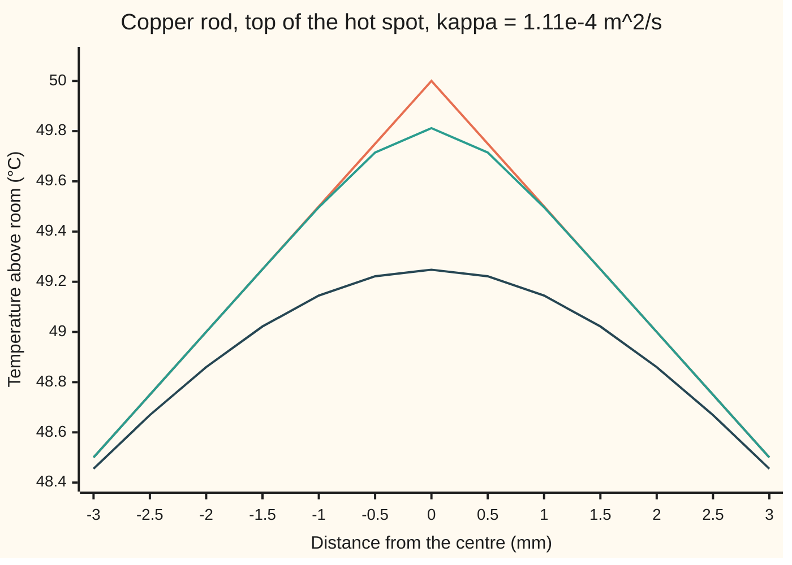

# Diffusion smooths instantly, and is felt everywhere at once

[Syllabus](../../../SYLLABUS.md) → [Partial differential equations](../README.md) → [The Heat Equation in Depth](../README.md#s03) → Diffusion smooths instantly, and is felt everywhere at once

---

## General Overview

The ODE wing's [The heat kernel](../../08-Differential%20equations%20and%20dynamics/10-The%20Classical%20PDEs/10-the-heat-kernel.md) showed two facts in passing. The kernel is positive everywhere once time has started, and a start with a corner is smooth at every later time. This card measures both: how fast the corner rounds off, and how far the heat reaches at once.

A copper rod is 1 m long. Its two ends are held at room temperature. A torch has left a hot spot in the middle: 50 °C above room at the centre, falling in straight lines to room temperature 10 cm either side. The profile is a tent with a sharp top. The top is a **kink**: a corner where the slope jumps from rising to falling.

The unknown is the temperature above room, u, in °C, at each point of the rod and each time. The region is the rod, 0 to 1 m. The data are the tent at the start and 0 °C at both ends.

One millisecond later the top is round. The peak has dropped to 49.812031 °C. Its curvature, infinite at the start, is now a finite −8.4671 × 10^5 °C/m^2. The rounding is about 0.3332 mm wide. A millisecond after that, the top is rounder still, and this goes on at a steady rule: every extra derivative of u costs a factor of about 1/√t.

At the same moment, a point 30 cm from the tent's edge has warmed by 10^-88039.3 °C. That is not zero. No instrument could see it, but the heat equation says it is there.

**Diffusion makes the temperature smooth at every positive time, however rough the start, with each extra derivative growing like 1/√(κt) as time shrinks; and it reaches every point at once, by an amount that is positive but falls off like a bell curve with distance.**

**What kind of fact this is:** a theorem, proved on this card in Why it works, for bounded starts. The instant reach is a property of the model: real heat moves by colliding particles, so here the physics departs from the equation.

### The picture: the top of the hot spot, before and after



Orange: the start, a sharp corner at 50 °C. Green: 1 ms later, rounded over the middle millimetre, peak 49.812 °C. Dark blue: 16 ms later, rounded over several millimetres, peak 49.248 °C. At 1 ms the straight sides more than 1.5 mm from the top have not moved.

---

## The formula

Notation first, in words. Subscripts are rates, as in the ODE wing: $`u_t`$ is the change per second, $`u_{xx}`$ the curvature along the rod. The heat equation is $`u_t = \kappa u_{xx}`$, with $`\kappa`$ (kappa) the diffusivity. Write $`\partial_x^k u`$ for the k-th rate of change of u along the rod: k = 1 is the slope, k = 2 the curvature.

On an endless line, the temperature is the start blended with the heat kernel G, the bell curve grown from a point ([The heat kernel](01-heat-kernel-and-fundamental-solution.md)):

```math
u(x,t) = \int_{-\infty}^{\infty} G(x-y,t)\,f(y)\,dy, \qquad G(x,t) = \frac{1}{\sqrt{4\pi\kappa t}}\,e^{-x^2/(4\kappa t)}.
```

The smoothing law: if the start never exceeds M in size, then at every time t > 0 every derivative exists, and

```math
\big|\partial_x^k u(x,t)\big| \;\le\; c_k\,M\,(\kappa t)^{-k/2}, \qquad c_1 = \frac{1}{\sqrt{\pi}} = 0.564190, \quad c_2 = 2\varphi(1) = 0.483941.
```

**Read it aloud:** the k-th derivative of the temperature is at most a fixed number c-k, times the size of the start, divided by the root of kappa t raised to the power k.

Here $`\varphi(1)`$ is the standard bell curve's height one unit from its centre. Each derivative brings one more factor $`1/\sqrt{\kappa t}`$. The length $`\sqrt{\kappa t}`$ is the **rounding width**: the distance over which diffusion has blurred the start so far. It is the bell's standard width $`\sqrt{2\kappa t}`$, used on the shelf's other cards, divided by $`\sqrt{2}`$.

The reach law: the temperature at distance ℓ beyond the edge of a start whose side slopes at H/W (rise over run), with ℓ many rounding widths, is

```math
u \;\approx\; \frac{H}{W}\left(\frac{2\kappa t}{\ell}\right)^{2} G(\ell, t) \;>\; 0.
```

**Read it aloud:** far away, the temperature is the slope of the start's edge, times a small factor, times the bell curve at that distance: positive, and shrinking like e to the minus ℓ squared over 4 kappa t.

| Symbol | Plain meaning | In our example | Push it up and the answer… |
| --- | --- | --- | --- |
| $`u`$, $`f`$, $`M`$ | temperature above room, in °C; $`f`$ the start; $`M`$ the largest size of the start | tent, peak 50 °C, so M = 50 °C | larger M: every bound grows in proportion |
| $`x`$, $`y`$, $`t`$ | place along the rod in m; $`y`$ a starting point; time in s | x = 0.5 m, t = 1 ms | larger t: rounder, lower peak |
| $`\kappa`$ | diffusivity: how fast heat spreads, in m^2/s | 1.11 × 10^-4 for copper | same as a longer time: only κt matters |
| $`G`$, $`F`$, $`v`$ | heat kernel: the bell grown from a point; $`F`$ its one fixed shape, read at $`v = x/\sqrt{\kappa t}`$, the place counted in rounding widths | — | — |
| $`k`$, $`\partial_x^k`$, $`m`$ | how many times we take the rate along x; $`m`$ how many bounded derivatives the start has | k = 2, curvature; m = 1 for the tent | each step costs 1/√(κt) |
| $`c_k`$, $`\varphi`$ | fixed numbers from the bell's shape; $`\varphi`$ is the standard bell, $`\varphi(1)`$ its height one unit out | 0.564190, 0.483941 | — |
| $`\sqrt{\kappa t}`$ | rounding width | 0.3332 mm at 1 ms | wider rounding |
| $`H`$, $`W`$, $`x_k`$ | tent height and half-width; $`x_k`$ its three corners | 50 °C, 0.1 m; 0.4, 0.5, 0.6 m | steeper sides, larger curvature |
| $`\ell`$ | distance beyond the tent's edge | 0.3 m, to x = 0.9 m | far warming falls like a bell |
| $`n`$, $`L`$, $`b_n`$ | mode number of the rod's sine series; rod length; the start's weight on mode n | L = 1 m | higher modes die faster |
| $`d`$, $`\Delta u`$, $`c_{(d)}`$ | number of space dimensions; the Laplacian; the cone tip's constant | 1, 2, 3 | larger constant, same 1/√(κt) |
| $`s`$, $`a`$, $`z`$, $`N`$, $`R`$, $`T`$ | proof helpers: the bell's standard width $`\sqrt{2\kappa t}`$; a distance beyond a corner; that distance in units of s; the normal CDF; a blended ramp; a continued fraction close to 1/z | a = 0.3 m for the nearest corner | — |

### When it holds

- **Time runs forward, t > 0.** At t = 0 the corner is still there. As t shrinks the curvature at the top grows without limit: −2.678 × 10^7 °C/m^2 at 1 µs. Run backward and a 10^-6 °C error in mode 5000 grows to 7.844 × 10^5 °C in 1 ms.
- **The start is bounded, or grows slowly far out.** A start that grows faster than $`e^{c x^2}`$, c a constant, can make the blend infinite. Then smoothing, and even uniqueness, can fail.
- **Constant κ, one material.** With κ varying smoothly the smoothing survives, with other constants. At a joint between two metals, u stays continuous, but its slope jumps there for all time.
- **Times long compared with particle collisions.** The equation assumes heat moves by many tiny random steps. Over very short times or very short distances, real heat travels at a finite speed, so the instant reach is not physical.

---

## Why it works

### Step 0: the derivatives fall on the kernel

The temperature is a blend of bells, one per starting point. To differentiate the blend in x, differentiate each bell; the start f is only a weight. So u is as smooth as G, whatever f looks like. G is smooth at every t > 0, so u is too.

The rough start never has to be differentiated. Its corners are averaged away by the bell.

### Step 1: each derivative costs a factor 1/√(κt)

G has one shape F, stretched: $`G(x,t) = (\kappa t)^{-1/2} F(v)`$ with $`v = x/\sqrt{\kappa t}`$. By the chain rule, each derivative in x brings out one factor $`(\kappa t)^{-1/2}`$. So

```math
\int_{-\infty}^{\infty} \big|\partial_x^k G(x,t)\big|\,dx = c_k\,(\kappa t)^{-k/2}, \qquad c_k = \int_{-\infty}^{\infty} \big|F^{(k)}(v)\big|\,dv.
```

Then $`|\partial_x^k u| \le M \int |\partial_x^k G|\,dx = c_k M (\kappa t)^{-k/2}`$, the smoothing law.

The first two constants follow from counting the bell's rises and falls:

- **k = 1.** The slope of G is positive to the left of the centre and negative to the right. Its total size is twice the peak height: $`2G(0,t) = 1/\sqrt{\pi\kappa t}`$, so $`c_1 = 1/\sqrt{\pi}`$.
- **k = 2.** The curvature of G changes sign at $`x = \pm\sqrt{2\kappa t}`$, the bell's inflection points. Its total size is four times the largest slope, which gives $`c_2 = 2\varphi(1)`$.

### Step 2: a start with some smoothness pays less

The tent already has a slope, at most H/W = 50 °C per 10 cm in size. Move one derivative onto f instead, by integrating by parts: $`u_{xx} = \int G_x(x-y,t)\,f'(y)\,dy`$. So $`|u_{xx}| \le c_1 (H/W)/\sqrt{\kappa t}`$: the curvature grows only like $`1/\sqrt{t}`$, not $`1/t`$.

At the top this bound is reached, up to a negligible share from the two far corners. There the slope jumps from +H/W to −H/W, and the jump becomes one bell:

```math
u_{xx}(0.5\,\mathrm{m}, t) = -2\,\frac{H}{W}\,G(0,t) = -\frac{H}{W}\,\frac{c_1}{\sqrt{\kappa t}}.
```

The same bookkeeping gives the general rule. A start with m bounded derivatives has its k-th derivative growing like $`(\kappa t)^{-(k-m)/2}`$.

### Step 3: a bounded rod smooths the same way

On the rod with both ends at room temperature, the temperature is a sine series ([Separation of variables](../../08-Differential%20equations%20and%20dynamics/10-The%20Classical%20PDEs/04-separation-of-variables-for-the-heat-equation.md)):

```math
u(x,t) = \sum_{n=1}^{\infty} b_n\, e^{-\kappa (n\pi/L)^2 t}\, \sin\frac{n\pi x}{L}.
```

The tent's coefficients $`b_n`$ shrink only like $`1/n^2`$, because of its corners. Each x-derivative multiplies mode n by $`n\pi/L`$. That would make the curvature series diverge at t = 0.

At any t > 0 the damping $`e^{-\kappa (n\pi/L)^2 t}`$ falls faster than any power of n grows. So the series for every derivative converges, and u is smooth. The damping reaches $`e^{-40}`$ after about 6043 modes at 1 ms, 191 at 1 s and 19 at 100 s. Only the modes longer than about the rounding width survive.

The same answer comes from the endless-line blend plus mirror images of the tent beyond each end, flipped in sign. At 1 ms the images sit too far away to matter; by 100 s they do.

### Step 4: several dimensions, the same rate

In d dimensions the kernel is a product of one-dimensional bells, one per direction:

```math
G_d(\mathbf{x}, t) = (4\pi\kappa t)^{-d/2}\, e^{-|\mathbf{x}|^2/(4\kappa t)}.
```

A derivative along one direction falls on one factor only. The other factors each integrate to 1. So the cost per derivative is the same $`1/\sqrt{\kappa t}`$ in every dimension.

Take a cone-shaped hot spot, height H and radius W, in a copper plate (d = 2) or block (d = 3). Its tip is a kink in every direction. The Laplacian Δu (the sum of the curvatures along each direction) at the tip becomes

```math
\Delta u(\mathbf{0}, t) = -\frac{H}{W}\,\frac{c_{(d)}}{\sqrt{\kappa t}}, \qquad c_{(1)} = \frac{1}{\sqrt{\pi}}, \quad c_{(2)} = \frac{\sqrt{\pi}}{2}, \quad c_{(3)} = \frac{2}{\sqrt{\pi}}.
```

More directions feed the tip, so the constant grows with d. The rate, $`1/\sqrt{t}`$, does not.

### Step 5: felt everywhere, at once

G is positive at every x once t > 0. If the start is never negative and not zero everywhere, every point of the line warms at once. On the rod the same holds inside. The strong form of [Diffusion's maximum principle](04-maximum-principle-for-the-heat-equation.md) says a solution that starts at or above zero, with its ends held at zero, and is not zero everywhere, is above zero at every inner point for t > 0.

How much warming? Beyond the tent's edge, the blend is the edge's slope times the bell's far tail. Working the tail integral gives the reach law above. At 1 ms the exponent is huge, which is why 30 cm gets only $`10^{-88039.3}`$ °C. Waves behave differently: [Dependence and influence](../01-Classification%20and%20Well-Posedness/09-domains-of-dependence-and-influence.md) shows a string feels nothing beyond distance c·t.

<details>
<summary>Detailed proof: the derivatives pass under the integral, and the far tail</summary>

Let |f| ≤ M and fix t > 0. Each x-derivative of G is a polynomial in x times the bell. A polynomial times $`e^{-x^2/(4\kappa t)}`$ is bounded by a constant times $`e^{-x^2/(8\kappa t)}`$, which is integrable. So, for x in any bounded interval, the differentiated integrand is bounded by a fixed integrable function of y. Dominated convergence then lets each derivative pass under the integral, and the result is continuous. By induction, u has continuous derivatives of every order in x.

In t, the heat equation turns each t-derivative into two x-derivatives, since $`G_t = \kappa G_{xx}`$. So u is smooth in x and t together for t > 0.

The bound: $`|\partial_x^k u| \le \int |\partial_x^k G(x-y,t)|\,|f(y)|\,dy \le M \int |\partial_x^k G|`$, and the scaling of Step 1 gives $`c_k (\kappa t)^{-k/2}`$.

The far tail. The tent is (H/W) times a sum of three ramps, $`\max(x - x_k, 0)`$, with weights 1, −2, 1 at the corners $`x_k`$ = 0.4, 0.5 and 0.6 m. A ramp blended with G is, with $`s = \sqrt{2\kappa t}`$ and $`N`$ the area under the standard bell to the left of a point (the normal CDF, as on the finance cards),

$`\displaystyle R(x) = x\,N(x/s) + s\,\varphi(x/s).`$

At x = 0.9 m every ramp is on its rising side, so each blended ramp is close to its straight part $`x - x_k`$, not to a tail. But $`N(-z) = 1 - N(z)`$ and the bell is symmetric, so $`R(x) = x + R(-x)`$. The straight parts cancel, because the weights 1, −2, 1 sum to 0 and 0.4 − 2 × 0.5 + 0.6 = 0. So beyond the tent the line blend keeps only the tails:

$`\displaystyle u(x,t) = \frac{H}{W}\big[R(0.4 - x) - 2R(0.5 - x) + R(0.6 - x)\big].`$

The nearest corner, 0.6 m, gives the largest tail, at distance a = x − 0.6 = 0.3 m. With z = a/s, a tail equals

$`\displaystyle R(-a) = s\,\varphi(z)\,\frac{T}{z+T}, \qquad T = \cfrac{1}{z + \cfrac{2}{z + \cfrac{3}{z + \cdots}}}.`$

Since T is close to 1/z for large z, this is about $`s\,\varphi(z)/z^2`$, which is the reach law. Every factor is positive, so the warming is positive. The corners at 0.5 and 0.4 m add tails smaller by a factor of about $`e^{-15.77}`$ at 10 s, and far less at shorter times.

</details>

---

## Worked numbers, by hand

The top of the tent, x = 0.5 m, one millisecond after the start. κ = 1.11 × 10^-4 m^2/s (a typical handbook value for pure copper at room temperature; illustrative). H/W = 50 °C / 0.1 m = 500 °C/m.

| Step | Arithmetic | Value |
| --- | --- | --- |
| κt | 1.11 × 10^-4 × 0.001 | 1.110 × 10^-7 m^2 |
| rounding width | √(1.110 × 10^-7) m | 0.3332 mm |
| c₁ | 1/√π | 0.564190 |
| curvature at the top | −500 × 0.564190 / √(1.110 × 10^-7) | **−8.4671 × 10^5 °C/m^2** |
| rate of the peak | κ × curvature = 1.11 × 10^-4 × (−8.4671 × 10^5) | −93.98 °C/s |
| drop of the peak | 2 × 500 × 0.564190 × √(1.110 × 10^-7) | 0.187969 °C |
| peak | 50 − 0.187969 | **49.812031 °C** |

One millisecond on, the sharp top is a smooth cap about 0.3332 mm wide with a finite curvature, and it is cooling at 93.98 °C/s.

The drop is twice the current rate times the time, 0.1880 °C against 93.98 × 0.001: the top cooled fastest at the very start.

### How the rounding runs in time

| Time | Peak drop | Curvature $`u_{xx}`$ | Fourth derivative $`\partial_x^4 u`$ |
| --- | --- | --- | --- |
| 1 ms | 0.1880 °C | −8.467 × 10^5 °C/m^2 | 3.814 × 10^12 °C/m^4 |
| 4 ms | 0.3759 °C | −4.234 × 10^5 °C/m^2 | 4.767 × 10^11 °C/m^4 |
| 16 ms | 0.7519 °C | −2.117 × 10^5 °C/m^2 | 5.959 × 10^10 °C/m^4 |
| 64 ms | 1.5038 °C | −1.058 × 10^5 °C/m^2 | 7.449 × 10^9 °C/m^4 |

Each fourfold wait doubles the drop and halves the curvature: the ratios print as 2.0000. The fourth derivative falls by 8.0000. The tent starts with one bounded derivative, so the k-th derivative goes like $`t^{-(k-1)/2}`$: power 1/2 for the curvature, 3/2 for the fourth derivative.

```
size of the curvature at the top, in 10^5 °C/m^2
 1 ms  ████████████████████████████████████████  8.467
 4 ms  ████████████████████                      4.234
16 ms  ██████████                                2.117
64 ms  █████                                     1.058
```

### Several dimensions, and the far end

The same tip in two and three dimensions, at 1 ms:

| Space | Tip drop | Laplacian at the tip |
| --- | --- | --- |
| rod, d = 1 | 0.1880 °C | −8.467 × 10^5 °C/m^2 |
| plate, d = 2 | 0.2953 °C | −1.330 × 10^6 °C/m^2 |
| block, d = 3 | 0.3759 °C | −1.693 × 10^6 °C/m^2 |

The point x = 0.9 m, 30 cm beyond the tent's edge:

| Time | Warming at 0.9 m |
| --- | --- |
| 1 ms | $`10^{-88039.3}`$ °C |
| 1 s | $`10^{-90.17}`$ °C |
| 10 s | $`10^{-9.47}`$ °C |
| 100 s | 0.444922 °C |
| 1000 s | 1.024378 °C |

The warming is positive from the first instant, but stays invisible for seconds. It becomes measurable at around a hundred seconds. By then the rounding width √(κt) is 10.54 cm, about a third of the 30 cm distance.

### What breaks if you drop a piece

| Mistake | Comes out at | What went wrong |
| --- | --- | --- |
| Run time backward 1 ms | a 10^-6 °C error in mode 5000 becomes 7.844 × 10^5 °C | Backward, the damping becomes growth: high modes explode |
| Ask for smoothness at t = 0 | curvature −2.678 × 10^7 °C/m^2 already at 1 µs; none at t = 0 | Smoothing needs t > 0; the bound blows up as t shrinks |
| Scale each derivative by 1/t | −2.117 × 10^5 °C/m^2 at 4 ms; true −4.234 × 10^5 | The cost per derivative is 1/√t |

The code prints all three.

---

## Code, from first principles, and it actually runs

The code builds the tent's temperature five ways. It uses the kernel's closed form, written as three blended ramps. It sums the rod's sine series to 8000 modes, and prints its first omitted term; the shorter series and the mirror-image sum at the far point print a bound on theirs. It blends the tent with the bell by Simpson's rule. It checks the heat equation's residual by centred differences. And it adds up the far tail in logarithms, so a number like $`10^{-88039}`$ does not round to zero. Radial Simpson integrals do the same for the cone in two and three dimensions.

### Python

```python
# Smoothing and infinite speed -- the check behind the card.  Standard library only.
# A 1 m copper rod, kappa = 1.11e-4 m^2/s, ends held at room temperature.  Start: a
# tent-shaped hot spot, 50 C above room at x = 0.5 m, falling to 0 at 0.4 and 0.6 m.
# Roads: kernel closed form; sine series on the rod; direct Simpson convolution;
# the equation's residual by centred differences; log-space integral for the far end.
from math import exp, sqrt, pi, log, log10, sin, floor
K, H, W, L = 1.11e-4, 50.0, 0.1, 1.0
KINKS = ((0.4, 1.0), (0.5, -2.0), (0.6, 1.0))   # f'' = (H/W) * sum c delta(x - x_k)
def sci(x, p=3):                                 # e-notation with the same digits in Rust
    e = floor(log10(abs(x))); m = round(abs(x) / 10 ** e, p)
    if m >= 10: m, e = m / 10, e + 1
    return ("-" if x < 0 else "") + f"{m:.{p}f}e{e}"
def phi(z): return exp(-z * z / 2) / sqrt(2 * pi)
def cf(z):                                       # T = 1/(z + 2/(z + 3/(z + ...))), z >= 3
    t = 0.0
    for k in range(300, 1, -1): t = k / (z + t)
    return 1 / (z + t)
def erf(z):                                      # Maclaurin series, |z| <= 2.2
    s, term, n = 0.0, z, 0
    while abs(term) > 1e-17: s += term / (2 * n + 1); n += 1; term *= -z * z / n
    return 2 / sqrt(pi) * s
def R(x, t):                                     # a ramp max(x, 0) after time t: x N(z) + s phi(z)
    s = sqrt(2 * K * t); z = x / s
    if z < -3: T = cf(-z); return s * phi(z) * T / (-z + T)
    if z > 3: return x + R(-x, t)
    return x * 0.5 * (1 + erf(z / sqrt(2))) + s * phi(z)
def G(x, t): return exp(-x * x / (4 * K * t)) / sqrt(4 * pi * K * t)
def Gxx(x, t): return (x * x / (4 * K * K * t * t) - 1 / (2 * K * t)) * G(x, t)
def u(x, t):                                     # rod = line plus odd images at the ends
    return sum((H / W) * c * (R(x - xk - 2 * m, t) - R(-x - xk - 2 * m, t)) for xk, c in KINKS for m in range(-3, 4))
def uxx(x, t): return (H / W) * sum(c * G(x - xk, t) for xk, c in KINKS)
def uxxxx(x, t): return (H / W) * sum(c * Gxx(x - xk, t) for xk, c in KINKS)
def series(x, t, N, p):                          # sine series: p-th x-derivative (p = 0, 2, 4)
    tot = 0.0
    for n in range(1, N + 1):
        k = n * pi / L
        bk2 = -(2 / L) * (H / W) * sum(c * sin(k * xk) for xk, c in KINKS)  # b_n k^2
        tot += bk2 * k ** (p - 2) * (-1) ** (p // 2) * exp(-K * k * k * t) * sin(k * x)
    return tot
def simpson(f, a, b, n=4000):
    h = (b - a) / n
    return h / 3 * (f(a) + f(b) + sum((4 if i % 2 else 2) * f(a + i * h) for i in range(1, n)))
tent = lambda y: max(0.0, H * (1 - abs(y - 0.5) / W))
t1 = 1e-3
s1 = sqrt(2 * K * t1)
print(f"kappa t = {sci(K * t1)} m^2, rounding width sqrt(kappa t) = {sqrt(K * t1) * 1e3:.4f} mm at 1 ms")
pk = [u(0.5, t1), series(0.5, t1, 8000, 0), simpson(lambda y: G(0.5 - y, t1) * tent(y), 0.5 - 30 * s1, 0.5 + 30 * s1)]
print("peak at 1 ms, C: kernel {:.6f}, sine series {:.6f}, Simpson {:.6f}".format(*pk))
print(f"drop of the peak at 1 ms, C: formula 2 (H/W) c_1 sqrt(kappa t) = {2 * H / W / sqrt(pi) * sqrt(K * t1):.6f}, kernel 50 - peak = {H - pk[0]:.6f}")
c2 = [uxx(0.5, t1), series(0.5, t1, 8000, 2)]
print(f"curvature at the peak, 1 ms, C/m^2: kernel {sci(c2[0], 4)}, series {sci(c2[1], 4)}")
print(f"series tail: first omitted term of u_xx at N = 8000 below {sci(4 * 2 * H / W * exp(-K * (8001 * pi) ** 2 * t1))}")
h, hx = 1e-6, 1e-5                               # residual: u_t against kappa u_xx at the peak
ut = (u(0.5, t1 + h) - u(0.5, t1 - h)) / (2 * h)
kuxx = K * (u(0.5 + hx, t1) - 2 * u(0.5, t1) + u(0.5 - hx, t1)) / hx ** 2
print(f"at the peak, 1 ms, C/s: u_t = {ut:.2f}, kappa u_xx (differences) = {kuxx:.2f}, kappa u_xx (kernel) = {K * c2[0]:.2f}")
rows = []
for t in (1e-3, 4e-3, 16e-3, 64e-3):
    rows.append((t, H - u(0.5, t), uxx(0.5, t), uxxxx(0.5, t)))
    print(f"t = {t * 1e3:4.0f} ms: drop {H - u(0.5, t):.4f} C, u_xx {sci(uxx(0.5, t))} C/m^2, u_xxxx {sci(uxxxx(0.5, t))} C/m^4")
print(f"ratios per 4x time: u_xx {rows[0][2] / rows[1][2]:.4f}, u_xxxx {rows[0][3] / rows[1][3]:.4f}, drop {rows[1][1] / rows[0][1]:.4f}")
c1n = simpson(lambda x: abs(x) / (2 * K * t1) * G(x, t1), -30 * s1, 30 * s1) * sqrt(K * t1)
c2n = simpson(lambda x: abs(Gxx(x, t1)), -30 * s1, 30 * s1) * K * t1
print(f"c_1: Simpson {c1n:.6f}, 1/sqrt(pi) {1 / sqrt(pi):.6f};  c_2: Simpson {c2n:.6f}, 2 phi(1) {2 * phi(1):.6f}")
print(f"bound sup|f'| c_1 / sqrt(kappa t) at 1 ms: {sci(H / W * c1n / sqrt(K * t1), 4)} C/m^2")
for t in (0, 1e-3, 16e-3):
    print(f"figure, t = {t * 1e3:.0f} ms, x - 0.5 m = -3..3 mm:", ", ".join(f"{(tent(0.5 + i * 5e-4) if t == 0 else u(0.5 + i * 5e-4, t)):.3f}" for i in range(-6, 7)))
cd = {1: 1 / sqrt(pi), 2: sqrt(pi) / 2, 3: 2 / sqrt(pi)}  # several dimensions: a cone of radius W
SA = {1: 2.0, 2: 2 * pi, 3: 4 * pi}
def cone(d, t):
    s = sqrt(2 * K * t)
    return simpson(lambda r: SA[d] * r ** (d - 1) * exp(-r * r / (4 * K * t)) / (4 * pi * K * t) ** (d / 2) * H * (1 - r / W), 0, 30 * s)
lap = {}
for d in (1, 2, 3):
    lap[d] = (cone(d, t1 + h) - cone(d, t1 - h)) / (2 * h) / K
    print(f"d = {d}: tip drop {H - cone(d, t1):.4f} C (formula {2 * H / W * cd[d] * sqrt(K * t1):.4f}), Laplacian {sci(lap[d])} (formula {sci(-H / W * cd[d] / sqrt(K * t1))}) C/m^2")
def log10_far(x, t):                             # dominant kink at 0.6 m; R(-a) in logs
    a = x - 0.6; s = sqrt(2 * K * t); z = a / s; T = cf(z)
    return log10(H / W) + log10(s) + (-z * z / 2 - 0.5 * log(2 * pi)) / log(10) + log10(T / (z + T))
def log10_simpson(x, t, n=4000):                 # log-sum-exp of Simpson's sum over y near 0.6 m
    wdt = 60 * 2 * K * t / (x - 0.6); hh = wdt / n
    lg = [-(x - y) ** 2 / (4 * K * t) - 0.5 * log(4 * pi * K * t) + log(max(tent(y), 1e-300)) + log((4 if i % 2 else 2) if 0 < i < n else 1)
          for i, y in enumerate(0.6 - wdt + j * hh for j in range(n + 1))]
    mx = max(lg); return (mx + log(sum(exp(v - mx) for v in lg)) + log(hh / 3)) / log(10)
for t in (1e-3, 1.0, 10.0):
    print(f"far point x = 0.9 m, t = {t:g} s: log10 of u in C, formula {log10_far(0.9, t):.4f}, Simpson {log10_simpson(0.9, t):.4f}")
print(f"first omitted kink (0.5 m) at t = 10 s, relative size: e^{-(0.4 ** 2 - 0.3 ** 2) / (4 * K * 10):.2f}")
for t in (100.0, 1000.0):
    print(f"far point x = 0.9 m, t = {t:g} s: kernel with images {u(0.9, t):.6f} C, sine series {series(0.9, t, 200, 0):.6f} C")
print(f"series tail at x = 0.9 m, N = 200, t = 100 s: first omitted term below 10^{log10(4 * 2 * H / W / (201 * pi) ** 2) - K * (201 * pi) ** 2 * 100 / log(10):.1f} C")
print(f"image tail at x = 0.9 m, t = 1000 s: nearest omitted image (m = -4) below {sci(2 * W * H * G(2 * 4 * L - 0.9 - 0.6, 1000.0))} C")
print(f"rounding width sqrt(kappa t) at t = 100 s: {sqrt(K * 100.0) * 100:.2f} cm, against 30 cm to the far point")
for t in (1e-3, 1.0, 100.0):
    print(f"terms for e^-40 damping at t = {t:g} s: {sqrt(40 / (K * pi * pi * t)):.0f}")
amp = exp(K * (5000 * pi) ** 2 * t1)
print(f"mistake 1, backward 1 ms: a 1e-6 C error in mode 5000 becomes {sci(1e-6 * amp)} C")
print(f"mistake 2, curvature at 1 microsecond: {sci(uxx(0.5, 1e-6))} C/m^2, and no finite value at t = 0")
print(f"mistake 3, 1/t per derivative predicts u_xx {sci(rows[0][2] / 4)} at 4 ms; true {sci(rows[1][2])} C/m^2")
assert abs(pk[0] - pk[1]) < 1e-9 and abs(pk[0] - pk[2]) < 1e-9 and abs(c2[0] - c2[1]) < 1e-6 * abs(c2[0])
assert abs(ut - kuxx) < 1e-3 * abs(ut) and abs(ut - K * c2[0]) < 1e-6 * abs(ut)
assert abs(c1n - 1 / sqrt(pi)) < 1e-9 and abs(c2n - 2 * phi(1)) < 1e-6 and abs(rows[0][2] / rows[1][2] - 2) < 1e-9
assert all(abs(H - cone(d, t1) - 2 * H / W * cd[d] * sqrt(K * t1)) < 1e-8 and abs(lap[d] / (-H / W * cd[d] / sqrt(K * t1)) - 1) < 1e-5 for d in cd)
assert all(abs(log10_far(0.9, t) - log10_simpson(0.9, t)) < 1e-6 for t in (1e-3, 1.0, 10.0))
assert all(abs(u(0.9, t) - series(0.9, t, 200, 0)) < 1e-9 for t in (100.0, 1000.0))
print("ALL CHECKS PASS")
```

**Ran 2026-11-15 on macOS, Python 3.14.10, standard library only. All checks passed. Output, pasted from the run:**

```
kappa t = 1.110e-7 m^2, rounding width sqrt(kappa t) = 0.3332 mm at 1 ms
peak at 1 ms, C: kernel 49.812031, sine series 49.812031, Simpson 49.812031
drop of the peak at 1 ms, C: formula 2 (H/W) c_1 sqrt(kappa t) = 0.187969, kernel 50 - peak = 0.187969
curvature at the peak, 1 ms, C/m^2: kernel -8.4671e5, series -8.4671e5
series tail: first omitted term of u_xx at N = 8000 below 1.395e-27
at the peak, 1 ms, C/s: u_t = -93.98, kappa u_xx (differences) = -93.98, kappa u_xx (kernel) = -93.98
t =    1 ms: drop 0.1880 C, u_xx -8.467e5 C/m^2, u_xxxx 3.814e12 C/m^4
t =    4 ms: drop 0.3759 C, u_xx -4.234e5 C/m^2, u_xxxx 4.767e11 C/m^4
t =   16 ms: drop 0.7519 C, u_xx -2.117e5 C/m^2, u_xxxx 5.959e10 C/m^4
t =   64 ms: drop 1.5038 C, u_xx -1.058e5 C/m^2, u_xxxx 7.449e9 C/m^4
ratios per 4x time: u_xx 2.0000, u_xxxx 8.0000, drop 2.0000
c_1: Simpson 0.564190, 1/sqrt(pi) 0.564190;  c_2: Simpson 0.483942, 2 phi(1) 0.483941
bound sup|f'| c_1 / sqrt(kappa t) at 1 ms: 8.4671e5 C/m^2
figure, t = 0 ms, x - 0.5 m = -3..3 mm: 48.500, 48.750, 49.000, 49.250, 49.500, 49.750, 50.000, 49.750, 49.500, 49.250, 49.000, 48.750, 48.500
figure, t = 1 ms, x - 0.5 m = -3..3 mm: 48.500, 48.750, 49.000, 49.250, 49.497, 49.715, 49.812, 49.715, 49.497, 49.250, 49.000, 48.750, 48.500
figure, t = 16 ms, x - 0.5 m = -3..3 mm: 48.455, 48.669, 48.860, 49.022, 49.145, 49.222, 49.248, 49.222, 49.145, 49.022, 48.860, 48.669, 48.455
d = 1: tip drop 0.1880 C (formula 0.1880), Laplacian -8.467e5 (formula -8.467e5) C/m^2
d = 2: tip drop 0.2953 C (formula 0.2953), Laplacian -1.330e6 (formula -1.330e6) C/m^2
d = 3: tip drop 0.3759 C (formula 0.3759), Laplacian -1.693e6 (formula -1.693e6) C/m^2
far point x = 0.9 m, t = 0.001 s: log10 of u in C, formula -88039.3001, Simpson -88039.3001
far point x = 0.9 m, t = 1 s: log10 of u in C, formula -90.1707, Simpson -90.1707
far point x = 0.9 m, t = 10 s: log10 of u in C, formula -9.4678, Simpson -9.4678
first omitted kink (0.5 m) at t = 10 s, relative size: e^-15.77
far point x = 0.9 m, t = 100 s: kernel with images 0.444922 C, sine series 0.444922 C
far point x = 0.9 m, t = 1000 s: kernel with images 1.024378 C, sine series 1.024378 C
series tail at x = 0.9 m, N = 200, t = 100 s: first omitted term below 10^-1924.2 C
image tail at x = 0.9 m, t = 1000 s: nearest omitted image (m = -4) below 3.993e-41 C
rounding width sqrt(kappa t) at t = 100 s: 10.54 cm, against 30 cm to the far point
terms for e^-40 damping at t = 0.001 s: 6043
terms for e^-40 damping at t = 1 s: 191
terms for e^-40 damping at t = 100 s: 19
mistake 1, backward 1 ms: a 1e-6 C error in mode 5000 becomes 7.844e5 C
mistake 2, curvature at 1 microsecond: -2.678e7 C/m^2, and no finite value at t = 0
mistake 3, 1/t per derivative predicts u_xx -2.117e5 at 4 ms; true -4.234e5 C/m^2
ALL CHECKS PASS
```

### Rust

```rust
// Smoothing and infinite speed -- the same check as the Python, in Rust.  No crates.
// A 1 m copper rod, kappa = 1.11e-4 m^2/s, ends held at room temperature.  Start: a
// tent-shaped hot spot, 50 C above room at x = 0.5 m, falling to 0 at 0.4 and 0.6 m.
// Roads: kernel closed form; sine series on the rod; direct Simpson convolution;
// the equation's residual by centred differences; log-space integral for the far end.
use std::f64::consts::PI;
const K: f64 = 1.11e-4;
const H: f64 = 50.0;
const W: f64 = 0.1;
const L: f64 = 1.0;
const KINKS: [(f64, f64); 3] = [(0.4, 1.0), (0.5, -2.0), (0.6, 1.0)]; // f'' = (H/W) sum c delta

fn sci(x: f64, p: usize) -> String {             // e-notation with the same digits as Python
    let mut e = x.abs().log10().floor();
    let mut m: f64 = format!("{:.*}", p, x.abs() / 10f64.powf(e)).parse().unwrap();
    if m >= 10.0 { m /= 10.0; e += 1.0; }
    format!("{}{:.*}e{}", if x < 0.0 { "-" } else { "" }, p, m, e as i64)
}
fn phi(z: f64) -> f64 { (-z * z / 2.0).exp() / (2.0 * PI).sqrt() }
fn cf(z: f64) -> f64 {                           // T = 1/(z + 2/(z + 3/(z + ...))), z >= 3
    let mut t = 0.0;
    for k in (2..=300).rev() { t = k as f64 / (z + t); }
    1.0 / (z + t)
}
fn erf(z: f64) -> f64 {                          // Maclaurin series, |z| <= 2.2
    let (mut s, mut term, mut n) = (0.0, z, 0.0);
    while term.abs() > 1e-17 { s += term / (2.0 * n + 1.0); n += 1.0; term *= -z * z / n; }
    2.0 / PI.sqrt() * s
}
fn r(x: f64, t: f64) -> f64 {                    // a ramp max(x, 0) after time t
    let s = (2.0 * K * t).sqrt();
    let z = x / s;
    if z < -3.0 { let tt = cf(-z); return s * phi(z) * tt / (-z + tt); }
    if z > 3.0 { return x + r(-x, t); }
    x * 0.5 * (1.0 + erf(z / 2f64.sqrt())) + s * phi(z)
}
fn g(x: f64, t: f64) -> f64 { (-x * x / (4.0 * K * t)).exp() / (4.0 * PI * K * t).sqrt() }
fn gxx(x: f64, t: f64) -> f64 { (x * x / (4.0 * K * K * t * t) - 1.0 / (2.0 * K * t)) * g(x, t) }
fn u(x: f64, t: f64) -> f64 {                    // rod = line plus odd images at the ends
    let mut s = 0.0;
    for (xk, c) in KINKS { for m in -3..4 { let m = m as f64;
        s += (H / W) * c * (r(x - xk - 2.0 * m, t) - r(-x - xk - 2.0 * m, t)); } }
    s
}
fn uxx(x: f64, t: f64) -> f64 { (H / W) * KINKS.iter().map(|&(xk, c)| c * g(x - xk, t)).sum::<f64>() }
fn uxxxx(x: f64, t: f64) -> f64 { (H / W) * KINKS.iter().map(|&(xk, c)| c * gxx(x - xk, t)).sum::<f64>() }
fn series(x: f64, t: f64, n: usize, p: i32) -> f64 { // sine series: p-th x-derivative (p = 0, 2, 4)
    let mut tot = 0.0;
    for n in 1..=n {
        let k = n as f64 * PI / L;
        let bk2 = -(2.0 / L) * (H / W) * KINKS.iter().map(|&(xk, c)| c * (k * xk).sin()).sum::<f64>();
        let sign = if (p / 2) % 2 == 0 { 1.0 } else { -1.0 };
        tot += bk2 * k.powi(p - 2) * sign * (-K * k * k * t).exp() * (k * x).sin();
    }
    tot
}
fn simpson(f: &dyn Fn(f64) -> f64, a: f64, b: f64, n: usize) -> f64 {
    let h = (b - a) / n as f64;
    let mut s = 0.0;
    for i in 1..n { s += (if i % 2 == 1 { 4.0 } else { 2.0 }) * f(a + i as f64 * h); }
    h / 3.0 * (f(a) + f(b) + s)
}
fn tent(y: f64) -> f64 { (H * (1.0 - (y - 0.5).abs() / W)).max(0.0) }
fn cd(d: i32) -> f64 { match d { 1 => 1.0 / PI.sqrt(), 2 => PI.sqrt() / 2.0, _ => 2.0 / PI.sqrt() } }
fn cone(d: i32, t: f64) -> f64 {                 // several dimensions: a cone of radius W
    let sa = match d { 1 => 2.0, 2 => 2.0 * PI, _ => 4.0 * PI };
    let s = (2.0 * K * t).sqrt();
    simpson(&|r: f64| sa * r.powi(d - 1) * (-r * r / (4.0 * K * t)).exp() / (4.0 * PI * K * t).powf(d as f64 / 2.0) * H * (1.0 - r / W), 0.0, 30.0 * s, 4000)
}
fn log10_far(x: f64, t: f64) -> f64 {            // dominant kink at 0.6 m; R(-a) in logs
    let (a, s) = (x - 0.6, (2.0 * K * t).sqrt());
    let z = a / s;
    let tt = cf(z);
    (H / W).log10() + s.log10() + (-z * z / 2.0 - 0.5 * (2.0 * PI).ln()) / 10f64.ln() + (tt / (z + tt)).log10()
}
fn log10_simpson(x: f64, t: f64, n: usize) -> f64 { // log-sum-exp of Simpson's sum near 0.6 m
    let wdt = 60.0 * 2.0 * K * t / (x - 0.6);
    let hh = wdt / n as f64;
    let lg: Vec<f64> = (0..=n).map(|i| { let y = 0.6 - wdt + i as f64 * hh;
        let wt: f64 = if i > 0 && i < n { if i % 2 == 1 { 4.0 } else { 2.0 } } else { 1.0 };
        -(x - y).powi(2) / (4.0 * K * t) - 0.5 * (4.0 * PI * K * t).ln() + tent(y).max(1e-300).ln() + wt.ln() }).collect();
    let mx = lg.iter().cloned().fold(f64::MIN, f64::max);
    (mx + lg.iter().map(|v| (v - mx).exp()).sum::<f64>().ln() + (hh / 3.0).ln()) / 10f64.ln()
}

fn main() {
    let t1 = 1e-3;
    let s1 = (2.0 * K * t1).sqrt();
    println!("kappa t = {} m^2, rounding width sqrt(kappa t) = {:.4} mm at 1 ms", sci(K * t1, 3), (K * t1).sqrt() * 1e3);
    let pk = [u(0.5, t1), series(0.5, t1, 8000, 0), simpson(&|y| g(0.5 - y, t1) * tent(y), 0.5 - 30.0 * s1, 0.5 + 30.0 * s1, 4000)];
    println!("peak at 1 ms, C: kernel {:.6}, sine series {:.6}, Simpson {:.6}", pk[0], pk[1], pk[2]);
    println!("drop of the peak at 1 ms, C: formula 2 (H/W) c_1 sqrt(kappa t) = {:.6}, kernel 50 - peak = {:.6}", 2.0 * H / W / PI.sqrt() * (K * t1).sqrt(), H - pk[0]);
    let c2 = [uxx(0.5, t1), series(0.5, t1, 8000, 2)];
    println!("curvature at the peak, 1 ms, C/m^2: kernel {}, series {}", sci(c2[0], 4), sci(c2[1], 4));
    println!("series tail: first omitted term of u_xx at N = 8000 below {}", sci(4.0 * 2.0 * H / W * (-K * (8001.0 * PI).powi(2) * t1).exp(), 3));
    let (h, hx) = (1e-6, 1e-5);                  // residual: u_t against kappa u_xx at the peak
    let ut = (u(0.5, t1 + h) - u(0.5, t1 - h)) / (2.0 * h);
    let kuxx = K * (u(0.5 + hx, t1) - 2.0 * u(0.5, t1) + u(0.5 - hx, t1)) / (hx * hx);
    println!("at the peak, 1 ms, C/s: u_t = {:.2}, kappa u_xx (differences) = {:.2}, kappa u_xx (kernel) = {:.2}", ut, kuxx, K * c2[0]);
    let mut rows = vec![];
    for t in [1e-3, 4e-3, 16e-3, 64e-3] {
        rows.push((t, H - u(0.5, t), uxx(0.5, t), uxxxx(0.5, t)));
        println!("t = {:4.0} ms: drop {:.4} C, u_xx {} C/m^2, u_xxxx {} C/m^4", t * 1e3, H - u(0.5, t), sci(uxx(0.5, t), 3), sci(uxxxx(0.5, t), 3));
    }
    println!("ratios per 4x time: u_xx {:.4}, u_xxxx {:.4}, drop {:.4}", rows[0].2 / rows[1].2, rows[0].3 / rows[1].3, rows[1].1 / rows[0].1);
    let c1n = simpson(&|x: f64| x.abs() / (2.0 * K * t1) * g(x, t1), -30.0 * s1, 30.0 * s1, 4000) * (K * t1).sqrt();
    let c2n = simpson(&|x| gxx(x, t1).abs(), -30.0 * s1, 30.0 * s1, 4000) * K * t1;
    println!("c_1: Simpson {:.6}, 1/sqrt(pi) {:.6};  c_2: Simpson {:.6}, 2 phi(1) {:.6}", c1n, 1.0 / PI.sqrt(), c2n, 2.0 * phi(1.0));
    println!("bound sup|f'| c_1 / sqrt(kappa t) at 1 ms: {} C/m^2", sci(H / W * c1n / (K * t1).sqrt(), 4));
    for t in [0.0, 1e-3, 16e-3] {
        let v: Vec<String> = (-6..=6).map(|i| { let x = 0.5 + i as f64 * 5e-4; format!("{:.3}", if t == 0.0 { tent(x) } else { u(x, t) }) }).collect();
        println!("figure, t = {:.0} ms, x - 0.5 m = -3..3 mm: {}", t * 1e3, v.join(", "));
    }
    let mut lap = [0.0; 4];
    for d in 1..=3 {
        lap[d as usize] = (cone(d, t1 + h) - cone(d, t1 - h)) / (2.0 * h) / K;
        println!("d = {}: tip drop {:.4} C (formula {:.4}), Laplacian {} (formula {}) C/m^2", d, H - cone(d, t1), 2.0 * H / W * cd(d) * (K * t1).sqrt(), sci(lap[d as usize], 3), sci(-H / W * cd(d) / (K * t1).sqrt(), 3));
    }
    for t in [1e-3, 1.0, 10.0] {
        println!("far point x = 0.9 m, t = {} s: log10 of u in C, formula {:.4}, Simpson {:.4}", t, log10_far(0.9, t), log10_simpson(0.9, t, 4000));
    }
    println!("first omitted kink (0.5 m) at t = 10 s, relative size: e^{:.2}", -(0.4f64.powi(2) - 0.3f64.powi(2)) / (4.0 * K * 10.0));
    for t in [100.0, 1000.0] {
        println!("far point x = 0.9 m, t = {} s: kernel with images {:.6} C, sine series {:.6} C", t, u(0.9, t), series(0.9, t, 200, 0));
    }
    println!("series tail at x = 0.9 m, N = 200, t = 100 s: first omitted term below 10^{:.1} C", (4.0 * 2.0 * H / W / (201.0 * PI).powi(2)).log10() - K * (201.0 * PI).powi(2) * 100.0 / 10f64.ln());
    println!("image tail at x = 0.9 m, t = 1000 s: nearest omitted image (m = -4) below {} C", sci(2.0 * W * H * g(2.0 * 4.0 * L - 0.9 - 0.6, 1000.0), 3));
    println!("rounding width sqrt(kappa t) at t = 100 s: {:.2} cm, against 30 cm to the far point", (K * 100.0).sqrt() * 100.0);
    for t in [1e-3, 1.0, 100.0] {
        println!("terms for e^-40 damping at t = {} s: {:.0}", t, (40.0 / (K * PI * PI * t)).sqrt());
    }
    let amp = (K * (5000.0 * PI).powi(2) * t1).exp();
    println!("mistake 1, backward 1 ms: a 1e-6 C error in mode 5000 becomes {} C", sci(1e-6 * amp, 3));
    println!("mistake 2, curvature at 1 microsecond: {} C/m^2, and no finite value at t = 0", sci(uxx(0.5, 1e-6), 3));
    println!("mistake 3, 1/t per derivative predicts u_xx {} at 4 ms; true {} C/m^2", sci(rows[0].2 / 4.0, 3), sci(rows[1].2, 3));
    assert!((pk[0] - pk[1]).abs() < 1e-9 && (pk[0] - pk[2]).abs() < 1e-9 && (c2[0] - c2[1]).abs() < 1e-6 * c2[0].abs());
    assert!((ut - kuxx).abs() < 1e-3 * ut.abs() && (ut - K * c2[0]).abs() < 1e-6 * ut.abs());
    assert!((c1n - 1.0 / PI.sqrt()).abs() < 1e-9 && (c2n - 2.0 * phi(1.0)).abs() < 1e-6 && (rows[0].2 / rows[1].2 - 2.0).abs() < 1e-9);
    assert!((1..=3).all(|d| (H - cone(d, t1) - 2.0 * H / W * cd(d) * (K * t1).sqrt()).abs() < 1e-8 && (lap[d as usize] / (-H / W * cd(d) / (K * t1).sqrt()) - 1.0).abs() < 1e-5));
    assert!([1e-3, 1.0, 10.0].iter().all(|&t| (log10_far(0.9, t) - log10_simpson(0.9, t, 4000)).abs() < 1e-6));
    assert!([100.0, 1000.0].iter().all(|&t| (u(0.9, t) - series(0.9, t, 200, 0)).abs() < 1e-9));
    println!("ALL CHECKS PASS");
}
```

**Ran 2026-11-15 on macOS, rustc 1.98.1, no crates. All checks passed. Output, pasted from the run:**

```
kappa t = 1.110e-7 m^2, rounding width sqrt(kappa t) = 0.3332 mm at 1 ms
peak at 1 ms, C: kernel 49.812031, sine series 49.812031, Simpson 49.812031
drop of the peak at 1 ms, C: formula 2 (H/W) c_1 sqrt(kappa t) = 0.187969, kernel 50 - peak = 0.187969
curvature at the peak, 1 ms, C/m^2: kernel -8.4671e5, series -8.4671e5
series tail: first omitted term of u_xx at N = 8000 below 1.395e-27
at the peak, 1 ms, C/s: u_t = -93.98, kappa u_xx (differences) = -93.98, kappa u_xx (kernel) = -93.98
t =    1 ms: drop 0.1880 C, u_xx -8.467e5 C/m^2, u_xxxx 3.814e12 C/m^4
t =    4 ms: drop 0.3759 C, u_xx -4.234e5 C/m^2, u_xxxx 4.767e11 C/m^4
t =   16 ms: drop 0.7519 C, u_xx -2.117e5 C/m^2, u_xxxx 5.959e10 C/m^4
t =   64 ms: drop 1.5038 C, u_xx -1.058e5 C/m^2, u_xxxx 7.449e9 C/m^4
ratios per 4x time: u_xx 2.0000, u_xxxx 8.0000, drop 2.0000
c_1: Simpson 0.564190, 1/sqrt(pi) 0.564190;  c_2: Simpson 0.483942, 2 phi(1) 0.483941
bound sup|f'| c_1 / sqrt(kappa t) at 1 ms: 8.4671e5 C/m^2
figure, t = 0 ms, x - 0.5 m = -3..3 mm: 48.500, 48.750, 49.000, 49.250, 49.500, 49.750, 50.000, 49.750, 49.500, 49.250, 49.000, 48.750, 48.500
figure, t = 1 ms, x - 0.5 m = -3..3 mm: 48.500, 48.750, 49.000, 49.250, 49.497, 49.715, 49.812, 49.715, 49.497, 49.250, 49.000, 48.750, 48.500
figure, t = 16 ms, x - 0.5 m = -3..3 mm: 48.455, 48.669, 48.860, 49.022, 49.145, 49.222, 49.248, 49.222, 49.145, 49.022, 48.860, 48.669, 48.455
d = 1: tip drop 0.1880 C (formula 0.1880), Laplacian -8.467e5 (formula -8.467e5) C/m^2
d = 2: tip drop 0.2953 C (formula 0.2953), Laplacian -1.330e6 (formula -1.330e6) C/m^2
d = 3: tip drop 0.3759 C (formula 0.3759), Laplacian -1.693e6 (formula -1.693e6) C/m^2
far point x = 0.9 m, t = 0.001 s: log10 of u in C, formula -88039.3001, Simpson -88039.3001
far point x = 0.9 m, t = 1 s: log10 of u in C, formula -90.1707, Simpson -90.1707
far point x = 0.9 m, t = 10 s: log10 of u in C, formula -9.4678, Simpson -9.4678
first omitted kink (0.5 m) at t = 10 s, relative size: e^-15.77
far point x = 0.9 m, t = 100 s: kernel with images 0.444922 C, sine series 0.444922 C
far point x = 0.9 m, t = 1000 s: kernel with images 1.024378 C, sine series 1.024378 C
series tail at x = 0.9 m, N = 200, t = 100 s: first omitted term below 10^-1924.2 C
image tail at x = 0.9 m, t = 1000 s: nearest omitted image (m = -4) below 3.993e-41 C
rounding width sqrt(kappa t) at t = 100 s: 10.54 cm, against 30 cm to the far point
terms for e^-40 damping at t = 0.001 s: 6043
terms for e^-40 damping at t = 1 s: 191
terms for e^-40 damping at t = 100 s: 19
mistake 1, backward 1 ms: a 1e-6 C error in mode 5000 becomes 7.844e5 C
mistake 2, curvature at 1 microsecond: -2.678e7 C/m^2, and no finite value at t = 0
mistake 3, 1/t per derivative predicts u_xx -2.117e5 at 4 ms; true -4.234e5 C/m^2
ALL CHECKS PASS
```

The outputs match line for line.

### Lean

Lean proves the smoothing law and the instant reach on the endless line, for every bounded start, and checks three pieces of hand arithmetic.

- Take $`\kappa > 0`$ and a start $`f`$ with $`|f| \le M`$ at every point. Then $`u`$ is smooth in $`x`$ and $`t`$ together at every $`t > 0`$.
- Take the same start and any $`t > 0`$. Then $`|\partial_x^k u| \le c_k M (\kappa t)^{-k/2}`$ for every $`k`$.
- The first two constants are exactly $`c_1 = 1/\sqrt{\pi}`$ and $`c_2 = 2\varphi(1)`$.
- Take a bounded start that is never negative and is not zero on a set of positive length. Then $`u`$ is above zero at every point, at every $`t > 0`$.
- Take the tent, H = 50 °C and W = 0.1 m. Then H/W = 500 °C/m.
- Take the ramp weights 1, −2, 1 at 0.4, 0.5 and 0.6 m. Then the weights sum to 0, and 0.4 − 2 × 0.5 + 0.6 = 0.
- Take a fourfold wait. Then $`2^2 = 4`$ and $`8^2 = 4^3`$, so the ratios 2 and 8 fit the powers 1/2 and 3/2.

The tent's exact numbers, the reach law, the bounded rod, several dimensions and backward time are left to the Python and Rust checks.

```lean
-- Diffusion smooths instantly, and is felt everywhere at once: for any bounded start on the line, the heat-kernel solution is smooth at every positive time with its k-th space derivative at most c_k M (κt)^(-k/2), where c_1 = 1/√π and c_2 = 2φ(1), and a start that is never negative and not zero warms every point at once.
import Mathlib.Analysis.Calculus.ContDiff.Basic
import Mathlib.Analysis.Calculus.IteratedDeriv.Defs
import Mathlib.Analysis.SpecialFunctions.Pow.Real
import Mathlib.MeasureTheory.Integral.Bochner.Basic
import Mathlib.MeasureTheory.Measure.Lebesgue.Basic
import Mathlib.Tactic.NormNum
import Mathlib

open MeasureTheory Real
open scoped ContDiff

/-- The heat kernel on the line with diffusivity `κ`:
`G(x, t) = (4πκt)^(-1/2) · e^(-x²/(4κt))`, the bell grown by time `t` from one unit of heat. -/
noncomputable def heatKernel (κ x t : ℝ) : ℝ :=
  exp (-x ^ 2 / (4 * κ * t)) / sqrt (4 * π * κ * t)

/-- The kernel's one fixed shape `F(v) = (4π)^(-1/2) · e^(-v²/4)`, read at `v = x/√(κt)`,
so that `G(x, t) = (κt)^(-1/2) F(x/√(κt))`. -/
noncomputable def kernelShape (v : ℝ) : ℝ :=
  exp (-v ^ 2 / 4) / sqrt (4 * π)

/-- The smoothing constant `c_k = ∫ |F⁽ᵏ⁾(v)| dv`, the total size of the shape's `k`-th
derivative. -/
noncomputable def smoothingConst (k : ℕ) : ℝ :=
  ∫ v, |iteratedDeriv k kernelShape v|

/-- The temperature on the endless line: the start `f` blended with the kernel,
`u(x, t) = ∫ G(x - y, t) f(y) dy`. -/
noncomputable def heatSolution (κ : ℝ) (f : ℝ → ℝ) (x t : ℝ) : ℝ :=
  ∫ y, heatKernel κ (x - y) t * f y

lemma one_add_sq_pow_mul_exp_le {c : ℝ} (hc : 0 < c) (N : ℕ) :
    ∃ K, ∀ z : ℝ, (1 + z ^ 2) ^ N * exp (-(c * z ^ 2)) ≤ K := by
  set L : ℝ := max 1 ((N + 1) / c)
  refine ⟨L ^ (N + 1), fun z => ?_⟩
  have hz : 0 ≤ z ^ 2 := sq_nonneg z
  have hN : (0:ℝ) < N + 1 := by positivity
  have hL1 : 1 ≤ L := le_max_left _ _
  have hL2 : (N + 1) / c ≤ L := le_max_right _ _
  set x : ℝ := c * z ^ 2 / (N + 1) with hx
  have hx0 : 0 ≤ x := by positivity
  have h1 : 1 + z ^ 2 ≤ L * (1 + x) := by
    have : z ^ 2 ≤ L * x := by
      calc z ^ 2 = ((N + 1) / c) * x := by rw [hx]; field_simp
        _ ≤ L * x := mul_le_mul_of_nonneg_right hL2 hx0
    nlinarith
  have h2 : (1 + x) ^ (N + 1) ≤ exp (c * z ^ 2) := by
    calc (1 + x) ^ (N + 1) ≤ exp x ^ (N + 1) :=
          pow_le_pow_left₀ (by positivity) (by linarith [add_one_le_exp x]) _
      _ = exp (c * z ^ 2) := by
          rw [← Real.exp_nat_mul]; congr 1; rw [hx]; push_cast; field_simp
  have h3 : (1 + z ^ 2) ^ N ≤ (1 + z ^ 2) ^ (N + 1) :=
    pow_le_pow_right₀ (by linarith) (by omega)
  have h4 : (1 + z ^ 2) ^ (N + 1) ≤ L ^ (N + 1) * (1 + x) ^ (N + 1) := by
    rw [← mul_pow]; exact pow_le_pow_left₀ (by positivity) h1 _
  have hpos : 0 < exp (-(c * z ^ 2)) := exp_pos _
  calc (1 + z ^ 2) ^ N * exp (-(c * z ^ 2))
      ≤ L ^ (N + 1) * exp (c * z ^ 2) * exp (-(c * z ^ 2)) := by
        apply mul_le_mul_of_nonneg_right _ hpos.le
        calc (1 + z ^ 2) ^ N ≤ L ^ (N + 1) * (1 + x) ^ (N + 1) := h3.trans h4
          _ ≤ L ^ (N + 1) * exp (c * z ^ 2) :=
            mul_le_mul_of_nonneg_left h2 (by positivity)
    _ = L ^ (N + 1) := by rw [mul_assoc, ← Real.exp_add]; simp

lemma inv_one_add_sq_le (u w : ℝ) (h : |w - u| < 1) :
    (1 + u ^ 2)⁻¹ ≤ 4 * (1 + w ^ 2)⁻¹ := by
  have hd : (w - u) ^ 2 < 1 := by
    have := sq_abs (w - u); nlinarith [abs_nonneg (w - u)]
  have key : 1 + w ^ 2 ≤ 4 * (1 + u ^ 2) := by nlinarith [sq_nonneg (w - 2 * u)]
  rw [← div_eq_mul_inv, le_div_iff₀ (by positivity), inv_mul_le_iff₀ (by positivity)]
  linarith

lemma poly_eval_abs_le (p : Polynomial ℝ) :
    ∃ S, 0 ≤ S ∧ ∀ w : ℝ, |p.eval w| ≤ S * (1 + w ^ 2) ^ p.natDegree := by
  refine ⟨∑ i ∈ Finset.range (p.natDegree + 1), |p.coeff i|,
    Finset.sum_nonneg fun i _ => abs_nonneg _, fun w => ?_⟩
  rw [Polynomial.eval_eq_sum_range, Finset.sum_mul]
  refine (Finset.abs_sum_le_sum_abs _ _).trans (Finset.sum_le_sum fun i hi => ?_)
  rw [abs_mul, abs_pow]
  apply mul_le_mul_of_nonneg_left _ (abs_nonneg _)
  have h1 : |w| ≤ 1 + w ^ 2 := by nlinarith [abs_nonneg w, sq_abs w, sq_nonneg (|w| - 1)]
  calc |w| ^ i ≤ (1 + w ^ 2) ^ i := pow_le_pow_left₀ (abs_nonneg _) h1 i
    _ ≤ (1 + w ^ 2) ^ p.natDegree :=
      pow_le_pow_right₀ (by nlinarith) (by simp at hi; omega)

lemma kernelShape_hasDerivAt (w : ℝ) :
    HasDerivAt kernelShape (kernelShape w * (-w / 2)) w := by
  have h1 : HasDerivAt (fun v : ℝ => -v ^ 2 / 4) (-(2 * w) / 4) w := by
    have := ((hasDerivAt_pow 2 w).neg).div_const 4
    convert this using 1; simp
  have h2 := (h1.exp).div_const (sqrt (4 * π))
  unfold kernelShape
  convert h2 using 1
  ring

lemma kernelShape_contDiff : ContDiff ℝ ∞ kernelShape := by
  unfold kernelShape; fun_prop

lemma kernelShape_iteratedDeriv_poly (k : ℕ) :
    ∃ p : Polynomial ℝ, ∀ w, iteratedDeriv k kernelShape w = p.eval w * kernelShape w := by
  induction k with
  | zero => exact ⟨1, fun w => by simp⟩
  | succ k ih =>
    obtain ⟨p, hp⟩ := ih
    refine ⟨Polynomial.derivative p - Polynomial.C (1 / 2) * Polynomial.X * p, fun w => ?_⟩
    have hfun : iteratedDeriv k kernelShape = fun w => p.eval w * kernelShape w := funext hp
    rw [iteratedDeriv_succ, hfun]
    have : HasDerivAt (fun w => p.eval w * kernelShape w) _ w :=
      (p.hasDerivAt w).mul (kernelShape_hasDerivAt w)
    rw [this.deriv]
    simp; ring

lemma kernelShape_iteratedDeriv_decay (k : ℕ) :
    ∃ C, 0 ≤ C ∧ ∀ w, |iteratedDeriv k kernelShape w| ≤ C * (1 + w ^ 2)⁻¹ := by
  obtain ⟨p, hp⟩ := kernelShape_iteratedDeriv_poly k
  obtain ⟨S, hS0, hS⟩ := poly_eval_abs_le p
  obtain ⟨K, hK⟩ := one_add_sq_pow_mul_exp_le (c := 1 / 4) (by norm_num) (p.natDegree + 1)
  have hK0 : 0 ≤ K := (by positivity : (0:ℝ) ≤ (1 + 0 ^ 2) ^ (p.natDegree + 1) * exp (-(1/4 * 0 ^ 2)))
    |>.trans (hK 0)
  have hs : 0 < sqrt (4 * π) := sqrt_pos.2 (by positivity)
  refine ⟨S * K / sqrt (4 * π), by positivity, fun w => ?_⟩
  have hw : 0 < 1 + w ^ 2 := by positivity
  rw [hp, ← div_eq_mul_inv, le_div_iff₀ hw]
  have hF : kernelShape w = exp (-(1 / 4 * w ^ 2)) / sqrt (4 * π) := by
    unfold kernelShape; congr 2; ring
  rw [abs_mul, hF, abs_of_pos (by positivity : 0 < exp (-(1 / 4 * w ^ 2)) / sqrt (4 * π))]
  calc |p.eval w| * (exp (-(1 / 4 * w ^ 2)) / sqrt (4 * π)) * (1 + w ^ 2)
      ≤ S * (1 + w ^ 2) ^ p.natDegree * (exp (-(1 / 4 * w ^ 2)) / sqrt (4 * π)) * (1 + w ^ 2) := by
        gcongr; exact hS w
    _ = S * ((1 + w ^ 2) ^ (p.natDegree + 1) * exp (-(1 / 4 * w ^ 2))) / sqrt (4 * π) := by
        rw [pow_succ]; ring
    _ ≤ S * K / sqrt (4 * π) := by gcongr; exact hK w

lemma integrable_const_mul_inv_one_add_sq (C r : ℝ) (hr : r ≠ 0) :
    Integrable (fun z : ℝ => C * (1 + (z / r) ^ 2)⁻¹) :=
  (integrable_inv_one_add_sq.comp_div hr).const_mul C

lemma kernelShape_iteratedDeriv_continuous (k : ℕ) : Continuous (iteratedDeriv k kernelShape) :=
  kernelShape_contDiff.continuous_iteratedDeriv k (by exact_mod_cast le_top)

lemma kernelShape_iteratedDeriv_integrable (k : ℕ) : Integrable (iteratedDeriv k kernelShape) := by
  obtain ⟨C, _, hC⟩ := kernelShape_iteratedDeriv_decay k
  refine Integrable.mono' ((integrable_const_mul_inv_one_add_sq C 1 one_ne_zero))
    (kernelShape_iteratedDeriv_continuous k).aestronglyMeasurable (Filter.Eventually.of_forall
      fun w => ?_)
  simpa using hC w

lemma iteratedDeriv_kernelShape_hasDerivAt (k : ℕ) (w : ℝ) :
    HasDerivAt (iteratedDeriv k kernelShape) (iteratedDeriv (k + 1) kernelShape w) w := by
  rw [iteratedDeriv_succ]
  exact ((kernelShape_contDiff.differentiable_iteratedDeriv k
    (by exact_mod_cast ENat.natCast_lt_top k)) w).hasDerivAt

noncomputable def gk (r : ℝ) (k : ℕ) (z : ℝ) : ℝ :=
  (r⁻¹) ^ (k + 1) * iteratedDeriv k kernelShape (z / r)

lemma gk_hasDerivAt (r : ℝ) (k : ℕ) (z : ℝ) : HasDerivAt (gk r k) (gk r (k + 1) z) z := by
  have h := (iteratedDeriv_kernelShape_hasDerivAt k (z / r)).comp z ((hasDerivAt_id z).div_const r)
  have := h.const_mul ((r⁻¹) ^ (k + 1))
  unfold gk
  convert this using 1
  simp only [Function.comp_def, id]
  ring

lemma gk_continuous (r : ℝ) (k : ℕ) : Continuous (gk r k) := by
  unfold gk
  exact continuous_const.mul ((kernelShape_iteratedDeriv_continuous k).comp
    (continuous_id.div_const r))

lemma gk_decay (r : ℝ) (k : ℕ) :
    ∃ C, 0 ≤ C ∧ ∀ z, |gk r k z| ≤ C * (1 + (z / r) ^ 2)⁻¹ := by
  obtain ⟨C, hC0, hC⟩ := kernelShape_iteratedDeriv_decay k
  refine ⟨|r⁻¹| ^ (k + 1) * C, by positivity, fun z => ?_⟩
  unfold gk
  rw [abs_mul, abs_pow, mul_assoc]
  exact mul_le_mul_of_nonneg_left (hC _) (by positivity)

lemma gk_abs_integral (hr : 0 < r) (k : ℕ) :
    ∫ z, |gk r k z| = (r⁻¹) ^ k * smoothingConst k := by
  unfold gk smoothingConst
  simp_rw [abs_mul, abs_pow, abs_inv, abs_of_pos hr]
  rw [integral_const_mul, Measure.integral_comp_div (fun v => |iteratedDeriv k kernelShape v|) r,
    abs_of_pos hr, smul_eq_mul, pow_succ]
  field_simp

lemma conv_hasDerivAt {f : ℝ → ℝ} {M r : ℝ} (hr : 0 < r) (hf : AEStronglyMeasurable f volume)
    (hM : ∀ y, |f y| ≤ M) (k : ℕ) (x0 : ℝ) :
    HasDerivAt (fun x => ∫ y, gk r k (x - y) * f y) (∫ y, gk r (k + 1) (x0 - y) * f y) x0 := by
  obtain ⟨C, hC0, hC⟩ := gk_decay r (k + 1)
  have hM0 : 0 ≤ M := (abs_nonneg _).trans (hM 0)
  have hmeas : ∀ (j : ℕ) (x : ℝ), AEStronglyMeasurable (fun y => gk r j (x - y) * f y) volume :=
    fun j x => ((gk_continuous r j).comp (continuous_const.sub continuous_id)).aestronglyMeasurable.mul hf
  have hint : ∀ (j : ℕ) (x : ℝ), Integrable (fun y => gk r j (x - y) * f y) := by
    intro j x
    obtain ⟨D, hD0, hD⟩ := gk_decay r j
    refine Integrable.mono' (((integrable_const_mul_inv_one_add_sq (D * M) r hr.ne').comp_sub_left x))
      (hmeas j x) (Filter.Eventually.of_forall fun y => ?_)
    rw [Real.norm_eq_abs, abs_mul, mul_assoc, mul_comm M, ← mul_assoc]
    exact mul_le_mul (hD _) (hM y) (abs_nonneg _) (by positivity)
  refine (hasDerivAt_integral_of_dominated_loc_of_deriv_le (μ := volume)
    (F := fun x y => gk r k (x - y) * f y) (F' := fun x y => gk r (k + 1) (x - y) * f y)
    (bound := fun y => (4 * C * M) * (1 + ((x0 - y) / r) ^ 2)⁻¹)
    (Metric.ball_mem_nhds x0 hr) (Filter.Eventually.of_forall fun x => hmeas k x) (hint k x0)
    (hmeas (k + 1) x0) (Filter.Eventually.of_forall fun y x hx => ?_)
    ((integrable_const_mul_inv_one_add_sq (4 * C * M) r hr.ne').comp_sub_left x0)
    (Filter.Eventually.of_forall fun y x _ => ?_)).2
  · rw [Real.norm_eq_abs, abs_mul]
    have h1 : (1 + ((x - y) / r) ^ 2)⁻¹ ≤ 4 * (1 + ((x0 - y) / r) ^ 2)⁻¹ := by
      apply inv_one_add_sq_le
      rw [Metric.mem_ball, Real.dist_eq] at hx
      rw [← sub_div, abs_div, abs_of_pos hr, div_lt_one hr]
      rw [abs_sub_comm]; convert hx using 2; ring
    calc |gk r (k + 1) (x - y)| * |f y| ≤ (C * (1 + ((x - y) / r) ^ 2)⁻¹) * M :=
          mul_le_mul (hC _) (hM y) (abs_nonneg _) (by positivity)
      _ ≤ (C * (4 * (1 + ((x0 - y) / r) ^ 2)⁻¹)) * M := by gcongr
      _ = _ := by ring
  · have := ((gk_hasDerivAt r k (x - y)).comp x ((hasDerivAt_id x).sub_const y)).mul_const (f y)
    rw [mul_one] at this; exact this

lemma conv_iteratedDeriv {f : ℝ → ℝ} {M r : ℝ} (hr : 0 < r) (hf : AEStronglyMeasurable f volume)
    (hM : ∀ y, |f y| ≤ M) (k : ℕ) :
    iteratedDeriv k (fun x => ∫ y, gk r 0 (x - y) * f y) = fun x => ∫ y, gk r k (x - y) * f y := by
  induction k with
  | zero => simp
  | succ k ih =>
    rw [iteratedDeriv_succ, ih]
    funext x0
    exact (conv_hasDerivAt hr hf hM k x0).deriv

lemma conv_bound {f : ℝ → ℝ} {M r : ℝ} (hr : 0 < r)
    (hM : ∀ y, |f y| ≤ M) (k : ℕ) (x : ℝ) :
    |∫ y, gk r k (x - y) * f y| ≤ smoothingConst k * M * (r⁻¹) ^ k := by
  obtain ⟨D, hD0, hD⟩ := gk_decay r k
  have hgi : Integrable (gk r k) :=
    Integrable.mono' (integrable_const_mul_inv_one_add_sq D r hr.ne')
      (gk_continuous r k).aestronglyMeasurable (Filter.Eventually.of_forall fun z => hD z)
  have hgi' : Integrable (fun y => |gk r k (x - y)| * M) :=
    (hgi.abs.comp_sub_left x).mul_const M
  calc |∫ y, gk r k (x - y) * f y| ≤ ∫ y, |gk r k (x - y)| * M := by
        rw [← Real.norm_eq_abs]
        refine norm_integral_le_of_norm_le hgi' (Filter.Eventually.of_forall fun y => ?_)
        rw [Real.norm_eq_abs, abs_mul]
        exact mul_le_mul_of_nonneg_left (hM y) (abs_nonneg _)
    _ = (∫ y, |gk r k y|) * M := by
        rw [integral_mul_const, integral_sub_left_eq_self (fun z => |gk r k z|) volume x]
    _ = smoothingConst k * M * (r⁻¹) ^ k := by rw [gk_abs_integral hr]; ring

noncomputable def mono (κ : ℝ) (a b : ℕ) (q : ℝ × ℝ) : ℝ :=
  q.1 ^ a * exp (-(b : ℝ) * q.2 / 2 - q.1 ^ 2 * exp (-q.2) / (4 * κ))

noncomputable def monoD (κ : ℝ) (a b : ℕ) (q : ℝ × ℝ) : ℝ × ℝ →L[ℝ] ℝ :=
  ((a : ℝ) * mono κ (a - 1) b q - 1 / (2 * κ) * mono κ (a + 1) (b + 2) q) •
      ContinuousLinearMap.fst ℝ ℝ ℝ +
    (-((b : ℝ) / 2) * mono κ a b q + 1 / (4 * κ) * mono κ (a + 2) (b + 2) q) •
      ContinuousLinearMap.snd ℝ ℝ ℝ

lemma mono_continuous (κ : ℝ) (a b : ℕ) : Continuous (mono κ a b) := by
  unfold mono; fun_prop

lemma monoD_continuous (κ : ℝ) (a b : ℕ) : Continuous (monoD κ a b) := by
  unfold monoD
  exact ((continuous_const.mul (mono_continuous κ _ _)).sub
    (continuous_const.mul (mono_continuous κ _ _))).smul continuous_const |>.add
    (((continuous_const.mul (mono_continuous κ _ _)).add
    (continuous_const.mul (mono_continuous κ _ _))).smul continuous_const)

lemma mono_shift (κ : ℝ) (a b : ℕ) (q : ℝ × ℝ) :
    mono κ (a + 1) (b + 2) q = q.1 * exp (-q.2) * mono κ a b q ∧
      mono κ (a + 2) (b + 2) q = q.1 ^ 2 * exp (-q.2) * mono κ a b q := by
  unfold mono
  have : exp (-((b + 2 : ℕ) : ℝ) * q.2 / 2 - q.1 ^ 2 * exp (-q.2) / (4 * κ)) =
      exp (-q.2) * exp (-(b : ℝ) * q.2 / 2 - q.1 ^ 2 * exp (-q.2) / (4 * κ)) := by
    rw [← Real.exp_add]; congr 1; push_cast; ring
  rw [this]
  constructor <;> ring

lemma mono_hasFDerivAt (κ : ℝ) (a b : ℕ) (q : ℝ × ℝ) :
    HasFDerivAt (mono κ a b) (monoD κ a b q) q := by
  have h1 : HasFDerivAt (fun q : ℝ × ℝ => q.1) (ContinuousLinearMap.fst ℝ ℝ ℝ) q := hasFDerivAt_fst
  have h2 : HasFDerivAt (fun q : ℝ × ℝ => q.2) (ContinuousLinearMap.snd ℝ ℝ ℝ) q := hasFDerivAt_snd
  have hE := (h2.const_mul (-(b : ℝ) / 2)).add
    (((h1.pow 2).mul (h2.neg.exp)).const_mul (-1 / (4 * κ)))
  have := (h1.pow a).mul hE.exp
  have hfun : mono κ a b = fun q : ℝ × ℝ =>
      q.1 ^ a * exp (-(b : ℝ) / 2 * q.2 + -1 / (4 * κ) * (q.1 ^ 2 * exp (-q.2))) := by
    funext q; unfold mono; congr 2; ring
  rw [hfun]
  refine this.congr_fderiv ?_
  obtain ⟨hs1, hs2⟩ := mono_shift κ a b q
  rw [monoD, hs1, hs2]
  have hE' : -((b : ℝ) * q.2) / 2 - q.1 ^ 2 * exp (-q.2) / (4 * κ) =
      -(b : ℝ) / 2 * q.2 + -1 / (4 * κ) * (q.1 ^ 2 * exp (-q.2)) := by ring
  ext
  · simp [mono]; rw [hE']; ring
  · simp [mono]; rw [hE']; ring

lemma inv_one_add_sq_ball {p p0 : ℝ × ℝ} (hp : p ∈ Metric.ball p0 1) (y : ℝ) :
    (1 + (p.1 - y) ^ 2)⁻¹ ≤ 4 * (1 + (p0.1 - y) ^ 2)⁻¹ := by
  apply inv_one_add_sq_le
  rw [Metric.mem_ball, Prod.dist_eq] at hp
  have := (le_max_left _ _).trans_lt hp
  rw [Real.dist_eq] at this
  rw [abs_sub_comm]; convert this using 2; ring

lemma mono_dom {κ : ℝ} (hκ : 0 < κ) (a b : ℕ) (p0 : ℝ × ℝ) :
    ∃ C, 0 ≤ C ∧ ∀ p ∈ Metric.ball p0 1, ∀ y : ℝ,
      |mono κ a b (p - (y, 0))| ≤ C * (1 + (p0.1 - y) ^ 2)⁻¹ := by
  set c : ℝ := exp (-(p0.2 + 1)) / (4 * κ) with hc
  have hc0 : 0 < c := by positivity
  obtain ⟨K, hK⟩ := one_add_sq_pow_mul_exp_le hc0 (a + 1)
  have hK0 : 0 ≤ K := (by positivity : (0:ℝ) ≤ (1 + 0 ^ 2) ^ (a + 1) * exp (-(c * 0 ^ 2)))
    |>.trans (hK 0)
  set B : ℝ := exp (-(b : ℝ) * (p0.2 - 1) / 2)
  refine ⟨4 * (B * K), by positivity, fun p hp y => ?_⟩
  have hp2 : |p.2 - p0.2| < 1 := by
    rw [Metric.mem_ball, Prod.dist_eq] at hp
    have := (le_max_right _ _).trans_lt hp
    rwa [Real.dist_eq] at this
  set z := p.1 - y
  have hq : p - (y, 0) = (z, p.2) := by ext <;> simp [z]
  rw [hq]
  unfold mono
  simp only
  have hz : 0 < 1 + z ^ 2 := by positivity
  have hexp : -(b : ℝ) * p.2 / 2 - z ^ 2 * exp (-p.2) / (4 * κ) ≤
      -(b : ℝ) * (p0.2 - 1) / 2 + -(c * z ^ 2) := by
    have e1 : -(b : ℝ) * p.2 / 2 ≤ -(b : ℝ) * (p0.2 - 1) / 2 := by
      have : p0.2 - 1 ≤ p.2 := by linarith [(abs_lt.1 hp2).1]
      have hb : (0:ℝ) ≤ b := by positivity
      nlinarith
    have e2 : c * z ^ 2 ≤ z ^ 2 * exp (-p.2) / (4 * κ) := by
      rw [hc, div_mul_eq_mul_div, mul_comm]
      apply div_le_div_of_nonneg_right _ (by positivity)
      apply mul_le_mul_of_nonneg_left _ (sq_nonneg z)
      apply Real.exp_le_exp.2
      linarith [(abs_lt.1 hp2).2]
    linarith
  have habs : |z| ^ a ≤ (1 + z ^ 2) ^ a :=
    pow_le_pow_left₀ (abs_nonneg _) (by nlinarith [abs_nonneg z, sq_abs z, sq_nonneg (|z| - 1)]) a
  rw [abs_mul, abs_pow, abs_of_pos (exp_pos _)]
  have step1 : |z| ^ a * exp (-(b : ℝ) * p.2 / 2 - z ^ 2 * exp (-p.2) / (4 * κ)) ≤
      B * K * (1 + z ^ 2)⁻¹ := by
    rw [← div_eq_mul_inv, le_div_iff₀ hz]
    calc |z| ^ a * exp (-(b : ℝ) * p.2 / 2 - z ^ 2 * exp (-p.2) / (4 * κ)) * (1 + z ^ 2)
        ≤ (1 + z ^ 2) ^ a * exp (-(b : ℝ) * (p0.2 - 1) / 2 + -(c * z ^ 2)) * (1 + z ^ 2) := by
          gcongr
      _ = B * ((1 + z ^ 2) ^ (a + 1) * exp (-(c * z ^ 2))) := by
          rw [Real.exp_add, pow_succ]; ring
      _ ≤ B * K := by gcongr; exact hK z
  calc _ ≤ B * K * (1 + z ^ 2)⁻¹ := step1
    _ ≤ B * K * (4 * (1 + (p0.1 - y) ^ 2)⁻¹) := by
        gcongr; exact inv_one_add_sq_ball hp y
    _ = _ := by ring

noncomputable def Vint (κ : ℝ) (f : ℝ → ℝ) (a b : ℕ) (p : ℝ × ℝ) : ℝ :=
  ∫ y, mono κ a b (p - (y, 0)) * f y

lemma mono_shift_continuous (κ : ℝ) (a b : ℕ) (p : ℝ × ℝ) :
    Continuous (fun y : ℝ => mono κ a b (p - (y, 0))) :=
  (mono_continuous κ a b).comp (continuous_const.sub (continuous_id.prodMk continuous_const))

lemma Vint_integrable {κ M : ℝ} (hκ : 0 < κ) {f : ℝ → ℝ} (hf : AEStronglyMeasurable f volume)
    (hM : ∀ y, |f y| ≤ M) (a b : ℕ) (p : ℝ × ℝ) :
    Integrable (fun y => mono κ a b (p - (y, 0)) * f y) := by
  obtain ⟨C, hC0, hC⟩ := mono_dom hκ a b p
  have hM0 : 0 ≤ M := (abs_nonneg _).trans (hM 0)
  refine Integrable.mono' ((integrable_const_mul_inv_one_add_sq (C * M) 1 one_ne_zero).comp_sub_left p.1)
    ((mono_shift_continuous κ a b p).aestronglyMeasurable.mul hf)
    (Filter.Eventually.of_forall fun y => ?_)
  rw [Real.norm_eq_abs, abs_mul, div_one, mul_assoc, mul_comm M, ← mul_assoc]
  exact mul_le_mul (hC p (Metric.mem_ball_self one_pos) y) (hM y) (abs_nonneg _) (by positivity)

lemma monoD_dom {κ : ℝ} (hκ : 0 < κ) (a b : ℕ) (p0 : ℝ × ℝ) :
    ∃ D, 0 ≤ D ∧ ∀ p ∈ Metric.ball p0 1, ∀ y : ℝ,
      ‖monoD κ a b (p - (y, 0))‖ ≤ D * (1 + (p0.1 - y) ^ 2)⁻¹ := by
  obtain ⟨C1, hC1, h1⟩ := mono_dom hκ (a - 1) b p0
  obtain ⟨C2, hC2, h2⟩ := mono_dom hκ (a + 1) (b + 2) p0
  obtain ⟨C3, hC3, h3⟩ := mono_dom hκ a b p0
  obtain ⟨C4, hC4, h4⟩ := mono_dom hκ (a + 2) (b + 2) p0
  refine ⟨(a : ℝ) * C1 + 1 / (2 * κ) * C2 + (b : ℝ) / 2 * C3 + 1 / (4 * κ) * C4,
    by positivity, fun p hp y => ?_⟩
  have hb1 := h1 p hp y
  have hb2 := h2 p hp y
  have hb3 := h3 p hp y
  have hb4 := h4 p hp y
  set w := (1 + (p0.1 - y) ^ 2)⁻¹
  have hw : 0 ≤ w := by positivity
  set m1 := mono κ (a - 1) b (p - (y, 0))
  set m2 := mono κ (a + 1) (b + 2) (p - (y, 0))
  set m3 := mono κ a b (p - (y, 0))
  set m4 := mono κ (a + 2) (b + 2) (p - (y, 0))
  rw [monoD]
  refine (norm_add_le _ _).trans ?_
  rw [norm_smul, norm_smul, Real.norm_eq_abs, Real.norm_eq_abs]
  have hf1 := ContinuousLinearMap.norm_fst_le ℝ ℝ ℝ
  have hs1 := ContinuousLinearMap.norm_snd_le ℝ ℝ ℝ
  have ha1 : |(a : ℝ) * m1 - 1 / (2 * κ) * m2| ≤ (a : ℝ) * (C1 * w) + 1 / (2 * κ) * (C2 * w) := by
    refine (abs_sub _ _).trans ?_
    rw [abs_mul, abs_mul, Nat.abs_cast, abs_of_pos (by positivity : (0:ℝ) < 1 / (2 * κ))]
    gcongr
  have ha2 : |-((b : ℝ) / 2) * m3 + 1 / (4 * κ) * m4| ≤
      (b : ℝ) / 2 * (C3 * w) + 1 / (4 * κ) * (C4 * w) := by
    refine (abs_add_le _ _).trans ?_
    rw [abs_mul, abs_mul, abs_neg, abs_of_nonneg (by positivity : (0:ℝ) ≤ (b : ℝ) / 2),
      abs_of_pos (by positivity : (0:ℝ) < 1 / (4 * κ))]
    gcongr
  calc _ ≤ ((a : ℝ) * (C1 * w) + 1 / (2 * κ) * (C2 * w)) * 1 +
        ((b : ℝ) / 2 * (C3 * w) + 1 / (4 * κ) * (C4 * w)) * 1 := by
        gcongr
    _ = _ := by ring

lemma Vint_fderiv_integral {κ M : ℝ} (hκ : 0 < κ) {f : ℝ → ℝ} (hf : AEStronglyMeasurable f volume)
    (hM : ∀ y, |f y| ≤ M) (a b : ℕ) (p0 : ℝ × ℝ) :
    ∫ y, f y • monoD κ a b (p0 - (y, 0)) =
      ((a : ℝ) * Vint κ f (a - 1) b p0 - 1 / (2 * κ) * Vint κ f (a + 1) (b + 2) p0) •
          ContinuousLinearMap.fst ℝ ℝ ℝ +
        (-((b : ℝ) / 2) * Vint κ f a b p0 + 1 / (4 * κ) * Vint κ f (a + 2) (b + 2) p0) •
          ContinuousLinearMap.snd ℝ ℝ ℝ := by
  have hint := Vint_integrable hκ hf hM
  have e : (fun y => f y • monoD κ a b (p0 - (y, 0))) = fun y =>
      ((a : ℝ) * (mono κ (a - 1) b (p0 - (y, 0)) * f y) -
          1 / (2 * κ) * (mono κ (a + 1) (b + 2) (p0 - (y, 0)) * f y)) •
        ContinuousLinearMap.fst ℝ ℝ ℝ +
      (-((b : ℝ) / 2) * (mono κ a b (p0 - (y, 0)) * f y) +
          1 / (4 * κ) * (mono κ (a + 2) (b + 2) (p0 - (y, 0)) * f y)) •
        ContinuousLinearMap.snd ℝ ℝ ℝ := by
    funext y
    rw [monoD, smul_add, smul_smul, smul_smul]
    congr 2 <;> ring
  rw [e, integral_add, integral_smul_const, integral_smul_const, integral_sub, integral_add,
    integral_const_mul, integral_const_mul, integral_const_mul, integral_const_mul]
  · rfl
  · exact ((hint _ _ _).const_mul _)
  · exact ((hint _ _ _).const_mul _)
  · exact ((hint _ _ _).const_mul _)
  · exact ((hint _ _ _).const_mul _)
  · exact (((hint _ _ _).const_mul _).sub ((hint _ _ _).const_mul _)).smul_const _
  · exact (((hint _ _ _).const_mul _).add ((hint _ _ _).const_mul _)).smul_const _

lemma Vint_hasFDerivAt {κ M : ℝ} (hκ : 0 < κ) {f : ℝ → ℝ} (hf : AEStronglyMeasurable f volume)
    (hM : ∀ y, |f y| ≤ M) (a b : ℕ) (p0 : ℝ × ℝ) :
    HasFDerivAt (Vint κ f a b)
      (((a : ℝ) * Vint κ f (a - 1) b p0 - 1 / (2 * κ) * Vint κ f (a + 1) (b + 2) p0) •
          ContinuousLinearMap.fst ℝ ℝ ℝ +
        (-((b : ℝ) / 2) * Vint κ f a b p0 + 1 / (4 * κ) * Vint κ f (a + 2) (b + 2) p0) •
          ContinuousLinearMap.snd ℝ ℝ ℝ) p0 := by
  have hM0 : 0 ≤ M := (abs_nonneg _).trans (hM 0)
  obtain ⟨D, hD, hDb⟩ := monoD_dom hκ a b p0
  rw [← Vint_fderiv_integral hκ hf hM a b p0]
  exact hasFDerivAt_integral_of_dominated_of_fderiv_le (μ := volume)
    (F := fun p y => mono κ a b (p - (y, 0)) * f y)
    (F' := fun p y => f y • monoD κ a b (p - (y, 0)))
    (bound := fun y => (M * D) * (1 + (p0.1 - y) ^ 2)⁻¹)
    (Metric.ball_mem_nhds p0 one_pos)
    (Filter.Eventually.of_forall fun p =>
      (mono_shift_continuous κ a b p).aestronglyMeasurable.mul hf)
    (Vint_integrable hκ hf hM a b p0)
    (hf.smul ((monoD_continuous κ a b).comp
      (continuous_const.sub (continuous_id.prodMk continuous_const))).aestronglyMeasurable)
    (Filter.Eventually.of_forall fun y p hp => by
      rw [norm_smul, Real.norm_eq_abs, mul_assoc]
      exact mul_le_mul (hM y) (hDb p hp y) (norm_nonneg _) hM0)
    (by simpa using
      (integrable_const_mul_inv_one_add_sq (M * D) 1 one_ne_zero).comp_sub_left p0.1)
    (Filter.Eventually.of_forall fun y p _ => by
      have := ((mono_hasFDerivAt κ a b (p - (y, 0))).comp p
        ((hasFDerivAt_id p).sub_const (y, 0))).mul_const (f y)
      simpa using this)

lemma Vint_contDiff {κ M : ℝ} (hκ : 0 < κ) {f : ℝ → ℝ} (hf : AEStronglyMeasurable f volume)
    (hM : ∀ y, |f y| ≤ M) (n : ℕ) : ∀ a b : ℕ, ContDiff ℝ n (Vint κ f a b) := by
  induction n with
  | zero =>
    intro a b
    exact contDiff_zero.2 (continuous_iff_continuousAt.2 fun p =>
      (Vint_hasFDerivAt hκ hf hM a b p).continuousAt)
  | succ n ih =>
    intro a b
    rw [show ((n + 1 : ℕ) : ℕ∞ω) = (n : ℕ∞ω) + 1 by push_cast; rfl, contDiff_succ_iff_fderiv]
    refine ⟨fun p => (Vint_hasFDerivAt hκ hf hM a b p).differentiableAt, fun h => ?_, ?_⟩
    · exact absurd h (by simp)
    · have e : fderiv ℝ (Vint κ f a b) = fun p =>
          ((a : ℝ) * Vint κ f (a - 1) b p - 1 / (2 * κ) * Vint κ f (a + 1) (b + 2) p) •
              ContinuousLinearMap.fst ℝ ℝ ℝ +
            (-((b : ℝ) / 2) * Vint κ f a b p + 1 / (4 * κ) * Vint κ f (a + 2) (b + 2) p) •
              ContinuousLinearMap.snd ℝ ℝ ℝ :=
        funext fun p => (Vint_hasFDerivAt hκ hf hM a b p).fderiv
      rw [e]
      exact (((contDiff_const.mul (ih _ _)).sub (contDiff_const.mul (ih _ _))).smul
        contDiff_const).add (((contDiff_const.mul (ih _ _)).add
          (contDiff_const.mul (ih _ _))).smul contDiff_const)

lemma heatKernel_pos {κ t : ℝ} (hκ : 0 < κ) (ht : 0 < t) (z : ℝ) : 0 < heatKernel κ z t := by
  unfold heatKernel; positivity

lemma heatKernel_continuous (κ t x : ℝ) : Continuous (fun y => heatKernel κ (x - y) t) := by
  unfold heatKernel; fun_prop

lemma heatKernel_integrable {κ t : ℝ} (hκ : 0 < κ) (ht : 0 < t) (x : ℝ) :
    Integrable (fun y => heatKernel κ (x - y) t) := by
  have := ((integrable_exp_neg_mul_sq (b := 1 / (4 * κ * t)) (by positivity)).div_const
    (sqrt (4 * π * κ * t))).comp_sub_left x
  refine this.congr (Filter.Eventually.of_forall fun y => ?_)
  simp only [heatKernel]
  congr 2
  field_simp

lemma heatKernel_eq_gk {κ t : ℝ} (hκ : 0 < κ) (ht : 0 < t) (z : ℝ) :
    heatKernel κ z t = gk (sqrt (κ * t)) 0 z := by
  have hs : sqrt (4 * π * κ * t) = sqrt (4 * π) * sqrt (κ * t) := by
    rw [← sqrt_mul (by positivity)]; ring_nf
  have hr : 0 < sqrt (κ * t) := sqrt_pos.2 (by positivity)
  unfold gk heatKernel kernelShape
  simp only [iteratedDeriv_zero, zero_add, pow_one]
  rw [hs, div_pow, sq_sqrt (by positivity)]
  have : -(z ^ 2 / (κ * t)) / 4 = -z ^ 2 / (4 * κ * t) := by field_simp
  rw [this]
  field_simp

lemma heatSolution_eq_Vint {κ t : ℝ} (hκ : 0 < κ) (f : ℝ → ℝ) (x : ℝ) (ht : 0 < t) :
    heatSolution κ f x t = (sqrt (4 * π * κ))⁻¹ * Vint κ f 0 1 (x, log t) := by
  unfold heatSolution Vint
  rw [← integral_const_mul]
  congr 1
  funext y
  rw [← mul_assoc]
  congr 1
  simp only [Prod.mk_sub_mk, sub_zero, mono, pow_zero, one_mul, Nat.cast_one, heatKernel]
  have h1 : exp (-1 * log t / 2 - (x - y) ^ 2 * exp (-log t) / (4 * κ)) =
      (sqrt t)⁻¹ * exp (-(x - y) ^ 2 / (4 * κ * t)) := by
    rw [sub_eq_add_neg, exp_add, sqrt_eq_rpow, rpow_def_of_pos ht, ← exp_neg, exp_neg (log t),
      exp_log ht]
    congr 2
    · ring
    · field_simp
  have hs : sqrt (4 * π * κ * t) = sqrt (4 * π * κ) * sqrt t := sqrt_mul (by positivity) t
  rw [h1, hs]
  field_simp

lemma heatSolution_undef {κ t : ℝ} (hκ : 0 < κ) (ht : 0 < t) {f : ℝ → ℝ}
    (hf : ¬ AEStronglyMeasurable f volume) (x : ℝ) : heatSolution κ f x t = 0 := by
  unfold heatSolution
  apply integral_undef
  intro hint
  apply hf
  have hG : ∀ y, heatKernel κ (x - y) t ≠ 0 := fun y => (heatKernel_pos hκ ht _).ne'
  refine (hint.aestronglyMeasurable.mul
    ((heatKernel_continuous κ t x).inv₀ hG).aestronglyMeasurable).congr
    (Filter.Eventually.of_forall fun y => ?_)
  have := hG y
  simp only [Pi.mul_apply, Pi.inv_apply]
  field_simp


lemma kernelShape_nonneg (w : ℝ) : 0 ≤ kernelShape w := by unfold kernelShape; positivity

lemma kernelShape_d1 : iteratedDeriv 1 kernelShape = fun w => kernelShape w * (-w / 2) := by
  rw [iteratedDeriv_one]; funext w; exact (kernelShape_hasDerivAt w).deriv

lemma kernelShape_d1_hasDerivAt (w : ℝ) :
    HasDerivAt (fun w => kernelShape w * (-w / 2)) (kernelShape w * (w ^ 2 / 4 - 1 / 2)) w := by
  have : HasDerivAt (fun w => kernelShape w * (-w / 2)) _ w :=
    (kernelShape_hasDerivAt w).mul ((hasDerivAt_neg w).div_const 2)
  exact this.congr_deriv (by ring)

lemma kernelShape_d2 : iteratedDeriv 2 kernelShape = fun w => kernelShape w * (w ^ 2 / 4 - 1 / 2) := by
  rw [iteratedDeriv_succ, kernelShape_d1]; funext w; exact (kernelShape_d1_hasDerivAt w).deriv

lemma kernelShape_iteratedDeriv_tendsto (k : ℕ) :
    Filter.Tendsto (iteratedDeriv k kernelShape) (Filter.cocompact ℝ) (nhds 0) := by
  obtain ⟨C, _, hC⟩ := kernelShape_iteratedDeriv_decay k
  have h1 : Filter.Tendsto (fun w : ℝ => 1 + w ^ 2) (Filter.cocompact ℝ) Filter.atTop :=
    Filter.tendsto_atTop_mono (fun w => by
      rw [Real.norm_eq_abs]; nlinarith [abs_nonneg w, sq_abs w, sq_nonneg (|w| - 1)])
      tendsto_norm_cocompact_atTop
  have h2 : Filter.Tendsto (fun w : ℝ => C * (1 + w ^ 2)⁻¹) (Filter.cocompact ℝ) (nhds 0) := by
    simpa using h1.inv_tendsto_atTop.const_mul C
  exact squeeze_zero_norm (fun w => by rw [Real.norm_eq_abs]; exact hC w) h2

lemma smoothingConst_one : smoothingConst 1 = 1 / sqrt π := by
  have hint := kernelShape_iteratedDeriv_integrable 1
  have ht := kernelShape_iteratedDeriv_tendsto 0
  have ht' := kernelShape_iteratedDeriv_tendsto 1
  rw [kernelShape_d1] at hint ht'
  simp only [iteratedDeriv_zero] at ht
  unfold smoothingConst
  rw [kernelShape_d1]
  beta_reduce
  rw [← intervalIntegral.integral_Iic_add_Ioi (b := 0) hint.abs.integrableOn hint.abs.integrableOn]
  rw [setIntegral_congr_fun measurableSet_Iic (g := fun w => kernelShape w * (-w / 2))
    (fun w (hw : w ≤ 0) => abs_of_nonneg (mul_nonneg (kernelShape_nonneg w) (by linarith))),
    setIntegral_congr_fun measurableSet_Ioi (g := fun w => -(kernelShape w * (-w / 2)))
    (fun w (hw : 0 < w) => abs_of_nonpos (mul_nonpos_of_nonneg_of_nonpos (kernelShape_nonneg w)
      (by linarith)))]
  rw [integral_Iic_of_hasDerivAt_of_tendsto (f := kernelShape) (m := 0)
      kernelShape_contDiff.continuous.continuousWithinAt
      (fun w _ => kernelShape_hasDerivAt w) hint.integrableOn (ht.mono_left atBot_le_cocompact),
    integral_Ioi_of_hasDerivAt_of_tendsto (f := fun w => -kernelShape w) (m := 0)
      kernelShape_contDiff.continuous.neg.continuousWithinAt
      (fun w _ => (kernelShape_hasDerivAt w).neg) hint.neg.integrableOn
      (by simpa using (ht.mono_left atTop_le_cocompact).neg)]
  have h4 : sqrt (4 * π) = 2 * sqrt π := by
    rw [show (4 : ℝ) * π = 2 ^ 2 * π by norm_num, sqrt_mul (by norm_num), sqrt_sq (by norm_num)]
  have hπ : 0 < sqrt π := sqrt_pos.2 pi_pos
  simp only [kernelShape, h4]
  field_simp
  norm_num

lemma smoothingConst_two :
    smoothingConst 2 = 2 * (exp (-(1 : ℝ) / 2) / sqrt (2 * π)) := by
  have hint := kernelShape_iteratedDeriv_integrable 2
  have ht' := kernelShape_iteratedDeriv_tendsto 1
  rw [kernelShape_d2] at hint
  rw [kernelShape_d1] at ht'
  set s := sqrt 2 with hs_def
  have hs2 : s ^ 2 = 2 := sq_sqrt (by norm_num)
  have hs0 : 0 < s := sqrt_pos.2 (by norm_num)
  set F2 := fun w => kernelShape w * (w ^ 2 / 4 - 1 / 2)
  set F1 := fun w => kernelShape w * (-w / 2)
  have hF1c : Continuous F1 := kernelShape_contDiff.continuous.mul (continuous_neg.div_const 2)
  unfold smoothingConst
  rw [kernelShape_d2]
  beta_reduce
  rw [← intervalIntegral.integral_Iic_add_Ioi (b := -s) hint.abs.integrableOn hint.abs.integrableOn,
    ← Set.Ioc_union_Ioi_eq_Ioi (by linarith : -s ≤ s),
    setIntegral_union Set.Ioc_disjoint_Ioi_same measurableSet_Ioi hint.abs.integrableOn
      hint.abs.integrableOn,
    ← intervalIntegral.integral_of_le (by linarith : -s ≤ s)]
  rw [setIntegral_congr_fun measurableSet_Iic (g := F2)
    (fun w (hw : w ≤ -s) => abs_of_nonneg (mul_nonneg (kernelShape_nonneg w)
      (by nlinarith))),
    setIntegral_congr_fun measurableSet_Ioi (g := F2)
    (fun w (hw : s < w) => abs_of_nonneg (mul_nonneg (kernelShape_nonneg w)
      (by nlinarith))),
    intervalIntegral.integral_congr (g := fun w => -F2 w) (fun w hw => by
      rw [Set.uIcc_of_le (by linarith)] at hw
      exact abs_of_nonpos (mul_nonpos_of_nonneg_of_nonpos (kernelShape_nonneg w)
        (by nlinarith [hw.1, hw.2])))]
  rw [integral_Iic_of_hasDerivAt_of_tendsto (f := F1) (m := 0) hF1c.continuousWithinAt
      (fun w _ => kernelShape_d1_hasDerivAt w) hint.integrableOn (ht'.mono_left atBot_le_cocompact),
    integral_Ioi_of_hasDerivAt_of_tendsto (f := F1) (m := 0) hF1c.continuousWithinAt
      (fun w _ => kernelShape_d1_hasDerivAt w) hint.integrableOn (ht'.mono_left atTop_le_cocompact),
    intervalIntegral.integral_eq_sub_of_hasDerivAt (f := fun w => -F1 w)
      (fun w _ => (kernelShape_d1_hasDerivAt w).neg) hint.neg.intervalIntegrable]
  have h4 : sqrt (4 * π) = s * sqrt (2 * π) := by
    rw [hs_def, ← sqrt_mul (by norm_num)]; ring_nf
  have hπ : 0 < sqrt (2 * π) := sqrt_pos.2 (by positivity)
  have he : exp (-(-s) ^ 2 / 4) = exp (-(1 : ℝ) / 2) := by congr 1; rw [neg_sq, hs2]; norm_num
  have he' : exp (-s ^ 2 / 4) = exp (-(1 : ℝ) / 2) := by congr 1; rw [hs2]; norm_num
  simp only [F1, kernelShape, he, he', h4]
  field_simp
  ring

#print axioms one_add_sq_pow_mul_exp_le
#print axioms inv_one_add_sq_le
#print axioms poly_eval_abs_le
#print axioms kernelShape_hasDerivAt
#print axioms kernelShape_contDiff
#print axioms kernelShape_iteratedDeriv_poly
#print axioms kernelShape_iteratedDeriv_decay
#print axioms integrable_const_mul_inv_one_add_sq
#print axioms kernelShape_iteratedDeriv_continuous
#print axioms kernelShape_iteratedDeriv_integrable
#print axioms iteratedDeriv_kernelShape_hasDerivAt
#print axioms gk_hasDerivAt
#print axioms gk_continuous
#print axioms gk_decay
#print axioms gk_abs_integral
#print axioms conv_hasDerivAt
#print axioms conv_iteratedDeriv
#print axioms conv_bound
#print axioms mono_continuous
#print axioms monoD_continuous
#print axioms mono_shift
#print axioms mono_hasFDerivAt
#print axioms inv_one_add_sq_ball
#print axioms mono_dom
#print axioms mono_shift_continuous
#print axioms Vint_integrable
#print axioms monoD_dom
#print axioms Vint_fderiv_integral
#print axioms Vint_hasFDerivAt
#print axioms Vint_contDiff
#print axioms heatKernel_pos
#print axioms heatKernel_continuous
#print axioms heatKernel_integrable
#print axioms heatKernel_eq_gk
#print axioms heatSolution_eq_Vint
#print axioms heatSolution_undef
#print axioms kernelShape_nonneg
#print axioms kernelShape_d1
#print axioms kernelShape_d1_hasDerivAt
#print axioms kernelShape_d2
#print axioms kernelShape_iteratedDeriv_tendsto
#print axioms smoothingConst_one
#print axioms smoothingConst_two

/-- The smoothing law. Let the diffusivity `κ` be a positive constant and the start `f` be
bounded, `|f(y)| ≤ M` for every `y`. Then the temperature `u(x, t) = ∫ G(x - y, t) f(y) dy` is
smooth (has continuous derivatives of every order) in place and time together at every time
`t > 0`, however rough `f` is, and at every `t > 0` its `k`-th rate of change along the line
obeys `|∂ₓᵏ u(x, t)| ≤ c_k · M · (κt)^(-k/2)`: each extra derivative costs a factor
`1/√(κt)`. -/
theorem heat_solution_smooth_with_derivative_bounds {κ M : ℝ} (hκ : 0 < κ) (f : ℝ → ℝ)
    (hbdd : ∀ y, |f y| ≤ M) :
    ContDiffOn ℝ ∞ (fun p : ℝ × ℝ => heatSolution κ f p.1 p.2) {p : ℝ × ℝ | 0 < p.2} ∧
      ∀ t, 0 < t → ∀ (k : ℕ) (x : ℝ),
        |iteratedDeriv k (fun z => heatSolution κ f z t) x|
          ≤ smoothingConst k * M * (κ * t) ^ (-(k : ℝ) / 2) := by
  have hM0 : 0 ≤ M := (abs_nonneg _).trans (hbdd 0)
  by_cases hf : AEStronglyMeasurable f volume
  · constructor
    · have hV : ContDiff ℝ ∞ (Vint κ f 0 1) :=
        contDiff_infty.2 fun n => Vint_contDiff hκ hf hbdd n 0 1
      have hg : ContDiffOn ℝ ∞
          (fun p : ℝ × ℝ => (sqrt (4 * π * κ))⁻¹ * Vint κ f 0 1 (p.1, log p.2))
          {p : ℝ × ℝ | 0 < p.2} :=
        contDiffOn_const.mul (hV.comp_contDiffOn (contDiffOn_fst.prodMk
          (Real.contDiffOn_log.comp contDiffOn_snd (fun p (hp : 0 < p.2) => by simpa using hp.ne'))))
      exact hg.congr fun p hp => heatSolution_eq_Vint hκ f p.1 hp
    · intro t ht k x
      have hr : 0 < sqrt (κ * t) := sqrt_pos.2 (mul_pos hκ ht)
      have hfun : (fun z => heatSolution κ f z t) =
          fun x => ∫ y, gk (sqrt (κ * t)) 0 (x - y) * f y := by
        funext z
        unfold heatSolution
        simp_rw [heatKernel_eq_gk hκ ht]
      rw [hfun, conv_iteratedDeriv hr hf hbdd k]
      refine (conv_bound hr hbdd k x).trans (le_of_eq ?_)
      congr 1
      rw [sqrt_eq_rpow, ← rpow_neg (by positivity), ← rpow_natCast, ← rpow_mul (by positivity)]
      congr 1
      ring
  · constructor
    · exact contDiffOn_const.congr fun p hp => heatSolution_undef hκ hp hf p.1
    · intro t ht k x
      have : (fun z => heatSolution κ f z t) = fun _ => 0 :=
        funext fun z => heatSolution_undef hκ ht hf z
      rw [this, iteratedDeriv_const]
      have : 0 ≤ smoothingConst k := integral_nonneg fun _ => abs_nonneg _
      have : 0 ≤ (κ * t) ^ (-(k : ℝ) / 2) := by positivity
      split_ifs <;> simp <;> positivity

/-- The first two smoothing constants, from counting the bell's rises and falls:
`c_1 = 1/√π` (twice the peak height) and `c_2 = 2φ(1)`, where `φ(1) = e^(-1/2)/√(2π)` is the
standard bell's height one unit from its centre. -/
theorem smoothing_constants_first_two :
    smoothingConst 1 = 1 / sqrt π ∧
      smoothingConst 2 = 2 * (exp (-(1 : ℝ) / 2) / sqrt (2 * π)) := by
  exact ⟨smoothingConst_one, smoothingConst_two⟩

/-- Felt everywhere at once. Let `κ > 0` and let the start `f` be bounded, never negative, and
not zero (not zero on a set of positive length). Then at every time `t > 0` the temperature is
strictly positive at every point of the line. -/
theorem heat_solution_positive_everywhere {κ M : ℝ} (hκ : 0 < κ) (f : ℝ → ℝ)
    (hf : Measurable f) (hbdd : ∀ y, |f y| ≤ M) (hnonneg : ∀ y, 0 ≤ f y)
    (hnonzero : ¬ (f =ᵐ[volume] 0)) :
    ∀ x t, 0 < t → 0 < heatSolution κ f x t := by
  intro x t ht
  have hG : ∀ y, 0 < heatKernel κ (x - y) t := fun y => heatKernel_pos hκ ht _
  have hint : Integrable (fun y => heatKernel κ (x - y) t * f y) :=
    (heatKernel_integrable hκ ht x).mul_bdd hf.aestronglyMeasurable
      (Filter.Eventually.of_forall fun y => by rw [Real.norm_eq_abs]; exact hbdd y)
  unfold heatSolution
  rw [integral_pos_iff_support_of_nonneg (fun y => mul_nonneg (hG y).le (hnonneg y)) hint]
  have hs : Function.support (fun y => heatKernel κ (x - y) t * f y) = Function.support f := by
    ext y; simp [(hG y).ne']
  rw [hs, pos_iff_ne_zero]
  intro h0
  apply hnonzero
  rw [Filter.EventuallyEq, ae_iff]
  simpa [Function.support] using h0

-- The tent's slope: H/W = 50 °C over 0.1 m = 500 °C per metre.
example : (50 : ℚ) / (1 / 10) = 500 := by norm_num

-- The tent is (H/W) times three ramps with weights 1, -2, 1 at 0.4, 0.5, 0.6 m. The weights sum
-- to 0 and 0.4 - 2 × 0.5 + 0.6 = 0, so the straight parts cancel beyond the tent.
example : (1 : ℚ) + (-2) + 1 = 0 ∧ (2 / 5 : ℚ) - 2 * (1 / 2) + 3 / 5 = 0 := by norm_num

-- A fourfold wait: the curvature goes like t^(-1/2) and the fourth derivative like t^(-3/2),
-- so the ratios are 4^(1/2) = 2 and 4^(3/2) = 8, that is 2² = 4 and 8² = 4³.
example : (2 : ℕ) ^ 2 = 4 ∧ (8 : ℕ) ^ 2 = 4 ^ 3 := by decide

#print axioms heat_solution_smooth_with_derivative_bounds
#print axioms smoothing_constants_first_two
#print axioms heat_solution_positive_everywhere
```

**Checked 2026-11-15 on macOS, Lean 4.36.0-rc2, Mathlib v4.36.0-rc2. Every proof is complete and uses only Lean's standard axioms. Output, pasted from the run:**

```
'one_add_sq_pow_mul_exp_le' depends on axioms: [propext, Classical.choice, Quot.sound]
'inv_one_add_sq_le' depends on axioms: [propext, Classical.choice, Quot.sound]
'poly_eval_abs_le' depends on axioms: [propext, Classical.choice, Quot.sound]
'kernelShape_hasDerivAt' depends on axioms: [propext, Classical.choice, Quot.sound]
'kernelShape_contDiff' depends on axioms: [propext, Classical.choice, Quot.sound]
'kernelShape_iteratedDeriv_poly' depends on axioms: [propext, Classical.choice, Quot.sound]
'kernelShape_iteratedDeriv_decay' depends on axioms: [propext, Classical.choice, Quot.sound]
'integrable_const_mul_inv_one_add_sq' depends on axioms: [propext, Classical.choice, Quot.sound]
'kernelShape_iteratedDeriv_continuous' depends on axioms: [propext, Classical.choice, Quot.sound]
'kernelShape_iteratedDeriv_integrable' depends on axioms: [propext, Classical.choice, Quot.sound]
'iteratedDeriv_kernelShape_hasDerivAt' depends on axioms: [propext, Classical.choice, Quot.sound]
'gk_hasDerivAt' depends on axioms: [propext, Classical.choice, Quot.sound]
'gk_continuous' depends on axioms: [propext, Classical.choice, Quot.sound]
'gk_decay' depends on axioms: [propext, Classical.choice, Quot.sound]
'gk_abs_integral' depends on axioms: [propext, Classical.choice, Quot.sound]
'conv_hasDerivAt' depends on axioms: [propext, Classical.choice, Quot.sound]
'conv_iteratedDeriv' depends on axioms: [propext, Classical.choice, Quot.sound]
'conv_bound' depends on axioms: [propext, Classical.choice, Quot.sound]
'mono_continuous' depends on axioms: [propext, Classical.choice, Quot.sound]
'monoD_continuous' depends on axioms: [propext, Classical.choice, Quot.sound]
'mono_shift' depends on axioms: [propext, Classical.choice, Quot.sound]
'mono_hasFDerivAt' depends on axioms: [propext, Classical.choice, Quot.sound]
'inv_one_add_sq_ball' depends on axioms: [propext, Classical.choice, Quot.sound]
'mono_dom' depends on axioms: [propext, Classical.choice, Quot.sound]
'mono_shift_continuous' depends on axioms: [propext, Classical.choice, Quot.sound]
'Vint_integrable' depends on axioms: [propext, Classical.choice, Quot.sound]
'monoD_dom' depends on axioms: [propext, Classical.choice, Quot.sound]
'Vint_fderiv_integral' depends on axioms: [propext, Classical.choice, Quot.sound]
'Vint_hasFDerivAt' depends on axioms: [propext, Classical.choice, Quot.sound]
'Vint_contDiff' depends on axioms: [propext, Classical.choice, Quot.sound]
'heatKernel_pos' depends on axioms: [propext, Classical.choice, Quot.sound]
'heatKernel_continuous' depends on axioms: [propext, Classical.choice, Quot.sound]
'heatKernel_integrable' depends on axioms: [propext, Classical.choice, Quot.sound]
'heatKernel_eq_gk' depends on axioms: [propext, Classical.choice, Quot.sound]
'heatSolution_eq_Vint' depends on axioms: [propext, Classical.choice, Quot.sound]
'heatSolution_undef' depends on axioms: [propext, Classical.choice, Quot.sound]
'kernelShape_nonneg' depends on axioms: [propext, Classical.choice, Quot.sound]
'kernelShape_d1' depends on axioms: [propext, Classical.choice, Quot.sound]
'kernelShape_d1_hasDerivAt' depends on axioms: [propext, Classical.choice, Quot.sound]
'kernelShape_d2' depends on axioms: [propext, Classical.choice, Quot.sound]
'kernelShape_iteratedDeriv_tendsto' depends on axioms: [propext, Classical.choice, Quot.sound]
'smoothingConst_one' depends on axioms: [propext, Classical.choice, Quot.sound]
'smoothingConst_two' depends on axioms: [propext, Classical.choice, Quot.sound]
'heat_solution_smooth_with_derivative_bounds' depends on axioms: [propext, Classical.choice, Quot.sound]
'smoothing_constants_first_two' depends on axioms: [propext, Classical.choice, Quot.sound]
'heat_solution_positive_everywhere' depends on axioms: [propext, Classical.choice, Quot.sound]
```

> [!TIP]
> **Try changing**
> - Guess first: copper four times as quick. Set `K` to `4.44e-4`. The 1 ms row now reads like the old 4 ms row: drop 0.3759 °C, curvature −4.234 × 10^5 °C/m^2, because only κt matters. The far-end assert then stops the run: by 10 s the other edges of the tent count, and the one-edge formula misses them.
> - Guess first: a shorter sine series. Change `series(0.5, t1, 8000, 2)` to `series(0.5, t1, 2000, 2)`. The series curvature reads −8.4411 × 10^5, short of −8.4671 × 10^5, and the first assert stops the run. At 1 ms the modes up to about 6043 still matter.
> - Guess first: a gentler backward error. Change `(5000 * pi)` to `(2500 * pi)`. The mistake-1 line now reads 9.411 × 10^-4 °C (its label still says 5000). Halving the mode number divides the exponent by four.

---

## The usual mistake

> [!warning]
> **Reading "smooth" as "gentle".** Smooth means every derivative exists and is finite. It does not mean small. At 1 ms the top's curvature is −8.4671 × 10^5 °C/m^2, and the fourth derivative is 3.814 × 10^12 °C/m^4. Any method that differentiates the solution, a grid or a sensor fit, must resolve the 0.3332 mm rounding width or it will see a corner.
>
> - **Taking κt as the rounding width.** κt = 1.110 × 10^-7 m^2 is an area. The width is its square root, 0.3332 mm.
> - **Scaling each derivative by 1/t.** That predicts −2.117 × 10^5 °C/m^2 at 4 ms; the true curvature is −4.234 × 10^5.
> - **Reading the instant reach as a signal.** The $`10^{-88039.3}`$ °C at 0.9 m after 1 ms is a property of the model. Real heat in copper is carried by electrons and lattice vibrations at finite speed.
> - **Expecting smoothing backward.** Reversing 1 ms turns a 10^-6 °C error in mode 5000 into 7.844 × 10^5 °C.

---

## Where you meet it in real life

- **Laser and torch heat treatment.** A sharp-edged hot zone rounds off within milliseconds over a fraction of a millimetre. Temperature gradients near the edge are large but finite, which sets the thermal stress.
- **Image processing.** A Gaussian blur is diffusion run for a set time. Edge detectors take derivatives of a blurred image; each derivative scales like one over the blur width, as in Step 1, so finer blurs amplify noise.
- **Option pricing.** A call's payoff has a kink at the strike. In the right variables Black-Scholes is the heat equation ([Black-Scholes is the heat equation after a change of variables](07-black-scholes-to-the-heat-equation.md)), with time running back from expiry. The option's curvature in price, its gamma, grows like one over the square root of the time left, by Step 2.
- **Heat-pulse sensing.** A thermocouple 30 cm beyond the edge of a hot spot in copper sees nothing for seconds, then a rise near a hundred seconds, once the rounding width √(κt) reaches 10.54 cm, about a third of the distance.

> **Say it back**
> The heat equation's answer is the start blended with a bell, so every derivative falls on the smooth bell, not on the rough start. Each extra derivative costs a factor of about one over the root of κt. A kinked copper tent is smooth after 1 ms, with a cap about 0.3332 mm wide and a curvature of −8.4671 × 10^5 °C/m^2, halving with each fourfold wait. A bounded rod and higher dimensions smooth at the same rate. The bell is positive everywhere, so every point warms at once, but by a bell-shaped amount: $`10^{-88039.3}`$ °C at 30 cm after 1 ms.

---

## What this builds on

- [The heat kernel](01-heat-kernel-and-fundamental-solution.md): the kernel G in d dimensions and the blend formula that every step here differentiates.
- [The heat kernel](../../08-Differential%20equations%20and%20dynamics/10-The%20Classical%20PDEs/10-the-heat-kernel.md): the bell on the line, its positivity, and the first statement that a corner is smooth at any positive time.

## Where this goes next

- [Schrodinger and Klein-Gordon](../05-Waves/07-schrodinger-and-klein-gordon-in-outline.md): Schrodinger's equation is heat flow with an i in front, and Klein-Gordon's is a wave equation with a mass term; both spread without smoothing and keep their energy.
- [Convection-diffusion](06-convection-diffusion-and-drift.md): the same smoothing, carried along by a drift.
- [Black-Scholes is the heat equation after a change of variables](07-black-scholes-to-the-heat-equation.md): the payoff's kink and gamma's growth near expiry.
- [Feynman-Kac](08-feynman-kac-and-the-kolmogorov-equations.md): the blend read as an average over random paths, which explains why every point is reached at once.

The question this card leaves open: which equations keep the smoothing but drop the instant reach, so that heat travels at a finite speed?

---

## Sources

Verified 2026-11-15: every link below resolves to the publisher's page.

- Evans, Lawrence C. *Partial Differential Equations*, 2nd ed. American Mathematical Society, Graduate Studies in Mathematics 19, 2010. [doi:10.1090/gsm/019](https://doi.org/10.1090/gsm/019). Section 2.3: smoothness of the heat equation's solution for t > 0, infinite propagation speed, and the derivative estimates.
- Strauss, Walter A. *Partial Differential Equations: An Introduction*, 2nd ed. Wiley, 2008. [Publisher page](https://www.wiley.com/en-us/Partial+Differential+Equations%3A+An+Introduction%2C+2nd+Edition-p-9780470054567). Diffusion on the line and on an interval: the kernel, the sine series and their smoothing.
- Joseph, D. D., and Luigi Preziosi. "Heat waves." *Reviews of Modern Physics* 61, no. 1 (1989): 41–73. [doi:10.1103/RevModPhys.61.41](https://doi.org/10.1103/RevModPhys.61.41). Why real heat has a finite speed, and the equations that give it one.
