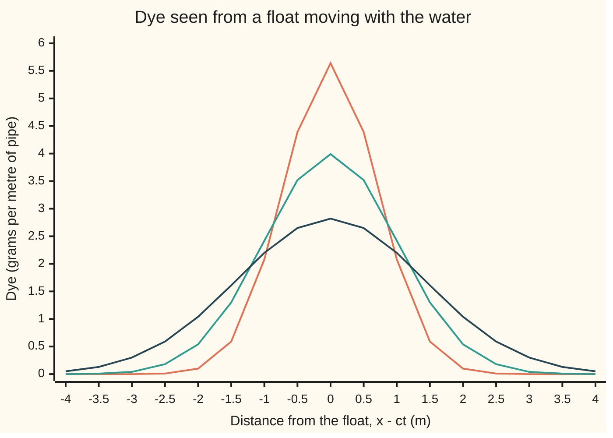
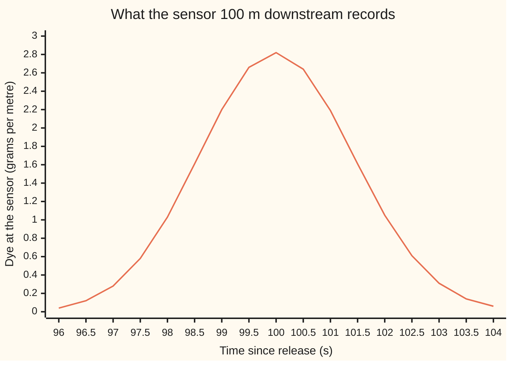

# Convection-diffusion: drift carries the quantity while spreading blurs it

[Syllabus](../../../SYLLABUS.md) → [Partial differential equations](../README.md) → [The Heat Equation in Depth](../README.md#s03) → Convection-diffusion

---

## General Overview

Wing 08 solved two equations apart. [The transport equation](../../08-Differential%20equations%20and%20dynamics/10-The%20Classical%20PDEs/02-the-transport-equation-and-characteristics.md) carries a shape along unchanged. [The heat kernel](../../08-Differential%20equations%20and%20dynamics/10-The%20Classical%20PDEs/10-the-heat-kernel.md) spreads a point into a bell curve. This card puts both in one equation and solves it by riding along with the flow.

A water main 5 cm across carries water at 1 m per second. A crew tips 10 g of dye in at one point to time the flow. A sensor sits 100 m downstream. When does the dye arrive, how strong is it, and for how long does it last?

The unknown is the dye's line density $`u(x, t)`$: grams of dye per metre of pipe, at place $`x`$ (metres downstream of the inlet) and time $`t`$ (seconds). The region is a long straight pipe, taken as the whole line, at every time after the release. The data are the 10 g, all at $`x = 0`$ at $`t = 0`$.

The water does two things to the dye at once:

- **Drift** (also called convection or advection): the flow carries the whole cloud downstream at 1 m/s.
- **Spreading** (diffusion): the flow is faster in the middle of the pipe than at the wall, and eddies mixing across the pipe turn that into a spreading along it, so the cloud blurs into a wider, lower bell.

Seen from a float drifting with the water, the drift disappears. The float sees only spreading, which is the heat equation. So the answer is the heat kernel's bell, slid downstream at 1 m/s.

At the sensor the bell's peak passes at **99.99 s**, with **2.82 g per metre** of pipe. The dye stays above half that strength for **3.33 s**.

**Convection-diffusion moves a quantity at the flow speed while it spreads like heat; in a frame moving with the flow it is exactly the heat equation, so its solution is the heat kernel's bell slid along at the flow speed, and the ratio of drift to spreading over a length, the Péclet number, says which one wins.**

**What kind of fact this is:** a theorem. For constant speed and constant diffusivity, the slid bell is a classical solution (one with all the derivatives the equation uses, continuous) at every $`t > 0`$, proved on this card in Why it works. It is the only solution that never goes negative and whose mass gathers to $`M`$ at $`x = 0`$ as $`t \to 0`$: Widder's theorem, stated on [Diffusion's maximum principle](04-maximum-principle-for-the-heat-equation.md), applied in the float's frame. The pipe description is a model: one speed and one effective spreading rate stand for a turbulent flow.

### The picture: what the float sees



Orange: 25 s after release, when the float is 25 m down the pipe; peak 5.64 g/m. Green: 50 s, 50 m down; peak 3.99 g/m. Dark blue: 100 s, at the sensor; peak 2.82 g/m. Each bell holds the same 10 g. The float never sees the dye move away, only blur.

---

## The formula

Notation. As in wing 08, a subscript names a partial derivative: $`u_t`$ is the rate of change of $`u`$ in time at a fixed place, $`u_x`$ the slope along the pipe at a fixed time, and $`u_{xx}`$ the slope of that slope, the curvature. The diffusivity $`\kappa`$ (kappa) is wing 08's spreading rate.

The **convection-diffusion equation**, with an optional steady leak:

```math
u_t + c\,u_x = \kappa\,u_{xx} - k\,u, \qquad u(x, 0) = M\,\delta(x).
```

Here $`\delta(x)`$ is the point mass of wing 08: all of $`M`$ at $`x = 0`$. Its solution on the whole line:

```math
u(x, t) = \frac{M\,e^{-kt}}{\sqrt{4\pi\kappa t}}\;\exp\!\left(-\frac{(x - ct)^2}{4\kappa t}\right), \qquad t > 0.
```

**Read it aloud:** the dye's change in time plus the flow carrying it past equals the spreading from curvature, minus what leaks away; and the answer is the heat kernel's bell, centred at $`ct`$ instead of at 0, shrunk by the leak.

This card introduces the **Péclet number**, the ratio of drift to spreading over a length $`L`$:

```math
\mathrm{Pe} = \frac{cL}{\kappa} = \frac{\text{time to spread over } L,\ L^2/\kappa}{\text{time to drift over } L,\ L/c}.
```

**Read it aloud:** Pe compares how long spreading needs to cross a length with how long the flow needs; a large Pe means the flow gets there first.

| Symbol | Plain meaning | In our example | Push it up and the answer… |
| --- | --- | --- | --- |
| $`u`$ | dye per metre of pipe, averaged across the pipe | 2.8209 g/m at the bell's centre at 100 s | — |
| $`x`$, $`t`$; $`u_t`$, $`u_x`$, $`u_{xx}`$ | place downstream of the inlet and time since release; the rate in time, the slope along the pipe and the curvature | metres and seconds | — |
| $`A`$, $`a`$; $`f`$, $`y`$ | a spread-out start $`f`$ along the pipe, with $`y`$ a point of it; the constants in a growth bound $`\Vert u\Vert \le A\,e^{ax^2}`$, inside which the answer from such a start is unique | not used for the dye, which starts at a point; A, a any fixed positive numbers | — |
| $`c`$ | the flow speed: the **drift** | 1 m/s | the bell arrives sooner |
| $`\kappa`$ | the effective **diffusivity**: how fast the flow spreads the dye along the pipe | 0.01 m²/s (illustrative) | a wider, lower bell: 2.4741 g/m at 0.013 m²/s |
| $`k`$ | a **leak**: the share of the dye lost per second, if it fades | 0 here; 0.01 per s in the leak check | every value scales by $`e^{-kt}`$: peak 1.0378 g/m at 100 s with 0.01 per s |
| $`M`$, $`\delta`$ | the dye released; the point mass that holds it all at one place | 10 g at $`x = 0`$ | every value scales with $`M`$ |
| $`\xi`$, $`w`$ | the **moving coordinate** $`\xi = x - ct`$ (xi): distance from the float; the dye as the float sees it, $`w(\xi, t) = u(\xi + ct, t)`$ | $`\xi = 0`$ is the bell's centre | — |
| $`\sigma`$ | the bell's **width**, its standard deviation $`\sqrt{2\kappa t}`$ | 1.4142 m at 100 s | grows like $`\sqrt{t}`$, not like $`t`$ |
| $`L`$, $`\mathrm{Pe}`$ | a distance of interest; the **Péclet number** $`cL/\kappa`$ | 100 m; 10,000 | drift wins more clearly |
| $`G`$ | wing 08's heat kernel $`G(\xi, t) = e^{-\xi^2/(4\kappa t)}/\sqrt{4\pi\kappa t}`$ | $`u = M\,G(x - ct, t)`$ | — |
| $`p`$, $`r`$, $`\tau`$, $`\mu`$, $`\lambda`$, $`s`$ | bond reading only: the bond price, the short rate, time to maturity; the rate's real-world drift $`\mu`$ and the market price of risk $`\lambda`$ (extra return asked per unit of risk), which make the pricing drift $`\mu + \lambda s`$; the rate's volatility $`s`$ | drift 0.003, $`s`$ = 0.01, $`r`$ = 0.04, per year | — |

### When it holds

- **Dye mixed evenly across the pipe.** The equation tracks one number per metre of pipe. Right after release the dye sits in one part of the cross-section, and the one-dimensional picture is wrong until eddies have mixed it across.
- **An effective $`\kappa`$, not the molecular one.** In a pipe, most spreading comes from the flow being faster in the middle than at the wall, combined with mixing across. Taylor's 1954 analysis gives $`10.1 \times \text{radius} \times \text{friction velocity}`$. At a Reynolds number of 50,000 (speed × diameter ÷ the water's viscosity of 1e-6 m²/s; this flow is turbulent), a smooth-pipe friction formula gives a friction velocity (a speed scale set by the drag at the wall) of 0.0514 m/s, so 0.0130 m²/s. This card's 0.01 m²/s is the same size. Dye's molecular diffusivity, about $`10^{-9}`$ m²/s, would give a bell 0.4472 mm wide.
- **One speed and one $`\kappa`$ everywhere.** The moving frame removes the drift only if the whole cloud moves at one speed. If the pipe narrows and the flow speeds up, the frame no longer fits. Then the drift-and-spread equations of [Fokker-Planck](09-fokker-planck-and-densities.md) are needed.
- **No walls in reach.** The whole-line kernel ignores ends. A closed end or a tank would reflect or store dye. When the bell reaches the sensor, the inlet is 100 m behind it, 70.71 widths.
- **Diffusion's instant reach is a model artefact.** The formula puts dye everywhere at once, even upstream: 1 m upstream after 1 s it gives $`1.05 \times 10^{-42}`$ g/m. Real dye has none there. The number is harmless, but it marks where the physics departs; see [Diffusion smooths instantly, and is felt everywhere at once](05-smoothing-and-infinite-speed.md).

---

## Why it works

### Step 0: ride with the water

Drift moves every part of the cloud by the same distance $`ct`$. Spreading depends only on the cloud's shape, not on where it is. So the two do not interfere. Follow a float moving at speed $`c`$: in its frame nothing drifts, and only the heat equation is left.

### Step 1: the chain rule removes the drift term

Write the dye as the float sees it: $`w(\xi, t) = u(\xi + ct, t)`$, with $`\xi = x - ct`$. Differentiate in $`t`$ with $`\xi`$ held still. The place $`x = \xi + ct`$ then moves at speed $`c`$, so the chain rule gives

```math
w_t = u_t + c\,u_x = \kappa\,u_{xx} - k\,u = \kappa\,w_{\xi\xi} - k\,w.
```

The middle step is the equation itself. The last step holds because $`\xi`$ and $`x`$ differ by an amount fixed at each time, so slopes in $`\xi`$ equal slopes in $`x`$. The term $`c\,u_x`$ has gone into the time derivative.

### Step 2: the leak is a steady shrink

If $`w`$ loses a share $`k`$ of itself each second, the product $`e^{kt}w`$ has the leak removed: its time derivative is $`e^{kt}(w_t + k\,w) = e^{kt}\kappa\,w_{\xi\xi}`$. So $`e^{kt}w`$ solves the plain heat equation $`(\cdot)_t = \kappa\,(\cdot)_{\xi\xi}`$. The leak changes no shape; it scales every value by $`e^{-kt}`$.

### Step 3: the heat kernel finishes the job

At $`t = 0`$ the frames agree, so $`e^{kt}w`$ starts as $`M\,\delta(\xi)`$. [The heat kernel](01-heat-kernel-and-fundamental-solution.md) says the heat equation turns a point mass $`M`$ into $`M\,G(\xi, t)`$, a bell of width $`\sqrt{2\kappa t}`$. Undo Step 2, then Step 1:

```math
u(x, t) = e^{-kt}\,M\,G(x - ct,\ t).
```

That is the formula. A start spread along the pipe, $`u(x, 0) = f(x)`$, works the same way: each piece of $`f`$ becomes its own slid bell, and $`u`$ is their sum, $`e^{-kt}\int f(y)\,G(x - ct - y,\ t)\,dy`$.

### Step 4: the answer is unique in the right class

Steps 1 and 2 turn any solution of this card's equation into one of the heat equation, and back. So uniqueness is settled in the float's frame with the leak removed. The two kinds of start need two different classes.

- **A spread-out start $`f`$**, continuous and below a bound $`A\,e^{ax^2}`$. Take two solutions with that start, both continuous down to $`t = 0`$ and below such a bound at all times up to some end time. Their difference solves the heat equation from zero, so it is zero, by [Diffusion's maximum principle](04-maximum-principle-for-the-heat-equation.md).
- **The point mass.** The slid bell is not in that class. Its peak, $`M/\sqrt{4\pi\kappa t}`$, grows without limit as $`t \to 0`$, and its start is not a continuous function. Widder's theorem, stated on the same card, covers it instead: a solution on the whole line that never goes negative is fixed by its start, here the mass $`M`$ gathered at $`x = 0`$. Dye per metre is never negative, so the slid bell is the only physical answer.

Without either condition, Tychonoff's example on [The heat kernel](01-heat-kernel-and-fundamental-solution.md) gives a second solution.

<details>
<summary>Detailed proof: the slid bell satisfies the equation, term by term</summary>

Write $`\xi = x - ct`$, the moving coordinate, and take $`k = 0`$; Step 2 restores the leak. Let

$`\displaystyle u = M\,(4\pi\kappa t)^{-1/2}\,e^{-\xi^2/(4\kappa t)}.`$

Differentiate the logarithm. With $`\partial \xi/\partial x = 1`$ and $`\partial \xi/\partial t = -c`$:

$`\displaystyle \frac{u_x}{u} = -\frac{\xi}{2\kappa t}, \qquad \frac{u_{xx}}{u} = \frac{\xi^2}{4\kappa^2 t^2} - \frac{1}{2\kappa t}.`$

$`\displaystyle \frac{u_t}{u} = -\frac{1}{2t} + \frac{\xi^2}{4\kappa t^2} + \frac{c\,\xi}{2\kappa t}.`$

The first two terms come from the bell's height and width changing with $`t`$. The third comes from $`\xi`$ moving, since $`-\partial_t\big(\xi^2/(4\kappa t)\big)`$ contains $`-2\xi(-c)/(4\kappa t)`$.

Now add $`c\,u_x/u = -c\,\xi/(2\kappa t)`$. The drift terms cancel:

$`\displaystyle \frac{u_t + c\,u_x}{u} = \frac{\xi^2}{4\kappa t^2} - \frac{1}{2t} = \kappa\,\frac{u_{xx}}{u}.`$

The mass is $`\int u\,dx = M`$ at every $`t > 0`$, because the bell integrates to 1 wherever its centre is. As $`t \to 0`$ the bell narrows onto $`x = 0`$, so the start is $`M\,\delta(x)`$. With the leak, multiply by $`e^{-kt}`$: the time derivative gains $`-k\,u`$, which is the leak term.

Uniqueness: Evans, chapter 2.3, proves that the heat equation's whole-line problem with zero data has only the zero solution among those with $`|u| \le A\,e^{ax^2}`$, on a short time interval, and then step by step for all times. Step 1's change of frame keeps the bound's form, because $`(\xi + ct)^2 \le 2\xi^2 + 2c^2t^2`$. That theorem needs solutions continuous down to $`t = 0`$, so it covers a spread-out start $`f`$. For the point mass, Widder (1944) proves that a solution on the line that never goes negative is a blend of bells against one fixed spread of mass: the one $`u`$ tends to as $`t \to 0`$. Here that is $`M`$ at $`x = 0`$, so $`u = M\,G(\xi, t)`$.

</details>

### Step 5: weigh drift against spreading

In time $`t`$, drift moves the cloud $`ct`$. Spreading widens it to $`\sqrt{2\kappa t}`$. The first grows like $`t`$, the second like $`\sqrt{t}`$. They are equal when $`ct = \sqrt{2\kappa t}`$, that is at

```math
t = \frac{2\kappa}{c^2} = \frac{2 \times 0.01}{1^2} = 0.02 \text{ s}, \quad \text{when both are } 0.02 \text{ m}.
```

Before that, spreading leads. After it, drift leads, and by more each second.

The Péclet number says the same for a fixed length. Over $`L = 100`$ m, the flow needs $`L/c = 100`$ s, and spreading alone would need $`L^2/\kappa = 1{,}000{,}000`$ s, about 11.57 days. The ratio is $`\mathrm{Pe} = 10{,}000`$. Over 2 cm, $`\mathrm{Pe} = 1 \times 0.02/0.01 = 2`$, and the two are comparable.

The rule: when $`\mathrm{Pe}`$ is much larger than 1, the cloud arrives as a narrow bell where the flow puts it. When it is much smaller than 1, the flow hardly matters.

### Step 6: the bond equation, read the same way

[A short-rate model](../../12-Financial%20mathematics/30-Short-Rate%20Models/01-the-term-structure-equation.md) derives, by hedging one bond with another, the equation every zero-coupon bond price $`p`$ satisfies. In the time left to maturity $`\tau`$ it reads

```math
p_\tau = (\mu + \lambda s)\,p_r + \tfrac12 s^2\,p_{rr} - r\,p.
```

Set beside this card's equation, written as $`u_t = -c\,u_x + \kappa\,u_{xx} - k\,u`$, each term has a role:

| Bond term | Role | Value at today's rate of 4% |
| --- | --- | --- |
| $`(\mu + \lambda s)\,p_r`$ | drift, with $`c = -(\mu + \lambda s)`$ | 0.003 per year, the pull toward 5% |
| $`\tfrac12 s^2\,p_{rr}`$ | spreading, with $`\kappa = \tfrac12 s^2`$ | 0.00005 per year |
| $`-r\,p`$ | leak, with $`k = r`$ | 0.04 per year |

So bond pricing is drift plus spreading plus a leak at the short rate. The difference from the pipe: there the drift and the leak depend on the rate itself, so one moving frame does not remove them. That card solves its example instead as an average over random rate paths, which has a closed form there.

---

## Worked numbers, by hand

The dye at the sensor, 100 m down, with $`c`$ = 1 m/s, $`\kappa`$ = 0.01 m²/s, $`M`$ = 10 g, no leak.

| Step | Arithmetic | Value |
| --- | --- | --- |
| time for the flow to reach the sensor | 100 / 1 | 100 s |
| $`4\kappa t`$ | 4 × 0.01 × 100 | 4.00 m² |
| bell's height factor | √(π × 4) | 3.5449 m |
| **peak line density** | 10 / 3.5449 | **2.8209 g/m** |
| width $`\sigma`$ | √(2 × 0.01 × 100) | 1.4142 m |
| one width off centre, at 101.4142 m | 2.8209 × e^(−1/2) | 1.7110 g/m |
| half-peak width in space | 2 × √(2 ln 2) × 1.4142 | 3.3302 m |
| half-peak time at the sensor, by the flow speed | 3.3302 / 1 | about 3.33 s |
| when the peak passes the sensor | −0.01 + √(0.01² + 1² × 100²), divided by 1² | **99.99 s** |
| Péclet number over 100 m | 1 × 100 / 0.01 | 10,000 |

The 99.99 s comes from setting the time slope of $`u(100, t)`$ to zero, which gives $`c^2t^2 + 2\kappa t - L^2 = 0`$. The sensor peaks 0.01 s early, at 2.8210 g/m, because the bell is still widening as it passes.

So 10 g of dye reaches the sensor as a bell 1.4142 m wide, above half its 2.82 g/m peak from 98.34 s to 101.67 s.

### What breaks if you drop a piece

| Mistake | Comes out at | What went wrong |
| --- | --- | --- |
| no drift: heat kernel centred at the inlet | about $`10^{-1085}`$ g/m at the sensor at 100 s (log10 = −1085.29) | the dye was never carried; its residual is −109.85 g/m/s at 0.1 m, 1 s |
| molecular diffusivity $`10^{-9}`$ m²/s | peak 8920.6 g/m, width 0.4472 mm | the eddies and the velocity profile do almost all the spreading |
| variance $`4\kappa t`$ instead of $`2\kappa t`$ | width 2.0000 m, not 1.4142 m | $`4\kappa t`$ sits in the exponent's denominator; the variance is half of it |
| slide by $`x + ct`$ | bell centred at −100 m, upstream of the inlet | the sign of the drift: the cloud goes where the water goes |

The checks print all four.

---

## Drift against spreading, as time runs

The puzzle: at first the dye spreads faster than it travels, yet it reaches the sensor as a narrow bell. Both hold, at different times.

| Time | Drift $`ct`$ | Width $`\sqrt{2\kappa t}`$ | Drift ÷ width |
| --- | --- | --- | --- |
| 0.005 s | 0.0050 m | 0.0100 m | 0.50 |
| 0.02 s | 0.0200 m | 0.0200 m | 1.00 |
| 1 s | 1.0000 m | 0.1414 m | 7.07 |
| 25 s | 25.0000 m | 0.7071 m | 35.36 |
| 100 s | 100.0000 m | 1.4142 m | 70.71 |

Quadruple the time and the drift quadruples, while the width only doubles. At 100 s, one force at a time:

```
drift  ct              |##################################################| 100.0000 m
width  sqrt(2 kappa t) |#                                                 |   1.4142 m
```

The combined picture is what the sensor records: the bell passing in a few seconds.



The single line is $`u(100, t)`$. It peaks at 2.82 g/m at 100 s. The tail after the peak is slightly longer than the lead before it: 0.06 g/m at 104 s against 0.04 at 96 s, because the later dye has had longer to spread.

---

## Code, from first principles, and it actually runs

The code takes three roads to the dye at the sensor. Road 1 is the closed form: the heat kernel slid at the flow speed. Road 2 is a random walk of 10,000 dye particles. Each takes 50 steps of 2 s, moving 2 m with the flow plus a random kick of standard size $`\sqrt{2\kappa \times 2\text{ s}}`$. The random numbers come from SplitMix64, a small generator written out with a fixed seed, so both languages print the same. Road 3 puts the closed form back into the equation by centred differences at two step sizes, and integrates it by Simpson's rule to recover the mass, mean and variance. A golden-section search (repeatedly narrowing an interval by the golden ratio) finds the sensor's peak time, against the formula. Bisection finds the half-peak times.

### Python

```python
# Convection-diffusion -- the check behind the card.  10 g of dye is dropped into
# water flowing at c = 1 m/s; the cross-section-averaged dye spreads along the pipe
# with effective diffusivity kappa = 0.01 m^2/s.  Road 1 is the heat kernel moved
# with the flow; road 2 is a random walk of 10,000 dye particles (SplitMix64 and
# Box-Muller, written out); road 3 puts the answer back into the PDE by centred
# differences and integrates it by Simpson's rule.  math gives exp, log, sqrt, cos.
from math import exp, log, log10, sqrt, cos, pi

C, KAP, M, L = 1.0, 0.01, 10.0, 100.0                # m/s, m^2/s, grams, metres to the sensor

def u(x, t, c=C, kap=KAP, k=0.0):                    # g per metre of pipe
    return M * exp(-k * t) / sqrt(4 * pi * kap * t) * exp(-(x - c * t) ** 2 / (4 * kap * t))

re = 1.0 * 0.05 / 1e-6; f = 0.316 * re ** -0.25; ustar = sqrt(f / 8)
print(f"pipe: Re = {re:.0f}, Blasius f = {f:.5f}, u* = {ustar:.4f} m/s, Taylor 10.1 a u* = {10.1 * 0.025 * ustar:.4f} m^2/s")
T = L / C; sig = sqrt(2 * KAP * T); peak = u(C * T, T)
print(f"t = {T:.0f} s: centre {C * T:.0f} m, 4 kappa t = {4 * KAP * T:.2f} m^2, width sqrt(2 kappa t) = {sig:.4f} m")
print(f"road 1, peak M / sqrt(4 pi kappa t) = {M:.0f} / {sqrt(4 * pi * KAP * T):.4f} = {peak:.4f} g/m")
print(f"one width off centre, x = {C * T + sig:.4f} m: {u(C * T + sig, T):.4f} g/m = peak x e^(-1/2)")
print(f"half-peak width 2 sqrt(2 ln 2) sigma = {2 * sqrt(2 * log(2)) * sig:.4f} m")

def simpson(g, a, b, n):
    h = (b - a) / n
    return h / 3 * (g(a) + g(b) + sum((4 if i % 2 else 2) * g(a + i * h) for i in range(1, n)))
for n in (400, 800):
    m0 = simpson(lambda x: u(x, T), 80, 120, n)
    m1 = simpson(lambda x: x * u(x, T), 80, 120, n) / m0
    m2 = simpson(lambda x: (x - m1) ** 2 * u(x, T), 80, 120, n) / m0
    print(f"road 3, Simpson n = {n}: mass {m0:.6f} g, mean {m1:.6f} m, variance {m2:.6f} m^2")
assert abs(m0 - M) < 1e-6 and abs(m1 - C * T) < 1e-6 and abs(m2 - 2 * KAP * T) < 1e-6

def res(x, t, h, k=0.0, c=C):                        # u_t + c u_x - kappa u_xx + k u
    g = lambda x, t: u(x, t, c, KAP, k)
    ut = (g(x, t + h) - g(x, t - h)) / (2 * h); ux = (g(x + h, t) - g(x - h, t)) / (2 * h)
    uxx = (g(x + h, t) - 2 * g(x, t) + g(x - h, t)) / h ** 2
    return ut + C * ux - KAP * uxx + k * g(x, t)
r1, r2 = res(101, T, 0.02), res(101, T, 0.01)
print(f"road 3, residual at 101 m, 100 s, in 1e-8 g/m/s: h = 0.02 {r1 * 1e8:+.3f}, h = 0.01 {r2 * 1e8:+.3f}, ratio {r1 / r2:.2f}")
assert abs(r1 / r2 - 4) < 0.1 and abs(r2) < 1e-5
rl = res(101, T, 0.01, k=0.01)
print(f"with a leak k = 0.01 /s: peak {u(C * T, T, k=0.01):.4f} g/m = {peak:.4f} x e^(-1), residual {rl * 1e8:+.3f} x 1e-8")
assert abs(rl) < 1e-5
rw = res(0.1, 1.0, 0.001, c=0.0)
print(f"mistake, heat kernel left at the inlet: residual at 0.1 m, 1 s = {rw:+.2f} g/m/s, not 0")
assert abs(rw) > 1

S = [0x2026_1115]                                    # SplitMix64 state, seed 0x20261115
def rnd():
    S[0] = (S[0] + 0x9E3779B97F4A7C15) & (2 ** 64 - 1); z = S[0]
    z = ((z ^ (z >> 30)) * 0xBF58476D1CE4E5B9) & (2 ** 64 - 1)
    z = ((z ^ (z >> 27)) * 0x94D049BB133111EB) & (2 ** 64 - 1)
    return ((z ^ (z >> 31)) >> 11) / 2 ** 53
N, STEPS, dt = 10000, 50, T / 50; xs = []
for p in range(N):
    x = 0.0
    for s in range(STEPS):
        z = sqrt(-2 * log(1 - rnd())) * cos(2 * pi * rnd())
        x += C * dt + sqrt(2 * KAP * dt) * z
    xs.append(x)
mean = sum(xs) / N; var = sum((x - mean) ** 2 for x in xs) / (N - 1)
inside = sum(1 for x in xs if abs(x - C * T) < sig) / N
print(f"road 2, {N} walkers x {STEPS} steps: mean {mean:.3f} m, variance {var:.3f} m^2, share within one width {inside:.4f}")
assert abs(mean - C * T) < 4 * sig / sqrt(N) and abs(var - sig ** 2) < 4 * sig ** 2 * sqrt(2 / N)
assert abs(inside - 0.6827) < 4 * sqrt(0.6827 * 0.3173 / N)

tp = (-KAP + sqrt(KAP ** 2 + C ** 2 * L ** 2)) / C ** 2
a, b = 95.0, 105.0; g = (sqrt(5) - 1) / 2
for _ in range(100):
    p, q = b - g * (b - a), a + g * (b - a)
    if u(L, p) > u(L, q): b = q
    else: a = p
print(f"sensor at {L:.0f} m: peak passes at {tp:.6f} s by formula, {(a + b) / 2:.6f} s by search, {u(L, tp):.4f} g/m")
assert abs((a + b) / 2 - tp) < 1e-5
def cross(lo, hi):                                   # bisection for u(L, t) = half the peak
    up = u(L, lo) < u(L, hi)
    for _ in range(80):
        m = (lo + hi) / 2
        if (u(L, m) < u(L, tp) / 2) == up: lo = m
        else: hi = m
    return m
t1, t2 = cross(90, tp), cross(tp, 110)
print(f"sensor above half its peak from {t1:.4f} s to {t2:.4f} s: {t2 - t1:.4f} s")
assert abs((t2 - t1) - 2 * sqrt(2 * log(2)) * sig / C) < 0.01
print(f"Peclet c L / kappa at {L:.0f} m = {C * L / KAP:.0f}, at 0.02 m = {C * 0.02 / KAP:.0f}; drift time {L / C:.0f} s, spreading time L^2/kappa = {L * L / KAP:.0f} s = {L * L / KAP / 86400:.2f} days")
tx = 2 * KAP / C ** 2
print(f"drift c t equals width sqrt(2 kappa t) at t = 2 kappa / c^2 = {tx:.2f} s, both {C * tx:.2f} m")
for ts in ("0.005", "0.02", "1", "25", "100"):
    t = float(ts); print(f"race, t = {ts} s: drift {C * t:.4f} m, width {sqrt(2 * KAP * t):.4f} m, ratio {C * t / sqrt(2 * KAP * t):.2f}")
print(f"mistake, no drift: at {L:.0f} m, {T:.0f} s, log10 u = {log10(M / sqrt(4 * pi * KAP * T)) - L * L / (4 * KAP * T) / log(10):.2f}")
print(f"mistake, molecular diffusivity 1e-9 m^2/s: width {sqrt(2e-9 * T) * 1000:.4f} mm, peak {u(L, T, kap=1e-9):.1f} g/m")
print(f"mistake, variance 4 kappa t: width {sqrt(4 * KAP * T):.4f} m, not {sig:.4f} m")
print(f"mistake, shift x + c t: centre at {-C * T:.0f} m, upstream of the inlet")
print(f"instant reach: 1 m upstream after 1 s, u = {u(-1, 1):.2e} g/m")
print(f"bond reading at r = 4%: drift 0.3(0.05 - 0.04) = {0.3 * 0.01:.3f}, spreading 0.01^2/2 = {0.01 ** 2 / 2:.5f}, leak r = {0.04:.2f}, per year")
for t in (25, 50, 100):
    print(f"chart, moving frame, t = {t} s: " + ", ".join(f"{u(C * t + z / 2, t):.2f}" for z in range(-8, 9)))
print("chart, sensor at 100 m, t = 96..104 s: " + ", ".join(f"{u(L, 96 + i / 2):.2f}" for i in range(17)))
print("ALL CHECKS PASS")
```

**Ran 2026-11-15 on macOS, Python 3.14.10, standard library only. All checks passed. Output, pasted from the run:**

```
pipe: Re = 50000, Blasius f = 0.02113, u* = 0.0514 m/s, Taylor 10.1 a u* = 0.0130 m^2/s
t = 100 s: centre 100 m, 4 kappa t = 4.00 m^2, width sqrt(2 kappa t) = 1.4142 m
road 1, peak M / sqrt(4 pi kappa t) = 10 / 3.5449 = 2.8209 g/m
one width off centre, x = 101.4142 m: 1.7110 g/m = peak x e^(-1/2)
half-peak width 2 sqrt(2 ln 2) sigma = 3.3302 m
road 3, Simpson n = 400: mass 10.000000 g, mean 100.000000 m, variance 2.000000 m^2
road 3, Simpson n = 800: mass 10.000000 g, mean 100.000000 m, variance 2.000000 m^2
road 3, residual at 101 m, 100 s, in 1e-8 g/m/s: h = 0.02 +28.527, h = 0.01 +7.131, ratio 4.00
with a leak k = 0.01 /s: peak 1.0378 g/m = 2.8209 x e^(-1), residual +13.430 x 1e-8
mistake, heat kernel left at the inlet: residual at 0.1 m, 1 s = -109.85 g/m/s, not 0
road 2, 10000 walkers x 50 steps: mean 100.013 m, variance 1.993 m^2, share within one width 0.6835
sensor at 100 m: peak passes at 99.990000 s by formula, 99.990001 s by search, 2.8210 g/m
sensor above half its peak from 98.3389 s to 101.6689 s: 3.3300 s
Peclet c L / kappa at 100 m = 10000, at 0.02 m = 2; drift time 100 s, spreading time L^2/kappa = 1000000 s = 11.57 days
drift c t equals width sqrt(2 kappa t) at t = 2 kappa / c^2 = 0.02 s, both 0.02 m
race, t = 0.005 s: drift 0.0050 m, width 0.0100 m, ratio 0.50
race, t = 0.02 s: drift 0.0200 m, width 0.0200 m, ratio 1.00
race, t = 1 s: drift 1.0000 m, width 0.1414 m, ratio 7.07
race, t = 25 s: drift 25.0000 m, width 0.7071 m, ratio 35.36
race, t = 100 s: drift 100.0000 m, width 1.4142 m, ratio 70.71
mistake, no drift: at 100 m, 100 s, log10 u = -1085.29
mistake, molecular diffusivity 1e-9 m^2/s: width 0.4472 mm, peak 8920.6 g/m
mistake, variance 4 kappa t: width 2.0000 m, not 1.4142 m
mistake, shift x + c t: centre at -100 m, upstream of the inlet
instant reach: 1 m upstream after 1 s, u = 1.05e-42 g/m
bond reading at r = 4%: drift 0.3(0.05 - 0.04) = 0.003, spreading 0.01^2/2 = 0.00005, leak r = 0.04, per year
chart, moving frame, t = 25 s: 0.00, 0.00, 0.00, 0.01, 0.10, 0.59, 2.08, 4.39, 5.64, 4.39, 2.08, 0.59, 0.10, 0.01, 0.00, 0.00, 0.00
chart, moving frame, t = 50 s: 0.00, 0.01, 0.04, 0.18, 0.54, 1.30, 2.42, 3.52, 3.99, 3.52, 2.42, 1.30, 0.54, 0.18, 0.04, 0.01, 0.00
chart, moving frame, t = 100 s: 0.05, 0.13, 0.30, 0.59, 1.04, 1.61, 2.20, 2.65, 2.82, 2.65, 2.20, 1.61, 1.04, 0.59, 0.30, 0.13, 0.05
chart, sensor at 100 m, t = 96..104 s: 0.04, 0.12, 0.28, 0.58, 1.03, 1.61, 2.20, 2.66, 2.82, 2.64, 2.19, 1.61, 1.05, 0.61, 0.31, 0.14, 0.06
ALL CHECKS PASS
```

### Rust

Same numbers, same labels, built with `rustc --edition 2021 -O`.

```rust
// Convection-diffusion -- the check behind the card, in Rust with std only.
// 10 g of dye in water flowing at c = 1 m/s, effective diffusivity 0.01 m^2/s.
// Road 1: the heat kernel moved with the flow.  Road 2: a random walk of 10,000
// particles (SplitMix64 and Box-Muller).  Road 3: centred-difference residuals
// and Simpson moments.  Same labels and digits as the Python check.
use std::f64::consts::PI;

const C: f64 = 1.0; const KAP: f64 = 0.01; const M: f64 = 10.0; const L: f64 = 100.0;

fn uk(x: f64, t: f64, c: f64, kap: f64, k: f64) -> f64 { // g per metre of pipe
    M * (-k * t).exp() / (4.0 * PI * kap * t).sqrt() * (-(x - c * t).powi(2) / (4.0 * kap * t)).exp()
}
fn u(x: f64, t: f64) -> f64 { uk(x, t, C, KAP, 0.0) }

fn simpson(g: &dyn Fn(f64) -> f64, a: f64, b: f64, n: usize) -> f64 {
    let h = (b - a) / n as f64;
    let mut s = g(a) + g(b);
    for i in 1..n { s += (if i % 2 == 1 { 4.0 } else { 2.0 }) * g(a + i as f64 * h); }
    h / 3.0 * s
}

fn res(x: f64, t: f64, h: f64, k: f64, c: f64) -> f64 { // u_t + c u_x - kappa u_xx + k u
    let g = |x: f64, t: f64| uk(x, t, c, KAP, k);
    let ut = (g(x, t + h) - g(x, t - h)) / (2.0 * h);
    let ux = (g(x + h, t) - g(x - h, t)) / (2.0 * h);
    let uxx = (g(x + h, t) - 2.0 * g(x, t) + g(x - h, t)) / (h * h);
    ut + C * ux - KAP * uxx + k * g(x, t)
}

struct Rng(u64);
impl Rng {
    fn next(&mut self) -> f64 { // SplitMix64, top 53 bits as a number in [0, 1)
        self.0 = self.0.wrapping_add(0x9E3779B97F4A7C15);
        let mut z = self.0;
        z = (z ^ (z >> 30)).wrapping_mul(0xBF58476D1CE4E5B9);
        z = (z ^ (z >> 27)).wrapping_mul(0x94D049BB133111EB);
        ((z ^ (z >> 31)) >> 11) as f64 / 9007199254740992.0
    }
}

fn main() {
    let re: f64 = 1.0 * 0.05 / 1e-6; let f = 0.316 * re.powf(-0.25); let ustar = (f / 8.0).sqrt();
    println!("pipe: Re = {:.0}, Blasius f = {:.5}, u* = {:.4} m/s, Taylor 10.1 a u* = {:.4} m^2/s", re, f, ustar, 10.1 * 0.025 * ustar);
    let t = L / C; let sig = (2.0 * KAP * t).sqrt(); let peak = u(C * t, t);
    println!("t = {:.0} s: centre {:.0} m, 4 kappa t = {:.2} m^2, width sqrt(2 kappa t) = {:.4} m", t, C * t, 4.0 * KAP * t, sig);
    println!("road 1, peak M / sqrt(4 pi kappa t) = {:.0} / {:.4} = {:.4} g/m", M, (4.0 * PI * KAP * t).sqrt(), peak);
    println!("one width off centre, x = {:.4} m: {:.4} g/m = peak x e^(-1/2)", C * t + sig, u(C * t + sig, t));
    println!("half-peak width 2 sqrt(2 ln 2) sigma = {:.4} m", 2.0 * (2.0 * 2f64.ln()).sqrt() * sig);

    let (mut m0, mut m1, mut m2) = (0.0, 0.0, 0.0);
    for n in [400usize, 800] {
        m0 = simpson(&|x| u(x, t), 80.0, 120.0, n);
        m1 = simpson(&|x| x * u(x, t), 80.0, 120.0, n) / m0;
        let mm = m1;
        m2 = simpson(&|x| (x - mm).powi(2) * u(x, t), 80.0, 120.0, n) / m0;
        println!("road 3, Simpson n = {}: mass {:.6} g, mean {:.6} m, variance {:.6} m^2", n, m0, m1, m2);
    }
    assert!((m0 - M).abs() < 1e-6 && (m1 - C * t).abs() < 1e-6 && (m2 - 2.0 * KAP * t).abs() < 1e-6);

    let (r1, r2) = (res(101.0, t, 0.02, 0.0, C), res(101.0, t, 0.01, 0.0, C));
    println!("road 3, residual at 101 m, 100 s, in 1e-8 g/m/s: h = 0.02 {:+.3}, h = 0.01 {:+.3}, ratio {:.2}", r1 * 1e8, r2 * 1e8, r1 / r2);
    assert!((r1 / r2 - 4.0).abs() < 0.1 && r2.abs() < 1e-5);
    let rl = res(101.0, t, 0.01, 0.01, C); let pl = uk(C * t, t, C, KAP, 0.01);
    println!("with a leak k = 0.01 /s: peak {:.4} g/m = {:.4} x e^(-1), residual {:+.3} x 1e-8", pl, peak, rl * 1e8);
    assert!(rl.abs() < 1e-5);
    let rw = res(0.1, 1.0, 0.001, 0.0, 0.0);
    println!("mistake, heat kernel left at the inlet: residual at 0.1 m, 1 s = {:+.2} g/m/s, not 0", rw);
    assert!(rw.abs() > 1.0);

    let mut rng = Rng(0x2026_1115);
    let (n, steps) = (10000usize, 50usize); let dt = t / steps as f64; let mut xs = Vec::with_capacity(n);
    for _ in 0..n {
        let mut x = 0.0;
        for _ in 0..steps {
            let a = rng.next(); let b = rng.next();
            let z = (-2.0 * (1.0 - a).ln()).sqrt() * (2.0 * PI * b).cos();
            x += C * dt + (2.0 * KAP * dt).sqrt() * z;
        }
        xs.push(x);
    }
    let nf = n as f64;
    let mean = xs.iter().sum::<f64>() / nf;
    let var = xs.iter().map(|x| (x - mean).powi(2)).sum::<f64>() / (nf - 1.0);
    let inside = xs.iter().filter(|x| (*x - C * t).abs() < sig).count() as f64 / nf;
    println!("road 2, {} walkers x {} steps: mean {:.3} m, variance {:.3} m^2, share within one width {:.4}", n, steps, mean, var, inside);
    assert!((mean - C * t).abs() < 4.0 * sig / nf.sqrt() && (var - sig * sig).abs() < 4.0 * sig * sig * (2.0 / nf).sqrt());
    assert!((inside - 0.6827).abs() < 4.0 * (0.6827f64 * 0.3173 / nf).sqrt());

    let tp = (-KAP + (KAP * KAP + C * C * L * L).sqrt()) / (C * C);
    let (mut a, mut b) = (95.0f64, 105.0f64); let g = (5f64.sqrt() - 1.0) / 2.0;
    for _ in 0..100 {
        let (p, q) = (b - g * (b - a), a + g * (b - a));
        if u(L, p) > u(L, q) { b = q } else { a = p }
    }
    println!("sensor at {:.0} m: peak passes at {:.6} s by formula, {:.6} s by search, {:.4} g/m", L, tp, (a + b) / 2.0, u(L, tp));
    assert!(((a + b) / 2.0 - tp).abs() < 1e-5);
    let cross = |mut lo: f64, mut hi: f64| { // bisection for u(L, t) = half the peak
        let up = u(L, lo) < u(L, hi); let mut m = lo;
        for _ in 0..80 { m = (lo + hi) / 2.0; if (u(L, m) < u(L, tp) / 2.0) == up { lo = m } else { hi = m } }
        m
    };
    let (t1, t2) = (cross(90.0, tp), cross(tp, 110.0));
    println!("sensor above half its peak from {:.4} s to {:.4} s: {:.4} s", t1, t2, t2 - t1);
    assert!(((t2 - t1) - 2.0 * (2.0 * 2f64.ln()).sqrt() * sig / C).abs() < 0.01);
    println!("Peclet c L / kappa at {:.0} m = {:.0}, at 0.02 m = {:.0}; drift time {:.0} s, spreading time L^2/kappa = {:.0} s = {:.2} days", L, C * L / KAP, C * 0.02 / KAP, L / C, L * L / KAP, L * L / KAP / 86400.0);
    let tx = 2.0 * KAP / (C * C);
    println!("drift c t equals width sqrt(2 kappa t) at t = 2 kappa / c^2 = {:.2} s, both {:.2} m", tx, C * tx);
    for ts in ["0.005", "0.02", "1", "25", "100"] {
        let tt: f64 = ts.parse().unwrap();
        println!("race, t = {} s: drift {:.4} m, width {:.4} m, ratio {:.2}", ts, C * tt, (2.0 * KAP * tt).sqrt(), C * tt / (2.0 * KAP * tt).sqrt());
    }
    println!("mistake, no drift: at {:.0} m, {:.0} s, log10 u = {:.2}", L, t, (M / (4.0 * PI * KAP * t).sqrt()).log10() - L * L / (4.0 * KAP * t) / 10f64.ln());
    println!("mistake, molecular diffusivity 1e-9 m^2/s: width {:.4} mm, peak {:.1} g/m", (2e-9 * t).sqrt() * 1000.0, uk(L, t, C, 1e-9, 0.0));
    println!("mistake, variance 4 kappa t: width {:.4} m, not {:.4} m", (4.0 * KAP * t).sqrt(), sig);
    println!("mistake, shift x + c t: centre at {:.0} m, upstream of the inlet", -C * t);
    println!("instant reach: 1 m upstream after 1 s, u = {:.2e} g/m", u(-1.0, 1.0));
    println!("bond reading at r = 4%: drift 0.3(0.05 - 0.04) = {:.3}, spreading 0.01^2/2 = {:.5}, leak r = {:.2}, per year", 0.3 * 0.01, 0.01f64.powi(2) / 2.0, 0.04);
    for tt in [25.0f64, 50.0, 100.0] {
        let pts: Vec<String> = (-8..=8).map(|z| format!("{:.2}", u(C * tt + z as f64 / 2.0, tt))).collect();
        println!("chart, moving frame, t = {:.0} s: {}", tt, pts.join(", "));
    }
    let pts: Vec<String> = (0..17).map(|i| format!("{:.2}", u(L, 96.0 + i as f64 / 2.0))).collect();
    println!("chart, sensor at 100 m, t = 96..104 s: {}", pts.join(", "));
    println!("ALL CHECKS PASS");
}
```

**Ran 2026-11-15 on macOS, rustc 1.98.1, no crates. All checks passed. Output, pasted from the run:**

```
pipe: Re = 50000, Blasius f = 0.02113, u* = 0.0514 m/s, Taylor 10.1 a u* = 0.0130 m^2/s
t = 100 s: centre 100 m, 4 kappa t = 4.00 m^2, width sqrt(2 kappa t) = 1.4142 m
road 1, peak M / sqrt(4 pi kappa t) = 10 / 3.5449 = 2.8209 g/m
one width off centre, x = 101.4142 m: 1.7110 g/m = peak x e^(-1/2)
half-peak width 2 sqrt(2 ln 2) sigma = 3.3302 m
road 3, Simpson n = 400: mass 10.000000 g, mean 100.000000 m, variance 2.000000 m^2
road 3, Simpson n = 800: mass 10.000000 g, mean 100.000000 m, variance 2.000000 m^2
road 3, residual at 101 m, 100 s, in 1e-8 g/m/s: h = 0.02 +28.527, h = 0.01 +7.131, ratio 4.00
with a leak k = 0.01 /s: peak 1.0378 g/m = 2.8209 x e^(-1), residual +13.430 x 1e-8
mistake, heat kernel left at the inlet: residual at 0.1 m, 1 s = -109.85 g/m/s, not 0
road 2, 10000 walkers x 50 steps: mean 100.013 m, variance 1.993 m^2, share within one width 0.6835
sensor at 100 m: peak passes at 99.990000 s by formula, 99.990001 s by search, 2.8210 g/m
sensor above half its peak from 98.3389 s to 101.6689 s: 3.3300 s
Peclet c L / kappa at 100 m = 10000, at 0.02 m = 2; drift time 100 s, spreading time L^2/kappa = 1000000 s = 11.57 days
drift c t equals width sqrt(2 kappa t) at t = 2 kappa / c^2 = 0.02 s, both 0.02 m
race, t = 0.005 s: drift 0.0050 m, width 0.0100 m, ratio 0.50
race, t = 0.02 s: drift 0.0200 m, width 0.0200 m, ratio 1.00
race, t = 1 s: drift 1.0000 m, width 0.1414 m, ratio 7.07
race, t = 25 s: drift 25.0000 m, width 0.7071 m, ratio 35.36
race, t = 100 s: drift 100.0000 m, width 1.4142 m, ratio 70.71
mistake, no drift: at 100 m, 100 s, log10 u = -1085.29
mistake, molecular diffusivity 1e-9 m^2/s: width 0.4472 mm, peak 8920.6 g/m
mistake, variance 4 kappa t: width 2.0000 m, not 1.4142 m
mistake, shift x + c t: centre at -100 m, upstream of the inlet
instant reach: 1 m upstream after 1 s, u = 1.05e-42 g/m
bond reading at r = 4%: drift 0.3(0.05 - 0.04) = 0.003, spreading 0.01^2/2 = 0.00005, leak r = 0.04, per year
chart, moving frame, t = 25 s: 0.00, 0.00, 0.00, 0.01, 0.10, 0.59, 2.08, 4.39, 5.64, 4.39, 2.08, 0.59, 0.10, 0.01, 0.00, 0.00, 0.00
chart, moving frame, t = 50 s: 0.00, 0.01, 0.04, 0.18, 0.54, 1.30, 2.42, 3.52, 3.99, 3.52, 2.42, 1.30, 0.54, 0.18, 0.04, 0.01, 0.00
chart, moving frame, t = 100 s: 0.05, 0.13, 0.30, 0.59, 1.04, 1.61, 2.20, 2.65, 2.82, 2.65, 2.20, 1.61, 1.04, 0.59, 0.30, 0.13, 0.05
chart, sensor at 100 m, t = 96..104 s: 0.04, 0.12, 0.28, 0.58, 1.03, 1.61, 2.20, 2.66, 2.82, 2.64, 2.19, 1.61, 1.05, 0.61, 0.31, 0.14, 0.06
ALL CHECKS PASS
```

The two outputs match line for line. The walk lands within its standard error of the bell: mean 100.013 m, variance 1.993 m², and 68.35% within one width. The residual falls by a factor of 4.00 when the step halves, as centred differences should.

### Lean

Lean proves that the slid bell solves the equation, the float's change of frame, and the bell's mass, for any $`c`$, $`k`$ and $`M`$.

- Take $`\kappa > 0`$. Then the slid bell is a classical solution of the equation at every $`t > 0`$.
- Suppose $`u`$ is differentiable and solves the equation for $`t > 0`$. Then $`e^{kt}u(\xi + ct, t)`$ solves the plain heat equation in $`\xi`$ and $`t`$.
- Take $`\kappa > 0`$ and $`t > 0`$. Then the slid bell holds mass $`M\,e^{-kt}`$ along the whole line, wherever its centre $`ct`$ sits.
- The drift time, $`4\kappa t`$, the Péclet numbers, the 0.02 s balance point and the bond terms also check, in exact fractions.

The sensor's peak and half-peak times, the random walk and the decimal values are left to the Python and Rust checks.

```lean
-- Convection-diffusion: the heat kernel's bell slid along at the flow speed and shrunk by the leak solves u_t + c u_x = κ u_xx - k u for t > 0, holds mass M e^(-kt), and in a frame moving with the flow the equation is exactly the heat equation.
import Mathlib.Analysis.SpecialFunctions.Gaussian.GaussianIntegral
import Mathlib.Analysis.SpecialFunctions.Sqrt
import Mathlib.Analysis.SpecialFunctions.ExpDeriv
import Mathlib.Analysis.Calculus.FDeriv.Prod

open Real MeasureTheory

/-- The slid bell: `M e^(-kt) / √(4πκt) · exp(-(x - ct)² / (4κt))`, the heat kernel's bell
centred at `ct` instead of 0, scaled by the leak. -/
noncomputable def slidBell (M c κ k x t : ℝ) : ℝ :=
  M * exp (-k * t) / √(4 * π * κ * t) * exp (-(x - c * t) ^ 2 / (4 * κ * t))

/-- Main claim. For constant speed `c` and constant diffusivity `κ > 0` (and any leak `k`
and mass `M`), the slid bell is a classical solution of the convection-diffusion equation
`u_t + c u_x = κ u_xx - k u` at every place `x` and every time `t > 0`: it is twice
continuously differentiable on the half-plane `t > 0`, and the equation holds there. -/
theorem slid_bell_solves_convection_diffusion (M c κ k : ℝ) (hκ : 0 < κ) :
    ContDiffOn ℝ 2 (fun p : ℝ × ℝ => slidBell M c κ k p.1 p.2) {p | 0 < p.2} ∧
    ∀ x t : ℝ, 0 < t →
      deriv (fun s => slidBell M c κ k x s) t
          + c * deriv (fun y => slidBell M c κ k y t) x
        = κ * deriv (fun y => deriv (fun z => slidBell M c κ k z t) y) x
          - k * slidBell M c κ k x t := by
  refine ⟨?_, ?_⟩
  · unfold slidBell
    have h1 : ∀ p ∈ {p : ℝ × ℝ | 0 < p.2}, (4 * π * κ * p.2) ≠ 0 := by
      intro p hp; simp only [Set.mem_ofPred_eq] at hp; positivity
    have h2 : ∀ p ∈ {p : ℝ × ℝ | 0 < p.2}, √(4 * π * κ * p.2) ≠ 0 := by
      intro p hp; simp only [Set.mem_ofPred_eq] at hp; positivity
    have h3 : ∀ p ∈ {p : ℝ × ℝ | 0 < p.2}, (4 * κ * p.2) ≠ 0 := by
      intro p hp; simp only [Set.mem_ofPred_eq] at hp; positivity
    apply ContDiffOn.mul
    · apply ContDiffOn.div _ _ h2
      · fun_prop
      · exact ContDiffOn.sqrt (by fun_prop) h1
    · apply ContDiffOn.exp
      apply ContDiffOn.div _ _ h3 <;> fun_prop
  · intro x t ht
    set S := √(4 * π * κ * t) with hSdef
    have hS : 0 < S := Real.sqrt_pos.mpr (by positivity)
    have hS2 : S ^ 2 = 4 * π * κ * t := Real.sq_sqrt (by positivity)
    set A := M * exp (-k * t) / S with hA
    -- space derivatives
    have hx1 : ∀ y, HasDerivAt (fun z => slidBell M c κ k z t)
        (A * (exp (-(y - c * t) ^ 2 / (4 * κ * t)) * (-(2 * (y - c * t)) / (4 * κ * t)))) y := by
      intro y
      have hg : HasDerivAt (fun z => -(z - c * t) ^ 2 / (4 * κ * t))
          (-(2 * (y - c * t)) / (4 * κ * t)) y := by
        have := (((hasDerivAt_id' y).sub_const (c * t)).pow 2).neg.div_const (4 * κ * t)
        convert this using 1; simp
      exact (hg.exp).const_mul A
    have hd1 : deriv (fun y => deriv (fun z => slidBell M c κ k z t) y) x
        = A * (exp (-(x - c * t) ^ 2 / (4 * κ * t)) *
            ((2 * (x - c * t) / (4 * κ * t)) ^ 2 - 2 / (4 * κ * t))) := by
      have hfun : (fun y => deriv (fun z => slidBell M c κ k z t) y)
          = fun y => A * (exp (-(y - c * t) ^ 2 / (4 * κ * t)) * (-(2 * (y - c * t)) / (4 * κ * t))) := by
        funext y; exact (hx1 y).deriv
      rw [hfun]
      have hg : HasDerivAt (fun z => -(z - c * t) ^ 2 / (4 * κ * t))
          (-(2 * (x - c * t)) / (4 * κ * t)) x := by
        have := (((hasDerivAt_id' x).sub_const (c * t)).pow 2).neg.div_const (4 * κ * t)
        convert this using 1; simp
      have hl : HasDerivAt (fun z => -(2 * (z - c * t)) / (4 * κ * t)) (-2 / (4 * κ * t)) x := by
        have := (((hasDerivAt_id' x).sub_const (c * t)).const_mul 2).neg.div_const (4 * κ * t)
        convert this using 1; simp
      refine ((hg.exp.mul hl).const_mul A).deriv.trans ?_
      ring
    -- time derivative
    have hsq : HasDerivAt (fun s => √(4 * π * κ * s)) (S / (2 * t)) t := by
      have h := ((hasDerivAt_id' t).const_mul (4 * π * κ)).sqrt
        (by show 4 * π * κ * t ≠ 0; positivity)
      convert h using 1
      rw [← hSdef]
      field_simp
      linear_combination hS2
    have hP : HasDerivAt (fun s => M * exp (-k * s)) (M * (exp (-k * t) * (-k))) t := by
      have := (((hasDerivAt_id' t).const_mul (-k)).exp).const_mul M
      simpa using this
    have hg : HasDerivAt (fun s => -(x - c * s) ^ 2 / (4 * κ * s))
        ((2 * c * (x - c * t) * (4 * κ * t) + (x - c * t) ^ 2 * (4 * κ)) / (4 * κ * t) ^ 2) t := by
      have hn := ((((hasDerivAt_id' t).const_mul c).const_sub x).pow 2).neg
      have hd := (hasDerivAt_id' t).const_mul (4 * κ)
      have := hn.div hd (by show 4 * κ * t ≠ 0; positivity)
      convert this using 1
      simp; ring
    have ht1 := ((hP.div hsq hS.ne').mul hg.exp)
    have hdt : deriv (fun s => slidBell M c κ k x s) t
        = (M * (exp (-k * t) * (-k)) * S - M * exp (-k * t) * (S / (2 * t))) / S ^ 2
            * exp (-(x - c * t) ^ 2 / (4 * κ * t))
          + M * exp (-k * t) / S * (exp (-(x - c * t) ^ 2 / (4 * κ * t)) *
            ((2 * c * (x - c * t) * (4 * κ * t) + (x - c * t) ^ 2 * (4 * κ)) / (4 * κ * t) ^ 2)) :=
      ht1.deriv
    rw [hdt, (hx1 x).deriv, hd1]
    unfold slidBell
    rw [← hSdef, ← hA]
    rw [hA]
    field_simp
    ring

/-- Riding with the flow. If `u` is differentiable at every point with `t > 0` and solves
`u_t + c u_x = κ u_xx - k u` there, then in the moving coordinate `ξ = x - ct`, with the leak
removed, `v(ξ, t) = e^(kt) u(ξ + ct, t)` solves exactly the heat equation `v_t = κ v_ξξ`. -/
theorem moving_frame_gives_heat_equation (u : ℝ → ℝ → ℝ) (c κ k : ℝ)
    (hdiff : ∀ x t : ℝ, 0 < t → DifferentiableAt ℝ (fun p : ℝ × ℝ => u p.1 p.2) (x, t))
    (heq : ∀ x t : ℝ, 0 < t →
      deriv (fun s => u x s) t + c * deriv (fun y => u y t) x
        = κ * deriv (fun y => deriv (fun z => u z t) y) x - k * u x t) :
    ∀ ξ t : ℝ, 0 < t →
      deriv (fun s => exp (k * s) * u (ξ + c * s) s) t
        = κ * deriv (fun η => deriv (fun ζ => exp (k * t) * u (ζ + c * t) t) η) ξ := by
  intro ξ t ht
  set F : ℝ × ℝ → ℝ := fun p => u p.1 p.2 with hF
  have hd := (hdiff (ξ + c * t) t ht).hasFDerivAt
  set L := fderiv ℝ F (ξ + c * t, t)
  -- partial derivatives
  have hpt : HasDerivAt (fun s => u (ξ + c * t) s) (L (0, 1)) t := by
    have h1 : HasDerivAt (fun s : ℝ => ((ξ + c * t, s) : ℝ × ℝ)) ((0, 1) : ℝ × ℝ) t :=
      (hasDerivAt_const t (ξ + c * t)).prodMk (hasDerivAt_id t)
    exact hd.comp_hasDerivAt t h1
  have hpx : HasDerivAt (fun y => u y t) (L (1, 0)) (ξ + c * t) := by
    have h1 : HasDerivAt (fun y : ℝ => ((y, t) : ℝ × ℝ)) ((1, 0) : ℝ × ℝ) (ξ + c * t) :=
      (hasDerivAt_id (ξ + c * t)).prodMk (hasDerivAt_const (ξ + c * t) t)
    exact hd.comp_hasDerivAt (ξ + c * t) h1
  have hpath : HasDerivAt (fun s => u (ξ + c * s) s) (L (c, 1)) t := by
    have h1 : HasDerivAt (fun s : ℝ => ((ξ + c * s, s) : ℝ × ℝ)) ((c, 1) : ℝ × ℝ) t := by
      have := (((hasDerivAt_id t).const_mul c).const_add ξ).prodMk (hasDerivAt_id t)
      simpa using this
    exact HasFDerivAt.comp_hasDerivAt (f := fun s : ℝ => ((ξ + c * s, s) : ℝ × ℝ)) t hd h1
  have hL : L (c, 1) = c * L (1, 0) + L (0, 1) := by
    have : ((c, 1) : ℝ × ℝ) = c • ((1, 0) : ℝ × ℝ) + ((0, 1) : ℝ × ℝ) := by
      ext <;> simp
    rw [this, map_add, map_smul, smul_eq_mul]
  have hlhs : deriv (fun s => exp (k * s) * u (ξ + c * s) s) t
      = k * exp (k * t) * u (ξ + c * t) t + exp (k * t) * L (c, 1) := by
    have he : HasDerivAt (fun s => exp (k * s)) (exp (k * t) * k) t := by
      simpa using ((hasDerivAt_id t).const_mul k).exp
    exact (he.mul hpath).deriv.trans (by ring)
  have hrhs : deriv (fun η => deriv (fun ζ => exp (k * t) * u (ζ + c * t) t) η) ξ
      = exp (k * t) * deriv (fun y => deriv (fun z => u z t) y) (ξ + c * t) := by
    have : (fun η => deriv (fun ζ => exp (k * t) * u (ζ + c * t) t) η)
        = fun η => exp (k * t) * deriv (fun z => u z t) (η + c * t) := by
      funext η
      rw [deriv_const_mul_field']
      beta_reduce
      rw [deriv_comp_add_const (fun z => u z t)]
    rw [this, deriv_const_mul_field']
    beta_reduce
    rw [deriv_comp_add_const (fun y => deriv (fun z => u z t) y)]
  have hpde := heq (ξ + c * t) t ht
  rw [hpt.deriv, hpx.deriv] at hpde
  rw [hlhs, hrhs, hL]
  linear_combination exp (k * t) * hpde

/-- Each bell holds the same dye: for `κ > 0` and `t > 0`, the slid bell's total mass along
the whole line is `M e^(-kt)`, wherever its centre `ct` sits (just `M` with no leak). -/
theorem slid_bell_mass (M c κ k t : ℝ) (hκ : 0 < κ) (ht : 0 < t) :
    ∫ x : ℝ, slidBell M c κ k x t = M * exp (-k * t) := by
  unfold slidBell
  rw [integral_const_mul]
  have h1 : (∫ x : ℝ, exp (-(x - c * t) ^ 2 / (4 * κ * t)))
      = ∫ x : ℝ, exp (-(1 / (4 * κ * t)) * x ^ 2) := by
    rw [← integral_sub_right_eq_self (fun x : ℝ => exp (-(1 / (4 * κ * t)) * x ^ 2)) (c * t)]
    congr 1; funext x; congr 1; ring
  rw [h1, integral_gaussian]
  have h2 : π / (1 / (4 * κ * t)) = 4 * π * κ * t := by field_simp
  rw [h2]
  have : 0 < √(4 * π * κ * t) := Real.sqrt_pos.mpr (by positivity)
  field_simp

-- The dye in the pipe, c = 1 m/s, κ = 1/100 m²/s, L = 100 m, exact rationals.
-- Drift time L / c = 100 s.
example : (100 : ℚ) / 1 = 100 := by norm_num
-- 4κt at t = 100 s is 4 m², and the width squared 2κt is 2 m² (the variance 2.000000 m²).
example : 4 * ((1 : ℚ) / 100) * 100 = 4 ∧ 2 * ((1 : ℚ) / 100) * 100 = 2 := by norm_num
-- Péclet number cL/κ over 100 m is 10,000; over 2 cm (1/50 m) it is 2.
example : (1 : ℚ) * 100 / (1 / 100) = 10000 ∧ (1 : ℚ) * (1 / 50) / (1 / 100) = 2 := by norm_num
-- Spreading time L²/κ over 100 m is 1,000,000 s.
example : (100 : ℚ) ^ 2 / (1 / 100) = 1000000 := by norm_num
-- Drift ct equals width √(2κt) at t = 2κ/c² = 1/50 s, when both are 1/50 m (0.02 m).
example : 2 * ((1 : ℚ) / 100) / 1 ^ 2 = 1 / 50 ∧ (1 : ℚ) * (1 / 50) = 1 / 50 ∧
    (1 / 50 : ℚ) ^ 2 = 2 * (1 / 100) * (1 / 50) := by norm_num
-- Bond reading at r = 4%: drift 3/10 · (5/100 - 4/100) = 3/1000, spreading (1/100)²/2 = 1/20000.
example : (3 / 10 : ℚ) * (5 / 100 - 4 / 100) = 3 / 1000 ∧ ((1 : ℚ) / 100) ^ 2 / 2 = 1 / 20000 := by
  norm_num

#print axioms slid_bell_solves_convection_diffusion
#print axioms moving_frame_gives_heat_equation
#print axioms slid_bell_mass
```

**Checked 2026-11-15 on macOS, Lean 4.36.0-rc2, Mathlib v4.36.0-rc2. Every proof is complete and uses only Lean's standard axioms. Output, pasted from the run:**

```
'slid_bell_solves_convection_diffusion' depends on axioms: [propext, Classical.choice, Quot.sound]
'moving_frame_gives_heat_equation' depends on axioms: [propext, Classical.choice, Quot.sound]
'slid_bell_mass' depends on axioms: [propext, Classical.choice, Quot.sound]
```

> [!TIP]
> **Try changing**
> Guess first, then run it.
> - **Taylor's own value.** Set `KAP` to `0.013` in both files. Guess the new peak first. It falls to 2.4741 g/m, the bell widens to 1.6125 m, and the dye stays above half its peak for 3.7967 s. All checks still pass.
> - **Drop the drift from the walk.** In the walker loop, delete `C * dt +` (Rust: `C * dt +` in the same line). Where do the particles end up? Near 0 m, not 100 m, and the walk's assert stops the run.
> - **Another seed.** Change `0x2026_1115` to `12345`. The walk gives mean 99.979 m, variance 2.017 m² and 67.51% within one width. The numbers move by about one standard error, and every assert still passes.

---

## The usual mistake

> [!warning]
> **Using the molecular diffusivity of the dye.** Dye molecules alone spread at about $`10^{-9}`$ m²/s. With that value the bell at the sensor would be 0.4472 mm wide, with a peak of 8920.6 g/m. In a real pipe the velocity profile and the eddies do the spreading, at about 0.01 m²/s here, and the bell is 1.4142 m wide with a peak of 2.8209 g/m.
>
> - **Solving the heat equation at a fixed place.** Without the slide, the bell stays at the inlet. At the sensor at 100 s it gives about $`10^{-1085}`$ g/m: no dye at all.
> - **Mixing up $`4\kappa t`$ and the variance.** The variance is $`2\kappa t`$. Using $`4\kappa t`$ gives a width of 2.0000 m instead of 1.4142 m.
> - **Sliding the wrong way.** $`x + ct`$ puts the cloud at −100 m, upstream of the inlet.
> - **Treating the width as growing steadily.** Width grows like $`\sqrt{t}`$. At 25 s it is 0.7071 m, so four times as long, 100 s, only doubles it.

---

## Where you meet it in real life

- **Tracer tests in water mains and rivers.** Engineers release dye or salt and record it downstream. The arrival time gives the flow speed, and the width of the recorded bell gives the effective $`\kappa`$.
- **Spills in a river.** After a chemical spill, the same bell predicts when the cloud reaches a water intake downstream, and how strong it will be.
- **Heat carried by a flow.** In a heated pipe or a heat exchanger, temperature obeys the same equation: the flow carries heat while conduction spreads it. The Péclet number decides whether a short pipe section needs to model conduction along the flow at all.
- **Bond and option pricing.** The term-structure equation is drift plus spreading plus a leak at the short rate (Step 6). The Black-Scholes equation has the same three parts, and the next card removes its drift and its leak.

> **Say it back**
> The convection-diffusion equation moves a quantity at the flow speed while it spreads like heat. In a frame riding with the flow the drift vanishes, and a leak only scales every value by $`e^{-kt}`$. So the answer is the heat kernel's bell slid along at speed $`c`$. The 10 g of dye reaches the sensor 100 m down as a bell 1.41 m wide, peaking at 2.82 g/m at 99.99 s. The Péclet number $`cL/\kappa`$, here 10,000, says that over long distances drift wins, while below about 2 cm spreading matters as much.

---

## What this builds on

- [The heat kernel](01-heat-kernel-and-fundamental-solution.md): the bell $`G(\xi, t)`$ that solves the heat equation from a point, and the growth class in which a spread-out start's answer is unique. This card slides it.
- [A short-rate model](../../12-Financial%20mathematics/30-Short-Rate%20Models/01-the-term-structure-equation.md): the bond equation, derived by hedging and solved there as an average. This card reads its three terms as drift, spreading and leak.
- [The transport equation](../../08-Differential%20equations%20and%20dynamics/10-The%20Classical%20PDEs/02-the-transport-equation-and-characteristics.md): a shape carried unchanged at a steady speed, the drift half of this card on its own.

## Where this goes next

- [Black-Scholes is the heat equation after a change of variables](07-black-scholes-to-the-heat-equation.md): the next card. It removes the option equation's drift and leak with exponential factors, the leak exactly as in Step 2, and lands on the heat equation.
- [Navier-Stokes](../07-Nonlinear%20PDE%20and%20Fluids/01-navier-stokes-derivation.md): the drift speed becomes the unknown itself. The fluid carries its own momentum and viscosity spreads it.
- [Fokker-Planck](09-fokker-planck-and-densities.md): drift and spreading that change from place to place, for the density of a random process.

Left open: when the flow speed changes along the pipe, or across it, what replaces the single moving frame?

---

## Sources

Verified 2026-11-15: every link below resolves to the publisher's page.

- Taylor, G. I. "The dispersion of matter in turbulent flow through a pipe." *Proceedings of the Royal Society A* 223 (1954), 446–468. [doi:10.1098/rspa.1954.0130](https://doi.org/10.1098/rspa.1954.0130). The effective diffusivity of a turbulent pipe, $`10.1 \times \text{radius} \times \text{friction velocity}`$, and its comparison with pipe measurements.
- Taylor, G. I. "Dispersion of soluble matter in solvent flowing slowly through a tube." *Proceedings of the Royal Society A* 219 (1953), 186–203. [doi:10.1098/rspa.1953.0139](https://doi.org/10.1098/rspa.1953.0139). Why a velocity profile plus mixing across the pipe gives a one-dimensional convection-diffusion equation.
- Evans, Lawrence C. *Partial Differential Equations*, 2nd ed. American Mathematical Society, 2010. [doi:10.1090/gsm/019](https://doi.org/10.1090/gsm/019). Chapter 2: the transport equation, the heat kernel, and uniqueness under a growth bound.
- Strauss, Walter A. *Partial Differential Equations: An Introduction*, 2nd ed. Wiley, 2008. [Publisher page](https://www.wiley.com/en-us/Partial+Differential+Equations:+An+Introduction,+2nd+Edition-p-9780470054567). Chapter 2: diffusion on the whole line, solved by its kernel.
- Vasicek, Oldrich. "An equilibrium characterization of the term structure." *Journal of Financial Economics* 5 (1977), 177–188. [doi:10.1016/0304-405X(77)90016-2](https://doi.org/10.1016/0304-405X(77)90016-2). The bond-price equation read in Step 6.
