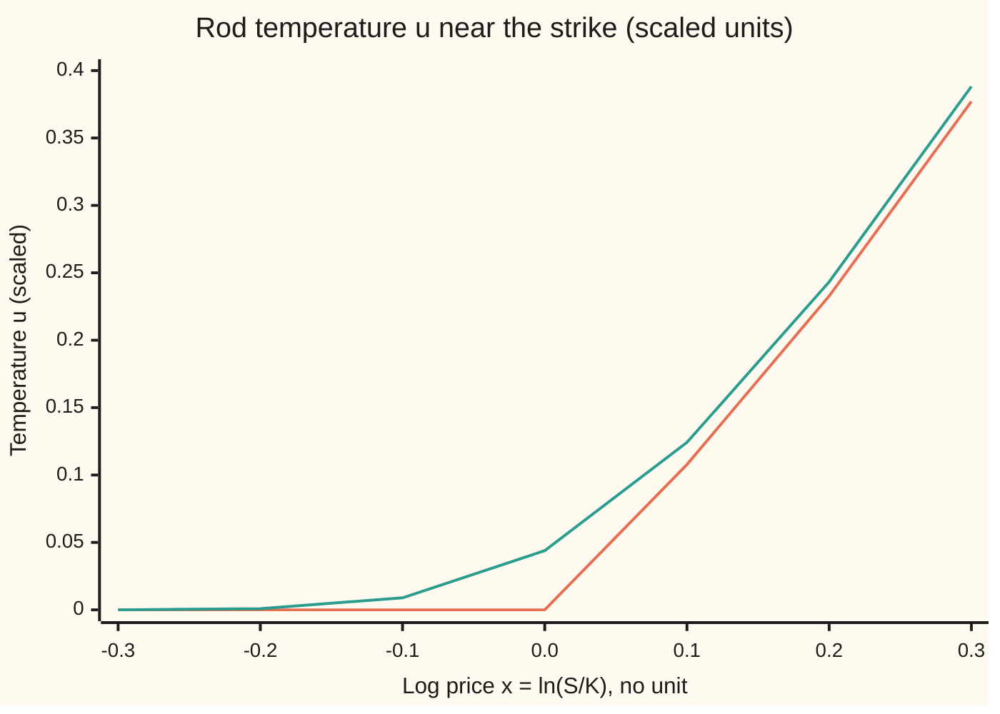

# Black-Scholes is the heat equation after a change of variables

[Syllabus](../../../SYLLABUS.md) → [Partial differential equations](../README.md) → [The Heat Equation in Depth](../README.md#s03) → Black-Scholes is the heat equation after a change of variables

---

## General Overview

A share trades at $100.00. A call option on it gives the right, not the duty, to buy one share for $100.00 (the **strike**) in 3 months. Cash earns 5% a year, the share pays a 2% dividend yield (cash paid out each year, as a fraction of the price), and its **volatility** (how jumpy it is) is 20% a year. These rates are illustrative. The Black-Scholes formula prices this call at $4.335886.

The wing 08 heat equation says a temperature drifts toward the average of its neighbours, so bumps flatten ([The heat equation](../../08-Differential%20equations%20and%20dynamics/10-The%20Classical%20PDEs/03-the-heat-equation.md)). The option's pricing equation looks different: it runs backwards in time, its coefficients change with the price, and it has extra slope and decay terms. This card shows that all four differences are disguises.

Four changes of variable remove them:

- **Time to expiry** instead of the calendar date, so the equation runs forwards.
- **Log price** instead of price, so the coefficients become constants.
- **A heat clock** that counts time in units of volatility squared, so the spreading rate becomes 1.
- **One exponential factor**, which removes the slope term and the decay term together.

What is left is the plain heat equation on a rod. Lay log price from −1 to +1 along the 1 m copper rod of this shelf, with the strike at its middle. The option's payoff becomes the rod's starting temperature: cold on the left half, warming on the right. The 3 months of the option become 11.26 seconds of the rod cooling. Read the rod's temperature at its middle, undo the factor, and the price is $4.335886 again.

**Change to log price, time to expiry on a heat clock, and one exponential factor, and the Black-Scholes equation becomes the heat equation, with the payoff as the rod's starting temperature.**

**What kind of fact this is:** a theorem: an exact change of variables, proved on this card in Why it works. The Black-Scholes equation it starts from is a model, not a law ([The Black-Scholes equation](../../12-Financial%20mathematics/08-The%20Black-Scholes%20call%20and%20put/07-black-scholes-equation.md)).

### The picture: the payoff, as a rod's temperature, before and after



The first line (orange) is the start: the payoff, transformed. It is zero left of the strike and has a corner at it. The second line (green) is the rod at heat time 0.005, which is 3 months for the option and 11.26 s for copper. The corner has melted. The middle now reads 0.0439, and that number, rescaled, is the price.

---

## The formula

Notation first, in words. $`V`$ is the option's value, a function of the share price $`S`$ and the calendar date $`t`$. The option expires at date $`T`$, so $`T - t`$ is the time still to go, in years. Subscripts mean partial derivatives: $`u_\tau`$ is how fast $`u`$ changes with $`\tau`$, holding $`x`$ still; $`u_{xx}`$ is its curvature in $`x`$.

The four changes of variable are:

```math
x = \ln\frac{S}{K}, \qquad \tau = \tfrac12\sigma^2\,(T - t), \qquad V = K\,e^{\alpha x + \beta \tau}\,u(x, \tau)
```

with the two constants

```math
\alpha = -\tfrac12\,(k' - 1), \qquad \beta = -\tfrac14\,(k' - 1)^2 - k, \qquad k' = \frac{2(r-q)}{\sigma^2}, \qquad k = \frac{2r}{\sigma^2}.
```

Then $`u`$ solves the heat equation, forwards in $`\tau`$, with a known start:

```math
u_\tau = u_{xx}, \qquad u(x, 0) = \max\!\left(e^{\frac12(k'+1)x} - e^{\frac12(k'-1)x},\; 0\right).
```

**Read it aloud:** measure price in logs from the strike and time backwards from expiry in units of half the variance, divide out one exponential, and what remains is a temperature that spreads like heat in a rod, starting from the payoff.

For our call, $`k' = 1.5`$ and $`k = 2.5`$, so $`\alpha = -0.25`$, $`\beta = -2.5625`$ and the start is $`e^{1.25x} - e^{0.25x}`$ right of the strike, zero left of it. The heat clock reads $`\tau = 0.005`$ today.

This card introduces $`\tau = \sigma^2(T-t)/2`$ as the heat clock. The finance wing's grid card uses $`\tau`$ for plain years to go; here years to go is written $`T - t`$, or $`s`$ for short in Why it works.

| Symbol | Plain meaning | In our example | Push it up and the answer… |
| --- | --- | --- | --- |
| $`V`$ | the option's value, in dollars | $4.335886 | — |
| $`S`$, $`K`$ | share price today, and the strike | $100.00 and $100.00 | rises with $`S`$, falls with $`K`$ |
| $`T - t`$, $`s`$ | time to expiry, in years; $`s`$ is its short name in Why it works | 0.25 | rises |
| $`r`$, $`q`$, $`\sigma`$ | bank rate, dividend yield, volatility, per year | 0.05, 0.02, 0.20 | $`\sigma`$ up: the rod runs longer, the price rises |
| $`x`$; $`n`$ | log price: the natural log of $`S/K`$, 0 at the strike; $`n`$ the mode of a ripple $`\sin(nx)`$ in log price | 0; n = 100 in The usual mistake | the reading point moves into the warm half |
| $`\tau`$ | the heat clock: time to expiry times half the variance | 0.005 | more spreading |
| $`k'`$, $`k`$ | the drift and the bank rate in heat-clock units | 1.5 and 2.5 | — |
| $`\alpha`$, $`\beta`$, $`E`$; $`c_1`$, $`c_2`$ | the factor's slope in $`x`$ and its rate in $`\tau`$, and the factor itself, $`E = e^{\alpha x + \beta\tau}`$; the start's two exponents ($`c`$ stands for either) | −0.25 and −2.5625; 1.25 and 0.25 | — |
| $`u`$, $`v`$; $`C`$, $`a`$ | the rod's temperature: the value with the factor divided out; $`v = V/K`$ is the value in strikes, before the factor; $`C`$, $`a`$ the constants of a growth bound $`\Vert u\Vert \le C e^{a x^2}`$, inside which $`u`$ is unique | 0.043918 at the middle | the price rises with it |
| $`G`$, $`y`$ | the heat kernel: the bell a single hot point becomes; $`y`$ is the point of the start being spread | width $`\sqrt{2\tau} = 0.1`$ | — |
| $`N`$, $`d_1`$, $`d_2`$ | the normal curve's area to the left, and the formula's two distances | 0.125 and 0.025 | — |
| $`\kappa`$ | copper's thermal diffusivity (illustrative handbook value) | 1.11e-4 m²/s | the rod runs faster |

### When it holds

- **Constant rate, dividend yield and volatility.** Then the coefficients in log price are constants and one exponential factor removes them. Let volatility depend on price and the coefficients vary from point to point; no single factor clears them, and the problem stays a diffusion with variable coefficients ([Dupire's equation](10-dupire-and-forward-equations.md)).
- **Time measured to expiry.** In calendar time the equation is the heat equation run backwards, which is not well posed: a 1e-6 ripple $`\sin(100x)`$ in log price grows to 5.18e15 (see The usual mistake).
- **A European payoff, fixed in advance.** An option that may be used early adds a moving edge, and the heat equation becomes an obstacle problem (An American option, planned).
- **A price that moves without jumps.** A jump adds an integral over jump sizes, which no change of variables removes (When prices jump, planned).
- **A growth limit on the solution.** The heat equation on an endless rod has one solution only among those growing no faster than $`e^{a x^2}`$ for some constant $`a`$. The call's start grows like $`e^{1.25x}`$, well inside that class.

---

## Why it works

### Step 0: every difference from the heat equation is a coordinate choice

The Black-Scholes equation already spreads: its second-derivative term is diffusion in price. What hides the heat equation is bookkeeping. Time runs the wrong way, the spreading rate scales with $`S^2`$, a slope term slides values sideways, and a decay term discounts them.

Each of these is undone by a change of coordinates or of units, and none of them changes the information in the problem. So the price is a heat-equation answer in disguise.

### Step 1: time to expiry and log price

The starting point is the pricing equation ([The Black-Scholes equation](../../12-Financial%20mathematics/08-The%20Black-Scholes%20call%20and%20put/07-black-scholes-equation.md)):

```math
V_t + (r - q)\,S\,V_S + \tfrac12\sigma^2 S^2\,V_{SS} = r\,V.
```

The finance wing's grid card already changes to $`x = \ln(S/K)`$ and years to go by the chain rule ([Pricing on a grid](../../12-Financial%20mathematics/06-Numerical%20Methods%20for%20Pricing/07-finite-differences-for-the-black-scholes-equation.md)). Writing $`s = T - t`$ for years to go, it reaches

```math
V_s = \tfrac12\sigma^2\,V_{xx} + \left(r - q - \tfrac12\sigma^2\right)V_x - r\,V.
```

The coefficients no longer depend on $`S`$. The payoff, known at expiry, is now the start at $`s = 0`$.

### Step 2: a heat clock and strike units

Divide by $`\tfrac12\sigma^2`$ and count time on the heat clock $`\tau = \tfrac12\sigma^2 s`$. Write $`V = K v`$, so $`v`$ is the value in strikes. The spreading rate becomes exactly 1:

```math
v_\tau = v_{xx} + (k' - 1)\,v_x - k\,v.
```

For our call, $`k' - 1 = 0.5`$ is the slope coefficient and $`k = 2.5`$ the decay rate. The payoff in strike units is $`v(x, 0) = \max(e^x - 1, 0)`$.

The 3 months of the option are $`\tau = 0.04 \times 0.25 / 2 = 0.005`$ on the heat clock.

### Step 3: one exponential factor clears the slope and the decay

Try $`v = e^{\alpha x + \beta \tau}u`$. Differentiating the factor brings out an $`\alpha`$ for every $`x`$-derivative and a $`\beta`$ for the $`\tau`$-derivative. Two constants are free, and two terms need killing:

1. The $`u_x`$ terms are $`2\alpha + (k'-1)`$ times $`u_x`$. Setting this to zero gives $`\alpha = -\tfrac12(k'-1) = -0.25`$.
2. The plain $`u`$ terms then reduce to $`\beta + \alpha^2 + k`$ times $`u`$. Setting this to zero gives $`\beta = -\alpha^2 - k = -2.5625`$.

What remains is $`u_\tau = u_{xx}`$.

<details>
<summary>Detailed proof: substituting the factor</summary>

Write $`E = e^{\alpha x + \beta\tau}`$. The product rule gives

$`\displaystyle v_\tau = E\,(u_\tau + \beta u), \quad v_x = E\,(u_x + \alpha u), \quad v_{xx} = E\,(u_{xx} + 2\alpha u_x + \alpha^2 u).`$

Put these into $`v_\tau = v_{xx} + (k'-1)v_x - kv`$ and divide by $`E`$, which is never zero:

$`\displaystyle u_\tau + \beta u = u_{xx} + \big(2\alpha + k' - 1\big)u_x + \big(\alpha^2 + (k'-1)\alpha - k\big)u.`$

With $`\alpha = -\tfrac12(k'-1)`$ the $`u_x`$ bracket is zero, and $`(k'-1)\alpha = -2\alpha^2`$, so the last bracket is $`-\alpha^2 - k`$. Choosing $`\beta = -\alpha^2 - k`$ cancels it against the left side, leaving $`u_\tau = u_{xx}`$. Every step is reversible, so a solution of either equation gives one of the other.

</details>

The factor $`e^{\beta\tau}`$ undoes the discounting. The factor $`e^{\alpha x}`$ undoes the slide. The slide could also be removed by riding along with it, in coordinates that move at the drift speed; that is the road of [Convection-diffusion](06-convection-diffusion-and-drift.md). The factor does both jobs in one step and keeps the rod still.

### Step 4: the payoff becomes the rod's starting temperature

At $`\tau = 0`$, $`u = e^{-\alpha x}v = e^{0.25x}\max(e^x - 1, 0)`$. Multiplied out, the start is

```math
u(x, 0) = e^{1.25x} - e^{0.25x} \text{ for } x > 0, \qquad u(x, 0) = 0 \text{ for } x \le 0.
```

The strike sits at the rod's middle, $`x = 0`$. Left of it the rod starts cold. Right of it the temperature rises: 0.1078 at $`x = 0.1`$, 0.3771 at $`x = 0.3`$. The payoff's corner at the strike is a corner in temperature.

### Step 5: the heat kernel solves it, and the answer is the Black-Scholes formula

On an endless rod the heat equation is solved by blending bells: each point of the start spreads as the heat kernel $`G(x, \tau) = e^{-x^2/(4\tau)}/\sqrt{4\pi\tau}`$ ([The heat kernel](01-heat-kernel-and-fundamental-solution.md)):

```math
u(x, \tau) = \int_0^{\infty} u(y, 0)\,G(x - y, \tau)\,dy.
```

The start is two exponentials on half a line. One completed square turns each into a normal-curve area:

```math
\int_0^\infty e^{c y}\,G(x - y, \tau)\,dy = e^{c x + c^2\tau}\,N\!\left(\frac{x + 2c\tau}{\sqrt{2\tau}}\right).
```

Use it with $`c = 1.25`$ and $`c = 0.25`$, multiply back by $`K e^{\alpha x + \beta\tau}`$, and the Black-Scholes formula appears, $`d_1`$ and $`d_2`$ included.

<details>
<summary>Detailed proof: completing the square, then undoing the factor</summary>

The exponent in the integrand is $`cy - (x-y)^2/(4\tau)`$. Completing the square in $`y`$:

$`\displaystyle c y - \frac{(x - y)^2}{4\tau} = c x + c^2\tau - \frac{\big(y - x - 2c\tau\big)^2}{4\tau}.`$

So the integrand is $`e^{cx + c^2\tau}`$ times a normal density with centre $`x + 2c\tau`$ and variance $`2\tau`$. Its mass on $`y > 0`$ is $`N\big((x + 2c\tau)/\sqrt{2\tau}\big)`$.

Write $`c_1 = \tfrac12(k'+1)`$ and $`c_2 = \tfrac12(k'-1)`$. Then $`V = K e^{\alpha x + \beta\tau}\big(e^{c_1 x + c_1^2\tau}N(d_1) - e^{c_2 x + c_2^2\tau}N(d_2)\big)`$. The exponents collapse:

$`\displaystyle \alpha + c_1 = 1, \quad \beta + c_1^2 = k' - k = -\frac{2q}{\sigma^2}, \quad \alpha + c_2 = 0, \quad \beta + c_2^2 = -k.`$

Since $`\tau = \tfrac12\sigma^2(T-t)`$, the first term is $`K e^{x}e^{-q(T-t)}N(d_1) = S e^{-q(T-t)}N(d_1)`$ and the second is $`K e^{-r(T-t)}N(d_2)`$. The distances are $`d_1 = (x + 2c_1\tau)/\sqrt{2\tau}`$ and $`d_2 = d_1 - \sigma\sqrt{T-t}`$, which are the formula's own ([Black–Scholes call](../../12-Financial%20mathematics/08-The%20Black-Scholes%20call%20and%20put/01-black-scholes-call.md)).

</details>

### Step 6: which solution, and why it is the only one

The kernel integral is a **classical solution** for $`\tau > 0`$: smooth, with every derivative the equation uses. It tends to the start as $`\tau \to 0`$ at every point, the corner included.

On an endless rod a start does not fix the solution by itself. A. N. Tychonoff built a nonzero solution that starts at zero, growing like $`e^{x^2/\tau}`$ far out. Among solutions with $`|u| \le C e^{a x^2}`$ at every heat time up to the end, for some fixed constants $`C`$ and $`a`$, the solution is unique (stated with proof in John, below). The call's temperature grows only like $`e^{1.25x}`$, so the kernel answer is the only one in the class. In money terms: the price is unique among prices that grow no faster than $`e^{a x^2}`$ in log price, which covers every ordinary payoff.

---

## Worked numbers, by hand

| Step | Arithmetic | Value |
| --- | --- | --- |
| log price | $`x = \ln(100/100)`$ | 0 |
| heat clock | $`\tau = 0.2^2 \times 0.25 / 2`$ | 0.005 |
| drift and rate in heat units | $`k' = 2 \times 0.03 / 0.04`$, $`k = 2 \times 0.05/0.04`$ | 1.5 and 2.5 |
| the factor | $`\alpha = -0.5/2`$, $`\beta = -0.25/4 - 2.5`$ | −0.25 and −2.5625 |
| the start | $`c_1 = 2.5/2`$, $`c_2 = 0.5/2`$ | $`e^{1.25x} - e^{0.25x}`$ |
| the distances | $`d_1 = 2 \times 1.25 \times 0.005/0.1`$, $`d_2 = 2 \times 0.25 \times 0.005/0.1`$ | 0.125 and 0.025 |
| the areas | $`N(0.125)`$, $`N(0.025)`$ | 0.549738 and 0.509973 |
| the growth terms | $`e^{1.5625 \times 0.005}`$, $`e^{0.0625 \times 0.005}`$ | 1.007843 and 1.000313 |
| the rod's middle | $`1.007843 \times 0.549738 - 1.000313 \times 0.509973`$ | 0.043918 |
| undo the factor | $`e^{-2.5625 \times 0.005}`$ | 0.987269 |
| the price | $`100 \times 0.987269 \times 0.043918`$ | **$4.335886** |

The rod's middle temperature, rescaled by the strike and the discount, is the call's price: the same $4.335886 the Black-Scholes formula gives.

On the copper rod, with 1 m holding $`x`$ from −1 to +1, one unit of log price is 0.5 m. Heat time $`\tau`$ becomes $`0.005 \times 0.5^2 / 1.11\times 10^{-4} = 11.26`$ s of real cooling. In that time heat spreads $`\sqrt{2\tau} = 0.1`$ log units, which is 5.00 cm of copper. The rod's ends, far beyond that spread, are held at the endless rod's values, as in the code's grid, so the endless-rod kernel gives the 1 m rod's middle too. So 3 months of a 20% volatility share smear the payoff across about 0.1 in log price.

### What breaks if you drop a piece

| Mistake | Comes out at | What went wrong |
| --- | --- | --- |
| Years on the heat clock: $`\tau = 0.25`$ | $32.690699 | Time was not scaled by $`\tfrac12\sigma^2`$, so the rod ran far too long |
| Drop the factor $`e^{\beta\tau}`$ | $4.391797 | The discount and the dividend drag never came back |
| $`\alpha`$'s sign flipped in the start | $4.067986 | The start $`e^{-\alpha x}v`$ became $`e^{\alpha x}v`$: the wrong rod |
| Calendar time kept | a 1e-6 ripple $`\sin(100x)`$ grows to 5.18e15 | Backwards heat amplifies a ripple $`\sin(nx)`$ by $`e^{n^2\tau}`$ |

The code prints all four.

---

## Code, from first principles, and it actually runs

The script builds the change of variables, then prices the call by three independent roads. Road 1 is the Black-Scholes formula, with the normal curve's area written out as a series. Road 2 never uses that formula: it blends the heat kernel against the transformed payoff by Simpson's rule, then undoes the factor. It does this at the strike, and again at $`x = 0.1`$, where the factor's $`e^{\alpha x}`$ is not 1: a share price of $110.52. Road 3 steps the plain heat equation $`u_\tau = u_{xx}`$ on a grid from the transformed payoff, at two step sizes, and prints its observed order. A fourth check puts the closed form back into the heat equation by centred differences and prints the residual (what is left over) at two steps. It also prints the rod numbers, the chart points and the four mistakes.

### Python

```python
# Black-Scholes is the heat equation after a change of variables -- the check
# behind the card.  Nothing is imported but math.exp, math.log, math.sqrt and math.pi.
# A 3-month call on a 100 share is turned into a rod: log price, time to
# expiry in heat units, and one exponential factor.  The price is then found
# three ways: the Black-Scholes formula, the heat kernel by quadrature, and
# an explicit grid on the plain heat equation.
from math import exp, log, sqrt, pi

S, K, T, r, q, sig = 100.0, 100.0, 0.25, 0.05, 0.02, 0.20
KAPPA, HALF_M = 1.11e-4, 0.5          # copper diffusivity m^2/s; metres per log unit
LQ = 1.5                               # quadrature reach either side of x, in log units

def fe(v, d=2):                        # e-notation with the same digits in Python and Rust
    if v == 0.0:
        return "0." + "0" * d + "e0"
    e = 0
    m = abs(v)
    while m >= 10.0: m, e = m / 10.0, e + 1
    while m < 1.0: m, e = m * 10.0, e - 1
    return ("-" if v < 0 else "") + f"{m:.{d}f}e{e}"

def ncdf(z):                           # normal CDF by its all-positive series
    term, total, n = z, z, 0
    while abs(term) > 1e-17 * abs(total):
        n += 1
        term *= z * z / (2 * n + 1)
        total += term
    return 0.5 + exp(-z * z / 2) / sqrt(2 * pi) * total

kq, kr = 2 * (r - q) / sig**2, 2 * r / sig**2     # drift and discount, in heat units
al = -(kq - 1) / 2                     # the exponential factor's slope in x
be = -(kq - 1)**2 / 4 - kr             # and its rate in tau
tau = sig**2 * T / 2                   # time to expiry on the heat clock
x0 = log(S / K)
c1, c2 = (kq + 1) / 2, (kq - 1) / 2    # the start: u0 = e^(c1 x) - e^(c2 x) for x > 0

def u0(x):                             # the payoff in strikes, with the factor divided out
    return exp(-al * x) * max(exp(x) - 1, 0.0)

def heat_exp(c, x, t):                 # e^(cy) for y > 0, run through the heat kernel
    return exp(c * x + c * c * t) * ncdf((x + 2 * c * t) / sqrt(2 * t))

def u_exact(x, t):
    return heat_exp(c1, x, t) - heat_exp(c2, x, t)

def bs_call(s_, t):                    # road 1: the Black-Scholes formula
    d1 = (log(s_ / K) + (r - q + sig**2 / 2) * t) / (sig * sqrt(t))
    d2 = d1 - sig * sqrt(t)
    return s_ * exp(-q * t) * ncdf(d1) - K * exp(-r * t) * ncdf(d2), d1, d2

def kernel_conv(x, t, L=LQ, n=3000):    # road 2: Simpson's rule on u0 times the kernel
    a, b = max(x - L, 0.0), x + L
    h = (b - a) / n
    f = lambda y: u0(y) * exp(-(x - y)**2 / (4 * t)) / sqrt(4 * pi * t)
    s_ = f(a) + f(b) + sum((4 if i % 2 else 2) * f(a + i * h) for i in range(1, n))
    return s_ * h / 3

def grid(h, nu=0.4, xl=-1.0, xr=1.0):  # road 3: explicit steps of u_tau = u_xx
    m = round((xr - xl) / h)
    dt = nu * h * h
    steps = round(tau / dt)
    u = [u0(xl + i * h) for i in range(m + 1)]
    for k in range(1, steps + 1):
        new = [0.0] * (m + 1)
        for i in range(1, m):
            new[i] = u[i] + nu * (u[i + 1] - 2 * u[i] + u[i - 1])
        t = k * dt                     # far right: both exponentials run exactly
        new[m] = exp(c1 * xr + c1 * c1 * t) - exp(c2 * xr + c2 * c2 * t)
        u = new
    return u[round((x0 - xl) / h)], steps

V1, d1, d2 = bs_call(S, T)
uq = kernel_conv(x0, tau)
V2 = K * exp(al * x0 + be * tau) * uq
xa = 0.1                               # a second price, off the strike: S = K e^0.1
Va1, Va2 = bs_call(K * exp(xa), T)[0], K * exp(al * xa + be * tau) * kernel_conv(xa, tau)
uh = u_exact(x0, tau)
g1, n1 = grid(0.01)
g2, n2 = grid(0.005)
e1, e2 = abs(g1 - uh), abs(g2 - uh)
zt = (LQ - 2 * c1 * tau) / sqrt(2 * tau)
tail = exp(c1 * c1 * tau) * exp(-zt * zt / 2) / (sqrt(2 * pi) * zt)
t_rod = tau * HALF_M**2 / KAPPA

print(f"call: S {S:.2f}, K {K:.2f}, T {T:.2f} yr, r {r:.2f}, q {q:.2f}, sigma {sig:.2f}")
print(f"heat-unit rates: drift k' = {kq:.4f}, discount k = {kr:.4f}")
print(f"factor e^(alpha x + beta tau): alpha = {al:.4f}, beta = {be:.4f}")
print(f"heat clock tau = sigma^2 T / 2 = {tau:.4f}; x = ln(S/K) = {x0:.4f}")
print(f"start: u0(x) = e^({c1:.2f} x) - e^({c2:.2f} x) for x > 0, else 0")
print(f"d1 = {d1:.6f}, d2 = {d2:.6f}, N(d1) = {ncdf(d1):.6f}, N(d2) = {ncdf(d2):.6f}")
print(f"heat terms: e^(c1^2 tau) = {exp(c1*c1*tau):.6f}, e^(c2^2 tau) = {exp(c2*c2*tau):.6f}")
print(f"u(0, tau), closed form       = {uh:.6f}")
print(f"u(0, tau), kernel quadrature = {uq:.6f}  (tail past {LQ} below {fe(tail)})")
print(f"discount e^(beta tau)        = {exp(be*tau):.6f}")
print(f"road 1, Black-Scholes formula: {V1:.6f}")
print(f"road 2, heat kernel, times K e^(beta tau): {V2:.6f}")
print(f"roads 1 and 2 off the strike, S {K * exp(xa):.2f} (x = {xa:.1f}): {Va1:.6f} and {Va2:.6f}  (tail below {fe(exp(c1 * xa) * tail)})")
print(f"road 3, grid h 0.010, {n1} steps: {K*exp(be*tau)*g1:.6f}  error in u {fe(e1)}")
print(f"road 3, grid h 0.005, {n2} steps: {K*exp(be*tau)*g2:.6f}  error in u {fe(e2)}")
print(f"grid observed order: {log(e1 / e2) / log(2):.2f}")
for dx in (0.002, 0.001):                # the residual u_tau - u_xx, by centred differences
    dt = dx * dx / 4
    res = ((u_exact(0.05, tau + dt) - u_exact(0.05, tau - dt)) / (2 * dt)
           - (u_exact(0.05 + dx, tau) - 2 * u_exact(0.05, tau) + u_exact(0.05 - dx, tau)) / dx**2)
    print(f"residual u_tau - u_xx at x 0.05, step {dx:.3f}: {fe(res)}")
print(f"rod: 1 m holds x from -1 to 1; copper kappa {fe(KAPPA)} m^2/s")
print(f"rod time for tau: {t_rod:.2f} s; spread sqrt(2 tau) = {sqrt(2*tau):.4f} log units"
      f" = {100*HALF_M*sqrt(2*tau):.2f} cm")
for x in (-0.3, -0.2, -0.1, 0.0, 0.1, 0.2, 0.3):
    print(f"chart, x {x:+.1f}, S {K*exp(x):.2f}: start {u0(x):.4f}, at tau {u_exact(x, tau):.4f}")
w1 = K * exp(be * T) * u_exact(x0, T)             # mistake: years on the heat clock
w2 = K * uh                                           # mistake: drop e^(beta tau)
w3 = K * exp(be * tau) * (heat_exp(1 + al, x0, tau) - heat_exp(al, x0, tau))  # alpha flipped
amp = 1e-6 * exp(100**2 * tau)
print(f"mistake 1, years on the heat clock (tau = 0.25): {w1:.6f}")
print(f"mistake 2, drop the factor e^(beta tau): {w2:.6f}")
print(f"mistake 3, alpha's sign flipped in the start: {w3:.6f}")
print(f"mistake 4, calendar time kept: a 1e-6 ripple at mode 100 grows to {fe(amp)}")
assert abs(V1 - V2) < 1e-9                       # formula against kernel quadrature
assert e2 < 1e-4 and 3.5 < e1 / e2 < 4.5         # grid converges at second order
assert abs(uq - uh) < 1e-10                      # quadrature against completed square
assert abs(Va1 - Va2) < 1e-9                     # and off the strike, where e^(alpha x) is not 1
assert abs(res) < 1e-4                           # the closed form solves the heat equation
assert abs(w2 - V1) > 0.05 and abs(w1 - V1) > 1  # the mistakes really move the price
print("ALL CHECKS PASS")
```

**Ran 2026-11-15 on macOS, Python 3.14.10, standard library only. All checks passed. Output, pasted from the run:**

```
call: S 100.00, K 100.00, T 0.25 yr, r 0.05, q 0.02, sigma 0.20
heat-unit rates: drift k' = 1.5000, discount k = 2.5000
factor e^(alpha x + beta tau): alpha = -0.2500, beta = -2.5625
heat clock tau = sigma^2 T / 2 = 0.0050; x = ln(S/K) = 0.0000
start: u0(x) = e^(1.25 x) - e^(0.25 x) for x > 0, else 0
d1 = 0.125000, d2 = 0.025000, N(d1) = 0.549738, N(d2) = 0.509973
heat terms: e^(c1^2 tau) = 1.007843, e^(c2^2 tau) = 1.000313
u(0, tau), closed form       = 0.043918
u(0, tau), kernel quadrature = 0.043918  (tail past 1.5 below 2.42e-50)
discount e^(beta tau)        = 0.987269
road 1, Black-Scholes formula: 4.335886
road 2, heat kernel, times K e^(beta tau): 4.335886
roads 1 and 2 off the strike, S 110.52 (x = 0.1): 11.958649 and 11.958649  (tail below 2.75e-50)
road 3, grid h 0.010, 125 steps: 4.334856  error in u 1.04e-5
road 3, grid h 0.005, 500 steps: 4.335627  error in u 2.62e-6
grid observed order: 1.99
residual u_tau - u_xx at x 0.05, step 0.002: 9.39e-5
residual u_tau - u_xx at x 0.05, step 0.001: 2.35e-5
rod: 1 m holds x from -1 to 1; copper kappa 1.11e-4 m^2/s
rod time for tau: 11.26 s; spread sqrt(2 tau) = 0.1000 log units = 5.00 cm
chart, x -0.3, S 74.08: start 0.0000, at tau 0.0000
chart, x -0.2, S 81.87: start 0.0000, at tau 0.0009
chart, x -0.1, S 90.48: start 0.0000, at tau 0.0089
chart, x +0.0, S 100.00: start 0.0000, at tau 0.0439
chart, x +0.1, S 110.52: start 0.1078, at tau 0.1242
chart, x +0.2, S 122.14: start 0.2328, at tau 0.2433
chart, x +0.3, S 134.99: start 0.3771, at tau 0.3882
mistake 1, years on the heat clock (tau = 0.25): 32.690699
mistake 2, drop the factor e^(beta tau): 4.391797
mistake 3, alpha's sign flipped in the start: 4.067986
mistake 4, calendar time kept: a 1e-6 ripple at mode 100 grows to 5.18e15
ALL CHECKS PASS
```

### Rust

Same numbers, same labels, built with `rustc --edition 2021 -O`.

```rust
// Black-Scholes is the heat equation after a change of variables -- the same
// check as the Python, in Rust.  No crates.  A 3-month call on a 100 share is
// turned into a rod: log price, time to expiry in heat units, and one
// exponential factor.  The price is then found three ways: the Black-Scholes
// formula, the heat kernel by quadrature, and an explicit grid on the plain
// heat equation.
use std::f64::consts::PI;

const S: f64 = 100.0;
const K: f64 = 100.0;
const T: f64 = 0.25;
const R: f64 = 0.05;
const Q: f64 = 0.02;
const SIG: f64 = 0.20;
const KAPPA: f64 = 1.11e-4; // copper diffusivity, m^2/s
const HALF_M: f64 = 0.5; // metres per log unit
const LQ: f64 = 1.5; // quadrature reach either side of x, in log units

fn fe(v: f64, d: usize) -> String { // e-notation with the same digits in Python and Rust
    if v == 0.0 { return format!("0.{}e0", "0".repeat(d)); }
    let (mut m, mut e) = (v.abs(), 0);
    while m >= 10.0 { m /= 10.0; e += 1; }
    while m < 1.0 { m *= 10.0; e -= 1; }
    format!("{}{:.*}e{}", if v < 0.0 { "-" } else { "" }, d, m, e)
}

fn ncdf(z: f64) -> f64 { // normal CDF by its all-positive series
    let (mut term, mut total, mut n) = (z, z, 0.0);
    while term.abs() > 1e-17 * total.abs() {
        n += 1.0;
        term *= z * z / (2.0 * n + 1.0);
        total += term;
    }
    0.5 + (-z * z / 2.0).exp() / (2.0 * PI).sqrt() * total
}

struct P { tau: f64, x0: f64, c1: f64, c2: f64, al: f64 }

fn u0(p: &P, x: f64) -> f64 { // the payoff in strikes, with the factor divided out
    (-p.al * x).exp() * (x.exp() - 1.0).max(0.0)
}

fn heat_exp(c: f64, x: f64, t: f64) -> f64 { // e^(cy) for y > 0, run through the heat kernel
    (c * x + c * c * t).exp() * ncdf((x + 2.0 * c * t) / (2.0 * t).sqrt())
}

fn u_exact(p: &P, x: f64, t: f64) -> f64 { heat_exp(p.c1, x, t) - heat_exp(p.c2, x, t) }

fn bs_call(s: f64, t: f64) -> (f64, f64, f64) { // road 1: the Black-Scholes formula
    let d1 = ((s / K).ln() + (R - Q + SIG * SIG / 2.0) * t) / (SIG * t.sqrt());
    let d2 = d1 - SIG * t.sqrt();
    (s * (-Q * t).exp() * ncdf(d1) - K * (-R * t).exp() * ncdf(d2), d1, d2)
}

fn kernel_conv(p: &P, x: f64, t: f64) -> f64 { // road 2: Simpson's rule on u0 times the kernel
    let (l, n) = (LQ, 3000);
    let (a, b) = ((x - l).max(0.0), x + l);
    let h = (b - a) / n as f64;
    let f = |y: f64| u0(p, y) * (-(x - y).powi(2) / (4.0 * t)).exp() / (4.0 * PI * t).sqrt();
    let mut acc = 0.0;
    for i in 1..n { acc += (if i % 2 == 1 { 4.0 } else { 2.0 }) * f(a + i as f64 * h); }
    (f(a) + f(b) + acc) * h / 3.0
}

fn grid(p: &P, h: f64) -> (f64, usize) { // road 3: explicit steps of u_tau = u_xx
    let (nu, xl, xr) = (0.4, -1.0, 1.0);
    let m = ((xr - xl) / h).round() as usize;
    let dt = nu * h * h;
    let steps = (p.tau / dt).round() as usize;
    let mut u: Vec<f64> = (0..=m).map(|i| u0(p, xl + i as f64 * h)).collect();
    for k in 1..=steps {
        let mut new = vec![0.0; m + 1];
        for i in 1..m { new[i] = u[i] + nu * (u[i + 1] - 2.0 * u[i] + u[i - 1]); }
        let t = k as f64 * dt; // far right: both exponentials run exactly
        new[m] = (p.c1 * xr + p.c1 * p.c1 * t).exp() - (p.c2 * xr + p.c2 * p.c2 * t).exp();
        u = new;
    }
    (u[((p.x0 - xl) / h).round() as usize], steps)
}

fn main() {
    let kq = 2.0 * (R - Q) / (SIG * SIG); // drift and discount, in heat units
    let kr = 2.0 * R / (SIG * SIG);
    let al = -(kq - 1.0) / 2.0; // the exponential factor's slope in x
    let be = -(kq - 1.0).powi(2) / 4.0 - kr; // and its rate in tau
    let p = P { tau: SIG * SIG * T / 2.0, x0: (S / K).ln(), c1: (kq + 1.0) / 2.0, c2: (kq - 1.0) / 2.0, al };
    let tau = p.tau;
    let (v1, d1, d2) = bs_call(S, T);
    let uq = kernel_conv(&p, p.x0, tau);
    let v2 = K * (al * p.x0 + be * tau).exp() * uq;
    let xa = 0.1; // a second price, off the strike: S = K e^0.1
    let (va1, va2) = (bs_call(K * f64::exp(xa), T).0, K * (al * xa + be * tau).exp() * kernel_conv(&p, xa, tau));
    let uh = u_exact(&p, p.x0, tau);
    let (g1, n1) = grid(&p, 0.01);
    let (g2, n2) = grid(&p, 0.005);
    let (e1, e2) = ((g1 - uh).abs(), (g2 - uh).abs());
    let zt = (LQ - 2.0 * p.c1 * tau) / (2.0 * tau).sqrt();
    let tail = (p.c1 * p.c1 * tau).exp() * (-zt * zt / 2.0).exp() / ((2.0 * PI).sqrt() * zt);
    let t_rod = tau * HALF_M * HALF_M / KAPPA;
    let disc = (be * tau).exp();

    println!("call: S {:.2}, K {:.2}, T {:.2} yr, r {:.2}, q {:.2}, sigma {:.2}", S, K, T, R, Q, SIG);
    println!("heat-unit rates: drift k' = {:.4}, discount k = {:.4}", kq, kr);
    println!("factor e^(alpha x + beta tau): alpha = {:.4}, beta = {:.4}", al, be);
    println!("heat clock tau = sigma^2 T / 2 = {:.4}; x = ln(S/K) = {:.4}", tau, p.x0);
    println!("start: u0(x) = e^({:.2} x) - e^({:.2} x) for x > 0, else 0", p.c1, p.c2);
    println!("d1 = {:.6}, d2 = {:.6}, N(d1) = {:.6}, N(d2) = {:.6}", d1, d2, ncdf(d1), ncdf(d2));
    println!("heat terms: e^(c1^2 tau) = {:.6}, e^(c2^2 tau) = {:.6}",
             (p.c1 * p.c1 * tau).exp(), (p.c2 * p.c2 * tau).exp());
    println!("u(0, tau), closed form       = {:.6}", uh);
    println!("u(0, tau), kernel quadrature = {:.6}  (tail past {} below {})", uq, LQ, fe(tail, 2));
    println!("discount e^(beta tau)        = {:.6}", disc);
    println!("road 1, Black-Scholes formula: {:.6}", v1);
    println!("road 2, heat kernel, times K e^(beta tau): {:.6}", v2);
    println!("roads 1 and 2 off the strike, S {:.2} (x = {:.1}): {:.6} and {:.6}  (tail below {})", K * f64::exp(xa), xa, va1, va2, fe((p.c1 * xa).exp() * tail, 2));
    println!("road 3, grid h 0.010, {} steps: {:.6}  error in u {}", n1, K * disc * g1, fe(e1, 2));
    println!("road 3, grid h 0.005, {} steps: {:.6}  error in u {}", n2, K * disc * g2, fe(e2, 2));
    println!("grid observed order: {:.2}", (e1 / e2).ln() / 2f64.ln());
    let mut res = 0.0;
    for dx in [0.002, 0.001] { // the residual u_tau - u_xx, by centred differences
        let dt = dx * dx / 4.0;
        res = (u_exact(&p, 0.05, tau + dt) - u_exact(&p, 0.05, tau - dt)) / (2.0 * dt)
            - (u_exact(&p, 0.05 + dx, tau) - 2.0 * u_exact(&p, 0.05, tau) + u_exact(&p, 0.05 - dx, tau)) / (dx * dx);
        println!("residual u_tau - u_xx at x 0.05, step {:.3}: {}", dx, fe(res, 2));
    }
    println!("rod: 1 m holds x from -1 to 1; copper kappa {} m^2/s", fe(KAPPA, 2));
    println!("rod time for tau: {:.2} s; spread sqrt(2 tau) = {:.4} log units = {:.2} cm",
             t_rod, (2.0 * tau).sqrt(), 100.0 * HALF_M * (2.0 * tau).sqrt());
    for x in [-0.3, -0.2, -0.1, 0.0, 0.1, 0.2, 0.3] {
        println!("chart, x {:+.1}, S {:.2}: start {:.4}, at tau {:.4}", x, K * f64::exp(x), u0(&p, x), u_exact(&p, x, tau));
    }
    let w1 = K * (be * T).exp() * u_exact(&p, p.x0, T); // mistake: years on the heat clock
    let w2 = K * uh; // mistake: drop e^(beta tau)
    let w3 = K * disc * (heat_exp(1.0 + al, p.x0, tau) - heat_exp(al, p.x0, tau)); // alpha flipped
    let amp = 1e-6 * (100.0f64.powi(2) * tau).exp();
    println!("mistake 1, years on the heat clock (tau = 0.25): {:.6}", w1);
    println!("mistake 2, drop the factor e^(beta tau): {:.6}", w2);
    println!("mistake 3, alpha's sign flipped in the start: {:.6}", w3);
    println!("mistake 4, calendar time kept: a 1e-6 ripple at mode 100 grows to {}", fe(amp, 2));
    assert!((v1 - v2).abs() < 1e-9); // formula against kernel quadrature
    assert!(e2 < 1e-4 && 3.5 < e1 / e2 && e1 / e2 < 4.5); // grid converges at second order
    assert!((uq - uh).abs() < 1e-10); // quadrature against completed square
    assert!((va1 - va2).abs() < 1e-9); // and off the strike, where e^(alpha x) is not 1
    assert!(res.abs() < 1e-4); // the closed form solves the heat equation
    assert!((w2 - v1).abs() > 0.05 && (w1 - v1).abs() > 1.0); // the mistakes really move the price
    println!("ALL CHECKS PASS");
}
```

**Ran 2026-11-15 on macOS, rustc 1.98.1, no crates. All checks passed. Output, pasted from the run:**

```
call: S 100.00, K 100.00, T 0.25 yr, r 0.05, q 0.02, sigma 0.20
heat-unit rates: drift k' = 1.5000, discount k = 2.5000
factor e^(alpha x + beta tau): alpha = -0.2500, beta = -2.5625
heat clock tau = sigma^2 T / 2 = 0.0050; x = ln(S/K) = 0.0000
start: u0(x) = e^(1.25 x) - e^(0.25 x) for x > 0, else 0
d1 = 0.125000, d2 = 0.025000, N(d1) = 0.549738, N(d2) = 0.509973
heat terms: e^(c1^2 tau) = 1.007843, e^(c2^2 tau) = 1.000313
u(0, tau), closed form       = 0.043918
u(0, tau), kernel quadrature = 0.043918  (tail past 1.5 below 2.42e-50)
discount e^(beta tau)        = 0.987269
road 1, Black-Scholes formula: 4.335886
road 2, heat kernel, times K e^(beta tau): 4.335886
roads 1 and 2 off the strike, S 110.52 (x = 0.1): 11.958649 and 11.958649  (tail below 2.75e-50)
road 3, grid h 0.010, 125 steps: 4.334856  error in u 1.04e-5
road 3, grid h 0.005, 500 steps: 4.335627  error in u 2.62e-6
grid observed order: 1.99
residual u_tau - u_xx at x 0.05, step 0.002: 9.39e-5
residual u_tau - u_xx at x 0.05, step 0.001: 2.35e-5
rod: 1 m holds x from -1 to 1; copper kappa 1.11e-4 m^2/s
rod time for tau: 11.26 s; spread sqrt(2 tau) = 0.1000 log units = 5.00 cm
chart, x -0.3, S 74.08: start 0.0000, at tau 0.0000
chart, x -0.2, S 81.87: start 0.0000, at tau 0.0009
chart, x -0.1, S 90.48: start 0.0000, at tau 0.0089
chart, x +0.0, S 100.00: start 0.0000, at tau 0.0439
chart, x +0.1, S 110.52: start 0.1078, at tau 0.1242
chart, x +0.2, S 122.14: start 0.2328, at tau 0.2433
chart, x +0.3, S 134.99: start 0.3771, at tau 0.3882
mistake 1, years on the heat clock (tau = 0.25): 32.690699
mistake 2, drop the factor e^(beta tau): 4.391797
mistake 3, alpha's sign flipped in the start: 4.067986
mistake 4, calendar time kept: a 1e-6 ripple at mode 100 grows to 5.18e15
ALL CHECKS PASS
```

The two outputs match line for line. The grid's error falls about fourfold when its step halves: observed order 1.99, second order. The quadrature's tail past 1.5 log units is below 2.42e-50, so cutting the integral there costs nothing visible.

### Lean

Lean proves the change of variables, the rod's start and the kernel's answer, for any constant rates and volatility.

- Take any rod temperature $`u`$ with continuous second derivatives, and $`V = K e^{\alpha x + \beta\tau}u`$. Then at every share price $`S > 0`$, $`V`$ obeys the Black-Scholes equation exactly when $`u_\tau = u_{xx}`$ there.
- Suppose the value at expiry is the call's payoff, $`\max(S - K, 0)`$, at every share price. Then the rod starts at $`\max(e^{c_1 x} - e^{c_2 x}, 0)`$, and the reverse also holds.
- Take any date before expiry. Then blending the heat kernel against that start, and undoing the factor, gives exactly the Black-Scholes call price.
- Take the card's call. Then $`\tau = 0.005`$, $`k' = 1.5`$, $`k = 2.5`$, $`\alpha = -0.25`$ and $`\beta = -2.5625`$, exactly.
- Take the same call. Then $`d_1 = 0.125`$ and $`d_2 = 0.025`$, and the exponents collapse as in Step 5.

The decimal price $4.335886, the grid and the growing ripple are left to the Python and Rust checks.

```lean
-- Black-Scholes is the heat equation after a change of variables: with log price x = ln(S/K), heat clock τ = σ²(T - t)/2 and V = K e^(αx + βτ) u, the Black-Scholes equation holds exactly where u_τ = u_xx, the call's payoff becomes the start max(e^(c₁x) - e^(c₂x), 0), and the heat kernel's answer, rescaled, is the Black-Scholes formula.
import Mathlib.Probability.Distributions.Gaussian.Real
import Mathlib.Probability.CDF
import Mathlib.Analysis.SpecialFunctions.Log.Deriv
import Mathlib.Analysis.SpecialFunctions.ExpDeriv
import Mathlib.Analysis.SpecialFunctions.Sqrt
import Mathlib.Analysis.Calculus.ContDiff.Basic

open Real MeasureTheory ProbabilityTheory

namespace BlackScholesHeat

/-- `N(z)`: the normal curve's area to the left of `z`. -/
noncomputable def stdNormalCDF (z : ℝ) : ℝ := cdf (gaussianReal 0 1) z

/-- The heat clock: `τ = ½ σ² (T - t)`, time to expiry in units of half the variance. -/
noncomputable def heatClock (σ T t : ℝ) : ℝ := σ ^ 2 / 2 * (T - t)

/-- The drift in heat-clock units, `k' = 2(r - q)/σ²`. -/
noncomputable def kDrift (r q σ : ℝ) : ℝ := 2 * (r - q) / σ ^ 2

/-- The bank rate in heat-clock units, `k = 2r/σ²`. -/
noncomputable def kRate (r σ : ℝ) : ℝ := 2 * r / σ ^ 2

/-- The factor's slope in log price, `α = -½ (k' - 1)`. -/
noncomputable def alpha (r q σ : ℝ) : ℝ := -(kDrift r q σ - 1) / 2

/-- The factor's rate on the heat clock, `β = -¼ (k' - 1)² - k`. -/
noncomputable def beta (r q σ : ℝ) : ℝ := -(kDrift r q σ - 1) ^ 2 / 4 - kRate r σ

/-- The value rebuilt from a rod temperature `u(x, τ)`:
`V(S, t) = K e^(αx + βτ) u(x, τ)` with `x = ln(S/K)` and `τ = ½ σ² (T - t)`. -/
noncomputable def valueFromRod (K r q σ T : ℝ) (u : ℝ → ℝ → ℝ) (S t : ℝ) : ℝ :=
  K * exp (alpha r q σ * log (S / K) + beta r q σ * heatClock σ T t)
    * u (log (S / K)) (heatClock σ T t)

/-- The Black-Scholes equation at share price `S` and date `t`:
`V_t + (r - q) S V_S + ½ σ² S² V_SS = r V`, each slope taken with the other variable held still. -/
def ObeysBlackScholes (V : ℝ → ℝ → ℝ) (r q σ S t : ℝ) : Prop :=
  deriv (fun t' => V S t') t
      + (r - q) * S * deriv (fun S' => V S' t) S
      + 1 / 2 * σ ^ 2 * S ^ 2 * deriv (fun S' => deriv (fun S'' => V S'' t) S') S
    = r * V S t

/-- The heat equation `u_τ = u_xx` at the point `(x, τ)`. -/
def ObeysHeat (u : ℝ → ℝ → ℝ) (x τ : ℝ) : Prop :=
  deriv (fun τ' => u x τ') τ = deriv (fun x' => deriv (fun x'' => u x'' τ) x') x

/-- The heat kernel on an endless rod, `G(x, τ) = e^(-x²/(4τ)) / √(4πτ)`. -/
noncomputable def heatKernel (x τ : ℝ) : ℝ := exp (-x ^ 2 / (4 * τ)) / √(4 * π * τ)

/-- The call's payoff as the rod's start: `max(e^(c₁x) - e^(c₂x), 0)`, with
`c₁ = ½ (k' + 1)` and `c₂ = ½ (k' - 1)`. -/
noncomputable def rodStart (r q σ x : ℝ) : ℝ :=
  max (exp ((kDrift r q σ + 1) / 2 * x) - exp ((kDrift r q σ - 1) / 2 * x)) 0

open Set in
lemma gaussian_tail (m : ℝ) (v : NNReal) (hv : v ≠ 0) :
    ∫ y, (Ioi (0:ℝ)).indicator (gaussianPDFReal m v) y = stdNormalCDF (m / √(v:ℝ)) := by
  have hsv : 0 < √(v:ℝ) := Real.sqrt_pos.2 (by positivity)
  have hmap : gaussianReal m v = (gaussianReal 0 1).map (fun z => m - √(v:ℝ) * z) := by
    have h1 : (gaussianReal 0 1).map (fun z => √(v:ℝ) * z) = gaussianReal 0 v := by
      rw [gaussianReal_map_const_mul]; congr 1
      · simp
      · ext; simp [Real.sq_sqrt (NNReal.coe_nonneg v)]
    have : (fun z => m - √(v:ℝ) * z) = (fun w => m - w) ∘ (fun z => √(v:ℝ) * z) := rfl
    rw [this, ← Measure.map_map (by fun_prop) (by fun_prop), h1, gaussianReal_map_const_sub]
    simp
  have hpre : (fun z => m - √(v:ℝ) * z) ⁻¹' Ioi 0 = Iio (m / √(v:ℝ)) := by
    ext z; simp only [mem_preimage, mem_Ioi, mem_Iio, sub_pos]
    rw [lt_div_iff₀ hsv, mul_comm]
  have hreal : (gaussianReal m v).real (Ioi 0) = stdNormalCDF (m / √(v:ℝ)) := by
    rw [hmap, map_measureReal_apply (by fun_prop) measurableSet_Ioi, hpre, stdNormalCDF,
      cdf_eq_real]
    have := nullSingletonClass_gaussianReal (μ := (0:ℝ)) (v := 1) one_ne_zero
    exact measureReal_congr Iio_ae_eq_Iic
  rw [← hreal, integral_indicator measurableSet_Ioi, measureReal_def,
    gaussianReal_apply_eq_integral _ hv, ENNReal.toReal_ofReal]
  exact setIntegral_nonneg measurableSet_Ioi (fun y _ => gaussianPDFReal_nonneg _ _ _)

#print axioms gaussian_tail

lemma heat_tilt (c x y τ : ℝ) (hτ : 0 < τ) :
    exp (c * y) * heatKernel (x - y) τ
      = exp (c * x + c ^ 2 * τ) * gaussianPDFReal (x + 2 * c * τ) (2 * τ).toNNReal y := by
  unfold heatKernel gaussianPDFReal
  rw [Real.coe_toNNReal _ (by positivity)]
  have h4 : 2 * π * (2 * τ) = 4 * π * τ := by ring
  rw [h4]
  have hs : 0 < √(4 * π * τ) := Real.sqrt_pos.2 (by positivity)
  rw [div_eq_mul_inv, mul_comm (√(4 * π * τ))⁻¹, ← mul_assoc, ← mul_assoc, ← exp_add, ← exp_add]
  congr 2
  field_simp
  ring

#print axioms heat_tilt

/-- **Black-Scholes is the heat equation after a change of variables** (The formula; Why it
works, Steps 1 to 3). Take a constant bank rate `r`, dividend yield `q` and volatility `σ > 0`,
and a strike `K > 0`. Let `u(x, τ)` be any twice continuously differentiable function, and
rebuild the value `V(S, t) = K e^(αx + βτ) u(x, τ)` from it, with log price `x = ln(S/K)`, heat
clock `τ = ½ σ² (T - t)`, `α = -½ (k' - 1)`, `β = -¼ (k' - 1)² - k`, `k' = 2(r - q)/σ²` and
`k = 2r/σ²`. Then at every share price `S > 0` and date `t`, `V` obeys the Black-Scholes
equation `V_t + (r - q) S V_S + ½ σ² S² V_SS = r V` exactly when `u` obeys the heat equation
`u_τ = u_xx` at the matching point `(ln(S/K), ½ σ² (T - t))`. Every step is reversible. -/
theorem black_scholes_iff_heat_equation (K r q σ T : ℝ) (hσ : 0 < σ) (hK : 0 < K)
    (u : ℝ → ℝ → ℝ) (hu : ContDiff ℝ 2 (fun p : ℝ × ℝ => u p.1 p.2))
    (S t : ℝ) (hS : 0 < S) :
    ObeysBlackScholes (valueFromRod K r q σ T u) r q σ S t ↔
      ObeysHeat u (log (S / K)) (heatClock σ T t) := by
  -- one-variable smoothness of `u` in each slot
  have hcx : ∀ τ, ContDiff ℝ 2 (fun x => u x τ) := fun τ =>
    hu.comp (by fun_prop : ContDiff ℝ 2 fun x : ℝ => (x, τ))
  have hct : ∀ x, ContDiff ℝ 2 (fun τ => u x τ) := fun x =>
    hu.comp (by fun_prop : ContDiff ℝ 2 fun τ : ℝ => (x, τ))
  set ux : ℝ → ℝ → ℝ := fun x τ => deriv (fun x' => u x' τ) x with hux
  set uxx : ℝ → ℝ → ℝ := fun x τ => deriv (fun x' => ux x' τ) x with huxx
  set ut : ℝ → ℝ → ℝ := fun x τ => deriv (fun τ' => u x τ') τ with hut
  have hdx : ∀ x τ, HasDerivAt (fun x' => u x' τ) (ux x τ) x := fun x τ =>
    ((hcx τ).differentiable (by norm_num) x).hasDerivAt
  have hdxx : ∀ x τ, HasDerivAt (fun x' => ux x' τ) (uxx x τ) x := fun x τ =>
    ((hcx τ).differentiable_deriv_two x).hasDerivAt
  have hdt : ∀ x τ, HasDerivAt (fun τ' => u x τ') (ut x τ) τ := fun x τ =>
    ((hct x).differentiable (by norm_num) τ).hasDerivAt
  set a := alpha r q σ with ha
  set b := beta r q σ with hb
  set τ₀ := heatClock σ T t with hτ₀
  set x₀ := log (S / K) with hx₀
  -- the log price and its slope
  have hlog : ∀ S' : ℝ, 0 < S' → HasDerivAt (fun S'' => log (S'' / K)) S'⁻¹ S' := by
    intro S' hS'
    have := ((hasDerivAt_id' S').div_const K).log (div_pos hS' hK).ne'
    refine this.congr_deriv ?_
    field_simp
  -- time slope
  have hclock : HasDerivAt (fun t' => heatClock σ T t') (-(σ ^ 2 / 2)) t := by
    unfold heatClock
    simpa using ((hasDerivAt_id t).const_sub T).const_mul (σ ^ 2 / 2)
  have hVt : HasDerivAt (fun t' => valueFromRod K r q σ T u S t')
      (K * exp (a * x₀ + b * τ₀) * (-(σ ^ 2 / 2)) * (b * u x₀ τ₀ + ut x₀ τ₀)) t := by
    unfold valueFromRod
    have h1 := (((hasDerivAt_const t (a * x₀)).add (hclock.const_mul b)).exp).const_mul K
    have h2 := (hdt x₀ τ₀).comp t hclock
    have := h1.mul h2
    refine this.congr_deriv ?_
    simp only [Function.comp_apply, Pi.add_apply]
    ring
  -- first price slope, at every positive price
  set D : ℝ → ℝ := fun S' =>
    K * exp (a * log (S' / K) + b * τ₀) * (a * u (log (S' / K)) τ₀ + ux (log (S' / K)) τ₀) * S'⁻¹
    with hD
  have hVS : ∀ S' : ℝ, 0 < S' → HasDerivAt (fun S'' => valueFromRod K r q σ T u S'' t) (D S') S' := by
    intro S' hS'
    unfold valueFromRod
    have h1 := ((((hlog S' hS').const_mul a).add_const (b * τ₀)).exp).const_mul K
    have h2 := (hdx (log (S' / K)) τ₀).comp S' (hlog S' hS')
    have := h1.mul h2
    refine this.congr_deriv ?_
    simp only [D, Function.comp_apply]
    ring
  have hDS : HasDerivAt D
      (K * exp (a * x₀ + b * τ₀) * (a * S⁻¹ * (a * u x₀ τ₀ + ux x₀ τ₀) * S⁻¹
        + (a * (ux x₀ τ₀ * S⁻¹) + uxx x₀ τ₀ * S⁻¹) * S⁻¹
        + (a * u x₀ τ₀ + ux x₀ τ₀) * (-(S ^ 2)⁻¹))) S := by
    have h1 := ((((hlog S hS).const_mul a).add_const (b * τ₀)).exp).const_mul K
    have h2 := ((hdx x₀ τ₀).comp S (hlog S hS)).const_mul a
    have h3 := (hdxx x₀ τ₀).comp S (hlog S hS)
    have h4 := hasDerivAt_inv hS.ne'
    have := (h1.mul (h2.add h3)).mul h4
    refine this.congr_deriv ?_
    simp only [Function.comp_apply, Pi.add_apply, Pi.mul_apply]
    ring
  have hderiv2 : deriv (fun S' => deriv (fun S'' => valueFromRod K r q σ T u S'' t) S') S
      = deriv D S := by
    apply Filter.EventuallyEq.deriv_eq
    filter_upwards [Ioi_mem_nhds hS] with S' hS'
    exact (hVS S' hS').deriv
  have hVval : valueFromRod K r q σ T u S t = K * exp (a * x₀ + b * τ₀) * u x₀ τ₀ := rfl
  unfold ObeysBlackScholes ObeysHeat
  rw [hVt.deriv, (hVS S hS).deriv, hderiv2, hDS.deriv, hVval]
  change _ ↔ ut x₀ τ₀ = uxx x₀ τ₀
  simp only [D]
  rw [← hx₀]
  have hE : 0 < K * exp (a * x₀ + b * τ₀) := by positivity
  generalize K * exp (a * x₀ + b * τ₀) = E at hE ⊢
  generalize u x₀ τ₀ = U
  generalize ux x₀ τ₀ = U1
  generalize uxx x₀ τ₀ = U2
  generalize ut x₀ τ₀ = Ut
  have key : (E * -(σ ^ 2 / 2) * (b * U + Ut) + (r - q) * S * (E * (a * U + U1) * S⁻¹)
      + 1 / 2 * σ ^ 2 * S ^ 2 * (E * (a * S⁻¹ * (a * U + U1) * S⁻¹
        + (a * (U1 * S⁻¹) + U2 * S⁻¹) * S⁻¹ + (a * U + U1) * -(S ^ 2)⁻¹)))
      - r * (E * U) = σ ^ 2 / 2 * E * (U2 - Ut) := by
    simp only [ha, hb, alpha, beta, kDrift, kRate]
    field_simp
    ring
  have hc : σ ^ 2 / 2 * E ≠ 0 := by positivity
  constructor
  · intro h
    have : σ ^ 2 / 2 * E * (U2 - Ut) = 0 := by rw [← key, h, sub_self]
    have := (mul_eq_zero.1 this).resolve_left hc
    linarith
  · intro h
    have : σ ^ 2 / 2 * E * (U2 - Ut) = 0 := by rw [h, sub_self, mul_zero]
    rw [← key] at this
    linarith

/-- **The payoff becomes the rod's starting temperature** (Why it works, Step 4). With strike
`K > 0`, the rebuilt value at expiry is the call's payoff, `V(S, T) = max(S - K, 0)` for every
share price `S > 0`, exactly when the rod starts at
`u(x, 0) = max(e^(½(k'+1)x) - e^(½(k'-1)x), 0)` for every log price `x`. -/
theorem call_payoff_iff_rod_start (K r q σ T : ℝ) (hK : 0 < K) (u : ℝ → ℝ → ℝ) :
    (∀ S : ℝ, 0 < S → valueFromRod K r q σ T u S T = max (S - K) 0) ↔
      ∀ x : ℝ, u x 0 = rodStart r q σ x := by
  have key : ∀ x, K * exp (alpha r q σ * x) * rodStart r q σ x = max (K * exp x - K) 0 := by
    intro x
    unfold rodStart
    rw [mul_max_of_nonneg _ _ (by positivity), mul_zero]
    have e1 : exp (alpha r q σ * x) * exp ((kDrift r q σ + 1) / 2 * x) = exp x := by
      rw [← exp_add]; congr 1; unfold alpha; ring
    have e2 : exp (alpha r q σ * x) * exp ((kDrift r q σ - 1) / 2 * x) = 1 := by
      rw [← exp_add, Real.exp_eq_one_iff]; unfold alpha; ring
    congr 1
    linear_combination K * e1 - K * e2
  have hT : heatClock σ T T = 0 := by simp [heatClock]
  constructor
  · intro h x
    have h' := h (K * exp x) (by positivity)
    unfold valueFromRod at h'
    rw [hT, mul_zero, add_zero, mul_div_cancel_left₀ _ hK.ne', log_exp, ← key x] at h'
    exact mul_left_cancel₀ (by positivity) h'
  · intro h S hS
    unfold valueFromRod
    rw [hT, mul_zero, add_zero, h, key]
    have : K * exp (log (S / K)) = S := by rw [exp_log (div_pos hS hK)]; field_simp
    rw [this]

/-- **The heat kernel's answer is the Black-Scholes formula** (Why it works, Step 5). With
`σ > 0`, `K > 0`, share price `S > 0` and a date `t` strictly before expiry `T`, blend the heat
kernel against the rod's start, `u(x, τ) = ∫ u(y, 0) G(x - y, τ) dy`, at `x = ln(S/K)` and
`τ = ½ σ² (T - t)`, then undo the factor: `K e^(αx + βτ) u(x, τ)` equals the Black-Scholes call
`S e^(-q(T - t)) N(d₁) - K e^(-r(T - t)) N(d₂)`, with
`d₁ = (ln(S/K) + (r - q + ½ σ²)(T - t)) / (σ √(T - t))` and `d₂ = d₁ - σ √(T - t)`. -/
theorem heat_kernel_answer_is_black_scholes_call (K r q σ T S t : ℝ)
    (hσ : 0 < σ) (hK : 0 < K) (hS : 0 < S) (ht : t < T) :
    let x := log (S / K)
    let τ := heatClock σ T t
    let d₁ := (log (S / K) + (r - q + σ ^ 2 / 2) * (T - t)) / (σ * √(T - t))
    let d₂ := d₁ - σ * √(T - t)
    K * exp (alpha r q σ * x + beta r q σ * τ) * ∫ y : ℝ, rodStart r q σ y * heatKernel (x - y) τ
      = S * exp (-q * (T - t)) * stdNormalCDF d₁ - K * exp (-r * (T - t)) * stdNormalCDF d₂ := by
  intro x τ d₁ d₂
  have hTt : 0 < T - t := sub_pos.2 ht
  have hτ : 0 < τ := by simp only [τ, heatClock]; positivity
  set v : NNReal := (2 * τ).toNNReal with hv_def
  have hv : v ≠ 0 := (Real.toNNReal_pos.2 (by positivity)).ne'
  set c₁ := (kDrift r q σ + 1) / 2 with hc₁
  set c₂ := (kDrift r q σ - 1) / 2 with hc₂
  have hpt : ∀ y, rodStart r q σ y * heatKernel (x - y) τ
      = exp (c₁ * x + c₁ ^ 2 * τ) * (Set.Ioi 0).indicator (gaussianPDFReal (x + 2 * c₁ * τ) v) y
        - exp (c₂ * x + c₂ ^ 2 * τ) * (Set.Ioi 0).indicator (gaussianPDFReal (x + 2 * c₂ * τ) v) y := by
    intro y
    unfold rodStart
    rcases lt_or_ge 0 y with hy | hy
    · rw [Set.indicator_of_mem (Set.mem_Ioi.2 hy), Set.indicator_of_mem (Set.mem_Ioi.2 hy)]
      rw [max_eq_left (sub_nonneg.2 (exp_le_exp.2 (by nlinarith)))]
      rw [sub_mul, heat_tilt c₁ x y τ hτ, heat_tilt c₂ x y τ hτ]
    · rw [Set.indicator_of_notMem (by simpa using hy), Set.indicator_of_notMem (by simpa using hy)]
      rw [max_eq_right (sub_nonpos.2 (exp_le_exp.2 (by nlinarith)))]
      simp
  have hint : ∫ y : ℝ, rodStart r q σ y * heatKernel (x - y) τ
      = exp (c₁ * x + c₁ ^ 2 * τ) * stdNormalCDF ((x + 2 * c₁ * τ) / √(v:ℝ))
        - exp (c₂ * x + c₂ ^ 2 * τ) * stdNormalCDF ((x + 2 * c₂ * τ) / √(v:ℝ)) := by
    simp_rw [hpt]
    rw [integral_sub, integral_const_mul, integral_const_mul, gaussian_tail _ _ hv,
      gaussian_tail _ _ hv]
    · exact ((integrable_gaussianPDFReal _ _).indicator measurableSet_Ioi).const_mul _
    · exact ((integrable_gaussianPDFReal _ _).indicator measurableSet_Ioi).const_mul _
  have hsqrt : √(v:ℝ) = σ * √(T - t) := by
    have : (v:ℝ) = σ ^ 2 * (T - t) := by
      rw [hv_def, Real.coe_toNNReal _ (by positivity)]; simp only [τ, heatClock]; ring
    rw [this, Real.sqrt_mul (sq_nonneg σ), Real.sqrt_sq hσ.le]
  have hst : 0 < √(T - t) := Real.sqrt_pos.2 hTt
  have hst2 : √(T - t) ^ 2 = T - t := Real.sq_sqrt hTt.le
  have hd₁ : (x + 2 * c₁ * τ) / √(v:ℝ) = d₁ := by
    rw [hsqrt]; simp only [d₁, x, τ, c₁, heatClock, kDrift]
    congr 1; field_simp
  have hd₂ : (x + 2 * c₂ * τ) / √(v:ℝ) = d₂ := by
    rw [hsqrt]; simp only [d₂, d₁, x, τ, c₂, heatClock, kDrift]
    rw [eq_sub_iff_add_eq, div_add' _ _ _ (by positivity)]
    congr 1
    field_simp
    rw [hst2]; ring
  have hx : exp x = S / K := by simp only [x]; exact exp_log (div_pos hS hK)
  have he₁ : K * exp (alpha r q σ * x + beta r q σ * τ) * exp (c₁ * x + c₁ ^ 2 * τ)
      = S * exp (-q * (T - t)) := by
    rw [mul_assoc, ← exp_add]
    have : alpha r q σ * x + beta r q σ * τ + (c₁ * x + c₁ ^ 2 * τ) = x + -q * (T - t) := by
      simp only [alpha, beta, c₁, kDrift, kRate, τ, heatClock]; field_simp; ring
    rw [this, exp_add, hx]; field_simp
  have he₂ : K * exp (alpha r q σ * x + beta r q σ * τ) * exp (c₂ * x + c₂ ^ 2 * τ)
      = K * exp (-r * (T - t)) := by
    rw [mul_assoc, ← exp_add]
    congr 2
    simp only [alpha, beta, c₂, kDrift, kRate, τ, heatClock]; field_simp; ring
  rw [hint, hd₁, hd₂]
  linear_combination stdNormalCDF d₁ * he₁ - stdNormalCDF d₂ * he₂

-- The card's call, in exact fractions: r = 1/20, q = 1/50, σ = 1/5, three months T - t = 1/4.
-- Heat clock τ = (1/5)² · (1/4) / 2 = 1/200 (0.005).
example : heatClock (1 / 5) (1 / 4) 0 = 1 / 200 := by
  unfold heatClock; norm_num
-- Drift and rate in heat units: k' = 3/2 and k = 5/2.
example : kDrift (1 / 20) (1 / 50) (1 / 5) = 3 / 2 ∧ kRate (1 / 20) (1 / 5) = 5 / 2 := by
  unfold kDrift kRate; norm_num
-- The factor: α = -1/4 (−0.25) and β = -41/16 (−2.5625).
example : alpha (1 / 20) (1 / 50) (1 / 5) = -1 / 4 ∧ beta (1 / 20) (1 / 50) (1 / 5) = -41 / 16 := by
  unfold alpha beta kDrift kRate; norm_num
-- The start's exponents c₁ = 5/4 and c₂ = 1/4, and the distances d₁ = 2 c₁ τ / √(2τ) = 1/8 and
-- d₂ = 2 c₂ τ / √(2τ) = 1/40, using √(2τ) = 1/10 since (1/10)² = 2 · (1/200).
example : ((3 : ℚ) / 2 + 1) / 2 = 5 / 4 ∧ ((3 : ℚ) / 2 - 1) / 2 = 1 / 4 ∧
    ((1 : ℚ) / 10) ^ 2 = 2 * (1 / 200) ∧
    2 * ((5 : ℚ) / 4) * (1 / 200) / (1 / 10) = 1 / 8 ∧
    2 * ((1 : ℚ) / 4) * (1 / 200) / (1 / 10) = 1 / 40 := by norm_num
-- The exponents collapse: α + c₁ = 1, β + c₁² = k' - k = -2q/σ² = -1, α + c₂ = 0, β + c₂² = -k.
example : (-1 / 4 : ℚ) + 5 / 4 = 1 ∧ (-41 / 16 : ℚ) + (5 / 4) ^ 2 = 3 / 2 - 5 / 2 ∧
    (3 / 2 - 5 / 2 : ℚ) = -2 * (1 / 50) / (1 / 5) ^ 2 ∧
    (-1 / 4 : ℚ) + 1 / 4 = 0 ∧ (-41 / 16 : ℚ) + (1 / 4) ^ 2 = -5 / 2 := by norm_num
-- The growth terms' exponents: c₁² τ = 25/16 · 1/200 = 1/128 and c₂² τ = 1/16 · 1/200 = 1/3200.
example : ((5 : ℚ) / 4) ^ 2 * (1 / 200) = 1 / 128 ∧ ((1 : ℚ) / 4) ^ 2 * (1 / 200) = 1 / 3200 := by
  norm_num

#print axioms black_scholes_iff_heat_equation
#print axioms call_payoff_iff_rod_start
#print axioms heat_kernel_answer_is_black_scholes_call

end BlackScholesHeat
```

**Checked 2026-11-15 on macOS, Lean 4.36.0-rc2, Mathlib v4.36.0-rc2. Every proof is complete and uses only Lean's standard axioms. Output, pasted from the run:**

```
'BlackScholesHeat.gaussian_tail' depends on axioms: [propext, Classical.choice, Quot.sound]
'BlackScholesHeat.heat_tilt' depends on axioms: [propext, Classical.choice, Quot.sound]
'BlackScholesHeat.black_scholes_iff_heat_equation' depends on axioms: [propext, Classical.choice, Quot.sound]
'BlackScholesHeat.call_payoff_iff_rod_start' depends on axioms: [propext, Classical.choice, Quot.sound]
'BlackScholesHeat.heat_kernel_answer_is_black_scholes_call' depends on axioms: [propext, Classical.choice, Quot.sound]
```

> [!TIP]
> **Try changing**
> Guess first, then run it.
> - **Guess first: does the heat road care about the share's volatility?** Set `sig = 0.40`. The heat clock runs four times longer and the factor changes, but roads 1 and 2 still agree; the asserts pass.
> - **Guess first: what if the explicit grid takes bigger steps?** Change `nu=0.4` to `nu=0.6` in `grid`. The checkerboard ripple grows each step, road 3 detonates, and the second assert stops it.
> - **Guess first: how short can the quadrature be?** Set `LQ = 0.05`. It now cuts the bell at half its width, misses heat, and the first assert stops it.
> - **Guess first: does the factor matter at the strike, where $`e^{\alpha x} = 1`$?** Delete `* exp(al * x0 + be * tau)` from `V2`. The discount goes missing and the first assert stops it.

---

## The usual mistake

> [!warning]
> **Keeping calendar time.** Solving forwards from today in calendar time gives the heat equation run backwards. Backwards heat sharpens instead of smoothing: a ripple $`\sin(nx)`$ in log price, of mode $`n`$, grows by $`e^{n^2\tau}`$. A 1e-6 ripple at mode 100, a rounding error in the input, grows to 5.18e15 by expiry. The data that fixes an option price is its payoff at expiry, so the clock must start there.
>
> - **Years on the heat clock.** Using 0.25 years as $`\tau`$ instead of 0.005 runs the rod far too long: $32.690699, not $4.335886.
> - **Dropping the factor's time part.** Reading $`K u`$ as the price forgets the discount: $4.391797.
> - **Flipping the factor's sign.** Dividing the payoff by $`e^{-\alpha x}`$ instead of $`e^{\alpha x}`$ starts the wrong rod: $4.067986, though the factor is 1 at the strike.
> - **Reading $`\tau`$ across cards.** The grid card's $`\tau`$ is years to go; this wing's is half the variance to go. Same letter, a factor of $`\tfrac12\sigma^2`$ apart.

---

## Where you meet it in real life

- **The original paper.** Black and Scholes found their formula this way in 1973: they changed variables, recognised the heat equation, and used its known solution.
- **Pricing grids on trading desks.** Grids are laid out in log price and time to go, so the step sizes and the stability rule are the same at every node ([Pricing on a grid](../../12-Financial%20mathematics/06-Numerical%20Methods%20for%20Pricing/07-finite-differences-for-the-black-scholes-equation.md)).
- **Barrier options.** A contract that dies when the share touches a level ([Knock-out and knock-in options](../../12-Financial%20mathematics/16-Barriers%2C%20touches%20and%20lookbacks/01-knock-out-and-knock-in-options.md)) becomes a rod held cold at one point. A mirror-image start cancels the heat there, which is where the closed-form barrier prices come from.
- **Price bounds without a formula.** Heat obeys a maximum principle ([Diffusion's maximum principle](04-maximum-principle-for-the-heat-equation.md)), so comparisons carry over: a payoff larger everywhere gives a value larger everywhere, with no formula needed.
- **Smoothing of payoffs.** The payoff's corner is gone an instant after expiry, as in [Diffusion smooths instantly, and is felt everywhere at once](05-smoothing-and-infinite-speed.md), which is why delta and gamma exist before expiry even for a kinked payoff.

> **Say it back**
> The Black-Scholes equation is diffusion in disguise. Measure price in logs from the strike and time backwards from expiry, scaled by half the variance, and the coefficients become constants and time runs forwards. One exponential factor, $`e^{\alpha x + \beta\tau}`$, removes the slope and decay terms, leaving $`u_\tau = u_{xx}`$ with the transformed payoff as the start. The heat kernel then gives back the Black-Scholes formula: for a 3-month call on a 100 share, a rod read at its middle after heat time 0.005 prices it at $4.335886. Keep calendar time instead and the equation runs backwards and blows up.

---

## What this builds on

- [Convection-diffusion](06-convection-diffusion-and-drift.md): drift plus spreading, removed here by a factor rather than a moving frame.
- [The Black-Scholes equation](../../12-Financial%20mathematics/08-The%20Black-Scholes%20call%20and%20put/07-black-scholes-equation.md): the equation this card starts from, derived by hedging.
- [Black-Scholes by hedging](../../12-Financial%20mathematics/05-Black-Scholes%20from%20the%20Ground%20Up/03-black-scholes-by-delta-hedging.md): why a hedged option must earn the bank rate, which is where the decay term comes from.
- [Pricing on a grid](../../12-Financial%20mathematics/06-Numerical%20Methods%20for%20Pricing/07-finite-differences-for-the-black-scholes-equation.md): the change to log price and time to go, by the chain rule.

## Where this goes next

- [Feynman-Kac](08-feynman-kac-and-the-kolmogorov-equations.md): the same price as an average over random paths, with the discount as a potential.
- [An American option](../06-Weak%20Solutions%20and%20Free%20Boundaries/09-american-options-as-a-free-boundary-problem.md): early exercise turns the rod into an obstacle problem with a moving edge.
- [When prices jump](../07-Nonlinear%20PDE%20and%20Fluids/09-partial-integro-differential-equations-for-jumps.md): a jump adds an integral term that no change of variables removes.

The question this card leaves open: when volatility depends on the price, no single factor straightens the equation, so what replaces the heat kernel?

---

## Sources

Verified 2026-11-15: every link below resolves to the publisher's page.

- Black, Fischer, and Myron Scholes. "The Pricing of Options and Corporate Liabilities." *Journal of Political Economy* 81, no. 3 (1973): 637–654. [doi:10.1086/260062](https://doi.org/10.1086/260062). Derives the equation and solves it by reducing it to the heat equation.
- Merton, Robert C. "Theory of Rational Option Pricing." *Bell Journal of Economics and Management Science* 4, no. 1 (1973): 141–183. [doi:10.2307/3003143](https://doi.org/10.2307/3003143). Adds the dividend yield used here.
- Wilmott, Paul, Sam Howison, and Jeff Dewynne. *The Mathematics of Financial Derivatives: A Student Introduction*. Cambridge University Press, 1995. [doi:10.1017/CBO9780511812545](https://doi.org/10.1017/CBO9780511812545). The heat clock, the constants $`k`$ and the exponential factor, as used on this card.
- John, Fritz. *Partial Differential Equations*, 4th ed. Springer, 1982. [doi:10.1007/978-1-4684-9333-7](https://doi.org/10.1007/978-1-4684-9333-7). The heat kernel on an endless line, Tychonoff's example, and uniqueness in the growth class.
