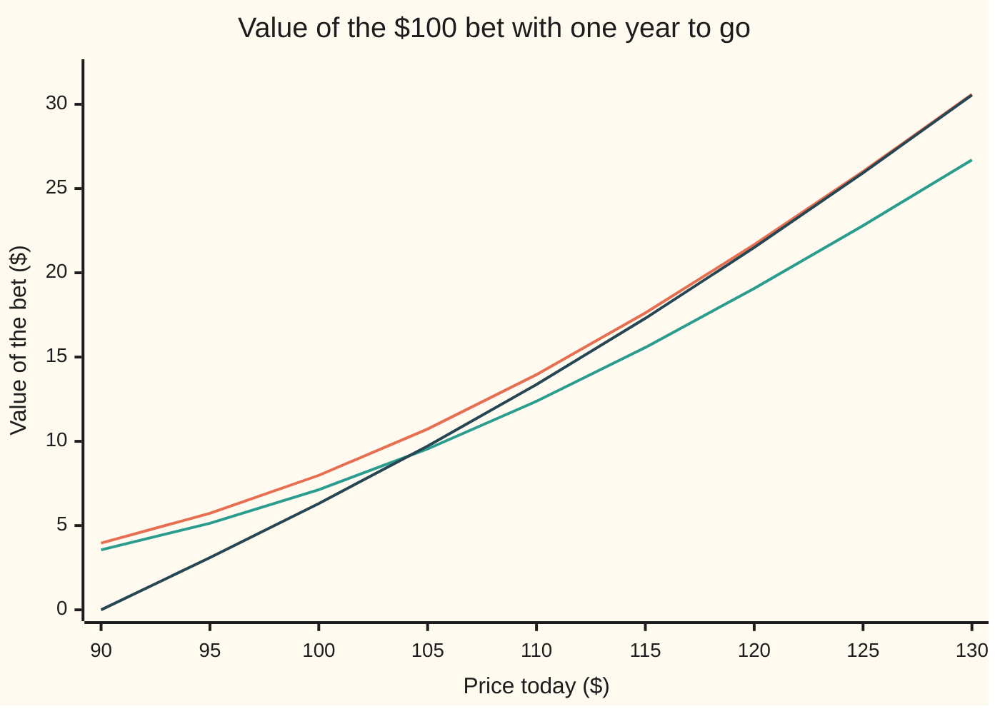

# Feynman-Kac: a diffusion equation is an average over random paths

[Syllabus](../../../SYLLABUS.md) → [Partial differential equations](../README.md) → [The Heat Equation in Depth](../README.md#s03) → Feynman-Kac

---

## General Overview

[Black-Scholes is the heat equation after a change of variables](07-black-scholes-to-the-heat-equation.md) showed that an option price obeys the heat equation in disguise. This card reads that link the other way round. A solution of a diffusion equation is an average over random paths. Each piece of the equation becomes a rule for the paths.

A price starts at $100. It wanders as Brownian motion (a random walk seen from far away) with a spread of $20 after one year. A bet pays whatever the price ends above $100 after one year. The **unknown** is the bet's value $`u`$ for every start price and date. The **region** is the set of prices the bet is alive on. The **data** are the payoff at the end and any rule at the edge of the region.

Three versions of the bet show the three things this card adds:

- **Plain.** The expected payoff is $7.98. This is the [Kolmogorov backward equation](../../11-Stochastic%20processes%20and%20calculus/08-Generators%2C%20Densities%20and%20Simulation/02-kolmogorov-backward-equation.md), unchanged.
- **A seller who may fail.** The seller fails at a rate that rises with the price, because the seller owes more when the price is high. The value drops to $7.13. In the equation the failure rate is a **potential**: a term $`-k(x)\,u`$ that drains value where the rate is high.
- **A knock-out edge.** The bet dies if the price touches $90 first. The value drops to $6.31. In the equation this is a **boundary condition** $`u = 0`$ at $90. On the paths it is a stop: each path is cut at the first touch.

With both the failure rate and the edge, the value is $5.63. Every number comes out two ways: from the equation, and from an average over 160,000 simulated paths.

**A solution of a diffusion equation with a potential and an edge is the average, over the paths of the matching random process, of what each path collects where it stops, discounted by the potential along the way; and it is the only solution that stays continuous and grows no faster than a set rate.**

**What kind of fact this is:** a theorem, proved on this card in Why it works for one space dimension. The plain, failure-rate and edge values are exact closed forms, checked by the tree and the walk; the value with both pieces has no closed form here and comes from the tree, checked by the walk.

### The picture: the bet's value against today's price



Orange: the plain bet. Green: the seller may fail. Dark blue: the knock-out at $90. All three are closed forms printed by both checks. The failure rate pulls the green line down most at high prices, where the rate is highest. The edge pulls the blue line to zero at $90, and matters less and less far above it.

---

## The formula

Reminders. $`W_s`$ is Brownian motion. The price at time $`s`$ is $`X_s = x + \sigma (W_s - W_t)`$ when it starts at $`x`$ at time $`t`$. A subscript on $`u`$ is a slope: $`u_t`$ in time, $`u_x`$ in price, $`u_{xx}`$ the bend. $`E[\,\cdot \mid X_t = x]`$ is the average over all paths that start at $`x`$ at time $`t`$.

**The problem.** Find $`u(t, x)`$ for $`t < T`$ and $`x > b`$ with

```math
u_t + \tfrac12\sigma^2 u_{xx} - k(x)\,u = 0, \qquad u(T, x) = f(x), \qquad u(t, b) = g(t).
```

Here $`f`$ is the payoff at the end date $`T`$, $`b`$ is the edge, $`g`$ is what the bet pays at the edge, and $`k`$ is the potential. For our bet $`f(x) = \max(x - K, 0)`$ with $`K`$ = $100, $`b`$ = $90, $`g = 0`$ and $`k(x) = \beta x`$ with $`\beta`$ = 0.001 per dollar per year.

**The representation.** Let $`H`$ be the first time the path touches $`b`$ (H for hit). Then

```math
u(t, x) = E\Big[\, e^{-\int_t^{H \wedge T} k(X_s)\,ds} \Big( f(X_T)\,\mathbf{1}_{H > T} + g(H)\,\mathbf{1}_{H \le T} \Big) \;\Big|\; X_t = x \Big].
```

**Read it aloud:** the value now is the average, over all paths from $`x`$, of what the path collects where it stops (the payoff if it reaches the end date, the edge payment if it touches the edge first), shrunk by the potential piled up along the way.

Here $`H \wedge T`$ means the earlier of $`H`$ and $`T`$, and $`\mathbf{1}_{H > T}`$ is 1 when the path never touched the edge and 0 otherwise. The factor $`e^{-\int k\,ds}`$ is the chance the seller survives along that path.

**Uniqueness.** The average is the only solution that is continuous up to the edge and the end date and satisfies $`|u(t, x)| \le A\,e^{a x^2}`$ for some constants $`A`$ and $`a`$.

**The closed forms.** Write $`\ell = T - t`$ for the time left. The plain bet has

```math
C(x, \ell) = (x - K)\,N(d) + \sigma\sqrt{\ell}\;\varphi(d), \qquad d = \frac{x - K}{\sigma\sqrt{\ell}} .
```

Here $`\varphi`$ is the bell-curve height and $`N`$ the bell-curve area to the left. With the failure rate, and with the edge,

```math
u_{\text{hazard}} = e^{-\beta x \ell + \beta^2\sigma^2\ell^3/6}\; C\big(x - \tfrac12\beta\sigma^2\ell^2,\ \ell\big), \qquad u_{\text{edge}} = C(x, \ell) - C(2b - x, \ell).
```

**Read it aloud:** the failing seller costs a discount at today's rate, a small credit for luck, and a shift of the price down by 20 cents; the edge costs the value of a mirror bet started at the reflected price $80.

| Symbol | Plain meaning | In our example | Push it up and the answer… |
| --- | --- | --- | --- |
| $`x`$, $`X_s`$ | price today; the price at time $`s`$ along a path | $100 | rises |
| $`t`$, $`T`$, $`\ell`$ | today, the end date, and the time left, in years | 0, 1, 1 | more time left: rises (plain bet), from more spread |
| $`W_s`$, $`\sigma`$ | Brownian motion; spread in dollars per root-year | $20 | rises (plain bet) |
| $`f`$, $`K`$ | payoff at the end; the strike | $`\max(x - 100, 0)`$ dollars | higher strike, lower value |
| $`k(x)`$, $`\beta`$ | potential: the seller's failure rate per year; its slope in the price | $`0.001\,x`$, so 0.1 per year at $100 | falls |
| $`b`$, $`g`$, $`H`$, $`H \wedge T`$, $`\mathbf{1}_{H > T}`$ | the edge, the payment there, the first time the path touches it; the earlier of $`H`$ and $`T`$; 1 if the path never touched the edge, else 0 | $90, $0 | edge higher, value lower |
| $`u`$, $`C`$, $`E[\,\cdot \mid X_t = x]`$ | the bet's value; the plain bet's value; the average over all paths that start at $`x`$ at time $`t`$ | 7.129911 with the failure rate, 6.312536 with the edge | — |
| $`N`$, $`\varphi`$, $`d`$ | bell-curve area, bell-curve height, distance to the strike in spreads | $`d`$ = 0 | — |
| $`A`$, $`a`$, $`R`$ | growth constants of the class; a far edge used in the proof | linear growth here | — |
| $`h`$, $`\delta`$ | the tree's time step and price step $`\delta = \sigma\sqrt{h}`$ | 0.0025 years, $1 | coarser: error grows in proportion to $`h`$ |
| $`v`$ | the corner solution, an impostor with the same data | $`v(0, 100)`$ = 8.824969 | — |
| $`D_s`$, $`M_s`$, $`w`$, $`z`$, $`I`$, $`c`$, $`Z`$ | proof helpers: survival chance up to time $`s`$; discounted value along a path; any solution in the class; the climb to $`R`$ in spreads; in the fold under Step 2, the running total $`\int_0^\ell W_s\,ds`$, the tilt size, and any normal quantity paired with $`I`$ | $`z`$ = 2.5 when $`R`$ = $150; $`c = \beta\sigma`$ | — |

### When it holds

- **The coefficients are tame.** Here $`\sigma`$ is constant and $`k`$ is smooth. With the $90 edge, $`k`$ is bounded below on the region, by its value at the edge. With no edge, $`k = \beta x`$ is not bounded below: the model is Bachelier's (arithmetic Brownian motion), so the price can go negative, and $`k`$ with it; a path needs a five-spread fall for that. The average stays finite anyway, because the price's running total over the year is normal (the fold under Step 2). With a potential that falls to minus infinity fast, the average can be infinite and there is no solution in the class.
- **Paths are stopped at the edge, not bounced.** A stopped path collects $`g`$; a bounced path keeps going. Bouncing solves a different problem, with $`u_x = 0`$ at the edge, and gives $9.65.
- **The solution is continuous where the edge meets the end date.** Drop this and a second solution appears (Step 5).
- **The solution grows no faster than $`A e^{a x^2}`$.** On a line with no edge, Tychonoff built a nonzero solution of the heat equation with zero data that grows faster. Inside the class, the solution is unique.
- **The potential sits in the equation with a minus sign.** Written $`+k u`$, the same average must grow along each path, and the bet would gain from the seller failing.

---

## Why it works

### Step 0: the discounted value is a fair game until the path stops

Follow one path. At each moment, look at the bet's value at the current price, times the chance the seller has survived so far. If $`u`$ is the right value, this number has no drift: on average it neither rises nor falls. A game with no drift that you stop at a fixed or bounded time keeps its starting average. So the value today equals the average of what the game shows when it stops. When it stops, it shows the payoff or the edge payment, times the survival chance.

The equation is the "no drift" condition, written at one point. The average is the same fact, summed over the whole year.

### Step 1: the coin-flip version is exact

Replace the path by a coin-flip walk: every $`h`$ years the price moves up or down by $`\delta = \sigma\sqrt{h}`$, each with chance one half. Over one step the seller fails with chance $`k(x)\,h`$. The value at a node is then

```math
u(t, x) = \big(1 - k(x)\,h\big)\cdot \tfrac12\big[\,u(t + h, x + \delta) + u(t + h, x - \delta)\,\big].
```

This is the backward equation stepped on a tree. Unroll it to the end date and it becomes an average over all coin-flip paths of the payoff times the product of $`(1 - k\,h)`$ along each path. So for the walk, the equation and the path average are the same sum, done in two orders.

Now let $`h`$ shrink. Taylor's theorem gives $`\tfrac12[u(x + \delta) + u(x - \delta)] = u + \tfrac12\delta^2 u_{xx} + \dots`$ and $`\delta^2 = \sigma^2 h`$. Subtract $`u(t, x)`$, divide by $`h`$, and the tree becomes $`u_t + \tfrac12\sigma^2 u_{xx} - k u = 0`$. With $`k = 0`$ this is the backward equation, whose full derivation is on [Kolmogorov backward equation](../../11-Stochastic%20processes%20and%20calculus/08-Generators%2C%20Densities%20and%20Simulation/02-kolmogorov-backward-equation.md).

The checks run the tree at three step sizes and the walk on 160,000 paths. The tree's error falls in proportion to $`h`$ (observed order 0.99 to 1.00).

### Step 2: the potential is a discount along the path

In continuous time, set $`D_s = e^{-\int_t^s k(X_r)\,dr}`$, the survival chance up to time $`s`$, and $`M_s = D_s\,u(s, X_s)`$. Ito's product rule gives

```math
dM_s = D_s\Big(u_t + \tfrac12\sigma^2 u_{xx} - k\,u\Big)\,ds + D_s\,\sigma\,u_x\,dW_s .
```

The bracket is the equation. So $`M`$ has no drift exactly when $`u`$ solves it, and $`M`$ is a fair game (a martingale). The general Ito argument, both directions, is on [Feynman-Kac](../../11-Stochastic%20processes%20and%20calculus/07-Changing%20Measure/06-feynman-kac-formula.md). What is new here is the reading: $`k`$ is a **killing rate**. In physics it is the potential in Schrodinger's equation: Feynman summed over paths in real time, and Kac proved the imaginary-time version, the one on this card. On a rod it is heat lost through the surface.

<details>
<summary>Detailed proof: the closed form for a potential that rises in a straight line</summary>

Start at $`x`$ with time left $`\ell`$. Along a path, $`\int_0^\ell X_s\,ds = x\ell + \sigma I`$ with $`I = \int_0^\ell W_s\,ds`$.

The pair $`(I, W_\ell)`$ is jointly normal. $`I`$ has mean 0 and variance $`\ell^3/3`$; its covariance with $`W_\ell`$ is $`\ell^2/2`$.

For jointly normal $`(I, Z)`$ and a constant $`c`$, the weight $`e^{-cI}`$ has average $`e^{c^2 \mathrm{Var}(I)/2}`$, and it shifts the mean of $`Z`$ by $`-c\,\mathrm{Cov}(I, Z)`$ without changing its variance. Take $`c = \beta\sigma`$:

$`\displaystyle E\Big[e^{-\beta\int_0^\ell X_s ds} f(X_\ell)\Big] = e^{-\beta x \ell}\, e^{\beta^2\sigma^2\ell^3/6}\; E\Big[f\big(x - \tfrac12\beta\sigma^2\ell^2 + \sigma W_\ell\big)\Big].`$

The last average is the plain bet started at $`x - \tfrac12\beta\sigma^2\ell^2`$, which is $`C`$ at that price. The checks confirm the result solves the equation: its residual by centred differences falls by a factor of 4 when the step halves.

</details>

### Step 3: an edge is a place where paths stop

Stop the fair game $`M`$ at $`H \wedge T`$, the earlier of the first touch and the end date. A fair game stopped at a bounded time keeps its average (optional stopping). If the path reached the end date, $`M`$ shows $`D_T f(X_T)`$. If it touched the edge first, it shows $`D_H\,u(H, b) = D_H\,g(H)`$, because that is what the boundary condition says $`u`$ equals there. Averaging gives the representation.

So each piece of the problem has a job on the paths:

| Piece of the PDE problem | Rule for the paths |
| --- | --- |
| $`\tfrac12\sigma^2 u_{xx}`$ | the paths wander, with spread $`\sigma`$ per root-year |
| $`-k(x)\,u`$ | the paths die at rate $`k`$; survivors carry weight $`e^{-\int k}`$ |
| boundary value $`u = g`$ at $`b`$ | paths stop at the first touch and collect $`g`$ |
| end value $`u = f`$ at $`T`$ | survivors collect $`f`$ |

For Brownian motion with one flat edge and no potential, the stopped average has a closed form by reflection. A path from $100 that touches $90 and ends at $`y`$ is matched one-for-one with a path from the mirror point $80 that ends at $`y`$. Subtracting the mirror bet removes the touched paths. This is the method of images (one charge and its mirror charge) seen from the paths.

### Step 4: uniqueness in a growth class

Let $`w`$ be any solution in the class. Run Step 3 for $`w`$, but stop paths also at a far edge $`R`$. Then $`w(t, x)`$ equals the average of what paths collect at $`b`$, at $`T`$ or at $`R`$. The first two pieces are the Feynman-Kac average, cut short. The third is at most the size of $`w`$ at $`R`$ times the chance of reaching $`R`$.

Take first a $`w`$ that grows like the price, as the bet's value does. Then the third piece is at most $`R`$ times the chance of climbing from $100 to $`R`$ within a year. That chance is at most $`2\varphi(z)/z`$ with $`z = (R - 100)/20`$. The checks print the bound:

| Far edge $`R`$ | Bound on the far-edge piece |
| --- | --- |
| $150 | 2.10 |
| $200 | 0.000119 |
| $250 | 0.0000000000162 |

So the far-edge piece vanishes, and $`w`$ equals the average. For any $`w`$ in the class, the fold below runs the same bound with $`A e^{a R^2}`$ in place of $`R`$. Any two solutions in the class therefore agree.

<details>
<summary>Detailed proof: why the class is $`A e^{a x^2}`$, and why time is cut into short pieces</summary>

The chance of climbing a distance $`z\sigma\sqrt{\ell}`$ falls like $`e^{-z^2/2}`$, so the chance of reaching $`R`$ falls like $`e^{-R^2/(2\sigma^2\ell)}`$ for large $`R`$. A solution in the class is at most $`A e^{a R^2}`$ there. The product goes to zero when

$`\displaystyle a < \frac{1}{2\sigma^2\ell}.`$

If $`a`$ is too large for the whole year, cut the year into pieces of length $`\ell`$ short enough for this to hold, and apply the argument piece by piece from the end date backwards. On each piece the two solutions agree at the later time, so they agree at the earlier one. Growth faster than every $`e^{a x^2}`$ is outside the reach of this argument, and Tychonoff's example shows uniqueness really fails there (Evans, Section 2.3).

</details>

### Step 5: what breaks at the corner

The edge and the end date meet at the corner ($90, one year). Continuity there is part of the class. Without it, the function

```math
v(t, x) = (x - b)\,\ell^{-3/2}\, e^{-(x - b)^2/(2\sigma^2\ell)}, \qquad \ell = T - t,
```

solves the plain equation, is 0 on the edge, and tends to 0 at every price as the end date nears. Yet it is not zero: $`v`$ = 8.824969 at $100 with a year left. Adding it to the knock-out value gives a second "solution" worth $15.137505 with the same data.

The catch is the corner. One ten-thousandth of a year before the end, 20 cents above the edge, $`v`$ is 121306.1. It is the slope of a heat kernel placed at the corner: a dipole of heat (a hot spot and a cold spot pressed together) at the edge at the final instant. It is not continuous there, so it is outside the class, and the average is still the only solution inside.

---

## Worked numbers, by hand

The failure rate and the edge, each on its own, at $100 with one year left.

| Step | Arithmetic | Value |
| --- | --- | --- |
| 1. Price shift from the failure rate | $`\tfrac12\beta\sigma^2\ell^2 = \tfrac12 \times 0.001 \times 400 \times 1`$ | $0.20 |
| 2. Luck credit | $`\beta^2\sigma^2\ell^3/6 = 0.000001 \times 400 / 6`$ | 0.00006667 |
| 3. Discount | $`e^{-(0.001 \times 100 \times 1 - 0.00006667)} = e^{-0.09993333}`$ | 0.904898 |
| 4. Plain bet at the shifted price | $`C(99.80, 1)`$ | $7.879245 |
| 5. **With the failure rate** | $`0.904898 \times 7.879245`$ | **$7.129911** |
| 6. Plain bet at $100 | $`C(100, 1) = 20\,\varphi(0) = 20 \times 0.398942`$ | $7.978846 |
| 7. Mirror bet from $80 | $`C(80, 1) = -20\,N(-1) + 20\,\varphi(1)`$ | $1.666309 |
| 8. **With the edge** | $`7.978846 - 1.666309`$ | **$6.312536** |
| 9. **Both together** | tree at $`n`$ = 400 and 1600 steps, extrapolated: $`(4 \times \text{tree}_{1600} - \text{tree}_{400})/3`$ | **$5.626854** |

The seller's failure risk costs 85 cents; the knock-out costs $1.67; together they cost $2.35, less than the $2.52 sum of the two. A path knocked out at $90 pays nothing, so the seller's failure on that path costs nothing more.

### What breaks if you drop a piece

| Mistake | Comes out at | What went wrong |
| --- | --- | --- |
| Freeze the failure rate at today's 0.1 per year | $7.219558 | Misses that paths with high payoffs are the ones where the seller fails most: 9 cents too high |
| Write the potential as $`+k u`$ | $8.929541 | The bet gains from the seller failing |
| Bounce paths at $90 instead of stopping them | $9.645155 | Solves $`u_x = 0`$ at the edge, adding the mirror bet instead of subtracting it |
| Forget the edge | $7.978846 | Paths that touched $90 and came back still pay |
| Allow a solution that breaks at the corner | $15.137505 | Adds the corner solution $`v`$; the data cannot tell it apart |

---

## Code, from first principles, and it actually runs

The code computes the bet's value four ways and makes them agree. The closed forms give the exact values: the Gaussian tilt (reweighting normal paths by the survival factor, which shifts their mean, as in the fold under Step 2) and images. The coin-flip tree steps the equation backward at three step sizes, and its error falls in proportion to the step. A seeded coin-flip walk averages over 160,000 paths, which is the Feynman-Kac formula done literally. Centred differences confirm that each closed form, and the corner solution, solves its equation. The normal curve area is a series written out; random bits come from SplitMix64, written out in both languages.

The four walk estimates sit together, 1.5 to 1.8 standard errors below the tree. They share the same paths, so they move together; each is within the 4 standard errors the assert allows.

### Python

```python
# Feynman-Kac on a bet -- the check behind the card.  Standard library only (math).
# A price starts at $100 and wanders as Brownian motion, $20 spread per root-year.
# The bet pays (price - $100) after one year.  Two additions, read as PDE pieces:
# the seller fails at hazard k(x) = 0.001 x per year (a potential), and the bet
# dies if the price touches $90 (an edge, paths stopped).  Roads: closed forms
# (Gaussian tilt; images); the coin-flip tree (the equation stepped); a seeded
# coin-flip walk (the path average); residuals by centred differences.
import math

X0, SIG, T, K, B, BETA = 100.0, 20.0, 1.0, 100.0, 90.0, 0.001

def phi(z): return math.exp(-z * z / 2) / math.sqrt(2 * math.pi)

def ncdf(z):  # N(z) = 1/2 + phi(z) * sum z^(2n+1) / (1*3*...*(2n+1))
    s = t = z; n = 0
    while abs(t) > 1e-17 * abs(s):
        n += 1; t *= z * z / (2 * n + 1); s += t
    return 0.5 + phi(z) * s

def call(x, tau):  # plain expected payoff: the backward equation's solution
    d = (x - K) / (SIG * math.sqrt(tau))
    return (x - K) * ncdf(d) + SIG * math.sqrt(tau) * phi(d)

def hazard(x, tau, beta=BETA):  # potential k(x) = beta x, by the Gaussian tilt
    return math.exp(-beta * x * tau + beta**2 * SIG**2 * tau**3 / 6) * call(x - beta * SIG**2 * tau**2 / 2, tau)

def edge(x, tau): return call(x, tau) - call(2 * B - x, tau)  # images about $90

def corner(x, tau): return (x - B) * tau**-1.5 * math.exp(-(x - B)**2 / (2 * SIG**2 * tau))

def sci(v):
    m, e = f"{v:.2e}".split("e"); return f"{m}e{int(e)}"

def tree(n, pot, edg):  # backward induction: u_i(x) = w(x) * (u(x+d) + u(x-d)) / 2
    h = T / n; d = SIG * math.sqrt(h)
    v = [max(X0 + (2 * j - n) * d - K, 0.0) for j in range(n + 1)]
    for i in range(n - 1, -1, -1):
        nv = []
        for j in range(i + 1):
            x = X0 + (2 * j - i) * d
            w = 0.0 if (edg and x <= B + 1e-9) else (1 - BETA * x * h if pot else 1.0)
            nv.append(w * 0.5 * (v[j] + v[j + 1]))
        v = nv
    return v[0]

MASK = (1 << 64) - 1
class SplitMix64:
    def __init__(self, seed): self.s = seed
    def next(self):
        self.s = (self.s + 0x9E3779B97F4A7C15) & MASK; z = self.s
        z = ((z ^ (z >> 30)) * 0xBF58476D1CE4E5B9) & MASK
        z = ((z ^ (z >> 27)) * 0x94D049BB133111EB) & MASK
        return z ^ (z >> 31)

def walk(paths, n, seed):  # the path average, all four bets on the same paths
    rng = SplitMix64(seed); h = T / n; sums = [0.0] * 4; sq = [0.0] * 4
    for _ in range(paths):
        x = 100; w = 1.0; alive = True; bits = 0; left = 0
        for _ in range(n):
            if left == 0: bits = rng.next(); left = 64
            w *= 1 - BETA * x * h
            x += 1 if bits & 1 else -1; bits >>= 1; left -= 1
            if x <= 90: alive = False
        pay = max(x - 100, 0)
        for k, v in enumerate((pay, w * pay, pay if alive else 0, w * pay if alive else 0)):
            sums[k] += v; sq[k] += v * v
    mean = [s / paths for s in sums]
    return mean, [math.sqrt((q / paths - m * m) / paths) for q, m in zip(sq, mean)]

print("Bet: price $100, spread $20 per root-year, pays (price - $100) after 1 year")
print("Hazard k(x) = 0.001 x per year (0.1 per year at $100); knock-out edge at $90")
cf = [call(X0, T), hazard(X0, T), edge(X0, T)]
print(f"closed form, plain (backward equation)   ${cf[0]:.6f}")
print(f"closed form, hazard as potential         ${cf[1]:.6f}")
print(f"closed form, knock-out edge by images    ${cf[2]:.6f}")
sh = BETA * SIG**2 * T**2 / 2; tilt = BETA**2 * SIG**2 * T**3 / 6
print(f"hand: shift ${sh:.6f}, tilt {tilt:.8f}, discount exp(-{BETA*X0*T - tilt:.8f}) = {math.exp(-(BETA*X0*T - tilt)):.6f}")
print(f"hand: plain at $99.80 ${call(X0 - sh, T):.6f}; plain at $80 (mirror) ${call(2*B - X0, T):.6f}")
print("coin-flip tree, step h, plain, hazard, edge, both")
tr = {}
for n in (100, 400, 1600):
    tr[n] = [tree(n, p, e) for p, e in ((0, 0), (1, 0), (0, 1), (1, 1))]
    print(f"  n={n:<5d} h={T/n:.6f}  " + "  ".join(f"{v:.6f}" for v in tr[n]))
orders = [math.log((tr[100][k] - tr[400][k]) / (tr[400][k] - tr[1600][k])) / math.log(4) for k in range(4)]
print("observed order " + "  ".join(f"{p:.3f}" for p in orders))
both = (4 * tr[1600][3] - tr[400][3]) / 3
print(f"both pieces, tree extrapolated to h -> 0  ${both:.6f}")
mean, se = walk(160000, 400, 20261115)
print("coin-flip walk, 160000 paths x 400 steps, seed 20261115: estimate (standard error) vs tree n=400")
for k, name in enumerate(("plain ", "hazard", "edge  ", "both  ")):
    print(f"  {name} {mean[k]:.4f} ({se[k]:.4f})  tree {tr[400][k]:.4f}")
    assert abs(mean[k] - tr[400][k]) < 4 * se[k]
for k in range(3):
    assert abs(tr[1600][k] - cf[k]) < 0.005 and 0.8 < orders[k] < 1.2
def resid(f, x, tau, dx, beta):  # u_tau - 1/2 sigma^2 u_xx + beta x u, centred
    ut = (f(x, tau + dx * 1e-3) - f(x, tau - dx * 1e-3)) / (2 * dx * 1e-3)
    uxx = (f(x + dx, tau) - 2 * f(x, tau) + f(x - dx, tau)) / dx**2
    return ut - 0.5 * SIG**2 * uxx + beta * x * f(x, tau)
for name, f, b in (("hazard", hazard, BETA), ("edge  ", edge, 0.0), ("corner", corner, 0.0)):
    r = [resid(f, 100.0, T, dx, b) for dx in (0.5, 0.25)]
    print(f"residual of {name} at ($100, 1 yr), dx $0.50 and $0.25: {sci(r[0])}  {sci(r[1])}")
    assert 3.5 < r[0] / r[1] < 4.5  # truncation error, falling as dx^2
print(f"edge value at $90 for 1 yr: {edge(B, T):.6f}")
print("what breaks")
frozen = cf[0] * math.exp(-BETA * X0 * T)
print(f"  hazard frozen at today's 0.1 per year    ${frozen:.6f}")
print(f"  potential sign flipped (+k u)           ${hazard(X0, T, -BETA):.6f}")
print(f"  edge as a bouncing wall, not a stop     ${call(X0, T) + call(2*B - X0, T):.6f}")
print(f"  no edge at all                          ${cf[0]:.6f}")
v1 = corner(X0, T)
print(f"  corner solution v at ($100, 1 yr) {v1:.6f}; edge price + v ${cf[2] + v1:.6f}")
print(f"  v at $100 with 0.001 yr left {corner(X0, 1e-3):.6f}; v at $90.20 with 0.0001 yr left {corner(B + 0.2, 1e-4):.1f}")
assert frozen > cf[1] + 0.05 and cf[2] < cf[0]
print("far-edge term in the uniqueness proof, R x 2 phi(z)/z with z = (R - 100)/20")
for R in (150.0, 200.0, 250.0):
    z = (R - X0) / SIG; print(f"  R ${R:.0f}: {sci(R * 2 * phi(z) / z)}")
print("chart: price, plain, hazard, edge (1 year to go)")
for x in range(90, 135, 5):
    print(f"  {x}  {call(x, T):.2f}  {hazard(x, T):.2f}  {edge(x, T):.2f}")
print(f"try: hazard slope 0.002 -> ${hazard(X0, T, 0.002):.6f}; edge at $80 -> ${call(X0, T) - call(60.0, T):.6f}")
kap = 1.11e-4
print(f"copper rod: kappa {sci(kap)} m^2/s, path spread after 10 s {100*math.sqrt(2*kap*10):.2f} cm")
print("ALL CHECKS PASS")
```

**Ran 2026-11-15 on macOS, Python 3.14.10, standard library only. All checks passed. Output, pasted from the run:**

```
Bet: price $100, spread $20 per root-year, pays (price - $100) after 1 year
Hazard k(x) = 0.001 x per year (0.1 per year at $100); knock-out edge at $90
closed form, plain (backward equation)   $7.978846
closed form, hazard as potential         $7.129911
closed form, knock-out edge by images    $6.312536
hand: shift $0.200000, tilt 0.00006667, discount exp(-0.09993333) = 0.904898
hand: plain at $99.80 $7.879245; plain at $80 (mirror) $1.666309
coin-flip tree, step h, plain, hazard, edge, both
  n=100   h=0.010000  7.958924  7.112316  6.308767  5.623741
  n=400   h=0.002500  7.973860  7.125507  6.311585  5.626068
  n=1600  h=0.000625  7.977599  7.128810  6.312298  5.626658
observed order 0.999  0.999  0.992  0.990
both pieces, tree extrapolated to h -> 0  $5.626854
coin-flip walk, 160000 paths x 400 steps, seed 20261115: estimate (standard error) vs tree n=400
  plain  7.9213 (0.0291)  tree 7.9739
  hazard 7.0784 (0.0259)  tree 7.1255
  edge   6.2698 (0.0284)  tree 6.3116
  both   5.5886 (0.0253)  tree 5.6261
residual of hazard at ($100, 1 yr), dx $0.50 and $0.25: 1.88e-4  4.70e-5
residual of edge   at ($100, 1 yr), dx $0.50 and $0.25: 2.08e-4  5.20e-5
residual of corner at ($100, 1 yr), dx $0.50 and $0.25: -2.89e-3  -7.23e-4
edge value at $90 for 1 yr: 0.000000
what breaks
  hazard frozen at today's 0.1 per year    $7.219558
  potential sign flipped (+k u)           $8.929541
  edge as a bouncing wall, not a stop     $9.645155
  no edge at all                          $7.978846
  corner solution v at ($100, 1 yr) 8.824969; edge price + v $15.137505
  v at $100 with 0.001 yr left 0.000000; v at $90.20 with 0.0001 yr left 121306.1
far-edge term in the uniqueness proof, R x 2 phi(z)/z with z = (R - 100)/20
  R $150: 2.10e0
  R $200: 1.19e-4
  R $250: 1.62e-11
chart: price, plain, hazard, edge (1 year to go)
  90  3.96  3.56  0.00
  95  5.73  5.14  3.10
  100  7.98  7.13  6.31
  105  10.73  9.55  9.72
  110  13.96  12.38  13.37
  115  17.62  15.57  17.30
  120  21.67  19.07  21.50
  125  26.01  22.80  25.93
  130  30.59  26.70  30.55
try: hazard slope 0.002 -> $6.371786; edge at $80 -> $7.809032
copper rod: kappa 1.11e-4 m^2/s, path spread after 10 s 4.71 cm
ALL CHECKS PASS
```

### Rust

```rust
// Feynman-Kac on a bet -- the check behind the card.  Rust std only.
// A price starts at $100 and wanders as Brownian motion, $20 spread per root-year.
// The bet pays (price - $100) after one year.  Two additions, read as PDE pieces:
// the seller fails at hazard k(x) = 0.001 x per year (a potential), and the bet
// dies if the price touches $90 (an edge, paths stopped).  Roads: closed forms
// (Gaussian tilt; images); the coin-flip tree (the equation stepped); a seeded
// coin-flip walk (the path average); residuals by centred differences.
const X0: f64 = 100.0;
const SIG: f64 = 20.0;
const T: f64 = 1.0;
const K: f64 = 100.0;
const B: f64 = 90.0;
const BETA: f64 = 0.001;

fn phi(z: f64) -> f64 { (-z * z / 2.0).exp() / (2.0 * std::f64::consts::PI).sqrt() }

fn ncdf(z: f64) -> f64 { // N(z) = 1/2 + phi(z) * sum z^(2n+1) / (1*3*...*(2n+1))
    let (mut s, mut t, mut n) = (z, z, 0.0);
    while t.abs() > 1e-17 * s.abs() {
        n += 1.0; t *= z * z / (2.0 * n + 1.0); s += t;
    }
    0.5 + phi(z) * s
}

fn call(x: f64, tau: f64) -> f64 { // plain expected payoff: the backward equation's solution
    let d = (x - K) / (SIG * tau.sqrt());
    (x - K) * ncdf(d) + SIG * tau.sqrt() * phi(d)
}

fn hazard_b(x: f64, tau: f64, beta: f64) -> f64 { // potential k(x) = beta x, by the Gaussian tilt
    (-beta * x * tau + beta.powi(2) * SIG.powi(2) * tau.powi(3) / 6.0).exp()
        * call(x - beta * SIG.powi(2) * tau.powi(2) / 2.0, tau)
}
fn hazard(x: f64, tau: f64) -> f64 { hazard_b(x, tau, BETA) }

fn edge(x: f64, tau: f64) -> f64 { call(x, tau) - call(2.0 * B - x, tau) } // images about $90

fn corner(x: f64, tau: f64) -> f64 { (x - B) * tau.powf(-1.5) * (-(x - B).powi(2) / (2.0 * SIG * SIG * tau)).exp() }

fn sci(v: f64) -> String { format!("{:.2e}", v) }

fn tree(n: usize, pot: bool, edg: bool) -> f64 { // u_i(x) = w(x) * (u(x+d) + u(x-d)) / 2
    let h = T / n as f64;
    let d = SIG * h.sqrt();
    let mut v: Vec<f64> = (0..=n).map(|j| (X0 + (2.0 * j as f64 - n as f64) * d - K).max(0.0)).collect();
    for i in (0..n).rev() {
        let mut nv = Vec::with_capacity(i + 1);
        for j in 0..=i {
            let x = X0 + (2.0 * j as f64 - i as f64) * d;
            let w = if edg && x <= B + 1e-9 { 0.0 } else if pot { 1.0 - BETA * x * h } else { 1.0 };
            nv.push(w * 0.5 * (v[j] + v[j + 1]));
        }
        v = nv;
    }
    v[0]
}

struct SplitMix64 { s: u64 }
impl SplitMix64 {
    fn next(&mut self) -> u64 {
        self.s = self.s.wrapping_add(0x9E3779B97F4A7C15);
        let mut z = self.s;
        z = (z ^ (z >> 30)).wrapping_mul(0xBF58476D1CE4E5B9);
        z = (z ^ (z >> 27)).wrapping_mul(0x94D049BB133111EB);
        z ^ (z >> 31)
    }
}

fn walk(paths: usize, n: usize, seed: u64) -> ([f64; 4], [f64; 4]) { // the path average
    let mut rng = SplitMix64 { s: seed };
    let h = T / n as f64;
    let (mut sums, mut sq) = ([0.0f64; 4], [0.0f64; 4]);
    for _ in 0..paths {
        let (mut x, mut w, mut alive, mut bits, mut left) = (100i64, 1.0f64, true, 0u64, 0u32);
        for _ in 0..n {
            if left == 0 { bits = rng.next(); left = 64; }
            w *= 1.0 - BETA * x as f64 * h;
            x += if bits & 1 == 1 { 1 } else { -1 };
            bits >>= 1; left -= 1;
            if x <= 90 { alive = false; }
        }
        let pay = (x - 100).max(0) as f64;
        let vals = [pay, w * pay, if alive { pay } else { 0.0 }, if alive { w * pay } else { 0.0 }];
        for k in 0..4 { sums[k] += vals[k]; sq[k] += vals[k] * vals[k]; }
    }
    let p = paths as f64;
    let mean = sums.map(|s| s / p);
    let mut se = [0.0; 4];
    for k in 0..4 { se[k] = ((sq[k] / p - mean[k] * mean[k]) / p).sqrt(); }
    (mean, se)
}

fn resid(f: fn(f64, f64) -> f64, x: f64, tau: f64, dx: f64, beta: f64) -> f64 { // centred
    let ut = (f(x, tau + dx * 1e-3) - f(x, tau - dx * 1e-3)) / (2.0 * dx * 1e-3);
    let uxx = (f(x + dx, tau) - 2.0 * f(x, tau) + f(x - dx, tau)) / (dx * dx);
    ut - 0.5 * SIG * SIG * uxx + beta * x * f(x, tau)
}

fn main() {
    println!("Bet: price $100, spread $20 per root-year, pays (price - $100) after 1 year");
    println!("Hazard k(x) = 0.001 x per year (0.1 per year at $100); knock-out edge at $90");
    let cf = [call(X0, T), hazard(X0, T), edge(X0, T)];
    println!("closed form, plain (backward equation)   ${:.6}", cf[0]);
    println!("closed form, hazard as potential         ${:.6}", cf[1]);
    println!("closed form, knock-out edge by images    ${:.6}", cf[2]);
    let sh = BETA * SIG.powi(2) * T.powi(2) / 2.0;
    let tilt = BETA.powi(2) * SIG.powi(2) * T.powi(3) / 6.0;
    println!("hand: shift ${:.6}, tilt {:.8}, discount exp(-{:.8}) = {:.6}", sh, tilt, BETA * X0 * T - tilt, (-(BETA * X0 * T - tilt)).exp());
    println!("hand: plain at $99.80 ${:.6}; plain at $80 (mirror) ${:.6}", call(X0 - sh, T), call(2.0 * B - X0, T));
    println!("coin-flip tree, step h, plain, hazard, edge, both");
    let ns = [100usize, 400, 1600];
    let mut tr = [[0.0f64; 4]; 3];
    for (a, &n) in ns.iter().enumerate() {
        for (k, &(p, e)) in [(false, false), (true, false), (false, true), (true, true)].iter().enumerate() {
            tr[a][k] = tree(n, p, e);
        }
        let row: Vec<String> = tr[a].iter().map(|v| format!("{:.6}", v)).collect();
        println!("  n={:<5} h={:.6}  {}", n, T / n as f64, row.join("  "));
    }
    let orders: Vec<f64> = (0..4).map(|k| ((tr[0][k] - tr[1][k]) / (tr[1][k] - tr[2][k])).ln() / 4f64.ln()).collect();
    let ord: Vec<String> = orders.iter().map(|p| format!("{:.3}", p)).collect();
    println!("observed order {}", ord.join("  "));
    let both = (4.0 * tr[2][3] - tr[1][3]) / 3.0;
    println!("both pieces, tree extrapolated to h -> 0  ${:.6}", both);
    let (mean, se) = walk(160000, 400, 20261115);
    println!("coin-flip walk, 160000 paths x 400 steps, seed 20261115: estimate (standard error) vs tree n=400");
    for (k, name) in ["plain ", "hazard", "edge  ", "both  "].iter().enumerate() {
        println!("  {} {:.4} ({:.4})  tree {:.4}", name, mean[k], se[k], tr[1][k]);
        assert!((mean[k] - tr[1][k]).abs() < 4.0 * se[k]);
    }
    for k in 0..3 {
        assert!((tr[2][k] - cf[k]).abs() < 0.005 && orders[k] > 0.8 && orders[k] < 1.2);
    }
    let fs: [(&str, fn(f64, f64) -> f64, f64); 3] = [("hazard", hazard, BETA), ("edge  ", edge, 0.0), ("corner", corner, 0.0)];
    for (name, f, b) in fs.iter() {
        let r = [resid(*f, 100.0, T, 0.5, *b), resid(*f, 100.0, T, 0.25, *b)];
        println!("residual of {} at ($100, 1 yr), dx $0.50 and $0.25: {}  {}", name, sci(r[0]), sci(r[1]));
        assert!(r[0] / r[1] > 3.5 && r[0] / r[1] < 4.5); // truncation error, falling as dx^2
    }
    println!("edge value at $90 for 1 yr: {:.6}", edge(B, T));
    println!("what breaks");
    let frozen = cf[0] * (-BETA * X0 * T).exp();
    println!("  hazard frozen at today's 0.1 per year    ${:.6}", frozen);
    println!("  potential sign flipped (+k u)           ${:.6}", hazard_b(X0, T, -BETA));
    println!("  edge as a bouncing wall, not a stop     ${:.6}", call(X0, T) + call(2.0 * B - X0, T));
    println!("  no edge at all                          ${:.6}", cf[0]);
    let v1 = corner(X0, T);
    println!("  corner solution v at ($100, 1 yr) {:.6}; edge price + v ${:.6}", v1, cf[2] + v1);
    println!("  v at $100 with 0.001 yr left {:.6}; v at $90.20 with 0.0001 yr left {:.1}", corner(X0, 1e-3), corner(B + 0.2, 1e-4));
    assert!(frozen > cf[1] + 0.05 && cf[2] < cf[0]);
    println!("far-edge term in the uniqueness proof, R x 2 phi(z)/z with z = (R - 100)/20");
    for r in [150.0f64, 200.0, 250.0] {
        let z = (r - X0) / SIG;
        println!("  R ${:.0}: {}", r, sci(r * 2.0 * phi(z) / z));
    }
    println!("chart: price, plain, hazard, edge (1 year to go)");
    for x in (90..135).step_by(5) {
        let xf = x as f64;
        println!("  {}  {:.2}  {:.2}  {:.2}", x, call(xf, T), hazard(xf, T), edge(xf, T));
    }
    println!("try: hazard slope 0.002 -> ${:.6}; edge at $80 -> ${:.6}", hazard_b(X0, T, 0.002), call(X0, T) - call(60.0, T));
    let kap = 1.11e-4f64;
    println!("copper rod: kappa {} m^2/s, path spread after 10 s {:.2} cm", sci(kap), 100.0 * (2.0 * kap * 10.0).sqrt());
    println!("ALL CHECKS PASS");
}
```

**Ran 2026-11-15 on macOS, rustc 1.98.1, no crates. All checks passed. Output, pasted from the run:**

```
Bet: price $100, spread $20 per root-year, pays (price - $100) after 1 year
Hazard k(x) = 0.001 x per year (0.1 per year at $100); knock-out edge at $90
closed form, plain (backward equation)   $7.978846
closed form, hazard as potential         $7.129911
closed form, knock-out edge by images    $6.312536
hand: shift $0.200000, tilt 0.00006667, discount exp(-0.09993333) = 0.904898
hand: plain at $99.80 $7.879245; plain at $80 (mirror) $1.666309
coin-flip tree, step h, plain, hazard, edge, both
  n=100   h=0.010000  7.958924  7.112316  6.308767  5.623741
  n=400   h=0.002500  7.973860  7.125507  6.311585  5.626068
  n=1600  h=0.000625  7.977599  7.128810  6.312298  5.626658
observed order 0.999  0.999  0.992  0.990
both pieces, tree extrapolated to h -> 0  $5.626854
coin-flip walk, 160000 paths x 400 steps, seed 20261115: estimate (standard error) vs tree n=400
  plain  7.9213 (0.0291)  tree 7.9739
  hazard 7.0784 (0.0259)  tree 7.1255
  edge   6.2698 (0.0284)  tree 6.3116
  both   5.5886 (0.0253)  tree 5.6261
residual of hazard at ($100, 1 yr), dx $0.50 and $0.25: 1.88e-4  4.70e-5
residual of edge   at ($100, 1 yr), dx $0.50 and $0.25: 2.08e-4  5.20e-5
residual of corner at ($100, 1 yr), dx $0.50 and $0.25: -2.89e-3  -7.23e-4
edge value at $90 for 1 yr: 0.000000
what breaks
  hazard frozen at today's 0.1 per year    $7.219558
  potential sign flipped (+k u)           $8.929541
  edge as a bouncing wall, not a stop     $9.645155
  no edge at all                          $7.978846
  corner solution v at ($100, 1 yr) 8.824969; edge price + v $15.137505
  v at $100 with 0.001 yr left 0.000000; v at $90.20 with 0.0001 yr left 121306.1
far-edge term in the uniqueness proof, R x 2 phi(z)/z with z = (R - 100)/20
  R $150: 2.10e0
  R $200: 1.19e-4
  R $250: 1.62e-11
chart: price, plain, hazard, edge (1 year to go)
  90  3.96  3.56  0.00
  95  5.73  5.14  3.10
  100  7.98  7.13  6.31
  105  10.73  9.55  9.72
  110  13.96  12.38  13.37
  115  17.62  15.57  17.30
  120  21.67  19.07  21.50
  125  26.01  22.80  25.93
  130  30.59  26.70  30.55
try: hazard slope 0.002 -> $6.371786; edge at $80 -> $7.809032
copper rod: kappa 1.11e-4 m^2/s, path spread after 10 s 4.71 cm
ALL CHECKS PASS
```

### Lean

Lean proves the coin-flip tree of Steps 1 and 3, the closed form under Step 2, and the corner solution of Step 5.

- Suppose the tree value is $`g`$ on or below the edge, $`f`$ at the end, and Step 1's formula elsewhere. Then at every node it is the average, over all coin-flip paths, of what each path collects where it stops, times its survival chance.
- Take any $`C`$ that solves the plain equation for time left $`\ell > 0`$, with continuous slopes and bend. Then $`u_{\text{hazard}}`$, built from that $`C`$, solves the equation with the potential $`k(x) = \beta x`$.
- Take any spread $`\sigma > 0`$, edge $`b`$ and end date $`T`$, and the corner solution $`v`$ of Step 5. Then $`v`$ solves the plain equation, is 0 on the edge, tends to 0 as the end date nears, and is positive above the edge.
- Take the same $`v`$. Then it passes any bound close to the corner, so it is not continuous there.
- Steps 1 to 3 of the worked numbers also check, in exact fractions. So do the mirror point $80, the $1 tree step, $`z`$ = 2.5 at $150, and the extrapolation weights.

The limit as $`h`$ shrinks, uniqueness in the growth class, the mirror-bet formula and the dollar values are left to the Python and Rust checks.

```lean
-- Feynman-Kac: on the coin-flip tree, the value stepped back through the equation with a killing rate and a stopping edge is exactly the average over all paths of what each path collects where it stops, discounted by survival; the price-linear killing rate is a Gaussian tilt of the plain solution; and the corner solution is a second solution with the same data.
import Mathlib.Analysis.Calculus.IteratedDeriv.Defs
import Mathlib.Analysis.Calculus.ContDiff.Defs
import Mathlib.Analysis.Calculus.Deriv.Basic
import Mathlib.Analysis.SpecialFunctions.Exp
import Mathlib.Analysis.SpecialFunctions.Pow.Real
import Mathlib.Data.List.OfFn
import Mathlib.Algebra.BigOperators.Fin
import Mathlib.Order.Filter.Basic
import Mathlib.Topology.Order.Basic
import Mathlib.Analysis.SpecialFunctions.Pow.Deriv
import Mathlib.Analysis.SpecialFunctions.Pow.Asymptotics
import Mathlib.Analysis.SpecialFunctions.ExpDeriv
import Mathlib.Analysis.Calculus.ContDiff.Deriv
import Mathlib.Analysis.Calculus.Deriv.Prod
import Mathlib.Analysis.Calculus.Deriv.Pow
import Mathlib.Tactic

open Real Filter Topology

namespace FeynmanKacKolmogorov

/-! Notation, as on the card. On the coin-flip tree every step lasts `h` years and moves the
price up or down by `δ` (the card takes `δ = σ √h`). `k x` is the potential (the seller's failure
rate per year at price `x`), `b` the edge, `g i` the payment at the edge at step `i`, and `f` the
payoff at the end step `n`. A path is a list of coin flips, `true` for up and `false` for down. -/

/-- **What one path collects where it stops.** Starting at step `i` at price `x`, follow the coin
flips `cs`. At the first step where the price is at or below the edge `b`, the path stops and
collects the edge payment `g` at that step. If it never touches the edge, it collects the payoff
`f` at the end. Each step it survives in the region multiplies its weight by `1 - k(x) h`, the
chance the seller survives that step. -/
noncomputable def collect (k f : ℝ → ℝ) (g : ℕ → ℝ) (b δ h : ℝ) : ℕ → List Bool → ℝ → ℝ
  | i, [], x => if x ≤ b then g i else f x
  | i, c :: cs, x =>
      if x ≤ b then g i
      else (1 - k x * h) * collect k f g b δ h (i + 1) cs (x + if c then δ else -δ)

theorem sum_ofFn_succ (m : ℕ) (F : List Bool → ℝ) :
    ∑ ω : Fin (m + 1) → Bool, F (List.ofFn ω) =
      ∑ ω : Fin m → Bool, (F (true :: List.ofFn ω) + F (false :: List.ofFn ω)) := by
  rw [← (Fin.consEquiv (fun _ => Bool)).sum_comp]
  rw [Fintype.sum_prod_type]
  simp [Fin.consEquiv, List.ofFn_succ, Finset.sum_add_distrib, add_comm]

#print axioms sum_ofFn_succ

/-- Second derivative of `y ↦ exp (-α y + c) * G (y - s)` for a `C²` function `G`. -/
theorem tilt_space_deriv (G : ℝ → ℝ) (hG : ContDiff ℝ 2 G) (α c s x : ℝ) :
    iteratedDeriv 2 (fun y => exp (-α * y + c) * G (y - s)) x =
      exp (-α * x + c) * (α ^ 2 * G (x - s) - 2 * α * deriv G (x - s)
        + iteratedDeriv 2 G (x - s)) := by
  have hG1 : Differentiable ℝ G := hG.differentiable (by norm_num)
  have hG2 : ContDiff ℝ 1 (deriv G) := by
    have h := hG
    rw [show (2 : WithTop ℕ∞) = 1 + 1 by norm_num] at h
    exact (contDiff_succ_iff_deriv.mp h).2.2
  have hG2d : Differentiable ℝ (deriv G) := hG2.differentiable (by norm_num)
  have he : ∀ y, HasDerivAt (fun y => exp (-α * y + c)) (exp (-α * y + c) * (-α)) y := by
    intro y
    have := (((hasDerivAt_id y).const_mul (-α)).add_const c).exp
    simpa using this
  have hs : ∀ y, HasDerivAt (fun y => y - s) 1 y := fun y => (hasDerivAt_id y).sub_const s
  have h1 : ∀ y, HasDerivAt (fun y => exp (-α * y + c) * G (y - s))
      (exp (-α * y + c) * (-α * G (y - s) + deriv G (y - s))) y := by
    intro y
    have := (he y).mul ((hG1 (y - s)).hasDerivAt.comp y (hs y))
    refine this.congr_deriv ?_
    simp only [Function.comp_apply, mul_one]; ring
  rw [iteratedDeriv_succ, iteratedDeriv_one]
  have hd : deriv (fun y => exp (-α * y + c) * G (y - s)) =
      fun y => exp (-α * y + c) * (-α * G (y - s) + deriv G (y - s)) := by
    funext y; exact (h1 y).deriv
  rw [hd]
  have h2 : HasDerivAt (fun y => -α * G (y - s) + deriv G (y - s))
      (-α * deriv G (x - s) + deriv (deriv G) (x - s)) x := by
    have a1 := ((hG1 (x - s)).hasDerivAt.comp x (hs x)).const_mul (-α)
    have a2 := (hG2d (x - s)).hasDerivAt.comp x (hs x)
    refine (a1.add a2).congr_deriv ?_
    simp only [mul_one]
  have h3 : HasDerivAt (fun y => exp (-α * y + c) * (-α * G (y - s) + deriv G (y - s)))
      (exp (-α * x + c) * -α * (-α * G (x - s) + deriv G (x - s)) +
        exp (-α * x + c) * (-α * deriv G (x - s) + deriv (deriv G) (x - s))) x := (he x).mul h2
  rw [h3.deriv, iteratedDeriv_succ, iteratedDeriv_one]
  ring

#print axioms tilt_space_deriv

theorem corner_hasDerivAt_x (b L A y : ℝ) :
    HasDerivAt (fun y => (y - b) * L * exp (-(y - b) ^ 2 / A))
      (L * exp (-(y - b) ^ 2 / A) * (1 - 2 * (y - b) ^ 2 / A)) y := by
  have h1 : HasDerivAt (fun y => y - b) 1 y := (hasDerivAt_id y).sub_const b
  have h2 : HasDerivAt (fun y => -(y - b) ^ 2 / A) (-(2 * (y - b)) / A) y := by
    have := ((h1.pow 2).neg).div_const A
    convert this using 1; simp
  have := (h1.mul_const L).mul h2.exp
  convert this using 1; ring

#print axioms corner_hasDerivAt_x

theorem corner_hasDerivAt_xx (b L A y : ℝ) :
    HasDerivAt (fun y => L * exp (-(y - b) ^ 2 / A) * (1 - 2 * (y - b) ^ 2 / A))
      (L * exp (-(y - b) ^ 2 / A) * ((-(2 * (y - b)) / A) * (1 - 2 * (y - b) ^ 2 / A)
        - 4 * (y - b) / A)) y := by
  have h1 : HasDerivAt (fun y => y - b) 1 y := (hasDerivAt_id y).sub_const b
  have h2 : HasDerivAt (fun y => -(y - b) ^ 2 / A) (-(2 * (y - b)) / A) y := by
    have := ((h1.pow 2).neg).div_const A
    convert this using 1; simp
  have h3 : HasDerivAt (fun y => 1 - 2 * (y - b) ^ 2 / A) (-(4 * (y - b) / A)) y := by
    have := (((h1.pow 2).const_mul 2).div_const A).const_sub 1
    convert this using 1; simp; ring
  have := (h2.exp.const_mul L).mul h3
  convert this using 1; ring

#print axioms corner_hasDerivAt_xx

theorem corner_iteratedDeriv_two (b L A x : ℝ) :
    iteratedDeriv 2 (fun y => (y - b) * L * exp (-(y - b) ^ 2 / A)) x =
      L * exp (-(x - b) ^ 2 / A) * ((-(2 * (x - b)) / A) * (1 - 2 * (x - b) ^ 2 / A)
        - 4 * (x - b) / A) := by
  rw [iteratedDeriv_succ, iteratedDeriv_one]
  have : deriv (fun y => (y - b) * L * exp (-(y - b) ^ 2 / A)) =
      fun y => L * exp (-(y - b) ^ 2 / A) * (1 - 2 * (y - b) ^ 2 / A) := by
    funext y; exact (corner_hasDerivAt_x b L A y).deriv
  rw [this]
  exact (corner_hasDerivAt_xx b L A x).deriv

#print axioms corner_iteratedDeriv_two

theorem corner_hasDerivAt_t (x b σ T t : ℝ) (hσ : σ ≠ 0) (ht : t < T) :
    HasDerivAt (fun s => (x - b) * (T - s) ^ (-(3 / 2 : ℝ)) * exp (-(x - b) ^ 2 / (2 * σ ^ 2 * (T - s))))
      ((x - b) * exp (-(x - b) ^ 2 / (2 * σ ^ 2 * (T - t))) *
        ((3 / 2) * (T - t) ^ (-(3 / 2 : ℝ)) / (T - t)
          - (T - t) ^ (-(3 / 2 : ℝ)) * (x - b) ^ 2 / (2 * σ ^ 2 * (T - t) ^ 2))) t := by
  have hl : 0 < T - t := sub_pos.mpr ht
  have h1 : HasDerivAt (fun s => T - s) (-1) t := by
    simpa using (hasDerivAt_id t).const_sub T
  have h2 := h1.rpow_const (p := -(3 / 2 : ℝ)) (Or.inl hl.ne')
  have h3 : HasDerivAt (fun s => -(x - b) ^ 2 / (2 * σ ^ 2 * (T - s)))
      (-(-(x - b) ^ 2 * (2 * σ ^ 2 * (-1))) / (2 * σ ^ 2 * (T - t)) ^ 2) t := by
    have := (hasDerivAt_const t (-(x - b) ^ 2)).div (h1.const_mul (2 * σ ^ 2))
      (by have : 0 < σ ^ 2 * (T - t) := by positivity
          positivity)
    convert this using 1; ring
  have := (h2.const_mul (x - b)).mul h3.exp
  convert this using 1
  rw [rpow_sub_one hl.ne']
  field_simp
  ring

#print axioms corner_hasDerivAt_t

/-- **Feynman-Kac on the coin-flip tree: the equation and the path average are the same sum**
(Why it works, Step 1, with the potential of Step 2 and the edge of Step 3). Let `u i x` be the
bet's value at step `i` of `n` at price `x`, worked backward through the tree:
* at or below the edge it is the edge payment, `u i x = g i`;
* above the edge on the end step it is the payoff, `u n x = f x`;
* above the edge before the end it is one step of the backward equation with the potential,
  `u i x = (1 - k(x) h) · ½ [u (i+1) (x + δ) + u (i+1) (x - δ)]`.
Then at every step `i ≤ n` and every price `x`, the value is the average, over all `2^(n-i)`
coin-flip paths from `x`, of what each path collects where it stops (the payoff if it reaches
the end, the edge payment if it touches the edge first), times its survival factor along the
way. On the tree no growth or continuity condition is needed: the minus sign of the potential
is the factor `1 - k h`, and stopping (not bouncing) at the edge is built into `collect`. -/
theorem tree_value_eq_path_average
    (k f : ℝ → ℝ) (g : ℕ → ℝ) (b δ h : ℝ) (n : ℕ) (u : ℕ → ℝ → ℝ)
    (hedge : ∀ i ≤ n, ∀ x, x ≤ b → u i x = g i)
    (hend : ∀ x, b < x → u n x = f x)
    (hstep : ∀ i < n, ∀ x, b < x →
      u i x = (1 - k x * h) * ((u (i + 1) (x + δ) + u (i + 1) (x - δ)) / 2)) :
    ∀ i ≤ n, ∀ x,
      u i x = (∑ ω : Fin (n - i) → Bool, collect k f g b δ h i (List.ofFn ω) x) / 2 ^ (n - i) := by
  suffices H : ∀ m i, n - i = m → i ≤ n → ∀ x,
      u i x = (∑ ω : Fin m → Bool, collect k f g b δ h i (List.ofFn ω) x) / 2 ^ m by
    intro i hi x
    exact H (n - i) i rfl hi x
  intro m
  induction m with
  | zero =>
    intro i hm hi x
    have hin : i = n := by omega
    subst hin
    simp only [Finset.univ_unique, Finset.sum_singleton, pow_zero, div_one]
    rw [List.ofFn_zero]
    simp only [collect]
    split_ifs with hx
    · exact hedge i le_rfl x hx
    · exact hend x (lt_of_not_ge hx)
  | succ m ih =>
    intro i hm hi x
    have hlt : i < n := by omega
    have hm' : n - (i + 1) = m := by omega
    rw [sum_ofFn_succ m (fun l => collect k f g b δ h i l x)]
    by_cases hx : x ≤ b
    · simp only [collect, hx, ite_true]
      rw [hedge i hi x hx]
      simp only [Finset.sum_const, Finset.card_univ, Fintype.card_pi, Fintype.card_bool,
        Finset.prod_const, Fintype.card_fin, nsmul_eq_mul]
      push_cast
      field_simp
      ring
    · have hbx : b < x := lt_of_not_ge hx
      simp only [collect, hx, ite_false, ite_true, Bool.false_eq_true, ← sub_eq_add_neg]
      rw [hstep i hlt x hbx, ih (i + 1) hm' hlt (x + δ), ih (i + 1) hm' hlt (x - δ)]
      rw [Finset.sum_add_distrib, ← Finset.mul_sum, ← Finset.mul_sum]
      rw [pow_succ]
      field_simp

/-- **A potential that rises in a straight line is a Gaussian tilt** (the closed form, and the
fold under Step 2). Write `C (x, ℓ)` for a solution of the plain backward equation in the time
left `ℓ > 0`, so `C_ℓ = ½ σ² C_xx`. Then
`u (x, ℓ) = e^{-β x ℓ + β² σ² ℓ³ / 6} · C (x - ½ β σ² ℓ², ℓ)`
solves the equation with the failure rate `k(x) = β x` as a potential,
`u_ℓ = ½ σ² u_xx - β x u`: the discount at today's rate, the small credit for luck, and the
shift of the price down by `½ β σ² ℓ²`. -/
theorem hazard_tilt_solves_equation_with_potential
    (σ β : ℝ) (C : ℝ × ℝ → ℝ)
    (hC : ContDiffOn ℝ 2 C {p : ℝ × ℝ | 0 < p.2})
    (hheat : ∀ x ℓ, 0 < ℓ →
      deriv (fun s => C (x, s)) ℓ = σ ^ 2 / 2 * iteratedDeriv 2 (fun y => C (y, ℓ)) x) :
    let u : ℝ → ℝ → ℝ := fun x ℓ =>
      exp (-β * x * ℓ + β ^ 2 * σ ^ 2 * ℓ ^ 3 / 6) * C (x - β * σ ^ 2 * ℓ ^ 2 / 2, ℓ)
    ∀ x ℓ, 0 < ℓ →
      DifferentiableAt ℝ (fun s => u x s) ℓ ∧ ContDiffAt ℝ 2 (fun y => u y ℓ) x ∧
      deriv (fun s => u x s) ℓ = σ ^ 2 / 2 * iteratedDeriv 2 (fun y => u y ℓ) x - β * x * u x ℓ := by
  intro u x ℓ hℓ
  have hU : IsOpen {p : ℝ × ℝ | 0 < p.2} := isOpen_lt continuous_const continuous_snd
  have hCat : ∀ p : ℝ × ℝ, 0 < p.2 → ContDiffAt ℝ 2 C p :=
    fun p hp => hC.contDiffAt (hU.mem_nhds hp)
  have hCd : ∀ p : ℝ × ℝ, 0 < p.2 → DifferentiableAt ℝ C p :=
    fun p hp => (hCat p hp).differentiableAt (by norm_num)
  set G : ℝ → ℝ := fun y => C (y, ℓ) with hGdef
  have hG : ContDiff ℝ 2 G := by
    rw [contDiff_iff_contDiffAt]
    intro y
    exact (hCat (y, ℓ) hℓ).comp y (contDiffAt_id.prodMk contDiffAt_const)
  set x' := x - β * σ ^ 2 * ℓ ^ 2 / 2 with hx'
  set p0 : ℝ × ℝ := (x', ℓ) with hp0
  have hp0pos : 0 < p0.2 := hℓ
  -- partial derivatives of `C` at `p0`
  set L := fderiv ℝ C p0 with hL
  have hCp0 : HasFDerivAt C L p0 := (hCd p0 hp0pos).hasFDerivAt
  have hGx : deriv G x' = L (1, 0) := by
    have := hCp0.comp_hasDerivAt x' ((hasDerivAt_id x').prodMk (hasDerivAt_const x' ℓ))
    exact this.deriv
  have hCt : deriv (fun s => C (x', s)) ℓ = L (0, 1) := by
    have := hCp0.comp_hasDerivAt ℓ ((hasDerivAt_const ℓ x').prodMk (hasDerivAt_id ℓ))
    exact this.deriv
  -- time derivative
  have hpath : HasDerivAt (fun s => (x - β * σ ^ 2 * s ^ 2 / 2, s))
      ((-(β * σ ^ 2 * ℓ), 1) : ℝ × ℝ) ℓ := by
    have a1 : HasDerivAt (fun s => x - β * σ ^ 2 * s ^ 2 / 2) (-(β * σ ^ 2 * ℓ)) ℓ := by
      have := ((hasDerivAt_pow 2 ℓ).const_mul (β * σ ^ 2)).div_const 2 |>.const_sub x
      refine this.congr_deriv ?_
      push_cast; ring
    exact a1.prodMk (hasDerivAt_id ℓ)
  have hpath' : HasDerivAt (fun s => C (x - β * σ ^ 2 * s ^ 2 / 2, s))
      (L (-(β * σ ^ 2 * ℓ), 1)) ℓ :=
    hCp0.comp_hasDerivAt (f := fun s => (x - β * σ ^ 2 * s ^ 2 / 2, s)) ℓ hpath
  have hE : HasDerivAt (fun s => exp (-β * x * s + β ^ 2 * σ ^ 2 * s ^ 3 / 6))
      (exp (-β * x * ℓ + β ^ 2 * σ ^ 2 * ℓ ^ 3 / 6) * (-β * x + β ^ 2 * σ ^ 2 * ℓ ^ 2 / 2)) ℓ := by
    have := (((hasDerivAt_id ℓ).const_mul (-β * x)).add
      ((hasDerivAt_pow 3 ℓ).const_mul (β ^ 2 * σ ^ 2) |>.div_const 6)).exp
    refine this.congr_deriv ?_
    simp only [id, Pi.add_apply]; push_cast; ring
  have htime : HasDerivAt (fun s => u x s)
      (exp (-β * x * ℓ + β ^ 2 * σ ^ 2 * ℓ ^ 3 / 6) * (-β * x + β ^ 2 * σ ^ 2 * ℓ ^ 2 / 2) *
        C (x - β * σ ^ 2 * ℓ ^ 2 / 2, ℓ) +
        exp (-β * x * ℓ + β ^ 2 * σ ^ 2 * ℓ ^ 3 / 6) * L (-(β * σ ^ 2 * ℓ), 1)) ℓ :=
    hE.mul hpath'
  have hLsplit : L (-(β * σ ^ 2 * ℓ), 1) = -(β * σ ^ 2 * ℓ) * L (1, 0) + L (0, 1) := by
    have : ((-(β * σ ^ 2 * ℓ), 1) : ℝ × ℝ) = (-(β * σ ^ 2 * ℓ)) • ((1, 0) : ℝ × ℝ) + (0, 1) := by
      ext <;> simp
    rw [this, map_add, map_smul, smul_eq_mul]
  refine ⟨htime.differentiableAt, ?_, ?_⟩
  · show ContDiffAt ℝ 2 (fun y => exp (-β * y * ℓ + β ^ 2 * σ ^ 2 * ℓ ^ 3 / 6) *
      G (y - β * σ ^ 2 * ℓ ^ 2 / 2)) x
    have : ContDiff ℝ 2 (fun y => G (y - β * σ ^ 2 * ℓ ^ 2 / 2)) :=
      hG.comp (contDiff_id.sub contDiff_const)
    exact ((by fun_prop : ContDiff ℝ 2 fun y => exp (-β * y * ℓ + β ^ 2 * σ ^ 2 * ℓ ^ 3 / 6)).mul
      this).contDiffAt
  · have hsp := tilt_space_deriv G hG (β * ℓ) (β ^ 2 * σ ^ 2 * ℓ ^ 3 / 6)
      (β * σ ^ 2 * ℓ ^ 2 / 2) x
    have hfun : (fun y => u y ℓ) = fun y => exp (-(β * ℓ) * y + β ^ 2 * σ ^ 2 * ℓ ^ 3 / 6) *
        G (y - β * σ ^ 2 * ℓ ^ 2 / 2) := by
      funext y; simp only [u, G]; ring_nf
    rw [hfun, hsp, htime.deriv]
    rw [hLsplit, ← hGx, ← hCt, hheat x' ℓ hℓ]
    simp only [u, G, x']
    ring_nf

/-- **The corner solution: without continuity at the corner, uniqueness fails** (Step 5). With
spread `σ > 0`, edge `b` and end date `T`, the function
`v (t, x) = (x - b) ℓ^{-3/2} e^{-(x - b)² / (2 σ² ℓ)}`, with `ℓ = T - t`,
1. solves the plain backward equation `v_t + ½ σ² v_xx = 0` before the end date,
2. is zero on the edge `x = b`,
3. tends to zero at every price as the end date nears,
4. yet is not zero: it is positive at every price above the edge before the end date,
5. and it is unbounded near the corner `(T, b)`, so it is not continuous there and lies outside
   the class in which the Feynman-Kac average is the only solution. -/
theorem corner_solution_breaks_uniqueness (σ b T : ℝ) (hσ : 0 < σ) :
    let v : ℝ → ℝ → ℝ := fun t x =>
      (x - b) * (T - t) ^ (-(3 / 2 : ℝ)) * exp (-(x - b) ^ 2 / (2 * σ ^ 2 * (T - t)))
    (∀ t x, t < T →
      ContDiffAt ℝ 2 (fun y => v t y) x ∧
      HasDerivAt (fun s => v s x) (-(σ ^ 2 / 2) * iteratedDeriv 2 (fun y => v t y) x) t) ∧
    (∀ t, t < T → v t b = 0) ∧
    (∀ x, Tendsto (fun t => v t x) (𝓝[<] T) (𝓝 0)) ∧
    (∀ t x, t < T → b < x → 0 < v t x) ∧
    (∀ M ε : ℝ, 0 < ε → ∃ t x, T - ε < t ∧ t < T ∧ b < x ∧ x < b + ε ∧ M < v t x) := by
  intro v
  refine ⟨?_, ?_, ?_, ?_, ?_⟩
  · intro t x ht
    refine ⟨?_, ?_⟩
    · simp only [v]
      fun_prop
    · simp only [v]
      rw [corner_iteratedDeriv_two]
      convert corner_hasDerivAt_t x b σ T t hσ.ne' ht using 1
      have hl : 0 < T - t := sub_pos.mpr ht
      field_simp
      ring
  · intro t ht
    simp [v]
  · intro x
    by_cases hx : x = b
    · have : (fun t => v t x) = fun _ => 0 := by funext t; simp [v, hx]
      rw [this]; exact tendsto_const_nhds
    have hc : 0 < (x - b) ^ 2 / (2 * σ ^ 2) := by
      have : x - b ≠ 0 := sub_ne_zero.mpr hx
      positivity
    have hT : Tendsto (fun t => T - t) (𝓝[<] T) (𝓝[>] 0) := by
      rw [tendsto_nhdsWithin_iff]
      refine ⟨?_, eventually_nhdsWithin_of_forall (fun t ht => Set.mem_Ioi.mpr (sub_pos.mpr ht))⟩
      have : Tendsto (fun t => T - t) (𝓝 T) (𝓝 (T - T)) :=
        tendsto_const_nhds.sub tendsto_id
      rw [sub_self] at this
      exact this.mono_left nhdsWithin_le_nhds
    have hlim := ((tendsto_rpow_mul_exp_neg_mul_atTop_nhds_zero (3 / 2) _ hc).comp
      (tendsto_inv_nhdsGT_zero.comp hT)).const_mul (x - b)
    rw [mul_zero] at hlim
    refine hlim.congr' ?_
    filter_upwards [self_mem_nhdsWithin] with t ht
    have hl : 0 < T - t := sub_pos.mpr ht
    simp only [Function.comp_apply, v]
    rw [inv_rpow hl.le, rpow_neg hl.le]
    have : -((x - b) ^ 2 / (2 * σ ^ 2)) * (T - t)⁻¹ = -(x - b) ^ 2 / (2 * σ ^ 2 * (T - t)) := by
      field_simp
    rw [this]; ring
  · intro t x ht hx
    simp only [v]
    have hl : 0 < T - t := sub_pos.mpr ht
    have := sub_pos.mpr hx
    positivity
  · intro M ε hε
    set K := exp (-1 / (2 * σ ^ 2)) with hK
    have hKpos : 0 < K := exp_pos _
    set z := min (min (ε / 2) (1 / 2)) (K / (2 * (|M| + 1))) with hz
    have hz1 : z ≤ ε / 2 := le_trans (min_le_left _ _) (min_le_left _ _)
    have hz2 : z ≤ 1 / 2 := le_trans (min_le_left _ _) (min_le_right _ _)
    have hz3 : z ≤ K / (2 * (|M| + 1)) := min_le_right _ _
    have hzpos : 0 < z := by
      rw [hz]; refine lt_min (lt_min (by linarith) (by norm_num)) (by positivity)
    have hval : v (T - z ^ 2) (b + z) = K / z ^ 2 := by
      simp only [v]
      rw [sub_sub_cancel, add_sub_cancel_left]
      have e1 : -z ^ 2 / (2 * σ ^ 2 * z ^ 2) = -1 / (2 * σ ^ 2) := by field_simp
      rw [e1, ← hK]
      have e2 : (z ^ 2) ^ (-(3 / 2 : ℝ)) = (z ^ 3)⁻¹ := by
        rw [← rpow_natCast z 2, ← rpow_mul hzpos.le,
          show ((2 : ℕ) : ℝ) * -(3 / 2 : ℝ) = -((3 : ℕ) : ℝ) by norm_num,
          rpow_neg hzpos.le, rpow_natCast]
      rw [e2]
      field_simp
    have hMz : M * z ^ 2 < K := by
      have hA : |M| * z ≤ K / 2 := by
        have h1 : (|M| + 1) * z ≤ K / 2 := by
          rw [le_div_iff₀ (by positivity)] at hz3
          nlinarith
        nlinarith [abs_nonneg M]
      have hzz : z ^ 2 ≤ z := by nlinarith
      have : M * z ^ 2 ≤ |M| * z :=
        calc M * z ^ 2 ≤ |M| * z ^ 2 := mul_le_mul_of_nonneg_right (le_abs_self M) (sq_nonneg z)
          _ ≤ |M| * z := mul_le_mul_of_nonneg_left hzz (abs_nonneg M)
      linarith
    refine ⟨T - z ^ 2, b + z, ?_, ?_, ?_, ?_, ?_⟩
    · nlinarith
    · nlinarith
    · linarith
    · linarith
    · rw [hval, lt_div_iff₀ (by positivity)]; exact hMz

/-! The card's exact worked numbers (Worked numbers, by hand; the tree; the uniqueness table),
in exact rationals: `σ = 20` dollars per root-year, `β = 1/1000` per dollar per year, one year
left, strike 100 dollars, edge 90 dollars. -/

/-- Step 1: the price shift `½ β σ² ℓ²` is 20 cents. -/
example : (1 / 2 : ℚ) * (1 / 1000) * 20 ^ 2 * 1 ^ 2 = 1 / 5 := by norm_num

/-- Step 2: the luck credit `β² σ² ℓ³ / 6` is `1/15000` (0.00006667). -/
example : (1 / 1000 : ℚ) ^ 2 * 20 ^ 2 * 1 ^ 3 / 6 = 1 / 15000 := by norm_num

/-- Step 3: the exponent of the discount, `β x ℓ - β² σ² ℓ³ / 6`, is `1499/15000` (0.09993333). -/
example : (1 / 1000 : ℚ) * 100 * 1 - (1 / 1000) ^ 2 * 20 ^ 2 * 1 ^ 3 / 6 = 1499 / 15000 := by
  norm_num

/-- The failure rate at 100 dollars is 0.1 per year. -/
example : (1 / 1000 : ℚ) * 100 = 1 / 10 := by norm_num

/-- The mirror point of 100 dollars in the edge at 90 dollars is 80 dollars. -/
example : (2 * 90 - 100 : ℤ) = 80 := by norm_num

/-- The shifted start price for the plain bet is 99.80 dollars. -/
example : (100 : ℚ) - 1 / 5 = 499 / 5 := by norm_num

/-- The tree's price step `δ = σ √h` at `h = 0.0025` years is 1 dollar: `δ² = σ² h = 1`. -/
example : (20 : ℚ) ^ 2 * (1 / 400) = 1 ^ 2 := by norm_num

/-- The uniqueness table: the far edge at 150 dollars is `z = 2.5` spreads above 100 dollars. -/
example : ((150 : ℚ) - 100) / 20 = 5 / 2 := by norm_num

/-- The tree extrapolation weights `(4 · tree₁₆₀₀ - tree₄₀₀)/3` sum to one. -/
example : (4 : ℚ) / 3 - 1 / 3 = 1 := by norm_num

#print axioms tree_value_eq_path_average
#print axioms hazard_tilt_solves_equation_with_potential
#print axioms corner_solution_breaks_uniqueness

end FeynmanKacKolmogorov
```

**Checked 2026-11-15 on macOS, Lean 4.36.0-rc2, Mathlib v4.36.0-rc2. Every proof is complete and uses only Lean's standard axioms. Output, pasted from the run:**

```
'FeynmanKacKolmogorov.sum_ofFn_succ' depends on axioms: [propext, Classical.choice, Quot.sound]
'FeynmanKacKolmogorov.tilt_space_deriv' depends on axioms: [propext, Classical.choice, Quot.sound]
'FeynmanKacKolmogorov.corner_hasDerivAt_x' depends on axioms: [propext, Classical.choice, Quot.sound]
'FeynmanKacKolmogorov.corner_hasDerivAt_xx' depends on axioms: [propext, Classical.choice, Quot.sound]
'FeynmanKacKolmogorov.corner_iteratedDeriv_two' depends on axioms: [propext, Classical.choice, Quot.sound]
'FeynmanKacKolmogorov.corner_hasDerivAt_t' depends on axioms: [propext, Classical.choice, Quot.sound]
'FeynmanKacKolmogorov.tree_value_eq_path_average' depends on axioms: [propext, Classical.choice, Quot.sound]
'FeynmanKacKolmogorov.hazard_tilt_solves_equation_with_potential' depends on axioms: [propext, Classical.choice, Quot.sound]
'FeynmanKacKolmogorov.corner_solution_breaks_uniqueness' depends on axioms: [propext, Classical.choice, Quot.sound]
```

> [!TIP]
> **Try changing**
> - Guess first: double the failure slope `BETA` to 0.002. Does the value fall by twice 85 cents? It falls to $6.371786, a cost of $1.61: a bit less than double, because a discount compounds rather than adds.
> - Guess first: move the edge down to $80. The mirror point becomes $60, and the value rises to $7.809032. The edge now costs only 17 cents.
> - Guess first: change the walk's seed. The four estimates move by about one standard error, together, and the tree does not move at all.

---

## The usual mistake

> [!warning]
> **Treating the potential as a constant discount.** It is tempting to discount the plain bet at today's failure rate. But the rate is felt along each path, not at the start. Paths that end high, and pay the most, spent the year where the seller fails most. Freezing the rate gives $7.219558 instead of $7.129911.
>
> Smaller traps:
>
> - **The wrong sign on the potential.** With $`+k u`$ the average grows along each path: $8.929541, more than the plain bet.
> - **An edge treated as a wall.** Paths must stop at a Dirichlet edge, not bounce. Bouncing gives $9.645155.
> - **Checking only the end date.** A path that dips to $90 in March and recovers by December is dead. Forget this and you get $7.978846.
> - **Trusting the equation alone to pick the answer.** Without continuity at the corner, $15.137505 also fits the data.

---

## Where you meet it in real life

- **Counterparty risk desks.** Banks discount a trade by the chance the other side fails. When that chance rises with the exposure (wrong-way risk), the failure rate is a potential that depends on the price, as here.
- **Barrier options.** Knock-out and knock-in options trade on currency and equity desks. Their prices are averages over paths stopped at the barrier, and their equations carry the barrier as a boundary condition.
- **Bond pricing.** When the interest rate itself wanders, the discount $`e^{-\int r\,ds}`$ is a potential equal to the rate. The bond's equation is a diffusion with that potential.
- **Quantum mechanics.** Feynman's path integral sums over paths weighted by the potential. In imaginary time this becomes Kac's average, and it is how ground-state energies are estimated by simulation (diffusion Monte Carlo).
- **Heat in a rod.** A copper rod ($`\kappa`$ = 1.11e-4 m²/s, illustrative: about the handbook value) loses heat through its surface. The temperature at a point is an average over random paths with $`\sigma^2 = 2\kappa`$, killed at the surface-loss rate and stopped at the ends, where they collect the end temperature. After 10 s, the paths have spread 4.71 cm.

> **Say it back**
> A diffusion equation's solution is an average over the paths of a random process.
> The second-derivative term makes the paths wander; a potential term makes them die, so survivors are discounted.
> An edge with a boundary value is a place where paths stop and collect that value.
> The proof is one idea: the discounted value along a path is a fair game, so its average at the stop equals its value at the start.
> The average is the only solution that is continuous at the edges and grows no faster than $`A e^{a x^2}`$; outside that class, impostors exist.

---

## What this builds on

- [Black-Scholes is the heat equation after a change of variables](07-black-scholes-to-the-heat-equation.md): turns the pricing equation into the heat equation; this card reads both as path averages.
- [Feynman-Kac](../../11-Stochastic%20processes%20and%20calculus/07-Changing%20Measure/06-feynman-kac-formula.md): proves the formula both ways by Ito's lemma and gives the true-martingale condition; this card adds the potential, the edges and uniqueness.
- [Kolmogorov backward equation](../../11-Stochastic%20processes%20and%20calculus/08-Generators%2C%20Densities%20and%20Simulation/02-kolmogorov-backward-equation.md): derives the backward equation from the generator; it is this card's starting equation.

Related on this shelf: [The heat kernel](01-heat-kernel-and-fundamental-solution.md) gives the bell curve the paths spread by, [Diffusion's maximum principle](04-maximum-principle-for-the-heat-equation.md) gives uniqueness on a bounded region, and [Convection-diffusion](06-convection-diffusion-and-drift.md) adds a drift, which tilts the paths.

---

## Where this goes next

- [Fokker-Planck](09-fokker-planck-and-densities.md): follows the paths forward instead of backward. The density of where the paths are obeys the adjoint equation, with the edge as an absorbing wall.

This card averages over paths stopped at a fixed edge. The open question is the free edge: when the holder may choose when to stop, as in an American option, the edge itself becomes an unknown.

---

## Sources

Verified 2026-11-15: every link below resolves to the publisher's page.

- Feynman, R. P. (1948). [Space-time approach to non-relativistic quantum mechanics](https://doi.org/10.1103/RevModPhys.20.367). *Reviews of Modern Physics* 20, 367. The path-integral idea: a sum over paths weighted by the potential.
- Kac, M. (1949). [On distributions of certain Wiener functionals](https://doi.org/10.1090/S0002-9947-1949-0027960-X). *Transactions of the American Mathematical Society* 65, 1–13. The proof for Brownian motion with a potential.
- Karatzas, I. and Shreve, S. E. (1998). [Brownian Motion and Stochastic Calculus](https://doi.org/10.1007/978-1-4612-0949-2), 2nd ed., Springer. Chapter 4: Brownian motion and PDEs, the Dirichlet problem by stopped paths, and the Feynman-Kac formula with its growth conditions.
- Evans, L. C. (2010). [Partial Differential Equations](https://doi.org/10.1090/gsm/019), 2nd ed., American Mathematical Society. Section 2.3: uniqueness for the heat equation in the class $`A e^{a x^2}`$ and Tychonoff's counterexample.
- Merton, R. C. (1973). [Theory of rational option pricing](https://doi.org/10.2307/3003143). *Bell Journal of Economics and Management Science* 4, 141–183. The first closed-form price of a knock-out (down-and-out) option.
