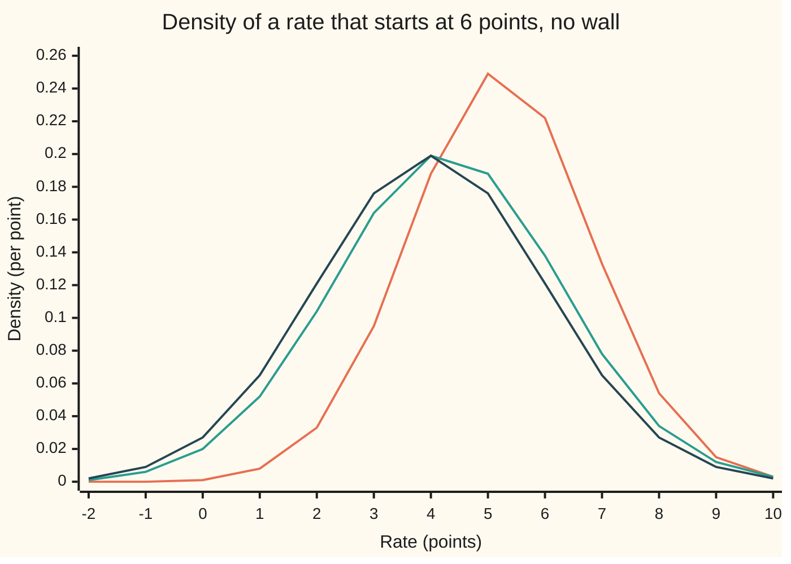
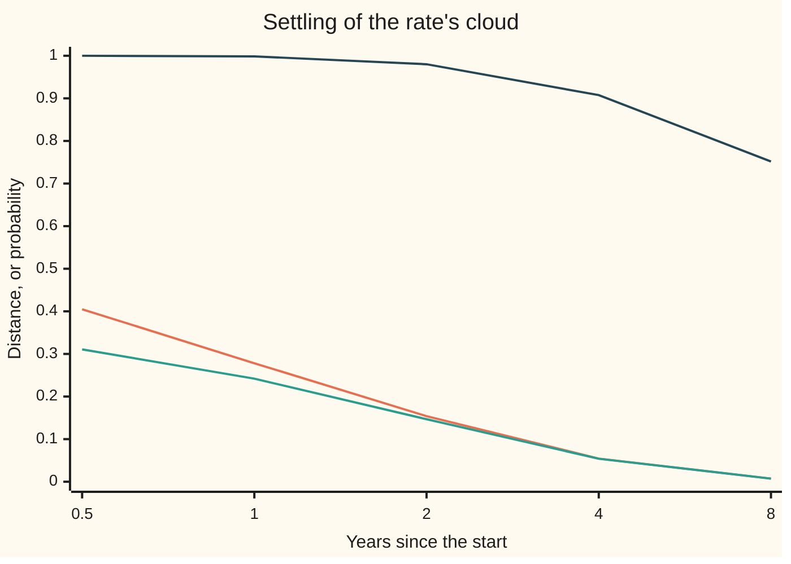

# Fokker-Planck: how the spread of a random quantity moves forward

[Syllabus](../../../SYLLABUS.md) → [Partial differential equations](../README.md) → [The Heat Equation in Depth](../README.md#s03) → Fokker-Planck

---

## General Overview

A short-term interest rate stands at 6 percentage points today. Call a percentage point a "point". The rate wanders at random, but it is pulled back toward 4 points at a speed of 0.5 per year, and its noise is 2 points per root year. The numbers are illustrative; they are the house rate of [Fokker-Planck](../../11-Stochastic%20processes%20and%20calculus/08-Generators%2C%20Densities%20and%20Simulation/03-fokker-planck-forward-equation.md) in the stochastic-processes wing.

One year on, the rate is not a number but a cloud of possible numbers. Its **density** (probability per point of rate) is a bell centred at 5.21306 points with standard deviation 1.59012 points. The bell is 0.25089 per point tall at its centre. The equation that moves this cloud forward in time is the **Fokker-Planck equation**.

Wing 08's [The heat kernel](../../08-Differential%20equations%20and%20dynamics/10-The%20Classical%20PDEs/10-the-heat-kernel.md) spreads a hot spot on a 1 m copper rod. The cloud here spreads the same way, but it also slides toward 4 points. This card adds three things beyond that card:

1. **Edges.** Real rates in many models cannot fall below zero. A wall at zero either bounces the rate back or stops it for good, and each choice is one boundary condition.
2. **The start.** The density started from one exact value is a Green's function: every other starting cloud is built from it.
3. **The speed of settling.** The cloud forgets its start at a definite rate. With no wall, the gap to the long-run cloud halves every 1.3863 years in the long run; early on it shrinks faster.

**The forward equation is a conservation law for probability: the current moves the cloud, a bouncing wall has zero current, a stopping wall has zero density, and the slowest fading mode sets how fast the cloud forgets its start.**

**What kind of fact this is:** the mean-reverting rate is a model, an assumption that fits roughly, not a law. Inside the model the edge conditions, the Green's function properties, the decay rates with no wall and the identity linking the two wall rates are theorems, proved on this card in Why it works. The two wall rates themselves are computed by shooting and checked against the grid. The existence of a smooth density, and the fact that the modes add up to every cloud, are stated with their sources (Pavliotis; Risken), not proved.

### The picture: the rate's cloud after one year, four years, and in the long run



Orange: after one year, peak near 5.2 points. Teal: after four years. Dark blue: the long-run bell, centred at 4 points with standard deviation 2 points. Points are formula values every point, rounded to three places. The left tail below zero is the part a wall at zero would act on.

---

## The formula

Notation first, in words. The rate $`X_t`$ follows $`dX_t = \mu(X_t)\,dt + \sigma\,dW_t`$ ([Mean reversion](../../11-Stochastic%20processes%20and%20calculus/06-Ito%20Calculus/05-ornstein-uhlenbeck-and-cir-processes.md)). Here $`\mu(y) = \kappa(\theta - y)`$ is the **drift**, the average velocity at rate $`y`$, and $`\sigma`$ is the noise size. $`W_t`$ is a Brownian motion, the standard continuous random walk that supplies the noise. The **transition density** $`p(t, x, y)`$ is the density of $`X_t`$ at the point $`y`$, given the start $`X_0 = x`$.

The problem has an unknown, a region and data:

- **Unknown:** $`p(t, x, y)`$ as a function of time $`t > 0`$ and end point $`y`$.
- **Region:** the whole line, or the half-line $`y > 0`$ when a wall stands at zero.
- **Data:** at time zero all probability sits at the start, $`p(0, x, y) = \delta(y - x)`$, the point mass of wing 08. At a wall, one edge condition.

```math
\frac{\partial p}{\partial t} + \frac{\partial J}{\partial y} = 0, \qquad J = \mu(y)\,p - \frac12\,\frac{\partial}{\partial y}\big(\sigma^2 p\big)
```

**Read it aloud:** the density at a point rises exactly as fast as the probability current $`J`$ brings more in from the left than it carries out to the right.

The two edge conditions at a wall:

```math
\text{reflecting wall: } J = 0, \qquad \text{absorbing wall: } p = 0
```

**Read it aloud:** a reflecting wall lets no probability through; an absorbing wall holds the density at zero, so probability that reaches it leaves the cloud for good.

With no wall, the cloud is a sum of shapes that each fade at their own rate:

```math
p(t, x, y) = p_\infty(y) \sum_{n=0}^{\infty} e^{-n\kappa t}\, \frac{He_n(z_x)\,He_n(z_y)}{n!}, \qquad z_y = \frac{y - \theta}{\sigma/\sqrt{2\kappa}}
```

**Read it aloud:** the cloud at time $`t`$ is the long-run bell times a sum of polynomial shapes, and the shape numbered $`n`$ fades like $`e^{-n\kappa t}`$.

| Symbol | Plain meaning | In our example | Push it up and the answer… |
| --- | --- | --- | --- |
| $`X_t`$, $`p(t, x, y)`$ | the rate at time $`t`$; the transition density: probability per point of ending at $`y`$ at time $`t`$, from start $`x`$ | 0.25089 per point at the peak after one year | — |
| $`t`$, $`x`$, $`y`$ | time in years; the start; the end point, both in points | 1 year; 6 points; anywhere | the cloud spreads and slides further |
| $`\mu(y)`$, $`\kappa`$, $`\theta`$ | the drift $`\kappa(\theta - y)`$; the pull speed; the long-run level | 0.5 per year; 4 points | faster settling; the cloud's centre moves |
| $`\sigma`$, $`W_t`$ | the noise size; the Brownian motion that drives it | 2 points per root year | a wider cloud |
| $`J`$ | the probability current: net probability crossing a point rightward per year | zero at a reflecting wall | — |
| $`L`$, $`L^*`$, $`f`$ | the generator acting on a payoff $`f`$; its adjoint acting on densities | $`Lf = \mu f' + \tfrac12\sigma^2 f''`$ | — |
| $`p_\infty`$, $`p_0`$ | the long-run (stationary) density, the cloud that no longer changes; a starting cloud | bell at 4 points, standard deviation 2 | — |
| $`m`$, $`v`$ | mean and variance of the cloud at time $`t`$ | 5.21306 points and 2.52848 points squared | — |
| $`z`$, $`He_n`$, $`\phi`$, $`\psi`$ | distance from $`\theta`$ in long-run standard deviations; the Hermite polynomials $`1, z, z^2 - 1, \dots`$; a mode's shape; its slope $`\phi'`$ | start $`z_x = 1`$; wall at $`z = -2`$ | — |
| $`\lambda`$, $`\nu`$ | a decay rate per year; the same rate in units of $`\kappa`$ | slowest $`\lambda = 0.5`$ per year with no wall | the cloud forgets its start sooner |
| $`d(t)`$ | the distance to the long-run cloud: half the area between the two densities | 0.27815 after one year | — |
| $`h`$ | a step: of the grid in the code, or of a finite difference | 0.05 and 0.1 points | larger errors, about four times per doubling |

### When it holds

- **Smooth drift and noise that never vanishes.** Then a smooth density exists for every $`t > 0`$ (Pavliotis, chapter 4). With zero noise the cloud stays one point, and the equation holds only in the weak sense.
- **The right edge condition for the physics.** A floor that bounces needs zero current. Using zero slope of $`p`$ instead pumps probability in through the wall: total probability 14.87 after 10 years (What breaks).
- **Probability that dies away far out.** The derivation drops boundary terms at infinity. A cloud with heavy tails, or a wall left out, breaks this.
- **Constant coefficients in time.** A drift or noise that changes with the calendar keeps the forward equation but loses the fixed decay rates; the modes then mix.
- **One dimension.** In several dimensions the current becomes a vector and walls need its normal part, $`J \cdot n = 0`$; this card stays on the line.

---

## Why it works

### Step 0: probability is conserved, and walls are read off the backward equation

The forward equation is the adjoint of the backward one: moving derivatives from a payoff onto the density. At a wall, that move leaves leftover terms. Each kind of wall in the backward equation kills a different leftover term. The matching forward edge condition is whatever kills the other one.

### Step 1: the forward equation as a conservation law

[Fokker-Planck](../../11-Stochastic%20processes%20and%20calculus/08-Generators%2C%20Densities%20and%20Simulation/03-fokker-planck-forward-equation.md) derives $`p_t = L^* p`$ with $`L^* p = -(\mu p)' + \tfrac12(\sigma^2 p)''`$ by integrating the backward equation by parts. Here a prime is a derivative in $`y`$. Grouping the two terms as one derivative gives $`L^* p = -J'`$, so $`p_t + J' = 0`$.

That is the same bookkeeping as heat on the copper rod: density plays the part of temperature, and current plays the part of heat flow. Integrate over the region $`y > 0`$:

```math
\frac{d}{dt}\int_0^\infty p\,dy = J(t, 0) - J(t, \infty) = J(t, 0)
```

The total changes only by what crosses the wall.

### Step 2: the edge conditions are the adjoints of the backward ones

Take a payoff $`f`$ and integrate $`(Lf)\,p`$ over $`y > 0`$. Moving the derivatives across leaves a term at the wall:

```math
\int_0^\infty (Lf)\,p\,dy = \int_0^\infty f\,(L^* p)\,dy \;-\; f(0)\,J(0) \;-\; \tfrac12\,\sigma^2 f'(0)\,p(0)
```

The backward equation ([Feynman-Kac](08-feynman-kac-and-the-kolmogorov-equations.md)) takes a wall condition too, set by what a path does there:

- **Reflecting.** A path that bounces off the wall keeps its payoff. The backward condition is zero slope, $`f'(0) = 0`$, with $`f(0)`$ free. To kill the leftover for every such $`f`$, the forward side needs $`J(0) = 0`$.
- **Absorbing.** A path stopped at the wall pays nothing more. The backward condition is $`f(0) = 0`$, with $`f'(0)`$ free. To kill the leftover, the forward side needs $`p(0) = 0`$.

So "zero current" and "zero density" are not choices made for the density alone. Each one is forced by the matching backward condition ([Boundary conditions](../01-Classification%20and%20Well-Posedness/03-boundary-conditions-dirichlet-neumann-and-robin.md) calls them Neumann and Dirichlet type).

<details>
<summary>Detailed proof: the wall term</summary>

Assume $`f`$ and $`p`$ are smooth on $`y \ge 0`$ and $`p`$, $`p'`$ die away far out. Integrate the drift part once by parts:

$`\displaystyle \int_0^\infty \mu f' p\,dy = -\mu(0) f(0) p(0) - \int_0^\infty f\,(\mu p)'\,dy.`$

Integrate the noise part twice:

$`\displaystyle \int_0^\infty \tfrac12\sigma^2 f'' p\,dy = -\tfrac12\sigma^2 f'(0)p(0) + \tfrac12 f(0)\,(\sigma^2 p)'(0) + \int_0^\infty f\,\tfrac12(\sigma^2 p)''\,dy.`$

Add them. The integrals give $`\int f\,L^*p\,dy`$. The wall terms collect into $`-f(0)\big[\mu p - \tfrac12(\sigma^2 p)'\big](0) - \tfrac12\sigma^2 f'(0)p(0)`$, and the bracket is $`J(0)`$.

If $`f'(0) = 0`$ for all allowed $`f`$ and $`f(0)`$ ranges freely, the term vanishes for all of them only when $`J(0) = 0`$. If $`f(0) = 0`$ and $`f'(0)`$ ranges freely, it vanishes only when $`p(0) = 0`$, since $`\sigma \ne 0`$.

</details>

Read back with Step 1: a reflecting wall keeps the total at exactly 1, and the grid in the code keeps 1.000000000 after 30 years. An absorbing wall has current $`J(0) = -\tfrac12\sigma^2 p'(0) < 0`$, so the total falls. The lost probability is the chance the rate has touched zero.

### Step 3: the transition density is a Green's function

A **Green's function** is the response to a point source: solve the equation once from a single point, and every other solution is a weighted sum of such responses. The transition density is exactly that, with four properties:

1. **Point start.** $`p(t, x, \cdot)`$ tends to $`\delta(y - x)`$ as $`t \to 0`$.
2. **Superposition.** From a starting cloud $`p_0`$, the cloud at time $`t`$ is $`\int p(t, x, y)\,p_0(x)\,dx`$, because the equation is linear.
3. **Two equations at once.** In the end point $`y`$ it solves the forward equation $`p_t = L^*_y p`$. In the start $`x`$ it solves the backward equation $`p_t = L_x p`$. The code checks both by centred differences at $`y = 5`$. As $`h`$ halves, the leftovers shrink from −0.0000934 to −0.0000234 and from −0.0001840 to −0.0000461: four times smaller each time.
4. **Chaining.** Half a year, then another half year from wherever the rate is: $`\int p(0.5, x, z)\,p(0.5, z, y)\,dz = p(1, x, y)`$. At the one-year peak both sides give 0.25089.

With no wall the Green's function is the sliding bell. Its mean and variance are

```math
m(t) = \theta + (x - \theta)\,e^{-\kappa t}, \qquad v(t) = \frac{\sigma^2}{2\kappa}\big(1 - e^{-2\kappa t}\big)
```

as the stochastic-processes card derives. In which class is it the solution? It is a classical solution for $`t > 0`$. It is unique among solutions that grow no faster than $`e^{c y^2}`$ for some constant $`c`$, the same class in which [Diffusion's maximum principle](04-maximum-principle-for-the-heat-equation.md) gives uniqueness for heat.

### Step 4: the long-run cloud has zero current

A **stationary density** has $`p_t = 0`$, so $`J' = 0`$ and $`J`$ is the same constant everywhere. At a reflecting wall, or far out, $`J = 0`$; so $`J = 0`$ everywhere. With constant noise that says $`p_\infty' = (2\mu/\sigma^2)\,p_\infty`$, whose solution is a bell at $`\theta`$ with variance $`\sigma^2/(2\kappa) = 4`$ points squared.

- **No wall.** The long-run bell puts 0.02275 of its probability below zero: negative rates are not rare in the long run.
- **Reflecting floor at 0.** The zero-current equation is the same, so the floor's long-run cloud is the same bell cut at zero and scaled up to total 1. Its height at 4 points is 0.20411 instead of 0.19947, and its mean is 4.11050 points instead of 4.
- **Absorbing wall at 0.** Probability only leaves, so no positive cloud stands still. The long-run answer is zero; the question becomes how fast the remaining mass decays.

### Step 5: how fast the cloud settles

Write the cloud as the long-run density times a correction, $`p = p_\infty\,g`$. Because the long-run current is zero, the forward operator turns into the backward one: $`L^*(p_\infty g) = p_\infty\,Lg`$. So $`g`$ solves the backward equation, and separation of variables ([Separation of variables](../../08-Differential%20equations%20and%20dynamics/10-The%20Classical%20PDEs/04-separation-of-variables-for-the-heat-equation.md)) splits it into modes $`e^{-\lambda t}\,\phi(z)`$.

In the scaled distance $`z`$, with primes now meaning derivatives in $`z`$, each mode shape solves

```math
\phi'' - z\,\phi' + \nu\,\phi = 0, \qquad \lambda = \nu\,\kappa
```

The current of $`p_\infty \phi`$ is $`-\tfrac12\sigma^2 p_\infty\,\phi'`$, so a reflecting wall asks $`\phi' = 0`$ there and an absorbing wall asks $`\phi = 0`$.

- **No wall.** The shapes that do not blow up far out are the Hermite polynomials, with $`\nu = n`$: decay rates $`0, \kappa, 2\kappa, \dots`$. This is the series in The formula. The constant mode is the long-run bell; the slowest one that fades is $`He_1(z) = z`$, at rate $`\kappa`$ = 0.5 per year.
- **Reflecting floor at $`z = -2`$.** Shooting (solve the mode equation outward from the wall, then adjust $`\nu`$ until the solution stays tame far out) finds the slowest fading mode at 0.54864 per year. The floor speeds settling a little: it removes the slow far-left tail.
- **Absorbing floor at $`z = -2`$.** The slowest mode decays at only 0.04864 per year. That is the rate at which surviving probability leaks out, once the cloud has settled into its shape.

The two wall rates differ by exactly $`\kappa`$: 0.54864 − 0.04864 = 0.50000.

<details>
<summary>Detailed proof: the forward operator becomes the backward one, and the two walls differ by κ</summary>

Zero long-run current means $`\mu p_\infty = \tfrac12\sigma^2 p_\infty'`$, and differentiating, $`(\mu p_\infty)' = \tfrac12\sigma^2 p_\infty''`$. Expand $`L^*(p_\infty g) = -(\mu p_\infty g)' + \tfrac12\sigma^2 (p_\infty g)''`$:

$`\displaystyle -(\mu p_\infty)'g - \mu p_\infty g' + \tfrac12\sigma^2\big(p_\infty'' g + 2p_\infty' g' + p_\infty g''\big).`$

The first and third terms cancel. The term $`\sigma^2 p_\infty' g'`$ equals $`2\mu p_\infty g'`$. What is left is $`p_\infty(\mu g' + \tfrac12\sigma^2 g'') = p_\infty\,Lg`$.

In the scaled variable, $`Lg = \kappa(g'' - z g')`$, so a mode $`e^{-\nu\kappa t}\phi(z)`$ needs $`\phi'' - z\phi' + \nu\phi = 0`$.

Differentiate that equation once. With $`\psi = \phi'`$ it reads $`\psi'' - z\psi' + (\nu - 1)\psi = 0`$. A reflecting mode has $`\phi' = 0`$ at the wall, so $`\psi = 0`$ there: $`\psi`$ is an absorbing mode with $`\nu - 1`$. The map runs back too, through $`\phi = (z\psi - \psi')/\nu`$. So the slowest reflecting rate is $`\kappa`$ plus the slowest absorbing rate.

</details>

So the answer to "how fast?" is one number per wall: the rate of the slowest fading mode. Here the start is one long-run standard deviation above $`\theta`$. Once the faster modes have died, the distance to the long-run cloud is close to $`\tfrac12\sqrt{2/\pi}\,e^{-\kappa t}`$. That predicts 0.05399 at 4 years against 0.05432 true, and 0.00731 at 8 years against 0.00731.

---

## Worked numbers, by hand

The rate after one year, no wall, then the long run with and without a floor. Inputs: $`\kappa`$ = 0.5 per year, $`\theta`$ = 4 points, $`\sigma`$ = 2 points per root year, start 6 points.

| Step | Arithmetic | Value |
| --- | --- | --- |
| fading factor, $`e^{-\kappa t}`$ | $`e^{-0.5}`$ | 0.60653 |
| mean $`m`$ | 4 + 2 × 0.60653 | 5.21306 points |
| variance $`v`$ | 4 × (1 − 0.60653 × 0.60653) | 2.52848 points squared |
| standard deviation | $`\sqrt{2.52848}`$ | 1.59012 points |
| peak height | $`1/\sqrt{2\pi \times 2.52848}`$ | 0.25089 per point |
| height at 4 points | the bell formula at $`y = 4`$ | 0.18754 per point |
| zero, in standard deviations from the mean | $`-5.21306/1.59012`$ | −3.2784 |
| free mass below zero after one year | bell area below −3.2784 standard deviations | 0.00052 |
| free mass below zero in the long run | bell area below −2 standard deviations | 0.02275 |
| floor's long-run height at 4 points | $`1/(2\sqrt{2\pi})`$ = 0.19947, divided by 1 − 0.02275 | 0.20411 per point |
| half-life of the gap, in the long run | $`\ln 2 / 0.5`$ | 1.3863 years |

**After one year the rate's density is a bell centred at 5.21306 points, standard deviation 1.59012 points, 0.25089 per point at the peak.**

In the world: a desk pricing a one-year rate product can ignore a zero floor. Only 0.00052 of the probability ends the year below zero, and 0.99856 of it never touches zero at all (the survival column under How the cloud settles). A ten-year product cannot: the long-run cloud has 0.02275 below zero, and the floor moves its mean to 4.11050 points.

### What breaks if you drop a piece

| Mistake | Comes out at | What went wrong |
| --- | --- | --- |
| Zero slope, $`p' = 0`$, at a bouncing floor | total probability 1.0011 after one year, 14.87 after 10 years | the current at the wall is $`\mu(0)\,p = 2p`$, not zero: probability pours in |
| Zero density, an absorbing wall, used for a floor | total probability 0.6824 after 10 years | paths that should bounce are removed |
| Settling at the variance's rate $`2\kappa`$ | distance 0.00731 at 4 years; truly 0.05432 | the slowest mode is the mean's, at rate $`\kappa`$ |
| No wall where rates cannot go negative | 0.02275 of the long-run cloud below zero; mean 4 instead of 4.11050 | the zero-current cloud must be cut at the wall |

The first two rows are a hypothesis failing: the wrong edge condition for the physics. The code prints every number.

---

## How the cloud settles

The puzzle: the mean slides toward 4 and the spread grows toward 2, yet the density never quite arrives. Which of the two motions sets the pace?

| Years | Mean (points) | Standard deviation | Distance $`d(t)`$ | Leading mode alone | Survival, absorbing wall |
| --- | --- | --- | --- | --- | --- |
| 0.5 | 5.5576 | 1.2545 | 0.40494 | 0.31070 | 0.99999 |
| 1 | 5.2131 | 1.5901 | 0.27815 | 0.24197 | 0.99856 |
| 2 | 4.7358 | 1.8597 | 0.15382 | 0.14676 | 0.98008 |
| 4 | 4.2707 | 1.9816 | 0.05432 | 0.05399 | 0.90761 |
| 8 | 4.0366 | 1.9997 | 0.00731 | 0.00731 | 0.75182 |

The spread is almost done by year 4: 1.9816 out of 2. The mean is still at 4.2707 points, well short of 4. The mean's motion is the slow one, so it sets the pace.

The distance to the long-run cloud, no wall:

```
years   distance to the long-run cloud
  0.5   ████████████████████████████████████████  0.40494
  1     ███████████████████████████               0.27815
  2     ███████████████                           0.15382
  4     █████                                     0.05432
  8     █                                         0.00731
```

The probability still in play with an absorbing wall at zero:

```
years   survival
  0.5   ████████████████████████████████████████  0.99999
  1     ████████████████████████████████████████  0.99856
  2     ███████████████████████████████████████   0.98008
  4     ████████████████████████████████████      0.90761
  8     ██████████████████████████████            0.75182
```

The distance falls fast, at 0.5 per year. Survival falls slowly at first, because little of the cloud is near zero; later it settles into its own slow rate, 0.04864 per year. After 10 years the survival is 0.68238; after 20 years, 0.41961.



Orange: the true distance to the long-run cloud, no wall. Teal: the slowest mode alone, $`\tfrac12\sqrt{2/\pi}\,e^{-0.5t}`$; the two meet by year 8. Dark blue: the probability not yet absorbed by a wall at zero.

---

## Code, from first principles, and it actually runs

The script computes the one-year cloud by three roads. The first is the closed-form bell. The second is the sum of 30 fading modes, with its first omitted term. The third is a Crank-Nicolson finite-volume grid (cells holding probability, currents between them) at two steps. It also checks the equation's leftover forward in $`y`$ and backward in $`x`$, and the half-year-twice chaining rule. With a wall at zero it runs the grid with zero current, zero density and the wrong zero slope. It finds the decay rates by RK4 shooting with bisection and compares them with the grid's own decay. Nothing imported knows the answer: the normal area is Simpson's rule and the tridiagonal solve is written out.

### Python

```python
# Fokker-Planck with edges -- the check behind the card.  Standard library only.
# Roads: (1) the closed-form bell; (2) the sum of decaying modes (Mehler's series);
# (3) a Crank-Nicolson finite-volume grid with a zero-flux, zero-value or wrong edge;
# (4) eigenvalues by shooting with RK4; plus residuals and the semigroup rule.
# Units: the rate in percentage points ("points"), time in years.
from math import exp, sqrt, pi, log
K, TH, SG, X0 = 0.5, 4.0, 2.0, 6.0         # pull per year, level, noise, start
S2 = SG * SG / (2 * K)                     # long-run variance, points squared
def mu(y): return K * (TH - y)
def kern(t, x, y):                         # road 1: the transition density
    m = TH + (x - TH) * exp(-K * t); v = S2 * (1 - exp(-2 * K * t))
    return exp(-(y - m) ** 2 / (2 * v)) / sqrt(2 * pi * v)
def pinf(y): return exp(-(y - TH) ** 2 / (2 * S2)) / sqrt(2 * pi * S2)
def modes(t, x, y, n):                     # road 2: long-run bell times decaying modes
    a, b = (x - TH) / sqrt(S2), (y - TH) / sqrt(S2)
    ha0, ha1, hb0, hb1, tot, fact = 1.0, a, 1.0, b, 1.0, 1.0
    for k in range(1, n + 2):              # He_k by its recurrence
        fact *= k; term = exp(-k * K * t) * ha1 * hb1 / fact
        if k <= n: tot += term
        ha0, ha1 = ha1, a * ha1 - k * ha0; hb0, hb1 = hb1, b * hb1 - k * hb0
    return pinf(y) * tot, pinf(y) * term   # value, first omitted mode
def Phi(z, n=2000):                        # normal CDF by Simpson's rule
    h = z / n; s = 1 + exp(-z * z / 2)
    for i in range(1, n): s += (4 if i % 2 else 2) * exp(-(i * h) ** 2 / 2)
    return 0.5 + s * h / 3 / sqrt(2 * pi)
def grid(lo, hi, h, dt, edge, times):      # road 3: cells, fluxes, Crank-Nicolson
    n = round((hi - lo) / h); ys = [lo + (i + 0.5) * h for i in range(n)]
    p = [kern(0.1, X0, y) for y in ys]; D = 0.5 * SG * SG / h
    a, b, c = [0.0] * n, [0.0] * n, [0.0] * n
    for i in range(n - 1):                 # current through the face between i and i+1
        m = mu(lo + (i + 1) * h); u, w = (m / 2 + D) / h, (m / 2 - D) / h
        b[i] -= u; c[i] -= w; a[i + 1] += u; b[i + 1] += w
    if edge == "absorb": b[0] -= 2 * D / h # p = 0 on the wall (mirror cell -p)
    if edge == "flat": b[0] += mu(lo) / h  # wrong: p_y = 0, so J = mu p at the wall
    out, t, q = {}, 0.1, dt / 2
    for T in times:
        while t < T - 1e-9:
            r = [p[i] + q * (b[i] * p[i] + (a[i] * p[i - 1] if i else 0)
                 + (c[i] * p[i + 1] if i < n - 1 else 0)) for i in range(n)]
            cc, dd = [0.0] * n, [0.0] * n  # Thomas solve of (I - q A) p = r
            for i in range(n):
                den = 1 - q * b[i] + (q * a[i] * cc[i - 1] if i else 0)
                cc[i] = -q * c[i] / den
                dd[i] = (r[i] + (q * a[i] * dd[i - 1] if i else 0)) / den
            for i in range(n - 2, -1, -1): dd[i] -= cc[i] * dd[i + 1]
            p, t = dd, t + dt
        out[T] = (sum(p) * h, sum(y * v for y, v in zip(ys, p)) * h, ys, p)
    return out
def shoot(nu, f, d, zw=-2.0, zmax=6.0, n=8000):   # road 4: f'' - z f' + nu f = 0
    h, z = (zmax - zw) / n, zw
    F = lambda z, f, d: (d, z * d - nu * f)
    for _ in range(n):
        k1 = F(z, f, d); k2 = F(z + h/2, f + h/2 * k1[0], d + h/2 * k1[1])
        k3 = F(z + h/2, f + h/2 * k2[0], d + h/2 * k2[1]); k4 = F(z + h, f + h * k3[0], d + h * k3[1])
        f += h / 6 * (k1[0] + 2 * k2[0] + 2 * k3[0] + k4[0])
        d += h / 6 * (k1[1] + 2 * k2[1] + 2 * k3[1] + k4[1]); z += h
    return f
def eigen(lo, hi, f, d):                   # bisect on the sign of the far-out blow-up
    slo = shoot(lo, f, d)
    for _ in range(40):
        mid = (lo + hi) / 2
        if (shoot(mid, f, d) > 0) == (slo > 0): lo = mid
        else: hi = mid
    return (lo + hi) / 2
def tv(t, h=0.01): return 0.5 * h * sum(abs(kern(t, X0, -12 + (i + 0.5) * h) - pinf(-12 + (i + 0.5) * h)) for i in range(3200))
def row(label, v, d=5): print(f"{label:<44}{v:.{d}f}")
m1 = TH + (X0 - TH) * exp(-K); v1 = S2 * (1 - exp(-2 * K))
print("1. One year, no edge (closed form, modes, grid)")
row("fading factor e^(-kappa t)", exp(-K)); row("mean m, points", m1); row("variance v, points^2", v1); row("standard deviation", sqrt(v1))
pk = kern(1, X0, m1); pm, om = modes(1, X0, m1, 30); row("peak density, bell, per point", pk)
row("peak density, 30 modes", pm); row("  first omitted mode", om, 9)
fine = grid(-8, 16, 0.05, 0.01, "reflect", [1.0])[1.0]; crs = grid(-8, 16, 0.1, 0.02, "reflect", [1.0])[1.0]
e1 = max(abs(v - kern(1, X0, y)) for y, v in zip(fine[2], fine[3])); e2 = max(abs(v - kern(1, X0, y)) for y, v in zip(crs[2], crs[3]))
row("grid max error, h = 0.1", e2, 7); row("grid max error, h = 0.05", e1, 7)
for y in (2, 4, 6, 8): row(f"density at {y} points", kern(1, X0, y))
sg = sum(kern(0.5, X0, -8 + (i + 0.5) * 0.01) * kern(0.5, -8 + (i + 0.5) * 0.01, m1) for i in range(2400)) * 0.01
row("half a year twice, at the peak", sg); res = []
for h in (0.1, 0.05):                      # p_t against L* in y and against L in x, at y = 5
    pt = (kern(1 + h, X0, 5) - kern(1 - h, X0, 5)) / (2 * h)
    fw = -(mu(5 + h) * kern(1, X0, 5 + h) - mu(5 - h) * kern(1, X0, 5 - h)) / (2 * h) + SG * SG / 2 * (kern(1, X0, 5 + h) - 2 * kern(1, X0, 5) + kern(1, X0, 5 - h)) / h ** 2
    bw = mu(X0) * (kern(1, X0 + h, 5) - kern(1, X0 - h, 5)) / (2 * h) + SG * SG / 2 * (kern(1, X0 + h, 5) - 2 * kern(1, X0, 5) + kern(1, X0 - h, 5)) / h ** 2
    print(f"{'forward, backward residual, h = ' + str(h):<44}{pt - fw:.7f} {pt - bw:.7f}")
    res.append((pt - fw, pt - bw))
row("zero, in standard deviations from m", -m1 / sqrt(v1), 4); row("free mass below 0 after one year", Phi(-m1 / sqrt(v1)))
print("2. A wall at zero")
belinf = Phi(-2.0); fl_mean = TH + sqrt(S2) * exp(-2) / sqrt(2 * pi) / (1 - belinf)
row("free long-run mass below 0", belinf); row("free long run: height at 4", pinf(4)); row("floor long run: height at 4, exact", pinf(4) / (1 - belinf))
row("floor long run: mean, exact", fl_mean)
times = [0.5, 1.0, 2.0, 4.0, 8.0, 10.0, 12.0, 20.0, 30.0]
R = grid(0, 16, 0.05, 0.01, "reflect", times); A = grid(0, 16, 0.05, 0.01, "absorb", times)
A2 = grid(0, 16, 0.1, 0.02, "absorb", [10.0]); W = grid(0, 16, 0.05, 0.01, "flat", [1.0, 10.0])
i4 = round((4 - 0.025) / 0.05)
row("reflect: mass after 30 years", R[30.0][0], 9); row("reflect: mean after 30 years", R[30.0][1])
row("reflect: height at 4 after 30 years", R[30.0][3][i4] / 2 + R[30.0][3][i4 + 1] / 2)
row("reflect: mean after one year", R[1.0][1])
row("absorb: survival 10 years, h = 0.1", A2[10.0][0]); row("absorb: survival 10 years, h = 0.05", A[10.0][0])
row("absorb: survival after 20 years", A[20.0][0])
print("3. How fast it settles (decay rate per year)")
nuA = eigen(0.0, 1.0, 0.0, 1.0); nuR = eigen(0.5, 1.5, 1.0, 0.0)
gA = log(A[10.0][0] / A[20.0][0]) / 10; gR = log((R[8.0][1] - R[30.0][1]) / (R[12.0][1] - R[30.0][1])) / 4
row("no edge: kappa, exact", K); row("reflect: shooting", K * nuR); row("reflect: grid mean, 8 to 12 years", gR)
row("absorb: shooting", K * nuA); row("absorb: grid survival, 10 to 20 years", gA)
row("reflect minus absorb, shooting", K * (nuR - nuA)); row("half-life of the gap, ln 2 / kappa", log(2) / K, 4)
print("t, mean, sd, distance, leading mode, survival:")
for t in (0.5, 1.0, 2.0, 4.0, 8.0):
    print(f"{t:4.1f} {TH + (X0 - TH) * exp(-K * t):.4f} {sqrt(S2 * (1 - exp(-2 * K * t))):.4f} {tv(t):.5f} {sqrt(2 / pi) / 2 * exp(-K * t):.5f} {A[t][0]:.5f}")
print("4. What breaks")
row("p_y = 0 at the wall: mass after one year", W[1.0][0], 4); row("p_y = 0 at the wall: mass after 10 years", W[10.0][0], 2)
row("absorbing used as a floor: mass, 10 years", A[10.0][0], 4)
row("settling at 2 kappa: distance at 4 years", sqrt(2 / pi) / 2 * exp(-4.0), 5); row("  true distance at 4 years", tv(4.0))
for t in (1.0, 4.0): print(f"chart t={t:.0f}: " + " ".join(f"{kern(t, X0, y):.3f}" for y in range(-2, 11)))
print("chart long run: " + " ".join(f"{pinf(y):.3f}" for y in range(-2, 11)))
assert abs(pm - pk) < 1e-6 and abs(om) < 1e-6        # modes against the bell
assert e1 < 1e-4 and 3 < e2 / e1 < 5                 # grid against the bell, second order
assert abs(sg - pk) < 1e-8                           # semigroup rule: half a year twice
assert all(3.5 < a / b < 4.5 for a, b in zip(*res))  # forward and backward residuals fall as h^2
assert abs(R[30.0][0] - 1) < 1e-9 and abs(R[30.0][1] - fl_mean) < 1e-4   # zero flux keeps mass
assert abs(gA - K * nuA) < 1e-4 and abs(gR - K * nuR) < 2e-3            # grid against shooting
assert abs(nuR - nuA - 1) < 1e-5                     # the derivative identity
assert abs(tv(8.0) / (sqrt(2 / pi) / 2 * exp(-4.0)) - 1) < 1e-3
assert W[10.0][0] > 2 and A[10.0][0] < 0.9           # wrong edges fail visibly
print("ALL CHECKS PASS")
```

**Ran 2026-11-15 on macOS, Python 3.14.10, standard library only. All checks passed. Output, pasted from the run:**

```
1. One year, no edge (closed form, modes, grid)
fading factor e^(-kappa t)                  0.60653
mean m, points                              5.21306
variance v, points^2                        2.52848
standard deviation                          1.59012
peak density, bell, per point               0.25089
peak density, 30 modes                      0.25089
  first omitted mode                        0.000000001
grid max error, h = 0.1                     0.0000881
grid max error, h = 0.05                    0.0000220
density at 2 points                         0.03257
density at 4 points                         0.18754
density at 6 points                         0.22197
density at 8 points                         0.05401
half a year twice, at the peak              0.25089
forward, backward residual, h = 0.1         -0.0000934 -0.0001840
forward, backward residual, h = 0.05        -0.0000234 -0.0000461
zero, in standard deviations from m         -3.2784
free mass below 0 after one year            0.00052
2. A wall at zero
free long-run mass below 0                  0.02275
free long run: height at 4                  0.19947
floor long run: height at 4, exact          0.20411
floor long run: mean, exact                 4.11050
reflect: mass after 30 years                1.000000000
reflect: mean after 30 years                4.11043
reflect: height at 4 after 30 years         0.20404
reflect: mean after one year                5.21365
absorb: survival 10 years, h = 0.1          0.68236
absorb: survival 10 years, h = 0.05         0.68238
absorb: survival after 20 years             0.41961
3. How fast it settles (decay rate per year)
no edge: kappa, exact                       0.50000
reflect: shooting                           0.54864
reflect: grid mean, 8 to 12 years           0.54868
absorb: shooting                            0.04864
absorb: grid survival, 10 to 20 years       0.04863
reflect minus absorb, shooting              0.50000
half-life of the gap, ln 2 / kappa          1.3863
t, mean, sd, distance, leading mode, survival:
 0.5 5.5576 1.2545 0.40494 0.31070 0.99999
 1.0 5.2131 1.5901 0.27815 0.24197 0.99856
 2.0 4.7358 1.8597 0.15382 0.14676 0.98008
 4.0 4.2707 1.9816 0.05432 0.05399 0.90761
 8.0 4.0366 1.9997 0.00731 0.00731 0.75182
4. What breaks
p_y = 0 at the wall: mass after one year    1.0011
p_y = 0 at the wall: mass after 10 years    14.87
absorbing used as a floor: mass, 10 years   0.6824
settling at 2 kappa: distance at 4 years    0.00731
  true distance at 4 years                  0.05432
chart t=1: 0.000 0.000 0.001 0.008 0.033 0.095 0.188 0.249 0.222 0.133 0.054 0.015 0.003
chart t=4: 0.001 0.006 0.020 0.052 0.104 0.164 0.199 0.188 0.138 0.078 0.034 0.012 0.003
chart long run: 0.002 0.009 0.027 0.065 0.121 0.176 0.199 0.176 0.121 0.065 0.027 0.009 0.002
ALL CHECKS PASS
```

### Rust

```rust
// Fokker-Planck with edges -- the check behind the card.  Rust std only.
// Roads: (1) the closed-form bell; (2) the sum of decaying modes (Mehler's series);
// (3) a Crank-Nicolson finite-volume grid with a zero-flux, zero-value or wrong edge;
// (4) eigenvalues by shooting with RK4; plus residuals and the semigroup rule.
// Units: the rate in percentage points ("points"), time in years.
use std::f64::consts::PI;
const K: f64 = 0.5; const TH: f64 = 4.0; const SG: f64 = 2.0; const X0: f64 = 6.0;
const S2: f64 = SG * SG / (2.0 * K); // long-run variance, points squared
fn mu(y: f64) -> f64 { K * (TH - y) }
fn kern(t: f64, x: f64, y: f64) -> f64 { // road 1: the transition density
    let m = TH + (x - TH) * (-K * t).exp(); let v = S2 * (1.0 - (-2.0 * K * t).exp());
    (-(y - m).powi(2) / (2.0 * v)).exp() / (2.0 * PI * v).sqrt()
}
fn pinf(y: f64) -> f64 { (-(y - TH).powi(2) / (2.0 * S2)).exp() / (2.0 * PI * S2).sqrt() }
fn modes(t: f64, x: f64, y: f64, n: usize) -> (f64, f64) { // road 2: decaying modes
    let (a, b) = ((x - TH) / S2.sqrt(), (y - TH) / S2.sqrt());
    let (mut ha0, mut ha1, mut hb0, mut hb1, mut tot, mut fact) = (1.0, a, 1.0, b, 1.0, 1.0);
    let mut term = 0.0;
    for k in 1..n + 2 { // He_k by its recurrence
        let kf = k as f64; fact *= kf; term = (-kf * K * t).exp() * ha1 * hb1 / fact;
        if k <= n { tot += term; }
        let na = a * ha1 - kf * ha0; ha0 = ha1; ha1 = na;
        let nb = b * hb1 - kf * hb0; hb0 = hb1; hb1 = nb;
    }
    (pinf(y) * tot, pinf(y) * term)
}
fn phi_cdf(z: f64) -> f64 { // normal CDF by Simpson's rule
    let n = 2000; let h = z / n as f64; let mut s = 1.0 + (-z * z / 2.0).exp();
    for i in 1..n { s += if i % 2 == 1 { 4.0 } else { 2.0 } * (-(i as f64 * h).powi(2) / 2.0).exp(); }
    0.5 + s * h / 3.0 / (2.0 * PI).sqrt()
}
struct Snap { mass: f64, mean: f64, ys: Vec<f64>, p: Vec<f64> }
fn grid(lo: f64, hi: f64, h: f64, dt: f64, edge: &str, times: &[f64]) -> Vec<Snap> { // road 3
    let n = ((hi - lo) / h).round() as usize;
    let ys: Vec<f64> = (0..n).map(|i| lo + (i as f64 + 0.5) * h).collect();
    let mut p: Vec<f64> = ys.iter().map(|&y| kern(0.1, X0, y)).collect();
    let d = 0.5 * SG * SG / h;
    let (mut a, mut b, mut c) = (vec![0.0; n], vec![0.0; n], vec![0.0; n]);
    for i in 0..n - 1 { // current through the face between i and i+1
        let m = mu(lo + (i as f64 + 1.0) * h); let (u, w) = ((m / 2.0 + d) / h, (m / 2.0 - d) / h);
        b[i] -= u; c[i] -= w; a[i + 1] += u; b[i + 1] += w;
    }
    if edge == "absorb" { b[0] -= 2.0 * d / h; } // p = 0 on the wall (mirror cell -p)
    if edge == "flat" { b[0] += mu(lo) / h; }   // wrong: p_y = 0, so J = mu p at the wall
    let (mut out, mut t, q) = (Vec::new(), 0.1, dt / 2.0);
    for &tt in times {
        while t < tt - 1e-9 {
            let r: Vec<f64> = (0..n).map(|i| p[i] + q * (b[i] * p[i]
                + if i > 0 { a[i] * p[i - 1] } else { 0.0 } + if i < n - 1 { c[i] * p[i + 1] } else { 0.0 })).collect();
            let (mut cc, mut dd) = (vec![0.0; n], vec![0.0; n]); // Thomas solve of (I - q A) p = r
            for i in 0..n {
                let den = 1.0 - q * b[i] + if i > 0 { q * a[i] * cc[i - 1] } else { 0.0 };
                cc[i] = -q * c[i] / den;
                dd[i] = (r[i] + if i > 0 { q * a[i] * dd[i - 1] } else { 0.0 }) / den;
            }
            for i in (0..n - 1).rev() { dd[i] -= cc[i] * dd[i + 1]; }
            p = dd; t += dt;
        }
        let mass = p.iter().sum::<f64>() * h;
        let mean = ys.iter().zip(&p).map(|(y, v)| y * v).sum::<f64>() * h;
        out.push(Snap { mass, mean, ys: ys.clone(), p: p.clone() });
    }
    out
}
fn shoot(nu: f64, f0: f64, d0: f64) -> f64 { // road 4: f'' - z f' + nu f = 0
    let (zw, zmax, n) = (-2.0, 6.0, 8000); let h = (zmax - zw) / n as f64;
    let (mut z, mut f, mut d) = (zw, f0, d0);
    let fd = |z: f64, f: f64, d: f64| (d, z * d - nu * f);
    for _ in 0..n {
        let k1 = fd(z, f, d); let k2 = fd(z + h / 2.0, f + h / 2.0 * k1.0, d + h / 2.0 * k1.1);
        let k3 = fd(z + h / 2.0, f + h / 2.0 * k2.0, d + h / 2.0 * k2.1); let k4 = fd(z + h, f + h * k3.0, d + h * k3.1);
        f += h / 6.0 * (k1.0 + 2.0 * k2.0 + 2.0 * k3.0 + k4.0);
        d += h / 6.0 * (k1.1 + 2.0 * k2.1 + 2.0 * k3.1 + k4.1); z += h;
    }
    f
}
fn eigen(mut lo: f64, mut hi: f64, f: f64, d: f64) -> f64 { // bisect on the far-out sign
    let slo = shoot(lo, f, d);
    for _ in 0..40 {
        let mid = (lo + hi) / 2.0;
        if (shoot(mid, f, d) > 0.0) == (slo > 0.0) { lo = mid; } else { hi = mid; }
    }
    (lo + hi) / 2.0
}
fn tv(t: f64) -> f64 {
    let h = 0.01;
    0.5 * h * (0..3200).map(|i| { let y = -12.0 + (i as f64 + 0.5) * h; (kern(t, X0, y) - pinf(y)).abs() }).sum::<f64>()
}
fn row(label: &str, v: f64, d: usize) { println!("{:<44}{:.*}", label, d, v); }
fn maxerr(s: &Snap) -> f64 { s.ys.iter().zip(&s.p).map(|(&y, &v)| (v - kern(1.0, X0, y)).abs()).fold(0.0, f64::max) }
fn main() {
    let m1 = TH + (X0 - TH) * (-K).exp(); let v1 = S2 * (1.0 - (-2.0 * K).exp());
    println!("1. One year, no edge (closed form, modes, grid)");
    row("fading factor e^(-kappa t)", (-K).exp(), 5); row("mean m, points", m1, 5); row("variance v, points^2", v1, 5); row("standard deviation", v1.sqrt(), 5);
    let pk = kern(1.0, X0, m1); let (pm, om) = modes(1.0, X0, m1, 30); row("peak density, bell, per point", pk, 5);
    row("peak density, 30 modes", pm, 5); row("  first omitted mode", om, 9);
    let fine = &grid(-8.0, 16.0, 0.05, 0.01, "reflect", &[1.0])[0]; let crs = &grid(-8.0, 16.0, 0.1, 0.02, "reflect", &[1.0])[0];
    let (e1, e2) = (maxerr(fine), maxerr(crs));
    row("grid max error, h = 0.1", e2, 7); row("grid max error, h = 0.05", e1, 7);
    for y in [2, 4, 6, 8] { row(&format!("density at {} points", y), kern(1.0, X0, y as f64), 5); }
    let sg = (0..2400).map(|i| { let z = -8.0 + (i as f64 + 0.5) * 0.01; kern(0.5, X0, z) * kern(0.5, z, m1) }).sum::<f64>() * 0.01;
    row("half a year twice, at the peak", sg, 5); let mut res = Vec::new();
    for h in [0.1, 0.05] { // p_t against L* in y and against L in x, at y = 5
        let pt = (kern(1.0 + h, X0, 5.0) - kern(1.0 - h, X0, 5.0)) / (2.0 * h);
        let fw = -(mu(5.0 + h) * kern(1.0, X0, 5.0 + h) - mu(5.0 - h) * kern(1.0, X0, 5.0 - h)) / (2.0 * h)
            + SG * SG / 2.0 * (kern(1.0, X0, 5.0 + h) - 2.0 * kern(1.0, X0, 5.0) + kern(1.0, X0, 5.0 - h)) / (h * h);
        let bw = mu(X0) * (kern(1.0, X0 + h, 5.0) - kern(1.0, X0 - h, 5.0)) / (2.0 * h)
            + SG * SG / 2.0 * (kern(1.0, X0 + h, 5.0) - 2.0 * kern(1.0, X0, 5.0) + kern(1.0, X0 - h, 5.0)) / (h * h);
        println!("{:<44}{:.7} {:.7}", format!("forward, backward residual, h = {}", h), pt - fw, pt - bw);
        res.push((pt - fw, pt - bw));
    }
    row("zero, in standard deviations from m", -m1 / v1.sqrt(), 4); row("free mass below 0 after one year", phi_cdf(-m1 / v1.sqrt()), 5);
    println!("2. A wall at zero");
    let belinf = phi_cdf(-2.0); let fl_mean = TH + S2.sqrt() * (-2.0f64).exp() / (2.0 * PI).sqrt() / (1.0 - belinf);
    row("free long-run mass below 0", belinf, 5); row("free long run: height at 4", pinf(4.0), 5);
    row("floor long run: height at 4, exact", pinf(4.0) / (1.0 - belinf), 5);
    row("floor long run: mean, exact", fl_mean, 5);
    let times = [0.5, 1.0, 2.0, 4.0, 8.0, 10.0, 12.0, 20.0, 30.0];
    let r = grid(0.0, 16.0, 0.05, 0.01, "reflect", &times); let a = grid(0.0, 16.0, 0.05, 0.01, "absorb", &times);
    let a2 = grid(0.0, 16.0, 0.1, 0.02, "absorb", &[10.0]); let w = grid(0.0, 16.0, 0.05, 0.01, "flat", &[1.0, 10.0]);
    let i4 = ((4.0 - 0.025) / 0.05f64).round() as usize;
    row("reflect: mass after 30 years", r[8].mass, 9); row("reflect: mean after 30 years", r[8].mean, 5);
    row("reflect: height at 4 after 30 years", r[8].p[i4] / 2.0 + r[8].p[i4 + 1] / 2.0, 5);
    row("reflect: mean after one year", r[1].mean, 5);
    row("absorb: survival 10 years, h = 0.1", a2[0].mass, 5); row("absorb: survival 10 years, h = 0.05", a[5].mass, 5);
    row("absorb: survival after 20 years", a[7].mass, 5);
    println!("3. How fast it settles (decay rate per year)");
    let nua = eigen(0.0, 1.0, 0.0, 1.0); let nur = eigen(0.5, 1.5, 1.0, 0.0);
    let ga = (a[5].mass / a[7].mass).ln() / 10.0; let gr = ((r[4].mean - r[8].mean) / (r[6].mean - r[8].mean)).ln() / 4.0;
    row("no edge: kappa, exact", K, 5); row("reflect: shooting", K * nur, 5); row("reflect: grid mean, 8 to 12 years", gr, 5);
    row("absorb: shooting", K * nua, 5); row("absorb: grid survival, 10 to 20 years", ga, 5);
    row("reflect minus absorb, shooting", K * (nur - nua), 5); row("half-life of the gap, ln 2 / kappa", 2f64.ln() / K, 4);
    println!("t, mean, sd, distance, leading mode, survival:");
    for (j, t) in [0.5, 1.0, 2.0, 4.0, 8.0].iter().enumerate() {
        println!("{:4.1} {:.4} {:.4} {:.5} {:.5} {:.5}", t, TH + (X0 - TH) * (-K * t).exp(), (S2 * (1.0 - (-2.0 * K * t).exp())).sqrt(),
            tv(*t), (2.0 / PI).sqrt() / 2.0 * (-K * t).exp(), a[j].mass);
    }
    println!("4. What breaks");
    row("p_y = 0 at the wall: mass after one year", w[0].mass, 4); row("p_y = 0 at the wall: mass after 10 years", w[1].mass, 2);
    row("absorbing used as a floor: mass, 10 years", a[5].mass, 4);
    row("settling at 2 kappa: distance at 4 years", (2.0 / PI).sqrt() / 2.0 * (-4.0f64).exp(), 5); row("  true distance at 4 years", tv(4.0), 5);
    let line = |f: &dyn Fn(f64) -> f64| (-2..11).map(|y| format!("{:.3}", f(y as f64))).collect::<Vec<_>>().join(" ");
    for t in [1.0, 4.0] { println!("chart t={:.0}: {}", t, line(&|y| kern(t, X0, y))); }
    println!("chart long run: {}", line(&|y| pinf(y)));
    assert!((pm - pk).abs() < 1e-6 && om.abs() < 1e-6);         // modes against the bell
    assert!(e1 < 1e-4 && 3.0 < e2 / e1 && e2 / e1 < 5.0);        // grid against the bell, second order
    assert!((sg - pk).abs() < 1e-8);                              // semigroup rule: half a year twice
    assert!([res[0].0 / res[1].0, res[0].1 / res[1].1].iter().all(|&q| 3.5 < q && q < 4.5)); // forward and backward residuals fall as h^2
    assert!((r[8].mass - 1.0).abs() < 1e-9 && (r[8].mean - fl_mean).abs() < 1e-4); // zero flux keeps mass
    assert!((ga - K * nua).abs() < 1e-4 && (gr - K * nur).abs() < 2e-3);          // grid against shooting
    assert!((nur - nua - 1.0).abs() < 1e-5);                     // the derivative identity
    assert!((tv(8.0) / ((2.0 / PI).sqrt() / 2.0 * (-4.0f64).exp()) - 1.0).abs() < 1e-3);
    assert!(w[1].mass > 2.0 && a[5].mass < 0.9);                 // wrong edges fail visibly
    println!("ALL CHECKS PASS");
}
```

**Ran 2026-11-15 on macOS, rustc 1.98.1, no crates. All checks passed. Output, pasted from the run:**

```
1. One year, no edge (closed form, modes, grid)
fading factor e^(-kappa t)                  0.60653
mean m, points                              5.21306
variance v, points^2                        2.52848
standard deviation                          1.59012
peak density, bell, per point               0.25089
peak density, 30 modes                      0.25089
  first omitted mode                        0.000000001
grid max error, h = 0.1                     0.0000881
grid max error, h = 0.05                    0.0000220
density at 2 points                         0.03257
density at 4 points                         0.18754
density at 6 points                         0.22197
density at 8 points                         0.05401
half a year twice, at the peak              0.25089
forward, backward residual, h = 0.1         -0.0000934 -0.0001840
forward, backward residual, h = 0.05        -0.0000234 -0.0000461
zero, in standard deviations from m         -3.2784
free mass below 0 after one year            0.00052
2. A wall at zero
free long-run mass below 0                  0.02275
free long run: height at 4                  0.19947
floor long run: height at 4, exact          0.20411
floor long run: mean, exact                 4.11050
reflect: mass after 30 years                1.000000000
reflect: mean after 30 years                4.11043
reflect: height at 4 after 30 years         0.20404
reflect: mean after one year                5.21365
absorb: survival 10 years, h = 0.1          0.68236
absorb: survival 10 years, h = 0.05         0.68238
absorb: survival after 20 years             0.41961
3. How fast it settles (decay rate per year)
no edge: kappa, exact                       0.50000
reflect: shooting                           0.54864
reflect: grid mean, 8 to 12 years           0.54868
absorb: shooting                            0.04864
absorb: grid survival, 10 to 20 years       0.04863
reflect minus absorb, shooting              0.50000
half-life of the gap, ln 2 / kappa          1.3863
t, mean, sd, distance, leading mode, survival:
 0.5 5.5576 1.2545 0.40494 0.31070 0.99999
 1.0 5.2131 1.5901 0.27815 0.24197 0.99856
 2.0 4.7358 1.8597 0.15382 0.14676 0.98008
 4.0 4.2707 1.9816 0.05432 0.05399 0.90761
 8.0 4.0366 1.9997 0.00731 0.00731 0.75182
4. What breaks
p_y = 0 at the wall: mass after one year    1.0011
p_y = 0 at the wall: mass after 10 years    14.87
absorbing used as a floor: mass, 10 years   0.6824
settling at 2 kappa: distance at 4 years    0.00731
  true distance at 4 years                  0.05432
chart t=1: 0.000 0.000 0.001 0.008 0.033 0.095 0.188 0.249 0.222 0.133 0.054 0.015 0.003
chart t=4: 0.001 0.006 0.020 0.052 0.104 0.164 0.199 0.188 0.138 0.078 0.034 0.012 0.003
chart long run: 0.002 0.009 0.027 0.065 0.121 0.176 0.199 0.176 0.121 0.065 0.027 0.009 0.002
ALL CHECKS PASS
```

### Lean

Lean proves the wall term, both edge conditions and the link between the two wall rates, for any smooth drift and nonzero constant noise.

- Take smooth $`f`$ and $`p`$, with $`fJ`$ and $`f'p`$ dying away far out and both integrals finite. Then moving the derivatives across leaves the wall term $`-f(0)\,J(0) - \tfrac12\sigma^2 f'(0)\,p(0)`$.
- Take a reflecting wall, and smooth payoffs with $`f'(0) = 0`$ that are zero far out. Then the leftover term is zero for all of them exactly when $`J(0) = 0`$.
- Take an absorbing wall, and smooth payoffs with $`f(0) = 0`$ that are zero far out. Then the leftover term is zero for all of them exactly when $`p(0) = 0`$.
- Take a reflecting mode $`\phi`$ with rate $`\nu`$ beyond a wall. Then its slope $`\psi = \phi'`$ is an absorbing mode with rate $`\nu - 1`$.
- Take an absorbing mode $`\psi`$ with rate $`\nu - 1`$, and $`\nu \ne 0`$. Then $`\phi = (z\psi - \psi')/\nu`$ is a reflecting mode with rate $`\nu`$ and slope $`\psi`$.
- The first Hermite polynomials are $`1, z, z^2 - 1`$, and $`z^2 - 1`$ solves the mode equation with $`\nu = 2`$.
- The long-run variance is 4 points squared. The start is $`z = 1`$ and the wall is $`z = -2`$.
- With zero slope at the floor, the current there is $`2p`$, not zero.

Which modes stay tame far out, the Green's function facts, the shooting rates and every decimal are left to the Python and Rust checks.

```lean
-- Fokker-Planck: moving the generator onto the density on a half-line leaves a wall term, so a bouncing wall forces zero current and a stopping wall forces zero density, and a reflecting mode's slope is an absorbing mode one rate step slower.
import Mathlib.Analysis.Calculus.ContDiff.Basic
import Mathlib.Analysis.Calculus.Deriv.Basic
import Mathlib.MeasureTheory.Integral.IntegralEqImproper
import Mathlib.RingTheory.Polynomial.Hermite.Basic
import Mathlib.Tactic.NormNum
import Mathlib.Analysis.Calculus.BumpFunction.InnerProduct

open MeasureTheory Set Filter Topology
open scoped ContDiff

/-- Helper: the wall term with the integral bracketed on its own (the two hypotheses on the
integrands make each integral a genuine one, and the limits kill the far boundary term). -/
lemma adjoint_wall_term_bracketed (μ : ℝ → ℝ) (σ : ℝ) (f p : ℝ → ℝ)
    (hμ : ContDiff ℝ 1 μ) (hf : ContDiff ℝ 2 f) (hp : ContDiff ℝ 2 p)
    (hLf : IntegrableOn
      (fun y => (μ y * deriv f y + 1 / 2 * σ ^ 2 * deriv (deriv f) y) * p y) (Ioi 0))
    (hLp : IntegrableOn
      (fun y => f y * (-deriv (fun z => μ z * p z) y + 1 / 2 * σ ^ 2 * deriv (deriv p) y)) (Ioi 0))
    (hfJ : Tendsto (fun y => f y * (μ y * p y - 1 / 2 * σ ^ 2 * deriv p y)) atTop (𝓝 0))
    (hfp : Tendsto (fun y => deriv f y * p y) atTop (𝓝 0)) :
    ∫ y in Ioi 0, (μ y * deriv f y + 1 / 2 * σ ^ 2 * deriv (deriv f) y) * p y =
      (∫ y in Ioi 0, f y * (-deriv (fun z => μ z * p z) y + 1 / 2 * σ ^ 2 * deriv (deriv p) y))
        - f 0 * (μ 0 * p 0 - 1 / 2 * σ ^ 2 * deriv p 0) - 1 / 2 * σ ^ 2 * deriv f 0 * p 0 := by
  have d1 : Differentiable ℝ f := hf.differentiable (by norm_num)
  have d2 : Differentiable ℝ (deriv f) := (hf.deriv' (n := 1)).differentiable (by norm_num)
  have dp : Differentiable ℝ p := hp.differentiable (by norm_num)
  have dp2 : Differentiable ℝ (deriv p) := (hp.deriv' (n := 1)).differentiable (by norm_num)
  have dμ : Differentiable ℝ μ := hμ.differentiable (by norm_num)
  have hder : ∀ x ∈ Ici (0:ℝ), HasDerivAt
      (fun y => f y * (μ y * p y - 1 / 2 * σ ^ 2 * deriv p y) + 1 / 2 * σ ^ 2 * (deriv f y * p y))
      ((μ x * deriv f x + 1 / 2 * σ ^ 2 * deriv (deriv f) x) * p x
        - f x * (-deriv (fun z => μ z * p z) x + 1 / 2 * σ ^ 2 * deriv (deriv p) x)) x := by
    intro x _
    have hmp : HasDerivAt (fun z => μ z * p z) (deriv (fun z => μ z * p z) x) x :=
      ((dμ x).mul (dp x)).hasDerivAt
    have h := ((d1 x).hasDerivAt.mul (hmp.sub ((dp2 x).hasDerivAt.const_mul (1 / 2 * σ ^ 2)))).add
      (((d2 x).hasDerivAt.mul (dp x).hasDerivAt).const_mul (1 / 2 * σ ^ 2))
    convert h using 1
    simp only [Pi.sub_apply]
    ring
  have hlim : Tendsto
      (fun y => f y * (μ y * p y - 1 / 2 * σ ^ 2 * deriv p y) + 1 / 2 * σ ^ 2 * (deriv f y * p y))
      atTop (𝓝 0) := by
    simpa using hfJ.add (hfp.const_mul (1 / 2 * σ ^ 2))
  have key := integral_Ioi_of_hasDerivAt_of_tendsto' hder (hLf.sub hLp) hlim
  rw [integral_sub hLf hLp] at key
  linear_combination key

/-- Helper: the bracketed wall term for a smooth payoff with compact support. -/
lemma wall_identity_compact (μ : ℝ → ℝ) (σ : ℝ) (f p : ℝ → ℝ)
    (hμ : ContDiff ℝ 1 μ) (hp : ContDiff ℝ 2 p) (hf : ContDiff ℝ ∞ f) (hcs : HasCompactSupport f) :
    ∫ y in Ioi 0, (μ y * deriv f y + 1 / 2 * σ ^ 2 * deriv (deriv f) y) * p y =
      (∫ y in Ioi 0, f y * (-deriv (fun z => μ z * p z) y + 1 / 2 * σ ^ 2 * deriv (deriv p) y))
        - f 0 * (μ 0 * p 0 - 1 / 2 * σ ^ 2 * deriv p 0) - 1 / 2 * σ ^ 2 * deriv f 0 * p 0 := by
  have hf2 : ContDiff ℝ 2 f := hf.of_le (by norm_cast)
  have hf1 : ContDiff ℝ 1 (deriv f) := hf2.deriv' (n := 1)
  have hp1 : ContDiff ℝ 1 (deriv p) := hp.deriv' (n := 1)
  have cμ := hμ.continuous
  have cp := hp.continuous
  have cf := hf2.continuous
  have cf1 : Continuous (deriv f) := hf1.continuous
  have cf2 : Continuous (deriv (deriv f)) := hf1.continuous_deriv le_rfl
  have cp1 : Continuous (deriv p) := hp1.continuous
  have cp2 : Continuous (deriv (deriv p)) := hp1.continuous_deriv le_rfl
  have cmp : Continuous (deriv (fun z => μ z * p z)) :=
    (hμ.mul (hp.of_le (by norm_num))).continuous_deriv le_rfl
  have hc1 := hcs.deriv
  have hc2 := hc1.deriv
  apply adjoint_wall_term_bracketed μ σ f p hμ hf2 hp
  · exact ((by fun_prop : Continuous _).integrable_of_hasCompactSupport
      ((hc1.mul_left.add hc2.mul_left).mul_right)).integrableOn
  · exact ((by fun_prop : Continuous _).integrable_of_hasCompactSupport
      hcs.mul_right).integrableOn
  · exact (HasCompactSupport.is_zero_at_infty
      (hcs.mul_right (f' := fun y => μ y * p y - 1 / 2 * σ ^ 2 * deriv p y))).mono_left
      atTop_le_cocompact
  · exact (HasCompactSupport.is_zero_at_infty (hc1.mul_right (f' := p))).mono_left
      atTop_le_cocompact

#print axioms adjoint_wall_term_bracketed
#print axioms wall_identity_compact

/-- The wall term (Step 2). Let the drift `μ` be a smooth function of position and the noise size
`σ` a constant, with generator `L f = μ f' + (1/2) σ² f''`, adjoint `L* p = -(μ p)' + (1/2) σ² p''`
and probability current `J = μ p - (1/2) σ² p'`. For smooth `f` and `p` whose products die away far
out (`f J → 0` and `f' p → 0`, with both integrands integrable on `y > 0`), moving the derivatives
from the payoff onto the density over the half-line `y > 0` leaves exactly one term at the wall:
`∫₀^∞ (L f) p dy = ∫₀^∞ f (L* p) dy - f(0) J(0) - (1/2) σ² f'(0) p(0)`. -/
theorem adjoint_wall_term (μ : ℝ → ℝ) (σ : ℝ) (f p : ℝ → ℝ)
    (hμ : ContDiff ℝ 1 μ) (hf : ContDiff ℝ 2 f) (hp : ContDiff ℝ 2 p)
    (hLf : IntegrableOn
      (fun y => (μ y * deriv f y + 1 / 2 * σ ^ 2 * deriv (deriv f) y) * p y) (Ioi 0))
    (hLp : IntegrableOn
      (fun y => f y * (-deriv (fun z => μ z * p z) y + 1 / 2 * σ ^ 2 * deriv (deriv p) y)) (Ioi 0))
    (hfJ : Tendsto (fun y => f y * (μ y * p y - 1 / 2 * σ ^ 2 * deriv p y)) atTop (𝓝 0))
    (hfp : Tendsto (fun y => deriv f y * p y) atTop (𝓝 0)) :
    ∫ y in Ioi 0, (μ y * deriv f y + 1 / 2 * σ ^ 2 * deriv (deriv f) y) * p y =
      (∫ y in Ioi 0, f y * (-deriv (fun z => μ z * p z) y + 1 / 2 * σ ^ 2 * deriv (deriv p) y))
        - f 0 * (μ 0 * p 0 - 1 / 2 * σ ^ 2 * deriv p 0) - 1 / 2 * σ ^ 2 * deriv f 0 * p 0 := by
  exact adjoint_wall_term_bracketed μ σ f p hμ hf hp hLf hLp hfJ hfp

/-- The edge conditions (the card's main claim). Let the drift `μ` be smooth, the noise size `σ`
a nonzero constant, and the density `p` smooth on the line, with a wall at `0` and the region
`y > 0`. A reflecting wall is one where the backward equation's payoffs have zero slope at the wall,
`f'(0) = 0`, with `f(0)` free; an absorbing wall is one where they vanish there, `f(0) = 0`, with
`f'(0)` free. The forward equation matches the backward one, `∫₀^∞ (L f) p dy = ∫₀^∞ f (L* p) dy`,
for every such smooth payoff that is zero far out
* at a reflecting wall exactly when the current is zero there, `J(0) = μ(0) p(0) - (1/2) σ² p'(0) = 0`;
* at an absorbing wall exactly when the density is zero there, `p(0) = 0`. -/
theorem fokker_planck_wall_conditions (μ : ℝ → ℝ) (σ : ℝ) (p : ℝ → ℝ)
    (hμ : ContDiff ℝ 1 μ) (hσ : σ ≠ 0) (hp : ContDiff ℝ 2 p) :
    ((∀ f : ℝ → ℝ, ContDiff ℝ ∞ f → HasCompactSupport f → deriv f 0 = 0 →
        ∫ y in Ioi 0, (μ y * deriv f y + 1 / 2 * σ ^ 2 * deriv (deriv f) y) * p y =
          ∫ y in Ioi 0, f y * (-deriv (fun z => μ z * p z) y + 1 / 2 * σ ^ 2 * deriv (deriv p) y))
      ↔ μ 0 * p 0 - 1 / 2 * σ ^ 2 * deriv p 0 = 0) ∧
    ((∀ f : ℝ → ℝ, ContDiff ℝ ∞ f → HasCompactSupport f → f 0 = 0 →
        ∫ y in Ioi 0, (μ y * deriv f y + 1 / 2 * σ ^ 2 * deriv (deriv f) y) * p y =
          ∫ y in Ioi 0, f y * (-deriv (fun z => μ z * p z) y + 1 / 2 * σ ^ 2 * deriv (deriv p) y))
      ↔ p 0 = 0) := by
  set b : ContDiffBump (0 : ℝ) := default
  have hbs : ContDiff ℝ ∞ (fun x => b x) := b.contDiff
  have hbc : HasCompactSupport (fun x => b x) := b.hasCompactSupport
  have hb0 : b 0 = 1 := b.one_of_mem_closedBall (Metric.mem_closedBall_self b.rIn_pos.le)
  have hbd : deriv (fun x => b x) 0 = 0 := by
    have hev : (fun x => b x) =ᶠ[𝓝 0] fun _ => (1 : ℝ) :=
      Filter.eventually_of_mem (Metric.ball_mem_nhds 0 b.rIn_pos)
        (fun x hx => b.one_of_mem_closedBall (Metric.ball_subset_closedBall hx))
    rw [hev.deriv_eq, deriv_const]
  have hgs : ContDiff ℝ ∞ (fun x => x * b x) := contDiff_id.mul hbs
  have hgc : HasCompactSupport (fun x => x * b x) := hbc.mul_left
  have hg0 : (fun x : ℝ => x * b x) 0 = 0 := by simp
  have hgd : deriv (fun x => x * b x) 0 = 1 := by
    have : HasDerivAt (fun x => x * b x) (1 * b 0 + 0 * deriv (fun x => b x) 0) 0 :=
      (hasDerivAt_id' (0 : ℝ)).mul
        ((hbs.differentiable (by simp)) 0).hasDerivAt
    rw [this.deriv, hb0]; ring
  refine ⟨⟨fun h => ?_, fun hJ f hf hcs hd => ?_⟩, ⟨fun h => ?_, fun hp0 f hf hcs h0 => ?_⟩⟩
  · have e := wall_identity_compact μ σ _ p hμ hp hbs hbc
    rw [h _ hbs hbc hbd, hb0, hbd] at e
    linear_combination e
  · rw [wall_identity_compact μ σ f p hμ hp hf hcs, hJ, hd]; ring
  · have e := wall_identity_compact μ σ _ p hμ hp hgs hgc
    rw [h _ hgs hgc hg0, hgd] at e
    have : 1 / 2 * σ ^ 2 * p 0 = 0 := by linear_combination e
    simpa [hσ] using this
  · rw [wall_identity_compact μ σ f p hμ hp hf hcs, h0, hp0]; ring

/-- The two walls differ by `κ` (Step 5). In the scaled distance `z`, a mode `e^(-ν κ t) φ(z)` on
the region `z > z₀` beyond a wall at `z₀` solves `φ'' - z φ' + ν φ = 0`; a reflecting wall asks
`φ'(z₀) = 0` and an absorbing wall asks `φ(z₀) = 0`.
* The slope `ψ = φ'` of a reflecting mode with rate `ν` is an absorbing mode with rate `ν - 1`.
* Back again, for `ν ≠ 0`: from an absorbing mode `ψ` with rate `ν - 1`, the function
  `φ = (z ψ - ψ') / ν` is a reflecting mode with rate `ν`, and its slope is `ψ`.
So reflecting rates are absorbing rates plus one in units of `κ`: plus `κ` per year. -/
theorem reflecting_mode_iff_absorbing_mode (ν z₀ : ℝ) :
    (∀ φ : ℝ → ℝ, ContDiff ℝ 3 φ →
      (∀ z ∈ Ioi z₀, deriv (deriv φ) z - z * deriv φ z + ν * φ z = 0) → deriv φ z₀ = 0 →
      (∀ z ∈ Ioi z₀,
        deriv (deriv (deriv φ)) z - z * deriv (deriv φ) z + (ν - 1) * deriv φ z = 0) ∧
      deriv φ z₀ = 0) ∧
    (ν ≠ 0 → ∀ ψ : ℝ → ℝ, ContDiff ℝ 3 ψ →
      (∀ z ∈ Ioi z₀, deriv (deriv ψ) z - z * deriv ψ z + (ν - 1) * ψ z = 0) → ψ z₀ = 0 →
      (∀ z ∈ Ioi z₀,
        deriv (deriv (fun w => (w * ψ w - deriv ψ w) / ν)) z
          - z * deriv (fun w => (w * ψ w - deriv ψ w) / ν) z
          + ν * ((z * ψ z - deriv ψ z) / ν) = 0) ∧
      deriv (fun w => (w * ψ w - deriv ψ w) / ν) z₀ = 0 ∧
      (∀ z ∈ Ioi z₀, deriv (fun w => (w * ψ w - deriv ψ w) / ν) z = ψ z)) := by
  refine ⟨fun φ hφ hE h0 => ⟨fun z hz => ?_, h0⟩, fun hν ψ hψ hE h0 => ?_⟩
  · have d1 : Differentiable ℝ φ := hφ.differentiable (by norm_num)
    have h2 : ContDiff ℝ 2 (deriv φ) := hφ.deriv' (n := 2)
    have d2 : Differentiable ℝ (deriv φ) := h2.differentiable (by norm_num)
    have d3 : Differentiable ℝ (deriv (deriv φ)) := h2.differentiable_deriv_two
    have hG : HasDerivAt (fun w => deriv (deriv φ) w - w * deriv φ w + ν * φ w)
        (deriv (deriv (deriv φ)) z - (1 * deriv φ z + z * deriv (deriv φ) z) + ν * deriv φ z) z :=
      ((d3 z).hasDerivAt.sub ((hasDerivAt_id' z).mul (d2 z).hasDerivAt)).add
        ((d1 z).hasDerivAt.const_mul ν)
    have hev : (fun w => deriv (deriv φ) w - w * deriv φ w + ν * φ w) =ᶠ[𝓝 z] fun _ => 0 :=
      Filter.eventually_of_mem (isOpen_Ioi.mem_nhds hz) hE
    have := hG.deriv
    rw [hev.deriv_eq, deriv_const] at this
    linear_combination -this
  · have d1 : Differentiable ℝ ψ := hψ.differentiable (by norm_num)
    have h2 : ContDiff ℝ 2 (deriv ψ) := hψ.deriv' (n := 2)
    have d2 : Differentiable ℝ (deriv ψ) := h2.differentiable (by norm_num)
    have c3 : Continuous (deriv (deriv ψ)) := h2.continuous_deriv (by norm_num)
    have hD : ∀ w, HasDerivAt (fun w => (w * ψ w - deriv ψ w) / ν)
        ((1 * ψ w + w * deriv ψ w - deriv (deriv ψ) w) / ν) w := fun w =>
      (((hasDerivAt_id' w).mul (d1 w).hasDerivAt).sub (d2 w).hasDerivAt).div_const ν
    have hI : ∀ z ∈ Ioi z₀, deriv (fun w => (w * ψ w - deriv ψ w) / ν) z = ψ z := by
      intro z hz
      rw [(hD z).deriv]
      have := hE z hz
      field_simp
      linear_combination -this
    refine ⟨fun z hz => ?_, ?_, hI⟩
    · have hev : deriv (fun w => (w * ψ w - deriv ψ w) / ν) =ᶠ[𝓝 z] ψ :=
        Filter.eventually_of_mem (isOpen_Ioi.mem_nhds hz) hI
      rw [hev.deriv_eq, hI z hz]
      field_simp
      ring
    · have hcl : IsClosed {z | deriv (deriv ψ) z - z * deriv ψ z + (ν - 1) * ψ z = 0} :=
        isClosed_eq (by fun_prop) continuous_const
      have hsub : Ioi z₀ ⊆ {z | deriv (deriv ψ) z - z * deriv ψ z + (ν - 1) * ψ z = 0} := hE
      have hz₀ : z₀ ∈ closure (Ioi z₀) := by rw [closure_Ioi]; exact self_mem_Ici
      have := hcl.closure_subset_iff.mpr hsub hz₀
      simp only [mem_ofPred_eq, h0, mul_zero, add_zero] at this
      rw [(hD z₀).deriv, h0]
      field_simp
      linear_combination -this

/-! ### The card's whole-number facts -/

-- The Hermite polynomials 1, z, z² - 1: the no-wall mode shapes.
example : Polynomial.hermite 0 = 1 ∧ Polynomial.hermite 1 = Polynomial.X ∧
    Polynomial.hermite 2 = Polynomial.X ^ 2 - 1 := by
  refine ⟨by simp, Polynomial.hermite_one, ?_⟩
  rw [Polynomial.hermite_succ, Polynomial.hermite_one]
  simp; ring
-- He₂ = z² - 1 solves the mode equation φ'' - z φ' + ν φ = 0 with ν = 2: 2 - z (2 z) + 2 (z² - 1) = 0.
example (z : ℝ) : 2 - z * (2 * z) + 2 * (z ^ 2 - 1) = 0 := by ring
-- Long-run variance σ² / (2 κ) with κ = 1/2 per year and σ = 2: 4 points squared, standard deviation 2.
example : (2 : ℚ) ^ 2 / (2 * (1 / 2)) = 4 ∧ (2 : ℚ) ^ 2 = 4 := by norm_num
-- The start 6 points is z = (6 - 4) / 2 = 1; the wall at 0 points is z = (0 - 4) / 2 = -2.
example : ((6 : ℚ) - 4) / 2 = 1 ∧ ((0 : ℚ) - 4) / 2 = -2 := by norm_num
-- With zero slope at the floor the current there is μ(0) p = κ θ p = 2 p, not zero.
example : (1 / 2 : ℚ) * (4 - 0) = 2 := by norm_num

#print axioms adjoint_wall_term
#print axioms fokker_planck_wall_conditions
#print axioms reflecting_mode_iff_absorbing_mode
```

**Checked 2026-11-15 on macOS, Lean 4.36.0-rc2, Mathlib v4.36.0-rc2. Every proof is complete and uses only Lean's standard axioms. Output, pasted from the run:**

```
'adjoint_wall_term_bracketed' depends on axioms: [propext, Classical.choice, Quot.sound]
'wall_identity_compact' depends on axioms: [propext, Classical.choice, Quot.sound]
'adjoint_wall_term' depends on axioms: [propext, Classical.choice, Quot.sound]
'fokker_planck_wall_conditions' depends on axioms: [propext, Classical.choice, Quot.sound]
'reflecting_mode_iff_absorbing_mode' depends on axioms: [propext, Classical.choice, Quot.sound]
```

> [!TIP]
> **Try changing**
> - Guess first: start the rate at 4 points instead of 6. Set `X0 = 4.0`. Then $`He_1(z_x) = 0`$, the slowest fading mode has no weight, and the distance shrinks at $`2\kappa`$ instead of $`\kappa`$: twice as fast.
> - Guess first: halve both grid steps again. Set $`h`$ = 0.025 and the time step 0.005 in the first grid call. The maximum error falls four times again, from 0.0000220 to about 0.0000055: the grid is second order in both steps. Halving $`h`$ alone gives 0.0000035, a fall of more than four times: the space and time errors have opposite signs and partly cancel, so shrinking only one of them shifts the balance. Either way the order assert then fails, since it still compares with $`h`$ = 0.1.
> - Guess first: move the wall to the long-run level, 4 points. In the scaled distance that is $`z = 0`$. The slowest absorbing mode becomes $`He_1`$ with $`\nu = 1`$, and the reflecting one $`He_2`$ with $`\nu = 2`$. The method of images works there, because the drift is symmetric about $`\theta`$.
> - Guess first: double the pull, $`\kappa`$ = 1. Every rate with no wall doubles, so the half-life halves, and the long-run spread falls to $`\sqrt{2}`$ points.

---

## The usual mistake

> [!warning]
> **Writing "the density is flat at the wall" for a bouncing floor.** Zero slope of $`p`$ is zero current only when the drift at the wall is zero. Here the drift at zero is $`\kappa\theta`$ = 2 points per year, so the current at the wall is $`2p`$ and probability pours in. Total probability reaches 1.0011 after one year and 14.87 after 10 years. A reflecting wall is $`J = 0`$, which mixes value and slope.
>
> Four smaller traps:
> - **Swapping the walls.** An absorbing wall used for a floor removes paths that should bounce: total 0.6824 after 10 years instead of 1.
> - **Pacing by the spread.** The variance settles at $`2\kappa`$, but the mean settles at $`\kappa`$. Using $`2\kappa`$ predicts a distance of 0.00731 at 4 years; the true distance is 0.05432.
> - **Thinking a wall always slows settling.** A reflecting floor speeds it, from 0.5 to 0.54864 per year. An absorbing wall gives 0.04864 per year, but that is the rate at which the cloud disappears, not the rate at which it settles.
> - **Reading the one-year answer as the long-run answer.** After one year only 0.00052 of the free cloud sits below zero; in the long run 0.02275 does.

---

## Where you meet it in real life

- **Rate models with a floor.** The mean-reverting rate here is [Vasicek](../../12-Financial%20mathematics/30-Short-Rate%20Models/02-vasicek-model.md), which allows negative rates. Adding a reflecting floor at zero, or switching to a model whose noise vanishes at zero, keeps the cloud on the half-line.
- **Default and knock-out.** In structural credit models a firm defaults when its value first touches a barrier. The absorbing wall's survival probability, 0.68238 after 10 years here, is that kind of number: probability not yet absorbed.
- **The copper rod with insulated ends.** The house example's insulated end lets no heat through: zero heat flow, the same condition as zero current. With no drift, zero current and zero slope coincide, which is why the rod never shows the usual mistake.
- **How long to run a sampler.** Langevin samplers run a diffusion until its cloud matches a target law. The slowest decay rate, $`\kappa`$ here, says how many time units that takes.
- **Option grids.** The density of a share price moves by this equation; [Dupire's equation](10-dupire-and-forward-equations.md) turns it around to read the noise from option prices.

> **Say it back**
> The density of a random quantity moves by a conservation law: the probability current carries it, and the density rises where more flows in than out. A reflecting wall is a wall with zero current and an absorbing wall is a wall with zero density, each forced by the matching backward condition. The density from a single start is a Green's function: it builds every other cloud. It solves the forward equation in the end point and the backward equation in the start. The long-run cloud has zero current everywhere. The cloud settles at the rate of its slowest fading mode: 0.5 per year with no wall, 0.54864 with a reflecting floor at zero. An absorbing floor drains probability at 0.04864 per year.

---

## What this builds on

- [Feynman-Kac](08-feynman-kac-and-the-kolmogorov-equations.md): the backward equation with its wall conditions; this card's edge conditions are their adjoints.
- [Fokker-Planck](../../11-Stochastic%20processes%20and%20calculus/08-Generators%2C%20Densities%20and%20Simulation/03-fokker-planck-forward-equation.md): the forward equation derived as the adjoint of the backward one, checked on the same rate, with its zero-current long-run bell.

Three sibling cards supply pieces used here:

- [The heat kernel](01-heat-kernel-and-fundamental-solution.md): the Green's function with no drift.
- [Convection-diffusion](06-convection-diffusion-and-drift.md): a drift that carries while noise spreads.
- [Black-Scholes is the heat equation after a change of variables](07-black-scholes-to-the-heat-equation.md): the option grid that obeys the same equation.

## Where this goes next

- [Dupire's equation](10-dupire-and-forward-equations.md): the forward equation for a share price, run in reverse to read the local noise size off a surface of option prices.

This card moves a cloud forward when the drift and noise are known. The open question is the reverse: given the clouds, observed through prices, which noise produced them?

---

## Sources

Verified 2026-11-15: every link below resolves to the publisher's page.

- Risken, Hannes. *The Fokker-Planck Equation: Methods of Solution and Applications*, 2nd ed. Springer, 1996. [doi:10.1007/978-3-642-61544-3](https://doi.org/10.1007/978-3-642-61544-3). Probability current, reflecting and absorbing boundaries, and eigenfunction expansions.
- Feller, William. "The Parabolic Differential Equations and the Associated Semi-Groups of Transformations." *Annals of Mathematics* 55, no. 3 (1952): 468–519. [doi:10.2307/1969644](https://doi.org/10.2307/1969644). Which edge conditions a one-dimensional diffusion can have, and why they come in adjoint pairs.
- Pavliotis, Grigorios A. *Stochastic Processes and Applications*. Springer, 2014. [doi:10.1007/978-1-4939-1323-7](https://doi.org/10.1007/978-1-4939-1323-7). Chapter 4: the Fokker-Planck equation, existence of the density, and the Hermite modes and decay rate of the mean-reverting process.
- Uhlenbeck, G. E., and L. S. Ornstein. "On the Theory of the Brownian Motion." *Physical Review* 36, no. 5 (1930): 823–841. [doi:10.1103/PhysRev.36.823](https://doi.org/10.1103/PhysRev.36.823). The pulled process and its sliding, settling bell.
- Vasicek, Oldrich. "An Equilibrium Characterization of the Term Structure." *Journal of Financial Economics* 5, no. 2 (1977): 177–188. [doi:10.1016/0304-405X(77)90016-2](https://doi.org/10.1016/0304-405X(77)90016-2). The mean-reverting short rate, and the negative rates it allows.
