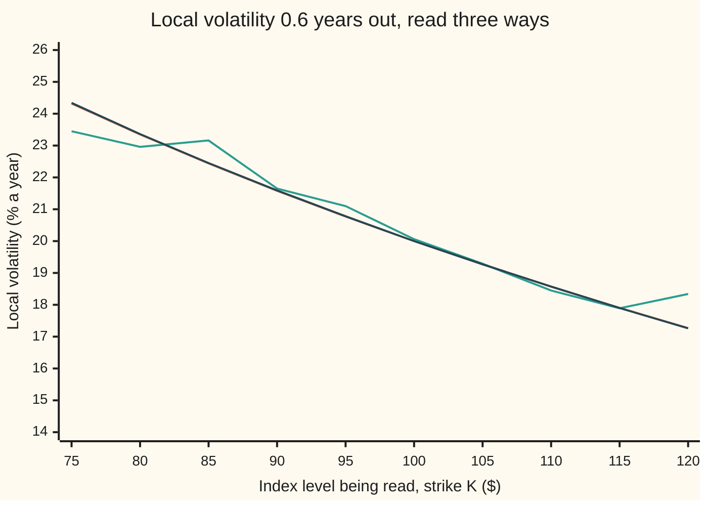

# Dupire's equation: reading volatility off a surface of prices

[Syllabus](../../../SYLLABUS.md) → [Partial differential equations](../README.md) → [The Heat Equation in Depth](../README.md#s03) → Dupire's equation

---

## General Overview

A share in a stock-index fund trades at $100; call it the index from here on. A screen shows 60 prices of call options on it: 12 strikes from 70 to 125, each at 5 expiries from 0.2 to 1.0 years. A **call** is the right, not the duty, to buy the index at the **strike** on the **expiry** date. The 60 prices sit in the table under Worked numbers. Each is quoted to the cent and carries a small error, up to 2 cents either way, as real quotes do. These quotes are illustrative.

The question: how widely must the index swing at each level, so that all 60 prices come out right? The answer is the **local volatility**: one volatility (the typical size of the index's swings, as a percentage a year) for each index level and date. A desk needs it to price contracts that depend on the whole path, such as barriers, in a way that agrees with every quoted call.

[The heat equation](../../08-Differential%20equations%20and%20dynamics/10-The%20Classical%20PDEs/03-the-heat-equation.md) in wing 08 runs a temperature forward in time from a starting profile. This card shows that the 60 call prices obey an equation of the same kind, with strike in place of position and expiry in place of time:

- **Forward.** Start from the payoff at expiry zero and march the equation forward. One solve gives every strike and every expiry at once.
- **Backward, the inverse.** Read the volatility off the prices: rate of change in expiry, divided by the bend in strike. For the 1 m copper rod of this shelf, this is the same as reading the rod's diffusivity off a record of its temperatures.

The forward problem is well behaved. The inverse is not: a 2-cent quote error, read off strikes 1 dollar apart, turns the local variance negative. The cure is to fit a smooth surface first, and the forward equation is the tool that does the fitting.

**Dupire's equation runs call prices forward in strike and expiry like heat along a rod, and inverting it reads the local volatility off the prices, a reading so sensitive to quote errors that it works only after the surface is smoothed or fitted.**

**What kind of fact this is:** a theorem, proved on this card in Why it works: if the index moves with a volatility that depends only on its level and the date, its call prices obey this equation. That real markets move this way is a model, not a law. The instability of the inverse is a theorem about second differences, shown on finite cases by the checks.

### The picture: local volatility read straight off noisy quotes, and after a fit



Orange: the true local volatility that made the prices. Green: Dupire's formula applied straight to the 60 noisy quotes, strikes 5 apart. Across the 30 readings it can make, at three expiries, it wobbles by up to 2.44 points; on this 0.6-year slice its worst reading is 18.34% against 17.27%, at strike 120. Dark blue: a two-number volatility curve fitted to the same quotes by running the forward equation. It lies almost exactly on the truth.

---

## The formula

Notation first. $`C(K, T)`$ is today's price of a call with strike $`K`$ and expiry $`T`$ years away. A letter written small beside $`C`$ names the input being moved while the other is held still: $`C_T`$ is the slope in expiry, $`C_K`$ the slope in strike, and $`C_{KK}`$ the bend in strike. Interest and dividends are set to zero here; the full equation with them is on the [Dupire local volatility](../../12-Financial%20mathematics/13-Local%20volatility%20and%20jumps/01-dupire-local-volatility.md) card and is quoted once below.

**Dupire's forward equation**, in strike and expiry:

```math
C_T \;=\; \tfrac12\,\sigma_{\text{loc}}^2(K, T)\,K^2\,C_{KK}, \qquad C(K, 0) = \max(S_0 - K,\,0), \qquad C(0, T) = S_0
```

**Read it aloud:** a call gains value with a later expiry at a rate equal to half the local variance at its strike, times the strike squared, times the bend of the price curve there; at expiry zero it is worth its payoff, and a call struck at zero is worth the index.

Solved for the volatility, it is **Dupire's inversion**:

```math
\sigma_{\text{loc}}^2(K, T) \;=\; \frac{2\,C_T}{K^2\,C_{KK}}
```

With an interest rate $`r`$ and a dividend yield $`q`$, the forward equation gains two terms, $`C_T = \tfrac12\sigma_{\text{loc}}^2 K^2 C_{KK} - (r - q)K\,C_K - q\,C`$. Measuring each call against the forward price removes them again, so nothing on this card depends on setting them to zero.

| Symbol | Plain meaning | In our example | Push it up and the answer… |
| --- | --- | --- | --- |
| $`C(K, T)`$ | today's price of a call with strike $`K`$ and expiry $`T`$, in dollars | 6.17 at strike 100, 0.6 years (quoted) | — |
| $`K`$ | strike: the price at which the call lets its holder buy; also the index level whose volatility is read | 70 to 125, in steps of 5 | — |
| $`T`$ | expiry, in years | 0.2 to 1.0, in steps of 0.2 | — |
| $`S_0`$ | the index level today | $100 | every call is worth more |
| $`\sigma_{\text{loc}}(K, T)`$ | local volatility: how widely the index swings when it stands at level $`K`$ on date $`T`$; $`\sigma_{\text{loc}}^2`$ is the local variance | true curve $`0.20 - 0.15\ln(K/100)`$: 20.00% at 100 | prices rise, faster at that strike |
| $`C_T`$, $`C_K`$, $`C_{KK}`$ | slope in expiry (price per year), slope in strike, bend in strike | 5.15 and 0.0256 at (100, 0.6), from quotes | a steeper $`C_T`$ reads a higher volatility; a sharper bend reads a lower one |
| $`p(x, T)`$, $`Q`$ | density of the index level $`x`$ on date $`T`$: the chance per dollar of ending near $`x`$; in the proof, $`Q = \sigma_{\text{loc}}^2x^2p`$ | $`p`$ equals $`C_{KK}`$ when rates are zero | — |
| $`r`$, $`q`$ | interest rate and dividend yield, continuously compounded | 0 (illustrative) | — |
| $`h`$, $`w`$ | spacing between neighbouring strikes, used to read slopes off quotes; $`w`$ is the width of a ripple in the prices | $`h`$ = 5 | truncation error falls, noise in the bend grows as $`1/h^2`$ |
| $`\Delta T`$ | spacing between neighbouring expiries | 0.2 years | — |
| $`\varepsilon`$ | the largest error in one quote | 2 cents of noise plus half a cent of rounding | the reading wobbles more |
| $`a`$, $`b`$ | the two numbers of the fitted curve $`\sigma_{\text{loc}}(K) = a + b\ln(K/100)`$ | fitted 0.2000 and −0.1506 | — |

### When it holds

- **The index moves continuously, with a volatility set by its level and the date.** With jumps, a call can gain value from paths far from its strike and the equation lacks terms. With a volatility that is itself random, as in [The Heston model](../../12-Financial%20mathematics/14-Stochastic%20volatility%20-%20Heston%2C%20SABR%20and%20their%20mix/01-heston-model.md), the formula still holds but returns the average variance over the paths that end at the strike.
- **Positive local volatility, not too large.** Then the forward problem is a diffusion forward in expiry and is well posed. A volatility that grows without bound at high levels can break uniqueness.
- **A bend that is clearly positive.** The inversion divides by $`C_{KK}`$. Where few paths arrive, far from today's level or at short expiry, the bend is tiny and any error in it decides the answer.
- **A smooth surface, not raw quotes.** The inversion takes a second difference of data. Read straight off quotes with errors, it amplifies them by $`4/h^2`$; this is the subject of Why it works, Step 4.

---

## Why it works

### Step 0: a call is a temperature, and the bend is where the heat is

A call pays $`\max(x - K, 0)`$ if the index ends at $`x`$. As a function of the strike, that payoff is a straight line with a corner at today's level: worth 30 at strike 70, worth nothing at 125. Wait longer, and the index may wander further, so the corner rounds off.

That rounding is diffusion. The bend of the price curve in strike is the density of where the index ends ([Fokker-Planck](09-fokker-planck-and-densities.md)). A later expiry adds value only where the density sits, at a rate set by how widely the index swings there. Prices spread in strike exactly as heat spreads along a rod that conducts heat equally well everywhere but takes different amounts of heat to warm at different points, so that its diffusivity is $`\tfrac12\sigma_{\text{loc}}^2K^2`$ at position $`K`$.

### Step 1: the calls obey a forward equation

The [Dupire local volatility](../../12-Financial%20mathematics/13-Local%20volatility%20and%20jumps/01-dupire-local-volatility.md) card derives this with interest and dividends. In outline, with them set to zero:

1. A call price is the average payoff: $`C(K, T) = \int_K^\infty (x - K)\,p(x, T)\,dx`$.
2. Differentiate twice in strike: the bend is the density, $`C_{KK} = p(K, T)`$.
3. The density obeys the Fokker-Planck equation, which spreads it at a rate set by $`\tfrac12\sigma_{\text{loc}}^2x^2`$.
4. Differentiate the average in expiry and integrate by parts twice. The payoff above the strike is a straight line with no bend, so only the strike itself survives.

<details>
<summary>Detailed proof: from the density's equation to Dupire's, rates zero</summary>

Assume $`p(x, T)`$ is smooth for $`T > 0`$, and that $`\sigma_{\text{loc}}^2x^2p`$ and its slope in $`x`$ vanish as $`x \to \infty`$ faster than $`x`$ grows. The density obeys

$`\displaystyle p_T = \tfrac12\,\big(\sigma_{\text{loc}}^2(x, T)\,x^2\,p\big)_{xx}.`$

Write $`Q(x) = \sigma_{\text{loc}}^2(x, T)\,x^2\,p(x, T)`$. Differentiate the call price in $`T`$ and integrate by parts twice:

$`\displaystyle C_T = \int_K^\infty (x - K)\,\tfrac12 Q_{xx}\,dx = \Big[(x - K)\,\tfrac12 Q_x\Big]_K^\infty - \Big[\tfrac12 Q\Big]_K^\infty = \tfrac12 Q(K).`$

The first bracket is zero at $`x = K`$ and at infinity; the second gives $`\tfrac12 Q(K)`$ because $`Q`$ vanishes at infinity. With $`p(K, T) = C_{KK}`$:

$`\displaystyle C_T = \tfrac12\,\sigma_{\text{loc}}^2(K, T)\,K^2\,C_{KK}.`$

At $`T = 0`$ the index is surely at $`S_0`$, so $`C(K, 0) = \max(S_0 - K, 0)`$. At $`K = 0`$ the coefficient $`\tfrac12\sigma_{\text{loc}}^2K^2`$ is zero, so $`C(0, T)`$ never moves from $`S_0`$. $`\blacksquare`$

</details>

### Step 2: the forward problem is well posed

Read as a problem, Dupire's equation has:

- **Unknown:** the price surface $`C(K, T)`$.
- **Region:** strikes $`K > 0`$, expiries $`0 < T \le 1`$.
- **Data:** the payoff at $`T = 0`$, the value $`S_0`$ at $`K = 0`$, and the volatility $`\sigma_{\text{loc}}`$.

It is a heat equation with a positive diffusivity, run forward in time, so it is well posed ([Well posed](../01-Classification%20and%20Well-Posedness/06-well-posedness-and-hadamard.md)): a solution exists, is unique, and moves only a little when the data move a little. The solution is classical for $`T > 0`$ (twice differentiable in $`K`$, once in $`T`$) and unique among surfaces that grow at most like the strike.

[Diffusion's maximum principle](04-maximum-principle-for-the-heat-equation.md) gives the natural bounds: every price lies between the payoff and the index level, $`\max(S_0 - K, 0) \le C \le S_0`$. The bend stays non-negative, because it is a density, which the Fokker-Planck equation keeps non-negative.

The check marches the equation on a grid by the Crank-Nicolson scheme ([Crank-Nicolson and the theta family](../../16-Numerical%20analysis/07-PDE%20Solvers/04-crank-nicolson-and-theta-methods.md): the average of an explicit and an implicit step). Four implicit half-steps come first, to damp the payoff's corner. With a flat 20% volatility the answer must be the Black formula (the Black-Scholes call price with rates zero). The worst gap over all 60 quotes is 2.23e-03 at strike step 0.5 and expiry step 0.010, and 5.57e-04 at half of both: an observed order of 2.00, as the scheme promises.

### Step 3: one forward solve prices every strike

The usual pricing equation runs backward from one payoff ([Feynman-Kac](08-feynman-kac-and-the-kolmogorov-equations.md)). Its starting data is the payoff of one strike, so it needs one solve per strike, and 12 strikes need 12 solves.

Dupire's equation runs the other way. Its starting data is the payoff seen from today's level, the same for every strike, so one solve fills the whole surface. The two equations are adjoint: two views of one diffusion, one from the payoff and one from today.

The check confirms this. One backward solve per strike agrees with the single forward solve to four decimals:

| Strike | Backward, 0.6 years | Forward, 0.6 years | Backward, 1.0 year | Forward, 1.0 year |
| --- | --- | --- | --- | --- |
| 80 | 20.6344 | 20.6344 | 21.5071 | 21.5071 |
| 100 | 6.1705 | 6.1705 | 7.9579 | 7.9579 |
| 120 | 0.7698 | 0.7698 | 1.7526 | 1.7526 |

That is why calibration engines (programs that tune a model until it reprices the quotes) use the forward equation.

### Step 4: the inverse amplifies errors

Inversion needs the bend. Read off quotes $`h`$ apart, the bend is a second difference:

```math
C_{KK} \approx \frac{C(K - h) - 2\,C(K) + C(K + h)}{h^2}
```

**Read it aloud:** the bend is the sum of the two neighbours minus twice the middle, divided by the spacing squared.

Each quote may be off by $`\varepsilon`$. In the worst case the three errors line up, and the bend is off by $`4\varepsilon/h^2`$. With $`\varepsilon`$ = 2.5 cents (2 cents of noise plus half a cent of rounding), that is 0.0040 at $`h = 5`$ and 0.1000 at $`h = 1`$. The true bend at strike 100 is about 0.0256: the value the bend from error-free prices settles at in the table under Worked numbers. At $`h = 1`$ the possible error is larger than the bend itself, so even the sign is not safe.

Two errors pull against each other:

- **Truncation:** the difference formula's own error, which falls like $`h^2`$.
- **Noise:** the quote errors, amplified like $`1/h^2`$.

So more quotes, closer together, do not help past a point. They hurt.

The same failure, seen as a wave: add to the prices a ripple of height $`\varepsilon`$ and width $`w`$ in strike. Its bend is about $`\varepsilon(2\pi/w)^2`$. However small $`\varepsilon`$ is, a narrow enough ripple makes the bend as large as any bound. This is the third of Hadamard's conditions failing: the answer does not depend continuously on the data. It is the forward smoothing of [Diffusion smooths instantly, and is felt everywhere at once](05-smoothing-and-infinite-speed.md) run in reverse. The forward equation smooths out narrow ripples in the volatility, so the inversion must sharpen narrow ripples in the prices.

### Step 5: the cure is to fit, not to differentiate

Regularization means adding information that rules out the wild answers. Two common forms:

- **A smooth family.** Allow only volatility curves with few numbers in them, then choose the numbers that best reprice the quotes.
- **A penalty.** Allow any curve, but add to the misfit a cost for roughness (Tikhonov's method, in [Ill-posed problems](../../16-Numerical%20analysis/03-Numerical%20Linear%20Algebra/16-discrete-ill-posed-problems-and-regularisation.md)), with a weight that trades bias against noise.

The check uses the first. It allows $`\sigma_{\text{loc}}(K) = a + b\ln(K/100)`$ and minimizes the squared misfit to the 60 quotes, by Gauss-Newton steps (each step solves a small linear problem built from the slopes of the misfit). Every trial pair costs one forward solve, which prices all 60 quotes. Starting from $`a`$ = 0.25 and $`b`$ = 0, two steps reach $`a`$ = 0.2000 and $`b`$ = −0.1503, and a third settles $`b`$ at −0.1506. The leftover price error is 0.0102 in root mean square, about the size of the noise put in.

Honesty about this fit: the true curve is in the family, so the fit has an easy job. It is not a perfect copy, though: the fit runs on a grid twice as coarse as the one that made the prices. With a real surface the family must be richer, and choosing its size is the trade between bias and noise.

---

## Worked numbers, by hand

The 60 quotes, in dollars:

| Expiry (years) | 70 | 75 | 80 | 85 | 90 | 95 | 100 | 105 | 110 | 115 | 120 | 125 |
| --- | --- | --- | --- | --- | --- | --- | --- | --- | --- | --- | --- | --- |
| 0.2 | 30.01 | 25.00 | 20.04 | 15.15 | 10.58 | 6.60 | 3.58 | 1.64 | 0.61 | 0.18 | 0.04 | 0.02 |
| 0.4 | 30.02 | 25.08 | 20.27 | 15.66 | 11.48 | 7.89 | 5.05 | 2.96 | 1.59 | 0.77 | 0.34 | 0.12 |
| 0.6 | 30.11 | 25.28 | 20.64 | 16.30 | 12.36 | 8.96 | 6.17 | 4.02 | 2.47 | 1.43 | 0.78 | 0.37 |
| 0.8 | 30.27 | 25.55 | 21.08 | 16.90 | 13.12 | 9.85 | 7.11 | 4.93 | 3.27 | 2.09 | 1.27 | 0.73 |
| 1.0 | 30.47 | 25.86 | 21.52 | 17.46 | 13.84 | 10.64 | 7.96 | 5.76 | 4.00 | 2.71 | 1.74 | 1.11 |

Read the local volatility at strike 100, 0.6 years out:

| Step | Arithmetic | Value |
| --- | --- | --- |
| quotes at strike 100, expiries 0.4, 0.6, 0.8 | read off the table | 5.05, 6.17, 7.11 |
| quotes at expiry 0.6, strikes 95 and 105 | read off the table | 8.96, 4.02 |
| slope in expiry $`C_T`$ | (7.11 − 5.05) / 0.4 | 5.1500 |
| bend in strike $`C_{KK}`$ | (8.96 − 2 × 6.17 + 4.02) / 25 = 0.64 / 25 | 0.025600 |
| local variance | 2 × 5.1500 / (100² × 0.025600) | 0.040234 |
| **local volatility** | square root | **20.06%** |

At an index level of 100, 0.6 years from now, the quotes say the index moves at about 20% a year. The truth is 20.00%. The same steps on error-free prices give 20.23%. That gap from the truth is truncation, from strikes 5 apart and expiries 0.2 apart.

Here the quote errors happened to pull the reading toward the truth. Across all 30 points the formula can read (strikes 75 to 120, expiries 0.4 to 0.8), the worst error is 0.95 points from error-free prices and 2.44 points from the quotes.

### Closer strikes, worse readings

Strike 100, 0.6 years, expiry spacing 0.2. Each row uses a fresh set of noisy quotes at the given strike spacing $`h`$.

| Spacing $`h`$ | From error-free prices (%) | Bend from error-free prices | From noisy quotes (%) | Local variance from quotes | Bend error, worst case |
| --- | --- | --- | --- | --- | --- |
| 10 | 20.48 | 0.0248 | 20.46 | 0.0419 | 0.0010 |
| 5 | 20.23 | 0.0254 | 20.92 | 0.0438 | 0.0040 |
| 2.5 | 20.17 | 0.0256 | 18.58 | 0.0345 | 0.0160 |
| 1 | 20.15 | 0.0256 | none | −0.1055 | 0.1000 |
| 0.5 | 20.15 | 0.0256 | none | −0.0130 | 0.4000 |

From error-free prices the reading settles toward the truth as $`h`$ shrinks, until only the expiry spacing's error is left, at 20.15%. The bend settles too, at 0.0256: the density at strike 100. From quotes it gets worse, and at $`h = 1`$ the local variance is negative: there is no volatility at all.

### What breaks if you drop a piece

| Mistake | Comes out at | What went wrong |
| --- | --- | --- |
| Read noisy quotes 1 apart in strike | local variance −0.1055: no volatility | the bend's error, up to 0.1000, swamps the true bend of about 0.0256 |
| Drop the 2, reading $`C_T/(K^2 C_{KK})`$, error-free prices | 14.31% instead of 20.23% | the variance is halved, so the volatility is short by a factor of the square root of 2 |
| Slope in expiry from 0.4 and 0.6 only, error-free prices | 21.08% instead of 20.23% | a one-sided slope belongs to 0.5 years, not 0.6, and the price curve bends in expiry |
| Fit nothing, read every grid point | wobbles of up to 2.44 points | each reading carries its own amplified error; a fit shares the 60 quotes' information |

---

## Code, from first principles, and it actually runs

The script builds the 60 quotes from a known volatility curve and reads the curve back four ways. It marches the forward equation by Crank-Nicolson with the tridiagonal solve written out, and checks it against the Black formula, whose normal curve area comes from a series written out. It checks the forward solve against one backward solve per strike. It applies Dupire's inversion to error-free and noisy prices at several spacings, and it fits two numbers by Gauss-Newton. The noise comes from SplitMix64, a small random-number generator, with seed 2026, written out in both languages, so both print the same.

### Python

```python
# Dupire's equation -- the check behind the card.  Standard library only.
# An index at 100, rates and dividends zero (illustrative).  60 call quotes:
# strikes 70..125 step 5, expiries 0.2..1.0 step 0.2 years.  The forward
# equation C_T = 1/2 sig(K)^2 K^2 C_KK is marched in strike and expiry
# (Crank-Nicolson, four implicit half-steps first, Thomas solve written out).
# Roads: the Black formula (normal CDF by series); one backward solve per
# strike; Dupire's inversion against the known volatility; a two-number fit.
import math

S0, KS, TS = 100.0, [70 + 5 * i for i in range(12)], [0.2, 0.4, 0.6, 0.8, 1.0]

def ncdf(x):                       # Marsaglia's series for the normal CDF
    s, t, k = x, x, 1
    while abs(t) > 1e-17:
        t *= x * x / (2 * k + 1); s += t; k += 1
    return 0.5 + s * math.exp(-0.5 * x * x) / math.sqrt(2 * math.pi)

def black(K, T, sg):
    d1 = (math.log(S0 / K) + 0.5 * sg * sg * T) / (sg * math.sqrt(T))
    return S0 * ncdf(d1) - K * ncdf(d1 - sg * math.sqrt(T))

def skew(a, b):
    return lambda x: max(0.05, min(1.0, a + b * math.log(x / 100))) if x > 0 else 0.0

def march(sig, init, dx, n):       # u_t = 1/2 sig(x)^2 x^2 u_xx on [0, 300]
    M, dt = round(300 / dx), 0.2 / n
    a = [0.5 * (sig(i * dx) * (i * dx)) ** 2 / dx ** 2 for i in range(M + 1)]
    u, out = [init(i * dx) for i in range(M + 1)], []
    steps = [(dt / 2, 1.0)] * 4 + [(dt, 0.5)] * (5 * n - 2)
    for s, (h, th) in enumerate(steps):
        l, d, r = [0.0] * (M + 1), [1.0] * (M + 1), u[:]
        for i in range(1, M):
            lam = a[i] * h
            r[i] = u[i] + (1 - th) * lam * (u[i - 1] - 2 * u[i] + u[i + 1])
            l[i], d[i] = -th * lam, 1 + 2 * th * lam
        r[1] -= l[1] * u[0]; r[M - 1] -= l[M - 1] * u[M]
        c, y = [0.0] * M, [0.0] * M          # Thomas: sweep down, then back up
        for i in range(1, M):
            m = d[i] - l[i] * c[i - 1]
            c[i], y[i] = l[i] / m, (r[i] - l[i] * y[i - 1]) / m
        u[M - 1] = y[M - 1]
        for i in range(M - 2, 0, -1):
            u[i] = y[i] - c[i] * u[i + 1]
        if s >= 4 and (s - 1) % n == 0:
            out.append(u[:])
    return out

def at(grid, dx, K):
    return grid[round(K / dx)]
def fwd(sig, dx, n):
    return march(sig, lambda x: max(S0 - x, 0.0), dx, n)
def table(g, dx):
    return [[at(g[j], dx, K) for K in KS] for j in range(5)]

RNG = [2026]
def noisy(c):                      # a quote: true price, uniform noise +-2 cents, to the cent
    RNG[0] = (RNG[0] + 0x9E3779B97F4A7C15) % 2**64      # SplitMix64, seed 2026
    z = RNG[0]
    z = ((z ^ (z >> 30)) * 0xBF58476D1CE4E5B9) % 2**64
    z = ((z ^ (z >> 27)) * 0x94D049BB133111EB) % 2**64
    return math.floor(100 * (c + 0.04 * ((z ^ (z >> 31)) >> 11) / 2**53 - 0.02) + 0.5) / 100

def lv(C, dT, h, K):               # Dupire's inversion, centred differences
    cT, cKK = (C[2] - C[0]) / (2 * dT), (C[3] - 2 * C[1] + C[4]) / h ** 2
    return 2 * cT / (K * K * cKK)
def vol(v):
    return math.sqrt(v) if v > 0 else float("nan")
def pct(v):
    return f"{100 * math.sqrt(v):6.2f}" if v > 0 else "  none"

flat = lambda x: 0.2
err = []
for dx, n in [(0.5, 20), (0.25, 40)]:
    Q = table(fwd(flat, dx, n), dx)
    err.append(max(abs(Q[j][i] - black(K, TS[j], 0.2)) for j in range(5) for i, K in enumerate(KS)))
    print(f"flat 20%: dK = {dx} $, dT = {0.2 / n:.3f} y, max |forward - Black| = {err[-1]:.2e} $")
order = math.log2(err[0] / err[1])
print(f"observed order {order:.2f}; K = 100, T = 1: forward {Q[4][6]:.4f} $, Black {black(100, 1, 0.2):.4f} $")
assert err[1] < 1e-3 and 1.5 < order < 2.5

true = skew(0.20, -0.15)
DX, N = 0.25, 40
G = fwd(true, DX, N)
Q = table(G, DX)
for K in [80, 100, 120]:                  # one backward solve per strike
    B = march(true, lambda x: max(x - K, 0.0), DX, N)
    b6, b10 = at(B[2], DX, S0), at(B[4], DX, S0)
    f6, f10 = Q[2][KS.index(K)], Q[4][KS.index(K)]
    print(f"backward K={K}: T=0.6 {b6:.4f} vs forward {f6:.4f}; T=1.0 {b10:.4f} vs {f10:.4f}")
    assert abs(b6 - f6) < 2e-3 and abs(b10 - f10) < 2e-3

R = [[noisy(c) for c in row] for row in Q]
print("the 60 quotes ($), strikes 70..125 across, expiries 0.2..1.0 down:")
for j in range(5):
    print(f"  T={TS[j]:.1f} " + " ".join(f"{c:.2f}" for c in R[j]))
def surface(C):
    return [[lv([C[j-1][i], C[j][i], C[j+1][i], C[j][i-1], C[j][i+1]], 0.2, 5, KS[i])
             for i in range(1, 11)] for j in range(1, 4)]
LE, LR = surface(Q), surface(R)
print("local vol at T = 0.6 (%), strikes 75..120:")
print("  truth " + " ".join(f"{100 * true(K):.2f}" for K in KS[1:11]))
print("  exact " + " ".join(f"{100 * vol(v):.2f}" for v in LE[1]))
print("  noisy " + " ".join(f"{100 * vol(v):.2f}" for v in LR[1]))
we = max(abs(vol(v) - true(KS[i + 1])) for row in LE for i, v in enumerate(row))
wn = max(abs(vol(v) - true(KS[i + 1])) for row in LR for i, v in enumerate(row))
print(f"30 readings, worst error: exact quotes {100 * we:.2f} points, noisy quotes {100 * wn:.2f}")
assert we < 0.012 and wn < 0.03

c = [Q[1][6], Q[2][6], Q[3][6], Q[2][5], Q[2][7]]
for name, C in [("exact", c), ("quoted", [R[1][6], R[2][6], R[3][6], R[2][5], R[2][7]])]:
    cT, cKK = (C[2] - C[0]) / 0.4, (C[3] - 2 * C[1] + C[4]) / 25
    print(f"by hand {name}: " + " ".join(f"{x:.4f}" for x in C) + f"; C_T {cT:.4f} C_KK {cKK:.6f} var {2 * cT / (1e4 * cKK):.6f}")
cT, cKK = (c[2] - c[0]) / 0.4, (c[3] - 2 * c[1] + c[4]) / 25
print(f"mistakes, exact quotes: no 1/2 {math.sqrt(cT / (1e4 * cKK)):.4f}; one-sided C_T {math.sqrt(2 * (c[1] - c[0]) / 0.2 / (1e4 * cKK)):.4f}")
print("strike spacing h at K=100, T=0.6 (dT = 0.2): local vol (%) from exact and noisy quotes")
for h in [10, 5, 2.5, 1, 0.5]:
    pts = [(at(G[j], DX, 100), at(G[2], DX, 100 - h), at(G[2], DX, 100 + h)) for j in [1, 2, 3]]
    C = [pts[0][0], pts[1][0], pts[2][0], pts[1][1], pts[1][2]]
    e, t = lv(C, 0.2, h, 100), lv([noisy(x) for x in C], 0.2, h, 100)
    print(f"  h={h:<4} exact {100 * vol(e):.2f} bend {(C[3] - 2 * C[1] + C[4]) / h ** 2:.4f} noisy {pct(t)} variance {t:7.4f} bend noise up to {0.1 / h ** 2:.4f}")
assert abs(vol(e) - 0.2) < 0.003 and t < 0

p = [0.25, 0.0]                           # the fit: Gauss-Newton on (a, b)
def resid(p):
    M = table(fwd(skew(*p), 0.5, 20), 0.5)
    return [M[j][i] - R[j][i] for j in range(5) for i in range(12)]
for it in range(4):
    r0 = resid(p)
    J = [[(x - y) / 1e-4 for x, y in zip(resid([p[0] + 1e-4 * (k == 0), p[1] + 1e-4 * (k == 1)]), r0)] for k in (0, 1)]
    A = [[sum(x * y for x, y in zip(J[k], J[m])) for m in (0, 1)] for k in (0, 1)]
    g = [sum(x * y for x, y in zip(J[k], r0)) for k in (0, 1)]
    det = A[0][0] * A[1][1] - A[0][1] ** 2
    p = [p[0] - (A[1][1] * g[0] - A[0][1] * g[1]) / det, p[1] - (A[0][0] * g[1] - A[0][1] * g[0]) / det]
    rms = math.sqrt(sum(x * x for x in resid(p)) / 60)
    print(f"fit step {it + 1}: a = {p[0]:.4f}, b = {p[1]:.4f}, rms price error {rms:.4f} $")
print("fitted local vol (%), strikes 75..120: " + " ".join(f"{100 * skew(*p)(K):.2f}" for K in KS[1:11]))
assert abs(p[0] - 0.20) < 0.003 and abs(p[1] + 0.15) < 0.01 and rms < 0.03
print("ALL CHECKS PASS")
```

**Ran 2026-11-15 on macOS, Python 3.14.10, standard library only. All checks passed. Output, pasted from the run:**

```
flat 20%: dK = 0.5 $, dT = 0.010 y, max |forward - Black| = 2.23e-03 $
flat 20%: dK = 0.25 $, dT = 0.005 y, max |forward - Black| = 5.57e-04 $
observed order 2.00; K = 100, T = 1: forward 7.9654 $, Black 7.9656 $
backward K=80: T=0.6 20.6344 vs forward 20.6344; T=1.0 21.5071 vs 21.5071
backward K=100: T=0.6 6.1705 vs forward 6.1705; T=1.0 7.9579 vs 7.9579
backward K=120: T=0.6 0.7698 vs forward 0.7698; T=1.0 1.7526 vs 1.7526
the 60 quotes ($), strikes 70..125 across, expiries 0.2..1.0 down:
  T=0.2 30.01 25.00 20.04 15.15 10.58 6.60 3.58 1.64 0.61 0.18 0.04 0.02
  T=0.4 30.02 25.08 20.27 15.66 11.48 7.89 5.05 2.96 1.59 0.77 0.34 0.12
  T=0.6 30.11 25.28 20.64 16.30 12.36 8.96 6.17 4.02 2.47 1.43 0.78 0.37
  T=0.8 30.27 25.55 21.08 16.90 13.12 9.85 7.11 4.93 3.27 2.09 1.27 0.73
  T=1.0 30.47 25.86 21.52 17.46 13.84 10.64 7.96 5.76 4.00 2.71 1.74 1.11
local vol at T = 0.6 (%), strikes 75..120:
  truth 24.32 23.35 22.44 21.58 20.77 20.00 19.27 18.57 17.90 17.27
  exact 23.81 23.04 22.35 21.67 20.97 20.23 19.45 18.64 17.83 17.05
  noisy 23.45 22.96 23.16 21.65 21.10 20.06 19.29 18.45 17.89 18.34
30 readings, worst error: exact quotes 0.95 points, noisy quotes 2.44
by hand exact: 5.0407 6.1705 7.1214 8.9514 4.0251; C_T 5.2018 C_KK 0.025419 var 0.040928
by hand quoted: 5.0500 6.1700 7.1100 8.9600 4.0200; C_T 5.1500 C_KK 0.025600 var 0.040234
mistakes, exact quotes: no 1/2 0.1431; one-sided C_T 0.2108
strike spacing h at K=100, T=0.6 (dT = 0.2): local vol (%) from exact and noisy quotes
  h=10   exact 20.48 bend 0.0248 noisy  20.46 variance  0.0419 bend noise up to 0.0010
  h=5    exact 20.23 bend 0.0254 noisy  20.92 variance  0.0438 bend noise up to 0.0040
  h=2.5  exact 20.17 bend 0.0256 noisy  18.58 variance  0.0345 bend noise up to 0.0160
  h=1    exact 20.15 bend 0.0256 noisy   none variance -0.1055 bend noise up to 0.1000
  h=0.5  exact 20.15 bend 0.0256 noisy   none variance -0.0130 bend noise up to 0.4000
fit step 1: a = 0.2018, b = -0.1242, rms price error 0.0546 $
fit step 2: a = 0.2000, b = -0.1503, rms price error 0.0102 $
fit step 3: a = 0.2000, b = -0.1506, rms price error 0.0102 $
fit step 4: a = 0.2000, b = -0.1506, rms price error 0.0102 $
fitted local vol (%), strikes 75..120: 24.34 23.36 22.45 21.59 20.78 20.00 19.27 18.57 17.90 17.26
ALL CHECKS PASS
```

### Rust

```rust
// Dupire's equation -- the check behind the card.  std only, no crates.
// An index at 100, rates and dividends zero (illustrative).  60 call quotes:
// strikes 70..125 step 5, expiries 0.2..1.0 step 0.2 years.  The forward
// equation C_T = 1/2 sig(K)^2 K^2 C_KK is marched in strike and expiry
// (Crank-Nicolson, four implicit half-steps first, Thomas solve written out).
// Roads: the Black formula (normal CDF by series); one backward solve per
// strike; Dupire's inversion against the known volatility; a two-number fit.
const S0: f64 = 100.0;
const TS: [f64; 5] = [0.2, 0.4, 0.6, 0.8, 1.0];

fn ks() -> Vec<f64> { (0..12).map(|i| 70.0 + 5.0 * i as f64).collect() }

fn ncdf(x: f64) -> f64 { // Marsaglia's series for the normal CDF
    let (mut s, mut t, mut k) = (x, x, 1.0);
    while t.abs() > 1e-17 { t *= x * x / (2.0 * k + 1.0); s += t; k += 1.0; }
    0.5 + s * (-0.5 * x * x).exp() / (2.0 * std::f64::consts::PI).sqrt()
}

fn black(k: f64, t: f64, sg: f64) -> f64 {
    let d1 = ((S0 / k).ln() + 0.5 * sg * sg * t) / (sg * t.sqrt());
    S0 * ncdf(d1) - k * ncdf(d1 - sg * t.sqrt())
}

fn skew(a: f64, b: f64, x: f64) -> f64 {
    if x > 0.0 { (a + b * (x / 100.0).ln()).min(1.0).max(0.05) } else { 0.0 }
}

// u_t = 1/2 sig(x)^2 x^2 u_xx on [0, 300]
fn march(sig: &dyn Fn(f64) -> f64, init: &dyn Fn(f64) -> f64, dx: f64, n: usize) -> Vec<Vec<f64>> {
    let (m, dt) = ((300.0 / dx).round() as usize, 0.2 / n as f64);
    let a: Vec<f64> = (0..=m).map(|i| { let x = i as f64 * dx; 0.5 * (sig(x) * x).powi(2) / (dx * dx) }).collect();
    let mut u: Vec<f64> = (0..=m).map(|i| init(i as f64 * dx)).collect();
    let (mut out, mut steps) = (Vec::new(), vec![(dt / 2.0, 1.0); 4]);
    steps.extend(vec![(dt, 0.5); 5 * n - 2]);
    for (s, &(h, th)) in steps.iter().enumerate() {
        let (mut l, mut d, mut r) = (vec![0.0; m + 1], vec![1.0; m + 1], u.clone());
        for i in 1..m {
            let lam = a[i] * h;
            r[i] = u[i] + (1.0 - th) * lam * (u[i - 1] - 2.0 * u[i] + u[i + 1]);
            (l[i], d[i]) = (-th * lam, 1.0 + 2.0 * th * lam);
        }
        r[1] -= l[1] * u[0]; r[m - 1] -= l[m - 1] * u[m];
        let (mut c, mut y) = (vec![0.0; m], vec![0.0; m]); // Thomas: sweep down, then back up
        for i in 1..m {
            let mm = d[i] - l[i] * c[i - 1];
            (c[i], y[i]) = (l[i] / mm, (r[i] - l[i] * y[i - 1]) / mm);
        }
        u[m - 1] = y[m - 1];
        for i in (1..m - 1).rev() { u[i] = y[i] - c[i] * u[i + 1]; }
        if s >= 4 && (s - 1) % n == 0 { out.push(u.clone()); }
    }
    out
}

fn at(g: &[f64], dx: f64, k: f64) -> f64 { g[(k / dx).round() as usize] }
fn fwd(sig: &dyn Fn(f64) -> f64, dx: f64, n: usize) -> Vec<Vec<f64>> { march(sig, &|x| (S0 - x).max(0.0), dx, n) }
fn table(g: &[Vec<f64>], dx: f64) -> Vec<Vec<f64>> {
    (0..5).map(|j| ks().iter().map(|&k| at(&g[j], dx, k)).collect()).collect()
}

// a quote: true price, uniform noise +-2 cents, to the cent; SplitMix64, seed 2026
fn noisy(st: &mut u64, c: f64) -> f64 {
    *st = st.wrapping_add(0x9E3779B97F4A7C15);
    let mut z = *st;
    z = (z ^ (z >> 30)).wrapping_mul(0xBF58476D1CE4E5B9);
    z = (z ^ (z >> 27)).wrapping_mul(0x94D049BB133111EB);
    let un = ((z ^ (z >> 31)) >> 11) as f64 / 9007199254740992.0;
    (100.0 * (c + 0.04 * un - 0.02) + 0.5).floor() / 100.0
}

fn lv(c: &[f64], dt: f64, h: f64, k: f64) -> f64 { // Dupire's inversion, centred differences
    2.0 * (c[2] - c[0]) / (2.0 * dt) / (k * k * ((c[3] - 2.0 * c[1] + c[4]) / (h * h)))
}
fn vol(v: f64) -> f64 { if v > 0.0 { v.sqrt() } else { f64::NAN } }
fn pct(v: f64) -> String { if v > 0.0 { format!("{:6.2}", 100.0 * v.sqrt()) } else { "  none".to_string() } }
fn sci(x: f64) -> String { // Python's .2e
    let e = x.abs().log10().floor() as i32;
    let (mut mt, mut e2) = (x / 10f64.powi(e), e);
    if format!("{:.2}", mt.abs()) == "10.00" { mt /= 10.0; e2 += 1; }
    format!("{:.2}e{}{:02}", mt, if e2 < 0 { "-" } else { "+" }, e2.abs())
}
fn row(v: &[f64]) -> String { v.iter().map(|x| format!("{:.2}", x)).collect::<Vec<_>>().join(" ") }

fn main() {
    let kv = ks();
    let flat = |_x: f64| 0.2;
    let (mut err, mut q) = (Vec::new(), Vec::new());
    for &(dx, n) in &[(0.5, 20usize), (0.25, 40usize)] {
        q = table(&fwd(&flat, dx, n), dx);
        let mut e: f64 = 0.0;
        for j in 0..5 { for i in 0..12 { e = e.max((q[j][i] - black(kv[i], TS[j], 0.2)).abs()); } }
        err.push(e);
        println!("flat 20%: dK = {} $, dT = {:.3} y, max |forward - Black| = {} $", dx, 0.2 / n as f64, sci(e));
    }
    let order = (err[0] / err[1]).log2();
    println!("observed order {:.2}; K = 100, T = 1: forward {:.4} $, Black {:.4} $", order, q[4][6], black(100.0, 1.0, 0.2));
    assert!(err[1] < 1e-3 && 1.5 < order && order < 2.5);

    let truth = |x: f64| skew(0.20, -0.15, x);
    let (gdx, gn) = (0.25, 40usize);
    let g = fwd(&truth, gdx, gn);
    let q = table(&g, gdx);
    for &k in &[80.0, 100.0, 120.0] { // one backward solve per strike
        let b = march(&truth, &|x| (x - k).max(0.0), gdx, gn);
        let (b6, b10) = (at(&b[2], gdx, S0), at(&b[4], gdx, S0));
        let (f6, f10) = (q[2][((k - 70.0) / 5.0) as usize], q[4][((k - 70.0) / 5.0) as usize]);
        println!("backward K={}: T=0.6 {:.4} vs forward {:.4}; T=1.0 {:.4} vs {:.4}", k, b6, f6, b10, f10);
        assert!((b6 - f6).abs() < 2e-3 && (b10 - f10).abs() < 2e-3);
    }

    let mut st: u64 = 2026;
    let r: Vec<Vec<f64>> = q.iter().map(|rw| rw.iter().map(|&c| noisy(&mut st, c)).collect()).collect();
    println!("the 60 quotes ($), strikes 70..125 across, expiries 0.2..1.0 down:");
    for j in 0..5 { println!("  T={:.1} {}", TS[j], row(&r[j])); }
    let surface = |c: &Vec<Vec<f64>>| -> Vec<Vec<f64>> {
        (1..4).map(|j| (1..11).map(|i| lv(&[c[j - 1][i], c[j][i], c[j + 1][i], c[j][i - 1], c[j][i + 1]], 0.2, 5.0, kv[i])).collect()).collect()
    };
    let (le, lr) = (surface(&q), surface(&r));
    println!("local vol at T = 0.6 (%), strikes 75..120:");
    println!("  truth {}", row(&kv[1..11].iter().map(|&k| 100.0 * truth(k)).collect::<Vec<_>>()));
    println!("  exact {}", row(&le[1].iter().map(|&v| 100.0 * vol(v)).collect::<Vec<_>>()));
    println!("  noisy {}", row(&lr[1].iter().map(|&v| 100.0 * vol(v)).collect::<Vec<_>>()));
    let worst = |s: &Vec<Vec<f64>>| s.iter().flat_map(|rw| rw.iter().enumerate().map(|(i, &v)| (vol(v) - truth(kv[i + 1])).abs())).fold(0.0, f64::max);
    let (we, wn) = (worst(&le), worst(&lr));
    println!("30 readings, worst error: exact quotes {:.2} points, noisy quotes {:.2}", 100.0 * we, 100.0 * wn);
    assert!(we < 0.012 && wn < 0.03);

    let c = [q[1][6], q[2][6], q[3][6], q[2][5], q[2][7]];
    let cq = [r[1][6], r[2][6], r[3][6], r[2][5], r[2][7]];
    for (name, cc) in [("exact", c), ("quoted", cq)] {
        let (ct, ckk) = ((cc[2] - cc[0]) / 0.4, (cc[3] - 2.0 * cc[1] + cc[4]) / 25.0);
        let s: Vec<String> = cc.iter().map(|x| format!("{:.4}", x)).collect();
        println!("by hand {}: {}; C_T {:.4} C_KK {:.6} var {:.6}", name, s.join(" "), ct, ckk, 2.0 * ct / (1e4 * ckk));
    }
    let (ct, ckk) = ((c[2] - c[0]) / 0.4, (c[3] - 2.0 * c[1] + c[4]) / 25.0);
    println!("mistakes, exact quotes: no 1/2 {:.4}; one-sided C_T {:.4}", (ct / (1e4 * ckk)).sqrt(), (2.0 * (c[1] - c[0]) / 0.2 / (1e4 * ckk)).sqrt());
    println!("strike spacing h at K=100, T=0.6 (dT = 0.2): local vol (%) from exact and noisy quotes");
    let (mut e, mut t) = (0.0, 0.0);
    for &h in &[10.0, 5.0, 2.5, 1.0, 0.5] {
        let cc = [at(&g[1], gdx, 100.0), at(&g[2], gdx, 100.0), at(&g[3], gdx, 100.0), at(&g[2], gdx, 100.0 - h), at(&g[2], gdx, 100.0 + h)];
        let cn: Vec<f64> = cc.iter().map(|&x| noisy(&mut st, x)).collect();
        (e, t) = (lv(&cc, 0.2, h, 100.0), lv(&cn, 0.2, h, 100.0));
        println!("  h={:<4} exact {:.2} bend {:.4} noisy {} variance {:7.4} bend noise up to {:.4}", h, 100.0 * vol(e), (cc[3] - 2.0 * cc[1] + cc[4]) / (h * h), pct(t), t, 0.1 / (h * h));
    }
    assert!((vol(e) - 0.2).abs() < 0.003 && t < 0.0);

    let resid = |p: &[f64; 2]| -> Vec<f64> { // the fit: Gauss-Newton on (a, b)
        let (a, b) = (p[0], p[1]);
        let mm = table(&fwd(&|x| skew(a, b, x), 0.5, 20), 0.5);
        (0..60).map(|k| mm[k / 12][k % 12] - r[k / 12][k % 12]).collect()
    };
    let (mut p, mut rms) = ([0.25, 0.0], 0.0);
    for it in 0..4 {
        let r0 = resid(&p);
        let jac: Vec<Vec<f64>> = (0..2).map(|k| {
            let pp = [p[0] + if k == 0 { 1e-4 } else { 0.0 }, p[1] + if k == 1 { 1e-4 } else { 0.0 }];
            resid(&pp).iter().zip(&r0).map(|(x, y)| (x - y) / 1e-4).collect()
        }).collect();
        let dot = |u: &[f64], v: &[f64]| u.iter().zip(v).map(|(x, y)| x * y).sum::<f64>();
        let (a00, a01, a11) = (dot(&jac[0], &jac[0]), dot(&jac[0], &jac[1]), dot(&jac[1], &jac[1]));
        let (g0, g1) = (dot(&jac[0], &r0), dot(&jac[1], &r0));
        let det = a00 * a11 - a01 * a01;
        p = [p[0] - (a11 * g0 - a01 * g1) / det, p[1] - (a00 * g1 - a01 * g0) / det];
        rms = (resid(&p).iter().map(|x| x * x).sum::<f64>() / 60.0).sqrt();
        println!("fit step {}: a = {:.4}, b = {:.4}, rms price error {:.4} $", it + 1, p[0], p[1], rms);
    }
    println!("fitted local vol (%), strikes 75..120: {}", row(&kv[1..11].iter().map(|&k| 100.0 * skew(p[0], p[1], k)).collect::<Vec<_>>()));
    assert!((p[0] - 0.20).abs() < 0.003 && (p[1] + 0.15).abs() < 0.01 && rms < 0.03);
    println!("ALL CHECKS PASS");
}
```

**Ran 2026-11-15 on macOS, rustc 1.98.1, no crates. All checks passed. Output, pasted from the run:**

```
flat 20%: dK = 0.5 $, dT = 0.010 y, max |forward - Black| = 2.23e-03 $
flat 20%: dK = 0.25 $, dT = 0.005 y, max |forward - Black| = 5.57e-04 $
observed order 2.00; K = 100, T = 1: forward 7.9654 $, Black 7.9656 $
backward K=80: T=0.6 20.6344 vs forward 20.6344; T=1.0 21.5071 vs 21.5071
backward K=100: T=0.6 6.1705 vs forward 6.1705; T=1.0 7.9579 vs 7.9579
backward K=120: T=0.6 0.7698 vs forward 0.7698; T=1.0 1.7526 vs 1.7526
the 60 quotes ($), strikes 70..125 across, expiries 0.2..1.0 down:
  T=0.2 30.01 25.00 20.04 15.15 10.58 6.60 3.58 1.64 0.61 0.18 0.04 0.02
  T=0.4 30.02 25.08 20.27 15.66 11.48 7.89 5.05 2.96 1.59 0.77 0.34 0.12
  T=0.6 30.11 25.28 20.64 16.30 12.36 8.96 6.17 4.02 2.47 1.43 0.78 0.37
  T=0.8 30.27 25.55 21.08 16.90 13.12 9.85 7.11 4.93 3.27 2.09 1.27 0.73
  T=1.0 30.47 25.86 21.52 17.46 13.84 10.64 7.96 5.76 4.00 2.71 1.74 1.11
local vol at T = 0.6 (%), strikes 75..120:
  truth 24.32 23.35 22.44 21.58 20.77 20.00 19.27 18.57 17.90 17.27
  exact 23.81 23.04 22.35 21.67 20.97 20.23 19.45 18.64 17.83 17.05
  noisy 23.45 22.96 23.16 21.65 21.10 20.06 19.29 18.45 17.89 18.34
30 readings, worst error: exact quotes 0.95 points, noisy quotes 2.44
by hand exact: 5.0407 6.1705 7.1214 8.9514 4.0251; C_T 5.2018 C_KK 0.025419 var 0.040928
by hand quoted: 5.0500 6.1700 7.1100 8.9600 4.0200; C_T 5.1500 C_KK 0.025600 var 0.040234
mistakes, exact quotes: no 1/2 0.1431; one-sided C_T 0.2108
strike spacing h at K=100, T=0.6 (dT = 0.2): local vol (%) from exact and noisy quotes
  h=10   exact 20.48 bend 0.0248 noisy  20.46 variance  0.0419 bend noise up to 0.0010
  h=5    exact 20.23 bend 0.0254 noisy  20.92 variance  0.0438 bend noise up to 0.0040
  h=2.5  exact 20.17 bend 0.0256 noisy  18.58 variance  0.0345 bend noise up to 0.0160
  h=1    exact 20.15 bend 0.0256 noisy   none variance -0.1055 bend noise up to 0.1000
  h=0.5  exact 20.15 bend 0.0256 noisy   none variance -0.0130 bend noise up to 0.4000
fit step 1: a = 0.2018, b = -0.1242, rms price error 0.0546 $
fit step 2: a = 0.2000, b = -0.1503, rms price error 0.0102 $
fit step 3: a = 0.2000, b = -0.1506, rms price error 0.0102 $
fit step 4: a = 0.2000, b = -0.1506, rms price error 0.0102 $
fitted local vol (%), strikes 75..120: 24.34 23.36 22.45 21.59 20.78 20.00 19.27 18.57 17.90 17.26
ALL CHECKS PASS
```

### Lean

Lean proves Dupire's forward equation with rates zero and both halves of Step 4, and checks the worked numbers.

- Suppose $`p`$ obeys the Fokker-Planck equation, $`Q`$ and its slope vanish faster than $`x`$ grows, and $`C_T`$ passes inside the integral. Then $`C_T = \tfrac12\sigma_{\text{loc}}^2K^2C_{KK}`$ at any strike and expiry above zero.
- Suppose each of three quotes $`h`$ apart is off by at most $`\varepsilon`$. Then the bend read from them is off by at most $`4\varepsilon/h^2`$, and by exactly that when the errors line up.
- Take a ripple of height $`\varepsilon > 0`$ and width $`w > 0`$ added to the prices. Then it moves no price by more than $`\varepsilon`$, yet its bend at a crest is $`-\varepsilon(2\pi/w)^2`$. So a narrow enough ripple has a bend larger than any bound.
- At strike 100, 0.6 years, Lean checks the slope 5.15, the bend 0.0256 and the local variance 0.040234375 exactly. It also checks the five worst-case bend errors, and that 0.1000 at $`h = 1`$ exceeds the true bend.

The grid solves, the backward agreement, the noisy readings and the fit are left to the Python and Rust checks.

```lean
-- Dupire's equation: if the index's density obeys the Fokker-Planck equation, its call prices obey C_T = ½ σ² K² C_KK, while the bend read off quotes carries an error up to 4ε/h² and a narrow ripple of any small height has an unbounded bend.
import Mathlib.MeasureTheory.Integral.IntegralEqImproper
import Mathlib.MeasureTheory.Integral.IntervalIntegral.FundThmCalculus
import Mathlib.Analysis.Calculus.ContDiff.Basic
import Mathlib.Analysis.Calculus.ContDiff.Deriv
import Mathlib.Analysis.SpecialFunctions.Trigonometric.Deriv
import Mathlib.Tactic

open Real Filter Topology MeasureTheory

namespace DupireForward

/-! Notation, as on the card, with interest and dividends zero. `p x T` is the density of the
index level `x` on date `T`; `σ x T` is the local volatility at level `x` on date `T`.
The card's `Q` is `x ↦ σ(x, T)² x² p(x, T)`. -/

/-- **A call price is the average payoff** (Why it works, Step 1, item 1): the call with strike
`K` and expiry `T` is worth `C(K, T) = ∫_K^∞ (x - K) p(x, T) dx`. -/
noncomputable def callPrice (p : ℝ → ℝ → ℝ) (K T : ℝ) : ℝ :=
  ∫ x in Set.Ioi K, (x - K) * p x T

lemma hasDerivAt_integral_Ioi_of_continuous {g : ℝ → ℝ} (hc : Continuous g) (hi : Integrable g)
    (k : ℝ) : HasDerivAt (fun k => ∫ x in Set.Ioi k, g x) (-g k) k := by
  have h : (fun k => ∫ x in Set.Ioi k, g x) =
      fun k => (∫ x, g x) - (∫ x in Set.Iic 0, g x) - ∫ x in (0:ℝ)..k, g x := by
    funext k
    rw [← intervalIntegral.integral_Iic_sub_Iic hi.integrableOn hi.integrableOn,
      ← intervalIntegral.integral_Iic_add_Ioi (b := k) hi.integrableOn hi.integrableOn]
    ring
  rw [h]
  have := (hc.integral_hasStrictDerivAt 0 k).hasDerivAt
  simpa using this.const_sub ((∫ x, g x) - (∫ x in Set.Iic 0, g x))

#print axioms hasDerivAt_integral_Ioi_of_continuous

lemma hasDerivAt_callPrice (p : ℝ → ℝ → ℝ) (T : ℝ) (hp_cont : Continuous (fun x => p x T))
    (hp_int : Integrable (fun x => p x T)) (hxp_int : Integrable (fun x => x * p x T)) (k : ℝ) :
    HasDerivAt (fun k => callPrice p k T) (-∫ x in Set.Ioi k, p x T) k := by
  have h : (fun k => callPrice p k T) =
      fun k => (∫ x in Set.Ioi k, x * p x T) - k * ∫ x in Set.Ioi k, p x T := by
    funext k
    unfold callPrice
    rw [← integral_const_mul, ← integral_sub hxp_int.integrableOn
      (hp_int.integrableOn.const_mul k)]
    congr 1; funext x; ring
  rw [h]
  have h1 := hasDerivAt_integral_Ioi_of_continuous (g := fun x => x * p x T) (by fun_prop) hxp_int k
  have h2 := hasDerivAt_integral_Ioi_of_continuous hp_cont hp_int k
  convert h1.sub ((hasDerivAt_id' k).mul h2) using 1
  simp

#print axioms hasDerivAt_callPrice

/-- **Dupire's forward equation, rates zero** (The formula; Why it works, Step 1 and its
detailed proof). Take a strike `K > 0` and a date `T > 0`. Suppose the index's density `p` at
date `T` is continuous, integrable and has a finite mean, and that `Q = σ² x² p` is twice
continuously differentiable in `x`. Suppose the density obeys the Fokker-Planck equation
`p_T = ½ Q_xx` at date `T`, that `Q` and its slope `Q_x` vanish at infinity faster than `x`
grows (`x Q → 0` and `x Q_x → 0`), that `(x - K) Q_xx` is integrable above the strike, and that
the call price may be differentiated in `T` under the integral sign, as the card does. Then the
call price gains value with expiry at half the local variance at its strike, times the strike
squared, times the bend of the price curve in strike:
`C_T(K, T) = ½ σ_loc(K, T)² K² C_KK(K, T)`. -/
theorem dupire_forward_equation
    (σ p : ℝ → ℝ → ℝ) (K T : ℝ) (hK : 0 < K) (hT : 0 < T)
    (hp_cont : Continuous (fun x => p x T))
    (hp_int : Integrable (fun x => p x T))
    (hxp_int : Integrable (fun x => x * p x T))
    (hQ : ContDiff ℝ 2 (fun x => σ x T ^ 2 * x ^ 2 * p x T))
    (hFP : ∀ x, HasDerivAt (fun t => p x t)
      ((1 / 2) * deriv (deriv (fun y => σ y T ^ 2 * y ^ 2 * p y T)) x) T)
    (hQ_lim : Tendsto (fun x => x * (σ x T ^ 2 * x ^ 2 * p x T)) atTop (𝓝 0))
    (hQ'_lim : Tendsto (fun x => x * deriv (fun y => σ y T ^ 2 * y ^ 2 * p y T) x) atTop (𝓝 0))
    (hQ''_int : IntegrableOn
      (fun x => (x - K) * deriv (deriv (fun y => σ y T ^ 2 * y ^ 2 * p y T)) x) (Set.Ioi K))
    (hunder : HasDerivAt (fun t => callPrice p K t)
      (∫ x in Set.Ioi K, (x - K) * deriv (fun t => p x t) T) T) :
    HasDerivAt (fun t => callPrice p K t)
      ((1 / 2) * σ K T ^ 2 * K ^ 2 * deriv (deriv (fun k => callPrice p k T)) K) T := by
  set Q := fun y => σ y T ^ 2 * y ^ 2 * p y T with hQdef
  have hdiff : Differentiable ℝ Q := hQ.differentiable (by norm_num)
  have hQ1 : ContDiff ℝ 1 (deriv Q) := ((contDiff_succ_iff_deriv (n := 1)).mp hQ).2.2
  have hdiff' : Differentiable ℝ (deriv Q) := hQ1.differentiable (by norm_num)
  have hinv : Tendsto (fun x : ℝ => x⁻¹) atTop (𝓝 0) := tendsto_inv_atTop_zero
  have hQlim : Tendsto Q atTop (𝓝 0) := by
    have := hQ_lim.mul hinv
    rw [zero_mul] at this
    refine this.congr' ?_
    filter_upwards [eventually_gt_atTop 0] with x hx
    simp only [hQdef]
    field_simp
  have hQ'lim : Tendsto (deriv Q) atTop (𝓝 0) := by
    have := hQ'_lim.mul hinv
    rw [zero_mul] at this
    refine this.congr' ?_
    filter_upwards [eventually_gt_atTop 0] with x hx
    field_simp
  have hF : Tendsto (fun x => (x - K) * deriv Q x - Q x) atTop (𝓝 0) := by
    have e : (fun x => (x - K) * deriv Q x - Q x) =
        fun x => x * deriv Q x - K * deriv Q x - Q x := by
      funext x; ring
    rw [e]
    simpa using (hQ'_lim.sub (hQ'lim.const_mul K)).sub hQlim
  have hint : ∫ x in Set.Ioi K, (x - K) * deriv (deriv Q) x = Q K := by
    rw [integral_Ioi_of_hasDerivAt_of_tendsto' (f := fun x => (x - K) * deriv Q x - Q x)
      (fun x _ => ?_) hQ''_int hF]
    · simp
    · have := (((hasDerivAt_id' x).sub_const K).mul (hdiff' x).hasDerivAt).sub
        (hdiff x).hasDerivAt
      convert this using 1
      ring
  have hC2 : deriv (deriv (fun k => callPrice p k T)) K = p K T := by
    have e : deriv (fun k => callPrice p k T) = fun k => -∫ x in Set.Ioi k, p x T :=
      funext fun k => (hasDerivAt_callPrice p T hp_cont hp_int hxp_int k).deriv
    rw [e]
    exact ((hasDerivAt_integral_Ioi_of_continuous hp_cont hp_int K).neg).deriv.trans (neg_neg _)
  rw [hC2]
  convert hunder using 1
  have e : ∀ x, deriv (fun t => p x t) T = (1 / 2) * deriv (deriv Q) x :=
    fun x => (hFP x).deriv
  simp_rw [e]
  rw [show (fun x => (x - K) * (1 / 2 * deriv (deriv Q) x)) =
      fun x => (1 / 2) * ((x - K) * deriv (deriv Q) x) by funext x; ring,
    integral_const_mul, hint]
  simp only [hQdef]
  ring

/-- The bend in strike read off three prices `h` apart: `(C(K - h) - 2 C(K) + C(K + h)) / h²`. -/
noncomputable def bend (cm c0 cp h : ℝ) : ℝ := (cm - 2 * c0 + cp) / h ^ 2

/-- **Quote errors reach the bend amplified by `4/h²`** (Why it works, Step 4). If each of three
quotes `h > 0` apart is off by at most `ε`, the bend read from the quotes differs from the bend of
the true prices by at most `4ε/h²`; and when the errors line up (`+ε`, `-ε`, `+ε`) the bend is
off by exactly `4ε/h²`. -/
theorem bend_error_le_four_eps_div_sq
    (cm c0 cp ε h : ℝ) (hh : 0 < h) (hε : 0 ≤ ε) :
    (∀ em e0 ep : ℝ, |em| ≤ ε → |e0| ≤ ε → |ep| ≤ ε →
      |bend (cm + em) (c0 + e0) (cp + ep) h - bend cm c0 cp h| ≤ 4 * ε / h ^ 2) ∧
    |bend (cm + ε) (c0 - ε) (cp + ε) h - bend cm c0 cp h| = 4 * ε / h ^ 2 := by
  have key : ∀ a b c, bend (cm + a) (c0 + b) (cp + c) h - bend cm c0 cp h =
      (a - 2 * b + c) / h ^ 2 := by
    intros; unfold bend; ring
  have hh2 : 0 < h ^ 2 := by positivity
  refine ⟨fun em e0 ep h1 h2 h3 => ?_, ?_⟩
  · rw [key, abs_div, abs_of_pos hh2]
    apply div_le_div_of_nonneg_right _ hh2.le
    rw [abs_le] at h1 h2 h3 ⊢
    constructor <;> linarith [h1.1, h1.2, h2.1, h2.2, h3.1, h3.2]
  · rw [sub_eq_add_neg c0 ε, key, abs_of_nonneg (div_nonneg (by linarith) hh2.le)]
    ring

/-- A ripple of height `ε` and width `w` added to the prices: `x ↦ ε sin(2π x / w)`. -/
noncomputable def ripple (ε w : ℝ) (x : ℝ) : ℝ := ε * Real.sin (2 * π * x / w)

/-- **The inversion is ill posed: a narrow ripple has an unbounded bend** (Why it works, Step 4,
Hadamard's third condition failing). A ripple of height `ε > 0` and width `w > 0` never moves a
price by more than `ε`, yet its bend at its crest `w/4` is `-ε (2π/w)²`; so for every bound `M`
some narrow enough ripple has a bend larger than `M`. -/
theorem narrow_ripple_bend_unbounded (ε : ℝ) (hε : 0 < ε) :
    (∀ w > 0, (∀ x, |ripple ε w x| ≤ ε) ∧
      deriv (deriv (ripple ε w)) (w / 4) = -(ε * (2 * π / w) ^ 2)) ∧
    ∀ M : ℝ, ∃ w > 0, M < |deriv (deriv (ripple ε w)) (w / 4)| := by
  have hd1 : ∀ w x, HasDerivAt (ripple ε w) (ε * (Real.cos (2 * π * x / w) * (2 * π / w))) x := by
    intro w x
    have := ((((hasDerivAt_id' x).const_mul (2 * π)).div_const w).sin).const_mul ε
    show HasDerivAt (fun y => ε * Real.sin (2 * π * y / w)) _ x
    convert this using 1
    ring
  have hd2 : ∀ w x, HasDerivAt (fun x => ε * (Real.cos (2 * π * x / w) * (2 * π / w)))
      (-(ε * Real.sin (2 * π * x / w) * (2 * π / w) ^ 2)) x := by
    intro w x
    have := (((((hasDerivAt_id' x).const_mul (2 * π)).div_const w).cos).mul_const
      (2 * π / w)).const_mul ε
    convert this using 1
    ring
  have hdd : ∀ w, deriv (deriv (ripple ε w)) (w / 4) = -(ε * (2 * π / w) ^ 2) := by
    intro w
    by_cases hw : w = 0
    · subst hw
      have e : deriv (ripple ε 0) = fun x => 0 := funext fun x => by
        rw [(hd1 0 x).deriv]; simp
      rw [e]; simp
    have e : deriv (ripple ε w) = fun x => ε * (Real.cos (2 * π * x / w) * (2 * π / w)) :=
      funext fun x => (hd1 w x).deriv
    rw [e, (hd2 w (w / 4)).deriv]
    have : 2 * π * (w / 4) / w = π / 2 := by field_simp; ring
    rw [this, Real.sin_pi_div_two]
    ring
  refine ⟨fun w _ => ⟨fun x => ?_, hdd w⟩, fun M => ?_⟩
  · unfold ripple
    rw [abs_mul, abs_of_pos hε]
    exact mul_le_of_le_one_right hε.le (Real.abs_sin_le_one _)
  · set t := |M| / ε + 1 with ht
    have ht1 : 1 ≤ t := by have : 0 ≤ |M| / ε := by positivity
                           linarith
    have ht0 : 0 < t := by linarith
    refine ⟨2 * π / t, by positivity, ?_⟩
    rw [hdd, abs_neg, show 2 * π / (2 * π / t) = t by field_simp]
    rw [abs_of_pos (by positivity)]
    have h1 : ε * t = |M| + ε := by rw [ht]; field_simp
    have h2 : ε * t ≤ ε * t ^ 2 := by
      apply mul_le_mul_of_nonneg_left _ hε.le
      nlinarith
    linarith [le_abs_self M]

/-! The card's worked numbers at strike 100, 0.6 years out, in exact fractions of a dollar. -/

-- slope in expiry: (7.11 - 5.05) / 0.4 = 5.15
example : ((711 : ℝ) / 100 - 505 / 100) / (2 / 5) = 103 / 20 := by norm_num

-- bend in strike: (8.96 - 2 × 6.17 + 4.02) / 25 = 0.64 / 25 = 0.0256
example : bend (896 / 100) (617 / 100) (402 / 100) 5 = 16 / 625 := by norm_num [bend]

-- local variance: 2 × 5.15 / (100² × 0.0256) = 0.040234375
example : 2 * ((103 : ℝ) / 20) / (100 ^ 2 * (16 / 625)) = 103 / 2560 := by norm_num

-- worst bend error 4ε/h² with ε = 2.5 cents: 0.0010, 0.0040, 0.0160, 0.1000, 0.4000 at h = 10, 5, 2.5, 1, 0.5
example : 4 * ((1 : ℝ) / 40) / 10 ^ 2 = 1 / 1000 := by norm_num
example : 4 * ((1 : ℝ) / 40) / 5 ^ 2 = 1 / 250 := by norm_num
example : 4 * ((1 : ℝ) / 40) / (5 / 2) ^ 2 = 2 / 125 := by norm_num
example : 4 * ((1 : ℝ) / 40) / 1 ^ 2 = 1 / 10 := by norm_num
example : 4 * ((1 : ℝ) / 40) / (1 / 2) ^ 2 = 2 / 5 := by norm_num

-- at h = 1 the possible error 0.1000 exceeds the true bend of about 0.0256
example : (16 : ℝ) / 625 < 4 * (1 / 40) / 1 ^ 2 := by norm_num

#print axioms dupire_forward_equation
#print axioms bend_error_le_four_eps_div_sq
#print axioms narrow_ripple_bend_unbounded

end DupireForward
```

**Checked 2026-11-15 on macOS, Lean 4.36.0-rc2, Mathlib v4.36.0-rc2. Every proof is complete and uses only Lean's standard axioms. Output, pasted from the run:**

```
'DupireForward.hasDerivAt_integral_Ioi_of_continuous' depends on axioms: [propext, Classical.choice, Quot.sound]
'DupireForward.hasDerivAt_callPrice' depends on axioms: [propext, Classical.choice, Quot.sound]
'DupireForward.dupire_forward_equation' depends on axioms: [propext, Classical.choice, Quot.sound]
'DupireForward.bend_error_le_four_eps_div_sq' depends on axioms: [propext, Classical.choice, Quot.sound]
'DupireForward.narrow_ripple_bend_unbounded' depends on axioms: [propext, Classical.choice, Quot.sound]
```

> [!TIP]
> **Try changing**
> - Guess first: halve the noise to ±1 cent, by changing `0.04` and `0.02` in `noisy` to `0.02` and `0.01`. Does spacing 1 still fail? No: it reads a positive variance, though nearly 3 points high. Spacing 0.5 still fails, with a wild reading, and the strike-spacing assert stops the script, because that reading is no longer negative.
> - Guess first: start the fit far away, at `p = [0.40, 0.30]`. Does it still find the truth? Yes: its second step is further off ($`b`$ = −0.1462), but the third lands on the same two numbers, because the misfit has one clear lowest point.
> - Guess first: make the true curve flat, with `skew(0.20, 0.0)`. Do the readings come back flat? Nearly: from error-free prices they sit within a point of 20%, the truncation error again, and the fit returns $`b`$ = −0.0004. The last assert then stops the script, because it expects the true skew of −0.15.

---

## The usual mistake

> [!warning]
> **Reading local volatility straight off quoted prices, and refining the grid to sharpen it.** The formula divides by a second difference of the quotes, so quote errors are multiplied by about $`4/h^2`$. Closer strikes make this worse, not better: at strike 100, 0.6 years, noisy quotes 1 apart in strike give a local variance of −0.1055. Fit a smooth surface that reprices the quotes, then read the volatility off the fit.
>
> - **Dropping the 2 in the formula.** It reads 14.31% where the answer is 20.23%.
> - **A one-sided slope in expiry.** Using only the 0.4 and 0.6 quotes reads 21.08%: the slope of the midpoint, not of 0.6 years.
> - **Trusting the wings.** Far from today's level, or close to expiry, the bend is close to zero and the reading is mostly noise. At expiry 0.2 the quotes at strikes 115 to 125 are 0.18, 0.04 and 0.02: one cent of error is a large share of each.
> - **Forgetting interest and dividends.** With them nonzero, the slope in expiry also holds carry. Use the full equation or measure strikes against the forward, as on the [Dupire local volatility](../../12-Financial%20mathematics/13-Local%20volatility%20and%20jumps/01-dupire-local-volatility.md) card.

---

## Where you meet it in real life

- **Equity index desks.** Local-volatility models for barriers and other path-dependent contracts are calibrated to the listed calls by solving the forward equation, often with an implicit grid, as Andersen and Brotherton-Ratcliffe set out.
- **Calibration engines.** Every trial set of parameters needs the whole price surface. One forward solve gives it, where the backward equation would need one solve per strike: [Calibration](../../12-Financial%20mathematics/07-Greeks%20by%20Numbers%20and%20Calibration/06-calibration-as-least-squares.md).
- **Stochastic-local volatility.** Desks that mix a random volatility with a local one fit the local part through the same forward equation: [Stochastic-local volatility](../../12-Financial%20mathematics/14-Stochastic%20volatility%20-%20Heston%2C%20SABR%20and%20their%20mix/06-stochastic-local-volatility.md).
- **Heat transfer.** Finding the conductivity of a material from thermocouple records along a bar is the same inverse problem, with the same instability and the same cure by regularization.

> **Say it back**
> Call prices, as a function of strike and expiry, obey a heat equation: the payoff at expiry zero is the starting profile, and the local variance sets the diffusivity. Marched forward, one solve prices every strike and expiry, and the problem is well posed. Inverted, the local variance is twice the slope in expiry over the strike squared times the bend in strike. The bend is a second difference of quotes, so quote errors grow like one over the strike spacing squared, and closer strikes can make the variance negative. The working method is to fit a smooth volatility by running the forward equation, then read the answer off the fit.

---

## What this builds on

- [Fokker-Planck](09-fokker-planck-and-densities.md): the density of the index spreads by the forward equation, and the bend of the call prices is that density.
- [Dupire local volatility](../../12-Financial%20mathematics/13-Local%20volatility%20and%20jumps/01-dupire-local-volatility.md): the formula with interest and dividends, its derivation, and where it is unique.
- [Well posed](../01-Classification%20and%20Well-Posedness/06-well-posedness-and-hadamard.md): Hadamard's three conditions; the forward problem meets all three and the inverse fails the third.
- [Black-Scholes is the heat equation after a change of variables](07-black-scholes-to-the-heat-equation.md): the backward pricing equation as heat, the mirror image of this card's forward one.

## Where this goes next

- [Local volatility in implied-vol terms](../../12-Financial%20mathematics/13-Local%20volatility%20and%20jumps/02-local-volatility-from-implied-volatility.md): the inversion written in implied volatilities, which are smoother to fit than prices.
- [Pricing with local volatility](../../12-Financial%20mathematics/13-Local%20volatility%20and%20jumps/03-pricing-under-local-volatility-and-the-forward-smile.md): what the fitted surface predicts, and where it predicts wrongly.
- [Stochastic-local volatility](../../12-Financial%20mathematics/14-Stochastic%20volatility%20-%20Heston%2C%20SABR%20and%20their%20mix/06-stochastic-local-volatility.md): the forward equation fitting the local part of a mixed model.
- [Calibration](../../12-Financial%20mathematics/07-Greeks%20by%20Numbers%20and%20Calibration/06-calibration-as-least-squares.md): least-squares fitting as a general method.

This card fits a two-number curve that happens to contain the truth; how rich a family to allow, and how strongly to penalize roughness, when the truth is unknown is the question it leaves open.

---

## Sources

Verified 2026-11-15: every link below resolves to the publisher's page.

- Dupire, Bruno. "Pricing with a Smile." *Risk* 7, no. 1 (January 1994): 18–20. [Publisher page](https://www.risk.net/derivatives/equity-derivatives/1500211/pricing-with-a-smile). The forward equation in strike and expiry, and the inversion for local volatility.
- Andersen, Leif, and Rupert Brotherton-Ratcliffe. "The Equity Option Volatility Smile: An Implicit Finite-Difference Approach." *The Journal of Computational Finance* 1, no. 2 (1997): 5–37. [doi:10.21314/JCF.1997.009](https://doi.org/10.21314/JCF.1997.009). Solving the forward equation on a grid to calibrate local volatility, and why raw quotes need smoothing first.
- Crépey, Stéphane. "Calibration of the Local Volatility in a Generalized Black–Scholes Model Using Tikhonov Regularization." *SIAM Journal on Mathematical Analysis* 34, no. 5 (2003): 1183–1206. [doi:10.1137/S0036141001400202](https://doi.org/10.1137/S0036141001400202). The inverse problem's instability and its cure by a roughness penalty, with proofs.
- Engl, Heinz W., Martin Hanke, and Andreas Neubauer. *Regularization of Inverse Problems*. Springer, 1996. [doi:10.1007/978-94-009-1740-8](https://doi.org/10.1007/978-94-009-1740-8). The general theory of ill-posed problems, numerical differentiation among them, and of regularization.
- Gatheral, Jim. *The Volatility Surface: A Practitioner's Guide*. Wiley, 2006. [Publisher page](https://www.wiley.com/en-us/The+Volatility+Surface%3A+A+Practitioner%27s+Guide-p-9780471792512). Dupire's equation in practice, and local variance as the average of a random variance.
