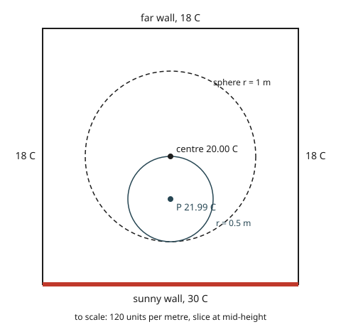
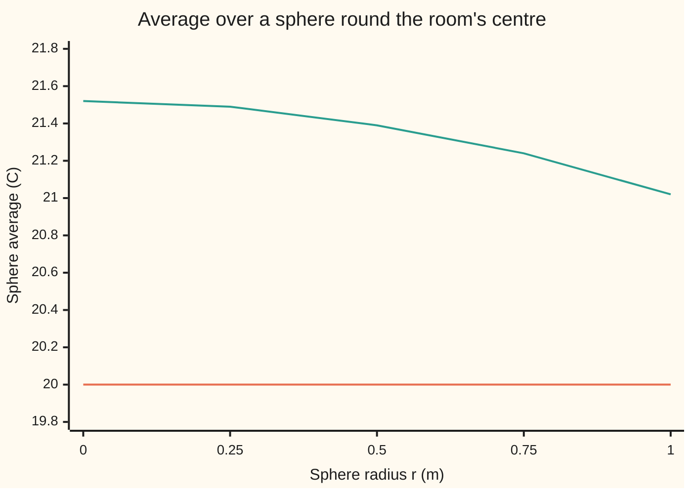

# Harmonic functions: the value at a point is the average around it

[Syllabus](../../../SYLLABUS.md) → [Partial differential equations](../README.md) → [Laplace, Poisson and Potentials](../README.md#s04) → Harmonic functions

---

## General Overview

[Laplace's equation](../../08-Differential%20equations%20and%20dynamics/10-The%20Classical%20PDEs/07-laplaces-equation-and-harmonic-functions.md) stated a rule for a settled plate: each point's temperature is the average round any circle centred there. This card proves that rule in any number of dimensions, proves it backwards, and draws two more facts out of it: harmonic functions are smooth, and they have no hot or cold spot inside.

Take a cube-shaped room, 3 m on each side. The south wall is a sunny glass wall held at 30 °C. The other three walls, the floor and the ceiling are held at 18 °C. There is no heater inside, and the air is treated as still, so heat moves only by conduction (an illustrative model; real air also circulates).

As a problem: the **unknown** is the settled air temperature at each point. The **region** is the inside of the room. The **data** are the six wall temperatures.

What is the temperature at the centre of the room? It is 20 °C, and no equation has to be solved to find it:

- Give each of the six faces a turn as the only warm one, 12 K above the rest (K, kelvin, measures a temperature difference: 12 K is 12 °C warmer). By the room's symmetry, each turn lifts the centre by the same amount.
- All six turns together make every face 12 K warm, which lifts the whole room by 12 K.
- So each face contributes 12 / 6 = 2 K, and the centre reads 18 + 2 = 20 °C.

Now put a sphere of radius 1 m round the centre and average the temperature over its surface. The answer is 20 °C again. Take a sphere of radius 0.5 m round a point P, 1 m out from the sunny wall: the point reads 21.99 °C and its sphere averages 21.99 °C. That equality is the whole idea, and everything else on this card comes out of it.

**A function solves Laplace's equation exactly when its value at every point equals its average over every sphere, and every ball, centred there; from that one property it follows that the function is infinitely smooth and, unless it is constant, has no maximum or minimum inside its region.**

**What kind of fact this is:** a theorem, proved on this card in Why it works, in both directions. The room is a model; the code checks every number by a series, by sphere averages and by a grid.

### The picture: a slice through the room at mid-height

<p align="center"></p>

To scale: 120 units per metre; the room's slice runs from (60, 40) to (420, 400), the centre is at (240, 220) with its 1 m sphere drawn at radius 120, and P is at (240, 280) with its 0.5 m sphere drawn at radius 60. The circles are where the spheres cut the slice.

---

## The formula

Reminders from [A PDE problem](../01-Classification%20and%20Well-Posedness/01-what-a-pde-problem-is.md): $`\Omega`$ is the region (the room's inside), $`\partial\Omega`$ its boundary (the walls), and $`d`$ the number of space directions, here 3. $`\Delta u`$ is the Laplacian, the sum of the second derivatives of $`u`$ in each direction. A function is **harmonic** when $`\Delta u = 0`$.

New on this card: $`B(x, r)`$ is the **ball** of radius $`r`$ centred at the point $`x`$, all points closer than $`r`$ to $`x`$. Its surface, the **sphere**, is $`\partial B(x, r)`$. Bars give size: $`|B(x, r)|`$ is the ball's volume and $`|\partial B(x, r)|`$ the sphere's area.

**The mean value property.** Let $`u`$ be harmonic in $`\Omega`$, and let the closed ball of radius $`r`$ round $`x`$ lie inside $`\Omega`$. Then

```math
u(x) \;=\; \frac{1}{|\partial B(x,r)|}\int_{\partial B(x,r)} u \, dS \;=\; \frac{1}{|B(x,r)|}\int_{B(x,r)} u \, dy
```

**Read it aloud:** the value at the centre equals the average over the sphere, and also the average over the solid ball.

**The converse.** If $`u`$ is continuous on $`\Omega`$ and equals its sphere average for every ball whose closure lies in $`\Omega`$, then $`u`$ has derivatives of every order and is harmonic.

**The engine.** Write $`\varphi(r)`$ for the sphere average at radius $`r`$. Then

```math
\varphi'(r) \;=\; \frac{r}{d}\times\Big(\text{average of } \Delta u \text{ over } B(x,r)\Big)
```

**Read it aloud:** the sphere average changes with the radius at a rate set by the Laplacian inside the ball. Zero Laplacian, zero change.

**Two consequences.** Slopes are bounded by the values round them, and nothing peaks inside:

```math
|\partial_i u(x)| \;\le\; \frac{d}{r}\,\max_{\partial B(x,r)} |u|, \qquad \min_{\partial\Omega} u \;\le\; u \;\le\; \max_{\partial\Omega} u
```

**Read it aloud:** a slope at the centre is at most the dimension over the radius, times the largest size of $`u`$ on the sphere; and inside the room the temperature stays between the coldest and warmest wall.

| Symbol | Plain meaning | In our example | Push it up and the answer… |
| --- | --- | --- | --- |
| $`u`$ | the settled temperature, °C | 20.00 at the centre, 21.99 at P | — |
| $`\Omega`$, $`\partial\Omega`$ | the region; its boundary | the room's air; its six faces | — |
| $`d`$ | number of space directions | 3 | each face's share of the centre, $`1/(2d)`$, falls |
| $`x`$, $`y`$, $`p`$, $`x_i`$ | points of the region; a point source; the $`i`$-th coordinate, m | centre (1.5, 1.5, 1.5); P (1.5, 1.0, 1.5), also the source $`p`$ in What breaks; $`x_2`$ is the distance from the sunny wall | — |
| $`\Delta u`$ | the Laplacian: net bending, K per m² | 0 in the room; −3 with a heater | above 0, the sphere average rises above the centre value; below 0, it falls |
| $`B(x,r)`$, $`\partial B(x,r)`$, $`r`$ | ball; sphere; radius, m | 1 m round the centre, 0.5 m round P | no change, while the ball stays inside |
| $`\lvert B\rvert`$, $`\lvert\partial B\rvert`$, $`dS`$, $`dy`$ | volume; area; area piece; volume piece | ratio $`\lvert\partial B\rvert / \lvert B\rvert = d/r`$ | — |
| $`\varphi(r)`$ | sphere average at radius $`r`$, °C | 20.00 at every radius round the centre | — |
| $`n`$, $`n_i`$ | outward unit normal to the sphere; its $`i`$-th part | points away from the centre | — |
| $`\partial_i u`$ | slope of $`u`$ in direction $`i`$, K per m | −2.89 across the room at the centre | — |
| $`f`$, $`M`$ | heater strength over conductivity, K per m²; largest value of $`u`$ | 3 (illustrative); 30 °C on the walls | — |
| $`h`$, $`\eta_\varepsilon`$ | grid step in the code, m; a smooth bump of radius $`\varepsilon`$ used in the proof | 0.25 and 0.125 | the grid error grows as $`h^2`$ |

### When it holds

- **Harmonic in the whole closed ball.** A point source inside the sphere breaks it. For $`1/|y - p|`$ with the source $`p`$ 0.5 m from the centre, the 1 m sphere averages 1.00 per metre, while the centre value is 2.00.
- **No heater.** Keep the walls and add an even heater, $`-\Delta u = f`$ with $`f`$ = 3 K per m². The centre warms to 21.52 °C, but the 1 m sphere averages only 21.02 °C. The shortfall is exactly $`f r^2/(2d)`$ = 0.50 K.
- **Every small sphere, for the converse.** One radius at one point says nothing about $`\Delta u`$. The proof uses all small radii at every point.
- **A bounded region, $`u`$ continuous up to the walls.** In the endless half-space above a wall at 0 °C, both $`u = 0`$ and $`u = x_2`$ fit, and the second has no maximum at all.
- **Still air.** Real rooms stratify, warm air rising, so 20 °C is the model's answer, not a measurement.

---

## Why it works

### Step 0: the average can only change if something inside pushes it

Grow a sphere round the centre. Its average temperature changes only if heat flows in or out through it on balance. That net flow equals the total of the sources inside: the divergence theorem. With no heater the Laplacian is zero, so the net flow is zero and the average stays fixed. Shrunk to a point, the average is the centre value, so it is the centre value at every radius.

### Step 1: the rate at which the sphere average changes

Differentiate the sphere average in $`r`$. The chain rule gives the average outward slope $`\partial u/\partial n`$ over the sphere. The divergence theorem turns that into the ball total of $`\Delta u`$, which is the engine formula.

<details>
<summary>Detailed proof: the rate formula, line by line</summary>

Let $`z`$ run over the unit sphere $`\partial B(0,1)`$. Then

$`\displaystyle \varphi(r) = \frac{1}{|\partial B(0,1)|}\int_{\partial B(0,1)} u(x + r z)\, dS(z).`$

Differentiate under the integral, which is allowed because $`u`$ has continuous first derivatives:

$`\displaystyle \varphi'(r) = \frac{1}{|\partial B(0,1)|}\int_{\partial B(0,1)} \nabla u(x + r z)\cdot z \, dS(z) = \frac{1}{|\partial B(x,r)|}\int_{\partial B(x,r)} \frac{\partial u}{\partial n}\, dS.`$

The second equality rescales the unit sphere to radius $`r`$; on it, $`z`$ is the outward normal $`n`$. The divergence theorem for $`\nabla u`$ on the ball gives

$`\displaystyle \int_{\partial B(x,r)} \frac{\partial u}{\partial n}\, dS = \int_{B(x,r)} \Delta u \, dy.`$

Finally, $`|B(x,r)| = r\,|\partial B(x,r)|/d`$, because the ball is the sphere's area added up over radii: $`\int_0^r s^{d-1} ds = r^d/d`$. Dividing by the sphere's area therefore leaves $`r/d`$ times the ball average of $`\Delta u`$.

</details>

### Step 2: harmonic gives both averages

If $`\Delta u = 0`$, Step 1 gives $`\varphi'(r) = 0`$, so $`\varphi`$ is constant. As $`r`$ shrinks to 0, $`\varphi(r)`$ tends to $`u(x)`$, because $`u`$ is continuous. So every sphere average is $`u(x)`$.

A ball is a stack of thin spheres. Each sphere averages $`u(x)`$, so the whole stack does too: the ball average is $`u(x)`$.

In the room, the 1 m sphere round the centre averages 20.000000 °C. Round P, the 0.5 m sphere and the 0.5 m ball both average 21.994880 °C, the series value at P.

[Mean value and maximum principle](../../07-Complex%20analysis/07-Conformal%20Maps%20and%20Harmonic%20Functions/05-mean-value-and-maximum-principle-for-harmonic-functions.md) proved the plane case from Cauchy's formula, a road that stops at $`d = 2`$. This one works in every dimension.

### Step 3: the converse, for smooth functions

Suppose $`u`$ has continuous second derivatives and equals its sphere averages. Then $`\varphi`$ is constant, so $`\varphi'(r) = 0`$ for every small $`r`$. If $`\Delta u(x)`$ were positive, it would stay positive on a small ball, by continuity. Step 1 would then make $`\varphi'(r) > 0`$ there, which is a contradiction. The same holds for a negative value. So $`\Delta u = 0`$ everywhere.

The chart shows what the rate formula does when the Laplacian is not zero. With an even heater, $`\Delta u = -f`$, so Step 1 gives $`\varphi'(r) = -f r/d`$: the sphere average falls below the centre value by $`f r^2 / (2d)`$.



Flat line: the room as it is, harmonic, at 20.00 °C for every radius. Falling line: the same walls with a heater of 3 K per m² spread evenly inside. The heater warms the centre to 21.52 °C, and the sphere average falls below that, to 21.02 °C at 1 m, 0.50 K down.

### Step 4: averages make the function smooth

Now drop the assumption of derivatives: let $`u`$ be only continuous, with the mean value property. Take a smooth bump $`\eta_\varepsilon`$, called a mollifier ([Convolution and mollifiers](../../18-Functional%20analysis/04-Distributions%20and%20Sobolev%20Spaces/03-convolution-and-mollifiers.md)): a function of the distance from the origin alone, zero beyond radius $`\varepsilon`$, with total 1.

Average $`u`$ round $`x`$ with the bump's weights. Group the points into thin spheres. Each sphere averages $`u(x)`$, so the weighted average is $`u(x)`$ times the bump's total, which is $`u(x)`$. So $`u`$ equals its own blur by a smooth bump. A blur by a smooth bump is smooth, because the derivatives fall on the bump. So $`u`$ has derivatives of every order, and Step 3 makes it harmonic.

This also proves that every harmonic function is smooth, not just twice differentiable. Weyl's lemma (Weyl, 1940) pushes the same idea further: a function that solves Laplace's equation only in the weak sense of [Distributions](../../18-Functional%20analysis/04-Distributions%20and%20Sobolev%20Spaces/01-test-functions-and-distributions.md) is smooth too.

<details>
<summary>Detailed proof: the blur returns the function</summary>

Let $`\eta_\varepsilon(y) = \varepsilon^{-d}\eta(|y|/\varepsilon)`$, with $`\eta`$ smooth, zero from 1 onwards, and scaled so $`\int \eta_\varepsilon = 1`$. For $`x`$ more than $`\varepsilon`$ from the walls,

$`\displaystyle \int \eta_\varepsilon(y)\, u(x - y)\, dy = \int_0^\varepsilon \eta_\varepsilon(s)\, |\partial B(0, s)|\, \varphi_x(s)\, ds = u(x) \int_0^\varepsilon \eta_\varepsilon(s)\, |\partial B(0, s)|\, ds = u(x).`$

The first step writes the volume integral as sphere integrals; the second uses $`\varphi_x(s) = u(x)`$ for every $`s`$. The left side is the blur $`\eta_\varepsilon * u`$. Its derivatives exist to every order, because each one can be moved onto $`\eta_\varepsilon`$ inside the integral. So $`u = \eta_\varepsilon * u`$ is smooth on the part of $`\Omega`$ more than $`\varepsilon`$ from its edge, and $`\varepsilon`$ is arbitrary.

</details>

**Smoothness with a size.** Each slope $`\partial_i u`$ is harmonic too, so it equals its own ball average. The divergence theorem turns that ball average into a sphere average:

```math
\partial_i u(x) \;=\; \frac{d}{r}\times\Big(\text{average of } u\, n_i \text{ over } \partial B(x,r)\Big)
```

Since $`|n_i| \le 1`$, the slope is at most $`(d/r)\max|u|`$. Apply this to $`u - 24`$, which has the same slopes and stays between −6 and 6. At the centre, every closed ball of radius $`r`$ below 1.5 m lies inside the room and gives the cap $`(3/r) \times 6`$; at 1.5 m the ball would touch the six face centres. Letting $`r`$ grow to 1.5 m, the cap tightens to $`(3/1.5) \times 6`$ = 12 K per m. The true slope across the room at the centre is −2.89 K per m, well inside the cap. The code reaches it three ways: the series differentiated, a centred difference, and the sphere average above, which uses no derivative at all.

### Step 5: no peak inside

Let the region be connected (in one piece), and suppose $`u`$ reaches its largest value $`M`$ at an inside point. Every ball round that point averages $`M`$, and nothing in it exceeds $`M`$. An average equals its largest possible value only when every value equals it, so $`u = M`$ on the whole ball.

So the set where $`u = M`$ contains a ball round each of its points: it is **open**. It is also **closed** (it contains every limit of its own points inside the region), because $`u`$ is continuous. A connected region cannot split into two non-empty open parts, so $`u = M`$ everywhere. This is the **strong maximum principle**: a harmonic function with an inside maximum is constant.

[Maximum principles](../01-Classification%20and%20Well-Posedness/08-maximum-principles.md) proved the weak form for a whole family of equations and quoted the strong form from Hopf's lemma. For the Laplacian, the averages prove it directly. In the room, the warmest grid node, 0.125 m from the sunny wall, reads 28.78 °C, and the coldest reads 18.0015 °C: strictly between 18 and 30 °C.

<details>
<summary>Detailed proof: an average that reaches its ceiling is flat</summary>

Let $`u \le M`$ on $`B(x, r)`$ and $`u(x) = M`$. By the ball form of Step 2,

$`\displaystyle 0 = M - u(x) = \frac{1}{|B(x,r)|}\int_{B(x,r)} \big(M - u(y)\big)\, dy.`$

The integrand is continuous and never negative. If it were positive at one point, it would exceed half that value on a small ball round the point, and the integral would be positive. So $`u = M`$ on $`B(x, r)`$. Apply this at every point of the set where $`u = M`$; that set is open. It is closed because $`u`$ is continuous. In a connected region, a non-empty set that is both open and closed is the whole region. Applying the result to $`-u`$ gives the minimum.

</details>

### Step 6: why the centre is exactly 20 °C

Step 5 gives uniqueness: two solutions with the same wall data differ by a harmonic function that is 0 on the walls, so 0 inside. The six turns of the overview add up to every face 12 K warm, which a uniform 12 K rise fits; by uniqueness nothing else does. A rotation of the room carries one turn to another and fixes the centre, so each turn lifts it by 2 K.

The wall data jump along the sunny wall's edges. These are lines, and the bounded solution is still unique, as for the two jump corners of the plate on [Laplace's equation](../../08-Differential%20equations%20and%20dynamics/10-The%20Classical%20PDEs/07-laplaces-equation-and-harmonic-functions.md). The code's grid, which knows nothing of symmetry or series, also reads 20.000000 °C at the centre.

---

## Worked numbers, by hand

| Step | Arithmetic | Value |
| --- | --- | --- |
| each face's share of the centre | 1 / (2 × 3) | 1/6 |
| centre | 18 + 12 / 6 | **20 °C** |
| sphere of radius 1 m round the centre | 512-point average | 20.000000 °C |
| P, 1 m from the sunny wall | series | 21.994880 °C |
| sphere and ball of radius 0.5 m round P | 512-point average; 8 shells | 21.994880 °C both |
| P on the grid | $`h`$ = 0.25 m; $`h`$ = 0.125 m | 21.968554; 21.987942 °C |
| grid's observed order | error ratio between the two steps, as a power of 2 | 1.92 |
| slope across the room at the centre | series; sphere average of $`u\,n_2`$ times 3 | −2.89 K per m |
| slope cap from Step 4 | (3 / 1.5) × (30 − 24) | 12 K per m |
| warmest and coldest grid nodes inside | $`h`$ = 0.125 m | 28.78 and 18.0015 °C |

The centre of the room settles at 20 °C, 2 K above the cold walls: the sunny wall supplies one sixth of its 12 K lead.

### What breaks if you drop a piece

| Mistake | Comes out at | What went wrong |
| --- | --- | --- |
| Use the plane's rule, a quarter share per edge | 21.00 °C at the centre | A square has four edges; a cube has six faces |
| Average the six walls equally at P | 20.00 °C, not 21.99 °C | Equal shares hold only at the centre; P sits nearer the sunny wall |
| Average with a heater on, $`f`$ = 3 K per m² | 21.02 °C round a 21.52 °C centre | $`\Delta u \ne 0`$; the shortfall is $`f r^2/(2d)`$ = 0.50 K |
| Let the sphere enclose a point source | 1.00 per metre, not 2.00 | The function is not harmonic at the source, so the ball must not contain it |

---

## Code, from first principles, and it actually runs

The code solves the room three independent ways and checks the card's claims against each other. Road 1 is a sine-and-hyperbolic-sine series for the sunny wall alone, the standard solution on a box ([Laplace on a rectangle](../../08-Differential%20equations%20and%20dynamics/10-The%20Classical%20PDEs/08-laplace-on-a-rectangle.md) does the flat version). Road 2 averages over spheres and balls, with Gauss–Legendre nodes (sample points and weights placed so that polynomials of high degree are averaged exactly), found by Newton's method. Road 3 is a grid on which each node is replaced, again and again, by the average of its six neighbours, at two step sizes. The heated room of What breaks gets two roads of its own: a second series (the heater's profile between two opposite walls, $`f\,x_1(3\text{ m} - x_1)/2`$, minus sine and hyperbolic-cosine terms that cancel it on the other four faces), and the grid with the heater added to each node's average. In the code, `x`, `y`, `z` are the card's $`x_1`$, $`x_2`$, $`x_3`$, and the sunny wall is `y = 0`.

### Python

```python
# Harmonic functions and mean values -- the check behind the card.  Standard library only.
# A 3 m cube room: the sunny wall (y = 0) at 30 C, the other five faces at 18 C, no heater.
# Road 1: the sine-sinh series.  Road 2: averages over spheres and balls (Gauss-Legendre).
# Road 3: a grid where every node is the average of its six neighbours, at two steps.
from math import pi, sin, cos, exp, sqrt, log

L, COLD, SUN, D = 3.0, 18.0, 30.0, 3            # room side m; wall C; sunny wall C; dimension
ODD = range(1, 140, 2)
MODES = [(m, n, pi * sqrt(m * m + n * n) / L, 16.0 / (pi * pi * m * n)) for m in ODD for n in ODD]

def unit(x, y, z):                               # sunny wall at 1, the rest at 0
    sx = {m: sin(m * pi * x / L) for m in ODD}
    sz = {n: sin(n * pi * z / L) for n in ODD}
    s = 0.0
    for m, n, k, c in MODES:
        e = exp(-k * y)
        if e < 1e-17: continue                   # dropped term below 1e-17 of its size
        s += c * sx[m] * sz[n] * e * (1.0 - exp(-2.0 * k * (L - y))) / (1.0 - exp(-2.0 * k * L))
    return s

def u(x, y, z): return COLD + (SUN - COLD) * unit(x, y, z)

def dudy(x, y, z):                               # the series differentiated term by term
    s = 0.0
    for m, n, k, c in MODES:
        s -= c * sin(m * pi * x / L) * sin(n * pi * z / L) * k * (exp(-k * y) + exp(-k * (2 * L - y))) / (1.0 - exp(-2.0 * k * L))
    return (SUN - COLD) * s

def gauss_legendre(n):                           # nodes and weights on [-1, 1], by Newton's method
    xs, ws = [], []
    for i in range(1, n + 1):
        x = cos(pi * (i - 0.25) / (n + 0.5))
        for _ in range(60):
            p0, p1 = 1.0, x
            for k in range(2, n + 1):
                p0, p1 = p1, ((2 * k - 1) * x * p1 - (k - 1) * p0) / k
            dp = n * (x * p1 - p0) / (x * x - 1.0)
            x -= p1 / dp
        xs.append(x); ws.append(2.0 / ((1.0 - x * x) * dp * dp))
    return xs, ws

GT, GW = gauss_legendre(16)
NP = 32

def sphere_avg(f, c, r):                         # average of f over the sphere of radius r round c
    tot = 0.0
    for t, w in zip(GT, GW):
        st = sqrt(1.0 - t * t)
        for j in range(NP):
            p = 2.0 * pi * j / NP
            tot += w * f(c[0] + r * st * cos(p), c[1] + r * t, c[2] + r * st * sin(p))
    return tot / (2.0 * NP)

GT8, GW8 = gauss_legendre(8)

def ball_avg(f, c, r):                           # shells of radius s weighted by d s^(d-1) / r^d
    return sum(w * 0.5 * D * ((t + 1.0) / 2.0) ** 2 * sphere_avg(f, c, 0.5 * r * (t + 1.0)) for t, w in zip(GT8, GW8))

def grid(N, q):                                  # six-neighbour averaging plus a heater q (K per m^2), swept by SOR
    h = L / N
    g = [[[COLD] * (N + 1) for _ in range(N + 1)] for _ in range(N + 1)]
    for i in range(1, N):
        for k in range(1, N):
            g[i][0][k] = SUN
    om = 2.0 / (1.0 + sin(pi / N))
    while True:
        big = 0.0
        for i in range(1, N):
            for j in range(1, N):
                for k in range(1, N):
                    a = (g[i-1][j][k] + g[i+1][j][k] + g[i][j-1][k] + g[i][j+1][k] + g[i][j][k-1] + g[i][j][k+1] + q * h * h) / 6.0
                    dv = om * (a - g[i][j][k]); g[i][j][k] += dv; big = max(big, abs(dv))
        if big < 1e-12: break
    inner = [g[i][j][k] for i in range(1, N) for j in range(1, N) for k in range(1, N)]
    return g[N // 2][N // 2][N // 2], g[N // 2][round(1.0 / h)][N // 2], max(inner), min(inner)

C, P = (1.5, 1.5, 1.5), (1.5, 1.0, 1.5)          # room centre; 1 m out from the sunny wall
uc, up = u(*C), u(*P)
# what the series drops, at every point it is used (all have y >= 0.5 m): skipped terms, then the first mode past the list
tail_skip = (SUN - COLD) * 16.0 / (pi * pi) * 1e-17 * len(MODES)
tail_141 = (SUN - COLD) * 16.0 / (pi * pi * 141) * exp(-pi * sqrt(141 * 141 + 1) * 0.5 / L)
s_c1, s_p, b_p = sphere_avg(u, C, 1.0), sphere_avg(u, P, 0.5), ball_avg(u, P, 0.5)
g12, g24 = grid(12, 0.0), grid(24, 0.0)
e12, e24 = g12[1] - up, g24[1] - up
order = log(abs(e12) / abs(e24)) / log(2.0)       # observed order of the grid error
# derivatives are averages too: d/dy u(c) = (d/r) * sphere average of u * n_y
grad_series = dudy(*C)
grad_fd = (u(1.5, 1.5 + 1e-3, 1.5) - u(1.5, 1.5 - 1e-3, 1.5)) / 2e-3
grad_mvp = D / 1.0 * sphere_avg(lambda x, y, z: u(x, y, z) * (y - 1.5), C, 1.0)
grad_cap = D / 1.5 * (SUN - COLD) / 2.0          # (d/r) * max |u - 24| with r = 1.5 m
# what breaks
f = 3.0                                          # an even heater, K per m^2 (illustrative)
def heat(x, y, z):                               # same walls, heater f inside: u + v with -Lap v = f, v = 0 on the walls
    s = 0.0                                      # v = f x(L - x)/2 minus a sine-cosh series that cancels it on four faces
    for m, n, k, c in MODES:
        ch = lambda t: (exp(-k * t) + exp(-k * (L - t))) / (1.0 + exp(-k * L))
        s += c * L * L / (pi * pi * m * m) * sin(m * pi * x / L) * (sin(n * pi * z / L) * ch(y) + sin(n * pi * y / L) * ch(z))
    return u(x, y, z) + f * (0.5 * x * (L - x) - s)
heat_c, heat_avg = heat(*C), sphere_avg(heat, C, 1.0)
q12, q24 = grid(12, f), grid(24, f)
q_order = log(abs(q12[0] - heat_c) / abs(q24[0] - heat_c)) / log(2.0)
src = lambda x, y, z: 1.0 / sqrt((x - 1.5) ** 2 + (y - 1.0) ** 2 + (z - 1.5) ** 2)   # point source at P
src_avg = sphere_avg(src, C, 1.0)

rows = [("centre, series (C)", uc), ("centre, symmetry 18 + 12/6 (C)", COLD + (SUN - COLD) / 6),
        ("centre, sphere r = 1 m (C)", s_c1), ("centre, grid h = 0.25 m (C)", g12[0]),
        ("P, series (C)", up), ("P, sphere r = 0.5 m (C)", s_p), ("P, ball r = 0.5 m (C)", b_p),
        ("P, grid h = 0.25 m (C)", g12[1]), ("P, grid h = 0.125 m (C)", g24[1]),
        ("P, grid observed order", order),
        ("hottest grid node inside (C)", g24[2]), ("coldest grid node inside (C)", g24[3]),
        ("du/dx2 at centre, series (K/m)", grad_series), ("du/dx2 at centre, centred diff (K/m)", grad_fd),
        ("du/dx2 at centre, (d/r) avg u n_y (K/m)", grad_mvp), ("|grad u| cap (d/r) max|u-24| (K/m)", grad_cap),
        ("wrong: 2-D rule 18 + 12/4 (C)", COLD + (SUN - COLD) / 4),
        ("wrong: plain wall average at P (C)", (SUN + 5 * COLD) / 6),
        ("break: heater, centre, series (C)", heat_c), ("  heater centre, grid h = 0.25 m (C)", q12[0]),
        ("  heater centre, grid h = 0.125 m (C)", q24[0]), ("  heater centre, grid observed order", q_order),
        ("break: heater, sphere avg r = 1 m (C)", heat_avg), ("  shortfall f r^2/(2d) (K)", f / (2 * D)),
        ("break: source inside, sphere avg (1/m)", src_avg), ("  value at centre 1/0.5 (1/m)", src(*C))]
for name, v in rows:
    print(f"{name:<40} {v:>12.6f}")
print(f"{'series: all skipped terms, at most (K)':<40} {tail_skip:>12.3e}")
print(f"{'series: first omitted mode, y = 0.5 m (K)':<40} {tail_141:>12.3e}")
print("chart, radius (m)          " + " ".join(f"{r:6.2f}" for r in (0.0, 0.25, 0.5, 0.75, 1.0)))
print("chart, no heater (C)       " + " ".join(f"{(uc if r == 0 else sphere_avg(u, C, r)):6.2f}" for r in (0.0, 0.25, 0.5, 0.75, 1.0)))
print("chart, even heater (C)     " + " ".join(f"{(heat_c if r == 0 else sphere_avg(heat, C, r)):6.2f}" for r in (0.0, 0.25, 0.5, 0.75, 1.0)))
print("figure, 120 px/m, slice z = 1.5 m: room (60, 40)-(420, 400); centre (240, 220) r 120; P (240, 280) r 60")

assert abs(uc - 20.0) < 1e-9, "series centre must match the six-face symmetry"
assert abs(s_c1 - uc) < 1e-9 and abs(s_p - up) < 1e-9, "sphere averages equal the centre values"
assert abs(b_p - up) < 1e-9, "ball average equals the centre value"
assert abs(g12[0] - 20.0) < 1e-9, "grid centre is exactly a sixth of the way up"
assert abs(e24) < 0.02 and 1.8 < order < 2.2, "grid converges to the series at second order"
assert SUN > g24[2] and g24[3] > COLD, "inside stays strictly between the wall temperatures"
assert abs(grad_series - grad_fd) < 1e-5 and abs(grad_mvp - grad_series) < 1e-9, "three roads to the slope"
assert abs(grad_series) <= grad_cap, "slope obeys the mean-value derivative bound"
assert abs(q24[0] - heat_c) < 0.02 and 1.8 < q_order < 2.2, "heated grid converges to the heated series"
assert abs((heat_c - heat_avg) - f / (2 * D)) < 1e-9, "heater shortfall is f r^2/(2d)"
assert abs(src_avg - 1.0) < 1e-6, "an enclosed source averages to 1/r, not its centre value"
print("ALL CHECKS PASS")
```

**Ran 2026-11-15 on macOS, Python 3.14.10, standard library only. All checks passed. Output, pasted from the run:**

```
centre, series (C)                          20.000000
centre, symmetry 18 + 12/6 (C)              20.000000
centre, sphere r = 1 m (C)                  20.000000
centre, grid h = 0.25 m (C)                 20.000000
P, series (C)                               21.994880
P, sphere r = 0.5 m (C)                     21.994880
P, ball r = 0.5 m (C)                       21.994880
P, grid h = 0.25 m (C)                      21.968554
P, grid h = 0.125 m (C)                     21.987942
P, grid observed order                       1.923903
hottest grid node inside (C)                28.776289
coldest grid node inside (C)                18.001489
du/dx2 at centre, series (K/m)              -2.886671
du/dx2 at centre, centred diff (K/m)        -2.886672
du/dx2 at centre, (d/r) avg u n_y (K/m)     -2.886671
|grad u| cap (d/r) max|u-24| (K/m)          12.000000
wrong: 2-D rule 18 + 12/4 (C)               21.000000
wrong: plain wall average at P (C)          20.000000
break: heater, centre, series (C)           21.517746
  heater centre, grid h = 0.25 m (C)        21.501921
  heater centre, grid h = 0.125 m (C)       21.513746
  heater centre, grid observed order         1.983918
break: heater, sphere avg r = 1 m (C)       21.017746
  shortfall f r^2/(2d) (K)                   0.500000
break: source inside, sphere avg (1/m)       1.000000
  value at centre 1/0.5 (1/m)                2.000000
series: all skipped terms, at most (K)      9.532e-13
series: first omitted mode, y = 0.5 m (K)    1.192e-33
chart, radius (m)            0.00   0.25   0.50   0.75   1.00
chart, no heater (C)        20.00  20.00  20.00  20.00  20.00
chart, even heater (C)      21.52  21.49  21.39  21.24  21.02
figure, 120 px/m, slice z = 1.5 m: room (60, 40)-(420, 400); centre (240, 220) r 120; P (240, 280) r 60
ALL CHECKS PASS
```

The series, sphere and ball agree to six decimals; the grid closes in at observed order 1.92; the three slopes agree and sit inside the cap. With the heater on, the grid closes in on the series centre, 21.517746 °C, at observed order 1.98, and the 1 m sphere averages 0.500000 K less, as $`f r^2/(2d)`$ says. The series keeps odd modes up to 139 and skips terms below 1e-17 of their size; together the skipped terms are at most 9.532e-13 K, and the first mode past the list is 1.192e-33 K. The heater's series runs over the same modes and skips none; its weights are smaller than the sunny wall's, so its first omitted mode is below 1.192e-33 K too.

### Rust

The same three roads and the same asserts, in Rust's standard library.

```rust
// Harmonic functions and mean values -- the same check as the Python file, in Rust.  No crates.
// A 3 m cube room: the sunny wall (y = 0) at 30 C, the other five faces at 18 C, no heater.
// Road 1: the sine-sinh series.  Road 2: averages over spheres and balls (Gauss-Legendre).
// Road 3: a grid where every node is the average of its six neighbours, at two steps.
use std::f64::consts::PI;

const L: f64 = 3.0; const COLD: f64 = 18.0; const SUN: f64 = 30.0; const D: f64 = 3.0; const NP: usize = 32;

struct Room { modes: Vec<(usize, usize, f64, f64)> }
impl Room {
    fn new() -> Room {
        let mut modes = Vec::new();
        for m in (1..140).step_by(2) { for n in (1..140).step_by(2) {
            let (mf, nf) = (m as f64, n as f64);
            modes.push((m, n, PI * (mf * mf + nf * nf).sqrt() / L, 16.0 / (PI * PI * mf * nf)));
        } }
        Room { modes }
    }
    fn unit(&self, x: f64, y: f64, z: f64) -> f64 {     // sunny wall at 1, the rest at 0
        let sx: Vec<f64> = (0..140).map(|m| (m as f64 * PI * x / L).sin()).collect();
        let sz: Vec<f64> = (0..140).map(|n| (n as f64 * PI * z / L).sin()).collect();
        let mut s = 0.0;
        for &(m, n, k, c) in &self.modes {
            let e = (-k * y).exp();
            if e < 1e-17 { continue; }                    // dropped term below 1e-17 of its size
            s += c * sx[m] * sz[n] * e * (1.0 - (-2.0 * k * (L - y)).exp()) / (1.0 - (-2.0 * k * L).exp());
        }
        s
    }
    fn u(&self, x: f64, y: f64, z: f64) -> f64 { COLD + (SUN - COLD) * self.unit(x, y, z) }
    fn dudy(&self, x: f64, y: f64, z: f64) -> f64 {     // the series differentiated term by term
        let mut s = 0.0;
        for &(m, n, k, c) in &self.modes {
            s -= c * (m as f64 * PI * x / L).sin() * (n as f64 * PI * z / L).sin() * k
                * ((-k * y).exp() + (-k * (2.0 * L - y)).exp()) / (1.0 - (-2.0 * k * L).exp());
        }
        (SUN - COLD) * s
    }
    fn heat(&self, x: f64, y: f64, z: f64, f: f64) -> f64 { // same walls, heater f inside: u + v with -Lap v = f, v = 0 on the walls
        let mut s = 0.0;                                  // v = f x(L - x)/2 minus a sine-cosh series that cancels it on four faces
        for &(m, n, k, c) in &self.modes {
            let ch = |t: f64| ((-k * t).exp() + (-k * (L - t)).exp()) / (1.0 + (-k * L).exp());
            s += c * L * L / (PI * PI * m as f64 * m as f64) * (m as f64 * PI * x / L).sin() * ((n as f64 * PI * z / L).sin() * ch(y) + (n as f64 * PI * y / L).sin() * ch(z));
        }
        self.u(x, y, z) + f * (0.5 * x * (L - x) - s)
    }
}

fn gauss_legendre(n: usize) -> (Vec<f64>, Vec<f64>) { // nodes and weights on [-1, 1], by Newton
    let (mut xs, mut ws) = (Vec::new(), Vec::new());
    for i in 1..=n {
        let mut x = (PI * (i as f64 - 0.25) / (n as f64 + 0.5)).cos();
        let mut dp = 0.0;
        for _ in 0..60 {
            let (mut p0, mut p1) = (1.0, x);
            for k in 2..=n {
                let kf = k as f64;
                (p0, p1) = (p1, ((2.0 * kf - 1.0) * x * p1 - (kf - 1.0) * p0) / kf);
            }
            dp = n as f64 * (x * p1 - p0) / (x * x - 1.0);
            x -= p1 / dp;
        }
        xs.push(x); ws.push(2.0 / ((1.0 - x * x) * dp * dp));
    }
    (xs, ws)
}

fn sphere_avg(f: &dyn Fn(f64, f64, f64) -> f64, g: &(Vec<f64>, Vec<f64>), c: (f64, f64, f64), r: f64) -> f64 {
    let mut tot = 0.0;
    for (t, w) in g.0.iter().zip(g.1.iter()) {
        let st = (1.0 - t * t).sqrt();
        for j in 0..NP {
            let p = 2.0 * PI * j as f64 / NP as f64;
            tot += w * f(c.0 + r * st * p.cos(), c.1 + r * t, c.2 + r * st * p.sin());
        }
    }
    tot / (2.0 * NP as f64)
}

fn ball_avg(f: &dyn Fn(f64, f64, f64) -> f64, g: &(Vec<f64>, Vec<f64>), g8: &(Vec<f64>, Vec<f64>), c: (f64, f64, f64), r: f64) -> f64 {
    // shells of radius s weighted by d s^(d-1) / r^d
    g8.0.iter().zip(g8.1.iter()).map(|(t, w)| w * 0.5 * D * ((t + 1.0) / 2.0).powi(2) * sphere_avg(f, g, c, 0.5 * r * (t + 1.0))).sum()
}

fn grid(n: usize, q: f64) -> (f64, f64, f64, f64) {  // six-neighbour averaging plus a heater q (K per m^2), by SOR
    let h = L / n as f64;
    let mut g = vec![vec![vec![COLD; n + 1]; n + 1]; n + 1];
    for i in 1..n { for k in 1..n { g[i][0][k] = SUN; } }
    let om = 2.0 / (1.0 + (PI / n as f64).sin());
    loop {
        let mut big: f64 = 0.0;
        for i in 1..n { for j in 1..n { for k in 1..n {
            let a = (g[i-1][j][k] + g[i+1][j][k] + g[i][j-1][k] + g[i][j+1][k] + g[i][j][k-1] + g[i][j][k+1] + q * h * h) / 6.0;
            let dv = om * (a - g[i][j][k]);
            g[i][j][k] += dv;
            big = big.max(dv.abs());
        } } }
        if big < 1e-12 { break; }
    }
    let (mut hi, mut lo) = (f64::MIN, f64::MAX);
    for i in 1..n { for j in 1..n { for k in 1..n { hi = hi.max(g[i][j][k]); lo = lo.min(g[i][j][k]); } } }
    (g[n / 2][n / 2][n / 2], g[n / 2][(1.0 / h).round() as usize][n / 2], hi, lo)
}

fn main() {
    let room = Room::new();
    let (g16, g8) = (gauss_legendre(16), gauss_legendre(8));
    let u = |x: f64, y: f64, z: f64| room.u(x, y, z);
    let (c, p) = ((1.5, 1.5, 1.5), (1.5, 1.0, 1.5)); // room centre; 1 m out from the sunny wall
    let (uc, up) = (u(c.0, c.1, c.2), u(p.0, p.1, p.2));
    // what the series drops, at every point it is used (all have y >= 0.5 m): skipped terms, then the first mode past the list
    let tail_skip = (SUN - COLD) * 16.0 / (PI * PI) * 1e-17 * room.modes.len() as f64;
    let tail_141 = (SUN - COLD) * 16.0 / (PI * PI * 141.0) * (-PI * (141.0f64 * 141.0 + 1.0).sqrt() * 0.5 / L).exp();
    let (s_c1, s_p, b_p) = (sphere_avg(&u, &g16, c, 1.0), sphere_avg(&u, &g16, p, 0.5), ball_avg(&u, &g16, &g8, p, 0.5));
    let (g12, g24) = (grid(12, 0.0), grid(24, 0.0));
    let (e12, e24) = (g12.1 - up, g24.1 - up);
    let order = (e12.abs() / e24.abs()).ln() / 2.0_f64.ln();   // observed order of the grid error
    // derivatives are averages too: d/dy u(c) = (d/r) * sphere average of u * n_y
    let grad_series = room.dudy(c.0, c.1, c.2);
    let grad_fd = (u(1.5, 1.5 + 1e-3, 1.5) - u(1.5, 1.5 - 1e-3, 1.5)) / 2e-3;
    let grad_mvp = D / 1.0 * sphere_avg(&|x, y, z| u(x, y, z) * (y - 1.5), &g16, c, 1.0);
    let grad_cap = D / 1.5 * (SUN - COLD) / 2.0;      // (d/r) * max |u - 24| with r = 1.5 m
    // what breaks
    let f = 3.0;                                      // an even heater, K per m^2 (illustrative)
    let heat = |x: f64, y: f64, z: f64| room.heat(x, y, z, f);
    let (heat_c, heat_avg) = (heat(c.0, c.1, c.2), sphere_avg(&heat, &g16, c, 1.0));
    let (q12, q24) = (grid(12, f), grid(24, f));
    let q_order = ((q12.0 - heat_c).abs() / (q24.0 - heat_c).abs()).ln() / 2.0_f64.ln();
    let src = |x: f64, y: f64, z: f64| 1.0 / ((x - 1.5).powi(2) + (y - 1.0).powi(2) + (z - 1.5).powi(2)).sqrt();
    let src_avg = sphere_avg(&src, &g16, c, 1.0);

    let rows: Vec<(&str, f64)> = vec![
        ("centre, series (C)", uc), ("centre, symmetry 18 + 12/6 (C)", COLD + (SUN - COLD) / 6.0),
        ("centre, sphere r = 1 m (C)", s_c1), ("centre, grid h = 0.25 m (C)", g12.0),
        ("P, series (C)", up), ("P, sphere r = 0.5 m (C)", s_p), ("P, ball r = 0.5 m (C)", b_p),
        ("P, grid h = 0.25 m (C)", g12.1), ("P, grid h = 0.125 m (C)", g24.1),
        ("P, grid observed order", order),
        ("hottest grid node inside (C)", g24.2), ("coldest grid node inside (C)", g24.3),
        ("du/dx2 at centre, series (K/m)", grad_series), ("du/dx2 at centre, centred diff (K/m)", grad_fd),
        ("du/dx2 at centre, (d/r) avg u n_y (K/m)", grad_mvp), ("|grad u| cap (d/r) max|u-24| (K/m)", grad_cap),
        ("wrong: 2-D rule 18 + 12/4 (C)", COLD + (SUN - COLD) / 4.0),
        ("wrong: plain wall average at P (C)", (SUN + 5.0 * COLD) / 6.0),
        ("break: heater, centre, series (C)", heat_c), ("  heater centre, grid h = 0.25 m (C)", q12.0),
        ("  heater centre, grid h = 0.125 m (C)", q24.0), ("  heater centre, grid observed order", q_order),
        ("break: heater, sphere avg r = 1 m (C)", heat_avg), ("  shortfall f r^2/(2d) (K)", f / (2.0 * D)),
        ("break: source inside, sphere avg (1/m)", src_avg), ("  value at centre 1/0.5 (1/m)", src(c.0, c.1, c.2)),
    ];
    for (name, v) in &rows { println!("{:<40} {:>12.6}", name, v); }
    let radii = [0.0, 0.25, 0.5, 0.75, 1.0];
    let line = |vals: Vec<f64>| vals.iter().map(|v| format!("{:6.2}", v)).collect::<Vec<_>>().join(" ");
    println!("{:<40} {:>12.3e}", "series: all skipped terms, at most (K)", tail_skip);
    println!("{:<40} {:>12.3e}", "series: first omitted mode, y = 0.5 m (K)", tail_141);
    println!("chart, radius (m)          {}", line(radii.to_vec()));
    println!("chart, no heater (C)       {}", line(radii.iter().map(|&r| if r == 0.0 { uc } else { sphere_avg(&u, &g16, c, r) }).collect()));
    println!("chart, even heater (C)     {}", line(radii.iter().map(|&r| if r == 0.0 { heat_c } else { sphere_avg(&heat, &g16, c, r) }).collect()));
    println!("figure, 120 px/m, slice z = 1.5 m: room (60, 40)-(420, 400); centre (240, 220) r 120; P (240, 280) r 60");

    assert!((uc - 20.0).abs() < 1e-9, "series centre must match the six-face symmetry");
    assert!((s_c1 - uc).abs() < 1e-9 && (s_p - up).abs() < 1e-9, "sphere averages equal the centre values");
    assert!((b_p - up).abs() < 1e-9, "ball average equals the centre value");
    assert!((g12.0 - 20.0).abs() < 1e-9, "grid centre is exactly a sixth of the way up");
    assert!(e24.abs() < 0.02 && 1.8 < order && order < 2.2, "grid converges to the series at second order");
    assert!(SUN > g24.2 && g24.3 > COLD, "inside stays strictly between the wall temperatures");
    assert!((grad_series - grad_fd).abs() < 1e-5 && (grad_mvp - grad_series).abs() < 1e-9, "three roads to the slope");
    assert!(grad_series.abs() <= grad_cap, "slope obeys the mean-value derivative bound");
    assert!((q24.0 - heat_c).abs() < 0.02 && 1.8 < q_order && q_order < 2.2, "heated grid converges to the heated series");
    assert!(((heat_c - heat_avg) - f / (2.0 * D)).abs() < 1e-9, "heater shortfall is f r^2/(2d)");
    assert!((src_avg - 1.0).abs() < 1e-6, "an enclosed source averages to 1/r, not its centre value");
    println!("ALL CHECKS PASS");
}
```

**Ran 2026-11-15 on macOS, rustc 1.98.1, no crates. All checks passed. Output, pasted from the run:**

```
centre, series (C)                          20.000000
centre, symmetry 18 + 12/6 (C)              20.000000
centre, sphere r = 1 m (C)                  20.000000
centre, grid h = 0.25 m (C)                 20.000000
P, series (C)                               21.994880
P, sphere r = 0.5 m (C)                     21.994880
P, ball r = 0.5 m (C)                       21.994880
P, grid h = 0.25 m (C)                      21.968554
P, grid h = 0.125 m (C)                     21.987942
P, grid observed order                       1.923903
hottest grid node inside (C)                28.776289
coldest grid node inside (C)                18.001489
du/dx2 at centre, series (K/m)              -2.886671
du/dx2 at centre, centred diff (K/m)        -2.886672
du/dx2 at centre, (d/r) avg u n_y (K/m)     -2.886671
|grad u| cap (d/r) max|u-24| (K/m)          12.000000
wrong: 2-D rule 18 + 12/4 (C)               21.000000
wrong: plain wall average at P (C)          20.000000
break: heater, centre, series (C)           21.517746
  heater centre, grid h = 0.25 m (C)        21.501921
  heater centre, grid h = 0.125 m (C)       21.513746
  heater centre, grid observed order         1.983918
break: heater, sphere avg r = 1 m (C)       21.017746
  shortfall f r^2/(2d) (K)                   0.500000
break: source inside, sphere avg (1/m)       1.000000
  value at centre 1/0.5 (1/m)                2.000000
series: all skipped terms, at most (K)      9.532e-13
series: first omitted mode, y = 0.5 m (K)    1.192e-33
chart, radius (m)            0.00   0.25   0.50   0.75   1.00
chart, no heater (C)        20.00  20.00  20.00  20.00  20.00
chart, even heater (C)      21.52  21.49  21.39  21.24  21.02
figure, 120 px/m, slice z = 1.5 m: room (60, 40)-(420, 400); centre (240, 220) r 120; P (240, 280) r 60
ALL CHECKS PASS
```

The two outputs are identical line for line.

### Lean

Lean proves the mean value property, its converse and the strong maximum principle in every dimension, and checks the worked numbers.

- Suppose $`u`$ is harmonic in $`\Omega`$, and the closed ball of radius $`r`$ round $`x`$ lies inside $`\Omega`$. Then $`u(x)`$ equals its sphere average and its ball average.
- Suppose $`\Omega`$ is open, and $`u`$ is continuous on $`\Omega`$ and equals its sphere average for every ball whose closure lies in $`\Omega`$. Then $`u`$ has derivatives of every order on $`\Omega`$ and is harmonic there.
- Suppose $`u`$ is harmonic in a connected open region $`\Omega`$ and reaches its largest or smallest value over $`\Omega`$ at an inside point. Then $`u`$ is constant on $`\Omega`$.
- Take $`d`$ = 3 and a sunny wall 12 K above the 18 °C rest. Then each face's share is 1/6, and 18 + 12/6 = 20 °C exactly.
- Take the plane's quarter share per edge instead. Then 18 + 12/4 = 21 °C, the wrong answer.
- Take $`d`$ = 3, $`r`$ = 1.5 m and $`\max|u - 24|`$ = 6 K. Then the slope cap $`(d/r)\max|u - 24|`$ is exactly 12 K per m.
- Take $`f`$ = 3 K per m², $`r`$ = 1 m and $`d`$ = 3. Then the heater shortfall $`f r^2/(2d)`$ is exactly 0.5 K.

The room's series, sphere and grid values, its slopes and the heater case are left to the Python and Rust checks.

```lean
-- Harmonic functions: a function is harmonic exactly when it equals its sphere and ball averages, which makes it infinitely smooth and rules out an inside maximum or minimum unless it is constant.
import Mathlib.Analysis.InnerProductSpace.Harmonic.Basic
import Mathlib.Analysis.InnerProductSpace.PiL2
import Mathlib.MeasureTheory.Constructions.HaarToSphere
import Mathlib.MeasureTheory.Integral.Average
import Mathlib.MeasureTheory.Measure.Haar.InnerProductSpace
import Mathlib.Tactic.NormNum
import Mathlib.Analysis.InnerProductSpace.Calculus
import Mathlib.Analysis.Calculus.ParametricIntegral
import Mathlib.Analysis.Calculus.LineDeriv.IntegrationByParts
import Mathlib.Analysis.Calculus.BumpFunction.InnerProduct
import Mathlib.Analysis.Calculus.ContDiff.Convolution
import Mathlib.Analysis.Calculus.MeanValue

open MeasureTheory Metric InnerProductSpace
open scoped ContDiff

section Helpers

open Set Filter Topology Laplacian
open scoped RealInnerProductSpace Convolution

set_option linter.unusedSectionVars false

variable {E : Type*} [NormedAddCommGroup E] [InnerProductSpace ℝ E] [FiniteDimensional ℝ E]
  [MeasurableSpace E] [BorelSpace E] (μ : Measure E) [μ.IsAddHaarMeasure]

/-- Antiderivative profile used for the radial weights. -/
noncomputable def radH (h : ℝ → ℝ) (q : ℝ) : ℝ := -(1/2) * ∫ τ in q..1, h τ

theorem hasDerivAt_radH {h : ℝ → ℝ} (hh : Continuous h) (q : ℝ) :
    HasDerivAt (radH h) (h q / 2) q := by
  have := intervalIntegral.integral_hasDerivAt_left (hh.intervalIntegrable q 1)
    (hh.stronglyMeasurableAtFilter _ _) hh.continuousAt (b := 1)
  have h2 := this.const_mul (-(1/2 : ℝ))
  unfold radH
  convert h2 using 1
  ring

theorem radH_eq_zero {h : ℝ → ℝ} (hsupp : ∀ q, 1 ≤ q → h q = 0) {q : ℝ} (hq : 1 ≤ q) :
    radH h q = 0 := by
  unfold radH
  rw [intervalIntegral.integral_symm, intervalIntegral.integral_congr (g := fun _ => (0:ℝ))]
  · simp
  · intro τ hτ
    rw [uIcc_of_le hq] at hτ
    exact hsupp τ hτ.1


theorem hasFDerivAt_radH_normsq {h : ℝ → ℝ} (hh : Continuous h) (y : E) :
    HasFDerivAt (fun y : E => radH h (‖y‖ ^ 2)) (h (‖y‖ ^ 2) • innerSL ℝ y) y := by
  have := HasDerivAt.comp_hasFDerivAt (f := fun y : E => ‖y‖ ^ 2) y (hasDerivAt_radH hh (‖y‖ ^ 2))
    (hasStrictFDerivAt_norm_sq y).hasFDerivAt
  convert this using 1
  · rfl
  ext w; simp; ring

theorem fderiv_radH_normsq_apply {h : ℝ → ℝ} (hh : Continuous h) (y w : E) :
    fderiv ℝ (fun y : E => radH h (‖y‖ ^ 2)) y w = h (‖y‖ ^ 2) * ⟪y, w⟫ := by
  rw [(hasFDerivAt_radH_normsq hh y).fderiv]; simp

theorem continuous_radH {h : ℝ → ℝ} (hh : Continuous h) : Continuous (radH h) :=
  continuous_iff_continuousAt.2 fun q => (hasDerivAt_radH hh q).continuousAt

theorem weight_eq_zero {g : ℝ → ℝ} (hsupp : ∀ q, 1 ≤ q → g q = 0) {y : E}
    (hy : y ∉ ball (0:E) 1) : g (‖y‖ ^ 2) = 0 := by
  apply hsupp
  simp only [mem_ball, dist_zero_right, not_lt] at hy
  nlinarith

theorem hasCompactSupport_weight {g : ℝ → ℝ} (hsupp : ∀ q, 1 ≤ q → g q = 0) :
    HasCompactSupport (fun y : E => g (‖y‖ ^ 2)) :=
  HasCompactSupport.intro (isCompact_closedBall (0:E) 1) fun _ hy =>
    weight_eq_zero hsupp (fun h => hy (ball_subset_closedBall h))


theorem polar_integral [Nontrivial E] {F : E → ℝ} (hF : Integrable F μ) :
    ∫ y, F y ∂μ = ∫ s in Ioi (0:ℝ), s ^ (Module.finrank ℝ E - 1) *
      ∫ z : sphere (0 : E) 1, F (s • (z : E)) ∂(μ.toSphere) := by
  have hmp := μ.measurePreserving_homeomorphUnitSphereProd
  set ν := Measure.volumeIoiPow (Module.finrank ℝ E - 1)
  set g : sphere (0:E) 1 × Ioi (0:ℝ) → ℝ := fun p => F (p.2.1 • (p.1 : E)) with hg
  have hgc : g ∘ homeomorphUnitSphereProd E = fun x => F x.1 := by
    ext ⟨x, hx⟩
    have : ‖x‖ ≠ 0 := by simpa using hx
    simp [g, smul_smul, this]
  have h1 : ∫ y, F y ∂μ = ∫ x : ({(0:E)}ᶜ : Set E), F x.1 ∂(μ.comap (↑)) := by
    rw [integral_subtype_comap (measurableSet_singleton _).compl, restrict_compl_singleton]
  have h2 : ∫ x : ({(0:E)}ᶜ : Set E), F x.1 ∂(μ.comap (↑)) =
      ∫ p, g p ∂(μ.toSphere.prod ν) := by
    rw [← hmp.integral_comp (Homeomorph.measurableEmbedding _) g, ← hgc]; rfl
  have hgi : Integrable g (μ.toSphere.prod ν) := by
    rw [← hmp.integrable_comp_emb (Homeomorph.measurableEmbedding _), hgc]
    exact (integrableOn_iff_comap_subtypeVal (measurableSet_singleton _).compl).1 hF.integrableOn
  rw [h1, h2, integral_prod_symm g hgi]
  simp only [ν, Measure.volumeIoiPow, g, ENNReal.ofReal]
  rw [integral_withDensity_eq_integral_smul, integral_subtype_comap measurableSet_Ioi
    (fun a => Real.toNNReal (a ^ (Module.finrank ℝ E - 1)) • ∫ z : sphere (0 : E) 1, F (a • (z : E)) ∂(μ.toSphere))]
  · refine setIntegral_congr_fun measurableSet_Ioi fun x hx ↦ ?_
    rw [NNReal.smul_def, Real.coe_toNNReal _ (pow_nonneg hx.out.le _), smul_eq_mul]
  · exact (measurable_subtype_coe.pow_const _).real_toNNReal

theorem hasDerivAt_weighted {v : E → ℝ} (hv : ContDiff ℝ 1 v) {g : ℝ → ℝ} (hg : Continuous g)
    (hsupp : ∀ q, 1 ≤ q → g q = 0) (x : E) (t₀ : ℝ) :
    HasDerivAt (fun t => ∫ y, v (x + t • y) * g (‖y‖ ^ 2) ∂μ)
      (∫ y, fderiv ℝ v (x + t₀ • y) y * g (‖y‖ ^ 2) ∂μ) t₀ := by
  have hΦc : Continuous (fun y : E => g (‖y‖ ^ 2)) := hg.comp (continuous_norm.pow 2)
  have hΦs := hasCompactSupport_weight (E := E) hsupp
  have hv' : Continuous (fderiv ℝ v) := hv.continuous_fderiv one_ne_zero
  have hdiff : Differentiable ℝ v := hv.differentiable one_ne_zero
  obtain ⟨M, hM⟩ : ∃ M, ∀ p ∈ closedBall t₀ 1 ×ˢ closedBall (0:E) 1,
      ‖fderiv ℝ v (x + p.1 • p.2) p.2 * g (‖p.2‖ ^ 2)‖ ≤ M := by
    refine ((isCompact_closedBall _ _).prod (isCompact_closedBall _ _)).exists_bound_of_continuousOn ?_
    apply Continuous.continuousOn
    exact ((hv'.comp (by fun_prop)).clm_apply continuous_snd).mul (hΦc.comp continuous_snd)
  refine (hasDerivAt_integral_of_dominated_loc_of_deriv_le (μ := μ) (s := ball t₀ 1)
    (F := fun t y => v (x + t • y) * g (‖y‖ ^ 2))
    (F' := fun t y => fderiv ℝ v (x + t • y) y * g (‖y‖ ^ 2))
    (bound := (closedBall (0:E) 1).indicator (fun _ => M)) (ball_mem_nhds _ one_pos) ?_ ?_ ?_ ?_
    ?_ ?_).2
  · exact Eventually.of_forall fun t =>
      ((hdiff.continuous.comp (by fun_prop)).mul hΦc).aestronglyMeasurable
  · exact ((hdiff.continuous.comp (by fun_prop)).mul hΦc).integrable_of_hasCompactSupport
      hΦs.mul_left
  · exact (((hv'.comp (by fun_prop)).clm_apply continuous_id).mul hΦc).aestronglyMeasurable
  · refine Eventually.of_forall fun y t ht => ?_
    by_cases hy : y ∈ closedBall (0:E) 1
    · rw [indicator_of_mem hy]
      exact hM (t, y) ⟨ball_subset_closedBall ht, hy⟩
    · rw [indicator_of_notMem hy, weight_eq_zero hsupp (fun h => hy (ball_subset_closedBall h))]
      simp
  · exact (integrable_indicator_iff measurableSet_closedBall).2
      (integrableOn_const (measure_closedBall_lt_top).ne)
  · refine Eventually.of_forall fun y t _ => ?_
    have h1 : HasDerivAt (fun t : ℝ => x + t • y) y t := by
      simpa using ((hasDerivAt_id t).smul_const y).const_add x
    exact ((hdiff (x + t • y)).hasFDerivAt.comp_hasDerivAt t h1).mul_const _

theorem ibp_identity {v : E → ℝ} (hv : ContDiff ℝ 2 v) {g : ℝ → ℝ} (hg : Continuous g)
    (hsupp : ∀ q, 1 ≤ q → g q = 0) (x : E) (t : ℝ) :
    ∫ y, fderiv ℝ v (x + t • y) y * g (‖y‖ ^ 2) ∂μ =
      -(t * ∫ y, Δ v (x + t • y) * radH g (‖y‖ ^ 2) ∂μ) := by
  set b := stdOrthonormalBasis ℝ E
  set P : E → ℝ := fun y => radH g (‖y‖ ^ 2) with hPdef
  set G : Fin (Module.finrank ℝ E) → E → ℝ := fun i y => fderiv ℝ v (x + t • y) (b i) with hGdef
  have hPs : HasCompactSupport P := hasCompactSupport_weight (fun q hq => radH_eq_zero hsupp hq)
  have hPc : Continuous P := (continuous_radH hg).comp (continuous_norm.pow 2)
  have hPd : Differentiable ℝ P := fun y => (hasFDerivAt_radH_normsq hg y).differentiableAt
  have hdP : ∀ i, (fun y => fderiv ℝ P y (b i)) = fun y => g (‖y‖ ^ 2) * ⟪y, b i⟫ := fun i =>
    funext fun y => fderiv_radH_normsq_apply hg y (b i)
  have hv1 : ContDiff ℝ 1 (fderiv ℝ v) := hv.fderiv_right (by norm_num)
  have hvc : Continuous (fderiv ℝ v) := hv1.continuous
  have hdd : Differentiable ℝ (fderiv ℝ v) := hv1.differentiable one_ne_zero
  have hddc : Continuous (fderiv ℝ (fderiv ℝ v)) := hv1.continuous_fderiv one_ne_zero
  have haff : ∀ y : E, HasFDerivAt (fun y : E => x + t • y) (t • ContinuousLinearMap.id ℝ E) y :=
    fun y => ((hasFDerivAt_id y).const_smul t).const_add x
  have hG : ∀ i y, HasFDerivAt (G i)
      ((ContinuousLinearMap.apply ℝ ℝ (b i)).comp
        ((fderiv ℝ (fderiv ℝ v) (x + t • y)).comp (t • ContinuousLinearMap.id ℝ E))) y := by
    intro i y
    exact (ContinuousLinearMap.apply ℝ ℝ (b i)).hasFDerivAt.comp y
      ((hdd (x + t • y)).hasFDerivAt.comp y (haff y))
  have hdG : ∀ i, (fun y => fderiv ℝ (G i) y (b i)) =
      fun y => t * fderiv ℝ (fderiv ℝ v) (x + t • y) (b i) (b i) := by
    intro i; funext y
    rw [(hG i y).fderiv]; simp
  have hdP' : ∀ i y, fderiv ℝ P y (b i) = g (‖y‖ ^ 2) * ⟪y, b i⟫ := fun i y =>
    congrFun (hdP i) y
  have hdG' : ∀ i y, fderiv ℝ (G i) y (b i) =
      t * fderiv ℝ (fderiv ℝ v) (x + t • y) (b i) (b i) := fun i y => congrFun (hdG i) y
  have hGc : ∀ i, Continuous (G i) := fun i =>
    (hvc.comp (by fun_prop)).clm_apply continuous_const
  have hdGc : ∀ i, Continuous (fun y => fderiv ℝ (G i) y (b i)) := by
    intro i; rw [hdG i]
    exact continuous_const.mul (((hddc.comp (by fun_prop)).clm_apply continuous_const).clm_apply
      continuous_const)
  have hwc : ∀ i, Continuous (fun y : E => g (‖y‖ ^ 2) * ⟪y, b i⟫) := fun i =>
    (hg.comp (continuous_norm.pow 2)).mul (continuous_id.inner continuous_const)
  have hws : ∀ i, HasCompactSupport (fun y : E => g (‖y‖ ^ 2) * ⟪y, b i⟫) := fun i =>
    (hasCompactSupport_weight hsupp).mul_right
  have hpt : ∀ y, fderiv ℝ v (x + t • y) y * g (‖y‖ ^ 2) =
      ∑ i, G i y * (g (‖y‖ ^ 2) * ⟪y, b i⟫) := by
    intro y
    rw [show fderiv ℝ v (x + t • y) y = fderiv ℝ v (x + t • y) (∑ i, ⟪b i, y⟫ • b i) by
      rw [b.sum_repr' y]]
    rw [map_sum, Finset.sum_mul]
    refine Finset.sum_congr rfl fun i _ => ?_
    simp only [map_smul, smul_eq_mul, G, real_inner_comm (b i) y]
    ring
  have hint1 : ∀ i, Integrable (fun y => G i y * (g (‖y‖ ^ 2) * ⟪y, b i⟫)) μ := fun i =>
    ((hGc i).mul (hwc i)).integrable_of_hasCompactSupport (hws i).mul_left
  have hibp : ∀ i, ∫ y, G i y * (g (‖y‖ ^ 2) * ⟪y, b i⟫) ∂μ =
      -∫ y, t * fderiv ℝ (fderiv ℝ v) (x + t • y) (b i) (b i) * P y ∂μ := by
    intro i
    have := integral_mul_fderiv_eq_neg_fderiv_mul_of_integrable (μ := μ) (f := G i) (g := P)
      (v := b i) ?_ ?_ ?_ (fun y _ => (hG i y).differentiableAt) (fun y _ => hPd y)
    · simp only [hdP' i, hdG' i] at this; exact this
    · exact ((hdGc i).mul hPc).integrable_of_hasCompactSupport hPs.mul_left
    · simp only [hdP' i]; exact hint1 i
    · exact ((hGc i).mul hPc).integrable_of_hasCompactSupport hPs.mul_left
  have hlap : ∀ y, Δ v (x + t • y) * P y =
      ∑ i, fderiv ℝ (fderiv ℝ v) (x + t • y) (b i) (b i) * P y := by
    intro y
    rw [laplacian_eq_iteratedFDeriv_stdOrthonormalBasis, Finset.sum_mul]
    simp [iteratedFDeriv_two_apply, b]
  have hint2 : ∀ i, Integrable
      (fun y => fderiv ℝ (fderiv ℝ v) (x + t • y) (b i) (b i) * P y) μ := fun i =>
    ((((hddc.comp (by fun_prop)).clm_apply continuous_const).clm_apply continuous_const).mul
      hPc).integrable_of_hasCompactSupport hPs.mul_left
  rw [integral_congr_ae (Eventually.of_forall hpt), integral_finsetSum _ fun i _ => hint1 i,
    integral_congr_ae (Eventually.of_forall hlap), integral_finsetSum _ fun i _ => hint2 i,
    Finset.mul_sum, ← Finset.sum_neg_distrib]
  refine Finset.sum_congr rfl fun i _ => ?_
  rw [hibp i, ← integral_const_mul]
  simp only [mul_assoc]

theorem core_hasDerivAt {v : E → ℝ} (hv : ContDiff ℝ 2 v) {g : ℝ → ℝ} (hg : Continuous g)
    (hsupp : ∀ q, 1 ≤ q → g q = 0) (x : E) (t : ℝ) :
    HasDerivAt (fun t => ∫ y, v (x + t • y) * g (‖y‖ ^ 2) ∂μ)
      (-(t * ∫ y, Δ v (x + t • y) * radH g (‖y‖ ^ 2) ∂μ)) t := by
  rw [← ibp_identity μ hv hg hsupp x t]
  exact hasDerivAt_weighted μ (hv.of_le (by norm_num)) hg hsupp x t

theorem polar_eq [Nontrivial E] {F G : E → ℝ} (hF : Integrable F μ) (hG : Integrable G μ) (c : ℝ)
    (h : ∀ s : ℝ, 0 < s → ∫ z : sphere (0:E) 1, F (s • (z:E)) ∂μ.toSphere =
      c * ∫ z : sphere (0:E) 1, G (s • (z:E)) ∂μ.toSphere) :
    ∫ y, F y ∂μ = c * ∫ y, G y ∂μ := by
  rw [polar_integral μ hF, polar_integral μ hG, ← integral_const_mul]
  refine setIntegral_congr_fun measurableSet_Ioi fun s hs => ?_
  rw [h s hs]; ring

theorem norm_smul_sphere {s : ℝ} (hs : 0 ≤ s) (z : sphere (0:E) 1) : ‖s • (z:E)‖ = s := by
  rw [norm_smul, Real.norm_of_nonneg hs, norm_eq_of_mem_sphere z, mul_one]

theorem sphere_integrable {f : sphere (0:E) 1 → ℝ} (hf : Continuous f) :
    Integrable f μ.toSphere :=
  hf.integrable_of_hasCompactSupport (HasCompactSupport.of_compactSpace f)

theorem sphere_integral_weight (f : E → ℝ) (g : ℝ → ℝ) (t : ℝ) {s : ℝ} (hs : 0 < s) :
    ∫ z : sphere (0:E) 1, f (t • (s • (z:E))) * g (‖s • (z:E)‖ ^ 2) ∂μ.toSphere =
      (∫ z : sphere (0:E) 1, f ((t * s) • (z:E)) ∂μ.toSphere) * g (s ^ 2) := by
  simp_rw [norm_smul_sphere hs.le, smul_smul]
  exact integral_mul_const _ _

theorem exists_cutoff {n : ℕ∞} {u : E → ℝ} {U : Set E} (hU : IsOpen U)
    (hu : ContDiffOn ℝ n u U) {x : E} {ρ R : ℝ} (hρ : 0 < ρ) (hρR : ρ < R)
    (hball : ball x R ⊆ U) :
    ∃ v : E → ℝ, ContDiff ℝ n v ∧ HasCompactSupport v ∧ EqOn v u (closedBall x ρ) := by
  let χ : ContDiffBump x := ⟨ρ, (ρ + R) / 2, hρ, by linarith⟩
  refine ⟨fun y => χ y * u y, ?_, χ.hasCompactSupport.mul_right, ?_⟩
  · rw [contDiff_iff_contDiffAt]; intro y
    by_cases hy : y ∈ U
    · exact (χ.contDiff.contDiffAt).mul (hu.contDiffAt (hU.mem_nhds hy))
    · have hy' : y ∉ tsupport χ := by
        rw [χ.tsupport_eq]; intro h
        exact hy (hball (closedBall_subset_ball (by simp [χ]; linarith) h))
      have h0 : (fun y => χ y * u y) =ᶠ[𝓝 y] fun _ => 0 := by
        filter_upwards [notMem_tsupport_iff_eventuallyEq.1 hy'] with z hz
        simp [hz]
      exact contDiffAt_const.congr_of_eventuallyEq h0
  · intro y hy
    simp [χ.one_of_mem_closedBall hy]

theorem continuous_laplacian {v : E → ℝ} (hv : ContDiff ℝ 2 v) : Continuous (Δ v) := by
  rw [laplacian_eq_iteratedFDeriv_stdOrthonormalBasis]
  refine continuous_finsetSum _ fun i _ => ?_
  have := hv.continuous_iteratedFDeriv (m := 2) le_rfl
  fun_prop

theorem continuous_sphere_mean {w : E → ℝ} (hw : Continuous w) (x : E) :
    Continuous (fun τ : ℝ => ∫ z : sphere (0:E) 1, w (x + τ • (z:E)) ∂μ.toSphere) := by
  have := continuous_parametric_integral_of_continuous (μ := μ.toSphere)
    (f := fun (τ : ℝ) (z : sphere (0:E) 1) => w (x + τ • (z:E))) (by fun_prop)
    (isCompact_univ (X := sphere (0:E) 1))
  simpa using this

theorem dubois {f : ℝ → ℝ} (hf : Continuous f) (n : ℕ)
    (h : ∀ g : ℝ → ℝ, Continuous g → (∀ q, 1 ≤ q → g q = 0) →
      ∫ s in Ioi (0:ℝ), s ^ n * (f s * g (s ^ 2)) = 0)
    {s0 : ℝ} (hs0 : 0 < s0) (hs1 : s0 < 1) : f s0 = 0 := by
  by_contra hne
  set c := f s0
  have hF : Continuous (fun s => c * f s) := continuous_const.mul hf
  have hpos : 0 < c * f s0 := mul_self_pos.2 hne
  obtain ⟨η, hη, hηF⟩ : ∃ η > 0, ∀ s, dist s s0 < η → 0 < c * f s :=
    Metric.eventually_nhds_iff.1 (hF.continuousAt.eventually (lt_mem_nhds hpos))
  set η1 := min η (1 - s0) with hη1
  have hη1pos : 0 < η1 := lt_min hη (by linarith)
  have hη1η : η1 ≤ η := min_le_left _ _
  have hη1s : η1 ≤ 1 - s0 := min_le_right _ _
  set ε := s0 * η1 / 2 with hε
  have hεpos : 0 < ε := by positivity
  set g : ℝ → ℝ := fun q => max 0 (ε - |q - s0 ^ 2|) with hgdef
  have hgc : Continuous g := by fun_prop
  have hgs : ∀ q, 1 ≤ q → g q = 0 := by
    intro q hq
    have : ε - |q - s0 ^ 2| ≤ 0 := by
      have h1 : s0 ^ 2 + ε ≤ 1 := by nlinarith
      have h2 : q - s0 ^ 2 ≤ |q - s0 ^ 2| := le_abs_self _
      linarith
    simp [g, this]
  have hint := h g hgc hgs
  set φ : ℝ → ℝ := fun s => c * (s ^ n * (f s * g (s ^ 2))) with hφ
  have hφint : ∫ s in Ioi (0:ℝ), φ s = 0 := by
    simp only [φ]; rw [integral_const_mul, hint, mul_zero]
  have hφc : Continuous φ := by simp only [φ]; fun_prop
  have hφs : HasCompactSupport φ := by
    refine HasCompactSupport.intro (isCompact_closedBall (0:ℝ) 1) fun s hs => ?_
    simp only [mem_closedBall, dist_zero_right, not_le, Real.norm_eq_abs] at hs
    have : 1 ≤ s ^ 2 := by nlinarith [sq_abs s, abs_nonneg s]
    simp [φ, hgs _ this]
  have hφnn : ∀ s, 0 < s → 0 ≤ φ s := by
    intro s hs
    by_cases hg0 : g (s ^ 2) = 0
    · simp [φ, hg0]
    · have hgpos : 0 < ε - |s ^ 2 - s0 ^ 2| := by
        by_contra hcon
        rw [not_lt] at hcon
        exact hg0 (by simp [g, hcon])
      have hclose : dist s s0 < η := by
        rw [Real.dist_eq]
        have h1 : |s ^ 2 - s0 ^ 2| = |s - s0| * (s + s0) := by
          rw [show s ^ 2 - s0 ^ 2 = (s - s0) * (s + s0) by ring, abs_mul,
            abs_of_pos (by linarith : 0 < s + s0)]
        have h2 : |s - s0| * s0 ≤ |s - s0| * (s + s0) :=
          mul_le_mul_of_nonneg_left (by linarith) (abs_nonneg _)
        have h3 : |s - s0| * s0 < s0 * η1 := by nlinarith
        have h4 : |s - s0| < η1 := by
          by_contra h5; rw [not_lt] at h5; nlinarith
        linarith
      have := hηF s hclose
      have hg' : 0 ≤ g (s ^ 2) := le_max_left _ _
      have : φ s = (c * f s) * (s ^ n * g (s ^ 2)) := by simp only [φ]; ring
      rw [this]; positivity
  set δ := min (s0 / 2) (ε / (3 * s0)) with hδ
  have hδpos : 0 < δ := lt_min (by linarith) (by positivity)
  have hδ1 : δ ≤ s0 / 2 := min_le_left _ _
  have hδ2 : δ ≤ ε / (3 * s0) := min_le_right _ _
  have hsupp : Ioo (s0 - δ) (s0 + δ) ⊆ Function.support φ ∩ Ioi 0 := by
    intro s hs
    have hs0' : 0 < s := by linarith [hs.1]
    refine ⟨?_, hs0'⟩
    have habs : |s - s0| < δ := abs_sub_lt_iff.2 ⟨by linarith [hs.2], by linarith [hs.1]⟩
    have hclose2 : |s ^ 2 - s0 ^ 2| < ε := by
      rw [show s ^ 2 - s0 ^ 2 = (s - s0) * (s + s0) by ring, abs_mul,
        abs_of_pos (by linarith : 0 < s + s0)]
      have h1 : s + s0 < 3 * s0 := by linarith [hs.2]
      have h2 : δ * (3 * s0) ≤ ε := by
        have := mul_le_mul_of_nonneg_right hδ2 (by positivity : (0:ℝ) ≤ 3 * s0)
        rwa [div_mul_cancel₀ _ (by positivity)] at this
      calc |s - s0| * (s + s0) ≤ |s - s0| * (3 * s0) :=
            mul_le_mul_of_nonneg_left h1.le (abs_nonneg _)
        _ < δ * (3 * s0) := mul_lt_mul_of_pos_right habs (by positivity)
        _ ≤ ε := h2
    have hgpos : 0 < g (s ^ 2) := by simp only [g]; exact lt_max_of_lt_right (by linarith)
    have hδη : δ < η := by
      have : ε / (3 * s0) = η1 / 6 := by rw [hε]; field_simp; ring
      linarith
    have hcf : 0 < c * f s := hηF s (by rw [Real.dist_eq]; linarith [habs])
    have : φ s = (c * f s) * (s ^ n * g (s ^ 2)) := by simp only [φ]; ring
    rw [Function.mem_support, this]
    exact (mul_pos hcf (mul_pos (pow_pos hs0' n) hgpos)).ne'
  have hpos' : 0 < ∫ s in Ioi (0:ℝ), φ s := by
    rw [setIntegral_pos_iff_support_of_nonneg_ae]
    · refine lt_of_lt_of_le ?_ (measure_mono hsupp)
      rw [Real.volume_Ioo]; simp; linarith
    · exact (ae_restrict_iff' measurableSet_Ioi).2 (Eventually.of_forall fun s hs => hφnn s hs)
    · exact (hφc.integrable_of_hasCompactSupport hφs).integrableOn
  linarith

theorem weighted_const_of_laplacian_zero {v : E → ℝ} (hv : ContDiff ℝ 2 v) {x : E} {ρ : ℝ}
    (hΔ : ∀ y ∈ ball x ρ, Δ v y = 0) {g : ℝ → ℝ} (hg : Continuous g)
    (hgs : ∀ q, 1 ≤ q → g q = 0) {t : ℝ} (ht0 : 0 ≤ t) (htρ : t < ρ) :
    ∫ y, v (x + t • y) * g (‖y‖ ^ 2) ∂μ = v x * ∫ y, g (‖y‖ ^ 2) ∂μ := by
  set I := fun t : ℝ => ∫ y, v (x + t • y) * g (‖y‖ ^ 2) ∂μ with hI
  have hder : ∀ t' : ℝ, |t'| < ρ → HasDerivAt I 0 t' := by
    intro t' ht'
    have h1 := core_hasDerivAt μ hv hg hgs x t'
    have hK : ∫ y, Δ v (x + t' • y) * radH g (‖y‖ ^ 2) ∂μ = 0 := by
      refine integral_eq_zero_of_ae (Eventually.of_forall fun y => ?_)
      by_cases hy : y ∈ ball (0:E) 1
      · have : x + t' • y ∈ ball x ρ := by
          rw [mem_ball, dist_eq_norm, add_sub_cancel_left, norm_smul, Real.norm_eq_abs]
          rw [mem_ball, dist_zero_right] at hy
          calc |t'| * ‖y‖ ≤ |t'| * 1 := mul_le_mul_of_nonneg_left hy.le (abs_nonneg _)
            _ < ρ := by linarith
        simp [hΔ _ this]
      · simp [weight_eq_zero (g := radH g) (fun q hq => radH_eq_zero hgs hq) hy]
    simpa [hK] using h1
  have hc := constant_of_has_deriv_right_zero (f := I) (a := 0) (b := t)
    (fun t' ht' => (hder t' (by rw [abs_of_nonneg ht'.1]; linarith [ht'.2])).continuousAt.continuousWithinAt)
    (fun t' ht' => (hder t' (by rw [abs_of_nonneg ht'.1]; linarith [ht'.2])).hasDerivWithinAt)
    t ⟨ht0, le_rfl⟩
  simp only [hI] at hc
  rw [hc]
  simp only [zero_smul, add_zero]
  exact integral_const_mul _ _

theorem sphere_mean_of_laplacian_zero [Nontrivial E] {v : E → ℝ} (hv : ContDiff ℝ 2 v) {x : E}
    {ρ : ℝ} (hΔ : ∀ y ∈ ball x ρ, Δ v y = 0) {τ : ℝ} (hτ0 : 0 < τ) (hτ : τ < ρ) :
    ∫ z : sphere (0:E) 1, v (x + τ • (z:E)) ∂μ.toSphere = μ.toSphere.real univ * v x := by
  set m := fun τ : ℝ => ∫ z : sphere (0:E) 1, v (x + τ • (z:E)) ∂μ.toSphere with hm
  have hzero : ∀ t, 0 ≤ t → t < ρ → ∀ g : ℝ → ℝ, Continuous g → (∀ q, 1 ≤ q → g q = 0) →
      ∫ s in Ioi (0:ℝ), s ^ (Module.finrank ℝ E - 1) *
        ((m (t * s) - μ.toSphere.real univ * v x) * g (s ^ 2)) = 0 := by
    intro t ht0 htρ g hg hgs
    have hwc : Continuous (fun y : E => g (‖y‖ ^ 2)) := hg.comp (continuous_norm.pow 2)
    have hint1 : Integrable (fun y : E => v (x + t • y) * g (‖y‖ ^ 2)) μ :=
      ((hv.continuous.comp (by fun_prop)).mul hwc).integrable_of_hasCompactSupport
        (hasCompactSupport_weight hgs).mul_left
    have hint2 : Integrable (fun y : E => v x * g (‖y‖ ^ 2)) μ :=
      (continuous_const.mul hwc).integrable_of_hasCompactSupport
        (hasCompactSupport_weight hgs).mul_left
    have hF : ∫ y, (v (x + t • y) - v x) * g (‖y‖ ^ 2) ∂μ = 0 := by
      simp_rw [sub_mul]
      rw [integral_sub hint1 hint2, weighted_const_of_laplacian_zero μ hv hΔ hg hgs ht0 htρ,
        integral_const_mul, sub_self]
    rw [polar_integral μ (hint1.sub hint2 |>.congr (Eventually.of_forall fun y => by
      simp only [Pi.sub_apply]; ring))] at hF
    refine Eq.trans ?_ hF
    refine setIntegral_congr_fun measurableSet_Ioi fun s hs => ?_
    have := sphere_integral_weight μ (fun y => v (x + y) - v x) g t hs
    simp only [this]
    congr 2
    rw [integral_sub (sphere_integrable μ (by fun_prop)) (integrable_const _), integral_const,
      smul_eq_mul]
  set t := (τ + ρ) / 2 with ht
  have htpos : 0 < t := by linarith
  have hd := dubois (f := fun s => m (t * s) - μ.toSphere.real univ * v x)
    (((continuous_sphere_mean μ hv.continuous x).comp (continuous_const.mul continuous_id)).sub
      continuous_const) (Module.finrank ℝ E - 1)
    (fun g hg hgs => hzero t htpos.le (by linarith) g hg hgs)
    (s0 := τ / t) (div_pos hτ0 htpos) ((div_lt_one htpos).2 (by linarith))
  simp only [mul_div_cancel₀ _ htpos.ne'] at hd
  simp only [hm] at hd
  linarith

theorem weighted_mean_of_sphere_mean [Nontrivial E] {Ω : Set E} {u : E → ℝ}
    (hcont : ContinuousOn u Ω)
    (hmean : ∀ x ∈ Ω, ∀ r : ℝ, 0 < r → closedBall x r ⊆ Ω →
      u x = ⨍ z : sphere (0 : E) 1, u (x + r • (z : E)) ∂(μ.toSphere))
    {x : E} (hx : x ∈ Ω) {t : ℝ} (ht : 0 < t) (hball : closedBall x t ⊆ Ω) {g : ℝ → ℝ}
    (hg : Continuous g) (hgs : ∀ q, 1 ≤ q → g q = 0) :
    ∫ y, u (x + t • y) * g (‖y‖ ^ 2) ∂μ = u x * ∫ y, g (‖y‖ ^ 2) ∂μ := by
  have hwc : Continuous (fun y : E => g (‖y‖ ^ 2)) := hg.comp (continuous_norm.pow 2)
  have hmaps : MapsTo (fun y : E => x + t • y) (closedBall 0 1) Ω := by
    intro y hy
    apply hball
    rw [mem_closedBall, dist_eq_norm, add_sub_cancel_left, norm_smul, Real.norm_of_nonneg ht.le]
    rw [mem_closedBall, dist_zero_right] at hy
    nlinarith
  have hF : Integrable (fun y : E => u (x + t • y) * g (‖y‖ ^ 2)) μ := by
    refine IntegrableOn.integrable_of_forall_notMem_eq_zero (s := closedBall 0 1) ?_ ?_
    · exact ((hcont.comp (by fun_prop) hmaps).mul hwc.continuousOn).integrableOn_compact
        (isCompact_closedBall _ _)
    · intro y hy
      rw [weight_eq_zero hgs (fun h => hy (ball_subset_closedBall h)), mul_zero]
  have hG : Integrable (fun y : E => g (‖y‖ ^ 2)) μ :=
    hwc.integrable_of_hasCompactSupport (hasCompactSupport_weight hgs)
  refine polar_eq μ hF hG (u x) fun s hs => ?_
  have h1 := sphere_integral_weight μ (fun y => u (x + y)) g t hs
  rw [h1]
  simp_rw [norm_smul_sphere hs.le]
  rw [integral_const, smul_eq_mul]
  by_cases hgz : g (s ^ 2) = 0
  · simp [hgz]
  have hs1 : s < 1 := by
    by_contra h; rw [not_lt] at h
    exact hgz (hgs _ (by nlinarith))
  have hts : 0 < t * s := mul_pos ht hs
  have hsub : closedBall x (t * s) ⊆ Ω :=
    (closedBall_subset_closedBall (by nlinarith)).trans hball
  have hm := hmean x hx (t * s) hts hsub
  have : NeZero μ.toSphere := ⟨Measure.toSphere_ne_zero _⟩
  rw [average_eq, smul_eq_mul] at hm
  have hσ : μ.toSphere.real univ ≠ 0 := measureReal_univ_ne_zero
  have : ∫ z : sphere (0:E) 1, u (x + (t * s) • (z:E)) ∂μ.toSphere = μ.toSphere.real univ * u x := by
    rw [hm, ← mul_assoc, mul_inv_cancel₀ hσ, one_mul]
  rw [this]; ring

theorem contDiff_weighted_shift {w : E → ℝ} (hw : Continuous w) {Φ : E → ℝ}
    (hΦ : ContDiff ℝ (⊤ : ℕ∞) Φ) (hΦs : HasCompactSupport Φ) (hΦeven : ∀ y, Φ (-y) = Φ y)
    {ε : ℝ} (hε : 0 < ε) :
    ContDiff ℝ (⊤ : ℕ∞) (fun x' => ∫ y, w (x' + ε • y) * Φ y ∂μ) := by
  set Ψ : E → ℝ := fun y => Φ (ε⁻¹ • y) with hΨ
  have hΨc : ContDiff ℝ (⊤ : ℕ∞) Ψ := hΦ.comp (contDiff_const_smul _)
  have hΨs : HasCompactSupport Ψ := hΦs.comp_smul (inv_ne_zero hε.ne')
  have heq : (fun x' => ∫ y, w (x' + ε • y) * Φ y ∂μ) =
      fun x' => |(ε ^ Module.finrank ℝ E)⁻¹| • (Ψ ⋆[ContinuousLinearMap.lsmul ℝ ℝ, μ] w) x' := by
    funext x'
    have h1 := Measure.integral_comp_smul μ (fun y => w (x' + y) * Φ (ε⁻¹ • y)) ε
    simp only [smul_smul, inv_mul_cancel₀ hε.ne', one_smul] at h1
    rw [h1, convolution_def]
    congr 1
    rw [← integral_neg_eq_self]
    refine integral_congr_ae (Eventually.of_forall fun y => ?_)
    simp only [Ψ, ContinuousLinearMap.lsmul_apply, smul_eq_mul, smul_neg, hΦeven, sub_eq_add_neg]
    ring
  rw [heq]
  exact (hΨs.contDiff_convolution_left _ hΨc hw.locallyIntegrable).const_smul _

theorem integral_radH_neg :
    ∫ y, radH (fun q => max 0 (1 - q)) (‖y‖ ^ 2) ∂μ < 0 := by
  set g1 : ℝ → ℝ := fun q => max 0 (1 - q) with hg1
  have hg1c : Continuous g1 := by fun_prop
  have hg1s : ∀ q, 1 ≤ q → g1 q = 0 := fun q hq => by simp [g1]; linarith
  have hle : ∀ q, radH g1 q ≤ 0 := by
    intro q
    by_cases hq : q ≤ 1
    · unfold radH
      have : 0 ≤ ∫ τ in q..1, g1 τ :=
        intervalIntegral.integral_nonneg hq (fun τ _ => le_max_left _ _)
      linarith
    · exact (radH_eq_zero hg1s (le_of_lt (not_le.1 hq))).le
  have h0 : radH g1 0 < 0 := by
    unfold radH
    have : 0 < ∫ τ in (0:ℝ)..1, g1 τ :=
      intervalIntegral.intervalIntegral_pos_of_pos_on (hg1c.intervalIntegrable _ _)
        (fun τ hτ => by simp only [g1]; exact lt_max_of_lt_right (by linarith [hτ.2])) zero_lt_one
    linarith
  have hc : Continuous (fun y : E => -radH g1 (‖y‖ ^ 2)) :=
    ((continuous_radH hg1c).comp (continuous_norm.pow 2)).neg
  have hs : HasCompactSupport (fun y : E => -radH g1 (‖y‖ ^ 2)) :=
    (hasCompactSupport_weight (fun q hq => radH_eq_zero hg1s hq)).neg
  have hpos : 0 < ∫ y, -radH g1 (‖y‖ ^ 2) ∂μ :=
    hc.integral_pos_of_hasCompactSupport_nonneg_ne_zero hs (fun y => neg_nonneg.2 (hle _))
      (x := 0) (by simp only [norm_zero]; norm_num; exact h0.ne)
  rw [integral_neg] at hpos
  linarith

theorem euclidean_nontrivial {d : ℕ} (hd : 0 < d) : Nontrivial (EuclideanSpace ℝ (Fin d)) :=
  Module.nontrivial_of_finrank_pos (by rw [finrank_euclideanSpace_fin]; exact hd)


#print axioms hasDerivAt_radH
#print axioms radH_eq_zero
#print axioms hasFDerivAt_radH_normsq
#print axioms fderiv_radH_normsq_apply
#print axioms continuous_radH
#print axioms weight_eq_zero
#print axioms hasCompactSupport_weight
#print axioms polar_integral
#print axioms hasDerivAt_weighted
#print axioms ibp_identity
#print axioms core_hasDerivAt
#print axioms polar_eq
#print axioms norm_smul_sphere
#print axioms sphere_integrable
#print axioms sphere_integral_weight
#print axioms exists_cutoff
#print axioms continuous_laplacian
#print axioms continuous_sphere_mean
#print axioms dubois
#print axioms weighted_const_of_laplacian_zero
#print axioms sphere_mean_of_laplacian_zero
#print axioms weighted_mean_of_sphere_mean
#print axioms contDiff_weighted_shift
#print axioms integral_radH_neg
#print axioms euclidean_nontrivial

end Helpers

/-- The mean value property. Let `u` be harmonic in the region `Ω` of `d`-dimensional space
(`d ≥ 1`), and let the closed ball of radius `r` round `x` lie inside `Ω`. Then the value
`u x` equals the average of `u` over the sphere `∂B(x, r)` (written with the unit sphere's
surface measure, `z ↦ x + r z`) and also equals the average of `u` over the ball `B(x, r)`. -/
theorem harmonic_eq_sphere_average_and_ball_average {d : ℕ} (hd : 0 < d)
    {Ω : Set (EuclideanSpace ℝ (Fin d))} {u : EuclideanSpace ℝ (Fin d) → ℝ}
    (hu : HarmonicOnNhd u Ω) {x : EuclideanSpace ℝ (Fin d)} {r : ℝ} (hr : 0 < r)
    (hball : closedBall x r ⊆ Ω) :
    (u x = ⨍ z : sphere (0 : EuclideanSpace ℝ (Fin d)) 1,
        u (x + r • (z : EuclideanSpace ℝ (Fin d))) ∂(volume.toSphere)) ∧
      (u x = ⨍ y in ball x r, u y) := by
  classical
  have := euclidean_nontrivial hd
  obtain ⟨δ, hδ, hthick⟩ := (isCompact_closedBall x r).exists_thickening_subset_open
    (isOpen_setOfPred_harmonicAt u) (fun y hy => hu y (hball hy))
  rw [thickening_closedBall hδ hr.le] at hthick
  have hU2 : ContDiffOn ℝ 2 u {y | HarmonicAt u y} := fun y hy => hy.1.contDiffWithinAt
  obtain ⟨v, hv, -, hvu⟩ := exists_cutoff (n := 2) (isOpen_setOfPred_harmonicAt u) hU2 (x := x)
    (ρ := r + δ / 2) (R := δ + r) (by positivity) (by linarith) hthick
  have hΔ : ∀ y ∈ ball x (r + δ / 2), Laplacian.laplacian v y = 0 := by
    intro y hy
    have hev : v =ᶠ[nhds y] u := Filter.eventuallyEq_of_mem (isOpen_ball.mem_nhds hy)
      (fun z hz => hvu (ball_subset_closedBall hz))
    rw [(laplacian_congr_nhds hev).self_of_nhds]
    have hH : HarmonicAt u y := hthick (ball_subset_ball (by linarith) hy)
    exact hH.2.self_of_nhds
  have : NeZero (volume : Measure (EuclideanSpace ℝ (Fin d))).toSphere :=
    ⟨Measure.toSphere_ne_zero _⟩
  have hσpos : (volume : Measure (EuclideanSpace ℝ (Fin d))).toSphere.real Set.univ ≠ 0 :=
    measureReal_univ_ne_zero
  have hm : ∀ τ, 0 < τ → τ ≤ r →
      ∫ z : sphere (0 : EuclideanSpace ℝ (Fin d)) 1, u (x + τ • (z : EuclideanSpace ℝ (Fin d)))
        ∂(volume.toSphere) =
        (volume : Measure (EuclideanSpace ℝ (Fin d))).toSphere.real Set.univ * u x := by
    intro τ hτ0 hτr
    have h1 := sphere_mean_of_laplacian_zero volume hv hΔ hτ0 (by linarith)
    rw [hvu (mem_closedBall_self (by positivity))] at h1
    rw [← h1]
    refine integral_congr_ae (Filter.Eventually.of_forall fun z => ?_)
    refine (hvu ?_).symm
    rw [mem_closedBall, dist_eq_norm, add_sub_cancel_left, norm_smul_sphere hτ0.le]
    linarith
  constructor
  · rw [average_eq, hm r hr le_rfl, smul_eq_mul, ← mul_assoc, inv_mul_cancel₀ hσpos, one_mul]
  · rw [setAverage_eq]
    have hint_u : IntegrableOn u (closedBall x r) :=
      (hu.continuousOn.mono hball).integrableOn_compact (isCompact_closedBall x r)
    set F : EuclideanSpace ℝ (Fin d) → ℝ := fun y => (ball x r).indicator u (x + y) with hFdef
    set G : EuclideanSpace ℝ (Fin d) → ℝ := (ball (0 : EuclideanSpace ℝ (Fin d)) r).indicator
      (fun _ => (1:ℝ)) with hGdef
    have hFint : Integrable F :=
      ((integrable_indicator_iff measurableSet_ball).2
        (hint_u.mono_set ball_subset_closedBall)).comp_add_left x
    have hGint : Integrable G :=
      (integrable_indicator_iff measurableSet_ball).2 (integrableOn_const measure_ball_lt_top.ne)
    have hmem : ∀ s : ℝ, 0 < s → ∀ z : sphere (0 : EuclideanSpace ℝ (Fin d)) 1,
        (x + s • (z : EuclideanSpace ℝ (Fin d)) ∈ ball x r ↔ s < r) ∧
        (s • (z : EuclideanSpace ℝ (Fin d)) ∈ ball (0 : EuclideanSpace ℝ (Fin d)) r ↔ s < r) := by
      intro s hs z
      rw [mem_ball, dist_eq_norm, add_sub_cancel_left, norm_smul_sphere hs.le, mem_ball,
        dist_zero_right, norm_smul_sphere hs.le]
      exact ⟨Iff.rfl, Iff.rfl⟩
    have key := polar_eq volume hFint hGint (u x) (fun s hs => by
      by_cases hsr : s < r
      · have hF' : ∀ z : sphere (0 : EuclideanSpace ℝ (Fin d)) 1,
            F (s • (z : EuclideanSpace ℝ (Fin d))) = u (x + s • (z : EuclideanSpace ℝ (Fin d))) :=
          fun z => by simp only [F]; rw [Set.indicator_of_mem ((hmem s hs z).1.2 hsr)]
        have hG' : ∀ z : sphere (0 : EuclideanSpace ℝ (Fin d)) 1,
            G (s • (z : EuclideanSpace ℝ (Fin d))) = 1 :=
          fun z => by simp only [G]; rw [Set.indicator_of_mem ((hmem s hs z).2.2 hsr)]
        simp_rw [hF', hG']
        rw [hm s hs hsr.le, integral_const, smul_eq_mul, mul_one, mul_comm]
      · have hF' : ∀ z : sphere (0 : EuclideanSpace ℝ (Fin d)) 1,
            F (s • (z : EuclideanSpace ℝ (Fin d))) = 0 :=
          fun z => by
            simp only [F]; rw [Set.indicator_of_notMem (fun h => hsr ((hmem s hs z).1.1 h))]
        have hG' : ∀ z : sphere (0 : EuclideanSpace ℝ (Fin d)) 1,
            G (s • (z : EuclideanSpace ℝ (Fin d))) = 0 :=
          fun z => by
            simp only [G]; rw [Set.indicator_of_notMem (fun h => hsr ((hmem s hs z).2.1 h))]
        simp_rw [hF', hG']
        simp)
    have h1 : ∫ y in ball x r, u y = ∫ y, F y := by
      rw [← integral_indicator measurableSet_ball]
      exact (integral_add_left_eq_self _ x).symm
    have h2 : ∫ y, G y = volume.real (ball (0 : EuclideanSpace ℝ (Fin d)) r) := by
      rw [hGdef, integral_indicator measurableSet_ball]; simp
    have h3 : volume.real (ball x r) = volume.real (ball (0 : EuclideanSpace ℝ (Fin d)) r) :=
      Measure.addHaar_real_ball_center _ _ _
    have h4 : volume.real (ball (0 : EuclideanSpace ℝ (Fin d)) r) ≠ 0 :=
      by
        rw [measureReal_def]
        exact ENNReal.toReal_ne_zero.2 ⟨(measure_ball_pos _ _ hr).ne', measure_ball_lt_top.ne⟩
    rw [h1, key, h2, h3, smul_eq_mul, mul_comm (u x), ← mul_assoc, inv_mul_cancel₀ h4, one_mul]

/-- The converse, with smoothness. Let `Ω` be an open region of `d`-dimensional space and let
`u` be continuous on `Ω`. If `u x` equals the average of `u` over the sphere `∂B(x, r)` for every
ball whose closure lies in `Ω`, then `u` has derivatives of every order on `Ω` and is harmonic
there. -/
theorem sphere_mean_value_property_implies_smooth_and_harmonic {d : ℕ} (hd : 0 < d)
    {Ω : Set (EuclideanSpace ℝ (Fin d))} (hΩ : IsOpen Ω) {u : EuclideanSpace ℝ (Fin d) → ℝ}
    (hcont : ContinuousOn u Ω)
    (hmean : ∀ x ∈ Ω, ∀ r : ℝ, 0 < r → closedBall x r ⊆ Ω →
      u x = ⨍ z : sphere (0 : EuclideanSpace ℝ (Fin d)) 1,
        u (x + r • (z : EuclideanSpace ℝ (Fin d))) ∂(volume.toSphere)) :
    ContDiffOn ℝ ∞ u Ω ∧ HarmonicOnNhd u Ω := by
  have := euclidean_nontrivial hd
  have hsmooth : ∀ x0 ∈ Ω, ContDiffAt ℝ (⊤ : ℕ∞) u x0 := by
    intro x0 hx0
    obtain ⟨R, hR, hRsub⟩ := Metric.isOpen_iff.1 hΩ x0 hx0
    obtain ⟨w, hw, -, hwu⟩ := exists_cutoff (n := 0) hΩ (contDiffOn_zero.2 hcont) (x := x0)
      (ρ := R / 2) (R := R) (by positivity) (by linarith) hRsub
    have hε : 0 < R / 4 := by positivity
    set g0 : ℝ → ℝ := fun q => Real.smoothTransition (1 - q) with hg0
    have hg0c : ContDiff ℝ (⊤ : ℕ∞) g0 :=
      Real.smoothTransition.contDiff.comp (contDiff_const.sub contDiff_id)
    have hg0s : ∀ q, 1 ≤ q → g0 q = 0 := fun q hq =>
      Real.smoothTransition.zero_of_nonpos (by linarith)
    set Φ : EuclideanSpace ℝ (Fin d) → ℝ := fun y => g0 (‖y‖ ^ 2) with hΦ
    have hΦc : ContDiff ℝ (⊤ : ℕ∞) Φ := hg0c.comp (contDiff_norm_sq ℝ)
    have hΦs : HasCompactSupport Φ := hasCompactSupport_weight hg0s
    have hΦeven : ∀ y, Φ (-y) = Φ y := by simp [Φ]
    have hcΦ : 0 < ∫ y, Φ y :=
      hΦc.continuous.integral_pos_of_hasCompactSupport_nonneg_ne_zero hΦs
        (fun y => Real.smoothTransition.nonneg _) (x := 0) (by simp [Φ, g0])
    have hW := contDiff_weighted_shift volume hw.continuous hΦc hΦs hΦeven hε
    have hev : u =ᶠ[nhds x0] fun x' => (∫ y, Φ y)⁻¹ * ∫ y, w (x' + (R / 4) • y) * Φ y := by
      filter_upwards [ball_mem_nhds x0 hε] with x' hx'
      have hcb : closedBall x' (R / 4) ⊆ closedBall x0 (R / 2) := by
        apply closedBall_subset_closedBall'
        rw [mem_ball] at hx'
        linarith
      have hx'Ω : x' ∈ Ω := hRsub (ball_subset_ball (by linarith) hx')
      have hA := weighted_mean_of_sphere_mean volume hcont hmean hx'Ω hε
        ((hcb.trans (closedBall_subset_ball (by linarith))).trans hRsub) hg0c.continuous hg0s
      have hB : ∫ y, w (x' + (R / 4) • y) * Φ y = ∫ y, u (x' + (R / 4) • y) * Φ y := by
        refine integral_congr_ae (Filter.Eventually.of_forall fun y => ?_)
        by_cases hy : y ∈ ball (0 : EuclideanSpace ℝ (Fin d)) 1
        · have : x' + (R / 4) • y ∈ closedBall x' (R / 4) := by
            rw [mem_closedBall, dist_eq_norm, add_sub_cancel_left, norm_smul,
              Real.norm_of_nonneg hε.le]
            rw [mem_ball, dist_zero_right] at hy
            nlinarith
          simp only
          rw [hwu (hcb this)]
        · simp [Φ, weight_eq_zero hg0s hy]
      rw [hB, hA]
      field_simp
      rfl
    exact (contDiffAt_const.mul hW.contDiffAt).congr_of_eventuallyEq hev
  have hsmoothOn : ContDiffOn ℝ ∞ u Ω := fun x hx => (hsmooth x hx).contDiffWithinAt
  have hΔ : ∀ x ∈ Ω, Laplacian.laplacian u x = 0 := by
    intro x hx
    obtain ⟨R, hR, hRsub⟩ := Metric.isOpen_iff.1 hΩ x hx
    obtain ⟨v, hv, -, hvu⟩ := exists_cutoff (n := 2) hΩ (hsmoothOn.of_le (by exact_mod_cast le_top))
      (x := x) (ρ := R / 2) (R := R) (by positivity) (by linarith) hRsub
    set g1 : ℝ → ℝ := fun q => max 0 (1 - q) with hg1
    have hg1c : Continuous g1 := by fun_prop
    have hg1s : ∀ q, 1 ≤ q → g1 q = 0 := fun q hq => by simp [g1]; linarith
    set I : ℝ → ℝ := fun t => ∫ y, v (x + t • y) * g1 (‖y‖ ^ 2) with hI
    set K : ℝ → ℝ := fun t => ∫ y, Laplacian.laplacian v (x + t • y) * radH g1 (‖y‖ ^ 2)
      with hK
    have hIconst : ∀ t ∈ Set.Ioo 0 (R / 2),
        I t = u x * ∫ y : EuclideanSpace ℝ (Fin d), g1 (‖y‖ ^ 2) := by
      intro t ht
      rw [← weighted_mean_of_sphere_mean volume hcont hmean hx ht.1
        ((closedBall_subset_ball (by linarith [ht.2])).trans hRsub) hg1c hg1s]
      refine integral_congr_ae (Filter.Eventually.of_forall fun y => ?_)
      by_cases hy : y ∈ ball (0 : EuclideanSpace ℝ (Fin d)) 1
      · have : x + t • y ∈ closedBall x (R / 2) := by
          rw [mem_closedBall, dist_eq_norm, add_sub_cancel_left, norm_smul,
            Real.norm_of_nonneg ht.1.le]
          rw [mem_ball, dist_zero_right] at hy
          have := mul_le_mul_of_nonneg_left hy.le ht.1.le
          linarith [ht.2]
        simp only
        rw [hvu this]
      · simp [weight_eq_zero hg1s hy]
    have hK0 : ∀ t ∈ Set.Ioo 0 (R / 2), K t = 0 := by
      intro t ht
      have h1 := core_hasDerivAt volume hv hg1c hg1s x t
      have h2 : HasDerivAt I 0 t :=
        (hasDerivAt_const t (u x * ∫ y : EuclideanSpace ℝ (Fin d), g1 (‖y‖ ^ 2))).congr_of_eventuallyEq
          (by filter_upwards [Ioo_mem_nhds ht.1 ht.2] with t' ht' using hIconst t' ht')
      have h3 := h1.unique h2
      have h4 : t * K t = 0 := by simpa [K] using h3
      exact (mul_eq_zero.1 h4).resolve_left ht.1.ne'
    have hKc : Continuous K := by
      have hc' := continuous_parametric_integral_of_continuous (μ := volume)
        (f := fun (t : ℝ) (y : EuclideanSpace ℝ (Fin d)) =>
          Laplacian.laplacian v (x + t • y) * radH g1 (‖y‖ ^ 2))
        (((continuous_laplacian hv).comp (by fun_prop)).mul
          ((continuous_radH hg1c).comp (by fun_prop)))
        (isCompact_closedBall (0 : EuclideanSpace ℝ (Fin d)) 1)
      convert hc' using 1
      funext t
      refine (setIntegral_eq_integral_of_forall_compl_eq_zero fun y hy => ?_).symm
      rw [weight_eq_zero (g := radH g1) (fun q hq => radH_eq_zero hg1s hq)
        (fun h => hy (ball_subset_closedBall h)), mul_zero]
    have hK00 : K 0 = 0 := by
      by_contra hne
      obtain ⟨δ, hδ, hδK⟩ := Metric.eventually_nhds_iff.1 (hKc.continuousAt.eventually_ne hne)
      have hmin : 0 < min δ (R / 2) := lt_min hδ (by positivity)
      have ht : min δ (R / 2) / 2 ∈ Set.Ioo 0 (R / 2) :=
        ⟨by positivity, by linarith [min_le_right δ (R / 2)]⟩
      have hdist : dist (min δ (R / 2) / 2) 0 < δ := by
        rw [Real.dist_eq, sub_zero, abs_of_pos (by positivity)]
        linarith [min_le_left δ (R / 2)]
      exact hδK hdist (hK0 _ ht)
    have hK0eq : K 0 = Laplacian.laplacian v x *
        ∫ y : EuclideanSpace ℝ (Fin d), radH g1 (‖y‖ ^ 2) := by
      simp only [K, zero_smul, add_zero]
      exact integral_const_mul _ _
    have hPne := (integral_radH_neg (volume : Measure (EuclideanSpace ℝ (Fin d)))).ne
    have hΔv : Laplacian.laplacian v x = 0 := by
      rw [hK00] at hK0eq
      exact (mul_eq_zero.1 hK0eq.symm).resolve_right hPne
    have hev : v =ᶠ[nhds x] u := Filter.eventuallyEq_of_mem (ball_mem_nhds x (by positivity))
      (fun z hz => hvu (ball_subset_closedBall hz))
    rw [← (laplacian_congr_nhds hev).self_of_nhds]
    exact hΔv
  refine ⟨hsmoothOn, fun x hx => ⟨?_, ?_⟩⟩
  · exact (hsmooth x hx).of_le (by simp)
  · filter_upwards [hΩ.mem_nhds hx] with y hy using hΔ y hy

/-- The strong maximum principle. If `u` is harmonic in an open connected region `Ω` and reaches
its largest value, or its smallest value, over `Ω` at an inside point `x₀`, then `u` is constant
on `Ω`. -/
theorem harmonic_inside_max_or_min_implies_constant {d : ℕ}
    {Ω : Set (EuclideanSpace ℝ (Fin d))} (hΩ : IsOpen Ω) (hconn : IsConnected Ω)
    {u : EuclideanSpace ℝ (Fin d) → ℝ} (hu : HarmonicOnNhd u Ω)
    {x₀ : EuclideanSpace ℝ (Fin d)} (hx₀ : x₀ ∈ Ω)
    (hext : IsMaxOn u Ω x₀ ∨ IsMinOn u Ω x₀) :
    ∀ y ∈ Ω, u y = u x₀ := by
  have key : ∀ w : EuclideanSpace ℝ (Fin d) → ℝ, HarmonicOnNhd w Ω → IsMaxOn w Ω x₀ →
      ∀ y ∈ Ω, w y = w x₀ := by
    intro w hw hmax
    rcases Nat.eq_zero_or_pos d with hd0 | hd
    · subst hd0
      intro y _
      rw [Subsingleton.elim y x₀]
    have hAopen : IsOpen {y | y ∈ Ω ∧ w y = w x₀} := by
      rw [isOpen_iff_mem_nhds]
      rintro y ⟨hyΩ, hy⟩
      obtain ⟨R, hR, hRsub⟩ := Metric.isOpen_iff.1 hΩ y hyΩ
      have hr : 0 < R / 2 := by positivity
      have hcb : closedBall y (R / 2) ⊆ Ω :=
        (closedBall_subset_ball (by linarith)).trans hRsub
      have hmv := (harmonic_eq_sphere_average_and_ball_average hd hw hr hcb).2
      have hcont : ContinuousOn w (closedBall y (R / 2)) := hw.continuousOn.mono hcb
      have hint : MeasureTheory.IntegrableOn w (ball y (R / 2)) :=
        (hcont.integrableOn_compact (isCompact_closedBall _ _)).mono_set ball_subset_closedBall
      have hvol : volume.real (ball y (R / 2)) ≠ 0 := by
        rw [measureReal_def]
        exact ENNReal.toReal_ne_zero.2 ⟨(measure_ball_pos _ _ hr).ne', measure_ball_lt_top.ne⟩
      have hI : ∫ z in ball y (R / 2), (w x₀ - w z) = 0 := by
        rw [integral_sub (integrableOn_const measure_ball_lt_top.ne) hint, setIntegral_const,
          smul_eq_mul]
        rw [setAverage_eq, smul_eq_mul, hy] at hmv
        field_simp at hmv
        linarith
      have hae := (setIntegral_eq_zero_iff_of_nonneg_ae
        ((ae_restrict_iff' measurableSet_ball).2 (Filter.Eventually.of_forall fun z hz =>
          sub_nonneg.2 (hmax (hcb (ball_subset_closedBall hz)))))
        ((integrableOn_const measure_ball_lt_top.ne).sub hint)).1 hI
      have heq := Measure.eqOn_open_of_ae_eq hae isOpen_ball
        (continuousOn_const.sub (hcont.mono ball_subset_closedBall)) continuousOn_const
      filter_upwards [ball_mem_nhds y hr] with z hz
      refine ⟨hcb (ball_subset_closedBall hz), ?_⟩
      have := heq hz
      simp only [Pi.zero_apply] at this
      linarith
    have hBopen : IsOpen (Ω ∩ w ⁻¹' {w x₀}ᶜ) :=
      hw.continuousOn.isOpen_inter_preimage hΩ isOpen_compl_singleton
    by_contra hcon
    push Not at hcon
    obtain ⟨y, hy, hne⟩ := hcon
    obtain ⟨z, _, ⟨_, h1⟩, ⟨_, h2⟩⟩ := hconn.isPreconnected _ _ hAopen hBopen
      (fun z hz => by
        by_cases h : w z = w x₀
        · exact Or.inl ⟨hz, h⟩
        · exact Or.inr ⟨hz, h⟩)
      ⟨x₀, hx₀, hx₀, rfl⟩ ⟨y, hy, hy, hne⟩
    exact h2 h1
  rcases hext with hmax | hmin
  · exact key u hu hmax
  · intro y hy
    have := key (-u) hu.neg hmin.neg y hy
    simpa using this

-- The card's worked numbers, in exact rationals.
-- Each of the six faces of a cube (d = 3) gets a share 1 / (2 d) = 1/6 of the centre.
example : (1 : ℚ) / (2 * 3) = 1 / 6 := by norm_num
-- Centre of the room: cold walls 18 °C plus one sixth of the sunny wall's 12 K lead.
example : (18 : ℚ) + 12 / 6 = 20 := by norm_num
-- The plane's quarter rule used wrongly in three dimensions gives 21 °C, not 20 °C.
example : (18 : ℚ) + 12 / 4 = 21 := by norm_num
-- Slope cap at the centre: (d / r) * max |u - 24| with d = 3, r = 3/2 m, max |u - 24| = 30 - 24.
example : (3 : ℚ) / (3 / 2) * (30 - 24) = 12 := by norm_num
-- Heater shortfall f r^2 / (2 d) with f = 3 K per m^2, r = 1 m, d = 3: half a kelvin.
example : (3 : ℚ) * 1 ^ 2 / (2 * 3) = 1 / 2 := by norm_num

#print axioms harmonic_eq_sphere_average_and_ball_average
#print axioms sphere_mean_value_property_implies_smooth_and_harmonic
#print axioms harmonic_inside_max_or_min_implies_constant
```

**Checked 2026-11-15 on macOS, Lean 4.36.0-rc2, Mathlib v4.36.0-rc2. Every proof is complete and uses only Lean's standard axioms. Output, pasted from the run:**

```
'hasDerivAt_radH' depends on axioms: [propext, Classical.choice, Quot.sound]
'radH_eq_zero' depends on axioms: [propext, Classical.choice, Quot.sound]
'hasFDerivAt_radH_normsq' depends on axioms: [propext, Classical.choice, Quot.sound]
'fderiv_radH_normsq_apply' depends on axioms: [propext, Classical.choice, Quot.sound]
'continuous_radH' depends on axioms: [propext, Classical.choice, Quot.sound]
'weight_eq_zero' depends on axioms: [propext, Classical.choice, Quot.sound]
'hasCompactSupport_weight' depends on axioms: [propext, Classical.choice, Quot.sound]
'polar_integral' depends on axioms: [propext, Classical.choice, Quot.sound]
'hasDerivAt_weighted' depends on axioms: [propext, Classical.choice, Quot.sound]
'ibp_identity' depends on axioms: [propext, Classical.choice, Quot.sound]
'core_hasDerivAt' depends on axioms: [propext, Classical.choice, Quot.sound]
'polar_eq' depends on axioms: [propext, Classical.choice, Quot.sound]
'norm_smul_sphere' depends on axioms: [propext, Classical.choice, Quot.sound]
'sphere_integrable' depends on axioms: [propext, Classical.choice, Quot.sound]
'sphere_integral_weight' depends on axioms: [propext, Classical.choice, Quot.sound]
'exists_cutoff' depends on axioms: [propext, Classical.choice, Quot.sound]
'continuous_laplacian' depends on axioms: [propext, Classical.choice, Quot.sound]
'continuous_sphere_mean' depends on axioms: [propext, Classical.choice, Quot.sound]
'dubois' depends on axioms: [propext, Classical.choice, Quot.sound]
'weighted_const_of_laplacian_zero' depends on axioms: [propext, Classical.choice, Quot.sound]
'sphere_mean_of_laplacian_zero' depends on axioms: [propext, Classical.choice, Quot.sound]
'weighted_mean_of_sphere_mean' depends on axioms: [propext, Classical.choice, Quot.sound]
'contDiff_weighted_shift' depends on axioms: [propext, Classical.choice, Quot.sound]
'integral_radH_neg' depends on axioms: [propext, Classical.choice, Quot.sound]
'euclidean_nontrivial' depends on axioms: [propext, Classical.choice, Quot.sound]
'harmonic_eq_sphere_average_and_ball_average' depends on axioms: [propext, Classical.choice, Quot.sound]
'sphere_mean_value_property_implies_smooth_and_harmonic' depends on axioms: [propext, Classical.choice, Quot.sound]
'harmonic_inside_max_or_min_implies_constant' depends on axioms: [propext, Classical.choice, Quot.sound]
```

> [!TIP]
> **Try changing**
> - **Guess first:** what happens if the sphere round P grows from 0.5 m to 1.2 m? Change `sphere_avg(u, P, 0.5)` to `sphere_avg(u, P, 1.2)`. The sphere now pokes 0.2 m through the sunny wall, where the series is not the room's temperature and does not converge. The average runs off to about 6e10, and the second assert stops the program.
> - **Guess first:** double the heater. Set `f = 6.0`. The heated centre rises to 23.04 °C and the 1 m sphere averages 22.04 °C: the shortfall $`f r^2/(2d)`$ doubles to 1.00 K, and so does the heater's lift of the centre. Every assert still passes, because the heater asserts check the formula and the grid, not fixed numbers.
> - **Guess first:** make the sunny wall 42 °C. Set `SUN = 42.0`. The centre moves to a sixth of the new 24 K lead above 18 °C, and the first assert, pinned to 20 °C, stops the program.

---

## The usual mistake

> [!warning]
> **Reading "the value is the average around it" as "the value is the average of the walls".** The walls are not a sphere round the point. At the centre of the cube the plain wall average happens to be right, 20 °C, because of the symmetry. At P it still says 20 °C, but the true value is 21.99 °C. The right weights for wall points are uneven, set by where the point sits; [Green's function](04-greens-functions-and-the-representation-formula.md) computes them. Kuran (1972) proved that the only region whose plain volume average returns a point's value for every harmonic function is a ball centred at that point.
>
> - **The plane's quarter rule in three dimensions.** Each face gets $`1/(2d)`$ of the centre, not 1/4. The quarter rule gives 21.00 °C, not 20.00 °C.
> - **A sphere that crosses a source.** The average of $`1/|y - p|`$ over a 1 m sphere round a centre 0.5 m from $`p`$ is 1.00 per metre, not the centre's 2.00. The ball must lie inside the region where $`u`$ is harmonic.
> - **A grid answer taken as exact.** At $`h`$ = 0.25 m the grid gives 21.97 °C at P against the true 21.99 °C. Quote a grid value with its step and its observed order.

---

## Where you meet it in real life

- **Electric potential in empty space.** The potential between charged conductors is harmonic. By Step 5 it has no inside minimum, so no arrangement of fixed charges can hold a test charge in stable rest. This is Earnshaw's theorem.
- **Gravity outside a planet.** The gravitational potential is harmonic outside the masses. Averaged over a sphere that encloses no mass, it equals its value at the sphere's centre. Read the other way, it is Newton's shell theorem: a uniform spherical shell pulls on an outside point as if all its mass sat at the shell's centre.
- **Random walks.** The chance that a random walker starting at a point reaches the sunny wall before any other wall is harmonic. The mean value property says it equals the average over the walker's next small step. Walk-on-spheres solvers use exactly this: they jump the walker to a random point on the largest sphere that fits.
- **Grid solvers.** Replacing each node by its neighbours' average, as the code does, is the mean value property on a grid. It settles on the right answer because the grid has its own maximum principle.

> **Say it back**
> A harmonic function, a solution of Laplace's equation, equals its average over every sphere and every ball centred at a point, while the ball stays inside the region. The proof watches the sphere average as the radius grows: it changes at a rate set by the Laplacian inside, which is zero. Run backwards, the averages force the Laplacian to be zero, and blurring with a smooth bump shows the function is smooth. An average cannot reach its ceiling without being flat, so there is no maximum inside. In the 3 m room with one sunny wall at 30 °C and five faces at 18 °C, the centre settles at 20 °C.

---

## What this builds on

- [Maximum principles](../01-Classification%20and%20Well-Posedness/08-maximum-principles.md): the weak maximum principle for general elliptic equations, and the strong form quoted from Hopf; this card proves the strong form for the Laplacian by averages.
- [Harmonic functions](../../07-Complex%20analysis/07-Conformal%20Maps%20and%20Harmonic%20Functions/04-harmonic-functions-and-conjugates.md): the definition, and harmonic functions in the plane as real parts of complex-differentiable ones.
- [Laplace's equation](../../08-Differential%20equations%20and%20dynamics/10-The%20Classical%20PDEs/07-laplaces-equation-and-harmonic-functions.md): settled heat as Laplace's equation, the circle-average rule stated, and the plate whose centre reads a quarter of the hot edge.
- [Mean value and maximum principle](../../07-Complex%20analysis/07-Conformal%20Maps%20and%20Harmonic%20Functions/05-mean-value-and-maximum-principle-for-harmonic-functions.md): the mean value property in the plane from Cauchy's formula, with the maximum principle and uniqueness.

## Where this goes next

- [The fundamental solution](02-fundamental-solution-of-the-laplacian.md): the one harmonic function that breaks the rule at a single point, the point source of the "What breaks" table, and the building block for sources.
- [Dirichlet's principle](06-dirichlet-principle-and-variational-form.md): the settled temperature as the shape with least energy, a second road to existence.
- [The Laplacian in round coordinates, and the modes it splits into](07-laplacian-in-polar-and-spherical-coordinates.md): what harmonic functions look like on spheres, where these averages are taken.
- [Subharmonic functions](09-subharmonic-functions-and-perrons-method.md): functions that sit at or below their averages, used to build solutions on any region.

This card shows that a solution, if one exists, is unique, smooth and bounded by its walls. It leaves open whether a harmonic function with given wall temperatures exists on every region.

---

## Sources

Verified 2026-11-15: every link below resolves to the publisher's page.

- Evans, Lawrence C. *Partial Differential Equations*, 2nd ed. American Mathematical Society, Graduate Studies in Mathematics 19, 2010. [doi:10.1090/gsm/019](https://doi.org/10.1090/gsm/019). Section 2.2: the rate formula, both directions of the mean value property, smoothness and the strong maximum principle, the road this card follows.
- Axler, Sheldon, Paul Bourdon, and Wade Ramey. *Harmonic Function Theory*, 2nd ed. Springer, Graduate Texts in Mathematics 137, 2001. [doi:10.1007/978-1-4757-8137-3](https://doi.org/10.1007/978-1-4757-8137-3). Chapters 1 and 2: the mean value property and its converse (Chapter 1), and the derivative bound, Cauchy's estimates (Chapter 2), with full proofs.
- Gilbarg, David, and Neil S. Trudinger. *Elliptic Partial Differential Equations of Second Order*. Springer, Classics in Mathematics, 2001. [doi:10.1007/978-3-642-61798-0](https://doi.org/10.1007/978-3-642-61798-0). Chapter 2: mean value theorems and derivative estimates for harmonic functions, in any dimension.
- Weyl, Hermann. "The method of orthogonal projection in potential theory." *Duke Mathematical Journal* 7 (1940): 411–444. [doi:10.1215/S0012-7094-40-00725-6](https://doi.org/10.1215/S0012-7094-40-00725-6). Weyl's lemma: weak solutions of Laplace's equation are smooth.
- Kuran, Ü. "On the mean-value property of harmonic functions." *Bulletin of the London Mathematical Society* 4, no. 3 (1972): 311–312. [doi:10.1112/blms/4.3.311](https://doi.org/10.1112/blms/4.3.311). Only a ball averages every harmonic function to its centre value.
