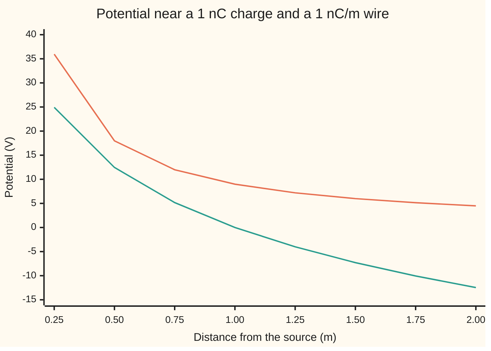

# The fundamental solution: the potential of a single point source

[Syllabus](../../../SYLLABUS.md) → [Partial differential equations](../README.md) → [Laplace, Poisson and Potentials](../README.md#s04) → The fundamental solution

---

## General Overview

A small metal ball carrying 1 nC (one nanocoulomb) of charge hangs on a nylon thread in a large exhibition hall. A voltmeter probe reads the potential (the voltage measured against far away) at three distances from the ball:

- 10 cm away: 89.8755 V;
- 1 m away: 8.98755 V;
- 2 m away: 4.49378 V.

Double the distance and the voltage halves. The field (the push on a test charge) at 1 m is 8.98755 V/m.

[Laplace's equation](../../08-Differential%20equations%20and%20dynamics/10-The%20Classical%20PDEs/07-laplaces-equation-and-harmonic-functions.md) in wing 08 studied regions with no source inside. [Electric fields](../../13-Engineering%20mathematics/06-Circuits%20and%20Electromagnetism/04-electrostatics-gauss-and-potential.md) found the ball's potential $`kQ/r`$ from Coulomb's law, where $`k`$ is Coulomb's constant and $`Q`$ the charge. [Fundamental solution](../../18-Functional%20analysis/04-Distributions%20and%20Sobolev%20Spaces/04-fundamental-solutions-and-the-response-to-a-spike.md) defined, for any linear equation, the response to a single spike. This card puts one source into Laplace's equation. It does three new things:

- It derives the potential of one point source from the Laplacian alone, using only symmetry, in any number of dimensions $`d`$.
- It finds that a line source, such as a long charged wire, gives a logarithm instead of $`1/r`$, with no zero far away.
- It proves the point-source identity $`-\Delta\Phi = \delta`$ and checks it by the divergence theorem.

As a problem in the sense of [A PDE problem](../01-Classification%20and%20Well-Posedness/01-what-a-pde-problem-is.md): the **unknown** is the potential $`u(x)`$; the **region** is all of space, with the hall's walls treated as far away; the **data** is one point source of strength 1 at the origin. The solution is classical (twice differentiable, with zero Laplacian) everywhere except at the source. At the source it holds as an equation between distributions (generalised functions, known only through their averages against smooth bumps).

**A point source spreads its output evenly over every sphere around it, so its potential depends only on the distance, has zero Laplacian away from the source, and sends a flux (total outflow) of exactly 1 through every sphere; that forces $`\Phi = 1/(4\pi r)`$ in space and $`\Phi = -\ln r/(2\pi)`$ in the plane, and makes $`-\Delta\Phi = \delta`$ exact.**

**What kind of fact this is:** a theorem, proved on this card in Why it works, with the point-source identity in full in a fold. Uniqueness rests on Weyl's lemma, stated with its source. Treating the hall as all of space is a model; the code prints the floor's effect.

### The picture: a point charge and a charged wire



Orange: the 1 nC ball, $`kQ/r`$, measured against far away; it never drops below 0. Teal: a long wire with 1 nC per metre, measured against its value at 1 m; it drops 12.46 V each time the distance doubles, without limit. The first curve is $`1/r`$, the second a logarithm.

---

## The formula

Notation, in words first. A point is $`x = (x_1, \dots, x_d)`$ and $`r = |x|`$ is its distance from the source. The Laplacian $`\Delta u = u_{x_1x_1} + \dots + u_{x_dx_d}`$ is the total bend of $`u`$ over all directions; this wing writes $`-\Delta`$ so that its eigenvalues come out positive. The point source is the delta $`\delta`$: one unit of output, all at the origin.

This card introduces $`\Phi`$, the **fundamental solution of the Laplacian**: the potential of one unit point source, so $`-\Delta\Phi = \delta`$. Write $`A_d`$ for the surface area of the sphere of radius 1 in $`d`$ dimensions: $`A_1 = 2`$ (two end points), $`A_2 = 2\pi`$ (a circle), $`A_3 = 4\pi`$, $`A_4 = 2\pi^2`$.

```math
\Phi(x) = \begin{cases} -\dfrac{|x|}{2} & d = 1 \\[2mm] -\dfrac{1}{2\pi}\ln|x| & d = 2 \\[2mm] \dfrac{1}{(d-2)\,A_d\,|x|^{d-2}} & d \ge 3, \quad \text{so } \dfrac{1}{4\pi|x|} \text{ in space} \end{cases}
```

**Read it aloud:** in space the potential of a unit point source is one over four pi r; in the plane it is minus the logarithm of r over two pi; in general it falls like $`r^{2-d}`$.

The point-source identity says what $`-\Delta\Phi = \delta`$ means. $`\Phi`$ has no Laplacian at the origin, so the identity is read through **test functions**: smooth bumps $`\varphi`$ that vanish far away.

```math
\int_{\mathbb{R}^d} \Phi(x)\,\big(-\Delta\varphi(x)\big)\,dx = \varphi(0) \qquad \text{for every test function } \varphi
```

**Read it aloud:** weigh minus the Laplacian of any bump by the potential, add it up over all of space, and you get back the bump's value at the source.

For charges at rest the potential obeys $`-\Delta u = \rho/\varepsilon_0`$, with $`\rho`$ the charge per cubic metre. A point charge $`Q`$ is $`\rho = Q\,\delta`$, so $`u = (Q/\varepsilon_0)\,\Phi`$. In space that is $`Q/(4\pi\varepsilon_0 r) = kQ/r`$. A wire with $`\lambda`$ coulombs per metre is a point source in the plane across it, so $`u = (\lambda/\varepsilon_0)\,\Phi`$ plus a constant.

| Symbol | Plain meaning | In our example | Push it up and the answer… |
| --- | --- | --- | --- |
| $`d`$ | dimension: number of space coordinates | 3 for the ball; 2 across the wire | $`\Phi`$ falls off faster, like $`r^{2-d}`$ |
| $`x`$, $`r`$, $`R`$ | a point; its distance $`\lvert x \rvert`$ from the source, in m; the radius of a ball | $`r`$ = 10 cm, 1 m, 2 m | the potential falls |
| $`\Delta`$ | the Laplacian: total bend over all $`d`$ directions | 0 everywhere except at the source | — |
| $`\delta`$ | the point source: one unit, all at the origin | the 1 nC ball, per unit charge | — |
| $`\Phi`$, $`c`$ | fundamental solution, in m$`^{2-d}`$; the constant $`r^{d-1}\Phi'(r)`$ | $`\Phi(1\ \mathrm{m}) = 0.0795775`$ per m in space; $`c = -1/A_d`$ | — |
| $`A_d`$, $`B(0, R)`$, $`\partial B(0, R)`$, $`n`$ | area of the unit sphere; the ball of radius $`R`$ round the source; its surface; the outward direction, length 1 | $`A_3 = 4\pi`$ | — |
| $`\varphi`$, $`b`$, $`\varepsilon`$, $`U_\varepsilon`$, $`M`$ | a test bump, in the code the Gaussian $`e^{-r^2/(2b^2)}`$; its width; the radius of a small ball cut out round the source; all of space outside that ball; the bump's largest slope | $`b`$ = 50 cm; $`\varepsilon`$ = 0.1, 0.01, 0.001 m | — |
| $`Q`$, $`\lambda`$ | charge on the ball, C; charge per metre of wire, C/m | 1 nC; 1 nC/m | every voltage grows in proportion |
| $`\varepsilon_0`$, $`k`$ | permittivity of empty space; Coulomb's constant $`1/(4\pi\varepsilon_0)`$ | $`8.8541878188 \times 10^{-12}`$ F/m | weaker potential |
| $`u`$, $`E`$, $`\rho`$ | potential, V; field, V/m; charge per cubic metre | 8.98755 V and 8.98755 V/m at 1 m | — |
| $`G`$, $`t`$, $`T`$, $`\kappa`$ | the heat kernel; time; the last time added up; the diffusivity, set to 1 (scaled) | $`T`$ = $`e^{40}`$ in space; $`10^4`$, $`10^8`$ in the plane | — |
| $`h`$, $`H`$ | step of a centred difference; a harmonic function added to $`\Phi`$ | $`h`$ = 2 cm, 1 cm | — |

### When it holds

- **No walls, or walls far away.** An earthed floor 5 m below the ball acts like a mirror charge 10 m below it. At 1 m from the ball, that mirror shifts the potential by −0.8943 V, which is 9.95% of its value, but the field by only 0.08899 V/m, which is 0.99%. Walls set the potential's level; the field near the source is local. A box with walls needs a [Green's function](04-greens-functions-and-the-representation-formula.md).
- **Three or more dimensions, for a zero far away.** In the plane the logarithm has no limit far out. The wire's voltage from 1 cm out to 1 km is 206.95 V, and out to 1000 km it is 331.11 V. Only differences of the wire's potential mean anything.
- **The same medium everywhere.** The derivation needs the plain Laplacian. Where the permittivity changes from place to place (glass beside air), the equation becomes $`-\nabla\cdot(\varepsilon\nabla u) = \rho`$, the symmetry is lost, and the potential is no longer $`1/r`$.
- **The identity read through test functions.** Away from the source, $`\Delta\Phi = 0`$ point by point. Adding up that pointwise Laplacian against a bump gives 0, not $`\varphi(0)`$: the whole unit of source sits at the one point where $`\Phi`$ has no derivatives.

---

## Why it works

### Step 0: symmetry and conservation leave no choice

A point source has no favourite direction, so its potential depends only on the distance $`r`$. Away from the source nothing is made or lost, so the Laplacian is zero there.

The flux is the outflow $`-\partial\Phi/\partial n`$ added over a closed surface. By the [Divergence theorem](../../06-Calculus%20and%20analysis/09-Vector%20Calculus/07-divergence-theorem.md), the flux out equals the source inside. So every sphere round the source carries flux 1.

A sphere of radius $`r`$ has area $`A_d r^{d-1}`$. Spread evenly, the outflow per unit area is $`-\Phi'(r) = 1/(A_d r^{d-1})`$. Integrate once and $`\Phi`$ is fixed. The steps below make this exact.

### Step 1: the Laplacian of a function of the distance alone

Let $`u`$ depend on $`r`$ only. Since $`r^2 = x_1^2 + \dots + x_d^2`$, the chain rule gives $`\partial r/\partial x_i = x_i/r`$. Then

```math
\frac{\partial u}{\partial x_i} = u'(r)\,\frac{x_i}{r}, \qquad \frac{\partial^2 u}{\partial x_i^2} = u''(r)\,\frac{x_i^2}{r^2} + u'(r)\Big(\frac{1}{r} - \frac{x_i^2}{r^3}\Big)
```

Add over the $`d`$ directions. The $`x_i^2`$ add up to $`r^2`$:

```math
\Delta u = u'' + \frac{d-1}{r}\,u' = \frac{1}{r^{d-1}}\,\big(r^{d-1}u'\big)'
```

The term $`(d-1)u'/r`$ is the spreading: spheres grow as you move out. [The Laplacian in round coordinates, and the modes it splits into](07-laplacian-in-polar-and-spherical-coordinates.md) derives the full Laplacian with angles; only the radial part is needed here.

### Step 2: away from the source, one integration

Set $`\Delta\Phi = 0`$ for $`r > 0`$. By Step 1, $`r^{d-1}\Phi'`$ has zero derivative, so it is a constant $`c`$. Then $`\Phi' = c\,r^{1-d}`$, and one more integration gives:

| Dimension | $`\Phi'(r)`$ | $`\Phi(r)`$, up to an added constant | The physical source |
| --- | --- | --- | --- |
| $`d = 1`$ | $`c`$ | $`c\,r`$ | a charged sheet |
| $`d = 2`$ | $`c/r`$ | $`c\,\ln r`$ | a charged wire |
| $`d \ge 3`$ | $`c\,r^{1-d}`$ | $`c\,r^{2-d}/(2-d)`$ | a charged point |

The plane is the odd one out. There $`1/r`$ integrates to a logarithm, not to a power.

The code puts the space and plane formulas back into Laplace's equation by centred differences. At $`(0.6, 0.3, 0.2)`$ m the leftover is $`-3.285 \times 10^{-5}`$ per m³ at step 2 cm and $`-8.213 \times 10^{-6}`$ per m³ at 1 cm. It falls fourfold as the step halves, so it is the differencing error, not a real Laplacian.

### Step 3: the flux fixes the constant

Integrate $`-\Delta\Phi = \delta`$ over the ball $`B(0, R)`$. The right side gives 1, the whole source. The divergence theorem turns the left side into the flux through the sphere $`\partial B(0, R)`$:

```math
-\int_{\partial B(0,R)} \frac{\partial\Phi}{\partial n}\,dS = -\Phi'(R)\,A_d R^{d-1} = -c\,A_d = 1
```

So $`c = -1/A_d`$. In space, $`\Phi' = -1/(4\pi r^2)`$ and $`\Phi = 1/(4\pi r)`$. In the plane, $`\Phi' = -1/(2\pi r)`$ and $`\Phi = -\ln r/(2\pi)`$. On a line, $`\Phi = -|x|/2`$: the charged sheet's field is the same at every distance, as between the plates on the [Electric fields](../../13-Engineering%20mathematics/06-Circuits%20and%20Electromagnetism/04-electrostatics-gauss-and-potential.md) card.

The added constant is a choice. In $`d \ge 3`$ choose it so that $`\Phi \to 0`$ far away. In the plane no choice does that; the formula above makes $`\Phi = 0`$ at $`r = 1`$ in whatever unit of length is used.

The code differentiates $`\Phi`$ numerically and finds the flux $`-\Phi'(r)A_d r^{d-1}`$ through spheres of radius 0.5, 1 and 2 m equal to 1.000000 in $`d`$ = 1, 2, 3 and 4. That shows the flux is the same through every sphere. In $`d \ge 3`$ it cannot catch a wrong $`A_d`$, which cancels between $`\Phi`$ and the sphere's area; the heat kernel of Step 6 checks $`4\pi`$ and $`2\pi^2`$ on its own, and the cube of Step 5 checks $`4\pi`$.

### Step 4: the point-source identity holds

Step 3 found the only constant that could work. Now check that it does. Take a test bump $`\varphi`$ and cut a small ball of radius $`\varepsilon`$ out round the source. Outside the ball $`\Delta\Phi = 0`$, and the divergence theorem moves all the derivatives onto the small sphere. Two surface terms are left:

- **the flux part:** the flux of $`-\nabla\Phi`$, which is 1, times the average of $`\varphi`$ over the small sphere. It tends to $`\varphi(0)`$;
- **the $`\Phi`$ part:** $`\Phi(\varepsilon)`$ times the sphere's area $`A_d\varepsilon^{d-1}`$ times a bounded slope of $`\varphi`$. In space that is at most a constant times $`\varepsilon`$; in the plane, times $`\varepsilon|\ln\varepsilon|`$. Both tend to 0.

For the bump $`\varphi = e^{-r^2/(2b^2)}`$ with $`b`$ = 50 cm, the code adds up the integral outside $`\varepsilon`$ directly and compares it with the two parts. This Gaussian bump is not zero outside a bounded set, as the fold below assumes, but it dies away fast enough for the same proof to work; the code stops at 5 m, where the bump is 1.9e-22.

| $`\varepsilon`$ | space: integral outside | flux part | $`\Phi`$ part | plane: integral outside | $`\Phi`$ part |
| --- | ---: | ---: | ---: | ---: | ---: |
| 0.1 m | 0.940991 | 0.980199 | −0.039208 | 0.889919 | −0.090280 |
| 0.01 m | 0.999400 | 0.999800 | −0.000400 | 0.997958 | −0.001842 |
| 0.001 m | 0.999994 | 0.999998 | −0.000004 | 0.999970 | −0.000028 |

In every row the two parts add to the integral, and the total closes in on $`\varphi(0) = 1`$. Over all of space the integral is 1.000000 in $`d`$ = 2, 3 and 4.

<details>
<summary>Detailed proof: the point-source identity for any test function, in d ≥ 2 dimensions</summary>

Let $`\varphi`$ be smooth and zero outside a bounded set. Let $`U_\varepsilon`$ be all of space outside $`B(0, \varepsilon)`$. On $`U_\varepsilon`$, $`\Phi`$ is smooth with $`\Delta\Phi = 0`$.

Green's second identity is the divergence theorem applied to $`\Phi\nabla\varphi - \varphi\nabla\Phi`$, whose divergence is $`\Phi\Delta\varphi - \varphi\Delta\Phi`$. On $`U_\varepsilon`$ the second term is 0. The only boundary is the small sphere, where the normal $`n`$ out of $`U_\varepsilon`$ points toward the origin:

$`\displaystyle \int_{U_\varepsilon} \Phi\,(-\Delta\varphi)\,dx = -\int_{\partial B(0,\varepsilon)} \Phi\,\frac{\partial\varphi}{\partial n}\,dS + \int_{\partial B(0,\varepsilon)} \varphi\,\frac{\partial\Phi}{\partial n}\,dS.`$

First term. $`|\partial\varphi/\partial n| \le M`$, the largest slope of $`\varphi`$. So the term is at most $`M\,|\Phi(\varepsilon)|\,A_d\varepsilon^{d-1}`$. That is $`M\varepsilon/(d-2)`$ for $`d \ge 3`$ and $`M\varepsilon|\ln\varepsilon|`$ for $`d = 2`$. Both tend to 0.

Second term. On the sphere, $`n`$ points inward, so $`\partial\Phi/\partial n = -\Phi'(\varepsilon) = 1/(A_d\varepsilon^{d-1})`$. The term is

$`\displaystyle \frac{1}{A_d\varepsilon^{d-1}}\int_{\partial B(0,\varepsilon)} \varphi\,dS,`$

the average of $`\varphi`$ over the small sphere. Since $`\varphi`$ is continuous, it tends to $`\varphi(0)`$.

Finally, $`\Phi`$ is integrable near 0, because $`|\Phi|\,A_d r^{d-1}`$ is $`r/(d-2)`$, or $`r|\ln r|`$ in the plane, so the left side tends to the integral over all of space. Hence $`\int \Phi\,(-\Delta\varphi)\,dx = \varphi(0)`$ for every test function: $`-\Delta\Phi = \delta`$ as distributions.

</details>

### Step 5: Gauss's law on a surface of any shape

The identity says more than "spheres carry flux 1". By the divergence theorem, the flux of the field $`-\nabla\Phi`$ out of any closed surface is 1 if the source is inside, and 0 if it is outside.

The code checks a cube 2 m wide, not a sphere. With the source at $`(0.5, 0.3, -0.2)`$ m inside, Simpson's rule on the six faces gives 1.000000. Times $`Q/\varepsilon_0`$ that is 112.9409 V m, the flux on the [Electric fields](../../13-Engineering%20mathematics/06-Circuits%20and%20Electromagnetism/04-electrostatics-gauss-and-potential.md) card. With the source at $`(2.5, 0, 0)`$ m, outside the cube, the flux is 0.000000: what flows in through one face flows out through others.

### Step 6: a second road, through the heat kernel

Switch on a steady source and wait. Each moment's output spreads as [The heat kernel](../03-The%20Heat%20Equation%20in%20Depth/01-heat-kernel-and-fundamental-solution.md) $`G`$. With diffusivity $`\kappa`$ the kernel at time $`t`$ is $`G(x, \kappa t)`$, and putting $`s = \kappa t`$ gives $`\int_0^\infty G(x, \kappa t)\,dt = \frac{1}{\kappa}\int_0^\infty G(x, s)\,ds`$, which is $`\Phi/\kappa`$, the solution of $`-\kappa\Delta u = \delta`$. So $`\kappa`$ only rescales the answer, and the settled potential is all those kernels added up over time (scaled: units chosen so $`\kappa = 1`$):

```math
\Phi(x) = \int_0^\infty G(x, t)\,dt, \qquad G(x, t) = \frac{1}{(4\pi t)^{d/2}}\,e^{-|x|^2/(4t)}
```

This road never mentions the radial equation. In space the code adds up the integral to $`T = e^{40}`$ and gets 0.1591549, 0.0795775 and 0.0397887 at 0.5, 1 and 2 m: exactly $`1/(4\pi r)`$. The part beyond $`T`$ is at most $`9.3 \times 10^{-11}`$. In four dimensions, at 1 m, it gives 0.0253303, which is $`1/(4\pi^2)`$.

In the plane the integral never settles: the kernel falls like $`1/t`$, too slowly. At 1 m it reaches 0.7973 by $`T = 10^4`$ and 1.5303 by $`10^8`$, growing like $`\ln T/(4\pi)`$. But the difference between two points settles: 1 cm minus 1 m gives 0.732936, which is $`\ln(100)/(2\pi)`$. So the plane's potential has differences but no level.

### Step 7: which fundamental solution

$`\Phi`$ is not the only answer to $`-\Delta u = \delta`$. Add any harmonic function $`H`$ (one with $`\Delta H = 0`$) and $`\Phi + H`$ works too. The walls of a room pick one particular $`H`$; that is the [Green's function](04-greens-functions-and-the-representation-formula.md), built for flat walls by the [Method of images](05-method-of-images.md).

**Theorem.** In $`d \ge 3`$, $`\Phi`$ is the only solution of $`-\Delta u = \delta`$ that tends to 0 far away. In the plane, any solution with $`u - \Phi`$ bounded is $`\Phi`$ plus a constant.

The proof in words. The difference $`H = u - \Phi`$ has $`\Delta H = 0`$ as a distribution. Weyl's lemma says such a distribution is an ordinary smooth harmonic function (stated on [Harnack and regularity](10-harnack-and-regularity-in-outline.md); Lieb and Loss, chapter 9, in the Sources). In $`d \ge 3`$, $`H`$ tends to 0 far away. On a large ball its largest and smallest values sit on the surface ([Maximum principles](../01-Classification%20and%20Well-Posedness/08-maximum-principles.md)), where $`H`$ is tiny. So $`H = 0`$. In the plane, a bounded harmonic function on all of the plane is a constant, which is Liouville's theorem, proved on [Harnack and regularity](10-harnack-and-regularity-in-outline.md).

---

## Worked numbers, by hand

The 1 nC ball, 1 m away.

| Step | Arithmetic | Value |
| --- | --- | --- |
| source strength, $`Q/\varepsilon_0`$ | $`10^{-9} / (8.8541878188 \times 10^{-12})`$ | 112.9409 V m |
| fundamental solution at 1 m | $`1/(4\pi \times 1)`$ | 0.0795775 per m |
| field at 1 m, $`(Q/\varepsilon_0)/(4\pi r^2)`$ | 112.9409 × 0.0795775 / 1² | 8.98755 V/m |
| potential at 10 cm | 112.9409 × 0.0795775 / 0.1 | 89.8755 V |
| potential at 2 m | 112.9409 × 0.0795775 / 2 | 4.49378 V |
| potential at 1 m, $`(Q/\varepsilon_0)\,\Phi(1\ \mathrm{m})`$ | 112.9409 × 0.0795775 | **8.98755 V** |

One metre from a 1 nC ball, a probe reads about 9 V against far away, and the field there is about 9 V/m.

The wire, the same way. A 1 nC/m wire has $`\lambda/\varepsilon_0`$ = 112.9409 V. Divided by $`2\pi`$ that is 17.9751 V. From 1 cm to 1 m, $`\ln 100`$ = 4.60517, so the voltage between them is 17.9751 × 4.60517 = 82.7784 V. The field at 10 cm is 17.9751 / 0.1 = 179.751 V/m.

### What breaks if you drop a piece

| Mistake | Comes out at | What went wrong |
| --- | --- | --- |
| The plane's constant $`1/(2\pi r)`$ used in space | the identity gives 2.000000, not 1; the ball reads 17.9751 V at 1 m, not 8.98755 V | the constant is $`1/A_d`$, and a sphere's area is $`4\pi r^2`$ |
| The field's shape $`1/r^2`$ taken as the potential | Laplacian exactly 2 per m⁴ at 1 m (centred difference, $`h`$ = 1 cm: 2.0014), not 0 | $`1/r^2`$ is the field; the potential is one power lower |
| $`1/r`$ taken as the wire's potential | Laplacian in the plane exactly 1 per m³ at 1 m (centred difference: 1.0003), not 0 | in the plane $`1/r`$ integrates to a logarithm |
| The wire's potential taken as zero far away | 1 cm to 1 km: 206.95 V; to 1000 km: 331.11 V; no limit | the logarithm grows without end |

The code prints all four.

---

## Code, from first principles, and it actually runs

The code computes every number on this card from scratch, with its own Simpson's rule and its own centred differences. It takes five independent roads to $`\Phi`$:

1. The radial formula: its flux through spheres of radius 0.5, 1 and 2 m, in $`d`$ = 1 to 4. In $`d \ge 3`$ the area $`A_d`$ cancels here, so this road checks the shape of $`\Phi`$, not its constant.
2. The formula put back into Laplace's equation by centred differences, with the error falling fourfold as the step halves.
3. The heat kernel added up over time, in $`d`$ = 2, 3 and 4. It never uses $`A_d`$, so it checks the constants $`4\pi`$ and $`2\pi^2`$.
4. The point-source identity against a bump, split at $`\varepsilon`$ into its flux part and its $`\Phi`$ part.
5. Gauss's law on a cube, with the source inside and outside, from a field written out by hand with its own $`4\pi`$.

The code comments carry the same numbers.

### Python

```python
# The fundamental solution of -Laplacian: one 1 nC charge in a large hall, and a 1 nC/m wire.
# Standard library only. Simpson's rule and every check are written out here.
from math import sqrt, exp, log, pi

EPS0, Q, LAM = 8.8541878188e-12, 1e-9, 1e-9     # F/m (CODATA 2022); C; C/m
AREA = {1: 2.0, 2: 2 * pi, 3: 4 * pi, 4: 2 * pi ** 2}   # surface of the unit sphere in d dimensions

def Phi(r, d):                   # the fundamental solution, -Lap Phi = delta, as a function of r = |x|
    if d == 1: return -r / 2
    if d == 2: return -log(r) / (2 * pi)
    return r ** (2 - d) / ((d - 2) * AREA[d])

def simpson(f, a, b, n):
    h = (b - a) / n
    return h / 3 * (f(a) + f(b) + sum((4 if i % 2 else 2) * f(a + i * h) for i in range(1, n)))

def lap(f, p, h):                # centred-difference Laplacian at point p
    s = 0.0
    for i in range(len(p)):
        up = list(p); dn = list(p); up[i] += h; dn[i] -= h
        s += (f(up) - 2 * f(p) + f(dn)) / h ** 2
    return s

def sci(x, p): return f"{x:.{p}e}"

qe, le = Q / EPS0, LAM / EPS0
print(f"hand: Q/eps0 = {qe:.4f} V m; Phi_3(1 m) = 1/(4 pi) = {Phi(1, 3):.7f} per m; potential at 1 m {qe*Phi(1, 3):.5f} V")
print(f"hand: potential at 10 cm {qe*Phi(0.1, 3):.4f} V, at 2 m {qe*Phi(2, 3):.5f} V; field at 1 m {qe/(4*pi):.5f} V/m")
print(f"hand: wire lambda/eps0 = {le:.4f} V; /(2 pi) = {le/(2*pi):.4f} V; ln 100 = {log(100):.5f};"
      f" 1 cm to 1 m: {le*(Phi(0.01, 2)-Phi(1, 2)):.4f} V; field at 10 cm {le/(2*pi*0.1):.3f} V/m")

for d in (1, 2, 3, 4):           # road 1: the radial formula, flux -Phi'(r) A_d r^(d-1) through spheres
    fl = [-(Phi(r + 1e-5, d) - Phi(r - 1e-5, d)) / 2e-5 * AREA[d] * r ** (d - 1) for r in (0.5, 1.0, 2.0)]
    print(f"d = {d}: Phi(1 m) = {Phi(1, d) + 0.0:.7f}; flux through spheres r = 0.5, 1, 2 m: " + ", ".join(f"{x:.6f}" for x in fl))
    for x in fl: assert abs(x - 1) < 1e-8

f3 = lambda p: Phi(sqrt(sum(c * c for c in p)), 3)   # road 2: the formula back in Laplace's equation, centred differences
f2 = lambda p: Phi(sqrt(sum(c * c for c in p)), 2)
for name, f, p in (("d = 3 at (0.6, 0.3, 0.2) m", f3, [0.6, 0.3, 0.2]), ("d = 2 at (0.6, 0.3) m", f2, [0.6, 0.3])):
    a, b = lap(f, p, 0.02), lap(f, p, 0.01)
    print(f"{name}: centred Laplacian {sci(a, 3)} (h 2 cm), {sci(b, 3)} (h 1 cm), ratio {a/b:.2f}")
    assert abs(a / b - 4) < 0.05 and abs(b) < 1e-4
w1 = lap(lambda p: sum(c * c for c in p) ** -1, [1.0, 0, 0], 0.01)
w2 = lap(lambda p: sum(c * c for c in p) ** -0.5, [1.0, 0], 0.01)
exact = lambda p, d: p * (p + d - 2)      # Step 1 on r^p: Lap r^p = p (p + d - 2) r^(p - 2), here at r = 1 m
print(f"mistake, field shape 1/r^2 as a 3-d potential: Laplacian at 1 m {w1:.4f} per m^4 (h 1 cm), exactly {exact(-2, 3)}, not 0")
print(f"mistake, 1/r as the wire's potential: Laplacian in the plane at 1 m {w2:.4f} per m^3 (h 1 cm), exactly {exact(-1, 2)}, not 0")
assert abs(w1 - exact(-2, 3)) < 5e-3 and abs(w2 - exact(-1, 2)) < 5e-3

def heat(r, d, T, n=6000):       # road 3, scaled kappa = 1: integral of the heat kernel over time 0..T, t = e^u
    g = lambda u: exp(u) * exp(-r * r / (4 * exp(u))) / (4 * pi * exp(u)) ** (d / 2)
    return simpson(g, -30.0, log(T), n)
for r in (0.5, 1.0, 2.0):
    v = heat(r, 3, exp(40))
    print(f"d = 3, r = {r} m: time integral of heat kernel {v:.7f}, 1/(4 pi r) {Phi(r, 3):.7f}")
    assert abs(v - Phi(r, 3)) < 1e-7
print(f"d = 3, tail beyond t = e^40 at most {sci(2 * (4 * pi) ** -1.5 * exp(-20), 1)}")
v4 = heat(1.0, 4, exp(40))
print(f"d = 4, r = 1 m: time integral {v4:.7f}, 1/(4 pi^2 r^2) {Phi(1, 4):.7f}")
assert abs(v4 - Phi(1, 4)) < 1e-7
for T in (1e4, 1e8):
    dv = heat(0.01, 2, T) - heat(1.0, 2, T)
    print(f"d = 2, T = {T:.0e}: at 1 m alone {heat(1.0, 2, T):.4f} (grows like ln T/(4 pi));"
          f" 1 cm minus 1 m {dv:.6f}; ln(100)/(2 pi) {Phi(0.01, 2):.6f}; tail at most {sci(1 / (16 * pi * T), 1)}")
    assert abs(dv - Phi(0.01, 2)) < 2 / (16 * pi * T)

B = 0.5                          # road 4: the point-source identity with a bump of width b = 50 cm
phi = lambda r: exp(-r * r / (2 * B * B))
def ident(d, eps, c=1.0, R=5.0):  # integral over r > eps of c Phi (-Lap bump), radially
    return simpson(lambda r: AREA[d] * r ** (d - 1) * c * Phi(r, d) * (d / B ** 2 - r * r / B ** 4) * phi(r), eps, R, 8000)
for d in (2, 3):
    for eps in (0.1, 0.01, 0.001):
        v = ident(d, eps)
        part = AREA[d] * eps ** (d - 1) * Phi(eps, d) * (-eps / B ** 2) * phi(eps)
        print(f"d = {d}, eps = {eps} m: integral outside eps {v:.6f}; flux part {phi(eps):.6f};"
              f" Phi part {part:.6f}; sum {phi(eps)+part:.6f}")
        assert abs(v - phi(eps) - part) < 1e-8
w = [ident(d, 1e-9) for d in (2, 3, 4)]
print(f"whole integral, bump width 0.5 m, d = 2, 3, 4: {w[0]:.6f}, {w[1]:.6f}, {w[2]:.6f}; bump at the source 1, at the 5 m cut-off {sci(phi(5.0), 1)}")
for x in w: assert abs(x - 1) < 1e-6
print(f"mistake, 2-d constant 1/(2 pi r) in 3-d: identity gives {ident(3, 1e-9, 2.0):.6f}; potential at 1 m {qe/(2*pi):.4f} V")

def cube_flux(c, n=120):         # road 5: flux of the field x/(4 pi |x|^3) out of the cube [-1, 1]^3, charge at c
    tot = 0.0
    for ax in range(3):
        for s in (-1.0, 1.0):
            def face(u, v):
                p = [u, v]; p.insert(ax, s); x = [p[i] - c[i] for i in range(3)]
                return s * x[ax] / (4 * pi * sqrt(sum(t * t for t in x)) ** 3)
            tot += simpson(lambda u: simpson(lambda v: face(u, v), -1, 1, n), -1, 1, n)
    return tot
fin, fout = cube_flux([0.5, 0.3, -0.2]), cube_flux([2.5, 0.0, 0.0])
print(f"cube 2 m wide, charge at (0.5, 0.3, -0.2) m: flux {fin:.6f} -> {qe*fin:.4f} V m; charge at (2.5, 0, 0) m: flux {fout:.6f}")
assert abs(fin - 1) < 1e-5 and abs(fout) < 1e-6

k = 1 / (4 * pi * EPS0)          # the hall: an earthed floor 5 m below the charge acts as a mirror charge
di = sqrt(1 + 10 ** 2)
print(f"hall: earthed floor 5 m below, mirror charge 10 m below; at 1 m sideways it shifts the potential by {-k*Q/di:.4f} V"
      f" ({100/di:.2f}% of its 1 m value) and the field by {k*Q/di**2:.5f} V/m ({100/di**2:.2f}%)")
print("chart, point charge V at r = 0.25..2 m: " + ", ".join(f"{qe*Phi(i/4, 3):.2f}" for i in range(1, 9)))
print("chart, wire V above 1 m at r = 0.25..2 m: " + ", ".join(f"{le*Phi(i/4, 2) + 0.0:.2f}" for i in range(1, 9)))
print("mistake, wire potential taken as zero far away: 1 cm to R = 1 km, 1000 km: "
      + ", ".join(f"{le*(Phi(0.01, 2)-Phi(R, 2)):.2f} V" for R in (1e3, 1e6)))
print("ALL CHECKS PASS")
```

**Ran 2026-11-15 on macOS, Python 3.14.10, standard library only. All checks passed. Output, pasted from the run:**

```
hand: Q/eps0 = 112.9409 V m; Phi_3(1 m) = 1/(4 pi) = 0.0795775 per m; potential at 1 m 8.98755 V
hand: potential at 10 cm 89.8755 V, at 2 m 4.49378 V; field at 1 m 8.98755 V/m
hand: wire lambda/eps0 = 112.9409 V; /(2 pi) = 17.9751 V; ln 100 = 4.60517; 1 cm to 1 m: 82.7784 V; field at 10 cm 179.751 V/m
d = 1: Phi(1 m) = -0.5000000; flux through spheres r = 0.5, 1, 2 m: 1.000000, 1.000000, 1.000000
d = 2: Phi(1 m) = 0.0000000; flux through spheres r = 0.5, 1, 2 m: 1.000000, 1.000000, 1.000000
d = 3: Phi(1 m) = 0.0795775; flux through spheres r = 0.5, 1, 2 m: 1.000000, 1.000000, 1.000000
d = 4: Phi(1 m) = 0.0253303; flux through spheres r = 0.5, 1, 2 m: 1.000000, 1.000000, 1.000000
d = 3 at (0.6, 0.3, 0.2) m: centred Laplacian -3.285e-05 (h 2 cm), -8.213e-06 (h 1 cm), ratio 4.00
d = 2 at (0.6, 0.3) m: centred Laplacian -8.803e-05 (h 2 cm), -2.201e-05 (h 1 cm), ratio 4.00
mistake, field shape 1/r^2 as a 3-d potential: Laplacian at 1 m 2.0014 per m^4 (h 1 cm), exactly 2, not 0
mistake, 1/r as the wire's potential: Laplacian in the plane at 1 m 1.0003 per m^3 (h 1 cm), exactly 1, not 0
d = 3, r = 0.5 m: time integral of heat kernel 0.1591549, 1/(4 pi r) 0.1591549
d = 3, r = 1.0 m: time integral of heat kernel 0.0795775, 1/(4 pi r) 0.0795775
d = 3, r = 2.0 m: time integral of heat kernel 0.0397887, 1/(4 pi r) 0.0397887
d = 3, tail beyond t = e^40 at most 9.3e-11
d = 4, r = 1 m: time integral 0.0253303, 1/(4 pi^2 r^2) 0.0253303
d = 2, T = 1e+04: at 1 m alone 0.7973 (grows like ln T/(4 pi)); 1 cm minus 1 m 0.732934; ln(100)/(2 pi) 0.732936; tail at most 2.0e-06
d = 2, T = 1e+08: at 1 m alone 1.5303 (grows like ln T/(4 pi)); 1 cm minus 1 m 0.732936; ln(100)/(2 pi) 0.732936; tail at most 2.0e-10
d = 2, eps = 0.1 m: integral outside eps 0.889919; flux part 0.980199; Phi part -0.090280; sum 0.889919
d = 2, eps = 0.01 m: integral outside eps 0.997958; flux part 0.999800; Phi part -0.001842; sum 0.997958
d = 2, eps = 0.001 m: integral outside eps 0.999970; flux part 0.999998; Phi part -0.000028; sum 0.999970
d = 3, eps = 0.1 m: integral outside eps 0.940991; flux part 0.980199; Phi part -0.039208; sum 0.940991
d = 3, eps = 0.01 m: integral outside eps 0.999400; flux part 0.999800; Phi part -0.000400; sum 0.999400
d = 3, eps = 0.001 m: integral outside eps 0.999994; flux part 0.999998; Phi part -0.000004; sum 0.999994
whole integral, bump width 0.5 m, d = 2, 3, 4: 1.000000, 1.000000, 1.000000; bump at the source 1, at the 5 m cut-off 1.9e-22
mistake, 2-d constant 1/(2 pi r) in 3-d: identity gives 2.000000; potential at 1 m 17.9751 V
cube 2 m wide, charge at (0.5, 0.3, -0.2) m: flux 1.000000 -> 112.9409 V m; charge at (2.5, 0, 0) m: flux 0.000000
hall: earthed floor 5 m below, mirror charge 10 m below; at 1 m sideways it shifts the potential by -0.8943 V (9.95% of its 1 m value) and the field by 0.08899 V/m (0.99%)
chart, point charge V at r = 0.25..2 m: 35.95, 17.98, 11.98, 8.99, 7.19, 5.99, 5.14, 4.49
chart, wire V above 1 m at r = 0.25..2 m: 24.92, 12.46, 5.17, 0.00, -4.01, -7.29, -10.06, -12.46
mistake, wire potential taken as zero far away: 1 cm to R = 1 km, 1000 km: 206.95 V, 331.11 V
ALL CHECKS PASS
```

### Rust

Same numbers, same labels, built with `rustc --edition 2021 -O`.

```rust
// The fundamental solution of -Laplacian: one 1 nC charge in a large hall, and a 1 nC/m wire.
// std only. Simpson's rule and every check are written out here.
use std::f64::consts::PI;

const EPS0: f64 = 8.8541878188e-12; // F/m (CODATA 2022)
const Q: f64 = 1e-9; // C
const LAM: f64 = 1e-9; // C/m
const B: f64 = 0.5; // bump width, m

fn area(d: i32) -> f64 { // surface of the unit sphere in d dimensions
    [2.0, 2.0 * PI, 4.0 * PI, 2.0 * PI * PI][d as usize - 1]
}
fn phi_f(r: f64, d: i32) -> f64 { // the fundamental solution, -Lap Phi = delta, as a function of r = |x|
    match d {
        1 => -r / 2.0,
        2 => -r.ln() / (2.0 * PI),
        _ => r.powi(2 - d) / ((d - 2) as f64 * area(d)),
    }
}
fn simpson<F: Fn(f64) -> f64>(f: F, a: f64, b: f64, n: usize) -> f64 {
    let h = (b - a) / n as f64;
    let mut s = 0.0;
    for i in 1..n { s += (if i % 2 == 1 { 4.0 } else { 2.0 }) * f(a + i as f64 * h); }
    h / 3.0 * (f(a) + f(b) + s)
}
fn lap<F: Fn(&[f64]) -> f64>(f: F, p: &[f64], h: f64) -> f64 { // centred-difference Laplacian at point p
    let mut s = 0.0;
    for i in 0..p.len() {
        let (mut up, mut dn) = (p.to_vec(), p.to_vec());
        up[i] += h; dn[i] -= h;
        s += (f(&up) - 2.0 * f(p) + f(&dn)) / (h * h);
    }
    s
}
fn sci(x: f64, p: usize) -> String { // Python's e-format: mantissa, sign, two-digit exponent
    let s = format!("{:.*e}", p, x);
    let (m, e) = s.split_once('e').unwrap();
    let e: i32 = e.parse().unwrap();
    format!("{}e{}{:02}", m, if e < 0 { '-' } else { '+' }, e.abs())
}
fn norm(p: &[f64]) -> f64 { p.iter().map(|c| c * c).sum::<f64>().sqrt() }
fn heat(r: f64, d: i32, t: f64) -> f64 { // scaled kappa = 1: integral of the heat kernel over time 0..T, t = e^u
    let g = |u: f64| u.exp() * (-r * r / (4.0 * u.exp())).exp() / (4.0 * PI * u.exp()).powf(d as f64 / 2.0);
    simpson(g, -30.0, t.ln(), 6000)
}
fn bump(r: f64) -> f64 { (-r * r / (2.0 * B * B)).exp() }
fn ident(d: i32, eps: f64, c: f64) -> f64 { // integral over r > eps of c Phi (-Lap bump), radially
    simpson(|r| area(d) * r.powi(d - 1) * c * phi_f(r, d) * (d as f64 / (B * B) - r * r / B.powi(4)) * bump(r), eps, 5.0, 8000)
}
fn cube_flux(c: [f64; 3], n: usize) -> f64 { // flux of the field x/(4 pi |x|^3) out of the cube [-1, 1]^3, charge at c
    let mut tot = 0.0;
    for ax in 0..3 {
        for s in [-1.0, 1.0] {
            let face = |u: f64, v: f64| {
                let mut p = vec![u, v];
                p.insert(ax, s);
                let x: Vec<f64> = (0..3).map(|i| p[i] - c[i]).collect();
                s * x[ax] / (4.0 * PI * norm(&x).powi(3))
            };
            tot += simpson(|u| simpson(|v| face(u, v), -1.0, 1.0, n), -1.0, 1.0, n);
        }
    }
    tot
}

fn main() {
    let (qe, le) = (Q / EPS0, LAM / EPS0);
    println!("hand: Q/eps0 = {:.4} V m; Phi_3(1 m) = 1/(4 pi) = {:.7} per m; potential at 1 m {:.5} V", qe, phi_f(1.0, 3), qe * phi_f(1.0, 3));
    println!("hand: potential at 10 cm {:.4} V, at 2 m {:.5} V; field at 1 m {:.5} V/m", qe * phi_f(0.1, 3), qe * phi_f(2.0, 3), qe / (4.0 * PI));
    println!("hand: wire lambda/eps0 = {:.4} V; /(2 pi) = {:.4} V; ln 100 = {:.5}; 1 cm to 1 m: {:.4} V; field at 10 cm {:.3} V/m",
        le, le / (2.0 * PI), 100f64.ln(), le * (phi_f(0.01, 2) - phi_f(1.0, 2)), le / (2.0 * PI * 0.1));

    for d in 1..=4 { // road 1: the radial formula, flux -Phi'(r) A_d r^(d-1) through spheres
        let fl: Vec<f64> = [0.5, 1.0, 2.0].iter()
            .map(|&r| -(phi_f(r + 1e-5, d) - phi_f(r - 1e-5, d)) / 2e-5 * area(d) * r.powi(d - 1)).collect();
        let s: Vec<String> = fl.iter().map(|x| format!("{:.6}", x)).collect();
        println!("d = {}: Phi(1 m) = {:.7}; flux through spheres r = 0.5, 1, 2 m: {}", d, phi_f(1.0, d) + 0.0, s.join(", "));
        for x in &fl { assert!((x - 1.0).abs() < 1e-8); }
    }

    let f3 = |p: &[f64]| phi_f(norm(p), 3); // road 2: the formula back in Laplace's equation, centred differences
    let f2 = |p: &[f64]| phi_f(norm(p), 2);
    let cases: [(&str, &dyn Fn(&[f64]) -> f64, Vec<f64>); 2] =
        [("d = 3 at (0.6, 0.3, 0.2) m", &f3, vec![0.6, 0.3, 0.2]), ("d = 2 at (0.6, 0.3) m", &f2, vec![0.6, 0.3])];
    for (name, f, p) in cases.iter() {
        let (a, b) = (lap(f, p, 0.02), lap(f, p, 0.01));
        println!("{}: centred Laplacian {} (h 2 cm), {} (h 1 cm), ratio {:.2}", name, sci(a, 3), sci(b, 3), a / b);
        assert!((a / b - 4.0).abs() < 0.05 && b.abs() < 1e-4);
    }
    let w1 = lap(|p: &[f64]| 1.0 / (norm(p) * norm(p)), &[1.0, 0.0, 0.0], 0.01);
    let w2 = lap(|p: &[f64]| 1.0 / norm(p), &[1.0, 0.0], 0.01);
    let exact = |p: i32, d: i32| p * (p + d - 2); // Step 1 on r^p: Lap r^p = p (p + d - 2) r^(p - 2), here at r = 1 m
    println!("mistake, field shape 1/r^2 as a 3-d potential: Laplacian at 1 m {:.4} per m^4 (h 1 cm), exactly {}, not 0", w1, exact(-2, 3));
    println!("mistake, 1/r as the wire's potential: Laplacian in the plane at 1 m {:.4} per m^3 (h 1 cm), exactly {}, not 0", w2, exact(-1, 2));
    assert!((w1 - exact(-2, 3) as f64).abs() < 5e-3 && (w2 - exact(-1, 2) as f64).abs() < 5e-3);

    for r in [0.5, 1.0, 2.0] { // road 3: the heat kernel added up over all time
        let v = heat(r, 3, 40f64.exp());
        println!("d = 3, r = {:.1} m: time integral of heat kernel {:.7}, 1/(4 pi r) {:.7}", r, v, phi_f(r, 3));
        assert!((v - phi_f(r, 3)).abs() < 1e-7);
    }
    println!("d = 3, tail beyond t = e^40 at most {}", sci(2.0 * (4.0 * PI).powf(-1.5) * (-20f64).exp(), 1));
    let v4 = heat(1.0, 4, 40f64.exp());
    println!("d = 4, r = 1 m: time integral {:.7}, 1/(4 pi^2 r^2) {:.7}", v4, phi_f(1.0, 4));
    assert!((v4 - phi_f(1.0, 4)).abs() < 1e-7);
    for t in [1e4, 1e8] {
        let dv = heat(0.01, 2, t) - heat(1.0, 2, t);
        println!("d = 2, T = {}: at 1 m alone {:.4} (grows like ln T/(4 pi)); 1 cm minus 1 m {:.6}; ln(100)/(2 pi) {:.6}; tail at most {}",
            sci(t, 0), heat(1.0, 2, t), dv, phi_f(0.01, 2), sci(1.0 / (16.0 * PI * t), 1));
        assert!((dv - phi_f(0.01, 2)).abs() < 2.0 / (16.0 * PI * t));
    }

    for d in [2, 3] { // road 4: the point-source identity with a bump of width b = 50 cm
        for eps in [0.1, 0.01, 0.001] {
            let v = ident(d, eps, 1.0);
            let part = area(d) * eps.powi(d - 1) * phi_f(eps, d) * (-eps / (B * B)) * bump(eps);
            println!("d = {}, eps = {} m: integral outside eps {:.6}; flux part {:.6}; Phi part {:.6}; sum {:.6}",
                d, eps, v, bump(eps), part, bump(eps) + part);
            assert!((v - bump(eps) - part).abs() < 1e-8);
        }
    }
    let w: Vec<f64> = [2, 3, 4].iter().map(|&d| ident(d, 1e-9, 1.0)).collect();
    println!("whole integral, bump width 0.5 m, d = 2, 3, 4: {:.6}, {:.6}, {:.6}; bump at the source 1, at the 5 m cut-off {}", w[0], w[1], w[2], sci(bump(5.0), 1));
    for x in &w { assert!((x - 1.0).abs() < 1e-6); }
    println!("mistake, 2-d constant 1/(2 pi r) in 3-d: identity gives {:.6}; potential at 1 m {:.4} V", ident(3, 1e-9, 2.0), qe / (2.0 * PI));

    let (fin, fout) = (cube_flux([0.5, 0.3, -0.2], 120), cube_flux([2.5, 0.0, 0.0], 120)); // road 5: Gauss on a cube
    println!("cube 2 m wide, charge at (0.5, 0.3, -0.2) m: flux {:.6} -> {:.4} V m; charge at (2.5, 0, 0) m: flux {:.6}", fin, qe * fin, fout);
    assert!((fin - 1.0).abs() < 1e-5 && fout.abs() < 1e-6);

    let k = 1.0 / (4.0 * PI * EPS0); // the hall: an earthed floor 5 m below the charge acts as a mirror charge
    let di = (1.0f64 + 100.0).sqrt();
    println!("hall: earthed floor 5 m below, mirror charge 10 m below; at 1 m sideways it shifts the potential by {:.4} V ({:.2}% of its 1 m value) and the field by {:.5} V/m ({:.2}%)",
        -k * Q / di, 100.0 / di, k * Q / (di * di), 100.0 / (di * di));
    let c1: Vec<String> = (1..9).map(|i| format!("{:.2}", qe * phi_f(i as f64 / 4.0, 3))).collect();
    let c2: Vec<String> = (1..9).map(|i| format!("{:.2}", le * phi_f(i as f64 / 4.0, 2) + 0.0)).collect();
    println!("chart, point charge V at r = 0.25..2 m: {}", c1.join(", "));
    println!("chart, wire V above 1 m at r = 0.25..2 m: {}", c2.join(", "));
    let far: Vec<String> = [1e3, 1e6].iter().map(|&r| format!("{:.2} V", le * (phi_f(0.01, 2) - phi_f(r, 2)))).collect();
    println!("mistake, wire potential taken as zero far away: 1 cm to R = 1 km, 1000 km: {}", far.join(", "));
    println!("ALL CHECKS PASS");
}
```

**Ran 2026-11-15 on macOS, rustc 1.98.1, no crates. All checks passed. Output, pasted from the run:**

```
hand: Q/eps0 = 112.9409 V m; Phi_3(1 m) = 1/(4 pi) = 0.0795775 per m; potential at 1 m 8.98755 V
hand: potential at 10 cm 89.8755 V, at 2 m 4.49378 V; field at 1 m 8.98755 V/m
hand: wire lambda/eps0 = 112.9409 V; /(2 pi) = 17.9751 V; ln 100 = 4.60517; 1 cm to 1 m: 82.7784 V; field at 10 cm 179.751 V/m
d = 1: Phi(1 m) = -0.5000000; flux through spheres r = 0.5, 1, 2 m: 1.000000, 1.000000, 1.000000
d = 2: Phi(1 m) = 0.0000000; flux through spheres r = 0.5, 1, 2 m: 1.000000, 1.000000, 1.000000
d = 3: Phi(1 m) = 0.0795775; flux through spheres r = 0.5, 1, 2 m: 1.000000, 1.000000, 1.000000
d = 4: Phi(1 m) = 0.0253303; flux through spheres r = 0.5, 1, 2 m: 1.000000, 1.000000, 1.000000
d = 3 at (0.6, 0.3, 0.2) m: centred Laplacian -3.285e-05 (h 2 cm), -8.213e-06 (h 1 cm), ratio 4.00
d = 2 at (0.6, 0.3) m: centred Laplacian -8.803e-05 (h 2 cm), -2.201e-05 (h 1 cm), ratio 4.00
mistake, field shape 1/r^2 as a 3-d potential: Laplacian at 1 m 2.0014 per m^4 (h 1 cm), exactly 2, not 0
mistake, 1/r as the wire's potential: Laplacian in the plane at 1 m 1.0003 per m^3 (h 1 cm), exactly 1, not 0
d = 3, r = 0.5 m: time integral of heat kernel 0.1591549, 1/(4 pi r) 0.1591549
d = 3, r = 1.0 m: time integral of heat kernel 0.0795775, 1/(4 pi r) 0.0795775
d = 3, r = 2.0 m: time integral of heat kernel 0.0397887, 1/(4 pi r) 0.0397887
d = 3, tail beyond t = e^40 at most 9.3e-11
d = 4, r = 1 m: time integral 0.0253303, 1/(4 pi^2 r^2) 0.0253303
d = 2, T = 1e+04: at 1 m alone 0.7973 (grows like ln T/(4 pi)); 1 cm minus 1 m 0.732934; ln(100)/(2 pi) 0.732936; tail at most 2.0e-06
d = 2, T = 1e+08: at 1 m alone 1.5303 (grows like ln T/(4 pi)); 1 cm minus 1 m 0.732936; ln(100)/(2 pi) 0.732936; tail at most 2.0e-10
d = 2, eps = 0.1 m: integral outside eps 0.889919; flux part 0.980199; Phi part -0.090280; sum 0.889919
d = 2, eps = 0.01 m: integral outside eps 0.997958; flux part 0.999800; Phi part -0.001842; sum 0.997958
d = 2, eps = 0.001 m: integral outside eps 0.999970; flux part 0.999998; Phi part -0.000028; sum 0.999970
d = 3, eps = 0.1 m: integral outside eps 0.940991; flux part 0.980199; Phi part -0.039208; sum 0.940991
d = 3, eps = 0.01 m: integral outside eps 0.999400; flux part 0.999800; Phi part -0.000400; sum 0.999400
d = 3, eps = 0.001 m: integral outside eps 0.999994; flux part 0.999998; Phi part -0.000004; sum 0.999994
whole integral, bump width 0.5 m, d = 2, 3, 4: 1.000000, 1.000000, 1.000000; bump at the source 1, at the 5 m cut-off 1.9e-22
mistake, 2-d constant 1/(2 pi r) in 3-d: identity gives 2.000000; potential at 1 m 17.9751 V
cube 2 m wide, charge at (0.5, 0.3, -0.2) m: flux 1.000000 -> 112.9409 V m; charge at (2.5, 0, 0) m: flux 0.000000
hall: earthed floor 5 m below, mirror charge 10 m below; at 1 m sideways it shifts the potential by -0.8943 V (9.95% of its 1 m value) and the field by 0.08899 V/m (0.99%)
chart, point charge V at r = 0.25..2 m: 35.95, 17.98, 11.98, 8.99, 7.19, 5.99, 5.14, 4.49
chart, wire V above 1 m at r = 0.25..2 m: 24.92, 12.46, 5.17, 0.00, -4.01, -7.29, -10.06, -12.46
mistake, wire potential taken as zero far away: 1 cm to R = 1 km, 1000 km: 206.95 V, 331.11 V
ALL CHECKS PASS
```

The two outputs match line for line.

### Lean

Lean proves the point-source identity, and the harmonic property away from the source, in space and in the plane.

- Take a test bump $`\varphi`$ in space, smooth and zero outside a bounded set. Then $`\int \Phi\,(-\Delta\varphi)\,dx = \varphi(0)`$ for $`\Phi = 1/(4\pi|x|)`$.
- Take a test bump $`\varphi`$ in the plane. Then the same identity holds for $`\Phi = -\ln|x|/(2\pi)`$.
- Take any point $`x \ne 0`$. Then both potentials are harmonic near it: twice differentiable, with $`\Delta\Phi = 0`$.
- Take the wrong potentials in What breaks: $`1/r^2`$ in space and $`1/r`$ in the plane. Then Lean checks the arithmetic giving their exact Laplacians at 1 m, 2 and 1.

Dimensions 1 and 4, the flux through spheres and the cube, the heat kernel and all decimals are left to the Python and Rust checks.

```lean
-- The fundamental solution: the potential 1/(4πr) of a unit point source in space, and −ln r/(2π) in the plane, satisfy the point-source identity −ΔΦ = δ against every test function, and are harmonic away from the source.
import Mathlib.Analysis.InnerProductSpace.Harmonic.Basic
import Mathlib.Analysis.InnerProductSpace.PiL2
import Mathlib.Analysis.SpecialFunctions.Log.Basic
import Mathlib.Analysis.SpecialFunctions.Pow.Real
import Mathlib.MeasureTheory.Integral.Bochner.Basic
import Mathlib.MeasureTheory.Measure.Haar.InnerProductSpace
import Mathlib.Tactic.NormNum
import Mathlib.Analysis.Calculus.LineDeriv.IntegrationByParts
import Mathlib.MeasureTheory.Constructions.HaarToSphere
import Mathlib.MeasureTheory.Measure.Lebesgue.VolumeOfBalls
import Mathlib.Analysis.SpecialFunctions.JapaneseBracket
import Mathlib.Analysis.SpecialFunctions.Pow.Deriv
import Mathlib.Analysis.SpecialFunctions.Log.Deriv
import Mathlib.Analysis.SpecialFunctions.Log.NegMulLog
import Mathlib.MeasureTheory.Integral.IntegralEqImproper
import Mathlib.Analysis.InnerProductSpace.Calculus

open Real Laplacian MeasureTheory InnerProductSpace
open scoped ContDiff

/-! Space is `EuclideanSpace ℝ (Fin 3)` and the plane is `EuclideanSpace ℝ (Fin 2)`, each with
its Lebesgue measure `volume`. The source sits at the origin and `r = ‖x‖` is the distance to it.
The Laplacian is Mathlib's `Δ f = f_{x₁x₁} + … + f_{x_dx_d}`. A test function (a "test bump")
is a real function that is infinitely differentiable (`ContDiff ℝ ∞ φ`) and zero outside a
bounded set (`HasCompactSupport φ`). The statement `−ΔΦ = δ` as distributions means exactly
`∫ Φ · (−Δφ) dx = φ(0)` for every test function `φ`. At the origin itself Lean's `1 / 0 = 0`
and `log 0 = 0` give `Φ` the value `0`; one point has measure zero, so the integrals do not see
it. -/

/-- The fundamental solution of the Laplacian in space: `Φ(x) = 1 / (4π|x|)`. -/
noncomputable def fundSol3 (x : EuclideanSpace ℝ (Fin 3)) : ℝ := 1 / (4 * π * ‖x‖)

/-- The fundamental solution of the Laplacian in the plane: `Φ(x) = −ln|x| / (2π)`. -/
noncomputable def fundSol2 (x : EuclideanSpace ℝ (Fin 2)) : ℝ := -Real.log ‖x‖ / (2 * π)

section FundSolHelpers

open Filter Set Metric
open scoped Topology

open Module in
lemma laplacian_radial {E : Type*} [NormedAddCommGroup E] [InnerProductSpace ℝ E]
    [FiniteDimensional ℝ E] (g g' : ℝ → ℝ) (g'' : ℝ) (x : E)
    (hg : ∀ᶠ s in 𝓝 (‖x‖ ^ 2), HasDerivAt g (g' s) s) (hg' : HasDerivAt g' g'' (‖x‖ ^ 2)) :
    (Δ (fun y : E => g (‖y‖ ^ 2)) : E → ℝ) x =
      4 * ‖x‖ ^ 2 * g'' + 2 * finrank ℝ E * g' (‖x‖ ^ 2) := by
  have hc : Continuous (fun y : E => ‖y‖ ^ 2) := by fun_prop
  have h1 : ∀ᶠ y in 𝓝 x, HasFDerivAt (fun y => g (‖y‖ ^ 2))
      (g' (‖y‖ ^ 2) • ((2:ℕ) • innerSL ℝ y)) y := by
    filter_upwards [(hc.tendsto x).eventually hg] with y hy
    exact hy.comp_hasFDerivAt y (hasStrictFDerivAt_norm_sq y).hasFDerivAt
  have h2 : fderiv ℝ (fun y => g (‖y‖ ^ 2)) =ᶠ[𝓝 x]
      fun y => g' (‖y‖ ^ 2) • ((2:ℕ) • innerSL ℝ y) := h1.mono fun y hy => hy.fderiv
  have hcd : HasFDerivAt (fun y : E => g' (‖y‖ ^ 2)) (g'' • ((2:ℕ) • innerSL ℝ x)) x :=
    hg'.comp_hasFDerivAt x (hasStrictFDerivAt_norm_sq x).hasFDerivAt
  have hl : HasFDerivAt (fun y : E => (2:ℕ) • innerSL ℝ y) ((2:ℕ) • innerSL ℝ) x := by
    have := ((innerSL ℝ : E →L[ℝ] E →L[ℝ] ℝ).hasFDerivAt (x := x)).const_smul (2:ℕ)
    exact this
  have h3 : HasFDerivAt (fun y => g' (‖y‖ ^ 2) • ((2:ℕ) • innerSL ℝ y)) _ x := hcd.smul hl
  rw [laplacian_eq_iteratedFDeriv_stdOrthonormalBasis]
  simp only [iteratedFDeriv_two_apply]
  rw [h2.fderiv_eq, h3.fderiv]
  set b := stdOrthonormalBasis ℝ E
  simp
  have hb : ∀ i, innerSL ℝ (b i) (b i) = 1 := by
    intro i
    simp [b.orthonormal.1 i]
  have hs : ∑ i, ⟪x, b i⟫_ℝ * ⟪x, b i⟫_ℝ = ‖x‖ ^ 2 := by
    rw [← real_inner_self_eq_norm_sq, ← b.sum_inner_mul_inner x x]
    exact Finset.sum_congr rfl fun i _ => by
      rw [real_inner_comm (b i) x]
  simp only [hb]
  calc _ = ∑ i, (2 * g' (‖x‖ ^ 2) + 4 * g'' * (⟪x, b i⟫_ℝ * ⟪x, b i⟫_ℝ)) :=
        Finset.sum_congr rfl fun i _ => by ring
    _ = _ := by
        rw [Finset.sum_add_distrib, Finset.sum_const, ← Finset.mul_sum, hs]
        simp only [Finset.card_univ, Fintype.card_fin, nsmul_eq_mul]
        ring

noncomputable def P3 (a : ℝ) (y : EuclideanSpace ℝ (Fin 3)) : ℝ :=
  (4 * π)⁻¹ * (‖y‖ ^ 2 + a) ^ (-1/2 : ℝ)

lemma P3_hasDerivAt1 (a s : ℝ) (h : 0 < s + a) :
    HasDerivAt (fun s : ℝ => (4 * π)⁻¹ * (s + a) ^ (-1/2 : ℝ))
      ((4 * π)⁻¹ * (-1/2 * (s + a) ^ (-3/2 : ℝ))) s := by
  have := (((hasDerivAt_id s).add_const a).rpow_const (p := (-1/2 : ℝ)) (Or.inl h.ne')).const_mul
    (4 * π)⁻¹
  convert this using 2
  simp only [id]; norm_num

lemma P3_hasDerivAt2 (a s : ℝ) (h : 0 < s + a) :
    HasDerivAt (fun s : ℝ => (4 * π)⁻¹ * (-1/2 * (s + a) ^ (-3/2 : ℝ)))
      ((4 * π)⁻¹ * (-1/2 * (-3/2 * (s + a) ^ (-5/2 : ℝ)))) s := by
  have := ((((hasDerivAt_id s).add_const a).rpow_const (p := (-3/2 : ℝ)) (Or.inl h.ne')).const_mul
    (-1/2 : ℝ)).const_mul (4 * π)⁻¹
  convert this using 3
  simp only [id]; norm_num

lemma laplacian_P3 (a : ℝ) (x : EuclideanSpace ℝ (Fin 3)) (h : 0 < ‖x‖ ^ 2 + a) :
    Δ (P3 a) x = -3 * (4 * π)⁻¹ * a * (‖x‖ ^ 2 + a) ^ (-5/2 : ℝ) := by
  have hev : ∀ᶠ s in 𝓝 (‖x‖ ^ 2), HasDerivAt (fun s : ℝ => (4 * π)⁻¹ * (s + a) ^ (-1/2 : ℝ))
      ((fun s : ℝ => (4 * π)⁻¹ * (-1/2 * (s + a) ^ (-3/2 : ℝ))) s) s := by
    have : ∀ᶠ s in 𝓝 (‖x‖ ^ 2), 0 < s + a :=
      ((continuous_id.add continuous_const).tendsto (‖x‖ ^ 2)).eventually (lt_mem_nhds (by simpa using h))
    exact this.mono fun s hs => P3_hasDerivAt1 a s hs
  have := laplacian_radial _ _ _ x hev (P3_hasDerivAt2 a _ h)
  rw [show P3 a = fun y => (4 * π)⁻¹ * (‖y‖ ^ 2 + a) ^ (-1/2 : ℝ) from rfl, this]
  simp only [finrank_euclideanSpace_fin]
  have e : (‖x‖ ^ 2 + a) ^ (-3/2 : ℝ) = (‖x‖ ^ 2 + a) ^ (-5/2 : ℝ) * (‖x‖ ^ 2 + a) := by
    rw [← Real.rpow_add_one h.ne']; norm_num
  rw [e]; push_cast; ring

noncomputable def L2 (a : ℝ) (y : EuclideanSpace ℝ (Fin 2)) : ℝ :=
  -(4 * π)⁻¹ * Real.log (‖y‖ ^ 2 + a)

lemma L2_hasDerivAt1 (a s : ℝ) (h : 0 < s + a) :
    HasDerivAt (fun s : ℝ => -(4 * π)⁻¹ * Real.log (s + a)) (-(4 * π)⁻¹ * (s + a)⁻¹) s := by
  have := (((hasDerivAt_id s).add_const a).log h.ne').const_mul (-(4 * π)⁻¹)
  convert this using 2 <;> simp

lemma L2_hasDerivAt2 (a s : ℝ) (h : 0 < s + a) :
    HasDerivAt (fun s : ℝ => -(4 * π)⁻¹ * (s + a)⁻¹) (-(4 * π)⁻¹ * (-1 / (s + a) ^ 2)) s := by
  have := (((hasDerivAt_id s).add_const a).inv h.ne').const_mul (-(4 * π)⁻¹)
  convert this using 2 <;> simp

lemma laplacian_L2 (a : ℝ) (x : EuclideanSpace ℝ (Fin 2)) (h : 0 < ‖x‖ ^ 2 + a) :
    Δ (L2 a) x = -a / (π * (‖x‖ ^ 2 + a) ^ 2) := by
  have hev : ∀ᶠ s in 𝓝 (‖x‖ ^ 2), HasDerivAt (fun s : ℝ => -(4 * π)⁻¹ * Real.log (s + a))
      ((fun s : ℝ => -(4 * π)⁻¹ * (s + a)⁻¹) s) s := by
    have : ∀ᶠ s in 𝓝 (‖x‖ ^ 2), 0 < s + a :=
      ((continuous_id.add continuous_const).tendsto (‖x‖ ^ 2)).eventually
        (lt_mem_nhds (by simpa using h))
    exact this.mono fun s hs => L2_hasDerivAt1 a s hs
  have := laplacian_radial _ _ _ x hev (L2_hasDerivAt2 a _ h)
  rw [show L2 a = fun y => -(4 * π)⁻¹ * Real.log (‖y‖ ^ 2 + a) from rfl, this]
  simp only [finrank_euclideanSpace_fin]
  have hp := Real.pi_pos
  field_simp
  push_cast
  ring

lemma fundSol3_eq : fundSol3 = P3 0 := by
  funext y
  simp only [fundSol3, P3, add_zero]
  rw [← Real.rpow_natCast, ← Real.rpow_mul (norm_nonneg _)]
  norm_num
  rw [Real.rpow_neg_one]; ring

lemma fundSol2_eq : fundSol2 = L2 0 := by
  funext y
  simp only [fundSol2, L2, add_zero, Real.log_pow]
  push_cast
  field_simp
  ring

lemma fundamental_solution_harmonic_off_source_aux :
    HarmonicOnNhd fundSol3 {x | x ≠ 0} ∧ HarmonicOnNhd fundSol2 {x | x ≠ 0} := by
  constructor
  · intro x hx
    rw [fundSol3_eq]
    have hx' : ∀ y : EuclideanSpace ℝ (Fin 3), y ≠ 0 → 0 < ‖y‖ ^ 2 + 0 := fun y hy => by
      simpa [sq_pos_iff] using hy
    refine ⟨?_, ?_⟩
    · have : ContDiffAt ℝ 2 (fun s : ℝ => s ^ (-1/2 : ℝ)) (‖x‖ ^ 2 + 0) :=
        contDiffAt_rpow_const_of_ne (hx' x hx).ne'
      exact contDiffAt_const.mul (this.comp x ((contDiff_norm_sq ℝ).add contDiff_const).contDiffAt)
    · filter_upwards [isOpen_ne.mem_nhds hx] with y hy
      rw [laplacian_P3 0 y (hx' y hy)]
      simp
  · intro x hx
    rw [fundSol2_eq]
    have hx' : ∀ y : EuclideanSpace ℝ (Fin 2), y ≠ 0 → 0 < ‖y‖ ^ 2 + 0 := fun y hy => by
      simpa [sq_pos_iff] using hy
    refine ⟨?_, ?_⟩
    · exact contDiffAt_const.mul ((contDiffAt_log.2 (hx' x hx).ne').comp x
        ((contDiff_norm_sq ℝ).add contDiff_const).contDiffAt)
    · filter_upwards [isOpen_ne.mem_nhds hx] with y hy
      rw [laplacian_L2 0 y (hx' y hy)]
      simp

lemma contDiff_fderiv_apply' {E : Type*} [NormedAddCommGroup E] [NormedSpace ℝ E]
    {u : E → ℝ} (hu : ContDiff ℝ ∞ u) (w : E) : ContDiff ℝ ∞ (fun y => fderiv ℝ u y w) :=
  (hu.fderiv_right (m := ∞) (by simp)).clm_apply contDiff_const

lemma fderiv_fderiv_apply' {E : Type*} [NormedAddCommGroup E] [NormedSpace ℝ E]
    {u : E → ℝ} (hu : ContDiff ℝ ∞ u) (x w : E) :
    fderiv ℝ (fderiv ℝ u) x w w = fderiv ℝ (fun y => fderiv ℝ u y w) x w := by
  have hd : DifferentiableAt ℝ (fderiv ℝ u) x :=
    ((hu.fderiv_right (m := ∞) (by simp)).differentiable (by simp)) x
  rw [fderiv_clm_apply hd (differentiableAt_const w)]
  simp

lemma green_one {E : Type*} [NormedAddCommGroup E] [NormedSpace ℝ E] [FiniteDimensional ℝ E]
    [MeasurableSpace E] [BorelSpace E] (μ : Measure E) [μ.IsAddHaarMeasure]
    (u φ : E → ℝ) (hu : ContDiff ℝ ∞ u) (hφ : ContDiff ℝ ∞ φ) (hc : HasCompactSupport φ) (w : E) :
    ∫ x, u x * fderiv ℝ (fderiv ℝ φ) x w w ∂μ = ∫ x, fderiv ℝ (fderiv ℝ u) x w w * φ x ∂μ := by
  have hφw := contDiff_fderiv_apply' hφ w
  have huw := contDiff_fderiv_apply' hu w
  have hφww := contDiff_fderiv_apply' hφw w
  have huww := contDiff_fderiv_apply' huw w
  have hcw : HasCompactSupport (fun y => fderiv ℝ φ y w) := hc.fderiv_apply ℝ w
  have hcww : HasCompactSupport (fun y => fderiv ℝ (fun y => fderiv ℝ φ y w) y w) :=
    hcw.fderiv_apply ℝ w
  simp only [fderiv_fderiv_apply' hφ, fderiv_fderiv_apply' hu]
  have h1 := integral_mul_fderiv_eq_neg_fderiv_mul_of_integrable (μ := μ) (f := u)
    (g := fun y => fderiv ℝ φ y w) (v := w)
    ((huw.continuous.mul hφw.continuous).integrable_of_hasCompactSupport hcw.mul_left)
    ((hu.continuous.mul hφww.continuous).integrable_of_hasCompactSupport hcww.mul_left)
    ((hu.continuous.mul hφw.continuous).integrable_of_hasCompactSupport hcw.mul_left)
    (fun x _ => (hu.differentiable (by simp)) x) (fun x _ => (hφw.differentiable (by simp)) x)
  have h2 := integral_mul_fderiv_eq_neg_fderiv_mul_of_integrable (μ := μ)
    (f := fun y => fderiv ℝ u y w) (g := φ) (v := w)
    ((huww.continuous.mul hφ.continuous).integrable_of_hasCompactSupport hc.mul_left)
    ((huw.continuous.mul hφw.continuous).integrable_of_hasCompactSupport hcw.mul_left)
    ((huw.continuous.mul hφ.continuous).integrable_of_hasCompactSupport hc.mul_left)
    (fun x _ => (huw.differentiable (by simp)) x) (fun x _ => (hφ.differentiable (by simp)) x)
  rw [h1, h2, neg_neg]

lemma green {E : Type*} [NormedAddCommGroup E] [InnerProductSpace ℝ E] [FiniteDimensional ℝ E]
    [MeasurableSpace E] [BorelSpace E] (μ : Measure E) [μ.IsAddHaarMeasure]
    (u φ : E → ℝ) (hu : ContDiff ℝ ∞ u) (hφ : ContDiff ℝ ∞ φ) (hc : HasCompactSupport φ) :
    ∫ x, u x * (Δ φ : E → ℝ) x ∂μ = ∫ x, (Δ u : E → ℝ) x * φ x ∂μ := by
  rw [laplacian_eq_iteratedFDeriv_stdOrthonormalBasis φ,
    laplacian_eq_iteratedFDeriv_stdOrthonormalBasis u]
  simp only [iteratedFDeriv_two_apply, Matrix.cons_val_zero, Matrix.cons_val_one,
    Finset.mul_sum, Finset.sum_mul]
  have hint : ∀ (f g : E → ℝ), ContDiff ℝ ∞ f → ContDiff ℝ ∞ g → HasCompactSupport g → ∀ w : E,
      Integrable (fun x => f x * fderiv ℝ (fderiv ℝ g) x w w) μ := by
    intro f g hf hg hgc w
    simp only [fderiv_fderiv_apply' hg]
    exact (hf.continuous.mul (contDiff_fderiv_apply' (contDiff_fderiv_apply' hg w) w).continuous
      ).integrable_of_hasCompactSupport ((hgc.fderiv_apply ℝ w).fderiv_apply ℝ w).mul_left
  have hint2 : ∀ w : E, Integrable (fun x => fderiv ℝ (fderiv ℝ u) x w w * φ x) μ := by
    intro w
    simp only [fderiv_fderiv_apply' hu]
    exact ((contDiff_fderiv_apply' (contDiff_fderiv_apply' hu w) w).continuous.mul
      hφ.continuous).integrable_of_hasCompactSupport hc.mul_left
  rw [integral_finsetSum _ (fun i _ => hint u φ hu hφ hc _),
    integral_finsetSum _ (fun i _ => hint2 _)]
  exact Finset.sum_congr rfl fun i _ => green_one μ u φ hu hφ hc _

lemma laplacian_test {E : Type*} [NormedAddCommGroup E] [InnerProductSpace ℝ E]
    [FiniteDimensional ℝ E] {φ : E → ℝ} (hφ : ContDiff ℝ ∞ φ) (hc : HasCompactSupport φ) :
    Continuous (Δ φ : E → ℝ) ∧ HasCompactSupport (Δ φ : E → ℝ) := by
  have he : (Δ φ : E → ℝ) = fun x => ∑ i, fderiv ℝ (fun y => fderiv ℝ φ y
      (stdOrthonormalBasis ℝ E i)) x (stdOrthonormalBasis ℝ E i) := by
    rw [laplacian_eq_iteratedFDeriv_stdOrthonormalBasis φ]
    funext x
    simp only [iteratedFDeriv_two_apply, Matrix.cons_val_zero, Matrix.cons_val_one,
      fderiv_fderiv_apply' hφ]
  refine ⟨?_, ?_⟩
  · rw [he]
    exact continuous_finsetSum _ fun i _ =>
      (contDiff_fderiv_apply' (contDiff_fderiv_apply' hφ _) _).continuous
  · refine hc.mono' fun x hx => ?_
    by_contra hx'
    apply hx
    have h0 : φ =ᶠ[𝓝 x] (fun _ => (0:ℝ)) := (notMem_tsupport_iff_eventuallyEq.1 hx')
    rw [(laplacian_congr_nhds h0).eq_of_nhds]
    simp

lemma integrable_mul_of_ball {E : Type*} [NormedAddCommGroup E] [NormedSpace ℝ E]
    [MeasurableSpace E] [BorelSpace E] [ProperSpace E] {μ : Measure E}
    (Φ g : E → ℝ) (hΦ : ∀ R, IntegrableOn Φ (ball 0 R) μ) (hg : Continuous g)
    (hgc : HasCompactSupport g) : Integrable (fun x => Φ x * g x) μ := by
  obtain ⟨R, hR⟩ := hgc.isCompact.isBounded.subset_ball 0
  have : IntegrableOn (fun x => Φ x * g x) (ball 0 R) μ :=
    (hΦ R).mul_continuousOn_of_subset hg.continuousOn measurableSet_ball
      (isCompact_closedBall 0 R) ball_subset_closedBall
  exact this.integrable_of_forall_notMem_eq_zero fun x hx => by
    simp [image_eq_zero_of_notMem_tsupport (fun h => hx (hR h))]

lemma fundSol3_integrableOn (R : ℝ) : IntegrableOn fundSol3 (ball 0 R) := by
  have : IntegrableOn (fun r : ℝ => r ^ (Module.finrank ℝ (EuclideanSpace ℝ (Fin 3)) - 1) •
      (1 / (4 * π * r))) (Ioo 0 R) := by
    have hc : IntegrableOn (fun r : ℝ => r / (4 * π)) (Ioo 0 R) :=
      ((continuous_id.div_const _).continuousOn.integrableOn_Icc).mono_set Ioo_subset_Icc_self
    refine hc.congr_fun (fun r hr => ?_) measurableSet_Ioo
    have : (0:ℝ) < r := hr.1
    simp only [finrank_euclideanSpace_fin, smul_eq_mul]
    field_simp
  exact (integrableOn_fun_norm_addHaar volume (f := fun r => 1 / (4 * π * r))).2 this

lemma fundSol2_integrableOn (R : ℝ) : IntegrableOn fundSol2 (ball 0 R) := by
  have : IntegrableOn (fun r : ℝ => r ^ (Module.finrank ℝ (EuclideanSpace ℝ (Fin 2)) - 1) •
      (-Real.log r / (2 * π))) (Ioo 0 R) := by
    have hc : IntegrableOn (fun r : ℝ => -(r * Real.log r) / (2 * π)) (Ioo 0 R) :=
      ((Real.continuous_mul_log.neg.div_const _).continuousOn.integrableOn_Icc).mono_set
        Ioo_subset_Icc_self
    refine hc.congr_fun (fun r hr => ?_) measurableSet_Ioo
    simp only [finrank_euclideanSpace_fin, smul_eq_mul]
    ring
  exact (integrableOn_fun_norm_addHaar volume (f := fun r => -Real.log r / (2 * π))).2 this

lemma I1 : ∫ r in Ioi (0:ℝ), r ^ 2 * (1 + r ^ 2) ^ (-5/2 : ℝ) = 1 / 3 := by
  have hderiv : ∀ r ∈ Ici (0:ℝ), HasDerivAt (fun r : ℝ => r ^ 3 * (1 + r ^ 2) ^ (-3/2 : ℝ) / 3)
      (r ^ 2 * (1 + r ^ 2) ^ (-5/2 : ℝ)) r := by
    intro r _
    have hp : (0:ℝ) < 1 + r ^ 2 := by positivity
    have h1 := ((hasDerivAt_pow 3 r).mul ((((hasDerivAt_id r).pow 2).const_add 1).rpow_const
      (p := (-3/2 : ℝ)) (Or.inl hp.ne'))).div_const 3
    have e : (1 + r ^ 2) ^ (-(3/2) : ℝ) = (1 + r ^ 2) ^ (-(5/2) : ℝ) * (1 + r ^ 2) := by
      rw [← Real.rpow_add_one hp.ne']; norm_num
    refine h1.congr_deriv ?_
    simp only [id, Pi.pow_apply]
    norm_num
    rw [e]
    ring
  have hlim : Tendsto (fun r : ℝ => r ^ 3 * (1 + r ^ 2) ^ (-3/2 : ℝ) / 3) atTop (𝓝 (1 / 3)) := by
    have hu : Tendsto (fun r : ℝ => r ^ 2 / (1 + r ^ 2)) atTop (𝓝 1) := by
      have h0 : Tendsto (fun r : ℝ => (1 + r ^ 2)⁻¹) atTop (𝓝 0) :=
        tendsto_inv_atTop_zero.comp (tendsto_atTop_add_const_left _ _
          (tendsto_pow_atTop two_ne_zero))
      have := (tendsto_const_nhds (x := (1:ℝ))).sub h0
      simp only [sub_zero] at this
      refine this.congr' (Eventually.of_forall fun r => ?_)
      have hp : (0:ℝ) < 1 + r ^ 2 := by positivity
      field_simp
      ring
    have h2 := (hu.rpow_const (p := (3/2 : ℝ)) (Or.inl one_ne_zero)).div_const 3
    simp only [Real.one_rpow] at h2
    refine h2.congr' ?_
    filter_upwards [eventually_gt_atTop 0] with r hr
    have hp : (0:ℝ) < 1 + r ^ 2 := by positivity
    rw [Real.div_rpow (by positivity) hp.le, show (-3/2:ℝ) = -(3/2) by norm_num,
      Real.rpow_neg hp.le, ← div_eq_mul_inv]
    congr 2
    rw [← Real.rpow_natCast, ← Real.rpow_natCast, ← Real.rpow_mul hr.le]
    norm_num
  have := integral_Ioi_of_hasDerivAt_of_nonneg' hderiv (fun r _ => by positivity) hlim
  rw [this]
  simp

lemma I2 : ∫ r in Ioi (0:ℝ), r * ((1 + r ^ 2) ^ 2)⁻¹ = 1 / 2 := by
  have hderiv : ∀ r ∈ Ici (0:ℝ), HasDerivAt (fun r : ℝ => -(1 + r ^ 2)⁻¹ / 2)
      (r * ((1 + r ^ 2) ^ 2)⁻¹) r := by
    intro r _
    have hp : (0:ℝ) < 1 + r ^ 2 := by positivity
    have h1 := ((((hasDerivAt_id r).pow 2).const_add 1).inv hp.ne').neg.div_const 2
    refine h1.congr_deriv ?_
    simp only [id, Pi.pow_apply]
    field_simp
    ring
  have hlim : Tendsto (fun r : ℝ => -(1 + r ^ 2)⁻¹ / 2) atTop (𝓝 0) := by
    have h0 : Tendsto (fun r : ℝ => (1 + r ^ 2)⁻¹) atTop (𝓝 0) :=
      tendsto_inv_atTop_zero.comp (tendsto_atTop_add_const_left _ _
        (tendsto_pow_atTop two_ne_zero))
    simpa using h0.neg.div_const 2
  have := integral_Ioi_of_hasDerivAt_of_nonneg' hderiv
    (fun r hr => by have : (0:ℝ) < r := hr; positivity) hlim
  rw [this]
  norm_num

lemma integral_K3 :
    ∫ y : EuclideanSpace ℝ (Fin 3), 3 * (4 * π)⁻¹ * (1 + ‖y‖ ^ 2) ^ (-5/2 : ℝ) = 1 := by
  have := integral_fun_norm_addHaar (volume : Measure (EuclideanSpace ℝ (Fin 3)))
    (fun r => 3 * (4 * π)⁻¹ * (1 + r ^ 2) ^ (-5/2 : ℝ))
  rw [this]
  have hv : (volume : Measure (EuclideanSpace ℝ (Fin 3))).real (ball 0 1) = π * 4 / 3 := by
    simp only [Measure.real, EuclideanSpace.volume_ball_fin_three]
    rw [ENNReal.toReal_mul]
    simp [ENNReal.toReal_ofReal (by positivity : (0:ℝ) ≤ π * 4 / 3)]
  have hi : ∫ r in Ioi (0:ℝ), r ^ (Module.finrank ℝ (EuclideanSpace ℝ (Fin 3)) - 1) •
      (3 * (4 * π)⁻¹ * (1 + r ^ 2) ^ (-5/2 : ℝ)) = 3 * (4 * π)⁻¹ * (1 / 3) := by
    rw [← I1, ← integral_const_mul]
    refine setIntegral_congr_fun measurableSet_Ioi fun r _ => ?_
    simp only [finrank_euclideanSpace_fin, smul_eq_mul]
    ring
  rw [hi, hv]
  simp only [finrank_euclideanSpace_fin, smul_eq_mul, nsmul_eq_mul]
  have := Real.pi_pos
  field_simp
  norm_num

lemma integral_K2 :
    ∫ y : EuclideanSpace ℝ (Fin 2), π⁻¹ * ((1 + ‖y‖ ^ 2) ^ 2)⁻¹ = 1 := by
  have := integral_fun_norm_addHaar (volume : Measure (EuclideanSpace ℝ (Fin 2)))
    (fun r => π⁻¹ * ((1 + r ^ 2) ^ 2)⁻¹)
  rw [this]
  have hv : (volume : Measure (EuclideanSpace ℝ (Fin 2))).real (ball 0 1) = π := by
    simp only [Measure.real, EuclideanSpace.volume_ball_fin_two]
    rw [ENNReal.toReal_mul]
    simp [ENNReal.toReal_ofReal Real.pi_pos.le]
  have hi : ∫ r in Ioi (0:ℝ), r ^ (Module.finrank ℝ (EuclideanSpace ℝ (Fin 2)) - 1) •
      (π⁻¹ * ((1 + r ^ 2) ^ 2)⁻¹) = π⁻¹ * (1 / 2) := by
    rw [← I2, ← integral_const_mul]
    refine setIntegral_congr_fun measurableSet_Ioi fun r _ => ?_
    simp only [finrank_euclideanSpace_fin, smul_eq_mul]
    ring
  rw [hi, hv]
  simp only [finrank_euclideanSpace_fin, smul_eq_mul, nsmul_eq_mul]
  have := Real.pi_pos
  field_simp
  norm_num

lemma limit_space (φ : EuclideanSpace ℝ (Fin 3) → ℝ) (hφ : ContDiff ℝ ∞ φ)
    (hc : HasCompactSupport φ) :
    Tendsto (fun ε : ℝ => ∫ y, 3 * (4 * π)⁻¹ * (1 + ‖y‖ ^ 2) ^ (-5/2 : ℝ) * φ (ε • y))
      (𝓝[>] 0) (𝓝 (φ 0)) := by
  obtain ⟨C, hC⟩ := hφ.continuous.bounded_above_of_compact_support hc
  have hK : Integrable (fun y : EuclideanSpace ℝ (Fin 3) =>
      3 * (4 * π)⁻¹ * (1 + ‖y‖ ^ 2) ^ (-5/2 : ℝ)) := by
    have := integrable_rpow_neg_one_add_norm_sq (E := EuclideanSpace ℝ (Fin 3))
      (μ := volume) (r := 5) (by simp; norm_num)
    exact (this.const_mul (3 * (4 * π)⁻¹)).congr (Eventually.of_forall fun y => by norm_num)
  have hlim := tendsto_integral_filter_of_dominated_convergence
    (l := 𝓝[>] (0:ℝ)) (μ := volume)
    (F := fun ε y => 3 * (4 * π)⁻¹ * (1 + ‖y‖ ^ 2) ^ (-5/2 : ℝ) * φ (ε • y))
    (f := fun y => 3 * (4 * π)⁻¹ * (1 + ‖y‖ ^ 2) ^ (-5/2 : ℝ) * φ 0)
    (fun y => 3 * (4 * π)⁻¹ * (1 + ‖y‖ ^ 2) ^ (-5/2 : ℝ) * C)
    (Eventually.of_forall fun ε => (hK.aestronglyMeasurable.mul
      (hφ.continuous.comp (continuous_const_smul ε)).aestronglyMeasurable :))
    (Eventually.of_forall fun ε => Eventually.of_forall fun y => by
      rw [norm_mul]
      have h0 : 0 ≤ 3 * (4 * π)⁻¹ * (1 + ‖y‖ ^ 2) ^ (-5/2 : ℝ) := by positivity
      rw [Real.norm_of_nonneg h0]
      exact mul_le_mul_of_nonneg_left (hC _) h0)
    (hK.mul_const C)
    (Eventually.of_forall fun y => by
      refine tendsto_const_nhds.mul ?_
      have : Tendsto (fun ε : ℝ => ε • y) (𝓝[>] 0) (𝓝 ((0:ℝ) • y)) :=
        ((continuous_id.smul continuous_const).tendsto 0).mono_left nhdsWithin_le_nhds
      rw [zero_smul] at this
      exact (hφ.continuous.tendsto 0).comp this)
  rwa [integral_mul_const, integral_K3, one_mul] at hlim

lemma P3_contDiff (ε : ℝ) (hε : 0 < ε) : ContDiff ℝ ∞ (P3 (ε ^ 2)) :=
  contDiff_const.mul (((contDiff_norm_sq ℝ).add contDiff_const).rpow_const_of_ne
    fun x => by positivity)

lemma reg_space (φ : EuclideanSpace ℝ (Fin 3) → ℝ) (hφ : ContDiff ℝ ∞ φ)
    (hc : HasCompactSupport φ) (ε : ℝ) (hε : 0 < ε) :
    ∫ x, P3 (ε ^ 2) x * (-(Δ φ x)) =
      ∫ y, 3 * (4 * π)⁻¹ * (1 + ‖y‖ ^ 2) ^ (-5/2 : ℝ) * φ (ε • y) := by
  have hg := green volume (P3 (ε ^ 2)) φ (P3_contDiff ε hε) hφ hc
  simp only [mul_neg, integral_neg]
  rw [hg]
  have h1 : ∀ x, Δ (P3 (ε ^ 2)) x * φ x =
      -(3 * (4 * π)⁻¹ * ε ^ 2 * (‖x‖ ^ 2 + ε ^ 2) ^ (-5/2 : ℝ) * φ x) := by
    intro x
    rw [laplacian_P3 _ x (by positivity)]
    ring
  simp only [h1, integral_neg, neg_neg]
  have hcov := Measure.integral_comp_smul (volume : Measure (EuclideanSpace ℝ (Fin 3)))
    (fun x => 3 * (4 * π)⁻¹ * ε ^ 2 * (‖x‖ ^ 2 + ε ^ 2) ^ (-5/2 : ℝ) * φ x) ε
  simp only [finrank_euclideanSpace_fin, smul_eq_mul] at hcov
  rw [abs_of_pos (by positivity)] at hcov
  have e : ∫ x, 3 * (4 * π)⁻¹ * ε ^ 2 * (‖x‖ ^ 2 + ε ^ 2) ^ (-5/2 : ℝ) * φ x =
      ε ^ 3 * ∫ y, 3 * (4 * π)⁻¹ * ε ^ 2 * (‖ε • y‖ ^ 2 + ε ^ 2) ^ (-5/2 : ℝ) * φ (ε • y) := by
    rw [hcov]
    field_simp
  rw [e, ← integral_const_mul]
  refine integral_congr_ae (Eventually.of_forall fun y => ?_)
  simp only
  rw [norm_smul, Real.norm_of_nonneg hε.le]
  have h2 : (ε * ‖y‖) ^ 2 + ε ^ 2 = ε ^ 2 * (1 + ‖y‖ ^ 2) := by ring
  rw [h2, Real.mul_rpow (by positivity) (by positivity)]
  have h3 : (ε ^ 2) ^ (-5/2 : ℝ) = (ε ^ 5)⁻¹ := by
    rw [← Real.rpow_natCast ε 2, ← Real.rpow_mul hε.le, ← Real.rpow_natCast ε 5,
      ← Real.rpow_neg hε.le]
    norm_num
  rw [h3]
  field_simp

lemma limit_space_lhs (φ : EuclideanSpace ℝ (Fin 3) → ℝ) (hφ : ContDiff ℝ ∞ φ)
    (hc : HasCompactSupport φ) :
    Tendsto (fun ε : ℝ => ∫ x, P3 (ε ^ 2) x * (-(Δ φ x))) (𝓝[>] 0)
      (𝓝 (∫ x, fundSol3 x * (-(Δ φ x)))) := by
  obtain ⟨hΔc, hΔs⟩ := laplacian_test hφ hc
  have hne : ∀ᵐ x ∂(volume : Measure (EuclideanSpace ℝ (Fin 3))), x ∈ ({0}ᶜ : Set _) :=
    compl_mem_ae_iff.2 (measure_singleton 0)
  refine tendsto_integral_filter_of_dominated_convergence
    (fun x => |fundSol3 x * Δ φ x|) ?_ ?_ ?_ ?_
  · filter_upwards [self_mem_nhdsWithin] with ε hε
    exact ((P3_contDiff ε hε).continuous.mul hΔc.neg).aestronglyMeasurable
  · filter_upwards [self_mem_nhdsWithin] with ε (hε : 0 < ε)
    filter_upwards [hne] with x (hx : x ≠ 0)
    rw [Real.norm_eq_abs, abs_mul, abs_mul, abs_neg]
    refine mul_le_mul_of_nonneg_right ?_ (abs_nonneg _)
    have hx2 : 0 < ‖x‖ ^ 2 := by simpa [sq_pos_iff] using hx
    rw [fundSol3_eq, abs_of_nonneg (by unfold P3; positivity),
      abs_of_nonneg (by unfold P3; positivity)]
    unfold P3
    refine mul_le_mul_of_nonneg_left ?_ (by positivity)
    exact Real.rpow_le_rpow_of_nonpos (by simpa using hx2) (by simp; positivity) (by norm_num)
  · exact (integrable_mul_of_ball fundSol3 _ fundSol3_integrableOn hΔc hΔs).abs
  · filter_upwards [hne] with x (hx : x ≠ 0)
    refine Tendsto.mul ?_ tendsto_const_nhds
    have hx2 : 0 < ‖x‖ ^ 2 := by simpa [sq_pos_iff] using hx
    have hcont : ContinuousAt (fun ε : ℝ => (4 * π)⁻¹ * (‖x‖ ^ 2 + ε ^ 2) ^ (-1/2 : ℝ)) 0 :=
      continuousAt_const.mul ((continuousAt_const.add (continuous_pow 2).continuousAt).rpow_const
        (Or.inl (by simp; positivity)))
    have := hcont.tendsto.mono_left (nhdsWithin_le_nhds (s := Ioi 0))
    rw [fundSol3_eq]
    simpa [P3] using this

lemma point_source_identity_space_aux (φ : EuclideanSpace ℝ (Fin 3) → ℝ)
    (hφ : ContDiff ℝ ∞ φ) (hc : HasCompactSupport φ) :
    ∫ x, fundSol3 x * (-(Δ φ x)) = φ 0 := by
  have h2 : Tendsto (fun ε : ℝ => ∫ x, P3 (ε ^ 2) x * (-(Δ φ x))) (𝓝[>] 0) (𝓝 (φ 0)) := by
    refine (limit_space φ hφ hc).congr' ?_
    filter_upwards [self_mem_nhdsWithin] with ε hε
    exact (reg_space φ hφ hc ε hε).symm
  exact tendsto_nhds_unique (limit_space_lhs φ hφ hc) h2

lemma L2_contDiff (ε : ℝ) (hε : 0 < ε) : ContDiff ℝ ∞ (L2 (ε ^ 2)) :=
  contDiff_const.mul (((contDiff_norm_sq ℝ).add contDiff_const).log fun x => by positivity)

lemma reg_plane (φ : EuclideanSpace ℝ (Fin 2) → ℝ) (hφ : ContDiff ℝ ∞ φ)
    (hc : HasCompactSupport φ) (ε : ℝ) (hε : 0 < ε) :
    ∫ x, L2 (ε ^ 2) x * (-(Δ φ x)) = ∫ y, π⁻¹ * ((1 + ‖y‖ ^ 2) ^ 2)⁻¹ * φ (ε • y) := by
  have hg := green volume (L2 (ε ^ 2)) φ (L2_contDiff ε hε) hφ hc
  simp only [mul_neg, integral_neg]
  rw [hg]
  have h1 : ∀ x, Δ (L2 (ε ^ 2)) x * φ x = -(ε ^ 2 / (π * (‖x‖ ^ 2 + ε ^ 2) ^ 2) * φ x) := by
    intro x
    rw [laplacian_L2 _ x (by positivity)]
    ring
  simp only [h1, integral_neg, neg_neg]
  have hcov := Measure.integral_comp_smul (volume : Measure (EuclideanSpace ℝ (Fin 2)))
    (fun x => ε ^ 2 / (π * (‖x‖ ^ 2 + ε ^ 2) ^ 2) * φ x) ε
  simp only [finrank_euclideanSpace_fin, smul_eq_mul] at hcov
  rw [abs_of_pos (by positivity)] at hcov
  have e : ∫ x, ε ^ 2 / (π * (‖x‖ ^ 2 + ε ^ 2) ^ 2) * φ x =
      ε ^ 2 * ∫ y, ε ^ 2 / (π * (‖ε • y‖ ^ 2 + ε ^ 2) ^ 2) * φ (ε • y) := by
    rw [hcov]
    field_simp
  rw [e, ← integral_const_mul]
  refine integral_congr_ae (Eventually.of_forall fun y => ?_)
  simp only
  rw [norm_smul, Real.norm_of_nonneg hε.le]
  have := Real.pi_pos
  field_simp
  ring

lemma limit_plane (φ : EuclideanSpace ℝ (Fin 2) → ℝ) (hφ : ContDiff ℝ ∞ φ)
    (hc : HasCompactSupport φ) :
    Tendsto (fun ε : ℝ => ∫ y, π⁻¹ * ((1 + ‖y‖ ^ 2) ^ 2)⁻¹ * φ (ε • y))
      (𝓝[>] 0) (𝓝 (φ 0)) := by
  obtain ⟨C, hC⟩ := hφ.continuous.bounded_above_of_compact_support hc
  have hK : Integrable (fun y : EuclideanSpace ℝ (Fin 2) => π⁻¹ * ((1 + ‖y‖ ^ 2) ^ 2)⁻¹) := by
    have := integrable_rpow_neg_one_add_norm_sq (E := EuclideanSpace ℝ (Fin 2))
      (μ := volume) (r := 4) (by simp; norm_num)
    refine (this.const_mul π⁻¹).congr (Eventually.of_forall fun y => ?_)
    simp only
    rw [show (-(4:ℝ) / 2) = -((2:ℕ):ℝ) by norm_num, Real.rpow_neg (by positivity),
      Real.rpow_natCast]
  have hlim := tendsto_integral_filter_of_dominated_convergence
    (l := 𝓝[>] (0:ℝ)) (μ := volume)
    (F := fun ε y => π⁻¹ * ((1 + ‖y‖ ^ 2) ^ 2)⁻¹ * φ (ε • y))
    (f := fun y => π⁻¹ * ((1 + ‖y‖ ^ 2) ^ 2)⁻¹ * φ 0)
    (fun y => π⁻¹ * ((1 + ‖y‖ ^ 2) ^ 2)⁻¹ * C)
    (Eventually.of_forall fun ε => (hK.aestronglyMeasurable.mul
      (hφ.continuous.comp (continuous_const_smul ε)).aestronglyMeasurable :))
    (Eventually.of_forall fun ε => Eventually.of_forall fun y => by
      rw [norm_mul]
      have h0 : 0 ≤ π⁻¹ * ((1 + ‖y‖ ^ 2) ^ 2)⁻¹ := by positivity
      rw [Real.norm_of_nonneg h0]
      exact mul_le_mul_of_nonneg_left (hC _) h0)
    (hK.mul_const C)
    (Eventually.of_forall fun y => by
      refine tendsto_const_nhds.mul ?_
      have : Tendsto (fun ε : ℝ => ε • y) (𝓝[>] 0) (𝓝 ((0:ℝ) • y)) :=
        ((continuous_id.smul continuous_const).tendsto 0).mono_left nhdsWithin_le_nhds
      rw [zero_smul] at this
      exact (hφ.continuous.tendsto 0).comp this)
  rwa [integral_mul_const, integral_K2, one_mul] at hlim

lemma log_bound (s e : ℝ) (hs : 0 < s) (he0 : 0 ≤ e) (he1 : e ≤ 1) :
    |Real.log (s + e)| ≤ |Real.log s| + Real.log (s + 1) := by
  rcases le_or_gt 1 (s + e) with h | h
  · rw [abs_of_nonneg (Real.log_nonneg h)]
    have := Real.log_le_log (by linarith) (by linarith : s + e ≤ s + 1)
    have := abs_nonneg (Real.log s)
    linarith
  · rw [abs_of_neg (Real.log_neg (by linarith) h)]
    have h1 : Real.log s ≤ Real.log (s + e) := Real.log_le_log hs (by linarith)
    have h2 : Real.log s < 0 := Real.log_neg hs (by linarith)
    rw [abs_of_neg h2]
    have := Real.log_nonneg (by linarith : (1:ℝ) ≤ s + 1)
    linarith

lemma limit_plane_lhs (φ : EuclideanSpace ℝ (Fin 2) → ℝ) (hφ : ContDiff ℝ ∞ φ)
    (hc : HasCompactSupport φ) :
    Tendsto (fun ε : ℝ => ∫ x, L2 (ε ^ 2) x * (-(Δ φ x))) (𝓝[>] 0)
      (𝓝 (∫ x, fundSol2 x * (-(Δ φ x)))) := by
  obtain ⟨hΔc, hΔs⟩ := laplacian_test hφ hc
  have hne : ∀ᵐ x ∂(volume : Measure (EuclideanSpace ℝ (Fin 2))), x ∈ ({0}ᶜ : Set _) :=
    compl_mem_ae_iff.2 (measure_singleton 0)
  have hlogc : Continuous (fun x : EuclideanSpace ℝ (Fin 2) => Real.log (‖x‖ ^ 2 + 1)) :=
    ((continuous_norm.pow 2).add continuous_const).log fun x =>
      (by positivity : (0:ℝ) < ‖x‖ ^ 2 + 1).ne'
  refine tendsto_integral_filter_of_dominated_convergence
    (fun x => |fundSol2 x * Δ φ x| + (4 * π)⁻¹ * Real.log (‖x‖ ^ 2 + 1) * ‖Δ φ x‖)
    ?_ ?_ ?_ ?_
  · filter_upwards [self_mem_nhdsWithin] with ε hε
    exact ((L2_contDiff ε hε).continuous.mul hΔc.neg).aestronglyMeasurable
  · filter_upwards [Ioo_mem_nhdsGT (zero_lt_one' ℝ)] with ε hε
    filter_upwards [hne] with x (hx : x ≠ 0)
    have hx2 : 0 < ‖x‖ ^ 2 := by simpa [sq_pos_iff] using hx
    rw [Real.norm_eq_abs, abs_mul, abs_mul, abs_neg, Real.norm_eq_abs, fundSol2_eq]
    have hb := log_bound (‖x‖ ^ 2) (ε ^ 2) hx2 (by positivity)
      (by nlinarith [hε.1, hε.2])
    have hpi : 0 < (4 * π)⁻¹ := by have := Real.pi_pos; positivity
    simp only [L2, abs_mul, abs_neg, abs_of_pos hpi, add_zero]
    have := mul_le_mul_of_nonneg_right (mul_le_mul_of_nonneg_left hb hpi.le) (abs_nonneg (Δ φ x))
    linarith
  · have h2 : Integrable (fun x => (4 * π)⁻¹ * Real.log (‖x‖ ^ 2 + 1) * ‖Δ φ x‖) :=
      ((continuous_const.mul hlogc).mul hΔc.norm).integrable_of_hasCompactSupport
        hΔs.norm.mul_left
    exact (integrable_mul_of_ball fundSol2 _ fundSol2_integrableOn hΔc hΔs).abs.add h2
  · filter_upwards [hne] with x (hx : x ≠ 0)
    refine Tendsto.mul ?_ tendsto_const_nhds
    have hx2 : 0 < ‖x‖ ^ 2 := by simpa [sq_pos_iff] using hx
    have hcont : ContinuousAt (fun ε : ℝ => -(4 * π)⁻¹ * Real.log (‖x‖ ^ 2 + ε ^ 2)) 0 :=
      continuousAt_const.mul ((continuousAt_const.add (continuous_pow 2).continuousAt).log
        (by simp; positivity))
    have := hcont.tendsto.mono_left (nhdsWithin_le_nhds (s := Ioi 0))
    rw [fundSol2_eq]
    simpa [L2] using this

lemma point_source_identity_plane_aux (φ : EuclideanSpace ℝ (Fin 2) → ℝ)
    (hφ : ContDiff ℝ ∞ φ) (hc : HasCompactSupport φ) :
    ∫ x, fundSol2 x * (-(Δ φ x)) = φ 0 := by
  have h2 : Tendsto (fun ε : ℝ => ∫ x, L2 (ε ^ 2) x * (-(Δ φ x))) (𝓝[>] 0) (𝓝 (φ 0)) := by
    refine (limit_plane φ hφ hc).congr' ?_
    filter_upwards [self_mem_nhdsWithin] with ε hε
    exact (reg_plane φ hφ hc ε hε).symm
  exact tendsto_nhds_unique (limit_plane_lhs φ hφ hc) h2

end FundSolHelpers

#print axioms laplacian_radial
#print axioms P3_hasDerivAt1
#print axioms P3_hasDerivAt2
#print axioms laplacian_P3
#print axioms L2_hasDerivAt1
#print axioms L2_hasDerivAt2
#print axioms laplacian_L2
#print axioms fundSol3_eq
#print axioms fundSol2_eq
#print axioms fundamental_solution_harmonic_off_source_aux
#print axioms contDiff_fderiv_apply'
#print axioms fderiv_fderiv_apply'
#print axioms green_one
#print axioms green
#print axioms laplacian_test
#print axioms integrable_mul_of_ball
#print axioms fundSol3_integrableOn
#print axioms fundSol2_integrableOn
#print axioms I1
#print axioms I2
#print axioms integral_K3
#print axioms integral_K2
#print axioms limit_space
#print axioms P3_contDiff
#print axioms reg_space
#print axioms limit_space_lhs
#print axioms point_source_identity_space_aux
#print axioms L2_contDiff
#print axioms reg_plane
#print axioms limit_plane
#print axioms log_bound
#print axioms limit_plane_lhs
#print axioms point_source_identity_plane_aux

/-- The point-source identity in space: for every test function `φ` on three-dimensional space,
weighing minus the Laplacian of `φ` by the potential `Φ = 1/(4π|x|)` and adding up over all of
space gives back the bump's value at the source, `∫ Φ (−Δφ) dx = φ(0)`. That is, `−ΔΦ = δ`. -/
theorem point_source_identity_space (φ : EuclideanSpace ℝ (Fin 3) → ℝ)
    (hφ : ContDiff ℝ ∞ φ) (hc : HasCompactSupport φ) :
    ∫ x, fundSol3 x * (-(Δ φ x)) = φ 0 := by
  exact point_source_identity_space_aux φ hφ hc

/-- The point-source identity in the plane: for every test function `φ` on the plane, the
logarithmic potential `Φ = −ln|x|/(2π)` (the field across a long charged wire) satisfies
`∫ Φ (−Δφ) dx = φ(0)`, so `−ΔΦ = δ` in two dimensions too. -/
theorem point_source_identity_plane (φ : EuclideanSpace ℝ (Fin 2) → ℝ)
    (hφ : ContDiff ℝ ∞ φ) (hc : HasCompactSupport φ) :
    ∫ x, fundSol2 x * (-(Δ φ x)) = φ 0 := by
  exact point_source_identity_plane_aux φ hφ hc

/-- Away from the source both potentials solve Laplace's equation point by point: `1/(4π|x|)` is
harmonic on space minus the origin, and `−ln|x|/(2π)` is harmonic on the plane minus the
origin. -/
theorem fundamental_solution_harmonic_off_source :
    HarmonicOnNhd fundSol3 {x | x ≠ 0} ∧ HarmonicOnNhd fundSol2 {x | x ≠ 0} := by
  exact fundamental_solution_harmonic_off_source_aux

/-! The card's exact whole-number values: by Step 1, `Δ(r^p) = p (p + d − 2) r^(p − 2)`. At
`r = 1 m` the field shape `1/r²` taken as a potential in space (`p = −2`, `d = 3`) has Laplacian
exactly `2`, and `1/r` taken as the wire's potential in the plane (`p = −1`, `d = 2`) has Laplacian
exactly `1`, not `0`. The right powers, `p = 2 − d`, give `0`. -/
example : (-2 : ℤ) * (-2 + 3 - 2) = 2 := by norm_num
example : (-1 : ℤ) * (-1 + 2 - 2) = 1 := by norm_num
example : ∀ d : ℤ, (2 - d) * ((2 - d) + d - 2) = 0 := by intro d; ring

#print axioms point_source_identity_space
#print axioms point_source_identity_plane
#print axioms fundamental_solution_harmonic_off_source
```

**Checked 2026-11-15 on macOS, Lean 4.36.0-rc2, Mathlib v4.36.0-rc2. Every proof is complete and uses only Lean's standard axioms. Output, pasted from the run:**

```
'laplacian_radial' depends on axioms: [propext, Classical.choice, Quot.sound]
'P3_hasDerivAt1' depends on axioms: [propext, Classical.choice, Quot.sound]
'P3_hasDerivAt2' depends on axioms: [propext, Classical.choice, Quot.sound]
'laplacian_P3' depends on axioms: [propext, Classical.choice, Quot.sound]
'L2_hasDerivAt1' depends on axioms: [propext, Classical.choice, Quot.sound]
'L2_hasDerivAt2' depends on axioms: [propext, Classical.choice, Quot.sound]
'laplacian_L2' depends on axioms: [propext, Classical.choice, Quot.sound]
'fundSol3_eq' depends on axioms: [propext, Classical.choice, Quot.sound]
'fundSol2_eq' depends on axioms: [propext, Classical.choice, Quot.sound]
'fundamental_solution_harmonic_off_source_aux' depends on axioms: [propext, Classical.choice, Quot.sound]
'contDiff_fderiv_apply'' depends on axioms: [propext, Classical.choice, Quot.sound]
'fderiv_fderiv_apply'' depends on axioms: [propext, Classical.choice, Quot.sound]
'green_one' depends on axioms: [propext, Classical.choice, Quot.sound]
'green' depends on axioms: [propext, Classical.choice, Quot.sound]
'laplacian_test' depends on axioms: [propext, Classical.choice, Quot.sound]
'integrable_mul_of_ball' depends on axioms: [propext, Classical.choice, Quot.sound]
'fundSol3_integrableOn' depends on axioms: [propext, Classical.choice, Quot.sound]
'fundSol2_integrableOn' depends on axioms: [propext, Classical.choice, Quot.sound]
'I1' depends on axioms: [propext, Classical.choice, Quot.sound]
'I2' depends on axioms: [propext, Classical.choice, Quot.sound]
'integral_K3' depends on axioms: [propext, Classical.choice, Quot.sound]
'integral_K2' depends on axioms: [propext, Classical.choice, Quot.sound]
'limit_space' depends on axioms: [propext, Classical.choice, Quot.sound]
'P3_contDiff' depends on axioms: [propext, Classical.choice, Quot.sound]
'reg_space' depends on axioms: [propext, Classical.choice, Quot.sound]
'limit_space_lhs' depends on axioms: [propext, Classical.choice, Quot.sound]
'point_source_identity_space_aux' depends on axioms: [propext, Classical.choice, Quot.sound]
'L2_contDiff' depends on axioms: [propext, Classical.choice, Quot.sound]
'reg_plane' depends on axioms: [propext, Classical.choice, Quot.sound]
'limit_plane' depends on axioms: [propext, Classical.choice, Quot.sound]
'log_bound' depends on axioms: [propext, Classical.choice, Quot.sound]
'limit_plane_lhs' depends on axioms: [propext, Classical.choice, Quot.sound]
'point_source_identity_plane_aux' depends on axioms: [propext, Classical.choice, Quot.sound]
'point_source_identity_space' depends on axioms: [propext, Classical.choice, Quot.sound]
'point_source_identity_plane' depends on axioms: [propext, Classical.choice, Quot.sound]
'fundamental_solution_harmonic_off_source' depends on axioms: [propext, Classical.choice, Quot.sound]
```

> [!TIP]
> **Try changing**
> Guess first, then run it.
> - **Bring the charge close to a wall of the cube.** In `cube_flux([0.5, 0.3, -0.2])`, change the point to `[0.95, 0.3, -0.2]`, 5 cm from a face. The true flux is still 1. Simpson's rule now gives 0.999947, and the assert stops it: the field's peak on the near face is too sharp for 120 strips. Add `, 480` as the strip count and it gives 1.000000 again.
> - **Wait longer in the plane.** Change `(1e4, 1e8)` to `(1e4, 1e8, 1e16)`. At 1 m the added-up kernel reaches 2.9961. Each factor of $`10^8`$ in $`T`$ adds the same amount, $`\ln(10^8)/(4\pi)`$. The difference between 1 cm and 1 m stays 0.732936.
> - **Bring the floor closer.** In the hall line, change `10 ** 2` to `4 ** 2`: an earthed floor 2 m below the ball. The mirror now shifts the potential at 1 m by −2.1798 V, 24.25%, and the field by 0.52868 V/m, 5.88%.

---

## The usual mistake

> [!warning]
> **Treating the plane like space.** In space the potential is $`1/(4\pi r)`$ and dies away far out. In the plane it is $`-\ln r/(2\pi)`$ and never dies away. A long wire's voltage from 1 cm out to 1 km is 206.95 V, and out to 1000 km it is 331.11 V. There is no "zero at infinity" to measure against, only differences, such as the 82.7784 V between 1 cm and 1 m.
>
> - **The wrong constant.** Using $`1/(2\pi r)`$ in space doubles everything: the identity gives 2.000000 and the ball reads 17.9751 V at 1 m, not 8.98755 V.
> - **The field for the potential.** $`1/r^2`$ is the field's shape. As a potential it has Laplacian 2 per m⁴ at 1 m (2.0014 by centred difference at $`h`$ = 1 cm), so it is not harmonic away from the source.
> - **Reading $`-\Delta\Phi = \delta`$ point by point.** Away from the source $`\Delta\Phi = 0`$. The whole unit of source sits at the origin and shows up only against a test function, as the flux part in Step 4.

---

## Where you meet it in real life

- **Electrostatics and gravity.** A point charge's potential is $`(Q/\varepsilon_0)\,\Phi`$; a point mass's gravitational potential is the same $`1/r`$ with Newton's constant. Spread-out charges and masses are built from these on [Poisson's equation](03-poissons-equation-and-the-newtonian-potential.md).
- **Power lines and coaxial cables.** A long conductor is a line source, so its potential across the cable is the plane's logarithm. The voltage between a cable's core and its shield goes as the logarithm of the ratio of their radii.
- **Groundwater and oil wells.** In steady flow through rock, pressure obeys Laplace's equation. A well drawing from a thick layer is a line source, so the pressure drop near it goes as $`\ln r`$.
- **Computer simulation of many bodies.** Codes that compute the pull of millions of stars or charges, such as the fast multipole method, add up copies of $`\Phi`$, one per body.

> **Say it back**
> A point source has no favourite direction, so its potential depends only on the distance. Away from the source the Laplacian is zero, and the flux through every sphere is the source's strength, 1. That makes the potential $`1/(4\pi r)`$ in space and $`-\ln r/(2\pi)`$ in the plane. Tested against any smooth bump, minus its Laplacian returns the bump's value at the source, so $`-\Delta\Phi = \delta`$. One metre from a 1 nC ball in a large hall, the potential is 8.98755 V; across a 1 nC/m wire, the voltage from 1 cm to 1 m is 82.7784 V.

---

## What this builds on

- [Harmonic functions](01-harmonic-functions-and-mean-values.md): functions with zero Laplacian, their mean values on spheres $`\partial B(x, r)`$, and their lack of any maximum or minimum inside, which Step 7 uses.
- [Divergence theorem](../../06-Calculus%20and%20analysis/09-Vector%20Calculus/07-divergence-theorem.md): flux out of a closed surface equals the source inside, which fixes the constant in Step 3 and proves the identity in Step 4.
- [Fundamental solution](../../18-Functional%20analysis/04-Distributions%20and%20Sobolev%20Spaces/04-fundamental-solutions-and-the-response-to-a-spike.md): what it means to solve an equation with a delta on the right, and why the answer to one spike gives the answer to any load.
- [Electric fields](../../13-Engineering%20mathematics/06-Circuits%20and%20Electromagnetism/04-electrostatics-gauss-and-potential.md): Coulomb's law, Gauss's flux $`Q/\varepsilon_0`$ and the potential $`kQ/r`$, which this card rebuilds from the Laplacian.

## Where this goes next

- [Poisson's equation](03-poissons-equation-and-the-newtonian-potential.md): smear $`\Phi`$ over any charge density to get its potential, and check it inside a charged ball.

The open question this card leaves: the hall's walls change the potential's level by almost 10%, so how do you correct $`\Phi`$ to make it exactly zero on a given boundary?

---

## Sources

Verified 2026-11-15: every link below resolves to the publisher's page.

- Evans, Lawrence C. *Partial Differential Equations*, 2nd ed. American Mathematical Society, 2010. [doi:10.1090/gsm/019](https://doi.org/10.1090/gsm/019). The fundamental solution derived from radial symmetry, and the proof of the point-source identity by cutting out a small ball (section 2.2.1).
- Lieb, Elliott H., and Michael Loss. *Analysis*, 2nd ed. American Mathematical Society, 2001. [doi:10.1090/gsm/014](https://doi.org/10.1090/gsm/014). The identity $`-\Delta\Phi = \delta`$ as distributions, and Weyl's lemma that a distribution with zero Laplacian is a smooth harmonic function (chapters 6 and 9).
- Kellogg, Oliver D. *Foundations of Potential Theory*. Springer, 1929. [doi:10.1007/978-3-642-90850-7](https://doi.org/10.1007/978-3-642-90850-7). The classical treatment of Newtonian and logarithmic potentials, and Gauss's law for surfaces of any shape.
- Strauss, Walter A. *Partial Differential Equations: An Introduction*, 2nd ed. Wiley, 2008. [Publisher page](https://www.wiley.com/en-us/Partial+Differential+Equations%3A+An+Introduction%2C+2nd+Edition-p-9780470054567). Laplace's equation, the radial solutions $`1/r`$ and $`\ln r`$, and Green's identities at an introductory level.
- National Institute of Standards and Technology. *CODATA 2022 value: vacuum electric permittivity*. [NIST reference page](https://physics.nist.gov/cgi-bin/cuu/Value?ep0). The value $`8.8541878188 \times 10^{-12}`$ F/m used for $`\varepsilon_0`$.
