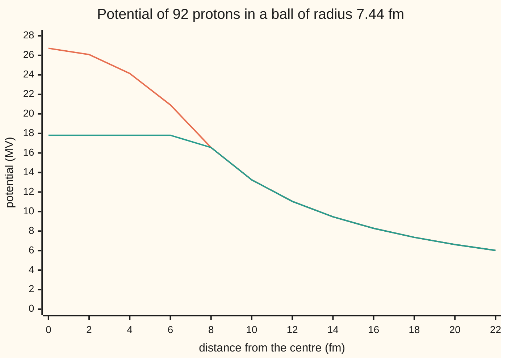

# Poisson's equation: smear the point sources to get the potential

[Syllabus](../../../SYLLABUS.md) → [Partial differential equations](../README.md) → [Laplace, Poisson and Potentials](../README.md#s04) → Poisson's equation

---

## General Overview

[Laplace's equation](../../08-Differential%20equations%20and%20dynamics/10-The%20Classical%20PDEs/07-laplaces-equation-and-harmonic-functions.md) in wing 08 wrote Poisson's equation for a plate with a heater, and solved it on a square by a series. This card solves it in all of space, for any source, with one integral.

A uranium-238 nucleus holds 92 protons in a ball of radius 7.4366 fm (1 fm, a femtometre, is $`10^{-15}`$ m). The protons repel each other. How much electric energy is locked up in that ball, ready to push it apart in fission? To answer, you need the electric potential (the energy per unit of charge, in volts) at every point **inside** the ball, not only outside it.

Outside, the ball looks like one point charge: the [Electric fields](../../13-Engineering%20mathematics/06-Circuits%20and%20Electromagnetism/04-electrostatics-gauss-and-potential.md) card gets $`kQ/r`$ from Gauss's law. Inside, every bit of charge sits among the others. So cut the ball into tiny pieces, treat each as a point charge, and add up their potentials. That sum is the **Newtonian potential**, and it solves Poisson's equation.

For uranium the answer is 17.8142 MV (megavolts) at the surface and 26.7213 MV at the centre: the centre sits 1.5 times higher. The stored electric energy comes out at 983.34 MeV (mega-electronvolts).

**Poisson's equation says minus the potential's curvature equals the source, $`-\Delta u = f`$; its solution on all of space is the point-source potential smeared over the source, $`u = \Phi * f`$, and that smear is a true twice-differentiable solution wherever the source is smooth enough (Hölder continuous: it changes no faster than a power of the distance).**

**What kind of fact this is:** a theorem. The charged-ball potential is proved on this card in Why it works. That the Newtonian potential solves Poisson's equation is proved here for smooth sources, and stated with its source for Hölder sources. The nucleus as a uniformly charged ball is a model: it fits well enough for the energy, but the real charge has a soft edge.

### The picture: the potential of the uranium nucleus



Orange: the charge spread evenly through the ball, this card's answer. It is a dome inside and $`kQ/r`$ outside. Teal: the same charge spread over the surface only, like the metal ball on the Electric fields card. It is flat inside. Outside the ball the two lines are the same.

---

## The formula

**The problem.** The unknown is the potential $`V(x)`$ in volts at each point $`x`$ of space. The region is all of space, $`\mathbb R^3`$. The data are the charge density $`\rho`$ (charge per unit volume), which is zero outside a bounded set, and the demand that $`V \to 0`$ far away. Then

```math
-\Delta V = \frac{\rho}{\varepsilon_0}, \qquad V(x) = \frac{1}{4\pi\varepsilon_0} \int_{\mathbb R^3} \frac{\rho(y)}{|x - y|}\, dy
```

Here $`\Delta = \partial^2/\partial x_1^2 + \partial^2/\partial x_2^2 + \partial^2/\partial x_3^2`$ is the Laplacian, from wing 08: the sum of the curvatures along the three axes. $`\varepsilon_0`$ is the permittivity of empty space, and $`k = 1/(4\pi\varepsilon_0)`$ is Coulomb's constant.

**Read it aloud:** minus the potential's curvature is the charge density over epsilon nought, and the potential at $`x`$ adds every piece of charge, divided by its distance from $`x`$.

The same thing for any source $`f`$ is the general form. $`\Phi`$ is the fundamental solution from [The fundamental solution](02-fundamental-solution-of-the-laplacian.md): the potential of a unit point source, with $`-\Delta\Phi = \delta`$. The integral, written $`\Phi * f`$, is the **Newtonian potential** of $`f`$:

```math
-\Delta u = f, \qquad u(x) = (\Phi * f)(x) = \int_{\mathbb R^3} \Phi(x - y)\, f(y)\, dy, \qquad \Phi(x) = \frac{1}{4\pi |x|}
```

**Read it aloud:** the solution at $`x`$ is the source at every point $`y`$, times the point-source potential at distance $`|x - y|`$, added over all of space.

**The charged ball.** For charge $`Q`$ spread evenly through a ball of radius $`R`$, at distance $`r`$ from its centre:

```math
V(r) = \frac{kQ}{2R}\left(3 - \frac{r^2}{R^2}\right) \ \ (r \le R), \qquad V(r) = \frac{kQ}{r} \ \ (r \ge R), \qquad U = \frac12 \int \rho\, V\, dy = \frac35\,\frac{kQ^2}{R}
```

**Read it aloud:** inside, the potential is a dome that starts at one and a half times the surface value $`kQ/R`$ and falls to it at the edge; outside, it is a point charge's; and the stored energy is three fifths of $`kQ^2/R`$.

| Symbol | Plain meaning | In our example | Push it up and the answer… |
| --- | --- | --- | --- |
| $`V`$, $`U`$ | electric potential: energy per unit charge, in MV; stored electric energy, in MeV | 26.7213 MV at the centre; $`U`$ = 983.34 MeV | — |
| $`x = (x_1, x_2, x_3)`$, $`y`$, $`r`$ | the point where $`V`$ is read; a point holding charge; distance from the centre, in fm | $`r = R/2`$ = 3.7183 fm gives 24.4945 MV | $`r`$: lower potential |
| $`s`$, $`dq`$, $`\sigma`$, $`t`$ | a thin shell's radius, charge and charge per unit area; distance from a ring of the shell to the field point | — | — |
| $`\rho`$, $`\rho/\varepsilon_0`$, $`\rho_m`$ | charge per unit volume; the source in Poisson's equation; mass per unit volume, for gravity | $`\rho/\varepsilon_0`$ = 0.966363 MV/fm² | taller dome |
| $`\varepsilon_0`$, $`k`$, $`ke`$, $`G`$ | permittivity of empty space; Coulomb's constant $`1/(4\pi\varepsilon_0)`$; one proton's potential at 1 fm; the gravitational constant | $`ke`$ = 1.439965 MV fm | larger $`\varepsilon_0`$: weaker potential |
| $`Z`$, $`e`$, $`Q`$ | number of protons; one proton's charge; total charge $`Q = Ze`$ | $`Z`$ = 92 | potential grows in step |
| $`R`$, $`r_0`$, $`A`$ | ball radius $`R = r_0 A^{1/3}`$; the radius constant; number of protons plus neutrons | 7.4366 fm; 1.2 fm; 238 | larger $`R`$: lower potential, less energy |
| $`\Delta`$, $`\partial_{ij}`$, $`\Phi`$, $`\delta`$ | the Laplacian, the sum of the three second derivatives; a second derivative along axes $`i`$ and $`j`$; point-source potential $`1/(4\pi\lvert x\rvert)`$; the unit point source | $`-\Delta V`$ = 0.966363 MV/fm² inside, 0 outside | — |
| $`u`$, $`f`$, $`w`$, $`L`$, $`v`$ | a general unknown and source, $`-\Delta u = f`$; the trouble case of Step 3; $`L = -\log\lvert x\rvert`$ there; the difference of two solutions in Step 6 | $`u = V`$, $`f = \rho/\varepsilon_0`$ | — |
| $`\alpha`$, $`C`$ | Hölder exponent and constant: $`\lvert f(y) - f(z)\rvert \le C\lvert y - z\rvert^\alpha`$ | — | larger $`\alpha`$: smoother source |
| $`B(0, \varepsilon)`$, $`E_\varepsilon`$, $`g`$, $`n`$ | in the proof of Step 2: a small ball of radius $`\varepsilon`$; the rest of space; the source seen from $`x`$, $`g(y) = f(x - y)`$; the normal to the small sphere | — | — |
| $`h`$, $`a`$, $`\theta`$, $`\ell(\theta)`$ | grid step; side of a small cube; angle of a direction from the field point; how far the charge reaches along it | $`h`$ = 0.25 fm; $`a = R/40`$ | smaller $`h`$, $`a`$: closer to exact |

The proton charge $`e`$ is exact, and $`\varepsilon_0 = 8.8541878188 \times 10^{-12}`$ F/m is the CODATA 2022 value. The radius constant $`r_0`$ = 1.2 fm is a typical value, used here as an illustration.

### When it holds

- **The source fades fast enough.** The integral must converge. A source zero outside a bounded set is safe. A uniform charge filling all of space is not: the centre potential grows four-fold each time the charged region doubles, and has no limit (What breaks).
- **The source is Hölder continuous, for a twice-differentiable answer.** Then $`u`$ has continuous second derivatives and $`-\Delta u = f`$ holds at each point. A merely bounded source gives continuous first derivatives only. A merely continuous source is still not enough (Step 3).
- **Where the source jumps, the equation holds weakly.** The ball's charge stops sharply at $`R`$. There $`V`$ and its slope are continuous, but its second derivative jumps by $`\rho/\varepsilon_0`$. Off the surface $`V`$ is a classical solution (twice differentiable, equation true at each point); across it, a weak solution (true against smooth probes, as on [Weak solutions](../../18-Functional%20analysis/04-Distributions%20and%20Sobolev%20Spaces/08-weak-solutions-of-differential-equations.md)).
- **All of space, with $`V \to 0`$ far away.** That picks one answer (Step 6). In a closed region with walls, such as a grounded metal box, $`\Phi * f`$ does not meet the wall condition, and [Green's function](04-greens-functions-and-the-representation-formula.md) corrects it.
- **The nucleus is a model.** Real nuclear charge has a soft edge a few fm thick, and uranium-238 is slightly egg-shaped. The uniform ball gets the energy roughly right, not exactly.

---

## Why it works

### Step 0: a source is a crowd of point sources

Cut the source into tiny cubes. The cube at $`y`$ holds $`f(y)\,dy`$ of source, and on its own it makes the potential $`\Phi(x - y)\,f(y)\,dy`$. The equation is linear, so the potentials of all the cubes add. The sum is $`\Phi * f`$. [Fundamental solution](../../18-Functional%20analysis/04-Distributions%20and%20Sobolev%20Spaces/04-fundamental-solutions-and-the-response-to-a-spike.md) builds every solution this way, for a rail on a bed. This card asks the question that card leaves open for the Laplacian: when is the smear a real, twice-differentiable solution?

### Step 1: the integral converges, and so does its first derivative

$`\Phi`$ blows up like $`1/r`$ at the field point. A thin shell at distance $`r`$ round $`x`$ has volume $`4\pi r^2\,dr`$, so the integrand near $`x`$ is about $`r\,dr`$: finite. The first derivatives of $`\Phi`$ grow like $`1/r^2`$, and $`r^2/r^2`$ is still finite. So for any bounded source, zero outside a bounded set, $`u`$ exists and has continuous first derivatives.

The second derivatives of $`\Phi`$ grow like $`1/r^3`$. Now the shell gives $`dr/r`$, and that integral diverges like $`\log r`$ near 0. So the second derivatives cannot simply be taken inside the integral. Something must cancel.

### Step 2: for a smooth source, move the derivatives onto the source

Change variables to $`u(x) = \int \Phi(y)\, f(x - y)\, dy`$. Now $`x`$ sits only in $`f`$. If $`f`$ has two continuous derivatives and is zero outside a bounded set, the derivatives pass onto $`f`$: $`\Delta u = \int \Phi(y)\,\Delta f(x - y)\,dy`$.

Cut out a small ball $`B(0, \varepsilon)`$ round the singular point. Outside it, Green's identity moves the Laplacian back onto $`\Phi`$, where it gives 0. Only a term on the small sphere survives, and it tends to $`-f(x)`$. So $`-\Delta u = f`$. The fold has the details.

<details>
<summary>Detailed proof: the Newtonian potential of a smooth source solves Poisson's equation</summary>

Let $`f`$ have two continuous derivatives and vanish outside a bounded set. Split $`\Delta u(x)`$ into the part over $`B(0, \varepsilon)`$ and the part over the rest, $`E_\varepsilon`$.

The inner part is at most $`\max|\Delta f|`$ times $`\int_{B(0,\varepsilon)} \frac{dy}{4\pi|y|} = \frac{\varepsilon^2}{2}`$, which tends to 0.

On $`E_\varepsilon`$ use Green's second identity on the function $`g(y) = f(x - y)`$. Since $`\Delta\Phi = 0`$ there, with $`n`$ the normal pointing into the small ball,

$`\displaystyle \int_{E_\varepsilon} \Phi\,\Delta g\,dy = \int_{\partial B(0,\varepsilon)} \left( \Phi\,\frac{\partial g}{\partial n} - g\,\frac{\partial \Phi}{\partial n} \right) dS`$

On the sphere $`|y| = \varepsilon`$, $`\Phi = 1/(4\pi\varepsilon)`$ and the area is $`4\pi\varepsilon^2`$. The first term is at most $`\max|\nabla f| \cdot \varepsilon`$, which tends to 0.

For the second, $`\partial\Phi/\partial n = +1/(4\pi\varepsilon^2)`$, because $`\Phi`$ grows toward the centre. So the second term is minus the average of $`g`$ over the sphere, which tends to $`-g(0) = -f(x)`$ by continuity.

Letting $`\varepsilon \to 0`$ gives $`\Delta u(x) = -f(x)`$. The second derivatives of $`u`$ are $`\Phi`$ smeared against second derivatives of $`f`$, so they are continuous.

</details>

### Step 3: Hölder continuity is what rescues a rougher source

A source with a corner or a jump has no second derivatives to move. The weaker condition that works is **Hölder continuity** near $`x`$: $`|f(y) - f(z)| \le C|y - z|^\alpha`$ for some exponent $`0 < \alpha \le 1`$. It says the source changes no faster than a power of the distance.

The key step is to write the second derivative as $`\int \partial_{ij}\Phi(x - y)\,\big(f(y) - f(x)\big)\,dy`$ plus a term on a sphere. The bracket is at most $`C|x - y|^\alpha`$. That turns the shell's $`dr/r`$ into $`r^{\alpha - 1}dr`$, which converges. The full proof is Lemma 4.2 of Gilbarg and Trudinger (Sources).

**Theorem (Hölder).** If $`f`$ is bounded, zero outside a bounded set, and Hölder continuous near $`x`$, then $`u = \Phi * f`$ has continuous second derivatives near $`x`$ and $`-\Delta u = f`$ there.

Mere continuity is not enough. Take, in scaled units, $`w = (x_1^2 - x_2^2)\log(-\log|x|)`$ near 0. Its source $`f = -\Delta w`$ is continuous, with $`f(0) = 0`$: on the $`x_1`$ axis it is $`5/L + 1/L^2`$, where $`L = -\log|x|`$. But $`\partial^2 w/\partial x_1^2`$ grows like $`2\log L`$, without limit. The code prints both. Near 0, $`w`$ differs from the Newtonian potential of $`f`$ (with $`f`$ set to 0 outside a small ball) by a harmonic function, which is smooth, so that potential has the same unbounded second derivative.

### Step 4: the charged ball, one shell at a time

Cut the ball into thin shells. A shell of radius $`s`$ with charge $`dq`$ has potential $`k\,dq/\max(r, s)`$ at distance $`r`$ from the centre. Outside the shell it acts like a point charge. Inside, it is flat at its surface value. This is Newton's shell theorem, proved in the fold by doing the convolution over the shell.

<details>
<summary>Detailed proof: the shell theorem from the convolution</summary>

Put the field point at distance $`r`$ on the axis. A ring of the shell at angle $`\theta`$ from the axis has area $`2\pi s^2\sin\theta\,d\theta`$ and sits at distance $`t`$, where $`t^2 = r^2 + s^2 - 2rs\cos\theta`$. Then $`2t\,dt = 2rs\sin\theta\,d\theta`$. With $`\sigma`$ the charge per unit area, $`dq = 4\pi s^2\sigma`$, and

$`\displaystyle k\sigma \int_0^\pi \frac{2\pi s^2 \sin\theta\,d\theta}{t} = \frac{2\pi k\sigma s}{r} \int_{|r-s|}^{r+s} dt = \frac{2\pi k\sigma s}{r}\big( (r + s) - |r - s| \big)`$

For $`r > s`$ the bracket is $`2s`$, giving $`k\,dq/r`$. For $`r < s`$ it is $`2r`$, giving $`k\,dq/s`$.

</details>

Now add the shells. At distance $`r \le R`$:

- **Shells inside $`r`$** hold charge $`Q r^3/R^3`$ and act as a point charge at the centre: $`kQr^2/R^3`$.
- **Shells outside $`r`$** each add their own flat value $`k\,dq/s`$. With $`dq = \rho\,4\pi s^2\,ds`$, the sum from $`s = r`$ to $`R`$ is $`2\pi k\rho(R^2 - r^2) = \frac{3kQ}{2R^3}(R^2 - r^2)`$.

Together they give $`\frac{kQ}{2R^3}(3R^2 - r^2)`$, the formula. Outside the ball, every shell is inside $`r`$, so $`V = kQ/r`$. That matches the Electric fields card's outside answer.

The outer shells push with no force on a charge inside them, but they still raise its potential. Dropping them is the usual mistake.

### Step 5: check that the dome solves the equation

Inside, $`V`$ is a constant minus $`\frac{kQ}{2R^3}\,r^2`$. In three dimensions $`\Delta(r^2) = \Delta(x_1^2 + x_2^2 + x_3^2) = 6`$. So $`-\Delta V = 3kQ/R^3`$. With $`\rho = 3Q/(4\pi R^3)`$, this is exactly $`\rho/\varepsilon_0`$. Outside, $`kQ/r`$ is a multiple of $`\Phi`$, so $`\Delta V = 0`$.

At the surface the pieces must fit:

| At $`r = R`$ | From inside | From outside |
| --- | --- | --- |
| $`V`$ | $`kQ/R`$ | $`kQ/R`$ |
| slope $`V'`$ | $`-kQ/R^2`$ | $`-kQ/R^2`$ |
| second derivative $`V''`$ | $`-kQ/R^3`$ | $`+2kQ/R^3`$ |

The value and slope match: the field, $`-V'`$, is continuous, as Gauss's law demands. The second derivative jumps by $`3kQ/R^3 = \rho/\varepsilon_0`$, exactly the jump in the source. So the ball is the textbook case where the source is not Hölder at the surface and the solution is not twice differentiable there.

### Step 6: which solution, and how unique

Suppose two solutions both tend to 0 far away. Their difference $`v`$ solves $`\Delta v = 0`$ on all of space, and it is bounded, because it tends to 0 far away. The slope bound of [Harmonic functions](01-harmonic-functions-and-mean-values.md), $`|\partial_i v| \le (3/r)\max|v|`$ on a ball of radius $`r`$, holds for every $`r`$, since every ball fits. Let $`r`$ grow: every slope is 0, so $`v`$ is constant. This is Liouville's theorem, also proved on [Harnack and regularity](10-harnack-and-regularity-in-outline.md). It tends to 0, so it is 0. The same holds for weak solutions, since a weakly harmonic function is a smooth harmonic one (Weyl's lemma). So the Newtonian potential is the one solution that vanishes far away.

---

## Worked numbers, by hand

Uranium-238: $`Z = 92`$, $`A = 238`$, $`r_0 = 1.2`$ fm, $`ke`$ = 1.439965 MV fm.

| Step | Arithmetic | Value |
| --- | --- | --- |
| radius $`R = r_0 A^{1/3}`$ | $`1.2 \times 238^{1/3}`$ | 7.4366 fm |
| surface potential $`kQ/R`$ | $`92 \times 1.439965 / 7.4366`$ | 17.8142 MV |
| centre potential, $`\frac32\,kQ/R`$ | $`1.5 \times 17.8142`$ | 26.7213 MV |
| halfway out, $`r = R/2`$ | $`17.8142 \times (3 - 0.25)/2`$ | 24.4945 MV |
| twice the radius out, $`kQ/(2R)`$ | $`17.8142 / 2`$ | 8.9071 MV |
| the source $`\rho/\varepsilon_0 = 3kQ/R^3`$ | $`3 \times 17.8142 / 7.4366^2`$ | 0.966363 MV/fm² |
| field at the surface, $`kQ/R^2`$ | $`17.8142 / 7.4366`$ | 2.3955 MV/fm |
| **stored energy** $`U = \frac35\,Z \cdot kQ/R`$ | $`0.6 \times 92 \times 17.8142`$ | **983.34 MeV** |
| liquid-drop Coulomb coefficient $`\frac35\,ke/r_0`$ | $`0.6 \times 1.439965 / 1.2`$ | 0.71998 MeV |

A potential in MV times a number of proton charges is an energy in MeV. So the 92 protons store 983.34 MeV of electric energy, pushing the nucleus apart; this repulsion is what makes heavy nuclei split. In the liquid-drop mass formula it appears as the Coulomb term $`0.71998\,Z^2/A^{1/3}`$ MeV.

### What breaks if you drop a piece

| Mistake | Comes out at | What went wrong |
| --- | --- | --- |
| Keep only the charge inside $`r`$ | 4.4535 MV at $`R/2`$, not 24.4945 | The outer shells exert no force inside, but they add their flat potential. |
| Put the charge on the surface, as on a metal ball | $`U`$ = 819.45 MeV | The potential inside is flat at $`kQ/R`$, so the energy is $`\frac12\,kQ^2/R`$, not $`\frac35`$. |
| Use $`kQ/r`$ inside too | $`U`$ = 1229.18 MeV; centre potential infinite | A point charge's formula holds only outside all the charge. |
| Forget the $`\frac12`$ in $`U`$ | 1966.69 MeV | Each pair of protons is counted twice. |
| Kernel $`1/\lvert x\rvert`$ without the $`4\pi`$ | centre 335.79 MV | $`-\Delta(1/\lvert x\rvert) = 4\pi\delta`$, not $`\delta`$. |
| Source that does not fade: charge everywhere | centre 26.72, 106.89, 427.54, 1710.16 MV for charged radius $`R`$, $`2R`$, $`4R`$, $`8R`$ | The integral diverges; there is no Newtonian potential. |
| Source continuous but not Hölder: $`w`$ of Step 3 | $`f`$ = 1.1329, 0.3672, 0.1823 but $`\partial^2 w/\partial x_1^2`$ = 2.3558, 5.0292, 6.5280 at $`\lvert x\rvert = 10^{-2}, 10^{-6}, 10^{-12}`$ | The source tends to 0 continuously, yet the second derivative grows without limit. |

---

## Code, from first principles, and it actually runs

Nothing is imported except `math`. The code takes four roads to the potential.

1. The closed form, from the shell theorem.
2. The convolution integral seen from the field point. Along each direction at angle $`\theta`$, the charge reaches out to a distance $`\ell(\theta)`$. Along that line the volume grows like distance squared and the kernel falls like one over distance, so the line adds up to $`\ell^2/2`$. Simpson's rule (written out) adds over $`\theta`$.
3. The title, done literally: chop the ball into cubes of side $`a`$, make each a point charge, and add $`k`$ times its charge over its distance, for all of them.
4. The equation itself: the 7-point centred difference for $`-\Delta V`$ inside, outside and on the surface.

It then integrates the energy, prints every "what breaks" case, and the chart's points.

### Python

```python
# Poisson's equation -Laplacian(V) = rho/eps0 for a uranium-238 nucleus, modelled as a
# uniformly charged ball.  Standard library only.  Distances in fm, potentials in MV,
# energies in MeV.  Roads: (1) the closed form from Newton's shell theorem; (2) the
# convolution integral done along lines of sight from the field point (Simpson's rule);
# (3) the convolution as a sum over small cubes, each a point charge; (4) the equation's
# residual by centred differences.
import math

eps0 = 8.8541878188e-12                     # F/m, CODATA 2022
e = 1.602176634e-19                         # C, exact
ke = e / (4 * math.pi * eps0) / 1e-15 / 1e6  # MV fm: potential of one proton charge at 1 fm
Z, A, r0 = 92, 238, 1.2                     # uranium-238; r0 in fm (typical value)
R = r0 * A ** (1 / 3)                       # fm: radius of the ball
VR = Z * ke / R                             # MV: potential at the surface, kQ/R
S = 3 * VR / R ** 2                         # MV/fm^2: rho/eps0, the source

def V(r):                                   # road 1: closed form
    return VR * (3 - r * r / R ** 2) / 2 if r < R else VR * R / r

def simpson(f, a, b, n):
    h = (b - a) / n
    return h / 3 * (f(a) + f(b) + sum((4 if i % 2 else 2) * f(a + i * h) for i in range(1, n)))

def V_sight(r, rad):                        # road 2: field point at r inside a ball of radius rad
    L = lambda th: -r * math.cos(th) + math.sqrt(rad * rad - (r * math.sin(th)) ** 2)
    return S / 4 * simpson(lambda th: L(th) ** 2 * math.sin(th), 0.0, math.pi, 400)

def V_cubes(m, pts):                        # road 3: cubes of side R/m, each a point charge
    a = R / m
    tot = [0.0] * len(pts)
    cells = 0
    for i in range(-m, m):
        for j in range(-m, m):
            for k in range(-m, m):
                c = ((i + 0.5) * a, (j + 0.5) * a, (k + 0.5) * a)
                if c[0] ** 2 + c[1] ** 2 + c[2] ** 2 > R * R:
                    continue
                cells += 1
                for n, p in enumerate(pts):
                    tot[n] += 1 / math.dist(p, c)
    return [S / (4 * math.pi) * a ** 3 * t for t in tot], cells

def lap(f, x, y, z, h):                     # 7-point -Laplacian
    return -(f(x + h, y, z) + f(x - h, y, z) + f(x, y + h, z) + f(x, y - h, z)
             + f(x, y, z + h) + f(x, y, z - h) - 6 * f(x, y, z)) / h ** 2

V3 = lambda x, y, z: V(math.sqrt(x * x + y * y + z * z))

print(f"ball: Z = {Z}, R = {R:.4f} fm, ke = {ke:.6f} MV fm")
print(f"source rho/eps0 = {S:.6f} MV/fm^2")
print(f"surface V = kQ/R = {VR:.4f} MV")
for r in (0.0, R / 2):
    print(f"r = {r:.4f} fm: closed form {V(r):.4f} MV, line-of-sight integral {V_sight(r, R):.4f} MV")
    assert abs(V(r) - V_sight(r, R)) < 1e-8
pts = [(0.0, 0.0, 0.0), (R / 2, 0.0, 0.0), (2 * R, 0.0, 0.0)]
exact = [V(math.dist(p, pts[0])) for p in pts]
print("cube sum, centre / half radius / twice radius (MV):")
errs = []
for m in (10, 20, 40):
    vals, cells = V_cubes(m, pts)
    errs.append(max(abs(v - x) for v, x in zip(vals, exact)))
    print(f"  side R/{m}, {cells} cubes: {vals[0]:.4f}, {vals[1]:.4f}, {vals[2]:.4f}; worst error {errs[-1]:.4f}")
print(f"  exact:                  {exact[0]:.4f}, {exact[1]:.4f}, {exact[2]:.4f}")
assert errs[2] < errs[0] / 4 and errs[2] < 0.05

# road 4: the equation's residual, and the seam at the surface
ri = lap(V3, 2.0, 1.0, 1.0, 0.25)
print(f"-Lap V inside at (2,1,1) fm, h = 0.25: {ri:.6f} MV/fm^2 (source {S:.6f})")
assert abs(ri - S) < 1e-6
for h in (0.5, 0.25):
    print(f"-Lap V outside at (12,5,3) fm, h = {h}: {lap(V3, 12.0, 5.0, 3.0, h):.6f} MV/fm^2")
assert abs(lap(V3, 12.0, 5.0, 3.0, 0.25)) < 1e-3
for h in (0.1, 0.01):
    print(f"-Lap V on the surface at (R,0,0), h = {h}: {lap(V3, R, 0.0, 0.0, h):.4f} MV/fm^2")
h = 1e-3
d_in, d_out = (V(R) - V(R - h)) / h, (V(R + h) - V(R)) / h
s_in = (V(R) - 2 * V(R - h) + V(R - 2 * h)) / h ** 2
s_out = (V(R + 2 * h) - 2 * V(R + h) + V(R)) / h ** 2
print(f"slope V' at R: inside {d_in:.4f}, outside {d_out:.4f} MV/fm (Gauss: -kQ/R^2 = {-VR / R:.4f})")
print(f"V'' at R: inside {s_in:.4f}, outside {s_out:.4f} MV/fm^2, jump {s_out - s_in:.4f}")
assert abs(d_in - d_out) < 1e-2 and abs(s_out - s_in - S) < 1e-2

# the energy: U = (1/2) * integral of charge density times potential
n = Z / (4 / 3 * math.pi * R ** 3)          # protons per fm^3
U = 0.5 * simpson(lambda r: n * V(r) * 4 * math.pi * r * r, 0.0, R, 200)
print(f"Coulomb energy: integral {U:.2f} MeV, (3/5) Z^2 ke/R = {0.6 * Z * VR:.2f} MeV")
assert abs(U - 0.6 * Z * VR) < 1e-6
print(f"liquid-drop coefficient (3/5) ke/r0 = {0.6 * ke / r0:.5f} MeV")

print("what breaks:")
print(f"  charge on the surface only: U = {0.5 * Z * VR:.2f} MeV")
Upt = 0.5 * simpson(lambda r: n * Z * ke * 4 * math.pi * r, 0.0, R, 200)
print(f"  kQ/r used inside too: U = {Upt:.2f} MeV, centre infinite")
print(f"  inner charge only, at R/2: {VR * 0.5 ** 3 / 0.5:.4f} MV")
print(f"  forget the 1/2: U = {2 * U:.2f} MeV")
print(f"  kernel 1/r without 4 pi: centre {4 * math.pi * V(0):.2f} MV")
print("  source that does not fade, centre potential (MV): ", end="")
grow = [V_sight(0.0, L * R) for L in (1, 2, 4, 8)]
print(" ".join(f"{g:.2f}" for g in grow))
assert abs(grow[3] / grow[2] - 4) < 1e-9
print("  f continuous, not Hoelder: u = (x^2-y^2) log(-log r), scaled")
for s in (1e-2, 1e-6, 1e-12):
    Lg = -math.log(s)
    u = lambda x, y, z: (x * x - y * y) * math.log(-0.5 * math.log(x * x + y * y + z * z))
    hh = s / 1000
    uxx = (u(s + hh, 0.0, 0.0) - 2 * u(s, 0.0, 0.0) + u(s - hh, 0.0, 0.0)) / hh ** 2
    form = 2 * math.log(Lg) - 3 / Lg - 1 / Lg ** 2
    f_num, f_form = lap(u, s, 0.0, 0.0, hh), 5 / Lg + 1 / Lg ** 2
    print(f"    r = {s:.0e}: f = {f_form:.4f} (grid {f_num:.4f}), u_xx = {form:.4f} (grid {uxx:.4f})")
    assert abs(uxx - form) < 1e-3 and abs(f_num - f_form) < 1e-3

print("try changing:")
Rpb = 1.2 * 208 ** (1 / 3)
print(f"  lead-208: R = {Rpb:.4f} fm, centre {1.5 * 82 * ke / Rpb:.4f} MV, U = {0.6 * 82 * 82 * ke / Rpb:.2f} MeV")
Rh = 1.2 * 119 ** (1 / 3)
Uh = 0.6 * 46 * 46 * ke / Rh
print(f"  two halves Z = 46, A = 119: R = {Rh:.4f} fm, U = {Uh:.2f} MeV each, Coulomb release {U - 2 * Uh:.2f} MeV")
print("chart, r (fm), solid ball (MV), surface charge (MV):")
for r in range(0, 24, 2):
    print(f"  {r}, {V(r):.2f}, {VR if r < R else VR * R / r:.2f}")
print("ALL CHECKS PASS")
```

**Ran 2026-11-15 on macOS, Python 3.14.10, standard library only. All checks passed. Output, pasted from the run:**

```
ball: Z = 92, R = 7.4366 fm, ke = 1.439965 MV fm
source rho/eps0 = 0.966363 MV/fm^2
surface V = kQ/R = 17.8142 MV
r = 0.0000 fm: closed form 26.7213 MV, line-of-sight integral 26.7213 MV
r = 3.7183 fm: closed form 24.4945 MV, line-of-sight integral 24.4945 MV
cube sum, centre / half radius / twice radius (MV):
  side R/10, 4224 cubes: 26.8372, 24.6136, 8.9835; worst error 0.1191
  side R/20, 33552 cubes: 26.7348, 24.5083, 8.9183; worst error 0.0138
  side R/40, 268096 cubes: 26.7201, 24.4934, 8.9076; worst error 0.0012
  exact:                  26.7213, 24.4945, 8.9071
-Lap V inside at (2,1,1) fm, h = 0.25: 0.966363 MV/fm^2 (source 0.966363)
-Lap V outside at (12,5,3) fm, h = 0.5: -0.000053 MV/fm^2
-Lap V outside at (12,5,3) fm, h = 0.25: -0.000013 MV/fm^2
-Lap V on the surface at (R,0,0), h = 0.1: 0.4874 MV/fm^2
-Lap V on the surface at (R,0,0), h = 0.01: 0.4836 MV/fm^2
slope V' at R: inside -2.3953, outside -2.3952 MV/fm (Gauss: -kQ/R^2 = -2.3955)
V'' at R: inside -0.3221, outside 0.6440 MV/fm^2, jump 0.9661
Coulomb energy: integral 983.34 MeV, (3/5) Z^2 ke/R = 983.34 MeV
liquid-drop coefficient (3/5) ke/r0 = 0.71998 MeV
what breaks:
  charge on the surface only: U = 819.45 MeV
  kQ/r used inside too: U = 1229.18 MeV, centre infinite
  inner charge only, at R/2: 4.4535 MV
  forget the 1/2: U = 1966.69 MeV
  kernel 1/r without 4 pi: centre 335.79 MV
  source that does not fade, centre potential (MV): 26.72 106.89 427.54 1710.16
  f continuous, not Hoelder: u = (x^2-y^2) log(-log r), scaled
    r = 1e-02: f = 1.1329 (grid 1.1329), u_xx = 2.3558 (grid 2.3558)
    r = 1e-06: f = 0.3672 (grid 0.3672), u_xx = 5.0292 (grid 5.0292)
    r = 1e-12: f = 0.1823 (grid 0.1823), u_xx = 6.5280 (grid 6.5280)
try changing:
  lead-208: R = 7.1100 fm, centre 24.9108 MV, U = 817.07 MeV
  two halves Z = 46, A = 119: R = 5.9024 fm, U = 309.73 MeV each, Coulomb release 363.88 MeV
chart, r (fm), solid ball (MV), surface charge (MV):
  0, 26.72, 17.81
  2, 26.08, 17.81
  4, 24.14, 17.81
  6, 20.92, 17.81
  8, 16.56, 16.56
  10, 13.25, 13.25
  12, 11.04, 11.04
  14, 9.46, 9.46
  16, 8.28, 8.28
  18, 7.36, 7.36
  20, 6.62, 6.62
  22, 6.02, 6.02
ALL CHECKS PASS
```

### Rust

```rust
// Poisson's equation -Laplacian(V) = rho/eps0 for a uranium-238 nucleus, modelled as a
// uniformly charged ball.  std only.  Distances in fm, potentials in MV, energies in MeV.
// Roads: (1) the closed form from Newton's shell theorem; (2) the convolution integral
// done along lines of sight from the field point (Simpson's rule); (3) the convolution
// as a sum over small cubes, each a point charge; (4) the equation's residual.
use std::f64::consts::PI;

struct Ball { r: f64, vr: f64, s: f64 }

impl Ball {
    fn v(&self, r: f64) -> f64 { // road 1: closed form
        if r < self.r { self.vr * (3.0 - r * r / (self.r * self.r)) / 2.0 } else { self.vr * self.r / r }
    }
    fn v3(&self, x: f64, y: f64, z: f64) -> f64 { self.v((x * x + y * y + z * z).sqrt()) }
}

fn simpson(f: &dyn Fn(f64) -> f64, a: f64, b: f64, n: usize) -> f64 {
    let h = (b - a) / n as f64;
    let mut s = f(a) + f(b);
    for i in 1..n { s += (if i % 2 == 1 { 4.0 } else { 2.0 }) * f(a + i as f64 * h); }
    h / 3.0 * s
}

fn v_sight(s: f64, r: f64, rad: f64) -> f64 { // road 2: field point at r inside a ball of radius rad
    let l = |th: f64| -r * th.cos() + (rad * rad - (r * th.sin()).powi(2)).sqrt();
    s / 4.0 * simpson(&|th: f64| l(th).powi(2) * th.sin(), 0.0, PI, 400)
}

fn v_cubes(b: &Ball, m: i32, pts: &[[f64; 3]]) -> (Vec<f64>, usize) { // road 3
    let a = b.r / m as f64;
    let mut tot = vec![0.0; pts.len()];
    let mut cells = 0;
    for i in -m..m { for j in -m..m { for k in -m..m {
        let c = [(i as f64 + 0.5) * a, (j as f64 + 0.5) * a, (k as f64 + 0.5) * a];
        if c[0] * c[0] + c[1] * c[1] + c[2] * c[2] > b.r * b.r { continue; }
        cells += 1;
        for (n, p) in pts.iter().enumerate() {
            let d = ((p[0] - c[0]).powi(2) + (p[1] - c[1]).powi(2) + (p[2] - c[2]).powi(2)).sqrt();
            tot[n] += 1.0 / d;
        }
    }}}
    (tot.iter().map(|t| b.s / (4.0 * PI) * a.powi(3) * t).collect(), cells)
}

fn lap(f: &dyn Fn(f64, f64, f64) -> f64, x: f64, y: f64, z: f64, h: f64) -> f64 { // 7-point -Laplacian
    -(f(x + h, y, z) + f(x - h, y, z) + f(x, y + h, z) + f(x, y - h, z)
        + f(x, y, z + h) + f(x, y, z - h) - 6.0 * f(x, y, z)) / (h * h)
}

fn main() {
    let eps0 = 8.8541878188e-12; // F/m, CODATA 2022
    let e = 1.602176634e-19; // C, exact
    let ke = e / (4.0 * PI * eps0) / 1e-15 / 1e6; // MV fm
    let (z, a, r0) = (92.0_f64, 238.0_f64, 1.2_f64);
    let rr = r0 * a.powf(1.0 / 3.0);
    let vr = z * ke / rr;
    let b = Ball { r: rr, vr, s: 3.0 * vr / (rr * rr) };
    let s = b.s;
    let v3 = |x: f64, y: f64, zz: f64| b.v3(x, y, zz);

    println!("ball: Z = {}, R = {:.4} fm, ke = {:.6} MV fm", z, rr, ke);
    println!("source rho/eps0 = {:.6} MV/fm^2", s);
    println!("surface V = kQ/R = {:.4} MV", vr);
    for r in [0.0, rr / 2.0] {
        let vs = v_sight(s, r, rr);
        println!("r = {:.4} fm: closed form {:.4} MV, line-of-sight integral {:.4} MV", r, b.v(r), vs);
        assert!((b.v(r) - vs).abs() < 1e-8);
    }
    let pts = [[0.0, 0.0, 0.0], [rr / 2.0, 0.0, 0.0], [2.0 * rr, 0.0, 0.0]];
    let exact: Vec<f64> = pts.iter().map(|p| b.v(p[0])).collect();
    println!("cube sum, centre / half radius / twice radius (MV):");
    let mut errs = vec![];
    for m in [10, 20, 40] {
        let (vals, cells) = v_cubes(&b, m, &pts);
        errs.push(vals.iter().zip(&exact).map(|(v, x)| (v - x).abs()).fold(0.0, f64::max));
        println!("  side R/{}, {} cubes: {:.4}, {:.4}, {:.4}; worst error {:.4}", m, cells, vals[0], vals[1], vals[2], errs[errs.len() - 1]);
    }
    println!("  exact:                  {:.4}, {:.4}, {:.4}", exact[0], exact[1], exact[2]);
    assert!(errs[2] < errs[0] / 4.0 && errs[2] < 0.05);

    // road 4: the equation's residual, and the seam at the surface
    let ri = lap(&v3, 2.0, 1.0, 1.0, 0.25);
    println!("-Lap V inside at (2,1,1) fm, h = 0.25: {:.6} MV/fm^2 (source {:.6})", ri, s);
    assert!((ri - s).abs() < 1e-6);
    for h in [0.5, 0.25] {
        println!("-Lap V outside at (12,5,3) fm, h = {}: {:.6} MV/fm^2", h, lap(&v3, 12.0, 5.0, 3.0, h));
    }
    assert!(lap(&v3, 12.0, 5.0, 3.0, 0.25).abs() < 1e-3);
    for h in [0.1, 0.01] {
        println!("-Lap V on the surface at (R,0,0), h = {}: {:.4} MV/fm^2", h, lap(&v3, rr, 0.0, 0.0, h));
    }
    let h = 1e-3;
    let (d_in, d_out) = ((b.v(rr) - b.v(rr - h)) / h, (b.v(rr + h) - b.v(rr)) / h);
    let s_in = (b.v(rr) - 2.0 * b.v(rr - h) + b.v(rr - 2.0 * h)) / (h * h);
    let s_out = (b.v(rr + 2.0 * h) - 2.0 * b.v(rr + h) + b.v(rr)) / (h * h);
    println!("slope V' at R: inside {:.4}, outside {:.4} MV/fm (Gauss: -kQ/R^2 = {:.4})", d_in, d_out, -vr / rr);
    println!("V'' at R: inside {:.4}, outside {:.4} MV/fm^2, jump {:.4}", s_in, s_out, s_out - s_in);
    assert!((d_in - d_out).abs() < 1e-2 && (s_out - s_in - s).abs() < 1e-2);

    // the energy: U = (1/2) * integral of charge density times potential
    let n = z / (4.0 / 3.0 * PI * rr.powi(3));
    let u = 0.5 * simpson(&|r: f64| n * b.v(r) * 4.0 * PI * r * r, 0.0, rr, 200);
    println!("Coulomb energy: integral {:.2} MeV, (3/5) Z^2 ke/R = {:.2} MeV", u, 0.6 * z * vr);
    assert!((u - 0.6 * z * vr).abs() < 1e-6);
    println!("liquid-drop coefficient (3/5) ke/r0 = {:.5} MeV", 0.6 * ke / r0);

    println!("what breaks:");
    println!("  charge on the surface only: U = {:.2} MeV", 0.5 * z * vr);
    let upt = 0.5 * simpson(&|r: f64| n * z * ke * 4.0 * PI * r, 0.0, rr, 200);
    println!("  kQ/r used inside too: U = {:.2} MeV, centre infinite", upt);
    println!("  inner charge only, at R/2: {:.4} MV", vr * 0.5f64.powi(3) / 0.5);
    println!("  forget the 1/2: U = {:.2} MeV", 2.0 * u);
    println!("  kernel 1/r without 4 pi: centre {:.2} MV", 4.0 * PI * b.v(0.0));
    let grow: Vec<f64> = [1.0, 2.0, 4.0, 8.0].iter().map(|l| v_sight(s, 0.0, l * rr)).collect();
    let gs: Vec<String> = grow.iter().map(|g| format!("{:.2}", g)).collect();
    println!("  source that does not fade, centre potential (MV): {}", gs.join(" "));
    assert!((grow[3] / grow[2] - 4.0).abs() < 1e-9);
    println!("  f continuous, not Hoelder: u = (x^2-y^2) log(-log r), scaled");
    for (sv, lab) in [(1e-2, "1e-02"), (1e-6, "1e-06"), (1e-12, "1e-12")] {
        let lg = -f64::ln(sv);
        let uf = |x: f64, y: f64, zz: f64| (x * x - y * y) * (-0.5 * (x * x + y * y + zz * zz).ln()).ln();
        let hh = sv / 1000.0;
        let uxx = (uf(sv + hh, 0.0, 0.0) - 2.0 * uf(sv, 0.0, 0.0) + uf(sv - hh, 0.0, 0.0)) / (hh * hh);
        let form = 2.0 * lg.ln() - 3.0 / lg - 1.0 / (lg * lg);
        let (f_num, f_form) = (lap(&uf, sv, 0.0, 0.0, hh), 5.0 / lg + 1.0 / (lg * lg));
        println!("    r = {}: f = {:.4} (grid {:.4}), u_xx = {:.4} (grid {:.4})", lab, f_form, f_num, form, uxx);
        assert!((uxx - form).abs() < 1e-3 && (f_num - f_form).abs() < 1e-3);
    }

    println!("try changing:");
    let rpb = 1.2 * 208.0_f64.powf(1.0 / 3.0);
    println!("  lead-208: R = {:.4} fm, centre {:.4} MV, U = {:.2} MeV", rpb, 1.5 * 82.0 * ke / rpb, 0.6 * 82.0 * 82.0 * ke / rpb);
    let rh = 1.2 * 119.0_f64.powf(1.0 / 3.0);
    let uh = 0.6 * 46.0 * 46.0 * ke / rh;
    println!("  two halves Z = 46, A = 119: R = {:.4} fm, U = {:.2} MeV each, Coulomb release {:.2} MeV", rh, uh, u - 2.0 * uh);
    println!("chart, r (fm), solid ball (MV), surface charge (MV):");
    for r in (0..24).step_by(2) {
        let rf = r as f64;
        println!("  {}, {:.2}, {:.2}", r, b.v(rf), if rf < rr { vr } else { vr * rr / rf });
    }
    println!("ALL CHECKS PASS");
}
```

**Ran 2026-11-15 on macOS, rustc 1.98.1, no crates. All checks passed. Output, pasted from the run:**

```
ball: Z = 92, R = 7.4366 fm, ke = 1.439965 MV fm
source rho/eps0 = 0.966363 MV/fm^2
surface V = kQ/R = 17.8142 MV
r = 0.0000 fm: closed form 26.7213 MV, line-of-sight integral 26.7213 MV
r = 3.7183 fm: closed form 24.4945 MV, line-of-sight integral 24.4945 MV
cube sum, centre / half radius / twice radius (MV):
  side R/10, 4224 cubes: 26.8372, 24.6136, 8.9835; worst error 0.1191
  side R/20, 33552 cubes: 26.7348, 24.5083, 8.9183; worst error 0.0138
  side R/40, 268096 cubes: 26.7201, 24.4934, 8.9076; worst error 0.0012
  exact:                  26.7213, 24.4945, 8.9071
-Lap V inside at (2,1,1) fm, h = 0.25: 0.966363 MV/fm^2 (source 0.966363)
-Lap V outside at (12,5,3) fm, h = 0.5: -0.000053 MV/fm^2
-Lap V outside at (12,5,3) fm, h = 0.25: -0.000013 MV/fm^2
-Lap V on the surface at (R,0,0), h = 0.1: 0.4874 MV/fm^2
-Lap V on the surface at (R,0,0), h = 0.01: 0.4836 MV/fm^2
slope V' at R: inside -2.3953, outside -2.3952 MV/fm (Gauss: -kQ/R^2 = -2.3955)
V'' at R: inside -0.3221, outside 0.6440 MV/fm^2, jump 0.9661
Coulomb energy: integral 983.34 MeV, (3/5) Z^2 ke/R = 983.34 MeV
liquid-drop coefficient (3/5) ke/r0 = 0.71998 MeV
what breaks:
  charge on the surface only: U = 819.45 MeV
  kQ/r used inside too: U = 1229.18 MeV, centre infinite
  inner charge only, at R/2: 4.4535 MV
  forget the 1/2: U = 1966.69 MeV
  kernel 1/r without 4 pi: centre 335.79 MV
  source that does not fade, centre potential (MV): 26.72 106.89 427.54 1710.16
  f continuous, not Hoelder: u = (x^2-y^2) log(-log r), scaled
    r = 1e-02: f = 1.1329 (grid 1.1329), u_xx = 2.3558 (grid 2.3558)
    r = 1e-06: f = 0.3672 (grid 0.3672), u_xx = 5.0292 (grid 5.0292)
    r = 1e-12: f = 0.1823 (grid 0.1823), u_xx = 6.5280 (grid 6.5280)
try changing:
  lead-208: R = 7.1100 fm, centre 24.9108 MV, U = 817.07 MeV
  two halves Z = 46, A = 119: R = 5.9024 fm, U = 309.73 MeV each, Coulomb release 363.88 MeV
chart, r (fm), solid ball (MV), surface charge (MV):
  0, 26.72, 17.81
  2, 26.08, 17.81
  4, 24.14, 17.81
  6, 20.92, 17.81
  8, 16.56, 16.56
  10, 13.25, 13.25
  12, 11.04, 11.04
  14, 9.46, 9.46
  16, 8.28, 8.28
  18, 7.36, 7.36
  20, 6.62, 6.62
  22, 6.02, 6.02
ALL CHECKS PASS
```

The cube sum's worst error falls from 0.1191 to 0.0138 to 0.0012 MV as the cube side halves. The 7-point difference is exact inside, up to rounding, because the dome is a quadratic. Outside, its error falls four-fold as $`h`$ halves. On the surface it reads 0.4836 MV/fm², about half the source, at every small step: the second derivative jumps there, so no classical value exists.

> [!TIP]
> **Try changing**
> - Guess first: is lead-208 ($`Z = 82`$, $`A = 208`$) much different? Set `Z, A, r0 = 82, 208, 1.2` (in Rust, the same numbers in `let (z, a, r0)`). Its radius is 7.1100 fm, its centre potential 24.9108 MV, and its stored energy 817.07 MeV; every assert still passes. The unchanged code prints the same three numbers on its "try changing" line.
> - Guess first: split uranium into two equal balls. Set `Z, A, r0 = 46, 119, 1.2`. Each has radius 5.9024 fm and stores 309.73 MeV. Together that is 363.88 MeV less than the 983.34 MeV of the whole: fission releases electric energy, and the larger surface of two drops takes part of it back.
> - Guess first: shrink the step $`h`$ on the surface ten times more. Change the surface steps `(0.1, 0.01)` to `(0.1, 0.01, 0.001)` (Rust: `[0.1, 0.01, 0.001]`). The residual moves only from 0.4874 to 0.4836 to 0.4832 MV/fm². It settles near half of 0.966363, not at the source or at 0.

---

## The usual mistake

> [!warning]
> **Dropping the charge outside the field point.** The shell theorem says the outer shells exert no force on a charge inside them. It does not say they add no potential. Each adds its own flat value $`k\,dq/s`$. Keeping only the inner charge gives 4.4535 MV at $`R/2`$ instead of 24.4945 MV, and 0 at the centre instead of 26.7213 MV.
>
> Four smaller traps:
> - **Treating the nucleus like a metal ball.** Charge on the surface gives a flat inside and 819.45 MeV, not 983.34 MeV.
> - **Using $`kQ/r`$ everywhere.** It is right outside the ball only. Inside it gives an infinite centre and 1229.18 MeV.
> - **Dropping the $`4\pi`$ from the kernel.** $`1/|x|`$ is the potential of a source of strength $`4\pi`$; the centre comes out at 335.79 MV.
> - **Mixing sign conventions.** Electrostatics writes $`-\Delta V = \rho/\varepsilon_0`$, so positive charge makes a hill. Gravity writes $`\Delta V_g = 4\pi G\rho_m`$, with $`V_g`$ the gravitational potential, $`G`$ the gravitational constant and $`\rho_m`$ the mass density, so mass makes a well. The dome is the same shape, upside down.

---

## Where you meet it in real life

- **Nuclear physics.** The Coulomb term of the liquid-drop mass formula is this card's $`\frac35\,kQ^2/R`$. It explains why heavy nuclei have more neutrons than protons, and why they split.
- **Gravity.** Newton's potential of a planet is the same convolution with mass in place of charge, which gives the name. For a uniform ball the centre sits 1.5 times deeper than the surface.
- **Astrophysics simulations.** Codes that follow millions of stars or dark-matter particles compute the gravitational potential by adding point masses, as in road 3, grouped by distance to save time.
- **Semiconductor devices.** Device simulators solve Poisson's equation for the potential made by the charged dopant atoms in a transistor.
- **Molecular modelling.** The electric potential round a protein, which steers how drugs bind, comes from Poisson's equation with the protein's charges as the source.

> **Say it back**
> Poisson's equation $`-\Delta u = f`$ says minus the potential's curvature equals the source. On all of space, the solution that vanishes far away is the Newtonian potential $`\Phi * f`$: every piece of source contributes its point-source potential. It is twice differentiable and solves the equation pointwise when the source is Hölder continuous; a merely continuous source is not enough. For uranium-238 as a uniform ball, the potential is a dome, 17.8142 MV at the surface and 26.7213 MV at the centre, with $`kQ/r`$ outside. Its second derivative jumps at the surface, where the charge stops, and the stored energy is 983.34 MeV.

---

## What this builds on

- [The fundamental solution](02-fundamental-solution-of-the-laplacian.md): the potential $`\Phi = 1/(4\pi|x|)`$ of one point source, with $`-\Delta\Phi = \delta`$. This card smears it over a whole source.
- [Fundamental solution](../../18-Functional%20analysis/04-Distributions%20and%20Sobolev%20Spaces/04-fundamental-solutions-and-the-response-to-a-spike.md): solve once for a spike, then convolve with the load. This card asks when that convolution is a twice-differentiable solution.
- [Electric fields](../../13-Engineering%20mathematics/06-Circuits%20and%20Electromagnetism/04-electrostatics-gauss-and-potential.md): Gauss's law, and the potential $`kQ/r`$ outside a charged ball. It checks this card's outside answer.
- [Laplace's equation](../../08-Differential%20equations%20and%20dynamics/10-The%20Classical%20PDEs/07-laplaces-equation-and-harmonic-functions.md): Poisson's equation on a square, solved by a series in wing 08.

## Where this goes next

- [Green's function](04-greens-functions-and-the-representation-formula.md): the next card. It adds a correction to $`\Phi`$ so the smear meets the wall condition of a closed region, such as a grounded metal box.
- [Method of images](05-method-of-images.md): builds that correction for a plane or a ball by placing a mirror charge outside.
- [Weak solutions](../../18-Functional%20analysis/04-Distributions%20and%20Sobolev%20Spaces/08-weak-solutions-of-differential-equations.md): the meaning of "solves" at the ball's surface, where the second derivative jumps.

The question this card leaves open: inside a grounded metal box, the smear $`\Phi * f`$ no longer reads 0 on the walls, so what must be added to it?

---

## Sources

Verified 2026-11-15: every link below resolves to the publisher's page.

- Gilbarg, David, and Neil S. Trudinger. *Elliptic Partial Differential Equations of Second Order*. Springer, Classics in Mathematics, 2001. [doi:10.1007/978-3-642-61798-0](https://doi.org/10.1007/978-3-642-61798-0). Chapter 4: the Newtonian potential, Lemma 4.1 (bounded source, first derivatives) and Lemma 4.2 (Hölder source, second derivatives).
- Evans, Lawrence C. *Partial Differential Equations*, 2nd ed. American Mathematical Society, Graduate Studies in Mathematics 19, 2010. [doi:10.1090/gsm/019](https://doi.org/10.1090/gsm/019). Section 2.2: the proof for a smooth source that the fold follows.
- Kellogg, Oliver D. *Foundations of Potential Theory*. Springer, 1929. [doi:10.1007/978-3-642-90850-7](https://doi.org/10.1007/978-3-642-90850-7). The classical treatment of the potential of solid bodies and of Poisson's equation under a Hölder condition.
- Hofstadter, Robert. "Electron Scattering and Nuclear Structure." *Reviews of Modern Physics* 28, no. 3 (1956): 214–254. [doi:10.1103/RevModPhys.28.214](https://doi.org/10.1103/RevModPhys.28.214). Measured nuclear charge shapes: a nearly uniform inside with a soft edge, the basis of the uniform-ball model.
- Weizsäcker, C. F. von. "Zur Theorie der Kernmassen." *Zeitschrift für Physik* 96 (1935): 431–458. [doi:10.1007/BF01337700](https://doi.org/10.1007/BF01337700). The liquid-drop mass formula, whose Coulomb term is the energy of a uniformly charged ball.
