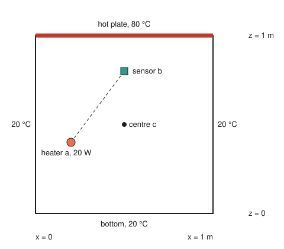

# Green's function: one poke's response rebuilds the whole solution

[Syllabus](../../../SYLLABUS.md) → [Partial differential equations](../README.md) → [Laplace, Poisson and Potentials](../README.md#s04) → Green's function

---

## General Overview

A 1 m cube of concrete sits in a test rig. Its top face rests on a hot plate at 80 °C. A water jacket holds the other five faces at 20 °C. A small 20 W heater is buried inside at the point a. A sensor at the point b, 20 cm below the hot plate on the cube's centre line, reads the temperature.

What does the sensor read once everything settles? The answer here is 53.27 °C. This card shows where that number comes from, using one object: the cube's **Green's function**. That is the temperature pattern made by a single unit "poke" of heat at one point, with every wall held at zero.

Wing 08 met this idea on a line: [Green's function](../../08-Differential%20equations%20and%20dynamics/07-Series%20Solutions%20and%20Boundary%20Problems/10-greens-function-for-a-boundary-problem.md) built the tent-shaped response of a shelf to one bag and added tents to get any load's sag. This card proves the same idea in any number of dimensions, works it in three, and adds two new facts:

- The same poke response also handles the **wall data**. The walls' influence enters through the slope of the poke response at the wall.
- The response is **symmetric**. A heater at a read at b gives the same rise as a heater at b read at a.

**Know how one unit poke spreads in the box with grounded walls, and you can write down the solution for any heat source inside and any wall temperatures, as two weighted sums.**

**What kind of fact this is:** theorems, proved on this card in Why it works: Green's two identities, the representation formula and the symmetry of G. The existence of G for the cube is shown by an explicit series; for a general region it is a theorem named, not proved, here.

### The picture: the cube from the side

<p align="center"></p>

Drawn to scale at 300 px per metre, seen along the y direction. The heater sits at a = (0.2, 0.3, 0.4) m and the sensor at b = (0.5, 0.5, 0.8) m. The centre c = (0.5, 0.5, 0.5) m is a reference point. The dashed line joins heater and sensor. Their true distance is 0.5385 m; this view hides their offset in y.

---

## The formula

The unknown is the steady temperature u(x) in °C at each point x of the box. The region is the open cube Ω (the inside of the box), and its walls are ∂Ω. The shelf-01 card [Boundary conditions](../01-Classification%20and%20Well-Posedness/03-boundary-conditions-dirichlet-neumann-and-robin.md) introduced the outward unit normal n and the outward slope ∂u/∂n.

Steady heat in a solid obeys $`-k\,\Delta u = q`$. Here k is the thermal conductivity in W/(m·K), q is the heat made per cubic metre, and Δ is the Laplacian (the sum of the three second derivatives). Divide by k and call f = q/k the **source**. The problem is then

```math
-\Delta u = f \ \text{in } \Omega, \qquad u = g \ \text{on } \partial\Omega,
```

with g the wall temperature: 80 °C on top, 20 °C elsewhere. The **Green's function** G(x, y) is the solution for a unit point source at y with every wall at zero:

```math
-\Delta_x G(x, y) = \delta(x - y) \ \text{in } \Omega, \qquad G(x, y) = 0 \ \text{for } x \text{ on } \partial\Omega.
```

Here δ is the point source of total strength one, as in wing 18. The **representation formula** then gives the solution directly:

```math
u(x) \;=\; \int_\Omega G(x, y)\, f(y)\, dV_y \;-\; \oint_{\partial\Omega} g(y)\, \frac{\partial G}{\partial n_y}(x, y)\, dS_y
```

**Read it aloud:** the temperature at x is every source weighted by its poke response at x, plus every wall temperature weighted by how steeply the poke response leaves the box at that wall.

The wall weight $`P(x, y) = -\partial G/\partial n_y`$ is never negative, and it adds up to 1 over all the walls, because u = 1 solves the problem with f = 0 and g = 1. So the wall part is a **weighted average of the wall temperatures**. For a box, the weight of a whole face is one number, $`w_{\text{face}}(x)`$.

| Symbol | Plain meaning | In our example | Push it up and the answer… |
| --- | --- | --- | --- |
| $`\Omega`$, $`\partial\Omega`$ | the inside of the box; its six walls | 1 m concrete cube | bigger box: G grows toward Φ, because the walls are farther away and drain less heat |
| $`x`$, $`y`$; $`a`$, $`b`$, $`c`$ | where the temperature is read; where a source or wall point sits; the heater, the sensor and the centre | x = b, y = a; a = (0.2, 0.3, 0.4) m, b = (0.5, 0.5, 0.8) m, c = (0.5, 0.5, 0.5) m | — |
| $`u(x)`$ | steady temperature in °C | 53.2738 °C at b | — |
| $`g`$ | the wall temperature, the wall data | 80 °C top, 20 °C other faces | raises u at every point inside |
| $`q`$, $`Q`$, $`k`$, $`f`$ | heat made per m³; a point heater's power, q = Q δ; conductivity; source f = q/k | Q = 20 W; k = 1.4 W/(m·K), illustrative; Q/k = 14.2857 K·m | more Q: hotter, in proportion; more k: cooler |
| $`n`$, $`\partial/\partial n`$ | outward unit normal; slope going straight out of the box | +z on the top face | — |
| $`\Delta`$, $`\nabla`$, $`\delta`$ | the Laplacian; the gradient; the unit point source | — | — |
| $`r`$, $`\varepsilon`$, $`l`$, $`m`$, $`\beta`$ | distance from a pole; radius of a small ball cut out around it; the series' whole-number counters; a term's decay rate $`\pi\sqrt{l^2 + m^2}`$ | r = 0.5385 m from heater to sensor | larger β: that term fades faster |
| $`\Phi(x - y)`$, $`d`$, $`A_d`$ | the fundamental solution $`1/(4\pi\lvert x - y\rvert)`$: a poke with no walls; the number of dimensions; the area of the unit sphere in $`d`$ dimensions | 0.147772 1/m at distance 0.5385 m; $`d`$ = 3, $`A_3 = 4\pi`$ | — |
| $`h_y(x)`$ | the **corrector**: smooth, with $`\Delta h_y = 0`$, equal to Φ on the walls | 0.121914 1/m at b, for y = a | — |
| $`G(x, y)`$ | Green's function: $`\Phi - h_y`$, zero on the walls | G(b, a) = 0.025858 1/m | — |
| $`P`$, $`w_{\text{face}}`$ | wall weight $`-\partial G/\partial n_y`$; its total over one face | top face weighs 0.548407 at b | heavier weight: that wall's temperature counts more |
| $`v`$, $`w`$, $`\Omega_\varepsilon`$, $`z_<`$, $`z_>`$, $`dV_y`$, $`dS_y`$ | a second smooth function in Green's identities; the difference of two solutions; the box with small balls cut out; the lower and the higher of $`x_3`$ and $`y_3`$; a small volume and a small wall area at $`y`$ | $`z_<`$ = 0.4 m, $`z_>`$ = 0.8 m for $`G(b, a)`$ | — |

### When it holds

- **A classical solution.** u has two continuous derivatives inside and is continuous up to the walls, except where the wall data jumps. The cube's top edges jump from 80 °C to 20 °C; u is still continuous inside, but its slope blows up at those edges. The formula still holds at every inside point. The point heater also breaks smoothness: u is infinite at a. Treat it as the limit of a small heated ball; the source part of the formula then becomes (Q/k) G(x, a) at every other point.
- **Bounded region with a reasonable wall.** The divergence theorem must apply: a cube, a ball, any region with a piecewise smooth wall. On a region with a sharp inward spike the wall data may not even be reached (see [Subharmonic functions](09-subharmonic-functions-and-perrons-method.md)).
- **Fixed wall values (Dirichlet data).** With insulated walls, ∂u/∂n = 0, no G exists. A unit poke must send flux 1 out through the walls, and insulated walls pass 0. Mistake 4 below prints this.
- **G exists for the region.** For the cube, a series builds it (Step 5). For a general region, existence needs a solvable Dirichlet problem for the corrector, which is a theorem from Perron's method.
- **Linear equation with constant k.** If k depends on the temperature, sources no longer add, and no single G works.

---

## Why it works

### Step 0: integrate by parts twice and let G kill the unknown

The plan comes from wing 08. On a line, integration by parts moves derivatives from u onto a test function and leaves end terms. In three dimensions the same move is the [Divergence theorem](../../06-Calculus%20and%20analysis/09-Vector%20Calculus/07-divergence-theorem.md): the total outflow through the walls equals the total spreading inside.

Doing it twice gives an identity with u and G side by side. It contains the wall values of u, which are known, and the wall slopes of u, which are not. The unknown slopes are multiplied by G on the wall. G is zero there, so they drop out. What is left expresses u through known data only.

### Step 1: Green's first identity

Take two smooth functions u and v on the box. The field v∇u (v times the gradient of u) spreads at the rate

```math
\nabla\cdot(v\,\nabla u) = \nabla v\cdot\nabla u + v\,\Delta u.
```

Integrate over Ω. The divergence theorem turns the left side into the outflow through the walls, where $`\nabla u\cdot n = \partial u/\partial n`$:

```math
\int_\Omega \left( v\,\Delta u + \nabla v\cdot\nabla u \right) dV = \oint_{\partial\Omega} v\,\frac{\partial u}{\partial n}\, dS.
```

This is **Green's first identity**. With v = 1 it says the heat made inside equals the heat leaving through the walls. With v = u it is the energy identity behind [Energy methods](../01-Classification%20and%20Well-Posedness/07-energy-methods-and-uniqueness.md).

### Step 2: Green's second identity

Write the first identity again with u and v swapped, and subtract. The gradient term $`\nabla u\cdot\nabla v`$ is the same in both, so it cancels:

```math
\int_\Omega \left( u\,\Delta v - v\,\Delta u \right) dV = \oint_{\partial\Omega} \left( u\,\frac{\partial v}{\partial n} - v\,\frac{\partial u}{\partial n} \right) dS.
```

This is **Green's second identity**. The checks test both identities on u = x²y + z and v = xyz + y² over the unit cube: the first gives 1.541667 on each side, the second 0.666667 on each side.

### Step 3: put the poke at x, cut out a small ball

Choose v = G(·, x), the poke response with its source at the reading point x. The second identity needs v smooth, and G is infinite at x. So cut a small ball of radius ε around x out of the box, and apply the identity to what is left.

Each part of the identity then gives one term:

1. **Inside.** ΔG = 0 away from x, and −Δu = f. So the left side is $`\int G f\, dV`$.
2. **The walls.** G = 0 there, so the unknown slope term $`G\,\partial u/\partial n`$ vanishes. What remains is $`\oint g\, \partial G/\partial n\, dS`$.
3. **The small sphere.** Near x, G is close to Φ = 1/(4πr), whose slope toward x is 1/(4πr²). Over a sphere of area 4πε² that slope adds up to exactly 1. So this term tends to u(x) as ε shrinks. The other term on the sphere is about (1/ε) × ε², which tends to 0.

Put the three together: $`\int G f = \oint g\, \partial G/\partial n + u(x)`$. Rearranged, that is the representation formula.

<details>
<summary>Detailed proof: the representation formula</summary>

Let $`\Omega_\varepsilon`$ be Ω with the ball $`B(x, \varepsilon)`$ removed. On the small sphere, take the normal pointing out of $`\Omega_\varepsilon`$, so toward x. Write G = Φ − h with h smooth.

The second identity on $`\Omega_\varepsilon`$, with v = G(·, x), reads

$`\displaystyle \int_{\Omega_\varepsilon} G f\, dV = \oint_{\partial\Omega} g\,\frac{\partial G}{\partial n}\, dS + \oint_{\lvert y - x\rvert = \varepsilon} \left( u\,\frac{\partial G}{\partial n} - G\,\frac{\partial u}{\partial n} \right) dS.`$

On the sphere, $`\partial\Phi/\partial n = 1/(4\pi\varepsilon^2)`$ and ∂h/∂n is bounded. So the first sphere term is the average of u over the sphere plus $`O(\varepsilon^2)`$, and it tends to u(x) because u is continuous.

In the second sphere term, $`\lvert G\rvert \le 1/(4\pi\varepsilon) + \max\lvert h\rvert`$ and ∂u/∂n is bounded near x. The sphere's area is $`4\pi\varepsilon^2`$, so the term is $`O(\varepsilon)`$.

The left side tends to $`\int_\Omega G f\, dV`$ because G is integrable: 1/r has a finite integral over a ball in three dimensions. Let ε tend to 0 and rearrange:

$`\displaystyle u(x) = \int_\Omega G(x, y) f(y)\, dV_y - \oint_{\partial\Omega} g(y)\,\frac{\partial G}{\partial n_y}(x, y)\, dS_y.`$

</details>

The same steps with Φ in place of G give a formula with no walls in G, but it keeps the term $`\Phi\,\partial u/\partial n`$ on the walls. That slope is not data. The corrector h exists to remove it.

**In any number of dimensions.** Steps 1 and 2 never used the dimension, and Step 3 used it only on the small sphere. In $`d`$ dimensions, take $`\Phi`$ from [The fundamental solution](02-fundamental-solution-of-the-laplacian.md). On the small sphere its slope toward x is $`1/(A_d\varepsilon^{d-1})`$, and the sphere's area is $`A_d\varepsilon^{d-1}`$. So the slope still adds up to exactly 1, and the first sphere term still tends to u(x). The other sphere term is at most a constant times $`|\Phi(\varepsilon)|\,A_d\varepsilon^{d-1}`$, which is $`\varepsilon/(d-2)`$ for $`d \ge 3`$ and $`\varepsilon|\ln\varepsilon|`$ in the plane; both tend to 0. $`\Phi`$ is integrable near its pole in every dimension, so the left side still converges. The representation formula therefore holds for every $`d \ge 2`$, and so does the symmetry of Step 4, which uses only these two sphere limits. For $`d = 1`$ it is wing 08's tent.

### Step 4: G is symmetric

Apply the second identity with u = G(·, a) and v = G(·, b), on the box with small balls cut out around a and around b. Both functions are zero on the walls, so the wall term vanishes. Both are harmonic (ΔG = 0) away from their own pole, so the inside term vanishes.

Only the two small spheres remain. Exactly as in Step 3, the sphere around a picks out −v(a) = −G(a, b), and the sphere around b picks out u(b) = G(b, a). Their sum is zero:

```math
G(a, b) = G(b, a).
```

In the cube: swap the heater and the sensor, and the temperature rise is the same, 0.3694 °C either way. The proof never used the shape of the box, only that G is zero on its walls.

<details>
<summary>Detailed proof: symmetry</summary>

Let $`\Omega_\varepsilon`$ be Ω with $`B(a, \varepsilon)`$ and $`B(b, \varepsilon)`$ removed, ε small enough that the balls are apart and inside Ω. Set u = G(·, a) and v = G(·, b). Both are smooth on $`\Omega_\varepsilon`$, with Δu = Δv = 0 there and u = v = 0 on ∂Ω. The second identity gives

$`\displaystyle 0 = \oint_{\lvert y - a\rvert = \varepsilon} \left( u\,\frac{\partial v}{\partial n} - v\,\frac{\partial u}{\partial n} \right) dS + \oint_{\lvert y - b\rvert = \varepsilon} \left( u\,\frac{\partial v}{\partial n} - v\,\frac{\partial u}{\partial n} \right) dS,`$

with normals pointing toward the centres. Around a, v is smooth and $`u = \Phi(\cdot - a) - h_a`$. The term $`u\,\partial v/\partial n`$ is $`O(\varepsilon)`$, and $`-v\,\partial u/\partial n`$ tends to −v(a). Around b, the roles swap: the first term tends to u(b) and the second is $`O(\varepsilon)`$. So 0 = u(b) − v(a), which is G(b, a) = G(a, b).

</details>

### Step 5: G for the cube, and why nothing else solves the problem

**Existence for the cube.** Expand in sines across x₁ and x₂, which vanish on the four side walls. Each sine pair leaves a one-dimensional problem in x₃. That is wing 08's Green's function again, with a sinh in place of the straight tent. Summed, it gives the series in the fold. Its terms fall off like $`e^{-\pi\sqrt{l^2 + m^2}\,\lvert x_3 - y_3\rvert}`$, so 20 terms each way already agree with 40 terms to 6.2e-15 for G(b, a).

<details>
<summary>The series for G and for the face weight, unit cube</summary>

With $`\beta = \pi\sqrt{l^2 + m^2}`$, $`z_< = \min(x_3, y_3)`$ and $`z_> = \max(x_3, y_3)`$:

$`\displaystyle G(x, y) = \sum_{l, m \ge 1} 4 \sin(l\pi x_1)\sin(l\pi y_1)\sin(m\pi x_2)\sin(m\pi y_2)\,\frac{\sinh(\beta z_<)\,\sinh(\beta(1 - z_>))}{\beta\,\sinh\beta}.`$

Take minus the slope of G across the top face, $`y_3 = 1`$, and integrate over that face. Only odd l and m survive:

$`\displaystyle w_{\text{top}}(x) = \sum_{l, m \text{ odd}} \frac{16}{\pi^2 l m}\,\sin(l\pi x_1)\sin(m\pi x_2)\,\frac{\sinh(\beta x_3)}{\sinh\beta}.`$

The other five face weights come from the same sum with the cube turned so that face is on top.

</details>

**Uniqueness.** Suppose two classical solutions share the source and the wall data. Their difference w has Δw = 0 inside and w = 0 on the walls. If the data are smooth enough that w has continuous first derivatives up to the walls, the first identity with u = v = w gives $`\int \lvert\nabla w\rvert^2\, dV = 0`$. So w is constant, and the walls make it 0. The cube's own wall data jump at the top edges, where the slope blows up, so this energy argument does not cover it as written. There the maximum principle of [Harmonic functions](01-harmonic-functions-and-mean-values.md) does the job instead: two bounded solutions differ by a bounded harmonic w that is 0 on the walls except along a few edges, and such a w is 0, as Step 6 of that card notes. Either way, the representation formula gives *the* bounded classical solution, not just one solution.

---

## Worked numbers, by hand

Concrete cube, side 1 m; hot plate 80 °C on top, 20 °C on five faces; 20 W heater at a = (0.2, 0.3, 0.4) m; k = 1.4 W/(m·K), illustrative for concrete.

| Step | Arithmetic | Value |
| --- | --- | --- |
| centre c: each face's weight, by symmetry | six equal weights adding to 1 | 1/6 = 0.166667 |
| walls alone at c | 80 × 1/6 + 20 × 5/6 = 20 + 60/6 | 30.0000 °C |
| first series term for the top weight at c | 16/π² × sinh(π√2/2) / sinh(π√2) | 0.173773, about 4% above 1/6 |
| top weight at the sensor b (series) | full sum | 0.548407 |
| walls alone at b | 20 + 60 × 0.548407 | 52.9044 °C |
| distance heater to sensor | √(0.3² + 0.2² + 0.4²) = √0.29 | 0.538516 m |
| poke with no walls, Φ(b − a) | 1 / (4π × 0.538516) | 0.147772 1/m |
| corrector $`h_a(b)`$ | series and grid | 0.121914 1/m |
| G(b, a) | 0.147772 − 0.121914 | 0.025858 1/m |
| heater rise at b | (20 / 1.4) × 0.025858 = 14.2857 × 0.025858 | 0.3694 °C |
| **sensor reading at b** | 52.9044 + 0.3694 | **53.2738 °C** |

The sensor reads 53.27 °C. More than half of that comes from the hot plate 20 cm above it, which carries 54.8% of the wall weight at b. The heater adds under 0.4 °C, because grounded walls drain its heat.

The six face weights at the sensor, in percent. A face is named by the coordinate held fixed on it: "x = 1" is the face where the first coordinate is 1 m.

```
top (hot plate)  ████████████████████████████████████████████  54.8
bottom           ███                                            3.8
x = 1            ████████                                      10.3
x = 0            ████████                                      10.3
y = 1            ████████                                      10.3
y = 0            ████████                                      10.3
```

They add to 100%. The near wall dominates; the far wall barely counts.

### What breaks if you drop a piece

Correct reading at b: 53.2738 °C, with a heater rise of 0.3694 °C.

| Mistake | Comes out at | What went wrong |
| --- | --- | --- |
| Use the no-wall poke Φ in place of G | heater rise 2.1110 °C, not 0.3694 | The corrector is gone. The walls drain heat, and Φ ignores them. |
| Drop the wall term | reading 0.3694 °C, not 53.2738 | Only the heater is counted; the hot plate and jacket vanish |
| Take the normal pointing inward | walls give −52.9044 °C, reading −52.5350 °C | The sign of ∂G/∂n flips, and the weights turn negative |
| Insulated walls: ask for ∂G/∂n = 0 | total wall slope ∮ ∂G/∂n dS of a unit poke −1.0000, needs 0 | The poke's heat must leave somewhere. No Neumann G exists without a correction. |

---

## Code, from first principles, and it actually runs

The script takes three roads to the same numbers. Road 1 is the closed form: the sine–sinh series for G and for the face weights. Road 2 never uses the series. It builds G = Φ − h, solving for the corrector h on a grid by successive over-relaxation (SOR: sweep the grid, replacing each value by the average of its six neighbours, overshooting by a fixed factor to speed convergence) at steps of 0.1 m and 0.05 m. It reports the observed order and the extrapolated value. Road 3 is exact facts: the centre weighs each face 1/6, and all weights add to 1. A fourth check builds the top face's wall weight from G itself rather than from the face series: G is zero on the face, so G(b, y) at 0.1 mm inside the face, divided by 0.1 mm, is the slope $`-\partial G/\partial n_y`$ there, and Simpson's rule adds it up over the face. The script also checks both Green's identities by Simpson's rule, which is exact for these polynomials.

Symmetry is tested on the grid, where it is not built in: G(b, a) uses the corrector for a heater at a, and G(a, b) a different solve for a heater at b.

### Python

```python
# Green's function and the representation formula -- the check behind the card.
# A 1 m concrete cube: top face on a hot plate at 80 C, the other five faces at 20 C,
# a 20 W heater inside at a, a sensor at b.  Standard library only.
# Road 1: G and the wall weights as sine-sinh series (the closed form).
# Road 2: G = Phi - h, the corrector h solved on a grid by SOR, never using the series.
# Road 3: exact facts: the centre weighs each face 1/6; all weights add to 1.
from math import pi, sin, sinh, exp, sqrt, log

def G_series(x, y, N):      # unit poke at y, walls at 0, read at x; sum over l, m up to N
    zl, zh, tot = min(x[2], y[2]), max(x[2], y[2]), 0.0
    for l in range(1, N + 1):
        for m in range(1, N + 1):
            be = pi * sqrt(l * l + m * m)
            tot += (4 * sin(l * pi * x[0]) * sin(l * pi * y[0]) * sin(m * pi * x[1]) * sin(m * pi * y[1])
                    * sinh(be * zl) * sinh(be * (1 - zh)) / (be * sinh(be)))
    return tot

def w_top(x, N):            # weight of the face z = 1 at x: the integral of P = -dG/dn over that face
    tot = 0.0
    for l in range(1, N + 1, 2):
        for m in range(1, N + 1, 2):
            be = pi * sqrt(l * l + m * m)
            ratio = (exp(be * (x[2] - 1)) - exp(-be * (x[2] + 1))) / (1 - exp(-2 * be))   # sinh(be z)/sinh(be)
            tot += 16 / (pi * pi * l * m) * sin(l * pi * x[0]) * sin(m * pi * x[1]) * ratio
    return tot

def weights(x, N):          # all six faces, by turning the cube so each face is on top
    a, b, c = x
    pts = [(a, b, c), (a, b, 1 - c), (b, c, a), (b, c, 1 - a), (a, c, b), (a, c, 1 - b)]
    return [w_top(p, N) for p in pts]   # top, bottom, x = 1, x = 0, y = 1, y = 0

def sor(n, bc):             # Laplace's equation on the grid, wall values bc, SOR sweeps
    M, om = n + 1, 2 / (1 + sin(pi / n))
    u = [0.0] * (M * M * M)
    for i in range(M):
        for j in range(M):
            for k in range(M):
                if 0 in (i, j, k) or n in (i, j, k): u[(i * M + j) * M + k] = bc(i / n, j / n, k / n)
    for _ in range(15 * n):
        for i in range(1, n):
            for j in range(1, n):
                for k in range(1, n):
                    p = (i * M + j) * M + k
                    s = u[p - M * M] + u[p + M * M] + u[p - M] + u[p + M] + u[p - 1] + u[p + 1]
                    u[p] += om * (s / 6 - u[p])
    return lambda x: u[(round(x[0] * n) * M + round(x[1] * n)) * M + round(x[2] * n)]

def Phi(x, y): return 1 / (4 * pi * sqrt(sum((p - q) ** 2 for p, q in zip(x, y))))

Q, kc, hot, cold = 20.0, 1.4, 80.0, 20.0      # heater W, concrete W/(m K) (illustrative), plate C, jacket C
a, b, c = (0.2, 0.3, 0.4), (0.5, 0.5, 0.8), (0.5, 0.5, 0.5)
f6 = lambda v: f"{v:.6f}"
print(f"box 1 m cube; plate {hot:.0f} C on top, {cold:.0f} C on five faces; heater {Q:.0f} W at a = (0.2, 0.3, 0.4) m, sensor b = (0.5, 0.5, 0.8) m, k = {kc} W/(m K)")
# ---- wall data alone: the weights ----
wc, wb = weights(c, 81), weights(b, 81)
one_term = 16 / pi ** 2 * sinh(pi * sqrt(2) / 2) / sinh(pi * sqrt(2))
print("face weights at centre c  (top, bottom, x=1, x=0, y=1, y=0): " + " ".join(f6(w) for w in wc))
print(f"  sum {sum(wc):.6f}; one-term top weight 16/pi^2 sinh(pi sqrt2/2)/sinh(pi sqrt2) = {one_term:.6f}")
print("face weights at sensor b  (top, bottom, x=1, x=0, y=1, y=0): " + " ".join(f6(w) for w in wb))
print(f"  sum {sum(wb):.6f}; first omitted term (l = 1, m = 83) {16 / (pi * pi * 83) * exp(-0.2 * pi * sqrt(1 + 83 * 83)):.1e}")
for name, x, w in (("centre c", c, wc), ("sensor b", b, wb)):
    print(f"walls alone at {name}: 20 + 60 x {w[0]:.6f} = {cold + (hot - cold) * w[0]:.4f} C;"
          f" sum of weight x wall temp = {hot * w[0] + cold * sum(w[1:]):.4f} C")
print("bars, weight at b in % : " + " ".join(f"{100 * w:.1f}" for w in wb))
S80 = [(i / 80, (1 if i in (0, 80) else 4 if i % 2 else 2) / 240) for i in range(81)]   # Simpson's rule, 80 strips
hn = 1e-4                   # the wall weight -dG/dn from G itself: G = 0 on the face, so -dG/dn ~ G(b, y)/hn just inside
w_from_G = sum(ws * wt * G_series(b, (s, t, 1 - hn), 40) for s, ws in S80 for t, wt in S80) / hn
print(f"top weight at b from G itself (Simpson 80 x 80 over the face, slope from 1e-4 m inside): {w_from_G:.6f}; series {wb[0]:.6f}")
# ---- the poke: G(b, a) and G(a, b) ----
g40, g20 = G_series(b, a, 40), G_series(b, a, 20)
gs_ab = G_series(a, b, 40)
print(f"Phi(b - a) = 1/(4 pi |b - a|) = {Phi(a, b):.6f} 1/m, |b - a| = {sqrt(0.29):.6f} m")
print(f"series G(b, a) N = 40: {g40:.6f} 1/m; N = 20 differs by {abs(g40 - g20):.1e}; corrector h_a(b) = {Phi(a, b) - g40:.6f}")
grid, walls_b = {}, cold + (hot - cold) * wb[0]
for n in (10, 20):
    ha, hb = sor(n, lambda *p: Phi(p, a)), sor(n, lambda *p: Phi(p, b))
    uw = sor(n, lambda x, y, z: hot if z == 1 else cold)
    grid[n] = (Phi(a, b) - ha(b), Phi(a, b) - hb(a), uw(b), uw(c))
    print(f"grid step {1 / n:.2f} m: G(b, a) = {grid[n][0]:.6f}, G(a, b) = {grid[n][1]:.6f}, walls at b {grid[n][2]:.4f} C, at c {grid[n][3]:.4f} C")
e10, e20 = abs(grid[10][0] - g40), abs(grid[20][0] - g40)
rich_ba, rich_ab = (4 * grid[20][0] - grid[10][0]) / 3, (4 * grid[20][1] - grid[10][1]) / 3
print(f"grid error in G(b, a): {e10:.2e} at step 0.1 m, {e20:.2e} at step 0.05 m, observed order {log(e10 / e20) / log(2):.2f}")
print(f"grid error in walls at b: {abs(grid[10][2] - walls_b):.4f} C at step 0.1 m, {abs(grid[20][2] - walls_b):.4f} C at step 0.05 m")
print(f"extrapolated (4 G_fine - G_coarse)/3: G(b, a) = {rich_ba:.6f}, G(a, b) = {rich_ab:.6f}; series G(a, b) = {gs_ab:.6f}")
rise = Q / kc * g40
print(f"heater rise at b = (Q/k) G(b, a) = {Q / kc:.4f} x {g40:.6f} = {rise:.4f} C")
print(f"sensor reading at b = {walls_b:.4f} + {rise:.4f} = {walls_b + rise:.4f} C")
print(f"swap heater and sensor: rise at a from the heater at b = {Q / kc * gs_ab:.4f} C")
# ---- Green's identities on u = x^2 y + z, v = x y z + y^2, by Simpson (exact for cubics) ----
S = [(i / 4, (1 if i in (0, 4) else 4 if i % 2 else 2) / 12) for i in range(5)]
vol = lambda F: sum(wx * wy * wz * F(x, y, z) for x, wx in S for y, wy in S for z, wz in S)
def wall(F):                 # sum over the six faces of F(point, outward normal)
    tot = 0.0
    for ax in range(3):
        for side, nrm in ((0.0, -1.0), (1.0, 1.0)):
            for s, ws in S:
                for t, wt in S:
                    p = [s, t]; p.insert(ax, side); nv = [0.0, 0.0, 0.0]; nv[ax] = nrm
                    tot += ws * wt * F(p, nv)
    return tot
u = lambda x, y, z: x * x * y + z;  gu = lambda x, y, z: (2 * x * y, x * x, 1.0);  Lu = lambda x, y, z: 2 * y
v = lambda x, y, z: x * y * z + y * y;  gv = lambda x, y, z: (y * z, x * z + 2 * y, x * y);  Lv = lambda x, y, z: 2.0
dot = lambda p, q: sum(i * j for i, j in zip(p, q))
I1 = vol(lambda *p: v(*p) * Lu(*p) + dot(gu(*p), gv(*p)));  B1 = wall(lambda p, nv: v(*p) * dot(gu(*p), nv))
I2 = vol(lambda *p: u(*p) * Lv(*p) - v(*p) * Lu(*p));  B2 = wall(lambda p, nv: u(*p) * dot(gv(*p), nv) - v(*p) * dot(gu(*p), nv))
print(f"first identity:  inside {I1:.6f}, walls {B1:.6f};  second identity: inside {I2:.6f}, walls {B2:.6f}")
# ---- what breaks ----
print(f"mistake 1, Phi for G (no walls): rise {Q / kc * Phi(a, b):.4f} C, not {rise:.4f}")
print(f"mistake 2, wall term dropped: reading {rise:.4f} C, not {walls_b + rise:.4f}")
print(f"mistake 3, inward normal: walls give {-walls_b:.4f} C, reading {rise - walls_b:.4f} C")
print(f"mistake 4, insulated walls: unit poke's wall flux = -(sum of weights at a) = {-sum(weights(a, 81)):.4f}, needs 0")
print(f"try: sensor at centre: {cold + (hot - cold) * wc[0] + Q / kc * G_series(c, a, 40):.4f} C; heater 40 W: rise {2 * rise:.4f} C; plate at 20 C: {cold + rise:.4f} C")
print(f"figure, side view x-z, 300 px/m, origin (60,360): heater ({60 + 300 * a[0]:.0f},{360 - 300 * a[2]:.0f}) "
      f"sensor ({60 + 300 * b[0]:.0f},{360 - 300 * b[2]:.0f}) centre ({60 + 300 * c[0]:.0f},{360 - 300 * c[2]:.0f})")
assert abs(wc[0] - 1 / 6) < 1e-9 and abs(sum(wb) - 1) < 1e-9           # series vs exact facts
assert abs(w_from_G - wb[0]) < 1e-5                                    # wall weight from G vs the face series
assert abs(rich_ba - g40) < 2e-5 and abs(rich_ab - g40) < 2e-5          # grid road vs series road
assert abs(grid[20][2] - walls_b) < abs(grid[10][2] - walls_b) < 0.5   # grid settles on the series
assert abs(I1 - B1) < 1e-12 and abs(I2 - B2) < 1e-12 and abs(I1) > 0.1  # identities, both sides
print("ALL CHECKS PASS")
```

**Ran 2026-11-15 on macOS, Python 3.14.10, standard library only. All checks passed. Output, pasted from the run:**

```
box 1 m cube; plate 80 C on top, 20 C on five faces; heater 20 W at a = (0.2, 0.3, 0.4) m, sensor b = (0.5, 0.5, 0.8) m, k = 1.4 W/(m K)
face weights at centre c  (top, bottom, x=1, x=0, y=1, y=0): 0.166667 0.166667 0.166667 0.166667 0.166667 0.166667
  sum 1.000000; one-term top weight 16/pi^2 sinh(pi sqrt2/2)/sinh(pi sqrt2) = 0.173773
face weights at sensor b  (top, bottom, x=1, x=0, y=1, y=0): 0.548407 0.038161 0.103358 0.103358 0.103358 0.103358
  sum 1.000000; first omitted term (l = 1, m = 83) 4.4e-25
walls alone at centre c: 20 + 60 x 0.166667 = 30.0000 C; sum of weight x wall temp = 30.0000 C
walls alone at sensor b: 20 + 60 x 0.548407 = 52.9044 C; sum of weight x wall temp = 52.9044 C
bars, weight at b in % : 54.8 3.8 10.3 10.3 10.3 10.3
top weight at b from G itself (Simpson 80 x 80 over the face, slope from 1e-4 m inside): 0.548407; series 0.548407
Phi(b - a) = 1/(4 pi |b - a|) = 0.147772 1/m, |b - a| = 0.538516 m
series G(b, a) N = 40: 0.025858 1/m; N = 20 differs by 6.2e-15; corrector h_a(b) = 0.121914
grid step 0.10 m: G(b, a) = 0.025611, G(a, b) = 0.025581, walls at b 52.5465 C, at c 30.0000 C
grid step 0.05 m: G(b, a) = 0.025795, G(a, b) = 0.025788, walls at b 52.8107 C, at c 30.0000 C
grid error in G(b, a): 2.47e-04 at step 0.1 m, 6.29e-05 at step 0.05 m, observed order 1.97
grid error in walls at b: 0.3579 C at step 0.1 m, 0.0937 C at step 0.05 m
extrapolated (4 G_fine - G_coarse)/3: G(b, a) = 0.025856, G(a, b) = 0.025857; series G(a, b) = 0.025858
heater rise at b = (Q/k) G(b, a) = 14.2857 x 0.025858 = 0.3694 C
sensor reading at b = 52.9044 + 0.3694 = 53.2738 C
swap heater and sensor: rise at a from the heater at b = 0.3694 C
first identity:  inside 1.541667, walls 1.541667;  second identity: inside 0.666667, walls 0.666667
mistake 1, Phi for G (no walls): rise 2.1110 C, not 0.3694
mistake 2, wall term dropped: reading 0.3694 C, not 53.2738
mistake 3, inward normal: walls give -52.9044 C, reading -52.5350 C
mistake 4, insulated walls: unit poke's wall flux = -(sum of weights at a) = -1.0000, needs 0
try: sensor at centre: 31.0720 C; heater 40 W: rise 0.7388 C; plate at 20 C: 20.3694 C
figure, side view x-z, 300 px/m, origin (60,360): heater (120,240) sensor (210,120) centre (210,210)
ALL CHECKS PASS
```

The grid's G(b, a) and G(a, b) differ at each step, 0.025611 against 0.025581 at step 0.1 m. Both close on the series value at the observed order 1.97, and the extrapolated values agree with the series to 2 in the sixth digit. The walls-only grid reading settles on 52.9044 °C too: its error drops from 0.3579 °C to 0.0937 °C as the step halves. Built from G's own slope at the top face, the face weight at b comes out at 0.548407, the series value.

### Rust

The same checks, with the same labels and the same output, built with `rustc --edition 2021 -O`. Rust prints e-notation with a one-digit exponent, so a small helper pads it to match Python.

```rust
// Green's function and the representation formula -- the same check as greens_functions_and_the_representation_formula_check.py, in Rust.
// A 1 m concrete cube: top face on a hot plate at 80 C, the other five faces at 20 C,
// a 20 W heater inside at a, a sensor at b.  Standard library only, no crates.
// Road 1: G and the wall weights as sine-sinh series (the closed form).
// Road 2: G = Phi - h, the corrector h solved on a grid by SOR, never using the series.
// Road 3: exact facts: the centre weighs each face 1/6; all weights add to 1.
use std::f64::consts::PI;
type P3 = [f64; 3];

fn g_series(x: P3, y: P3, n: usize) -> f64 { // unit poke at y, walls at 0, read at x
    let (zl, zh) = (x[2].min(y[2]), x[2].max(y[2]));
    let mut tot = 0.0;
    for l in 1..=n {
        for m in 1..=n {
            let (lf, mf) = (l as f64, m as f64);
            let be = PI * (lf * lf + mf * mf).sqrt();
            tot += 4.0 * (lf * PI * x[0]).sin() * (lf * PI * y[0]).sin() * (mf * PI * x[1]).sin() * (mf * PI * y[1]).sin()
                * (be * zl).sinh() * (be * (1.0 - zh)).sinh() / (be * be.sinh());
        }
    }
    tot
}
fn w_top(x: P3, n: usize) -> f64 { // weight of the face z = 1 at x: the integral of P = -dG/dn over it
    let mut tot = 0.0;
    for l in (1..=n).step_by(2) {
        for m in (1..=n).step_by(2) {
            let (lf, mf) = (l as f64, m as f64);
            let be = PI * (lf * lf + mf * mf).sqrt();
            let ratio = ((be * (x[2] - 1.0)).exp() - (-be * (x[2] + 1.0)).exp()) / (1.0 - (-2.0 * be).exp());
            tot += 16.0 / (PI * PI * lf * mf) * (lf * PI * x[0]).sin() * (mf * PI * x[1]).sin() * ratio;
        }
    }
    tot
}
fn weights(x: P3, n: usize) -> Vec<f64> { // all six faces, by turning the cube so each face is on top
    let [a, b, c] = x;
    [[a, b, c], [a, b, 1.0 - c], [b, c, a], [b, c, 1.0 - a], [a, c, b], [a, c, 1.0 - b]].iter().map(|p| w_top(*p, n)).collect()
}
fn sor(n: usize, bc: &dyn Fn(f64, f64, f64) -> f64) -> Vec<f64> { // Laplace on the grid, wall values bc
    let (mm, nf) = (n + 1, n as f64);
    let om = 2.0 / (1.0 + (PI / nf).sin());
    let mut u = vec![0.0; mm * mm * mm];
    for i in 0..mm { for j in 0..mm { for k in 0..mm {
        if i == 0 || j == 0 || k == 0 || i == n || j == n || k == n {
            u[(i * mm + j) * mm + k] = bc(i as f64 / nf, j as f64 / nf, k as f64 / nf);
        }
    } } }
    for _ in 0..15 * n { for i in 1..n { for j in 1..n { for k in 1..n {
        let p = (i * mm + j) * mm + k;
        let s = u[p - mm * mm] + u[p + mm * mm] + u[p - mm] + u[p + mm] + u[p - 1] + u[p + 1];
        u[p] += om * (s / 6.0 - u[p]);
    } } } }
    u
}
fn at(u: &[f64], n: usize, x: P3) -> f64 {
    let (mm, nf) = (n + 1, n as f64);
    let r = |v: f64| (v * nf).round() as usize;
    u[(r(x[0]) * mm + r(x[1])) * mm + r(x[2])]
}
fn phi(x: P3, y: P3) -> f64 {
    let mut s = 0.0;
    for i in 0..3 { s += (x[i] - y[i]) * (x[i] - y[i]); }
    1.0 / (4.0 * PI * s.sqrt())
}
fn sci(v: f64, d: usize) -> String { // Python-style e-notation: two-digit exponent
    let s = format!("{:.*e}", d, v);
    let (m, e) = s.split_once('e').unwrap();
    let e: i32 = e.parse().unwrap();
    format!("{}e{}{:02}", m, if e < 0 { '-' } else { '+' }, e.abs())
}
fn f6(w: &[f64]) -> String { w.iter().map(|v| format!("{:.6}", v)).collect::<Vec<_>>().join(" ") }
fn main() {
    let (q, kc, hot, cold) = (20.0_f64, 1.4_f64, 80.0_f64, 20.0_f64);
    let (a, b, c): (P3, P3, P3) = ([0.2, 0.3, 0.4], [0.5, 0.5, 0.8], [0.5, 0.5, 0.5]);
    println!("box 1 m cube; plate {:.0} C on top, {:.0} C on five faces; heater {:.0} W at a = (0.2, 0.3, 0.4) m, sensor b = (0.5, 0.5, 0.8) m, k = {} W/(m K)", hot, cold, q, kc);
    let (wc, wb) = (weights(c, 81), weights(b, 81));
    let sum = |w: &[f64]| w.iter().fold(0.0, |s, v| s + v);
    let one_term = 16.0 / (PI * PI) * (PI * 2f64.sqrt() / 2.0).sinh() / (PI * 2f64.sqrt()).sinh();
    println!("face weights at centre c  (top, bottom, x=1, x=0, y=1, y=0): {}", f6(&wc));
    println!("  sum {:.6}; one-term top weight 16/pi^2 sinh(pi sqrt2/2)/sinh(pi sqrt2) = {:.6}", sum(&wc), one_term);
    println!("face weights at sensor b  (top, bottom, x=1, x=0, y=1, y=0): {}", f6(&wb));
    println!("  sum {:.6}; first omitted term (l = 1, m = 83) {}", sum(&wb),
             sci(16.0 / (PI * PI * 83.0) * (-0.2 * PI * (1.0 + 83.0 * 83.0_f64).sqrt()).exp(), 1));
    for (name, w) in [("centre c", &wc), ("sensor b", &wb)] {
        println!("walls alone at {}: 20 + 60 x {:.6} = {:.4} C; sum of weight x wall temp = {:.4} C",
                 name, w[0], cold + (hot - cold) * w[0], hot * w[0] + cold * sum(&w[1..]));
    }
    println!("bars, weight at b in % : {}", wb.iter().map(|w| format!("{:.1}", 100.0 * w)).collect::<Vec<_>>().join(" "));
    let s80: Vec<(f64, f64)> = (0..81).map(|i| (i as f64 / 80.0, (if i == 0 || i == 80 { 1.0 } else if i % 2 == 1 { 4.0 } else { 2.0 }) / 240.0)).collect();
    let hn = 1e-4; // the wall weight -dG/dn from G itself: G = 0 on the face, so -dG/dn ~ G(b, y)/hn just inside
    let mut w_from_g = 0.0;
    for &(s1, w1) in &s80 { for &(t1, w2) in &s80 { w_from_g += w1 * w2 * g_series(b, [s1, t1, 1.0 - hn], 40); } }
    w_from_g /= hn;
    println!("top weight at b from G itself (Simpson 80 x 80 over the face, slope from 1e-4 m inside): {:.6}; series {:.6}", w_from_g, wb[0]);
    let (g40, g20, gs_ab) = (g_series(b, a, 40), g_series(b, a, 20), g_series(a, b, 40));
    println!("Phi(b - a) = 1/(4 pi |b - a|) = {:.6} 1/m, |b - a| = {:.6} m", phi(a, b), 0.29_f64.sqrt());
    println!("series G(b, a) N = 40: {:.6} 1/m; N = 20 differs by {}; corrector h_a(b) = {:.6}", g40, sci((g40 - g20).abs(), 1), phi(a, b) - g40);
    let walls_b = cold + (hot - cold) * wb[0];
    let mut grid = Vec::new();
    for n in [10usize, 20] {
        let ha = sor(n, &|x, y, z| phi([x, y, z], a));
        let hb = sor(n, &|x, y, z| phi([x, y, z], b));
        let uw = sor(n, &|_x, _y, z| if z == 1.0 { hot } else { cold });
        let row = (phi(a, b) - at(&ha, n, b), phi(a, b) - at(&hb, n, a), at(&uw, n, b), at(&uw, n, c));
        println!("grid step {:.2} m: G(b, a) = {:.6}, G(a, b) = {:.6}, walls at b {:.4} C, at c {:.4} C", 1.0 / n as f64, row.0, row.1, row.2, row.3);
        grid.push(row);
    }
    let (e10, e20) = ((grid[0].0 - g40).abs(), (grid[1].0 - g40).abs());
    let (rich_ba, rich_ab) = ((4.0 * grid[1].0 - grid[0].0) / 3.0, (4.0 * grid[1].1 - grid[0].1) / 3.0);
    println!("grid error in G(b, a): {} at step 0.1 m, {} at step 0.05 m, observed order {:.2}", sci(e10, 2), sci(e20, 2), (e10 / e20).ln() / 2f64.ln());
    println!("grid error in walls at b: {:.4} C at step 0.1 m, {:.4} C at step 0.05 m", (grid[0].2 - walls_b).abs(), (grid[1].2 - walls_b).abs());
    println!("extrapolated (4 G_fine - G_coarse)/3: G(b, a) = {:.6}, G(a, b) = {:.6}; series G(a, b) = {:.6}", rich_ba, rich_ab, gs_ab);
    let rise = q / kc * g40;
    println!("heater rise at b = (Q/k) G(b, a) = {:.4} x {:.6} = {:.4} C", q / kc, g40, rise);
    println!("sensor reading at b = {:.4} + {:.4} = {:.4} C", walls_b, rise, walls_b + rise);
    println!("swap heater and sensor: rise at a from the heater at b = {:.4} C", q / kc * gs_ab);
    // ---- Green's identities on u = x^2 y + z, v = x y z + y^2, by Simpson (exact for cubics) ----
    let s: Vec<(f64, f64)> = (0..5).map(|i| (i as f64 / 4.0, (if i == 0 || i == 4 { 1.0 } else if i % 2 == 1 { 4.0 } else { 2.0 }) / 12.0)).collect();
    let vol = |f: &dyn Fn(P3) -> f64| { let mut t = 0.0;
        for &(x, wx) in &s { for &(y, wy) in &s { for &(z, wz) in &s { t += wx * wy * wz * f([x, y, z]); } } } t };
    let wall = |f: &dyn Fn(P3, P3) -> f64| { let mut t = 0.0;
        for ax in 0..3 { for (side, nrm) in [(0.0, -1.0), (1.0, 1.0)] { for &(p1, w1) in &s { for &(p2, w2) in &s {
            let mut p = vec![p1, p2]; p.insert(ax, side); let mut nv = [0.0; 3]; nv[ax] = nrm;
            t += w1 * w2 * f([p[0], p[1], p[2]], nv); } } } } t };
    let u = |p: P3| p[0] * p[0] * p[1] + p[2];
    let gu = |p: P3| [2.0 * p[0] * p[1], p[0] * p[0], 1.0];
    let lu = |p: P3| 2.0 * p[1];
    let v = |p: P3| p[0] * p[1] * p[2] + p[1] * p[1];
    let gv = |p: P3| [p[1] * p[2], p[0] * p[2] + 2.0 * p[1], p[0] * p[1]];
    let dot = |p: P3, r: P3| { let mut t = 0.0; for i in 0..3 { t += p[i] * r[i]; } t };
    let i1 = vol(&|p| v(p) * lu(p) + dot(gu(p), gv(p)));
    let b1 = wall(&|p, nv| v(p) * dot(gu(p), nv));
    let i2 = vol(&|p| u(p) * 2.0 - v(p) * lu(p));
    let b2 = wall(&|p, nv| u(p) * dot(gv(p), nv) - v(p) * dot(gu(p), nv));
    println!("first identity:  inside {:.6}, walls {:.6};  second identity: inside {:.6}, walls {:.6}", i1, b1, i2, b2);
    println!("mistake 1, Phi for G (no walls): rise {:.4} C, not {:.4}", q / kc * phi(a, b), rise);
    println!("mistake 2, wall term dropped: reading {:.4} C, not {:.4}", rise, walls_b + rise);
    println!("mistake 3, inward normal: walls give {:.4} C, reading {:.4} C", -walls_b, rise - walls_b);
    println!("mistake 4, insulated walls: unit poke's wall flux = -(sum of weights at a) = {:.4}, needs 0", -sum(&weights(a, 81)));
    println!("try: sensor at centre: {:.4} C; heater 40 W: rise {:.4} C; plate at 20 C: {:.4} C",
             cold + (hot - cold) * wc[0] + q / kc * g_series(c, a, 40), 2.0 * rise, cold + rise);
    let px = |p: P3| format!("({:.0},{:.0})", 60.0 + 300.0 * p[0], 360.0 - 300.0 * p[2]);
    println!("figure, side view x-z, 300 px/m, origin (60,360): heater {} sensor {} centre {}", px(a), px(b), px(c));
    assert!((wc[0] - 1.0 / 6.0).abs() < 1e-9 && (sum(&wb) - 1.0).abs() < 1e-9); // series vs exact facts
    assert!((w_from_g - wb[0]).abs() < 1e-5); // wall weight from G vs the face series
    assert!((rich_ba - g40).abs() < 2e-5 && (rich_ab - g40).abs() < 2e-5); // grid road vs series road
    assert!((grid[1].2 - walls_b).abs() < (grid[0].2 - walls_b).abs() && (grid[0].2 - walls_b).abs() < 0.5);
    assert!((i1 - b1).abs() < 1e-12 && (i2 - b2).abs() < 1e-12 && i1.abs() > 0.1); // identities, both sides
    println!("ALL CHECKS PASS");
}
```

**Ran 2026-11-15 on macOS, rustc 1.98.1, no crates. All checks passed. Output, pasted from the run:**

```
box 1 m cube; plate 80 C on top, 20 C on five faces; heater 20 W at a = (0.2, 0.3, 0.4) m, sensor b = (0.5, 0.5, 0.8) m, k = 1.4 W/(m K)
face weights at centre c  (top, bottom, x=1, x=0, y=1, y=0): 0.166667 0.166667 0.166667 0.166667 0.166667 0.166667
  sum 1.000000; one-term top weight 16/pi^2 sinh(pi sqrt2/2)/sinh(pi sqrt2) = 0.173773
face weights at sensor b  (top, bottom, x=1, x=0, y=1, y=0): 0.548407 0.038161 0.103358 0.103358 0.103358 0.103358
  sum 1.000000; first omitted term (l = 1, m = 83) 4.4e-25
walls alone at centre c: 20 + 60 x 0.166667 = 30.0000 C; sum of weight x wall temp = 30.0000 C
walls alone at sensor b: 20 + 60 x 0.548407 = 52.9044 C; sum of weight x wall temp = 52.9044 C
bars, weight at b in % : 54.8 3.8 10.3 10.3 10.3 10.3
top weight at b from G itself (Simpson 80 x 80 over the face, slope from 1e-4 m inside): 0.548407; series 0.548407
Phi(b - a) = 1/(4 pi |b - a|) = 0.147772 1/m, |b - a| = 0.538516 m
series G(b, a) N = 40: 0.025858 1/m; N = 20 differs by 6.2e-15; corrector h_a(b) = 0.121914
grid step 0.10 m: G(b, a) = 0.025611, G(a, b) = 0.025581, walls at b 52.5465 C, at c 30.0000 C
grid step 0.05 m: G(b, a) = 0.025795, G(a, b) = 0.025788, walls at b 52.8107 C, at c 30.0000 C
grid error in G(b, a): 2.47e-04 at step 0.1 m, 6.29e-05 at step 0.05 m, observed order 1.97
grid error in walls at b: 0.3579 C at step 0.1 m, 0.0937 C at step 0.05 m
extrapolated (4 G_fine - G_coarse)/3: G(b, a) = 0.025856, G(a, b) = 0.025857; series G(a, b) = 0.025858
heater rise at b = (Q/k) G(b, a) = 14.2857 x 0.025858 = 0.3694 C
sensor reading at b = 52.9044 + 0.3694 = 53.2738 C
swap heater and sensor: rise at a from the heater at b = 0.3694 C
first identity:  inside 1.541667, walls 1.541667;  second identity: inside 0.666667, walls 0.666667
mistake 1, Phi for G (no walls): rise 2.1110 C, not 0.3694
mistake 2, wall term dropped: reading 0.3694 C, not 53.2738
mistake 3, inward normal: walls give -52.9044 C, reading -52.5350 C
mistake 4, insulated walls: unit poke's wall flux = -(sum of weights at a) = -1.0000, needs 0
try: sensor at centre: 31.0720 C; heater 40 W: rise 0.7388 C; plate at 20 C: 20.3694 C
figure, side view x-z, 300 px/m, origin (60,360): heater (120,240) sensor (210,120) centre (210,210)
ALL CHECKS PASS
```

The two outputs are identical.

### Lean

Lean proves Green's two identities, the representation formula and the symmetry of G on any box in space, and checks the worked numbers.

- Take u and v with two continuous derivatives on and just beyond the box. Then Green's first and second identities hold, with n pointing out.
- Take a classical solution u with an integrable source and one continuous derivative up to the walls. Let G be Φ minus a smooth corrector, zero on the walls. Then the representation formula holds at every inside point, with the wall slope of G(·, x), as in Step 3.
- Take any two inside points a and b. Then G(a, b) = G(b, a).
- Take equal face weights at the centre c. Then each is 1/6, and the walls alone give 30 °C there.
- The heater-to-sensor distance squared is 0.29 m², and Q/k is 100/7 K·m, the 14.2857 K·m above.
- The test integrals in Step 2 are exactly 37/24 and 2/3: the 1.541667 and 0.666667 printed above.

The series for G, the face weights and the 53.2738 °C reading are left to the Python and Rust checks.

```lean
-- Green's function: on a box in space, Green's two identities hold, the temperature at any inside point equals the sources weighted by the Green's function minus the wall data weighted by its outward slope, and the Green's function is symmetric.
import Mathlib
import Mathlib.Analysis.InnerProductSpace.Harmonic.Basic
import Mathlib.Analysis.InnerProductSpace.PiL2
import Mathlib.Analysis.Calculus.Gradient.Basic
import Mathlib.MeasureTheory.Integral.Bochner.Set
import Mathlib.MeasureTheory.Measure.Haar.InnerProductSpace
import Mathlib.MeasureTheory.Constructions.Pi
import Mathlib.Data.Fin.Tuple.Basic
import Mathlib.Tactic.NormNum

open Real Set MeasureTheory InnerProductSpace Laplacian

/-! Space is `E = EuclideanSpace ℝ (Fin 3)`, with its ordinary volume. The region is a box with
lower corner `lo` and upper corner `hi` (the card's cube is `lo = 0`, `hi = 1`): `openBox` is its
inside Ω, `closedBox` is Ω̄, and the walls ∂Ω are `closedBox \ openBox`. The Laplacian `Δ` and the
gradient `gradient` are Mathlib's. Mathlib has no surface integral over a general wall, which is
why the region is a box: its wall is six flat faces, and a face integral is an ordinary area
integral. At the pole Lean's `1 / 0 = 0` gives `Φ` the value `0`; one point has volume zero. -/

/-- The inside Ω of the box with corners `lo` and `hi`. -/
def openBox (lo hi : Fin 3 → ℝ) : Set (EuclideanSpace ℝ (Fin 3)) :=
  {x | ∀ i, lo i < x i ∧ x i < hi i}

/-- The closed box Ω̄: the inside together with its six walls. -/
def closedBox (lo hi : Fin 3 → ℝ) : Set (EuclideanSpace ℝ (Fin 3)) :=
  {x | ∀ i, lo i ≤ x i ∧ x i ≤ hi i}

/-- The wall integral `∮_{∂Ω} F(p, n) dS` over the six faces of the box, where `p` is the wall
point and `n` the outward unit normal there. For each direction `i` the far face `x_i = hi_i` has
normal `e_i` and the near face `x_i = lo_i` has normal `−e_i`. A face point is
`Fin.insertNth i c y`: `i`-th coordinate `c`, the other two coordinates `y`, which run over a
rectangle; the face integral is the area integral over that rectangle. -/
noncomputable def wallIntegral (lo hi : Fin 3 → ℝ)
    (F : EuclideanSpace ℝ (Fin 3) → EuclideanSpace ℝ (Fin 3) → ℝ) : ℝ :=
  ∑ i : Fin 3,
    ((∫ y in Icc (lo ∘ i.succAbove) (hi ∘ i.succAbove),
        F (WithLp.toLp 2 (Fin.insertNth i (hi i) y)) (EuclideanSpace.single i 1)) +
      ∫ y in Icc (lo ∘ i.succAbove) (hi ∘ i.succAbove),
        F (WithLp.toLp 2 (Fin.insertNth i (lo i) y)) (-EuclideanSpace.single i 1))

/-- The fundamental solution `Φ(x) = 1 / (4π|x|)`: a unit poke in space with no walls. -/
noncomputable def fundSol3 (x : EuclideanSpace ℝ (Fin 3)) : ℝ := 1 / (4 * π * ‖x‖)

/-- `G` is the Green's function of the box (wall values held at zero). For every pole `y` inside,
`G(·, y) = Φ(· − y) − h_y` away from `y`, where the corrector `h_y` is smooth (two continuous
derivatives on an open set holding the closed box) and harmonic inside, and `G(x, y) = 0` for
every wall point `x`. This is the card's `−Δ_x G(x, y) = δ(x − y)` in Ω, `G = 0` on ∂Ω. -/
def IsGreenFunctionBox (lo hi : Fin 3 → ℝ)
    (G : EuclideanSpace ℝ (Fin 3) → EuclideanSpace ℝ (Fin 3) → ℝ) : Prop :=
  ∀ y ∈ openBox lo hi, ∃ h : EuclideanSpace ℝ (Fin 3) → ℝ,
    (∃ U : Set (EuclideanSpace ℝ (Fin 3)), IsOpen U ∧ closedBox lo hi ⊆ U ∧ ContDiffOn ℝ 2 h U) ∧
    HarmonicOnNhd h (openBox lo hi) ∧
    (∀ x, x ≠ y → G x y = fundSol3 (x - y) - h x) ∧
    (∀ x ∈ closedBox lo hi \ openBox lo hi, G x y = 0)

local notation "E3" => EuclideanSpace ℝ (Fin 3)

lemma closedBox_eq_preimage (lo hi : Fin 3 → ℝ) :
    closedBox lo hi = (WithLp.ofLp : E3 → (Fin 3 → ℝ)) ⁻¹' Icc lo hi := by
  ext x; simp [closedBox, Pi.le_def, forall_and]

#print axioms closedBox_eq_preimage

lemma openBox_eq_preimage (lo hi : Fin 3 → ℝ) :
    openBox lo hi = (WithLp.ofLp : E3 → (Fin 3 → ℝ)) ⁻¹' (Set.pi univ fun i => Ioo (lo i) (hi i)) := by
  ext x; simp [openBox]

#print axioms openBox_eq_preimage

lemma setIntegral_closedBox (lo hi : Fin 3 → ℝ) (H : E3 → ℝ) :
    ∫ x in closedBox lo hi, H x = ∫ y in Icc lo hi, H (WithLp.toLp 2 y) := by
  rw [closedBox_eq_preimage]
  have := (EuclideanSpace.volume_preserving_symm_measurableEquiv_toLp (Fin 3)).setIntegral_preimage_emb
    (MeasurableEquiv.measurableEmbedding _) (fun y => H (WithLp.toLp 2 y)) (Icc lo hi)
  exact this

#print axioms setIntegral_closedBox

lemma integrableOn_closedBox (lo hi : Fin 3 → ℝ) (H : E3 → ℝ) :
    IntegrableOn H (closedBox lo hi) ↔ IntegrableOn (fun y => H (WithLp.toLp 2 y)) (Icc lo hi) := by
  rw [closedBox_eq_preimage]
  have := (EuclideanSpace.volume_preserving_symm_measurableEquiv_toLp (Fin 3)).integrableOn_comp_preimage
    (MeasurableEquiv.measurableEmbedding _) (f := fun y => H (WithLp.toLp 2 y)) (s := Icc lo hi)
  exact this

#print axioms integrableOn_closedBox

lemma box_divergence {lo hi : Fin 3 → ℝ} (hle : ∀ i, lo i ≤ hi i)
    (φ : Fin 3 → E3 → ℝ) (φ' : Fin 3 → E3 → (E3 →L[ℝ] ℝ))
    (Hc : ∀ i, ContinuousOn (φ i) (closedBox lo hi))
    (Hd : ∀ x ∈ openBox lo hi, ∀ i, HasFDerivAt (φ i) (φ' i x) x)
    (Hi : IntegrableOn (fun x => ∑ i, φ' i x (EuclideanSpace.single i 1)) (closedBox lo hi))
    (F : E3 → E3 → ℝ)
    (hF : ∀ i p, F p (EuclideanSpace.single i 1) = φ i p ∧ F p (-EuclideanSpace.single i 1) = -φ i p) :
    ∫ x in closedBox lo hi, ∑ i, φ' i x (EuclideanSpace.single i 1) = wallIntegral lo hi F := by
  let L : (Fin 3 → ℝ) →L[ℝ] E3 := (PiLp.continuousLinearEquiv 2 ℝ (fun _ : Fin 3 => ℝ)).symm.toContinuousLinearMap
  have hL : ∀ y, L y = WithLp.toLp 2 y := fun y => rfl
  have key := integral_divergence_of_hasFDerivAt_off_countable' (n := 2) lo hi hle
    (fun i y => φ i (WithLp.toLp 2 y)) (fun i y => (φ' i (WithLp.toLp 2 y)).comp L) ∅ countable_empty
    ?_ ?_ ?_
  · rw [setIntegral_closedBox]
    have e1 : ∀ i : Fin 3, L (Pi.single i 1) = EuclideanSpace.single i 1 := by
      intro i; rw [hL]; rfl
    simp only [ContinuousLinearMap.comp_apply, e1] at key
    rw [key, wallIntegral]
    refine Finset.sum_congr rfl fun i _ => ?_
    rw [sub_eq_add_neg, ← integral_neg]
    congr 1
    · exact integral_congr_ae (Filter.Eventually.of_forall fun y => ((hF i _).1).symm)
    · exact integral_congr_ae (Filter.Eventually.of_forall fun y => ((hF i _).2).symm)
  · intro i
    refine (Hc i).comp L.continuous.continuousOn ?_
    intro y hy; rw [closedBox_eq_preimage]; simpa using hy
  · intro y hy i
    have hx : WithLp.toLp 2 y ∈ openBox lo hi := by
      rw [openBox_eq_preimage]; simpa using hy.1
    exact (Hd _ hx i).comp y L.hasFDerivAt
  · rw [integrableOn_closedBox] at Hi
    have e1 : ∀ i : Fin 3, L (Pi.single i 1) = EuclideanSpace.single i 1 := by
      intro i; rw [hL]; rfl
    simpa [e1] using Hi

#print axioms box_divergence

lemma isCompact_closedBox (lo hi : Fin 3 → ℝ) : IsCompact (closedBox lo hi) := by
  have : closedBox lo hi = (WithLp.toLp 2 : (Fin 3 → ℝ) → E3) '' Icc lo hi := by
    rw [closedBox_eq_preimage]; ext x; constructor
    · intro hx; exact ⟨WithLp.ofLp x, hx, by simp⟩
    · rintro ⟨y, hy, rfl⟩; simpa using hy
  rw [this]
  exact isCompact_Icc.image (PiLp.continuousLinearEquiv 2 ℝ (fun _ : Fin 3 => ℝ)).symm.continuous

#print axioms isCompact_closedBox

lemma isOpen_openBox (lo hi : Fin 3 → ℝ) : IsOpen (openBox lo hi) := by
  rw [openBox_eq_preimage]
  exact (isOpen_set_pi finite_univ fun i _ => isOpen_Ioo).preimage
    (PiLp.continuousLinearEquiv 2 ℝ (fun _ : Fin 3 => ℝ)).continuous

#print axioms isOpen_openBox

lemma isClosed_closedBox (lo hi : Fin 3 → ℝ) : IsClosed (closedBox lo hi) :=
  (isCompact_closedBox lo hi).isClosed

#print axioms isClosed_closedBox

lemma openBox_subset_closedBox (lo hi : Fin 3 → ℝ) : openBox lo hi ⊆ closedBox lo hi :=
  fun _ hx i => ⟨(hx i).1.le, (hx i).2.le⟩

#print axioms openBox_subset_closedBox

lemma convex_closedBox (lo hi : Fin 3 → ℝ) : Convex ℝ (closedBox lo hi) := by
  intro x hx y hy a b ha hb hab i
  simp only [PiLp.add_apply, PiLp.smul_apply, smul_eq_mul]
  have h1 := hx i; have h2 := hy i
  have e : lo i = a * lo i + b * lo i := by rw [← add_mul, hab, one_mul]
  have e' : hi i = a * hi i + b * hi i := by rw [← add_mul, hab, one_mul]
  constructor
  · nlinarith [mul_le_mul_of_nonneg_left h1.1 ha, mul_le_mul_of_nonneg_left h2.1 hb]
  · nlinarith [mul_le_mul_of_nonneg_left h1.2 ha, mul_le_mul_of_nonneg_left h2.2 hb]

#print axioms convex_closedBox

lemma closedBox_ae_eq_openBox (lo hi : Fin 3 → ℝ) :
    (closedBox lo hi : Set E3) =ᵐ[volume] openBox lo hi := by
  rw [closedBox_eq_preimage, openBox_eq_preimage]
  have h := (Measure.univ_pi_Ioo_ae_eq_Icc (μ := fun _ : Fin 3 => (volume : Measure ℝ))
    (f := lo) (g := hi))
  have hq := (EuclideanSpace.volume_preserving_symm_measurableEquiv_toLp (Fin 3)).quasiMeasurePreserving
  exact (hq.preimage_ae_eq h).symm

#print axioms closedBox_ae_eq_openBox

lemma ae_mem_openBox (lo hi : Fin 3 → ℝ) :
    ∀ᵐ x ∂(volume.restrict (closedBox lo hi)), x ∈ openBox lo hi := by
  rw [Measure.restrict_congr_set (closedBox_ae_eq_openBox lo hi)]
  exact ae_restrict_mem (isOpen_openBox lo hi).measurableSet

#print axioms ae_mem_openBox

lemma laplacian_eq_sum_fderiv {f : E3 → ℝ} {x : E3} (hf : ContDiffAt ℝ 2 f x) :
    Δ f x = ∑ i, fderiv ℝ (fun y => fderiv ℝ f y (EuclideanSpace.single i 1)) x
      (EuclideanSpace.single i 1) := by
  rw [laplacian_eq_iteratedFDeriv_orthonormalBasis (v := EuclideanSpace.basisFun (Fin 3) ℝ)]
  refine Finset.sum_congr rfl fun i _ => ?_
  have hd : DifferentiableAt ℝ (fderiv ℝ f) x :=
    (hf.fderiv_right (m := 1) (by norm_num)).differentiableAt (by norm_num)
  rw [iteratedFDeriv_two_apply, fderiv_clm_apply hd (differentiableAt_const _)]
  simp

#print axioms laplacian_eq_sum_fderiv

lemma gradient_apply_single (f : E3 → ℝ) (x : E3) (i : Fin 3) :
    gradient f x i = fderiv ℝ f x (EuclideanSpace.single i 1) := by
  have := EuclideanSpace.inner_single_left i (1 : ℝ) (gradient f x)
  simp only [map_one, one_mul] at this
  rw [← this, real_inner_comm, gradient, InnerProductSpace.toDual_symm_apply]

#print axioms gradient_apply_single

lemma inner_gradient_eq_sum (f g : E3 → ℝ) (x : E3) :
    ⟪gradient f x, gradient g x⟫_ℝ = ∑ i, fderiv ℝ f x (EuclideanSpace.single i 1) *
      fderiv ℝ g x (EuclideanSpace.single i 1) := by
  rw [PiLp.inner_apply]
  refine Finset.sum_congr rfl fun i _ => ?_
  rw [gradient_apply_single, gradient_apply_single]
  simp [mul_comm]

#print axioms inner_gradient_eq_sum

lemma contDiffOn_partial {u : E3 → ℝ} {U : Set E3} (hU : IsOpen U) (hu : ContDiffOn ℝ 2 u U)
    (w : E3) : ContDiffOn ℝ 1 (fun y => fderiv ℝ u y w) U :=
  (hu.fderiv_of_isOpen hU (m := 1) (by norm_num)).clm_apply contDiffOn_const

#print axioms contDiffOn_partial

lemma continuousOn_partial2 {u : E3 → ℝ} {U : Set E3} (hU : IsOpen U) (hu : ContDiffOn ℝ 2 u U)
    (w w' : E3) : ContinuousOn (fun y => fderiv ℝ (fun z => fderiv ℝ u z w) y w') U :=
  ((contDiffOn_partial hU hu w).continuousOn_fderiv_of_isOpen hU le_rfl).clm_apply continuousOn_const

#print axioms continuousOn_partial2

lemma hasFDerivAt_partial {u : E3 → ℝ} {x : E3} (hu : ContDiffAt ℝ 2 u x) (w : E3) :
    HasFDerivAt (fun y => fderiv ℝ u y w) (fderiv ℝ (fun y => fderiv ℝ u y w) x) x :=
  (((hu.fderiv_right (m := 1) (by norm_num)).differentiableAt (by norm_num)).clm_apply
    (differentiableAt_const w)).hasFDerivAt

#print axioms hasFDerivAt_partial

lemma continuousOn_laplacian {u : E3 → ℝ} {U : Set E3} (hU : IsOpen U) (hu : ContDiffOn ℝ 2 u U) :
    ContinuousOn (Δ u) U := by
  have : ContinuousOn (fun x => ∑ i, fderiv ℝ (fun y => fderiv ℝ u y (EuclideanSpace.single i 1)) x
      (EuclideanSpace.single i 1)) U :=
    continuousOn_finsetSum _ fun i _ => continuousOn_partial2 hU hu _ _
  refine this.congr fun x hx => ?_
  exact laplacian_eq_sum_fderiv (hu.contDiffAt (hU.mem_nhds hx))

#print axioms continuousOn_laplacian

/-- Green's first identity on a box, for functions twice differentiable near the closed box. -/
lemma green_first_box {lo hi : Fin 3 → ℝ} (hle : ∀ i, lo i ≤ hi i) {u v : E3 → ℝ} {U : Set E3}
    (hU : IsOpen U) (hsub : closedBox lo hi ⊆ U) (hu : ContDiffOn ℝ 2 u U)
    (hv : ContDiffOn ℝ 2 v U) :
    (∫ x in closedBox lo hi, v x * Δ u x + ⟪gradient v x, gradient u x⟫_ℝ) =
      wallIntegral lo hi (fun p n => v p * fderiv ℝ u p n) := by
  set e : Fin 3 → E3 := fun i => EuclideanSpace.single i 1 with he
  have hdiv : ∀ x ∈ U, (∑ i, (v x • fderiv ℝ (fun y => fderiv ℝ u y (e i)) x +
      fderiv ℝ u x (e i) • fderiv ℝ v x) (e i)) = v x * Δ u x + ⟪gradient v x, gradient u x⟫_ℝ := by
    intro x hx
    rw [laplacian_eq_sum_fderiv (hu.contDiffAt (hU.mem_nhds hx)), inner_gradient_eq_sum,
      Finset.mul_sum, ← Finset.sum_add_distrib]
    refine Finset.sum_congr rfl fun i _ => ?_
    simp only [add_apply, smul_apply, smul_eq_mul, he]
    ring
  have key := box_divergence hle (fun i p => v p * fderiv ℝ u p (e i))
    (fun i x => v x • fderiv ℝ (fun y => fderiv ℝ u y (e i)) x + fderiv ℝ u x (e i) • fderiv ℝ v x)
    ?_ ?_ ?_ (fun p n => v p * fderiv ℝ u p n) ?_
  · rw [← key]
    refine setIntegral_congr_fun (isClosed_closedBox lo hi).measurableSet fun x hx => ?_
    exact (hdiv x (hsub hx)).symm
  · intro i
    exact (hv.continuousOn.mul ((hu.continuousOn_fderiv_of_isOpen hU (by norm_num)).clm_apply
      continuousOn_const)).mono hsub
  · intro x hx i
    have hxU := hsub (openBox_subset_closedBox lo hi hx)
    have hu2 := hu.contDiffAt (hU.mem_nhds hxU)
    have hv2 := hv.contDiffAt (hU.mem_nhds hxU)
    exact (hv2.differentiableAt (by norm_num)).hasFDerivAt.mul (hasFDerivAt_partial hu2 (e i))
  · refine ContinuousOn.integrableOn_compact (isCompact_closedBox lo hi) ?_
    refine (continuousOn_finsetSum _ fun i _ => ?_).mono hsub
    refine ContinuousOn.add ?_ ?_
    · exact hv.continuousOn.mul (continuousOn_partial2 hU hu _ _)
    · exact ((hu.continuousOn_fderiv_of_isOpen hU (by norm_num)).clm_apply continuousOn_const).mul
        ((hv.continuousOn_fderiv_of_isOpen hU (by norm_num)).clm_apply continuousOn_const)
  · intro i p
    simp [he]

#print axioms green_first_box

/-- Green's second identity on a box, in a general form: `u` is twice differentiable inside and
continuous up to the walls, with a continuous extension `Du` of its derivative; `v` is twice
differentiable near the closed box. -/
lemma green_second_general {lo hi : Fin 3 → ℝ} (hle : ∀ i, lo i ≤ hi i) {u v : E3 → ℝ}
    (Du : E3 → E3 →L[ℝ] ℝ) (hu2 : ContDiffOn ℝ 2 u (openBox lo hi))
    (huc : ContinuousOn u (closedBox lo hi)) (hDu : ContinuousOn Du (closedBox lo hi))
    (hDu' : ∀ x ∈ openBox lo hi, Du x = fderiv ℝ u x)
    (hΔu : IntegrableOn (Δ u) (closedBox lo hi)) {U : Set E3}
    (hU : IsOpen U) (hsub : closedBox lo hi ⊆ U) (hv : ContDiffOn ℝ 2 v U) :
    (∫ x in closedBox lo hi, u x * Δ v x - v x * Δ u x) =
      wallIntegral lo hi (fun p n => u p * fderiv ℝ v p n - v p * Du p n) := by
  set e : Fin 3 → E3 := fun i => EuclideanSpace.single i 1 with he
  set φ' : Fin 3 → E3 → (E3 →L[ℝ] ℝ) := fun i x =>
    (u x • fderiv ℝ (fun y => fderiv ℝ v y (e i)) x + fderiv ℝ v x (e i) • fderiv ℝ u x) -
      (v x • fderiv ℝ (fun y => fderiv ℝ u y (e i)) x + Du x (e i) • fderiv ℝ v x) with hφ'
  have hdiv : ∀ x ∈ openBox lo hi, (∑ i, φ' i x (e i)) = u x * Δ v x - v x * Δ u x := by
    intro x hx
    have hxU := hsub (openBox_subset_closedBox lo hi hx)
    rw [laplacian_eq_sum_fderiv (hu2.contDiffAt ((isOpen_openBox lo hi).mem_nhds hx)),
      laplacian_eq_sum_fderiv (hv.contDiffAt (hU.mem_nhds hxU)),
      Finset.mul_sum, Finset.mul_sum, ← Finset.sum_sub_distrib]
    refine Finset.sum_congr rfl fun i _ => ?_
    simp only [hφ', hDu' x hx, add_apply, sub_apply,
      smul_apply, smul_eq_mul, he]
    ring
  have hint : IntegrableOn (fun x => u x * Δ v x - v x * Δ u x) (closedBox lo hi) := by
    refine IntegrableOn.sub ?_ ?_
    · exact ContinuousOn.integrableOn_compact (isCompact_closedBox lo hi)
        (huc.mul ((continuousOn_laplacian hU hv).mono hsub))
    · exact hΔu.continuousOn_mul (hv.continuousOn.mono hsub) (isCompact_closedBox lo hi)
  have hae : (fun x => ∑ i, φ' i x (e i)) =ᵐ[volume.restrict (closedBox lo hi)]
      (fun x => u x * Δ v x - v x * Δ u x) := by
    filter_upwards [ae_mem_openBox lo hi] with x hx using hdiv x hx
  have key := box_divergence hle (fun i p => u p * fderiv ℝ v p (e i) - v p * Du p (e i)) φ'
    ?_ ?_ (hint.congr_fun_ae hae.symm) (fun p n => u p * fderiv ℝ v p n - v p * Du p n) ?_
  · rw [← key]
    exact integral_congr_ae hae.symm
  · intro i
    refine ContinuousOn.sub ?_ ?_
    · exact huc.mul (((hv.continuousOn_fderiv_of_isOpen hU (by norm_num)).clm_apply
        continuousOn_const).mono hsub)
    · exact (hv.continuousOn.mono hsub).mul (hDu.clm_apply continuousOn_const)
  · intro x hx i
    have hxU := hsub (openBox_subset_closedBox lo hi hx)
    have hu2x := hu2.contDiffAt ((isOpen_openBox lo hi).mem_nhds hx)
    have hv2 := hv.contDiffAt (hU.mem_nhds hxU)
    have hDux : HasFDerivAt (fun y => Du y (e i)) (fderiv ℝ (fun y => fderiv ℝ u y (e i)) x) x := by
      refine (hasFDerivAt_partial hu2x (e i)).congr_of_eventuallyEq ?_
      filter_upwards [(isOpen_openBox lo hi).mem_nhds hx] with y hy
      rw [hDu' y hy]
    exact ((hu2x.differentiableAt (by norm_num)).hasFDerivAt.mul
      (hasFDerivAt_partial hv2 (e i))).sub
      ((hv2.differentiableAt (by norm_num)).hasFDerivAt.mul hDux)
  · intro i p
    refine ⟨rfl, ?_⟩
    simp only [he, map_neg, mul_neg]
    ring

#print axioms green_second_general

/-- A smoothed fundamental solution centred at `x`; `s = 0` gives back `Φ(· − x)`. -/
noncomputable def Ψc (s : ℝ) (x y : E3) : ℝ := (4 * π)⁻¹ * (‖y - x‖ ^ 2 + s) ^ (-(1 / 2 : ℝ))

lemma Ψc_zero_eq {x y : E3} (hy : y ≠ x) : Ψc 0 x y = fundSol3 (y - x) := by
  have hn : 0 < ‖y - x‖ := norm_pos_iff.2 (sub_ne_zero.2 hy)
  rw [Ψc, fundSol3, add_zero, Real.rpow_neg (by positivity), ← Real.sqrt_eq_rpow,
    Real.sqrt_sq hn.le]
  field_simp

#print axioms Ψc_zero_eq

lemma hasFDerivAt_normsq_sub (x y : E3) (s : ℝ) :
    HasFDerivAt (fun z : E3 => ‖z - x‖ ^ 2 + s) (2 • innerSL ℝ (y - x)) y := by
  have := ((hasFDerivAt_id y).sub_const x).norm_sq.add_const s
  simpa using this

#print axioms hasFDerivAt_normsq_sub

lemma hasFDerivAt_Ψc {s : ℝ} {x y : E3} (h : 0 < ‖y - x‖ ^ 2 + s) :
    HasFDerivAt (Ψc s x)
      ((-((4 * π)⁻¹ * (‖y - x‖ ^ 2 + s) ^ (-(3 / 2 : ℝ)))) • innerSL ℝ (y - x)) y := by
  have h1 := ((hasFDerivAt_normsq_sub x y s).rpow_const (p := -(1 / 2 : ℝ)) (Or.inl h.ne')).const_mul
    ((4 * π)⁻¹)
  refine h1.congr_fderiv ?_
  ext n
  simp
  ring_nf

#print axioms hasFDerivAt_Ψc

lemma fderiv_Ψc_apply {s : ℝ} {x y : E3} (h : 0 < ‖y - x‖ ^ 2 + s) (n : E3) :
    fderiv ℝ (Ψc s x) y n = -((4 * π)⁻¹ * (‖y - x‖ ^ 2 + s) ^ (-(3 / 2 : ℝ)) * ⟪y - x, n⟫_ℝ) := by
  rw [(hasFDerivAt_Ψc h).fderiv]
  simp only [smul_apply, innerSL_apply_apply, smul_eq_mul]
  ring

#print axioms fderiv_Ψc_apply

lemma contDiff_Ψc {s : ℝ} (hs : 0 < s) (x : E3) : ContDiff ℝ 2 (Ψc s x) := by
  unfold Ψc
  refine contDiff_const.mul ?_
  refine ContDiff.rpow_const_of_ne ?_ fun y => by positivity
  exact ((contDiff_id.sub contDiff_const).norm_sq ℝ).add contDiff_const

#print axioms contDiff_Ψc

lemma laplacian_Ψc {s : ℝ} (hs : 0 < s) (x y : E3) :
    Δ (Ψc s x) y = -(3 * s * (4 * π)⁻¹ * (‖y - x‖ ^ 2 + s) ^ (-(5 / 2 : ℝ))) := by
  rw [laplacian_eq_sum_fderiv ((contDiff_Ψc hs x).contDiffAt)]
  have hpos : ∀ z : E3, 0 < ‖z - x‖ ^ 2 + s := fun z => by positivity
  have hfun : ∀ i : Fin 3, (fun z => fderiv ℝ (Ψc s x) z (EuclideanSpace.single i 1)) =
      fun z => -((4 * π)⁻¹ * (‖z - x‖ ^ 2 + s) ^ (-(3 / 2 : ℝ)) *
        ⟪z - x, EuclideanSpace.single i 1⟫_ℝ) := by
    intro i; funext z; exact fderiv_Ψc_apply (hpos z) _
  have hder : ∀ i : Fin 3, fderiv ℝ (fun z => -((4 * π)⁻¹ * (‖z - x‖ ^ 2 + s) ^ (-(3 / 2 : ℝ)) *
        ⟪z - x, EuclideanSpace.single i 1⟫_ℝ)) y (EuclideanSpace.single i 1) =
      -((4 * π)⁻¹ * ((-(3 / 2 : ℝ)) * (‖y - x‖ ^ 2 + s) ^ (-(5 / 2 : ℝ)) * (2 * (y - x) i)
        * (y - x) i + (‖y - x‖ ^ 2 + s) ^ (-(3 / 2 : ℝ)))) := by
    intro i
    have hA := (hasFDerivAt_normsq_sub x y s).rpow_const (p := -(3 / 2 : ℝ)) (Or.inl (hpos y).ne')
    have hB : HasFDerivAt (fun z : E3 => ⟪z - x, EuclideanSpace.single i 1⟫_ℝ)
        (innerSL ℝ (EuclideanSpace.single i (1 : ℝ))) y := by
      have := (innerSL ℝ (EuclideanSpace.single i (1 : ℝ))).hasFDerivAt (x := y - x)
      have h2 := this.comp y ((hasFDerivAt_id y).sub_const x)
      refine (h2.congr_fderiv ?_).congr_of_eventuallyEq ?_
      · ext n; simp
      · filter_upwards with z
        simp [real_inner_comm]
    have : HasFDerivAt (fun z => -((4 * π)⁻¹ * (‖z - x‖ ^ 2 + s) ^ (-(3 / 2 : ℝ)) *
        ⟪z - x, EuclideanSpace.single i 1⟫_ℝ)) _ y := ((hA.const_mul ((4 * π)⁻¹)).mul hB).neg
    rw [this.fderiv]
    have e1 : (-(3 / 2 : ℝ) - 1) = -(5 / 2) := by norm_num
    simp only [neg_apply, add_apply, smul_apply, innerSL_apply_apply, smul_eq_mul, e1,
      EuclideanSpace.inner_single_right]
    simp
    ring
  simp only [hfun, hder]
  have hsq : ∑ i : Fin 3, (y - x) i * (y - x) i = ‖y - x‖ ^ 2 := by
    rw [EuclideanSpace.norm_sq_eq]; simp [sq]
  have hrp : (‖y - x‖ ^ 2 + s) ^ (-(3 / 2 : ℝ)) =
      (‖y - x‖ ^ 2 + s) * (‖y - x‖ ^ 2 + s) ^ (-(5 / 2 : ℝ)) := by
    rw [← Real.rpow_one_add' (hpos y).le (by norm_num)]; norm_num
  rw [Fin.sum_univ_three] at hsq ⊢
  rw [hrp]
  linear_combination (3 * (4 * π)⁻¹ * (‖y - x‖ ^ 2 + s) ^ (-(5 / 2 : ℝ))) * hsq

#print axioms laplacian_Ψc

/-- The peak profile `η(w) = 3 / (4π (|w|² + 1)^{5/2})`. -/
noncomputable def ηpk (w : E3) : ℝ := 3 * (4 * π)⁻¹ * (‖w‖ ^ 2 + 1) ^ (-(5 / 2 : ℝ))

lemma ηpk_nonneg (w : E3) : 0 ≤ ηpk w := by unfold ηpk; positivity

#print axioms ηpk_nonneg

lemma radial_antideriv (r : ℝ) :
    HasDerivAt (fun t : ℝ => t ^ 3 / 3 * (t ^ 2 + 1) ^ (-(3 / 2 : ℝ)))
      (r ^ 2 * (r ^ 2 + 1) ^ (-(5 / 2 : ℝ))) r := by
  have hp : 0 < r ^ 2 + 1 := by positivity
  have h1 : HasDerivAt (fun t : ℝ => t ^ 3 / 3) (r ^ 2) r := by
    have := (hasDerivAt_pow 3 r).div_const 3
    convert this using 1; push_cast; ring
  have h2 : HasDerivAt (fun t : ℝ => t ^ 2 + 1) (2 * r) r := by
    have := (hasDerivAt_pow 2 r).add_const 1
    convert this using 1; push_cast; ring
  have h3 := h2.rpow_const (p := -(3 / 2 : ℝ)) (Or.inl hp.ne')
  have := h1.mul h3
  convert this using 1
  have e1 : (-(3 / 2 : ℝ) - 1) = -(5 / 2) := by norm_num
  have hrp : (r ^ 2 + 1) ^ (-(3 / 2 : ℝ)) = (r ^ 2 + 1) * (r ^ 2 + 1) ^ (-(5 / 2 : ℝ)) := by
    rw [← Real.rpow_one_add' hp.le (by norm_num)]; norm_num
  rw [e1, hrp]; ring

#print axioms radial_antideriv

lemma radial_limit :
    Filter.Tendsto (fun t : ℝ => t ^ 3 / 3 * (t ^ 2 + 1) ^ (-(3 / 2 : ℝ))) Filter.atTop (nhds (1 / 3)) := by
  have hq : Filter.Tendsto (fun t : ℝ => t ^ 2 / (t ^ 2 + 1)) Filter.atTop (nhds 1) := by
    have h0 : Filter.Tendsto (fun t : ℝ => 1 - (t ^ 2 + 1)⁻¹) Filter.atTop (nhds (1 - 0)) := by
      refine tendsto_const_nhds.sub (Filter.Tendsto.inv_tendsto_atTop ?_)
      exact Filter.tendsto_atTop_add_const_right _ _ (Filter.tendsto_pow_atTop two_ne_zero)
    rw [sub_zero] at h0
    refine h0.congr fun t => ?_
    have : 0 < t ^ 2 + 1 := by positivity
    field_simp; ring
  have hc : Filter.Tendsto (fun t : ℝ => (t ^ 2 / (t ^ 2 + 1)) ^ (3 / 2 : ℝ) / 3) Filter.atTop
      (nhds ((1 : ℝ) ^ (3 / 2 : ℝ) / 3)) :=
    ((hq.rpow_const (Or.inl one_ne_zero))).div_const 3
  rw [Real.one_rpow] at hc
  refine hc.congr' ?_
  filter_upwards [Filter.eventually_ge_atTop (0 : ℝ)] with t ht
  have hp : 0 < t ^ 2 + 1 := by positivity
  rw [Real.div_rpow (by positivity) hp.le, Real.rpow_neg hp.le]
  have : (t ^ 2) ^ (3 / 2 : ℝ) = t ^ 3 := by
    rw [← Real.rpow_natCast t 2, ← Real.rpow_mul ht]; norm_num
  rw [this]; ring

#print axioms radial_limit

lemma integral_ηpk : ∫ w : E3, ηpk w = 1 := by
  have h := integral_fun_norm_addHaar (volume : Measure E3)
    (fun r : ℝ => 3 * (4 * π)⁻¹ * (r ^ 2 + 1) ^ (-(5 / 2 : ℝ)))
  simp only [finrank_euclideanSpace_fin] at h
  unfold ηpk
  rw [h]
  have hI : ∫ y in Ioi (0 : ℝ), y ^ (3 - 1) • (3 * (4 * π)⁻¹ * (y ^ 2 + 1) ^ (-(5 / 2 : ℝ))) =
      3 * (4 * π)⁻¹ * (1 / 3) := by
    have := integral_Ioi_of_hasDerivAt_of_nonneg' (a := 0) (fun r _ => radial_antideriv r)
      (fun r _ => by positivity) radial_limit
    simp only [smul_eq_mul]
    rw [show (fun y : ℝ => y ^ (3 - 1) * (3 * (4 * π)⁻¹ * (y ^ 2 + 1) ^ (-(5 / 2 : ℝ)))) =
      fun y => 3 * (4 * π)⁻¹ * (y ^ 2 * (y ^ 2 + 1) ^ (-(5 / 2 : ℝ))) by funext y; ring]
    rw [integral_const_mul, this]
    norm_num
  rw [hI]
  simp only [Measure.real, EuclideanSpace.volume_ball_fin_three]
  rw [ENNReal.toReal_mul, ENNReal.toReal_pow, ENNReal.toReal_ofReal zero_le_one,
    ENNReal.toReal_ofReal (by positivity)]
  simp only [nsmul_eq_mul, smul_eq_mul]
  field_simp
  norm_num

#print axioms integral_ηpk

lemma ηpk_decay :
    Filter.Tendsto (fun w : E3 => ‖w‖ ^ Module.finrank ℝ E3 * ηpk w) (Bornology.cobounded E3)
      (nhds 0) := by
  simp only [finrank_euclideanSpace_fin]
  have hg : Filter.Tendsto (fun r : ℝ => r ^ 3 * (3 * (4 * π)⁻¹ * (r ^ 2 + 1) ^ (-(5 / 2 : ℝ))))
      Filter.atTop (nhds 0) := by
    have hb : Filter.Tendsto (fun r : ℝ => 3 * (4 * π)⁻¹ * r⁻¹) Filter.atTop (nhds 0) := by
      simpa using tendsto_inv_atTop_zero.const_mul (3 * (4 * π)⁻¹)
    refine tendsto_of_tendsto_of_tendsto_of_le_of_le' tendsto_const_nhds hb ?_ ?_
    · filter_upwards [Filter.eventually_ge_atTop (0 : ℝ)] with r hr; positivity
    · filter_upwards [Filter.eventually_gt_atTop (0 : ℝ)] with r hr
      have hp : 1 ≤ r ^ 2 + 1 := by nlinarith
      have h1 : (r ^ 2 + 1) ^ (-(5 / 2 : ℝ)) ≤ (r ^ 2 + 1) ^ (-(2 : ℝ)) :=
        Real.rpow_le_rpow_of_exponent_le hp (by norm_num)
      have h2 : (r ^ 2 + 1) ^ (-(2 : ℝ)) = ((r ^ 2 + 1) ^ 2)⁻¹ := by
        rw [Real.rpow_neg (by positivity)]; norm_cast
      have h3 : r ^ 3 * ((r ^ 2 + 1) ^ 2)⁻¹ ≤ r⁻¹ := by
        rw [← div_eq_mul_inv, div_le_iff₀ (by positivity)]
        field_simp
        nlinarith [sq_nonneg r, pow_pos hr 4]
      have hk : 0 ≤ 3 * (4 * π)⁻¹ := by positivity
      calc r ^ 3 * (3 * (4 * π)⁻¹ * (r ^ 2 + 1) ^ (-(5 / 2 : ℝ)))
          = 3 * (4 * π)⁻¹ * (r ^ 3 * (r ^ 2 + 1) ^ (-(5 / 2 : ℝ))) := by ring
        _ ≤ 3 * (4 * π)⁻¹ * (r ^ 3 * ((r ^ 2 + 1) ^ 2)⁻¹) := by
          rw [← h2]; gcongr
        _ ≤ 3 * (4 * π)⁻¹ * r⁻¹ := by gcongr
  exact hg.comp tendsto_norm_cobounded_atTop

#print axioms ηpk_decay

lemma laplacian_Ψc_eq_peak {c : ℝ} (hc : 0 < c) (x y : E3) :
    Δ (Ψc (1 / c ^ 2) x) y = -(c ^ Module.finrank ℝ E3 * ηpk (c • (x - y))) := by
  rw [laplacian_Ψc (by positivity), finrank_euclideanSpace_fin, ηpk, norm_smul, norm_sub_rev x y,
    Real.norm_of_nonneg hc.le]
  have hA : 0 < ‖y - x‖ ^ 2 + 1 / c ^ 2 := by positivity
  have e : (c * ‖y - x‖) ^ 2 + 1 = c ^ 2 * (‖y - x‖ ^ 2 + 1 / c ^ 2) := by field_simp
  rw [e, Real.mul_rpow (by positivity) hA.le]
  have : (c ^ 2) ^ (-(5 / 2 : ℝ)) = (c ^ 5)⁻¹ := by
    rw [← Real.rpow_natCast c 2, ← Real.rpow_mul hc.le,
      show ((2 : ℕ) : ℝ) * -(5 / 2) = -((5 : ℕ) : ℝ) by norm_num, Real.rpow_neg hc.le,
      Real.rpow_natCast]
  rw [this]
  field_simp

#print axioms laplacian_Ψc_eq_peak

lemma integrableOn_fundSol3_ball (R : ℝ) : IntegrableOn fundSol3 (Metric.ball (0 : E3) R) := by
  have h := integrableOn_fun_norm_addHaar (volume : Measure E3) (f := fun r : ℝ => 1 / (4 * π * r))
    (r := R)
  simp only [finrank_euclideanSpace_fin] at h
  refine h.2 ?_
  have hc : IntegrableOn (fun r : ℝ => r / (4 * π)) (Ioo 0 R) :=
    ((continuous_id.div_const _).integrableOn_Icc (a := 0) (b := R)).mono_set Ioo_subset_Icc_self
  refine hc.congr_fun (fun r hr => ?_) measurableSet_Ioo
  have : r ≠ 0 := hr.1.ne'
  simp only [smul_eq_mul]
  field_simp

#print axioms integrableOn_fundSol3_ball

lemma integrableOn_fundSol3_sub_ball (x : E3) (R : ℝ) :
    IntegrableOn (fun y => fundSol3 (y - x)) (Metric.ball x R) := by
  have h := (measurePreserving_sub_right (volume : Measure E3) x).integrableOn_comp_preimage
    (MeasurableEquiv.subRight x).measurableEmbedding (f := fundSol3) (s := Metric.ball 0 R)
  have hpre : (fun y => y - x) ⁻¹' Metric.ball (0 : E3) R = Metric.ball x R := by
    ext y; simp [dist_eq_norm]
  rw [hpre] at h
  exact h.2 (integrableOn_fundSol3_ball R)

#print axioms integrableOn_fundSol3_sub_ball

lemma integrableOn_fundSol3_sub_closedBox (lo hi : Fin 3 → ℝ) (x : E3) :
    IntegrableOn (fun y => fundSol3 (y - x)) (closedBox lo hi) := by
  obtain ⟨R, hR⟩ := (isCompact_closedBox lo hi).isBounded.subset_ball x
  exact (integrableOn_fundSol3_sub_ball x R).mono_set hR

#print axioms integrableOn_fundSol3_sub_closedBox

lemma fundSol3_nonneg (z : E3) : 0 ≤ fundSol3 z := by unfold fundSol3; positivity

#print axioms fundSol3_nonneg

lemma exists_dist_wall {lo hi : Fin 3 → ℝ} {x : E3} (hx : x ∈ openBox lo hi) :
    ∃ d > 0, ∀ p, p ∉ openBox lo hi → d ≤ ‖p - x‖ := by
  obtain ⟨d, hd, hball⟩ := Metric.isOpen_iff.1 (isOpen_openBox lo hi) x hx
  refine ⟨d, hd, fun p hp => ?_⟩
  by_contra h
  rw [not_le] at h
  exact hp (hball (by rw [Metric.mem_ball, dist_eq_norm]; exact h))

#print axioms exists_dist_wall

lemma integrableOn_fund_mul {lo hi : Fin 3 → ℝ} {x : E3} (hx : x ∈ openBox lo hi) {k : E3 → ℝ}
    (hk : IntegrableOn k (closedBox lo hi)) (hkc : ContinuousOn k (openBox lo hi)) :
    IntegrableOn (fun y => fundSol3 (y - x) * k y) (closedBox lo hi) := by
  obtain ⟨d, hd, hball⟩ := Metric.isOpen_iff.1 (isOpen_openBox lo hi) x hx
  have hcb : Metric.closedBall x (d / 2) ⊆ openBox lo hi :=
    (Metric.closedBall_subset_ball (by linarith)).trans hball
  obtain ⟨M, hM⟩ := (isCompact_closedBall x (d / 2)).exists_bound_of_continuousOn (hkc.mono hcb)
  have hL := integrableOn_fundSol3_sub_closedBox lo hi x
  refine Integrable.mono' ((hL.const_mul M).add (hk.norm.const_mul (4 * π * (d / 2))⁻¹))
    (hL.aestronglyMeasurable.mul hk.aestronglyMeasurable) ?_
  refine Filter.Eventually.of_forall fun y => ?_
  have hΦ := fundSol3_nonneg (y - x)
  rw [norm_mul, Real.norm_of_nonneg hΦ]
  show _ ≤ M * fundSol3 (y - x) + (4 * π * (d / 2))⁻¹ * ‖k y‖
  by_cases hy : y ∈ Metric.closedBall x (d / 2)
  · have h1 := hM y hy
    have h2 : 0 ≤ (4 * π * (d / 2))⁻¹ * ‖k y‖ := by positivity
    calc fundSol3 (y - x) * ‖k y‖ ≤ fundSol3 (y - x) * M := by gcongr
      _ = M * fundSol3 (y - x) := by ring
      _ ≤ _ := by linarith
  · rw [Metric.mem_closedBall, dist_eq_norm, not_le] at hy
    have hM0 : 0 ≤ M := (norm_nonneg _).trans (hM x (Metric.mem_closedBall_self (by linarith)))
    have h3 : fundSol3 (y - x) ≤ (4 * π * (d / 2))⁻¹ := by
      unfold fundSol3; rw [one_div]
      exact inv_anti₀ (by positivity) (by gcongr)
    have h4 : 0 ≤ M * fundSol3 (y - x) := mul_nonneg hM0 hΦ
    calc fundSol3 (y - x) * ‖k y‖ ≤ (4 * π * (d / 2))⁻¹ * ‖k y‖ := by gcongr
      _ ≤ _ := by linarith

#print axioms integrableOn_fund_mul

lemma face_mem_closedBox {lo hi : Fin 3 → ℝ} (i : Fin 3) {c : ℝ}
    (hc : lo i ≤ c ∧ c ≤ hi i) {y : Fin 2 → ℝ} (hy : y ∈ Icc (lo ∘ i.succAbove) (hi ∘ i.succAbove)) :
    (WithLp.toLp 2 (Fin.insertNth i c y) : E3) ∈ closedBox lo hi := by
  intro j
  by_cases hj : j = i
  · subst hj; simpa using hc
  · obtain ⟨k, rfl⟩ := Fin.exists_succAbove_eq hj
    rw [WithLp.ofLp_toLp, Fin.insertNth_apply_succAbove]
    exact ⟨hy.1 k, hy.2 k⟩

#print axioms face_mem_closedBox

lemma face_hi_mem_wall {lo hi : Fin 3 → ℝ} (hle : ∀ i, lo i ≤ hi i) (i : Fin 3) {y : Fin 2 → ℝ}
    (hy : y ∈ Icc (lo ∘ i.succAbove) (hi ∘ i.succAbove)) :
    (WithLp.toLp 2 (Fin.insertNth i (hi i) y) : E3) ∈ closedBox lo hi \ openBox lo hi := by
  refine ⟨face_mem_closedBox i ⟨hle i, le_rfl⟩ hy, fun h => ?_⟩
  have := (h i).2
  simp at this

#print axioms face_hi_mem_wall

lemma face_lo_mem_wall {lo hi : Fin 3 → ℝ} (hle : ∀ i, lo i ≤ hi i) (i : Fin 3) {y : Fin 2 → ℝ}
    (hy : y ∈ Icc (lo ∘ i.succAbove) (hi ∘ i.succAbove)) :
    (WithLp.toLp 2 (Fin.insertNth i (lo i) y) : E3) ∈ closedBox lo hi \ openBox lo hi := by
  refine ⟨face_mem_closedBox i ⟨le_rfl, hle i⟩ hy, fun h => ?_⟩
  have := (h i).1
  simp at this

#print axioms face_lo_mem_wall

lemma continuous_face (i : Fin 3) (c : ℝ) :
    Continuous fun y : Fin 2 → ℝ => (WithLp.toLp 2 (Fin.insertNth i c y) : E3) :=
  (PiLp.continuousLinearEquiv 2 ℝ (fun _ : Fin 3 => ℝ)).symm.continuous.comp
    (continuous_const.finInsertNth i continuous_id)

#print axioms continuous_face

lemma wallIntegral_congr {lo hi : Fin 3 → ℝ} (hle : ∀ i, lo i ≤ hi i) {F₁ F₂ : E3 → E3 → ℝ}
    (h : ∀ p ∈ closedBox lo hi \ openBox lo hi, ∀ n, F₁ p n = F₂ p n) :
    wallIntegral lo hi F₁ = wallIntegral lo hi F₂ := by
  unfold wallIntegral
  refine Finset.sum_congr rfl fun i _ => ?_
  congr 1
  · exact setIntegral_congr_fun measurableSet_Icc fun y hy => h _ (face_hi_mem_wall hle i hy) _
  · exact setIntegral_congr_fun measurableSet_Icc fun y hy => h _ (face_lo_mem_wall hle i hy) _

#print axioms wallIntegral_congr

lemma wallIntegral_tendsto {lo hi : Fin 3 → ℝ} (hle : ∀ i, lo i ≤ hi i)
    {F : ℕ → E3 → E3 → ℝ} {F₀ : E3 → E3 → ℝ} (C : ℝ)
    (hc : ∀ k (i : Fin 3), ContinuousOn (fun p => F k p (EuclideanSpace.single i 1))
      (closedBox lo hi \ openBox lo hi) ∧
      ContinuousOn (fun p => F k p (-EuclideanSpace.single i 1)) (closedBox lo hi \ openBox lo hi))
    (hb : ∀ k, ∀ p ∈ closedBox lo hi \ openBox lo hi, ∀ i : Fin 3,
      |F k p (EuclideanSpace.single i 1)| ≤ C ∧ |F k p (-EuclideanSpace.single i 1)| ≤ C)
    (hl : ∀ p ∈ closedBox lo hi \ openBox lo hi, ∀ i : Fin 3,
      Filter.Tendsto (fun k => F k p (EuclideanSpace.single i 1)) Filter.atTop
        (nhds (F₀ p (EuclideanSpace.single i 1))) ∧
      Filter.Tendsto (fun k => F k p (-EuclideanSpace.single i 1)) Filter.atTop
        (nhds (F₀ p (-EuclideanSpace.single i 1)))) :
    Filter.Tendsto (fun k => wallIntegral lo hi (F k)) Filter.atTop
      (nhds (wallIntegral lo hi F₀)) := by
  unfold wallIntegral
  refine tendsto_finsetSum _ fun i _ => ?_
  have hfin : IsFiniteMeasure (volume.restrict (Icc (lo ∘ i.succAbove) (hi ∘ i.succAbove))) := by
    rw [isFiniteMeasure_restrict]; exact (isCompact_Icc.measure_lt_top).ne
  refine Filter.Tendsto.add ?_ ?_
  · refine tendsto_integral_of_dominated_convergence (fun _ => C) (fun k => ?_)
      (integrable_const C) (fun k => ?_) ?_
    · exact ((hc k i).1.comp (continuous_face i (hi i)).continuousOn
        (fun y hy => face_hi_mem_wall hle i hy)).aestronglyMeasurable measurableSet_Icc
    · filter_upwards [ae_restrict_mem measurableSet_Icc] with y hy
      rw [Real.norm_eq_abs]; exact (hb k _ (face_hi_mem_wall hle i hy) i).1
    · filter_upwards [ae_restrict_mem measurableSet_Icc] with y hy
      exact (hl _ (face_hi_mem_wall hle i hy) i).1
  · refine tendsto_integral_of_dominated_convergence (fun _ => C) (fun k => ?_)
      (integrable_const C) (fun k => ?_) ?_
    · exact ((hc k i).2.comp (continuous_face i (lo i)).continuousOn
        (fun y hy => face_lo_mem_wall hle i hy)).aestronglyMeasurable measurableSet_Icc
    · filter_upwards [ae_restrict_mem measurableSet_Icc] with y hy
      rw [Real.norm_eq_abs]; exact (hb k _ (face_lo_mem_wall hle i hy) i).2
    · filter_upwards [ae_restrict_mem measurableSet_Icc] with y hy
      exact (hl _ (face_lo_mem_wall hle i hy) i).2

#print axioms wallIntegral_tendsto

lemma Ψc_nonneg {s : ℝ} (hs : 0 ≤ s) (x y : E3) : 0 ≤ Ψc s x y := by unfold Ψc; positivity

#print axioms Ψc_nonneg

lemma Ψc_le_fund {s : ℝ} (hs : 0 ≤ s) {x y : E3} (hy : y ≠ x) : Ψc s x y ≤ fundSol3 (y - x) := by
  rw [← Ψc_zero_eq hy]
  unfold Ψc
  have hn : 0 < ‖y - x‖ := norm_pos_iff.2 (sub_ne_zero.2 hy)
  gcongr (4 * π)⁻¹ * ?_
  exact Real.rpow_le_rpow_of_nonpos (by positivity) (by linarith) (by norm_num)

#print axioms Ψc_le_fund

lemma Ψc_tendsto {x y : E3} (hy : y ≠ x) {s : ℕ → ℝ} (hs : Filter.Tendsto s Filter.atTop (nhds 0)) :
    Filter.Tendsto (fun k => Ψc (s k) x y) Filter.atTop (nhds (fundSol3 (y - x))) := by
  rw [← Ψc_zero_eq hy]
  have hn : 0 < ‖y - x‖ := norm_pos_iff.2 (sub_ne_zero.2 hy)
  unfold Ψc
  refine Filter.Tendsto.const_mul _ ?_
  refine Filter.Tendsto.rpow_const ?_ (Or.inl (by rw [add_zero]; exact (pow_pos hn 2).ne'))
  simpa using (tendsto_const_nhds (x := ‖y - x‖ ^ 2)).add hs

#print axioms Ψc_tendsto

lemma fderiv_Ψc_tendsto {x p : E3} (hp : p ≠ x) {s : ℕ → ℝ} (hs0 : ∀ k, 0 ≤ s k)
    (hs : Filter.Tendsto s Filter.atTop (nhds 0)) (n : E3) :
    Filter.Tendsto (fun k => fderiv ℝ (Ψc (s k) x) p n) Filter.atTop
      (nhds (fderiv ℝ (Ψc 0 x) p n)) := by
  have hn : 0 < ‖p - x‖ := norm_pos_iff.2 (sub_ne_zero.2 hp)
  have h0 : 0 < ‖p - x‖ ^ 2 + 0 := by rw [add_zero]; exact pow_pos hn 2
  rw [fderiv_Ψc_apply h0]
  have : (fun k => fderiv ℝ (Ψc (s k) x) p n) = fun k =>
      -((4 * π)⁻¹ * (‖p - x‖ ^ 2 + s k) ^ (-(3 / 2 : ℝ)) * ⟪p - x, n⟫_ℝ) := by
    funext k; exact fderiv_Ψc_apply (by have := hs0 k; positivity) n
  rw [this]
  refine Filter.Tendsto.neg (Filter.Tendsto.mul_const _ (Filter.Tendsto.const_mul _ ?_))
  refine Filter.Tendsto.rpow_const ?_ (Or.inl h0.ne')
  exact (tendsto_const_nhds (x := ‖p - x‖ ^ 2)).add hs

#print axioms fderiv_Ψc_tendsto

lemma abs_fderiv_Ψc_le {s : ℝ} (hs : 0 ≤ s) {x p : E3} {d R : ℝ} (hd : 0 < d) (hdp : d ≤ ‖p - x‖)
    (hR : ‖p - x‖ ≤ R) (n : E3) :
    |fderiv ℝ (Ψc s x) p n| ≤ (4 * π)⁻¹ * (d ^ 2) ^ (-(3 / 2 : ℝ)) * R * ‖n‖ := by
  have hpos : 0 < ‖p - x‖ ^ 2 + s := by
    have : 0 < ‖p - x‖ := hd.trans_le hdp
    have := pow_pos this 2
    linarith
  rw [fderiv_Ψc_apply hpos, abs_neg, abs_mul, abs_mul]
  have h1 : |(4 * π)⁻¹| = (4 * π)⁻¹ := abs_of_pos (by positivity)
  have h2 : |(‖p - x‖ ^ 2 + s) ^ (-(3 / 2 : ℝ))| ≤ (d ^ 2) ^ (-(3 / 2 : ℝ)) := by
    rw [abs_of_pos (by positivity)]
    exact Real.rpow_le_rpow_of_nonpos (by positivity) (by nlinarith) (by norm_num)
  have h3 : |⟪p - x, n⟫_ℝ| ≤ R * ‖n‖ :=
    (abs_real_inner_le_norm _ _).trans (by gcongr)
  rw [h1]
  calc (4 * π)⁻¹ * |(‖p - x‖ ^ 2 + s) ^ (-(3 / 2 : ℝ))| * |⟪p - x, n⟫_ℝ|
      ≤ (4 * π)⁻¹ * (d ^ 2) ^ (-(3 / 2 : ℝ)) * (R * ‖n‖) :=
        mul_le_mul (mul_le_mul_of_nonneg_left h2 (by positivity)) h3 (abs_nonneg _)
          (by positivity)
    _ = _ := by ring

#print axioms abs_fderiv_Ψc_le

lemma fundSol3_le_of_dist {z : E3} {d : ℝ} (hd : 0 < d) (hz : d ≤ ‖z‖) :
    fundSol3 z ≤ (4 * π * d)⁻¹ := by
  unfold fundSol3; rw [one_div]
  exact inv_anti₀ (by positivity) (by gcongr)

#print axioms fundSol3_le_of_dist

lemma ae_ne_point (x : E3) : ∀ᵐ y ∂(volume : Measure E3), y ≠ x := by
  rw [ae_iff]; simp

#print axioms ae_ne_point

lemma seq_tendsto_atTop : Filter.Tendsto (fun k : ℕ => (k : ℝ) + 1) Filter.atTop Filter.atTop :=
  Filter.tendsto_atTop_add_const_right _ _ tendsto_natCast_atTop_atTop

#print axioms seq_tendsto_atTop

lemma seq_s_tendsto : Filter.Tendsto (fun k : ℕ => 1 / ((k : ℝ) + 1) ^ 2) Filter.atTop (nhds 0) := by
  have := (Filter.tendsto_pow_atTop (two_ne_zero)).comp seq_tendsto_atTop
  refine this.inv_tendsto_atTop.congr fun k => ?_
  simp

#print axioms seq_s_tendsto

lemma peak_tendsto {lo hi : Fin 3 → ℝ} {x : E3} (hx : x ∈ openBox lo hi) {g : E3 → ℝ}
    (hg : IntegrableOn g (closedBox lo hi)) (hgc : ContinuousAt g x) :
    Filter.Tendsto (fun k : ℕ => ∫ y in closedBox lo hi, g y * Δ (Ψc (1 / ((k : ℝ) + 1) ^ 2) x) y)
      Filter.atTop (nhds (-g x)) := by
  have hmeas := (isClosed_closedBox lo hi).measurableSet
  have hgi : Integrable ((closedBox lo hi).indicator g) :=
    (integrable_indicator_iff hmeas).2 hg
  have hgx : ContinuousAt ((closedBox lo hi).indicator g) x := by
    refine hgc.congr ?_
    filter_upwards [(isOpen_openBox lo hi).mem_nhds hx] with y hy
    exact (indicator_of_mem (openBox_subset_closedBox lo hi hy) g).symm
  have key := (tendsto_integral_comp_smul_smul_of_integrable' ηpk_nonneg integral_ηpk ηpk_decay
    hgi hgx).comp seq_tendsto_atTop
  rw [indicator_of_mem (openBox_subset_closedBox lo hi hx)] at key
  have key' := key.neg
  refine key'.congr fun k => ?_
  simp only [Function.comp_apply]
  rw [← integral_neg, ← integral_indicator hmeas]
  congr 1
  funext y
  by_cases hy : y ∈ closedBox lo hi
  · rw [indicator_of_mem hy, indicator_of_mem hy, laplacian_Ψc_eq_peak (by positivity), smul_eq_mul]
    ring
  · rw [indicator_of_notMem hy, indicator_of_notMem hy, smul_zero, neg_zero]

#print axioms peak_tendsto

lemma norm_single_pm (i : Fin 3) :
    ‖(EuclideanSpace.single i (1 : ℝ) : E3)‖ = 1 ∧ ‖(-EuclideanSpace.single i (1 : ℝ) : E3)‖ = 1 := by
  simp [PiLp.norm_single]

#print axioms norm_single_pm

lemma core_identity {lo hi : Fin 3 → ℝ} (hlh : ∀ i, lo i < hi i) {G : E3 → E3 → ℝ}
    (hG : IsGreenFunctionBox lo hi G) {x : E3} (hx : x ∈ openBox lo hi) {w : E3 → ℝ}
    (hw2 : ContDiffOn ℝ 2 w (openBox lo hi)) (hw1 : ContDiffOn ℝ 1 w (closedBox lo hi))
    (hΔw : IntegrableOn (Δ w) (closedBox lo hi)) :
    w x = -(∫ y in closedBox lo hi, G y x * Δ w y) -
      wallIntegral lo hi (fun p n => w p * fderiv ℝ (fun z => G z x) p n) := by
  have hle : ∀ i, lo i ≤ hi i := fun i => (hlh i).le
  obtain ⟨h, ⟨U, hU, hsub, hh⟩, hharm, hGeq, hGwall⟩ := hG x hx
  have hmeas := (isClosed_closedBox lo hi).measurableSet
  have hcpt := isCompact_closedBox lo hi
  have hob := openBox_subset_closedBox lo hi
  have hud : UniqueDiffOn ℝ (closedBox lo hi) :=
    uniqueDiffOn_convex (convex_closedBox lo hi)
      ⟨x, interior_maximal hob (isOpen_openBox lo hi) hx⟩
  set Du := fderivWithin ℝ w (closedBox lo hi) with hDu_def
  have hDu : ContinuousOn Du (closedBox lo hi) := hw1.continuousOn_fderivWithin hud le_rfl
  have hDu' : ∀ y ∈ openBox lo hi, Du y = fderiv ℝ w y := fun y hy =>
    fderivWithin_of_mem_nhds (Filter.mem_of_superset ((isOpen_openBox lo hi).mem_nhds hy) hob)
  have hwc : ContinuousOn w (closedBox lo hi) := hw1.continuousOn
  set s : ℕ → ℝ := fun k => 1 / ((k : ℝ) + 1) ^ 2 with hs_def
  have hspos : ∀ k, 0 < s k := fun k => by positivity
  set v : ℕ → E3 → ℝ := fun k y => Ψc (s k) x y - h y with hv_def
  have hv : ∀ k, ContDiffOn ℝ 2 (v k) U := fun k => (contDiff_Ψc (hspos k) x).contDiffOn.sub hh
  -- Step 1: Green's identity for each `k`.
  have hΔv : ∀ k, ∀ y ∈ openBox lo hi, Δ (v k) y = Δ (Ψc (s k) x) y := by
    intro k y hy
    have hyU := hsub (hob hy)
    have e : v k = Ψc (s k) x - h := rfl
    rw [e, ContDiffAt.laplacian_sub (contDiff_Ψc (hspos k) x).contDiffAt
      (hh.contDiffAt (hU.mem_nhds hyU)), (hharm y hy).2.eq_of_nhds]
    simp
  have hsplit : ∀ k, (∫ y in closedBox lo hi, w y * Δ (v k) y - v k y * Δ w y) =
      (∫ y in closedBox lo hi, w y * Δ (Ψc (s k) x) y) - ∫ y in closedBox lo hi, v k y * Δ w y := by
    intro k
    have i1 : IntegrableOn (fun y => w y * Δ (v k) y) (closedBox lo hi) :=
      ContinuousOn.integrableOn_compact hcpt
        (hwc.mul ((continuousOn_laplacian hU (hv k)).mono hsub))
    have i2 : IntegrableOn (fun y => v k y * Δ w y) (closedBox lo hi) :=
      hΔw.continuousOn_mul ((hv k).continuousOn.mono hsub) hcpt
    rw [integral_sub i1 i2]
    congr 1
    refine integral_congr_ae ?_
    filter_upwards [ae_mem_openBox lo hi] with y hy
    rw [hΔv k y hy]
  have hGL : ∀ k, (∫ y in closedBox lo hi, w y * Δ (Ψc (s k) x) y) -
      (∫ y in closedBox lo hi, v k y * Δ w y) =
      wallIntegral lo hi (fun p n => w p * fderiv ℝ (v k) p n - v k p * Du p n) := by
    intro k; rw [← hsplit k]
    exact green_second_general hle Du hw2 hwc hDu hDu' hΔw hU hsub (hv k)
  -- Step 2: the volume terms.
  have hA : Filter.Tendsto (fun k => ∫ y in closedBox lo hi, w y * Δ (Ψc (s k) x) y)
      Filter.atTop (nhds (-w x)) :=
    peak_tendsto hx (hwc.integrableOn_compact hcpt)
      (hw2.continuousOn.continuousAt ((isOpen_openBox lo hi).mem_nhds hx))
  obtain ⟨Mh, hMh⟩ := hcpt.exists_bound_of_continuousOn (hh.continuousOn.mono hsub)
  have hΔwc : ContinuousOn (Δ w) (openBox lo hi) := continuousOn_laplacian (isOpen_openBox lo hi) hw2
  have hB : Filter.Tendsto (fun k => ∫ y in closedBox lo hi, v k y * Δ w y) Filter.atTop
      (nhds (∫ y in closedBox lo hi, G y x * Δ w y)) := by
    refine tendsto_integral_of_dominated_convergence
      (fun y => fundSol3 (y - x) * |Δ w y| + Mh * |Δ w y|) (fun k => ?_) ?_ (fun k => ?_) ?_
    · exact (((hv k).continuousOn.mono hsub).aestronglyMeasurable hmeas).mul
        hΔw.aestronglyMeasurable
    · exact (integrableOn_fund_mul hx hΔw.abs hΔwc.abs).add (hΔw.abs.const_mul Mh)
    · filter_upwards [ae_restrict_mem hmeas, ae_restrict_of_ae (ae_ne_point x)] with y hy hyx
      rw [norm_mul, Real.norm_eq_abs, Real.norm_eq_abs, ← add_mul]
      refine mul_le_mul_of_nonneg_right ?_ (abs_nonneg _)
      calc |v k y| ≤ |Ψc (s k) x y| + |h y| := abs_sub _ _
        _ ≤ fundSol3 (y - x) + Mh := by
          refine add_le_add ?_ ?_
          · rw [abs_of_nonneg (Ψc_nonneg (hspos k).le x y)]; exact Ψc_le_fund (hspos k).le hyx
          · have := hMh y hy; rwa [Real.norm_eq_abs] at this
    · filter_upwards [ae_restrict_of_ae (ae_ne_point x)] with y hyx
      rw [hGeq y hyx]
      exact ((Ψc_tendsto hyx seq_s_tendsto).sub tendsto_const_nhds).mul tendsto_const_nhds
  -- Step 3: the wall terms.
  obtain ⟨d, hd, hdist⟩ := exists_dist_wall hx
  obtain ⟨R, hR⟩ : ∃ R, ∀ p ∈ closedBox lo hi, ‖p - x‖ ≤ R := by
    obtain ⟨R, hR⟩ := hcpt.isBounded.subset_closedBall x
    exact ⟨R, fun p hp => by have := hR hp; rwa [Metric.mem_closedBall, dist_eq_norm] at this⟩
  obtain ⟨Mw, hMw⟩ := hcpt.exists_bound_of_continuousOn hwc
  obtain ⟨MD, hMD⟩ := hcpt.exists_bound_of_continuousOn hDu
  have hfh : ContinuousOn (fderiv ℝ h) U := hh.continuousOn_fderiv_of_isOpen hU (by norm_num)
  obtain ⟨Mh', hMh'⟩ := hcpt.exists_bound_of_continuousOn (hfh.mono hsub)
  have hpx : ∀ p ∈ closedBox lo hi \ openBox lo hi, p ≠ x := fun p hp hpx => hp.2 (hpx ▸ hx)
  have hhd : ∀ p ∈ U, DifferentiableAt ℝ h p := fun p hp =>
    (hh.contDiffAt (hU.mem_nhds hp)).differentiableAt (by norm_num)
  have hfd_v : ∀ k, ∀ p ∈ closedBox lo hi \ openBox lo hi, ∀ n,
      fderiv ℝ (v k) p n = fderiv ℝ (Ψc (s k) x) p n - fderiv ℝ h p n := by
    intro k p hp n
    show fderiv ℝ (Ψc (s k) x - h) p n = _
    rw [fderiv_sub ((contDiff_Ψc (hspos k) x).differentiable (by norm_num) p) (hhd p (hsub hp.1))]
    rfl
  have hfd_G : ∀ p ∈ closedBox lo hi \ openBox lo hi, ∀ n,
      fderiv ℝ (fun z => G z x) p n = fderiv ℝ (Ψc 0 x) p n - fderiv ℝ h p n := by
    intro p hp n
    have hp0 : 0 < ‖p - x‖ ^ 2 + 0 := by
      rw [add_zero]; exact pow_pos (norm_pos_iff.2 (sub_ne_zero.2 (hpx p hp))) 2
    have heq : (fun z => G z x) =ᶠ[nhds p] (Ψc 0 x - h) := by
      filter_upwards [isOpen_ne.mem_nhds (hpx p hp)] with z hz
      rw [hGeq z hz, Pi.sub_apply, Ψc_zero_eq hz]
    rw [heq.fderiv_eq, fderiv_sub (hasFDerivAt_Ψc hp0).differentiableAt (hhd p (hsub hp.1))]
    rfl
  set K1 : ℝ := (4 * π)⁻¹ * (d ^ 2) ^ (-(3 / 2 : ℝ)) * R with hK1
  set C : ℝ := Mw * (K1 + Mh') + ((4 * π * d)⁻¹ + Mh) * MD with hC
  have hMw0 : 0 ≤ Mw := (norm_nonneg _).trans (hMw x (hob hx))
  have hbound : ∀ k, ∀ p ∈ closedBox lo hi \ openBox lo hi, ∀ n : E3, ‖n‖ = 1 →
      |w p * fderiv ℝ (v k) p n - v k p * Du p n| ≤ C := by
    intro k p hp n hn
    rw [hfd_v k p hp n]
    have h1 : |w p| ≤ Mw := by have := hMw p hp.1; rwa [Real.norm_eq_abs] at this
    have h2 : |fderiv ℝ (Ψc (s k) x) p n| ≤ K1 := by
      have := abs_fderiv_Ψc_le (hspos k).le hd (hdist p hp.2) (hR p hp.1) n
      rwa [hn, mul_one] at this
    have h3 : |fderiv ℝ h p n| ≤ Mh' := by
      have := (fderiv ℝ h p).le_opNorm n
      rw [hn, mul_one, Real.norm_eq_abs] at this
      exact this.trans (hMh' p hp.1)
    have h4 : |v k p| ≤ (4 * π * d)⁻¹ + Mh := by
      calc |v k p| ≤ |Ψc (s k) x p| + |h p| := abs_sub _ _
        _ ≤ (4 * π * d)⁻¹ + Mh := by
          refine add_le_add ?_ ?_
          · rw [abs_of_nonneg (Ψc_nonneg (hspos k).le x p)]
            exact (Ψc_le_fund (hspos k).le (hpx p hp)).trans
              (fundSol3_le_of_dist hd (hdist p hp.2))
          · have := hMh p hp.1; rwa [Real.norm_eq_abs] at this
    have h5 : |Du p n| ≤ MD := by
      have := (Du p).le_opNorm n
      rw [hn, mul_one, Real.norm_eq_abs] at this
      exact this.trans (hMD p hp.1)
    have h6 : |fderiv ℝ (Ψc (s k) x) p n - fderiv ℝ h p n| ≤ K1 + Mh' :=
      (abs_sub _ _).trans (add_le_add h2 h3)
    calc |w p * (fderiv ℝ (Ψc (s k) x) p n - fderiv ℝ h p n) - v k p * Du p n|
        ≤ |w p| * |fderiv ℝ (Ψc (s k) x) p n - fderiv ℝ h p n| + |v k p| * |Du p n| := by
          rw [← abs_mul, ← abs_mul]; exact abs_sub _ _
      _ ≤ Mw * (K1 + Mh') + ((4 * π * d)⁻¹ + Mh) * MD := by
          refine add_le_add (mul_le_mul h1 h6 (abs_nonneg _) hMw0)
            (mul_le_mul h4 h5 (abs_nonneg _) ((abs_nonneg _).trans h4))
  have hlim : ∀ p ∈ closedBox lo hi \ openBox lo hi, ∀ n : E3,
      Filter.Tendsto (fun k => w p * fderiv ℝ (v k) p n - v k p * Du p n) Filter.atTop
        (nhds (w p * fderiv ℝ (fun z => G z x) p n)) := by
    intro p hp n
    have e1 : (fun k => w p * fderiv ℝ (v k) p n - v k p * Du p n) = fun k =>
        w p * (fderiv ℝ (Ψc (s k) x) p n - fderiv ℝ h p n) - (Ψc (s k) x p - h p) * Du p n := by
      funext k; rw [hfd_v k p hp n]
    rw [e1, hfd_G p hp n]
    have hv0 : fundSol3 (p - x) - h p = 0 := by rw [← hGeq p (hpx p hp)]; exact hGwall p hp
    have t1 := (fderiv_Ψc_tendsto (hpx p hp) (fun k => (hspos k).le) seq_s_tendsto n).sub
      (tendsto_const_nhds (x := fderiv ℝ h p n))
    have t2 := ((Ψc_tendsto (hpx p hp) seq_s_tendsto).sub (tendsto_const_nhds (x := h p))).mul
      (tendsto_const_nhds (x := Du p n))
    rw [hv0, zero_mul] at t2
    have := (t1.const_mul (w p)).sub t2
    rwa [sub_zero] at this
  have hcont : ∀ k (n : E3), ContinuousOn (fun p => w p * fderiv ℝ (v k) p n - v k p * Du p n)
      (closedBox lo hi \ openBox lo hi) := by
    intro k n
    have hs' : closedBox lo hi \ openBox lo hi ⊆ U := fun p hp => hsub hp.1
    refine ContinuousOn.sub ?_ ?_
    · exact (hwc.mono sdiff_subset).mul
        ((((hv k).continuousOn_fderiv_of_isOpen hU (by norm_num)).clm_apply
          continuousOn_const).mono hs')
    · exact ((hv k).continuousOn.mono hs').mul
        ((hDu.clm_apply continuousOn_const).mono sdiff_subset)
  have hW := wallIntegral_tendsto hle (F := fun k p n => w p * fderiv ℝ (v k) p n - v k p * Du p n)
    (F₀ := fun p n => w p * fderiv ℝ (fun z => G z x) p n) C
    (fun k i => ⟨hcont k _, hcont k _⟩)
    (fun k p hp i => ⟨hbound k p hp _ (norm_single_pm i).1, hbound k p hp _ (norm_single_pm i).2⟩)
    (fun p hp i => ⟨hlim p hp _, hlim p hp _⟩)
  have hL := (hA.sub hB).congr fun k => hGL k
  have := tendsto_nhds_unique hL hW
  linarith

#print axioms core_identity

lemma green_wall_deriv {lo hi : Fin 3 → ℝ} {G : E3 → E3 → ℝ} (hG : IsGreenFunctionBox lo hi G)
    {x : E3} (hx : x ∈ openBox lo hi) :
    ∃ C, (∀ p ∈ closedBox lo hi \ openBox lo hi, ∀ n : E3, ‖n‖ = 1 →
        |fderiv ℝ (fun z => G z x) p n| ≤ C) ∧
      ∀ n : E3, ContinuousOn (fun p => fderiv ℝ (fun z => G z x) p n)
        (closedBox lo hi \ openBox lo hi) := by
  obtain ⟨h, ⟨U, hU, hsub, hh⟩, -, hGeq, -⟩ := hG x hx
  have hcpt := isCompact_closedBox lo hi
  have hpx : ∀ p ∈ closedBox lo hi \ openBox lo hi, p ≠ x := fun p hp hpx => hp.2 (hpx ▸ hx)
  have hhd : ∀ p ∈ U, DifferentiableAt ℝ h p := fun p hp =>
    (hh.contDiffAt (hU.mem_nhds hp)).differentiableAt (by norm_num)
  have hp0 : ∀ p ∈ closedBox lo hi \ openBox lo hi, 0 < ‖p - x‖ ^ 2 + 0 := fun p hp => by
    rw [add_zero]; exact pow_pos (norm_pos_iff.2 (sub_ne_zero.2 (hpx p hp))) 2
  have hfd_G : ∀ p ∈ closedBox lo hi \ openBox lo hi, ∀ n,
      fderiv ℝ (fun z => G z x) p n = fderiv ℝ (Ψc 0 x) p n - fderiv ℝ h p n := by
    intro p hp n
    have heq : (fun z => G z x) =ᶠ[nhds p] (Ψc 0 x - h) := by
      filter_upwards [isOpen_ne.mem_nhds (hpx p hp)] with z hz
      rw [hGeq z hz, Pi.sub_apply, Ψc_zero_eq hz]
    rw [heq.fderiv_eq, fderiv_sub (hasFDerivAt_Ψc (hp0 p hp)).differentiableAt (hhd p (hsub hp.1))]
    rfl
  obtain ⟨d, hd, hdist⟩ := exists_dist_wall hx
  obtain ⟨R, hR⟩ : ∃ R, ∀ p ∈ closedBox lo hi, ‖p - x‖ ≤ R := by
    obtain ⟨R, hR⟩ := hcpt.isBounded.subset_closedBall x
    exact ⟨R, fun p hp => by have := hR hp; rwa [Metric.mem_closedBall, dist_eq_norm] at this⟩
  have hfh : ContinuousOn (fderiv ℝ h) U := hh.continuousOn_fderiv_of_isOpen hU (by norm_num)
  obtain ⟨Mh', hMh'⟩ := hcpt.exists_bound_of_continuousOn (hfh.mono hsub)
  refine ⟨(4 * π)⁻¹ * (d ^ 2) ^ (-(3 / 2 : ℝ)) * R + Mh', fun p hp n hn => ?_, fun n => ?_⟩
  · rw [hfd_G p hp n]
    have h2 := abs_fderiv_Ψc_le le_rfl hd (hdist p hp.2) (hR p hp.1) n
    rw [hn, mul_one] at h2
    have h3 : |fderiv ℝ h p n| ≤ Mh' := by
      have := (fderiv ℝ h p).le_opNorm n
      rw [hn, mul_one, Real.norm_eq_abs] at this
      exact this.trans (hMh' p hp.1)
    exact (abs_sub _ _).trans (add_le_add h2 h3)
  · have hs' : closedBox lo hi \ openBox lo hi ⊆ U := fun p hp => hsub hp.1
    have hc : ContinuousOn (fun p : E3 => -((4 * π)⁻¹ * (‖p - x‖ ^ 2 + 0) ^ (-(3 / 2 : ℝ)) *
        ⟪p - x, n⟫_ℝ) - fderiv ℝ h p n) (closedBox lo hi \ openBox lo hi) := by
      refine ContinuousOn.sub (ContinuousOn.neg (ContinuousOn.mul (continuousOn_const.mul ?_) ?_))
        ((hfh.clm_apply continuousOn_const).mono hs')
      · exact ContinuousOn.rpow_const
          ((((continuous_id.sub continuous_const).norm.pow 2).add continuous_const).continuousOn)
          (fun p hp => Or.inl (hp0 p hp).ne')
      · exact ((continuous_id.sub continuous_const).inner continuous_const).continuousOn
    refine hc.congr fun p hp => ?_
    simp only
    rw [hfd_G p hp n, fderiv_Ψc_apply (hp0 p hp)]

#print axioms green_wall_deriv

lemma green_symm_aux {lo hi : Fin 3 → ℝ} (hlh : ∀ i, lo i < hi i) {G : E3 → E3 → ℝ}
    (hG : IsGreenFunctionBox lo hi G) {a b : E3} (ha : a ∈ openBox lo hi)
    (hb : b ∈ openBox lo hi) : G a b = G b a := by
  by_cases hab : a = b
  · rw [hab]
  have hle : ∀ i, lo i ≤ hi i := fun i => (hlh i).le
  have hmeas := (isClosed_closedBox lo hi).measurableSet
  have hcpt := isCompact_closedBox lo hi
  have hob := openBox_subset_closedBox lo hi
  obtain ⟨h, ⟨U, hU, hsub, hh⟩, hharm, hGeq, hGwall⟩ := hG b hb
  obtain ⟨ha', ⟨Ua, hUa, hsuba, hha⟩, -, hGeqa, -⟩ := hG a ha
  set s : ℕ → ℝ := fun k => 1 / ((k : ℝ) + 1) ^ 2 with hs_def
  have hspos : ∀ k, 0 < s k := fun k => by positivity
  set w : ℕ → E3 → ℝ := fun k y => Ψc (s k) b y - h y with hw_def
  have hw : ∀ k, ContDiffOn ℝ 2 (w k) U := fun k => (contDiff_Ψc (hspos k) b).contDiffOn.sub hh
  have hcore : ∀ k, w k a = -(∫ y in closedBox lo hi, G y a * Δ (w k) y) -
      wallIntegral lo hi (fun p n => w k p * fderiv ℝ (fun z => G z a) p n) := fun k =>
    core_identity hlh hG ha ((hw k).mono (hob.trans hsub))
      (((hw k).of_le (by norm_num)).mono hsub)
      (ContinuousOn.integrableOn_compact hcpt ((continuousOn_laplacian hU (hw k)).mono hsub))
  -- the value at `a`
  have hL : Filter.Tendsto (fun k => w k a) Filter.atTop (nhds (G a b)) := by
    rw [hGeq a hab]
    exact (Ψc_tendsto hab seq_s_tendsto).sub tendsto_const_nhds
  -- the volume term
  have hba : b ≠ a := Ne.symm hab
  have hGi : IntegrableOn (fun y => G y a) (closedBox lo hi) := by
    refine ((integrableOn_fundSol3_sub_closedBox lo hi a).sub
      ((hha.continuousOn.mono hsuba).integrableOn_compact hcpt)).congr_fun_ae ?_
    filter_upwards [ae_restrict_of_ae (ae_ne_point a)] with y hy
    rw [hGeqa y hy]; rfl
  have hGc : ContinuousAt (fun y => G y a) b := by
    have hb0 : 0 < ‖b - a‖ ^ 2 + 0 := by
      rw [add_zero]; exact pow_pos (norm_pos_iff.2 (sub_ne_zero.2 hba)) 2
    have h1 : ContinuousAt (fun y => Ψc 0 a y - ha' y) b :=
      (hasFDerivAt_Ψc hb0).continuousAt.sub
        (hha.continuousOn.continuousAt (hUa.mem_nhds (hsuba (hob hb))))
    refine h1.congr ?_
    filter_upwards [isOpen_ne.mem_nhds hba] with y hy
    rw [hGeqa y hy, Ψc_zero_eq hy]
  have hV : Filter.Tendsto (fun k => ∫ y in closedBox lo hi, G y a * Δ (w k) y) Filter.atTop
      (nhds (-G b a)) := by
    refine (peak_tendsto hb hGi hGc).congr fun k => ?_
    refine integral_congr_ae ?_
    filter_upwards [ae_mem_openBox lo hi] with y hy
    have hyU := hsub (hob hy)
    have e : w k = Ψc (s k) b - h := rfl
    rw [e, ContDiffAt.laplacian_sub (contDiff_Ψc (hspos k) b).contDiffAt
      (hh.contDiffAt (hU.mem_nhds hyU)), (hharm y hy).2.eq_of_nhds]
    simp only [Pi.zero_apply, sub_zero]
    rfl
  -- the wall term
  obtain ⟨C₁, hC₁, hcG⟩ := green_wall_deriv hG ha
  obtain ⟨d, hd, hdist⟩ := exists_dist_wall hb
  obtain ⟨Mh, hMh⟩ := hcpt.exists_bound_of_continuousOn (hh.continuousOn.mono hsub)
  have hpb : ∀ p ∈ closedBox lo hi \ openBox lo hi, p ≠ b := fun p hp hpx => hp.2 (hpx ▸ hb)
  have hwb : ∀ k, ∀ p ∈ closedBox lo hi \ openBox lo hi, |w k p| ≤ (4 * π * d)⁻¹ + Mh := by
    intro k p hp
    calc |w k p| ≤ |Ψc (s k) b p| + |h p| := abs_sub _ _
      _ ≤ (4 * π * d)⁻¹ + Mh := by
        refine add_le_add ?_ ?_
        · rw [abs_of_nonneg (Ψc_nonneg (hspos k).le b p)]
          exact (Ψc_le_fund (hspos k).le (hpb p hp)).trans (fundSol3_le_of_dist hd (hdist p hp.2))
        · have := hMh p hp.1; rwa [Real.norm_eq_abs] at this
  have hbound : ∀ k, ∀ p ∈ closedBox lo hi \ openBox lo hi, ∀ n : E3, ‖n‖ = 1 →
      |w k p * fderiv ℝ (fun z => G z a) p n| ≤ ((4 * π * d)⁻¹ + Mh) * C₁ := by
    intro k p hp n hn
    rw [abs_mul]
    exact mul_le_mul (hwb k p hp) (hC₁ p hp n hn) (abs_nonneg _)
      ((abs_nonneg _).trans (hwb k p hp))
  have hlim : ∀ p ∈ closedBox lo hi \ openBox lo hi, ∀ n : E3,
      Filter.Tendsto (fun k => w k p * fderiv ℝ (fun z => G z a) p n) Filter.atTop
        (nhds ((fun _ _ => (0 : ℝ)) p n)) := by
    intro p hp n
    have hv0 : fundSol3 (p - b) - h p = 0 := by rw [← hGeq p (hpb p hp)]; exact hGwall p hp
    have t := ((Ψc_tendsto (hpb p hp) seq_s_tendsto).sub (tendsto_const_nhds (x := h p))).mul
      (tendsto_const_nhds (x := fderiv ℝ (fun z => G z a) p n))
    rw [hv0, zero_mul] at t
    exact t
  have hcont : ∀ k (n : E3), ContinuousOn (fun p => w k p * fderiv ℝ (fun z => G z a) p n)
      (closedBox lo hi \ openBox lo hi) := fun k n =>
    ((hw k).continuousOn.mono fun p (hp : p ∈ closedBox lo hi \ openBox lo hi) => hsub hp.1).mul
      (hcG n)
  have hW := wallIntegral_tendsto hle (F := fun k p n => w k p * fderiv ℝ (fun z => G z a) p n)
    (F₀ := fun _ _ => (0 : ℝ)) (((4 * π * d)⁻¹ + Mh) * C₁)
    (fun k i => ⟨hcont k _, hcont k _⟩)
    (fun k p hp i => ⟨hbound k p hp _ (norm_single_pm i).1, hbound k p hp _ (norm_single_pm i).2⟩)
    (fun p hp i => ⟨hlim p hp _, hlim p hp _⟩)
  have hW0 : wallIntegral lo hi (fun _ _ => (0 : ℝ)) = 0 := by simp [wallIntegral]
  rw [hW0] at hW
  have hR := (hV.neg.sub hW).congr fun k => (hcore k).symm
  have := tendsto_nhds_unique hL hR
  linarith

#print axioms green_symm_aux

/-- **The representation formula.** Let `u` be a classical solution of `−Δu = f` inside the box
with wall values `u = g`: two continuous derivatives inside, and continuous with continuous first
derivatives up to the walls; the source `f` is integrable over the box. Let `G` be the box's
Green's function. Then at every inside point `x`,
`u(x) = ∫_Ω G(x, y) f(y) dV_y − ∮_{∂Ω} g(y) ∂G/∂n_y dS_y`:
every source weighted by its poke response at `x`, plus every wall temperature weighted by how
steeply the poke response leaves the box there. The wall slope is the outward slope at the wall
point `y` of the poke response `z ↦ G(z, x)` with its pole at `x`, which by the symmetry theorem
is the response `G(x, ·)` read the other way round. -/
theorem representation_formula_box {lo hi : Fin 3 → ℝ} (hlh : ∀ i, lo i < hi i)
    {G : EuclideanSpace ℝ (Fin 3) → EuclideanSpace ℝ (Fin 3) → ℝ}
    (hG : IsGreenFunctionBox lo hi G)
    {u f g : EuclideanSpace ℝ (Fin 3) → ℝ}
    (hu2 : ContDiffOn ℝ 2 u (openBox lo hi)) (hu1 : ContDiffOn ℝ 1 u (closedBox lo hi))
    (hf : ∀ x ∈ openBox lo hi, -Δ u x = f x) (hfi : IntegrableOn f (closedBox lo hi))
    (hg : ∀ p ∈ closedBox lo hi \ openBox lo hi, u p = g p)
    {x : EuclideanSpace ℝ (Fin 3)} (hx : x ∈ openBox lo hi) :
    u x = (∫ y in closedBox lo hi, G x y * f y) -
      wallIntegral lo hi (fun p n => g p * fderiv ℝ (fun z => G z x) p n) := by
  have hle : ∀ i, lo i ≤ hi i := fun i => (hlh i).le
  have hΔu : IntegrableOn (Δ u) (closedBox lo hi) := by
    refine hfi.neg.congr_fun_ae ?_
    filter_upwards [ae_mem_openBox lo hi] with y hy
    rw [Pi.neg_apply, ← hf y hy, neg_neg]
  rw [core_identity hlh hG hx hu2 hu1 hΔu]
  congr 1
  · rw [← integral_neg]
    refine integral_congr_ae ?_
    filter_upwards [ae_mem_openBox lo hi] with y hy
    rw [green_symm_aux hlh hG hy hx, ← hf y hy]
    simp
  · exact wallIntegral_congr hle fun p hp n => by rw [hg p hp]

/-- **The Green's function is symmetric.** For any two inside points `a` and `b`,
`G(a, b) = G(b, a)`: a heater at `a` read at `b` gives the same rise as a heater at `b` read at
`a`. -/
theorem greens_function_symmetric {lo hi : Fin 3 → ℝ} (hlh : ∀ i, lo i < hi i)
    {G : EuclideanSpace ℝ (Fin 3) → EuclideanSpace ℝ (Fin 3) → ℝ}
    (hG : IsGreenFunctionBox lo hi G)
    {a b : EuclideanSpace ℝ (Fin 3)} (ha : a ∈ openBox lo hi) (hb : b ∈ openBox lo hi) :
    G a b = G b a := by
  exact green_symm_aux hlh hG ha hb

/-- **Green's first and second identities.** Let `u` and `v` have two continuous derivatives on
an open set holding the closed box. Then
`∫_Ω (v Δu + ∇v · ∇u) dV = ∮_{∂Ω} v ∂u/∂n dS` and
`∫_Ω (u Δv − v Δu) dV = ∮_{∂Ω} (u ∂v/∂n − v ∂u/∂n) dS`,
with `∂u/∂n` the slope of `u` along the outward normal. -/
theorem greens_first_and_second_identities {lo hi : Fin 3 → ℝ} (hlh : ∀ i, lo i ≤ hi i)
    {u v : EuclideanSpace ℝ (Fin 3) → ℝ}
    (hu : ∃ U : Set (EuclideanSpace ℝ (Fin 3)), IsOpen U ∧ closedBox lo hi ⊆ U ∧ ContDiffOn ℝ 2 u U)
    (hv : ∃ U : Set (EuclideanSpace ℝ (Fin 3)), IsOpen U ∧ closedBox lo hi ⊆ U ∧ ContDiffOn ℝ 2 v U) :
    (∫ x in closedBox lo hi, v x * Δ u x + ⟪gradient v x, gradient u x⟫_ℝ) =
        wallIntegral lo hi (fun p n => v p * fderiv ℝ u p n) ∧
      (∫ x in closedBox lo hi, u x * Δ v x - v x * Δ u x) =
        wallIntegral lo hi (fun p n => u p * fderiv ℝ v p n - v p * fderiv ℝ u p n) := by
  obtain ⟨U₁, hU₁, hs₁, hu₁⟩ := hu
  obtain ⟨U₂, hU₂, hs₂, hv₂⟩ := hv
  have hU := hU₁.inter hU₂
  have hs : closedBox lo hi ⊆ U₁ ∩ U₂ := subset_inter hs₁ hs₂
  have hu' := hu₁.mono (inter_subset_left : U₁ ∩ U₂ ⊆ U₁)
  have hv' := hv₂.mono (inter_subset_right : U₁ ∩ U₂ ⊆ U₂)
  refine ⟨green_first_box hlh hU hs hu' hv', ?_⟩
  refine green_second_general hlh (fderiv ℝ u) (hu'.mono ((openBox_subset_closedBox lo hi).trans hs))
    (hu'.continuousOn.mono hs) ((hu'.continuousOn_fderiv_of_isOpen hU (by norm_num)).mono hs)
    (fun _ _ => rfl) ?_ hU hs hv'
  exact ContinuousOn.integrableOn_compact (isCompact_closedBox lo hi)
    ((continuousOn_laplacian hU hu').mono hs)

/-! The card's exact numbers (unit cube, temperatures in °C, lengths in m). -/

-- At the centre the six faces weigh the same and add to 1, so each weighs 1/6; walls alone give
-- 80 × 1/6 + 20 × 5/6 = 20 + 60/6 = 30 °C.
example : (6 : ℚ) * (1 / 6) = 1 ∧ (80 : ℚ) * (1 / 6) + 20 * (5 / 6) = 30 ∧
    (20 : ℚ) + 60 / 6 = 30 := by norm_num

-- Heater at (0.2, 0.3, 0.4), sensor at (0.5, 0.5, 0.8): squared distance 0.29 m²;
-- Q/k = 20 W / 1.4 W/(m·K) = 100/7 K·m.
example : ((5 : ℚ) / 10 - 2 / 10) ^ 2 + (5 / 10 - 3 / 10) ^ 2 + (8 / 10 - 4 / 10) ^ 2 = 29 / 100 ∧
    (20 : ℚ) / (14 / 10) = 100 / 7 := by norm_num

-- First identity on u = x²y + z, v = xyz + y²: inside the integrand is
-- 4xy²z + 2y³ + x³z + 2x²y + xy, whose integral over the unit cube is 37/24 (1.541667).
example : (4 : ℚ) * (1 / 2 * (1 / 3) * (1 / 2)) + 2 * (1 / 4) + 1 / 4 * (1 / 2) +
    2 * (1 / 3 * (1 / 2)) + 1 / 2 * (1 / 2) = 37 / 24 := by norm_num

-- Second identity: u Δv − v Δu = 2x²y + 2z − 2xy²z − 2y³, integral 2/3 (0.666667).
example : (2 : ℚ) * (1 / 3 * (1 / 2)) + 2 * (1 / 2) - 2 * (1 / 2 * (1 / 3) * (1 / 2)) -
    2 * (1 / 4) = 2 / 3 := by norm_num

#print axioms representation_formula_box
#print axioms greens_function_symmetric
#print axioms greens_first_and_second_identities
```

**Checked 2026-11-15 on macOS, Lean 4.36.0-rc2, Mathlib v4.36.0-rc2. Every proof is complete and uses only Lean's standard axioms. Output, pasted from the run:**

```
'closedBox_eq_preimage' depends on axioms: [propext, Classical.choice, Quot.sound]
'openBox_eq_preimage' depends on axioms: [propext, Classical.choice, Quot.sound]
'setIntegral_closedBox' depends on axioms: [propext, Classical.choice, Quot.sound]
'integrableOn_closedBox' depends on axioms: [propext, Classical.choice, Quot.sound]
'box_divergence' depends on axioms: [propext, Classical.choice, Quot.sound]
'isCompact_closedBox' depends on axioms: [propext, Classical.choice, Quot.sound]
'isOpen_openBox' depends on axioms: [propext, Classical.choice, Quot.sound]
'isClosed_closedBox' depends on axioms: [propext, Classical.choice, Quot.sound]
'openBox_subset_closedBox' depends on axioms: [propext, Classical.choice, Quot.sound]
'convex_closedBox' depends on axioms: [propext, Classical.choice, Quot.sound]
'closedBox_ae_eq_openBox' depends on axioms: [propext, Classical.choice, Quot.sound]
'ae_mem_openBox' depends on axioms: [propext, Classical.choice, Quot.sound]
'laplacian_eq_sum_fderiv' depends on axioms: [propext, Classical.choice, Quot.sound]
'gradient_apply_single' depends on axioms: [propext, Classical.choice, Quot.sound]
'inner_gradient_eq_sum' depends on axioms: [propext, Classical.choice, Quot.sound]
'contDiffOn_partial' depends on axioms: [propext, Classical.choice, Quot.sound]
'continuousOn_partial2' depends on axioms: [propext, Classical.choice, Quot.sound]
'hasFDerivAt_partial' depends on axioms: [propext, Classical.choice, Quot.sound]
'continuousOn_laplacian' depends on axioms: [propext, Classical.choice, Quot.sound]
'green_first_box' depends on axioms: [propext, Classical.choice, Quot.sound]
'green_second_general' depends on axioms: [propext, Classical.choice, Quot.sound]
'Ψc_zero_eq' depends on axioms: [propext, Classical.choice, Quot.sound]
'hasFDerivAt_normsq_sub' depends on axioms: [propext, Classical.choice, Quot.sound]
'hasFDerivAt_Ψc' depends on axioms: [propext, Classical.choice, Quot.sound]
'fderiv_Ψc_apply' depends on axioms: [propext, Classical.choice, Quot.sound]
'contDiff_Ψc' depends on axioms: [propext, Classical.choice, Quot.sound]
'laplacian_Ψc' depends on axioms: [propext, Classical.choice, Quot.sound]
'ηpk_nonneg' depends on axioms: [propext, Classical.choice, Quot.sound]
'radial_antideriv' depends on axioms: [propext, Classical.choice, Quot.sound]
'radial_limit' depends on axioms: [propext, Classical.choice, Quot.sound]
'integral_ηpk' depends on axioms: [propext, Classical.choice, Quot.sound]
'ηpk_decay' depends on axioms: [propext, Classical.choice, Quot.sound]
'laplacian_Ψc_eq_peak' depends on axioms: [propext, Classical.choice, Quot.sound]
'integrableOn_fundSol3_ball' depends on axioms: [propext, Classical.choice, Quot.sound]
'integrableOn_fundSol3_sub_ball' depends on axioms: [propext, Classical.choice, Quot.sound]
'integrableOn_fundSol3_sub_closedBox' depends on axioms: [propext, Classical.choice, Quot.sound]
'fundSol3_nonneg' depends on axioms: [propext, Classical.choice, Quot.sound]
'exists_dist_wall' depends on axioms: [propext, Classical.choice, Quot.sound]
'integrableOn_fund_mul' depends on axioms: [propext, Classical.choice, Quot.sound]
'face_mem_closedBox' depends on axioms: [propext, Classical.choice, Quot.sound]
'face_hi_mem_wall' depends on axioms: [propext, Classical.choice, Quot.sound]
'face_lo_mem_wall' depends on axioms: [propext, Classical.choice, Quot.sound]
'continuous_face' depends on axioms: [propext, Classical.choice, Quot.sound]
'wallIntegral_congr' depends on axioms: [propext, Classical.choice, Quot.sound]
'wallIntegral_tendsto' depends on axioms: [propext, Classical.choice, Quot.sound]
'Ψc_nonneg' depends on axioms: [propext, Classical.choice, Quot.sound]
'Ψc_le_fund' depends on axioms: [propext, Classical.choice, Quot.sound]
'Ψc_tendsto' depends on axioms: [propext, Classical.choice, Quot.sound]
'fderiv_Ψc_tendsto' depends on axioms: [propext, Classical.choice, Quot.sound]
'abs_fderiv_Ψc_le' depends on axioms: [propext, Classical.choice, Quot.sound]
'fundSol3_le_of_dist' depends on axioms: [propext, Classical.choice, Quot.sound]
'ae_ne_point' depends on axioms: [propext, Classical.choice, Quot.sound]
'seq_tendsto_atTop' depends on axioms: [propext, Classical.choice, Quot.sound]
'seq_s_tendsto' depends on axioms: [propext, Classical.choice, Quot.sound]
'peak_tendsto' depends on axioms: [propext, Classical.choice, Quot.sound]
'norm_single_pm' depends on axioms: [propext, Classical.choice, Quot.sound]
'core_identity' depends on axioms: [propext, Classical.choice, Quot.sound]
'green_wall_deriv' depends on axioms: [propext, Classical.choice, Quot.sound]
'green_symm_aux' depends on axioms: [propext, Classical.choice, Quot.sound]
'representation_formula_box' depends on axioms: [propext, Classical.choice, Quot.sound]
'greens_function_symmetric' depends on axioms: [propext, Classical.choice, Quot.sound]
'greens_first_and_second_identities' depends on axioms: [propext, Classical.choice, Quot.sound]
```

> [!TIP]
> **Try changing**
> - Guess first: what does the sensor read if it moves to the centre c? Set `b = (0.5, 0.5, 0.5)`. Walls give exactly 30 °C, and with the heater it reads **31.0720 °C**. The heater is closer to the centre, so its share grows.
> - Guess first: what if the heater runs at 40 W? Set `Q = 40.0`. The rise doubles to **0.7388 °C**, because the equation is linear.
> - Guess first: what if the hot plate is switched off, so all six faces sit at 20 °C? Set `hot = 20.0`. The weights add to 1, so the walls give 20 °C everywhere and the sensor reads **20.3694 °C**.
> - Guess first: how good is one series term? At the centre, the first term of the top weight is **0.173773**, against the exact 1/6, so one term is about 4% high. Later terms fade fast.

---

## The usual mistake

> [!warning]
> **Using the free-space poke Φ = 1/(4πr) as if it were the box's Green's function.** Φ is the response with no walls. It is not zero on the walls, so it leaves the unknown wall slope ∂u/∂n in the formula, and it ignores the heat the walls drain. Here it puts the heater's rise at 2.1110 °C instead of 0.3694 °C, nearly six times too big. The box's G is Φ minus a corrector that matches Φ on the walls.
>
> Smaller traps:
>
> - **Forgetting the wall term.** Only sources are counted, and the sensor reads 0.3694 °C in a box between 20 °C and 80 °C walls.
> - **Getting the normal's direction wrong.** n points out of the box. Pointing it in flips every wall weight negative: the reading becomes −52.5350 °C.
> - **Reading the symmetry G(a, b) = G(b, a) as "the temperature is symmetric".** Only the poke response swaps. The full reading at a and at b differ: the walls weigh the two points differently.
> - **Expecting a Neumann Green's function.** With insulated walls, a unit poke's net outflow of 1 has nowhere to go (computed: −1.0000, needs 0). The Neumann version needs a uniform sink added, and the source must balance.

---

## Where you meet it in real life

- **Electrostatics in a grounded box.** Replace temperature by voltage and heat by charge. G is the potential of a unit charge inside a grounded metal box. Symmetry is Green's reciprocity: charge at a, voltmeter at b, gives the same reading as the swap.
- **Thermal design of electronics.** An enclosure with walls held by a heat sink: one G tells the temperature at every sensor from every chip's power, as a matrix of weights. Its symmetry halves the number of independent entries, and lets a test heat whichever set of points is smaller, the chips or the sensors, and read at the other.
- **Boundary element methods.** Engineering solvers for acoustics and electrostatics use the representation formula to replace an unknown in a whole volume by unknowns on its surface only.
- **Groundwater and pressure.** Steady flow in porous rock obeys Laplace's equation for pressure. Wells act as point sources, and the reservoir's walls fix the pressure.
- **Probability.** For a random walk started at x, G(x, y) is proportional to the expected time it spends near y before it hits the walls. The face weight $`w_{\text{face}}(x)`$ is the chance it hits that face first. This is wing 11's Feynman–Kac representation for Laplace's equation.

> **Say it back**
> Green's function is the temperature pattern from one unit poke of heat, with every wall held at zero. Integrating by parts twice gives Green's second identity, which trades the inside of the box for its walls. Putting G into that identity kills the unknown wall slopes and leaves the representation formula: sources weighted by G, plus wall temperatures weighted by −∂G/∂n. The same identity applied to two pokes proves G(a, b) = G(b, a). In the concrete cube, the sensor reads 52.9044 °C from the walls plus 0.3694 °C from the heater: 53.2738 °C.

---

## What this builds on

- [Poisson's equation](03-poissons-equation-and-the-newtonian-potential.md): the equation −Δu = f with a source, and the Newtonian potential Φ ∗ f that solves it with no walls. This card adds the walls.
- [Green's function](../../08-Differential%20equations%20and%20dynamics/07-Series%20Solutions%20and%20Boundary%20Problems/10-greens-function-for-a-boundary-problem.md): the one-dimensional case, the tent for −y″ = f with fixed ends, and its symmetry G(x, s) = G(s, x) seen on a grid. This card proves the same facts in three dimensions.

## Where this goes next

- [Method of images](05-method-of-images.md): the next card. For a half-space or a ball, the corrector h is the field of one mirror-image source, so G has a closed form with no series.
- [Integral equations](../07-Nonlinear%20PDE%20and%20Fluids/07-integral-equations-fredholm-and-volterra.md): the representation formula turns a differential equation into an integral equation with kernel K(x, y) = G(x, y), solved by Fredholm's theory.
- [Layer potentials](../07-Nonlinear%20PDE%20and%20Fluids/14-layer-potentials-and-boundary-integral-equations.md): turn a boundary-value problem into an integral equation on the boundary.
- [Boundary elements](../07-Nonlinear%20PDE%20and%20Fluids/15-boundary-element-methods.md): solve Laplace's equation with unknowns only on the boundary.

Related cards on this shelf: [Harmonic functions](01-harmonic-functions-and-mean-values.md) (the mean value property is the representation formula on a ball), [The fundamental solution](02-fundamental-solution-of-the-laplacian.md) (where Φ comes from), [Dirichlet's principle](06-dirichlet-principle-and-variational-form.md) (Green's first identity as an energy), [Helmholtz](08-helmholtz-and-eigenfunctions.md) (the eigenfunction series behind the cube's G), [Subharmonic functions](09-subharmonic-functions-and-perrons-method.md) (existence of G on a general region), [Harnack and regularity](10-harnack-and-regularity-in-outline.md) and [The Laplacian in round coordinates, and the modes it splits into](07-laplacian-in-polar-and-spherical-coordinates.md).

The question this card leaves open: for which shapes can G be written down in closed form, without a series or a grid?

---

## Sources

Verified 2026-11-15: every link below resolves to the publisher's page.

- Green, George. *An Essay on the Application of Mathematical Analysis to the Theories of Electricity and Magnetism*. Nottingham, 1828; reprinted as [arXiv:0807.0088](https://arxiv.org/abs/0807.0088). The original: the integral identity now called Green's theorem, and the potential of a charge near a grounded conductor.
- Evans, Lawrence C. *Partial Differential Equations*, 2nd ed. American Mathematical Society, Graduate Studies in Mathematics 19, 2010. [doi:10.1090/gsm/019](https://doi.org/10.1090/gsm/019). Section 2.2.4: the representation formula and the symmetry proof with small balls cut out, as on this card.
- Gilbarg, David, and Neil S. Trudinger. *Elliptic Partial Differential Equations of Second Order*. Springer, Classics in Mathematics, 2001. [doi:10.1007/978-3-642-61798-0](https://doi.org/10.1007/978-3-642-61798-0). Chapter 2: Green's identities, the Green representation and existence of G for general regions.
- Kellogg, Oliver Dimon. *Foundations of Potential Theory*. Springer, 1929. [doi:10.1007/978-3-642-90850-7](https://doi.org/10.1007/978-3-642-90850-7). The classical potential-theory account of Green's function, its symmetry and its meaning for charges in a grounded conductor.
