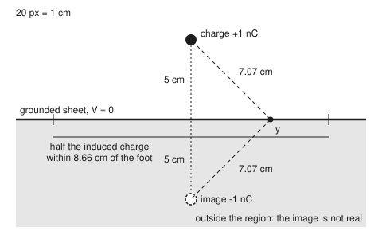

# Method of images: a mirror source satisfies the boundary for free

[Syllabus](../../../SYLLABUS.md) → [Partial differential equations](../README.md) → [Laplace, Poisson and Potentials](../README.md#s04) → Method of images

---

## General Overview

A small bead carries a charge of 1 nC (a nanocoulomb, a billionth of a coulomb). It hangs 5 cm above a large metal sheet. A wire joins the sheet to the ground, so the sheet stays at 0 V. What is the voltage above the sheet, and how hard does the sheet pull the bead?

The sheet draws charge of the opposite sign up from the ground, spread in a pattern nobody knows in advance. The trick avoids that unknown. Delete the sheet. Put an imaginary bead of −1 nC at the mirror point, 5 cm *below* the sheet. Every sheet point is equally far from the two beads, so their voltages cancel there: 0 V, as the wire demands. The imaginary bead adds no charge above the sheet, so the pair is the answer there.

From the pair, the sheet pulls the bead down with 0.8988 μN (micronewtons). The drawn-up charge peaks at −63.66 nC/m² under the bead and totals exactly −1 nC.

[Laplace's equation](../../08-Differential%20equations%20and%20dynamics/10-The%20Classical%20PDEs/07-laplaces-equation-and-harmonic-functions.md) in wing 08 proved that boundary values fix a settled field. This card uses that to build answers. With a stretch, the mirror also works for a sphere. For both shapes it gives the **Green's function**, the response to one point source when the boundary is held at 0, and from it the formula that fills the shape from its boundary values.

As a problem: the **unknown** is the voltage $`V`$ above the sheet; the **region** is the half-space above it; the **data** is $`V = 0`$ on the sheet and $`V \to 0`$ far away, with the bead as the one source.

**A source outside the region adds nothing inside it, so a mirror source that cancels the real one on the boundary solves the boundary problem; for a plane the mirror is a reflection, for a sphere an inversion with a scaled charge, and the boundary slope of the result is the Poisson kernel.**

**What kind of fact this is:** a theorem. The Green's functions of the half-space and the ball, and their Poisson kernels, are proved in Why it works. That the Poisson integral takes the boundary values is stated with its source. The endless sheet is a model of a real sheet much wider than 5 cm.

### The picture: the bead, the sheet and the mirror bead

<p align="center"></p>

To scale, 20 px to 1 cm. The image sits in the shaded part, outside the problem. A sheet point 5 cm to the side is 7.07 cm from both beads, so the voltages cancel. The bracket spans the circle of radius 8.66 cm that holds half the drawn-up charge.

---

## The formula

Notation first. The source sits at $`x = (x_1, \dots, x_d)`$ in $`d`$ dimensions, and the field is read at $`y`$. The sheet is the plane where the last coordinate is 0, so $`x_d`$ is the bead's height. $`\Phi`$ is the field of one unit source, with $`-\Delta\Phi = \delta`$ ([The fundamental solution](02-fundamental-solution-of-the-laplacian.md)); in three dimensions $`\Phi(z) = 1/(4\pi|z|)`$. This card introduces the **image point** $`\tilde x`$ ("x tilde"), the mirror point of $`x`$.

The half-space:

```math
G(x, y) = \Phi(y - x) - \Phi(y - \tilde x), \qquad \tilde x = (x_1, \dots, x_{d-1}, -x_d)
```

**Read it aloud:** the response at $`y`$ to a unit source at $`x`$ is the free field of the source minus the free field of its mirror.

The ball of radius $`R`$ about the origin, $`d \ge 3`$:

```math
G(x, y) = \Phi(y - x) - \Big(\frac{R}{|x|}\Big)^{d-2}\,\Phi(y - \tilde x), \qquad \tilde x = \frac{R^2}{|x|^2}\,x
```

**Read it aloud:** the image sits on the source's ray at distance $`R^2/|x|`$; its strength is $`(R/|x|)^{d-2}`$ times the source's, with the opposite sign.

The boundary slope of $`G`$ is the **Poisson kernel** $`P`$, which fills the region from its boundary values:

```math
u(x) = \int_{\partial\Omega} P(x, y)\, g(y)\, dS(y), \qquad P(x, y) = -\frac{\partial G}{\partial n_y}(x, y)
```

```math
P_{\text{half}}(x, y) = \frac{2\,x_d}{A_d\,|x - y|^d}, \qquad P_{\text{ball}}(x, y) = \frac{R^2 - |x|^2}{A_d\,R\,|x - y|^d}
```

Here $`g`$ is the boundary data, $`n`$ the outward unit normal, $`dS`$ a patch of boundary area, and $`A_d`$ the area of the unit sphere in $`d`$ dimensions ($`4\pi`$ in three).

**Read it aloud:** the value at $`x`$ is a weighted average of the boundary values; weights fall off as distance to the power $`d`$ and add up to 1.

For the bead, $`V(y) = (q/\varepsilon_0)\,G(x, y)`$, and the drawn-up charge per square metre is $`\sigma(y) = -q\,P(x, y)`$.

| Symbol | Plain meaning | In our example | Push it up and the answer… |
| --- | --- | --- | --- |
| $`q`$, $`h`$ | the bead's charge; its height above the sheet | 1 nC; 5 cm | every voltage grows with $`q`$; a higher bead gets a weaker pull |
| $`x`$, $`y`$, $`x_d`$, $`\rho`$ | source point; field point; the source's height; distance along the sheet from the bead's foot | $`x = (0, 0, 5)`$ cm | larger $`\rho`$: less charge |
| $`\tilde x`$ | image point: mirror in a plane, or inversion in a sphere | 5 cm below the sheet; 20 cm from the sphere's centre | — |
| $`\Phi`$, $`z`$, $`\delta`$, $`\Delta`$, $`\nabla`$ | free field of a unit source at displacement $`z`$; point source; Laplacian; gradient | $`1/(4\pi\lvert z \rvert)`$ | — |
| $`G`$ | Green's function: a unit source's field with the boundary held at 0 | source minus image | — |
| $`V`$, $`\varepsilon_0`$, $`k`$ | voltage; vacuum permittivity; Coulomb's constant $`1/(4\pi\varepsilon_0)`$ | 239.67 V halfway down; $`kq`$ = 8.9876 V·m | — |
| $`P`$, $`n`$, $`e_d`$, $`\Omega`$, $`\partial\Omega`$, $`dS`$ | Poisson kernel; outward unit normal; unit arrow up the last axis; region; its boundary; patch of boundary area | on the sheet $`n = -e_d`$ | — |
| $`\sigma`$, $`F`$ | drawn-up charge per square metre; pull on the bead | −63.66 nC/m²; 0.8988 μN | both fall as $`1/h^2`$ |
| $`R`$, $`a`$ | sphere's radius; bead's distance from its centre | 10 cm; 5 cm | image moves in to meet the bead |
| $`g`$, $`u`$, $`p`$ | boundary data; the harmonic function it fills in; a test point outside | $`g = 1/\lvert y - p \rvert`$ | $`u`$ rises with $`g`$ |
| $`d`$, $`A_d`$, $`r`$, $`\theta`$ | dimension; unit sphere's area; in the plane, $`\lvert x \rvert`$ and the angle to a rim point | 3; $`4\pi`$; $`r = 1/2`$ | — |
| $`\kappa`$, $`t`$, $`\Gamma`$, $`G_{\text{held}}`$, $`G_{\text{insulated}}`$ | diffusivity; time; heat kernel (not $`G`$ here); the rod's two Green's functions | $`1.11 \times 10^{-4}`$ m²/s; 10 s | — |

### When it holds

- **A plane or a sphere.** One image suffices. Two parallel sheets need images of images forever; with one image, a second sheet 5 cm above the bead sits at 119.83 V.
- **The image outside the region.** An image inside adds a source where the equation must hold, and solves another problem.
- **An equation with no preferred direction.** The Laplacian and the heat equation look the same in a mirror. A drift, as in [Convection-diffusion](../03-The%20Heat%20Equation%20in%20Depth/06-convection-diffusion-and-drift.md), needs a weighted image.
- **The right class.** The answer is the solution that is classical away from the bead and tends to 0 far away. Without that, adding a uniform field, a constant times $`y_d`$, gives a second solution.

---

## Why it works

### Step 0: guess, then let uniqueness confirm the guess

Fields of two sources add, because the Laplacian is linear. And only one potential that decays far away has a given source and boundary values: two would differ by a harmonic function that is 0 on the boundary, hence 0 everywhere ([Maximum principles](../01-Classification%20and%20Well-Posedness/08-maximum-principles.md)).

So any guess with the right source inside and the right boundary values *is* the answer. The image is a source outside the region, chosen to fix the boundary.

### Step 1: the half-space, by reflection

Take the bead at $`x = (0, 0, h)`$ and the image at $`\tilde x = (0, 0, -h)`$ with the opposite charge. A sheet point $`y`$ has $`y_3 = 0`$, so

```math
|y - x|^2 = y_1^2 + y_2^2 + h^2 = |y - \tilde x|^2 .
```

So $`G = 0`$ on the sheet. Above it, $`\Phi(y - \tilde x)`$ is harmonic, since its only singular point is below, and $`G \to 0`$ far away. By Step 0, $`G`$ is the half-space's Green's function. Halfway down: $`V`$ = 359.50 V − 119.83 V = **239.67 V**.

### Step 2: the sphere, by inversion

Now put the bead inside a grounded metal sphere of radius $`R`$ = 10 cm, $`a`$ = 5 cm from the centre. A flat mirror fails on a curved wall. Geometry helps instead: points whose distances to two fixed points keep a fixed ratio form a sphere (the circle of Apollonius, in three dimensions).

Put the image on the same ray at $`\tilde x = R^2 x/|x|^2`$, here 20.0 cm out. Then for every $`y`$ on the sphere

```math
|y - \tilde x| = \frac{R}{|x|}\,|y - x| .
```

Every sphere point is twice as far from the image as from the bead. $`\Phi`$ falls as 1/distance in 3 dimensions, so an image of $`-qR/|x|`$ = −2.0 nC cancels the bead on the whole sphere. At the nearest point: $`kq/0.05 - 2kq/0.10 = 0`$.

<details>
<summary>Detailed proof: the distance ratio on the sphere</summary>

Let $`|y| = R`$ and $`\tilde x = (R^2/|x|^2)\,x`$. Expand the square:

$`\displaystyle |y - \tilde x|^2 = R^2 - \frac{2R^2}{|x|^2}\,x\cdot y + \frac{R^4}{|x|^2} = \frac{R^2}{|x|^2}\big(|x|^2 - 2\,x\cdot y + R^2\big) = \frac{R^2}{|x|^2}\,|y - x|^2 .`$

Take square roots. Since $`\Phi(z) = 1/((d-2)A_d|z|^{d-2})`$ for $`d \ge 3`$, it follows that $`(R/|x|)^{d-2}\,\Phi(y - \tilde x) = \Phi(y - x)`$ on the sphere, so $`G = 0`$ there. The image is outside the ball because $`|\tilde x| = R^2/|x| > R`$. So $`G`$ minus $`\Phi(y - x)`$ is harmonic inside, and $`G`$ is the Green's function of the ball.

In the plane, $`\Phi(z) = -\tfrac{1}{2\pi}\ln|z|`$, and the same identity gives $`G(x, y) = \Phi(y - x) - \Phi\big(\tfrac{|x|}{R}(y - \tilde x)\big)`$.

</details>

### Step 3: from Green's function to the Poisson kernel

[Green's function](04-greens-functions-and-the-representation-formula.md) proves that a harmonic $`u`$ with boundary values $`g`$ is $`u(x) = -\int_{\partial\Omega} g\,\partial G/\partial n_y\, dS`$. So $`P`$ is minus the outward slope of $`G`$, built from $`\nabla\Phi(z) = -z/(A_d|z|^d)`$. On the sheet the source and the image each give half the slope, so the 2 appears. On the sphere the distance ratio makes the two gradients combine into $`R^2 - |x|^2`$.

<details>
<summary>Detailed proof: the two kernels</summary>

Half-space. The outward normal is $`n = -e_d`$, the unit arrow pointing down. With $`y_d = 0`$ and $`|y - x| = |y - \tilde x|`$:

$`\displaystyle \frac{\partial G}{\partial y_d} = -\frac{(y_d - x_d) - (y_d + x_d)}{A_d\,|y - x|^d} = \frac{2x_d}{A_d\,|y - x|^d}, \qquad P = -\frac{\partial G}{\partial n} = \frac{\partial G}{\partial y_d} .`$

Ball. The outward normal is $`n = y/R`$. The gradient of $`(R/|x|)^{d-2}\,\Phi(y - \tilde x)`$ is $`-(R/|x|)^{d-2}(y - \tilde x)/(A_d|y - \tilde x|^d)`$, and $`G`$ subtracts it, and $`|y - \tilde x| = (R/|x|)\,|y - x|`$ on the sphere, so

$`\displaystyle \frac{\partial G}{\partial n} = -\frac{1}{A_d R\,|y - x|^d}\Big((y - x)\cdot y - \frac{|x|^2}{R^2}(y - \tilde x)\cdot y\Big) .`$

Now $`(y - x)\cdot y = R^2 - x\cdot y`$ and $`\tfrac{|x|^2}{R^2}(y - \tilde x)\cdot y = |x|^2 - x\cdot y`$. The bracket is $`R^2 - |x|^2`$, which gives $`P_{\text{ball}}`$.

For continuous $`g`$ the integral is harmonic and tends to $`g`$ at the boundary: the weights are positive, add up to 1 and pile up there, as on the disc. Evans, section 2.2.4, Theorems 14 and 15.

</details>

### Step 4: the kernel is where the metal's charge sits

Gauss's law says a metal surface carries, per square metre, $`\varepsilon_0`$ times the field leaving it. With $`V = (q/\varepsilon_0)G`$, that is $`\sigma = -q\,P`$: the Poisson kernel is the shape of the drawn-up charge.

- At the foot, $`\sigma = -q/(2\pi h^2)`$ = **−63.66 nC/m²**; 5 cm out, −22.51 nC/m².
- The weights add up to 1, so the total is $`-q`$. Quadrature gives −1.000000 nC.
- The charge beyond radius $`\rho`$ is $`-q\,h/\sqrt{\rho^2 + h^2}`$, so half lies within $`h\sqrt3`$ = 8.66 cm.

Above the sheet the image's field equals the spread charge's, so the pull is $`F = kq^2/(2h)^2`$ = **0.8988 μN**. Adding the pull of every patch of sheet gives the same.

### Step 5: the plane case is the complex-analysis formula

Put $`d = 2`$, so $`A_2 = 2\pi`$, and take $`R = 1`$. Let $`r = |x|`$ and let $`\theta`$ be the angle between $`x`$ and the rim point $`y`$. Then $`|x - y|^2 = 1 - 2r\cos\theta + r^2`$, and

```math
P_{\text{ball}} = \frac{1 - r^2}{2\pi\,|x - y|^2} = \frac{1}{2\pi}\,\frac{1 - r^2}{1 - 2r\cos\theta + r^2} .
```

This is the kernel of [The Poisson formula](../../07-Complex%20analysis/07-Conformal%20Maps%20and%20Harmonic%20Functions/06-poisson-integral-formula.md), found there by a reflected point that is this card's $`\tilde x`$. At $`r = 1/2`$, $`2\pi P_{\text{ball}}`$ is 3.000000 nearest and 0.333333 farthest, that card's weights. The half-space kernel becomes its half-plane formula, $`x_2/(\pi((x_1 - y_1)^2 + x_2^2))`$.

### Step 6: the same mirror for heat

The heat kernel of [The heat kernel](../03-The%20Heat%20Equation%20in%20Depth/01-heat-kernel-and-fundamental-solution.md), $`\Gamma(z, t) = e^{-z^2/(4\kappa t)}/\sqrt{4\pi\kappa t}`$, is mirror-symmetric too. On a rod $`x > 0`$:

```math
G_{\text{held}}(x, y, t) = \Gamma(x - y, t) - \Gamma(x + y, t), \qquad G_{\text{insulated}}(x, y, t) = \Gamma(x - y, t) + \Gamma(x + y, t)
```

The minus holds the end at room temperature (0 here). The plus gives zero slope there, an insulated end. Move that card's 1 K·m of heat to 5 cm from the copper rod's end. After 10 s the temperature at the spot is 8.4671 K on an endless rod, 7.5767 K with the end held and 9.3575 K with it insulated. With the end held, 0.711397 of the heat remains.

### Step 7: why only planes and spheres

An image needs a symmetry of the equation that fixes the boundary and swaps inside with outside. For the Laplacian these are reflections in planes and inversions in spheres; inversion, with the factor $`(R/|x|)^{d-2}`$ seen in the ball's image, is the **Kelvin transform**, which turns harmonic functions inside a sphere into harmonic functions outside.

- A corner works with finitely many images when its angle divides 180° a whole number of times, as 90° does.
- Two parallel sheets reflect images into each other forever: an endless row.
- A closed box, the shelf's house example, needs an endless lattice.

---

## Worked numbers, by hand

The bead: $`q`$ = 1 nC, $`h`$ = 5 cm = 0.05 m, $`k`$ = 8.987552e9 N·m²/C².

| Step | Arithmetic | Value |
| --- | --- | --- |
| $`kq`$ | $`8.987552 \times 10^9 \times 10^{-9}`$ | 8.9876 V·m |
| bead's voltage 2.5 cm away | $`8.9876 / 0.025`$ | 359.50 V |
| image's voltage 7.5 cm away | $`8.9876 / 0.075`$ | 119.83 V |
| $`V`$ halfway down | $`359.50 - 119.83`$ | 239.67 V |
| drawn-up charge at the foot | $`-10^{-9} / (2\pi \times 0.05^2)`$ | −63.66 nC/m² |
| at 5 cm out | $`-63.66 \times (0.05/0.0707)^3`$ | −22.51 nC/m² |
| radius holding half of it | $`5 \times \sqrt3`$ | 8.66 cm |
| pull, bead to image 10 cm | $`8.9876 \times 10^{-9} / 0.10^2`$ | **0.8988 μN** |

The sheet pulls the bead as a −1 nC charge 10 cm away would, though the real charge is spread over the sheet.

### What breaks if you drop a piece

| Mistake | Comes out at | What went wrong |
| --- | --- | --- |
| No image | 179.75 V at the foot, not 0 | the sheet is not grounded |
| Same-sign image, +1 nC | 359.50 V at the foot | zero slope instead: the insulated problem |
| Slope of the bead's field alone | −31.83 nC/m², not −63.66 | the image gives the other half of $`P`$ |
| Sphere image −1 nC, not −2 nC | 89.88 V nearest, 29.96 V farthest | the charge must scale by $`R/\lvert x \rvert`$ |
| Two sheets 10 cm apart, one image | top sheet 119.83 V; 239.67 V at 2.5 cm, not 224.05 V | each image breaks the other sheet |

With two sheets and the bead midway, each round of images adds two more, one gap farther out. The voltage 2.5 cm above the lower sheet settles slowly:

| Images out to round | $`V`$ at 2.5 cm | First omitted round |
| --- | --- | --- |
| 1 | 167.77 V | 91.30 V |
| 10 | 232.60 V | 16.35 V |
| 100 | 224.95 V | 1.78 V |
| 1000 | 224.14 V | 0.18 V |
| all | 224.05 V | — |

Rounds alternate in sign and shrink, so the error is below the first omitted round. The full sum, a known series, is $`(4kq/0.10\ \mathrm{m})\ln(1 + \sqrt2)/\sqrt2`$.

---

## Code, from first principles, and it actually runs

The code builds the image fields and both kernels, then checks them by three roads that do not use images:

1. **Quadrature.** Simpson's rule adds up the drawn-up charge, the pull of every patch of sheet, and the Poisson integral of test data $`1/|y - p|`$, which must return $`1/|x - p|`$.
2. **The equation.** Centred differences of $`V`$ give a Laplacian that shrinks fourfold as the step halves: zero up to step error.
3. **A random walk.** From the bead, a walker jumps to a random point on the largest sphere above the sheet, until within 0.01 mm of it (Muller's walk on spheres). Landings follow the Poisson kernel, so half should fall within 8.66 cm. A SplitMix64 generator, seed 0x2026111505, makes both outputs identical.

It also checks the plane case, the heat images against an erf series, and every "What breaks" number.

### Python

```python
# Method of images -- the check behind the card.  Standard library only.
# A 1 nC charge 5 cm above a grounded metal sheet; the same charge 5 cm from the centre
# of a grounded metal sphere of radius 10 cm.  Roads: the image formulas; quadrature of
# the induced charge, the force and the Poisson integral; centred differences; a random walk.
import math

EPS0 = 8.8541878188e-12                    # F/m, vacuum permittivity (CODATA 2022)
K = 1 / (4 * math.pi * EPS0)               # Coulomb constant, N m^2/C^2
q, h, R, a = 1e-9, 0.05, 0.10, 0.05        # C, m, m, m
AREA = {2: 2 * math.pi, 3: 4 * math.pi}    # area of the unit sphere in d dimensions

def dist(p, s): return math.sqrt(sum((u - v) ** 2 for u, v in zip(p, s)))
def V_plane(y): return K * q * (1 / dist(y, (0, 0, h)) - 1 / dist(y, (0, 0, -h)))
XB, XT, QT = (a, 0.0, 0.0), (R * R / a, 0.0, 0.0), -q * R / a   # ball: charge, image point, image charge
def V_ball(y): return K * q / dist(y, XB) + K * QT / dist(y, XT)
def K_half(x, y, d): return 2 * x[-1] / (AREA[d] * dist(x, y) ** d)
def K_ball(x, y, d, r): return (r * r - sum(c * c for c in x)) / (AREA[d] * r * dist(x, y) ** d)

def simpson(f, lo, hi, n):
    w = (hi - lo) / n
    return w / 3 * sum((1 if i in (0, n) else 4 if i % 2 else 2) * f(lo + i * w) for i in range(n + 1))

def over_plane(x, f, n=200, top=math.pi / 2 - 1e-9):   # f(y) dA over the sheet, polar about x's foot, rho = x3 tan(th)
    def ring(th):
        rho = x[2] * math.tan(th)
        jac = rho * x[2] / math.cos(th) ** 2
        return jac * simpson(lambda ph: f((x[0] + rho * math.cos(ph), x[1] + rho * math.sin(ph), 0.0)), 0, 2 * math.pi, n)
    return simpson(ring, 0, top, n)

def over_sphere(f, n=200):
    def ring(th):
        return R * R * math.sin(th) * simpson(lambda ph: f((R * math.cos(th), R * math.sin(th) * math.cos(ph),
                                                           R * math.sin(th) * math.sin(ph))), 0, 2 * math.pi, n)
    return simpson(ring, 0, math.pi, n)

def laplacian(V, y, s):
    tot = 0.0
    for i in range(3):
        up = list(y); dn = list(y); up[i] += s; dn[i] -= s
        tot += (V(up) - 2 * V(y) + V(dn)) / (s * s)
    return tot

X = (0.0, 0.0, h)
print(f"Coulomb constant k = 1/(4 pi eps0) = {K / 1e9:.6f}e9 N m^2/C^2; kq = {K * q:.4f} V m")
mid = K * q * (1 / 0.025 - 1 / 0.075)
print(f"V halfway down, 2.5 cm: {K * q / 0.025:.2f} V - {K * q / 0.075:.2f} V = {mid:.2f} V")
print(f"V on the sheet, 6 points out to 20 cm: {max(abs(V_plane((u, w, 0.0))) for u in (0, 0.03, 0.2) for w in (0, 0.07)):.2f} V")
assert max(abs(V_plane((u, w, 0.0))) for u in (0, 0.03, 0.2) for w in (0, 0.07)) < 1e-12
s0, s5 = -q * K_half(X, (0, 0, 0), 3), -q * K_half(X, (0.05, 0, 0), 3)
print(f"induced charge density at the foot {s0 * 1e9:.2f} nC/m^2, at 5 cm out {s5 * 1e9:.2f} nC/m^2")
assert abs(s0 + q / (2 * math.pi * h * h)) < 1e-15
tot = over_plane(X, lambda y: -q * K_half(X, y, 3))
print(f"total induced charge on the sheet, by quadrature: {tot * 1e9:.6f} nC")
assert abs(tot + q) < 1e-15
half = over_plane(X, lambda y: -q * K_half(X, y, 3), top=math.pi / 3)   # tan(60 deg) = sqrt(3)
print(f"induced charge within h*sqrt(3) = {100 * h * math.sqrt(3):.2f} cm: {half * 1e9:.3f} nC")
assert abs(half + q / 2) < 1e-15
F_img = K * q * q / (2 * h) ** 2
F_int = over_plane(X, lambda y: -K * q * (-q * K_half(X, y, 3)) * h / dist(X, y) ** 3)
print(f"pull on the charge: image {F_img * 1e6:.4f} uN, summed over the sheet {F_int * 1e6:.4f} uN")
assert abs(F_int - F_img) < 1e-6 * F_img
print(f"work to pull the charge from 5 cm out to far away: {F_img * h * 1e9:.2f} nJ; charge-image pair at 10 cm: {K * q * q / (2 * h) * 1e9:.2f} nJ")
xP, pP = (0.03, 0.0, 0.04), (0.0, 0.0, -0.05)
u_p = over_plane(xP, lambda y: K_half(xP, y, 3) / dist(y, pP))
print(f"Poisson integral, sheet data 1/|y-p|: {u_p:.6f} per m, exact 1/|x-p| = {1 / dist(xP, pP):.6f} per m")
assert abs(u_p - 1 / dist(xP, pP)) < 1e-6
r1, r2 = laplacian(V_plane, Y := (0.02, 0.01, 0.03), 1e-3), laplacian(V_plane, Y, 5e-4)
print(f"Laplacian of V at (2,1,3) cm, centred differences: step 1 mm {r1:.1f}, 0.5 mm {r2:.1f} V/m^2; V/r^2 = {V_plane(Y) / 0.03 ** 2:.0f} V/m^2")
assert abs(r1 / r2 - 4) < 0.2 and abs(r2) < 1e-3 * V_plane(Y) / 0.03 ** 2

print(f"ball: R = 10 cm, charge at 5 cm, image point {100 * XT[0]:.1f} cm, image charge {QT * 1e9:.1f} nC")
pts = [(R * math.sin(t) * math.cos(f), R * math.sin(t) * math.sin(f), R * math.cos(t)) for t in (0.1, 0.9, 1.7, 2.5, 3.0) for f in (0, 1, 2, 4)] + [(R, 0, 0), (-R, 0, 0)]
print(f"max |V| at 22 points of the sphere below 1e-9 V: {'yes' if max(abs(V_ball(y)) for y in pts) < 1e-9 else 'no'}")
assert max(abs(V_ball(y)) for y in pts) < 1e-9
for lab, y in (("nearest", (R, 0, 0)), ("farthest", (-R, 0, 0))):
    print(f"  {lab} point: induced density {-q * K_ball(XB, y, 3, R) * 1e9:.3f} nC/m^2")
tb = over_sphere(lambda y: -q * K_ball(XB, y, 3, R))
print(f"total induced charge on the sphere, by quadrature: {tb * 1e9:.6f} nC")
assert abs(tb + q) < 1e-14
pB = (0.0, 0.25, 0.0)
u_b = over_sphere(lambda y: K_ball(XB, y, 3, R) / dist(y, pB))
print(f"Poisson integral, sphere data 1/|y-p|: {u_b:.6f} per m, exact {1 / dist(XB, pB):.6f} per m")
assert abs(u_b - 1 / dist(XB, pB)) < 1e-6
b1, b2 = laplacian(V_ball, (0.0, 0.03, 0.02), 1e-3), laplacian(V_ball, (0.0, 0.03, 0.02), 5e-4)
print(f"Laplacian of V inside the ball: step 1 mm {b1:.2f}, 0.5 mm {b2:.2f} V/m^2")
assert abs(b1 / b2 - 4) < 0.2

print("plane (d = 2): kernels times 2 pi against the complex-analysis card")
P = lambda r, t: (1 - r * r) / (1 - 2 * r * math.cos(t) + r * r)
dd = max(abs(2 * math.pi * K_ball((0.5, 0), (math.cos(t), math.sin(t)), 2, 1) - P(0.5, t)) for t in [i * 0.4 for i in range(16)])
print(f"  disc r = 1/2: nearest {2 * math.pi * K_ball((0.5, 0), (1, 0), 2, 1):.6f}, farthest {2 * math.pi * K_ball((0.5, 0), (-1, 0), 2, 1):.6f}; gap to P_r below 1e-12: {'yes' if dd < 1e-12 else 'no'}")
dh = max(abs(K_half((0, 3), (t, 0), 2) - 3 / (math.pi * (t * t + 9))) for t in range(-10, 11))
print(f"  half-plane at 3i: gap to y/(pi((x-t)^2+y^2)) below 1e-12: {'yes' if dh < 1e-12 else 'no'}")
assert dd < 1e-12 and dh < 1e-12

s = 0x2026111505
def rnd():
    global s
    s = (s + 0x9E3779B97F4A7C15) & 0xFFFFFFFFFFFFFFFF
    z = s
    z = ((z ^ (z >> 30)) * 0xBF58476D1CE4E5B9) & 0xFFFFFFFFFFFFFFFF
    z = ((z ^ (z >> 27)) * 0x94D049BB133111EB) & 0xFFFFFFFFFFFFFFFF
    return ((z ^ (z >> 31)) >> 11) * 2.0 ** -53
N, near, mid_n = 20000, 0, 0
for _ in range(N):
    x, y, z = 0.0, 0.0, h
    while z > 1e-5:
        c, ph = 2 * rnd() - 1, 2 * math.pi * rnd()
        sn = math.sqrt(max(0.0, 1 - c * c))
        x, y, z = x + z * sn * math.cos(ph), y + z * sn * math.sin(ph), z + z * c
    rr = math.hypot(x, y)
    near += rr < h
    mid_n += rr < h * math.sqrt(3)
for lab, cnt, ex in (("5 cm", near, 1 - 1 / math.sqrt(2)), ("8.66 cm", mid_n, 0.5)):
    se = math.sqrt(ex * (1 - ex) / N)
    print(f"random walk, {N} walkers from the charge: within {lab} {cnt} = {cnt / N:.4f}, kernel says {ex:.4f} (s.e. {se:.4f})")
    assert abs(cnt / N - ex) < 4 * se

def slab(M, L=0.10): return K * q * sum((-1) ** m / abs(0.025 - (L / 2 + m * L)) for m in range(-M, M + 1))
exact = 4 * K * q / 0.10 * math.log(1 + math.sqrt(2)) / math.sqrt(2)
print(f"two sheets 10 cm apart, V at 2.5 cm: one image {mid:.2f} V (top sheet then at {K * q * (1 / 0.05 - 1 / 0.15):.2f} V)")
for M in (1, 10, 100, 1000):
    print(f"  images out to round {M:4d}: {slab(M):7.2f} V, first omitted round {abs(slab(M + 1) - slab(M)):.2f} V")
print(f"  full sum {exact:.2f} V")
assert abs(slab(1000) - exact) < abs(slab(1001) - slab(1000))

kap, t, y0 = 1.11e-4, 10.0, 0.05
G = lambda x: math.exp(-x * x / (4 * kap * t)) / math.sqrt(4 * math.pi * kap * t)
print(f"heat: 1 K m spot 5 cm from the rod's end, after 10 s: free {G(0):.4f} K, end held at room temperature {G(0) - G(2 * y0):.4f} K, end insulated {G(0) + G(2 * y0):.4f} K")
kept = simpson(lambda x: G(x - y0) - G(x + y0), 0, 1.0, 2000)
ser = sum((-1) ** n * (y0 / math.sqrt(4 * kap * t)) ** (2 * n + 1) / (math.factorial(n) * (2 * n + 1)) for n in range(40)) * 2 / math.sqrt(math.pi)
print(f"  fraction of the heat still in the rod, end held: {kept:.6f} by quadrature, {ser:.6f} by the erf series")
assert abs(kept - ser) < 1e-9

print("bad images: no image V at the foot", f"{K * q / h:.2f} V; same-sign image {2 * K * q / h:.2f} V;",
      f"source half only {-q / (4 * math.pi * h * h) * 1e9:.2f} nC/m^2")
print(f"bad images: sphere image -1 nC: nearest {K * q * (1 / 0.05 - 1 / 0.10):.2f} V, farthest {K * q * (1 / 0.15 - 1 / 0.30):.2f} V")
print("figure, 20 px per cm: charge (240, 50), image (240, 250), sheet at y = 150, sheet point (340, 150),",
      f"half-charge marks x = {240 - 20 * 100 * h * math.sqrt(3):.1f} and {240 + 20 * 100 * h * math.sqrt(3):.1f}, slant {100 * dist((h, 0, 0), X):.2f} cm")
print("ALL CHECKS PASS")
```

**Ran 2026-11-15 on macOS, Python 3.14.10, standard library only. All checks passed. Output, pasted from the run:**

```
Coulomb constant k = 1/(4 pi eps0) = 8.987552e9 N m^2/C^2; kq = 8.9876 V m
V halfway down, 2.5 cm: 359.50 V - 119.83 V = 239.67 V
V on the sheet, 6 points out to 20 cm: 0.00 V
induced charge density at the foot -63.66 nC/m^2, at 5 cm out -22.51 nC/m^2
total induced charge on the sheet, by quadrature: -1.000000 nC
induced charge within h*sqrt(3) = 8.66 cm: -0.500 nC
pull on the charge: image 0.8988 uN, summed over the sheet 0.8988 uN
work to pull the charge from 5 cm out to far away: 44.94 nJ; charge-image pair at 10 cm: 89.88 nJ
Poisson integral, sheet data 1/|y-p|: 10.540926 per m, exact 1/|x-p| = 10.540926 per m
Laplacian of V at (2,1,3) cm, centred differences: step 1 mm -628.4, 0.5 mm -157.1 V/m^2; V/r^2 = 212653 V/m^2
ball: R = 10 cm, charge at 5 cm, image point 20.0 cm, image charge -2.0 nC
max |V| at 22 points of the sphere below 1e-9 V: yes
  nearest point: induced density -47.746 nC/m^2
  farthest point: induced density -1.768 nC/m^2
total induced charge on the sphere, by quadrature: -1.000000 nC
Poisson integral, sphere data 1/|y-p|: 3.922323 per m, exact 3.922323 per m
Laplacian of V inside the ball: step 1 mm -8.99, 0.5 mm -2.25 V/m^2
plane (d = 2): kernels times 2 pi against the complex-analysis card
  disc r = 1/2: nearest 3.000000, farthest 0.333333; gap to P_r below 1e-12: yes
  half-plane at 3i: gap to y/(pi((x-t)^2+y^2)) below 1e-12: yes
random walk, 20000 walkers from the charge: within 5 cm 5878 = 0.2939, kernel says 0.2929 (s.e. 0.0032)
random walk, 20000 walkers from the charge: within 8.66 cm 9972 = 0.4986, kernel says 0.5000 (s.e. 0.0035)
two sheets 10 cm apart, V at 2.5 cm: one image 239.67 V (top sheet then at 119.83 V)
  images out to round    1:  167.77 V, first omitted round 91.30 V
  images out to round   10:  232.60 V, first omitted round 16.35 V
  images out to round  100:  224.95 V, first omitted round 1.78 V
  images out to round 1000:  224.14 V, first omitted round 0.18 V
  full sum 224.05 V
heat: 1 K m spot 5 cm from the rod's end, after 10 s: free 8.4671 K, end held at room temperature 7.5767 K, end insulated 9.3575 K
  fraction of the heat still in the rod, end held: 0.711397 by quadrature, 0.711397 by the erf series
bad images: no image V at the foot 179.75 V; same-sign image 359.50 V; source half only -31.83 nC/m^2
bad images: sphere image -1 nC: nearest 89.88 V, farthest 29.96 V
figure, 20 px per cm: charge (240, 50), image (240, 250), sheet at y = 150, sheet point (340, 150), half-charge marks x = 66.8 and 413.2, slant 7.07 cm
ALL CHECKS PASS
```

### Rust

The same checks, with the same output.

```rust
// Method of images -- the same check as method_of_images_check.py, in Rust.  std only, no crates.
// A 1 nC charge 5 cm above a grounded metal sheet; the same charge 5 cm from the centre
// of a grounded metal sphere of radius 10 cm.  Roads: the image formulas; quadrature of
// the induced charge, the force and the Poisson integral; centred differences; a random walk.
use std::f64::consts::PI;

const EPS0: f64 = 8.8541878188e-12; // F/m, vacuum permittivity (CODATA 2022)
const Q: f64 = 1e-9; const H: f64 = 0.05; const R: f64 = 0.10; const A: f64 = 0.05; // C, m, m, m

fn kc() -> f64 { 1.0 / (4.0 * PI * EPS0) }
fn area(d: i32) -> f64 { if d == 2 { 2.0 * PI } else { 4.0 * PI } }
fn dist(p: &[f64], s: &[f64]) -> f64 { p.iter().zip(s).map(|(u, v)| (u - v) * (u - v)).sum::<f64>().sqrt() }
fn v_plane(y: &[f64]) -> f64 { kc() * Q * (1.0 / dist(y, &[0.0, 0.0, H]) - 1.0 / dist(y, &[0.0, 0.0, -H])) }
const XB: [f64; 3] = [A, 0.0, 0.0];
fn xt() -> [f64; 3] { [R * R / A, 0.0, 0.0] }
fn qt() -> f64 { -Q * R / A }
fn v_ball(y: &[f64]) -> f64 { kc() * Q / dist(y, &XB) + kc() * qt() / dist(y, &xt()) }
fn k_half(x: &[f64], y: &[f64], d: i32) -> f64 { 2.0 * x[x.len() - 1] / (area(d) * dist(x, y).powi(d)) }
fn k_ball(x: &[f64], y: &[f64], d: i32, r: f64) -> f64 { (r * r - x.iter().map(|c| c * c).sum::<f64>()) / (area(d) * r * dist(x, y).powi(d)) }

fn simpson(f: &dyn Fn(f64) -> f64, lo: f64, hi: f64, n: usize) -> f64 {
    let w = (hi - lo) / n as f64;
    w / 3.0 * (0..=n).map(|i| (if i == 0 || i == n { 1.0 } else if i % 2 == 1 { 4.0 } else { 2.0 }) * f(lo + i as f64 * w)).sum::<f64>()
}

// f(y) dA over the sheet, polar about x's foot, rho = x3 tan(th)
fn over_plane(x: [f64; 3], f: &dyn Fn(&[f64]) -> f64, top: f64) -> f64 {
    let ring = |th: f64| {
        let rho = x[2] * th.tan();
        let jac = rho * x[2] / th.cos().powi(2);
        jac * simpson(&|ph: f64| f(&[x[0] + rho * ph.cos(), x[1] + rho * ph.sin(), 0.0]), 0.0, 2.0 * PI, 200)
    };
    simpson(&ring, 0.0, top, 200)
}

fn over_sphere(f: &dyn Fn(&[f64]) -> f64) -> f64 {
    let ring = |th: f64| R * R * th.sin() * simpson(&|ph: f64| f(&[R * th.cos(), R * th.sin() * ph.cos(), R * th.sin() * ph.sin()]), 0.0, 2.0 * PI, 200);
    simpson(&ring, 0.0, PI, 200)
}

fn laplacian(v: &dyn Fn(&[f64]) -> f64, y: [f64; 3], s: f64) -> f64 {
    (0..3).map(|i| { let (mut up, mut dn) = (y, y); up[i] += s; dn[i] -= s; (v(&up) - 2.0 * v(&y) + v(&dn)) / (s * s) }).sum()
}

struct SplitMix(u64);
impl SplitMix {
    fn rnd(&mut self) -> f64 {
        self.0 = self.0.wrapping_add(0x9E3779B97F4A7C15);
        let mut z = self.0;
        z = (z ^ (z >> 30)).wrapping_mul(0xBF58476D1CE4E5B9);
        z = (z ^ (z >> 27)).wrapping_mul(0x94D049BB133111EB);
        ((z ^ (z >> 31)) >> 11) as f64 * 2f64.powi(-53)
    }
}

fn yn(b: bool) -> &'static str { if b { "yes" } else { "no" } }

fn main() {
    let (k, q, h) = (kc(), Q, H);
    let x = [0.0, 0.0, h];
    println!("Coulomb constant k = 1/(4 pi eps0) = {:.6}e9 N m^2/C^2; kq = {:.4} V m", k / 1e9, k * q);
    let mid = k * q * (1.0 / 0.025 - 1.0 / 0.075);
    println!("V halfway down, 2.5 cm: {:.2} V - {:.2} V = {:.2} V", k * q / 0.025, k * q / 0.075, mid);
    let vs = [0.0, 0.03, 0.2].iter().flat_map(|&u| [0.0, 0.07].map(|w| v_plane(&[u, w, 0.0]).abs())).fold(0.0, f64::max);
    println!("V on the sheet, 6 points out to 20 cm: {:.2} V", vs);
    assert!(vs < 1e-12);
    let (s0, s5) = (-q * k_half(&x, &[0.0, 0.0, 0.0], 3), -q * k_half(&x, &[0.05, 0.0, 0.0], 3));
    println!("induced charge density at the foot {:.2} nC/m^2, at 5 cm out {:.2} nC/m^2", s0 * 1e9, s5 * 1e9);
    assert!((s0 + q / (2.0 * PI * h * h)).abs() < 1e-15);
    let full = PI / 2.0 - 1e-9; let tot = over_plane(x, &|y| -q * k_half(&x, y, 3), full);
    println!("total induced charge on the sheet, by quadrature: {:.6} nC", tot * 1e9);
    assert!((tot + q).abs() < 1e-15);
    let half = over_plane(x, &|y| -q * k_half(&x, y, 3), PI / 3.0); // tan(60 deg) = sqrt(3)
    println!("induced charge within h*sqrt(3) = {:.2} cm: {:.3} nC", 100.0 * h * 3f64.sqrt(), half * 1e9);
    assert!((half + q / 2.0).abs() < 1e-15);
    let f_img = k * q * q / (2.0 * h).powi(2);
    let f_int = over_plane(x, &|y| -k * q * (-q * k_half(&x, y, 3)) * h / dist(&x, y).powi(3), full);
    println!("pull on the charge: image {:.4} uN, summed over the sheet {:.4} uN", f_img * 1e6, f_int * 1e6);
    assert!((f_int - f_img).abs() < 1e-6 * f_img);
    println!("work to pull the charge from 5 cm out to far away: {:.2} nJ; charge-image pair at 10 cm: {:.2} nJ", f_img * h * 1e9, k * q * q / (2.0 * h) * 1e9);
    let (xp, pp) = ([0.03, 0.0, 0.04], [0.0, 0.0, -0.05]);
    let u_p = over_plane(xp, &|y| k_half(&xp, y, 3) / dist(y, &pp), full);
    println!("Poisson integral, sheet data 1/|y-p|: {:.6} per m, exact 1/|x-p| = {:.6} per m", u_p, 1.0 / dist(&xp, &pp));
    assert!((u_p - 1.0 / dist(&xp, &pp)).abs() < 1e-6);
    let yy = [0.02, 0.01, 0.03];
    let (r1, r2) = (laplacian(&v_plane, yy, 1e-3), laplacian(&v_plane, yy, 5e-4));
    let scale = v_plane(&yy) / 0.03f64.powi(2);
    println!("Laplacian of V at (2,1,3) cm, centred differences: step 1 mm {:.1}, 0.5 mm {:.1} V/m^2; V/r^2 = {:.0} V/m^2", r1, r2, scale);
    assert!((r1 / r2 - 4.0).abs() < 0.2 && r2.abs() < 1e-3 * scale);

    println!("ball: R = 10 cm, charge at 5 cm, image point {:.1} cm, image charge {:.1} nC", 100.0 * xt()[0], qt() * 1e9);
    let mut pts: Vec<[f64; 3]> = [0.1f64, 0.9, 1.7, 2.5, 3.0].iter().flat_map(|&t| [0.0f64, 1.0, 2.0, 4.0].map(|f| [R * t.sin() * f.cos(), R * t.sin() * f.sin(), R * t.cos()])).collect();
    pts.extend([[R, 0.0, 0.0], [-R, 0.0, 0.0]]);
    let vmax = pts.iter().map(|y| v_ball(y).abs()).fold(0.0, f64::max);
    println!("max |V| at 22 points of the sphere below 1e-9 V: {}", yn(vmax < 1e-9));
    assert!(vmax < 1e-9);
    for (lab, y) in [("nearest", [R, 0.0, 0.0]), ("farthest", [-R, 0.0, 0.0])] {
        println!("  {} point: induced density {:.3} nC/m^2", lab, -q * k_ball(&XB, &y, 3, R) * 1e9);
    }
    let tb = over_sphere(&|y| -q * k_ball(&XB, y, 3, R));
    println!("total induced charge on the sphere, by quadrature: {:.6} nC", tb * 1e9);
    assert!((tb + q).abs() < 1e-14);
    let pb = [0.0, 0.25, 0.0];
    let u_b = over_sphere(&|y| k_ball(&XB, y, 3, R) / dist(y, &pb));
    println!("Poisson integral, sphere data 1/|y-p|: {:.6} per m, exact {:.6} per m", u_b, 1.0 / dist(&XB, &pb));
    assert!((u_b - 1.0 / dist(&XB, &pb)).abs() < 1e-6);
    let (b1, b2) = (laplacian(&v_ball, [0.0, 0.03, 0.02], 1e-3), laplacian(&v_ball, [0.0, 0.03, 0.02], 5e-4));
    println!("Laplacian of V inside the ball: step 1 mm {:.2}, 0.5 mm {:.2} V/m^2", b1, b2);
    assert!((b1 / b2 - 4.0).abs() < 0.2);

    println!("plane (d = 2): kernels times 2 pi against the complex-analysis card");
    let pr = |r: f64, t: f64| (1.0 - r * r) / (1.0 - 2.0 * r * t.cos() + r * r);
    let dd = (0..16).map(|i| { let t = i as f64 * 0.4; (2.0 * PI * k_ball(&[0.5, 0.0], &[t.cos(), t.sin()], 2, 1.0) - pr(0.5, t)).abs() }).fold(0.0, f64::max);
    println!("  disc r = 1/2: nearest {:.6}, farthest {:.6}; gap to P_r below 1e-12: {}",
             2.0 * PI * k_ball(&[0.5, 0.0], &[1.0, 0.0], 2, 1.0), 2.0 * PI * k_ball(&[0.5, 0.0], &[-1.0, 0.0], 2, 1.0), yn(dd < 1e-12));
    let dh = (-10..=10).map(|i| { let t = i as f64; (k_half(&[0.0, 3.0], &[t, 0.0], 2) - 3.0 / (PI * (t * t + 9.0))).abs() }).fold(0.0, f64::max);
    println!("  half-plane at 3i: gap to y/(pi((x-t)^2+y^2)) below 1e-12: {}", yn(dh < 1e-12));
    assert!(dd < 1e-12 && dh < 1e-12);

    let (mut g, n, mut near, mut mid_n) = (SplitMix(0x2026111505), 20000, 0, 0);
    for _ in 0..n {
        let (mut x, mut y, mut z) = (0.0f64, 0.0f64, h);
        while z > 1e-5 {
            let (c, ph) = (2.0 * g.rnd() - 1.0, 2.0 * PI * g.rnd());
            let sn = (1.0 - c * c).max(0.0).sqrt();
            (x, y, z) = (x + z * sn * ph.cos(), y + z * sn * ph.sin(), z + z * c);
        }
        let rr = x.hypot(y);
        near += (rr < h) as i32; mid_n += (rr < h * 3f64.sqrt()) as i32;
    }
    for (lab, cnt, ex) in [("5 cm", near, 1.0 - 1.0 / 2f64.sqrt()), ("8.66 cm", mid_n, 0.5)] {
        let se = (ex * (1.0 - ex) / n as f64).sqrt();
        let fr = cnt as f64 / n as f64;
        println!("random walk, {} walkers from the charge: within {} {} = {:.4}, kernel says {:.4} (s.e. {:.4})", n, lab, cnt, fr, ex, se);
        assert!((fr - ex).abs() < 4.0 * se);
    }

    let l = 0.10;
    let slab = |m: i64| k * q * (-m..=m).map(|j| (if j % 2 == 0 { 1.0 } else { -1.0 }) / (0.025 - (l / 2.0 + j as f64 * l)).abs()).sum::<f64>();
    let exact = 4.0 * k * q / l * (1.0 + 2f64.sqrt()).ln() / 2f64.sqrt();
    println!("two sheets 10 cm apart, V at 2.5 cm: one image {:.2} V (top sheet then at {:.2} V)", mid, k * q * (1.0 / 0.05 - 1.0 / 0.15));
    for m in [1, 10, 100, 1000] {
        println!("  images out to round {:4}: {:7.2} V, first omitted round {:.2} V", m, slab(m), (slab(m + 1) - slab(m)).abs());
    }
    println!("  full sum {:.2} V", exact);
    assert!((slab(1000) - exact).abs() < (slab(1001) - slab(1000)).abs());

    let (kap, t, y0) = (1.11e-4, 10.0, 0.05);
    let gk = |x: f64| (-x * x / (4.0 * kap * t)).exp() / (4.0 * PI * kap * t).sqrt();
    println!("heat: 1 K m spot 5 cm from the rod's end, after 10 s: free {:.4} K, end held at room temperature {:.4} K, end insulated {:.4} K",
             gk(0.0), gk(0.0) - gk(2.0 * y0), gk(0.0) + gk(2.0 * y0));
    let kept = simpson(&|x| gk(x - y0) - gk(x + y0), 0.0, 1.0, 2000);
    let (zz, mut ser, mut fact) = (y0 / (4.0 * kap * t).sqrt(), 0.0, 1.0);
    for i in 0..40 {
        if i > 0 { fact *= i as f64; }
        ser += (if i % 2 == 0 { 1.0 } else { -1.0 }) * zz.powi(2 * i + 1) / (fact * (2 * i + 1) as f64);
    }
    ser *= 2.0 / PI.sqrt();
    println!("  fraction of the heat still in the rod, end held: {:.6} by quadrature, {:.6} by the erf series", kept, ser);
    assert!((kept - ser).abs() < 1e-9);

    println!("bad images: no image V at the foot {:.2} V; same-sign image {:.2} V; source half only {:.2} nC/m^2",
             k * q / h, 2.0 * k * q / h, -q / (4.0 * PI * h * h) * 1e9);
    println!("bad images: sphere image -1 nC: nearest {:.2} V, farthest {:.2} V", k * q * (1.0 / 0.05 - 1.0 / 0.10), k * q * (1.0 / 0.15 - 1.0 / 0.30));
    let mk = 20.0 * 100.0 * h * 3f64.sqrt();
    println!("figure, 20 px per cm: charge (240, 50), image (240, 250), sheet at y = 150, sheet point (340, 150), half-charge marks x = {:.1} and {:.1}, slant {:.2} cm", 240.0 - mk, 240.0 + mk, 100.0 * dist(&[h, 0.0, 0.0], &x));
    println!("ALL CHECKS PASS");
}
```

**Ran 2026-11-15 on macOS, rustc 1.98.1, no crates. All checks passed. Output, pasted from the run:**

```
Coulomb constant k = 1/(4 pi eps0) = 8.987552e9 N m^2/C^2; kq = 8.9876 V m
V halfway down, 2.5 cm: 359.50 V - 119.83 V = 239.67 V
V on the sheet, 6 points out to 20 cm: 0.00 V
induced charge density at the foot -63.66 nC/m^2, at 5 cm out -22.51 nC/m^2
total induced charge on the sheet, by quadrature: -1.000000 nC
induced charge within h*sqrt(3) = 8.66 cm: -0.500 nC
pull on the charge: image 0.8988 uN, summed over the sheet 0.8988 uN
work to pull the charge from 5 cm out to far away: 44.94 nJ; charge-image pair at 10 cm: 89.88 nJ
Poisson integral, sheet data 1/|y-p|: 10.540926 per m, exact 1/|x-p| = 10.540926 per m
Laplacian of V at (2,1,3) cm, centred differences: step 1 mm -628.4, 0.5 mm -157.1 V/m^2; V/r^2 = 212653 V/m^2
ball: R = 10 cm, charge at 5 cm, image point 20.0 cm, image charge -2.0 nC
max |V| at 22 points of the sphere below 1e-9 V: yes
  nearest point: induced density -47.746 nC/m^2
  farthest point: induced density -1.768 nC/m^2
total induced charge on the sphere, by quadrature: -1.000000 nC
Poisson integral, sphere data 1/|y-p|: 3.922323 per m, exact 3.922323 per m
Laplacian of V inside the ball: step 1 mm -8.99, 0.5 mm -2.25 V/m^2
plane (d = 2): kernels times 2 pi against the complex-analysis card
  disc r = 1/2: nearest 3.000000, farthest 0.333333; gap to P_r below 1e-12: yes
  half-plane at 3i: gap to y/(pi((x-t)^2+y^2)) below 1e-12: yes
random walk, 20000 walkers from the charge: within 5 cm 5878 = 0.2939, kernel says 0.2929 (s.e. 0.0032)
random walk, 20000 walkers from the charge: within 8.66 cm 9972 = 0.4986, kernel says 0.5000 (s.e. 0.0035)
two sheets 10 cm apart, V at 2.5 cm: one image 239.67 V (top sheet then at 119.83 V)
  images out to round    1:  167.77 V, first omitted round 91.30 V
  images out to round   10:  232.60 V, first omitted round 16.35 V
  images out to round  100:  224.95 V, first omitted round 1.78 V
  images out to round 1000:  224.14 V, first omitted round 0.18 V
  full sum 224.05 V
heat: 1 K m spot 5 cm from the rod's end, after 10 s: free 8.4671 K, end held at room temperature 7.5767 K, end insulated 9.3575 K
  fraction of the heat still in the rod, end held: 0.711397 by quadrature, 0.711397 by the erf series
bad images: no image V at the foot 179.75 V; same-sign image 359.50 V; source half only -31.83 nC/m^2
bad images: sphere image -1 nC: nearest 89.88 V, farthest 29.96 V
figure, 20 px per cm: charge (240, 50), image (240, 250), sheet at y = 150, sheet point (340, 150), half-charge marks x = 66.8 and 413.2, slant 7.07 cm
ALL CHECKS PASS
```

The walk lands 0.2939 of walkers within 5 cm, where the kernel says 0.2929: inside one standard error, 0.0032.

### Lean

Lean proves the image facts in any dimension: the half-space from two dimensions, the ball from three, and the rod's heat images.

- Take $`d \ge 2`$ and a source with $`x_d > 0`$. Then $`G`$ is 0 on the sheet and tends to 0 far away.
- Take the same source. Then $`G - \Phi(y - x)`$ is harmonic above the sheet, since the image lies below it.
- Take a sheet point $`y`$ and the outward normal $`n = -e_d`$. Then $`-\partial G/\partial n`$ is exactly $`P_{\text{half}}`$.
- Take $`d \ge 3`$ and a source $`x \ne 0`$ inside the ball of radius $`R`$. Then the image $`\tilde x = R^2 x/|x|^2`$ lies outside the ball.
- Take the same source. Then $`G`$ is 0 on the sphere, and $`G - \Phi(y - x)`$ is harmonic inside the ball.
- Take a sphere point $`y`$ and the outward normal $`n = y/R`$. Then $`-\partial G/\partial n`$ is exactly $`P_{\text{ball}}`$.
- Take any spot $`y`$ on the rod. Then $`G_{\text{held}}`$ is 0 at the end, and $`G_{\text{insulated}}`$ has zero slope there.
- Exact arithmetic also checks the worked numbers: the equal 7.07 cm distances, the 20 cm image, the half-charge radius and the disc's weights.

The plane case, the Poisson integral's boundary values, the charge totals and the two-sheet series are left to the Python and Rust checks.

```lean
-- Method of images: a mirror source in a plane, or an inverted and scaled source for a sphere, gives the Green's function of the half-space and of the ball, whose boundary slope is the Poisson kernel; a mirror heat source holds or insulates a rod's end.
import Mathlib.Analysis.InnerProductSpace.Harmonic.Basic
import Mathlib.Analysis.InnerProductSpace.PiL2
import Mathlib.Analysis.SpecialFunctions.Log.Basic
import Mathlib.Analysis.SpecialFunctions.Sqrt
import Mathlib.Analysis.SpecialFunctions.Exp
import Mathlib.Analysis.Calculus.Deriv.Basic
import Mathlib.Geometry.Euclidean.Inversion.Basic
import Mathlib.MeasureTheory.Measure.Lebesgue.VolumeOfBalls
import Mathlib.Tactic.NormNum
import Mathlib.Analysis.InnerProductSpace.Calculus
import Mathlib.Analysis.SpecialFunctions.Pow.Deriv
import Mathlib.Analysis.Calculus.Deriv.Shift

open Real MeasureTheory Filter Topology InnerProductSpace

/-- `A_d`, the area of the unit sphere in `d` dimensions: `d` times the volume of the unit ball
(`2π` in the plane, `4π` in space). -/
noncomputable def unitSphereArea (d : ℕ) : ℝ :=
  d * (volume (Metric.ball (0 : EuclideanSpace ℝ (Fin d)) 1)).toReal

/-- `Φ`, the field of one unit source, with `-ΔΦ = δ`: `-(1/2π) log |z|` in the plane and
`1 / ((d - 2) A_d |z|^(d-2))` for `d ≥ 3`. -/
noncomputable def fundSol (d : ℕ) (z : EuclideanSpace ℝ (Fin d)) : ℝ :=
  if d = 2 then -(1 / (2 * π)) * Real.log ‖z‖
  else 1 / (((d : ℝ) - 2) * unitSphereArea d * ‖z‖ ^ (d - 2))

/-- The image point `x̃ = (x_1, …, x_{d-1}, -x_d)`: the mirror of `x` in the plane `x_d = 0`,
here in dimension `d = n + 1` with last coordinate `Fin.last n`. -/
noncomputable def mirror (n : ℕ) (x : EuclideanSpace ℝ (Fin (n + 1))) :
    EuclideanSpace ℝ (Fin (n + 1)) :=
  x - (2 * x (Fin.last n)) • EuclideanSpace.single (Fin.last n) (1 : ℝ)

/-- The half-space Green's function `G(x, y) = Φ(y - x) - Φ(y - x̃)`. -/
noncomputable def halfGreen (n : ℕ) (x y : EuclideanSpace ℝ (Fin (n + 1))) : ℝ :=
  fundSol (n + 1) (y - x) - fundSol (n + 1) (y - mirror n x)

/-- The ball's Green's function `G(x, y) = Φ(y - x) - (R/|x|)^(d-2) Φ(y - x̃)`, with the image
`x̃ = R² x / |x|²` the inversion of `x` in the sphere of radius `R` about the origin. -/
noncomputable def ballGreen (d : ℕ) (R : ℝ) (x y : EuclideanSpace ℝ (Fin d)) : ℝ :=
  fundSol d (y - x) -
    (R / ‖x‖) ^ (d - 2) * fundSol d (y - EuclideanGeometry.inversion (0 : EuclideanSpace ℝ (Fin d)) R x)

/-- The heat kernel on a line, `Γ(z, t) = e^(-z²/(4κt)) / √(4πκt)`. -/
noncomputable def heatKernel (κ t z : ℝ) : ℝ :=
  Real.exp (-(z ^ 2) / (4 * κ * t)) / Real.sqrt (4 * π * κ * t)

section radial
variable {E : Type*} [NormedAddCommGroup E] [InnerProductSpace ℝ E]

lemma radial_hasFDerivAt {F F' : ℝ → ℝ} (a y : E)
    (hF : HasDerivAt F (F' (‖y - a‖ ^ 2)) (‖y - a‖ ^ 2)) :
    HasFDerivAt (fun z => F (‖z - a‖ ^ 2)) ((2 * F' (‖y - a‖ ^ 2)) • innerSL ℝ (y - a)) y := by
  have h1 : HasFDerivAt (fun z : E => ‖z - a‖ ^ 2)
      (2 • (innerSL ℝ (y - a)).comp (ContinuousLinearMap.id ℝ E)) y :=
    HasFDerivAt.norm_sq ((hasFDerivAt_id y).sub_const a)
  have h2 := hF.comp_hasFDerivAt y h1
  refine h2.congr_fderiv ?_
  ext v
  simp
  ring

lemma radial_harmonicAt [FiniteDimensional ℝ E] {F F' F'' : ℝ → ℝ} (a y : E) (hy : y ≠ a)
    (hF : ∀ s > 0, HasDerivAt F (F' s) s) (hF' : ∀ s > 0, HasDerivAt F' (F'' s) s)
    (hC : ∀ s > 0, ContDiffAt ℝ 2 F s)
    (hode : ∀ s > 0, 4 * s * F'' s + 2 * (Module.finrank ℝ E) * F' s = 0) :
    HarmonicAt (fun z => F (‖z - a‖ ^ 2)) y := by
  have hpos : ∀ z : E, z ≠ a → 0 < ‖z - a‖ ^ 2 := fun z hz => by
    have : 0 < ‖z - a‖ := norm_pos_iff.2 (sub_ne_zero.2 hz)
    positivity
  constructor
  · exact (hC _ (hpos y hy)).comp y
      ((contDiff_norm_sq ℝ).comp (contDiff_id.sub contDiff_const)).contDiffAt
  · filter_upwards [isOpen_ne.mem_nhds hy] with z hz
    have hD : fderiv ℝ (fun z => F (‖z - a‖ ^ 2)) =ᶠ[𝓝 z]
        fun w => (2 * F' (‖w - a‖ ^ 2)) • innerSL ℝ (w - a) := by
      filter_upwards [isOpen_ne.mem_nhds hz] with w hw
      exact (radial_hasFDerivAt a w (hF _ (hpos w hw))).fderiv
    have hc : HasFDerivAt (fun w : E => 2 * F' (‖w - a‖ ^ 2))
        (2 • ((2 * F'' (‖z - a‖ ^ 2)) • innerSL ℝ (z - a))) z := by
      have := (radial_hasFDerivAt (F := F') (F' := F'') a z (hF' _ (hpos z hz))).const_mul 2
      convert this using 1
      ext v; simp [smul_eq_mul]
    have hL : HasFDerivAt (fun w : E => innerSL ℝ (w - a))
        ((innerSL ℝ).comp (ContinuousLinearMap.id ℝ E)) z :=
      (innerSL ℝ).hasFDerivAt.comp z ((hasFDerivAt_id z).sub_const a)
    have h3 : HasFDerivAt (fun w => (2 * F' (‖w - a‖ ^ 2)) • innerSL ℝ (w - a)) _ z := hc.smul hL
    have h2 := h3.fderiv
    rw [laplacian_eq_iteratedFDeriv_orthonormalBasis _ (stdOrthonormalBasis ℝ E)]
    simp only [iteratedFDeriv_two_apply, Matrix.cons_val_zero, Matrix.cons_val_one]
    rw [hD.fderiv_eq, h2]
    set b := stdOrthonormalBasis ℝ E
    simp only [ContinuousLinearMap.add_apply, ContinuousLinearMap.coe_smul', Pi.smul_apply,
      ContinuousLinearMap.comp_apply, ContinuousLinearMap.id_apply, innerSL_apply_apply,
      ContinuousLinearMap.smulRight_apply, smul_eq_mul, nsmul_eq_mul]
    have hb1 : ∀ i, ⟪b i, b i⟫_ℝ = 1 := fun i => by
      rw [real_inner_self_eq_norm_sq, b.orthonormal.1 i]; norm_num
    have hb2 : ∑ i, ⟪z - a, b i⟫_ℝ * ⟪z - a, b i⟫_ℝ = ‖z - a‖ ^ 2 := by
      rw [← real_inner_self_eq_norm_sq, ← b.sum_inner_mul_inner (z - a) (z - a)]
      simp [real_inner_comm]
    have : ∀ i, (2 * F' (‖z - a‖ ^ 2) * ⟪b i, b i⟫_ℝ +
        (2 * (2 * F'' (‖z - a‖ ^ 2) * ⟪z - a, b i⟫_ℝ)) * ⟪z - a, b i⟫_ℝ) =
        2 * F' (‖z - a‖ ^ 2) + 4 * F'' (‖z - a‖ ^ 2) * (⟪z - a, b i⟫_ℝ * ⟪z - a, b i⟫_ℝ) := by
      intro i; rw [hb1]; ring
    simp only [Pi.zero_apply, Nat.cast_ofNat]
    simp_rw [this, Finset.sum_add_distrib, ← Finset.mul_sum, hb2, Finset.sum_const,
      Finset.card_univ, Fintype.card_fin, nsmul_eq_mul]
    linear_combination hode _ (hpos z hz)
end radial


lemma unitSphereArea_pos (d : ℕ) (hd : 1 ≤ d) : 0 < unitSphereArea d := by
  unfold unitSphereArea
  have : Nonempty (Fin d) := ⟨⟨0, hd⟩⟩
  apply mul_pos (by exact_mod_cast hd)
  apply ENNReal.toReal_pos
  · exact (Metric.measure_ball_pos volume _ one_pos).ne'
  · exact measure_ball_lt_top.ne

lemma unitSphereArea_two : unitSphereArea 2 = 2 * π := by
  simp [unitSphereArea, ENNReal.toReal_ofReal pi_pos.le]

lemma norm_sq_rpow (z : EuclideanSpace ℝ (Fin d)) (q : ℝ) : (‖z‖ ^ 2) ^ q = ‖z‖ ^ (2 * q) := by
  rw [← Real.rpow_natCast_mul (norm_nonneg z) 2 q]; norm_num

lemma fundSol_radial (d : ℕ) (hd : 2 ≤ d) : ∃ F F' F'' : ℝ → ℝ,
    (∀ s > 0, HasDerivAt F (F' s) s) ∧ (∀ s > 0, HasDerivAt F' (F'' s) s) ∧
    (∀ s > 0, ContDiffAt ℝ 2 F s) ∧
    (∀ s > 0, 4 * s * F'' s + 2 * (d : ℝ) * F' s = 0) ∧
    (∀ z : EuclideanSpace ℝ (Fin d), z ≠ 0 → fundSol d z = F (‖z‖ ^ 2)) ∧
    (∀ z : EuclideanSpace ℝ (Fin d), z ≠ 0 →
      2 * F' (‖z‖ ^ 2) = -(1 / (unitSphereArea d * ‖z‖ ^ d))) := by
  have hA := unitSphereArea_pos d (by omega)
  rcases (show d = 2 ∨ 3 ≤ d by omega) with rfl | hd3
  · set C : ℝ := -(1 / (2 * π)) / 2
    refine ⟨fun s => C * Real.log s, fun s => C * s⁻¹, fun s => C * (-(s ^ 2)⁻¹),
      fun s hs => (Real.hasDerivAt_log hs.ne').const_mul C,
      fun s hs => (hasDerivAt_inv hs.ne').const_mul C,
      fun s hs => contDiffAt_const.mul (Real.contDiffAt_log.2 hs.ne'),
      fun s hs => ?_, fun z hz => ?_, fun z hz => ?_⟩
    · field_simp; ring
    · simp only [fundSol, if_true, Real.log_pow, C]; push_cast; ring
    · have : 0 < ‖z‖ := norm_pos_iff.2 hz
      rw [unitSphereArea_two]; simp only [C]; field_simp
  · set p : ℝ := -(((d : ℝ) - 2) / 2)
    set C : ℝ := 1 / (((d : ℝ) - 2) * unitSphereArea d)
    have hd2 : (0 : ℝ) < (d : ℝ) - 2 := by
      have : (3 : ℝ) ≤ d := by exact_mod_cast hd3
      linarith
    refine ⟨fun s => C * s ^ p, fun s => C * (p * s ^ (p - 1)),
      fun s => C * (p * ((p - 1) * s ^ (p - 1 - 1))),
      fun s hs => (Real.hasDerivAt_rpow_const (Or.inl hs.ne')).const_mul C,
      fun s hs => ((Real.hasDerivAt_rpow_const (Or.inl hs.ne')).const_mul p).const_mul C,
      fun s hs => contDiffAt_const.mul (Real.contDiffAt_rpow_const_of_ne hs.ne'),
      fun s hs => ?_, fun z hz => ?_, fun z hz => ?_⟩
    · beta_reduce
      rw [Real.rpow_sub_one hs.ne' (p - 1)]
      field_simp
      simp only [p]; ring
    · have : 0 < ‖z‖ := norm_pos_iff.2 hz
      simp only [fundSol, if_neg (show ¬ d = 2 by omega)]
      rw [norm_sq_rpow, show 2 * p = -(((d - 2 : ℕ) : ℕ) : ℝ) by
        simp only [p]; push_cast [show 2 ≤ d by omega]; ring, Real.rpow_neg (norm_nonneg _),
        Real.rpow_natCast]
      simp only [C]; field_simp
    · have : 0 < ‖z‖ := norm_pos_iff.2 hz
      beta_reduce
      rw [norm_sq_rpow, show 2 * (p - 1) = -((d : ℕ) : ℝ) by simp only [p]; ring,
        Real.rpow_neg (norm_nonneg _), Real.rpow_natCast]
      simp only [C, p]; field_simp

lemma fundSol_hasFDerivAt (d : ℕ) (hd : 2 ≤ d) (a y : EuclideanSpace ℝ (Fin d)) (hy : y ≠ a) :
    HasFDerivAt (fun z => fundSol d (z - a))
      ((-(1 / (unitSphereArea d * ‖y - a‖ ^ d))) • innerSL ℝ (y - a)) y := by
  obtain ⟨F, F', F'', hF, -, -, -, heq, hco⟩ := fundSol_radial d hd
  have hya : y - a ≠ 0 := sub_ne_zero.2 hy
  have h := radial_hasFDerivAt (F := F) (F' := F') a y (hF _ (by positivity))
  rw [hco _ hya] at h
  refine h.congr_of_eventuallyEq ?_
  filter_upwards [isOpen_ne.mem_nhds hy] with z hz
  exact heq _ (sub_ne_zero.2 hz)

lemma fundSol_harmonicAt (d : ℕ) (hd : 2 ≤ d) (a y : EuclideanSpace ℝ (Fin d)) (hy : y ≠ a) :
    HarmonicAt (fun z => fundSol d (z - a)) y := by
  obtain ⟨F, F', F'', hF, hF', hC, hode, heq, -⟩ := fundSol_radial d hd
  have h := radial_harmonicAt a y hy hF hF' hC (by simpa [finrank_euclideanSpace_fin] using hode)
  refine (harmonicAt_congr_nhds ?_).2 h
  filter_upwards [isOpen_ne.mem_nhds hy] with z hz
  exact heq _ (sub_ne_zero.2 hz)


lemma fundSol_congr_norm (d : ℕ) (z w : EuclideanSpace ℝ (Fin d)) (h : ‖z‖ = ‖w‖) :
    fundSol d z = fundSol d w := by
  unfold fundSol; rw [h]

lemma tendsto_norm_sub_cocompact (d : ℕ) (a : EuclideanSpace ℝ (Fin d)) :
    Tendsto (fun y => ‖y - a‖) (cocompact _) atTop := by
  refine tendsto_atTop_mono (fun y => norm_sub_norm_le y a) ?_
  simpa [sub_eq_add_neg] using
    tendsto_atTop_add_const_right _ (-‖a‖) (tendsto_norm_cocompact_atTop (E := EuclideanSpace ℝ (Fin d)))

lemma abs_log_sub_log_le (a b K : ℝ) (ha : 0 < a) (hb : 0 < b) (h : |a - b| ≤ K) :
    |Real.log a - Real.log b| ≤ K / a + K / b := by
  have hK : 0 ≤ K := (abs_nonneg _).trans h
  have h1 : Real.log a - Real.log b ≤ K / b := by
    rw [← Real.log_div ha.ne' hb.ne']
    refine (Real.log_le_sub_one_of_pos (div_pos ha hb)).trans ?_
    rw [div_sub_one hb.ne']
    exact div_le_div_of_nonneg_right ((le_abs_self _).trans h) hb.le
  have h2 : Real.log b - Real.log a ≤ K / a := by
    rw [← Real.log_div hb.ne' ha.ne']
    refine (Real.log_le_sub_one_of_pos (div_pos hb ha)).trans ?_
    rw [div_sub_one ha.ne']
    exact div_le_div_of_nonneg_right ((le_abs_self _).trans (by rwa [abs_sub_comm])) ha.le
  have := div_nonneg hK ha.le
  have := div_nonneg hK hb.le
  rw [abs_le]; constructor <;> linarith

lemma fundSol_tendsto_zero (d : ℕ) (hd : 3 ≤ d) (a : EuclideanSpace ℝ (Fin d)) :
    Tendsto (fun y => fundSol d (y - a)) (cocompact _) (𝓝 0) := by
  have hA := unitSphereArea_pos d (by omega)
  have hd2 : (0 : ℝ) < (d : ℝ) - 2 := by
    have : (3 : ℝ) ≤ d := by exact_mod_cast hd
    linarith
  have h1 := ((tendsto_pow_atTop (show d - 2 ≠ 0 by omega)).comp
    (tendsto_norm_sub_cocompact d a)).const_mul_atTop (mul_pos hd2 hA)
  have h2 := h1.inv_tendsto_atTop
  simp only [fundSol, if_neg (show ¬ d = 2 by omega)]
  convert h2 using 1
  funext y
  simp [one_div, Function.comp]


lemma mirror_last (n : ℕ) (x : EuclideanSpace ℝ (Fin (n + 1))) :
    mirror n x (Fin.last n) = -x (Fin.last n) := by
  simp [mirror]; ring

lemma norm_sub_mirror (n : ℕ) (x y : EuclideanSpace ℝ (Fin (n + 1)))
    (hy : y (Fin.last n) = 0) : ‖y - mirror n x‖ = ‖y - x‖ := by
  have h : y - mirror n x = (y - x) + (2 * x (Fin.last n)) • EuclideanSpace.single (Fin.last n) (1 : ℝ) := by
    simp only [mirror]; abel
  rw [← sq_eq_sq₀ (norm_nonneg _) (norm_nonneg _), h, norm_add_sq_real, inner_smul_right,
    EuclideanSpace.inner_single_right, norm_smul]
  simp [hy]
  rw [mul_pow, sq_abs]; ring


lemma inversion_zero_eq (d : ℕ) (R : ℝ) (x : EuclideanSpace ℝ (Fin d)) :
    EuclideanGeometry.inversion (0 : EuclideanSpace ℝ (Fin d)) R x = (R / ‖x‖) ^ 2 • x := by
  simp [EuclideanGeometry.inversion]

lemma norm_sub_inversion (d : ℕ) (R : ℝ) (hR : 0 < R) (x y : EuclideanSpace ℝ (Fin d))
    (hx0 : x ≠ 0) (hy : ‖y‖ = R) :
    ‖y - EuclideanGeometry.inversion (0 : EuclideanSpace ℝ (Fin d)) R x‖ = (R / ‖x‖) * ‖y - x‖ := by
  have hxn : 0 < ‖x‖ := norm_pos_iff.2 hx0
  have hs : (R / ‖x‖) * ‖x‖ = R := by field_simp
  rw [inversion_zero_eq, ← sq_eq_sq₀ (norm_nonneg _) (by positivity), mul_pow,
    norm_sub_sq_real, norm_sub_sq_real, norm_smul, inner_smul_right, hy]
  set s := R / ‖x‖
  simp only [Real.norm_eq_abs, abs_pow, abs_of_pos (show 0 < s by positivity)]
  linear_combination (-(1 - s ^ 2) * (R + s * ‖x‖)) * hs

#print axioms radial_hasFDerivAt
#print axioms radial_harmonicAt
#print axioms unitSphereArea_pos
#print axioms unitSphereArea_two
#print axioms norm_sq_rpow
#print axioms fundSol_radial
#print axioms fundSol_hasFDerivAt
#print axioms fundSol_harmonicAt
#print axioms fundSol_congr_norm
#print axioms tendsto_norm_sub_cocompact
#print axioms abs_log_sub_log_le
#print axioms fundSol_tendsto_zero
#print axioms mirror_last
#print axioms norm_sub_mirror
#print axioms inversion_zero_eq
#print axioms norm_sub_inversion

/-- Half-space, `d = n + 1 ≥ 2`, source at height `x_d > 0`: the source minus its mirror is the
Green's function. It is 0 on the plane `y_d = 0`; what it adds to the free field `Φ(y - x)` is
harmonic in the upper half-space (the image lies outside); it tends to 0 far away; and on the
plane its outward slope gives the Poisson kernel `-∂G/∂n = 2 x_d / (A_d |x - y|^d)`, the outward
normal being `n = -e_d`. -/
theorem half_space_green_by_mirror_image (n : ℕ) (hn : 1 ≤ n)
    (x : EuclideanSpace ℝ (Fin (n + 1))) (hx : 0 < x (Fin.last n)) :
    (∀ y : EuclideanSpace ℝ (Fin (n + 1)), y (Fin.last n) = 0 → halfGreen n x y = 0) ∧
    HarmonicOnNhd (fun y => halfGreen n x y - fundSol (n + 1) (y - x))
      {y | 0 < y (Fin.last n)} ∧
    Tendsto (halfGreen n x) (cocompact _) (𝓝 0) ∧
    (∀ y : EuclideanSpace ℝ (Fin (n + 1)), y (Fin.last n) = 0 →
      -(fderiv ℝ (halfGreen n x) y) (-(EuclideanSpace.single (Fin.last n) (1 : ℝ))) =
        2 * x (Fin.last n) / (unitSphereArea (n + 1) * ‖x - y‖ ^ (n + 1))) := by
  have hml := mirror_last n x
  refine ⟨fun y hy => ?_, ?_, ?_, fun y hy => ?_⟩
  · unfold halfGreen
    rw [fundSol_congr_norm _ _ _ (norm_sub_mirror n x y hy), sub_self]
  · have hfun : (fun y => halfGreen n x y - fundSol (n + 1) (y - x)) =
        fun y => -(fundSol (n + 1) (y - mirror n x)) := by
      funext y; simp [halfGreen]
    rw [hfun]
    intro y hy
    have hne : y ≠ mirror n x := by
      intro h; simp only [Set.mem_setOf_eq] at hy; rw [h, hml] at hy; linarith
    exact (fundSol_harmonicAt (n + 1) (by omega) _ y hne).neg
  · rcases (show n = 1 ∨ 2 ≤ n by omega) with rfl | hn2
    · set K := ‖mirror 1 x - x‖
      have hK : ∀ y, |‖y - x‖ - ‖y - mirror 1 x‖| ≤ K := fun y => by
        refine (abs_norm_sub_norm_le _ _).trans (le_of_eq ?_)
        simp only [K]; congr 1; abel
      have hlim : Tendsto (fun y => K / ‖y - x‖ + K / ‖y - mirror 1 x‖) (cocompact _) (𝓝 0) := by
        simpa using (tendsto_const_nhds.div_atTop (tendsto_norm_sub_cocompact 2 x)).add
          (tendsto_const_nhds.div_atTop (tendsto_norm_sub_cocompact 2 (mirror 1 x)))
      have hlog : Tendsto (fun y => Real.log ‖y - x‖ - Real.log ‖y - mirror 1 x‖)
          (cocompact _) (𝓝 0) := by
        refine squeeze_zero_norm' ?_ hlim
        filter_upwards [(tendsto_norm_sub_cocompact 2 x).eventually_gt_atTop 0,
          (tendsto_norm_sub_cocompact 2 (mirror 1 x)).eventually_gt_atTop 0] with y h1 h2
        rw [Real.norm_eq_abs]
        exact abs_log_sub_log_le _ _ _ h1 h2 (hK y)
      have := hlog.const_mul (-(1 / (2 * π)))
      rw [mul_zero] at this
      convert this using 1
      funext y
      simp [halfGreen, fundSol]
      ring
    · show Tendsto (fun y => fundSol (n + 1) (y - x) - fundSol (n + 1) (y - mirror n x)) _ _
      simpa using (fundSol_tendsto_zero (n + 1) (by omega) x).sub
        (fundSol_tendsto_zero (n + 1) (by omega) (mirror n x))
  · have hyx : y ≠ x := by intro h; rw [h] at hy; linarith
    have hym : y ≠ mirror n x := by intro h; rw [h, hml] at hy; linarith
    have h : HasFDerivAt (halfGreen n x) _ y :=
      (fundSol_hasFDerivAt (n + 1) (by omega) x y hyx).sub
        (fundSol_hasFDerivAt (n + 1) (by omega) (mirror n x) y hym)
    rw [h.fderiv, norm_sub_mirror n x y hy]
    have hA := unitSphereArea_pos (n + 1) (by omega)
    have hr : 0 < ‖y - x‖ := norm_pos_iff.2 (sub_ne_zero.2 hyx)
    simp [EuclideanSpace.inner_single_right, hy, hml, norm_sub_rev x y]
    field_simp
    ring

/-- Ball of radius `R` about the origin, `d ≥ 3`, source `x ≠ 0` inside: the image
`x̃ = R² x/|x|²` lies outside the ball, the source minus the image scaled by `(R/|x|)^(d-2)` is 0 on
the sphere, what the image adds to `Φ(y - x)` is harmonic in the ball, and the outward slope on
the sphere (normal `y/R`) gives the Poisson kernel
`-∂G/∂n = (R² - |x|²) / (A_d R |x - y|^d)`. -/
theorem ball_green_by_inversion_image (d : ℕ) (hd : 3 ≤ d) (R : ℝ) (hR : 0 < R)
    (x : EuclideanSpace ℝ (Fin d)) (hx0 : x ≠ 0) (hx : ‖x‖ < R) :
    R < ‖EuclideanGeometry.inversion (0 : EuclideanSpace ℝ (Fin d)) R x‖ ∧
    (∀ y ∈ Metric.sphere (0 : EuclideanSpace ℝ (Fin d)) R, ballGreen d R x y = 0) ∧
    HarmonicOnNhd (fun y => ballGreen d R x y - fundSol d (y - x))
      (Metric.ball (0 : EuclideanSpace ℝ (Fin d)) R) ∧
    (∀ y ∈ Metric.sphere (0 : EuclideanSpace ℝ (Fin d)) R,
      -(fderiv ℝ (ballGreen d R x) y) ((1 / R) • y) =
        (R ^ 2 - ‖x‖ ^ 2) / (unitSphereArea d * R * ‖x - y‖ ^ d)) := by
  have hxn : 0 < ‖x‖ := norm_pos_iff.2 hx0
  have hA := unitSphereArea_pos d (by omega)
  set xt := EuclideanGeometry.inversion (0 : EuclideanSpace ℝ (Fin d)) R x with hxt
  have hnt : ‖xt‖ = R ^ 2 / ‖x‖ := by
    rw [hxt, inversion_zero_eq, norm_smul, norm_pow, Real.norm_eq_abs, abs_div, abs_of_pos hR, abs_norm]
    field_simp
  have h1 : R < ‖xt‖ := by
    rw [hnt, lt_div_iff₀ hxn]; nlinarith
  have hsph : ∀ y ∈ Metric.sphere (0 : EuclideanSpace ℝ (Fin d)) R, ‖y‖ = R ∧ y ≠ x ∧ y ≠ xt :=
    fun y hy => by
      rw [mem_sphere_zero_iff_norm] at hy
      refine ⟨hy, fun h => ?_, fun h => ?_⟩
      · rw [h] at hy; linarith
      · rw [h] at hy; linarith
  obtain ⟨m, rfl⟩ : ∃ m, d = m + 2 := ⟨d - 2, by omega⟩
  have hm : m + 2 - 2 = m := by omega
  have hc : (0 : ℝ) < ((m + 2 : ℕ) : ℝ) - 2 := by
    have : (3 : ℝ) ≤ ((m + 2 : ℕ) : ℝ) := by exact_mod_cast hd
    linarith
  refine ⟨h1, fun y hy => ?_, ?_, fun y hy => ?_⟩
  · obtain ⟨hyR, hyx, -⟩ := hsph y hy
    have hr : 0 < ‖y - x‖ := norm_pos_iff.2 (sub_ne_zero.2 hyx)
    simp only [ballGreen, fundSol, if_neg (show ¬ m + 2 = 2 by omega)]
    rw [norm_sub_inversion _ R hR x y hx0 hyR, hm, mul_pow]
    field_simp
    ring
  · have hfun : (fun y => ballGreen (m + 2) R x y - fundSol (m + 2) (y - x)) =
        -((R / ‖x‖) ^ (m + 2 - 2) • fun y => fundSol (m + 2) (y - xt)) := by
      funext y; simp [ballGreen, xt]
    rw [hfun]
    intro y hy
    have hne : y ≠ xt := by
      intro h; rw [mem_ball_zero_iff, h] at hy; linarith
    exact (fundSol_harmonicAt (m + 2) (by omega) _ y hne).const_smul.neg
  · obtain ⟨hyR, hyx, hyt⟩ := hsph y hy
    have hr : 0 < ‖y - x‖ := norm_pos_iff.2 (sub_ne_zero.2 hyx)
    have h : HasFDerivAt (ballGreen (m + 2) R x) _ y :=
      (fundSol_hasFDerivAt (m + 2) (by omega) x y hyx).sub
        ((fundSol_hasFDerivAt (m + 2) (by omega) xt y hyt).const_mul ((R / ‖x‖) ^ (m + 2 - 2)))
    rw [h.fderiv, norm_sub_inversion _ R hR x y hx0 hyR, hm, norm_sub_rev x y]
    simp only [hxt, inversion_zero_eq]
    simp [hyR]
    rw [mul_pow, div_pow, div_pow]
    field_simp
    ring

/-- Heat on a rod `x > 0`: the source minus its mirror, `Γ(x - y, t) - Γ(x + y, t)`, is 0 at the
end `x = 0` (end held at room temperature), and the source plus its mirror,
`Γ(x - y, t) + Γ(x + y, t)`, has zero slope there (end insulated). -/
theorem rod_heat_images_hold_or_insulate_end (κ t y : ℝ) :
    heatKernel κ t (0 - y) - heatKernel κ t (0 + y) = 0 ∧
    deriv (fun x => heatKernel κ t (x - y) + heatKernel κ t (x + y)) 0 = 0 := by
  have hΓ : ∀ z, heatKernel κ t (-z) = heatKernel κ t z := by intro z; simp [heatKernel]
  constructor
  · rw [zero_sub, hΓ, zero_add, sub_self]
  · set f := fun x => heatKernel κ t (x - y) + heatKernel κ t (x + y)
    have hf : (fun x => f (-x)) = f := by
      funext x
      simp only [f]
      rw [show -x - y = -(x + y) by ring, show -x + y = -(x - y) by ring, hΓ, hΓ, add_comm]
    have h := deriv_comp_neg (f := f) (x := 0)
    rw [hf, neg_zero] at h
    linarith

-- The sheet point 5 cm to the side of the bead's foot is √50 cm ≈ 7.07 cm from both bead and image.
example : (5 : ℤ) ^ 2 + (0 - 5) ^ 2 = 5 ^ 2 + (0 + 5) ^ 2 ∧ (5 : ℤ) ^ 2 + 5 ^ 2 = 50 := by decide
-- Sphere of radius 10 cm, bead 5 cm from the centre: image at R²/|x| = 20 cm, charge R/|x| = 2 times.
example : (10 : ℚ) ^ 2 / 5 = 20 ∧ (10 : ℚ) / 5 = 2 := by norm_num
-- Every sphere point is twice as far from the image as from the bead: nearest and farthest points.
example : (20 : ℤ) - 10 = 2 * (10 - 5) ∧ (20 : ℤ) + 10 = 2 * (10 + 5) := by decide
-- So the voltages cancel at the nearest point: kq/(5 cm) - 2kq/(10 cm) = 0.
example : (1 : ℚ) / 5 - 2 / 10 = 0 := by norm_num
-- Half the drawn-up charge lies within h√3: h / √(3h² + h²) = 1/2 at h = 5 cm, as 3·25 + 25 = 10².
example : (3 * 5 ^ 2 + 5 ^ 2 : ℕ) = 10 ^ 2 ∧ (5 : ℚ) / 10 = 1 / 2 := by norm_num
-- The disc's weights at r = 1/2 (times 2π): 3 at the nearest rim point, 1/3 at the farthest.
example : (1 - (1 / 2 : ℚ) ^ 2) / (1 - 2 * (1 / 2) * 1 + (1 / 2) ^ 2) = 3 ∧
    (1 - (1 / 2 : ℚ) ^ 2) / (1 - 2 * (1 / 2) * (-1) + (1 / 2) ^ 2) = 1 / 3 := by norm_num

#print axioms half_space_green_by_mirror_image
#print axioms ball_green_by_inversion_image
#print axioms rod_heat_images_hold_or_insulate_end
```

**Checked 2026-11-15 on macOS, Lean 4.36.0-rc2, Mathlib v4.36.0-rc2. Every proof is complete and uses only Lean's standard axioms. Output, pasted from the run:**

```
'radial_hasFDerivAt' depends on axioms: [propext, Classical.choice, Quot.sound]
'radial_harmonicAt' depends on axioms: [propext, Classical.choice, Quot.sound]
'unitSphereArea_pos' depends on axioms: [propext, Classical.choice, Quot.sound]
'unitSphereArea_two' depends on axioms: [propext, Classical.choice, Quot.sound]
'norm_sq_rpow' depends on axioms: [propext, Classical.choice, Quot.sound]
'fundSol_radial' depends on axioms: [propext, Classical.choice, Quot.sound]
'fundSol_hasFDerivAt' depends on axioms: [propext, Classical.choice, Quot.sound]
'fundSol_harmonicAt' depends on axioms: [propext, Classical.choice, Quot.sound]
'fundSol_congr_norm' depends on axioms: [propext, Classical.choice, Quot.sound]
'tendsto_norm_sub_cocompact' depends on axioms: [propext, Classical.choice, Quot.sound]
'abs_log_sub_log_le' depends on axioms: [propext, Classical.choice, Quot.sound]
'fundSol_tendsto_zero' depends on axioms: [propext, Classical.choice, Quot.sound]
'mirror_last' depends on axioms: [propext, Classical.choice, Quot.sound]
'norm_sub_mirror' depends on axioms: [propext, Classical.choice, Quot.sound]
'inversion_zero_eq' depends on axioms: [propext, Classical.choice, Quot.sound]
'norm_sub_inversion' depends on axioms: [propext, Classical.choice, Quot.sound]
'half_space_green_by_mirror_image' depends on axioms: [propext, Classical.choice, Quot.sound]
'ball_green_by_inversion_image' depends on axioms: [propext, Classical.choice, Quot.sound]
'rod_heat_images_hold_or_insulate_end' depends on axioms: [propext, Classical.choice, Quot.sound]
```

> [!TIP]
> **Try changing**
> - Guess first: a −1 nC sphere image? Change `-q * R / a` to `-q` (Rust: `-Q * R / A` to `-Q`). The sphere sits at 89.88 V nearest, 29.96 V farthest, and the sphere assert stops the run.
> - Guess first: does an insulated end keep all the heat? Change `G(x - y0) - G(x + y0)` to a plus. Quadrature now keeps all of it, and the assert against the held-end erf series fails.
> - Guess first: an image 10 cm down instead of 5? Change `-h` to `-2 * h` in `V_plane` (Rust: `-H` to `-2.0 * H`). The sheet leaves 0 V and its assert fails.
> - Guess first: does the walk notice up-or-down jumps 10% too short? Change `z + z * c` to `z + z * c * 0.9`. The landings drift past four standard errors and the assert fails.

---

## The usual mistake

> [!warning]
> **Treating the image as real.** The pair describes the field only inside the region; below a grounded sheet there is no field. So the stored energy is also half the pair's. Pulling the bead from 5 cm to far away takes 44.94 nJ (nanojoules), not the 89.88 nJ two real charges 10 cm apart would store.
>
> Smaller traps:
> - **Unscaled sphere image.** −1 nC leaves the sphere at 89.88 V nearest; the image is $`-qR/|x|`$ = −2 nC.
> - **Half a kernel.** The bead's slope alone gives −31.83 nC/m², half the true −63.66 nC/m².
> - **One image between two sheets.** The other sheet sits at 119.83 V.
> - **The inward normal.** It makes every weight negative, and the formula returns $`-u`$.

---

## Where you meet it in real life

- **Metal contacts on chips.** An electron near metal is pulled by its own image. That lowers the barrier at a metal–semiconductor contact (the Schottky effect) and raises its leakage current.
- **Antennas.** A rod on a conducting ground plane radiates like a rod twice as long, half of it the image. So a quarter-wave rod is enough.
- **Power lines.** A wire's capacitance to the ground comes from the wire and its image below the ground.
- **Wells near a river.** Hydrologists model the river's fixed level with an image well across the bank that injects water.
- **Room acoustics.** Echoes are sound from image sources behind the walls; a room, a box, gives a lattice of them.
- **Barrier options.** [Knock-out and knock-in](../../12-Financial%20mathematics/23-FX%20exotics%20as%20desks%20use%20them%20-%20digitals%2C%20touches%20and%20barriers/02-barrier-options-by-reflection.md) prices a knock-out as the plain option minus its mirror image: Step 6's held end, after a change of variables.
- **Random walks.** [Reflection principle](../../11-Stochastic%20processes%20and%20calculus/05-Brownian%20Motion/04-reflection-principle-and-running-maximum.md) mirrors paths. The Poisson kernel is where a walker from $`x`$ first touches the boundary.

> **Say it back**
> A source outside the region adds nothing inside it. Put a mirror source where it cancels the real one on the boundary, and uniqueness makes the pair the answer. A plane needs a reflection with opposite charge; a sphere needs an inversion with the charge scaled by $`R/|x|`$. The boundary slope of the result is the Poisson kernel, which fills the region from its boundary values and is where the metal's charge gathers. The bead 5 cm above a grounded sheet draws up −1 nC, peaking at −63.66 nC/m², and feels 0.8988 μN.

---

## What this builds on

- [Green's function](04-greens-functions-and-the-representation-formula.md): the representation formula that turns $`G`$ into the Poisson kernel; this card supplies $`G`$ for two shapes.
- [The fundamental solution](02-fundamental-solution-of-the-laplacian.md): $`\Phi`$, the free field of one source; the bead and its image are copies of it.
- [The Poisson formula](../../07-Complex%20analysis/07-Conformal%20Maps%20and%20Harmonic%20Functions/06-poisson-integral-formula.md): the disc's kernel, found by a reflected point; this card reaches it in any dimension.
- [Reflection principle](../../11-Stochastic%20processes%20and%20calculus/05-Brownian%20Motion/04-reflection-principle-and-running-maximum.md): the same mirror for random paths.
- [Knock-out and knock-in](../../12-Financial%20mathematics/23-FX%20exotics%20as%20desks%20use%20them%20-%20digitals%2C%20touches%20and%20barriers/02-barrier-options-by-reflection.md): the same image used to price a barrier option.
- [Maximum principles](../01-Classification%20and%20Well-Posedness/08-maximum-principles.md): the uniqueness that turns a good guess into the answer.

## Where this goes next

- [Dirichlet's principle](06-dirichlet-principle-and-variational-form.md): the harmonic function with given boundary values stores the least energy, a boundary-value road that needs no image and works for any shape.
- [The Laplacian in round coordinates, and the modes it splits into](07-laplacian-in-polar-and-spherical-coordinates.md): the disc's Poisson kernel seen as a sum of modes, and the modes of a ball.
- [Helmholtz](08-helmholtz-and-eigenfunctions.md): the modes of a rectangle and of any bounded region, which the Green's function shares: an eigenfunction road where images sum slowly.
- [Subharmonic functions](09-subharmonic-functions-and-perrons-method.md): Perron's method replaces a function on a small ball by its Poisson integral, again and again.
- [Harnack and regularity](10-harnack-and-regularity-in-outline.md): simple bounds on the ball's kernel give Harnack's inequality.

The question this card leaves open: a closed box needs an endless lattice of images that sums slowly, so how do you get its Green's function fast?

---

## Sources

Verified 2026-11-15: every link below resolves to the publisher's page.

- Thomson, William (Lord Kelvin). *Reprint of Papers on Electrostatics and Magnetism*. Cambridge University Press, 2011 (first published 1872). [doi:10.1017/CBO9780511997259](https://doi.org/10.1017/CBO9780511997259). The papers of the 1840s that introduced electrical images and inversion in a sphere.
- Evans, Lawrence C. *Partial Differential Equations*, 2nd ed. AMS Graduate Studies in Mathematics 19, 2010. [doi:10.1090/gsm/019](https://doi.org/10.1090/gsm/019). Section 2.2.4: Green's functions for the half-space and the ball by reflection, and the Poisson formulas with their proofs.
- Gilbarg, David, and Neil S. Trudinger. *Elliptic Partial Differential Equations of Second Order*. Springer, Classics in Mathematics, 2001. [doi:10.1007/978-3-642-61798-0](https://doi.org/10.1007/978-3-642-61798-0). Section 2.5: the ball's Green's function and the Poisson integral, in full rigour.
- Jackson, John David. *Classical Electrodynamics*, 3rd ed. Wiley, 1999. [Publisher page](https://www.wiley.com/en-us/Classical+Electrodynamics%2C+3rd+Edition-p-9780471309321). Chapter 2: images for the grounded plane and sphere, the induced charge and the force.
- Muller, Mervin E. "Some Continuous Monte Carlo Methods for the Dirichlet Problem." *Annals of Mathematical Statistics* 27, no. 3 (1956): 569–589. [doi:10.1214/aoms/1177728169](https://doi.org/10.1214/aoms/1177728169). The walk on spheres used as the random road in the code.
