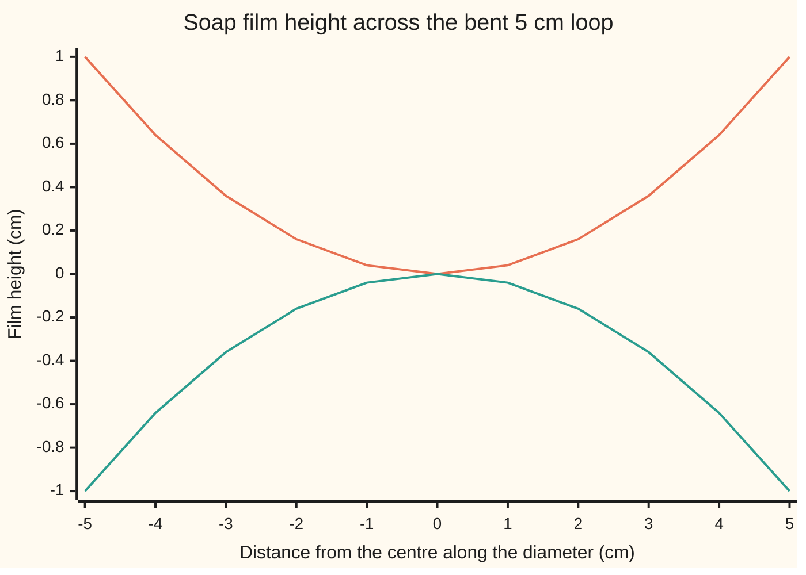
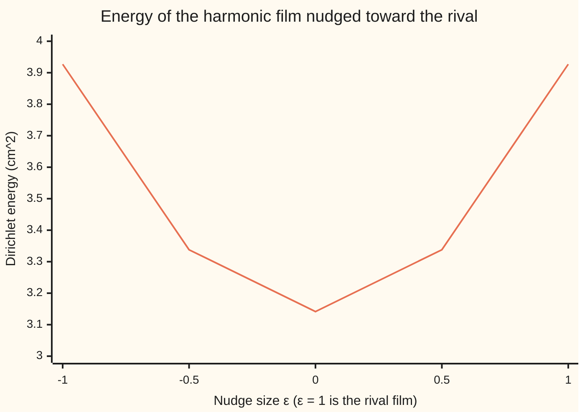

# Dirichlet's principle: the steady state stores the least energy

[Syllabus](../../../SYLLABUS.md) → [Partial differential equations](../README.md) → [Laplace, Poisson and Potentials](../README.md#s04) → Dirichlet's principle

---

## General Overview

Take a circular wire loop of radius 5 cm. Bend it so the rim rises 1 cm at the east and west points and dips 1 cm at the north and south points. Dip it in soapy water. The film that forms is a saddle: flat at the centre, curving up toward east and west, down toward north and south.

Why that shape? A soap film pulls itself tight. Its stored energy is its surface tension (energy per square metre of surface) times its area, so it settles where the area is least. For gentle slopes, its extra area beyond a flat disc is almost exactly half the summed square of the slope. That sum is the **Dirichlet energy**. So the film picks the surface with the least Dirichlet energy: here π, about 3.1416 cm².

That least-energy surface is no ordinary choice. It is **harmonic**: it solves Laplace's equation, and its height at each point is the average of the heights around it ([Harmonic functions](01-harmonic-functions-and-mean-values.md)). Any other surface on the same wire stores more energy, and the excess is exactly the energy of the difference between the two surfaces.

Wing 08's [The Euler-Lagrange equation](../../08-Differential%20equations%20and%20dynamics/12-Calculus%20of%20Variations%20and%20Optimal%20Control/01-functionals-and-the-euler-lagrange-equation.md) found the best curve by demanding that a small nudge change the cost by nothing. This card does the same for a surface over a region, and the equation that comes out is Laplace's.

**Among all surfaces with the same edge, the harmonic one has the least Dirichlet energy, and every other surface stores more by exactly the energy of the difference; so solving Laplace's equation and minimising energy are one problem.**

**What kind of fact this is:** a theorem, proved on this card in Why it works, for smooth surfaces. That a least-energy surface exists whenever some surface on the wire has finite energy is a separate and harder theorem (Hilbert, 1900, expanded in 1904), stated with its key steps. The soap film is a model: the small-slope shortcut overstates this film's extra area by 2.58 %.

### The picture: the film along two diameters



Orange: the east-west diameter, rising to the wire's 1 cm high points. Teal: the north-south diameter, falling to its 1 cm low points. The two curves are mirror images, and the centre sits at 0 cm, the average of the rim.

---

## The formula

**The problem.** The unknown is $`u(x, y)`$: the film's height in cm above the plane of the unbent loop, at the point $`(x, y)`$ cm from the loop's centre. The region $`\Omega`$ (omega) is the open disc of radius $`R = 5`$ cm inside the loop; its boundary $`\partial\Omega`$ is the rim circle. The data are the wire's heights:

```math
u = g \ \text{ on } \partial\Omega, \qquad g = a\cos 2\theta, \qquad a = 1 \text{ cm},
```

where $`\theta`$ is the angle from due east and $`r`$ the distance from the centre. The solution sought is classical: twice continuously differentiable inside, with value and first derivatives continuous up to the rim.

**The energy.** For any surface $`w`$ with the same rim, its **Dirichlet energy** is

```math
E(w) = \frac12 \int_\Omega |\nabla w|^2 \, dA, \qquad |\nabla w|^2 = w_x^2 + w_y^2 .
```

Here $`\nabla w`$ is the gradient, the slope vector $`(w_x, w_y)`$; its length is the steepest slope at that point; $`dA`$ is a small patch of area. Energy has units of area, cm².

**The theorem (Dirichlet's principle).** Among smooth surfaces $`w`$ with $`w = g`$ on the rim, $`u`$ solves

```math
\Delta u = u_{xx} + u_{yy} = 0 \ \text{ in } \Omega, \qquad u = g \ \text{ on } \partial\Omega \quad\Longleftrightarrow\quad E(u) \le E(w) \ \text{ for every such } w,
```

and then, for every such $`w`$,

```math
E(w) = E(u) + E(w - u).
```

**Read it aloud:** the surface that solves Laplace's equation with the wire's heights is the one with the least Dirichlet energy, and any other surface on the same wire carries extra energy equal to the energy of the difference.

**For this loop.** The solution is $`u = a\,(r/R)^2\cos 2\theta = (x^2 - y^2)/25`$ cm, and $`E(u) = \pi a^2 = 3.1416`$ cm². A rival surface on the same wire, $`w = (x^4 - y^4)/625`$ cm, is flatter in the middle; it stores $`3.9270`$ cm², more by $`0.7854`$ cm².

| Symbol | Plain meaning | In our example | Push it up and the answer… |
| --- | --- | --- | --- |
| $`u`$ | the harmonic surface: the film's height | $`(x^2 - y^2)/25`$ cm | — |
| $`w`$, $`\mathcal{A}`$, $`H^1`$ | a rival surface on the same rim; all smooth such surfaces; the larger class whose heights and slopes square-integrate | $`w = (x^4 - y^4)/625`$ cm | the rival's energy can only be higher |
| $`v`$, $`\varepsilon`$, $`\phi`$, $`P_0`$, $`b`$ | a nudge, zero on the rim; its size (epsilon); energy as a function of the size (phi); a bump's centre and radius, in the fold | $`v = w - u`$; $`\varepsilon`$ from −1 to 1 | energy rises as $`\varepsilon^2`$ |
| $`x`$, $`y`$, $`\Omega`$, $`\partial\Omega`$, $`dA`$, $`ds`$ | position in cm; the region inside the loop (omega); its rim; a small patch of area; a small piece of rim | the 5 cm disc and its circle | — |
| $`R`$, $`r`$, $`\theta`$, $`\rho`$, $`h`$ | loop radius; distance from centre; angle from east; $`r/R`$ (rho); a surface's profile along a radius, in Worked numbers | 5 cm | energy unchanged: in two dimensions it ignores scale |
| $`g`$, $`a`$ | the rim's height; how far the wire bends | $`a\cos 2\theta`$; 1 cm | energy grows as $`a^2`$ |
| $`\nabla w`$ | gradient: the slope vector $`(w_x, w_y)`$ | steepest slope of $`u`$ is 0.40, at the rim | — |
| $`E(w)`$, $`A(w)`$, $`\gamma`$ | Dirichlet energy, half the summed squared slope; the film's area; surface tension (gamma) | 3.1416 cm² for $`u`$, 3.9270 cm² for $`w`$; 81.6023 cm²; 0.025 N/m per face, illustrative | more tension stores more energy, same shape |
| $`\Delta`$, $`f`$ | the Laplacian $`u_{xx} + u_{yy}`$; a pressure load | 0 for $`u`$; 0.1536 per cm for $`w`$ at (3, 1) cm; no load | a load bends the film: Poisson's equation |
| $`n`$, $`\partial u/\partial n`$ | outward direction at the rim; the slope along it | — | — |
| $`F`$, $`p`$, $`q`$ | energy per unit area; its slots for the slopes $`u_x`$, $`u_y`$ | $`F = \tfrac12(p^2 + q^2)`$ | — |
| $`J`$, $`z`$, $`e`$ | Weierstrass's functional; its curve; a ramp's width | 0.0634 at width 0.1 | wider ramps cost more |

### When it holds

- **The rim heights are fixed.** Let the film slide freely on the wire, with no heights given, and the least energy is 0: a flat film at any height. Free edges add a condition the minimiser finds by itself: zero slope across the edge, $`\partial u/\partial n = 0`$ ([Boundary conditions](../01-Classification%20and%20Well-Posedness/03-boundary-conditions-dirichlet-neumann-and-robin.md)).
- **Some surface on the rim has finite energy.** Hadamard's rim (1906) is continuous and never more than 1.645 cm high, yet every surface spanning it has infinite energy. The harmonic film exists, but "least energy" compares infinities and says nothing.
- **A least-energy surface exists.** The equivalence above is about a minimiser that is already there. Bounded below does not mean attained: Weierstrass's example has least value 0 and no curve reaches it. Existence is Step 5's work.
- **No load on the film.** Blow on it with pressure $`f`$ and the energy gains a term $`-\int_\Omega f\,w\,dA`$; the minimiser then solves $`-\Delta u = f`$ ([Poisson's equation](03-poissons-equation-and-the-newtonian-potential.md)).
- **Small slopes, for the soap film.** Laplace's equation is the small-slope form of the true law. At the rim this film slopes 0.40, and its real extra area is 3.0625 cm², not 3.1416 cm².

---

## Why it works

### Step 0: the energy is a square, so it expands like one

Nudge the harmonic surface by $`\varepsilon v`$, where $`v`$ is zero on the rim, so the wire still holds. Energy is built from squared slopes, so it expands like $`(b + c)^2 = b^2 + 2bc + c^2`$: the old energy, a cross term, and the energy of the nudge.

For the harmonic surface the cross term is zero. So every nudge adds energy, and adds exactly $`\varepsilon^2 E(v)`$. The chart takes the nudge toward the rival, $`v = w - u`$, scaled by $`\varepsilon`$.



The curve is a parabola, $`\pi + \varepsilon^2\pi/4`$ cm², level at $`\varepsilon = 0`$ and rising alike on both sides.

### Step 1: expand the energy

Since $`|\nabla(u + \varepsilon v)|^2 = |\nabla u|^2 + 2\varepsilon\,\nabla u\cdot\nabla v + \varepsilon^2|\nabla v|^2`$,

```math
E(u + \varepsilon v) = E(u) + \varepsilon \int_\Omega \nabla u\cdot\nabla v \, dA + \varepsilon^2 E(v).
```

The middle integral is the **first variation**: the rate the energy changes as $`\varepsilon`$ leaves zero.

### Step 2: move the slope off the nudge

The [Divergence theorem](../../06-Calculus%20and%20analysis/09-Vector%20Calculus/07-divergence-theorem.md), applied to $`v\,\nabla u`$, is integration by parts in two dimensions (Green's first identity):

```math
\int_\Omega \nabla u\cdot\nabla v \, dA = \oint_{\partial\Omega} v\,\frac{\partial u}{\partial n}\, ds - \int_\Omega v\,\Delta u \, dA .
```

Here $`ds`$ is a small piece of rim. The rim integral vanishes because $`v = 0`$ there. So the first variation is $`-\int_\Omega v\,\Delta u\,dA`$.

The code checks this on the rival. Nudging $`w`$ both ways gives a rate of 1.570797 cm²; the integral $`-\int v\,\Delta w\,dA`$ gives 1.570796 cm²; the exact value is $`\pi/2`$.

### Step 3: harmonic means least energy

If $`\Delta u = 0`$, the cross term is gone for every nudge. Put $`\varepsilon = 1`$ and $`v = w - u`$:

```math
E(w) = E(u) + E(w - u) \ \ge\ E(u).
```

Equality needs $`E(w - u) = 0`$: zero slope everywhere, so $`w - u`$ is constant, and it is 0 on the rim. So $`w = u`$, and the minimiser is unique. This is [Energy methods](../01-Classification%20and%20Well-Posedness/07-energy-methods-and-uniqueness.md)' uniqueness argument, met again.

In the language of [Projection](../../18-Functional%20analysis/02-Hilbert%20Spaces/02-projection-theorem-and-orthogonal-complements.md): measure the overlap of two surfaces by the summed product of their slopes, $`\int \nabla u\cdot\nabla v\,dA`$. Then $`u`$ is the surface on the wire nearest to the flat surface at height 0, and the cross term is zero because $`u`$ and every nudge are at right angles. The extra energy obeys Pythagoras.

### Step 4: least energy means harmonic: the Euler-Lagrange equation

Now suppose $`u`$ has the least energy. Then $`E(u + \varepsilon v)`$ is smallest at $`\varepsilon = 0`$, so its rate there is zero for every nudge:

```math
\int_\Omega v\,\Delta u \, dA = 0 \quad \text{for every smooth } v \text{ that is zero on the rim.}
```

If $`\Delta u`$ were positive somewhere, a small bump $`v`$ there would make the integral positive. So $`\Delta u = 0`$ everywhere: Laplace's equation.

This is the Euler-Lagrange recipe from wing 08, with one slope slot per direction. The energy per unit area is $`F = \tfrac12(p^2 + q^2)`$, with $`p`$ holding $`u_x`$ and $`q`$ holding $`u_y`$. The equation becomes

```math
F_u - \frac{\partial}{\partial x} F_p - \frac{\partial}{\partial y} F_q = 0 - u_{xx} - u_{yy} = -\Delta u = 0 .
```

<details>
<summary>Detailed proof: both directions of the equivalence</summary>

Let $`\mathcal{A}`$ be the smooth surfaces $`w`$ on $`\overline\Omega`$ with $`w = g`$ on $`\partial\Omega`$, and let $`u \in \mathcal{A}`$ have continuous second derivatives inside, with $`\Delta u`$ bounded.

**Harmonic implies least.** Take $`w \in \mathcal{A}`$ and set $`v = w - u`$, so $`v = 0`$ on $`\partial\Omega`$. Expanding the square,

$`\displaystyle E(w) = E(u) + \int_\Omega \nabla u\cdot\nabla v\,dA + E(v).`$

The divergence theorem applied to the field $`v\nabla u`$, whose divergence is $`\nabla u\cdot\nabla v + v\,\Delta u`$, gives

$`\displaystyle \int_\Omega \nabla u\cdot\nabla v\,dA = \oint_{\partial\Omega} v\,\frac{\partial u}{\partial n}\,ds - \int_\Omega v\,\Delta u\,dA = 0 - 0.`$

So $`E(w) = E(u) + E(v) \ge E(u)`$. If equality holds then $`\nabla v = 0`$ on the connected region $`\Omega`$, so $`v`$ is constant; it is 0 on the rim, so $`w = u`$.

**Least implies harmonic.** For any smooth $`v`$ that is zero on $`\partial\Omega`$, $`u + \varepsilon v \in \mathcal{A}`$, and $`\phi(\varepsilon) = E(u + \varepsilon v)`$ is a quadratic in $`\varepsilon`$ with its least value at 0. So $`\phi'(0) = 0`$, which by the identity above reads

$`\displaystyle \int_\Omega v\,\Delta u\,dA = 0.`$

Suppose $`\Delta u > 0`$ at an inside point $`P_0`$. By continuity $`\Delta u`$ stays above half that value on a small disc of radius $`b`$ around $`P_0`$, inside $`\Omega`$. Take $`v = (b^2 - \mathrm{dist}^2)^3`$ on that disc, where dist is the distance to $`P_0`$, and 0 elsewhere; it is twice continuously differentiable and zero on the rim. Then the integral is positive, a contradiction. A negative value fails the same way with $`-v`$. So $`\Delta u = 0`$ in $`\Omega`$.

</details>

### Step 5: the hard part was existence

Steps 3 and 4 compare a minimiser with its rivals. They never show a minimiser exists. Riemann (1857) named the principle after Dirichlet and used it as obvious: energy is never negative, so some surface must have the least. Weierstrass (1870) showed that a least value can be approached and never reached.

His example is a curve $`z(x)`$, not a surface. Take $`J[z] = \int_{-1}^{1} x^2\,z'^2\,dx`$ with $`z(-1) = -1`$ and $`z(1) = 1`$. Ramps of width $`e`$, $`z = \arctan(x/e)/\arctan(1/e)`$, give $`J`$ = 0.0634, 0.0064 and 0.0006 at widths 0.1, 0.01 and 0.001. The least value is 0. But $`J = 0`$ forces $`z' = 0`$, a flat line, which cannot join −1 to 1. The weight $`x^2`$ vanishes at 0, so a jump there costs nothing.

So the principle needed repair. Hilbert gave it in 1900, and at length in 1904, for any rim that some finite-energy surface spans. His road is now called the **direct method**: build the minimiser as a limit.

1. **Take a minimising sequence**: surfaces $`w_1, w_2, \ldots`$ on the wire whose energies fall to the least value.
2. **Bounded energy bounds the surfaces.** With the rim fixed, a Poincaré inequality bounds the average squared height by the energy ([Sobolev and Poincare](../../18-Functional%20analysis/04-Distributions%20and%20Sobolev%20Spaces/09-sobolev-embedding-and-poincare-inequality.md)).
3. **Enlarge the class.** Smooth surfaces are not enough: a limit can lose smoothness. Work in $`H^1`$, the surfaces whose heights and slopes are square-integrable, with slopes in the weak sense ([Weak derivatives](../../18-Functional%20analysis/04-Distributions%20and%20Sobolev%20Spaces/07-weak-derivatives-and-sobolev-spaces.md)).
4. **Extract a limit.** A bounded sequence in $`H^1`$ has a subsequence that converges weakly, meaning every averaged measurement of it settles ([Weak convergence](../../18-Functional%20analysis/02-Hilbert%20Spaces/09-weak-convergence-and-banach-alaoglu.md)), and in mean square by Rellich's theorem ([Boundary values and compactness](../../18-Functional%20analysis/04-Distributions%20and%20Sobolev%20Spaces/10-trace-and-rellich-kondrachov-in-outline.md)). The rim values pass to the limit as a trace: the rim value of a surface that is only in $`H^1`$.
5. **The energy cannot jump up in the limit.** Energy is convex (the energy of an average of two surfaces is at most the average of their energies), so the limit's energy is at most the limit of the energies. The limit attains the least value.
6. **The limit is smooth.** It satisfies $`\int \nabla u\cdot\nabla v\,dA = 0`$ for every nudge: a weak solution. Weyl's lemma makes a weak harmonic function a classical one ([Harnack and regularity](10-harnack-and-regularity-in-outline.md)).

Hadamard (1906) then found a continuous rim beyond this road's reach: every surface spanning it has infinite energy, so there is no least value to approach. Its harmonic film still exists, and Perron's method, which uses no energy, reaches rims like it ([Subharmonic functions](09-subharmonic-functions-and-perrons-method.md)).

The code runs this in miniature. On a polar grid, it lowers a grid version of the energy one point at a time; the energy falls at every sweep. The grid minima at 8, 16 and 32 rings settle on π with error falling 4 times per halving: observed order 2.

---

## Worked numbers, by hand

For a surface $`a\,h(\rho)\cos 2\theta`$ with $`\rho = r/R`$, the squared slope is $`(a/R)^2\big(h'^2\cos^2 2\theta + (4h^2/\rho^2)\sin^2 2\theta\big)`$. Around a full circle each squared trigonometric term averages to one half. The radius cancels, leaving

```math
E = \frac{\pi a^2}{2}\int_0^1 \Big(h'^2 + \frac{4h^2}{\rho^2}\Big)\,\rho\,d\rho .
```

| Step | Arithmetic | Value |
| --- | --- | --- |
| harmonic film, $`h = \rho^2`$ | $`h'^2 + 4h^2/\rho^2 = 8\rho^2`$; $`\tfrac{\pi}{2}\int_0^1 8\rho^3\,d\rho = \tfrac{\pi}{2}\times 2`$ | $`E(u) = \pi`$ = **3.1416 cm²** |
| check it is harmonic | $`\Delta\big((x^2 - y^2)/25\big) = 2/25 - 2/25`$ | 0 |
| rival film, $`h = \rho^4`$ | $`16\rho^6 + 4\rho^6 = 20\rho^6`$; $`\tfrac{\pi}{2}\times 20/8`$ | $`E(w) = 5\pi/4`$ = 3.9270 cm² |
| the gap | 3.9270 − 3.1416 | 0.7854 cm² |
| the difference, $`h = \rho^4 - \rho^2`$ | $`20\rho^6 - 24\rho^4 + 8\rho^2`$; $`\tfrac{\pi}{2}(20/8 - 24/6 + 8/4) = \tfrac{\pi}{2}\times\tfrac12`$ | $`E(w - u) = \pi/4`$ = **0.7854 cm²**, the gap |
| rival's Laplacian at (3, 1) cm | $`12(x^2 - y^2)/625 = 12\times 8/625`$ | 0.1536 per cm, not 0 |
| film height at (2.5, 0) cm | $`2.5^2/25`$ | 0.25 cm |
| real extra area of the harmonic film | $`81.6023 - 78.5398`$ | 3.0625 cm², 2.58 % below 3.1416 |
| stored energy, two faces | $`2\times 0.025\ \text{N/m}\times 3.0625\times 10^{-4}\ \text{m}^2`$ | **15.31 μJ** |

The rival stores 0.7854 cm² more, exactly its own distance from the harmonic film measured as energy. The film itself holds about 15 microjoules (millionths of a joule) more than a flat film would.

### What breaks if you drop a piece

| Mistake | Comes out at | What went wrong |
| --- | --- | --- |
| Take the flatter rival as the film | 3.9270 cm², 0.7854 cm² too much | Not harmonic: its Laplacian is 0.1536 per cm at (3, 1) cm |
| Read the small-slope energy as the extra area | 3.1416 cm² against a true 3.0625 cm² | Slope 0.40 at the rim is not small; the exact law is the minimal surface equation |
| Assume every continuous rim has finite energy | 1.57, 2.33, 21.96, 678.85 cm² with 1, 5, 8, 10 terms of Hadamard's rim | The rim heights stay below 1.645 cm, but they wiggle so fast that the slopes cannot settle |
| Assume a least value is always reached | Weierstrass's $`J`$: 0.0634, 0.0064, 0.0006, never 0 | The weight $`x^2`$ vanishes at 0, so energy stops controlling the slope there |
| Read the 8-ring grid energy as the answer | 3.0725 cm², 0.0691 below π | The grid energy is a different, cheaper ruler; its error falls 4 times per halving |

The code prints every row.

---

## Code, from first principles, and it actually runs

The script integrates by Simpson's rule in polar form, with no imported integrator. It takes four roads to the film's energy. First, the closed form π against quadrature. Second, Pythagoras: the rival's gap against the energy of the difference, two separate integrals. Third, the first variation: nudging both ways against integration by parts. Fourth, the direct method: a polar grid lowered point by point by over-relaxed sweeps (each point moved past its local best by a fixed factor, which still lowers the energy), at three grid sizes. It also checks Laplace's equation by centred differences, the film's true area against its closed form, Hadamard's series against quadrature, and Weierstrass's integral against its closed form.

### Python

```python
# Dirichlet's principle -- the check behind the card.  Standard library only.
# A soap film spans a circular wire loop of radius R = 5 cm whose rim is bent to
# the height g = a cos(2 theta), a = 1 cm.  Lengths in cm, energies in cm^2.
from math import pi, sin, cos, sqrt, atan, log2
R, a = 5.0, 1.0

def simpson(f, lo, hi, n):                       # Simpson's rule, written out
    w, s = (hi - lo) / n, f(lo) + f(hi)
    for k in range(1, n):
        s += (4 if k % 2 else 2) * f(lo + k * w)
    return s * w / 3

def disc(f, n=120):                              # integral of f(x, y) over the disc, in polar form
    return simpson(lambda r: r * simpson(lambda t: f(r * cos(t), r * sin(t)), 0, 2 * pi, n), 0, R, n)

def energy(grad):                                # Dirichlet energy E = 1/2 * integral of |grad w|^2
    return 0.5 * disc(lambda x, y: grad(x, y)[0] ** 2 + grad(x, y)[1] ** 2)

u  = lambda x, y: a * (x * x - y * y) / R ** 2   # the harmonic film, a (r/R)^2 cos 2theta
gu = lambda x, y: (2 * a * x / R ** 2, -2 * a * y / R ** 2)
w  = lambda x, y: a * (x ** 4 - y ** 4) / R ** 4 # a rival film: same rim, flatter in the middle
gw = lambda x, y: (4 * a * x ** 3 / R ** 4, -4 * a * y ** 3 / R ** 4)
gv = lambda x, y: (gw(x, y)[0] - gu(x, y)[0], gw(x, y)[1] - gu(x, y)[1])   # v = w - u, zero on the rim
mix = lambda e: (lambda x, y: (gu(x, y)[0] + e * gv(x, y)[0], gu(x, y)[1] + e * gv(x, y)[1]))

xs = [R * k / 5 for k in range(-5, 6)]
print("film height along y = 0, x = -R..R in 11 steps:", ", ".join(f"{u(x, 0):.2f}" for x in xs), "cm")
print("film height along x = 0, y = -R..R in 11 steps:", ", ".join(f"{u(0, y):.2f}" for y in xs), "cm")
Eu, Ew, Ev = energy(gu), energy(gw), energy(gv)
print(f"E(u), harmonic film: quadrature {Eu:.6f}, exact pi a^2 = {pi * a * a:.6f} cm^2")
print(f"E(w), rival film:    quadrature {Ew:.6f}, exact 5 pi a^2/4 = {5 * pi * a * a / 4:.6f} cm^2")
print(f"gap E(w) - E(u) = {Ew - Eu:.6f}, E(w - u) = {Ev:.6f}, exact pi a^2/4 = {pi * a * a / 4:.6f} cm^2")
assert abs(Eu - pi * a * a) < 1e-6 and abs(Ew - 5 * pi * a * a / 4) < 1e-6   # Simpson error at n = 120 is below 1e-6
assert abs((Ew - Eu) - Ev) < 1e-6                # Pythagoras: two separate integrals agree
es = (-1, -0.5, 0, 0.5, 1)
fam = [energy(mix(e)) for e in es]
print("E(u + e v), e = -1, -0.5, 0, 0.5, 1:", ", ".join(f"{E:.4f}" for E in fam), "cm^2")
for e, E in zip(es, fam):
    assert abs(E - pi * a * a * (1 + e * e / 4)) < 1e-6
h = 1e-4                                         # first variation: nudge both ways, then integrate by parts
dq_u = (energy(mix(h)) - energy(mix(-h))) / (2 * h)
dq_w = (energy(mix(1 + h)) - energy(mix(1 - h))) / (2 * h)
ibp_w = disc(lambda x, y: -(w(x, y) - u(x, y)) * 12 * a * (x * x - y * y) / R ** 4)
print(f"first variation along v at u: quotient {abs(dq_u):.6f} cm^2")
print(f"first variation along v at w: quotient {dq_w:.6f}, minus integral of v times Laplacian(w) {ibp_w:.6f}, exact pi a^2/2 = {pi * a * a / 2:.6f} cm^2")
assert abs(dq_u) < 1e-6 and abs(dq_w - pi * a * a / 2) < 1e-5 and abs(ibp_w - pi * a * a / 2) < 1e-6
lap = lambda f, x, y, s: (f(x + s, y) + f(x - s, y) + f(x, y + s) + f(x, y - s) - 4 * f(x, y)) / (s * s)
for s in (0.2, 0.1):
    print(f"Laplacian by centred differences at (3, 1) cm, step {s:.1f} cm: u {abs(lap(u, 3, 1, s)):.6f}, w {lap(w, 3, 1, s):.6f} per cm")
assert abs(lap(u, 3, 1, 0.1)) < 1e-9 and abs(lap(w, 3, 1, 0.1) - 96 * a / R ** 4) < 1e-6

def direct(N):                                   # direct method: lower a grid energy one node at a time
    M, hr, ht = 2 * N, R / N, pi / N             # rings r_i = i hr, angles j ht; ring N is the wire
    W = [[0.0] * M for _ in range(N)] + [[a * cos(2 * j * ht) for j in range(M)]]
    rad = [(i + 0.5) * ht for i in range(N)]     # weight of the radial edge from ring i to ring i + 1
    ang = [0.0] + [1 / (i * ht) for i in range(1, N)] + [0.5 / (N * ht)]   # angular edges on ring i
    def E():
        s = 0.0
        for i in range(N):
            for j in range(M):
                s += rad[i] * (W[i + 1][j] - W[i][0 if i == 0 else j]) ** 2
        for i in range(1, N + 1):
            for j in range(M):
                s += ang[i] * (W[i][(j + 1) % M] - W[i][j]) ** 2
        return 0.5 * s
    om, hist = 2 / (1 + sin(pi / N)), [E()]      # over-relaxed: each move still lowers the energy
    for sweep in range(1, 5001):
        c = 0.0
        for j in range(M):
            c += W[1][j]
        big = abs(om * (c / M - W[0][0]))
        W[0] = [W[0][0] + om * (c / M - W[0][0])] * M
        for i in range(1, N):
            for j in range(M):
                nb = rad[i - 1] * W[i - 1][0 if i == 1 else j] + rad[i] * W[i + 1][j] + ang[i] * (W[i][j - 1] + W[i][(j + 1) % M])
                step = om * (nb / (rad[i - 1] + rad[i] + 2 * ang[i]) - W[i][j])
                W[i][j] += step
                big = max(big, abs(step))
        hist.append(E())
        if big < 1e-13:
            break
    return hist[-1], W[N // 2][0], all(hist[k + 1] <= hist[k] + 1e-12 for k in range(len(hist) - 1)), sweep

errs, herrs = [], []
for N in (8, 16, 32):
    En, mid, falls, sw = direct(N)
    errs.append(En - pi * a * a); herrs.append(mid - a / 4)
    print(f"grid of {N} rings x {2 * N} angles: energy {En:.6f} cm^2 (error {En - pi * a * a:.6f}), height at ({R / 2:.1f}, 0) {mid:.6f} cm, {sw} sweeps, energy fell every sweep: {falls}")
    assert falls
print(f"exact height at ({R / 2:.1f}, 0) {u(R / 2, 0):.2f} cm; observed order, energy: {log2(errs[0] / errs[1]):.3f}, {log2(errs[1] / errs[2]):.3f}; height: {log2(herrs[0] / herrs[1]):.3f}, {log2(herrs[1] / herrs[2]):.3f}")
assert abs(errs[2]) < 0.005 * a * a and abs(herrs[2]) < 0.001 * a and 1.9 < log2(errs[1] / errs[2]) < 2.1

c = a / R ** 2                                   # the real area of the harmonic film, no small-slope shortcut
area_q = disc(lambda x, y: sqrt(1 + gu(x, y)[0] ** 2 + gu(x, y)[1] ** 2))
area_x = 2 * pi / (12 * c * c) * ((1 + 4 * c * c * R * R) ** 1.5 - 1)
print(f"steepest slope of the film {2 * c * R:.2f}; area: quadrature {area_q:.6f}, exact {area_x:.6f}, flat disc {pi * R * R:.6f} cm^2")
print(f"extra area: true {area_x - pi * R * R:.4f} cm^2, small-slope model E(u) = {Eu:.4f} cm^2, model high by {100 * (Eu / (area_x - pi * R * R) - 1):.2f} %")
print(f"film energy at 0.025 N/m per face (illustrative), two faces: true {2 * 0.025 * (area_x - pi * R * R) * 100:.2f} uJ, model {2 * 0.025 * Eu * 100:.2f} uJ")
assert abs(area_q - area_x) < 1e-6

# What breaks 1 (Hadamard 1906): rim g = sum 1/n^2 cos(n! theta) cm is continuous, |g| < pi^2/6 cm,
# but its harmonic film has energy (pi/2) sum n!/n^4 cm^2, which grows without bound.
part, fact, sums = 0.0, 1, []
for n in range(1, 11):
    fact *= n
    part += fact / n ** 4
    sums.append(pi / 2 * part)
print(f"Hadamard rim: height at most pi^2/6 = {pi * pi / 6:.3f} cm; energy with the first N terms, N = 1..10:", ", ".join(f"{s:.2f}" for s in sums), "cm^2")
def hgrad2(r, t):                                # |grad|^2 of the first three terms: modes 1, 2 and 6
    gr = gt = 0.0
    for n, k in ((1, 1), (2, 2), (3, 6)):
        gr += k / n ** 2 * (r / R) ** (k - 1) / R * cos(k * t)
        gt -= k / n ** 2 * (r / R) ** (k - 1) / R * sin(k * t)
    return gr * gr + gt * gt
E3 = 0.5 * simpson(lambda r: r * simpson(lambda t: hgrad2(r, t), 0, 2 * pi, 240), 0, R, 240)
print(f"Hadamard rim, first three terms by quadrature: {E3:.6f} cm^2, by the series: {sums[2]:.6f} cm^2")
assert abs(E3 - sums[2]) < 1e-6 and sums[9] - sums[8] > sums[8] - sums[7] > 10

# What breaks 2 (Weierstrass 1870): J[y] = integral over [-1, 1] of x^2 y'^2, y(-1) = -1, y(1) = 1.
# The ramps y = atan(x/e)/atan(1/e) push J toward 0, yet J = 0 needs y' = 0: no ramp attains it.
for e in (0.1, 0.01, 0.001):
    A = atan(1 / e)
    closed = e / A - e * e / ((1 + e * e) * A * A)
    quad = simpson(lambda x: x * x * (e / (e * e + x * x) / A) ** 2, -1, 1, 100000)
    print(f"Weierstrass ramp, width {e}: J = {closed:.6f} (closed form), {quad:.6f} (Simpson)")
    assert abs(closed - quad) < 1e-6
print("ALL CHECKS PASS")
```

**Ran 2026-11-15 on macOS, Python 3.14.10, standard library only. All checks passed. Output, pasted from the run:**

```
film height along y = 0, x = -R..R in 11 steps: 1.00, 0.64, 0.36, 0.16, 0.04, 0.00, 0.04, 0.16, 0.36, 0.64, 1.00 cm
film height along x = 0, y = -R..R in 11 steps: -1.00, -0.64, -0.36, -0.16, -0.04, 0.00, -0.04, -0.16, -0.36, -0.64, -1.00 cm
E(u), harmonic film: quadrature 3.141593, exact pi a^2 = 3.141593 cm^2
E(w), rival film:    quadrature 3.926991, exact 5 pi a^2/4 = 3.926991 cm^2
gap E(w) - E(u) = 0.785398, E(w - u) = 0.785398, exact pi a^2/4 = 0.785398 cm^2
E(u + e v), e = -1, -0.5, 0, 0.5, 1: 3.9270, 3.3379, 3.1416, 3.3379, 3.9270 cm^2
first variation along v at u: quotient 0.000000 cm^2
first variation along v at w: quotient 1.570797, minus integral of v times Laplacian(w) 1.570796, exact pi a^2/2 = 1.570796 cm^2
Laplacian by centred differences at (3, 1) cm, step 0.2 cm: u 0.000000, w 0.153600 per cm
Laplacian by centred differences at (3, 1) cm, step 0.1 cm: u 0.000000, w 0.153600 per cm
grid of 8 rings x 16 angles: energy 3.072527 cm^2 (error -0.069066), height at (2.5, 0) 0.258974 cm, 239 sweeps, energy fell every sweep: True
grid of 16 rings x 32 angles: energy 3.124435 cm^2 (error -0.017158), height at (2.5, 0) 0.252231 cm, 577 sweeps, energy fell every sweep: True
grid of 32 rings x 64 angles: energy 3.137311 cm^2 (error -0.004282), height at (2.5, 0) 0.250557 cm, 1331 sweeps, energy fell every sweep: True
exact height at (2.5, 0) 0.25 cm; observed order, energy: 2.009, 2.002; height: 2.008, 2.002
steepest slope of the film 0.40; area: quadrature 81.602292, exact 81.602292, flat disc 78.539816 cm^2
extra area: true 3.0625 cm^2, small-slope model E(u) = 3.1416 cm^2, model high by 2.58 %
film energy at 0.025 N/m per face (illustrative), two faces: true 15.31 uJ, model 15.71 uJ
Hadamard rim: height at most pi^2/6 = 1.645 cm; energy with the first N terms, N = 1..10: 1.57, 1.77, 1.88, 2.03, 2.33, 3.21, 6.50, 21.96, 108.84, 678.85 cm^2
Hadamard rim, first three terms by quadrature: 1.883501 cm^2, by the series: 1.883501 cm^2
Weierstrass ramp, width 0.1: J = 0.063400 (closed form), 0.063400 (Simpson)
Weierstrass ramp, width 0.01: J = 0.006366 (closed form), 0.006366 (Simpson)
Weierstrass ramp, width 0.001: J = 0.000637 (closed form), 0.000637 (Simpson)
ALL CHECKS PASS
```

### Rust

```rust
// Dirichlet's principle -- the check behind the card.  Rust std only, no crates.
// A soap film spans a circular wire loop of radius R = 5 cm whose rim is bent to
// the height g = a cos(2 theta), a = 1 cm.  Lengths in cm, energies in cm^2.
use std::f64::consts::PI;
const R: f64 = 5.0;
const A: f64 = 1.0;

fn simpson(f: &dyn Fn(f64) -> f64, lo: f64, hi: f64, n: usize) -> f64 {
    let w = (hi - lo) / n as f64;
    let mut s = f(lo) + f(hi);
    for k in 1..n {
        s += if k % 2 == 1 { 4.0 } else { 2.0 } * f(lo + k as f64 * w);
    }
    s * w / 3.0
}
// integral of f(x, y) over the disc, in polar form
fn disc(f: &dyn Fn(f64, f64) -> f64, n: usize) -> f64 {
    simpson(&|r| r * simpson(&|t| f(r * t.cos(), r * t.sin()), 0.0, 2.0 * PI, n), 0.0, R, n)
}
// Dirichlet energy E = 1/2 * integral of |grad w|^2
fn energy(g: &dyn Fn(f64, f64) -> (f64, f64)) -> f64 {
    0.5 * disc(&|x, y| { let (p, q) = g(x, y); p * p + q * q }, 120)
}
fn u(x: f64, y: f64) -> f64 { A * (x * x - y * y) / R.powf(2.0) }  // the harmonic film
fn gu(x: f64, y: f64) -> (f64, f64) { (2.0 * A * x / R.powf(2.0), -2.0 * A * y / R.powf(2.0)) }
fn w(x: f64, y: f64) -> f64 { A * (x.powf(4.0) - y.powf(4.0)) / R.powf(4.0) } // a rival, same rim
fn gw(x: f64, y: f64) -> (f64, f64) { (4.0 * A * x.powf(3.0) / R.powf(4.0), -4.0 * A * y.powf(3.0) / R.powf(4.0)) }
fn gv(x: f64, y: f64) -> (f64, f64) { let (a, b) = gw(x, y); let (c, d) = gu(x, y); (a - c, b - d) }
fn emix(e: f64) -> f64 { energy(&|x, y| { let (a, b) = gu(x, y); let (c, d) = gv(x, y); (a + e * c, b + e * d) }) }
fn lap(f: fn(f64, f64) -> f64, x: f64, y: f64, s: f64) -> f64 {
    (f(x + s, y) + f(x - s, y) + f(x, y + s) + f(x, y - s) - 4.0 * f(x, y)) / (s * s)
}
fn tf(b: bool) -> &'static str { if b { "True" } else { "False" } }

// direct method: lower a grid energy one node at a time
fn direct(n: usize) -> (f64, f64, bool, usize) {
    let (m, ht) = (2 * n, PI / n as f64);
    let mut wg = vec![vec![0.0f64; m]; n + 1];
    for j in 0..m { wg[n][j] = A * (2.0 * j as f64 * ht).cos(); }
    let rad: Vec<f64> = (0..n).map(|i| (i as f64 + 0.5) * ht).collect();
    let mut ang = vec![0.0f64; n + 1];
    for i in 1..n { ang[i] = 1.0 / (i as f64 * ht); }
    ang[n] = 0.5 / (n as f64 * ht);
    let en = |wg: &Vec<Vec<f64>>| -> f64 {
        let mut s = 0.0;
        for i in 0..n { for j in 0..m {
            let lo = wg[i][if i == 0 { 0 } else { j }];
            s += rad[i] * (wg[i + 1][j] - lo).powf(2.0);
        } }
        for i in 1..=n { for j in 0..m { s += ang[i] * (wg[i][(j + 1) % m] - wg[i][j]).powf(2.0); } }
        0.5 * s
    };
    let om = 2.0 / (1.0 + (PI / n as f64).sin());
    let mut hist = vec![en(&wg)];
    let mut sweep = 0;
    for sw in 1..=5000 {
        sweep = sw;
        let mut c = 0.0;
        for j in 0..m { c += wg[1][j]; }
        let mut big = (om * (c / m as f64 - wg[0][0])).abs();
        let c0 = wg[0][0] + om * (c / m as f64 - wg[0][0]);
        for j in 0..m { wg[0][j] = c0; }
        for i in 1..n { for j in 0..m {
            let jm = (j + m - 1) % m;
            let nb = rad[i - 1] * wg[i - 1][if i == 1 { 0 } else { j }] + rad[i] * wg[i + 1][j]
                + ang[i] * (wg[i][jm] + wg[i][(j + 1) % m]);
            let step = om * (nb / (rad[i - 1] + rad[i] + 2.0 * ang[i]) - wg[i][j]);
            wg[i][j] += step;
            big = big.max(step.abs());
        } }
        hist.push(en(&wg));
        if big < 1e-13 { break; }
    }
    let falls = (0..hist.len() - 1).all(|k| hist[k + 1] <= hist[k] + 1e-12);
    (hist[hist.len() - 1], wg[n / 2][0], falls, sweep)
}

fn main() {
    let row = |f: &dyn Fn(f64) -> f64| (-5..=5).map(|k| format!("{:.2}", f(R * k as f64 / 5.0))).collect::<Vec<_>>().join(", ");
    println!("film height along y = 0, x = -R..R in 11 steps: {} cm", row(&|x| u(x, 0.0)));
    println!("film height along x = 0, y = -R..R in 11 steps: {} cm", row(&|y| u(0.0, y)));
    let (eu, ew, ev) = (energy(&gu), energy(&gw), energy(&gv));
    println!("E(u), harmonic film: quadrature {:.6}, exact pi a^2 = {:.6} cm^2", eu, PI * A * A);
    println!("E(w), rival film:    quadrature {:.6}, exact 5 pi a^2/4 = {:.6} cm^2", ew, 5.0 * PI * A * A / 4.0);
    println!("gap E(w) - E(u) = {:.6}, E(w - u) = {:.6}, exact pi a^2/4 = {:.6} cm^2", ew - eu, ev, PI * A * A / 4.0);
    assert!((eu - PI * A * A).abs() < 1e-6 && (ew - 5.0 * PI * A * A / 4.0).abs() < 1e-6);
    assert!(((ew - eu) - ev).abs() < 1e-6);                 // Pythagoras: two separate integrals agree
    let es = [-1.0, -0.5, 0.0, 0.5, 1.0];
    let fam: Vec<f64> = es.iter().map(|&e| emix(e)).collect();
    println!("E(u + e v), e = -1, -0.5, 0, 0.5, 1: {} cm^2", fam.iter().map(|v| format!("{:.4}", v)).collect::<Vec<_>>().join(", "));
    for (e, v) in es.iter().zip(fam.iter()) { assert!((v - PI * A * A * (1.0 + e * e / 4.0)).abs() < 1e-6); }
    let h = 1e-4;                                           // first variation: nudge both ways, then by parts
    let dq_u = (emix(h) - emix(-h)) / (2.0 * h);
    let dq_w = (emix(1.0 + h) - emix(1.0 - h)) / (2.0 * h);
    let ibp_w = disc(&|x, y| -(w(x, y) - u(x, y)) * 12.0 * A * (x * x - y * y) / R.powf(4.0), 120);
    println!("first variation along v at u: quotient {:.6} cm^2", dq_u.abs());
    println!("first variation along v at w: quotient {:.6}, minus integral of v times Laplacian(w) {:.6}, exact pi a^2/2 = {:.6} cm^2", dq_w, ibp_w, PI * A * A / 2.0);
    assert!(dq_u.abs() < 1e-6 && (dq_w - PI * A * A / 2.0).abs() < 1e-5 && (ibp_w - PI * A * A / 2.0).abs() < 1e-6);
    for s in [0.2, 0.1] {
        println!("Laplacian by centred differences at (3, 1) cm, step {:.1} cm: u {:.6}, w {:.6} per cm", s, lap(u, 3.0, 1.0, s).abs(), lap(w, 3.0, 1.0, s));
    }
    assert!(lap(u, 3.0, 1.0, 0.1).abs() < 1e-9 && (lap(w, 3.0, 1.0, 0.1) - 96.0 * A / R.powf(4.0)).abs() < 1e-6);

    let (mut errs, mut herrs) = (vec![], vec![]);
    for n in [8usize, 16, 32] {
        let (en, mid, falls, sw) = direct(n);
        errs.push(en - PI * A * A); herrs.push(mid - A / 4.0);
        println!("grid of {} rings x {} angles: energy {:.6} cm^2 (error {:.6}), height at ({:.1}, 0) {:.6} cm, {} sweeps, energy fell every sweep: {}", n, 2 * n, en, en - PI * A * A, R / 2.0, mid, sw, tf(falls));
        assert!(falls);
    }
    println!("exact height at ({:.1}, 0) {:.2} cm; observed order, energy: {:.3}, {:.3}; height: {:.3}, {:.3}", R / 2.0, u(R / 2.0, 0.0), (errs[0] / errs[1]).log2(), (errs[1] / errs[2]).log2(), (herrs[0] / herrs[1]).log2(), (herrs[1] / herrs[2]).log2());
    let o = (errs[1] / errs[2]).log2();
    assert!(errs[2].abs() < 0.005 * A * A && herrs[2].abs() < 0.001 * A && 1.9 < o && o < 2.1);

    let c = A / (R * R);                                    // the real area of the harmonic film
    let area_q = disc(&|x, y| { let (p, q) = gu(x, y); (1.0 + p * p + q * q).sqrt() }, 120);
    let area_x = 2.0 * PI / (12.0 * c * c) * ((1.0 + 4.0 * c * c * R * R).powf(1.5) - 1.0);
    let flat = PI * R * R;
    println!("steepest slope of the film {:.2}; area: quadrature {:.6}, exact {:.6}, flat disc {:.6} cm^2", 2.0 * c * R, area_q, area_x, flat);
    println!("extra area: true {:.4} cm^2, small-slope model E(u) = {:.4} cm^2, model high by {:.2} %", area_x - flat, eu, 100.0 * (eu / (area_x - flat) - 1.0));
    println!("film energy at 0.025 N/m per face (illustrative), two faces: true {:.2} uJ, model {:.2} uJ", 2.0 * 0.025 * (area_x - flat) * 100.0, 2.0 * 0.025 * eu * 100.0);
    assert!((area_q - area_x).abs() < 1e-6);

    // What breaks 1 (Hadamard 1906): rim g = sum 1/n^2 cos(n! theta) cm, energy (pi/2) sum n!/n^4 cm^2
    let (mut part, mut fact, mut sums) = (0.0f64, 1.0f64, vec![]);
    for n in 1..=10 {
        fact *= n as f64;
        part += fact / (n * n * n * n) as f64;
        sums.push(PI / 2.0 * part);
    }
    println!("Hadamard rim: height at most pi^2/6 = {:.3} cm; energy with the first N terms, N = 1..10: {} cm^2", PI * PI / 6.0, sums.iter().map(|v| format!("{:.2}", v)).collect::<Vec<_>>().join(", "));
    let hgrad2 = |r: f64, t: f64| -> f64 {               // |grad|^2 of modes 1, 2 and 6
        let (mut gr, mut gt) = (0.0, 0.0);
        for (n, k) in [(1.0, 1.0f64), (2.0, 2.0), (3.0, 6.0)] {
            gr += k / (n * n) * (r / R).powf(k - 1.0) / R * (k * t).cos();
            gt -= k / (n * n) * (r / R).powf(k - 1.0) / R * (k * t).sin();
        }
        gr * gr + gt * gt
    };
    let e3 = 0.5 * simpson(&|r| r * simpson(&|t| hgrad2(r, t), 0.0, 2.0 * PI, 240), 0.0, R, 240);
    println!("Hadamard rim, first three terms by quadrature: {:.6} cm^2, by the series: {:.6} cm^2", e3, sums[2]);
    assert!((e3 - sums[2]).abs() < 1e-6 && sums[9] - sums[8] > sums[8] - sums[7] && sums[8] - sums[7] > 10.0);

    // What breaks 2 (Weierstrass 1870): J[y] = integral over [-1, 1] of x^2 y'^2, y(-1) = -1, y(1) = 1
    for e in [0.1f64, 0.01, 0.001] {
        let a = (1.0 / e).atan();
        let closed = e / a - e * e / ((1.0 + e * e) * a * a);
        let quad = simpson(&|x| x * x * (e / (e * e + x * x) / a).powf(2.0), -1.0, 1.0, 100000);
        println!("Weierstrass ramp, width {}: J = {:.6} (closed form), {:.6} (Simpson)", e, closed, quad);
        assert!((closed - quad).abs() < 1e-6);
    }
    println!("ALL CHECKS PASS");
}
```

**Ran 2026-11-15 on macOS, rustc 1.98.1, no crates. All checks passed. Output, pasted from the run:**

```
film height along y = 0, x = -R..R in 11 steps: 1.00, 0.64, 0.36, 0.16, 0.04, 0.00, 0.04, 0.16, 0.36, 0.64, 1.00 cm
film height along x = 0, y = -R..R in 11 steps: -1.00, -0.64, -0.36, -0.16, -0.04, 0.00, -0.04, -0.16, -0.36, -0.64, -1.00 cm
E(u), harmonic film: quadrature 3.141593, exact pi a^2 = 3.141593 cm^2
E(w), rival film:    quadrature 3.926991, exact 5 pi a^2/4 = 3.926991 cm^2
gap E(w) - E(u) = 0.785398, E(w - u) = 0.785398, exact pi a^2/4 = 0.785398 cm^2
E(u + e v), e = -1, -0.5, 0, 0.5, 1: 3.9270, 3.3379, 3.1416, 3.3379, 3.9270 cm^2
first variation along v at u: quotient 0.000000 cm^2
first variation along v at w: quotient 1.570797, minus integral of v times Laplacian(w) 1.570796, exact pi a^2/2 = 1.570796 cm^2
Laplacian by centred differences at (3, 1) cm, step 0.2 cm: u 0.000000, w 0.153600 per cm
Laplacian by centred differences at (3, 1) cm, step 0.1 cm: u 0.000000, w 0.153600 per cm
grid of 8 rings x 16 angles: energy 3.072527 cm^2 (error -0.069066), height at (2.5, 0) 0.258974 cm, 239 sweeps, energy fell every sweep: True
grid of 16 rings x 32 angles: energy 3.124435 cm^2 (error -0.017158), height at (2.5, 0) 0.252231 cm, 577 sweeps, energy fell every sweep: True
grid of 32 rings x 64 angles: energy 3.137311 cm^2 (error -0.004282), height at (2.5, 0) 0.250557 cm, 1331 sweeps, energy fell every sweep: True
exact height at (2.5, 0) 0.25 cm; observed order, energy: 2.009, 2.002; height: 2.008, 2.002
steepest slope of the film 0.40; area: quadrature 81.602292, exact 81.602292, flat disc 78.539816 cm^2
extra area: true 3.0625 cm^2, small-slope model E(u) = 3.1416 cm^2, model high by 2.58 %
film energy at 0.025 N/m per face (illustrative), two faces: true 15.31 uJ, model 15.71 uJ
Hadamard rim: height at most pi^2/6 = 1.645 cm; energy with the first N terms, N = 1..10: 1.57, 1.77, 1.88, 2.03, 2.33, 3.21, 6.50, 21.96, 108.84, 678.85 cm^2
Hadamard rim, first three terms by quadrature: 1.883501 cm^2, by the series: 1.883501 cm^2
Weierstrass ramp, width 0.1: J = 0.063400 (closed form), 0.063400 (Simpson)
Weierstrass ramp, width 0.01: J = 0.006366 (closed form), 0.006366 (Simpson)
Weierstrass ramp, width 0.001: J = 0.000637 (closed form), 0.000637 (Simpson)
ALL CHECKS PASS
```

### Lean

Lean proves Dirichlet's principle on any bounded open region of the plane, and checks the worked numbers for the 5 cm loop.

- Take a surface $`u`$ with continuous slopes, continuous second derivatives inside, and rim heights $`g`$. Then $`\Delta u = 0`$ in $`\Omega`$ exactly when $`E(u) \le E(w)`$ for every smooth $`w`$ with $`w = g`$ on the rim.
- Take such a $`u`$ that is harmonic, and any smooth $`w`$ with the same rim heights. Then $`E(w) = E(u) + E(w - u)`$.
- Take the same $`u`$ and $`w`$, with $`E(w) \le E(u)`$. Then $`w = u`$ on the region and its rim.
- The harmonic film $`(x^2 - y^2)/25`$ cm has Laplacian 0, and height 0.25 cm at (2.5, 0) cm.
- The rival's Laplacian at (3, 1) cm is 0.1536 per cm, not 0.
- From the radial formula in Worked numbers, $`E(u) = \pi`$ and $`E(w) = 5\pi/4`$ cm².
- The difference stores $`E(w - u) = \pi/4`$ cm², exactly the gap $`5\pi/4 - \pi`$.

The radial formula, the grid, Hadamard's rim, Weierstrass's ramps and the decimals are left to the Python and Rust checks.

```lean
-- Dirichlet's principle: on a bounded plane region, a surface with the given rim heights solves Laplace's equation inside exactly when it has the least Dirichlet energy among all smooth surfaces with those rim heights, every other such surface stores more by exactly the energy of the difference, and the least-energy surface is the only one.
import Mathlib.Analysis.InnerProductSpace.Harmonic.Basic
import Mathlib.MeasureTheory.Integral.Bochner.Set
import Mathlib.Analysis.SpecialFunctions.Integrals.Basic
import Mathlib.Analysis.SpecialFunctions.Trigonometric.Basic
import Mathlib.Analysis.Calculus.LineDeriv.IntegrationByParts
import Mathlib.Analysis.Distribution.AEEqOfIntegralContDiff
import Mathlib.Analysis.Calculus.BumpFunction.FiniteDimension
import Mathlib.Analysis.Real.Cardinality
import Mathlib.Analysis.SpecialFunctions.SmoothTransition

open Set Real Laplacian MeasureTheory

/-! The plane is `ℂ`: the point `(x, y)` is `x + y i`. The region `Ω` is a bounded open set (the
inside of the wire loop) and its rim `∂Ω` is `frontier Ω`. A surface is a height `w : ℂ → ℝ`.
"Smooth up to the rim" is `ContDiff ℝ 1 w`: heights and first slopes continuous everywhere.
The slopes are `w_x = fderiv ℝ w z 1` and `w_y = fderiv ℝ w z I`. Laplace's equation is Mathlib's
Laplacian `Δ u = u_xx + u_yy` set to zero. -/

/-- The Dirichlet energy over `Ω`: half the summed squared slope, `E(w) = ½ ∫_Ω (w_x² + w_y²) dA`. -/
noncomputable def dirichletEnergy (Ω : Set ℂ) (w : ℂ → ℝ) : ℝ :=
  (1 / 2) * ∫ z in Ω, ((fderiv ℝ w z 1) ^ 2 + (fderiv ℝ w z Complex.I) ^ 2)

lemma dp_laplacian_eq (u : ℂ → ℝ) (z : ℂ) :
    Δ u z = fderiv ℝ (fderiv ℝ u) z 1 1 + fderiv ℝ (fderiv ℝ u) z Complex.I Complex.I := by
  rw [InnerProductSpace.laplacian_eq_iteratedFDeriv_complexPlane]; simp [iteratedFDeriv_two_apply]

lemma dp_fderiv_apply {u : ℂ → ℝ} {z : ℂ} (h : DifferentiableAt ℝ (fderiv ℝ u) z) (v w : ℂ) :
    fderiv ℝ (fun y => fderiv ℝ u y v) z w = fderiv ℝ (fderiv ℝ u) z w v := by
  rw [fderiv_clm_apply h (differentiableAt_const v)]; simp

lemma dp_cont_mul {Ω K : Set ℂ} {h k : ℂ → ℝ} (hΩ : IsOpen Ω) (hK : IsClosed K) (hKΩ : K ⊆ Ω)
    (hh : ContinuousOn h Ω) (hk : Continuous k) (hk0 : ∀ z ∉ K, k z = 0) :
    Continuous (fun z => h z * k z) := by
  rw [continuous_iff_continuousAt]
  intro z
  by_cases hz : z ∈ Ω
  · exact ((hh.continuousAt (hΩ.mem_nhds hz)).mul hk.continuousAt)
  · have hzK : z ∉ K := fun h => hz (hKΩ h)
    have : (fun z => h z * k z) =ᶠ[nhds z] fun _ => 0 := by
      filter_upwards [hK.isOpen_compl.mem_nhds hzK] with y hy
      simp [hk0 y hy]
    exact continuousAt_const.congr this.symm

lemma dp_fderiv_zero_off {K : Set ℂ} {k : ℂ → ℝ} (hK : IsClosed K) (hk0 : ∀ z ∉ K, k z = 0)
    {z : ℂ} (hz : z ∉ K) : fderiv ℝ k z = 0 := by
  have : k =ᶠ[nhds z] fun _ => 0 := by
    filter_upwards [hK.isOpen_compl.mem_nhds hz] with y hy
    exact hk0 y hy
  rw [this.fderiv_eq]; simp

lemma dp_integrable {Ω K : Set ℂ} {h k : ℂ → ℝ} (hΩ : IsOpen Ω) (hK : IsCompact K) (hKΩ : K ⊆ Ω)
    (hh : ContinuousOn h Ω) (hk : Continuous k) (hk0 : ∀ z ∉ K, k z = 0) :
    Integrable (fun z => h z * k z) := by
  apply (dp_cont_mul hΩ hK.isClosed hKΩ hh hk hk0).integrable_of_hasCompactSupport
  exact HasCompactSupport.intro hK (fun z hz => by simp [hk0 z hz])

lemma dp_intOn {Ω : Set ℂ} (hbdd : Bornology.IsBounded Ω) {f : ℂ → ℝ} (hf : Continuous f) :
    IntegrableOn f Ω :=
  (hf.continuousOn.integrableOn_compact hbdd.isCompact_closure).mono_set subset_closure

lemma dp_cont_d {f : ℂ → ℝ} (hf : ContDiff ℝ 1 f) (v : ℂ) :
    Continuous (fun z => fderiv ℝ f z v) :=
  (hf.continuous_fderiv one_ne_zero).clm_apply continuous_const

lemma dp_ibp {Ω K : Set ℂ} (hΩ : IsOpen Ω) {u ψ : ℂ → ℝ} (hu : ContDiff ℝ 1 u)
    (hu2 : ContDiffOn ℝ 2 u Ω) (hψ : ContDiff ℝ 1 ψ) (hK : IsCompact K) (hKΩ : K ⊆ Ω)
    (hψ0 : ∀ z ∉ K, ψ z = 0) :
    ∫ z, (fderiv ℝ u z 1 * fderiv ℝ ψ z 1 + fderiv ℝ u z Complex.I * fderiv ℝ ψ z Complex.I)
      = -∫ z, ψ z * Δ u z := by
  have hd1 : ContDiffOn ℝ 1 (fun y => fderiv ℝ u y) Ω := hu2.fderiv_of_isOpen hΩ (by norm_num)
  have hdiff : ∀ z ∈ Ω, DifferentiableAt ℝ (fderiv ℝ u) z := fun z hz =>
    (hd1.differentiableOn one_ne_zero z hz).differentiableAt (hΩ.mem_nhds hz)
  have hd2 : ContinuousOn (fun y => fderiv ℝ (fderiv ℝ u) y) Ω :=
    hd1.continuousOn_fderiv_of_isOpen hΩ le_rfl
  have hψd : ∀ z, DifferentiableAt ℝ ψ z := fun z => (hψ.differentiable one_ne_zero) z
  have hts : tsupport ψ ⊆ K := closure_minimal (fun z hz => by
    by_contra h; exact hz (hψ0 z h)) hK.isClosed
  have key : ∀ v : ℂ, ∫ z, fderiv ℝ u z v * fderiv ℝ ψ z v
      = -∫ z, fderiv ℝ (fderiv ℝ u) z v v * ψ z := by
    intro v
    have hEq : (fun x => fderiv ℝ (fun y => fderiv ℝ u y v) x v * ψ x)
        = fun x => fderiv ℝ (fderiv ℝ u) x v v * ψ x := by
      funext x
      by_cases hx : x ∈ Ω
      · rw [dp_fderiv_apply (hdiff x hx)]
      · have : x ∉ K := fun h => hx (hKΩ h)
        simp [hψ0 x this]
    have h1 : Integrable (fun x => fderiv ℝ (fderiv ℝ u) x v v * ψ x) :=
      dp_integrable hΩ hK hKΩ ((hd2.clm_apply continuousOn_const).clm_apply continuousOn_const)
        hψ.continuous hψ0
    have h2 : Integrable (fun x => fderiv ℝ u x v * fderiv ℝ ψ x v) :=
      dp_integrable hΩ hK hKΩ (dp_cont_d hu v).continuousOn (dp_cont_d hψ v)
        (fun z hz => by simp [dp_fderiv_zero_off hK.isClosed hψ0 hz])
    have h3 : Integrable (fun x => fderiv ℝ u x v * ψ x) :=
      dp_integrable hΩ hK hKΩ (dp_cont_d hu v).continuousOn hψ.continuous hψ0
    have := integral_mul_fderiv_eq_neg_fderiv_mul_of_integrable (μ := volume)
      (f := fun y => fderiv ℝ u y v) (g := ψ) (v := v) (hEq ▸ h1) h2 h3
      (fun x hx => (hd1.clm_apply contDiffOn_const).differentiableOn one_ne_zero x
        (hKΩ (hts hx)) |>.differentiableAt (hΩ.mem_nhds (hKΩ (hts hx))))
      (fun x _ => hψd x)
    rw [this, hEq]
  have i2 : ∀ v : ℂ, Integrable (fun x => fderiv ℝ u x v * fderiv ℝ ψ x v) := fun v =>
    dp_integrable hΩ hK hKΩ (dp_cont_d hu v).continuousOn (dp_cont_d hψ v)
      (fun z hz => by simp [dp_fderiv_zero_off hK.isClosed hψ0 hz])
  have i1 : ∀ v : ℂ, Integrable (fun x => fderiv ℝ (fderiv ℝ u) x v v * ψ x) := fun v =>
    dp_integrable hΩ hK hKΩ ((hd2.clm_apply continuousOn_const).clm_apply continuousOn_const)
      hψ.continuous hψ0
  rw [integral_add (i2 1) (i2 Complex.I), key, key, ← neg_add, ← integral_add (i1 1) (i1 _)]
  congr 1
  apply integral_congr_ae
  filter_upwards with z
  rw [dp_laplacian_eq]; ring

lemma dp_k_cd : ContDiff ℝ 1 (fun t : ℝ => t * Real.smoothTransition (t ^ 2 - 1)) :=
  contDiff_id.mul (Real.smoothTransition.contDiff.comp ((contDiff_id.pow 2).sub contDiff_const))

lemma dp_k_zero {t : ℝ} (ht : |t| ≤ 1) : t * Real.smoothTransition (t ^ 2 - 1) = 0 := by
  have : t ^ 2 ≤ 1 := by
    rw [← sq_abs]; nlinarith [abs_nonneg t]
  rw [Real.smoothTransition.zero_of_nonpos (by linarith), mul_zero]

lemma dp_k_deriv {t : ℝ} (ht : 2 ≤ |t|) :
    deriv (fun t : ℝ => t * Real.smoothTransition (t ^ 2 - 1)) t = 1 := by
  have h4 : 2 < t ^ 2 := by rw [← sq_abs]; nlinarith
  have : (fun t : ℝ => t * Real.smoothTransition (t ^ 2 - 1)) =ᶠ[nhds t] fun s => s := by
    filter_upwards [(isOpen_lt continuous_const (continuous_pow 2)).mem_nhds h4] with s hs
    rw [Real.smoothTransition.one_of_one_le (by linarith), mul_one]
  rw [this.deriv_eq, deriv_id'']

lemma dp_k_cont : Continuous (deriv (fun t : ℝ => t * Real.smoothTransition (t ^ 2 - 1))) :=
  dp_k_cd.continuous_deriv le_rfl

lemma dp_k_bound : ∃ C, ∀ t, |deriv (fun t : ℝ => t * Real.smoothTransition (t ^ 2 - 1)) t| ≤ C := by
  obtain ⟨C, hC⟩ := (isCompact_Icc (a := (-2 : ℝ)) (b := 2)).exists_bound_of_continuousOn
    dp_k_cont.continuousOn
  refine ⟨max C 1, fun t => ?_⟩
  by_cases ht : 2 ≤ |t|
  · rw [dp_k_deriv ht]; simp
  · push Not at ht
    have := hC t (by rw [mem_Icc]; constructor <;> linarith [abs_lt.1 ht])
    rw [Real.norm_eq_abs] at this
    exact this.trans (le_max_left _ _)

lemma dp_trunc_step {Ω : Set ℂ} (hΩ : IsOpen Ω) (hbdd : Bornology.IsBounded Ω) {u φ : ℂ → ℝ}
    (hu : ContDiff ℝ 1 u) (hu2 : ContDiffOn ℝ 2 u Ω) (hlap : ∀ z ∈ Ω, Δ u z = 0)
    (hφ : ContDiff ℝ 1 φ) (hφ0 : ∀ z ∈ frontier Ω, φ z = 0) (n : ℕ) :
    ∫ z in Ω, deriv (fun t : ℝ => t * Real.smoothTransition (t ^ 2 - 1)) (((n : ℝ) + 1) * φ z) *
      (fderiv ℝ u z 1 * fderiv ℝ φ z 1 + fderiv ℝ u z Complex.I * fderiv ℝ φ z Complex.I) = 0 := by
  classical
  set k := fun t : ℝ => t * Real.smoothTransition (t ^ 2 - 1) with hk
  set c : ℝ := (n : ℝ) + 1 with hcdef
  have hc : 0 < c := by positivity
  set ψ : ℂ → ℝ := fun z => if z ∈ Ω then k (c * φ z) * c⁻¹ else 0 with hψdef
  set K := closure Ω ∩ {z | 1 / c ≤ |φ z|} with hKdef
  have hKc : IsCompact K :=
    hbdd.isCompact_closure.inter_right (isClosed_le continuous_const hφ.continuous.abs)
  have hKΩ : K ⊆ Ω := by
    intro z hz
    by_contra hzΩ
    have hfr : z ∈ frontier Ω := ⟨hz.1, by rwa [hΩ.interior_eq]⟩
    have h1 := hz.2
    simp only [mem_ofPred_eq] at h1
    rw [hφ0 z hfr, abs_zero] at h1
    have : 0 < 1 / c := by positivity
    linarith
  have hψ0 : ∀ z ∉ K, ψ z = 0 := by
    intro z hz
    simp only [hψdef]
    split_ifs with hzΩ
    · have hlt : |φ z| < 1 / c := by
        by_contra h; push Not at h; exact hz ⟨subset_closure hzΩ, h⟩
      have : |c * φ z| ≤ 1 := by
        rw [abs_mul, abs_of_pos hc]
        have := (lt_div_iff₀' hc).1 hlt
        linarith
      simp [hk, dp_k_zero this]
    · rfl
  have hloc : ∀ z ∈ Ω, ψ =ᶠ[nhds z] fun z => k (c * φ z) * c⁻¹ := by
    intro z hz
    filter_upwards [hΩ.mem_nhds hz] with y hy
    simp [hψdef, hy]
  have hψcd : ContDiff ℝ 1 ψ := by
    rw [contDiff_iff_contDiffAt]
    intro z
    by_cases hz : z ∈ Ω
    · exact ((dp_k_cd.comp (contDiff_const.mul hφ)).mul contDiff_const).contDiffAt.congr_of_eventuallyEq
        (hloc z hz)
    · have hzK : z ∉ K := fun h => hz (hKΩ h)
      have : ψ =ᶠ[nhds z] fun _ => 0 := by
        filter_upwards [hKc.isClosed.isOpen_compl.mem_nhds hzK] with y hy
        exact hψ0 y hy
      exact contDiffAt_const.congr_of_eventuallyEq this
  have hψd : ∀ z ∈ Ω, ∀ v : ℂ, fderiv ℝ ψ z v = deriv k (c * φ z) * fderiv ℝ φ z v := by
    intro z hz v
    have h1 : HasFDerivAt (fun z => c * φ z) (c • fderiv ℝ φ z) z :=
      ((hφ.differentiable one_ne_zero) z).hasFDerivAt.const_mul c
    have h2 : HasDerivAt k (deriv k (c * φ z)) (c * φ z) :=
      ((dp_k_cd.differentiable one_ne_zero) _).hasDerivAt
    have h4 : HasFDerivAt (fun z => k (c * φ z)) (deriv k (c * φ z) • c • fderiv ℝ φ z) z :=
      HasDerivAt.comp_hasFDerivAt (h₂ := k) z h2 h1
    have h3 := h4.mul_const c⁻¹
    rw [(hloc z hz).fderiv_eq, h3.fderiv]
    simp
    field_simp
  have hibp := dp_ibp hΩ hu hu2 hψcd hKc hKΩ hψ0
  have hzero : ∫ z, ψ z * Δ u z = 0 := by
    rw [integral_eq_zero_of_ae]
    filter_upwards with z
    by_cases hz : z ∈ Ω
    · simp [hlap z hz]
    · simp [hψdef, hz]
  rw [hzero, neg_zero] at hibp
  rw [← setIntegral_eq_integral_of_forall_compl_eq_zero (s := Ω)] at hibp
  · rw [← hibp]
    apply setIntegral_congr_fun hΩ.measurableSet
    intro z hz
    simp only [hψd z hz]
    ring
  · intro z hz
    have hzK : z ∉ K := fun h => hz (hKΩ h)
    simp [dp_fderiv_zero_off hKc.isClosed hψ0 hzK]

lemma dp_trunc {Ω : Set ℂ} (hΩ : IsOpen Ω) (hbdd : Bornology.IsBounded Ω) {u φ : ℂ → ℝ}
    (hu : ContDiff ℝ 1 u) (hu2 : ContDiffOn ℝ 2 u Ω) (hlap : ∀ z ∈ Ω, Δ u z = 0)
    (hφ : ContDiff ℝ 1 φ) (hφ0 : ∀ z ∈ frontier Ω, φ z = 0)
    (hae : ∀ᵐ z ∂(volume.restrict Ω), φ z ≠ 0) :
    ∫ z in Ω, (fderiv ℝ u z 1 * fderiv ℝ φ z 1
      + fderiv ℝ u z Complex.I * fderiv ℝ φ z Complex.I) = 0 := by
  set k := fun t : ℝ => t * Real.smoothTransition (t ^ 2 - 1) with hk
  set G : ℂ → ℝ := fun z => fderiv ℝ u z 1 * fderiv ℝ φ z 1
      + fderiv ℝ u z Complex.I * fderiv ℝ φ z Complex.I with hG
  have hGc : Continuous G :=
    ((dp_cont_d hu 1).mul (dp_cont_d hφ 1)).add ((dp_cont_d hu _).mul (dp_cont_d hφ _))
  obtain ⟨C, hC⟩ := dp_k_bound
  have hlim := tendsto_integral_of_dominated_convergence (μ := volume.restrict Ω)
    (F := fun (n : ℕ) z => deriv k (((n : ℝ) + 1) * φ z) * G z) (f := G)
    (fun z => C * ‖G z‖) (fun n => ?_) ?_ (fun n => ?_) ?_
  · have h0 : (fun n : ℕ => ∫ z in Ω, deriv k (((n : ℝ) + 1) * φ z) * G z) = fun _ => 0 := by
      funext n; exact dp_trunc_step hΩ hbdd hu hu2 hlap hφ hφ0 n
    rw [h0] at hlim
    exact tendsto_nhds_unique hlim tendsto_const_nhds
  · exact ((dp_k_cont.comp (continuous_const.mul hφ.continuous)).mul hGc).aestronglyMeasurable
  · exact ((dp_intOn hbdd hGc).norm.const_mul C)
  · filter_upwards with z
    rw [norm_mul]
    exact mul_le_mul_of_nonneg_right (by rw [Real.norm_eq_abs]; exact hC _) (norm_nonneg _)
  · filter_upwards [hae] with z hz
    apply tendsto_const_nhds.congr'
    have hpos : 0 < |φ z| := abs_pos.2 hz
    rw [Filter.EventuallyEq, Filter.eventually_atTop]
    refine ⟨⌈2 / |φ z|⌉₊, fun n hn => ?_⟩
    have h1 : 2 / |φ z| ≤ n := (Nat.le_ceil _).trans (by exact_mod_cast hn)
    have h2 : 2 ≤ |((n : ℝ) + 1) * φ z| := by
      rw [abs_mul, abs_of_pos (by positivity : (0:ℝ) < n + 1)]
      rw [div_le_iff₀ hpos] at h1
      nlinarith
    simp only [hk, dp_k_deriv h2, one_mul]

lemma dp_intG {Ω : Set ℂ} (hbdd : Bornology.IsBounded Ω) {u f : ℂ → ℝ}
    (hu : ContDiff ℝ 1 u) (hf : ContDiff ℝ 1 f) :
    IntegrableOn (fun z => fderiv ℝ u z 1 * fderiv ℝ f z 1
      + fderiv ℝ u z Complex.I * fderiv ℝ f z Complex.I) Ω :=
  dp_intOn hbdd (((dp_cont_d hu 1).mul (dp_cont_d hf 1)).add
    ((dp_cont_d hu Complex.I).mul (dp_cont_d hf Complex.I)))

lemma dp_orth {Ω : Set ℂ} (hΩ : IsOpen Ω) (hbdd : Bornology.IsBounded Ω) {u φ : ℂ → ℝ}
    (hu : ContDiff ℝ 1 u) (hu2 : ContDiffOn ℝ 2 u Ω) (hlap : ∀ z ∈ Ω, Δ u z = 0)
    (hφ : ContDiff ℝ 1 φ) (hφ0 : ∀ z ∈ frontier Ω, φ z = 0) :
    ∫ z in Ω, (fderiv ℝ u z 1 * fderiv ℝ φ z 1
      + fderiv ℝ u z Complex.I * fderiv ℝ φ z Complex.I) = 0 := by
  obtain ⟨η, hηs, hη, -⟩ := hΩ.exists_contDiff_support_eq (n := 1)
  have hη1 : ContDiff ℝ 1 η := by exact_mod_cast hη
  have hηΩ : ∀ z, η z ≠ 0 ↔ z ∈ Ω := fun z => by rw [← hηs]; rfl
  have hη0 : ∀ z ∈ frontier Ω, η z = 0 := by
    intro z hz
    by_contra h
    have := (hηΩ z).1 h
    exact hz.2 (by rwa [hΩ.interior_eq])
  set S := {t : ℝ | 0 < volume.restrict Ω {z | φ z / η z = t}} with hSdef
  have hS : S.Countable := Measure.countable_meas_level_set_pos
    (hφ.continuous.measurable.div hη1.continuous.measurable)
  set I : (ℂ → ℝ) → ℝ := fun f => ∫ z in Ω, (fderiv ℝ u z 1 * fderiv ℝ f z 1
      + fderiv ℝ u z Complex.I * fderiv ℝ f z Complex.I) with hI
  have hlin : ∀ δ ∉ S, I φ - δ * I η = 0 := by
    intro δ hδ
    have hnull : volume.restrict Ω {z | φ z / η z = δ} = 0 := by
      by_contra h; exact hδ (pos_iff_ne_zero.2 h)
    have hae : ∀ᵐ z ∂(volume.restrict Ω), (fun z => φ z - δ * η z) z ≠ 0 := by
      filter_upwards [measure_eq_zero_iff_ae_notMem.1 hnull, ae_restrict_mem hΩ.measurableSet]
        with z hz hzΩ
      intro h
      apply hz
      have hne := (hηΩ z).2 hzΩ
      field_simp
      linarith
    have hcd : ContDiff ℝ 1 (fun z => φ z - δ * η z) := hφ.sub (contDiff_const.mul hη1)
    have h := dp_trunc hΩ hbdd hu hu2 hlap hcd
      (fun z hz => by simp [hφ0 z hz, hη0 z hz]) hae
    have hd : ∀ z v, fderiv ℝ (fun z => φ z - δ * η z) z v
        = fderiv ℝ φ z v - δ * fderiv ℝ η z v := by
      intro z v
      rw [fderiv_fun_sub ((hφ.differentiable one_ne_zero) z)
        (((hη1.differentiable one_ne_zero) z).const_mul δ), fderiv_const_mul
        ((hη1.differentiable one_ne_zero) z)]
      simp
    simp only [hd] at h
    have i1 := dp_intG hbdd hu hφ
    have i2 := (dp_intG hbdd hu hη1).const_mul δ
    rw [hI]
    simp only
    rw [← integral_const_mul, ← integral_sub i1 i2, ← h]
    congr 1; funext z; ring
  obtain ⟨δ₁, hδ₁⟩ : ∃ δ, δ ∉ S := by
    by_contra h; push Not at h
    exact Cardinal.not_countable_real (hS.mono (fun x _ => h x))
  obtain ⟨δ₂, hδ₂⟩ : ∃ δ, δ ∉ insert δ₁ S := by
    by_contra h; push Not at h
    exact Cardinal.not_countable_real ((hS.insert δ₁).mono (fun x _ => h x))
  have h₁ := hlin δ₁ hδ₁
  have h₂ := hlin δ₂ (fun h => hδ₂ (mem_insert_of_mem _ h))
  have hne : δ₂ ≠ δ₁ := fun h => hδ₂ (h ▸ mem_insert _ _)
  have hJ : I η = 0 := by
    have : (δ₂ - δ₁) * I η = 0 := by linarith
    rcases mul_eq_zero.1 this with h | h
    · exact absurd (sub_eq_zero.1 h) hne
    · exact h
  have : I φ = 0 := by rw [hJ, mul_zero, sub_zero] at h₁; exact h₁
  exact this

lemma dp_energy_expand {Ω : Set ℂ} (hbdd : Bornology.IsBounded Ω) {f g : ℂ → ℝ}
    (hf : ContDiff ℝ 1 f) (hg : ContDiff ℝ 1 g) (t : ℝ) :
    dirichletEnergy Ω (fun z => f z + t * g z) = dirichletEnergy Ω f
      + t * (∫ z in Ω, (fderiv ℝ f z 1 * fderiv ℝ g z 1
          + fderiv ℝ f z Complex.I * fderiv ℝ g z Complex.I))
      + t ^ 2 * dirichletEnergy Ω g := by
  have hd : ∀ z v, fderiv ℝ (fun z => f z + t * g z) z v = fderiv ℝ f z v + t * fderiv ℝ g z v := by
    intro z v
    rw [fderiv_fun_add ((hf.differentiable one_ne_zero) z)
      (((hg.differentiable one_ne_zero) z).const_mul t), fderiv_const_mul
      ((hg.differentiable one_ne_zero) z)]
    simp
  unfold dirichletEnergy
  simp only [hd]
  have iA : IntegrableOn (fun z => (fderiv ℝ f z 1) ^ 2 + (fderiv ℝ f z Complex.I) ^ 2) Ω :=
    dp_intOn hbdd (((dp_cont_d hf 1).pow 2).add ((dp_cont_d hf _).pow 2))
  have iC : IntegrableOn (fun z => (fderiv ℝ g z 1) ^ 2 + (fderiv ℝ g z Complex.I) ^ 2) Ω :=
    dp_intOn hbdd (((dp_cont_d hg 1).pow 2).add ((dp_cont_d hg _).pow 2))
  have iB := dp_intG hbdd hf hg
  have key : ∫ z in Ω, ((fderiv ℝ f z 1 + t * fderiv ℝ g z 1) ^ 2
      + (fderiv ℝ f z Complex.I + t * fderiv ℝ g z Complex.I) ^ 2)
      = (∫ z in Ω, ((fderiv ℝ f z 1) ^ 2 + (fderiv ℝ f z Complex.I) ^ 2))
        + (2 * t) * (∫ z in Ω, (fderiv ℝ f z 1 * fderiv ℝ g z 1
          + fderiv ℝ f z Complex.I * fderiv ℝ g z Complex.I))
        + t ^ 2 * (∫ z in Ω, ((fderiv ℝ g z 1) ^ 2 + (fderiv ℝ g z Complex.I) ^ 2)) := by
    have e : (fun z => (fderiv ℝ f z 1 + t * fderiv ℝ g z 1) ^ 2
        + (fderiv ℝ f z Complex.I + t * fderiv ℝ g z Complex.I) ^ 2)
        = fun z => (((fderiv ℝ f z 1) ^ 2 + (fderiv ℝ f z Complex.I) ^ 2)
          + (2 * t) * (fderiv ℝ f z 1 * fderiv ℝ g z 1
            + fderiv ℝ f z Complex.I * fderiv ℝ g z Complex.I))
          + t ^ 2 * ((fderiv ℝ g z 1) ^ 2 + (fderiv ℝ g z Complex.I) ^ 2) := by
      funext z; ring
    have iAB : IntegrableOn (fun z => ((fderiv ℝ f z 1) ^ 2 + (fderiv ℝ f z Complex.I) ^ 2)
          + (2 * t) * (fderiv ℝ f z 1 * fderiv ℝ g z 1
            + fderiv ℝ f z Complex.I * fderiv ℝ g z Complex.I)) Ω := iA.add (iB.const_mul _)
    rw [e, integral_add iAB (iC.const_mul _),
      integral_add iA (iB.const_mul _), integral_const_mul, integral_const_mul]
  rw [key]; ring

lemma dp_energy_nonneg (Ω : Set ℂ) (hΩ : IsOpen Ω) (f : ℂ → ℝ) : 0 ≤ dirichletEnergy Ω f := by
  unfold dirichletEnergy
  apply mul_nonneg (by norm_num)
  exact setIntegral_nonneg hΩ.measurableSet (fun z _ => by positivity)

lemma dp_energy_split {Ω : Set ℂ} (hΩ : IsOpen Ω)
    (hbdd : Bornology.IsBounded Ω) {u w : ℂ → ℝ}
    (hu : ContDiff ℝ 1 u) (hu2 : ContDiffOn ℝ 2 u Ω) (hlap : ∀ z ∈ Ω, Δ u z = 0)
    (hw : ContDiff ℝ 1 w) (hrim : EqOn w u (frontier Ω)) :
    dirichletEnergy Ω w = dirichletEnergy Ω u + dirichletEnergy Ω (w - u) := by
  have hφ : ContDiff ℝ 1 (w - u) := hw.sub hu
  have hφ0 : ∀ z ∈ frontier Ω, (w - u) z = 0 := fun z hz => by simp [hrim hz]
  have horth := dp_orth hΩ hbdd hu hu2 hlap hφ hφ0
  have hexp := dp_energy_expand hbdd hu hφ 1
  have hw' : (fun z => u z + 1 * (w - u) z) = w := by funext z; simp
  rw [hw'] at hexp
  rw [hexp, horth]; ring

lemma dp_notMem_of_frontier {Ω : Set ℂ} (hΩ : IsOpen Ω) {z : ℂ} (hz : z ∈ frontier Ω) :
    z ∉ Ω := by
  have := hz.2; rwa [hΩ.interior_eq] at this

lemma dp_zero_of_grad {Ω : Set ℂ} (hΩ : IsOpen Ω) (hbdd : Bornology.IsBounded Ω) {φ : ℂ → ℝ}
    (hφ : ContDiff ℝ 1 φ) (hd : ∀ z ∈ Ω, fderiv ℝ φ z 1 = 0)
    (h0 : ∀ z ∈ frontier Ω, φ z = 0) : EqOn φ 0 (closure Ω) := by
  intro z hz
  by_cases hzΩ : z ∈ Ω
  swap
  · exact h0 z ⟨hz, by rwa [hΩ.interior_eq]⟩
  obtain ⟨R, hR⟩ := hbdd.exists_norm_le
  have hgc : Continuous (fun t : ℝ => z + (t : ℂ)) := continuous_const.add Complex.continuous_ofReal
  set T := {t : ℝ | 0 ≤ t} ∩ ((fun t : ℝ => z + (t : ℂ)) ⁻¹' Ωᶜ) with hTdef
  have hTc : IsClosed T :=
    (isClosed_le continuous_const continuous_id).inter (hΩ.isClosed_compl.preimage hgc)
  have hR0 : 0 ≤ R := (norm_nonneg z).trans (hR z hzΩ)
  have hTne : R + ‖z‖ + 1 ∈ T := by
    refine ⟨(by linarith [norm_nonneg z] : (0:ℝ) ≤ R + ‖z‖ + 1), ?_⟩
    intro h
    have h1 := hR _ h
    have h2 : ‖((R + ‖z‖ + 1 : ℝ) : ℂ)‖ ≤ ‖z + ((R + ‖z‖ + 1 : ℝ) : ℂ)‖ + ‖z‖ := by
      have := norm_sub_le (z + ((R + ‖z‖ + 1 : ℝ) : ℂ)) z
      simpa using this
    rw [Complex.norm_real, Real.norm_eq_abs, abs_of_pos (by linarith [norm_nonneg z])] at h2
    linarith
  have hTbdd : BddBelow T := ⟨0, fun t ht => ht.1⟩
  set s := sInf T with hsdef
  have hsT : s ∈ T := hTc.csInf_mem ⟨_, hTne⟩ hTbdd
  have hlt : ∀ t, 0 ≤ t → t < s → z + (t : ℂ) ∈ Ω := fun t ht hts => by
    by_contra h
    exact absurd (csInf_le hTbdd ⟨ht, h⟩) (not_le.2 hts)
  have hs0 : 0 < s := by
    have hs0' : (0:ℝ) ≤ s := hsT.1
    rcases hs0'.lt_or_eq with h | h
    · exact h
    · exfalso; apply hsT.2; rw [← h]; simpa using hzΩ
  have hcl : z + (s : ℂ) ∈ closure Ω := by
    apply mem_closure_of_tendsto (f := fun t : ℝ => z + (t : ℂ)) (b := nhdsWithin s (Iio s))
      (hgc.continuousAt.tendsto.mono_left nhdsWithin_le_nhds)
    filter_upwards [Ioo_mem_nhdsLT hs0] with t ht
    exact hlt t ht.1.le ht.2
  have hfr : z + (s : ℂ) ∈ frontier Ω := ⟨hcl, by rw [hΩ.interior_eq]; exact hsT.2⟩
  have hconst := constant_of_has_deriv_right_zero (f := fun t : ℝ => φ (z + (t : ℂ)))
    (a := 0) (b := s) (hφ.continuous.comp hgc).continuousOn (fun x hx => by
      have hx' : z + (x : ℂ) ∈ Ω := hlt x hx.1 hx.2
      have hg : HasDerivAt (fun t : ℝ => z + (t : ℂ)) 1 x := by
        simpa using ((hasDerivAt_id x).ofReal_comp).const_add z
      have := ((hφ.differentiable one_ne_zero) (z + x)).hasFDerivAt.comp_hasDerivAt x hg
      rw [hd _ hx'] at this
      exact this.hasDerivWithinAt) s ⟨hs0.le, le_rfl⟩
  simp only [Complex.ofReal_zero, add_zero] at hconst
  rw [← hconst]
  exact h0 _ hfr

/-- Dirichlet's principle. Let `Ω` be a bounded open region of the plane (the inside of the loop;
being bounded, every smooth surface on it has finite energy) and `g` the rim heights.
Let `u` be a surface smooth up to the rim, with `u = g` on the rim and continuous second
derivatives inside. Then `u` solves Laplace's equation `Δu = 0` at every point of `Ω` exactly
when it has the least Dirichlet energy: `E(u) ≤ E(w)` for every smooth surface `w` with `w = g`
on the rim. -/
theorem laplace_iff_least_dirichlet_energy {Ω : Set ℂ} (hΩ : IsOpen Ω)
    (hbdd : Bornology.IsBounded Ω) {g u : ℂ → ℝ}
    (hu : ContDiff ℝ 1 u) (hu2 : ContDiffOn ℝ 2 u Ω) (hug : EqOn u g (frontier Ω)) :
    (∀ z ∈ Ω, Δ u z = 0) ↔
      ∀ w : ℂ → ℝ, ContDiff ℝ 1 w → EqOn w g (frontier Ω) →
        dirichletEnergy Ω u ≤ dirichletEnergy Ω w := by
  constructor
  · intro hlap w hw hwg
    have hrim : EqOn w u (frontier Ω) := fun z hz => (hwg hz).trans (hug hz).symm
    rw [dp_energy_split hΩ hbdd hu hu2 hlap hw hrim]
    linarith [dp_energy_nonneg Ω hΩ (w - u)]
  · intro hmin
    have hd1 : ContDiffOn ℝ 1 (fun y => fderiv ℝ u y) Ω := hu2.fderiv_of_isOpen hΩ (by norm_num)
    have hd2 : ContinuousOn (fun y => fderiv ℝ (fderiv ℝ u) y) Ω :=
      hd1.continuousOn_fderiv_of_isOpen hΩ le_rfl
    have hcont : ContinuousOn (Δ u) Ω := by
      have : ContinuousOn (fun z => fderiv ℝ (fderiv ℝ u) z 1 1
          + fderiv ℝ (fderiv ℝ u) z Complex.I Complex.I) Ω :=
        ((hd2.clm_apply continuousOn_const).clm_apply continuousOn_const).add
          ((hd2.clm_apply continuousOn_const).clm_apply continuousOn_const)
      exact this.congr (fun z _ => dp_laplacian_eq u z)
    have hzero : ∀ ψ : ℂ → ℝ, ContDiff ℝ ((⊤ : ℕ∞) : WithTop ℕ∞) ψ → HasCompactSupport ψ → tsupport ψ ⊆ Ω →
        ∫ x, ψ x • Δ u x = 0 := by
      intro ψ hψ hψc hψΩ
      have hψ1 : ContDiff ℝ 1 ψ := hψ.of_le (by exact_mod_cast le_top)
      have hψ0 : ∀ z ∉ tsupport ψ, ψ z = 0 := fun z hz => image_eq_zero_of_notMem_tsupport hz
      have hibp := dp_ibp hΩ hu hu2 hψ1 hψc hψΩ hψ0
      set A := ∫ z in Ω, (fderiv ℝ u z 1 * fderiv ℝ ψ z 1
          + fderiv ℝ u z Complex.I * fderiv ℝ ψ z Complex.I) with hA
      have hA0 : A = 0 := by
        set B := dirichletEnergy Ω ψ
        have hB : 0 ≤ B := dp_energy_nonneg Ω hΩ ψ
        have hmt := hmin (fun z => u z + (-A / (B + 1)) * ψ z)
          (hu.add (contDiff_const.mul hψ1)) (fun z hz => by
            have : ψ z = 0 := hψ0 z (fun h => dp_notMem_of_frontier hΩ hz (hψΩ h))
            simp [this, hug hz])
        rw [dp_energy_expand hbdd hu hψ1] at hmt
        have h' : 0 ≤ (-A / (B + 1)) * A + (-A / (B + 1)) ^ 2 * B := by linarith
        have h'' : (-A / (B + 1)) * A + (-A / (B + 1)) ^ 2 * B = -A ^ 2 / (B + 1) ^ 2 := by
          field_simp; ring
        rw [h''] at h'
        have hpos : 0 < (B + 1) ^ 2 := by positivity
        have : A ^ 2 ≤ 0 := by
          have := div_nonneg_iff.1 h'
          rcases this with ⟨h1, _⟩ | ⟨_, h2⟩
          · linarith
          · linarith
        exact pow_eq_zero_iff (n := 2) (by norm_num) |>.1 (le_antisymm this (sq_nonneg A))
      rw [hA, setIntegral_eq_integral_of_forall_compl_eq_zero] at hA0
      · rw [hA0] at hibp
        simp only [smul_eq_mul]
        linarith
      · intro z hz
        have hz' : z ∉ tsupport ψ := fun h => hz (hψΩ h)
        simp [dp_fderiv_zero_off (isClosed_tsupport ψ) hψ0 hz']
    have hae := hΩ.ae_eq_zero_of_integral_contDiff_smul_eq_zero
      (hcont.locallyIntegrableOn hΩ.measurableSet) hzero
    have hEq : EqOn (Δ u) 0 Ω := Measure.eqOn_open_of_ae_eq
      ((ae_restrict_iff' hΩ.measurableSet).2 hae) hΩ hcont continuousOn_const
    exact fun z hz => hEq hz

/-- The extra energy is the energy of the difference. If `u` solves Laplace's equation in the
bounded open region `Ω` (twice continuously differentiable there, `Δu = 0`) and is smooth up to the
rim, then every smooth surface `w` with the same rim heights stores
`E(w) = E(u) + E(w − u)`. -/
theorem dirichlet_energy_eq_least_add_energy_of_difference {Ω : Set ℂ} (hΩ : IsOpen Ω)
    (hbdd : Bornology.IsBounded Ω) {u w : ℂ → ℝ}
    (hu : ContDiff ℝ 1 u) (hu2 : ContDiffOn ℝ 2 u Ω) (hlap : ∀ z ∈ Ω, Δ u z = 0)
    (hw : ContDiff ℝ 1 w) (hrim : EqOn w u (frontier Ω)) :
    dirichletEnergy Ω w = dirichletEnergy Ω u + dirichletEnergy Ω (w - u) := by
  exact dp_energy_split hΩ hbdd hu hu2 hlap hw hrim

/-- The least-energy surface is unique. If `u` solves Laplace's equation in the bounded open region
`Ω` and is smooth up to the rim, and a smooth surface `w` with the same rim heights stores no more
energy, `E(w) ≤ E(u)`, then `w = u` everywhere on the closed region `Ω̄`. -/
theorem eq_of_dirichlet_energy_le_harmonic {Ω : Set ℂ} (hΩ : IsOpen Ω)
    (hbdd : Bornology.IsBounded Ω) {u w : ℂ → ℝ}
    (hu : ContDiff ℝ 1 u) (hu2 : ContDiffOn ℝ 2 u Ω) (hlap : ∀ z ∈ Ω, Δ u z = 0)
    (hw : ContDiff ℝ 1 w) (hrim : EqOn w u (frontier Ω))
    (hle : dirichletEnergy Ω w ≤ dirichletEnergy Ω u) :
    EqOn w u (closure Ω) := by
  have h2 := dirichlet_energy_eq_least_add_energy_of_difference hΩ hbdd hu hu2 hlap hw hrim
  have hE : dirichletEnergy Ω (w - u) = 0 :=
    le_antisymm (by linarith) (dp_energy_nonneg Ω hΩ _)
  have hφ : ContDiff ℝ 1 (w - u) := hw.sub hu
  have hint : ∫ z in Ω, ((fderiv ℝ (w - u) z 1) ^ 2 + (fderiv ℝ (w - u) z Complex.I) ^ 2) = 0 := by
    unfold dirichletEnergy at hE; linarith
  have hc : Continuous (fun z => (fderiv ℝ (w - u) z 1) ^ 2
      + (fderiv ℝ (w - u) z Complex.I) ^ 2) :=
    ((dp_cont_d hφ 1).pow 2).add ((dp_cont_d hφ _).pow 2)
  have hae := (integral_eq_zero_iff_of_nonneg_ae (ae_of_all _ (fun z => by positivity))
    (dp_intOn hbdd hc)).1 hint
  have hzero := Measure.eqOn_open_of_ae_eq hae hΩ hc.continuousOn continuousOn_const
  have hd1 : ∀ z ∈ Ω, fderiv ℝ (w - u) z 1 = 0 := by
    intro z hz
    have := hzero hz
    simp only [Pi.zero_apply] at this
    nlinarith [sq_nonneg (fderiv ℝ (w - u) z 1), sq_nonneg (fderiv ℝ (w - u) z Complex.I)]
  have hφ0 : ∀ z ∈ frontier Ω, (w - u) z = 0 := fun z hz => by simp [hrim hz]
  have := dp_zero_of_grad hΩ hbdd hφ hd1 hφ0
  intro z hz
  have := this hz
  simp only [Pi.sub_apply, Pi.zero_apply] at this
  linarith

/-! The card's worked numbers, for the loop of radius 5 cm with rim height `cos 2θ` cm. -/

-- the harmonic film `(x² − y²)/25`: u_xx + u_yy = 2/25 − 2/25 = 0
example : (2 : ℚ) / 25 - 2 / 25 = 0 := by norm_num

-- the film's height at (2.5, 0) cm: 2.5²/25 = 0.25 cm
example : ((5 : ℚ) / 2) ^ 2 / 25 = 1 / 4 := by norm_num

-- the rival `(x⁴ − y⁴)/625` has Laplacian 12(x² − y²)/625; at (3, 1) cm that is 96/625 per cm, not 0
example : (12 : ℚ) * (3 ^ 2 - 1 ^ 2) / 625 = 96 / 625 := by norm_num

-- E(u): profile h = ρ², so (h'² + 4h²/ρ²) ρ = 8ρ³; E(u) = (π/2)∫₀¹ 8ρ³ dρ = (π/2)·2 = π cm²
example : ∫ ρ in (0 : ℝ)..1, 8 * ρ ^ 3 = 2 := by norm_num [integral_pow]
example : π / 2 * 2 = π := by ring

-- E(w): profile h = ρ⁴, so (16ρ⁶ + 4ρ⁶) ρ = 20ρ⁷; E(w) = (π/2)·(5/2) = 5π/4 cm²
example : ∫ ρ in (0 : ℝ)..1, 20 * ρ ^ 7 = 5 / 2 := by norm_num [integral_pow]
example : π / 2 * (5 / 2) = 5 * π / 4 := by ring

-- E(w − u): profile h = ρ⁴ − ρ², integrand 20ρ⁷ − 24ρ⁵ + 8ρ³; E(w − u) = (π/2)·(1/2) = π/4 cm²
example : (20 : ℚ) / 8 - 24 / 6 + 8 / 4 = 1 / 2 := by norm_num
example : π / 2 * (1 / 2) = π / 4 := by ring

-- the gap is the energy of the difference: 5π/4 = π + π/4
example : 5 * π / 4 = π + π / 4 := by ring

#print axioms dp_laplacian_eq
#print axioms dp_fderiv_apply
#print axioms dp_cont_mul
#print axioms dp_fderiv_zero_off
#print axioms dp_integrable
#print axioms dp_intOn
#print axioms dp_cont_d
#print axioms dp_ibp
#print axioms dp_k_cd
#print axioms dp_k_zero
#print axioms dp_k_deriv
#print axioms dp_k_cont
#print axioms dp_k_bound
#print axioms dp_trunc_step
#print axioms dp_trunc
#print axioms dp_intG
#print axioms dp_orth
#print axioms dp_energy_expand
#print axioms dp_energy_nonneg
#print axioms dp_energy_split
#print axioms dp_notMem_of_frontier
#print axioms dp_zero_of_grad
#print axioms laplace_iff_least_dirichlet_energy
#print axioms dirichlet_energy_eq_least_add_energy_of_difference
#print axioms eq_of_dirichlet_energy_le_harmonic
```

**Checked 2026-11-15 on macOS, Lean 4.36.0-rc2, Mathlib v4.36.0-rc2. Every proof is complete and uses only Lean's standard axioms. Output, pasted from the run:**

```
'dp_laplacian_eq' depends on axioms: [propext, Classical.choice, Quot.sound]
'dp_fderiv_apply' depends on axioms: [propext, Classical.choice, Quot.sound]
'dp_cont_mul' depends on axioms: [propext, Classical.choice, Quot.sound]
'dp_fderiv_zero_off' depends on axioms: [propext, Classical.choice, Quot.sound]
'dp_integrable' depends on axioms: [propext, Classical.choice, Quot.sound]
'dp_intOn' depends on axioms: [propext, Classical.choice, Quot.sound]
'dp_cont_d' depends on axioms: [propext, Classical.choice, Quot.sound]
'dp_ibp' depends on axioms: [propext, Classical.choice, Quot.sound]
'dp_k_cd' depends on axioms: [propext, Classical.choice, Quot.sound]
'dp_k_zero' depends on axioms: [propext, Classical.choice, Quot.sound]
'dp_k_deriv' depends on axioms: [propext, Classical.choice, Quot.sound]
'dp_k_cont' depends on axioms: [propext, Classical.choice, Quot.sound]
'dp_k_bound' depends on axioms: [propext, Classical.choice, Quot.sound]
'dp_trunc_step' depends on axioms: [propext, Classical.choice, Quot.sound]
'dp_trunc' depends on axioms: [propext, Classical.choice, Quot.sound]
'dp_intG' depends on axioms: [propext, Classical.choice, Quot.sound]
'dp_orth' depends on axioms: [propext, Classical.choice, Quot.sound]
'dp_energy_expand' depends on axioms: [propext, Classical.choice, Quot.sound]
'dp_energy_nonneg' depends on axioms: [propext, Classical.choice, Quot.sound]
'dp_energy_split' depends on axioms: [propext, Classical.choice, Quot.sound]
'dp_notMem_of_frontier' depends on axioms: [propext, Classical.choice, Quot.sound]
'dp_zero_of_grad' depends on axioms: [propext, Classical.choice, Quot.sound]
'laplace_iff_least_dirichlet_energy' depends on axioms: [propext, Classical.choice, Quot.sound]
'dirichlet_energy_eq_least_add_energy_of_difference' depends on axioms: [propext, Classical.choice, Quot.sound]
'eq_of_dirichlet_energy_le_harmonic' depends on axioms: [propext, Classical.choice, Quot.sound]
```

> [!TIP]
> **Try changing**
> - **Guess first:** double the loop to radius 10 cm, same 1 cm bend. Set `R, a = 10.0, 1.0`. The energy stays π = 3.1416 cm²: in two dimensions, Dirichlet energy ignores scale. The gentler film (slope 0.20) has a real extra area of 3.1210 cm², so the model is now only 0.66 % high.
> - **Guess first:** bend the wire twice as far. Set `R, a = 5.0, 2.0`. Energy grows as the square, to 12.5664 cm². The rim slope is now 0.80, and the small-slope model is 9.54 % high: Laplace's equation is losing its grip on the real film.
> - **Guess first:** turn off over-relaxation. Replace `2 / (1 + sin(pi / N))` with `1.0`. The grid energies are unchanged, and the energy still falls at every sweep. But the 8-ring grid needs 577 sweeps instead of 239, the 16-ring grid 2462 instead of 577, and the 32-ring grid hits the 5000-sweep cap.

---

## The usual mistake

> [!warning]
> **Treating "energy is never negative, so a least-energy surface exists" as a proof.** It is not. A quantity that is bounded below can approach its least value without reaching it: Weierstrass's ramps push $`J`$ to 0.0006 and below, and no curve gets 0. Dirichlet's principle became a theorem only when Hilbert built the minimiser as a limit, in a larger class of surfaces.
>
> Smaller traps:
> - **Forgetting the rim.** Drop the condition $`w = g`$ and the least energy is 0, a flat film. The minimiser depends on the wire through that constraint alone.
> - **Nudging the rim.** A nudge must be zero on the wire. Otherwise the rim term $`\oint v\,\partial u/\partial n\,ds`$ survives, and the first variation is not zero even for the harmonic film.
> - **Confusing the grid energy with the true one.** The 8-ring grid gives 3.0725 cm², below π. That is not a surface beating the principle; it is a coarser way to measure slope, and it converges to π at order 2.

---

## Where you meet it in real life

- **Electrostatics.** In a charge-free region, the electric potential minimises the field energy for the given conductor voltages. That is why the potential is harmonic. Its companion, Thomson's theorem, says charges on conductors arrange themselves to store the least energy.
- **Finite elements.** Engineering software for heat, electric fields and elastic membranes minimises this energy over piecewise-flat surfaces. The weak form it solves is Step 4 with a finite list of nudges ([Finite elements](../../16-Numerical%20analysis/07-PDE%20Solvers/07-finite-elements-galerkin-and-hat-functions.md)).
- **Drum skins and tents.** A tight membrane with its edge held at given heights, and no load, takes the harmonic shape for small slopes.
- **Vibration and Rayleigh's quotient.** Over surfaces held at zero on the rim, twice the energy divided by the summed squared height has a least value: the square of the lowest vibration frequency, up to a constant ([Helmholtz](08-helmholtz-and-eigenfunctions.md)).
- **Computer graphics.** Mesh software deforms shapes and flattens surfaces with harmonic maps, by minimising a grid version of this energy, as the code does.

> **Say it back**
> A soap film on a bent wire takes the shape of least area, and for small slopes that means the least Dirichlet energy: half the summed squared slope. The least-energy surface is exactly the harmonic one, the solution of Laplace's equation with the wire's heights. Expanding the energy like a square shows why: for the harmonic surface the cross term is zero, so any other surface stores more by exactly the energy of the difference. Running the argument backward gives Laplace's equation as the Euler-Lagrange equation of the energy. The hard part was showing a least-energy surface exists at all, which took a limit in a larger class of surfaces.

---

## What this builds on

- [Harmonic functions](01-harmonic-functions-and-mean-values.md): what Laplace's equation means, and the mean-value property that puts this film's centre at 0 cm, the rim's average.
- [The Euler-Lagrange equation](../../08-Differential%20equations%20and%20dynamics/12-Calculus%20of%20Variations%20and%20Optimal%20Control/01-functionals-and-the-euler-lagrange-equation.md): the first variation and the fundamental lemma for curves. This card runs the same steps over a region.

## Where this goes next

- Minimal surface (planned): the exact soap film, with area in place of Dirichlet energy. Its Euler-Lagrange equation is nonlinear, and Laplace's equation is its small-slope form.
- [Poisson's equation](03-poissons-equation-and-the-newtonian-potential.md): add a load, and the minimiser solves $`-\Delta u = f`$.
- [Helmholtz](08-helmholtz-and-eigenfunctions.md): the same energy over the summed squared height, the Rayleigh quotient, gives the frequencies a region can hold.
- [Subharmonic functions](09-subharmonic-functions-and-perrons-method.md): Perron's road to existence, which needs no energy and so handles rims like Hadamard's.
- [Harnack and regularity](10-harnack-and-regularity-in-outline.md): why the weak minimiser from the direct method is a smooth harmonic function.

The question this card leaves open: when the energy is not a square, as for the true area of a film, does a least-area surface still exist, and is it smooth?

---

## Sources

Verified 2026-11-15: every link below resolves to the publisher's page.

- Riemann, Bernhard. "Theorie der Abel'schen Functionen." *Journal für die reine und angewandte Mathematik* 54 (1857): 115–155. [doi:10.1515/crll.1857.54.115](https://doi.org/10.1515/crll.1857.54.115). Names Dirichlet's principle and uses it, taking the minimiser's existence for granted.
- Hilbert, David. "Über das Dirichletsche Prinzip." *Mathematische Annalen* 59 (1904): 161–186. [doi:10.1007/BF01444753](https://doi.org/10.1007/BF01444753). The rescue: a minimiser built as a limit, the start of the direct method.
- Hadamard, Jacques. "Sur le principe de Dirichlet." *Bulletin de la Société Mathématique de France* 34 (1906): 135–138. [doi:10.24033/bsmf.774](https://doi.org/10.24033/bsmf.774). The continuous rim whose spanning surfaces all have infinite energy.
- Evans, Lawrence C. *Partial Differential Equations*, 2nd ed. American Mathematical Society, 2010. [doi:10.1090/gsm/019](https://doi.org/10.1090/gsm/019). Dirichlet's principle for Poisson's equation (section 2.2) and the direct method in Sobolev spaces (chapter 8).
- Gilbarg, David, and Neil S. Trudinger. *Elliptic Partial Differential Equations of Second Order*. Springer, 2001. [doi:10.1007/978-3-642-61798-0](https://doi.org/10.1007/978-3-642-61798-0). Weak solutions in $`H^1`$ and their regularity (chapter 8): why the limit is a classical solution.
