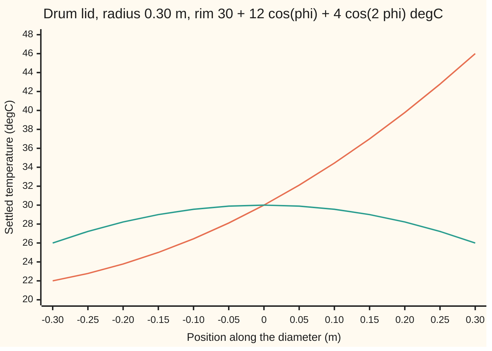

# The Laplacian in round coordinates, and the modes it splits into

[Syllabus](../../../SYLLABUS.md) → [Partial differential equations](../README.md) → [Laplace, Poisson and Potentials](../README.md#s04) → The Laplacian in round coordinates, and the modes it splits into

---

## General Overview

A steel drum lid is 60 cm across, so its radius is 0.30 m. Its two faces are lagged: wrapped in insulation, so heat moves only within the steel. The sun warms one side of the drum, and the rim is held at a temperature that changes round the circle. On the sunny side the rim is 46 °C. A quarter turn away it is 26 °C. Its coolest point is 21.5 °C. These temperatures are illustrative.

The heat has settled, so nothing changes with time. What is the temperature at the centre, and halfway from the centre to the hot side?

As a problem in the sense of [A PDE problem](../01-Classification%20and%20Well-Posedness/01-what-a-pde-problem-is.md): the **unknown** is the settled temperature $`u`$ on the lid; the **region** is the disc of radius 0.30 m; the **data** is the rim temperature. Settled heat obeys Laplace's equation, $`\Delta u = 0`$ ([Laplace's equation](../../08-Differential%20equations%20and%20dynamics/10-The%20Classical%20PDEs/07-laplaces-equation-and-harmonic-functions.md)).

Wing 08 solved Laplace's equation on a rectangle by splitting it into sines one way and sinh the other ([Laplace on a rectangle](../../08-Differential%20equations%20and%20dynamics/10-The%20Classical%20PDEs/08-laplace-on-a-rectangle.md)). A rectangle's edges are lines of constant x or y. A disc's edge is a circle, so this card rewrites the Laplacian in coordinates where the edge is "radius = 0.30 m".

In those round coordinates the equation splits again. The rim pattern breaks into waves round the circle: a steady part, one wave, two waves. Each wave fades towards the centre at its own rate. The answers are **30 °C** at the centre and **37 °C** halfway to the hot side.

**In polar or spherical coordinates the Laplacian is a radial part plus an angular part over the radius squared; so a settled pattern splits into angular modes, each with its own radial power, and a pattern with m waves round a disc fades inwards as the m-th power of the distance from the centre.**

**What kind of fact this is:** a theorem. The two coordinate formulas are derived on this card in Why it works, and the splitting into modes follows from them; the fact that the angular modes of a ball need whole numbers n is taken from [Legendre's equation](../../08-Differential%20equations%20and%20dynamics/07-Series%20Solutions%20and%20Boundary%20Problems/04-legendre-polynomials.md) for patterns that do not change round the axis, and stated with its source for the rest.

### The picture: the lid along two diameters



Orange: the diameter from the point opposite the hot spot (left end, 22 °C) to the hot side (right end, 46 °C). The rim's coolest point, 21.5 °C, lies off this line. Teal: the diameter at right angles to it, 26 °C at both ends. Both pass through 30 °C at the centre. The rim's extremes do not reach the middle: the one-wave tilt fades in a straight line, the two-wave saddle fades as the square of the distance.

---

## The formula

New notation, in words first. This card introduces round coordinates $`(r, \theta, \varphi)`$, the associated Legendre functions $`P_n^m`$ and the spherical harmonics $`Y_n^m`$.

- In the plane, a point is $`(r, \varphi)`$: $`r`$ is the distance from the centre and $`\varphi`$ ("phi") is the angle round from a fixed direction. On the lid, $`\varphi = 0`$ points to the hottest spot of the rim.
- In space, a point is $`(r, \theta, \varphi)`$: $`r`$ is the distance from the centre, $`\theta`$ ("theta") is the angle down from the north pole, and $`\varphi`$ is the angle round the axis, as before.

This is the physics habit, used by wing 08 and the hydrogen card. [Cylindrical and spherical coordinates](../../05-Geometry%20and%20trig/04-Coordinates%20and%20Curves/07-cylindrical-and-spherical-coordinates.md) swaps the two angle letters and calls the radius $`\rho`$. The lid is the equator's plane of a ball, so its angle is the same $`\varphi`$.

The Laplacian in polar coordinates:

```math
\Delta u = \frac{1}{r}\frac{\partial}{\partial r}\Big(r\,\frac{\partial u}{\partial r}\Big) + \frac{1}{r^2}\,\frac{\partial^2 u}{\partial \varphi^2}
```

**Read it aloud:** the Laplacian is one over r times the rate in r of r times the radial slope, plus the second rate round the circle divided by r squared.

The Laplacian in spherical coordinates:

```math
\Delta u = \frac{1}{r^2}\frac{\partial}{\partial r}\Big(r^2\,\frac{\partial u}{\partial r}\Big) + \frac{1}{r^2}\,\Delta_S u, \qquad \Delta_S u = \frac{1}{\sin\theta}\frac{\partial}{\partial \theta}\Big(\sin\theta\,\frac{\partial u}{\partial \theta}\Big) + \frac{1}{\sin^2\theta}\,\frac{\partial^2 u}{\partial \varphi^2}
```

**Read it aloud:** the same shape with r squared in place of r, and the angular part is the Laplacian on the unit sphere, called $`\Delta_S`$, divided by r squared.

The modes it splits into, solutions of $`\Delta u = 0`$ that are a radial factor times an angular factor:

```math
\text{plane: } r^{\pm m}\cos m\varphi,\ \ r^{\pm m}\sin m\varphi \ \ (m = 1, 2, \dots), \quad 1,\ \ \ln r \ \ (m = 0)
```

```math
\text{space: } r^{n}\,Y_n^m,\ \ r^{-(n+1)}\,Y_n^m, \qquad \Delta_S Y_n^m = -n(n+1)\,Y_n^m, \qquad Y_n^m = P_n^m(\cos\theta)\cos m\varphi \ \text{or}\ P_n^m(\cos\theta)\sin m\varphi
```

**Read it aloud:** in the plane, m waves round the circle go with the power m or minus m of the radius; in space, a pattern of degree n on the sphere goes with the power n or minus n minus one.

For the lid, keep only the modes that are finite at the centre and match the rim term by term:

```math
u(r, \varphi) = a_0 + \sum_{m \ge 1} \Big(\frac{r}{R}\Big)^m \big(a_m\cos m\varphi + b_m\sin m\varphi\big) = 30 + 12\,\frac{r}{R}\cos\varphi + 4\,\Big(\frac{r}{R}\Big)^2\cos 2\varphi \ \ ^\circ\mathrm{C}
```

**Read it aloud:** the settled temperature is the rim's average, plus each rim wave scaled down by the m-th power of the fraction of the way out.

| Symbol | Plain meaning | In our example | Push it up and the answer… |
| --- | --- | --- | --- |
| $`u`$, $`\Delta`$, $`\nabla`$ | settled temperature, in °C; the Laplacian, the net outflow of slope per unit area or volume; the slope arrow | 37 °C halfway to the hot side | — |
| $`r`$, $`R`$ | distance from the centre, in m; the lid's radius | $`r`$ = 0.15 m, $`R`$ = 0.30 m | $`r`$ up: closer to the rim's value |
| $`\varphi`$, $`\theta`$ | angle round the centre, from the hottest rim point; angle down from a ball's north pole | $`\varphi`$ = 0 on the hot side; $`\theta`$ = 0 on the axis, 90° on the equator | the point moves round, or towards the south pole |
| $`x`$, $`y`$, $`z`$, $`i`$ | ordinary distances along three axes, in m; the imaginary unit, $`i^2 = -1`$ | $`x = r\cos\varphi`$, $`y = r\sin\varphi`$ on the lid | — |
| $`m`$ | number of waves round the circle | 0, 1, 2 on the rim | the mode fades faster inwards |
| $`a_m`$, $`b_m`$ | size of the cosine and sine wave with m waves, in °C | $`a_0`$ = 30, $`a_1`$ = 12, $`a_2`$ = 4; all $`b_m`$ = 0 | that wave's share grows everywhere |
| $`n`$ | degree of a pattern on a sphere: how finely it varies from pole to pole | 0, 1, 2 on the ball | the angular number $`n(n+1)`$ grows |
| $`\Delta_S`$, $`\lambda`$ | the Laplacian on the unit sphere: the angular part; the constant both sides of the split equal | $`\Delta_S`$ returns −6 times any degree-2 pattern; $`\lambda = 6`$ | — |
| $`P_n`$, $`P_n^m`$, $`s`$ | Legendre polynomial; its associated function $`(1 - s^2)^{m/2}`$ times the m-th derivative of $`P_n`$; $`s = \cos\theta`$, a point's height on a sphere of radius 1 | $`P_2^1(0.6) = 3 \times 0.6 \times 0.8 = 1.44`$ | — |
| $`Y`$, $`Y_n^m`$ | any angular factor on the sphere; a spherical harmonic: an angular mode of degree n with m waves round the axis | $`Y_2^0 = P_2(\cos\theta)`$ | — |
| $`F`$, $`G`$, $`k`$ | the radial factor; the angular factor in the plane; a trial power, $`F = r^k`$ | $`F = (r/R)^2`$, $`G = \cos 2\varphi`$ for mode 2 | — |
| $`a`$, $`\alpha`$, $`h`$, $`dr`$, $`d\theta`$, $`d\varphi`$ | radius of a bung cut out of the centre; angle of a pie slice; a step in the code; the box's steps in radius and in the two angles | $`a`$ = 2.5 cm; $`h`$ = 0.01 and 0.005 | — |

### When it holds

- **A round region about the origin.** The edge must be a coordinate line or surface: a disc, a ring, a ball, a shell. On a square lid the modes $`r^m\cos m\varphi`$ still solve the equation, but no single power fits the square's edge term by term.
- **The centre is part of the region.** That is what throws away $`r^{-m}`$, $`\ln r`$ and $`r^{-(n+1)}`$, which blow up at $`r = 0`$. With a bung (a plug filling a hole at the centre) of radius 2.5 cm at 60 °C cut out of a lid whose rim is 30 °C, the $`\ln r`$ mode is needed, and halfway out the temperature is 38.37 °C, not the 30 °C a disc rule gives.
- **A full turn round the centre.** Going once round brings a point back to itself, so $`m`$ must be whole. On a pie-slice region with angle $`\alpha`$ the powers become $`m\pi/\alpha`$, which need not be whole.
- **No heat made inside, uniform steel, settled.** A heater inside gives [Poisson's equation](03-poissons-equation-and-the-newtonian-potential.md). Heat lost through bare faces adds a term, and the radial powers become other functions.
- **Away from the coordinate gaps.** At $`r = 0`$ and on the poles $`\theta = 0`$ or $`180°`$ the formulas divide by zero. The Laplacian itself is fine there; only the coordinates fail, and finite modes stay finite.

---

## Why it works

### Step 0: the Laplacian is an outflow, and an outflow does not care about axes

The Laplacian measures how much a point differs from the average round it ([Harmonic functions](01-harmonic-functions-and-mean-values.md)). An equal way to say it: $`\Delta u = \nabla \cdot \nabla u`$, the net outflow of the slope $`\nabla u`$ from a small box, per unit area or volume. Here $`\nabla u`$ is the slope arrow, pointing uphill, and $`\nabla\cdot`$ is its outflow per unit size (wing 06).

That description names no axes. So the box may be any small box. Choose one cut by the round coordinates, add up what flows through its faces, and the round formula falls out.

### Step 1: the polar box

Take the box between radii $`r`$ and $`r + dr`$ and angles $`\varphi`$ and $`\varphi + d\varphi`$. Its sides:

| Face | Length | Slope across it |
| --- | --- | --- |
| inner and outer arcs | $`r\,d\varphi`$ and $`(r + dr)\,d\varphi`$ | $`\partial u/\partial r`$ |
| two straight sides | $`dr`$ | $`\frac{1}{r}\,\partial u/\partial\varphi`$, because a turn of $`d\varphi`$ moves a distance $`r\,d\varphi`$ |

The flow out through an arc is its length times the slope across it: $`r\,u_r\,d\varphi`$. The outer arc minus the inner one is the change of $`r\,u_r`$ across $`dr`$, which is $`\partial_r(r\,u_r)\,dr\,d\varphi`$. The straight sides give the change of $`\frac{1}{r}u_\varphi`$ across $`d\varphi`$, times $`dr`$: $`\frac{1}{r}u_{\varphi\varphi}\,d\varphi\,dr`$.

The box's area is $`r\,dr\,d\varphi`$. Divide both outflows by it, and the polar formula appears.

The new term is the outer arc being longer than the inner one. A pattern that only slopes outwards, with nothing changing round the circle, still has a nonzero Laplacian unless its slope shrinks like $`1/r`$. That is why $`\ln r`$, whose slope is $`1/r`$, is a settled pattern in the plane.

<details>
<summary>Detailed proof: the same formula by the chain rule</summary>

Write $`x = r\cos\varphi`$ and $`y = r\sin\varphi`$. The chain rule gives the two first rates:

$`\displaystyle u_r = \cos\varphi\,u_x + \sin\varphi\,u_y, \qquad u_\varphi = -r\sin\varphi\,u_x + r\cos\varphi\,u_y`$

Take each rate once more, again by the chain rule:

$`\displaystyle u_{rr} = \cos^2\varphi\,u_{xx} + 2\sin\varphi\cos\varphi\,u_{xy} + \sin^2\varphi\,u_{yy}`$

$`\displaystyle u_{\varphi\varphi} = r^2\big(\sin^2\varphi\,u_{xx} - 2\sin\varphi\cos\varphi\,u_{xy} + \cos^2\varphi\,u_{yy}\big) - r\,u_r`$

Divide the second by $`r^2`$ and add the first. The cross terms cancel, and $`\sin^2 + \cos^2 = 1`$ leaves:

$`\displaystyle u_{rr} + \frac{1}{r^2}u_{\varphi\varphi} = u_{xx} + u_{yy} - \frac{1}{r}u_r`$

So $`u_{xx} + u_{yy} = u_{rr} + \frac{1}{r}u_r + \frac{1}{r^2}u_{\varphi\varphi}`$, and $`u_{rr} + \frac{1}{r}u_r = \frac{1}{r}\partial_r(r\,u_r)`$. The spherical formula follows the same way with three coordinates, or by the box in Step 2.

</details>

### Step 2: the spherical box

Now the box lies between $`r`$ and $`r + dr`$, $`\theta`$ and $`\theta + d\theta`$, $`\varphi`$ and $`\varphi + d\varphi`$. Its three edges have lengths $`dr`$, $`r\,d\theta`$ and $`r\sin\theta\,d\varphi`$: a circle of latitude has radius $`r\sin\theta`$. Its volume is the product, $`r^2\sin\theta\,dr\,d\theta\,d\varphi`$.

| Pair of faces | Face area | Slope across it | Net outflow |
| --- | --- | --- | --- |
| inner and outer | $`r^2\sin\theta\,d\theta\,d\varphi`$ | $`u_r`$ | $`\partial_r(r^2 u_r)\,\sin\theta\,dr\,d\theta\,d\varphi`$ |
| north and south | $`r\sin\theta\,dr\,d\varphi`$ | $`\frac{1}{r}u_\theta`$ | $`\partial_\theta(\sin\theta\,u_\theta)\,dr\,d\theta\,d\varphi`$ |
| west and east | $`r\,dr\,d\theta`$ | $`\frac{1}{r\sin\theta}u_\varphi`$ | $`\frac{1}{\sin\theta}u_{\varphi\varphi}\,dr\,d\theta\,d\varphi`$ |

Divide each net outflow by the volume. The first row gives $`\frac{1}{r^2}\partial_r(r^2 u_r)`$; the other two give $`\frac{1}{r^2}\Delta_S u`$. The radial faces now grow as $`r^2`$, the area of a sphere, not as $`r`$, the length of a circle. That single change is what separates the ball from the disc in every step below.

### Step 3: in the plane, the split gives whole m and the powers ±m

Try $`u = F(r)\,G(\varphi)`$: a radial factor times an angular factor. Put it in $`\Delta u = 0`$ and multiply by $`r^2/(FG)`$:

```math
\frac{r\,(r F')'}{F} = -\frac{G''}{G}
```

The left side depends only on $`r`$, the right side only on $`\varphi`$. Move the point outwards and only the left could change; turn it and only the right could. Since they are always equal, both are one constant; call it $`m^2`$.

- **Angle.** $`G'' = -m^2 G`$ gives $`G = \cos m\varphi`$ or $`\sin m\varphi`$. A full turn returns to the same point, so $`G`$ repeats every 360°, and $`m`$ is a whole number.
- **Radius.** $`r(rF')' = m^2 F`$ is an equation whose solutions are powers. Try $`F = r^k`$: the left side is $`k^2 r^k`$, so $`k = m`$ or $`k = -m`$. For $`m = 0`$ the two solutions are $`1`$ and $`\ln r`$.

A disc includes its centre, where $`r^{-m}`$ and $`\ln r`$ blow up. So only $`r^m\cos m\varphi`$ and $`r^m\sin m\varphi`$ survive. Each one is the real or imaginary part of $`(x + iy)^m`$, a polynomial in $`x`$ and $`y`$.

### Step 4: in space, the split gives n(n+1) and the powers n and −(n+1)

[Hydrogen in outline](../../13-Engineering%20mathematics/09-Quantum%20Mechanics%20in%20Outline/07-the-hydrogen-atom-in-outline.md) already splits a round problem into $`F(r)\,Y(\theta, \varphi)`$, with the same argument as Step 3. Here it is for Laplace's equation, after multiplying by $`r^2/(FY)`$:

```math
\frac{(r^2 F')'}{F} = -\frac{\Delta_S Y}{Y} = \lambda
```

- **Round the axis.** As in Step 3, $`Y`$ carries $`\cos m\varphi`$ or $`\sin m\varphi`$ with whole $`m`$.
- **Pole to pole.** With $`s = \cos\theta`$, the rest is Legendre's equation for $`m = 0`$, and an associated form of it for other $`m`$. It has a solution finite at both poles only when $`\lambda = n(n+1)`$ with whole $`n \ge m`$. That solution is $`P_n^m(\cos\theta)`$, so $`Y_n^m = P_n^m(\cos\theta)\cos m\varphi`$ or the sine version. [Legendre's equation](../../08-Differential%20equations%20and%20dynamics/07-Series%20Solutions%20and%20Boundary%20Problems/04-legendre-polynomials.md) proves the restriction for $`m = 0`$. For $`m \ge 1`$ the same restriction holds (Courant and Hilbert, vol. 1, ch. VII); the code checks $`\Delta_S Y_n^m = -n(n+1)\,Y_n^m`$ for five pairs.
- **Radius.** Try $`F = r^k`$: $`(r^2 \cdot k r^{k-1})' = k(k+1)r^k`$. So $`k(k+1) = n(n+1)`$, and $`k = n`$ or $`k = -(n+1)`$.

Why $`n(n+1)`$ and not $`n^2`$, as in the plane? The faces of Step 2 grow as $`r^2`$. The radial part acting on $`r^n`$ returns $`n(n+1)\,r^{n-2}`$, not $`n^2 r^{n-2}`$. The angular part must cancel that, so it returns $`-n(n+1)`$. As in the plane, $`r^n Y_n^m`$ is a polynomial in $`x`$, $`y`$, $`z`$. For example $`r^2 P_2(\cos\theta) = z^2 - \frac{1}{2}(x^2 + y^2)`$, and its Laplacian is $`2 - 1 - 1 = 0`$.

### Step 5: the lid, solved mode by mode

The rim temperature is $`30 + 12\cos\varphi + 4\cos 2\varphi`$ °C. Each piece is already one mode. Match them one at a time:

- the steady part, 30 °C, is the mode $`m = 0`$, constant everywhere;
- the one-wave part, 12 °C, becomes $`12\,(r/R)\cos\varphi`$;
- the two-wave part, 4 °C, becomes $`4\,(r/R)^2\cos 2\varphi`$.

Their sum solves $`\Delta u = 0`$, because each piece does, and equals the rim at $`r = R`$. It is a **classical solution**: twice differentiable inside, continuous up to the rim. It is the only one, because the difference of two solutions is settled and zero on the rim, so by [Maximum principles](../01-Classification%20and%20Well-Posedness/08-maximum-principles.md) it is zero everywhere.

A rim that is not already a few modes is first split into modes by averaging it against $`\cos m\varphi`$ and $`\sin m\varphi`$ round the circle. Wing 07's [The Poisson formula](../../07-Complex%20analysis/07-Conformal%20Maps%20and%20Harmonic%20Functions/06-poisson-integral-formula.md) adds up all the modes at once into one integral. The code uses it as a second road.

### Step 6: what the split tells you

- **The centre sees only the average.** Every mode with $`m \ge 1`$ has the factor $`r^m`$, which is 0 at the centre. So the centre is the rim's mean, 30 °C, as the mean-value property of [Harmonic functions](01-harmonic-functions-and-mean-values.md) says.
- **Fine detail dies away from the rim.** Halfway out, mode $`m`$ keeps $`0.5^m`$ of its rim size: half of the one-wave tilt, a quarter of the two-wave saddle, $`1/64`$ of a six-wave ripple.
- **Outside, a ball forgets faster than a disc.** Outside a round region, the modes that stay finite far away are $`r^{-m}`$ and $`r^{-(n+1)}`$. At twice the radius, a degree-1 pattern keeps 0.500 of its size round a disc but 0.250 round a ball. A degree-2 pattern keeps 0.250 and 0.125.

The modes with $`m = 0`$ and $`n = 0`$ are $`\ln r`$ and $`1/r`$. Up to a constant, those are the patterns of [The fundamental solution](02-fundamental-solution-of-the-laplacian.md) in two and three dimensions: the settled field of one point source.

---

## Worked numbers, by hand

The lid, halfway from the centre to the hot side: $`r`$ = 0.15 m, $`\varphi`$ = 0. Then the ball with the same pattern along a meridian.

| Step | Arithmetic | Value |
| --- | --- | --- |
| fraction of the way out, $`r/R`$ | 0.15 / 0.30 | 0.50 |
| mode 0, the rim's mean | 30 | 30.00 °C |
| mode 1 | 12 × 0.50 × cos 0° | 6.00 °C |
| mode 2 | 4 × 0.50² × cos 0° | 1.00 °C |
| halfway, hot side | 30 + 6 + 1 | **37.00 °C** |
| centre | only mode 0 is left | **30.00 °C** |
| halfway, a quarter turn round | 30 + 12 × 0.50 × cos 90° + 4 × 0.25 × cos 180° | 29.00 °C |
| ball, halfway along the axis | 30 + 12 × 0.50 × $`P_1(1)`$ + 4 × 0.25 × $`P_2(1)`$ | 37.00 °C |
| ball, halfway on the equator | 30 + 0 + 4 × 0.25 × $`P_2(0)`$ = 30 + 1 × (−0.5) | 29.50 °C |

Halfway to the hot side the lid is 37 °C, between the centre's 30 °C and the hot rim's 46 °C, because the rim's one-wave tilt arrives at half strength and its two-wave saddle at a quarter.

The ball's surface is held at $`30 + 12P_1(\cos\theta) + 4P_2(\cos\theta)`$ °C, also 46 °C at the north pole. Inside it, mode n fades as $`(r/R)^n`$, as on the lid. The two differ in the angular number, $`n(n+1)`$ against $`m^2`$, and outside, as Step 6 shows.

### What breaks if you drop a piece

| Mistake | Comes out at | What went wrong |
| --- | --- | --- |
| Drop the $`\frac{1}{r}u_r`$ term: treat $`r`$ and $`\varphi`$ like $`x`$ and $`y`$ | powers 1.618034 and 2.561553; halfway 34.59 °C, not 37.00 | the outer arc of the box is longer than the inner one; the term carries that |
| No fading: carry the rim's modes inwards unchanged | halfway 46.00 °C, not 37.00 | each mode needs its factor $`(r/R)^m`$ |
| Centre taken as the rim's midrange, (hottest + coolest) / 2 | (46.00 + 21.50) / 2 = 33.75 °C, not 30.00 | the centre is the rim's mean, not the middle of its range |
| A bung of radius 2.5 cm at 60 °C, rim 30 °C, solved by the disc rule | 30.00 °C halfway; truly 38.37 °C (log form 38.3683; grid 38.3684 at step 0.625 mm, observed order 2.00) | the centre is not in the region, so the $`\ln r`$ mode is allowed and needed |
| A ball with angular number $`n^2`$, the plane's habit | powers 0.618034 and 1.561553; axis halfway 39.17 °C, not 37.00 | on a sphere the angular part returns $`-n(n+1)`$ |

The code prints all five.

---

## Code, from first principles, and it actually runs

The code computes every number on this card with the standard library only. It writes its own Laplacian in round coordinates, as the flux through a small box, and its own Legendre and associated Legendre functions. It takes these independent roads:

1. **The formulas against the exact answer.** The round formulas, applied by small steps, against the exact Cartesian Laplacian of two test polynomials. The error falls fourfold when the step halves.
2. **The angular modes.** The angular part of the spherical formula, applied to $`Y_n^m`$, against $`-n(n+1)`$.
3. **The lid three ways.** The mode series; the Poisson integral from wing 07, summed at 256 points round the rim; and the residual of the series in the polar formula at two steps. A 256-point sum also recovers the rim's modes.
4. **The ball two ways.** The mode series against the surface mean (Simpson's rule in $`\theta`$, which must equal the centre value) and against the spherical formula's residual.
5. **The bung.** The log form against a radial grid solved by the Thomas algorithm (a direct solver for equations where each unknown touches only its two neighbours), at steps 1.25, 0.625 and 0.3125 mm. The error falls fourfold per halving: observed order 2.00.

### Python

```python
# The Laplacian in round coordinates -- the check behind the card.  Standard library only.
# A steel drum lid, radius 0.30 m, faces lagged, rim held at 30 + 12 cos(phi) + 4 cos(2 phi) degC.
# Roads: the round formulas against the exact Cartesian Laplacian; the mode series against
# the Poisson integral and the rim mean; the equation's residual at two steps; the same in a ball.
import math

R = 0.30                       # lid radius, m
A = {0: 30.0, 1: 12.0, 2: 4.0}  # rim modes: degC times cos(m phi)
RA = 0.15                      # the point read off, m from the centre

def sci(x):
    m, e = f"{x:.2e}".split("e")
    return f"{m}e{int(e)}"

def lid(r, p):                 # the mode series: mode m fades as (r/R)^m
    return sum(a * (r / R) ** m * math.cos(m * p) for m, a in A.items())

def rim(p):
    return lid(R, p)

def polar_lap(u, r, p, h):     # flux through a small polar box, per unit area
    rad = ((r + h / 2) * (u(r + h, p) - u(r, p)) - (r - h / 2) * (u(r, p) - u(r - h, p))) / (h * h * r)
    return rad + (u(r, p + h) - 2 * u(r, p) + u(r, p - h)) / (h * h * r * r)

def ang_lap(Y, t, p, h):       # the angular part of the spherical Laplacian
    th = (math.sin(t + h / 2) * (Y(t + h, p) - Y(t, p)) - math.sin(t - h / 2) * (Y(t, p) - Y(t - h, p))) / (h * h * math.sin(t))
    return th + (Y(t, p + h) - 2 * Y(t, p) + Y(t, p - h)) / (h * h * math.sin(t) ** 2)

def sph_lap(u, r, t, p, h):    # radial flux through r^2 faces, plus the angular part over r^2
    rad = ((r + h / 2) ** 2 * (u(r + h, t, p) - u(r, t, p)) - (r - h / 2) ** 2 * (u(r, t, p) - u(r - h, t, p))) / (h * h * r * r)
    return rad + ang_lap(lambda tt, pp: u(r, tt, pp), t, p, h) / (r * r)

def legendre(n):               # coefficients of P_n, by Bonnet's rule
    P = [[1.0], [0.0, 1.0]]
    for k in range(1, n):
        a = [0.0] + [(2 * k + 1) * c / (k + 1) for c in P[k]]
        for i, c in enumerate(P[k - 1]):
            a[i] -= k * c / (k + 1)
        P.append(a)
    return P[n]

def assoc(n, m, s):            # P_n^m(s) = (1 - s^2)^(m/2) times the m-th derivative of P_n, s = cos(theta)
    c = legendre(n)
    for _ in range(m):
        c = [i * c[i] for i in range(1, len(c))] or [0.0]
    return (1 - s * s) ** (m / 2) * sum(ci * s ** i for i, ci in enumerate(c))

print("1. The round formulas against the exact Cartesian Laplacian")
x, y = 0.2 * math.cos(0.7), 0.2 * math.sin(0.7)
g2 = lambda r, p: (r * math.cos(p)) ** 3 * (r * math.sin(p)) + (r * math.cos(p)) ** 2
e2 = [polar_lap(g2, 0.2, 0.7, h) - (6 * x * y + 2) for h in (0.01, 0.005)]
print(f"polar, x^3 y + x^2 at r 0.2 m, phi 0.7: exact {6 * x * y + 2:.6f}; error h 0.01 {sci(e2[0])}, h 0.005 {sci(e2[1])}, ratio {e2[0] / e2[1]:.2f}")
assert abs(e2[1]) < 1e-3 and 3.5 < e2[0] / e2[1] < 4.5
cart = lambda r, t, p: (r * math.sin(t) * math.cos(p), r * math.sin(t) * math.sin(p), r * math.cos(t))
g3 = lambda r, t, p: (lambda X, Y, Z: X * X * Y * Z + Z ** 3)(*cart(r, t, p))
X, Y, Z = cart(0.25, 1.0, 0.6)
e3 = [sph_lap(g3, 0.25, 1.0, 0.6, h) - (2 * Y * Z + 6 * Z) for h in (0.01, 0.005)]
print(f"spherical, x^2 y z + z^3 at r 0.25 m: exact {2 * Y * Z + 6 * Z:.6f}; error h 0.01 {sci(e3[0])}, h 0.005 {sci(e3[1])}, ratio {e3[0] / e3[1]:.2f}")
assert abs(e3[1]) < 1e-3 and 3.5 < e3[0] / e3[1] < 4.5

print("2. Angular modes: the angular part returns -n(n+1) times Y_n^m")
for n, m in [(1, 0), (2, 0), (2, 1), (2, 2), (3, 1)]:
    Yf = lambda t, p, n=n, m=m: assoc(n, m, math.cos(t)) * math.cos(m * p)
    lam = ang_lap(Yf, 0.9, 0.4, 1e-3) / Yf(0.9, 0.4)
    print(f"n {n}, m {m}: ratio {lam:.4f}, -n(n+1) = {-n * (n + 1)}")
    assert abs(lam + n * (n + 1)) < 1e-4
print(f"P_2^1(0.6) = {assoc(2, 1, 0.6):.4f}, by hand 3 s sqrt(1 - s^2) = {3 * 0.6 * 0.8:.4f}")

print("3. The drum lid: the mode series against the Poisson integral")
N = 256
ps = [2 * math.pi * k / N for k in range(N)]
coef = [sum(rim(p) * math.cos(m * p) for p in ps) / N * (1 if m == 0 else 2) for m in range(4)]
print("rim modes by a 256-point sum: " + ", ".join(f"m {m} {c if abs(c) > 5e-7 else 0.0:.6f} degC" for m, c in enumerate(coef)))
assert all(abs(coef[m] - A.get(m, 0.0)) < 1e-9 for m in range(4))
def poisson(r, p):             # wing 07's Poisson integral, by the trapezoid sum
    return sum((R * R - r * r) / (R * R - 2 * R * r * math.cos(p - q) + r * r) * rim(q) for q in ps) / N
for lab, r, p in [("centre", 0.0, 0.0), ("halfway, hot side", RA, 0.0), ("halfway, 90 deg round", RA, math.pi / 2)]:
    print(f"{lab}: series {lid(r, p):.6f} degC, Poisson integral {poisson(r, p):.6f} degC")
    assert abs(lid(r, p) - poisson(r, p)) < 1e-9
print(f"hand rows at r/R {RA / R:.2f}: mode 0 {A[0]:.2f}, mode 1 {A[1] * (RA / R):.2f}, mode 2 {A[2] * (RA / R) ** 2:.2f} degC")
res = [polar_lap(lid, RA, 0.0, h) for h in (0.01, 0.005)]
print(f"residual of the series in the polar formula: h 0.01 {res[0]:.6f}, h 0.005 {res[1]:.6f} degC/m^2, ratio {res[0] / res[1]:.2f}")
assert abs(res[1]) < 0.01 and 3.5 < res[0] / res[1] < 4.5
print("chart, hot-cold diameter, x from -0.30 to 0.30 m: " + ", ".join(f"{lid(abs(s), 0.0 if s >= 0 else math.pi):.2f}" for s in [0.05 * k - 0.30 for k in range(13)]))
print("chart, cross diameter: " + ", ".join(f"{lid(abs(s), math.pi / 2):.2f}" for s in [0.05 * k - 0.30 for k in range(13)]))

print("4. The same pattern on a ball, radius 0.30 m: surface 30 + 12 P_1 + 4 P_2 of cos(theta)")
ball = lambda r, t, p: sum(a * (r / R) ** n * assoc(n, 0, math.cos(t)) for n, a in A.items())
print(f"halfway on the axis {ball(RA, 0.0, 0.0):.6f} degC, halfway on the equator {ball(RA, math.pi / 2, 0.0):.6f} degC")
M = 200
mean = sum((1 if i in (0, M) else 4 if i % 2 else 2) * ball(R, i * math.pi / M, 0.0) * math.sin(i * math.pi / M) for i in range(M + 1)) * math.pi / (3 * M) / 2
print(f"surface mean, Simpson in theta, 200 steps: {mean:.6f} degC = centre {ball(0.0, 0.0, 0.0):.6f} degC")
assert abs(mean - ball(0.0, 0.0, 0.0)) < 1e-6
rb = [sph_lap(ball, RA, 0.8, 0.3, h) for h in (0.01, 0.005)]
print(f"residual of the ball in the spherical formula: h 0.01 {rb[0]:.6f}, h 0.005 {rb[1]:.6f} degC/m^2, ratio {rb[0] / rb[1]:.2f}")
assert abs(rb[1]) < 0.01 and 3.5 < rb[0] / rb[1] < 4.5
print(f"outside, at r = 2R, a degree-1 pattern keeps: disc {(1 / 2) ** 1:.3f}, ball {(1 / 2) ** 2:.3f}; degree 2: disc {(1 / 2) ** 2:.3f}, ball {(1 / 2) ** 3:.3f}")

print("5. What breaks")
q = RA / R
k2 = [(1 + math.sqrt(1 + 4 * m * m)) / 2 for m in (1, 2)]
w1 = A[0] + A[1] * q ** k2[0] + A[2] * q ** k2[1]
print(f"mistake 1, drop u_r/r: powers {k2[0]:.6f}, {k2[1]:.6f}; halfway {w1:.2f} degC, not {lid(RA, 0.0):.2f}")
print(f"mistake 2, no fade: halfway {sum(A.values()):.2f} degC, not {lid(RA, 0.0):.2f}")
scan = [rim(2 * math.pi * k / 3600) for k in range(3600)]
print(f"mistake 3, centre as the rim's midrange: ({max(scan):.2f} + {min(scan):.2f})/2 = {(max(scan) + min(scan)) / 2:.2f} degC, not {lid(0.0, 0.0):.2f}")
a_in = 0.025                   # bung radius, m
def bung(n_r):                 # radial grid of n_r cells; returns the temperature at RA
    hr = (R - a_in) / n_r
    rr = [a_in + i * hr for i in range(n_r + 1)]
    sub = [rr[i] - hr / 2 for i in range(n_r + 1)]
    sup = [rr[i] + hr / 2 for i in range(n_r + 1)]
    dg, rhs = [-(sub[i] + sup[i]) for i in range(n_r + 1)], [0.0] * (n_r + 1)
    rhs[1] -= sub[1] * 60.0
    rhs[n_r - 1] -= sup[n_r - 1] * 30.0
    for i in range(2, n_r):    # Thomas sweep on the flux equations, rows 1 .. n_r - 1
        w = sub[i] / dg[i - 1]
        dg[i] -= w * sup[i - 1]
        rhs[i] -= w * rhs[i - 1]
    u = [0.0] * (n_r + 1)
    u[0], u[n_r] = 60.0, 30.0
    for i in range(n_r - 1, 0, -1):
        u[i] = (rhs[i] - (sup[i] * u[i + 1] if i < n_r - 1 else 0.0)) / dg[i]
    return u[round((RA - a_in) / hr)]
exact = 30 + 30 * math.log(RA / R) / math.log(a_in / R)
grid = [bung(n) for n in (220, 440, 880)]   # steps 1.25, 0.625, 0.3125 mm
be = [g - exact for g in grid]
print(f"mistake 4, bung of radius 2.5 cm at 60 degC, rim 30 degC: log form {exact:.4f}, grid {grid[1]:.4f} degC; centre rule gives 30.00")
print(f"bung grid error at steps 1.25, 0.625, 0.3125 mm: {sci(be[0])}, {sci(be[1])}, {sci(be[2])} degC; observed order {math.log2(be[0] / be[1]):.2f}, {math.log2(be[1] / be[2]):.2f}")
assert abs(be[2]) < 1e-4 and 1.9 < math.log2(be[1] / be[2]) < 2.1
kb = [(-1 + math.sqrt(1 + 4 * n * n)) / 2 for n in (1, 2)]
w5 = A[0] + A[1] * q ** kb[0] + A[2] * q ** kb[1]
print(f"mistake 5, ball with angular number n^2: powers {kb[0]:.6f}, {kb[1]:.6f}; axis halfway {w5:.2f} degC, not {ball(RA, 0.0, 0.0):.2f}")
print("ALL CHECKS PASS")
```

**Ran 2026-11-15 on macOS, Python 3.14.10, standard library only. All checks passed. Output, pasted from the run:**

```
1. The round formulas against the exact Cartesian Laplacian
polar, x^3 y + x^2 at r 0.2 m, phi 0.7: exact 2.118254; error h 0.01 1.89e-4, h 0.005 4.73e-5, ratio 4.00
spherical, x^2 y z + z^3 at r 0.25 m: exact 0.842543; error h 0.01 3.50e-4, h 0.005 8.74e-5, ratio 4.00
2. Angular modes: the angular part returns -n(n+1) times Y_n^m
n 1, m 0: ratio -2.0000, -n(n+1) = -2
n 2, m 0: ratio -6.0000, -n(n+1) = -6
n 2, m 1: ratio -6.0000, -n(n+1) = -6
n 2, m 2: ratio -6.0000, -n(n+1) = -6
n 3, m 1: ratio -12.0000, -n(n+1) = -12
P_2^1(0.6) = 1.4400, by hand 3 s sqrt(1 - s^2) = 1.4400
3. The drum lid: the mode series against the Poisson integral
rim modes by a 256-point sum: m 0 30.000000 degC, m 1 12.000000 degC, m 2 4.000000 degC, m 3 0.000000 degC
centre: series 30.000000 degC, Poisson integral 30.000000 degC
halfway, hot side: series 37.000000 degC, Poisson integral 37.000000 degC
halfway, 90 deg round: series 29.000000 degC, Poisson integral 29.000000 degC
hand rows at r/R 0.50: mode 0 30.00, mode 1 6.00, mode 2 1.00 degC
residual of the series in the polar formula: h 0.01 0.008148, h 0.005 0.002037 degC/m^2, ratio 4.00
chart, hot-cold diameter, x from -0.30 to 0.30 m: 22.00, 22.78, 23.78, 25.00, 26.44, 28.11, 30.00, 32.11, 34.44, 37.00, 39.78, 42.78, 46.00
chart, cross diameter: 26.00, 27.22, 28.22, 29.00, 29.56, 29.89, 30.00, 29.89, 29.56, 29.00, 28.22, 27.22, 26.00
4. The same pattern on a ball, radius 0.30 m: surface 30 + 12 P_1 + 4 P_2 of cos(theta)
halfway on the axis 37.000000 degC, halfway on the equator 29.500000 degC
surface mean, Simpson in theta, 200 steps: 30.000000 degC = centre 30.000000 degC
residual of the ball in the spherical formula: h 0.01 0.034675, h 0.005 0.008669 degC/m^2, ratio 4.00
outside, at r = 2R, a degree-1 pattern keeps: disc 0.500, ball 0.250; degree 2: disc 0.250, ball 0.125
5. What breaks
mistake 1, drop u_r/r: powers 1.618034, 2.561553; halfway 34.59 degC, not 37.00
mistake 2, no fade: halfway 46.00 degC, not 37.00
mistake 3, centre as the rim's midrange: (46.00 + 21.50)/2 = 33.75 degC, not 30.00
mistake 4, bung of radius 2.5 cm at 60 degC, rim 30 degC: log form 38.3683, grid 38.3684 degC; centre rule gives 30.00
bung grid error at steps 1.25, 0.625, 0.3125 mm: 3.22e-4, 8.05e-5, 2.01e-5 degC; observed order 2.00, 2.00
mistake 5, ball with angular number n^2: powers 0.618034, 1.561553; axis halfway 39.17 degC, not 37.00
ALL CHECKS PASS
```

### Rust

```rust
// The Laplacian in round coordinates -- the check behind the card.  std only, no crates.
// A steel drum lid, radius 0.30 m, faces lagged, rim held at 30 + 12 cos(phi) + 4 cos(2 phi) degC.
// Roads: the round formulas against the exact Cartesian Laplacian; the mode series against
// the Poisson integral and the rim mean; the equation's residual at two steps; the same in a ball.
use std::f64::consts::PI;

const R: f64 = 0.30; // lid radius, m
const A: [(usize, f64); 3] = [(0, 30.0), (1, 12.0), (2, 4.0)]; // rim modes: degC times cos(m phi)
const RA: f64 = 0.15; // the point read off, m from the centre

fn sci(x: f64) -> String { format!("{:.2e}", x) }

fn lid(r: f64, p: f64) -> f64 { // the mode series: mode m fades as (r/R)^m
    A.iter().map(|&(m, a)| a * (r / R).powf(m as f64) * (m as f64 * p).cos()).sum()
}
fn rim(p: f64) -> f64 { lid(R, p) }

fn polar_lap(u: &dyn Fn(f64, f64) -> f64, r: f64, p: f64, h: f64) -> f64 { // flux through a small polar box, per unit area
    let rad = ((r + h / 2.0) * (u(r + h, p) - u(r, p)) - (r - h / 2.0) * (u(r, p) - u(r - h, p))) / (h * h * r);
    rad + (u(r, p + h) - 2.0 * u(r, p) + u(r, p - h)) / (h * h * r * r)
}
fn ang_lap(y: &dyn Fn(f64, f64) -> f64, t: f64, p: f64, h: f64) -> f64 { // the angular part of the spherical Laplacian
    let th = ((t + h / 2.0).sin() * (y(t + h, p) - y(t, p)) - (t - h / 2.0).sin() * (y(t, p) - y(t - h, p))) / (h * h * t.sin());
    th + (y(t, p + h) - 2.0 * y(t, p) + y(t, p - h)) / (h * h * t.sin().powf(2.0))
}
fn sph_lap(u: &dyn Fn(f64, f64, f64) -> f64, r: f64, t: f64, p: f64, h: f64) -> f64 { // radial flux through r^2 faces, plus angular over r^2
    let rad = ((r + h / 2.0).powf(2.0) * (u(r + h, t, p) - u(r, t, p)) - (r - h / 2.0).powf(2.0) * (u(r, t, p) - u(r - h, t, p))) / (h * h * r * r);
    rad + ang_lap(&|tt, pp| u(r, tt, pp), t, p, h) / (r * r)
}
fn legendre(n: usize) -> Vec<f64> { // coefficients of P_n, by Bonnet's rule
    let mut p: Vec<Vec<f64>> = vec![vec![1.0], vec![0.0, 1.0]];
    for k in 1..n {
        let kf = k as f64;
        let mut a = vec![0.0];
        a.extend(p[k].iter().map(|c| (2.0 * kf + 1.0) * c / (kf + 1.0)));
        for (i, c) in p[k - 1].iter().enumerate() { a[i] -= kf * c / (kf + 1.0); }
        p.push(a);
    }
    p[n].clone()
}
fn assoc(n: usize, m: usize, s: f64) -> f64 { // P_n^m(s) = (1 - s^2)^(m/2) times the m-th derivative of P_n, s = cos(theta)
    let mut c = legendre(n);
    for _ in 0..m {
        c = (1..c.len()).map(|i| i as f64 * c[i]).collect();
        if c.is_empty() { c = vec![0.0]; }
    }
    (1.0 - s * s).powf(m as f64 / 2.0) * c.iter().enumerate().map(|(i, ci)| ci * s.powf(i as f64)).sum::<f64>()
}
fn ball(r: f64, t: f64, _p: f64) -> f64 {
    A.iter().map(|&(n, a)| a * (r / R).powf(n as f64) * assoc(n, 0, t.cos())).sum()
}

fn main() {
    println!("1. The round formulas against the exact Cartesian Laplacian");
    let (x, y) = (0.2 * 0.7f64.cos(), 0.2 * 0.7f64.sin());
    let g2 = |r: f64, p: f64| (r * p.cos()).powf(3.0) * (r * p.sin()) + (r * p.cos()).powf(2.0);
    let e2: Vec<f64> = [0.01, 0.005].iter().map(|&h| polar_lap(&g2, 0.2, 0.7, h) - (6.0 * x * y + 2.0)).collect();
    println!("polar, x^3 y + x^2 at r 0.2 m, phi 0.7: exact {:.6}; error h 0.01 {}, h 0.005 {}, ratio {:.2}", 6.0 * x * y + 2.0, sci(e2[0]), sci(e2[1]), e2[0] / e2[1]);
    assert!(e2[1].abs() < 1e-3 && 3.5 < e2[0] / e2[1] && e2[0] / e2[1] < 4.5);
    let cart = |r: f64, t: f64, p: f64| (r * t.sin() * p.cos(), r * t.sin() * p.sin(), r * t.cos());
    let g3 = |r: f64, t: f64, p: f64| { let (x, y, z) = cart(r, t, p); x * x * y * z + z.powf(3.0) };
    let (_, yy, zz) = cart(0.25, 1.0, 0.6);
    let e3: Vec<f64> = [0.01, 0.005].iter().map(|&h| sph_lap(&g3, 0.25, 1.0, 0.6, h) - (2.0 * yy * zz + 6.0 * zz)).collect();
    println!("spherical, x^2 y z + z^3 at r 0.25 m: exact {:.6}; error h 0.01 {}, h 0.005 {}, ratio {:.2}", 2.0 * yy * zz + 6.0 * zz, sci(e3[0]), sci(e3[1]), e3[0] / e3[1]);
    assert!(e3[1].abs() < 1e-3 && 3.5 < e3[0] / e3[1] && e3[0] / e3[1] < 4.5);

    println!("2. Angular modes: the angular part returns -n(n+1) times Y_n^m");
    for &(n, m) in &[(1usize, 0usize), (2, 0), (2, 1), (2, 2), (3, 1)] {
        let yf = move |t: f64, p: f64| assoc(n, m, t.cos()) * (m as f64 * p).cos();
        let lam = ang_lap(&yf, 0.9, 0.4, 1e-3) / yf(0.9, 0.4);
        let nn = (n * (n + 1)) as f64;
        println!("n {}, m {}: ratio {:.4}, -n(n+1) = {}", n, m, lam, -(nn as i64));
        assert!((lam + nn).abs() < 1e-4);
    }
    println!("P_2^1(0.6) = {:.4}, by hand 3 s sqrt(1 - s^2) = {:.4}", assoc(2, 1, 0.6), 3.0 * 0.6 * 0.8);

    println!("3. The drum lid: the mode series against the Poisson integral");
    let nq = 256;
    let ps: Vec<f64> = (0..nq).map(|k| 2.0 * PI * k as f64 / nq as f64).collect();
    let coef: Vec<f64> = (0..4).map(|m| ps.iter().map(|&p| rim(p) * (m as f64 * p).cos()).sum::<f64>() / nq as f64 * if m == 0 { 1.0 } else { 2.0 }).collect();
    let parts: Vec<String> = coef.iter().enumerate().map(|(m, &c)| format!("m {} {:.6} degC", m, if c.abs() > 5e-7 { c } else { 0.0 })).collect();
    println!("rim modes by a 256-point sum: {}", parts.join(", "));
    assert!((0..4).all(|m| (coef[m] - A.iter().find(|a| a.0 == m).map_or(0.0, |a| a.1)).abs() < 1e-9));
    let poisson = |r: f64, p: f64| ps.iter().map(|&q| (R * R - r * r) / (R * R - 2.0 * R * r * (p - q).cos() + r * r) * rim(q)).sum::<f64>() / nq as f64;
    for &(lab, r, p) in &[("centre", 0.0, 0.0), ("halfway, hot side", RA, 0.0), ("halfway, 90 deg round", RA, PI / 2.0)] {
        println!("{}: series {:.6} degC, Poisson integral {:.6} degC", lab, lid(r, p), poisson(r, p));
        assert!((lid(r, p) - poisson(r, p)).abs() < 1e-9);
    }
    println!("hand rows at r/R {:.2}: mode 0 {:.2}, mode 1 {:.2}, mode 2 {:.2} degC", RA / R, A[0].1, A[1].1 * (RA / R), A[2].1 * (RA / R).powf(2.0));
    let res: Vec<f64> = [0.01, 0.005].iter().map(|&h| polar_lap(&lid, RA, 0.0, h)).collect();
    println!("residual of the series in the polar formula: h 0.01 {:.6}, h 0.005 {:.6} degC/m^2, ratio {:.2}", res[0], res[1], res[0] / res[1]);
    assert!(res[1].abs() < 0.01 && 3.5 < res[0] / res[1] && res[0] / res[1] < 4.5);
    let s: Vec<f64> = (0..13).map(|k| 0.05 * k as f64 - 0.30).collect();
    let hot: Vec<String> = s.iter().map(|&s| format!("{:.2}", lid(s.abs(), if s >= 0.0 { 0.0 } else { PI }))).collect();
    println!("chart, hot-cold diameter, x from -0.30 to 0.30 m: {}", hot.join(", "));
    let cross: Vec<String> = s.iter().map(|&s| format!("{:.2}", lid(s.abs(), PI / 2.0))).collect();
    println!("chart, cross diameter: {}", cross.join(", "));

    println!("4. The same pattern on a ball, radius 0.30 m: surface 30 + 12 P_1 + 4 P_2 of cos(theta)");
    println!("halfway on the axis {:.6} degC, halfway on the equator {:.6} degC", ball(RA, 0.0, 0.0), ball(RA, PI / 2.0, 0.0));
    let mm = 200;
    let mean = (0..=mm).map(|i| {
        let w = if i == 0 || i == mm { 1.0 } else if i % 2 == 1 { 4.0 } else { 2.0 };
        let t = i as f64 * PI / mm as f64;
        w * ball(R, t, 0.0) * t.sin()
    }).sum::<f64>() * PI / (3.0 * mm as f64) / 2.0;
    println!("surface mean, Simpson in theta, 200 steps: {:.6} degC = centre {:.6} degC", mean, ball(0.0, 0.0, 0.0));
    assert!((mean - ball(0.0, 0.0, 0.0)).abs() < 1e-6);
    let rb: Vec<f64> = [0.01, 0.005].iter().map(|&h| sph_lap(&ball, RA, 0.8, 0.3, h)).collect();
    println!("residual of the ball in the spherical formula: h 0.01 {:.6}, h 0.005 {:.6} degC/m^2, ratio {:.2}", rb[0], rb[1], rb[0] / rb[1]);
    assert!(rb[1].abs() < 0.01 && 3.5 < rb[0] / rb[1] && rb[0] / rb[1] < 4.5);
    println!("outside, at r = 2R, a degree-1 pattern keeps: disc {:.3}, ball {:.3}; degree 2: disc {:.3}, ball {:.3}", 0.5f64.powf(1.0), 0.5f64.powf(2.0), 0.5f64.powf(2.0), 0.5f64.powf(3.0));

    println!("5. What breaks");
    let q = RA / R;
    let k2: Vec<f64> = [1.0f64, 2.0].iter().map(|m| (1.0 + (1.0 + 4.0 * m * m).sqrt()) / 2.0).collect();
    let w1 = A[0].1 + A[1].1 * q.powf(k2[0]) + A[2].1 * q.powf(k2[1]);
    println!("mistake 1, drop u_r/r: powers {:.6}, {:.6}; halfway {:.2} degC, not {:.2}", k2[0], k2[1], w1, lid(RA, 0.0));
    println!("mistake 2, no fade: halfway {:.2} degC, not {:.2}", A.iter().map(|a| a.1).sum::<f64>(), lid(RA, 0.0));
    let scan: Vec<f64> = (0..3600).map(|k| rim(2.0 * PI * k as f64 / 3600.0)).collect();
    let (mx, mn) = (scan.iter().cloned().fold(f64::MIN, f64::max), scan.iter().cloned().fold(f64::MAX, f64::min));
    println!("mistake 3, centre as the rim's midrange: ({:.2} + {:.2})/2 = {:.2} degC, not {:.2}", mx, mn, (mx + mn) / 2.0, lid(0.0, 0.0));
    let a_in = 0.025f64; // bung radius, m
    let bung = |n_r: usize| -> f64 { // radial grid of n_r cells; returns the temperature at RA
        let hr = (R - a_in) / n_r as f64;
        let rr: Vec<f64> = (0..=n_r).map(|i| a_in + i as f64 * hr).collect();
        let sub: Vec<f64> = rr.iter().map(|r| r - hr / 2.0).collect();
        let sup: Vec<f64> = rr.iter().map(|r| r + hr / 2.0).collect();
        let mut dg: Vec<f64> = (0..=n_r).map(|i| -(sub[i] + sup[i])).collect();
        let mut rhs = vec![0.0; n_r + 1];
        rhs[1] -= sub[1] * 60.0;
        rhs[n_r - 1] -= sup[n_r - 1] * 30.0;
        for i in 2..n_r { // Thomas sweep on the flux equations, rows 1 .. n_r - 1
            let w = sub[i] / dg[i - 1];
            dg[i] -= w * sup[i - 1];
            rhs[i] -= w * rhs[i - 1];
        }
        let mut u = vec![0.0; n_r + 1];
        u[0] = 60.0;
        u[n_r] = 30.0;
        for i in (1..n_r).rev() {
            u[i] = (rhs[i] - if i < n_r - 1 { sup[i] * u[i + 1] } else { 0.0 }) / dg[i];
        }
        u[((RA - a_in) / hr).round() as usize]
    };
    let exact = 30.0 + 30.0 * (RA / R).ln() / (a_in / R).ln();
    let grid: Vec<f64> = [220usize, 440, 880].iter().map(|&n| bung(n)).collect(); // steps 1.25, 0.625, 0.3125 mm
    let be: Vec<f64> = grid.iter().map(|g| g - exact).collect();
    println!("mistake 4, bung of radius 2.5 cm at 60 degC, rim 30 degC: log form {:.4}, grid {:.4} degC; centre rule gives 30.00", exact, grid[1]);
    println!("bung grid error at steps 1.25, 0.625, 0.3125 mm: {}, {}, {} degC; observed order {:.2}, {:.2}", sci(be[0]), sci(be[1]), sci(be[2]), (be[0] / be[1]).log2(), (be[1] / be[2]).log2());
    assert!(be[2].abs() < 1e-4 && 1.9 < (be[1] / be[2]).log2() && (be[1] / be[2]).log2() < 2.1);
    let kb: Vec<f64> = [1.0f64, 2.0].iter().map(|n| (-1.0 + (1.0 + 4.0 * n * n).sqrt()) / 2.0).collect();
    let w5 = A[0].1 + A[1].1 * q.powf(kb[0]) + A[2].1 * q.powf(kb[1]);
    println!("mistake 5, ball with angular number n^2: powers {:.6}, {:.6}; axis halfway {:.2} degC, not {:.2}", kb[0], kb[1], w5, ball(RA, 0.0, 0.0));
    println!("ALL CHECKS PASS");
}
```

**Ran 2026-11-15 on macOS, rustc 1.98.1, no crates. All checks passed. Output, pasted from the run:**

```
1. The round formulas against the exact Cartesian Laplacian
polar, x^3 y + x^2 at r 0.2 m, phi 0.7: exact 2.118254; error h 0.01 1.89e-4, h 0.005 4.73e-5, ratio 4.00
spherical, x^2 y z + z^3 at r 0.25 m: exact 0.842543; error h 0.01 3.50e-4, h 0.005 8.74e-5, ratio 4.00
2. Angular modes: the angular part returns -n(n+1) times Y_n^m
n 1, m 0: ratio -2.0000, -n(n+1) = -2
n 2, m 0: ratio -6.0000, -n(n+1) = -6
n 2, m 1: ratio -6.0000, -n(n+1) = -6
n 2, m 2: ratio -6.0000, -n(n+1) = -6
n 3, m 1: ratio -12.0000, -n(n+1) = -12
P_2^1(0.6) = 1.4400, by hand 3 s sqrt(1 - s^2) = 1.4400
3. The drum lid: the mode series against the Poisson integral
rim modes by a 256-point sum: m 0 30.000000 degC, m 1 12.000000 degC, m 2 4.000000 degC, m 3 0.000000 degC
centre: series 30.000000 degC, Poisson integral 30.000000 degC
halfway, hot side: series 37.000000 degC, Poisson integral 37.000000 degC
halfway, 90 deg round: series 29.000000 degC, Poisson integral 29.000000 degC
hand rows at r/R 0.50: mode 0 30.00, mode 1 6.00, mode 2 1.00 degC
residual of the series in the polar formula: h 0.01 0.008148, h 0.005 0.002037 degC/m^2, ratio 4.00
chart, hot-cold diameter, x from -0.30 to 0.30 m: 22.00, 22.78, 23.78, 25.00, 26.44, 28.11, 30.00, 32.11, 34.44, 37.00, 39.78, 42.78, 46.00
chart, cross diameter: 26.00, 27.22, 28.22, 29.00, 29.56, 29.89, 30.00, 29.89, 29.56, 29.00, 28.22, 27.22, 26.00
4. The same pattern on a ball, radius 0.30 m: surface 30 + 12 P_1 + 4 P_2 of cos(theta)
halfway on the axis 37.000000 degC, halfway on the equator 29.500000 degC
surface mean, Simpson in theta, 200 steps: 30.000000 degC = centre 30.000000 degC
residual of the ball in the spherical formula: h 0.01 0.034675, h 0.005 0.008669 degC/m^2, ratio 4.00
outside, at r = 2R, a degree-1 pattern keeps: disc 0.500, ball 0.250; degree 2: disc 0.250, ball 0.125
5. What breaks
mistake 1, drop u_r/r: powers 1.618034, 2.561553; halfway 34.59 degC, not 37.00
mistake 2, no fade: halfway 46.00 degC, not 37.00
mistake 3, centre as the rim's midrange: (46.00 + 21.50)/2 = 33.75 degC, not 30.00
mistake 4, bung of radius 2.5 cm at 60 degC, rim 30 degC: log form 38.3683, grid 38.3684 degC; centre rule gives 30.00
bung grid error at steps 1.25, 0.625, 0.3125 mm: 3.22e-4, 8.05e-5, 2.01e-5 degC; observed order 2.00, 2.00
mistake 5, ball with angular number n^2: powers 0.618034, 1.561553; axis halfway 39.17 degC, not 37.00
ALL CHECKS PASS
```

The two outputs match line for line.

### Lean

Lean proves both round formulas for any $`u`$ with continuous second rates, and the radial powers for every whole $`m`$ and $`n`$.

- Take $`u`$ with continuous second rates near a point with $`r > 0`$. Then $`\Delta u`$ there equals the polar formula above.
- Take the same $`u`$ at a point with $`r > 0`$ and $`0 < \theta < \pi`$, off the poles. Then $`\Delta u`$ equals the spherical formula, radial part plus $`\Delta_S u`$ over $`r^2`$.
- Take $`F = r^k`$ at any $`r > 0`$, with $`k`$ any real number. Then $`r(rF')' = m^2 F`$ exactly when $`k = m`$ or $`k = -m`$.
- Take the same $`F = r^k`$. Then $`(r^2 F')' = n(n+1)F`$ exactly when $`k = n`$ or $`k = -(n+1)`$.
- The hand table, the midrange mistake, $`P_2^1(0.6)`$ and the fading outside at twice the radius also check exactly.

The angular modes, the Poisson integral, the bung grid and the other mistakes are left to the Python and Rust checks.

```lean
-- The Laplacian in round coordinates, and the modes it splits into: in polar and spherical coordinates the Laplacian is a radial part plus an angular part over the radius squared, and the radial powers of the round modes are m and −m in the plane, n and −(n+1) in space.
import Mathlib.Analysis.InnerProductSpace.Laplacian
import Mathlib.Analysis.InnerProductSpace.PiL2
import Mathlib.Analysis.SpecialFunctions.Pow.Deriv
import Mathlib.Analysis.SpecialFunctions.Trigonometric.Basic
import Mathlib.Analysis.SpecialFunctions.Complex.Circle
import Mathlib.Tactic.NormNum

/-! The plane is `ℂ`: the point at distance `r` from the centre and angle `φ` round from the fixed
direction is `r * exp (φ i)`, that is `(r cos φ, r sin φ)`. Space is `EuclideanSpace ℝ (Fin 3)`:
the point at distance `r`, angle `θ` down from the north pole and angle `φ` round the axis is
`(r sin θ cos φ, r sin θ sin φ, r cos θ)`. `Δ` is Mathlib's Laplacian, the sum of the second
derivatives along an orthonormal basis (`u_xx + u_yy`, or `u_xx + u_yy + u_zz`). A rate in one round
coordinate is the ordinary derivative `deriv` along that coordinate with the others held fixed.
"Away from the coordinate gaps" is `0 < r`, and `0 < θ < π` off the poles. The settled temperature
is twice continuously differentiable round the point (`ContDiffAt ℝ 2`), so its Laplacian is the
classical one. -/

open InnerProductSpace Laplacian Real

/-- Second derivative of `u` along a curve, by the chain rule. -/
theorem curve_second_deriv {E : Type*} [NormedAddCommGroup E] [NormedSpace ℝ E]
    {u : E → ℝ} {γ γ' : ℝ → E} {γ'' : E} {t₀ : ℝ}
    (hγ : ∀ t, HasDerivAt γ (γ' t) t) (hγ' : HasDerivAt γ' γ'' t₀)
    (hu : ContDiffAt ℝ 2 u (γ t₀)) :
    deriv (fun s => u (γ s)) t₀ = fderiv ℝ u (γ t₀) (γ' t₀) ∧
    HasDerivAt (fun t => deriv (fun s => u (γ s)) t)
      (fderiv ℝ (fderiv ℝ u) (γ t₀) (γ' t₀) (γ' t₀) + fderiv ℝ u (γ t₀) γ'') t₀ := by
  have hev : ∀ᶠ t in nhds t₀, DifferentiableAt ℝ u (γ t) := by
    have h1 := hu.eventually (by decide)
    have h2 : Filter.Tendsto γ (nhds t₀) (nhds (γ t₀)) := (hγ t₀).continuousAt.tendsto
    exact (h2.eventually h1).mono fun t ht => ht.differentiableAt (by norm_num)
  have heq : ∀ᶠ t in nhds t₀, deriv (fun s => u (γ s)) t = fderiv ℝ u (γ t) (γ' t) := by
    filter_upwards [hev] with t ht
    exact (ht.hasFDerivAt.comp_hasDerivAt t (hγ t)).deriv
  refine ⟨heq.self_of_nhds, ?_⟩
  have hd : DifferentiableAt ℝ (fderiv ℝ u) (γ t₀) :=
    (hu.fderiv_right (m := 1) (by norm_num)).differentiableAt (by norm_num)
  have hc : HasDerivAt (fun t => fderiv ℝ u (γ t))
      (fderiv ℝ (fderiv ℝ u) (γ t₀) (γ' t₀)) t₀ :=
    hd.hasFDerivAt.comp_hasDerivAt t₀ (hγ t₀)
  exact (hc.clm_apply hγ').congr_of_eventuallyEq heq

/-- A point of space as a combination of the standard unit vectors. -/
theorem euc3_eq (x y z : ℝ) :
    !₂[x, y, z] = x • EuclideanSpace.single (0 : Fin 3) (1 : ℝ) +
      y • EuclideanSpace.single (1 : Fin 3) (1 : ℝ) + z • EuclideanSpace.single (2 : Fin 3) (1 : ℝ) := by
  ext i; fin_cases i <;> simp

/-- A curve in space is differentiable when its three coordinates are. -/
theorem hasDerivAt_euc3 {a b c : ℝ → ℝ} {a' b' c' t : ℝ} (ha : HasDerivAt a a' t)
    (hb : HasDerivAt b b' t) (hc : HasDerivAt c c' t) :
    HasDerivAt (fun t => !₂[a t, b t, c t]) !₂[a', b', c'] t := by
  simp only [euc3_eq]
  exact ((ha.smul_const _).add (hb.smul_const _)).add (hc.smul_const _)

#print axioms curve_second_deriv
#print axioms euc3_eq
#print axioms hasDerivAt_euc3

/-- The Laplacian in polar coordinates. At a point at distance `r > 0` from the centre and angle `φ`,
the Laplacian of a twice continuously differentiable `u` is one over `r` times the rate in `r` of
`r` times the radial slope, plus the second rate round the circle divided by `r²`:
`Δu = (1/r) ∂_r (r ∂_r u) + (1/r²) ∂²_φ u`. -/
theorem laplacian_in_polar_coordinates {u : ℂ → ℝ} {r φ : ℝ} (hr : 0 < r)
    (hu : ContDiffAt ℝ 2 u ((r : ℂ) * Complex.exp ((φ : ℂ) * Complex.I))) :
    Δ u ((r : ℂ) * Complex.exp ((φ : ℂ) * Complex.I)) =
      (1 / r) * deriv (fun ρ : ℝ => ρ *
          deriv (fun s : ℝ => u ((s : ℂ) * Complex.exp ((φ : ℂ) * Complex.I))) ρ) r +
        (1 / r ^ 2) * deriv (fun ψ : ℝ =>
          deriv (fun t : ℝ => u ((r : ℂ) * Complex.exp ((t : ℂ) * Complex.I))) ψ) φ := by
  have hE : ∀ t : ℝ, HasDerivAt (fun t : ℝ => Complex.exp ((t : ℂ) * Complex.I))
      (Complex.exp ((t : ℂ) * Complex.I) * Complex.I) t := by
    intro t
    simpa using ((hasDerivAt_id t).ofReal_comp.mul_const Complex.I).cexp
  -- radial curve
  have hγ1 : ∀ s : ℝ, HasDerivAt (fun s : ℝ => (s : ℂ) * Complex.exp ((φ : ℂ) * Complex.I))
      ((fun _ : ℝ => Complex.exp ((φ : ℂ) * Complex.I)) s) s := by
    intro s
    simpa using (hasDerivAt_id s).ofReal_comp.mul_const (Complex.exp ((φ : ℂ) * Complex.I))
  obtain ⟨R1, R2⟩ := curve_second_deriv (u := u) hγ1 (hasDerivAt_const r _) hu
  -- angular curve
  have hγ2 : ∀ t : ℝ, HasDerivAt (fun t : ℝ => (r : ℂ) * Complex.exp ((t : ℂ) * Complex.I))
      ((fun t : ℝ => (r : ℂ) * (Complex.exp ((t : ℂ) * Complex.I) * Complex.I)) t) t :=
    fun t => (hE t).const_mul _
  have hγ2' : HasDerivAt (fun t : ℝ => (r : ℂ) * (Complex.exp ((t : ℂ) * Complex.I) * Complex.I))
      ((r : ℂ) * (Complex.exp ((φ : ℂ) * Complex.I) * Complex.I * Complex.I)) φ :=
    ((hE φ).mul_const Complex.I).const_mul _
  obtain ⟨A1, A2⟩ := curve_second_deriv (u := u) hγ2 hγ2' hu
  have hrad : HasDerivAt (fun ρ : ℝ => ρ *
      deriv (fun s : ℝ => u ((s : ℂ) * Complex.exp ((φ : ℂ) * Complex.I))) ρ) _ r :=
    (hasDerivAt_id' r).mul R2
  rw [hrad.deriv, A2.deriv, R1]
  simp only [laplacian_eq_iteratedFDeriv_complexPlane, iteratedFDeriv_two_apply]
  have e1 : Complex.exp ((φ : ℂ) * Complex.I) = cos φ • (1 : ℂ) + sin φ • Complex.I := by
    apply Complex.ext <;> simp [Complex.exp_ofReal_mul_I_re, Complex.exp_ofReal_mul_I_im, Complex.cos_ofReal_re, Complex.sin_ofReal_re]
  have e2 : (r : ℂ) * (Complex.exp ((φ : ℂ) * Complex.I) * Complex.I) =
      (r * -sin φ) • (1 : ℂ) + (r * cos φ) • Complex.I := by
    apply Complex.ext <;> simp [Complex.exp_ofReal_mul_I_re, Complex.exp_ofReal_mul_I_im, Complex.cos_ofReal_re, Complex.sin_ofReal_re]
  have e3 : (r : ℂ) * (Complex.exp ((φ : ℂ) * Complex.I) * Complex.I * Complex.I) =
      (-r * cos φ) • (1 : ℂ) + (-r * sin φ) • Complex.I := by
    apply Complex.ext <;> simp [Complex.exp_ofReal_mul_I_re, Complex.exp_ofReal_mul_I_im, Complex.cos_ofReal_re, Complex.sin_ofReal_re]
  generalize (r : ℂ) * Complex.exp ((φ : ℂ) * Complex.I) = P
  rw [e2, e3, e1]
  generalize fderiv ℝ (fderiv ℝ u) P = D2
  generalize fderiv ℝ u P = D1
  simp only [map_add, map_smul, _root_.add_apply, FunLike.coe_smul, Pi.smul_apply,
    smul_eq_mul, map_zero, Fin.isValue, Matrix.cons_val_zero, Matrix.cons_val_one]
  field_simp
  linear_combination (-r * (D2 1 1 + D2 Complex.I Complex.I)) * sin_sq_add_cos_sq φ

/-- The Laplacian in spherical coordinates. At a point at distance `r > 0` from the centre, angle
`θ` down from the north pole with `0 < θ < π` (off the poles) and angle `φ` round the axis, the
Laplacian of a twice continuously differentiable `u` is the radial part
`(1/r²) ∂_r (r² ∂_r u)` plus the sphere's Laplacian `Δ_S u` over `r²`, where
`Δ_S u = (1/sin θ) ∂_θ (sin θ ∂_θ u) + (1/sin² θ) ∂²_φ u`. -/
theorem laplacian_in_spherical_coordinates {u : EuclideanSpace ℝ (Fin 3) → ℝ} {r θ φ : ℝ}
    (hr : 0 < r) (hθ₀ : 0 < θ) (hθπ : θ < π)
    (hu : ContDiffAt ℝ 2 u !₂[r * sin θ * cos φ, r * sin θ * sin φ, r * cos θ]) :
    Δ u !₂[r * sin θ * cos φ, r * sin θ * sin φ, r * cos θ] =
      (1 / r ^ 2) * deriv (fun ρ : ℝ => ρ ^ 2 *
          deriv (fun s : ℝ => u !₂[s * sin θ * cos φ, s * sin θ * sin φ, s * cos θ]) ρ) r +
        (1 / r ^ 2) *
          ((1 / sin θ) * deriv (fun α : ℝ => sin α *
              deriv (fun t : ℝ => u !₂[r * sin t * cos φ, r * sin t * sin φ, r * cos t]) α) θ +
            (1 / sin θ ^ 2) * deriv (fun ψ : ℝ =>
              deriv (fun t : ℝ => u !₂[r * sin θ * cos t, r * sin θ * sin t, r * cos θ]) ψ) φ) := by
  have hs : 0 < sin θ := sin_pos_of_pos_of_lt_pi hθ₀ hθπ
  -- radial curve
  have hγ1 : ∀ s : ℝ, HasDerivAt (fun s : ℝ => !₂[s * sin θ * cos φ, s * sin θ * sin φ, s * cos θ])
      ((fun _ : ℝ => !₂[sin θ * cos φ, sin θ * sin φ, cos θ]) s) s := by
    intro s
    refine hasDerivAt_euc3 ?_ ?_ ?_
    · simpa using ((hasDerivAt_id' s).mul_const (sin θ)).mul_const (cos φ)
    · simpa using ((hasDerivAt_id' s).mul_const (sin θ)).mul_const (sin φ)
    · simpa using (hasDerivAt_id' s).mul_const (cos θ)
  obtain ⟨R1, R2⟩ := curve_second_deriv (u := u) hγ1 (hasDerivAt_const r _) hu
  -- polar-angle curve
  have hγ2 : ∀ t : ℝ, HasDerivAt (fun t : ℝ => !₂[r * sin t * cos φ, r * sin t * sin φ, r * cos t])
      ((fun t : ℝ => !₂[r * cos t * cos φ, r * cos t * sin φ, -(r * sin t)]) t) t := by
    intro t
    refine hasDerivAt_euc3 ?_ ?_ ?_
    · exact ((hasDerivAt_sin t).const_mul r).mul_const (cos φ)
    · exact ((hasDerivAt_sin t).const_mul r).mul_const (sin φ)
    · simpa using (hasDerivAt_cos t).const_mul r
  have hγ2' : HasDerivAt (fun t : ℝ => !₂[r * cos t * cos φ, r * cos t * sin φ, -(r * sin t)])
      !₂[-(r * sin θ * cos φ), -(r * sin θ * sin φ), -(r * cos θ)] θ := by
    refine hasDerivAt_euc3 ?_ ?_ ?_
    · simpa using ((hasDerivAt_cos θ).const_mul r).mul_const (cos φ)
    · simpa using ((hasDerivAt_cos θ).const_mul r).mul_const (sin φ)
    · exact ((hasDerivAt_sin θ).const_mul r).neg
  obtain ⟨A1, A2⟩ := curve_second_deriv (u := u) hγ2 hγ2' hu
  -- azimuth curve
  have hγ3 : ∀ t : ℝ, HasDerivAt (fun t : ℝ => !₂[r * sin θ * cos t, r * sin θ * sin t, r * cos θ])
      ((fun t : ℝ => !₂[-(r * sin θ * sin t), r * sin θ * cos t, 0]) t) t := by
    intro t
    refine hasDerivAt_euc3 ?_ ?_ ?_
    · simpa using (hasDerivAt_cos t).const_mul (r * sin θ)
    · exact (hasDerivAt_sin t).const_mul (r * sin θ)
    · exact hasDerivAt_const t _
  have hγ3' : HasDerivAt (fun t : ℝ => !₂[-(r * sin θ * sin t), r * sin θ * cos t, 0])
      !₂[-(r * sin θ * cos φ), -(r * sin θ * sin φ), 0] φ := by
    refine hasDerivAt_euc3 ?_ ?_ ?_
    · exact ((hasDerivAt_sin φ).const_mul (r * sin θ)).neg
    · simpa using (hasDerivAt_cos φ).const_mul (r * sin θ)
    · exact hasDerivAt_const φ _
  obtain ⟨B1, B2⟩ := curve_second_deriv (u := u) hγ3 hγ3' hu
  have hrad : HasDerivAt (fun ρ : ℝ => ρ ^ 2 *
      deriv (fun s : ℝ => u !₂[s * sin θ * cos φ, s * sin θ * sin φ, s * cos θ]) ρ) _ r :=
    (hasDerivAt_pow 2 r).mul R2
  have hpol : HasDerivAt (fun α : ℝ => sin α *
      deriv (fun t : ℝ => u !₂[r * sin t * cos φ, r * sin t * sin φ, r * cos t]) α) _ θ :=
    (hasDerivAt_sin θ).mul A2
  rw [hrad.deriv, hpol.deriv, B2.deriv, R1, A1]
  rw [laplacian_eq_iteratedFDeriv_orthonormalBasis u (EuclideanSpace.basisFun (Fin 3) ℝ)]
  simp only [Fin.sum_univ_three, EuclideanSpace.basisFun_apply, iteratedFDeriv_two_apply,
    Fin.isValue, Matrix.cons_val_zero, Matrix.cons_val_one]
  have v1 : !₂[r * cos θ * cos φ, r * cos θ * sin φ, -(r * sin θ)] =
      r • !₂[cos θ * cos φ, cos θ * sin φ, -sin θ] := by
    ext i; fin_cases i <;> simp <;> ring
  have v2 : !₂[-(r * sin θ * cos φ), -(r * sin θ * sin φ), -(r * cos θ)] =
      (-r) • !₂[sin θ * cos φ, sin θ * sin φ, cos θ] := by
    ext i; fin_cases i <;> simp <;> ring
  have v3 : !₂[-(r * sin θ * sin φ), r * sin θ * cos φ, 0] =
      (r * sin θ) • !₂[-sin φ, cos φ, 0] := by
    ext i; fin_cases i <;> simp
  have v4 : !₂[-(r * sin θ * cos φ), -(r * sin θ * sin φ), 0] =
      (-(r * sin θ * sin θ)) • !₂[sin θ * cos φ, sin θ * sin φ, cos θ] +
        (-(r * sin θ * cos θ)) • !₂[cos θ * cos φ, cos θ * sin φ, -sin θ] := by
    ext i; fin_cases i <;> simp
    · linear_combination (r * sin θ * cos φ) * sin_sq_add_cos_sq θ
    · linear_combination (r * sin θ * sin φ) * sin_sq_add_cos_sq θ
    · ring
  generalize !₂[r * sin θ * cos φ, r * sin θ * sin φ, r * cos θ] = P
  rw [v1, v2, v3, v4]
  generalize fderiv ℝ (fderiv ℝ u) P = D2
  generalize fderiv ℝ u P = D1
  have htr : D2 (EuclideanSpace.single 0 1) (EuclideanSpace.single 0 1) +
      D2 (EuclideanSpace.single 1 1) (EuclideanSpace.single 1 1) +
      D2 (EuclideanSpace.single 2 1) (EuclideanSpace.single 2 1) =
      D2 !₂[sin θ * cos φ, sin θ * sin φ, cos θ] !₂[sin θ * cos φ, sin θ * sin φ, cos θ] +
      D2 !₂[cos θ * cos φ, cos θ * sin φ, -sin θ] !₂[cos θ * cos φ, cos θ * sin φ, -sin θ] +
      D2 !₂[-sin φ, cos φ, 0] !₂[-sin φ, cos φ, 0] := by
    simp only [euc3_eq, map_add, map_smul, _root_.add_apply, FunLike.coe_smul, Pi.smul_apply,
      smul_eq_mul, zero_smul, add_zero]
    set e0 := (EuclideanSpace.single (0 : Fin 3) (1 : ℝ))
    set e1 := (EuclideanSpace.single (1 : Fin 3) (1 : ℝ))
    set e2 := (EuclideanSpace.single (2 : Fin 3) (1 : ℝ))
    linear_combination (-(D2 e0 e0 * cos φ ^ 2 + D2 e1 e1 * sin φ ^ 2 + D2 e2 e2 +
      (D2 e0 e1 + D2 e1 e0) * cos φ * sin φ)) * sin_sq_add_cos_sq θ +
      (-(D2 e0 e0 + D2 e1 e1)) * sin_sq_add_cos_sq φ
  rw [htr]
  simp only [map_add, map_smul, FunLike.coe_smul, Pi.smul_apply,
    smul_eq_mul, map_zero]
  field_simp
  ring

/-- The radial powers of the round modes. A mode with `m` waves round a circle needs a radial
factor `F` with `r (r F')' = m² F`; with `n(n+1)` from a degree-`n` pattern on a sphere it needs
`(r² F')' = n(n+1) F`. Trying a power `F = r^k` at any radius `r > 0`, the plane's equation holds
exactly when `k = m` or `k = −m`, and the sphere's exactly when `k = n` or `k = −(n+1)`. -/
theorem radial_powers_of_round_modes (m n : ℕ) {k r : ℝ} (hr : 0 < r) :
    (r * deriv (fun s : ℝ => s * deriv (fun t : ℝ => t ^ k) s) r = (m : ℝ) ^ 2 * r ^ k ↔
        k = m ∨ k = -(m : ℝ)) ∧
      (deriv (fun s : ℝ => s ^ 2 * deriv (fun t : ℝ => t ^ k) s) r =
          (n : ℝ) * (n + 1) * r ^ k ↔ k = n ∨ k = -((n : ℝ) + 1)) := by
  simp only [Real.deriv_rpow_const]
  have hpos : 0 < r ^ k := Real.rpow_pos_of_pos hr k
  have hev : ∀ᶠ s in nhds r, 0 < s := lt_mem_nhds hr
  have e1 : (fun s : ℝ => s * (k * s ^ (k - 1))) =ᶠ[nhds r] fun s => k * s ^ k := by
    filter_upwards [hev] with s hs
    rw [Real.rpow_sub_one hs.ne']; field_simp
  have e2 : (fun s : ℝ => s ^ 2 * (k * s ^ (k - 1))) =ᶠ[nhds r] fun s => k * s ^ (k + 1) := by
    filter_upwards [hev] with s hs
    rw [Real.rpow_sub_one hs.ne', Real.rpow_add_one hs.ne']; field_simp
  have d1 : deriv (fun s : ℝ => s * (k * s ^ (k - 1))) r = k * (k * r ^ (k - 1)) := by
    rw [e1.deriv_eq]
    exact ((Real.hasDerivAt_rpow_const (Or.inl hr.ne')).const_mul k).deriv
  have d2 : deriv (fun s : ℝ => s ^ 2 * (k * s ^ (k - 1))) r = k * ((k + 1) * r ^ (k + 1 - 1)) := by
    rw [e2.deriv_eq]
    exact ((Real.hasDerivAt_rpow_const (Or.inl hr.ne')).const_mul k).deriv
  rw [d1, d2, add_sub_cancel_right, Real.rpow_sub_one hr.ne']
  constructor
  · constructor
    · intro h
      have h' : (k - m) * (k + m) * r ^ k = 0 := by
        have := mul_div_cancel₀ (r ^ k) hr.ne'
        linear_combination h - k ^ 2 * this
      rcases mul_eq_zero.1 h' with h'' | h''
      · rcases mul_eq_zero.1 h'' with h3 | h3
        · left; linarith
        · right; linarith
      · exact absurd h'' hpos.ne'
    · rintro (rfl | rfl) <;> field_simp
  · constructor
    · intro h
      have h' : (k - n) * (k + n + 1) * r ^ k = 0 := by linear_combination h
      rcases mul_eq_zero.1 h' with h'' | h''
      · rcases mul_eq_zero.1 h'' with h3 | h3
        · left; linarith
        · right; linarith
      · exact absurd h'' hpos.ne'
    · rintro (rfl | rfl) <;> ring

-- The drum lid, rim 30 + 12 cos φ + 4 cos 2φ °C, radius R = 0.30 m, read at r/R = 1/2.
-- The rim on the hot side, φ = 0: 46 °C.
example : (30 : ℝ) + 12 * cos 0 + 4 * cos (2 * 0) = 46 := by norm_num
-- The rim's coolest point, at cos φ = −3/4 (cos 2φ = 2 cos² φ − 1): 21.5 °C = 43/2 °C.
example : (30 : ℚ) + 12 * (-3 / 4) + 4 * (2 * (-3 / 4) ^ 2 - 1) = 43 / 2 := by norm_num
-- The centre sees only the rim's mean: 30 °C.
example : (30 : ℝ) + 12 * 0 * cos 0 + 4 * 0 ^ 2 * cos (2 * 0) = 30 := by norm_num
-- Halfway to the hot side: 30 + 12 × 1/2 × cos 0 + 4 × (1/2)² × cos 0 = 37 °C.
example : (30 : ℝ) + 12 * (1 / 2) * cos 0 + 4 * (1 / 2) ^ 2 * cos (2 * 0) = 37 := by norm_num
-- Halfway, a quarter turn round: 30 + 12 × 1/2 × cos 90° + 4 × 1/4 × cos 180° = 29 °C.
example : (30 : ℝ) + 12 * (1 / 2) * cos (π / 2) + 4 * (1 / 2) ^ 2 * cos (2 * (π / 2)) = 29 := by
  norm_num [mul_div_cancel₀ π (two_ne_zero' ℝ)]
-- The midrange guess, (46 + 21.5)/2 = 33.75 °C = 135/4 °C, not the centre's 30 °C.
example : ((46 : ℚ) + 43 / 2) / 2 = 135 / 4 := by norm_num
-- The ball, halfway on the axis (P₁(1) = 1, P₂(1) = 1): 37 °C; halfway on the equator
-- (P₁(0) = 0, P₂(0) = −1/2): 29.5 °C = 59/2 °C.
example : (30 : ℚ) + 12 * (1 / 2) * 1 + 4 * (1 / 2) ^ 2 * 1 = 37 := by norm_num
example : (30 : ℚ) + 12 * (1 / 2) * 0 + 4 * (1 / 2) ^ 2 * (-1 / 2) = 59 / 2 := by norm_num
-- P₂¹(0.6) = 3 × 0.6 × 0.8 = 1.44 = 36/25.
example : (3 : ℚ) * (3 / 5) * (4 / 5) = 36 / 25 := by norm_num
-- Degree 2 on a sphere: k(k+1) = 6 for k = 2 and for k = −3; the plane's two-wave mode: k² = 4 for k = ±2.
example : (2 : ℤ) * (2 + 1) = 6 ∧ (-3 : ℤ) * (-3 + 1) = 6 := by norm_num
example : (2 : ℤ) ^ 2 = 4 ∧ (-2 : ℤ) ^ 2 = 4 := by norm_num
-- Outside, at twice the radius: degree 1 keeps 1/2 round a disc, 1/4 round a ball;
-- degree 2 keeps 1/4 and 1/8.
example : ((1 : ℚ) / 2) ^ 1 = 1 / 2 ∧ ((1 : ℚ) / 2) ^ (1 + 1) = 1 / 4 ∧
    ((1 : ℚ) / 2) ^ 2 = 1 / 4 ∧ ((1 : ℚ) / 2) ^ (2 + 1) = 1 / 8 := by norm_num

#print axioms laplacian_in_polar_coordinates
#print axioms laplacian_in_spherical_coordinates
#print axioms radial_powers_of_round_modes
```

**Checked 2026-11-15 on macOS, Lean 4.36.0-rc2, Mathlib v4.36.0-rc2. Every proof is complete and uses only Lean's standard axioms. Output, pasted from the run:**

```
'curve_second_deriv' depends on axioms: [propext, Classical.choice, Quot.sound]
'euc3_eq' depends on axioms: [propext, Classical.choice, Quot.sound]
'hasDerivAt_euc3' depends on axioms: [propext, Classical.choice, Quot.sound]
'laplacian_in_polar_coordinates' depends on axioms: [propext, Classical.choice, Quot.sound]
'laplacian_in_spherical_coordinates' depends on axioms: [propext, Classical.choice, Quot.sound]
'radial_powers_of_round_modes' depends on axioms: [propext, Classical.choice, Quot.sound]
```

> [!TIP]
> **Try changing**
> Guess first, then run the Python.
> - **Six clamp bolts.** Guess first: how much of a 2 °C ripple with six waves reaches halfway? Set `A = {0: 30.0, 1: 12.0, 2: 4.0, 6: 2.0}`. Halfway to the hot side is now 37.031250 °C: the ripple arrives as 2 × 0.5⁶ = 0.03 °C. Then the residual assert stops the run: at step 0.005 the residual is 0.082961 °C/m², still falling fourfold, but a finer pattern needs a finer step.
> - **Read nearer the rim.** Guess first: does the drop-the-term mistake matter more or less at 90% of the way out? Set `RA = 0.27`. The hot side reads 44.04 °C and the mistake gives 43.17 °C: less, because the rim pins both answers.
> - **Flip the saddle.** Guess first: does the centre move? Set the mode-2 entry of `A` to `-4.0`. Halfway to the hot side is 35.00 °C, and the centre stays 30.00 °C. The midrange guess moves to 26.25 °C: 3.75 °C off, as before, but now on the cold side.

---

## The usual mistake

> [!warning]
> **Treating $`r`$ and $`\varphi`$ as if they were $`x`$ and $`y`$.** Writing $`\Delta u = u_{rr} + \frac{1}{r^2}u_{\varphi\varphi}`$ drops the $`\frac{1}{r}u_r`$ term. The modes then fade by the wrong powers, 1.618034 and 2.561553, and the lid halfway to the hot side comes out 34.59 °C instead of 37.00 °C. The missing term is real geometry: a ring's outer edge is longer than its inner edge.
>
> - **The plane's angular number on a sphere.** Using $`n^2`$ for $`n(n+1)`$ gives the powers 0.618034 and 1.561553, and 39.17 °C on the ball's axis halfway out, not 37.00 °C.
> - **No fading.** Carrying the rim's waves inwards at full size gives 46.00 °C halfway, not 37.00 °C.
> - **The centre as the middle of the range.** It is the rim's mean, 30.00 °C, not (46.00 + 21.50) / 2 = 33.75 °C.
> - **Dropping $`\ln r`$ when the centre is cut out.** A lid with a hot bung needs it: 38.37 °C halfway, not 30.00 °C.
> - **The angle letters.** Some books, and [Cylindrical and spherical coordinates](../../05-Geometry%20and%20trig/04-Coordinates%20and%20Curves/07-cylindrical-and-spherical-coordinates.md), swap $`\theta`$ and $`\varphi`$. Check which angle carries the $`\sin\theta`$ before using a formula.

---

## Where you meet it in real life

- **Round machine parts.** Brake discs, pipe flanges and turbine discs are designed with settled-temperature and stress patterns written as modes in $`r`$ and $`\varphi`$, because their edges are circles.
- **Gravity of the Earth.** Geodesists, the scientists who measure the Earth's shape, write the Earth's gravity field as a sum of $`r^{-(n+1)}Y_n^m`$. The degree-2 term carries the Earth's flattening at the poles. High degrees fade fast with height, so a satellite far out sees a nearly round Earth.
- **Electric fields.** Outside any cluster of charges, the potential is a sum of $`r^{-(n+1)}Y_n^m`$: a single charge ($`n = 0`$), a dipole ($`n = 1`$), and so on. This is the multipole expansion of electrostatics.
- **Atoms.** The s, p and d shapes of electron clouds are the $`Y_n^m`$ with $`n = 0, 1, 2`$; see [Hydrogen in outline](../../13-Engineering%20mathematics/09-Quantum%20Mechanics%20in%20Outline/07-the-hydrogen-atom-in-outline.md).

> **Say it back**
> The Laplacian is the net outflow of slope from a small box, so it can be rewritten for a box cut by round coordinates. In polar coordinates it is $`\frac{1}{r}(r u_r)_r + \frac{1}{r^2}u_{\varphi\varphi}`$; in spherical coordinates $`r`$ becomes $`r^2`$ and the angular part is the sphere's Laplacian. A settled pattern then splits into modes: m waves round a disc go with $`r^{\pm m}`$, and degree-n patterns on a sphere go with $`r^n`$ and $`r^{-(n+1)}`$, because the angular part returns $`-n(n+1)`$. On a drum lid of radius 0.30 m with rim $`30 + 12\cos\varphi + 4\cos 2\varphi`$ °C, the centre is 30 °C and halfway to the hot side is 37 °C.

---

## What this builds on

- [Harmonic functions](01-harmonic-functions-and-mean-values.md): a settled pattern equals its average round any circle, which is why only mode 0 reaches the centre.
- [Cylindrical and spherical coordinates](../../05-Geometry%20and%20trig/04-Coordinates%20and%20Curves/07-cylindrical-and-spherical-coordinates.md): the radius and two angles, and their link to $`x`$, $`y`$, $`z`$, with the angle letters swapped.
- [Legendre's equation](../../08-Differential%20equations%20and%20dynamics/07-Series%20Solutions%20and%20Boundary%20Problems/04-legendre-polynomials.md): why the pole-to-pole part needs whole $`n`$, and the polynomials $`P_n`$ that become $`P_n^m`$.
- [Hydrogen in outline](../../13-Engineering%20mathematics/09-Quantum%20Mechanics%20in%20Outline/07-the-hydrogen-atom-in-outline.md): the same radial-angular split, used with Schrödinger's equation; this card derives the formula it quotes.

## Where this goes next

- [Helmholtz](08-helmholtz-and-eigenfunctions.md): the next card. It replaces $`\Delta u = 0`$ by $`-\Delta u = \lambda u`$; in a disc or ball the same angular modes appear, and the radial powers become Bessel-type functions.
- [Volume form and Laplace-Beltrami](../../23-Differential%20geometry%20and%20Lie%20groups/05-Riemannian%20Geometry/08-volume-form-and-the-laplace-beltrami-operator.md): the outflow-from-a-box idea of Step 0 on any curved coordinates and curved surfaces, of which $`\Delta_S`$ is the first example.
- [Peter-Weyl](../../20-Harmonic%20analysis/08-Harmonic%20Analysis%20on%20Groups/04-peter-weyl-theorem.md): Fourier series on a compact group, with the matrix entries of its representations as the waves.

The open question this card leaves: when a round drum vibrates instead of settling, which radial functions replace $`r^m`$, and which frequencies do they allow?

---

## Sources

Verified 2026-11-15: every link below resolves to the publisher's page.

- Strauss, Walter A. *Partial Differential Equations: An Introduction*, 2nd ed. Wiley, 2008. [Publisher page](https://www.wiley.com/en-us/Partial+Differential+Equations%3A+An+Introduction%2C+2nd+Edition-p-9780470054567). The Laplacian in polar and spherical coordinates, the disc solved by separation, and spherical harmonics at an introductory level.
- Axler, Sheldon, Paul Bourdon and Wade Ramey. *Harmonic Function Theory*, 2nd ed. Springer, 2001. [doi:10.1007/978-1-4757-8137-3](https://doi.org/10.1007/978-1-4757-8137-3). Harmonic polynomials and spherical harmonics in any dimension, the fact that $`r^n Y_n`$ is a polynomial.
- Kellogg, Oliver Dimon. *Foundations of Potential Theory*. Springer, 1929. [doi:10.1007/978-3-642-90850-7](https://doi.org/10.1007/978-3-642-90850-7). The classical treatment of potentials, spherical harmonics and the expansion of a potential outside a body.
- Courant, R. and D. Hilbert. *Methods of Mathematical Physics*, vol. 1. Wiley, 1989. [doi:10.1002/9783527617210](https://doi.org/10.1002/9783527617210). Separation of variables in round coordinates, Legendre functions and spherical harmonics as eigenfunctions.
