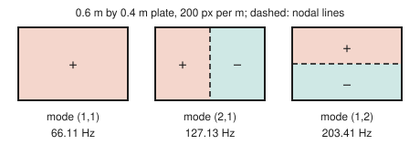

# Helmholtz: the shapes and frequencies a region can hold

[Syllabus](../../../SYLLABUS.md) → [Partial differential equations](../README.md) → [Laplace, Poisson and Potentials](../README.md#s04) → Helmholtz

---

## General Overview

A steel plate 0.6 m by 0.4 m and 3 mm thick rests on knife edges along all four sides. The edges hold it up but let it tilt freely there: engineers call this **simply supported**. Tap it and it rings. A tuner hears 66.11 Hz (hertz: vibrations per second), then 127.13 Hz and 203.41 Hz above it, and nothing in between.

Why those notes and no others? Each note is a **mode**: a shape that keeps its form while its size swings back and forth. The plate can only hold shapes that fit its outline with the edges still. The first is one dome. The second splits the plate into two halves that move in opposite directions. The third splits it into a top half and a bottom half.

Wing 08 found the same thing on a line: [Separation of variables](../../08-Differential%20equations%20and%20dynamics/10-The%20Classical%20PDEs/04-separation-of-variables-for-the-heat-equation.md) split a 1 m bar into sine-shaped modes. This card does it on any bounded region. The unknown is a shape and a number together. The region is the plate's face. The data is the edge condition, zero deflection. A second job follows: write any starting shape as a sum of those modes.

**Taking time out of a wave or heat equation leaves the Helmholtz problem, −Δφ = λφ with φ = 0 on the edge (Δ the Laplacian, φ a shape, λ its number); a bounded region holds only a list of such shapes, with numbers λ that climb without end, and every starting shape is a sum of those shapes.**

**What kind of fact this is:** a theorem. Why it works proves that the numbers are real and positive, that different shapes are perpendicular, and, given the expansion stated in Step 4, that the lowest number is the minimum of an energy ratio. The claim that every shape is a sum of modes is stated with its reason and source. The plate law that turns λ into hertz is a model: Kirchhoff's thin-plate theory, which fits a 3 mm plate well.

### The picture: the plate's first three shapes

<p align="center"></p>

To scale at 200 px per m: each plate is 120 px by 80 px, at x_px 20, 170 and 320, top edge at y_px 30. A **nodal line** is a line that stays still while the plate rings. The (2,1) mode has one at x_px 230, the middle of its plate. The (1,2) mode has one at y_px 70. A plus lobe rises while a minus lobe falls.

---

## The formula

Notation from earlier shelf cards, in one line each. $`\Omega`$ is the region and $`\partial\Omega`$ its edge ([A PDE problem](../01-Classification%20and%20Well-Posedness/01-what-a-pde-problem-is.md)). $`\Delta`$ is the Laplacian, the sum of second derivatives: $`\Delta\varphi = \varphi_{xx} + \varphi_{yy}`$ on a plate.

This card introduces three things. The **wavenumber** $`k`$ is how many radians a wave turns through per metre. An **eigenpair** $`(\lambda_n, \varphi_n)`$ of $`-\Delta`$ is a number and a nonzero shape with $`-\Delta\varphi_n = \lambda_n\varphi_n`$; the number is the **eigenvalue**, the shape the **eigenfunction**. The **Rayleigh quotient** $`R(w)`$ is the energy ratio defined below.

The **Helmholtz problem** with a fixed edge:

```math
-\Delta\varphi = \lambda\,\varphi \ \text{ in } \Omega, \qquad \varphi = 0 \ \text{ on } \partial\Omega, \qquad \lambda = k^2 = \frac{\omega^2}{c^2}.
```

**Read it aloud:** look for a shape whose bending, with its sign flipped, is the shape itself times one number, and which is zero all round the edge.

On a rectangle of sides $`a`$ and $`b`$ the answers are known in closed form:

```math
\varphi_{mn} = \sin\frac{m\pi x}{a}\,\sin\frac{n\pi y}{b}, \qquad \lambda_{mn} = \pi^2\left(\frac{m^2}{a^2} + \frac{n^2}{b^2}\right), \qquad m, n = 1, 2, 3, \dots
```

**Read it aloud:** the shapes are a whole number of half-waves each way, and the eigenvalue adds the squared wavenumbers of the two directions.

Any starting shape $`g`$ is a sum of modes, and the lowest eigenvalue is a minimum:

```math
g = \sum_n g_n\,\varphi_n, \quad g_n = \frac{\int_\Omega g\,\varphi_n\,dx}{\int_\Omega \varphi_n^2\,dx}; \qquad \lambda_1 = \min_{w = 0 \text{ on } \partial\Omega} R(w), \quad R(w) = \frac{\int_\Omega |\nabla w|^2\,dx}{\int_\Omega w^2\,dx}.
```

**Read it aloud:** each mode's share of a shape is the overlap of the two divided by the mode's own size; and among all shapes that vanish on the edge, the lowest mode has the least bending energy per unit of size.

A thin plate turns $`\lambda`$ into a note by its own law, with $`D`$ its bending stiffness:

```math
\omega_{mn} = \lambda_{mn}\sqrt{\frac{D}{\rho H}}, \qquad D = \frac{E H^3}{12(1 - \nu^2)}, \qquad f = \frac{\omega}{2\pi}.
```

**Read it aloud:** a simply supported plate's angular frequency is the eigenvalue itself times a stiffness factor, not its square root.

| Symbol | Plain meaning | In our example | Push it up and the answer… |
| --- | --- | --- | --- |
| $`\Omega`$, $`\partial\Omega`$ | the region; its edge | the plate's face; its four sides | a bigger region lowers every λ |
| $`x`$, $`y`$; $`t`$, $`T(t)`$ | position across the plate, m; time, s, and a mode's time factor | 0 to 0.6 m, 0 to 0.4 m | — |
| $`a`$, $`b`$; $`m`$, $`n`$ | side lengths; half-waves along each side | 0.6 m, 0.4 m; (1,1), (2,1), (1,2) | longer sides lower λ; more half-waves raise it |
| $`\lambda_n`$, $`\varphi_n`$; $`\mu`$, $`\psi`$ | eigenvalue (1/m²) and eigenfunction of $`-\Delta`$; a second pair, in Step 2 | 89.101, 171.347, 274.156 1/m² | higher notes |
| $`c`$, $`k`$, $`\omega`$, $`f`$ | wave speed (m/s), wavenumber (1/m), angular frequency (rad/s), frequency in hertz ω/2π | ω = 415.38 rad/s for (1,1); 66.11, 127.13, 203.41 Hz | — |
| $`g`$, $`g_n`$ | a starting shape; its share in mode n | the unit dome; 1.065125 in (1,1) | — |
| $`w`$, $`R(w)`$ | any trial shape; its Rayleigh quotient, 1/m² | the dome; 90.278 1/m² | R stays above λ₁ |
| $`D`$ | bending stiffness of the plate | 511.81 N m | notes rise as √D |
| $`E`$, $`\nu`$, $`\rho`$, $`H`$ | steel's Young's modulus, Poisson's ratio, density; plate thickness | 207 GPa, 0.30, 7850 kg/m³, 3 mm | thicker plate: notes rise in proportion |
| $`G`$; $`v`$ | the inverse of $`-\Delta`$ with a zero edge, Step 4; its output | eigenvalues 1/λ_n | — |
| $`h`$ | grid step of the check's second road | 0.05 m and 0.025 m | coarser grid: lower λ |
| $`N(\Lambda)`$; $`\lvert\Omega\rvert`$, $`\lvert\partial\Omega\rvert`$ | number of eigenvalues at or below a level Λ; area, m², and edge length, m | 489 below the 20 kHz level | grows with area |

Here $`\rho`$ is steel's density, not the traffic density of shelf 02.

### When it holds

- **The region is bounded.** Then the eigenvalues form a list. Open air has no list: every frequency can travel out to infinity, and a problem there needs the Sommerfeld radiation condition (waves only go outward) in place of an edge.
- **One edge condition for all shapes.** Here it is zero deflection (Dirichlet). With a free edge (Neumann: zero slope across the edge) the flat shape w = 1 becomes a mode with λ = 0. The minimum principle then gives R = 0.000, far below 89.101 1/m².
- **The plate's edges are simply supported.** A plate obeys the fourth-order equation $`D\,\Delta^2 w + \rho H\,w_{tt} = 0`$, not the wave equation. Its simply supported modes on a rectangle are the Helmholtz shapes. Clamped or free edges give other shapes, which this card does not solve.
- **The plate is thin and moves a little.** Kirchhoff's theory assumes thickness much less than the sides (here 3 mm against 0.4 m) and deflection much less than the thickness.
- **The data has a finite mean square.** Any $`g`$ with $`\int g^2`$ finite is a sum of modes in the mean-square sense. A pointwise match needs smoother data, such as the dome below.

---

## Why it works

### Step 0: the idea

A mode keeps its shape and only changes size. Put "shape times size" into a wave or heat equation, and the time part and the space part must each equal the same constant. The space part becomes the Helmholtz problem. The region and its edge condition then decide which shapes are allowed.

Three facts make the allowed list useful. The operator $`-\Delta`$ with a zero edge is **symmetric**: it can be moved from one function to the other inside an integral. Symmetry gives real, positive eigenvalues and perpendicular shapes. And its inverse is compact (Step 4 says what that means), which makes the shapes a complete set.

### Step 1: take time out

Wing 08 and the engineering wing already did this: [Waves on strings and drums](../../13-Engineering%20mathematics/09-Quantum%20Mechanics%20in%20Outline/01-wave-equation-for-strings-and-membranes.md) splits off time and lists a rectangular drum's notes. In general, put $`u = \varphi(x, y)\,T(t)`$ into $`u_{tt} = c^2\Delta u`$ and divide by $`c^2\varphi T`$:

```math
\frac{T''}{c^2\,T} = \frac{\Delta\varphi}{\varphi} = -\lambda .
```

The left side depends on time only, the right on position only, so both are one constant. Space gives the Helmholtz problem. Time gives $`T = \cos(\omega t)`$ with $`\omega = c\sqrt{\lambda}`$, so $`k = \sqrt{\lambda}`$. The heat equation $`u_t = \kappa\Delta u`$, with $`\kappa`$ the diffusivity in m²/s, gives the same space problem and $`T = e^{-\kappa\lambda t}`$.

The plate is different only in time. Its equation is $`D\,\Delta^2 w + \rho H\,w_{tt} = 0`$. A simply supported edge holds $`w = 0`$ and $`\Delta w = 0`$ there, and each $`\varphi_{mn}`$ meets both. Applying $`-\Delta`$ twice gives $`\Delta^2\varphi = \lambda^2\varphi`$, so $`\omega^2 = \lambda^2 D/(\rho H)`$. That is why the plate's notes go as λ, not √λ.

### Step 2: Green's identity makes the eigenvalues real and positive, and the shapes perpendicular

The [Sturm-Liouville](../../08-Differential%20equations%20and%20dynamics/07-Series%20Solutions%20and%20Boundary%20Problems/09-sturm-liouville-and-orthogonality.md) card proved these facts on a line by integrating by parts. In two or three dimensions the tool is **Green's first identity**, the divergence theorem applied to $`\psi\nabla\varphi`$. For two shapes that are zero on the edge:

```math
\int_\Omega \psi\,(-\Delta\varphi)\,dx = \int_\Omega \nabla\psi\cdot\nabla\varphi\,dx = \int_\Omega \varphi\,(-\Delta\psi)\,dx .
```

The edge term vanishes because $`\psi = 0`$ there. The middle is unchanged when φ and ψ swap, so $`-\Delta`$ is symmetric.

- **Positive.** Put $`\psi = \varphi`$ for an eigenfunction: $`\lambda\int\varphi^2 = \int|\nabla\varphi|^2`$. Both integrals are positive, since a shape with zero gradient is constant, and the edge makes that constant 0.
- **Perpendicular.** For two eigenpairs, symmetry gives $`(\lambda - \mu)\int\varphi\psi = 0`$. Different eigenvalues force $`\int\varphi\psi = 0`$.

<details>
<summary>Detailed proof: real eigenvalues and perpendicular eigenfunctions</summary>

Let $`\Omega`$ be bounded with an edge smooth enough for the divergence theorem. Let φ and ψ be twice continuously differentiable up to the edge, and zero on it. The field $`\psi\nabla\varphi`$ has divergence $`\nabla\psi\cdot\nabla\varphi + \psi\,\Delta\varphi`$, so

$`\displaystyle \int_\Omega \psi\,\Delta\varphi\,dx = \int_{\partial\Omega} \psi\,\frac{\partial\varphi}{\partial n}\,dS - \int_\Omega \nabla\psi\cdot\nabla\varphi\,dx .`$

The edge integral is 0 since ψ = 0 there. This is Green's first identity with a zero edge.

Real: let $`-\Delta\varphi = \lambda\varphi`$ with φ allowed complex. Use the identity with ψ the complex conjugate of φ:

$`\displaystyle \lambda \int_\Omega |\varphi|^2\,dx = \int_\Omega |\nabla\varphi|^2\,dx .`$

Both integrals are real and nonnegative, and the left one is positive, so λ is real and at least 0. If λ = 0, the gradient is zero, φ is constant on each connected piece, and the edge makes it 0: no eigenfunction. So λ > 0.

Perpendicular: if $`-\Delta\varphi = \lambda\varphi`$ and $`-\Delta\psi = \mu\psi`$, the identity used both ways gives

$`\displaystyle \lambda\int_\Omega \varphi\psi\,dx = \int_\Omega \nabla\varphi\cdot\nabla\psi\,dx = \mu\int_\Omega \varphi\psi\,dx ,`$

so λ ≠ μ forces $`\int\varphi\psi = 0`$.

</details>

### Step 3: the lowest eigenvalue is a minimum

Step 2 with ψ = φ says $`\lambda = R(\varphi)`$: an eigenvalue is the Rayleigh quotient of its own shape. Now write any trial shape as a sum of modes, $`w = \sum g_n\varphi_n`$, with each $`\int\varphi_n^2`$ equal to 1; Step 4 gives the reason every shape is such a sum. Perpendicularity kills every cross term:

```math
R(w) = \frac{\sum_n \lambda_n\,g_n^2}{\sum_n g_n^2} \;\ge\; \lambda_1 .
```

The quotient is an average of the eigenvalues, weighted by $`g_n^2`$, so it is never below the smallest. It equals $`\lambda_1`$ only when all the weight sits in the first mode.

On the plate, try the dome $`w = x(a - x)\,y(b - y)`$. Its quotient is $`10/a^2 + 10/b^2`$ = 90.278 1/m², against λ₁ = 89.101 1/m², a factor of 1.0132 too high. The dome barely differs from the first mode, so a rough guess gives a close upper bound. The same idea, minimising an energy over shapes with set edge values, is [Dirichlet's principle](06-dirichlet-principle-and-variational-form.md).

### Step 4: every shape is a sum of modes

Solving $`-\Delta v = g`$ with $`v = 0`$ on the edge defines an inverse, $`G`$: data in, solution out. Its kernel is the [Green's function](04-greens-functions-and-the-representation-formula.md). Two facts about $`G`$ decide everything:

1. $`G`$ is **symmetric**, by Step 2.
2. $`G`$ is **compact**: it turns any set of data with bounded mean square into solutions that cluster, never spreading out forever. This follows from Rellich's theorem: on a bounded region, shapes with a bounded $`\int|\nabla v|^2`$ always contain a sequence that converges in mean square.

The spectral theorem for compact symmetric operators, stated on [Compact and symmetric](../../18-Functional%20analysis/03-Bounded%20Operators/08-spectral-theorem-for-compact-self-adjoint-operators.md), then gives an orthonormal basis of eigenfunctions of $`G`$, with eigenvalues that shrink to 0. Each one is $`1/\lambda_n`$. So the λ climb without end, and every $`g`$ with finite $`\int g^2`$ is $`\sum g_n\varphi_n`$. The mean square splits mode by mode (Parseval's rule): $`\int g^2 = \sum g_n^2 \int\varphi_n^2`$.

On the plate, take the unit dome $`g = 16\,x(a - x)\,y(b - y)/(a^2 b^2)`$, which peaks at 1 in the centre. The integral $`\int_0^a x(a - x)\sin(m\pi x/a)\,dx`$ is $`4a^3/(m^3\pi^3)`$ for odd m and 0 for even m. So

```math
g_{mn} = \frac{1024}{\pi^6\,m^3 n^3} \ \text{ for odd } m, n, \qquad g_{11} = 1.065125, \quad g_{31} = g_{13} = 0.039449, \quad g_{33} = 0.001461 .
```

Even modes get nothing: the dome is symmetric about the middle and they are not. The (1,1) mode carries 99.71 % of the mean square.

### Step 5: the rectangle's list, and how fast it grows

On a rectangle, a second separation, $`\varphi = X(x)\,Y(y)`$, turns the Helmholtz problem into two string problems. Each is the string problem of wing 08 ([Eigenvalue problems](../../08-Differential%20equations%20and%20dynamics/07-Series%20Solutions%20and%20Boundary%20Problems/08-eigenvalues-and-eigenfunctions.md)), and the two eigenvalues add. Because a = 0.6 m is longer than b = 0.4 m, a half-wave along the long side costs less. So (2,1) comes before (1,2), and (3,1) is only fourth.

On any region the count grows in a fixed way. Hermann Weyl proved in 1912 that the number of eigenvalues at or below Λ grows like the area:

```math
N(\Lambda) \approx \frac{|\Omega|\,\Lambda}{4\pi} - \frac{|\partial\Omega|\,\sqrt{\Lambda}}{4\pi},
```

with $`|\Omega|`$ the area and $`|\partial\Omega|`$ the edge length. The second term, the edge correction, is a later refinement. On the plate, the 20 kHz limit of human hearing is λ = 26956 1/m². The exact count of modes below it is 489. The area term gives 514.8, and with the edge term 488.7.

---

## Worked numbers, by hand

| Step | Arithmetic | Value |
| --- | --- | --- |
| bending stiffness | 207e9 × 0.003³ / (12 × (1 − 0.30²)) | D = 511.81 N m |
| mass per square metre | 7850 × 0.003 | ρH = 23.55 kg/m² |
| stiffness factor | √(511.81 / 23.55) | 4.6619 m²/s |
| first eigenvalue | π² × (1/0.36 + 1/0.16) | λ₁₁ = 89.101 1/m² |
| first angular frequency | 89.101 × 4.6619 | 415.38 rad/s |
| first note | 415.38 / 2π | **66.11 Hz** |
| next two eigenvalues | π² × (4/0.36 + 1/0.16); π² × (1/0.36 + 4/0.16) | 171.347, 274.156 1/m² |
| next two notes | eigenvalue × 4.6619 / 2π | **127.13 Hz, 203.41 Hz** |
| plate ratios | 171.347 / 89.101; 274.156 / 89.101 | 1.923, 3.077 |
| a drum skin on the same frame | √1.923; √3.077 | 1.387, 1.754 |
| Rayleigh bound from the dome | 10/0.36 + 10/0.16 | 90.278 1/m², so 66.98 Hz |

The plate's first three notes are 66.11, 127.13 and 203.41 Hz. A drum skin on the same frame would space them 1 : 1.387 : 1.754; the plate spaces them wider, 1 : 1.923 : 3.077, because its notes go as λ.

### What breaks if you drop a piece

| Mistake | Comes out at | What went wrong |
| --- | --- | --- |
| The membrane's √λ rule for the plate's second note | 91.68 Hz, not 127.13 Hz | a plate's ω goes as λ, a drum skin's as √λ |
| Trial shape w = 1 in the Rayleigh quotient | R = 0.000, below λ₁ = 89.101 1/m² | w = 1 is not zero on the edge, so the minimum principle does not apply |
| g₁₁ without dividing by ∫φ² = ab/4 = 0.06 m² | 0.063908, not 1.065125 | the sine modes are not of unit size |
| ω read as hertz | "415.38 Hz" for a 66.11 Hz note | rad/s and Hz differ by 2π |

The code prints all four.

---

## Code, from first principles, and it actually runs

The script finds the plate's eigenvalues by three roads that share no arithmetic. Road 1 is the closed-form sines. Road 2 is a grid: the Laplacian by centred differences at steps 0.05 m and 0.025 m, its three lowest eigenvalues by power iteration with earlier modes removed, then Richardson extrapolation (4 × fine − coarse, all over 3) and the observed order. Road 3 is the Rayleigh quotient of a dome, by Simpson's rule. The plate law that turns λ into hertz gets a second road of its own: D again, by adding up the stiffness of the plate's thin layers from face to face, and the plate's own fourth-order operator Δ² applied to the (1,1) shape by a 13-point stencil (a weighted sum of the shape's values at 13 nearby grid points) at the same two steps, whose ratio to the shape tends to λ₁₁². The expansion is checked twice: coefficients by quadrature against the formula, and the sum of squares against the mean square of the dome. The quotient rebuilt from the expansion closes the loop. No eigenvalue or quadrature routine is imported.

### Python

```python
# Helmholtz and eigenfunctions -- the check behind the card.  Standard library only.
# A steel plate 0.6 m by 0.4 m, 3 mm thick, simply supported on all four edges.
# Its mode shapes are the eigenfunctions of -Laplacian on the rectangle with zero
# edge values.  Road 1: separated sines.  Road 2: a grid, solved by power iteration.
# Road 3: the Rayleigh quotient of a dome.  Then the dome is expanded in the modes.
import math
PI = math.pi
A, B, H = 0.6, 0.4, 0.003                 # plate sides and thickness, m
E, NU, RHO = 207e9, 0.30, 7850.0          # steel: Young's modulus Pa, Poisson's ratio, kg/m^3

def total(xs):                            # plain left-to-right sum, as in the Rust
    s = 0.0
    for x in xs:
        s += x
    return s

def lam(m, n):                            # road 1: eigenvalue of -Laplacian, 1/m^2
    return PI * PI * (m * m / (A * A) + n * n / (B * B))

def grid_eigs(h, k, iters):               # road 2: 5-point -Laplacian, zero on the edge
    nx, ny = round(A / h) - 1, round(B / h) - 1
    n = nx * ny
    def neg_lap(v):
        out = [0.0] * n
        for j in range(ny):
            for i in range(nx):
                p = j * nx + i
                s = 4.0 * v[p]
                if i > 0: s -= v[p - 1]
                if i < nx - 1: s -= v[p + 1]
                if j > 0: s -= v[p - nx]
                if j < ny - 1: s -= v[p + nx]
                out[p] = s / (h * h)
        return out
    c = 8.0 / (h * h)                     # above every grid eigenvalue (Gershgorin)
    found, vals = [], []
    for _ in range(k):
        v = [1.0 + ((7 * p) % 13) / 13.0 for p in range(n)]
        for _ in range(iters):            # power iteration on c*I - (-Laplacian)
            w = neg_lap(v)
            v = [c * v[p] - w[p] for p in range(n)]
            for u in found:               # remove the modes already found
                d = total(v[p] * u[p] for p in range(n))
                v = [v[p] - d * u[p] for p in range(n)]
            norm = math.sqrt(total(x * x for x in v))
            v = [x / norm for x in v]
        w = neg_lap(v)
        vals.append(total(v[p] * w[p] for p in range(n)))
        found.append(v)
    return vals

def simpson(f, lo, hi, panels):           # composite Simpson rule, panels even
    step = (hi - lo) / panels
    s = f(lo) + f(hi)
    for i in range(1, panels):
        s += (4 if i % 2 else 2) * f(lo + i * step)
    return s * step / 3

def coef(m, n):                           # unit dome's coefficient on mode (m,n), by quadrature
    ix = simpson(lambda x: x * (A - x) * math.sin(m * PI * x / A), 0, A, 400)
    iy = simpson(lambda y: y * (B - y) * math.sin(n * PI * y / B), 0, B, 400)
    return 4 / (A * B) * 16 / (A * A * B * B) * ix * iy

D = E * H * H * H / (12 * (1 - NU * NU))  # bending stiffness, N m
S = math.sqrt(D / (RHO * H))              # m^2/s: plate omega = lambda * S
hz = lambda lv: lv * S / (2 * PI)
modes = sorted((lam(m, n), m, n) for m in range(1, 9) for n in range(1, 9))
l1 = modes[0][0]
print(f"plate {A} m x {B} m x {H * 1000:.0f} mm steel: D = {D:.2f} N m, rho H = {RHO * H:.2f} kg/m^2, "
      f"sqrt(D/(rho H)) = {S:.4f} m^2/s")
print("mode  lambda (1/m^2)  omega (rad/s)  f (Hz)  plate ratio  membrane ratio")
for lv, m, n in modes[:4]:
    print(f"({m},{n})  {lv:13.3f}  {lv * S:12.2f}  {hz(lv):7.2f}  {lv / l1:10.3f}  {math.sqrt(lv / l1):13.3f}")
Dz = simpson(lambda z: E * z * z / (1 - NU * NU), -H / 2, H / 2, 2)   # D again: each layer's stiffness times z^2
def bih(h):                               # plate law, road 2: 13-point stencil for Delta^2 on phi_11 at the centre
    p = lambda i, j: math.sin(PI * (0.5 + i * h / A)) * math.sin(PI * (0.5 + j * h / B))
    return (20 * p(0, 0) - 8 * (p(1, 0) + p(-1, 0) + p(0, 1) + p(0, -1)) + 2 * (p(1, 1) + p(1, -1) + p(-1, 1)
            + p(-1, -1)) + p(2, 0) + p(-2, 0) + p(0, 2) + p(0, -2)) / (h * h * h * h) / p(0, 0)
b1, b2 = bih(0.05), bih(0.025)
brich = (4 * b2 - b1) / 3                 # Richardson, as for the grid road
fs = S * math.sqrt(brich) / (2 * PI)      # the first note, from the plate equation itself
print(f"plate law, second road: D by layers through the thickness {Dz:.2f} N m; 13-point stencil for Delta^2 phi_11 / phi_11:")
print(f"  h = 0.05 m {b1:.1f}, h = 0.025 m {b2:.1f}, order {math.log2((l1 * l1 - b1) / (l1 * l1 - b2)):.2f}, "
      f"Richardson {brich:.1f}, lambda_11^2 = {l1 * l1:.1f} 1/m^4; first note {fs:.2f} Hz")
first3 = [(m, n) for _, m, n in modes[:3]]
grids = {h: grid_eigs(h, 3, 6000) for h in (0.05, 0.025)}
print("grid road, first three eigenvalues of -Laplacian (1/m^2):")
for h, vals in grids.items():
    print(f"  h = {h} m: " + ", ".join(f"{x:.3f}" for x in vals))
rich = [(4 * grids[0.025][i] - grids[0.05][i]) / 3 for i in range(3)]
order = [math.log2((modes[i][0] - grids[0.05][i]) / (modes[i][0] - grids[0.025][i])) for i in range(3)]
print("  Richardson (4 x fine - coarse)/3: " + ", ".join(f"{x:.3f}" for x in rich))
print("  observed order: " + ", ".join(f"{x:.2f}" for x in order))
def rq(X, dX, Y, dY):                     # Rayleigh quotient of the shape X(x) Y(y), slopes dX, dY, by Simpson
    gx, gy = simpson(lambda x: X(x) * X(x), 0, A, 200), simpson(lambda y: Y(y) * Y(y), 0, B, 200)
    dx, dy = simpson(lambda x: dX(x) * dX(x), 0, A, 200), simpson(lambda y: dY(y) * dY(y), 0, B, 200)
    return (dx * gy + gx * dy) / (gx * gy)
R = rq(lambda x: x * (A - x), lambda x: A - 2 * x, lambda y: y * (B - y), lambda y: B - 2 * y)   # road 3: the dome
print(f"Rayleigh quotient of the dome x(a-x)y(b-y): R = {R:.3f} 1/m^2; "
      f"10/a^2 + 10/b^2 = {10 / (A * A) + 10 / (B * B):.3f}; lambda_1 = {l1:.3f}; R/lambda_1 = {R / l1:.4f}")
print(f"  f from R: {hz(R):.2f} Hz against {hz(l1):.2f} Hz")
c11, pi6 = coef(1, 1), PI * PI * PI * PI * PI * PI
print(f"unit dome 16 x(a-x) y(b-y)/(a^2 b^2): c11 by quadrature {c11:.6f}, 1024/pi^6 = {1024 / pi6:.6f}")
print(f"  c21 = {abs(coef(2, 1)):.6f}, c31 = {coef(3, 1):.6f}, c13 = {coef(1, 3):.6f}, c33 = {coef(3, 3):.6f}")
exact = [(m, n, 1024 / (pi6 * m * m * m * n * n * n)) for m in range(1, 60, 2) for n in range(1, 60, 2)]
parseval = total(c * c for _, _, c in exact)
print(f"  sum of c^2 over odd m, n < 60: {parseval:.6f}; mean-square rule (4/ab) int f^2 = 1024/900 = {1024 / 900:.6f}")
print(f"  share in mode (1,1): {100 * c11 * c11 / (1024 / 900):.2f} %")
for M in (1, 3, 5, 11, 21):
    s = total(c * (1 if (m + n) % 4 == 2 else -1) for m, n, c in exact if m <= M and n <= M)
    print(f"  centre value from modes m, n <= {M:2d}: {s:.6f}, error {s - 1:+.1e}")
Rexp = total(lam(m, n) * c * c for m, n, c in exact) / parseval
print(f"  R rebuilt from the expansion, sum lambda c^2 / sum c^2: {Rexp:.3f} 1/m^2, "
      f"short by {R - Rexp:.1e} (modes past 59 left out)")
strike = [math.sin(m * PI * 0.15 / A) * math.sin(n * PI * 0.10 / B) for m, n in first3]
centre = [abs(math.sin(m * PI / 2) * math.sin(n * PI / 2)) for m, n in first3]
print("strike at (0.15, 0.10) m, mode weights: " + ", ".join(f"{mn} {w:.3f}" for mn, w in zip(["(1,1)", "(2,1)", "(1,2)"], strike)))
print("strike at the centre, mode weights:     " + ", ".join(f"{mn} {w:.3f}" for mn, w in zip(["(1,1)", "(2,1)", "(1,2)"], centre)))
lim = 2 * PI * 20000 / S                  # lambda of a 20 kHz plate note
count = sum(1 for m in range(1, 400) for n in range(1, 400) if lam(m, n) <= lim)
weyl = A * B * lim / (4 * PI)
weyl2 = weyl - 2 * (A + B) * math.sqrt(lim) / (4 * PI)
print(f"plate notes below 20 kHz: lambda <= {lim:.0f} 1/m^2; count {count}; Weyl ab L/(4 pi) = {weyl:.1f}; with edge term {weyl2:.1f}")
print("mistakes:")
print(f"  membrane sqrt rule for the plate's 2nd note: {hz(l1) * math.sqrt(modes[1][0] / l1):.2f} Hz, not {hz(modes[1][0]):.2f} Hz")
R1 = rq(lambda x: 1.0, lambda x: 0.0, lambda y: 1.0, lambda y: 0.0)   # flat shape: slopes 0, not 0 on the edge
print(f"  trial w = 1 ignores the zero edge: R = {R1:.3f}, below lambda_1 = {l1:.3f}")
print(f"  c11 without dividing by int phi^2 = ab/4 = {A * B / 4:.2f} m^2: {c11 * A * B / 4:.6f}")
print(f"  omega read as hertz: {l1 * S:.2f} 'Hz' for a {hz(l1):.2f} Hz note")
print(f"figure, px per m 200: plates at x 20, 170, 320, y 30, size {A * 200:.0f} x {B * 200:.0f}; "
      f"nodal line of (2,1) at x {170 + A / 2 * 200:.0f}; of (1,2) at y {30 + B / 2 * 200:.0f}")
assert first3 == [(1, 1), (2, 1), (1, 2)]
assert all(abs(rich[i] / modes[i][0] - 1) < 5e-4 for i in range(3))     # grid meets sines
assert all(1.9 < p < 2.1 for p in order)                                 # second order, as claimed
assert l1 < R < 1.02 * l1 and abs(R - (10 / (A * A) + 10 / (B * B))) < 1e-6   # Rayleigh bound
assert abs(c11 - 1024 / pi6) < 1e-9 and abs(coef(2, 1)) < 1e-12        # quadrature meets formula
assert abs(parseval - 1024 / 900) < 1e-8 and 0 < R - Rexp < 2e-4         # the expansion is complete
assert abs(count - weyl2) < 15                                           # Weyl's count
assert abs(Dz / D - 1) < 1e-12 and abs(fs / hz(l1) - 1) < 1e-4          # plate law: D and the note by two roads
print("ALL CHECKS PASS")
```

**Ran 2026-11-15 on macOS, Python 3.14.10, standard library only. All checks passed. Output, pasted from the run:**

```
plate 0.6 m x 0.4 m x 3 mm steel: D = 511.81 N m, rho H = 23.55 kg/m^2, sqrt(D/(rho H)) = 4.6619 m^2/s
mode  lambda (1/m^2)  omega (rad/s)  f (Hz)  plate ratio  membrane ratio
(1,1)         89.101        415.38    66.11       1.000          1.000
(2,1)        171.347        798.80   127.13       1.923          1.387
(1,2)        274.156       1278.08   203.41       3.077          1.754
(3,1)        308.425       1437.84   228.84       3.462          1.861
plate law, second road: D by layers through the thickness 511.81 N m; 13-point stencil for Delta^2 phi_11 / phi_11:
  h = 0.05 m 7771.4, h = 0.025 m 7896.7, order 1.99, Richardson 7938.5, lambda_11^2 = 7938.9 1/m^4; first note 66.11 Hz
grid road, first three eigenvalues of -Laplacian (1/m^2):
  h = 0.05 m: 88.156, 168.076, 261.574
  h = 0.025 m: 88.864, 170.524, 270.962
  Richardson (4 x fine - coarse)/3: 89.099, 171.341, 274.091
  observed order: 1.99, 1.99, 1.98
Rayleigh quotient of the dome x(a-x)y(b-y): R = 90.278 1/m^2; 10/a^2 + 10/b^2 = 90.278; lambda_1 = 89.101; R/lambda_1 = 1.0132
  f from R: 66.98 Hz against 66.11 Hz
unit dome 16 x(a-x) y(b-y)/(a^2 b^2): c11 by quadrature 1.065125, 1024/pi^6 = 1.065125
  c21 = 0.000000, c31 = 0.039449, c13 = 0.039449, c33 = 0.001461
  sum of c^2 over odd m, n < 60: 1.137778; mean-square rule (4/ab) int f^2 = 1024/900 = 1.137778
  share in mode (1,1): 99.71 %
  centre value from modes m, n <=  1: 1.065125, error +6.5e-02
  centre value from modes m, n <=  3: 0.987688, error -1.2e-02
  centre value from modes m, n <=  5: 1.004167, error +4.2e-03
  centre value from modes m, n <= 11: 0.999426, error -5.7e-04
  centre value from modes m, n <= 21: 1.000096, error +9.6e-05
  R rebuilt from the expansion, sum lambda c^2 / sum c^2: 90.278 1/m^2, short by 6.8e-05 (modes past 59 left out)
strike at (0.15, 0.10) m, mode weights: (1,1) 0.500, (2,1) 0.707, (1,2) 0.707
strike at the centre, mode weights:     (1,1) 1.000, (2,1) 0.000, (1,2) 0.000
plate notes below 20 kHz: lambda <= 26956 1/m^2; count 489; Weyl ab L/(4 pi) = 514.8; with edge term 488.7
mistakes:
  membrane sqrt rule for the plate's 2nd note: 91.68 Hz, not 127.13 Hz
  trial w = 1 ignores the zero edge: R = 0.000, below lambda_1 = 89.101
  c11 without dividing by int phi^2 = ab/4 = 0.06 m^2: 0.063908
  omega read as hertz: 415.38 'Hz' for a 66.11 Hz note
figure, px per m 200: plates at x 20, 170, 320, y 30, size 120 x 80; nodal line of (2,1) at x 230; of (1,2) at y 70
ALL CHECKS PASS
```

### Rust

Same numbers, same labels, built with `rustc --edition 2021 -O`.

```rust
// Helmholtz and eigenfunctions -- the same check as the Python, in Rust.  No crates.
// A steel plate 0.6 m by 0.4 m, 3 mm thick, simply supported on all four edges.
// Its mode shapes are the eigenfunctions of -Laplacian on the rectangle with zero
// edge values.  Road 1: separated sines.  Road 2: a grid, solved by power iteration.
// Road 3: the Rayleigh quotient of a dome.  Then the dome is expanded in the modes.
use std::f64::consts::PI;
const A: f64 = 0.6; const B: f64 = 0.4; const H: f64 = 0.003;    // plate sides and thickness, m
const E: f64 = 207e9; const NU: f64 = 0.30; const RHO: f64 = 7850.0; // steel: Pa, Poisson, kg/m^3

fn lam(m: f64, n: f64) -> f64 {             // road 1: eigenvalue of -Laplacian, 1/m^2
    PI * PI * (m * m / (A * A) + n * n / (B * B))
}

fn neg_lap(v: &[f64], nx: usize, ny: usize, h: f64) -> Vec<f64> {
    let mut out = vec![0.0; nx * ny];
    for j in 0..ny {
        for i in 0..nx {
            let p = j * nx + i;
            let mut s = 4.0 * v[p];
            if i > 0 { s -= v[p - 1]; } if i < nx - 1 { s -= v[p + 1]; }
            if j > 0 { s -= v[p - nx]; } if j < ny - 1 { s -= v[p + nx]; }
            out[p] = s / (h * h);
        }
    }
    out
}

fn grid_eigs(h: f64, k: usize, iters: usize) -> Vec<f64> {   // road 2: 5-point -Laplacian
    let (nx, ny) = ((A / h).round() as usize - 1, (B / h).round() as usize - 1);
    let n = nx * ny;
    let c = 8.0 / (h * h);                  // above every grid eigenvalue (Gershgorin)
    let (mut found, mut vals): (Vec<Vec<f64>>, Vec<f64>) = (vec![], vec![]);
    for _ in 0..k {
        let mut v: Vec<f64> = (0..n).map(|p| 1.0 + ((7 * p) % 13) as f64 / 13.0).collect();
        for _ in 0..iters {                 // power iteration on c*I - (-Laplacian)
            let w = neg_lap(&v, nx, ny, h);
            v = (0..n).map(|p| c * v[p] - w[p]).collect();
            for u in &found {               // remove the modes already found
                let d: f64 = (0..n).map(|p| v[p] * u[p]).sum();
                v = (0..n).map(|p| v[p] - d * u[p]).collect();
            }
            let norm = v.iter().map(|x| x * x).sum::<f64>().sqrt();
            v = v.iter().map(|x| x / norm).collect();
        }
        let w = neg_lap(&v, nx, ny, h);
        vals.push((0..n).map(|p| v[p] * w[p]).sum());
        found.push(v);
    }
    vals
}

fn simpson(f: &dyn Fn(f64) -> f64, lo: f64, hi: f64, panels: usize) -> f64 {
    let step = (hi - lo) / panels as f64;
    let mut s = f(lo) + f(hi);
    for i in 1..panels {
        s += (if i % 2 == 1 { 4.0 } else { 2.0 }) * f(lo + i as f64 * step);
    }
    s * step / 3.0
}

fn coef(m: f64, n: f64) -> f64 {            // unit dome's coefficient on mode (m,n), by quadrature
    let ix = simpson(&|x| x * (A - x) * (m * PI * x / A).sin(), 0.0, A, 400);
    let iy = simpson(&|y| y * (B - y) * (n * PI * y / B).sin(), 0.0, B, 400);
    4.0 / (A * B) * 16.0 / (A * A * B * B) * ix * iy
}

fn rq(f: &dyn Fn(f64) -> f64, df: &dyn Fn(f64) -> f64, g: &dyn Fn(f64) -> f64, dg: &dyn Fn(f64) -> f64) -> f64 {
    let (gx, gy) = (simpson(&|x| f(x) * f(x), 0.0, A, 200), simpson(&|y| g(y) * g(y), 0.0, B, 200));
    let (dx, dy) = (simpson(&|x| df(x) * df(x), 0.0, A, 200), simpson(&|y| dg(y) * dg(y), 0.0, B, 200));
    (dx * gy + gx * dy) / (gx * gy)         // Rayleigh quotient of the shape f(x) g(y), slopes df, dg, by Simpson
}

fn bih(h: f64) -> f64 {                     // plate law, road 2: 13-point stencil for Delta^2 on phi_11 at the centre
    let p = |i: i32, j: i32| (PI * (0.5 + i as f64 * h / A)).sin() * (PI * (0.5 + j as f64 * h / B)).sin();
    (20.0 * p(0, 0) - 8.0 * (p(1, 0) + p(-1, 0) + p(0, 1) + p(0, -1)) + 2.0 * (p(1, 1) + p(1, -1) + p(-1, 1)
        + p(-1, -1)) + p(2, 0) + p(-2, 0) + p(0, 2) + p(0, -2)) / (h * h * h * h) / p(0, 0)
}

fn sci(x: f64, plus: bool) -> String {      // Python's {:.1e} and {:+.1e}: two-digit exponent
    let s = format!("{:.1e}", x);
    let (mant, ex) = s.split_once('e').unwrap();
    let e: i32 = ex.parse().unwrap();
    let sign = if plus && x >= 0.0 { "+" } else { "" };
    format!("{}{}e{}{:02}", sign, mant, if e < 0 { "-" } else { "+" }, e.abs())
}

fn join(xs: &[f64], d: usize) -> String {
    xs.iter().map(|x| format!("{:.*}", d, x)).collect::<Vec<_>>().join(", ")
}

fn main() {
    let d = E * H * H * H / (12.0 * (1.0 - NU * NU));   // bending stiffness, N m
    let s = (d / (RHO * H)).sqrt();                    // m^2/s: plate omega = lambda * S
    let hz = |lv: f64| lv * s / (2.0 * PI);
    let mut modes: Vec<(f64, i32, i32)> = vec![];
    for m in 1..9 { for n in 1..9 { modes.push((lam(m as f64, n as f64), m, n)); } }
    modes.sort_by(|p, q| p.partial_cmp(q).unwrap());
    let l1 = modes[0].0;
    println!("plate {} m x {} m x {:.0} mm steel: D = {:.2} N m, rho H = {:.2} kg/m^2, sqrt(D/(rho H)) = {:.4} m^2/s",
             A, B, H * 1000.0, d, RHO * H, s);
    println!("mode  lambda (1/m^2)  omega (rad/s)  f (Hz)  plate ratio  membrane ratio");
    for &(lv, m, n) in &modes[..4] {
        println!("({},{})  {:13.3}  {:12.2}  {:7.2}  {:10.3}  {:13.3}", m, n, lv, lv * s, hz(lv), lv / l1, (lv / l1).sqrt());
    }
    let dz = simpson(&|z| E * z * z / (1.0 - NU * NU), -H / 2.0, H / 2.0, 2);   // D again: each layer's stiffness times z^2
    let (b1, b2) = (bih(0.05), bih(0.025));
    let brich = (4.0 * b2 - b1) / 3.0;      // Richardson, as for the grid road
    let fs = s * brich.sqrt() / (2.0 * PI); // the first note, from the plate equation itself
    println!("plate law, second road: D by layers through the thickness {:.2} N m; 13-point stencil for Delta^2 phi_11 / phi_11:", dz);
    println!("  h = 0.05 m {:.1}, h = 0.025 m {:.1}, order {:.2}, Richardson {:.1}, lambda_11^2 = {:.1} 1/m^4; first note {:.2} Hz",
             b1, b2, ((l1 * l1 - b1) / (l1 * l1 - b2)).log2(), brich, l1 * l1, fs);
    let first3: Vec<(i32, i32)> = modes[..3].iter().map(|t| (t.1, t.2)).collect();
    let (hs, hf) = (0.05, 0.025);
    let (gc, gf) = (grid_eigs(hs, 3, 6000), grid_eigs(hf, 3, 6000));
    println!("grid road, first three eigenvalues of -Laplacian (1/m^2):");
    println!("  h = {} m: {}", hs, join(&gc, 3));
    println!("  h = {} m: {}", hf, join(&gf, 3));
    let rich: Vec<f64> = (0..3).map(|i| (4.0 * gf[i] - gc[i]) / 3.0).collect();
    let order: Vec<f64> = (0..3).map(|i| ((modes[i].0 - gc[i]) / (modes[i].0 - gf[i])).log2()).collect();
    println!("  Richardson (4 x fine - coarse)/3: {}", join(&rich, 3));
    println!("  observed order: {}", join(&order, 2));
    let r = rq(&|x| x * (A - x), &|x| A - 2.0 * x, &|y| y * (B - y), &|y| B - 2.0 * y);   // road 3: the dome
    println!("Rayleigh quotient of the dome x(a-x)y(b-y): R = {:.3} 1/m^2; 10/a^2 + 10/b^2 = {:.3}; lambda_1 = {:.3}; R/lambda_1 = {:.4}",
             r, 10.0 / (A * A) + 10.0 / (B * B), l1, r / l1);
    println!("  f from R: {:.2} Hz against {:.2} Hz", hz(r), hz(l1));
    let (c11, pi6) = (coef(1.0, 1.0), PI * PI * PI * PI * PI * PI);
    println!("unit dome 16 x(a-x) y(b-y)/(a^2 b^2): c11 by quadrature {:.6}, 1024/pi^6 = {:.6}", c11, 1024.0 / pi6);
    println!("  c21 = {:.6}, c31 = {:.6}, c13 = {:.6}, c33 = {:.6}",
             coef(2.0, 1.0).abs(), coef(3.0, 1.0), coef(1.0, 3.0), coef(3.0, 3.0));
    let mut exact: Vec<(i32, i32, f64)> = vec![];
    for m in (1..60).step_by(2) { for n in (1..60).step_by(2) { exact.push((m, n, 1024.0 / (pi6 * (m * m * m) as f64 * (n * n * n) as f64))); } }
    let parseval: f64 = exact.iter().map(|t| t.2 * t.2).sum();
    println!("  sum of c^2 over odd m, n < 60: {:.6}; mean-square rule (4/ab) int f^2 = 1024/900 = {:.6}", parseval, 1024.0 / 900.0);
    println!("  share in mode (1,1): {:.2} %", 100.0 * c11 * c11 / (1024.0 / 900.0));
    for mm in [1, 3, 5, 11, 21] {
        let sm: f64 = exact.iter().filter(|t| t.0 <= mm && t.1 <= mm).map(|t| t.2 * (if (t.0 + t.1) % 4 == 2 { 1.0 } else { -1.0 })).sum();
        println!("  centre value from modes m, n <= {:2}: {:.6}, error {}", mm, sm, sci(sm - 1.0, true));
    }
    let rexp = exact.iter().map(|&(m, n, c)| lam(m as f64, n as f64) * c * c).sum::<f64>() / parseval;
    println!("  R rebuilt from the expansion, sum lambda c^2 / sum c^2: {:.3} 1/m^2, short by {} (modes past 59 left out)",
             rexp, sci(r - rexp, false));
    let names = ["(1,1)", "(2,1)", "(1,2)"];
    let strike: Vec<String> = first3.iter().zip(names).map(|(&(m, n), nm)| format!("{} {:.3}", nm,
        (m as f64 * PI * 0.15 / A).sin() * (n as f64 * PI * 0.10 / B).sin())).collect();
    let centre: Vec<String> = first3.iter().zip(names).map(|(&(m, n), nm)| format!("{} {:.3}", nm,
        ((m as f64 * PI / 2.0).sin() * (n as f64 * PI / 2.0).sin()).abs())).collect();
    println!("strike at (0.15, 0.10) m, mode weights: {}", strike.join(", "));
    println!("strike at the centre, mode weights:     {}", centre.join(", "));
    let lim = 2.0 * PI * 20000.0 / s;               // lambda of a 20 kHz plate note
    let count = (1..400).flat_map(|m| (1..400).map(move |n| lam(m as f64, n as f64))).filter(|&l| l <= lim).count();
    let weyl = A * B * lim / (4.0 * PI);
    let weyl2 = weyl - 2.0 * (A + B) * lim.sqrt() / (4.0 * PI);
    println!("plate notes below 20 kHz: lambda <= {:.0} 1/m^2; count {}; Weyl ab L/(4 pi) = {:.1}; with edge term {:.1}", lim, count, weyl, weyl2);
    println!("mistakes:");
    println!("  membrane sqrt rule for the plate's 2nd note: {:.2} Hz, not {:.2} Hz", hz(l1) * (modes[1].0 / l1).sqrt(), hz(modes[1].0));
    println!("  trial w = 1 ignores the zero edge: R = {:.3}, below lambda_1 = {:.3}", rq(&|_| 1.0, &|_| 0.0, &|_| 1.0, &|_| 0.0), l1);
    println!("  c11 without dividing by int phi^2 = ab/4 = {:.2} m^2: {:.6}", A * B / 4.0, c11 * A * B / 4.0);
    println!("  omega read as hertz: {:.2} 'Hz' for a {:.2} Hz note", l1 * s, hz(l1));
    println!("figure, px per m 200: plates at x 20, 170, 320, y 30, size {:.0} x {:.0}; nodal line of (2,1) at x {:.0}; of (1,2) at y {:.0}",
             A * 200.0, B * 200.0, 170.0 + A / 2.0 * 200.0, 30.0 + B / 2.0 * 200.0);
    assert!(first3 == vec![(1, 1), (2, 1), (1, 2)]);
    assert!((0..3).all(|i| (rich[i] / modes[i].0 - 1.0).abs() < 5e-4));      // grid meets sines
    assert!(order.iter().all(|&p| 1.9 < p && p < 2.1));                     // second order, as claimed
    assert!(l1 < r && r < 1.02 * l1 && (r - (10.0 / (A * A) + 10.0 / (B * B))).abs() < 1e-6);
    assert!((c11 - 1024.0 / pi6).abs() < 1e-9 && coef(2.0, 1.0).abs() < 1e-12);
    assert!((parseval - 1024.0 / 900.0).abs() < 1e-8 && 0.0 < r - rexp && r - rexp < 2e-4);
    assert!((count as f64 - weyl2).abs() < 15.0);                           // Weyl's count
    assert!((dz / d - 1.0).abs() < 1e-12 && (fs / hz(l1) - 1.0).abs() < 1e-4);  // plate law: D and the note by two roads
    println!("ALL CHECKS PASS");
}
```

**Ran 2026-11-15 on macOS, rustc 1.98.1, no crates. All checks passed. Output, pasted from the run:**

```
plate 0.6 m x 0.4 m x 3 mm steel: D = 511.81 N m, rho H = 23.55 kg/m^2, sqrt(D/(rho H)) = 4.6619 m^2/s
mode  lambda (1/m^2)  omega (rad/s)  f (Hz)  plate ratio  membrane ratio
(1,1)         89.101        415.38    66.11       1.000          1.000
(2,1)        171.347        798.80   127.13       1.923          1.387
(1,2)        274.156       1278.08   203.41       3.077          1.754
(3,1)        308.425       1437.84   228.84       3.462          1.861
plate law, second road: D by layers through the thickness 511.81 N m; 13-point stencil for Delta^2 phi_11 / phi_11:
  h = 0.05 m 7771.4, h = 0.025 m 7896.7, order 1.99, Richardson 7938.5, lambda_11^2 = 7938.9 1/m^4; first note 66.11 Hz
grid road, first three eigenvalues of -Laplacian (1/m^2):
  h = 0.05 m: 88.156, 168.076, 261.574
  h = 0.025 m: 88.864, 170.524, 270.962
  Richardson (4 x fine - coarse)/3: 89.099, 171.341, 274.091
  observed order: 1.99, 1.99, 1.98
Rayleigh quotient of the dome x(a-x)y(b-y): R = 90.278 1/m^2; 10/a^2 + 10/b^2 = 90.278; lambda_1 = 89.101; R/lambda_1 = 1.0132
  f from R: 66.98 Hz against 66.11 Hz
unit dome 16 x(a-x) y(b-y)/(a^2 b^2): c11 by quadrature 1.065125, 1024/pi^6 = 1.065125
  c21 = 0.000000, c31 = 0.039449, c13 = 0.039449, c33 = 0.001461
  sum of c^2 over odd m, n < 60: 1.137778; mean-square rule (4/ab) int f^2 = 1024/900 = 1.137778
  share in mode (1,1): 99.71 %
  centre value from modes m, n <=  1: 1.065125, error +6.5e-02
  centre value from modes m, n <=  3: 0.987688, error -1.2e-02
  centre value from modes m, n <=  5: 1.004167, error +4.2e-03
  centre value from modes m, n <= 11: 0.999426, error -5.7e-04
  centre value from modes m, n <= 21: 1.000096, error +9.6e-05
  R rebuilt from the expansion, sum lambda c^2 / sum c^2: 90.278 1/m^2, short by 6.8e-05 (modes past 59 left out)
strike at (0.15, 0.10) m, mode weights: (1,1) 0.500, (2,1) 0.707, (1,2) 0.707
strike at the centre, mode weights:     (1,1) 1.000, (2,1) 0.000, (1,2) 0.000
plate notes below 20 kHz: lambda <= 26956 1/m^2; count 489; Weyl ab L/(4 pi) = 514.8; with edge term 488.7
mistakes:
  membrane sqrt rule for the plate's 2nd note: 91.68 Hz, not 127.13 Hz
  trial w = 1 ignores the zero edge: R = 0.000, below lambda_1 = 89.101
  c11 without dividing by int phi^2 = ab/4 = 0.06 m^2: 0.063908
  omega read as hertz: 415.38 'Hz' for a 66.11 Hz note
figure, px per m 200: plates at x 20, 170, 320, y 30, size 120 x 80; nodal line of (2,1) at x 230; of (1,2) at y 70
ALL CHECKS PASS
```

The two outputs match line for line. The grid eigenvalues sit below the true ones, as the 5-point Laplacian always gives here. Halving the step cuts the error by four (observed order 1.99, 1.99, 1.98). Richardson's values, 89.099, 171.341 and 274.091 1/m², sit close to the sines' 89.101, 171.347 and 274.156 1/m². The plate law's second road agrees. The stencil gives 7771.4 and 7896.7 1/m⁴ at the two steps (observed order 1.99) and extrapolates to 7938.5 1/m⁴, against λ₁₁² = 7938.9 1/m⁴. So the plate's own equation gives the same first note, 66.11 Hz. The layer sum gives D = 511.81 N m, as the closed form does.

### Lean

Lean proves Step 2 on any bounded region, the rectangle's modes and the dome's bound for every size, and checks the worked numbers.

- Take a bounded region and an eigenfunction $`\varphi`$ that is zero on the edge. The edge need not be smooth, and $`\varphi`$ may be complex. Then its eigenvalue $`\lambda`$ is real and positive.
- Take a second eigenpair $`\mu`$, $`\psi`$ of the same kind, with $`\lambda \ne \mu`$. Then the shapes are perpendicular: $`\varphi`$ times the complex conjugate of $`\psi`$ integrates to 0.
- Take sides $`a, b > 0`$ and whole numbers $`m, n \ge 1`$. Then $`\varphi_{mn}`$ is a nonzero eigenfunction, zero on all four edges, with eigenvalue $`\lambda_{mn} > 0`$.
- Take the same mode on the plate. Then $`\Delta\varphi_{mn} = 0`$ on the edge, as a simply supported edge needs. Also $`\Delta^2\varphi_{mn} = \lambda_{mn}^2\varphi_{mn}`$, so the plate's notes go as λ.
- Take the dome $`w = x(a - x)\,y(b - y)`$. Then $`R(w) = 10/a^2 + 10/b^2`$ exactly, which lies above $`\lambda_{11}`$.
- Among m, n up to 8, the plate's first four modes are (1,1), (2,1), (1,2) and (3,1).
- The plate ratios are exactly 25/13 = 1.923 and 40/13 = 3.077.
- The dome's quotient is 1625/18 = 90.278 1/m². A mode's size $`\int\varphi^2`$ is 3/50 = 0.06 m², and the unit dome peaks at 1.

Step 3's minimum, Step 4's expansion, Weyl's count, the grid and the plate's hertz values are left to the Python and Rust checks.

```lean
-- Helmholtz: on a bounded region with a fixed edge, every eigenvalue of −Δ is real and positive and shapes with different eigenvalues are perpendicular; on an a by b rectangle the shapes sin(mπx/a) sin(nπy/b) are eigenfunctions with λ = π²(m²/a² + n²/b²) that also meet the plate's simply supported edge and Δ²φ = λ²φ; and the dome x(a − x) y(b − y) has Rayleigh quotient 10/a² + 10/b², above the lowest eigenvalue.
import Mathlib.Analysis.InnerProductSpace.Harmonic.Basic
import Mathlib.Analysis.InnerProductSpace.Laplacian
import Mathlib.MeasureTheory.Integral.Bochner.Set
import Mathlib.MeasureTheory.Integral.IntervalIntegral.Basic
import Mathlib.Analysis.SpecialFunctions.Trigonometric.Deriv
import Mathlib.Analysis.Complex.ReImTopology
import Mathlib.Tactic.NormNum
import Mathlib.Tactic.FieldSimp
import Mathlib.MeasureTheory.Integral.IntervalIntegral.FundThmCalculus
import Mathlib.Analysis.Real.Pi.Bounds
import Mathlib.Analysis.Calculus.LineDeriv.IntegrationByParts
import Mathlib.Analysis.SpecialFunctions.SmoothTransition
import Mathlib.Analysis.InnerProductSpace.Calculus
import Mathlib.MeasureTheory.Integral.DominatedConvergence
import Mathlib.MeasureTheory.Measure.OpenPos

open Set Real Laplacian MeasureTheory Complex

/-! The plane is `ℂ`: the point `(x, y)` is `x + y i`, so `z.re = x` and `z.im = y`. The region
`Ω` is a bounded open set and its edge `∂Ω` is `frontier Ω`. "Twice continuously differentiable up
to the edge" is `ContDiff ℝ 1 φ` (shape and slopes continuous everywhere) with `ContDiffOn ℝ 2 φ Ω`
(second derivatives continuous inside). `Δ` is Mathlib's Laplacian, `Δφ = φ_xx + φ_yy`. A shape may
be complex-valued, as in the card's detailed proof; an eigenvalue is then a complex number `lam`
and the card proves it is real. -/

/-- The plate's face, the open rectangle `0 < x < a`, `0 < y < b`. -/
def plateFace (a b : ℝ) : Set ℂ := Ioo 0 a ×ℂ Ioo 0 b

/-- The rectangle's mode `φ_mn(x, y) = sin(mπx/a) · sin(nπy/b)`. -/
noncomputable def rectMode (a b : ℝ) (m n : ℕ) : ℂ → ℝ :=
  fun z => Real.sin (m * π * z.re / a) * Real.sin (n * π * z.im / b)

/-- The rectangle's eigenvalue `λ_mn = π² (m²/a² + n²/b²)`. -/
noncomputable def rectEigenvalue (a b : ℝ) (m n : ℕ) : ℝ :=
  π ^ 2 * ((m : ℝ) ^ 2 / a ^ 2 + (n : ℝ) ^ 2 / b ^ 2)

/-- The Rayleigh quotient of a trial shape `w(x, y)` on the `a` by `b` rectangle:
`R(w) = ∫∫ (w_x² + w_y²) dx dy / ∫∫ w² dx dy`. -/
noncomputable def rectRayleigh (a b : ℝ) (w : ℝ → ℝ → ℝ) : ℝ :=
  (∫ x in (0 : ℝ)..a, ∫ y in (0 : ℝ)..b,
      ((deriv (fun s => w s y) x) ^ 2 + (deriv (fun t => w x t) y) ^ 2)) /
    (∫ x in (0 : ℝ)..a, ∫ y in (0 : ℝ)..b, (w x y) ^ 2)

/-! Helper lemmas for the proofs below. -/

theorem helm_laplacian_eq_fderiv {F : Type*} [NormedAddCommGroup F] [NormedSpace ℝ F]
    (f : ℂ → F) (z : ℂ) :
    Δ f z = fderiv ℝ (fderiv ℝ f) z 1 1 + fderiv ℝ (fderiv ℝ f) z Complex.I Complex.I := by
  simp [InnerProductSpace.laplacian_eq_iteratedFDeriv_complexPlane, iteratedFDeriv_two_apply]
theorem helm_continuous_mul_of_tsupport {Ω : Set ℂ} (hΩ : IsOpen Ω) {F w : ℂ → ℂ}
    (hF : ContinuousOn F Ω) (hw : Continuous w) (hwΩ : tsupport w ⊆ Ω) :
    Continuous (fun z => F z * w z) := by
  rw [continuous_iff_continuousAt]
  intro z
  by_cases hz : z ∈ Ω
  · exact (hF.continuousAt (hΩ.mem_nhds hz)).mul hw.continuousAt
  · have h0 : w =ᶠ[nhds z] fun _ => 0 := notMem_tsupport_iff_eventuallyEq.mp (fun h => hz (hwΩ h))
    have : (fun z => F z * w z) =ᶠ[nhds z] fun _ => 0 := h0.mono fun y hy => by simp [hy]
    exact continuousAt_const.congr this.symm

theorem helm_ibp {Ω : Set ℂ} (hΩ : IsOpen Ω) {φ w : ℂ → ℂ} (hφ : ContDiff ℝ 1 φ)
    (hφ2 : ContDiffOn ℝ 2 φ Ω) (hw : ContDiff ℝ 1 w) (hwc : HasCompactSupport w)
    (hwΩ : tsupport w ⊆ Ω) :
    ∫ z, Δ φ z * w z = -∫ z, (fderiv ℝ φ z 1 * fderiv ℝ w z 1 +
      fderiv ℝ φ z Complex.I * fderiv ℝ w z Complex.I) := by
  have hD2 : ∀ x ∈ Ω, HasFDerivAt (fderiv ℝ φ) (fderiv ℝ (fderiv ℝ φ) x) x := fun x hx =>
    (((hφ2.contDiffAt (hΩ.mem_nhds hx)).fderiv_right (m := 1) (by norm_num)).differentiableAt
      (by norm_num)).hasFDerivAt
  have hD2c : ContinuousOn (fderiv ℝ (fderiv ℝ φ)) Ω :=
    (hφ2.fderiv_of_isOpen hΩ (m := 1) (by norm_num)).continuousOn_fderiv_of_isOpen hΩ le_rfl
  have hφ1c : Continuous (fderiv ℝ φ) := hφ.continuous_fderiv one_ne_zero
  have hw1c : Continuous (fderiv ℝ w) := hw.continuous_fderiv one_ne_zero
  have hwcont : Continuous w := hw.continuous
  have hwd : Differentiable ℝ w := hw.differentiable one_ne_zero
  have hD2int : ∀ v, Integrable (fun z => fderiv ℝ (fderiv ℝ φ) z v v * w z) := by
    intro v
    have hc : ContinuousOn (fun z => fderiv ℝ (fderiv ℝ φ) z v v) Ω :=
      ((hD2c.clm_apply continuousOn_const).clm_apply continuousOn_const)
    exact (helm_continuous_mul_of_tsupport hΩ hc hwcont hwΩ).integrable_of_hasCompactSupport
      hwc.mul_left
  have step : ∀ v, ∫ z, fderiv ℝ φ z v * fderiv ℝ w z v =
      -∫ z, fderiv ℝ (fderiv ℝ φ) z v v * w z := by
    intro v
    have h1 : Integrable (fun z => fderiv ℝ φ z v * fderiv ℝ w z v) :=
      ((hφ1c.clm_apply continuous_const).mul (hw1c.clm_apply continuous_const)).integrable_of_hasCompactSupport
        (hwc.fderiv_apply (𝕜 := ℝ) v).mul_left
    have h2 : Integrable (fun z => fderiv ℝ φ z v * w z) :=
      ((hφ1c.clm_apply continuous_const).mul hwcont).integrable_of_hasCompactSupport hwc.mul_left
    have := integral_bilinear_hasFDerivAt_right_eq_neg_left_of_integrable (μ := volume)
      (B := ContinuousLinearMap.mul ℝ ℂ) (f := fun z => fderiv ℝ φ z v)
      (f' := fun z => (ContinuousLinearMap.apply ℝ ℂ v).comp (fderiv ℝ (fderiv ℝ φ) z))
      (g := w) (g' := fderiv ℝ w) (v := v) (by simpa using hD2int v) (by simpa using h1)
      (by simpa using h2)
      (fun x hx => (ContinuousLinearMap.apply ℝ ℂ v).hasFDerivAt.comp x (hD2 x (hwΩ hx)))
      (fun x _ => (hwd x).hasFDerivAt)
    simpa using this
  have hsplit : ∀ z, Δ φ z * w z = fderiv ℝ (fderiv ℝ φ) z 1 1 * w z +
      fderiv ℝ (fderiv ℝ φ) z Complex.I Complex.I * w z := by
    intro z; rw [helm_laplacian_eq_fderiv]; ring
  simp_rw [hsplit]
  rw [integral_add (hD2int 1) (hD2int Complex.I)]
  have i1 : Integrable (fun z => fderiv ℝ φ z 1 * fderiv ℝ w z 1) :=
    ((hφ1c.clm_apply continuous_const).mul (hw1c.clm_apply continuous_const)).integrable_of_hasCompactSupport
      (hwc.fderiv_apply (𝕜 := ℝ) 1).mul_left
  have iI : Integrable (fun z => fderiv ℝ φ z Complex.I * fderiv ℝ w z Complex.I) :=
    ((hφ1c.clm_apply continuous_const).mul (hw1c.clm_apply continuous_const)).integrable_of_hasCompactSupport
      (hwc.fderiv_apply (𝕜 := ℝ) Complex.I).mul_left
  rw [integral_add i1 iI, step 1, step Complex.I]
  ring
theorem helm_st_deriv_eq_zero {x : ℝ} (hx : 1 < x ∨ x < 0) :
    deriv Real.smoothTransition x = 0 := by
  rcases hx with hx | hx
  · have : Real.smoothTransition =ᶠ[nhds x] fun _ => (1 : ℝ) :=
      Filter.eventually_of_mem (Ioi_mem_nhds hx) fun y hy => Real.smoothTransition.one_of_one_le (le_of_lt hy)
    rw [this.deriv_eq]; simp
  · have : Real.smoothTransition =ᶠ[nhds x] fun _ => (0 : ℝ) :=
      Filter.eventually_of_mem (Iio_mem_nhds hx) fun y hy => Real.smoothTransition.zero_of_nonpos (le_of_lt hy)
    rw [this.deriv_eq]; simp

theorem helm_st_deriv_bound : ∃ S : ℝ, ∀ x, |deriv Real.smoothTransition x| ≤ S := by
  have hc : Continuous (deriv Real.smoothTransition) :=
    (Real.smoothTransition.contDiff (n := 1)).continuous_deriv le_rfl
  obtain ⟨S, hS⟩ := (isCompact_Icc (a := (0 : ℝ)) (b := 1)).exists_bound_of_continuousOn hc.continuousOn
  refine ⟨S, fun x => ?_⟩
  by_cases hx : x ∈ Icc (0 : ℝ) 1
  · simpa using hS x hx
  · have h0 : (0 : ℝ) ≤ S := le_trans (norm_nonneg _) (hS 0 ⟨le_rfl, zero_le_one⟩)
    simp only [mem_Icc, not_and_or, not_le] at hx
    rw [helm_st_deriv_eq_zero (by tauto)]
    simpa using h0

/-- The cut-off test function `conj ψ · s(k q − 1)`, kept to the region. -/
theorem helm_cutoff {Ω : Set ℂ} (hΩ : IsOpen Ω) (hbdd : Bornology.IsBounded Ω) {ψ : ℂ → ℂ}
    {q : ℂ → ℝ} (hψ : ContDiff ℝ 1 ψ) (hq : ContDiff ℝ 1 q) (hq0 : ∀ z ∈ frontier Ω, q z = 0)
    {k : ℝ} :
    ContDiff ℝ 1 (Ω.indicator fun z => (starRingEnd ℂ) (ψ z) *
        ((Real.smoothTransition (k * q z - 1) : ℝ) : ℂ)) ∧
    HasCompactSupport (Ω.indicator fun z => (starRingEnd ℂ) (ψ z) *
        ((Real.smoothTransition (k * q z - 1) : ℝ) : ℂ)) ∧
    tsupport (Ω.indicator fun z => (starRingEnd ℂ) (ψ z) *
        ((Real.smoothTransition (k * q z - 1) : ℝ) : ℂ)) ⊆ Ω ∧
    ∀ z ∈ Ω, ∀ v : ℂ, fderiv ℝ (Ω.indicator fun z => (starRingEnd ℂ) (ψ z) *
        ((Real.smoothTransition (k * q z - 1) : ℝ) : ℂ)) z v =
      (starRingEnd ℂ) (fderiv ℝ ψ z v) * ((Real.smoothTransition (k * q z - 1) : ℝ) : ℂ) +
      (starRingEnd ℂ) (ψ z) *
        ((deriv Real.smoothTransition (k * q z - 1) * (k * fderiv ℝ q z v) : ℝ) : ℂ) := by
  set g : ℂ → ℂ := fun z => (starRingEnd ℂ) (ψ z) *
    ((Real.smoothTransition (k * q z - 1) : ℝ) : ℂ) with hgdef
  set K : Set ℂ := closure Ω ∩ {z | 1 ≤ k * q z} with hKdef
  have hqc : Continuous q := hq.continuous
  have hKcl : IsClosed K := isClosed_closure.inter (isClosed_le continuous_const
    (continuous_const.mul hqc))
  have hKc : IsCompact K := hbdd.isCompact_closure.of_isClosed_subset hKcl inter_subset_left
  have hKΩ : K ⊆ Ω := by
    rintro z ⟨hz1, hz2⟩
    by_contra hz
    have : z ∈ frontier Ω := by
      rw [frontier, hΩ.interior_eq]; exact ⟨hz1, hz⟩
    have := hq0 z this
    simp only [mem_ofPred_eq, this, mul_zero] at hz2
    linarith
  have hsupp : tsupport (Ω.indicator g) ⊆ K := by
    apply closure_minimal _ hKcl
    intro z hz
    rw [Function.mem_support] at hz
    have hzΩ : z ∈ Ω := by
      by_contra h; exact hz (indicator_of_notMem h _)
    rw [indicator_of_mem hzΩ] at hz
    refine ⟨subset_closure hzΩ, ?_⟩
    by_contra h
    simp only [mem_ofPred_eq, not_le] at h
    apply hz
    simp only [g, Real.smoothTransition.zero_of_nonpos (by linarith : k * q z - 1 ≤ 0),
      Complex.ofReal_zero, mul_zero]
  have hg : ContDiff ℝ 1 g :=
    (Complex.conjCLE.contDiff.comp hψ).mul (Complex.ofRealCLM.contDiff.comp
      (Real.smoothTransition.contDiff.comp ((contDiff_const.mul hq).sub contDiff_const)))
  have hloc : ∀ z ∈ Ω, Ω.indicator g =ᶠ[nhds z] g := fun z hz =>
    Filter.eventually_of_mem (hΩ.mem_nhds hz) fun y hy => indicator_of_mem hy _
  have hzero : ∀ z ∉ Ω, Ω.indicator g =ᶠ[nhds z] fun _ => 0 := fun z hz =>
    notMem_tsupport_iff_eventuallyEq.mp (fun h => hz (hKΩ (hsupp h)))
  refine ⟨?_, hKc.of_isClosed_subset (isClosed_tsupport _) hsupp, hsupp.trans hKΩ, ?_⟩
  · rw [contDiff_iff_contDiffAt]
    intro z
    by_cases hz : z ∈ Ω
    · exact hg.contDiffAt.congr_of_eventuallyEq (hloc z hz)
    · exact contDiffAt_const.congr_of_eventuallyEq (hzero z hz)
  · intro z hz v
    rw [(hloc z hz).fderiv_eq]
    have hc : HasFDerivAt (fun z => (starRingEnd ℂ) (ψ z))
        ((Complex.conjCLE : ℂ →L[ℝ] ℂ).comp (fderiv ℝ ψ z)) z :=
      (Complex.conjCLE : ℂ →L[ℝ] ℂ).hasFDerivAt.comp z
        ((hψ.differentiable one_ne_zero z).hasFDerivAt)
    have ht : HasFDerivAt (fun z => Real.smoothTransition (k * q z - 1))
        (deriv Real.smoothTransition (k * q z - 1) • (k • fderiv ℝ q z)) z :=
      ((Real.smoothTransition.contDiff (n := 1)).differentiable one_ne_zero _).hasDerivAt.comp_hasFDerivAt z
        ((((hq.differentiable one_ne_zero z).hasFDerivAt).const_mul k).sub_const 1)
    have ht' : HasFDerivAt (fun z => ((Real.smoothTransition (k * q z - 1) : ℝ) : ℂ))
        (Complex.ofRealCLM.comp (deriv Real.smoothTransition (k * q z - 1) • (k • fderiv ℝ q z))) z :=
      Complex.ofRealCLM.hasFDerivAt.comp z ht
    have hgd : HasFDerivAt g _ z := hc.mul ht'
    rw [hgd.fderiv]
    simp
    ring

theorem helm_green {Ω : Set ℂ} (hΩ : IsOpen Ω) (hbdd : Bornology.IsBounded Ω) {φ ψ : ℂ → ℂ}
    {q : ℂ → ℝ} (hφ : ContDiff ℝ 1 φ) (hφ2 : ContDiffOn ℝ 2 φ Ω) {C : ℝ}
    (hΔ : ∀ z ∈ Ω, ‖Δ φ z‖ ≤ C) (hψ : ContDiff ℝ 1 ψ) (hq : ContDiff ℝ 1 q)
    (hq0 : ∀ z ∈ frontier Ω, q z = 0) (hψq : ∀ z ∈ Ω, ‖ψ z‖ ^ 2 ≤ q z) {L : ℝ}
    (hL : ∀ z ∈ Ω, ‖ψ z‖ * ‖fderiv ℝ q z‖ ≤ L * q z) :
    ∫ z in Ω, Δ φ z * (starRingEnd ℂ) (ψ z) =
      -∫ z in Ω, {z | 0 < q z}.indicator (fun z => fderiv ℝ φ z 1 * (starRingEnd ℂ) (fderiv ℝ ψ z 1) +
        fderiv ℝ φ z Complex.I * (starRingEnd ℂ) (fderiv ℝ ψ z Complex.I)) z := by
  have hΩm : MeasurableSet Ω := hΩ.measurableSet
  have hcl : IsCompact (closure Ω) := hbdd.isCompact_closure
  have hfin : volume Ω < ⊤ := hbdd.measure_lt_top
  have hψc : Continuous ψ := hψ.continuous
  have hqc : Continuous q := hq.continuous
  have hφ1c : Continuous (fderiv ℝ φ) := hφ.continuous_fderiv one_ne_zero
  have hψ1c : Continuous (fderiv ℝ ψ) := hψ.continuous_fderiv one_ne_zero
  have hq1c : Continuous (fderiv ℝ q) := hq.continuous_fderiv one_ne_zero
  have hsc : Continuous Real.smoothTransition := Real.smoothTransition.continuous
  have hsdc : Continuous (deriv Real.smoothTransition) :=
    (Real.smoothTransition.contDiff (n := 1)).continuous_deriv le_rfl
  have hD2c : ContinuousOn (fderiv ℝ (fderiv ℝ φ)) Ω :=
    (hφ2.fderiv_of_isOpen hΩ (m := 1) (by norm_num)).continuousOn_fderiv_of_isOpen hΩ le_rfl
  have hΔc : ContinuousOn (Δ φ) Ω := by
    have : Δ φ = fun z => fderiv ℝ (fderiv ℝ φ) z 1 1 +
        fderiv ℝ (fderiv ℝ φ) z Complex.I Complex.I := funext (helm_laplacian_eq_fderiv φ)
    rw [this]
    exact ((hD2c.clm_apply continuousOn_const).clm_apply continuousOn_const).add
      ((hD2c.clm_apply continuousOn_const).clm_apply continuousOn_const)
  obtain ⟨Mψ, hMψ⟩ := hcl.exists_bound_of_continuousOn hψc.continuousOn
  obtain ⟨Mφ1, hMφ1⟩ := hcl.exists_bound_of_continuousOn hφ1c.continuousOn
  obtain ⟨Mψ1, hMψ1⟩ := hcl.exists_bound_of_continuousOn hψ1c.continuousOn
  obtain ⟨S, hS⟩ := helm_st_deriv_bound
  have hS0 : 0 ≤ S := le_trans (abs_nonneg _) (hS 0)
  -- the cut-off integrands
  set k : ℕ → ℝ := fun n => (n : ℝ) + 1 with hkdef
  have hk : ∀ n, 0 < k n := fun n => by positivity
  set P : ℕ → ℂ → ℂ → ℂ := fun n z v =>
    (starRingEnd ℂ) (fderiv ℝ ψ z v) * ((Real.smoothTransition (k n * q z - 1) : ℝ) : ℂ) +
      (starRingEnd ℂ) (ψ z) *
        ((deriv Real.smoothTransition (k n * q z - 1) * (k n * fderiv ℝ q z v) : ℝ) : ℂ) with hPdef
  set A : ℕ → ℂ → ℂ := fun n z =>
    Δ φ z * ((starRingEnd ℂ) (ψ z) * ((Real.smoothTransition (k n * q z - 1) : ℝ) : ℂ)) with hAdef
  set B : ℕ → ℂ → ℂ := fun n z =>
    fderiv ℝ φ z 1 * P n z 1 + fderiv ℝ φ z Complex.I * P n z Complex.I with hBdef
  set T : ℂ → ℂ := fun z => {z | 0 < q z}.indicator (fun z => fderiv ℝ φ z 1 *
    (starRingEnd ℂ) (fderiv ℝ ψ z 1) + fderiv ℝ φ z Complex.I *
      (starRingEnd ℂ) (fderiv ℝ ψ z Complex.I)) z with hTdef
  -- the identity for each cut-off
  have hid : ∀ n, ∫ z in Ω, A n z = -∫ z in Ω, B n z := by
    intro n
    obtain ⟨h1, h2, h3, h4⟩ := helm_cutoff hΩ hbdd hψ hq hq0 (k := k n)
    have key := helm_ibp hΩ hφ hφ2 h1 h2 h3
    set w := (Ω.indicator fun z => (starRingEnd ℂ) (ψ z) *
        ((Real.smoothTransition (k n * q z - 1) : ℝ) : ℂ)) with hwdef
    have hfd0 : ∀ z ∉ Ω, fderiv ℝ w z = 0 := fun z hz =>
      Function.notMem_support.mp (fun h => hz (h3 (support_fderiv_subset ℝ h)))
    have e1 : ∫ z, Δ φ z * w z = ∫ z in Ω, A n z := by
      rw [← setIntegral_eq_integral_of_forall_compl_eq_zero (s := Ω)
        (fun z hz => by simp only [w, indicator_of_notMem hz, mul_zero])]
      exact setIntegral_congr_fun hΩm (fun z hz => by simp only [w, indicator_of_mem hz, A])
    have e2 : ∫ z, (fderiv ℝ φ z 1 * fderiv ℝ w z 1 +
        fderiv ℝ φ z Complex.I * fderiv ℝ w z Complex.I) = ∫ z in Ω, B n z := by
      rw [← setIntegral_eq_integral_of_forall_compl_eq_zero (s := Ω)
        (fun z hz => by simp only [hfd0 z hz, ContinuousLinearMap.zero_apply, mul_zero, add_zero])]
      exact setIntegral_congr_fun hΩm (fun z hz => by simp only [h4 z hz, B, P])
    rw [← e1, ← e2]
    exact key
  -- bounds
  have hP : ∀ n, ∀ z ∈ Ω, ∀ v : ℂ, ‖v‖ = 1 → ‖P n z v‖ ≤ Mψ1 + 2 * S * |L| := by
    intro n z hz v hv
    have hq0' : 0 ≤ q z := le_trans (by positivity) (hψq z hz)
    have t1 : ‖(starRingEnd ℂ) (fderiv ℝ ψ z v) *
        ((Real.smoothTransition (k n * q z - 1) : ℝ) : ℂ)‖ ≤ Mψ1 := by
      rw [norm_mul, Complex.norm_conj, Complex.norm_real, Real.norm_eq_abs,
        abs_of_nonneg (Real.smoothTransition.nonneg _)]
      calc ‖fderiv ℝ ψ z v‖ * _ ≤ ‖fderiv ℝ ψ z v‖ * 1 := by
            gcongr; exact Real.smoothTransition.le_one _
        _ ≤ ‖fderiv ℝ ψ z‖ * ‖v‖ := by rw [mul_one]; exact (fderiv ℝ ψ z).le_opNorm v
        _ ≤ Mψ1 := by rw [hv, mul_one]; exact hMψ1 z (subset_closure hz)
    have t2 : ‖(starRingEnd ℂ) (ψ z) * ((deriv Real.smoothTransition (k n * q z - 1) *
        (k n * fderiv ℝ q z v) : ℝ) : ℂ)‖ ≤ 2 * S * |L| := by
      rw [norm_mul, Complex.norm_conj, Complex.norm_real, Real.norm_eq_abs, abs_mul, abs_mul,
        abs_of_pos (hk n)]
      by_cases hd : deriv Real.smoothTransition (k n * q z - 1) = 0
      · rw [hd]; simp; positivity
      · have hle : k n * q z ≤ 2 := by
          by_contra h; replace h := not_le.mp h
          exact hd (helm_st_deriv_eq_zero (Or.inl (by linarith)))
        have hqv : |fderiv ℝ q z v| ≤ ‖fderiv ℝ q z‖ := by
          have := (fderiv ℝ q z).le_opNorm v
          rw [hv, mul_one, Real.norm_eq_abs] at this; exact this
        have hk0 := hk n
        calc ‖ψ z‖ * (|deriv Real.smoothTransition (k n * q z - 1)| * (k n * |fderiv ℝ q z v|))
            ≤ ‖ψ z‖ * (S * (k n * ‖fderiv ℝ q z‖)) := by gcongr; exact hS _
          _ = S * k n * (‖ψ z‖ * ‖fderiv ℝ q z‖) := by ring
          _ ≤ S * k n * (|L| * q z) := by
            exact mul_le_mul_of_nonneg_left
              ((hL z hz).trans (mul_le_mul_of_nonneg_right (le_abs_self L) hq0')) (by positivity)
          _ = S * |L| * (k n * q z) := by ring
          _ ≤ S * |L| * 2 := by gcongr
          _ = 2 * S * |L| := by ring
    exact (norm_add_le _ _).trans (by linarith)
  have hφv : ∀ z ∈ Ω, ∀ v : ℂ, ‖v‖ = 1 → ‖fderiv ℝ φ z v‖ ≤ Mφ1 := by
    intro z hz v hv
    have := (fderiv ℝ φ z).le_opNorm v
    rw [hv, mul_one] at this
    exact this.trans (hMφ1 z (subset_closure hz))
  have hBb : ∀ n, ∀ z ∈ Ω, ‖B n z‖ ≤ 2 * (Mφ1 * (Mψ1 + 2 * S * |L|)) := by
    intro n z hz
    have h1 : ‖(1 : ℂ)‖ = 1 := by simp
    have hI : ‖Complex.I‖ = 1 := by simp
    have a1 := hφv z hz 1 h1
    have aI := hφv z hz Complex.I hI
    have b1 := hP n z hz 1 h1
    have bI := hP n z hz Complex.I hI
    have hb0 : 0 ≤ Mψ1 + 2 * S * |L| := le_trans (norm_nonneg _) b1
    have hM0 : 0 ≤ Mφ1 := le_trans (norm_nonneg _) a1
    calc ‖B n z‖ ≤ ‖fderiv ℝ φ z 1‖ * ‖P n z 1‖ + ‖fderiv ℝ φ z Complex.I‖ * ‖P n z Complex.I‖ := by
          simp only [B]; exact (norm_add_le _ _).trans (by rw [norm_mul, norm_mul])
      _ ≤ Mφ1 * (Mψ1 + 2 * S * |L|) + Mφ1 * (Mψ1 + 2 * S * |L|) := by
          gcongr
      _ = _ := by ring
  have hAb : ∀ n, ∀ z ∈ Ω, ‖A n z‖ ≤ C * Mψ := by
    intro n z hz
    simp only [A]
    rw [norm_mul, norm_mul, Complex.norm_conj, Complex.norm_real, Real.norm_eq_abs,
      abs_of_nonneg (Real.smoothTransition.nonneg _)]
    have := Real.smoothTransition.le_one (k n * q z - 1)
    have h0 := Real.smoothTransition.nonneg (k n * q z - 1)
    have hC : 0 ≤ C := le_trans (norm_nonneg _) (hΔ z hz)
    calc ‖Δ φ z‖ * (‖ψ z‖ * Real.smoothTransition (k n * q z - 1)) ≤ C * (Mψ * 1) := by
          have hm := hMψ z (subset_closure hz)
          have hm0 : 0 ≤ Mψ := le_trans (norm_nonneg _) hm
          exact mul_le_mul (hΔ z hz) (mul_le_mul hm this h0 hm0) (by positivity) hC
      _ = C * Mψ := by ring
  -- eventual behaviour at each point
  have hev : ∀ z ∈ Ω, ∀ᶠ n in Filter.atTop,
      A n z = Δ φ z * (starRingEnd ℂ) (ψ z) ∧ B n z = T z := by
    intro z hz
    by_cases hqz : 0 < q z
    · obtain ⟨N, hN⟩ := exists_nat_gt (2 / q z)
      refine Filter.eventually_atTop.2 ⟨N, fun n hn => ?_⟩
      have hkq : 2 < k n * q z := by
        have : (N : ℝ) ≤ n := by exact_mod_cast hn
        have h2 : 2 < N * q z := by rwa [div_lt_iff₀ hqz] at hN
        simp only [k]; nlinarith
      have hs1 : Real.smoothTransition (k n * q z - 1) = 1 :=
        Real.smoothTransition.one_of_one_le (by linarith)
      have hd0 : deriv Real.smoothTransition (k n * q z - 1) = 0 :=
        helm_st_deriv_eq_zero (Or.inl (by linarith))
      refine ⟨by simp [A, hs1], by simp [B, P, T, hs1, hd0, hqz]⟩
    · have hψ0 : ψ z = 0 := by
        have h1 := hψq z hz
        have h2 : ‖ψ z‖ ≤ 0 := by nlinarith [norm_nonneg (ψ z)]
        exact norm_eq_zero.mp (le_antisymm h2 (norm_nonneg _))
      refine Filter.Eventually.of_forall fun n => ?_
      have hs0 : Real.smoothTransition (k n * q z - 1) = 0 :=
        Real.smoothTransition.zero_of_nonpos (by nlinarith [hk n])
      exact ⟨by simp [A, hψ0], by simp [B, P, T, hs0, hψ0, hqz]⟩
  -- dominated convergence
  have hlimA : Filter.Tendsto (fun n => ∫ z in Ω, A n z) Filter.atTop
      (nhds (∫ z in Ω, Δ φ z * (starRingEnd ℂ) (ψ z))) := by
    refine tendsto_integral_of_dominated_convergence (fun _ => C * Mψ) (fun n => ?_)
      (integrableOn_const hfin.ne) (fun n => ae_restrict_of_forall_mem hΩm (hAb n))
      (ae_restrict_of_forall_mem hΩm fun z hz => ?_)
    · have hc : Continuous fun z => (starRingEnd ℂ) (ψ z) *
          ((Real.smoothTransition (k n * q z - 1) : ℝ) : ℂ) :=
        (Complex.continuous_conj.comp hψc).mul (Complex.continuous_ofReal.comp
          (hsc.comp ((continuous_const.mul hqc).sub continuous_const)))
      exact (hΔc.mul hc.continuousOn).aestronglyMeasurable hΩm
    · exact tendsto_const_nhds.congr' ((hev z hz).mono fun n hn => hn.1.symm)
  have hlimB : Filter.Tendsto (fun n => ∫ z in Ω, B n z) Filter.atTop (nhds (∫ z in Ω, T z)) := by
    refine tendsto_integral_of_dominated_convergence (fun _ => 2 * (Mφ1 * (Mψ1 + 2 * S * |L|)))
      (fun n => ?_) (integrableOn_const hfin.ne) (fun n => ae_restrict_of_forall_mem hΩm (hBb n))
      (ae_restrict_of_forall_mem hΩm fun z hz => ?_)
    · have hPc : ∀ v, Continuous fun z => P n z v := fun v =>
        ((Complex.continuous_conj.comp (hψ1c.clm_apply continuous_const)).mul
          (Complex.continuous_ofReal.comp (hsc.comp ((continuous_const.mul hqc).sub continuous_const)))).add
        ((Complex.continuous_conj.comp hψc).mul (Complex.continuous_ofReal.comp
          ((hsdc.comp ((continuous_const.mul hqc).sub continuous_const)).mul
            (continuous_const.mul (hq1c.clm_apply continuous_const)))))
      exact (((hφ1c.clm_apply continuous_const).mul (hPc 1)).add
        ((hφ1c.clm_apply continuous_const).mul (hPc Complex.I))).aestronglyMeasurable
    · exact tendsto_const_nhds.congr' ((hev z hz).mono fun n hn => hn.2.symm)
  have hneg := hlimB.neg
  rw [show (fun n => -∫ z in Ω, B n z) = fun n => ∫ z in Ω, A n z from
    funext fun n => (hid n).symm] at hneg
  exact tendsto_nhds_unique hlimA hneg

theorem helm_normsq_hasFDerivAt {f : ℂ → ℂ} (hf : ContDiff ℝ 1 f) (z : ℂ) :
    ∃ D : ℂ →L[ℝ] ℝ, HasFDerivAt (fun z => ‖f z‖ ^ 2) D z ∧
      ‖D‖ ≤ 2 * ‖f z‖ * ‖fderiv ℝ f z‖ := by
  refine ⟨_, ((hf.differentiable one_ne_zero z).hasFDerivAt).norm_sq, ?_⟩
  rw [two_smul]
  have h : ‖(innerSL ℝ (f z)).comp (fderiv ℝ f z)‖ ≤ ‖f z‖ * ‖fderiv ℝ f z‖ := by
    have := ContinuousLinearMap.opNorm_comp_le (innerSL ℝ (f z)) (fderiv ℝ f z)
    rwa [innerSL_apply_norm] at this
  calc _ ≤ ‖(innerSL ℝ (f z)).comp (fderiv ℝ f z)‖ + ‖(innerSL ℝ (f z)).comp (fderiv ℝ f z)‖ :=
        norm_add_le _ _
    _ ≤ _ := by linarith

theorem helm_eigenvalue_real_pos {Ω : Set ℂ} (hΩ : IsOpen Ω) (hbdd : Bornology.IsBounded Ω)
    {φ : ℂ → ℂ} {lam : ℂ} (hφ : ContDiff ℝ 1 φ) (hφ2 : ContDiffOn ℝ 2 φ Ω)
    (hφ0 : ∀ z ∈ frontier Ω, φ z = 0) (hφeq : ∀ z ∈ Ω, -Δ φ z = lam * φ z)
    (hφne : ∃ z ∈ Ω, φ z ≠ 0) :
    lam.im = 0 ∧ 0 < lam.re := by
  have hΩm : MeasurableSet Ω := hΩ.measurableSet
  have hcl : IsCompact (closure Ω) := hbdd.isCompact_closure
  have hφc : Continuous φ := hφ.continuous
  have hφ1c : Continuous (fderiv ℝ φ) := hφ.continuous_fderiv one_ne_zero
  obtain ⟨Mφ, hMφ⟩ := hcl.exists_bound_of_continuousOn hφc.continuousOn
  obtain ⟨Mφ1, hMφ1⟩ := hcl.exists_bound_of_continuousOn hφ1c.continuousOn
  set q : ℂ → ℝ := fun z => ‖φ z‖ ^ 2 with hqdef
  have hq : ContDiff ℝ 1 q := (contDiff_norm_sq ℝ).comp hφ
  have hqc : Continuous q := hq.continuous
  have hΔeq : ∀ z ∈ Ω, Δ φ z = -(lam * φ z) := fun z hz => by rw [← hφeq z hz, neg_neg]
  have G := helm_green hΩ hbdd hφ hφ2 (C := ‖lam‖ * Mφ) (fun z hz => by
      rw [hΔeq z hz, norm_neg, norm_mul]
      exact mul_le_mul_of_nonneg_left (hMφ z (subset_closure hz)) (norm_nonneg _))
    hφ hq (fun z hz => by simp [q, hφ0 z hz]) (fun z _ => le_rfl) (L := 2 * Mφ1) (fun z hz => by
      obtain ⟨D, hD, hDn⟩ := helm_normsq_hasFDerivAt hφ z
      rw [hD.fderiv]
      have h1 := hMφ1 z (subset_closure hz)
      calc ‖φ z‖ * ‖D‖ ≤ ‖φ z‖ * (2 * ‖φ z‖ * ‖fderiv ℝ φ z‖) :=
            mul_le_mul_of_nonneg_left hDn (norm_nonneg _)
        _ ≤ ‖φ z‖ * (2 * ‖φ z‖ * Mφ1) := by gcongr
        _ = 2 * Mφ1 * q z := by simp only [q]; ring)
  set g : ℂ → ℝ := fun z => ‖fderiv ℝ φ z 1‖ ^ 2 + ‖fderiv ℝ φ z Complex.I‖ ^ 2 with hgdef
  have hgc : Continuous g := by
    simp only [g]
    exact ((hφ1c.clm_apply continuous_const).norm.pow 2).add
      ((hφ1c.clm_apply continuous_const).norm.pow 2)
  set e : ℂ → ℝ := {z | 0 < q z}.indicator g with hedef
  set N : ℝ := ∫ z in Ω, q z with hNdef
  set E : ℝ := ∫ z in Ω, e z with hEdef
  have hLHS : ∫ z in Ω, Δ φ z * (starRingEnd ℂ) (φ z) = -(lam * (N : ℂ)) := by
    rw [setIntegral_congr_fun hΩm (g := fun z => -(lam * ((q z : ℝ) : ℂ))) (fun z hz => by
      simp only [hΔeq z hz, q]
      rw [neg_mul, mul_assoc, Complex.mul_conj']
      push_cast; ring)]
    rw [integral_neg, integral_const_mul, integral_complex_ofReal]
  have hRHS : ∫ z in Ω, {z | 0 < q z}.indicator (fun z => fderiv ℝ φ z 1 *
      (starRingEnd ℂ) (fderiv ℝ φ z 1) + fderiv ℝ φ z Complex.I *
        (starRingEnd ℂ) (fderiv ℝ φ z Complex.I)) z = (E : ℂ) := by
    rw [hEdef, ← integral_complex_ofReal]
    refine setIntegral_congr_fun hΩm (fun z _ => ?_)
    by_cases hz : z ∈ {z | 0 < q z}
    · simp only [e, indicator_of_mem hz, g, Complex.mul_conj']
      push_cast; ring
    · simp only [e, indicator_of_notMem hz, Complex.ofReal_zero]
  rw [hLHS, hRHS, neg_inj] at G
  -- N > 0
  obtain ⟨z0, hz0, hφz0⟩ := hφne
  have hN : 0 < N := by
    have hqint : IntegrableOn q Ω :=
      (hqc.continuousOn.integrableOn_compact hcl).mono_set subset_closure
    rw [hNdef, setIntegral_pos_iff_support_of_nonneg_ae
      (Filter.Eventually.of_forall (fun z => by simp only [q, Pi.zero_apply]; positivity)) hqint]
    exact (hqc.isOpen_support.inter hΩ).measure_pos volume
      ⟨z0, by simp [q, hφz0], hz0⟩
  -- E > 0
  have hE : 0 < E := by
    have heint : IntegrableOn e Ω :=
      ((hgc.continuousOn.integrableOn_compact hcl).mono_set subset_closure).indicator
        (measurableSet_lt measurable_const hqc.measurable)
    have he0 : ∀ z, 0 ≤ e z := fun z => indicator_nonneg (fun z _ => by simp only [g]; positivity) z
    rcases (setIntegral_nonneg hΩm (fun z _ => he0 z)).lt_or_eq with h | h
    · exact h
    exfalso
    have hae := (setIntegral_eq_zero_iff_of_nonneg_ae (Filter.Eventually.of_forall he0) heint).mp
      h.symm
    set U : Set ℂ := Ω ∩ {z | 0 < q z} with hUdef
    have hUo : IsOpen U := hΩ.inter (isOpen_lt continuous_const hqc)
    have hae' : e =ᵐ[volume.restrict U] 0 :=
      ae_restrict_of_ae_restrict_of_subset inter_subset_left hae
    have hEq := Measure.eqOn_open_of_ae_eq hae' hUo
      (hgc.continuousOn.congr (fun z hz => indicator_of_mem hz.2 _)) continuousOn_const
    have hD0 : ∀ z ∈ U, fderiv ℝ φ z = 0 := by
      intro z hz
      have h0 := hEq hz
      simp only [e, indicator_of_mem hz.2, Pi.zero_apply, g] at h0
      have ha := sq_nonneg ‖fderiv ℝ φ z 1‖
      have hb := sq_nonneg ‖fderiv ℝ φ z Complex.I‖
      have h1 : fderiv ℝ φ z 1 = 0 :=
        norm_eq_zero.mp (pow_eq_zero_iff two_ne_zero |>.mp (by linarith))
      have hI : fderiv ℝ φ z Complex.I = 0 :=
        norm_eq_zero.mp (pow_eq_zero_iff two_ne_zero |>.mp (by linarith))
      ext1 h
      have hh : h = h.re • (1 : ℂ) + h.im • Complex.I := by apply Complex.ext <;> simp
      rw [hh, map_add, map_smul, map_smul, h1, hI]
      simp
    have hz0U : z0 ∈ U := ⟨hz0, by simp [q, hφz0]⟩
    set Cc := connectedComponentIn U z0 with hCcdef
    have hCo : IsOpen Cc := hUo.connectedComponentIn
    have hCp : IsPreconnected Cc := isPreconnected_connectedComponentIn
    have hCU : Cc ⊆ U := connectedComponentIn_subset _ _
    have hz0C : z0 ∈ Cc := mem_connectedComponentIn hz0U
    have hconst : EqOn φ (fun _ => φ z0) Cc := fun x hx =>
      hCo.is_const_of_fderiv_eq_zero hCp (hφ.differentiable one_ne_zero).differentiableOn
        (fun y hy => hD0 y (hCU hy)) hx hz0C
    have hfront : (frontier Cc).Nonempty := nonempty_frontier_iff.2
      ⟨⟨z0, hz0C⟩, fun h => NormedSpace.unbounded_univ ℝ ℂ
        (h ▸ hbdd.subset (hCU.trans inter_subset_left))⟩
    obtain ⟨p, hp⟩ := hfront
    have hpcl : p ∈ closure Cc := frontier_subset_closure hp
    have hpC : p ∉ Cc := by rw [hCo.frontier_eq] at hp; exact hp.2
    have hφp : φ p = φ z0 := (hconst.closure hφc continuous_const) hpcl
    have hpΩcl : p ∈ closure Ω := closure_mono (hCU.trans inter_subset_left) hpcl
    by_cases hpΩ : p ∈ Ω
    · have hpU : p ∈ U := ⟨hpΩ, by simp [q, hφp, hφz0]⟩
      obtain ⟨r, hr, hball⟩ := Metric.isOpen_iff.mp hUo p hpU
      obtain ⟨b, hbC, hb⟩ := Metric.mem_closure_iff.mp hpcl r hr
      have hbB : b ∈ Metric.ball p r := by rw [Metric.mem_ball, dist_comm]; exact hb
      have hsub := (convex_ball p r).isPreconnected.subset_connectedComponentIn hbB hball
      rw [← connectedComponentIn_eq hbC] at hsub
      exact hpC (hsub (Metric.mem_ball_self hr))
    · have : p ∈ frontier Ω := by rw [frontier, hΩ.interior_eq]; exact ⟨hpΩcl, hpΩ⟩
      exact hφz0 (hφp ▸ hφ0 p this)
  -- conclude
  have hlam : lam = ((E / N : ℝ) : ℂ) := by
    have hN' : (N : ℂ) ≠ 0 := by exact_mod_cast hN.ne'
    rw [Complex.ofReal_div, ← G]; field_simp
  rw [hlam]
  exact ⟨Complex.ofReal_im _, by rw [Complex.ofReal_re]; positivity⟩

theorem helm_hasFDerivAt_prodForm {A B : ℝ → ℝ} {A' B' : ℝ} {w : ℂ}
    (hA : HasDerivAt A A' w.re) (hB : HasDerivAt B B' w.im) :
    HasFDerivAt (fun z : ℂ => A z.re * B z.im)
      ((A w.re) • (B' • Complex.imCLM) + (B w.im) • (A' • Complex.reCLM)) w := by
  have h1 : HasFDerivAt (fun z : ℂ => A z.re) (A' • Complex.reCLM) w := by
    have := hA.comp_hasFDerivAt w Complex.reCLM.hasFDerivAt
    simpa [Function.comp_def] using this
  have h2 : HasFDerivAt (fun z : ℂ => B z.im) (B' • Complex.imCLM) w := by
    have := hB.comp_hasFDerivAt w Complex.imCLM.hasFDerivAt
    simpa [Function.comp_def] using this
  exact h1.mul h2

theorem helm_fderiv_prodForm {A B : ℝ → ℝ} (hA : Differentiable ℝ A) (hB : Differentiable ℝ B) :
    fderiv ℝ (fun z : ℂ => A z.re * B z.im) = fun w =>
      (deriv A w.re * B w.im) • Complex.reCLM + (A w.re * deriv B w.im) • Complex.imCLM := by
  funext w
  rw [(helm_hasFDerivAt_prodForm (hA w.re).hasDerivAt (hB w.im).hasDerivAt).fderiv]
  ext h <;> simp <;> ring

theorem helm_laplacian_prodForm {A B : ℝ → ℝ} (hA : Differentiable ℝ A) (hB : Differentiable ℝ B)
    (hA' : Differentiable ℝ (deriv A)) (hB' : Differentiable ℝ (deriv B)) (z : ℂ) :
    Δ (fun z : ℂ => A z.re * B z.im) z =
      deriv (deriv A) z.re * B z.im + A z.re * deriv (deriv B) z.im := by
  rw [helm_laplacian_eq_fderiv, helm_fderiv_prodForm hA hB]
  have d1 := helm_hasFDerivAt_prodForm (w := z) (hA' z.re).hasDerivAt (hB z.im).hasDerivAt
  have d2 := helm_hasFDerivAt_prodForm (w := z) (hA z.re).hasDerivAt (hB' z.im).hasDerivAt
  have D : HasFDerivAt (fun w : ℂ => (deriv A w.re * B w.im) • Complex.reCLM +
      (A w.re * deriv B w.im) • Complex.imCLM) _ z :=
    (d1.smul_const Complex.reCLM).add (d2.smul_const Complex.imCLM)
  rw [D.fderiv]
  simp
  ring

theorem helm_sin_derivs (k c : ℝ) :
    Differentiable ℝ (fun x => k * Real.sin (c * x)) ∧
    deriv (fun x => k * Real.sin (c * x)) = (fun x => k * c * Real.cos (c * x)) ∧
    Differentiable ℝ (fun x => k * c * Real.cos (c * x)) ∧
    deriv (fun x => k * c * Real.cos (c * x)) = (fun x => -c ^ 2 * (k * Real.sin (c * x))) := by
  have h1 : ∀ x, HasDerivAt (fun x => k * Real.sin (c * x)) (k * c * Real.cos (c * x)) x := by
    intro x
    have := ((hasDerivAt_id x).const_mul c).sin.const_mul k
    convert this using 1 <;> simp [Function.comp_def]; ring
  have h2 : ∀ x, HasDerivAt (fun x => k * c * Real.cos (c * x)) (-c ^ 2 * (k * Real.sin (c * x))) x := by
    intro x
    have := ((hasDerivAt_id x).const_mul c).cos.const_mul (k * c)
    convert this using 1 <;> simp [Function.comp_def]; ring
  exact ⟨fun x => (h1 x).differentiableAt, funext fun x => (h1 x).deriv,
    fun x => (h2 x).differentiableAt, funext fun x => (h2 x).deriv⟩

theorem helm_laplacian_sinsin (k c d : ℝ) (z : ℂ) :
    Δ (fun z : ℂ => (k * Real.sin (c * z.re)) * Real.sin (d * z.im)) z =
      -(c ^ 2 + d ^ 2) * ((k * Real.sin (c * z.re)) * Real.sin (d * z.im)) := by
  obtain ⟨a1, a2, a3, a4⟩ := helm_sin_derivs k c
  obtain ⟨b1, b2, b3, b4⟩ := helm_sin_derivs 1 d
  have := helm_laplacian_prodForm (A := fun x => k * Real.sin (c * x))
    (B := fun x => 1 * Real.sin (d * x)) a1 b1 (a2 ▸ a3) (b2 ▸ b3) z
  rw [a2, a4, b2, b4] at this
  simp only [one_mul] at this
  rw [this]
  ring

theorem helm_integral_quartic (c0 c1 c2 c3 c4 b : ℝ) :
    ∫ y in (0 : ℝ)..b, (c0 + c1 * y + c2 * y ^ 2 + c3 * y ^ 3 + c4 * y ^ 4) =
      c0 * b + c1 * b ^ 2 / 2 + c2 * b ^ 3 / 3 + c3 * b ^ 4 / 4 + c4 * b ^ 5 / 5 := by
  have hd : ∀ y ∈ uIcc (0 : ℝ) b, HasDerivAt
      (fun y : ℝ => c0 * y + c1 * (y ^ 2 / 2) + c2 * (y ^ 3 / 3) + c3 * (y ^ 4 / 4) + c4 * (y ^ 5 / 5))
      (c0 + c1 * y + c2 * y ^ 2 + c3 * y ^ 3 + c4 * y ^ 4) y := by
    intro y _
    have h : HasDerivAt
      (fun y : ℝ => c0 * y + c1 * (y ^ 2 / 2) + c2 * (y ^ 3 / 3) + c3 * (y ^ 4 / 4) + c4 * (y ^ 5 / 5))
      (c0 * 1 + c1 * (((2 : ℕ) : ℝ) * y ^ (2 - 1) / 2) + c2 * (((3 : ℕ) : ℝ) * y ^ (3 - 1) / 3)
        + c3 * (((4 : ℕ) : ℝ) * y ^ (4 - 1) / 4) + c4 * (((5 : ℕ) : ℝ) * y ^ (5 - 1) / 5)) y :=
      (((((hasDerivAt_id' y).const_mul c0).add
      (((hasDerivAt_pow 2 y).div_const 2).const_mul c1)).add
      (((hasDerivAt_pow 3 y).div_const 3).const_mul c2)).add
      (((hasDerivAt_pow 4 y).div_const 4).const_mul c3)).add
      (((hasDerivAt_pow 5 y).div_const 5).const_mul c4)
    convert h using 1
    norm_num
  rw [intervalIntegral.integral_eq_sub_of_hasDerivAt hd (Continuous.intervalIntegrable (by fun_prop) _ _)]
  ring

/-- The Helmholtz problem with a fixed edge, on any bounded region. Let `Ω` be a bounded open
region. Let `φ` be a nonzero shape, twice continuously differentiable up to the edge, zero on the
edge, with `−Δφ = λφ` inside; let `ψ` be another such shape with number `μ`. Then the number `λ` is
real and positive, and if `λ ≠ μ` the two shapes are perpendicular: `∫_Ω φ · conj ψ = 0`. -/
theorem dirichlet_eigenvalues_real_positive_and_modes_orthogonal {Ω : Set ℂ} (hΩ : IsOpen Ω)
    (hbdd : Bornology.IsBounded Ω) {φ ψ : ℂ → ℂ} {lam mu : ℂ}
    (hφ : ContDiff ℝ 1 φ) (hφ2 : ContDiffOn ℝ 2 φ Ω) (hφ0 : ∀ z ∈ frontier Ω, φ z = 0)
    (hφeq : ∀ z ∈ Ω, -Δ φ z = lam * φ z) (hφne : ∃ z ∈ Ω, φ z ≠ 0)
    (hψ : ContDiff ℝ 1 ψ) (hψ2 : ContDiffOn ℝ 2 ψ Ω) (hψ0 : ∀ z ∈ frontier Ω, ψ z = 0)
    (hψeq : ∀ z ∈ Ω, -Δ ψ z = mu * ψ z) (hψne : ∃ z ∈ Ω, ψ z ≠ 0) :
    lam.im = 0 ∧ 0 < lam.re ∧
      (lam ≠ mu → ∫ z in Ω, φ z * (starRingEnd ℂ) (ψ z) = 0) := by
  obtain ⟨hlim, hlre⟩ := helm_eigenvalue_real_pos hΩ hbdd hφ hφ2 hφ0 hφeq hφne
  obtain ⟨hmim, -⟩ := helm_eigenvalue_real_pos hΩ hbdd hψ hψ2 hψ0 hψeq hψne
  refine ⟨hlim, hlre, fun hne => ?_⟩
  have hΩm : MeasurableSet Ω := hΩ.measurableSet
  have hcl : IsCompact (closure Ω) := hbdd.isCompact_closure
  obtain ⟨Mφ, hMφ⟩ := hcl.exists_bound_of_continuousOn hφ.continuous.continuousOn
  obtain ⟨Mψ, hMψ⟩ := hcl.exists_bound_of_continuousOn hψ.continuous.continuousOn
  obtain ⟨Mφ1, hMφ1⟩ :=
    hcl.exists_bound_of_continuousOn (hφ.continuous_fderiv one_ne_zero).continuousOn
  obtain ⟨Mψ1, hMψ1⟩ :=
    hcl.exists_bound_of_continuousOn (hψ.continuous_fderiv one_ne_zero).continuousOn
  set q : ℂ → ℝ := fun z => ‖φ z‖ ^ 2 + ‖ψ z‖ ^ 2 with hqdef
  have hq : ContDiff ℝ 1 q := ((contDiff_norm_sq ℝ).comp hφ).add ((contDiff_norm_sq ℝ).comp hψ)
  have hq0 : ∀ z ∈ frontier Ω, q z = 0 := fun z hz => by simp [q, hφ0 z hz, hψ0 z hz]
  set M : ℝ := |Mφ1| + |Mψ1| with hMdef
  have hM0 : 0 ≤ M := by positivity
  have hDq : ∀ z ∈ Ω, ‖fderiv ℝ q z‖ ≤ 2 * M * (‖φ z‖ + ‖ψ z‖) := by
    intro z hz
    obtain ⟨D1, hD1, hD1n⟩ := helm_normsq_hasFDerivAt hφ z
    obtain ⟨D2, hD2, hD2n⟩ := helm_normsq_hasFDerivAt hψ z
    have hD : HasFDerivAt q (D1 + D2) z := hD1.add hD2
    rw [hD.fderiv]
    have a' : ‖fderiv ℝ φ z‖ ≤ M := (hMφ1 z (subset_closure hz)).trans
      ((le_abs_self _).trans (le_add_of_nonneg_right (abs_nonneg _)))
    have b' : ‖fderiv ℝ ψ z‖ ≤ M := (hMψ1 z (subset_closure hz)).trans
      ((le_abs_self _).trans (le_add_of_nonneg_left (abs_nonneg _)))
    calc ‖D1 + D2‖ ≤ ‖D1‖ + ‖D2‖ := norm_add_le _ _
      _ ≤ 2 * ‖φ z‖ * ‖fderiv ℝ φ z‖ + 2 * ‖ψ z‖ * ‖fderiv ℝ ψ z‖ := add_le_add hD1n hD2n
      _ ≤ 2 * ‖φ z‖ * M + 2 * ‖ψ z‖ * M := by gcongr
      _ = _ := by ring
  have hLφ : ∀ z ∈ Ω, ‖φ z‖ * ‖fderiv ℝ q z‖ ≤ (3 * M) * q z := by
    intro z hz
    have ha := norm_nonneg (φ z)
    have hb := norm_nonneg (ψ z)
    calc ‖φ z‖ * ‖fderiv ℝ q z‖ ≤ ‖φ z‖ * (2 * M * (‖φ z‖ + ‖ψ z‖)) :=
          mul_le_mul_of_nonneg_left (hDq z hz) ha
      _ ≤ 3 * M * q z := by
          simp only [q]
          nlinarith [mul_nonneg hM0 (sq_nonneg (‖φ z‖ - ‖ψ z‖)), mul_nonneg hM0 (sq_nonneg ‖ψ z‖)]
  have hLψ : ∀ z ∈ Ω, ‖ψ z‖ * ‖fderiv ℝ q z‖ ≤ (3 * M) * q z := by
    intro z hz
    have ha := norm_nonneg (φ z)
    have hb := norm_nonneg (ψ z)
    calc ‖ψ z‖ * ‖fderiv ℝ q z‖ ≤ ‖ψ z‖ * (2 * M * (‖φ z‖ + ‖ψ z‖)) :=
          mul_le_mul_of_nonneg_left (hDq z hz) hb
      _ ≤ 3 * M * q z := by
          simp only [q]
          nlinarith [mul_nonneg hM0 (sq_nonneg (‖φ z‖ - ‖ψ z‖)), mul_nonneg hM0 (sq_nonneg ‖φ z‖)]
  have hΔφ : ∀ z ∈ Ω, Δ φ z = -(lam * φ z) := fun z hz => by rw [← hφeq z hz, neg_neg]
  have hΔψ : ∀ z ∈ Ω, Δ ψ z = -(mu * ψ z) := fun z hz => by rw [← hψeq z hz, neg_neg]
  have G1 := helm_green hΩ hbdd hφ hφ2 (C := ‖lam‖ * Mφ) (fun z hz => by
      rw [hΔφ z hz, norm_neg, norm_mul]
      exact mul_le_mul_of_nonneg_left (hMφ z (subset_closure hz)) (norm_nonneg _))
    hψ hq hq0 (fun z _ => le_add_of_nonneg_left (by positivity)) hLψ
  have G2 := helm_green hΩ hbdd hψ hψ2 (C := ‖mu‖ * Mψ) (fun z hz => by
      rw [hΔψ z hz, norm_neg, norm_mul]
      exact mul_le_mul_of_nonneg_left (hMψ z (subset_closure hz)) (norm_nonneg _))
    hφ hq hq0 (fun z _ => le_add_of_nonneg_right (by positivity)) hLφ
  have L1 : ∫ z in Ω, Δ φ z * (starRingEnd ℂ) (ψ z) =
      -(lam * ∫ z in Ω, φ z * (starRingEnd ℂ) (ψ z)) := by
    rw [setIntegral_congr_fun hΩm (g := fun z => -(lam * (φ z * (starRingEnd ℂ) (ψ z))))
      (fun z hz => by simp only [hΔφ z hz]; ring), integral_neg, integral_const_mul]
  have L2 : ∫ z in Ω, Δ ψ z * (starRingEnd ℂ) (φ z) =
      -(mu * ∫ z in Ω, ψ z * (starRingEnd ℂ) (φ z)) := by
    rw [setIntegral_congr_fun hΩm (g := fun z => -(mu * (ψ z * (starRingEnd ℂ) (φ z))))
      (fun z hz => by simp only [hΔψ z hz]; ring), integral_neg, integral_const_mul]
  have hconjI : (starRingEnd ℂ) (∫ z in Ω, ψ z * (starRingEnd ℂ) (φ z)) =
      ∫ z in Ω, φ z * (starRingEnd ℂ) (ψ z) := by
    rw [← integral_conj]; congr 1; funext z; simp only [map_mul, Complex.conj_conj]; ring
  have hconjT : (starRingEnd ℂ) (∫ z in Ω, {z | 0 < q z}.indicator (fun z => fderiv ℝ ψ z 1 *
      (starRingEnd ℂ) (fderiv ℝ φ z 1) + fderiv ℝ ψ z Complex.I *
        (starRingEnd ℂ) (fderiv ℝ φ z Complex.I)) z) =
      ∫ z in Ω, {z | 0 < q z}.indicator (fun z => fderiv ℝ φ z 1 *
      (starRingEnd ℂ) (fderiv ℝ ψ z 1) + fderiv ℝ φ z Complex.I *
        (starRingEnd ℂ) (fderiv ℝ ψ z Complex.I)) z := by
    rw [← integral_conj]; congr 1; funext z
    by_cases hz : z ∈ {z | 0 < q z}
    · simp only [indicator_of_mem hz, map_add, map_mul, Complex.conj_conj]; ring
    · simp only [indicator_of_notMem hz, map_zero]
  have hmu : (starRingEnd ℂ) mu = mu := Complex.conj_eq_iff_im.mpr hmim
  rw [L1] at G1
  rw [L2] at G2
  have G2' := congrArg (starRingEnd ℂ) G2
  simp only [map_neg, map_mul, hmu, hconjI, hconjT] at G2'
  have key : (lam - mu) * ∫ z in Ω, φ z * (starRingEnd ℂ) (ψ z) = 0 := by
    linear_combination (-1 : ℂ) * G1 + G2'
  exact (mul_eq_zero.mp key).resolve_left (sub_ne_zero.mpr hne)

/-- The rectangle's list. On an `a` by `b` rectangle, for whole numbers `m, n ≥ 1`, the shape
`φ_mn = sin(mπx/a) sin(nπy/b)` is not zero, is zero on all four edges, and solves
`−Δφ_mn = λ_mn φ_mn` with `λ_mn = π² (m²/a² + n²/b²) > 0`. It also meets the plate's simply
supported edge, `Δφ_mn = 0` there, and the plate operator gives `Δ²φ_mn = λ_mn² φ_mn`, which is
why a plate's notes go as `λ`, not `√λ`. -/
theorem rectangle_modes_are_dirichlet_eigenfunctions {a b : ℝ} (ha : 0 < a) (hb : 0 < b)
    {m n : ℕ} (hm : 1 ≤ m) (hn : 1 ≤ n) :
    0 < rectEigenvalue a b m n ∧
    (∀ z : ℂ, -Δ (rectMode a b m n) z = rectEigenvalue a b m n * rectMode a b m n z) ∧
    (∀ z ∈ frontier (plateFace a b), rectMode a b m n z = 0) ∧
    (∃ z ∈ plateFace a b, rectMode a b m n z ≠ 0) ∧
    (∀ z ∈ frontier (plateFace a b), Δ (rectMode a b m n) z = 0) ∧
    (∀ z : ℂ, Δ (Δ (rectMode a b m n)) z = rectEigenvalue a b m n ^ 2 * rectMode a b m n z) := by
  set c : ℝ := m * π / a
  set d : ℝ := n * π / b
  have hmode : rectMode a b m n = fun z : ℂ => (1 * Real.sin (c * z.re)) * Real.sin (d * z.im) := by
    funext z; simp only [rectMode, c, d, one_mul]; congr 2 <;> ring
  have hlam : rectEigenvalue a b m n = c ^ 2 + d ^ 2 := by
    simp only [rectEigenvalue, c, d]; field_simp
  have hlap : ∀ z, Δ (rectMode a b m n) z = -rectEigenvalue a b m n * rectMode a b m n z := by
    intro z; rw [hmode, helm_laplacian_sinsin, hlam]
  have hlapfun : Δ (rectMode a b m n) =
      fun z : ℂ => ((-(c ^ 2 + d ^ 2)) * Real.sin (c * z.re)) * Real.sin (d * z.im) := by
    funext z; rw [hlap, hmode, hlam]; ring
  have hpos : 0 < rectEigenvalue a b m n := by
    have hm' : (1 : ℝ) ≤ m := by exact_mod_cast hm
    unfold rectEigenvalue
    have := Real.pi_pos
    positivity
  have hsa : Real.sin (m * π * a / a) = 0 := by
    rw [show (m : ℝ) * π * a / a = (m : ℤ) * π by field_simp; simp, Real.sin_int_mul_pi]
  have hsb : Real.sin (n * π * b / b) = 0 := by
    rw [show (n : ℝ) * π * b / b = (n : ℤ) * π by field_simp; simp, Real.sin_int_mul_pi]
  have hzero : ∀ z ∈ frontier (plateFace a b), rectMode a b m n z = 0 := by
    intro z hz
    rw [plateFace, Complex.frontier_reProdIm, closure_Ioo ha.ne, closure_Ioo hb.ne,
      frontier_Ioo ha, frontier_Ioo hb] at hz
    simp only [rectMode]
    rcases hz with ⟨_, hz⟩ | ⟨hz, _⟩
    · simp only [mem_insert_iff, mem_singleton_iff, mem_preimage] at hz
      rcases hz with h | h <;> simp [h, hsb]
    · simp only [mem_insert_iff, mem_singleton_iff, mem_preimage] at hz
      rcases hz with h | h <;> simp [h, hsa]
  refine ⟨hpos, fun z => by rw [hlap]; ring, hzero, ?_, fun z hz => by rw [hlap, hzero z hz]; ring, ?_⟩
  · have hm' : (1 : ℝ) ≤ m := by exact_mod_cast hm
    have hn' : (1 : ℝ) ≤ n := by exact_mod_cast hn
    refine ⟨⟨a / (2 * m), b / (2 * n)⟩, ?_, ?_⟩
    · simp only [plateFace, mem_reProdIm]
      simp
      refine ⟨⟨by positivity, ?_⟩, ⟨by positivity, ?_⟩⟩
      · rw [div_lt_iff₀ (by positivity)]; nlinarith
      · rw [div_lt_iff₀ (by positivity)]; nlinarith
    · simp only [rectMode]
      simp
      rw [show (m : ℝ) * π * (a / (2 * m)) / a = π / 2 by field_simp,
        show (n : ℝ) * π * (b / (2 * n)) / b = π / 2 by field_simp]
      simp
  · intro z
    rw [hlapfun, helm_laplacian_sinsin, hmode, hlam]
    ring

/-- The dome's upper bound. On an `a` by `b` rectangle, the trial shape `w = x(a − x) y(b − y)`,
which is zero on the edge, has Rayleigh quotient exactly `10/a² + 10/b²`, and this lies above the
lowest eigenvalue `λ_11 = π² (1/a² + 1/b²)`. -/
theorem dome_rayleigh_quotient_above_lowest_eigenvalue {a b : ℝ} (ha : 0 < a) (hb : 0 < b) :
    rectRayleigh a b (fun x y => x * (a - x) * (y * (b - y))) = 10 / a ^ 2 + 10 / b ^ 2 ∧
    rectEigenvalue a b 1 1 < 10 / a ^ 2 + 10 / b ^ 2 := by
  have hdx : ∀ x y : ℝ, deriv (fun s => s * (a - s) * (y * (b - y))) x = (a - 2 * x) * (y * (b - y)) := by
    intro x y
    have h : HasDerivAt (fun s => s * (a - s) * (y * (b - y))) ((1 * (a - x) + x * -1) * (y * (b - y))) x :=
      (((hasDerivAt_id' x).mul ((hasDerivAt_id' x).const_sub a)).mul_const (y * (b - y)))
    rw [h.deriv]; ring
  have hdy : ∀ x y : ℝ, deriv (fun t => x * (a - x) * (t * (b - t))) y = x * (a - x) * (b - 2 * y) := by
    intro x y
    have h : HasDerivAt (fun t => x * (a - x) * (t * (b - t))) (x * (a - x) * (1 * (b - y) + y * -1)) y :=
      (((hasDerivAt_id' y).mul ((hasDerivAt_id' y).const_sub b)).const_mul (x * (a - x)))
    rw [h.deriv]; ring
  have hin1 : ∀ x : ℝ, ∫ y in (0 : ℝ)..b, (((a - 2 * x) * (y * (b - y))) ^ 2 +
      (x * (a - x) * (b - 2 * y)) ^ 2) = (x * (a - x)) ^ 2 * b ^ 3 / 3 + (a - 2 * x) ^ 2 * b ^ 5 / 30 := by
    intro x
    calc _ = ∫ y in (0 : ℝ)..b, ((x * (a - x)) ^ 2 * b ^ 2 + (-4 * b * (x * (a - x)) ^ 2) * y
          + ((a - 2 * x) ^ 2 * b ^ 2 + 4 * (x * (a - x)) ^ 2) * y ^ 2 + (-2 * b * (a - 2 * x) ^ 2) * y ^ 3
          + (a - 2 * x) ^ 2 * y ^ 4) := by
          congr 1; funext y; ring
      _ = _ := by rw [helm_integral_quartic]; ring
  have hin2 : ∀ x : ℝ, ∫ y in (0 : ℝ)..b, (x * (a - x) * (y * (b - y))) ^ 2 =
      (x * (a - x)) ^ 2 * b ^ 5 / 30 := by
    intro x
    calc _ = ∫ y in (0 : ℝ)..b, (0 + 0 * y + (x * (a - x)) ^ 2 * b ^ 2 * y ^ 2
          + (-2 * b * (x * (a - x)) ^ 2) * y ^ 3 + (x * (a - x)) ^ 2 * y ^ 4) := by
          congr 1; funext y; ring
      _ = _ := by rw [helm_integral_quartic]; ring
  have hout1 : ∫ x in (0 : ℝ)..a, ((x * (a - x)) ^ 2 * b ^ 3 / 3 + (a - 2 * x) ^ 2 * b ^ 5 / 30) =
      a ^ 5 * b ^ 3 / 90 + a ^ 3 * b ^ 5 / 90 := by
    calc _ = ∫ x in (0 : ℝ)..a, (a ^ 2 * b ^ 5 / 30 + (-4 * a * b ^ 5 / 30) * x
          + (a ^ 2 * b ^ 3 / 3 + 4 * b ^ 5 / 30) * x ^ 2 + (-2 * a * b ^ 3 / 3) * x ^ 3
          + (b ^ 3 / 3) * x ^ 4) := by
          congr 1; funext x; ring
      _ = _ := by rw [helm_integral_quartic]; ring
  have hout2 : ∫ x in (0 : ℝ)..a, (x * (a - x)) ^ 2 * b ^ 5 / 30 = a ^ 5 * b ^ 5 / 900 := by
    calc _ = ∫ x in (0 : ℝ)..a, (0 + 0 * x + (a ^ 2 * b ^ 5 / 30) * x ^ 2
          + (-2 * a * b ^ 5 / 30) * x ^ 3 + (b ^ 5 / 30) * x ^ 4) := by
          congr 1; funext x; ring
      _ = _ := by rw [helm_integral_quartic]; ring
  refine ⟨?_, ?_⟩
  · simp only [rectRayleigh, hdx, hdy, hin1, hin2, hout1, hout2]
    field_simp
    ring
  · unfold rectEigenvalue
    have h1 := Real.pi_lt_d2
    have h0 := Real.pi_pos
    have hpi : π ^ 2 < 10 := by nlinarith
    have : 0 < 1 / a ^ 2 + 1 / b ^ 2 := by positivity
    calc π ^ 2 * (((1 : ℕ) : ℝ) ^ 2 / a ^ 2 + ((1 : ℕ) : ℝ) ^ 2 / b ^ 2)
        = π ^ 2 * (1 / a ^ 2 + 1 / b ^ 2) := by simp
      _ < 10 * (1 / a ^ 2 + 1 / b ^ 2) := by gcongr
      _ = _ := by ring

/-! The card's worked numbers, for the 0.6 m by 0.4 m plate (a = 3/5, b = 2/5). -/

-- order of the modes: λ_mn = π² (4m² + 9n²)/1.44, so order by 4m² + 9n²; for m, n up to 8
-- the modes below (3,1)'s value 45 are exactly (1,1), (2,1), (1,2)
example : ((Finset.Icc 1 8 ×ˢ Finset.Icc 1 8).filter (fun p : ℕ × ℕ => 4 * p.1 ^ 2 + 9 * p.2 ^ 2 < 45))
    = {(1, 1), (2, 1), (1, 2)} := by decide

-- (1,1) 13, (2,1) 25, (1,2) 40, (3,1) 45
example : (4 * 1 ^ 2 + 9 * 1 ^ 2, 4 * 2 ^ 2 + 9 * 1 ^ 2, 4 * 1 ^ 2 + 9 * 2 ^ 2, 4 * 3 ^ 2 + 9 * 1 ^ 2)
    = (13, 25, 40, 45) := by norm_num

-- plate ratios λ_21/λ_11 = 25/13 (1.923) and λ_12/λ_11 = 40/13 (3.077)
example : rectEigenvalue (3 / 5) (2 / 5) 2 1 / rectEigenvalue (3 / 5) (2 / 5) 1 1 = 25 / 13 := by
  have := Real.pi_pos
  unfold rectEigenvalue
  field_simp
  norm_num

example : rectEigenvalue (3 / 5) (2 / 5) 1 2 / rectEigenvalue (3 / 5) (2 / 5) 1 1 = 40 / 13 := by
  have := Real.pi_pos
  unfold rectEigenvalue
  field_simp
  norm_num

-- the dome's quotient 10/a² + 10/b² = 1625/18 1/m² (90.278)
example : (10 : ℚ) / (3 / 5) ^ 2 + 10 / (2 / 5) ^ 2 = 1625 / 18 := by norm_num

-- a mode's size ∫φ² = ab/4 = 3/50 m² (0.06 m²)
example : ((3 : ℚ) / 5) * (2 / 5) / 4 = 3 / 50 := by norm_num

-- the unit dome 16 x(a − x) y(b − y)/(a² b²) peaks at 1 in the centre
example : (16 : ℚ) * (3 / 10 * (3 / 5 - 3 / 10)) * (1 / 5 * (2 / 5 - 1 / 5)) / ((3 / 5) ^ 2 * (2 / 5) ^ 2)
    = 1 := by norm_num

#print axioms dirichlet_eigenvalues_real_positive_and_modes_orthogonal
#print axioms rectangle_modes_are_dirichlet_eigenfunctions
#print axioms dome_rayleigh_quotient_above_lowest_eigenvalue
#print axioms helm_laplacian_eq_fderiv
#print axioms helm_continuous_mul_of_tsupport
#print axioms helm_ibp
#print axioms helm_st_deriv_eq_zero
#print axioms helm_st_deriv_bound
#print axioms helm_cutoff
#print axioms helm_green
#print axioms helm_normsq_hasFDerivAt
#print axioms helm_eigenvalue_real_pos
#print axioms helm_hasFDerivAt_prodForm
#print axioms helm_fderiv_prodForm
#print axioms helm_laplacian_prodForm
#print axioms helm_sin_derivs
#print axioms helm_laplacian_sinsin
#print axioms helm_integral_quartic
```

**Checked 2026-11-15 on macOS, Lean 4.36.0-rc2, Mathlib v4.36.0-rc2. Every proof is complete and uses only Lean's standard axioms. Output, pasted from the run:**

```
'dirichlet_eigenvalues_real_positive_and_modes_orthogonal' depends on axioms: [propext, Classical.choice, Quot.sound]
'rectangle_modes_are_dirichlet_eigenfunctions' depends on axioms: [propext, Classical.choice, Quot.sound]
'dome_rayleigh_quotient_above_lowest_eigenvalue' depends on axioms: [propext, Classical.choice, Quot.sound]
'helm_laplacian_eq_fderiv' depends on axioms: [propext, Classical.choice, Quot.sound]
'helm_continuous_mul_of_tsupport' depends on axioms: [propext, Classical.choice, Quot.sound]
'helm_ibp' depends on axioms: [propext, Classical.choice, Quot.sound]
'helm_st_deriv_eq_zero' depends on axioms: [propext, Classical.choice, Quot.sound]
'helm_st_deriv_bound' depends on axioms: [propext, Classical.choice, Quot.sound]
'helm_cutoff' depends on axioms: [propext, Classical.choice, Quot.sound]
'helm_green' depends on axioms: [propext, Classical.choice, Quot.sound]
'helm_normsq_hasFDerivAt' depends on axioms: [propext, Classical.choice, Quot.sound]
'helm_eigenvalue_real_pos' depends on axioms: [propext, Classical.choice, Quot.sound]
'helm_hasFDerivAt_prodForm' depends on axioms: [propext, Classical.choice, Quot.sound]
'helm_fderiv_prodForm' depends on axioms: [propext, Classical.choice, Quot.sound]
'helm_laplacian_prodForm' depends on axioms: [propext, Classical.choice, Quot.sound]
'helm_sin_derivs' depends on axioms: [propext, Classical.choice, Quot.sound]
'helm_laplacian_sinsin' depends on axioms: [propext, Classical.choice, Quot.sound]
'helm_integral_quartic' depends on axioms: [propext, Classical.choice, Quot.sound]
```

> [!TIP]
> **Try changing**
> Guess first, then run it.
> - **Double the thickness.** Set `H` to 0.006: does the first note double, or rise by √2? It doubles, to 132.22 Hz, since √(D/(ρH)) grows in proportion to H. Every assert still passes.
> - **Make the plate square.** Set `A, B` to 0.5, 0.5: modes (1,2) and (2,1) now share 146.46 Hz. A square holds two shapes per note there, and the first assert stops the run, because the order of the list has changed.
> - **Strike on a nodal line.** Change `0.15 / A` to `0.30 / A`: the (2,1) weight drops to 0.000 and the (1,2) weight rises to 1.000. A strike on a still line cannot start that mode.
> - **Starve the grid.** Change `6000` to `300` iterations: on the fine grid the second and third modes have not settled and come out mixed up, one value lands above the true eigenvalue, and the run stops with an error at the observed-order line.

---

## The usual mistake

> [!warning]
> **Treating the plate like a drum skin.** A drum skin's frequency goes as √λ. A simply supported plate's goes as λ, because its equation is fourth order. With the drum rule, the plate's second note comes out at 91.68 Hz instead of 127.13 Hz, and the spacing 1 : 1.387 : 1.754 instead of 1 : 1.923 : 3.077. The shapes are the same; only the clock that runs them differs.
>
> - **Leaving the edge condition out of the Rayleigh quotient.** The flat shape w = 1 gives R = 0.000. The minimum principle only covers shapes that are zero on the edge.
> - **Forgetting the size of a mode.** Dividing by $`\int\varphi^2`$ = ab/4 = 0.06 m² matters: without it the dome's first coefficient reads 0.063908, not 1.065125.
> - **Mixing rad/s and hertz.** ω = 415.38 rad/s is a 66.11 Hz note.
> - **Ordering modes by m + n.** On a 0.6 m by 0.4 m plate, (2,1) at 127.13 Hz comes before (1,2) at 203.41 Hz. The long side makes half-waves along it cheaper.

---

## Where you meet it in real life

- **Chladni figures.** Sand sprinkled on a ringing plate gathers on the nodal lines. The (2,1) mode draws one line across the middle of the long side.
- **Striking and damping panels.** A strike excites each mode in proportion to the mode's height at that point. Struck at (0.15, 0.10) m, the plate's weights are 0.500, 0.707 and 0.707; struck in the centre, they are 1.000, 0.000 and 0.000. Car and appliance makers place stiffeners and dampers by the same rule.
- **Rooms and cavities.** Air in a room and microwaves in an oven obey the Helmholtz problem in three dimensions. Weyl's count started as a count of light modes in a box, for the theory of heat radiation.
- **Heat leaving a slab.** The same modes fade at rates $`\kappa\lambda_n`$ under the heat equation, so the lowest eigenvalue sets how fast a part cools at the end.

> **Say it back**
> Put "shape times size" into a wave or heat equation, and the shape must satisfy −Δφ = λφ with zero on the edge. Green's identity shows the λ are real and positive and different shapes are perpendicular. The lowest λ is the minimum of the Rayleigh quotient, so any trial shape gives an upper bound. Because the inverse Laplacian is compact and symmetric, the shapes form a complete set and any starting shape is a sum of them. A simply supported steel plate 0.6 m by 0.4 m by 3 mm uses these shapes and rings at 66.11, 127.13 and 203.41 Hz, its notes going as λ.

---

## What this builds on

- [The Laplacian in round coordinates, and the modes it splits into](07-laplacian-in-polar-and-spherical-coordinates.md): the same splitting into modes on a disc and a ball.
- [Eigenvalue problems](../../08-Differential%20equations%20and%20dynamics/07-Series%20Solutions%20and%20Boundary%20Problems/08-eigenvalues-and-eigenfunctions.md): the one-dimensional problem, sin(nπx/L), that each side of the rectangle reduces to.
- [Sturm-Liouville](../../08-Differential%20equations%20and%20dynamics/07-Series%20Solutions%20and%20Boundary%20Problems/09-sturm-liouville-and-orthogonality.md): real eigenvalues and perpendicular modes on a line, which Step 2 extends.
- [Separation of variables](../../08-Differential%20equations%20and%20dynamics/10-The%20Classical%20PDEs/04-separation-of-variables-for-the-heat-equation.md): the product guess and adding modes to fit a start.
- [Waves on strings and drums](../../13-Engineering%20mathematics/09-Quantum%20Mechanics%20in%20Outline/01-wave-equation-for-strings-and-membranes.md): the membrane's notes on a rectangle, the √λ comparison used here.
- [Compact and symmetric](../../18-Functional%20analysis/03-Bounded%20Operators/08-spectral-theorem-for-compact-self-adjoint-operators.md): the spectral theorem that makes the modes a complete set.
- [Green's function](04-greens-functions-and-the-representation-formula.md) and [Dirichlet's principle](06-dirichlet-principle-and-variational-form.md): the inverse and the energy minimum that Steps 3 and 4 lean on.

## Where this goes next

- [Drumheads](../05-Waves/08-membranes-and-bessel-modes.md): the Helmholtz problem on a disc, with Bessel functions in place of sines.
- The next card, [Subharmonic functions](09-subharmonic-functions-and-perrons-method.md), returns to λ = 0 and builds solutions of Laplace's equation from below.

Among all plates of one area, which outline has the lowest first note, and how much of the outline can the list of notes reveal?

---

## Sources

Verified 2026-11-15: every link below resolves to the publisher's page.

- Leissa, Arthur W. *Vibration of Plates*, NASA SP-160, 1969. [NASA Technical Reports Server](https://ntrs.nasa.gov/citations/19700009156). The thin-plate equation and the simply supported rectangle's frequencies, ω = λ√(D/(ρH)).
- Callister, William D., and David G. Rethwisch. *Materials Science and Engineering: An Introduction*, 10th ed. Wiley. [Publisher page](https://www.wiley.com/en-us/Materials+Science+and+Engineering%3A+An+Introduction%2C+10th+Edition-p-9781119405498). Steel's modulus, Poisson's ratio and density, used here.
- Courant, R., and D. Hilbert. *Methods of Mathematical Physics*, Vol. 1. Wiley-VCH. [DOI 10.1002/9783527617210](https://doi.org/10.1002/9783527617210). Eigenvalue problems of the Laplacian, the Rayleigh quotient, the expansion theorem and nodal lines.
- Weyl, Hermann. "Das asymptotische Verteilungsgesetz der Eigenwerte linearer partieller Differentialgleichungen." *Mathematische Annalen* 71 (1912), 441–479. [DOI 10.1007/BF01456804](https://doi.org/10.1007/BF01456804). The count of eigenvalues by area.
- Kac, Mark. "Can One Hear the Shape of a Drum?" *The American Mathematical Monthly* 73, no. 4 (1966). [DOI 10.2307/2313748](https://doi.org/10.2307/2313748). The edge term in the count, and the question of what the notes reveal.
