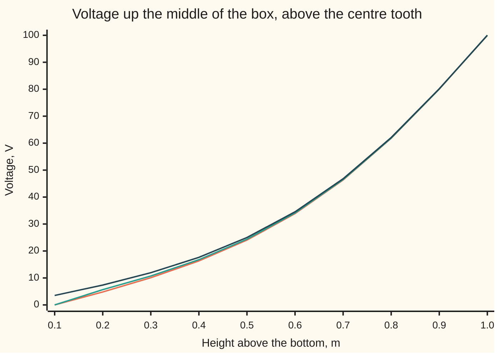

# Subharmonic functions: trap the solution between under and over shapes

[Syllabus](../../../SYLLABUS.md) → [Partial differential equations](../README.md) → [Laplace, Poisson and Potentials](../README.md#s04) → Subharmonic functions

---

## General Overview

A long metal box has a cross-section 1 m wide and 1 m tall. Its lid is insulated from the rest and held at 100 V. The two side walls and the floor are grounded at 0 V. The floor is rough: a corrugated sheet with five sawtooth teeth, each 10 cm tall and 20 cm wide. What is the voltage at the centre of the box, 50 cm above the bottom?

[Harmonic functions](01-harmonic-functions-and-mean-values.md) showed that the voltage in empty space is harmonic: its value at each point is the average of its values on any circle around that point. With a flat floor, symmetry gives the centre value exactly: 25 V. The teeth break every formula. So two questions are open: does a solution exist for a wall this rough, and what is it?

One idea answers both:

- An **under shape** sags: each value is at most the average around it, and on every wall it is at most the wall's voltage. It stays below the true voltage everywhere.
- An **over shape** bulges the other way and stays above the true voltage.
- **Perron's method** builds the solution as the highest of all under shapes.

The flat-floored box is an over shape: 25.00 V at the centre. A box with its floor raised to the tooth tips, set to 0 V below that floor, is an under shape: 24.04 V. The true value is trapped between them, and a fine grid puts it at 24.37 V.

**A function that sags below its own averages lies under the solution wherever it lies under the walls, and the highest of all such functions is the solution.**

**What kind of fact this is:** a theorem (Perron's, 1923), proved on this card in Why it works; one step, Harnack's convergence theorem, is stated with its source; it rests on Harnack's inequality, proved on [Harnack and regularity](10-harnack-and-regularity-in-outline.md). The 24.37 V is a grid answer with its step and observed order, inside two exact bounds.



Orange is the under shape, teal the rough box (grid step 0.625 cm), dark blue the over shape. Teal stays between the other two at every height; the lines spread apart near the teeth. Both checks print every point.

---

## The formula

The unknown is the voltage $`u(x)`$, in volts, at a point $`x = (x_1, x_2)`$: $`x_1`$ across, $`x_2`$ up, in metres. The region $`\Omega`$ is the box above the teeth and $`\partial\Omega`$ its wall, as on [A PDE problem](../01-Classification%20and%20Well-Posedness/01-what-a-pde-problem-is.md). The data $`g`$ are the wall voltages: 100 V on the lid, 0 V elsewhere. The problem is $`\Delta u = 0`$ in $`\Omega`$, $`u = g`$ on $`\partial\Omega`$, with $`\Delta`$ the Laplacian.

A continuous function $`v`$ is **subharmonic** in $`\Omega`$ if its value at each point is at most its average on every small circle around that point:

```math
v(x) \le \frac{1}{2\pi r} \int_{\partial B(x, r)} v \, ds
```

**Read it aloud:** the value at the centre is no more than the average round the rim, for every disc that fits inside the region.

**Superharmonic** reverses the inequality; harmonic is both. For a smooth function, subharmonic means $`\Delta v \ge 0`$, a bowl, and superharmonic means $`\Delta w \le 0`$, a dome. An under shape is subharmonic and at most $`g`$ on the wall; an over shape is superharmonic and at least $`g`$ on the wall.

Perron's method defines the solution as the top of all under shapes:

```math
u(x) = \sup \{\, v(x) \;:\; v \text{ subharmonic in } \Omega, \; v \le g \text{ on } \partial\Omega \,\}
```

**Read it aloud:** at each point, the answer is the least value that no under shape can exceed there.

For any under shape $`v`$ and over shape $`w`$, the solution is trapped:

```math
v(x) \le u(x) \le w(x)
```

At the centre of the rough box: $`24.04 \text{ V} \le u \le 25.00 \text{ V}`$.

| Symbol | Plain meaning | In our example | Push it up and the answer… |
| --- | --- | --- | --- |
| $`x = (x_1, x_2)`$ | a point: across and up, m | centre (0.5, 0.5) | — |
| $`\Omega`$; $`\partial\Omega`$; $`\overline{\Omega}`$ | the region; its wall; the two together | box above the teeth; lid, sides, teeth | — |
| $`u(x)`$ | the voltage, V | 24.37 V at the centre | — |
| $`g`$ | the wall voltages, V | 100 on the lid, 0 elsewhere | $`u`$ rises in proportion |
| $`\Delta`$ | the Laplacian, $`u_{x_1x_1} + u_{x_2x_2}`$: total curvature | 0 for $`u`$ | positive is a bowl |
| $`B(x, r)`$; $`\partial B(x, r)`$; $`ds`$ | disc of radius $`r`$ (m) around $`x`$; its rim; a bit of rim length | rims of 5 cm and 30 cm | — |
| $`v`$, $`v_1`$, $`v_2`$; $`w`$ | under shapes; an over shape | raised floor, 24.04 V; flat floor, 25.00 V | tighter bounds |
| $`\sup`$ | least upper bound of a set of numbers | top of all under shapes | — |
| $`p`$; $`\varphi`$; $`b`$; $`m`$ | a tooth tip; angle from straight up at $`p`$; the barrier; its least value on walls 5 cm or more from $`p`$ | (0.5, 0.1); ±135° on the tooth; Step 4; 0.0856 | — |
| $`h`$; $`k`$ | grid step, m; odd mode number in the sine series | 5 cm to 0.625 cm; 1, 3, 5, … | grid error grows like $`h^{1.3}`$; terms shrink fast |
| $`q`$, $`M`$, $`x_0`$; $`y`$, $`z`$, $`H`$, $`H'`$ | proof names: $`v - u`$, its largest value, where it peaks; two points of a disc, two harmonic limits | Steps 1 and 3 only | — |
| $`a`$; $`R`$; $`\lvert x\rvert`$ | wire radius; tube radius; distance from the axis, m | 1 mm down to 0; 0.5; 0.25 | thinner wire, lower voltage |

### When it holds

- **The region is bounded.** Then 0 V is an under shape and 100 V an over shape. On a half-plane with 0 V on its edge, both 0 and $`x_2`$ are harmonic with the same edge values, and nothing caps the trap.
- **The wall voltages are bounded.** That is all the top needs to be harmonic: no smoothness, not even continuity. At the lid's two corners, where 100 V meets 0 V, the solution has no single value, and that is the only cost.
- **Each wall point has a barrier** (Step 4). Without one, the top can miss the wall voltage there. A point held at 100 V inside a grounded tube is the standard failure: Perron's answer at 25 cm is 0 V.
- **The equation has a comparison principle.** "Under at the wall means under inside" holds for Laplace's equation and for elliptic equations covered by [Maximum principles](../01-Classification%20and%20Well-Posedness/08-maximum-principles.md). Without it, an under shape can cross the solution.

---

## Why it works

### Step 0: walls order the shapes, so take the highest under shape

A sagging function that sits below a harmonic one on the wall sits below it inside too. So every under shape is a lower bound, before anyone knows a solution exists. Perron turned this around: take the top of all under shapes, point by point, then show that this top is harmonic and meets the wall voltages.

### Step 1: an under shape stays under

Let $`v`$ be subharmonic and $`u`$ harmonic, with $`v \le u`$ on the wall. Then $`v - u`$ is subharmonic, because averages of a difference are differences of averages.

A subharmonic function cannot peak strictly inside unless it is constant: at a peak, the value is at most its circle average, yet no point of the circle is higher, so the whole circle sits at the peak. So $`v - u`$ is largest on the wall, where it is at most 0. Hence $`v \le u`$ inside. Turned upside down, the same argument puts every over shape above $`u`$.

<details>
<summary>Detailed proof: the maximum principle for a continuous subharmonic function</summary>

Let $`q = v - u`$, continuous on the closed region $`\overline{\Omega}`$, with $`q(x) \le \frac{1}{2\pi r}\int_{\partial B(x,r)} q\, ds`$ for every disc inside $`\Omega`$. Let $`M`$ be the largest value of $`q`$ on $`\overline{\Omega}`$; a continuous function on a closed bounded set reaches it.

Suppose $`q(x_0) = M`$ at an inside point. For every small $`r`$:

$`\displaystyle 0 \le \frac{1}{2\pi r}\int_{\partial B(x_0,r)} (q - M)\, ds \quad\text{and}\quad q - M \le 0 .`$

An average of non-positive continuous values that is at least 0 forces every value to be 0. So $`q = M`$ on every small circle around $`x_0`$, hence on a disc. The set $`\{q = M\}`$ is therefore open in $`\Omega`$; it is closed by continuity. In a connected region it is all of $`\Omega`$, and by continuity $`q = M`$ on the wall too.

Either way, $`M`$ is reached on the wall. There $`q \le 0`$, so $`q \le 0`$ everywhere. Gilbarg and Trudinger, section 2.8, give this argument for continuous functions.

</details>

### Step 2: two moves keep a shape under and push it up

1. **Take the larger of two.** If $`v_1`$ and $`v_2`$ are under shapes, so is $`\max(v_1, v_2)`$: the larger value is at most the larger function's average, which is at most the average of the maximum.
2. **Lift inside a disc.** Inside a disc, replace $`v`$ by the harmonic function with the same rim values, from [The Poisson formula](../../07-Complex%20analysis/07-Conformal%20Maps%20and%20Harmonic%20Functions/06-poisson-integral-formula.md). By Step 1 the new values are at least the old ones, and the result is still an under shape.

On a grid, the lift replaces a value by the average of its four neighbours. A full pass is a Gauss-Seidel sweep ([Iterating instead of factoring](../../16-Numerical%20analysis/03-Numerical%20Linear%20Algebra/09-iterative-methods-jacobi-gauss-seidel-and-conjugate-gradient.md)). From 0 V inside, every sweep raises a grid under shape; from 100 V, every sweep lowers an over shape. On the 5 cm grid, the centre:

| Sweeps | From below, V | From above, V | Gap, V |
| ---: | ---: | ---: | ---: |
| 10 | 0.0017 | 96.9277 | 96.9260 |
| 40 | 8.4581 | 63.3086 | 54.8506 |
| 160 | 23.6449 | 25.8436 | 2.1987 |
| 361 | 24.3004 | 24.3102 | 0.0097 |

The checks confirm at every sweep that each lower value is still at most the average of its four neighbours.

### Step 3: the top of the under shapes is harmonic

Fix a disc inside $`\Omega`$ and a point $`y`$ in it. Choose under shapes whose values at $`y`$ climb to the top $`u(y)`$. Using Step 2, make the sequence increasing and lift each one in the disc. Now each is harmonic in the disc, and the values at $`y`$ still climb to $`u(y)`$.

Harnack's convergence theorem (Gilbarg and Trudinger, Theorem 2.9, a consequence of the inequality on [Harnack and regularity](10-harnack-and-regularity-in-outline.md)) says an increasing sequence of harmonic functions, bounded above, converges to a harmonic function. Its limit $`H`$ has $`H \le u`$ and $`H(y) = u(y)`$.

<details>
<summary>Detailed proof: the limit equals the top at every point of the disc</summary>

Take any other point $`z`$ in the disc. Build a second sequence that also climbs to $`u(z)`$, and at each stage take the larger of it and the first sequence before lifting. The new limit $`H'`$ is harmonic, with $`H \le H' \le u`$ and $`H(y) = H'(y) = u(y)`$.

So $`H - H'`$ is harmonic, at most 0, and equal to 0 at $`y`$, an inside point. By the strong maximum principle applied to $`H - H'`$, it is 0 on the whole disc. In particular $`u(z) = H'(z) = H(z)`$.

Every point of the disc therefore has $`u = H`$, so $`u`$ is harmonic there. Discs cover $`\Omega`$, so $`u`$ is harmonic in $`\Omega`$. Gilbarg and Trudinger, section 2.8, give this proof; Perron's 1923 paper has the original argument.

</details>

### Step 4: barriers make the top meet the wall

The top must also reach the wall voltage at each wall point. A **barrier** at a wall point $`p`$ is a superharmonic function $`b`$ that is 0 at $`p`$ and positive everywhere else on the closed region. A point with a barrier is **regular**.

At the tooth tip $`p`$ = (0.5, 0.1) m, measure the angle $`\varphi`$ from straight up. Inside the box it reaches ±135° on the tooth's edges and stays below ±180° everywhere. Take

```math
b(x) = \sqrt{\lvert x - p\rvert}\, \cos(\varphi/2)
```

It is harmonic (the real part of a square root, turned to face up): at (0.5, 0.3) m it is 0.447214, and so is its 10 cm circle average. On the tooth's edges it is $`\cos(67.5°)`$ = 0.3827 times $`\sqrt{\lvert x - p\rvert}`$, still positive.

On walls 5 cm or more from the tip, $`b \ge m`$ = 0.0856, its value on the tooth edge 5 cm out, so $`(100/m)\, b`$ = 1168.6 $`b`$ is at least 100 V there and at least 0 V nearer the tip. It is an over shape, so $`u \le 1168.6\, b`$: 36.96 V at 1 mm above the tip, 1.1686 V at 1 µm, and 0 V at the tip. The bound is crude (the grid gives 0.6977 V at 0.625 cm), but it forces $`u`$ to meet the wall's 0 V.

In two dimensions any wall point on a piece of wall longer than a single point has a barrier (Ransford, chapter 4). A lone point does not. A wire of radius $`a`$ at 100 V on the axis of a grounded tube of radius $`R`$ gives

```math
u = 100 \,\frac{\ln(R/\lvert x\rvert)}{\ln(R/a)} \text{ V}
```

At 25 cm in a 0.5 m tube this is 11.1535 V for a 1 mm wire and 5.2822 V for 1 µm, and it tends to 0 V as the wire shrinks to a point. The point's 100 V is lost. In three dimensions a thin inward spike can fail the same way; Wiener's 1924 test decides each point.

### Step 5: the trap for the rough box

- **Over shape.** The flat-floored square's solution is harmonic and positive inside the square, so on the teeth it is at least their 0 V. At the centre it is exactly 25 V: the lid rotated to each of the four sides adds up to 100 V everywhere.
- **Under shape.** Raise the floor to the tooth tips, $`x_2`$ = 0.1 m, solve that rectangle, and set the shape to 0 V below. Mirroring the rectangle's solution across $`x_2`$ = 0.1 m with a sign change gives a harmonic function that is negative below; the glued shape is the larger of it and 0, so it is subharmonic by Step 2. Over a valley, at (0.2, 0.1) m, it is 0 V while its 5 cm circle average is 0.4462 V.

So $`24.04 \le u(0.5, 0.5) \le 25.00`$ V, from two exact formulas, with no grid.

The solution is classical: harmonic inside, continuous up to every wall point except the two lid corners. In two dimensions it is the only bounded harmonic function that takes those wall values at all but finitely many points (Ransford, chapter 3).

---

## Worked numbers, by hand

The under shape is the 1 m by 0.9 m box above the tooth tips, lid at 100 V. Its solution is the series $`\sum_k \frac{400}{k\pi} \sin(k\pi x_1)\, \frac{\sinh(k\pi (x_2 - 0.1))}{\sinh(0.9 k\pi)}`$ over odd mode numbers $`k`$ = 1, 3, 5, …, where $`x_2 - 0.1`$ is the height above the raised floor in metres. At the centre it is 0.4 m.

| Step | Arithmetic | Value |
| --- | --- | --- |
| over shape at centre | 100 ÷ 4, by rotating the lid | 25.0000 V |
| lead factor | 400 ÷ π | 127.324 V |
| first term, k = 1 | 127.324 × sin(π/2) × sinh(0.4π) ÷ sinh(0.9π) = 127.324 × 1.6145 ÷ 8.4214 | 24.4095 V |
| second term, k = 3 | negative, because sin(3π/2) = −1 | −0.3811 V |
| third term, k = 5 | | 0.0099 V |
| under shape at centre | 24.4095 − 0.3811 + 0.0099 | 24.0383 V (24.0380 with all 200 terms) |
| grid, h = 1.25 cm and 0.625 cm | Perron's top on the grid | 24.3592 V, 24.3659 V |
| observed order | from the last three grids | 1.30 |
| extrapolated | 24.3659 + 0.0066 ÷ (2^1.30 − 1) = 24.3659 + 0.0066 ÷ 1.460 | **24.3704 V** |

The centre of the rough box sits at 24.37 V: the teeth pull it down 0.6296 V from the flat-floored 25 V, inside the exact trap. The finest grid is 0.0045 V short. Its order is about 1.3, not 2, because near each tip the voltage grows like the distance to the power 2/3, which a square grid follows poorly.

### What breaks if you drop a piece

| Mistake | Comes out at | What went wrong |
| --- | --- | --- |
| Taking the floor as flat | 25.0000 V, not 24.3704 V | That is the over shape: an upper bound. |
| A dome, $`50 \sin(\pi x_1)\sin(\pi(x_2 - 0.1)/0.9)`$, used as an under shape | 49.2404 V | It is under the walls but not subharmonic: it bulges above the tooth tips, so the comparison does not apply. |
| Stopping the grid lift after 20 sweeps | 1.1058 V | Each sweep only raises a lower bound. |
| The bowl $`100 x_2^2`$ used as an under shape | at least 25.0000 V | It reaches 100 V on the grounded side walls. |
| A single point held at 100 V in a grounded tube | 0 V at 25 cm | A point has no barrier: 0.1004 V even for a wire of radius 10⁻³⁰⁰ m. |

The checks print every row.

---

## Code, from first principles, and it actually runs

Both programs take one road to the centre voltage itself: four grids solved by SOR (a sped-up Gauss-Seidel), with observed order and extrapolation to 24.3704 V. Three independent checks surround it:

1. two exact bounds, the under and over shapes as sine series, with the first omitted term, which trap it between 24.0380 V and 25.0000 V;
2. the Perron lift on the 5 cm grid from 0 V and from 100 V, which checks every sweep and traps that grid's SOR value, 24.3034 V, between its lower and upper shapes;
3. mean-value tests on sample circles: the over shape and the barrier equal their circle averages, and the glued under shape sits below its own.

The tube's closed form is checked by the residual of Laplace's equation in round coordinates.

### Python

```python
# Subharmonic functions and Perron's method -- the check behind the card.  Standard library only.
# A long metal box, cross-section 1 m x 1 m.  Lid (x2 = 1 m) at 100 V, sides and floor grounded.
# The floor is rough: five sawtooth teeth, 10 cm tall, 20 cm wide.  u = potential, V.
# Roads: under and over shapes in closed form (Fourier series); the discrete Perron lift from
# below and from above; SOR grids at four steps with observed order; mean-value tests.
import math

V0, TOOTH, PI = 100.0, 0.1, math.pi

def sci(v, d=1):                             # e-notation with the same digits in Rust
    e = math.floor(math.log10(abs(v))); m = v / 10 ** e
    return f"{m:.{d}f}e{'-' if e < 0 else '+'}{abs(e):02d}"

def floor(x):                                # height of the rough floor at x1 = x, m
    return TOOTH - abs(x % (2 * TOOTH) - TOOTH)

def box(x, y, top, lid=V0, n=200):          # flat-floored box [0,1] x [0,top], lid at `lid` V
    s = 0.0
    for m in range(n):
        k = (2 * m + 1) * PI
        s += 4 * lid / k * math.sin(k * x) * math.exp(k * (y - top)) * (1 - math.exp(-2 * k * y)) / (1 - math.exp(-2 * k * top))
    return s

def omitted(x, y, top, n=200):              # first term the series leaves out
    k = (2 * n + 1) * PI
    return 4 * V0 / k * abs(math.sin(k * x)) * math.exp(k * (y - top))

def under(x, y):                             # rectangle above the tooth tips, glued to 0 below: subharmonic
    return box(x, y - TOOTH, 1 - TOOTH) if y > TOOTH else 0.0

def over(x, y): return box(x, y, 1.0)        # the flat-floored square: harmonic, >= 0 on the teeth

def setup(n, rough=True, lid=V0, fill=0.0):  # grid of step 1/n m: walls fixed, inside filled
    fl = [round(floor(i / n) * n) if rough else 0 for i in range(n + 1)]
    u = [[0.0] * (n + 1) for _ in range(n + 1)]
    for i in range(1, n):
        u[i][n] = lid
        for j in range(fl[i] + 1, n): u[i][j] = fill
    return u, fl

def sweep(u, fl, w):                          # one pass: each value moves to (w times) its neighbours' average
    n, d = len(u) - 1, 0.0
    for i in range(1, n):
        a, b, c = u[i - 1], u[i], u[i + 1]
        for j in range(fl[i] + 1, n):
            r = 0.25 * (a[j] + c[j] + b[j - 1] + b[j + 1]) - b[j]
            b[j] += w * r; d = max(d, abs(r))
    return d

def grid(n, rough=True, lid=V0):              # SOR to convergence
    u, fl = setup(n, rough, lid); w = 2 / (1 + math.sin(PI / n)); count = 1
    while sweep(u, fl, w) > 1e-10: count += 1
    return u, count

c = (0.5, 0.5)
lo, hi = under(*c), over(*c)
print(f"under shape (rectangle above the tips) at centre: {lo:.4f} V; first omitted term {sci(omitted(0.5, 0.4, 0.9))} V")
sh = lambda z: (math.exp(z) - math.exp(-z)) / 2
terms = [4 * V0 / (k * PI) * math.sin(k * PI / 2) * sh(0.4 * k * PI) / sh(0.9 * k * PI) for k in (1, 3, 5)]
print(f"by hand: 400/pi = {4 * V0 / PI:.3f} V; sinh(0.4 pi) = {sh(0.4 * PI):.4f}, sinh(0.9 pi) = {sh(0.9 * PI):.4f}; terms k = 1, 3, 5: "
      + ", ".join(f"{t:.4f}" for t in terms) + f" V; sum {sum(terms):.4f} V")
print(f"over shape (flat-floored square) at centre: {hi:.4f} V; exact by symmetry 25 V")
assert abs(hi - 25) < 1e-12                      # four rotated lids add to a constant 100 V
print("grid | h cm | SOR sweeps | u(centre) V | flat floor V")
vals = []
for n in (20, 40, 80, 160):
    u, cnt = grid(n); f = grid(n, rough=False)[0][n // 2][n // 2]
    vals.append(u[n // 2][n // 2]); assert abs(f - 25) < 1e-6 and lo < vals[-1] < hi
    print(f"grid | {100 / n:.3f} | {cnt} | {vals[-1]:.4f} | {f:.4f}")
    if n == 160: fine = u
orders = [math.log2((vals[i] - vals[i + 1]) / (vals[i + 1] - vals[i + 2])) for i in range(2)]
p = orders[-1]; best = vals[-1] + (vals[-1] - vals[-2]) / (2 ** p - 1)
assert all(1.1 < q < 1.5 for q in orders)          # sharp tips: about 4/3, not 2
print(f"observed order {orders[0]:.2f}, {orders[1]:.2f}; extrapolated centre {best:.4f} V, last step off by {best - vals[-1]:.4f} V")
assert lo < best < hi
print(f"by hand: last two grids differ by {vals[-1] - vals[-2]:.4f} V; 2^p - 1 = {2 ** p - 1:.3f}; teeth pull the centre down by {hi - best:.4f} V")

print("Perron lift on the 5 cm grid | sweeps | from below V | from above V | gap V")
(a, fl), (b, _) = setup(20, fill=0.0), setup(20, fill=V0)
k, prev_lo, prev_hi = 0, -1.0, 1e9
while b[10][10] - a[10][10] >= 0.01:
    k += 1; sweep(a, fl, 1.0); sweep(b, fl, 1.0)
    al, bh = a[10][10], b[10][10]
    assert prev_lo <= al <= vals[0] <= bh <= prev_hi; prev_lo, prev_hi = al, bh
    assert all(a[i][j] <= 0.25 * (a[i-1][j] + a[i+1][j] + a[i][j-1] + a[i][j+1]) + 1e-12
               for i in range(1, 20) for j in range(fl[i] + 1, 20))   # every lower iterate is a discrete under shape
    if k == 20: stop20 = al
    if k in (10, 40, 160): print(f"lift | {k} | {al:.4f} | {bh:.4f} | {bh - al:.4f}")
print(f"lift | {k} | {al:.4f} | {bh:.4f} | {bh - al:.4f}  (first sweep with gap under 0.01 V)")

ys = [round(0.1 * i, 1) for i in range(1, 11)]
print("chart, x1 = 0.5 m, x2 = 0.1..1.0 m, under: " + ", ".join(f"{under(0.5, y) if y < 1 else V0:.2f}" for y in ys))
print("chart, rough box (1/160 m grid): " + ", ".join(f"{fine[80][round(160 * y)]:.2f}" for y in ys))
print("chart, over: " + ", ".join(f"{over(0.5, y) if y < 1 else V0:.2f}" for y in ys))
print(f"first omitted term at x2 = 0.9 m: {sci(omitted(0.5, 0.9, 1.0))} V")

def avg(f, x, y, r, m=720): return sum(f(x + r * math.cos(2 * PI * t / m), y + r * math.sin(2 * PI * t / m)) for t in range(m)) / m
ac = avg(over, 0.5, 0.5, 0.3); assert abs(ac - hi) < 1e-9          # harmonic: equal to its average
ag = avg(under, 0.2, 0.1, 0.05); assert ag > under(0.2, 0.1) + 0.1  # glued shape: strictly below its average
print(f"mean values: over shape at centre {hi:.4f} V, circle of 30 cm {ac:.4f} V; glued under shape at (0.2, 0.1) m {under(0.2, 0.1):.4f} V, circle of 5 cm {ag:.4f} V")

def barrier(x, y):                               # sqrt(r) cos(phi/2), phi measured from straight up at the tip
    dx, dy = x - 0.5, y - TOOTH
    return math.sqrt(math.hypot(dx, dy)) * math.cos(math.atan2(dx, dy) / 2)
bd = [(i / 1000, floor(i / 1000)) for i in range(1001)] + [(0.0, j / 1000) for j in range(1001)] + [(1.0, j / 1000) for j in range(1001)] + [(i / 1000, 1.0) for i in range(1001)]
bd += [(0.5 + s * 0.05 / math.sqrt(2), TOOTH - 0.05 / math.sqrt(2)) for s in (-1, 1)]   # the two edge points exactly 5 cm away
mb = min(barrier(x, y) for x, y in bd if math.hypot(x - 0.5, y - TOOTH) >= 0.05 - 1e-12)
ab = avg(barrier, 0.5, 0.3, 0.1); assert abs(ab - barrier(0.5, 0.3)) < 1e-9 and mb > 0
assert abs(mb - math.sqrt(0.05) * math.cos(3 * PI / 8)) < 1e-12   # least value: on the tooth edge, 5 cm out
print(f"barrier at the tip (0.5, 0.1) m: {barrier(0.5, 0.3):.6f} at (0.5, 0.3), circle average {ab:.6f}; least on walls 5 cm or more away {mb:.4f}; on the tooth edge cos(67.5 deg) = {math.cos(3 * PI / 8):.4f}")
cap = V0 / mb; near = fine[80][17]                # over shape cap * barrier: >= 0 near the tip, >= 100 V beyond 5 cm
assert near <= cap * barrier(0.5, 0.10625)
print(f"barrier over shape {cap:.1f} x barrier: at 0.625 cm above the tip {cap * barrier(0.5, 0.10625):.2f} V (grid {near:.4f} V); at 1 mm {cap * barrier(0.5, 0.101):.2f} V; at 1 um {cap * barrier(0.5, 0.100001):.4f} V")

R, r = 0.5, 0.25                                 # grounded tube, thin wire on its axis at 100 V
tube = lambda a, s=r: V0 * math.log(R / s) / math.log(R / a)
for a in (1e-3, 1e-6, 1e-12):
    t = 1e-4; res = (tube(a, r + t) - 2 * tube(a, r) + tube(a, r - t)) / t ** 2 + (tube(a, r + t) - tube(a, r - t)) / (2 * t * r)
    assert abs(res) < 1e-4 * tube(a)
    print(f"tube: wire radius {sci(a, 0)} m, u at r = 25 cm: {tube(a):.4f} V; residual u_rr + u_r/r = {sci(abs(res))} V/m^2")
assert tube(1e-300) < 0.25
print(f"wire shrunk to a point (radius 1e-300 m): {tube(1e-300):.4f} V; Perron's answer 0 V, not 100 V")

dome = lambda x, y: 50 * math.sin(PI * x) * math.sin(PI * (y - TOOTH) / (1 - TOOTH))
print("what breaks, at the centre:")
print(f"  floor taken as flat: {hi:.4f} V, not {best:.4f}")
print(f"  a dome under the walls taken as an under shape: {dome(0.5, 0.5):.4f} V, above the answer")
print(f"  lift stopped after 20 sweeps: {stop20:.4f} V, a floor, not the answer")
print(f"  bowl 100 x2^2 taken as an under shape: {V0 * 0.25:.4f} V; it pokes {V0 * 1.0:.0f} V above the side walls at the top")
print(f"try: lid at 50 V, centre {grid(80, lid=50.0)[0][40][40]:.4f} V; wire 1e-9 m: {tube(1e-9):.4f} V")
print("ALL CHECKS PASS")
```

**Ran 2026-11-15 on macOS, Python 3.14.10, standard library only. All checks passed. Output, pasted from the run:**

```
under shape (rectangle above the tips) at centre: 24.0380 V; first omitted term 8.8e-275 V
by hand: 400/pi = 127.324 V; sinh(0.4 pi) = 1.6145, sinh(0.9 pi) = 8.4214; terms k = 1, 3, 5: 24.4095, -0.3811, 0.0099 V; sum 24.0383 V
over shape (flat-floored square) at centre: 25.0000 V; exact by symmetry 25 V
grid | h cm | SOR sweeps | u(centre) V | flat floor V
grid | 5.000 | 97 | 24.3034 | 25.0000
grid | 2.500 | 192 | 24.3429 | 25.0000
grid | 1.250 | 383 | 24.3592 | 25.0000
grid | 0.625 | 757 | 24.3659 | 25.0000
observed order 1.28, 1.30; extrapolated centre 24.3704 V, last step off by 0.0045 V
by hand: last two grids differ by 0.0066 V; 2^p - 1 = 1.460; teeth pull the centre down by 0.6296 V
Perron lift on the 5 cm grid | sweeps | from below V | from above V | gap V
lift | 10 | 0.0017 | 96.9277 | 96.9260
lift | 40 | 8.4581 | 63.3086 | 54.8506
lift | 160 | 23.6449 | 25.8436 | 2.1987
lift | 361 | 24.3004 | 24.3102 | 0.0097  (first sweep with gap under 0.01 V)
chart, x1 = 0.5 m, x2 = 0.1..1.0 m, under: 0.00, 4.81, 10.08, 16.31, 24.04, 33.86, 46.34, 61.80, 80.04, 100.00
chart, rough box (1/160 m grid): 0.00, 5.65, 10.71, 16.77, 24.37, 34.09, 46.49, 61.89, 80.08, 100.00
chart, over: 3.51, 7.37, 11.94, 17.65, 25.00, 34.53, 46.79, 62.08, 80.17, 100.00
first omitted term at x2 = 0.9 m: 6.2e-56 V
mean values: over shape at centre 25.0000 V, circle of 30 cm 25.0000 V; glued under shape at (0.2, 0.1) m 0.0000 V, circle of 5 cm 0.4462 V
barrier at the tip (0.5, 0.1) m: 0.447214 at (0.5, 0.3), circle average 0.447214; least on walls 5 cm or more away 0.0856; on the tooth edge cos(67.5 deg) = 0.3827
barrier over shape 1168.6 x barrier: at 0.625 cm above the tip 92.39 V (grid 0.6977 V); at 1 mm 36.96 V; at 1 um 1.1686 V
tube: wire radius 1e-03 m, u at r = 25 cm: 11.1535 V; residual u_rr + u_r/r = 6.9e-06 V/m^2
tube: wire radius 1e-06 m, u at r = 25 cm: 5.2822 V; residual u_rr + u_r/r = 3.3e-06 V/m^2
tube: wire radius 1e-12 m, u at r = 25 cm: 2.5731 V; residual u_rr + u_r/r = 1.6e-06 V/m^2
wire shrunk to a point (radius 1e-300 m): 0.1004 V; Perron's answer 0 V, not 100 V
what breaks, at the centre:
  floor taken as flat: 25.0000 V, not 24.3704
  a dome under the walls taken as an under shape: 49.2404 V, above the answer
  lift stopped after 20 sweeps: 1.1058 V, a floor, not the answer
  bowl 100 x2^2 taken as an under shape: 25.0000 V; it pokes 100 V above the side walls at the top
try: lid at 50 V, centre 12.1796 V; wire 1e-9 m: 3.4605 V
ALL CHECKS PASS
```

### Rust

```rust
// Subharmonic functions and Perron's method -- the check behind the card.  Rust std only.
// A long metal box, cross-section 1 m x 1 m.  Lid (x2 = 1 m) at 100 V, sides and floor grounded.
// The floor is rough: five sawtooth teeth, 10 cm tall, 20 cm wide.  u = potential, V.
// Roads: under and over shapes in closed form (Fourier series); the discrete Perron lift from
// below and from above; SOR grids at four steps with observed order; mean-value tests.
use std::f64::consts::PI;

const V0: f64 = 100.0;
const TOOTH: f64 = 0.1;
type Grid = Vec<Vec<f64>>;

fn sci(v: f64, d: usize) -> String { // e-notation with the same digits as Python
    let e = v.abs().log10().floor() as i32; let m = v / 10f64.powi(e);
    format!("{:.*}e{}{:02}", d, m, if e < 0 { '-' } else { '+' }, e.abs())
}

fn floor_at(x: f64) -> f64 { TOOTH - (x.rem_euclid(2.0 * TOOTH) - TOOTH).abs() } // rough floor height, m

fn boxv(x: f64, y: f64, top: f64, lid: f64) -> f64 { // flat-floored box [0,1] x [0,top]
    let mut s = 0.0;
    for m in 0..200 {
        let k = (2 * m + 1) as f64 * PI;
        s += 4.0 * lid / k * (k * x).sin() * (k * (y - top)).exp() * (1.0 - (-2.0 * k * y).exp()) / (1.0 - (-2.0 * k * top).exp());
    }
    s
}

fn omitted(x: f64, y: f64, top: f64) -> f64 { // first term the series leaves out
    let k = 401.0 * PI;
    4.0 * V0 / k * (k * x).sin().abs() * (k * (y - top)).exp()
}

fn under(x: f64, y: f64) -> f64 { if y > TOOTH { boxv(x, y - TOOTH, 1.0 - TOOTH, V0) } else { 0.0 } }
fn over(x: f64, y: f64) -> f64 { boxv(x, y, 1.0, V0) }

fn setup(n: usize, rough: bool, lid: f64, fill: f64) -> (Grid, Vec<usize>) {
    let fl: Vec<usize> = (0..=n).map(|i| if rough { (floor_at(i as f64 / n as f64) * n as f64).round() as usize } else { 0 }).collect();
    let mut u = vec![vec![0.0; n + 1]; n + 1];
    for i in 1..n { u[i][n] = lid; for j in fl[i] + 1..n { u[i][j] = fill; } }
    (u, fl)
}

fn sweep(u: &mut Grid, fl: &[usize], w: f64) -> f64 { // each value moves to (w times) its neighbours' average
    let n = u.len() - 1; let mut d: f64 = 0.0;
    for i in 1..n {
        for j in fl[i] + 1..n {
            let r = 0.25 * (u[i - 1][j] + u[i + 1][j] + u[i][j - 1] + u[i][j + 1]) - u[i][j];
            u[i][j] += w * r; d = d.max(r.abs());
        }
    }
    d
}

fn grid(n: usize, rough: bool, lid: f64) -> (Grid, usize) { // SOR to convergence
    let (mut u, fl) = setup(n, rough, lid, 0.0); let w = 2.0 / (1.0 + (PI / n as f64).sin()); let mut count = 1;
    while sweep(&mut u, &fl, w) > 1e-10 { count += 1; }
    (u, count)
}

fn avg(f: &dyn Fn(f64, f64) -> f64, x: f64, y: f64, r: f64) -> f64 {
    let m = 720; let mut s = 0.0;
    for t in 0..m { let a = 2.0 * PI * t as f64 / m as f64; s += f(x + r * a.cos(), y + r * a.sin()); }
    s / m as f64
}

fn barrier(x: f64, y: f64) -> f64 { // sqrt(r) cos(phi/2), phi measured from straight up at the tip
    let (dx, dy) = (x - 0.5, y - TOOTH);
    dx.hypot(dy).sqrt() * (dx.atan2(dy) / 2.0).cos()
}

fn main() {
    let (lo, hi) = (under(0.5, 0.5), over(0.5, 0.5));
    println!("under shape (rectangle above the tips) at centre: {:.4} V; first omitted term {} V", lo, sci(omitted(0.5, 0.4, 0.9), 1));
    let sh = |z: f64| (z.exp() - (-z).exp()) / 2.0;
    let terms: Vec<f64> = [1.0, 3.0, 5.0].iter().map(|&k: &f64| 4.0 * V0 / (k * PI) * (k * PI / 2.0).sin() * sh(0.4 * k * PI) / sh(0.9 * k * PI)).collect();
    println!("by hand: 400/pi = {:.3} V; sinh(0.4 pi) = {:.4}, sinh(0.9 pi) = {:.4}; terms k = 1, 3, 5: {} V; sum {:.4} V", 4.0 * V0 / PI, sh(0.4 * PI), sh(0.9 * PI),
             terms.iter().map(|t| format!("{:.4}", t)).collect::<Vec<_>>().join(", "), terms.iter().sum::<f64>());
    println!("over shape (flat-floored square) at centre: {:.4} V; exact by symmetry 25 V", hi);
    assert!((hi - 25.0).abs() < 1e-12); // four rotated lids add to a constant 100 V
    println!("grid | h cm | SOR sweeps | u(centre) V | flat floor V");
    let mut vals = vec![]; let mut fine = vec![];
    for n in [20usize, 40, 80, 160] {
        let (u, cnt) = grid(n, true, V0); let f = grid(n, false, V0).0[n / 2][n / 2];
        vals.push(u[n / 2][n / 2]); let v = vals[vals.len() - 1];
        assert!((f - 25.0).abs() < 1e-6 && lo < v && v < hi);
        println!("grid | {:.3} | {} | {:.4} | {:.4}", 100.0 / n as f64, cnt, v, f);
        if n == 160 { fine = u; }
    }
    let orders: Vec<f64> = (0..2).map(|i| ((vals[i] - vals[i + 1]) / (vals[i + 1] - vals[i + 2])).log2()).collect();
    let p = orders[1]; let best = vals[3] + (vals[3] - vals[2]) / (2f64.powf(p) - 1.0);
    assert!(orders.iter().all(|&q| 1.1 < q && q < 1.5)); // sharp tips: about 4/3, not 2
    println!("observed order {:.2}, {:.2}; extrapolated centre {:.4} V, last step off by {:.4} V", orders[0], orders[1], best, best - vals[3]);
    assert!(lo < best && best < hi);
    println!("by hand: last two grids differ by {:.4} V; 2^p - 1 = {:.3}; teeth pull the centre down by {:.4} V", vals[3] - vals[2], 2f64.powf(p) - 1.0, hi - best);

    println!("Perron lift on the 5 cm grid | sweeps | from below V | from above V | gap V");
    let (mut a, fl) = setup(20, true, V0, 0.0); let (mut b, _) = setup(20, true, V0, V0);
    let (mut k, mut prev_lo, mut prev_hi, mut stop20) = (0, -1.0, 1e9, 0.0);
    let (mut al, mut bh) = (0.0, 0.0);
    while b[10][10] - a[10][10] >= 0.01 {
        k += 1; sweep(&mut a, &fl, 1.0); sweep(&mut b, &fl, 1.0);
        al = a[10][10]; bh = b[10][10];
        assert!(prev_lo <= al && al <= vals[0] && vals[0] <= bh && bh <= prev_hi); prev_lo = al; prev_hi = bh;
        for i in 1..20 { for j in fl[i] + 1..20 { // every lower iterate is a discrete under shape
            assert!(a[i][j] <= 0.25 * (a[i - 1][j] + a[i + 1][j] + a[i][j - 1] + a[i][j + 1]) + 1e-12);
        } }
        if k == 20 { stop20 = al; }
        if k == 10 || k == 40 || k == 160 { println!("lift | {} | {:.4} | {:.4} | {:.4}", k, al, bh, bh - al); }
    }
    println!("lift | {} | {:.4} | {:.4} | {:.4}  (first sweep with gap under 0.01 V)", k, al, bh, bh - al);

    let ys: Vec<f64> = (1..=10).map(|i| (i as f64 * 0.1 * 10.0).round() / 10.0).collect();
    let line = |f: &dyn Fn(f64) -> f64| ys.iter().map(|&y| format!("{:.2}", f(y))).collect::<Vec<_>>().join(", ");
    println!("chart, x1 = 0.5 m, x2 = 0.1..1.0 m, under: {}", line(&|y| if y < 1.0 { under(0.5, y) } else { V0 }));
    println!("chart, rough box (1/160 m grid): {}", line(&|y| fine[80][(160.0 * y).round() as usize]));
    println!("chart, over: {}", line(&|y| if y < 1.0 { over(0.5, y) } else { V0 }));
    println!("first omitted term at x2 = 0.9 m: {} V", sci(omitted(0.5, 0.9, 1.0), 1));

    let ac = avg(&over, 0.5, 0.5, 0.3); assert!((ac - hi).abs() < 1e-9); // harmonic: equal to its average
    let ag = avg(&under, 0.2, 0.1, 0.05); assert!(ag > under(0.2, 0.1) + 0.1); // glued shape: strictly below its average
    println!("mean values: over shape at centre {:.4} V, circle of 30 cm {:.4} V; glued under shape at (0.2, 0.1) m {:.4} V, circle of 5 cm {:.4} V",
             hi, ac, under(0.2, 0.1), ag);

    let mut bd = vec![];
    for i in 0..=1000 { let s = i as f64 / 1000.0; bd.push((s, floor_at(s))); }
    for j in 0..=1000 { bd.push((0.0, j as f64 / 1000.0)); }
    for j in 0..=1000 { bd.push((1.0, j as f64 / 1000.0)); }
    for i in 0..=1000 { bd.push((i as f64 / 1000.0, 1.0)); }
    for s in [-1.0, 1.0] { bd.push((0.5 + s * 0.05 / 2f64.sqrt(), TOOTH - 0.05 / 2f64.sqrt())); } // the two edge points exactly 5 cm away
    let mb = bd.iter().filter(|&&(x, y)| (x - 0.5).hypot(y - TOOTH) >= 0.05 - 1e-12).map(|&(x, y)| barrier(x, y)).fold(f64::INFINITY, f64::min);
    let ab = avg(&barrier, 0.5, 0.3, 0.1); assert!((ab - barrier(0.5, 0.3)).abs() < 1e-9 && mb > 0.0);
    assert!((mb - 0.05f64.sqrt() * (3.0 * PI / 8.0).cos()).abs() < 1e-12); // least value: on the tooth edge, 5 cm out
    println!("barrier at the tip (0.5, 0.1) m: {:.6} at (0.5, 0.3), circle average {:.6}; least on walls 5 cm or more away {:.4}; on the tooth edge cos(67.5 deg) = {:.4}",
             barrier(0.5, 0.3), ab, mb, (3.0 * PI / 8.0).cos());
    let cap = V0 / mb; let near = fine[80][17]; // over shape cap * barrier: >= 0 near the tip, >= 100 V beyond 5 cm
    assert!(near <= cap * barrier(0.5, 0.10625));
    println!("barrier over shape {:.1} x barrier: at 0.625 cm above the tip {:.2} V (grid {:.4} V); at 1 mm {:.2} V; at 1 um {:.4} V",
             cap, cap * barrier(0.5, 0.10625), near, cap * barrier(0.5, 0.101), cap * barrier(0.5, 0.100001));

    let (rr, r) = (0.5, 0.25); // grounded tube, thin wire on its axis at 100 V
    let tube = |a: f64, s: f64| V0 * (rr / s).ln() / (rr / a).ln();
    for a in [1e-3, 1e-6, 1e-12] {
        let t: f64 = 1e-4;
        let res = (tube(a, r + t) - 2.0 * tube(a, r) + tube(a, r - t)) / t.powi(2) + (tube(a, r + t) - tube(a, r - t)) / (2.0 * t * r);
        assert!(res.abs() < 1e-4 * tube(a, r));
        println!("tube: wire radius {} m, u at r = 25 cm: {:.4} V; residual u_rr + u_r/r = {} V/m^2", sci(a, 0), tube(a, r), sci(res.abs(), 1));
    }
    assert!(tube(1e-300, r) < 0.25);
    println!("wire shrunk to a point (radius 1e-300 m): {:.4} V; Perron's answer 0 V, not 100 V", tube(1e-300, r));

    let dome = |x: f64, y: f64| 50.0 * (PI * x).sin() * (PI * (y - TOOTH) / (1.0 - TOOTH)).sin();
    println!("what breaks, at the centre:");
    println!("  floor taken as flat: {:.4} V, not {:.4}", hi, best);
    println!("  a dome under the walls taken as an under shape: {:.4} V, above the answer", dome(0.5, 0.5));
    println!("  lift stopped after 20 sweeps: {:.4} V, a floor, not the answer", stop20);
    println!("  bowl 100 x2^2 taken as an under shape: {:.4} V; it pokes {:.0} V above the side walls at the top", V0 * 0.25, V0 * 1.0);
    println!("try: lid at 50 V, centre {:.4} V; wire 1e-9 m: {:.4} V", grid(80, true, 50.0).0[40][40], tube(1e-9, r));
    println!("ALL CHECKS PASS");
}
```

**Ran 2026-11-15 on macOS, rustc 1.98.1, no crates. All checks passed. Output, pasted from the run:**

```
under shape (rectangle above the tips) at centre: 24.0380 V; first omitted term 8.8e-275 V
by hand: 400/pi = 127.324 V; sinh(0.4 pi) = 1.6145, sinh(0.9 pi) = 8.4214; terms k = 1, 3, 5: 24.4095, -0.3811, 0.0099 V; sum 24.0383 V
over shape (flat-floored square) at centre: 25.0000 V; exact by symmetry 25 V
grid | h cm | SOR sweeps | u(centre) V | flat floor V
grid | 5.000 | 97 | 24.3034 | 25.0000
grid | 2.500 | 192 | 24.3429 | 25.0000
grid | 1.250 | 383 | 24.3592 | 25.0000
grid | 0.625 | 757 | 24.3659 | 25.0000
observed order 1.28, 1.30; extrapolated centre 24.3704 V, last step off by 0.0045 V
by hand: last two grids differ by 0.0066 V; 2^p - 1 = 1.460; teeth pull the centre down by 0.6296 V
Perron lift on the 5 cm grid | sweeps | from below V | from above V | gap V
lift | 10 | 0.0017 | 96.9277 | 96.9260
lift | 40 | 8.4581 | 63.3086 | 54.8506
lift | 160 | 23.6449 | 25.8436 | 2.1987
lift | 361 | 24.3004 | 24.3102 | 0.0097  (first sweep with gap under 0.01 V)
chart, x1 = 0.5 m, x2 = 0.1..1.0 m, under: 0.00, 4.81, 10.08, 16.31, 24.04, 33.86, 46.34, 61.80, 80.04, 100.00
chart, rough box (1/160 m grid): 0.00, 5.65, 10.71, 16.77, 24.37, 34.09, 46.49, 61.89, 80.08, 100.00
chart, over: 3.51, 7.37, 11.94, 17.65, 25.00, 34.53, 46.79, 62.08, 80.17, 100.00
first omitted term at x2 = 0.9 m: 6.2e-56 V
mean values: over shape at centre 25.0000 V, circle of 30 cm 25.0000 V; glued under shape at (0.2, 0.1) m 0.0000 V, circle of 5 cm 0.4462 V
barrier at the tip (0.5, 0.1) m: 0.447214 at (0.5, 0.3), circle average 0.447214; least on walls 5 cm or more away 0.0856; on the tooth edge cos(67.5 deg) = 0.3827
barrier over shape 1168.6 x barrier: at 0.625 cm above the tip 92.39 V (grid 0.6977 V); at 1 mm 36.96 V; at 1 um 1.1686 V
tube: wire radius 1e-03 m, u at r = 25 cm: 11.1535 V; residual u_rr + u_r/r = 6.9e-06 V/m^2
tube: wire radius 1e-06 m, u at r = 25 cm: 5.2822 V; residual u_rr + u_r/r = 3.3e-06 V/m^2
tube: wire radius 1e-12 m, u at r = 25 cm: 2.5731 V; residual u_rr + u_r/r = 1.6e-06 V/m^2
wire shrunk to a point (radius 1e-300 m): 0.1004 V; Perron's answer 0 V, not 100 V
what breaks, at the centre:
  floor taken as flat: 25.0000 V, not 24.3704
  a dome under the walls taken as an under shape: 49.2404 V, above the answer
  lift stopped after 20 sweeps: 1.1058 V, a floor, not the answer
  bowl 100 x2^2 taken as an under shape: 25.0000 V; it pokes 100 V above the side walls at the top
try: lid at 50 V, centre 12.1796 V; wire 1e-9 m: 3.4605 V
ALL CHECKS PASS
```

### Lean

Lean proves Steps 1, 3 and 4 and the trap, for any bounded region of the plane with bounded wall voltages.

- Suppose $`v`$ is subharmonic, $`u`$ is harmonic, both are continuous on the closed region, and $`v \le u`$ on the wall. Then $`v \le u`$ at every inside point.
- Take any under shape $`v`$ and over shape $`w`$, each continuous on the closed region. Then $`v(x) \le u(x) \le w(x)`$ inside, with $`u`$ the top of all under shapes.
- Suppose every wall point has a barrier. Then the top of all under shapes is harmonic inside.
- Suppose also that the wall voltages are continuous along the wall at a wall point $`p`$. Then the top tends to $`g(p)`$ as $`x`$ approaches $`p`$ from inside.
- In exact numbers, the four rotated lids give 4 × 25 V = 100 V, so the flat floor's centre is 25 V.

The series bounds, the tooth-tip barrier, the grids, the lift sweeps and the tube's lost point are left to the Python and Rust checks.

```lean
-- Subharmonic functions: an under shape stays under every harmonic function above it on the wall, and on a bounded plane region with bounded wall data and a barrier at each wall point, the top of all under shapes is harmonic and meets the wall data wherever the data are continuous.
import Mathlib.Analysis.InnerProductSpace.Harmonic.Basic
import Mathlib.MeasureTheory.Integral.CircleAverage
import Mathlib.Analysis.Complex.Harmonic.Poisson
import Mathlib.Analysis.Complex.Harmonic.MeanValue
import Mathlib.Analysis.InnerProductSpace.Harmonic.Constructions

open Metric Filter Real InnerProductSpace
open scoped Topology

namespace Perron

/-- The card's subharmonic: `v` is continuous on `Ω`, and at each point its value is at most its
average round every circle whose closed disc fits inside `Ω`. -/
def IsSubharmonicOn (v : ℂ → ℝ) (Ω : Set ℂ) : Prop :=
  ContinuousOn v Ω ∧ ∀ x : ℂ, ∀ r : ℝ, 0 < r → closedBall x r ⊆ Ω → v x ≤ circleAverage v x r

/-- The card's superharmonic: the same with the inequality reversed. -/
def IsSuperharmonicOn (w : ℂ → ℝ) (Ω : Set ℂ) : Prop :=
  ContinuousOn w Ω ∧ ∀ x : ℂ, ∀ r : ℝ, 0 < r → closedBall x r ⊆ Ω → circleAverage w x r ≤ w x

/-- An under shape for wall data `g`: continuous on the closed region, subharmonic inside,
and at most `g` on the wall. -/
def IsUnderShape (Ω : Set ℂ) (g : ℂ → ℝ) (v : ℂ → ℝ) : Prop :=
  ContinuousOn v (closure Ω) ∧ IsSubharmonicOn v Ω ∧ ∀ p ∈ frontier Ω, v p ≤ g p

/-- An over shape for wall data `g`: continuous on the closed region, superharmonic inside,
and at least `g` on the wall. -/
def IsOverShape (Ω : Set ℂ) (g : ℂ → ℝ) (w : ℂ → ℝ) : Prop :=
  ContinuousOn w (closure Ω) ∧ IsSuperharmonicOn w Ω ∧ ∀ p ∈ frontier Ω, g p ≤ w p

/-- Perron's function: at each point, the least upper bound of the values of all under shapes. -/
noncomputable def perron (Ω : Set ℂ) (g : ℂ → ℝ) (x : ℂ) : ℝ :=
  sSup ((fun v : ℂ → ℝ => v x) '' {v | IsUnderShape Ω g v})

/-- A barrier at the wall point `p`: superharmonic inside, continuous on the closed region,
`0` at `p` and positive at every other point of the closed region. -/
def HasBarrier (Ω : Set ℂ) (p : ℂ) : Prop :=
  ∃ b : ℂ → ℝ, ContinuousOn b (closure Ω) ∧ IsSuperharmonicOn b Ω ∧ b p = 0 ∧
    ∀ x ∈ closure Ω, x ≠ p → 0 < b x

lemma avg_lt_of_le_of_lt (f : ℂ → ℝ) (c : ℂ) {r : ℝ} (hr : 0 < r) (M : ℝ)
    (hf : ContinuousOn f (sphere c r)) (hle : ∀ z ∈ sphere c r, f z ≤ M)
    (hlt : f (c + r) < M) : circleAverage f c r < M := by
  rw [circleAverage_def, smul_eq_mul]
  have h2pi : 0 < 2 * π := by positivity
  have hmem : ∀ θ, circleMap c r θ ∈ sphere c r := fun θ => circleMap_mem_sphere c hr.le θ
  have hcont : Continuous (fun θ => f (circleMap c r θ)) :=
    hf.comp_continuous (continuous_circleMap c r) hmem
  have key := intervalIntegral.integral_lt_integral_of_continuousOn_of_le_of_exists_lt h2pi
    hcont.continuousOn (continuousOn_const (c := M)) (fun θ _ => hle _ (hmem θ))
    ⟨0, ⟨le_refl _, h2pi.le⟩, by simpa [circleMap] using hlt⟩
  rw [intervalIntegral.integral_const, smul_eq_mul, sub_zero] at key
  calc (2 * π)⁻¹ * ∫ θ in 0..2 * π, f (circleMap c r θ) < (2 * π)⁻¹ * (2 * π * M) := by
        gcongr
    _ = M := by field_simp

lemma max_principle (U : Set ℂ) (hU : IsOpen U) (hb : Bornology.IsBounded U) (w : ℂ → ℝ)
    (hw : ContinuousOn w (closure U))
    (hloc : ∀ y ∈ U, ∃ s > 0, closedBall y s ⊆ U ∧ w y ≤ circleAverage w y s)
    (hfr : ∀ p ∈ frontier U, w p ≤ 0) : ∀ x ∈ U, w x ≤ 0 := by
  intro x hx
  by_contra hcon
  push Not at hcon
  have hK : IsCompact (closure U) := hb.isCompact_closure
  obtain ⟨m, hm, hmax⟩ := hK.exists_isMaxOn ⟨x, subset_closure hx⟩ hw
  have hKc : IsCompact (closure U ∩ w ⁻¹' {w m}) :=
    hK.of_isClosed_subset (hw.preimage_isClosed_of_isClosed isClosed_closure isClosed_singleton)
      Set.inter_subset_left
  obtain ⟨z, hz, hzmax⟩ := hKc.exists_isMaxOn ⟨m, hm, rfl⟩ Complex.continuous_re.continuousOn
  have hwz : w z = w m := hz.2
  have hMpos : 0 < w m := lt_of_lt_of_le hcon (hmax (subset_closure hx))
  have hzU : z ∈ U := by
    by_contra hzU
    have : z ∈ frontier U := by rw [hU.frontier_eq]; exact ⟨hz.1, hzU⟩
    have := hfr z this
    linarith
  obtain ⟨s, hs, hball, hle⟩ := hloc z hzU
  have hsph : sphere z s ⊆ closure U :=
    sphere_subset_closedBall.trans (hball.trans subset_closure)
  have hlt : circleAverage w z s < w m := by
    apply avg_lt_of_le_of_lt w z hs (w m) (hw.mono hsph) (fun y hy => hmax (hsph hy))
    have hmem : z + (s : ℂ) ∈ closure U := hsph (by simp [abs_of_pos hs])
    have h' : w (z + (s : ℂ)) ≤ w m := hmax hmem
    rcases h'.lt_or_eq with h | h
    · exact h
    · exfalso
      have := hzmax ⟨hmem, h⟩
      simp at this
      linarith
  linarith

def LocSub (w : ℂ → ℝ) (U : Set ℂ) : Prop :=
  ∀ y ∈ U, ∀ᶠ s in 𝓝[>] (0 : ℝ), w y ≤ circleAverage w y s

def LocSuper (w : ℂ → ℝ) (U : Set ℂ) : Prop :=
  ∀ y ∈ U, ∀ᶠ s in 𝓝[>] (0 : ℝ), circleAverage w y s ≤ w y

lemma eventually_closedBall_subset {U : Set ℂ} (hU : IsOpen U) {y : ℂ} (hy : y ∈ U) :
    ∀ᶠ s in 𝓝[>] (0 : ℝ), closedBall y s ⊆ U := by
  obtain ⟨ε, hε, hball⟩ := Metric.isOpen_iff.1 hU y hy
  filter_upwards [Ioo_mem_nhdsGT hε] with s hs
  exact (closedBall_subset_ball hs.2).trans hball

lemma locSub_exists {U : Set ℂ} (hU : IsOpen U) {w : ℂ → ℝ} (h : LocSub w U) :
    ∀ y ∈ U, ∃ s > 0, closedBall y s ⊆ U ∧ w y ≤ circleAverage w y s := by
  intro y hy
  obtain ⟨s, h1, h2, h3⟩ :=
    ((h y hy).and ((eventually_closedBall_subset hU hy).and self_mem_nhdsWithin)).exists
  exact ⟨s, h3, h2, h1⟩

lemma IsSubharmonicOn.locSub {v : ℂ → ℝ} {U : Set ℂ} (hU : IsOpen U) (hv : IsSubharmonicOn v U) :
    LocSub v U := by
  intro y hy
  filter_upwards [eventually_closedBall_subset hU hy, self_mem_nhdsWithin] with s hs hpos
  exact hv.2 y s hpos hs

lemma IsSuperharmonicOn.locSuper {v : ℂ → ℝ} {U : Set ℂ} (hU : IsOpen U)
    (hv : IsSuperharmonicOn v U) : LocSuper v U := by
  intro y hy
  filter_upwards [eventually_closedBall_subset hU hy, self_mem_nhdsWithin] with s hs hpos
  exact hv.2 y s hpos hs

lemma harmonic_avg_eq {u : ℂ → ℝ} {U : Set ℂ} (hu : HarmonicOnNhd u U) {y : ℂ} {s : ℝ}
    (hs : 0 < s) (hball : closedBall y s ⊆ U) : circleAverage u y s = u y := by
  apply InnerProductSpace.HarmonicOnNhd.circleAverage_eq
  rw [abs_of_pos hs]
  exact hu.mono hball

lemma harmonic_locSuper {u : ℂ → ℝ} {U : Set ℂ} (hU : IsOpen U) (hu : HarmonicOnNhd u U) :
    LocSuper u U := by
  intro y hy
  filter_upwards [eventually_closedBall_subset hU hy, self_mem_nhdsWithin] with s hs hpos
  exact (harmonic_avg_eq hu hpos hs).le

lemma harmonic_locSub {u : ℂ → ℝ} {U : Set ℂ} (hU : IsOpen U) (hu : HarmonicOnNhd u U) :
    LocSub u U := by
  intro y hy
  filter_upwards [eventually_closedBall_subset hU hy, self_mem_nhdsWithin] with s hs hpos
  exact (harmonic_avg_eq hu hpos hs).ge

lemma locSub_sub {U : Set ℂ} (hU : IsOpen U) {v w : ℂ → ℝ} (hv : ContinuousOn v U)
    (hw : ContinuousOn w U) (h1 : LocSub v U) (h2 : LocSuper w U) :
    LocSub (fun z => v z - w z) U := by
  intro y hy
  filter_upwards [h1 y hy, h2 y hy, eventually_closedBall_subset hU hy, self_mem_nhdsWithin]
    with s h1 h2 hs hpos
  have hsph : sphere y s ⊆ U := sphere_subset_closedBall.trans hs
  rw [circleAverage_fun_sub (ContinuousOn.circleIntegrable hpos.le (hv.mono hsph))
    (ContinuousOn.circleIntegrable hpos.le (hw.mono hsph))]
  linarith

lemma compare (U : Set ℂ) (hU : IsOpen U) (hb : Bornology.IsBounded U) (v w : ℂ → ℝ)
    (hv : ContinuousOn v (closure U)) (hw : ContinuousOn w (closure U))
    (h1 : LocSub v U) (h2 : LocSuper w U) (hfr : ∀ p ∈ frontier U, v p ≤ w p) :
    ∀ x ∈ U, v x ≤ w x := by
  intro x hx
  have := max_principle U hU hb (fun z => v z - w z) (hv.sub hw)
    (locSub_exists hU (locSub_sub hU (hv.mono subset_closure) (hw.mono subset_closure) h1 h2))
    (fun p hp => sub_nonpos.2 (hfr p hp)) x hx
  exact sub_nonpos.1 this

lemma const_locSuper (a : ℝ) (U : Set ℂ) : LocSuper (fun _ => a) U :=
  fun _ _ => Eventually.of_forall fun s => (circleAverage_const a _ s).le

lemma const_subharmonic (a : ℝ) (U : Set ℂ) : IsSubharmonicOn (fun _ => a) U :=
  ⟨continuousOn_const, fun x r _ _ => (circleAverage_const a x r).ge⟩

lemma under_le_bound {Ω : Set ℂ} (hΩ : IsOpen Ω) (hbdd : Bornology.IsBounded Ω) {g : ℂ → ℝ}
    {M : ℝ} (hM : ∀ p ∈ frontier Ω, |g p| ≤ M) {v : ℂ → ℝ} (hv : IsUnderShape Ω g v) :
    ∀ x ∈ Ω, v x ≤ M :=
  compare Ω hΩ hbdd v (fun _ => M) hv.1 continuousOn_const (hv.2.1.locSub hΩ)
    (const_locSuper M Ω) (fun p hp => (hv.2.2 p hp).trans ((le_abs_self _).trans (hM p hp)))

lemma const_under {Ω : Set ℂ} {g : ℂ → ℝ} {M : ℝ} (hM : ∀ p ∈ frontier Ω, |g p| ≤ M) :
    IsUnderShape Ω g (fun _ => -M) :=
  ⟨continuousOn_const, const_subharmonic _ _, fun p hp => by
    have := hM p hp; rw [abs_le] at this; linarith⟩

lemma perron_bddAbove {Ω : Set ℂ} (hΩ : IsOpen Ω) (hbdd : Bornology.IsBounded Ω) {g : ℂ → ℝ}
    {M : ℝ} (hM : ∀ p ∈ frontier Ω, |g p| ≤ M) {x : ℂ} (hx : x ∈ Ω) :
    BddAbove ((fun v : ℂ → ℝ => v x) '' {v | IsUnderShape Ω g v}) := by
  refine ⟨M, ?_⟩
  rintro _ ⟨v, hv, rfl⟩
  exact under_le_bound hΩ hbdd hM hv x hx

lemma perron_nonempty {Ω : Set ℂ} {g : ℂ → ℝ} {M : ℝ} (hM : ∀ p ∈ frontier Ω, |g p| ≤ M)
    (x : ℂ) : ((fun v : ℂ → ℝ => v x) '' {v | IsUnderShape Ω g v}).Nonempty :=
  ⟨_, ⟨_, const_under hM, rfl⟩⟩

lemma le_perron {Ω : Set ℂ} (hΩ : IsOpen Ω) (hbdd : Bornology.IsBounded Ω) {g : ℂ → ℝ}
    {M : ℝ} (hM : ∀ p ∈ frontier Ω, |g p| ≤ M) {x : ℂ} (hx : x ∈ Ω) {v : ℂ → ℝ}
    (hv : IsUnderShape Ω g v) : v x ≤ perron Ω g x :=
  le_csSup (perron_bddAbove hΩ hbdd hM hx) ⟨v, hv, rfl⟩

lemma perron_le_of {Ω : Set ℂ} {g : ℂ → ℝ} {M : ℝ} (hM : ∀ p ∈ frontier Ω, |g p| ≤ M)
    {x : ℂ} {a : ℝ} (h : ∀ v, IsUnderShape Ω g v → v x ≤ a) : perron Ω g x ≤ a :=
  csSup_le (perron_nonempty hM x) (by rintro _ ⟨v, hv, rfl⟩; exact h v hv)

lemma trapped_aux (Ω : Set ℂ) (hΩ : IsOpen Ω)
    (hbdd : Bornology.IsBounded Ω) (g : ℂ → ℝ) (hg : ∃ M : ℝ, ∀ p ∈ frontier Ω, |g p| ≤ M)
    (v w : ℂ → ℝ) (hv : IsUnderShape Ω g v) (hw : IsOverShape Ω g w) :
    ∀ x ∈ Ω, v x ≤ perron Ω g x ∧ perron Ω g x ≤ w x := by
  obtain ⟨M, hM⟩ := hg
  intro x hx
  refine ⟨le_perron hΩ hbdd hM hx hv, perron_le_of hM fun u hu => ?_⟩
  exact compare Ω hΩ hbdd u w hu.1 hw.1 (hu.2.1.locSub hΩ) (hw.2.1.locSuper hΩ)
    (fun p hp => (hu.2.2 p hp).trans (hw.2.2 p hp)) x hx

lemma stays_under_aux (Ω : Set ℂ) (hΩ : IsOpen Ω)
    (hbdd : Bornology.IsBounded Ω) (v u : ℂ → ℝ) (hv : ContinuousOn v (closure Ω))
    (hvs : IsSubharmonicOn v Ω) (hu : ContinuousOn u (closure Ω)) (huh : HarmonicOnNhd u Ω)
    (hle : ∀ p ∈ frontier Ω, v p ≤ u p) :
    ∀ x ∈ Ω, v x ≤ u x :=
  compare Ω hΩ hbdd v u hv hu (hvs.locSub hΩ) (harmonic_locSuper hΩ huh) hle


/-- The Poisson integral of `g` over the circle of centre `c` and radius `r`. -/
noncomputable def PI (c : ℂ) (r : ℝ) (g : ℂ → ℝ) (w : ℂ) : ℝ :=
  circleAverage (poissonKernel c w • g) c r

lemma pk_nonneg {c w z : ℂ} {r : ℝ} (hw : w ∈ ball c r) (hz : z ∈ sphere c r) :
    0 ≤ poissonKernel c w z := by
  rw [poissonKernel_def]
  rw [mem_sphere_iff_norm] at hz
  rw [mem_ball_iff_norm] at hw
  apply div_nonneg _ (sq_nonneg _)
  rw [hz, sub_nonneg]
  exact pow_le_pow_left₀ (norm_nonneg _) hw.le 2

lemma pk_le {c w z : ℂ} {r : ℝ} (hw : w ∈ ball c r) (hz : z ∈ sphere c r) :
    poissonKernel c w z ≤ (r + ‖w - c‖) / (r - ‖w - c‖) := by
  have := re_herglotzRieszKernel_le hz hw
  rw [poissonKernel_eq_re_herglotzRieszKernel]
  simpa [herglotzRieszKernel_def] using this

lemma pk_cont {c w : ℂ} {r : ℝ} (hr : 0 < r) (hw : w ∈ ball c r) :
    ContinuousOn (poissonKernel c w) (sphere c r) := by
  rw [poissonKernel_eq_re_herglotzRieszKernel]
  have hw' : w ∉ sphere c |r| := by
    rw [abs_of_pos hr]
    intro h
    rw [mem_sphere] at h
    rw [mem_ball] at hw
    linarith
  have := continuousOn_herglotzRieszKernel_sphere hw'
  rw [abs_of_pos hr] at this
  exact Complex.continuous_re.comp_continuousOn this

lemma pk_avg {c w : ℂ} {r : ℝ} (hw : w ∈ ball c r) :
    circleAverage (poissonKernel c w) c r = 1 := by
  have := HarmonicContOnCl.circleAverage_poissonKernel_smul
    (harmonicContOnCl_const (c := (1 : ℝ)) (s := ball c r)) hw
  convert this using 2
  funext z
  simp

lemma PI_center {c : ℂ} {r : ℝ} (hr : 0 < r) (g : ℂ → ℝ) :
    PI c r g c = circleAverage g c r := by
  unfold PI
  apply circleAverage_congr_sphere
  intro z hz
  rw [abs_of_pos hr, mem_sphere_iff_norm] at hz
  have hz0 : ‖z - c‖ ≠ 0 := by rw [hz]; exact hr.ne'
  simp [poissonKernel_def, hz0]

lemma PI_integrable {c w : ℂ} {r : ℝ} (hr : 0 < r) (hw : w ∈ ball c r) {g : ℂ → ℝ}
    (hg : CircleIntegrable g c r) : CircleIntegrable (poissonKernel c w • g) c r :=
  hg.continuousOn_smul (by rw [abs_of_pos hr]; exact pk_cont hr hw)

lemma PI_mono {c w : ℂ} {r : ℝ} (hr : 0 < r) (hw : w ∈ ball c r) {g g' : ℂ → ℝ}
    (hg : CircleIntegrable g c r) (hg' : CircleIntegrable g' c r)
    (hle : ∀ z ∈ sphere c r, g z ≤ g' z) : PI c r g w ≤ PI c r g' w := by
  apply circleAverage_mono (PI_integrable hr hw hg) (PI_integrable hr hw hg')
  intro z hz
  rw [abs_of_pos hr] at hz
  simp only [Pi.smul_apply, smul_eq_mul]
  exact mul_le_mul_of_nonneg_left (hle z hz) (pk_nonneg hw hz)

lemma PI_sub {c w : ℂ} {r : ℝ} (hr : 0 < r) (hw : w ∈ ball c r) {g g' : ℂ → ℝ}
    (hg : CircleIntegrable g c r) (hg' : CircleIntegrable g' c r) :
    PI c r (fun z => g' z - g z) w = PI c r g' w - PI c r g w := by
  unfold PI
  rw [← circleAverage_sub (PI_integrable hr hw hg') (PI_integrable hr hw hg)]
  congr 1
  funext z
  simp [mul_sub]

lemma PI_le_avg {c w : ℂ} {r : ℝ} (hr : 0 < r) (hw : w ∈ ball c r) {d : ℂ → ℝ}
    (hd : CircleIntegrable d c r) (hd0 : ∀ z ∈ sphere c r, 0 ≤ d z) :
    PI c r d w ≤ (r + ‖w - c‖) / (r - ‖w - c‖) * circleAverage d c r := by
  unfold PI
  rw [← smul_eq_mul, ← circleAverage_fun_smul]
  apply circleAverage_mono (PI_integrable hr hw hd) (hd.const_smul)
  intro z hz
  rw [abs_of_pos hr] at hz
  simp only [Pi.smul_apply, smul_eq_mul]
  exact mul_le_mul_of_nonneg_right (pk_le hw hz) (hd0 z hz)

lemma PI_harmonic {c : ℂ} {r : ℝ} (hr : 0 < r) {g : ℂ → ℝ} (hg : CircleIntegrable g c r) :
    HarmonicOnNhd (PI c r g) (ball c r) := by
  set G : ℂ → ℝ := fun ζ => g (ζ + c) with hGdef
  have hG : CircleIntegrable G 0 r := by
    unfold CircleIntegrable at hg ⊢
    convert hg using 2 with θ
    simp [G, circleMap, add_comm]
  have hGc : CircleIntegrable (fun ζ => ((G ζ : ℝ) : ℂ)) 0 r := by
    simp only [CircleIntegrable, intervalIntegrable_iff] at hG ⊢
    exact Complex.ofRealCLM.integrable_comp hG
  set F : ℂ → ℂ := fun u => circleAverage (fun ζ ↦ herglotzRieszKernel 0 u ζ • ((G ζ : ℝ) : ℂ)) 0 r
  have hF := analyticOnNhd_circleAverage_herglotzRieszKernel_smul hGc
  have hnot : ∀ w ∈ ball c r, w - c ∉ sphere (0 : ℂ) |r| := by
    intro w hw h
    rw [abs_of_pos hr, mem_sphere_iff_norm, sub_zero] at h
    rw [mem_ball_iff_norm] at hw
    linarith
  have heq : ∀ w ∈ ball c r, PI c r g w = (F (w - c)).re := by
    intro w hw
    rw [re_circleAverage_herglotzRieszKernel_smul hG (hnot w hw), PI,
      ← circleAverage_map_add_const]
    congr 1
    funext ζ
    simp only [smul_eq_mul, G]
    rw [poissonKernel_eq_re_herglotzRieszKernel]
    simp only [Pi.mul_apply, Function.comp_apply, herglotzRieszKernel_add_const]
  intro w hw
  rw [harmonicAt_congr_nhds (f₂ := fun w => (F (w - c)).re)]
  · apply AnalyticAt.harmonicAt_re
    exact AnalyticAt.comp (f := fun w' : ℂ => w' - c) (x := w) (hF (w - c) (hnot w hw))
      (analyticAt_id.sub analyticAt_const)
  · filter_upwards [isOpen_ball.mem_nhds hw] with w' hw'
    exact heq w' hw'

lemma PI_tendsto {c : ℂ} {r : ℝ} (hr : 0 < r) {g : ℂ → ℝ} (hg : ContinuousOn g (sphere c r))
    {ζ : ℂ} (hζ : ζ ∈ sphere c r) : Tendsto (PI c r g) (𝓝[ball c r] ζ) (𝓝 (g ζ)) := by
  rw [Metric.tendsto_nhdsWithin_nhds]
  intro ε hε
  obtain ⟨K, hK⟩ := (isCompact_sphere c r).exists_bound_of_continuousOn hg
  have hK0 : 0 ≤ K := (norm_nonneg _).trans (hK ζ hζ)
  obtain ⟨η, hη, hgη⟩ := Metric.continuousOn_iff.1 hg ζ hζ (ε / 2) (by linarith)
  set A := 16 * K * r / η ^ 2 with hAdef
  have hA : 0 ≤ A := by positivity
  refine ⟨min (η / 2) (ε / (2 * (A + 1))), by positivity, ?_⟩
  intro w hw hwd
  have hwd1 : dist w ζ < η / 2 := lt_of_lt_of_le hwd (min_le_left _ _)
  have hwd2 : dist w ζ < ε / (2 * (A + 1)) := lt_of_lt_of_le hwd (min_le_right _ _)
  have hpk := pk_cont hr hw
  have hpt : ∀ z ∈ sphere c r,
      poissonKernel c w z * |g z - g ζ| ≤ ε / 2 * poissonKernel c w z + A * dist w ζ := by
    intro z hz
    have hP := pk_nonneg hw hz
    have hd0 : 0 ≤ dist w ζ := dist_nonneg
    by_cases h : dist z ζ < η
    · have h1 : |g z - g ζ| ≤ ε / 2 := by
        have := hgη z hz h
        rw [Real.dist_eq] at this
        exact this.le
      have := mul_le_mul_of_nonneg_left h1 hP
      nlinarith
    · push Not at h
      have hzr : ‖z - c‖ = r := mem_sphere_iff_norm.1 hz
      have hwr : ‖w - c‖ < r := mem_ball_iff_norm.1 hw
      have hD : η / 2 ≤ ‖z - w‖ := by
        have := dist_triangle z w ζ
        rw [dist_eq_norm, dist_eq_norm, dist_eq_norm] at this
        rw [dist_eq_norm] at h hwd1
        linarith
      have hrd : r - ‖w - c‖ ≤ dist w ζ := by
        have h1 : ‖ζ - c‖ = r := mem_sphere_iff_norm.1 hζ
        have h2 := norm_sub_le_norm_sub_add_norm_sub ζ w c
        rw [dist_comm, dist_eq_norm]
        linarith
      have hnum : r ^ 2 - ‖w - c‖ ^ 2 ≤ 2 * r * dist w ζ := by
        have : r ^ 2 - ‖w - c‖ ^ 2 = (r - ‖w - c‖) * (r + ‖w - c‖) := by ring
        rw [this]
        have h3 : r + ‖w - c‖ ≤ 2 * r := by linarith
        have h4 : 0 ≤ r - ‖w - c‖ := by linarith
        calc (r - ‖w - c‖) * (r + ‖w - c‖) ≤ dist w ζ * (2 * r) := by
              apply mul_le_mul hrd h3 (by positivity) hd0
          _ = 2 * r * dist w ζ := by ring
      have hP' : poissonKernel c w z ≤ 2 * r * dist w ζ / (η / 2) ^ 2 := by
        rw [poissonKernel_def, hzr, sub_sub_sub_cancel_right]
        have hnn : 0 ≤ r ^ 2 - ‖w - c‖ ^ 2 := by nlinarith [norm_nonneg (w - c)]
        calc (r ^ 2 - ‖w - c‖ ^ 2) / ‖z - w‖ ^ 2 ≤ (r ^ 2 - ‖w - c‖ ^ 2) / (η / 2) ^ 2 := by
              apply div_le_div_of_nonneg_left hnn (by positivity)
              exact pow_le_pow_left₀ (by positivity) hD 2
          _ ≤ 2 * r * dist w ζ / (η / 2) ^ 2 := by gcongr
      have hgd : |g z - g ζ| ≤ 2 * K := by
        have h1 := hK z hz
        have h2 := hK ζ hζ
        rw [Real.norm_eq_abs] at h1 h2
        calc |g z - g ζ| ≤ |g z| + |g ζ| := abs_sub _ _
          _ ≤ 2 * K := by linarith
      have : poissonKernel c w z * |g z - g ζ| ≤ 2 * r * dist w ζ / (η / 2) ^ 2 * (2 * K) :=
        mul_le_mul hP' hgd (abs_nonneg _) (by positivity)
      have hAe : 2 * r * dist w ζ / (η / 2) ^ 2 * (2 * K) = A * dist w ζ := by
        rw [hAdef]; field_simp; ring
      nlinarith
  have hid : PI c r g w - g ζ =
      circleAverage (fun z => poissonKernel c w z * (g z - g ζ)) c r := by
    have hfun : (fun z => poissonKernel c w z * (g z - g ζ)) =
        fun z => (poissonKernel c w • g) z - g ζ • poissonKernel c w z := by
      funext z; simp only [Pi.mul_apply, smul_eq_mul]; ring
    rw [hfun, circleAverage_fun_sub, circleAverage_fun_smul, pk_avg hw]
    · simp [PI]
    · apply ContinuousOn.circleIntegrable hr.le
      show ContinuousOn (fun z => poissonKernel c w z * g z) _
      exact hpk.mul hg
    · apply ContinuousOn.circleIntegrable hr.le
      show ContinuousOn (fun z => g ζ * poissonKernel c w z) _
      exact continuousOn_const.mul hpk
  rw [Real.dist_eq, hid]
  have hint1 : CircleIntegrable (|fun z => poissonKernel c w z * (g z - g ζ)|) c r := by
    apply ContinuousOn.circleIntegrable hr.le
    exact (hpk.mul (hg.sub continuousOn_const)).abs
  have hint2 : CircleIntegrable (fun z => ε / 2 * poissonKernel c w z + A * dist w ζ) c r := by
    apply ContinuousOn.circleIntegrable hr.le
    exact (continuousOn_const.mul hpk).add continuousOn_const
  calc |circleAverage (fun z => poissonKernel c w z * (g z - g ζ)) c r|
      ≤ circleAverage (|fun z => poissonKernel c w z * (g z - g ζ)|) c r :=
        abs_circleAverage_le_circleAverage_abs
    _ ≤ circleAverage (fun z => ε / 2 * poissonKernel c w z + A * dist w ζ) c r := by
        apply circleAverage_mono hint1 hint2
        intro z hz
        rw [abs_of_pos hr] at hz
        simp only [Pi.abs_apply, abs_mul, abs_of_nonneg (pk_nonneg hw hz)]
        exact hpt z hz
    _ = ε / 2 * 1 + A * dist w ζ := by
        have e1 : circleAverage (fun z => ε / 2 * poissonKernel c w z) c r = ε / 2 := by
          rw [show (fun z => ε / 2 * poissonKernel c w z) = fun z => (ε / 2) • poissonKernel c w z
            from rfl, circleAverage_fun_smul, pk_avg hw, smul_eq_mul, mul_one]
        rw [circleAverage_fun_add, e1, circleAverage_const]
        · ring
        · exact (ContinuousOn.circleIntegrable hr.le hpk).const_smul
        · exact circleIntegrable_const _ _ _
    _ < ε := by
        have : A * dist w ζ ≤ (A + 1) * dist w ζ := by nlinarith [dist_nonneg (x := w) (y := ζ)]
        have h2 : (A + 1) * dist w ζ < (A + 1) * (ε / (2 * (A + 1))) :=
          mul_lt_mul_of_pos_left hwd2 (by linarith)
        have h3 : (A + 1) * (ε / (2 * (A + 1))) = ε / 2 := by field_simp
        linarith

lemma PI_tendsto_seq {c w : ℂ} {r : ℝ} (hr : 0 < r) (hw : w ∈ ball c r) {gs : ℕ → ℂ → ℝ}
    {h : ℂ → ℝ} {K : ℝ} (hgs : ∀ n, ContinuousOn (gs n) (sphere c r))
    (hK : ∀ n, ∀ z ∈ sphere c r, |gs n z| ≤ K)
    (hlim : ∀ z ∈ sphere c r, Tendsto (fun n => gs n z) atTop (𝓝 (h z))) :
    Tendsto (fun n => PI c r (gs n) w) atTop (𝓝 (PI c r h w)) := by
  unfold PI
  simp only [circleAverage_def]
  apply Tendsto.const_smul
  have hmem : ∀ θ, circleMap c r θ ∈ sphere c r := fun θ => circleMap_mem_sphere c hr.le θ
  apply intervalIntegral.tendsto_integral_filter_of_dominated_convergence
    (fun _ => (r + ‖w - c‖) / (r - ‖w - c‖) * K)
  · filter_upwards with n
    apply Continuous.aestronglyMeasurable
    show Continuous (fun θ => poissonKernel c w (circleMap c r θ) * gs n (circleMap c r θ))
    exact ((pk_cont hr hw).mul (hgs n)).comp_continuous (continuous_circleMap c r) hmem
  · filter_upwards with n
    filter_upwards with θ _
    simp only [smul_eq_mul, Pi.mul_apply, Real.norm_eq_abs, abs_mul,
      abs_of_nonneg (pk_nonneg hw (hmem θ))]
    have hK0 : 0 ≤ K := (abs_nonneg _).trans (hK n _ (hmem θ))
    exact mul_le_mul (pk_le hw (hmem θ)) (hK n _ (hmem θ)) (abs_nonneg _)
      ((pk_nonneg hw (hmem θ)).trans (pk_le hw (hmem θ)))
  · exact intervalIntegrable_const
  · filter_upwards with θ _
    simp only [smul_eq_mul, Pi.mul_apply]
    exact (hlim _ (hmem θ)).const_mul _


open Classical in
/-- Replace `v` inside the disc by the Poisson integral of its values on the circle. -/
noncomputable def lift (c : ℂ) (r : ℝ) (v : ℂ → ℝ) (z : ℂ) : ℝ :=
  if z ∈ ball c r then PI c r v z else v z

lemma lift_of_mem {c z : ℂ} {r : ℝ} {v : ℂ → ℝ} (hz : z ∈ ball c r) :
    lift c r v z = PI c r v z := by simp [lift, hz]

lemma lift_of_not_mem {c z : ℂ} {r : ℝ} {v : ℂ → ℝ} (hz : z ∉ ball c r) :
    lift c r v z = v z := by simp [lift, hz]

lemma lift_harmonic {c : ℂ} {r : ℝ} (hr : 0 < r) {v : ℂ → ℝ} (hv : CircleIntegrable v c r) :
    HarmonicOnNhd (lift c r v) (ball c r) := by
  intro z hz
  rw [harmonicAt_congr_nhds (f₂ := PI c r v)]
  · exact PI_harmonic hr hv z hz
  · filter_upwards [isOpen_ball.mem_nhds hz] with w hw
    exact lift_of_mem hw

lemma lift_continuousOn {c : ℂ} {r : ℝ} (hr : 0 < r) {v : ℂ → ℝ} {S : Set ℂ}
    (hv : ContinuousOn v S) (hS : sphere c r ⊆ S) : ContinuousOn (lift c r v) S := by
  have hvs : ContinuousOn v (sphere c r) := hv.mono hS
  have hint : CircleIntegrable v c r := ContinuousOn.circleIntegrable hr.le hvs
  intro z hz
  by_cases hzb : z ∈ ball c r
  · exact ((lift_harmonic hr hint z hzb).1.continuousAt).continuousWithinAt
  by_cases hzc : z ∈ closedBall c r
  · -- z on the circle
    have hzs : z ∈ sphere c r := by
      rw [mem_closedBall] at hzc
      rw [mem_ball] at hzb
      rw [mem_sphere]
      linarith
    have h1 : ContinuousWithinAt (lift c r v) (ball c r) z := by
      unfold ContinuousWithinAt
      rw [lift_of_not_mem hzb]
      apply (PI_tendsto hr hvs hzs).congr'
      filter_upwards [self_mem_nhdsWithin] with w hw
      exact (lift_of_mem hw).symm
    have h2 : ContinuousWithinAt (lift c r v) (S \ ball c r) z := by
      apply ((hv z hz).mono Set.sdiff_subset).congr
      · intro w hw
        exact lift_of_not_mem hw.2
      · exact lift_of_not_mem hzb
    apply (h1.union h2).mono
    intro w hw
    by_cases hwb : w ∈ ball c r
    · exact Or.inl hwb
    · exact Or.inr ⟨hw, hwb⟩
  · apply (hv z hz).congr_of_eventuallyEq
    · have : (closedBall c r)ᶜ ∈ 𝓝 z := isClosed_closedBall.isOpen_compl.mem_nhds hzc
      filter_upwards [nhdsWithin_le_nhds this] with w hw
      exact lift_of_not_mem (fun h => hw (ball_subset_closedBall h))
    · exact lift_of_not_mem hzb

lemma le_lift {c : ℂ} {r : ℝ} (hr : 0 < r) {v : ℂ → ℝ}
    (hv : ContinuousOn v (closedBall c r)) (hloc : LocSub v (ball c r)) :
    ∀ z, v z ≤ lift c r v z := by
  intro z
  by_cases hz : z ∈ ball c r
  · have hint : CircleIntegrable v c r :=
      ContinuousOn.circleIntegrable hr.le (hv.mono sphere_subset_closedBall)
    have hcl : closure (ball c r) = closedBall c r := closure_ball c hr.ne'
    refine compare (ball c r) isOpen_ball isBounded_ball v (lift c r v) (hcl ▸ hv)
      (hcl ▸ lift_continuousOn hr hv sphere_subset_closedBall) hloc
      (harmonic_locSuper isOpen_ball (lift_harmonic hr hint)) ?_ z hz
    intro p hp
    rw [frontier_ball c hr.ne'] at hp
    rw [lift_of_not_mem]
    rw [mem_sphere] at hp
    rw [mem_ball]
    linarith
  · rw [lift_of_not_mem hz]

lemma le_avg_of_locSub {y : ℂ} {ρ : ℝ} (hρ : 0 < ρ) {w : ℂ → ℝ}
    (hw : ContinuousOn w (closedBall y ρ)) (hloc : LocSub w (ball y ρ)) :
    w y ≤ circleAverage w y ρ := by
  have h := le_lift hρ hw hloc y
  rwa [lift_of_mem (mem_ball_self hρ), PI_center hρ] at h

lemma lift_mono {c : ℂ} {r : ℝ} (hr : 0 < r) {v v' : ℂ → ℝ}
    (hv : ContinuousOn v (sphere c r)) (hv' : ContinuousOn v' (sphere c r))
    (hle : ∀ z, v z ≤ v' z) : ∀ z, lift c r v z ≤ lift c r v' z := by
  intro z
  by_cases hz : z ∈ ball c r
  · rw [lift_of_mem hz, lift_of_mem hz]
    exact PI_mono hr hz (ContinuousOn.circleIntegrable hr.le hv)
      (ContinuousOn.circleIntegrable hr.le hv') (fun z _ => hle z)
  · rw [lift_of_not_mem hz, lift_of_not_mem hz]
    exact hle z

lemma lift_under {Ω : Set ℂ} (hΩ : IsOpen Ω) {g : ℂ → ℝ} {v : ℂ → ℝ}
    (hv : IsUnderShape Ω g v) {c : ℂ} {r : ℝ} (hr : 0 < r) (hB : closedBall c r ⊆ Ω) :
    IsUnderShape Ω g (lift c r v) := by
  have hsph : sphere c r ⊆ closure Ω := sphere_subset_closedBall.trans (hB.trans subset_closure)
  have hcont : ContinuousOn (lift c r v) (closure Ω) := lift_continuousOn hr hv.1 hsph
  have hvB : ContinuousOn v (closedBall c r) := hv.1.mono (hB.trans subset_closure)
  have hle : ∀ z, v z ≤ lift c r v z :=
    le_lift hr hvB (fun y hy => hv.2.1.locSub hΩ y (hB (ball_subset_closedBall hy)))
  have hint : CircleIntegrable v c r :=
    ContinuousOn.circleIntegrable hr.le (hvB.mono sphere_subset_closedBall)
  have hloc : LocSub (lift c r v) Ω := by
    intro y hy
    by_cases hyb : y ∈ ball c r
    · exact harmonic_locSub isOpen_ball (lift_harmonic hr hint) y hyb
    by_cases hyc : y ∈ closedBall c r
    · filter_upwards [eventually_closedBall_subset hΩ hy, self_mem_nhdsWithin] with s hs hpos
      have hsph' : sphere y s ⊆ closure Ω := sphere_subset_closedBall.trans (hs.trans subset_closure)
      rw [lift_of_not_mem hyb]
      calc v y ≤ circleAverage v y s := hv.2.1.2 y s hpos hs
        _ ≤ circleAverage (lift c r v) y s := by
          apply circleAverage_mono (ContinuousOn.circleIntegrable hpos.le (hv.1.mono hsph'))
            (ContinuousOn.circleIntegrable hpos.le (hcont.mono hsph'))
          intro z _
          exact hle z
    · have hU : IsOpen (Ω \ closedBall c r) := hΩ.sdiff isClosed_closedBall
      filter_upwards [eventually_closedBall_subset hU ⟨hy, hyc⟩, self_mem_nhdsWithin]
        with s hs hpos
      rw [lift_of_not_mem hyb]
      have heq : circleAverage (lift c r v) y s = circleAverage v y s := by
        apply circleAverage_congr_sphere
        intro z hz
        rw [abs_of_pos hpos] at hz
        apply lift_of_not_mem
        intro hzb
        exact (hs (sphere_subset_closedBall hz)).2 (ball_subset_closedBall hzb)
      rw [heq]
      exact hv.2.1.2 y s hpos (hs.trans Set.sdiff_subset)
  refine ⟨hcont, ⟨hcont.mono subset_closure, fun y ρ hρ hball => ?_⟩, fun p hp => ?_⟩
  · apply le_avg_of_locSub hρ (hcont.mono (hball.trans subset_closure))
    intro z hz
    exact hloc z (hball (ball_subset_closedBall hz))
  · have hpb : p ∉ ball c r := by
      intro h
      rw [hΩ.frontier_eq] at hp
      exact hp.2 (hB (ball_subset_closedBall h))
    rw [lift_of_not_mem hpb]
    exact hv.2.2 p hp

lemma max_under {Ω : Set ℂ} {g : ℂ → ℝ} {v w : ℂ → ℝ} (hv : IsUnderShape Ω g v)
    (hw : IsUnderShape Ω g w) : IsUnderShape Ω g (fun z => max (v z) (w z)) := by
  refine ⟨ContinuousOn.sup hv.1 hw.1, ⟨ContinuousOn.sup hv.2.1.1 hw.2.1.1, fun x r hr hball => ?_⟩,
    fun p hp => max_le (hv.2.2 p hp) (hw.2.2 p hp)⟩
  have hsph : sphere x r ⊆ Ω := sphere_subset_closedBall.trans hball
  have hm : CircleIntegrable (fun z => max (v z) (w z)) x r :=
    ContinuousOn.circleIntegrable hr.le ((ContinuousOn.sup hv.2.1.1 hw.2.1.1).mono hsph)
  apply max_le
  · calc v x ≤ circleAverage v x r := hv.2.1.2 x r hr hball
      _ ≤ _ := circleAverage_mono (ContinuousOn.circleIntegrable hr.le (ContinuousOn.mono hv.2.1.1 hsph)) hm
          (fun z _ => le_max_left _ _)
  · calc w x ≤ circleAverage w x r := hw.2.1.2 x r hr hball
      _ ≤ _ := circleAverage_mono (ContinuousOn.circleIntegrable hr.le (ContinuousOn.mono hw.2.1.1 hsph)) hm
          (fun z _ => le_max_right _ _)


/-- Running maximum of a base function and a sequence of functions. -/
noncomputable def accum (base : ℂ → ℝ) (f : ℕ → ℂ → ℝ) : ℕ → ℂ → ℝ
  | 0 => fun z => max (base z) (f 0 z)
  | n + 1 => fun z => max (accum base f n z) (f (n + 1) z)

lemma accum_under {Ω : Set ℂ} {g : ℂ → ℝ} {base : ℂ → ℝ} {f : ℕ → ℂ → ℝ}
    (hb : IsUnderShape Ω g base) (hf : ∀ n, IsUnderShape Ω g (f n)) :
    ∀ n, IsUnderShape Ω g (accum base f n) := by
  intro n
  induction n with
  | zero => exact max_under hb (hf 0)
  | succ n ih => exact max_under ih (hf (n + 1))

lemma accum_le_succ (base : ℂ → ℝ) (f : ℕ → ℂ → ℝ) (n : ℕ) (z : ℂ) :
    accum base f n z ≤ accum base f (n + 1) z := le_max_left _ _

lemma base_le_accum (base : ℂ → ℝ) (f : ℕ → ℂ → ℝ) (n : ℕ) (z : ℂ) :
    base z ≤ accum base f n z := by
  induction n with
  | zero => exact le_max_left _ _
  | succ n ih => exact ih.trans (accum_le_succ base f n z)

lemma f_le_accum (base : ℂ → ℝ) (f : ℕ → ℂ → ℝ) (n : ℕ) (z : ℂ) :
    f n z ≤ accum base f n z := by
  cases n with
  | zero => exact le_max_right _ _
  | succ n => exact le_max_right _ _

lemma accum_mono_f (base : ℂ → ℝ) {f f' : ℕ → ℂ → ℝ} (h : ∀ n z, f n z ≤ f' n z) (n : ℕ)
    (z : ℂ) : accum base f n z ≤ accum base f' n z := by
  induction n with
  | zero => exact max_le_max le_rfl (h 0 z)
  | succ n ih => exact max_le_max ih (h (n + 1) z)

lemma circleIntegrable_of_lim {c : ℂ} {r : ℝ} (hr : 0 < r) {gs : ℕ → ℂ → ℝ} {h : ℂ → ℝ}
    {K : ℝ} (hgs : ∀ n, ContinuousOn (gs n) (sphere c r))
    (hK : ∀ n, ∀ z ∈ sphere c r, |gs n z| ≤ K)
    (hlim : ∀ z ∈ sphere c r, Tendsto (fun n => gs n z) atTop (𝓝 (h z))) :
    CircleIntegrable h c r := by
  have hmem : ∀ θ, circleMap c r θ ∈ sphere c r := fun θ => circleMap_mem_sphere c hr.le θ
  unfold CircleIntegrable
  apply (intervalIntegrable_const (c := K)).mono_fun'
  · apply aestronglyMeasurable_of_tendsto_ae atTop (f := fun n θ => gs n (circleMap c r θ))
    · intro n
      exact ((hgs n).comp_continuous (continuous_circleMap c r) hmem).aestronglyMeasurable
    · exact MeasureTheory.ae_of_all _ fun θ => hlim _ (hmem θ)
  · refine MeasureTheory.ae_of_all _ fun θ => ?_
    simp only [Real.norm_eq_abs]
    exact le_of_tendsto' (hlim _ (hmem θ)).abs (fun n => hK n _ (hmem θ))

lemma perron_harmonicAt (Ω : Set ℂ) (hΩ : IsOpen Ω) (hbdd : Bornology.IsBounded Ω)
    (g : ℂ → ℝ) (M : ℝ) (hM : ∀ p ∈ frontier Ω, |g p| ≤ M) (x0 : ℂ) (hx0 : x0 ∈ Ω) :
    HarmonicAt (perron Ω g) x0 := by
  obtain ⟨ε, hε, hεb⟩ := Metric.isOpen_iff.1 hΩ x0 hx0
  set r := ε / 2 with hrdef
  have hr : 0 < r := by positivity
  have hB : closedBall x0 r ⊆ Ω := (closedBall_subset_ball (by linarith : r < ε)).trans hεb
  have hBall : ball x0 r ⊆ Ω := ball_subset_closedBall.trans hB
  have hsphΩ : sphere x0 r ⊆ Ω := sphere_subset_closedBall.trans hB
  have hx0b : x0 ∈ ball x0 r := mem_ball_self hr
  have hchoice : ∀ (y : ℂ) (n : ℕ), ∃ v, IsUnderShape Ω g v ∧
      (y ∈ Ω → perron Ω g y - 1 / ((n : ℝ) + 1) < v y) := by
    intro y n
    by_cases hy : y ∈ Ω
    · have hpos : (0 : ℝ) < 1 / ((n : ℝ) + 1) := by positivity
      obtain ⟨_, ⟨v, hv, rfl⟩, hlt⟩ := exists_lt_of_lt_csSup (perron_nonempty hM y)
        (show perron Ω g y - 1 / ((n : ℝ) + 1) < perron Ω g y by linarith)
      exact ⟨v, hv, fun _ => hlt⟩
    · exact ⟨_, const_under hM, fun h => absurd h hy⟩
  choose u hu hulow using hchoice
  set base : ℂ → ℝ := fun _ => -M with hbase
  set fs : ℂ → ℕ → ℂ → ℝ := fun y n z => max (u x0 n z) (u y n z) with hfs
  set s : ℂ → ℕ → ℂ → ℝ := fun y n => lift x0 r (accum base (fs y) n) with hsdef
  have hfs_under : ∀ y n, IsUnderShape Ω g (fs y n) := fun y n => max_under (hu x0 n) (hu y n)
  have hacc_under : ∀ y n, IsUnderShape Ω g (accum base (fs y) n) :=
    fun y => accum_under (const_under hM) (hfs_under y)
  have hs_under : ∀ y n, IsUnderShape Ω g (s y n) :=
    fun y n => lift_under hΩ (hacc_under y n) hr hB
  have hacc_cont : ∀ y n, ContinuousOn (accum base (fs y) n) (sphere x0 r) :=
    fun y n => (hacc_under y n).1.mono (hsphΩ.trans subset_closure)
  have hacc_le_s : ∀ y n z, accum base (fs y) n z ≤ s y n z := fun y n =>
    le_lift hr ((hacc_under y n).1.mono (hB.trans subset_closure))
      (fun z hz => (hacc_under y n).2.1.locSub hΩ z (hBall hz))
  have hs_mono : ∀ y z, Monotone (fun n => s y n z) := by
    intro y z
    apply monotone_nat_of_le_succ
    intro n
    exact lift_mono hr (hacc_cont y n) (hacc_cont y (n + 1))
      (fun z => accum_le_succ base (fs y) n z) z
  have hs_le_M : ∀ y n z, z ∈ Ω → s y n z ≤ M :=
    fun y n => under_le_bound hΩ hbdd hM (hs_under y n)
  have hs_ge : ∀ y n z, -M ≤ s y n z :=
    fun y n z => (base_le_accum base (fs y) n z).trans (hacc_le_s y n z)
  have hs_le_perron : ∀ y n z, z ∈ Ω → s y n z ≤ perron Ω g z :=
    fun y n z hz => le_perron hΩ hbdd hM hz (hs_under y n)
  have hs_x0_le : ∀ y n z, s x0 n z ≤ s y n z := by
    intro y n z
    exact lift_mono hr (hacc_cont x0 n) (hacc_cont y n)
      (accum_mono_f base (f := fs x0) (f' := fs y)
        (fun k w => max_le (le_max_left _ _) (le_max_left _ _)) n) z
  have hs_cont : ∀ y n, ContinuousOn (s y n) (sphere x0 r) :=
    fun y n => (hs_under y n).1.mono (hsphΩ.trans subset_closure)
  set h : ℂ → ℂ → ℝ := fun y ζ => ⨆ n, s y n ζ with hhdef
  have hbdd_s : ∀ y ζ, ζ ∈ Ω → BddAbove (Set.range fun n => s y n ζ) := by
    intro y ζ hζ
    refine ⟨M, ?_⟩
    rintro _ ⟨n, rfl⟩
    exact hs_le_M y n ζ hζ
  have hlim : ∀ y ζ, ζ ∈ Ω → Tendsto (fun n => s y n ζ) atTop (𝓝 (h y ζ)) :=
    fun y ζ hζ => tendsto_atTop_ciSup (hs_mono y ζ) (hbdd_s y ζ hζ)
  have habs : ∀ y n ζ, ζ ∈ Ω → |s y n ζ| ≤ M :=
    fun y n ζ hζ => abs_le.2 ⟨hs_ge y n ζ, hs_le_M y n ζ hζ⟩
  have hint_h : ∀ y, CircleIntegrable (h y) x0 r := fun y =>
    circleIntegrable_of_lim hr (hs_cont y) (fun n ζ hζ => habs y n ζ (hsphΩ hζ))
      (fun ζ hζ => hlim y ζ (hsphΩ hζ))
  have hV : ∀ y z, z ∈ ball x0 r →
      Tendsto (fun n => s y n z) atTop (𝓝 (PI x0 r (h y) z)) := by
    intro y z hz
    have := PI_tendsto_seq hr hz (hs_cont y) (fun n ζ hζ => habs y n ζ (hsphΩ hζ))
      (fun ζ hζ => hlim y ζ (hsphΩ hζ))
    refine this.congr (fun n => ?_)
    show PI x0 r (s y n) z = s y n z
    rw [hsdef]
    simp only
    rw [lift_of_mem hz]
    unfold PI
    apply circleAverage_congr_sphere
    intro ζ hζ
    rw [abs_of_pos hr] at hζ
    have hζb : ζ ∉ ball x0 r := by
      rw [mem_sphere] at hζ
      rw [mem_ball]
      linarith
    show poissonKernel x0 z ζ • lift x0 r (accum base (fs y) n) ζ =
      poissonKernel x0 z ζ • accum base (fs y) n ζ
    rw [lift_of_not_mem hζb]
  have hV_le : ∀ y z, z ∈ ball x0 r → PI x0 r (h y) z ≤ perron Ω g z := fun y z hz =>
    le_of_tendsto' (hV y z hz) (fun n => hs_le_perron y n z (hBall hz))
  have hlow : Tendsto (fun n : ℕ => perron Ω g x0 - 1 / ((n : ℝ) + 1)) atTop
      (𝓝 (perron Ω g x0)) := by
    have h := (tendsto_const_nhds (x := perron Ω g x0)).sub
      (tendsto_one_div_add_atTop_nhds_zero_nat (𝕜 := ℝ))
    rw [sub_zero] at h
    exact h
  have hV_x0 : ∀ y, PI x0 r (h y) x0 = perron Ω g x0 := by
    intro y
    apply le_antisymm (hV_le y x0 hx0b)
    apply le_of_tendsto_of_tendsto hlow (hV y x0 hx0b)
    filter_upwards with n
    exact (hulow x0 n hx0).le.trans ((le_max_left _ _).trans
      ((f_le_accum base (fs y) n x0).trans (hacc_le_s y n x0)))
  have hV_ge : ∀ y, y ∈ ball x0 r → perron Ω g y ≤ PI x0 r (h y) y := by
    intro y hy
    have hlow' : Tendsto (fun n : ℕ => perron Ω g y - 1 / ((n : ℝ) + 1)) atTop
        (𝓝 (perron Ω g y)) := by
      have h := (tendsto_const_nhds (x := perron Ω g y)).sub
        (tendsto_one_div_add_atTop_nhds_zero_nat (𝕜 := ℝ))
      rw [sub_zero] at h
      exact h
    apply le_of_tendsto_of_tendsto hlow' (hV y y hy)
    filter_upwards with n
    exact (hulow y n (hBall hy)).le.trans ((le_max_right _ _).trans
      ((f_le_accum base (fs y) n y).trans (hacc_le_s y n y)))
  have hh_le : ∀ y ζ, ζ ∈ sphere x0 r → h x0 ζ ≤ h y ζ := fun y ζ hζ =>
    ciSup_mono (hbdd_s y ζ (hsphΩ hζ)) (fun n => hs_x0_le y n ζ)
  have hVeq : ∀ y z, z ∈ ball x0 r → PI x0 r (h y) z = PI x0 r (h x0) z := by
    intro y z hz
    apply le_antisymm _ (PI_mono hr hz (hint_h x0) (hint_h y) (hh_le y))
    have hd := PI_sub hr hz (hint_h x0) (hint_h y)
    have hdint : CircleIntegrable (fun ζ => h y ζ - h x0 ζ) x0 r := (hint_h y).sub (hint_h x0)
    have hup := PI_le_avg hr hz hdint (fun ζ hζ => sub_nonneg.2 (hh_le y ζ hζ))
    have havg : circleAverage (fun ζ => h y ζ - h x0 ζ) x0 r = 0 := by
      rw [circleAverage_fun_sub (hint_h y) (hint_h x0), ← PI_center hr, ← PI_center hr,
        hV_x0, hV_x0, sub_self]
    rw [havg, mul_zero, hd] at hup
    linarith
  have heq : perron Ω g =ᶠ[𝓝 x0] PI x0 r (h x0) := by
    filter_upwards [isOpen_ball.mem_nhds hx0b] with y hy
    exact le_antisymm ((hV_ge y hy).trans (hVeq y y hy).le) (hV_le x0 y hy)
  exact (harmonicAt_congr_nhds heq).2 (PI_harmonic hr (hint_h x0) x0 hx0b)

lemma affine_shapes {Ω : Set ℂ} {b : ℂ → ℝ} (hbs : IsSuperharmonicOn b Ω) (a k : ℝ)
    (hk : 0 ≤ k) :
    IsSubharmonicOn (fun x => a - k * b x) Ω ∧ IsSuperharmonicOn (fun x => a + k * b x) Ω := by
  have havg : ∀ x r, 0 < r → closedBall x r ⊆ Ω →
      circleAverage (fun z => k * b z) x r = k * circleAverage b x r := by
    intro x r _ _
    rw [show (fun z => k * b z) = fun z => k • b z from rfl, circleAverage_fun_smul, smul_eq_mul]
  have hint : ∀ x r, 0 < r → closedBall x r ⊆ Ω → CircleIntegrable (fun z => k * b z) x r :=
    fun x r hr hball => ContinuousOn.circleIntegrable hr.le
      (continuousOn_const.mul (hbs.1.mono (sphere_subset_closedBall.trans hball)))
  refine ⟨⟨continuousOn_const.sub (continuousOn_const.mul hbs.1), fun x r hr hball => ?_⟩,
    ⟨continuousOn_const.add (continuousOn_const.mul hbs.1), fun x r hr hball => ?_⟩⟩
  · rw [circleAverage_fun_sub (circleIntegrable_const _ _ _) (hint x r hr hball),
      circleAverage_const, havg x r hr hball]
    have := mul_le_mul_of_nonneg_left (hbs.2 x r hr hball) hk
    linarith
  · rw [circleAverage_fun_add (circleIntegrable_const _ _ _) (hint x r hr hball),
      circleAverage_const, havg x r hr hball]
    have := mul_le_mul_of_nonneg_left (hbs.2 x r hr hball) hk
    linarith

lemma barrier_tendsto (Ω : Set ℂ) (hΩ : IsOpen Ω) (hbdd : Bornology.IsBounded Ω)
    (g : ℂ → ℝ) (M : ℝ) (hM : ∀ p ∈ frontier Ω, |g p| ≤ M) (p : ℂ) (hp : p ∈ frontier Ω)
    (hgp : ContinuousWithinAt g (frontier Ω) p) (hbar : HasBarrier Ω p) :
    Tendsto (perron Ω g) (𝓝[Ω] p) (𝓝 (g p)) := by
  obtain ⟨b, hbc, hbs, hbp, hbpos⟩ := hbar
  rw [Metric.tendsto_nhdsWithin_nhds]
  intro ε hε
  obtain ⟨η, hη, hgη⟩ := Metric.continuousWithinAt_iff.1 hgp (ε / 2) (by linarith)
  have hpcl : p ∈ closure Ω := frontier_subset_closure hp
  have hb0 : ∀ x ∈ closure Ω, 0 ≤ b x := by
    intro x hx
    by_cases hxp : x = p
    · rw [hxp, hbp]
    · exact (hbpos x hx hxp).le
  obtain ⟨m, hm, hmb⟩ : ∃ m > 0, ∀ x ∈ closure Ω, η ≤ dist x p → m ≤ b x := by
    have hKc : IsCompact (closure Ω ∩ {x | η ≤ dist x p}) :=
      hbdd.isCompact_closure.inter_right
        (isClosed_le continuous_const (continuous_id.dist continuous_const))
    rcases (closure Ω ∩ {x | η ≤ dist x p}).eq_empty_or_nonempty with hK | hK
    · refine ⟨1, one_pos, fun x hx hxd => ?_⟩
      exfalso
      have : x ∈ closure Ω ∩ {x | η ≤ dist x p} := ⟨hx, hxd⟩
      rw [hK] at this
      exact this
    · obtain ⟨x1, hx1, hmin⟩ := hKc.exists_isMinOn hK (hbc.mono Set.inter_subset_left)
      refine ⟨b x1, hbpos x1 hx1.1 ?_, fun x hx hxd => hmin ⟨hx, hxd⟩⟩
      intro h
      have := hx1.2
      simp only [Set.mem_ofPred_eq, h, dist_self] at this
      linarith
  have hM0 : 0 ≤ M := (abs_nonneg _).trans (hM p hp)
  set k := 2 * M / m with hkdef
  have hk : 0 ≤ k := by positivity
  have hkm : k * m = 2 * M := by rw [hkdef]; field_simp
  have hgpM := abs_le.1 (hM p hp)
  obtain ⟨hsub, hsup⟩ := affine_shapes hbs (g p - ε / 2) k hk
  obtain ⟨-, hsup'⟩ := affine_shapes hbs (g p + ε / 2) k hk
  have hv : IsUnderShape Ω g (fun x => (g p - ε / 2) - k * b x) := by
    refine ⟨continuousOn_const.sub (continuousOn_const.mul hbc), hsub, fun q hq => ?_⟩
    have hqcl : q ∈ closure Ω := frontier_subset_closure hq
    have hgqM := abs_le.1 (hM q hq)
    by_cases hqd : dist q p < η
    · have := hgη hq hqd
      rw [Real.dist_eq, abs_lt] at this
      have := mul_nonneg hk (hb0 q hqcl)
      linarith
    · push Not at hqd
      have := mul_le_mul_of_nonneg_left (hmb q hqcl hqd) hk
      linarith
  have hw : IsOverShape Ω g (fun x => (g p + ε / 2) + k * b x) := by
    refine ⟨continuousOn_const.add (continuousOn_const.mul hbc), hsup', fun q hq => ?_⟩
    have hqcl : q ∈ closure Ω := frontier_subset_closure hq
    have hgqM := abs_le.1 (hM q hq)
    by_cases hqd : dist q p < η
    · have := hgη hq hqd
      rw [Real.dist_eq, abs_lt] at this
      have := mul_nonneg hk (hb0 q hqcl)
      linarith
    · push Not at hqd
      have := mul_le_mul_of_nonneg_left (hmb q hqcl hqd) hk
      linarith
  obtain ⟨δ, hδ, hbδ⟩ := Metric.continuousWithinAt_iff.1 (hbc p hpcl) (ε / (2 * (k + 1)))
    (by positivity)
  refine ⟨δ, hδ, fun x hx hxd => ?_⟩
  have htr := trapped_aux Ω hΩ hbdd g ⟨M, hM⟩ _ _ hv hw x hx
  have hbx : b x < ε / (2 * (k + 1)) := by
    have := hbδ (subset_closure hx) hxd
    rw [hbp, Real.dist_eq, sub_zero] at this
    exact (le_abs_self _).trans_lt this
  have hbx0 := hb0 x (subset_closure hx)
  have hkb : k * b x < ε / 2 := by
    have h1 : k * b x ≤ (k + 1) * b x := by nlinarith
    have h2 : (k + 1) * b x < (k + 1) * (ε / (2 * (k + 1))) :=
      mul_lt_mul_of_pos_left hbx (by linarith)
    have h3 : (k + 1) * (ε / (2 * (k + 1))) = ε / 2 := by field_simp
    linarith
  rw [Real.dist_eq, abs_lt]
  constructor <;> linarith [htr.1, htr.2, mul_nonneg hk hbx0]

#print axioms avg_lt_of_le_of_lt
#print axioms max_principle
#print axioms eventually_closedBall_subset
#print axioms locSub_exists
#print axioms IsSubharmonicOn.locSub
#print axioms IsSuperharmonicOn.locSuper
#print axioms harmonic_avg_eq
#print axioms harmonic_locSuper
#print axioms harmonic_locSub
#print axioms locSub_sub
#print axioms compare
#print axioms const_locSuper
#print axioms const_subharmonic
#print axioms under_le_bound
#print axioms const_under
#print axioms perron_bddAbove
#print axioms perron_nonempty
#print axioms le_perron
#print axioms perron_le_of
#print axioms trapped_aux
#print axioms stays_under_aux
#print axioms pk_nonneg
#print axioms pk_le
#print axioms pk_cont
#print axioms pk_avg
#print axioms PI_center
#print axioms PI_integrable
#print axioms PI_mono
#print axioms PI_sub
#print axioms PI_le_avg
#print axioms PI_harmonic
#print axioms PI_tendsto
#print axioms PI_tendsto_seq
#print axioms lift_of_mem
#print axioms lift_of_not_mem
#print axioms lift_harmonic
#print axioms lift_continuousOn
#print axioms le_lift
#print axioms le_avg_of_locSub
#print axioms lift_mono
#print axioms lift_under
#print axioms max_under
#print axioms accum_under
#print axioms accum_le_succ
#print axioms base_le_accum
#print axioms f_le_accum
#print axioms accum_mono_f
#print axioms circleIntegrable_of_lim
#print axioms perron_harmonicAt
#print axioms affine_shapes
#print axioms barrier_tendsto

/-- Perron's theorem (the card's main claim). On a bounded region of the plane, with bounded wall
voltages `g` and a barrier at every wall point, the top of all under shapes is harmonic inside,
and at every wall point where `g` is continuous along the wall it tends to the wall voltage. -/
theorem perron_top_of_under_shapes_solves_dirichlet (Ω : Set ℂ) (hΩ : IsOpen Ω)
    (hbdd : Bornology.IsBounded Ω) (g : ℂ → ℝ) (hg : ∃ M : ℝ, ∀ p ∈ frontier Ω, |g p| ≤ M)
    (hbar : ∀ p ∈ frontier Ω, HasBarrier Ω p) :
    HarmonicOnNhd (perron Ω g) Ω ∧
      ∀ p ∈ frontier Ω, ContinuousWithinAt g (frontier Ω) p →
        Tendsto (perron Ω g) (𝓝[Ω] p) (𝓝 (g p)) := by
  obtain ⟨M, hM⟩ := hg
  exact ⟨fun x hx => perron_harmonicAt Ω hΩ hbdd g M hM x hx,
    fun p hp hgp => barrier_tendsto Ω hΩ hbdd g M hM p hp hgp (hbar p hp)⟩

/-- Step 1: an under shape stays under. If `v` is subharmonic in a bounded region, `u` is harmonic
there, both are continuous on the closed region, and `v ≤ u` on the wall, then `v ≤ u` inside. -/
theorem under_shape_stays_under_harmonic (Ω : Set ℂ) (hΩ : IsOpen Ω)
    (hbdd : Bornology.IsBounded Ω) (v u : ℂ → ℝ) (hv : ContinuousOn v (closure Ω))
    (hvs : IsSubharmonicOn v Ω) (hu : ContinuousOn u (closure Ω)) (huh : HarmonicOnNhd u Ω)
    (hle : ∀ p ∈ frontier Ω, v p ≤ u p) :
    ∀ x ∈ Ω, v x ≤ u x := by
  exact stays_under_aux Ω hΩ hbdd v u hv hvs hu huh hle

/-- The trap: on a bounded region with bounded wall voltages, Perron's function lies above every
under shape and below every over shape. -/
theorem perron_trapped_between_under_and_over (Ω : Set ℂ) (hΩ : IsOpen Ω)
    (hbdd : Bornology.IsBounded Ω) (g : ℂ → ℝ) (hg : ∃ M : ℝ, ∀ p ∈ frontier Ω, |g p| ≤ M)
    (v w : ℂ → ℝ) (hv : IsUnderShape Ω g v) (hw : IsOverShape Ω g w) :
    ∀ x ∈ Ω, v x ≤ perron Ω g x ∧ perron Ω g x ≤ w x := by
  exact trapped_aux Ω hΩ hbdd g hg v w hv hw

/-- The flat-floored box: the lid's 100 V turned to each of the four walls adds to 100 V
everywhere, so the centre takes a quarter of it, 25 V. -/
example : (4 : ℕ) * 25 = 100 := by norm_num
example : (100 : ℚ) / 4 = 25 := by norm_num

#print axioms perron_top_of_under_shapes_solves_dirichlet
#print axioms under_shape_stays_under_harmonic
#print axioms perron_trapped_between_under_and_over

end Perron
```

**Checked 2026-11-15 on macOS, Lean 4.36.0-rc2, Mathlib v4.36.0-rc2. Every proof is complete and uses only Lean's standard axioms. Output, pasted from the run:**

```
'Perron.avg_lt_of_le_of_lt' depends on axioms: [propext, Classical.choice, Quot.sound]
'Perron.max_principle' depends on axioms: [propext, Classical.choice, Quot.sound]
'Perron.eventually_closedBall_subset' depends on axioms: [propext, Classical.choice, Quot.sound]
'Perron.locSub_exists' depends on axioms: [propext, Classical.choice, Quot.sound]
'Perron.IsSubharmonicOn.locSub' depends on axioms: [propext, Classical.choice, Quot.sound]
'Perron.IsSuperharmonicOn.locSuper' depends on axioms: [propext, Classical.choice, Quot.sound]
'Perron.harmonic_avg_eq' depends on axioms: [propext, Classical.choice, Quot.sound]
'Perron.harmonic_locSuper' depends on axioms: [propext, Classical.choice, Quot.sound]
'Perron.harmonic_locSub' depends on axioms: [propext, Classical.choice, Quot.sound]
'Perron.locSub_sub' depends on axioms: [propext, Classical.choice, Quot.sound]
'Perron.compare' depends on axioms: [propext, Classical.choice, Quot.sound]
'Perron.const_locSuper' depends on axioms: [propext, Classical.choice, Quot.sound]
'Perron.const_subharmonic' depends on axioms: [propext, Classical.choice, Quot.sound]
'Perron.under_le_bound' depends on axioms: [propext, Classical.choice, Quot.sound]
'Perron.const_under' depends on axioms: [propext, Classical.choice, Quot.sound]
'Perron.perron_bddAbove' depends on axioms: [propext, Classical.choice, Quot.sound]
'Perron.perron_nonempty' depends on axioms: [propext, Classical.choice, Quot.sound]
'Perron.le_perron' depends on axioms: [propext, Classical.choice, Quot.sound]
'Perron.perron_le_of' depends on axioms: [propext, Classical.choice, Quot.sound]
'Perron.trapped_aux' depends on axioms: [propext, Classical.choice, Quot.sound]
'Perron.stays_under_aux' depends on axioms: [propext, Classical.choice, Quot.sound]
'Perron.pk_nonneg' depends on axioms: [propext, Classical.choice, Quot.sound]
'Perron.pk_le' depends on axioms: [propext, Classical.choice, Quot.sound]
'Perron.pk_cont' depends on axioms: [propext, Classical.choice, Quot.sound]
'Perron.pk_avg' depends on axioms: [propext, Classical.choice, Quot.sound]
'Perron.PI_center' depends on axioms: [propext, Classical.choice, Quot.sound]
'Perron.PI_integrable' depends on axioms: [propext, Classical.choice, Quot.sound]
'Perron.PI_mono' depends on axioms: [propext, Classical.choice, Quot.sound]
'Perron.PI_sub' depends on axioms: [propext, Classical.choice, Quot.sound]
'Perron.PI_le_avg' depends on axioms: [propext, Classical.choice, Quot.sound]
'Perron.PI_harmonic' depends on axioms: [propext, Classical.choice, Quot.sound]
'Perron.PI_tendsto' depends on axioms: [propext, Classical.choice, Quot.sound]
'Perron.PI_tendsto_seq' depends on axioms: [propext, Classical.choice, Quot.sound]
'Perron.lift_of_mem' depends on axioms: [propext, Classical.choice, Quot.sound]
'Perron.lift_of_not_mem' depends on axioms: [propext, Classical.choice, Quot.sound]
'Perron.lift_harmonic' depends on axioms: [propext, Classical.choice, Quot.sound]
'Perron.lift_continuousOn' depends on axioms: [propext, Classical.choice, Quot.sound]
'Perron.le_lift' depends on axioms: [propext, Classical.choice, Quot.sound]
'Perron.le_avg_of_locSub' depends on axioms: [propext, Classical.choice, Quot.sound]
'Perron.lift_mono' depends on axioms: [propext, Classical.choice, Quot.sound]
'Perron.lift_under' depends on axioms: [propext, Classical.choice, Quot.sound]
'Perron.max_under' depends on axioms: [propext, Classical.choice, Quot.sound]
'Perron.accum_under' depends on axioms: [propext, Classical.choice, Quot.sound]
'Perron.accum_le_succ' depends on axioms: [propext, Classical.choice, Quot.sound]
'Perron.base_le_accum' depends on axioms: [propext, Classical.choice, Quot.sound]
'Perron.f_le_accum' depends on axioms: [propext, Classical.choice, Quot.sound]
'Perron.accum_mono_f' depends on axioms: [propext, Classical.choice, Quot.sound]
'Perron.circleIntegrable_of_lim' depends on axioms: [propext, Classical.choice, Quot.sound]
'Perron.perron_harmonicAt' depends on axioms: [propext, Classical.choice, Quot.sound]
'Perron.affine_shapes' depends on axioms: [propext, Classical.choice, Quot.sound]
'Perron.barrier_tendsto' depends on axioms: [propext, Classical.choice, Quot.sound]
'Perron.perron_top_of_under_shapes_solves_dirichlet' depends on axioms: [propext, Classical.choice, Quot.sound]
'Perron.under_shape_stays_under_harmonic' depends on axioms: [propext, Classical.choice, Quot.sound]
'Perron.perron_trapped_between_under_and_over' depends on axioms: [propext, Classical.choice, Quot.sound]
```

> [!TIP]
> **Try changing**
> - Guess first: halve the lid to 50 V. What is the centre value? The `try:` line runs `grid(80, lid=50.0)` and prints it. Answer: 12.1796 V on the 1.25 cm grid, exactly half of 24.3592 V, because the problem is linear.
> - Guess first: how many plain Gauss-Seidel sweeps does the 5 cm grid need before the gap between the lower and upper grids is under 0.01 V? Answer: 361 sweeps, with the 5 cm grid's centre value (24.3034 V) trapped between 24.3004 V and 24.3102 V. The true 24.3704 V lies outside: the gap bounds the grid answer, not the grid's own error.
> - Guess first: shrink the wire in the tube to 1 nm. Does the voltage at 25 cm drop to near 0? The `try:` line prints it. Answer: no, it is still 3.4605 V. It falls only like 1 over the logarithm of the radius, which is why a point needs an infinitely thin wire to lose its value.
> - Guess first: at 1 µm above a tooth tip, how high can the voltage be? Answer: at most 1.1686 V, from the barrier bound 1168.6 $`b`$.

---

## The usual mistake

> [!warning]
> **"Sub" means the shape sags below its averages: a positive Laplacian, $`\Delta v \ge 0`$, a bowl.** The name says where the shape lies, under the solution, not the sign of its curvature. A dome under every wall is not an under shape: $`50 \sin(\pi x_1)\sin(\pi(x_2 - 0.1)/0.9)`$ is at most 0 V on every wall, yet reaches 49.2404 V at the centre, twice the answer.
>
> - **Reading a lower iterate as the answer.** After 20 sweeps from 0 V the centre reads 1.1058 V. Run the lift from above too, stop when the gap is small, then refine the grid: the gap bounds the iteration, not the grid's error.
> - **Checking only some walls.** The bowl $`100 x_2^2`$ matches the lid but reaches 100 V on the grounded sides. It would claim at least 25.0000 V.
> - **Taking a bound for the answer.** The flat floor gives 25.0000 V, an upper bound; the rough box is at 24.3704 V.
> - **Expecting every wall point to hold its value.** A wire of radius 10⁻³⁰⁰ m gives only 0.1004 V at 25 cm, and a point gives 0 V.

---

## Where you meet it in real life

- **High-voltage design.** Near a sharp tip, the voltage grows like the distance to the power 2/3, so the field grows without limit, like the distance to the power −1/3. The barrier still proves the voltage meets the wall value. Engineers round off electrodes to avoid that field; lightning rods use it.
- **Certified field solvers.** Running a grid solver from below and from above, as in Step 2, brackets the grid's answer, so the gap is a safe stopping rule for the iteration. The grid's own error still needs a finer grid: on the 5 cm grid the bracket closes on 24.30 V, not the true 24.37 V.
- **Random walks.** The Perron solution at a point is the average wall voltage where Brownian motion (a random walk with ever smaller steps) started there first hits the wall. Brownian motion in the plane hits a given single point with probability 0, which is why the tube's wire loses its value.
- **Nonlinear equations and obstacles.** The same construction proves existence on [Viscosity solutions](../06-Weak%20Solutions%20and%20Free%20Boundaries/06-viscosity-solutions.md), and the solution of [The obstacle problem](../06-Weak%20Solutions%20and%20Free%20Boundaries/08-obstacle-problems-and-variational-inequalities.md) is the lowest over shape above the obstacle.

> **Say it back**
> A subharmonic function sags: its value at each point is at most its average on circles around it. If it lies under the wall voltages, the maximum principle keeps it under the solution everywhere; an over shape stays above. Perron's method takes the highest of all under shapes, which is harmonic by Harnack's convergence theorem. A barrier at each wall point makes it meet the wall voltages; a tooth tip has one, an isolated point does not. For the box with a rough floor, the centre is trapped between 24.04 V and 25.00 V, and the grid puts it at 24.37 V.

---

## What this builds on

- [Harmonic functions](01-harmonic-functions-and-mean-values.md): the mean-value property, the value at a point equals its circle averages. Subharmonic functions keep half of it, an inequality.
- [Maximum principles](../01-Classification%20and%20Well-Posedness/08-maximum-principles.md): extremes sit on the boundary. Step 1 uses it to keep under shapes under.
- [The Poisson formula](../../07-Complex%20analysis/07-Conformal%20Maps%20and%20Harmonic%20Functions/06-poisson-integral-formula.md): fills a disc from its rim values, which is the lift in Step 2.
- [Iterating instead of factoring](../../16-Numerical%20analysis/03-Numerical%20Linear%20Algebra/09-iterative-methods-jacobi-gauss-seidel-and-conjugate-gradient.md): Gauss-Seidel, which on this problem is Perron's lift on a grid.

---

## Where this goes next

- [Harnack and regularity](10-harnack-and-regularity-in-outline.md): Harnack's inequality, which gives the convergence theorem used in Step 3, and why the solution is smooth inside however rough the wall.
- [Dirichlet's principle](06-dirichlet-principle-and-variational-form.md): existence by least energy, which needs finite-energy data; Perron needs only bounded data. [Green's function](04-greens-functions-and-the-representation-formula.md) turns a regular region's solution into a formula.
- [Viscosity solutions](../06-Weak%20Solutions%20and%20Free%20Boundaries/06-viscosity-solutions.md) and [The obstacle problem](../06-Weak%20Solutions%20and%20Free%20Boundaries/08-obstacle-problems-and-variational-inequalities.md): the same construction for nonlinear equations, and the lowest over shape above an obstacle.

The open question: in three dimensions, exactly which wall points are regular? Wiener's test answers it with capacity, a measure of how much wall sits near a point, which this card does not build.

---

## Sources

Verified 2026-11-15: every link below resolves to the publisher's page.

- Perron, Oskar. "Eine neue Behandlung der ersten Randwertaufgabe für Δu = 0." *Mathematische Zeitschrift* 18 (1923), 42–54. [doi:10.1007/BF01192395](https://doi.org/10.1007/BF01192395). The original method: the solution as the top of all subharmonic functions below the data.
- Wiener, Norbert. "The Dirichlet problem." *Journal of Mathematics and Physics* 3 (1924), 127–146. [doi:10.1002/sapm192433127](https://doi.org/10.1002/sapm192433127). The test that decides which wall points are regular.
- Gilbarg, David, and Neil S. Trudinger. *Elliptic Partial Differential Equations of Second Order*. Springer, Classics in Mathematics, 2001. [doi:10.1007/978-3-642-61798-0](https://doi.org/10.1007/978-3-642-61798-0). Sections 2.2, 2.6 and 2.8: subharmonic functions, Harnack's convergence theorem, Perron's theorem and barriers, as in Steps 1 to 4.
- Ransford, Thomas. *Potential Theory in the Complex Plane*. Cambridge University Press, 1995. [doi:10.1017/CBO9780511623776](https://doi.org/10.1017/CBO9780511623776). Subharmonic functions in the plane, the extended maximum principle behind uniqueness, and regularity of every wall point on a piece of wall longer than a point.
