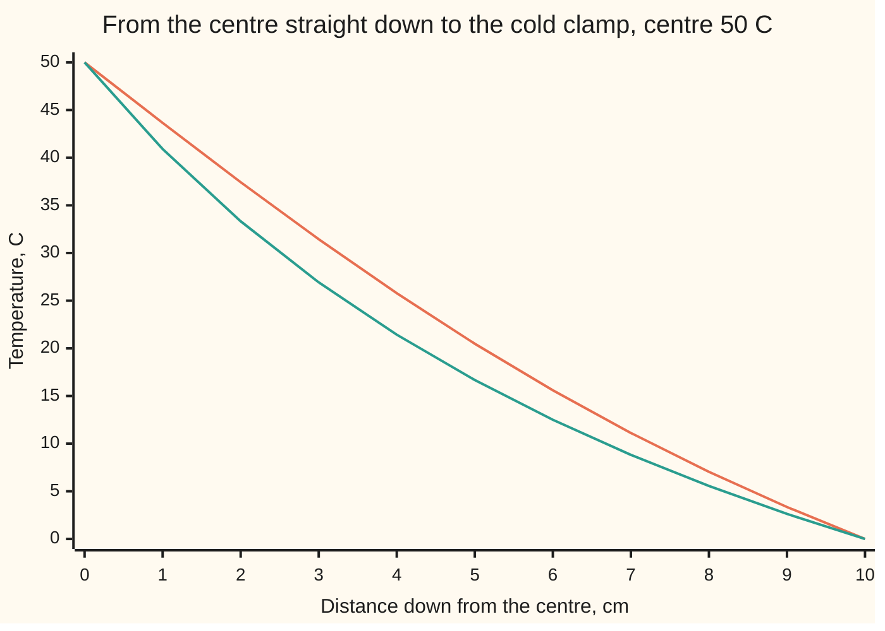

# Harnack and regularity: harmonic functions cannot spike, and are smooth

[Syllabus](../../../SYLLABUS.md) → [Partial differential equations](../README.md) → [Laplace, Poisson and Potentials](../README.md#s04) → Harnack and regularity

---

## General Overview

[Laplace's equation](../../08-Differential%20equations%20and%20dynamics/10-The%20Classical%20PDEs/07-laplaces-equation-and-harmonic-functions.md) showed that a settled plate has each point equal to the average of its neighbours. This card turns that averaging into three hard limits: a positive steady temperature cannot jump between neighbours, cannot be bent sharply inside, and cannot stay bounded on all of space without being constant.

Take a round copper plate of radius 10 cm, with insulated faces. A hot clamp holds the top half of its rim at 100 °C; an ice clamp holds the bottom half at 0 °C. The **unknown** is the settled temperature inside. The **region** is the disc. The **data** are the rim temperatures, and they jump: at the two points where the clamps meet, the rim goes from 100 °C straight to 0 °C.

The centre settles at 50 °C. Now suppose you knew only that one number, and that the temperature is never negative. **Harnack's inequality** says every point within 5 cm of the centre lies between 16.67 °C and 150 °C. The true values on that circle run from 20.48 °C to 79.52 °C. No hidden hot spot or cold pocket can sit inside the circle, whatever the clamps do.

The rough rim also leaves no trace inside. The temperature has slopes of every order at every inside point, and they grow only as you approach the two points where the clamps meet.

**A harmonic function that is never negative changes by at most a fixed factor across any ball well inside its region, and every harmonic function, even one with jumping boundary data or known only in the weak sense, is smooth inside, with each derivative bounded by its size on a nearby ball.**

**What kind of fact this is:** theorems. Harnack's inequality and its convergence corollary, the slope bounds (the first one proved on [Harmonic functions](01-harmonic-functions-and-mean-values.md)) and Liouville's theorem are proved on this card in Why it works. Weyl's lemma and the Schauder estimates are stated precisely, with their proofs outlined and sourced.

### The picture: down the middle of the plate, the true temperature against Harnack's floor



The upper line is the plate's true temperature. The lower line is Harnack's floor, $`50\,(R - r)/(R + r)`$, worked out from the centre value alone. The temperature falls toward the cold clamp but never drops under the floor.

---

## The formula

Reminders from this shelf: $`B(x, s)`$ is the ball (in the plane, the disc) of radius $`s`$ round the point $`x`$, and $`\partial B(x, s)`$ its boundary sphere. A function $`u`$ is **harmonic** when $`\Delta u = 0`$, where $`\Delta u`$ is the Laplacian, the sum of the second derivatives ([Harmonic functions](01-harmonic-functions-and-mean-values.md)). $`d`$ is the number of space directions.

**Harnack's inequality.** Let $`u \ge 0`$ be harmonic in the ball $`B(0, R)`$, and let $`|x| = r < R`$. Then

```math
\frac{R^{d-2}(R - r)}{(R + r)^{d-1}}\;u(0) \;\le\; u(x) \;\le\; \frac{R^{d-2}(R + r)}{(R - r)^{d-1}}\;u(0)
```

**Read it aloud:** a positive harmonic function at distance $`r`$ from the centre is at least, and at most, a fixed multiple of its centre value, and the multiples depend only on how close the point is to the edge.

In the plane, $`d = 2`$, the factors are $`(R - r)/(R + r)`$ and $`(R + r)/(R - r)`$. At half the radius they are 1/3 and 3. Comparing two points on the half-size ball gives the usual short form:

```math
\max_{B(0, R/2)} u \;\le\; 3^d \min_{B(0, R/2)} u
```

**Read it aloud:** on the inner half of the ball, the largest value is at most 3 to the power $`d`$ times the smallest: 9 in a plate, 27 in a solid.

**The slope bound.** If $`u`$ is harmonic in $`B(x, s)`$ and $`|u| \le M`$ there, then

```math
|\nabla u(x)| \le \frac{d}{s}\,M, \qquad |\partial^k u(x)| \le \Big(\frac{d\,k}{s}\Big)^{k} M
```

**Read it aloud:** the slope at a point is at most the dimension over the distance to trouble, times the size of the function; the $`k`$-th slope is at most $`M`$ times $`d\,k/s`$ raised to the power $`k`$.

Here $`\nabla u`$ is the gradient (the vector of slopes) and $`\partial^k u`$ is any $`k`$-th partial derivative.

**Liouville's theorem.** A harmonic function on all of $`\mathbb{R}^d`$ that is bounded, or merely never negative, is constant.

**Weyl's lemma.** If $`u`$ is integrable on each ball inside $`\Omega`$ and $`\int u\,\Delta\varphi\,dx = 0`$ for every smooth test function $`\varphi`$ that vanishes near $`\partial\Omega`$, then $`u`$ equals a smooth harmonic function (after changing it on a set of zero area).

| Symbol | Plain meaning | In our example | Push it up and the answer… |
| --- | --- | --- | --- |
| $`u`$; $`u_m`$, $`u_n`$ | the steady temperature, °C above the ice clamp; the m-th and n-th of a rising sequence of harmonic functions (Step 1) | 50 °C at the centre | the bounds scale with it |
| $`x = (x_1, x_2)`$, $`y`$, $`r = \lvert x \rvert`$; $`z`$; $`t`$ | a point and its coordinates (in the plate, $`y`$ is the upward one); its distance from the centre; a second point (Step 6); a point's distance from where the rim jumps | $`r`$ = 5 cm down; —; $`t`$ = 50 mm to 1 mm | larger $`r`$: the factors widen toward 0 and infinity |
| $`R`$ | radius of the ball where $`u`$ is harmonic and $`\ge 0`$ | 10 cm | the factors close in toward 1 |
| $`d`$ | number of space directions | 2 | the half-ball factor $`3^d`$ grows |
| $`B(x, s)`$, $`\partial B(x, s)`$, $`s`$ | ball of radius $`s`$ round $`x`$; its boundary; that radius | the 5 cm circle | larger $`s`$: smaller slope bounds |
| $`\Omega`$, $`\partial\Omega`$ | the region; its boundary | the plate; the rim | — |
| $`M`$ | largest size of $`u`$ (after a constant is taken off) on a ball | 50 °C, for $`u - 50`$ | every slope bound grows in proportion |
| $`\nabla u`$, $`\partial^k u`$, $`k`$, $`h`$ | the gradient; a $`k`$-th partial derivative; its order; a small step in a Taylor series | 636.62 K/m at the centre | — |
| $`\sigma_d`$, $`dS`$ | area of the unit sphere; a small piece of sphere area | $`2\pi`$; — | — |
| $`P(x, \zeta)`$, $`\zeta`$ | the Poisson kernel: the weight rim point $`\zeta`$ gives to $`x`$ | $`(R^2 - r^2)/(2\pi R\,\lvert x - \zeta\rvert^2)`$ | — |
| $`\varphi`$, $`\eta_\varepsilon`$, $`\varepsilon`$, $`\delta`$ | a smooth test function, zero near the boundary; a round smoothing bump of radius $`\varepsilon`$ (or $`\delta`$) | a 3 cm bump | — |
| $`f`$, $`\alpha`$, $`[f]_\alpha`$, $`C`$, $`x_0`$, $`p`$, $`\theta`$ | heating in Poisson's equation $`\Delta u = f`$; Hölder exponent; Hölder constant; Schauder's constant; a ball's centre; the power in the Lp estimates; the ellipticity constant | 0 in the plate | Schauder: rougher $`f`$, rougher bends |

### When it holds

- **$`u \ge 0`$ on the whole ball.** Drop it and $`u = 100\,y/R`$ is harmonic with centre 0 °C. Harnack would force $`u = 0`$ within 5 cm, yet $`u`$ is 50 °C there.
- **Harmonic at every point of the ball.** A point heater at the centre gives $`u = 10\ln(R/|x|)`$, positive but not harmonic at 0. It reads 6.93 °C at 5 cm and 115.13 °C at 1 micron: a ratio of 16.61, above 9, and unbounded.
- **A ball well inside the region.** The factors blow up as $`r \to R`$. On the plate, 9.9 cm up and 9.9 cm down read 99.68 °C and 0.32 °C, a ratio of 311.6. The rim itself may jump.
- **All of space, for Liouville.** On the half-plane $`y > 0`$, $`u = y`$ is harmonic, positive and not constant.
- **Hölder heating, for Schauder.** With heating that is only continuous, the bends of $`u`$ can be unbounded (What breaks, below).

---

## Why it works

### Step 0: an average cannot spike

The idea is the mean value property, already proved for the plane in [Mean value and maximum principle](../../07-Complex%20analysis/07-Conformal%20Maps%20and%20Harmonic%20Functions/05-mean-value-and-maximum-principle-for-harmonic-functions.md) and for $`d`$ dimensions in [Harmonic functions](01-harmonic-functions-and-mean-values.md). A harmonic function's value at a point is its average over any ball round that point.

Two neighbouring points have balls that mostly overlap. So their averages, which are their values, cannot be very different, provided the function is never negative: then no part of a ball can cancel another. That is Harnack. The same averaging, applied to a derivative, bounds each slope by the size of the function. That is regularity.

### Step 1: Harnack from the Poisson kernel

[Green's function](04-greens-functions-and-the-representation-formula.md) writes a harmonic function on a ball through its boundary values:

```math
u(x) = \int_{\partial B(0, R)} P(x, \zeta)\,u(\zeta)\,dS(\zeta), \qquad P(x, \zeta) = \frac{R^2 - |x|^2}{\sigma_d\,R\,|x - \zeta|^{d}}
```

Here $`dS`$ measures area on the sphere and $`\sigma_d`$ is the area of the unit sphere ($`2\pi`$ in the plane). The distance $`|x - \zeta|`$ from an inside point to the rim lies between $`R - r`$ and $`R + r`$. So the kernel is pinned between two constants. Multiply by $`u \ge 0`$, integrate, and use the mean value property $`u(0) = \text{average of } u \text{ on the sphere}`$.

<details>
<summary>Detailed proof: Harnack's inequality on a ball</summary>

Assume first that $`u`$ is continuous up to the sphere $`|\zeta| = R`$. Write $`r = |x|`$. Since $`R - r \le |x - \zeta| \le R + r`$ and $`R^2 - r^2 = (R - r)(R + r)`$,

$`\displaystyle \frac{R - r}{\sigma_d R\,(R + r)^{d-1}} \le P(x, \zeta) \le \frac{R + r}{\sigma_d R\,(R - r)^{d-1}} .`$

Multiply by $`u(\zeta) \ge 0`$ and integrate over the sphere. The mean value property says

$`\displaystyle \int_{\partial B(0, R)} u\,dS = \sigma_d R^{d-1}\,u(0) .`$

So

$`\displaystyle \frac{R^{d-2}(R - r)}{(R + r)^{d-1}}\,u(0) \le u(x) \le \frac{R^{d-2}(R + r)}{(R - r)^{d-1}}\,u(0) .`$

If $`u`$ is harmonic only inside the open ball, apply this on the ball of radius $`R' < R`$ and let $`R'`$ rise to $`R`$.

For the short form, take $`r = R/2`$. The upper factor is $`3 \cdot 2^{d-2}`$ and the lower factor is $`\tfrac12 (2/3)^{d-1}`$. Both bound $`u`$ against the same $`u(0)`$, so the largest value over the smallest is at most their ratio, which is $`3^d`$.

</details>

The bounds are sharp. Hold the rim hot only on a thin arc at the top. Then the temperature is close to the kernel itself, and the ratio "5 cm down over centre" falls to the floor 1/3: 0.409666 for the half-rim clamp, 0.334087 for an arc of half-width 10°, 0.333333 for half-width 0.1°.

**Harnack's convergence theorem**, a corollary. Let $`u_1 \le u_2 \le \dots`$ be harmonic in a connected region $`\Omega`$, and let the numbers $`u_m(x_0)`$ at one point $`x_0`$ stay bounded. Then the $`u_m`$ converge to a harmonic function, uniformly (with one error bound for the whole ball) on each closed ball inside $`\Omega`$. Proof: for $`m > n`$, the difference $`u_m - u_n`$ is harmonic and never negative. The short form, on a ball $`B(x_0, s)`$ inside $`\Omega`$, gives $`u_m - u_n \le 3^d\,\big(u_m(x_0) - u_n(x_0)\big)`$ on $`B(x_0, s/2)`$, and the right side tends to 0, because rising bounded numbers converge. Chains of overlapping balls carry this to every closed ball inside $`\Omega`$. Each $`u_m`$ is the Poisson integral of its own values on a sphere, so the limit is too, and it is harmonic. [Subharmonic functions](09-subharmonic-functions-and-perrons-method.md) uses this theorem to show that Perron's solution is harmonic.

### Step 2: the slope is a boundary average, so it is bounded

[Harmonic functions](01-harmonic-functions-and-mean-values.md) proves the first slope bound, $`|\partial_i u(x)| \le (d/s)\,M`$ for the slope $`\partial_i u`$ in direction $`i`$: that slope is harmonic too, so it equals its own ball average, which the divergence theorem turns into a sphere average of $`u`$. Pointing direction $`i`$ along the gradient gives the bound for $`|\nabla u|`$.

For the $`k`$-th slope, split the radius $`s`$ into $`k`$ shells of width $`s/k`$ and apply the first-slope bound $`k`$ times, each time on a ball of radius $`s/k`$. Each step costs a factor $`dk/s`$.

### Step 3: the bound is why the inside is smooth

Every derivative of every order exists and is bounded by Step 2, so $`u`$ is smooth. The bound grows like $`k^k`$, which is at most $`e^k\,k!`$. So the $`k`$-th Taylor term for a step $`h`$, the $`k`$-th slope along $`h`$ times $`|h|^k/k!`$, is at most $`(e\,d\,|h|/s)^k M`$. That shrinks geometrically once $`|h| < s/(e\,d)`$, so $`u`$ is even **real-analytic**: it equals its own Taylor series near each inside point.

The rim data enter only through $`M`$. Jumps on the rim do not matter. All that matters is the distance $`s`$ from the point to the rim, and the slope bound $`d\,M/s`$ grows only as that distance shrinks.

### Step 4: Liouville, by letting the ball grow

For bounded $`u`$ on all of $`\mathbb{R}^d`$, with $`|u| \le M`$: Step 2 gives $`|\nabla u(x)| \le d\,M/s`$ for every radius $`s`$. Let $`s \to \infty`$. The slope is 0 everywhere, so $`u`$ is constant.

For $`u \ge 0`$ on all of space: Step 1 on $`B(0, R)`$ pins $`u(x)/u(0)`$ between two factors that both tend to 1 as $`R \to \infty`$. So $`u(x) = u(0)`$.

[Liouville's theorem](../../07-Complex%20analysis/03-Contour%20Integrals%20and%20Cauchy%27s%20Theorem/07-liouville-and-the-fundamental-theorem-of-algebra.md) in complex analysis is the same argument for a holomorphic function in the plane: a slope bound of $`M/s`$ on ever larger circles of radius $`s`$. This card's version works in any dimension, with no complex numbers.

### Step 5: Weyl's lemma, by smoothing

A **weak solution** asks the equation to hold only against smooth test functions: $`\int u\,\Delta\varphi = 0`$ ([Weak solutions](../../18-Functional%20analysis/04-Distributions%20and%20Sobolev%20Spaces/08-weak-solutions-of-differential-equations.md)). Weyl's lemma (Weyl, 1940) says such a $`u`$ is a smooth classical solution. The proof in outline:

1. Smooth $`u`$ with a round bump $`\eta_\varepsilon`$ of radius $`\varepsilon`$ ([Convolution and mollifiers](../../18-Functional%20analysis/04-Distributions%20and%20Sobolev%20Spaces/03-convolution-and-mollifiers.md)). The result $`u_\varepsilon`$ is smooth, and moving the Laplacian onto the bump shows it is harmonic.
2. A smooth harmonic function has the mean value property, and a round bump is a weighted mix of spheres. So smoothing $`u_\varepsilon`$ again with any round bump $`\eta_\delta`$ leaves it unchanged: $`u_\varepsilon = \eta_\delta * u_\varepsilon`$.
3. Let $`\varepsilon \to 0`$. Then $`u = \eta_\delta * u`$ at almost every point. The right side is smooth, because the bump is. So $`u`$ is smooth, and harmonic.

The code checks the heart of step 2 on the plate: a 3 cm round smoothing at the point (3 cm, 2 cm) returns 63.717532 °C, the point value, to six decimals. The same smoothing of the non-harmonic $`|x|^2`$ moves it from 0.13 to 0.153518.

### Step 6: Poisson's equation, Schauder and Lp

With heating, $`\Delta u = f`$, smoothness is no longer free. How smooth $`u`$ is depends on how smooth $`f`$ is, measured in **Hölder** classes. A function $`f`$ is Hölder with exponent $`\alpha`$, $`0 < \alpha < 1`$, when $`|f(x) - f(z)| \le [f]_\alpha\,|x - z|^\alpha`$ for any two points $`x`$ and $`z`$; the smallest such $`[f]_\alpha`$ is its Hölder constant.

**The Schauder interior estimate** (Schauder, 1934; Gilbarg and Trudinger, Theorems 4.6 and 6.2). If $`\Delta u = f`$ in $`B(x_0, 2s)`$ and $`f`$ is Hölder with exponent $`\alpha`$, then the second derivatives of $`u`$ are Hölder with the same exponent on $`B(x_0, s)`$, and

```math
\max_{B(x_0, s)}|\partial^2 u| + s^{\alpha}[\partial^2 u]_{\alpha} \;\le\; C(d, \alpha)\Big(\frac{1}{s^2}\max_{B(x_0, 2s)}|u| + \max_{B(x_0, 2s)}|f| + s^{\alpha}[f]_{\alpha}\Big)
```

**Read it aloud:** on the inner ball, the bends of $`u`$ and their Hölder constant are bounded by the size of $`u`$ and the size and Hölder constant of the heating on the outer ball, times a constant that depends only on the dimension and the exponent.

The same holds for any elliptic operator whose coefficients are Hölder, with $`C`$ also depending on the ellipticity constant $`\theta`$ and the coefficients' sizes. The proof freezes the coefficients at a point, compares with the Laplacian through the Newtonian potential of [Poisson's equation](03-poissons-equation-and-the-newtonian-potential.md), and controls the error in Hölder norms.

**The Lp estimates** (Calderón and Zygmund, 1952; Gilbarg and Trudinger, Theorem 9.11) are the integral version: if $`f`$ has a finite $`p`$-th power integral, $`1 < p < \infty`$, so do the second derivatives of $`u`$, on any smaller ball. Their proof rests on singular integrals, built in the harmonic-analysis wing: Singular integrals, and Calderón-Zygmund decomposition.

Both fail at the end points: $`\alpha = 0`$ (merely continuous $`f`$), and $`p = 1`$ or $`p = \infty`$.

---

## Worked numbers, by hand

The plate: radius $`R = 10`$ cm, centre value 50 °C, test circle $`r = 5`$ cm.

| Step | Arithmetic | Value |
| --- | --- | --- |
| centre temperature, by symmetry | (100 + 0) / 2 | 50 °C |
| Harnack lower factor | $`(10 - 5)/(10 + 5)`$ | 1/3 |
| Harnack upper factor | $`(10 + 5)/(10 - 5)`$ | 3 |
| floor and cap on the 5 cm circle | 50 / 3 and 50 × 3 | 16.67 °C and 150 °C |
| true range on the 5 cm circle | closed form, kernel sum and series agree | 20.48 °C to 79.52 °C |
| largest over smallest | 79.52 / 20.48 | 3.88, at most 9 |
| slope bound at the centre, $`M = 50`$ | $`2 \times 50 / 0.1`$ | 1000 K/m |
| true slope at the centre | $`(200/\pi)/0.1`$ | **636.62 K/m** |

So a probe at the centre reads 50 °C, by symmetry, and a temperature gradient of 636.62 K/m. The slope bound caps that gradient at 1000 K/m before the full solution is known.

Near the corner where the clamps meet, the slope bound is $`2 \times 50/t`$ at distance $`t`$ from the jump:

| Distance from the jump | True slope, K/m | Bound $`2M/t`$, K/m |
| ---: | ---: | ---: |
| 50 mm | 848.8 | 2000 |
| 10 mm | 3350.6 | 10000 |
| 1 mm | 31990.9 | 100000 |

From 10 mm to 1 mm the slope grows 9.5-fold, close to the bound's tenfold. It is finite at every inside point.

Higher slopes up the middle at the centre, in units of the radius:

| $`k`$ | True $`\lvert\partial_y^k u\rvert`$ | Bound $`M(2k)^k`$ |
| ---: | ---: | ---: |
| 1 | 63.66 | 100 |
| 3 | 127.32 | 10800 |
| 5 | 1527.89 | 5000000 |
| 7 | 45836.62 | 5270675200 |

The true values are $`(200/\pi)(k - 1)!`$, factorial growth: the signature of a function equal to its Taylor series. Centred differences on the closed form at step 0.01 confirm the k = 3 and k = 5 rows: 127.29 and 1526.36. Summed, that series gives 79.516724 °C at 5 cm up, matching the closed form.

### What breaks if you drop a piece

| Mistake | Comes out at | What went wrong |
| --- | --- | --- |
| Harnack on a function that changes sign, $`u = 100y/R`$ | forces 0 °C at 5 cm; true 50 °C | no sign condition, no Harnack: positive and negative parts cancel in the average |
| Harnack across a point heater, $`u = 10\ln(R/\lvert x\rvert)`$ | 115.13 °C at 1 micron against 6.93 °C at 5 cm, ratio 16.61 | not harmonic at the heater, so a spike is allowed |
| Harnack on a circle reaching the rim, 9.9 cm | 99.68 °C and 0.32 °C, ratio 311.6 | the factors blow up as $`r \to R`$ |
| Schauder with merely continuous heating | at $`r = 10^{-2}, 10^{-4}, 10^{-8}, 10^{-16}`$: $`f`$ = 0.9573, 0.6680, 0.4692, 0.3306, but $`u_{x_1x_1}`$ = 4.5249, 6.2345, 8.7004, 12.2218 | $`f \to 0`$ continuously, yet the bend grows without limit |

The last row is the scaled example $`u = (x_1^2 - x_2^2)\sqrt{\ln(1/|x|)}`$ near 0, read on the $`x_2`$-axis. Its Laplacian $`f`$ shrinks only like $`1/\sqrt{\ln(1/|x|)}`$, which is continuous but not Hölder. Its bend grows like $`2\sqrt{\ln(1/|x|)}`$. Centred differences at $`r = 0.01`$ confirm both: 4.5249 and 0.9572.

---

## Code, from first principles, and it actually runs

The code computes the plate's temperature three independent ways: the closed form $`50 + (100/\pi)\,\mathrm{atan2}(2y, 1 - x^2 - y^2)`$ in units of the radius, a 20,000-point sum of the Poisson kernel round the rim, and the sine series with its tail bound. Harnack's sharpness is checked by thin hot arcs (a closed form against the kernel sum) and by the kernel in one, two and three dimensions. Slopes are checked by centred differences against exact values and against the bounds. Weyl's smoothing is a double sum over a round bump, and the Schauder counterexample is checked by finite differences.

### Python

```python
# Harnack and regularity: a 10 cm round plate, faces insulated, rim held at 100 C on its top half
# and 0 C on its bottom half. Temperatures are rises above the 0 C clamp; positions scaled by R.
# Roads: closed form, Poisson-kernel sum, sine series, finite differences, and sharp extremal cases.
from math import pi, atan2, sin, cos, sqrt, log, exp, factorial

R, HOT = 0.1, 100.0           # plate radius in m; hot clamp in C
M = HOT / 2                   # largest |u - 50| anywhere: the size the slope bounds use


def u(x, y):                  # closed form: 50 + (100/pi) * angle, inside the unit disc
    return HOT / 2 + HOT / pi * atan2(2 * y, 1 - x * x - y * y)


def poisson(x, y, a, b, n=20000):  # rim held at HOT on angles a..b, 0 elsewhere: kernel sum
    s, w = 0.0, (b - a) / n
    for k in range(n):
        t = a + (k + 0.5) * w
        s += (1 - x * x - y * y) / ((x - cos(t)) ** 2 + (y - sin(t)) ** 2)
    return HOT * s * w / (2 * pi)


def series(x, y, n=21):     # 50 + (200/pi) sum over odd k of r^k sin(k t) / k
    r, t = sqrt(x * x + y * y), atan2(y, x)
    return HOT / 2 + 2 * HOT / pi * sum(r ** k * sin(k * t) / k for k in range(1, n + 1, 2))


def arc(x, y, w):             # rim held at 1 on angles pi/2-w..pi/2+w: harmonic measure
    a, b = pi / 2 - w, pi / 2 + w
    px, py, qx, qy = cos(b) - x, sin(b) - y, cos(a) - x, sin(a) - y
    return atan2(py * qx - px * qy, px * qx + py * qy) / pi - w / pi


def close(a, b, tol):
    assert abs(a - b) <= tol, (a, b)


c0 = [u(0, 0), poisson(0, 0, 0, pi), series(0, 0)]
print("centre: closed form %.4f, Poisson sum %.4f, series %.4f C" % tuple(c0))
for y in (0.5, -0.5):
    v = [u(0, y), poisson(0, y, 0, pi), series(0, y)]
    print("at y = %+.0f cm: closed form %.4f, Poisson sum %.4f, series %.4f C" % (y * 10, *v))
    close(v[0], v[1], 1e-6); close(v[0], v[2], 1e-6)  # inside the tail bound
tail = 2 * HOT / pi * 0.5 ** 23 / 23 / 0.75  # odd terms from k = 23 on, a geometric tail
print("series to k = 21, tail bound at r = 5 cm: %.7f C" % tail)
ring = [u(0.5 * cos(2 * pi * k / 3600), 0.5 * sin(2 * pi * k / 3600)) for k in range(3600)]
lo, hi = min(ring), max(ring)
c = c0[0]                     # centre value: Harnack needs nothing else
print("Harnack on the 5 cm circle: floor u(0)/3 = %.4f, cap 3u(0) = %.4f C" % (c / 3, 3 * c))
print("actual on the 5 cm circle: min %.4f, max %.4f, ratio %.4f <= 9" % (lo, hi, hi / lo))
assert c / 3 <= lo and hi <= 3 * c and hi / lo <= 9
pts = [i / 10 for i in range(11)]
print("chart, distance down, cm: " + ", ".join("%d" % (10 * r) for r in pts))
print("chart, true temperature:  " + ", ".join("%.2f" % u(0, -r) for r in pts))
print("chart, Harnack floor:     " + ", ".join("%.2f" % (c * (1 - r) / (1 + r)) for r in pts))
assert all(u(0, -r) >= c * (1 - r) / (1 + r) - 1e-12 for r in pts)
for deg in (90, 10, 1, 0.1):  # a narrower hot arc pushes the ratio down to the floor 1/3
    w = deg * pi / 180
    q = arc(0, -0.5, w) / arc(0, 0, w)
    q2 = poisson(0, -0.5, pi / 2 - w, pi / 2 + w) / poisson(0, 0, pi / 2 - w, pi / 2 + w)
    print("hot arc half-width %4.1f deg: u(5 cm down)/u(centre) = %.6f (kernel sum %.6f)" % (deg, q, q2))
    close(q, q2, 1e-6); assert q >= 1 / 3
pk2 = lambda y: (1 - y * y) / (1 - y) ** 2          # 2-D Poisson kernel, pole at the top
pk3 = lambda y: (1 - y * y) / abs(1 - y) ** 3       # 3-D Poisson kernel, pole at the top
r3 = [1.5 / 0.5, pk2(0.5) / pk2(-0.5), pk3(0.5) / pk3(-0.5)]
print("Harnack max/min on the half ball, 3^d: d=1 %.4f, d=2 %.4f, d=3 %.4f" % tuple(r3))
close(r3[1], 9, 1e-9); close(r3[2], 27, 1e-9)
h = 1e-5                      # slopes in K per m: scaled slope / R
g0 = 2 * HOT / pi / R
fd = (u(0, h) - u(0, -h)) / (2 * h) / R
print("slope at centre: exact %.4f, centred difference %.4f, bound 2M/R = %.4f K/m" % (g0, fd, 2 * M / R))
close(g0, fd, 1e-3); assert g0 <= 2 * M / R
for d in (0.05, 0.01, 0.001):  # approaching the rim point where 100 C meets 0 C
    s = 1 - d / R
    ex = 2 * HOT / pi / (1 - s * s) / R
    fd = (u(s, h) - u(s, -h)) / (2 * h) / R
    print("slope %5.1f mm from the jump: exact %.1f, centred difference %.1f, bound 2M/d = %.1f K/m"
          % (d * 1000, ex, fd, 2 * M / d))
    close(ex, fd, 1e-3 * ex); assert ex <= 2 * M / d
exk = []                      # the formula's k-th slopes, checked by differences below
for k in (1, 3, 5, 7):        # k-th slope up the middle at the centre, scaled (per R^k)
    ex, bd = 2 * HOT / pi * factorial(k - 1), M * (2 * k) ** k
    exk.append(ex)
    print("k = %d: |d^k u/dy^k| at centre exact %.2f, bound M(2k)^k = %.0f" % (k, ex, bd))
    assert ex <= bd
d3 = (u(0, 2e-2) - 2 * u(0, 1e-2) + 2 * u(0, -1e-2) - u(0, -2e-2)) / (2 * 1e-6)
d5 = (u(0, 3e-2) - 4 * u(0, 2e-2) + 5 * u(0, 1e-2) - 5 * u(0, -1e-2) + 4 * u(0, -2e-2) - u(0, -3e-2)) / (2 * 1e-10)
print("third and fifth slopes by differences, step 0.01: %.2f and %.2f (formula %.2f and %.2f)" % (-d3, d5, exk[1], exk[2]))
close(-d3, exk[1], 0.1); close(d5, exk[2], 5e-3 * exk[2])  # step^2 error: 0.1 % at k = 5
ty = sum(2 * HOT / pi * (-1) ** (k // 2) * 0.5 ** k / k for k in range(1, 200, 2))
print("Taylor series up the middle at y = 5 cm: %.6f, closed form %.6f" % (HOT / 2 + ty, u(0, 0.5)))
close(HOT / 2 + ty, u(0, 0.5), 1e-9)
for big in (10, 100, 1000):   # Liouville by Harnack in 3-D: bounds at 1 m from the centre
    print("3-D Harnack, ball of %4d m, point 1 m out: %.6f <= u/u(0) <= %.6f"
          % (big, big * (big - 1) / (big + 1) ** 2, big * (big + 1) / (big - 1) ** 2))
print("Liouville slope bound d*M/r, M = %.0f C, d = 2: r = 1 m %.4f, r = 1 km %.4f K/m" % (M, 2 * M / 1, 2 * M / 1000))
x0, y0, rho, num, den, nq = 0.3, 0.2, 0.3, 0.0, 0.0, 0.0
for i in range(200):          # Weyl: a radial smoothing bump leaves a harmonic function unchanged
    s = (i + 0.5) / 200
    eta = exp(-1 / (1 - s * s)) * s
    for j in range(64):
        t = 2 * pi * j / 64
        xx, yy = x0 + rho * s * cos(t), y0 + rho * s * sin(t)
        num += eta * u(xx, yy); nq += eta * (xx * xx + yy * yy); den += eta
print("Weyl smoothing at (3, 2) cm, radius 3 cm: smoothed %.6f, point value %.6f C" % (num / den, u(x0, y0)))
print("same smoothing of |x|^2 (not harmonic): smoothed %.6f, point value %.6f" % (nq / den, x0 * x0 + y0 * y0))
close(num / den, u(x0, y0), 1e-9); assert nq / den - 0.13 > 0.01
print("breaks, sign: u = 100y/R has centre 0, Harnack forces 0, true value at 5 cm %.1f C" % (100 * 0.5))
ph = lambda r: 10 * log(R / r)  # point heater at the centre, rim 0 C
print("breaks, point heater: %.4f C at 5 cm, %.4f C at 1 micron, ratio %.2f > 9"
      % (ph(0.05), ph(1e-6), ph(1e-6) / ph(0.05)))
assert ph(1e-6) / ph(0.05) > 9
a, b = u(0, 0.99), u(0, -0.99)
print("breaks, circle reaching 9.9 cm: %.4f and %.4f C, ratio %.1f > 9" % (a, b, a / b))
sch = lambda x, y: (x * x - y * y) * sqrt(-log(sqrt(x * x + y * y)))  # scaled, near 0
for e in (2, 4, 8, 16):
    s = e * log(10)
    print("breaks, continuous f at r = 10^-%d: f = %.4f, u_x1x1 = %.4f" % (e, 2 / sqrt(s) + 0.25 * s ** -1.5,
                                                                       2 * sqrt(s) + 0.5 / sqrt(s)))
hh, y1 = 1e-4, 1e-2
uxx = (sch(hh, y1) - 2 * sch(0, y1) + sch(-hh, y1)) / hh ** 2
lap = uxx + (sch(0, y1 + hh) - 2 * sch(0, y1) + sch(0, y1 - hh)) / hh ** 2
print("breaks, differences at r = 0.01: u_x1x1 %.4f, f %.4f" % (uxx, lap))
close(uxx, 2 * sqrt(log(100)) + 0.5 / sqrt(log(100)), 1e-3)
close(lap, 2 / sqrt(log(100)) + 0.25 * log(100) ** -1.5, 1e-3)
print("ALL CHECKS PASS")
```

**Ran 2026-11-15 on macOS, Python 3.14.10, standard library only. All checks passed. Output, pasted from the run:**

```
centre: closed form 50.0000, Poisson sum 50.0000, series 50.0000 C
at y = +5 cm: closed form 79.5167, Poisson sum 79.5167, series 79.5167 C
at y = -5 cm: closed form 20.4833, Poisson sum 20.4833, series 20.4833 C
series to k = 21, tail bound at r = 5 cm: 0.0000004 C
Harnack on the 5 cm circle: floor u(0)/3 = 16.6667, cap 3u(0) = 150.0000 C
actual on the 5 cm circle: min 20.4833, max 79.5167, ratio 3.8820 <= 9
chart, distance down, cm: 0, 1, 2, 3, 4, 5, 6, 7, 8, 9, 10
chart, true temperature:  50.00, 43.65, 37.43, 31.45, 25.78, 20.48, 15.60, 11.12, 7.04, 3.35, 0.00
chart, Harnack floor:     50.00, 40.91, 33.33, 26.92, 21.43, 16.67, 12.50, 8.82, 5.56, 2.63, 0.00
hot arc half-width 90.0 deg: u(5 cm down)/u(centre) = 0.409666 (kernel sum 0.409666)
hot arc half-width 10.0 deg: u(5 cm down)/u(centre) = 0.334087 (kernel sum 0.334087)
hot arc half-width  1.0 deg: u(5 cm down)/u(centre) = 0.333341 (kernel sum 0.333341)
hot arc half-width  0.1 deg: u(5 cm down)/u(centre) = 0.333333 (kernel sum 0.333333)
Harnack max/min on the half ball, 3^d: d=1 3.0000, d=2 9.0000, d=3 27.0000
slope at centre: exact 636.6198, centred difference 636.6198, bound 2M/R = 1000.0000 K/m
slope  50.0 mm from the jump: exact 848.8, centred difference 848.8, bound 2M/d = 2000.0 K/m
slope  10.0 mm from the jump: exact 3350.6, centred difference 3350.6, bound 2M/d = 10000.0 K/m
slope   1.0 mm from the jump: exact 31990.9, centred difference 31990.9, bound 2M/d = 100000.0 K/m
k = 1: |d^k u/dy^k| at centre exact 63.66, bound M(2k)^k = 100
k = 3: |d^k u/dy^k| at centre exact 127.32, bound M(2k)^k = 10800
k = 5: |d^k u/dy^k| at centre exact 1527.89, bound M(2k)^k = 5000000
k = 7: |d^k u/dy^k| at centre exact 45836.62, bound M(2k)^k = 5270675200
third and fifth slopes by differences, step 0.01: 127.29 and 1526.36 (formula 127.32 and 1527.89)
Taylor series up the middle at y = 5 cm: 79.516724, closed form 79.516724
3-D Harnack, ball of   10 m, point 1 m out: 0.743802 <= u/u(0) <= 1.358025
3-D Harnack, ball of  100 m, point 1 m out: 0.970493 <= u/u(0) <= 1.030507
3-D Harnack, ball of 1000 m, point 1 m out: 0.997005 <= u/u(0) <= 1.003005
Liouville slope bound d*M/r, M = 50 C, d = 2: r = 1 m 100.0000, r = 1 km 0.1000 K/m
Weyl smoothing at (3, 2) cm, radius 3 cm: smoothed 63.717532, point value 63.717532 C
same smoothing of |x|^2 (not harmonic): smoothed 0.153518, point value 0.130000
breaks, sign: u = 100y/R has centre 0, Harnack forces 0, true value at 5 cm 50.0 C
breaks, point heater: 6.9315 C at 5 cm, 115.1293 C at 1 micron, ratio 16.61 > 9
breaks, circle reaching 9.9 cm: 99.6801 and 0.3199 C, ratio 311.6 > 9
breaks, continuous f at r = 10^-2: f = 0.9573, u_x1x1 = 4.5249
breaks, continuous f at r = 10^-4: f = 0.6680, u_x1x1 = 6.2345
breaks, continuous f at r = 10^-8: f = 0.4692, u_x1x1 = 8.7004
breaks, continuous f at r = 10^-16: f = 0.3306, u_x1x1 = 12.2218
breaks, differences at r = 0.01: u_x1x1 4.5249, f 0.9572
ALL CHECKS PASS
```

### Rust

The same checks with the same inputs, standard library only.

```rust
// Harnack and regularity: the same check as harnack_and_regularity_in_outline_check.py, in Rust.
// A 10 cm round plate, faces insulated, rim 100 C on its top half and 0 C on its bottom half.
// Temperatures are rises above the 0 C clamp; positions scaled by R. Standard library only.
use std::f64::consts::PI;

const R: f64 = 0.1; // plate radius in m
const HOT: f64 = 100.0; // hot clamp in C
const M: f64 = HOT / 2.0; // largest |u - 50| anywhere: the size the slope bounds use

fn u(x: f64, y: f64) -> f64 {
    // closed form: 50 + (100/pi) * angle, inside the unit disc
    HOT / 2.0 + HOT / PI * (2.0 * y).atan2(1.0 - x * x - y * y)
}

fn poisson(x: f64, y: f64, a: f64, b: f64) -> f64 {
    // rim held at HOT on angles a..b, 0 elsewhere: kernel sum
    let n = 20000;
    let w = (b - a) / n as f64;
    let mut s = 0.0;
    for k in 0..n {
        let t = a + (k as f64 + 0.5) * w;
        s += (1.0 - x * x - y * y) / ((x - t.cos()).powi(2) + (y - t.sin()).powi(2));
    }
    HOT * s * w / (2.0 * PI)
}

fn series(x: f64, y: f64) -> f64 {
    // 50 + (200/pi) sum over odd k of r^k sin(k t) / k, to k = 21
    let (r, t) = ((x * x + y * y).sqrt(), y.atan2(x));
    let s: f64 = (1..22).step_by(2).map(|k| r.powi(k) * (k as f64 * t).sin() / k as f64).sum();
    HOT / 2.0 + 2.0 * HOT / PI * s
}

fn arc(x: f64, y: f64, w: f64) -> f64 {
    // rim held at 1 on angles pi/2-w..pi/2+w: harmonic measure
    let (a, b) = (PI / 2.0 - w, PI / 2.0 + w);
    let (px, py, qx, qy) = (b.cos() - x, b.sin() - y, a.cos() - x, a.sin() - y);
    (py * qx - px * qy).atan2(px * qx + py * qy) / PI - w / PI
}

fn close(a: f64, b: f64, tol: f64) {
    assert!((a - b).abs() <= tol, "{} {}", a, b);
}

fn join(v: &[f64], d: usize) -> String {
    v.iter().map(|x| format!("{:.*}", d, x)).collect::<Vec<_>>().join(", ")
}

fn main() {
    println!("centre: closed form {:.4}, Poisson sum {:.4}, series {:.4} C", u(0.0, 0.0), poisson(0.0, 0.0, 0.0, PI), series(0.0, 0.0));
    for y in [0.5, -0.5] {
        let v = [u(0.0, y), poisson(0.0, y, 0.0, PI), series(0.0, y)];
        println!("at y = {:+.0} cm: closed form {:.4}, Poisson sum {:.4}, series {:.4} C", y * 10.0, v[0], v[1], v[2]);
        close(v[0], v[1], 1e-6);
        close(v[0], v[2], 1e-6); // inside the tail bound
    }
    let tail = 2.0 * HOT / PI * 0.5f64.powi(23) / 23.0 / 0.75; // odd terms from k = 23 on, a geometric tail
    println!("series to k = 21, tail bound at r = 5 cm: {:.7} C", tail);
    let ring: Vec<f64> = (0..3600).map(|k| {
        let t = 2.0 * PI * k as f64 / 3600.0;
        u(0.5 * t.cos(), 0.5 * t.sin())
    }).collect();
    let lo = ring.iter().cloned().fold(f64::MAX, f64::min);
    let hi = ring.iter().cloned().fold(f64::MIN, f64::max);
    let c = u(0.0, 0.0); // centre value: Harnack needs nothing else
    println!("Harnack on the 5 cm circle: floor u(0)/3 = {:.4}, cap 3u(0) = {:.4} C", c / 3.0, 3.0 * c);
    println!("actual on the 5 cm circle: min {:.4}, max {:.4}, ratio {:.4} <= 9", lo, hi, hi / lo);
    assert!(c / 3.0 <= lo && hi <= 3.0 * c && hi / lo <= 9.0);
    let pts: Vec<f64> = (0..11).map(|i| i as f64 / 10.0).collect();
    let cm: Vec<String> = pts.iter().map(|r| format!("{}", (10.0 * r) as i64)).collect();
    println!("chart, distance down, cm: {}", cm.join(", "));
    println!("chart, true temperature:  {}", join(&pts.iter().map(|&r| u(0.0, -r)).collect::<Vec<_>>(), 2));
    println!("chart, Harnack floor:     {}", join(&pts.iter().map(|&r| c * (1.0 - r) / (1.0 + r)).collect::<Vec<_>>(), 2));
    assert!(pts.iter().all(|&r| u(0.0, -r) >= c * (1.0 - r) / (1.0 + r) - 1e-12));
    for deg in [90.0, 10.0, 1.0, 0.1] {
        // a narrower hot arc pushes the ratio down to the floor 1/3
        let w = deg * PI / 180.0;
        let q = arc(0.0, -0.5, w) / arc(0.0, 0.0, w);
        let q2 = poisson(0.0, -0.5, PI / 2.0 - w, PI / 2.0 + w) / poisson(0.0, 0.0, PI / 2.0 - w, PI / 2.0 + w);
        println!("hot arc half-width {:4.1} deg: u(5 cm down)/u(centre) = {:.6} (kernel sum {:.6})", deg, q, q2);
        close(q, q2, 1e-6);
        assert!(q >= 1.0 / 3.0);
    }
    let pk2 = |y: f64| (1.0 - y * y) / (1.0 - y).powi(2); // 2-D Poisson kernel, pole at the top
    let pk3 = |y: f64| (1.0 - y * y) / (1.0 - y).abs().powi(3); // 3-D Poisson kernel, pole at the top
    let r3 = [1.5 / 0.5, pk2(0.5) / pk2(-0.5), pk3(0.5) / pk3(-0.5)];
    println!("Harnack max/min on the half ball, 3^d: d=1 {:.4}, d=2 {:.4}, d=3 {:.4}", r3[0], r3[1], r3[2]);
    close(r3[1], 9.0, 1e-9);
    close(r3[2], 27.0, 1e-9);
    let h = 1e-5; // slopes in K per m: scaled slope / R
    let g0 = 2.0 * HOT / PI / R;
    let fd = (u(0.0, h) - u(0.0, -h)) / (2.0 * h) / R;
    println!("slope at centre: exact {:.4}, centred difference {:.4}, bound 2M/R = {:.4} K/m", g0, fd, 2.0 * M / R);
    close(g0, fd, 1e-3);
    assert!(g0 <= 2.0 * M / R);
    for d in [0.05, 0.01, 0.001] {
        // approaching the rim point where 100 C meets 0 C
        let s = 1.0 - d / R;
        let ex = 2.0 * HOT / PI / (1.0 - s * s) / R;
        let fd = (u(s, h) - u(s, -h)) / (2.0 * h) / R;
        println!("slope {:5.1} mm from the jump: exact {:.1}, centred difference {:.1}, bound 2M/d = {:.1} K/m", d * 1000.0, ex, fd, 2.0 * M / d);
        close(ex, fd, 1e-3 * ex);
        assert!(ex <= 2.0 * M / d);
    }
    let mut exk = vec![]; // the formula's k-th slopes, checked by differences below
    for k in [1i32, 3, 5, 7] {
        // k-th slope up the middle at the centre, scaled (per R^k)
        let fact: f64 = (1..k).map(|i| i as f64).product();
        let (ex, bd) = (2.0 * HOT / PI * fact, M * ((2 * k) as f64).powi(k));
        exk.push(ex);
        println!("k = {}: |d^k u/dy^k| at centre exact {:.2}, bound M(2k)^k = {:.0}", k, ex, bd);
        assert!(ex <= bd);
    }
    let d3 = (u(0.0, 2e-2) - 2.0 * u(0.0, 1e-2) + 2.0 * u(0.0, -1e-2) - u(0.0, -2e-2)) / (2.0 * 1e-6);
    let d5 = (u(0.0, 3e-2) - 4.0 * u(0.0, 2e-2) + 5.0 * u(0.0, 1e-2) - 5.0 * u(0.0, -1e-2) + 4.0 * u(0.0, -2e-2) - u(0.0, -3e-2)) / (2.0 * 1e-10);
    println!("third and fifth slopes by differences, step 0.01: {:.2} and {:.2} (formula {:.2} and {:.2})", -d3, d5, exk[1], exk[2]);
    close(-d3, exk[1], 0.1);
    close(d5, exk[2], 5e-3 * exk[2]); // step^2 error: 0.1 % at k = 5
    let ty: f64 = (1..200).step_by(2).map(|k| 2.0 * HOT / PI * (if (k / 2) % 2 == 0 { 1.0 } else { -1.0 }) * 0.5f64.powi(k) / k as f64).sum();
    println!("Taylor series up the middle at y = 5 cm: {:.6}, closed form {:.6}", HOT / 2.0 + ty, u(0.0, 0.5));
    close(HOT / 2.0 + ty, u(0.0, 0.5), 1e-9);
    for big in [10.0f64, 100.0, 1000.0] {
        // Liouville by Harnack in 3-D: bounds at 1 m from the centre
        println!("3-D Harnack, ball of {:4} m, point 1 m out: {:.6} <= u/u(0) <= {:.6}", big as i64, big * (big - 1.0) / (big + 1.0).powi(2), big * (big + 1.0) / (big - 1.0).powi(2));
    }
    println!("Liouville slope bound d*M/r, M = {:.0} C, d = 2: r = 1 m {:.4}, r = 1 km {:.4} K/m", M, 2.0 * M / 1.0, 2.0 * M / 1000.0);
    let (x0, y0, rho) = (0.3, 0.2, 0.3);
    let (mut num, mut den, mut nq) = (0.0, 0.0, 0.0);
    for i in 0..200 {
        // Weyl: a radial smoothing bump leaves a harmonic function unchanged
        let s = (i as f64 + 0.5) / 200.0;
        let eta = (-1.0 / (1.0 - s * s)).exp() * s;
        for j in 0..64 {
            let t = 2.0 * PI * j as f64 / 64.0;
            let (xx, yy) = (x0 + rho * s * t.cos(), y0 + rho * s * t.sin());
            num += eta * u(xx, yy);
            nq += eta * (xx * xx + yy * yy);
            den += eta;
        }
    }
    println!("Weyl smoothing at (3, 2) cm, radius 3 cm: smoothed {:.6}, point value {:.6} C", num / den, u(x0, y0));
    println!("same smoothing of |x|^2 (not harmonic): smoothed {:.6}, point value {:.6}", nq / den, x0 * x0 + y0 * y0);
    close(num / den, u(x0, y0), 1e-9);
    assert!(nq / den - 0.13 > 0.01);
    println!("breaks, sign: u = 100y/R has centre 0, Harnack forces 0, true value at 5 cm {:.1} C", 100.0 * 0.5);
    let ph = |r: f64| 10.0 * (R / r).ln(); // point heater at the centre, rim 0 C
    println!("breaks, point heater: {:.4} C at 5 cm, {:.4} C at 1 micron, ratio {:.2} > 9", ph(0.05), ph(1e-6), ph(1e-6) / ph(0.05));
    assert!(ph(1e-6) / ph(0.05) > 9.0);
    let (a, b) = (u(0.0, 0.99), u(0.0, -0.99));
    println!("breaks, circle reaching 9.9 cm: {:.4} and {:.4} C, ratio {:.1} > 9", a, b, a / b);
    let sch = |x: f64, y: f64| (x * x - y * y) * (-(x * x + y * y).sqrt().ln()).sqrt(); // scaled, near 0
    for e in [2, 4, 8, 16] {
        let s = e as f64 * 10f64.ln();
        println!("breaks, continuous f at r = 10^-{}: f = {:.4}, u_x1x1 = {:.4}", e, 2.0 / s.sqrt() + 0.25 * s.powf(-1.5), 2.0 * s.sqrt() + 0.5 / s.sqrt());
    }
    let (hh, y1) = (1e-4, 1e-2);
    let uxx = (sch(hh, y1) - 2.0 * sch(0.0, y1) + sch(-hh, y1)) / (hh * hh);
    let lap = uxx + (sch(0.0, y1 + hh) - 2.0 * sch(0.0, y1) + sch(0.0, y1 - hh)) / (hh * hh);
    println!("breaks, differences at r = 0.01: u_x1x1 {:.4}, f {:.4}", uxx, lap);
    let l = 100f64.ln();
    close(uxx, 2.0 * l.sqrt() + 0.5 / l.sqrt(), 1e-3);
    close(lap, 2.0 / l.sqrt() + 0.25 * l.powf(-1.5), 1e-3);
    println!("ALL CHECKS PASS");
}
```

**Ran 2026-11-15 on macOS, rustc 1.98.1, no crates. All checks passed. Output, pasted from the run:**

```
centre: closed form 50.0000, Poisson sum 50.0000, series 50.0000 C
at y = +5 cm: closed form 79.5167, Poisson sum 79.5167, series 79.5167 C
at y = -5 cm: closed form 20.4833, Poisson sum 20.4833, series 20.4833 C
series to k = 21, tail bound at r = 5 cm: 0.0000004 C
Harnack on the 5 cm circle: floor u(0)/3 = 16.6667, cap 3u(0) = 150.0000 C
actual on the 5 cm circle: min 20.4833, max 79.5167, ratio 3.8820 <= 9
chart, distance down, cm: 0, 1, 2, 3, 4, 5, 6, 7, 8, 9, 10
chart, true temperature:  50.00, 43.65, 37.43, 31.45, 25.78, 20.48, 15.60, 11.12, 7.04, 3.35, 0.00
chart, Harnack floor:     50.00, 40.91, 33.33, 26.92, 21.43, 16.67, 12.50, 8.82, 5.56, 2.63, 0.00
hot arc half-width 90.0 deg: u(5 cm down)/u(centre) = 0.409666 (kernel sum 0.409666)
hot arc half-width 10.0 deg: u(5 cm down)/u(centre) = 0.334087 (kernel sum 0.334087)
hot arc half-width  1.0 deg: u(5 cm down)/u(centre) = 0.333341 (kernel sum 0.333341)
hot arc half-width  0.1 deg: u(5 cm down)/u(centre) = 0.333333 (kernel sum 0.333333)
Harnack max/min on the half ball, 3^d: d=1 3.0000, d=2 9.0000, d=3 27.0000
slope at centre: exact 636.6198, centred difference 636.6198, bound 2M/R = 1000.0000 K/m
slope  50.0 mm from the jump: exact 848.8, centred difference 848.8, bound 2M/d = 2000.0 K/m
slope  10.0 mm from the jump: exact 3350.6, centred difference 3350.6, bound 2M/d = 10000.0 K/m
slope   1.0 mm from the jump: exact 31990.9, centred difference 31990.9, bound 2M/d = 100000.0 K/m
k = 1: |d^k u/dy^k| at centre exact 63.66, bound M(2k)^k = 100
k = 3: |d^k u/dy^k| at centre exact 127.32, bound M(2k)^k = 10800
k = 5: |d^k u/dy^k| at centre exact 1527.89, bound M(2k)^k = 5000000
k = 7: |d^k u/dy^k| at centre exact 45836.62, bound M(2k)^k = 5270675200
third and fifth slopes by differences, step 0.01: 127.29 and 1526.36 (formula 127.32 and 1527.89)
Taylor series up the middle at y = 5 cm: 79.516724, closed form 79.516724
3-D Harnack, ball of   10 m, point 1 m out: 0.743802 <= u/u(0) <= 1.358025
3-D Harnack, ball of  100 m, point 1 m out: 0.970493 <= u/u(0) <= 1.030507
3-D Harnack, ball of 1000 m, point 1 m out: 0.997005 <= u/u(0) <= 1.003005
Liouville slope bound d*M/r, M = 50 C, d = 2: r = 1 m 100.0000, r = 1 km 0.1000 K/m
Weyl smoothing at (3, 2) cm, radius 3 cm: smoothed 63.717532, point value 63.717532 C
same smoothing of |x|^2 (not harmonic): smoothed 0.153518, point value 0.130000
breaks, sign: u = 100y/R has centre 0, Harnack forces 0, true value at 5 cm 50.0 C
breaks, point heater: 6.9315 C at 5 cm, 115.1293 C at 1 micron, ratio 16.61 > 9
breaks, circle reaching 9.9 cm: 99.6801 and 0.3199 C, ratio 311.6 > 9
breaks, continuous f at r = 10^-2: f = 0.9573, u_x1x1 = 4.5249
breaks, continuous f at r = 10^-4: f = 0.6680, u_x1x1 = 6.2345
breaks, continuous f at r = 10^-8: f = 0.4692, u_x1x1 = 8.7004
breaks, continuous f at r = 10^-16: f = 0.3306, u_x1x1 = 12.2218
breaks, differences at r = 0.01: u_x1x1 4.5249, f 0.9572
ALL CHECKS PASS
```

The two outputs agree line for line.

> [!TIP]
> **Try changing**
> - **A cooler clamp.** Change `HOT` from 100.0 to 60.0. Guess first: does the ratio on the 5 cm circle change? No. Every temperature scales by 0.6 (centre 30 °C, circle 12.29 °C to 47.71 °C), so the ratio stays 3.8820. Harnack's ratio ignores the size of the data.
> - **A wider test circle.** In the line that builds `ring`, change both 0.5 values to 0.8. Guess first: does the ratio stay under 9? No: the circle now runs from 7.0447 °C to 92.9553 °C, a ratio of 13.1952, and the assert fails. Harnack's own factor grows as the circle nears the rim, so 9 is no longer the right limit.
> - **A wider smoothing bump.** Change `rho` from 0.3 to 0.6. Guess first: does the smoothed temperature move? No. The smoothed temperature is still 63.717532 °C, because the bump stays inside the plate; the smoothed $`|x|^2`$ moves further, to 0.224072.

---

## The usual mistake

> [!warning]
> **Using Harnack on a function that can go negative.** The inequality needs $`u \ge 0`$ on the whole ball. Temperatures measured from an arbitrary zero can be negative, and then the bound is false: $`u = 100y/R`$ has centre 0 °C, so Harnack would force 0 °C everywhere within 5 cm, yet it reads 50 °C there. Shift by a known lower bound first, then apply it.
>
> - **Using it across a source.** Harnack holds only where $`u`$ is harmonic. Round a point heater, the ratio between 1 micron and 5 cm is 16.61, above the bound of 9, and it grows without limit.
> - **Using it up to the boundary.** The factor $`(R + r)/(R - r)`$ blows up near the rim: at 9.9 cm the plate's ratio is already 311.6. Harnack controls the inside, not the rim, where the plate's data jump from 100 °C to 0 °C.
> - **Reading "smooth inside" as "smooth up to the boundary".** The plate is real-analytic inside, yet its slope is 31990.9 K/m at 1 mm from the corner of the clamps and unbounded at the corner.
> - **Expecting continuous heating to give continuous bends.** Schauder needs Hölder heating. With merely continuous heating the bend reached 12.2218 at $`r = 10^{-16}`$ and keeps growing.

---

## Where you meet it in real life

- **Thermal sensors.** In a steady region with no heat sources, one probe reading bounds every nearby point, provided the region is known to stay above some temperature. On the plate: 50 °C at the centre pins the 5 cm circle between 16.67 °C and 150 °C.
- **Electrostatics.** In the shelf's grounded metal box with one point charge, the potential is positive and harmonic away from the charge. On any ball clear of the charge, Harnack bounds how fast the voltage can vary; at the charge it spikes, as the point-heater row shows.
- **Numerical methods.** Interior smoothness is why a grid or finite-element solver converges fast inside a region even when the boundary data jump: the error concentrates near the jump, where the derivative bounds blow up.
- **Proofs of regularity.** Harnack's inequality, extended to equations with rough coefficients (De Giorgi, Nash and Moser), is the main tool for proving that weak solutions of nonlinear equations are continuous.
- **Hopf's lemma and removable points.** Two relatives use the same comparisons. [Maximum principles](../01-Classification%20and%20Well-Posedness/08-maximum-principles.md) uses Hopf's boundary-point lemma for the strong maximum principle. And a harmonic function that stays bounded near a single missing point extends across it, so a point heater, being unbounded, cannot be removed.

> **Say it back**
> A harmonic function is the average of itself over every ball, so two nearby points cannot have very different values when the function is never negative. Harnack's inequality makes this exact: on the inner half of a ball the largest value is at most $`3^d`$ times the smallest. The same averaging, applied to derivatives, bounds every slope by the size of the function over the distance to the boundary, so harmonic functions are smooth inside, even with jumping boundary data, and a bounded one on all of space is constant. Weyl's lemma adds that weak solutions are smooth too. With heating, Schauder's estimates trade Hölder heating for Hölder bends.

---

## What this builds on

- [Subharmonic functions](09-subharmonic-functions-and-perrons-method.md): Perron's method builds the plate's solution from jumping rim data; this card shows that solution is smooth inside.
- [Mean value and maximum principle](../../07-Complex%20analysis/07-Conformal%20Maps%20and%20Harmonic%20Functions/05-mean-value-and-maximum-principle-for-harmonic-functions.md): the circle average in the plane, the engine of every step here.
- [Liouville's theorem](../../07-Complex%20analysis/03-Contour%20Integrals%20and%20Cauchy%27s%20Theorem/07-liouville-and-the-fundamental-theorem-of-algebra.md): the slope bound $`M/s`$ on growing circles of radius $`s`$ for holomorphic functions; Step 4 repeats it for harmonic functions in any dimension.

## Where this goes next

- [Elliptic regularity](../06-Weak%20Solutions%20and%20Free%20Boundaries/05-elliptic-regularity-in-outline.md): weak solutions of general elliptic equations are smooth too, the Weyl's lemma of Step 5 grown up.
- [Singular integrals](../../20-Harmonic%20analysis/06-Maximal%20Functions%20and%20Beyond/03-singular-integrals-and-the-hilbert-transform-bound.md): the harmonic-analysis wing's tool behind the Lp estimates of Step 6.
- Calderón-Zygmund decomposition: the cutting argument that proves those singular integrals are bounded.

The question this card leaves open: Harnack here leans on the Poisson kernel, an explicit formula; can it survive for equations with rough coefficients, bounded but possibly discontinuous, where no formula exists?

---

## Sources

Verified 2026-11-15: every link below resolves to the publisher's page.

- Evans, Lawrence C. *Partial Differential Equations*, 2nd ed. AMS Graduate Studies in Mathematics 19, 2010. [doi:10.1090/gsm/019](https://doi.org/10.1090/gsm/019). Section 2.2: the derivative bounds, Liouville's theorem and analyticity, with the proofs followed here, and Harnack's inequality by chains of balls.
- Gilbarg, David, and Neil S. Trudinger. *Elliptic Partial Differential Equations of Second Order*. Springer, Classics in Mathematics, 2001. [doi:10.1007/978-3-642-61798-0](https://doi.org/10.1007/978-3-642-61798-0). Chapter 2 (Harnack's inequality, Harnack's convergence theorem and interior derivative estimates), Theorems 4.6 and 6.2 (Schauder interior estimates), Theorem 9.11 (Lp estimates).
- Axler, Sheldon, Paul Bourdon, and Wade Ramey. *Harmonic Function Theory*, 2nd ed. Springer, Graduate Texts in Mathematics 137, 2001. [doi:10.1007/978-1-4757-8137-3](https://doi.org/10.1007/978-1-4757-8137-3). Harnack's inequality with its sharp constants on the ball, by the Poisson-kernel proof followed in Step 1, Liouville's theorem for positive functions, and removable points.
- Weyl, Hermann. "The method of orthogonal projection in potential theory." *Duke Mathematical Journal* 7 (1940): 411–444. [doi:10.1215/S0012-7094-40-00725-6](https://doi.org/10.1215/S0012-7094-40-00725-6). The original Weyl's lemma: a weak solution of Laplace's equation is harmonic.
- Schauder, Juliusz. "Über lineare elliptische Differentialgleichungen zweiter Ordnung." *Mathematische Zeitschrift* 38 (1934): 257–282. [doi:10.1007/BF01170635](https://doi.org/10.1007/BF01170635). The Hölder estimates for elliptic equations that carry his name.
