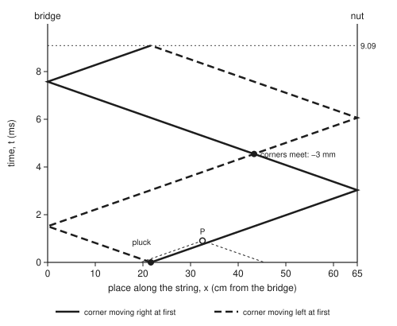
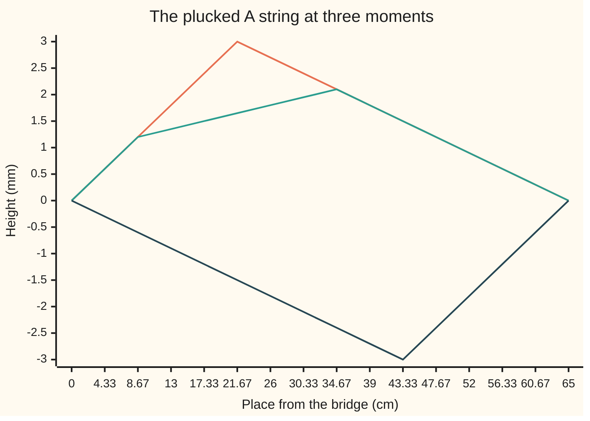

# d'Alembert: a wave splits into a left-mover and a right-mover

[Syllabus](../../../SYLLABUS.md) → [Partial differential equations](../README.md) → [Waves](../README.md#s05) → d'Alembert

---

## General Overview

[The wave equation](../../08-Differential%20equations%20and%20dynamics/10-The%20Classical%20PDEs/05-the-wave-equation-and-dalemberts-formula.md) showed that every motion of a long string is one shape sliding right plus one shape sliding left. This card gets the same answer a second way: it splits the wave equation into two transport equations and solves each by [Characteristics](../02-First-Order%20Equations%20and%20Characteristics/01-method-of-characteristics.md). That road shows *why* the corners of a plucked string travel the way they do.

The open A string of a guitar is 65 cm long between the bridge and the nut. It sounds at 110 Hz. A player pulls it 3 mm sideways at a point 21.67 cm from the bridge, a third of the way along, and lets go. Just before release the string is two straight pieces with one sharp corner.

The unknown is the string's sideways height $`u(x, t)`$, in mm, at place $`x`$ from the bridge and time $`t`$ after release. The region is the string, $`0 \le x \le 0.65`$ m, at all times $`t \ge 0`$. The data are the starting triangle, zero starting velocity, and both ends held at zero height.

On release the one corner splits into two. One runs toward the nut and one toward the bridge, each at 143 m/s. The string stays made of straight pieces, and the corners are where the pieces meet. A tenth of a period later, 0.9091 ms after release, the string at the 12th fret, half way along, has dropped from 2.25 mm to 2.025 mm. The corners bounce off the ends, and after 9.0909 ms, one period of the 110 Hz note, the triangle is back.

**The wave equation is two transport equations stacked: one signal rides right along the lines x − ct = constant and one rides left along x + ct = constant, so any corner in the starting shape splits into two corners that ride those lines at the wave speed.**

**What kind of fact this is:** a theorem, proved on this card in Why it works. For the plucked string the answer is a weak solution, not a classical one: it has no bending at the two corners. The vibrating string is a model: a perfectly flexible string with no stiffness and no air drag.

### The picture: the two corners riding characteristics

<p align="center"></p>

To scale: 6 px per cm across, 30 px per ms up, so every straight path has the slope of the wave speed, 14.3 cm per ms. The solid path is the corner that first moves toward the nut. It reaches the nut at 3.0303 ms and the bridge at 7.5758 ms. The dashed path reaches the bridge at 1.5152 ms and the nut at 6.0606 ms. They cross at 43.33 cm after 4.5455 ms, where the string is 3 mm below its rest line. The two thin dashed lines run from the point P, at the 12th fret at 0.9091 ms, back to the only two places on the starting string that fix its height there: 19.5 cm and 45.5 cm.

---

## The formula

Notation, as on [A PDE problem](../01-Classification%20and%20Well-Posedness/01-what-a-pde-problem-is.md): a subscript names the variable a rate is taken in. $`u_t`$ is the sideways velocity of a point of string, $`u_x`$ the slope of the string, and a doubled letter takes the rate twice. The riding coordinates $`\xi = x - ct`$ and $`\eta = x + ct`$ ("xi" and "eta") are the ones [Canonical form](../01-Classification%20and%20Well-Posedness/05-reduction-to-canonical-form.md) built for a hyperbolic equation.

The wave equation, with its two factors:

```math
u_{tt} - c^2 u_{xx} = \Big(\frac{\partial}{\partial t} + c\,\frac{\partial}{\partial x}\Big)\Big(\frac{\partial}{\partial t} - c\,\frac{\partial}{\partial x}\Big)u = 0.
```

Two signals carry the motion:

```math
w = u_t - c\,u_x \ \text{ rides right: } w(x, t) = w_0(x - ct), \qquad v = u_t + c\,u_x \ \text{ rides left: } v(x, t) = v_0(x + ct).
```

From the starting shape $`f`$ and velocity $`g`$ they rebuild d'Alembert's formula:

```math
u(x, t) = \frac{f(x - ct) + f(x + ct)}{2} + \frac{1}{2c}\int_{x - ct}^{x + ct} g(y)\,dy.
```

**Read it aloud:** the wave equation is "move right at speed c" applied after "move left at speed c". So one signal is carried unchanged to the right and one to the left. The height at a point is the average of the starting shape at the two places those lines started from, plus the starting velocity summed between them, divided by twice the speed.

For the guitar string the speed is $`c = 2L \times 110`$ Hz $`= 143`$ m/s, since one period, $`2L/c`$, is the time for a corner to go to both ends and back. The string starts at rest, so $`g = 0`$. The held ends are built in by extending $`f`$ upside down past each end, as [Reflection](03-reflection-at-a-wall-and-the-half-line.md) proves.

| Symbol | Plain meaning | In our example | Push it up and the answer… |
| --- | --- | --- | --- |
| $`u`$ | sideways height of the string above its rest line | 3 mm at the pluck point at the start | — |
| $`x`$, $`t`$ | place measured from the bridge; time since release | 0 to 65 cm; ms | — |
| $`u_t`$, $`u_x`$, $`u_{tt}`$, $`u_{xx}`$ | velocity of a point; slope of the string; acceleration; bending (rate of change of slope) | −1.485 m/s and 3.4615 mm per m at P | more bending, more acceleration |
| $`c`$ | wave speed: how fast a corner travels along the string | 143 m/s | corners move faster; the note rises |
| $`L`$, $`a`$, $`H`$ | length between bridge and nut; pluck point; pluck height | 0.65 m; 21.67 cm; 3 mm | $`L`$: a lower note at the same speed; $`H`$: every height scales with it |
| P | the point watched on the card: the 12th fret, 32.5 cm, at 0.9091 ms | $`u`$ = 2.025 mm there | — |
| $`f`$, $`g`$ | starting shape and starting velocity | the triangle; $`g = 0`$ | every height scales with $`f`$ |
| $`\xi`$, $`\eta`$ | riding coordinates $`x - ct`$ and $`x + ct`$ | 19.5 cm and 45.5 cm at P | — |
| $`w`$, $`v`$ ($`w_0`$, $`v_0`$) | the right-riding and left-riding signals $`u_t \mp c\,u_x`$ (their values at the start) | −1.98 m/s and −0.99 m/s at P | — |
| $`F`$, $`G`$, $`\Gamma`$ | right-moving and left-moving profiles, $`u = F(\xi) + G(\eta)`$; $`\Gamma`$ a running sum of $`g`$ | each is half of $`f`$; $`\Gamma = 0`$ | — |
| $`s`$, $`y`$ | time along one characteristic; a place on the starting string | 0 to 0.9091 ms; 19.5 to 45.5 cm | — |
| $`\Delta x`$, $`\Delta t`$ | grid steps in place and time, with $`\Delta x = c\,\Delta t`$ | $`L/30`$ = 2.1667 cm; 0.1515 ms | — |

### When it holds

- **Small slopes.** The pull that straightens the string is taken as tension times slope. At 3 mm over 21.67 cm the slope is 0.0138, well inside that. A hard pluck with steep slopes adds nonlinear terms.
- **A perfectly flexible string.** A real steel string resists bending a little. Then each wavelength travels at its own speed and the corners round off; see [Dispersion](06-dispersion-group-velocity-and-kdv-in-outline.md).
- **Ends held fixed.** The upside-down extension holds only for ends at zero height. Forget it, and the formula moves the bridge itself by 0.9000 mm at 0.9091 ms.
- **Smooth data, for a classical solution.** The derivation needs two continuous rates of $`u`$. A sharp corner has no bending, so the plucked string solves the equation everywhere except on the two corner lines. There it is a weak solution, the limit of plucks with ever-sharper rounded corners.

---

## Why it works

### Step 0: the wave equation is two transport equations in a row

"Move right at speed c" and "move left at speed c" are both first-order rules, each solved along straight lines by [Characteristics](../02-First-Order%20Equations%20and%20Characteristics/01-method-of-characteristics.md). The wave operator is one rule applied after the other. So solve the outer one first, then the inner one, each along its own family of lines.

### Step 1: factor the operator

Apply "time rate plus c times place rate" to $`w = u_t - c\,u_x`$:

```math
(\partial_t + c\,\partial_x)(u_t - c\,u_x) = u_{tt} - c\,u_{xt} + c\,u_{tx} - c^2 u_{xx} = u_{tt} - c^2 u_{xx}.
```

The two mixed terms cancel because the order of two rates does not matter when $`u`$ has two continuous rates. So the wave equation says exactly $`w_t + c\,w_x = 0`$: the transport equation, moving right at speed $`c`$. In the same way, $`v = u_t + c\,u_x`$ obeys $`v_t - c\,v_x = 0`$ and moves left.

### Step 2: the outer equation, solved by characteristics

In the Characteristics card's system, $`w_t + c\,w_x = 0`$ moves in the direction ($`c`$ in place, 1 in time) and changes at rate 0. Its characteristics are the lines $`x - ct = `$ constant, and $`w`$ does not change along them. So

```math
w(x, t) = w_0(x - ct), \qquad w_0 = g - c\,f'.
```

The start value comes from the data: at $`t = 0`$, $`u_t = g`$ and $`u_x = f'`$, the slope of the starting shape.

### Step 3: the inner equation, solved along the other family

Now $`u_t - c\,u_x = w`$ is a transport equation moving left, with a source: direction ($`-c`$ in place, 1 in time), rate of change $`w`$. Its characteristics are the lines $`x + ct`$ = constant. Follow the one that ends at $`(x, t)`$. At time $`s`$ it is at $`x + c(t - s)`$, and along it $`du/ds = w`$. It started at $`x + ct`$, where the height was $`f(x + ct)`$. Summing the rate from 0 to $`t`$:

```math
u(x, t) = f(x + ct) + \int_0^t w_0\big(x + ct - 2cs\big)\,ds = f(x + ct) + \frac{1}{2c}\int_{x - ct}^{x + ct} w_0(y)\,dy.
```

The second form uses $`y = x + ct - 2cs`$, the place where the right-riding line through the moving point started. Put in $`w_0 = g - c f'`$. The $`f'`$ part sums to $`-\tfrac12\big(f(x + ct) - f(x - ct)\big)`$, and d'Alembert's formula appears.

<details>
<summary>Detailed proof: existence and uniqueness, by the two transport equations</summary>

Claim: if $`f`$ has two continuous rates and $`g`$ one, d'Alembert's formula is a classical solution on the whole line for $`t \ge 0`$, and it is the only one.

Uniqueness first. Take any solution $`u`$ with two continuous rates and the given data. Step 1 shows that its $`w = u_t - c\,u_x`$ obeys $`w_t + c\,w_x = 0`$ with start value $`g - c f'`$. That transport equation has only one solution, by the Characteristics card, so

$`\displaystyle w(x, t) = g(x - ct) - c\,f'(x - ct).`$

Then $`u`$ obeys $`u_t - c\,u_x = w`$ with start value $`f`$. Again there is only one solution: the one built in Step 3. So $`u`$ is d'Alembert's formula.

Existence. Write $`\Gamma`$ for a running sum of $`g`$, so $`\Gamma' = g`$. The formula is then $`F(x - ct) + G(x + ct)`$ with

$`\displaystyle F(\xi) = \tfrac12 f(\xi) - \tfrac{1}{2c}\Gamma(\xi), \qquad G(\eta) = \tfrac12 f(\eta) + \tfrac{1}{2c}\Gamma(\eta).`$

By the chain rule, $`F(x - ct)`$ has $`u_{tt} = c^2 F''`$ and $`u_{xx} = F''`$, so it solves the equation; so does $`G(x + ct)`$. At $`t = 0`$ the sum is $`f`$. Its time rate is $`-cF' + cG' = \Gamma' = g`$.

</details>

### Step 4: in riding coordinates, each signal depends on one coordinate only

In $`\xi = x - ct`$ and $`\eta = x + ct`$, Step 2 says $`w`$ depends on $`\xi`$ alone and $`v`$ on $`\eta`$ alone. That is the statement $`u_{\xi\eta} = 0`$ that [The wave equation](../../08-Differential%20equations%20and%20dynamics/10-The%20Classical%20PDEs/05-the-wave-equation-and-dalemberts-formula.md) reached by the chain rule. The two signals give back the velocity and the slope:

```math
u_t = \frac{v + w}{2}, \qquad u_x = \frac{v - w}{2c}.
```

At P, the 12th fret at 0.9091 ms, $`w`$ comes from 19.5 cm on the rising side of the triangle and $`v`$ from 45.5 cm on the falling side. The rising slope is 13.8462 mm per m and the falling slope −6.9231 mm per m. So $`w = -143 \times 13.8462`$ mm/s $`= -1.98`$ m/s and $`v = 143 \times (-6.9231)`$ mm/s $`= -0.99`$ m/s. The point is falling at 1.485 m/s, and the string there slopes up at 3.4615 mm per m. Only those two places on the starting string matter: the [Dependence and influence](../01-Classification%20and%20Well-Posedness/09-domains-of-dependence-and-influence.md) card's domain of dependence, here the stretch from 19.5 to 45.5 cm.

### Step 5: corners ride the characteristics

The starting slope $`f'`$ jumps at the pluck point, from 13.8462 to −6.9231 mm per m: a jump of 20.7692. So $`w_0`$ and $`v_0`$ both jump at $`a`$. Step 2 carries the jump in $`w`$ along the right-riding line $`x - ct = a`$, and the jump in $`v`$ along the left-riding line $`x + ct = a`$. Nowhere else does anything jump.

So the slope $`u_x = (v - w)/2c`$ jumps only on those two lines, by half the starting jump each: 10.3846 mm per m. Away from them $`v`$ and $`w`$ are constant, so the string is straight. At 0.9091 ms the corners sit at 8.6667 cm (height 1.2 mm) and 34.6667 cm (height 2.1 mm).

At a corner the bending $`u_{xx}`$ does not exist, so the equation cannot hold there in the classical sense. A centred-difference test shows it: away from the corners the residual is 0, but at the right corner it is −10384.6 mm per m² with a 1 mm step and −20769.2 with a 0.5 mm step. It doubles every time the step halves, instead of shrinking. The test steps time by the place step over 2c, off the characteristic lines. On the grid $`\Delta x = c\,\Delta t`$ the difference rule is exact even at a corner, which is why the code's Road 3 is exact. The equation holds in the integrated sense of [Weak solutions](../06-Weak%20Solutions%20and%20Free%20Boundaries/01-weak-solutions-and-the-weak-formulation.md), and the formula is the limit of rounded plucks.

### Step 6: the held ends

The ends stay at zero height if $`f`$ is extended past each end upside down: odd about the bridge and about the nut, repeating every $`2L`$ = 130 cm. [Reflection](03-reflection-at-a-wall-and-the-half-line.md) proves this. On the characteristic picture, a corner reaching an end comes back along the other family, so the corners bounce. A corner goes to both ends and back in $`2L/c`$ = 9.0909 ms, and the triangle returns. At half that time the string is the starting triangle flipped upside down and mirrored end to end: −3 mm at 43.33 cm, two thirds of the way along.

---

## Worked numbers, by hand

The height at the 12th fret, $`x`$ = 32.5 cm, a tenth of a period after release:

| Step | Arithmetic | Value |
| --- | --- | --- |
| wave speed | 2 × 0.65 m × 110 Hz | 143 m/s |
| one period | 2 × 0.65 / 143 | 9.0909 ms |
| a tenth of a period | 9.0909 / 10 | 0.9091 ms |
| distance a corner travels, $`ct`$ | 143 m/s × 0.9091 ms | 13 cm |
| the two starting places, $`x \mp ct`$ | 32.5 − 13; 32.5 + 13 | 19.5 cm; 45.5 cm |
| height there at the start, rising side | 3 × 19.5 / 21.6667 | 2.7 mm |
| height there at the start, falling side | 3 × (65 − 45.5) / 43.3333 | 1.35 mm |
| average of the two | (2.7 + 1.35) / 2 | **2.025 mm** |
| corners, $`a \mp ct`$ | 21.6667 − 13; 21.6667 + 13 | 8.6667 cm; 34.6667 cm |

The 12th fret started at 2.25 mm and has dropped to 2.025 mm. It lies on the middle straight piece, between the two corners, falling at 1.485 m/s.

### What breaks if you drop a piece

| Mistake | Comes out at | What went wrong |
| --- | --- | --- |
| drop the ½ in the average | 4.05 mm, not 2.025 | each mover carries half the shape; the start would read double |
| keep only the right-mover, $`f(x - ct)`$ | 2.7 mm, not 2.025 | that is the transport equation, one family of characteristics |
| ignore the held ends | the bridge moves to 0.9 mm at 0.9091 ms; the 12th fret reads 0 at half a period, not −2.25 mm | the shape must be extended upside down past each end |
| treat the corner as a classical point | residual −10384.6, then −20769.2 mm per m² as the step halves | no bending exists at a corner: the hypothesis of two continuous rates fails |

The checks print all four.

---

## How the plucked string moves through one period

One corner is born at the pluck point and splits. Follow both through one period:

| Time | Corner that first moves toward the bridge | Corner that first moves toward the nut | Shape of the string |
| --- | --- | --- | --- |
| 0 ms | 21.67 cm, 3 mm | 21.67 cm, 3 mm | the triangle |
| 0.9091 ms | 8.67 cm, 1.2 mm | 34.67 cm, 2.1 mm | three straight pieces |
| 1.5152 ms | reaches the bridge | 43.33 cm, 1.5 mm | two pieces: up from the bridge, down to the nut |
| 3.0303 ms | 21.67 cm, −1.5 mm | reaches the nut | two pieces, the corner now below the rest line |
| 4.5455 ms | 43.33 cm, −3 mm | 43.33 cm, −3 mm | the triangle flipped and mirrored |
| 9.0909 ms | 21.67 cm, 3 mm | 21.67 cm, 3 mm | the triangle again |



Orange: at release, peak 3 mm at 21.67 cm. Green: at 0.9091 ms, corners at 8.67 cm and 34.67 cm with a straight middle piece between them. Dark blue: at half a period, 4.5455 ms, the triangle upside down with its corner at 43.33 cm.

The string never forms a smooth curve. It is always straight pieces, and the corners trace the zigzag in the picture at the top.

---

## Code, from first principles, and it actually runs

The code takes three roads to the plucked string, then tests where the equation fails.

- **Road 1** is d'Alembert's formula with the upside-down extension.
- **Road 2** never uses the formula. It rides the left-moving characteristic back from P and sums the signal $`w`$ by Runge-Kutta 4 (RK4, a step that averages four slopes). The jump in $`w`$ at the corner falls inside one step, a third or two thirds of the way in at 20, 40 and 80 steps. So the error is one step times the jump in $`w`$, divided by 6. It halves when the step halves: the corner costs RK4 its usual fourth order.
- **Road 3** marches the string in whole numbers on a grid whose steps follow the characteristics, $`\Delta x = c\,\Delta t`$, with both ends held at zero. There the rule "new height = left neighbour + right neighbour − old height" is exact.
- **The residual**, by centred differences, is zero on the straight pieces and grows at the corners.

### Python

```python
# d'Alembert by characteristics -- the check behind the card.  The open A string
# of a guitar, 65 cm long, is pulled 3 mm aside a third of the way along and let
# go from rest.  Road 1 is d'Alembert's formula, the held ends built in by the
# odd extension.  Road 2 rides the characteristics: the signal w = u_t - c u_x is
# read back along a right-moving line, then summed by RK4 along a left-moving
# one.  Road 3 marches the string in whole numbers on a grid of characteristics,
# ends held at zero.  Nothing is imported.
L, H, FREQ = 0.65, 3.0, 110                # string length (m), pluck height (mm), note (Hz)
c = 2 * L * FREQ                           # wave speed (m/s): the open A string
a = L / 3                                  # pluck point, m from the bridge
PER = 2 * L / c                            # one period (s)

def f(y): return H * y / a if y <= a else H * (L - y) / (L - a)    # starting shape, mm
def fp(y): return H / a if y < a else -H / (L - a)                 # its slope, mm per m
def fext(y):                               # f made odd about each end, period 2L
    y = y % (2 * L)
    return f(y) if y <= L else -f(2 * L - y)
def u(x, t): return (fext(x - c * t) + fext(x + c * t)) / 2         # road 1: d'Alembert
def fz(y): return f(y) if 0 <= y <= L else 0.0                      # mistake: ends ignored
def z(v): return 0.0 if abs(v) < 1e-9 else v                        # no "-0.00" in print
def fold(y):                               # a path at speed c, bounced between the ends
    y = y % (2 * L)
    return y if y <= L else 2 * L - y

def ride(x, t, n):                         # road 2: RK4 along the left-moving line
    w = lambda s: -c * fp(x + c * t - 2 * c * s)   # w = u_t - c u_x, read back to t = 0
    total, k = f(x + c * t), t / n         # start: the height where the line meets t = 0
    for i in range(n):
        s = i * k                          # du/ds = w(s) holds no u, so RK4 is Simpson
        k1, k2, k4 = w(s), w(s + k / 2), w(s + k)
        total += k * (k1 + 4 * k2 + k4) / 6
    return total

X, T = L / 2, PER / 10                     # 12th fret (half way), a tenth of a period
ans = u(X, T)
print(f"c = 2 x 0.65 m x {FREQ:g} Hz = {c:.0f} m/s; period 2L/c = {1000 * PER:.4f} ms; pluck at {100 * a:.4f} cm")
print(f"t = {1000 * T:.4f} ms: ct = {100 * c * T:.4f} cm; feet at {100 * (X - c * T):.4f} and {100 * (X + c * T):.4f} cm")
print(f"triangle: pieces {100 * a:.4f} and {100 * (L - a):.4f} cm, slopes {H / a:.4f} and {-H / (L - a):.4f} mm per m, steepest {H / a / 1000:.4f}")
print(f"f at the feet: {f(X - c * T):.4f} and {f(X + c * T):.4f} mm; started at f(32.5 cm) = {f(X):.4f} mm")
print(f"road 1, d'Alembert: u(32.5 cm, {1000 * T:.4f} ms) = {ans:.4f} mm")
vv, ww = c * fp(X + c * T) / 1000, -c * fp(X - c * T) / 1000      # m/s
print(f"signals at the point: v = u_t + c u_x = {vv:.4f} m/s, w = u_t - c u_x = {ww:.4f} m/s")
print(f"so u_t = (v + w)/2 = {(vv + ww) / 2:.4f} m/s and u_x = (v - w)/(2c) = {1000 * (vv - ww) / (2 * c):.4f} mm per m")
err = []
for n in (20, 40, 80):
    r = ride(X, T, n); err.append(abs(r - ans))
    print(f"road 2, RK4 {n} steps: {r:.6f} mm, error {err[-1]:.6f} mm, one step x jump / 6 = {T / n * c * (H / a + H / (L - a)) / 6:.6f} mm")
print(f"road 2 error ratios: {err[0] / err[1]:.2f} {err[1] / err[2]:.2f} (first order: a corner sits inside one step)")
N = 30                                     # road 3: cells of L/30; time step L/(30c)
F = [12 * j if j <= 10 else 6 * (N - j) for j in range(N + 1)]    # 40 x f, whole numbers
assert all((F[j - 1] + F[j + 1]) % 2 == 0 for j in range(1, N))   # first step stays whole
rows = [F, [0] + [(F[j - 1] + F[j + 1]) // 2 for j in range(1, N)] + [0]]   # from rest
for n in range(2, 2 * N + 1):              # u(t + dt) = u(x - dx) + u(x + dx) - u(t - dt)
    p, q = rows[-1], rows[-2]
    rows.append([0] + [p[j - 1] + p[j + 1] - q[j] for j in range(1, N)] + [0])
print(f"grid: dx = L/30 = {100 * L / N:.4f} cm, dt = dx/c = {1000 * L / N / c:.4f} ms; corners travel {c / 10:.1f} cm per ms; extension repeats every {200 * L:.0f} cm")
gap = max(abs(rows[6][j] / 40 - u(j * L / N, 6 * PER / (2 * N))) for j in range(N + 1))
print(f"road 3, grid in 1/40 mm: u(32.5 cm, 6 steps) = {rows[6][15]}/40 = {rows[6][15] / 40:.4f} mm; every point within 1e-12 mm of road 1: {'yes' if gap < 1e-12 else 'no'}")
half = all(rows[N][j] == -F[N - j] for j in range(N + 1)); full = rows[2 * N] == F
print(f"grid at half a period, the start flipped and mirrored: {'yes' if half else 'no'}; after a whole period, the start: {'yes' if full else 'no'}")
lc, rc = fold(a - c * T), fold(a + c * T)  # the two corners ride x = a -/+ ct
print(f"corners at {100 * lc:.4f} cm ({u(lc, T):.4f} mm) and {100 * rc:.4f} cm ({u(rc, T):.4f} mm)")
for m in (1 / 6, 1 / 3, 1 / 2, 1):         # the corners through one period
    t = m * PER; p, q = fold(a - c * t), fold(a + c * t)
    print(f"moment {1000 * t:.4f} ms: corners at {100 * p:.2f} cm ({z(u(p, t)):.2f} mm), {100 * q:.2f} cm ({z(u(q, t)):.2f} mm)")
e = 1e-4; sl, sr = (u(rc, T) - u(rc - e, T)) / e, (u(rc + e, T) - u(rc, T)) / e
print(f"slopes either side of the right corner: {sl:.4f} and {sr:.4f} mm per m; jump {sl - sr:.4f}, half the start's {H / a + H / (L - a):.4f}")
print(f"half a period, {1000 * PER / 2:.4f} ms: u(43.33 cm) = {u(L - a, PER / 2):.4f} mm, u(32.5 cm) = {u(X, PER / 2):.4f} mm")
def res(x, t, h):                          # (u_tt / c^2 - u_xx) by centred differences, mm per m^2
    k = h / (2 * c)
    return (u(x, t + k) - 2 * u(x, t) + u(x, t - k)) / (c * k) ** 2 - (u(x + h, t) - 2 * u(x, t) + u(x - h, t)) / h ** 2
rr = [res(rc, T, h) for h in (1e-3, 5e-4)]
print(f"residual at 32.5 cm: {abs(z(res(X, T, 1e-3))):.4f}; at the right corner: h = 1 mm {rr[0]:.1f}, h = 0.5 mm {rr[1]:.1f} mm per m^2")
print(f"mistake 1, no 1/2: {2 * ans:.4f} mm; mistake 2, right-mover only f(x - ct): {f(X - c * T):.4f} mm")
print(f"mistake 3, ends ignored: bridge at {1000 * T:.4f} ms moves to {(fz(-c * T) + fz(c * T)) / 2:.4f} mm;"
      f" 32.5 cm at half a period {z((fz(X - L) + fz(X + L)) / 2):.4f} mm, not {u(X, PER / 2):.4f}")
for t in (0, PER / 10, PER / 2):
    print(f"chart, t = {1000 * t:.4f} ms:", ", ".join(f"{z(u(j * L / 15, t)):.2f}" for j in range(16)))
print("figure, corner paths (cm, ms):", "; ".join(f"({100 * x:.2f}, {1000 * s / c:.4f})" for x, s in
      [(a, 0), (0, a), (L, L - a), (L - a, L), (L, L + a), (0, 2 * L - a), (a, 2 * L)]))
assert abs(ans - 2.025) < 1e-12 and abs(u(X, 0) - 2.25) < 1e-12                       # by hand
assert all(abs(err[i] - T / n * c * (H / a + H / (L - a)) / 6) < 1e-9 for i, n in enumerate((20, 40, 80)))
assert abs(err[0] / err[1] - 2) < 1e-6 and abs(err[1] / err[2] - 2) < 1e-6          # road 2 converges
assert rows[6][15] == 81 and gap < 1e-12 and half and full                           # road 3, exact
assert abs(sl - sr - (H / a + H / (L - a)) / 2) < 1e-6                                # half the jump
assert abs(res(X, T, 1e-3)) < 1e-3 and rr[1] / rr[0] > 1.9                           # corner: no u_xx
print("ALL CHECKS PASS")
```

**Ran 2026-11-15 on macOS, Python 3.14.10, standard library only. All checks passed. Output, pasted from the run:**

```
c = 2 x 0.65 m x 110 Hz = 143 m/s; period 2L/c = 9.0909 ms; pluck at 21.6667 cm
t = 0.9091 ms: ct = 13.0000 cm; feet at 19.5000 and 45.5000 cm
triangle: pieces 21.6667 and 43.3333 cm, slopes 13.8462 and -6.9231 mm per m, steepest 0.0138
f at the feet: 2.7000 and 1.3500 mm; started at f(32.5 cm) = 2.2500 mm
road 1, d'Alembert: u(32.5 cm, 0.9091 ms) = 2.0250 mm
signals at the point: v = u_t + c u_x = -0.9900 m/s, w = u_t - c u_x = -1.9800 m/s
so u_t = (v + w)/2 = -1.4850 m/s and u_x = (v - w)/(2c) = 3.4615 mm per m
road 2, RK4 20 steps: 2.002500 mm, error 0.022500 mm, one step x jump / 6 = 0.022500 mm
road 2, RK4 40 steps: 2.036250 mm, error 0.011250 mm, one step x jump / 6 = 0.011250 mm
road 2, RK4 80 steps: 2.019375 mm, error 0.005625 mm, one step x jump / 6 = 0.005625 mm
road 2 error ratios: 2.00 2.00 (first order: a corner sits inside one step)
grid: dx = L/30 = 2.1667 cm, dt = dx/c = 0.1515 ms; corners travel 14.3 cm per ms; extension repeats every 130 cm
road 3, grid in 1/40 mm: u(32.5 cm, 6 steps) = 81/40 = 2.0250 mm; every point within 1e-12 mm of road 1: yes
grid at half a period, the start flipped and mirrored: yes; after a whole period, the start: yes
corners at 8.6667 cm (1.2000 mm) and 34.6667 cm (2.1000 mm)
moment 1.5152 ms: corners at 0.00 cm (0.00 mm), 43.33 cm (1.50 mm)
moment 3.0303 ms: corners at 21.67 cm (-1.50 mm), 65.00 cm (0.00 mm)
moment 4.5455 ms: corners at 43.33 cm (-3.00 mm), 43.33 cm (-3.00 mm)
moment 9.0909 ms: corners at 21.67 cm (3.00 mm), 21.67 cm (3.00 mm)
slopes either side of the right corner: 3.4615 and -6.9231 mm per m; jump 10.3846, half the start's 20.7692
half a period, 4.5455 ms: u(43.33 cm) = -3.0000 mm, u(32.5 cm) = -2.2500 mm
residual at 32.5 cm: 0.0000; at the right corner: h = 1 mm -10384.6, h = 0.5 mm -20769.2 mm per m^2
mistake 1, no 1/2: 4.0500 mm; mistake 2, right-mover only f(x - ct): 2.7000 mm
mistake 3, ends ignored: bridge at 0.9091 ms moves to 0.9000 mm; 32.5 cm at half a period 0.0000 mm, not -2.2500
chart, t = 0.0000 ms: 0.00, 0.60, 1.20, 1.80, 2.40, 3.00, 2.70, 2.40, 2.10, 1.80, 1.50, 1.20, 0.90, 0.60, 0.30, 0.00
chart, t = 0.9091 ms: 0.00, 0.60, 1.20, 1.35, 1.50, 1.65, 1.80, 1.95, 2.10, 1.80, 1.50, 1.20, 0.90, 0.60, 0.30, 0.00
chart, t = 4.5455 ms: 0.00, -0.30, -0.60, -0.90, -1.20, -1.50, -1.80, -2.10, -2.40, -2.70, -3.00, -2.40, -1.80, -1.20, -0.60, 0.00
figure, corner paths (cm, ms): (21.67, 0.0000); (0.00, 1.5152); (65.00, 3.0303); (43.33, 4.5455); (65.00, 6.0606); (0.00, 7.5758); (21.67, 9.0909)
ALL CHECKS PASS
```

### Rust

Same numbers, same labels, built with `rustc --edition 2021 -O`.

```rust
// d'Alembert by characteristics -- the same check in Rust, std only.  The open
// A string of a guitar, 65 cm long, is pulled 3 mm aside a third of the way
// along and let go from rest.  Road 1 is d'Alembert's formula, the held ends
// built in by the odd extension.  Road 2 rides the characteristics: the signal
// w = u_t - c u_x is read back along a right-moving line, then summed by RK4
// along a left-moving one.  Road 3 marches the string in whole numbers on a
// grid of characteristics, ends held at zero.
const L: f64 = 0.65; // string length (m)
const H: f64 = 3.0; // pluck height (mm)
const FREQ: f64 = 110.0; // note (Hz)
const C: f64 = 2.0 * L * FREQ; // wave speed (m/s): the open A string
const A: f64 = L / 3.0; // pluck point, m from the bridge
const PER: f64 = 2.0 * L / C; // one period (s)

fn f(y: f64) -> f64 { if y <= A { H * y / A } else { H * (L - y) / (L - A) } } // starting shape, mm
fn fp(y: f64) -> f64 { if y < A { H / A } else { -H / (L - A) } } // its slope, mm per m
fn fext(y: f64) -> f64 { // f made odd about each end, period 2L
    let y = y.rem_euclid(2.0 * L);
    if y <= L { f(y) } else { -f(2.0 * L - y) }
}
fn u(x: f64, t: f64) -> f64 { (fext(x - C * t) + fext(x + C * t)) / 2.0 } // road 1: d'Alembert
fn fz(y: f64) -> f64 { if (0.0..=L).contains(&y) { f(y) } else { 0.0 } } // mistake: ends ignored
fn z(v: f64) -> f64 { if v.abs() < 1e-9 { 0.0 } else { v } } // no "-0.00" in print
fn fold(y: f64) -> f64 { // a path at speed c, bounced between the ends
    let y = y.rem_euclid(2.0 * L);
    if y <= L { y } else { 2.0 * L - y }
}

fn ride(x: f64, t: f64, n: usize) -> f64 { // road 2: RK4 along the left-moving line
    let w = |s: f64| -C * fp(x + C * t - 2.0 * C * s); // w = u_t - c u_x, read back to t = 0
    let (mut total, k) = (f(x + C * t), t / n as f64); // start: the height where the line meets t = 0
    for i in 0..n {
        let s = i as f64 * k; // du/ds = w(s) holds no u, so RK4 is Simpson
        let (k1, k2, k4) = (w(s), w(s + k / 2.0), w(s + k));
        total += k * (k1 + 4.0 * k2 + k4) / 6.0;
    }
    total
}

fn res(x: f64, t: f64, h: f64) -> f64 { // (u_tt / c^2 - u_xx) by centred differences, mm per m^2
    let k = h / (2.0 * C);
    (u(x, t + k) - 2.0 * u(x, t) + u(x, t - k)) / (C * k).powi(2) - (u(x + h, t) - 2.0 * u(x, t) + u(x - h, t)) / (h * h)
}

fn main() {
    let (x, t) = (L / 2.0, PER / 10.0); // 12th fret (half way), a tenth of a period
    let ans = u(x, t);
    let jump = H / A + H / (L - A);
    println!("c = 2 x 0.65 m x {} Hz = {:.0} m/s; period 2L/c = {:.4} ms; pluck at {:.4} cm", FREQ, C, 1000.0 * PER, 100.0 * A);
    println!("t = {:.4} ms: ct = {:.4} cm; feet at {:.4} and {:.4} cm", 1000.0 * t, 100.0 * C * t, 100.0 * (x - C * t), 100.0 * (x + C * t));
    println!("triangle: pieces {:.4} and {:.4} cm, slopes {:.4} and {:.4} mm per m, steepest {:.4}", 100.0 * A, 100.0 * (L - A), H / A, -H / (L - A), H / A / 1000.0);
    println!("f at the feet: {:.4} and {:.4} mm; started at f(32.5 cm) = {:.4} mm", f(x - C * t), f(x + C * t), f(x));
    println!("road 1, d'Alembert: u(32.5 cm, {:.4} ms) = {:.4} mm", 1000.0 * t, ans);
    let (vv, ww) = (C * fp(x + C * t) / 1000.0, -C * fp(x - C * t) / 1000.0); // m/s
    println!("signals at the point: v = u_t + c u_x = {:.4} m/s, w = u_t - c u_x = {:.4} m/s", vv, ww);
    println!("so u_t = (v + w)/2 = {:.4} m/s and u_x = (v - w)/(2c) = {:.4} mm per m", (vv + ww) / 2.0, 1000.0 * (vv - ww) / (2.0 * C));
    let mut err = vec![];
    for n in [20usize, 40, 80] {
        let r = ride(x, t, n);
        err.push((r - ans).abs());
        println!("road 2, RK4 {} steps: {:.6} mm, error {:.6} mm, one step x jump / 6 = {:.6} mm", n, r, err[err.len() - 1], t / n as f64 * C * jump / 6.0);
    }
    println!("road 2 error ratios: {:.2} {:.2} (first order: a corner sits inside one step)", err[0] / err[1], err[1] / err[2]);
    const N: usize = 30; // road 3: cells of L/30; time step L/(30c)
    let ff: Vec<i64> = (0..=N as i64).map(|j| if j <= 10 { 12 * j } else { 6 * (N as i64 - j) }).collect(); // 40 x f
    assert!((1..N).all(|j| (ff[j - 1] + ff[j + 1]) % 2 == 0)); // first step stays whole
    let mut first = vec![0i64; N + 1];
    for j in 1..N { first[j] = (ff[j - 1] + ff[j + 1]) / 2; } // from rest
    let mut rows = vec![ff.clone(), first];
    for _ in 2..=2 * N { // u(t + dt) = u(x - dx) + u(x + dx) - u(t - dt)
        let (p, q) = (&rows[rows.len() - 1], &rows[rows.len() - 2]);
        let mut next = vec![0i64; N + 1];
        for j in 1..N { next[j] = p[j - 1] + p[j + 1] - q[j]; }
        rows.push(next);
    }
    println!("grid: dx = L/30 = {:.4} cm, dt = dx/c = {:.4} ms; corners travel {:.1} cm per ms; extension repeats every {:.0} cm", 100.0 * L / N as f64, 1000.0 * L / N as f64 / C, C / 10.0, 200.0 * L);
    let gap = (0..=N).map(|j| (rows[6][j] as f64 / 40.0 - u(j as f64 * L / N as f64, 6.0 * PER / (2 * N) as f64)).abs()).fold(0.0, f64::max);
    let yn = |b: bool| if b { "yes" } else { "no" };
    println!("road 3, grid in 1/40 mm: u(32.5 cm, 6 steps) = {}/40 = {:.4} mm; every point within 1e-12 mm of road 1: {}", rows[6][15], rows[6][15] as f64 / 40.0, yn(gap < 1e-12));
    let half = (0..=N).all(|j| rows[N][j] == -ff[N - j]);
    let full = rows[2 * N] == ff;
    println!("grid at half a period, the start flipped and mirrored: {}; after a whole period, the start: {}", yn(half), yn(full));
    let (lc, rc) = (fold(A - C * t), fold(A + C * t)); // the two corners ride x = a -/+ ct
    println!("corners at {:.4} cm ({:.4} mm) and {:.4} cm ({:.4} mm)", 100.0 * lc, u(lc, t), 100.0 * rc, u(rc, t));
    for m in [1.0 / 6.0, 1.0 / 3.0, 0.5, 1.0] { // the corners through one period
        let tm = m * PER;
        let (p, q) = (fold(A - C * tm), fold(A + C * tm));
        println!("moment {:.4} ms: corners at {:.2} cm ({:.2} mm), {:.2} cm ({:.2} mm)", 1000.0 * tm, 100.0 * p, z(u(p, tm)), 100.0 * q, z(u(q, tm)));
    }
    let e = 1e-4;
    let (sl, sr) = ((u(rc, t) - u(rc - e, t)) / e, (u(rc + e, t) - u(rc, t)) / e);
    println!("slopes either side of the right corner: {:.4} and {:.4} mm per m; jump {:.4}, half the start's {:.4}", sl, sr, sl - sr, jump);
    println!("half a period, {:.4} ms: u(43.33 cm) = {:.4} mm, u(32.5 cm) = {:.4} mm", 1000.0 * PER / 2.0, u(L - A, PER / 2.0), u(x, PER / 2.0));
    let rr = [res(rc, t, 1e-3), res(rc, t, 5e-4)];
    println!("residual at 32.5 cm: {:.4}; at the right corner: h = 1 mm {:.1}, h = 0.5 mm {:.1} mm per m^2", z(res(x, t, 1e-3)).abs(), rr[0], rr[1]);
    println!("mistake 1, no 1/2: {:.4} mm; mistake 2, right-mover only f(x - ct): {:.4} mm", 2.0 * ans, f(x - C * t));
    println!("mistake 3, ends ignored: bridge at {:.4} ms moves to {:.4} mm; 32.5 cm at half a period {:.4} mm, not {:.4}",
        1000.0 * t, (fz(-C * t) + fz(C * t)) / 2.0, z((fz(x - L) + fz(x + L)) / 2.0), u(x, PER / 2.0));
    for tt in [0.0, PER / 10.0, PER / 2.0] {
        let row: Vec<String> = (0..16).map(|j| format!("{:.2}", z(u(j as f64 * L / 15.0, tt)))).collect();
        println!("chart, t = {:.4} ms: {}", 1000.0 * tt, row.join(", "));
    }
    let pts = [(A, 0.0), (0.0, A), (L, L - A), (L - A, L), (L, L + A), (0.0, 2.0 * L - A), (A, 2.0 * L)];
    let fig: Vec<String> = pts.iter().map(|&(px, s)| format!("({:.2}, {:.4})", 100.0 * px, 1000.0 * s / C)).collect();
    println!("figure, corner paths (cm, ms): {}", fig.join("; "));
    assert!((ans - 2.025).abs() < 1e-12 && (u(x, 0.0) - 2.25).abs() < 1e-12); // by hand
    for (i, n) in [20.0, 40.0, 80.0].iter().enumerate() { assert!((err[i] - t / n * C * jump / 6.0).abs() < 1e-9); }
    assert!((err[0] / err[1] - 2.0).abs() < 1e-6 && (err[1] / err[2] - 2.0).abs() < 1e-6); // road 2 converges
    assert!(rows[6][15] == 81 && gap < 1e-12 && half && full); // road 3, exact
    assert!((sl - sr - jump / 2.0).abs() < 1e-6); // half the jump
    assert!(res(x, t, 1e-3).abs() < 1e-3 && rr[1] / rr[0] > 1.9); // corner: no u_xx
    println!("ALL CHECKS PASS");
}
```

**Ran 2026-11-15 on macOS, rustc 1.98.1, no crates. All checks passed. Output, pasted from the run:**

```
c = 2 x 0.65 m x 110 Hz = 143 m/s; period 2L/c = 9.0909 ms; pluck at 21.6667 cm
t = 0.9091 ms: ct = 13.0000 cm; feet at 19.5000 and 45.5000 cm
triangle: pieces 21.6667 and 43.3333 cm, slopes 13.8462 and -6.9231 mm per m, steepest 0.0138
f at the feet: 2.7000 and 1.3500 mm; started at f(32.5 cm) = 2.2500 mm
road 1, d'Alembert: u(32.5 cm, 0.9091 ms) = 2.0250 mm
signals at the point: v = u_t + c u_x = -0.9900 m/s, w = u_t - c u_x = -1.9800 m/s
so u_t = (v + w)/2 = -1.4850 m/s and u_x = (v - w)/(2c) = 3.4615 mm per m
road 2, RK4 20 steps: 2.002500 mm, error 0.022500 mm, one step x jump / 6 = 0.022500 mm
road 2, RK4 40 steps: 2.036250 mm, error 0.011250 mm, one step x jump / 6 = 0.011250 mm
road 2, RK4 80 steps: 2.019375 mm, error 0.005625 mm, one step x jump / 6 = 0.005625 mm
road 2 error ratios: 2.00 2.00 (first order: a corner sits inside one step)
grid: dx = L/30 = 2.1667 cm, dt = dx/c = 0.1515 ms; corners travel 14.3 cm per ms; extension repeats every 130 cm
road 3, grid in 1/40 mm: u(32.5 cm, 6 steps) = 81/40 = 2.0250 mm; every point within 1e-12 mm of road 1: yes
grid at half a period, the start flipped and mirrored: yes; after a whole period, the start: yes
corners at 8.6667 cm (1.2000 mm) and 34.6667 cm (2.1000 mm)
moment 1.5152 ms: corners at 0.00 cm (0.00 mm), 43.33 cm (1.50 mm)
moment 3.0303 ms: corners at 21.67 cm (-1.50 mm), 65.00 cm (0.00 mm)
moment 4.5455 ms: corners at 43.33 cm (-3.00 mm), 43.33 cm (-3.00 mm)
moment 9.0909 ms: corners at 21.67 cm (3.00 mm), 21.67 cm (3.00 mm)
slopes either side of the right corner: 3.4615 and -6.9231 mm per m; jump 10.3846, half the start's 20.7692
half a period, 4.5455 ms: u(43.33 cm) = -3.0000 mm, u(32.5 cm) = -2.2500 mm
residual at 32.5 cm: 0.0000; at the right corner: h = 1 mm -10384.6, h = 0.5 mm -20769.2 mm per m^2
mistake 1, no 1/2: 4.0500 mm; mistake 2, right-mover only f(x - ct): 2.7000 mm
mistake 3, ends ignored: bridge at 0.9091 ms moves to 0.9000 mm; 32.5 cm at half a period 0.0000 mm, not -2.2500
chart, t = 0.0000 ms: 0.00, 0.60, 1.20, 1.80, 2.40, 3.00, 2.70, 2.40, 2.10, 1.80, 1.50, 1.20, 0.90, 0.60, 0.30, 0.00
chart, t = 0.9091 ms: 0.00, 0.60, 1.20, 1.35, 1.50, 1.65, 1.80, 1.95, 2.10, 1.80, 1.50, 1.20, 0.90, 0.60, 0.30, 0.00
chart, t = 4.5455 ms: 0.00, -0.30, -0.60, -0.90, -1.20, -1.50, -1.80, -2.10, -2.40, -2.70, -3.00, -2.40, -1.80, -1.20, -0.60, 0.00
figure, corner paths (cm, ms): (21.67, 0.0000); (0.00, 1.5152); (65.00, 3.0303); (43.33, 4.5455); (65.00, 6.0606); (0.00, 7.5758); (21.67, 9.0909)
ALL CHECKS PASS
```

The two outputs match line for line.

### Lean

Lean proves Steps 2 and 5 and the detailed proof on the whole line, for every wave speed, and the guitar-string numbers.

- Suppose $`f`$ has two continuous rates, $`g`$ has one, and $`u`$ is a classical solution with that data for $`t \ge 0`$. Then $`w = g - c\,f'`$ read at $`x - ct`$, and $`v = g + c\,f'`$ read at $`x + ct`$.
- Suppose $`f`$ has two continuous rates and $`g`$ has one. Then d'Alembert's formula is a classical solution on the whole line with that data. For $`t \ge 0`$ it is the only one.
- Suppose the string starts at rest, its starting slope jumps at $`a`$, and $`f`$ has a slope at $`a \pm 2ct`$. Then at time $`t`$ the slope jumps at $`a - ct`$ and at $`a + ct`$, each by half the starting jump.
- The guitar-string numbers also check exactly. That covers the speed 143 m/s, the heights 2.25, 2.025 and 2.1 mm, and the slopes and signals at P.

The held ends, the bounces, the RK4 and grid roads, the residuals and the chart points are left to the Python and Rust checks.

```lean
-- d'Alembert: the wave equation u_tt = c^2 u_xx is two transport equations, so u_t - c u_x rides right along x - ct = constant and u_t + c u_x rides left along x + ct = constant, d'Alembert's formula is the one classical solution, and a corner in a string released from rest splits into two corners, each carrying half the jump in slope.
import Mathlib.Analysis.Calculus.ContDiff.Basic
import Mathlib.Analysis.Calculus.Deriv.Basic
import Mathlib.MeasureTheory.Integral.IntervalIntegral.FundThmCalculus
import Mathlib.Tactic.NormNum
import Mathlib.Analysis.Calculus.Deriv.Mul
import Mathlib.Analysis.Calculus.ContDiff.Deriv
import Mathlib.Analysis.Calculus.FDeriv.Symmetric
import Mathlib.Analysis.Calculus.MeanValue

theorem wave_deriv_snd_eq (G : ℝ × ℝ → ℝ) (x t : ℝ) (hG : DifferentiableAt ℝ G (x, t)) :
    HasDerivAt (fun t => G (x, t)) (fderiv ℝ G (x, t) (0, 1)) t := by
  have h1 : HasDerivAt (fun t : ℝ => (x, t)) ((0 : ℝ), (1 : ℝ)) t :=
    (hasDerivAt_const t x).prodMk (hasDerivAt_id t)
  exact hG.hasFDerivAt.comp_hasDerivAt t h1

#print axioms wave_deriv_snd_eq

theorem wave_deriv_fst_eq (G : ℝ × ℝ → ℝ) (x t : ℝ) (hG : DifferentiableAt ℝ G (x, t)) :
    HasDerivAt (fun x => G (x, t)) (fderiv ℝ G (x, t) (1, 0)) x := by
  have h1 : HasDerivAt (fun x : ℝ => (x, t)) ((1 : ℝ), (0 : ℝ)) x :=
    (hasDerivAt_id x).prodMk (hasDerivAt_const x t)
  exact hG.hasFDerivAt.comp_hasDerivAt x h1

#print axioms wave_deriv_fst_eq

theorem wave_fderiv_apply (F : ℝ × ℝ → ℝ) (hF : ContDiff ℝ 2 F) (p v w : ℝ × ℝ) :
    fderiv ℝ (fun q => fderiv ℝ F q w) p v = fderiv ℝ (fderiv ℝ F) p v w := by
  have hd : Differentiable ℝ (fderiv ℝ F) :=
    (hF.fderiv_right (m := 1) (by norm_num)).differentiable (by norm_num)
  rw [fderiv_clm_apply (hd p) (differentiableAt_const w)]
  simp

#print axioms wave_fderiv_apply

theorem wave_signal_const (k : ℝ) (F : ℝ × ℝ → ℝ) (hF : ContDiff ℝ 2 F)
    (hw : ∀ x t, 0 ≤ t → fderiv ℝ (fderiv ℝ F) (x, t) (0, 1) (0, 1) =
      k ^ 2 * fderiv ℝ (fderiv ℝ F) (x, t) (1, 0) (1, 0)) (x0 t : ℝ) (ht : 0 ≤ t) :
    fderiv ℝ F (x0 + k * t, t) (0, 1) - k * fderiv ℝ F (x0 + k * t, t) (1, 0) =
      fderiv ℝ F (x0, 0) (0, 1) - k * fderiv ℝ F (x0, 0) (1, 0) := by
  have hd : Differentiable ℝ (fderiv ℝ F) :=
    (hF.fderiv_right (m := 1) (by norm_num)).differentiable (by norm_num)
  have hγ : ∀ s : ℝ, HasDerivAt (fun s : ℝ => (x0 + k * s, s)) (k, (1 : ℝ)) s := by
    intro s
    have := ((hasDerivAt_id s).const_mul k).const_add x0
    simp only [mul_one] at this
    exact this.prodMk (hasDerivAt_id s)
  have hA : ∀ (w : ℝ × ℝ) s, HasDerivAt (fun s => fderiv ℝ F (x0 + k * s, s) w)
      (fderiv ℝ (fderiv ℝ F) (x0 + k * s, s) (k, 1) w) s := by
    intro w s
    have := (((hd _).clm_apply (differentiableAt_const w)).hasFDerivAt).comp_hasDerivAt s (hγ s)
    rwa [wave_fderiv_apply F hF] at this
  have hW : ∀ s, HasDerivAt (fun s => fderiv ℝ F (x0 + k * s, s) (0, 1) -
      k * fderiv ℝ F (x0 + k * s, s) (1, 0))
      (fderiv ℝ (fderiv ℝ F) (x0 + k * s, s) (k, 1) (0, 1) -
        k * fderiv ℝ (fderiv ℝ F) (x0 + k * s, s) (k, 1) (1, 0)) s :=
    fun s => (hA _ s).sub ((hA _ s).const_mul k)
  have hzero : ∀ s, 0 ≤ s → fderiv ℝ (fderiv ℝ F) (x0 + k * s, s) (k, 1) (0, 1) -
        k * fderiv ℝ (fderiv ℝ F) (x0 + k * s, s) (k, 1) (1, 0) = 0 := by
    intro s hs
    have hsymm := (hF.contDiffAt (x := (x0 + k * s, s))).isSymmSndFDerivAt (by simp)
    have hv : ((k, 1) : ℝ × ℝ) = k • ((1, 0) : ℝ × ℝ) + ((0, 1) : ℝ × ℝ) := by
      ext <;> simp
    rw [hv]
    simp only [map_add, map_smul, add_apply, smul_apply,
      smul_eq_mul]
    rw [hsymm.eq (1, 0) (0, 1), hw _ _ hs]
    ring
  have hc := constant_of_has_deriv_right_zero (a := 0) (b := t)
    (fun s _ => (hW s).continuousAt.continuousWithinAt)
    (fun s hs => by
      have := (hW s).hasDerivWithinAt (s := Set.Ici s)
      rwa [hzero s hs.1] at this) t ⟨ht, le_rfl⟩
  simpa using hc

#print axioms wave_signal_const

theorem wave_partials (F : ℝ × ℝ → ℝ) (hF : ContDiff ℝ 2 F) :
    (∀ x t, deriv (fun t => F (x, t)) t = fderiv ℝ F (x, t) (0, 1)) ∧
    (∀ x t, deriv (fun x => F (x, t)) x = fderiv ℝ F (x, t) (1, 0)) ∧
    (∀ x t, deriv (fun t => deriv (fun t => F (x, t)) t) t =
      fderiv ℝ (fderiv ℝ F) (x, t) (0, 1) (0, 1)) ∧
    (∀ x t, deriv (fun x => deriv (fun x => F (x, t)) x) x =
      fderiv ℝ (fderiv ℝ F) (x, t) (1, 0) (1, 0)) := by
  have hF1 : Differentiable ℝ F := hF.differentiable (by norm_num)
  have hd : Differentiable ℝ (fderiv ℝ F) :=
    (hF.fderiv_right (m := 1) (by norm_num)).differentiable (by norm_num)
  have h1 : ∀ x t, deriv (fun t => F (x, t)) t = fderiv ℝ F (x, t) (0, 1) :=
    fun x t => (wave_deriv_snd_eq F x t (hF1 _)).deriv
  have h2 : ∀ x t, deriv (fun x => F (x, t)) x = fderiv ℝ F (x, t) (1, 0) :=
    fun x t => (wave_deriv_fst_eq F x t (hF1 _)).deriv
  refine ⟨h1, h2, ?_, ?_⟩
  · intro x t
    have e : (fun t => deriv (fun t => F (x, t)) t) = fun t => fderiv ℝ F (x, t) (0, 1) :=
      funext (h1 x)
    rw [e, (wave_deriv_snd_eq (fun q => fderiv ℝ F q (0, 1)) x t
      ((hd _).clm_apply (differentiableAt_const _))).deriv, wave_fderiv_apply F hF]
  · intro x t
    have e : (fun x => deriv (fun x => F (x, t)) x) = fun x => fderiv ℝ F (x, t) (1, 0) :=
      funext (fun x => h2 x t)
    rw [e, (wave_deriv_fst_eq (fun q => fderiv ℝ F q (1, 0)) x t
      ((hd _).clm_apply (differentiableAt_const _))).deriv, wave_fderiv_apply F hF]

#print axioms wave_partials

theorem wave_affine_hasDerivAt (c : ℝ) (φ φ' : ℝ → ℝ) (hφ : ∀ y, HasDerivAt φ (φ' y) y) (x t : ℝ) :
    HasDerivAt (fun t => φ (x + c * t)) (c * φ' (x + c * t)) t ∧
    HasDerivAt (fun t => φ (x - c * t)) (-c * φ' (x - c * t)) t ∧
    HasDerivAt (fun x => φ (x + c * t)) (φ' (x + c * t)) x ∧
    HasDerivAt (fun x => φ (x - c * t)) (φ' (x - c * t)) x := by
  refine ⟨?_, ?_, ?_, ?_⟩
  · have h := ((hasDerivAt_id t).const_mul c).const_add x
    simp only [mul_one] at h
    have := (hφ (x + c * t)).comp t h
    rwa [mul_comm] at this
  · have h := ((hasDerivAt_id t).const_mul c).const_sub x
    simp only [mul_one] at h
    have := (hφ (x - c * t)).comp t h
    rw [mul_comm, neg_mul] at this
    rw [neg_mul]
    exact this
  · have := (hφ (x + c * t)).comp x ((hasDerivAt_id x).add_const (c * t))
    rwa [mul_one] at this
  · have := (hφ (x - c * t)).comp x ((hasDerivAt_id x).sub_const (c * t))
    rwa [mul_one] at this

#print axioms wave_affine_hasDerivAt

/-- The two signals ride the characteristics. Take wave speed `c > 0`, a starting shape `f`
with two continuous rates and a starting velocity `g` with one. Let `u` have two continuous
rates in `(x, t)` and solve `u_tt = c^2 u_xx` for `t ≥ 0`, with `u(x, 0) = f(x)` and
`u_t(x, 0) = g(x)`. Then for every `x` and every `t ≥ 0` the right-riding signal
`w = u_t - c u_x` equals its starting value `g - c f'` at `x - ct`, and the left-riding signal
`v = u_t + c u_x` equals its starting value `g + c f'` at `x + ct`. -/
theorem wave_signals_ride_characteristics (c : ℝ) (hc : 0 < c) (f g : ℝ → ℝ)
    (hf : ContDiff ℝ 2 f) (hg : ContDiff ℝ 1 g) (u : ℝ → ℝ → ℝ)
    (hu : ContDiff ℝ 2 (fun p : ℝ × ℝ => u p.1 p.2))
    (hwave : ∀ x t, 0 ≤ t → deriv (fun t => deriv (fun t => u x t) t) t =
        c ^ 2 * deriv (fun x => deriv (fun x => u x t) x) x)
    (h0 : ∀ x, u x 0 = f x) (h1 : ∀ x, deriv (fun t => u x t) 0 = g x) :
    ∀ x t, 0 ≤ t →
      deriv (fun t => u x t) t - c * deriv (fun x => u x t) x =
          g (x - c * t) - c * deriv f (x - c * t) ∧
      deriv (fun t => u x t) t + c * deriv (fun x => u x t) x =
          g (x + c * t) + c * deriv f (x + c * t) := by
  set F : ℝ × ℝ → ℝ := fun p => u p.1 p.2 with hFdef
  obtain ⟨p1, p2, p3, p4⟩ := wave_partials F hu
  have hw : ∀ (k : ℝ), k ^ 2 = c ^ 2 → ∀ x t, 0 ≤ t →
      fderiv ℝ (fderiv ℝ F) (x, t) (0, 1) (0, 1) =
        k ^ 2 * fderiv ℝ (fderiv ℝ F) (x, t) (1, 0) (1, 0) := by
    intro k hk x t ht
    rw [hk, ← p3, ← p4]
    exact hwave x t ht
  have hfx : ∀ y, deriv (fun x => u x 0) y = deriv f y := by
    intro y
    have : (fun x => u x 0) = f := funext h0
    rw [this]
  intro x t ht
  have A := wave_signal_const c F hu (hw c rfl) (x - c * t) t ht
  have B := wave_signal_const (-c) F hu (hw (-c) (by ring)) (x + c * t) t ht
  have ex1 : x - c * t + c * t = x := by ring
  have ex2 : x + c * t + -c * t = x := by ring
  rw [ex1] at A
  rw [ex2] at B
  rw [← p1, ← p2, ← p1, ← p2] at A B
  simp only [hFdef] at A B
  rw [hfx, h1] at A B
  constructor
  · linarith
  · linarith

/-- d'Alembert's formula, rebuilt from the two signals. With wave speed `c > 0`, a starting
shape `f` with two continuous rates and a starting velocity `g` with one,
`u(x,t) = (f(x - ct) + f(x + ct)) / 2 + (1 / 2c) ∫_{x-ct}^{x+ct} g(y) dy`
has two continuous rates, solves `u_tt = c^2 u_xx`, starts with shape `f` and velocity `g`,
and is the only such classical solution for `t ≥ 0`. -/
theorem dalembert_formula_unique_classical_solution (c : ℝ) (hc : 0 < c) (f g : ℝ → ℝ)
    (hf : ContDiff ℝ 2 f) (hg : ContDiff ℝ 1 g) :
    let u : ℝ → ℝ → ℝ := fun x t =>
      (f (x - c * t) + f (x + c * t)) / 2 + 1 / (2 * c) * ∫ y in (x - c * t)..(x + c * t), g y
    ContDiff ℝ 2 (fun p : ℝ × ℝ => u p.1 p.2) ∧
    (∀ x t, deriv (fun t => deriv (fun t => u x t) t) t =
        c ^ 2 * deriv (fun x => deriv (fun x => u x t) x) x) ∧
    (∀ x, u x 0 = f x) ∧
    (∀ x, deriv (fun t => u x t) 0 = g x) ∧
    (∀ v : ℝ → ℝ → ℝ, ContDiff ℝ 2 (fun p : ℝ × ℝ => v p.1 p.2) →
      (∀ x t, 0 ≤ t → deriv (fun t => deriv (fun t => v x t) t) t =
        c ^ 2 * deriv (fun x => deriv (fun x => v x t) x) x) →
      (∀ x, v x 0 = f x) →
      (∀ x, deriv (fun t => v x t) 0 = g x) →
      ∀ x t, 0 ≤ t → v x t = u x t) := by
  intro u
  have hcne : c ≠ 0 := hc.ne'
  set G : ℝ → ℝ := fun y => ∫ s in (0 : ℝ)..y, g s with hGdef
  have hgc : Continuous g := hg.continuous
  have hGd : ∀ y, HasDerivAt G (g y) y := fun y => (hgc.integral_hasStrictDerivAt 0 y).hasDerivAt
  have hG2 : ContDiff ℝ 2 G := by
    have : ContDiff ℝ (1 + 1) G := by
      rw [contDiff_succ_iff_deriv]
      refine ⟨fun y => (hGd y).differentiableAt, by simp, ?_⟩
      have e : deriv G = g := funext fun y => (hGd y).deriv
      rw [e]; exact hg
    exact this
  have hf' : ContDiff ℝ (1 + 1) f := hf
  rw [contDiff_succ_iff_deriv] at hf'
  have hfd : ∀ y, HasDerivAt f (deriv f y) y :=
    fun y => (hf.differentiable (by norm_num) y).hasDerivAt
  have hf1d : ∀ y, HasDerivAt (deriv f) (deriv (deriv f) y) y :=
    fun y => (hf'.2.2.differentiable (by norm_num) y).hasDerivAt
  have hgd : ∀ y, HasDerivAt g (deriv g y) y :=
    fun y => (hg.differentiable (by norm_num) y).hasDerivAt
  have hu' : u = fun x t =>
      (f (x - c * t) + f (x + c * t)) / 2 + 1 / (2 * c) * (G (x + c * t) - G (x - c * t)) := by
    funext x t
    simp only [u, hGdef]
    rw [intervalIntegral.integral_interval_sub_left (hgc.intervalIntegrable _ _)
      (hgc.intervalIntegrable _ _)]
  clear_value u
  subst hu'
  -- first and second derivatives
  have hUt : ∀ x t, HasDerivAt (fun t => (f (x - c * t) + f (x + c * t)) / 2 +
      1 / (2 * c) * (G (x + c * t) - G (x - c * t)))
      ((-c * deriv f (x - c * t) + c * deriv f (x + c * t)) / 2 +
        1 / (2 * c) * (c * g (x + c * t) - -c * g (x - c * t))) t := by
    intro x t
    have F := wave_affine_hasDerivAt c f _ hfd x t
    have H := wave_affine_hasDerivAt c G g hGd x t
    exact ((F.2.1.add F.1).div_const 2).add ((H.1.sub H.2.1).const_mul _)
  have hUx : ∀ x t, HasDerivAt (fun x => (f (x - c * t) + f (x + c * t)) / 2 +
      1 / (2 * c) * (G (x + c * t) - G (x - c * t)))
      ((deriv f (x - c * t) + deriv f (x + c * t)) / 2 +
        1 / (2 * c) * (g (x + c * t) - g (x - c * t))) x := by
    intro x t
    have F := wave_affine_hasDerivAt c f _ hfd x t
    have H := wave_affine_hasDerivAt c G g hGd x t
    exact ((F.2.2.2.add F.2.2.1).div_const 2).add ((H.2.2.1.sub H.2.2.2).const_mul _)
  have hUtt : ∀ x t, HasDerivAt (fun t => (-c * deriv f (x - c * t) + c * deriv f (x + c * t)) / 2 +
        1 / (2 * c) * (c * g (x + c * t) - -c * g (x - c * t)))
      ((-c * (-c * deriv (deriv f) (x - c * t)) + c * (c * deriv (deriv f) (x + c * t))) / 2 +
        1 / (2 * c) * (c * (c * deriv g (x + c * t)) - -c * (-c * deriv g (x - c * t)))) t := by
    intro x t
    have F := wave_affine_hasDerivAt c (deriv f) _ hf1d x t
    have H := wave_affine_hasDerivAt c g _ hgd x t
    exact (((F.2.1.const_mul (-c)).add (F.1.const_mul c)).div_const 2).add
      (((H.1.const_mul c).sub (H.2.1.const_mul (-c))).const_mul _)
  have hUxx : ∀ x t, HasDerivAt (fun x => (deriv f (x - c * t) + deriv f (x + c * t)) / 2 +
        1 / (2 * c) * (g (x + c * t) - g (x - c * t)))
      ((deriv (deriv f) (x - c * t) + deriv (deriv f) (x + c * t)) / 2 +
        1 / (2 * c) * (deriv g (x + c * t) - deriv g (x - c * t))) x := by
    intro x t
    have F := wave_affine_hasDerivAt c (deriv f) _ hf1d x t
    have H := wave_affine_hasDerivAt c g _ hgd x t
    exact ((F.2.2.2.add F.2.2.1).div_const 2).add ((H.2.2.1.sub H.2.2.2).const_mul _)
  have hcd : ContDiff ℝ 2 (fun p : ℝ × ℝ => (f (p.1 - c * p.2) + f (p.1 + c * p.2)) / 2 +
      1 / (2 * c) * (G (p.1 + c * p.2) - G (p.1 - c * p.2))) := by
    fun_prop
  have hwave : ∀ x t, deriv (fun t => deriv (fun t => (f (x - c * t) + f (x + c * t)) / 2 +
      1 / (2 * c) * (G (x + c * t) - G (x - c * t))) t) t =
      c ^ 2 * deriv (fun x => deriv (fun x => (f (x - c * t) + f (x + c * t)) / 2 +
      1 / (2 * c) * (G (x + c * t) - G (x - c * t))) x) x := by
    intro x t
    have e1 := funext fun t => (hUt x t).deriv
    have e2 := funext fun x => (hUx x t).deriv
    rw [e1, e2, (hUtt x t).deriv, (hUxx x t).deriv]
    field_simp
  have h0 : ∀ x, (f (x - c * 0) + f (x + c * 0)) / 2 +
      1 / (2 * c) * (G (x + c * 0) - G (x - c * 0)) = f x := by
    intro x; simp
  have h1 : ∀ x, deriv (fun t => (f (x - c * t) + f (x + c * t)) / 2 +
      1 / (2 * c) * (G (x + c * t) - G (x - c * t))) 0 = g x := by
    intro x
    rw [(hUt x 0).deriv]
    simp only [mul_zero, sub_zero, add_zero]
    field_simp
    ring
  refine ⟨hcd, hwave, h0, h1, ?_⟩
  intro v hv hwv hv0 hv1 x t ht
  have hvd : Differentiable ℝ (fun p : ℝ × ℝ => v p.1 p.2) := hv.differentiable (by norm_num)
  have hud : Differentiable ℝ (fun p : ℝ × ℝ => (f (p.1 - c * p.2) + f (p.1 + c * p.2)) / 2 +
      1 / (2 * c) * (G (p.1 + c * p.2) - G (p.1 - c * p.2))) := hcd.differentiable (by norm_num)
  have same : ∀ s, 0 ≤ s → deriv (fun t => v x t) s = deriv (fun t =>
      (f (x - c * t) + f (x + c * t)) / 2 + 1 / (2 * c) * (G (x + c * t) - G (x - c * t))) s := by
    intro s hs
    have A := wave_signals_ride_characteristics c hc f g hf hg v hv hwv hv0 hv1 x s hs
    have B := wave_signals_ride_characteristics c hc f g hf hg _ hcd (fun x t _ => hwave x t)
      h0 h1 x s hs
    linarith [A.1, A.2, B.1, B.2]
  have hD : ∀ s, HasDerivAt (fun s => v x s - ((f (x - c * s) + f (x + c * s)) / 2 +
      1 / (2 * c) * (G (x + c * s) - G (x - c * s))))
      (deriv (fun t => v x t) s - deriv (fun t =>
      (f (x - c * t) + f (x + c * t)) / 2 + 1 / (2 * c) * (G (x + c * t) - G (x - c * t))) s) s := by
    intro s
    have h1 := (wave_deriv_snd_eq _ x s (hvd (x, s)))
    have h2 := (hUt x s)
    exact (h1.differentiableAt.hasDerivAt).sub (h2.differentiableAt.hasDerivAt)
  have hc0 := constant_of_has_deriv_right_zero (a := 0) (b := t)
    (fun s _ => (hD s).continuousAt.continuousWithinAt)
    (fun s hs => by
      have := (hD s).hasDerivWithinAt (s := Set.Ici s)
      rwa [same s hs.1, sub_self] at this) t ⟨ht, le_rfl⟩
  have := h0 x
  rw [hv0, this, sub_self] at hc0
  linarith

/-- A corner splits in two, each carrying half the jump. Release a string from rest with
starting shape `f` whose slope jumps at `a`: slope `m₁` just left of `a` and `m₂` just right.
Let `u(x,t) = (f(x - ct) + f(x + ct)) / 2` with `c > 0`. At a time `t > 0`, if `f` is smooth
at the far feet `a + 2ct` and `a - 2ct`, then the string has a corner at `a + ct` and one at
`a - ct`, and at each the slope jumps by `(m₂ - m₁) / 2`, half the starting jump. -/
theorem corner_splits_into_two_half_corners (c : ℝ) (hc : 0 < c) (f : ℝ → ℝ) (a m₁ m₂ : ℝ)
    (hl : HasDerivWithinAt f m₁ (Set.Iic a) a) (hr : HasDerivWithinAt f m₂ (Set.Ici a) a)
    (t : ℝ) (ht : 0 < t)
    (hR : DifferentiableAt ℝ f (a + 2 * c * t)) (hL : DifferentiableAt ℝ f (a - 2 * c * t)) :
    let u : ℝ → ℝ → ℝ := fun x t => (f (x - c * t) + f (x + c * t)) / 2
    (∃ sL sR : ℝ, HasDerivWithinAt (fun x => u x t) sL (Set.Iic (a + c * t)) (a + c * t) ∧
      HasDerivWithinAt (fun x => u x t) sR (Set.Ici (a + c * t)) (a + c * t) ∧
      sR - sL = (m₂ - m₁) / 2) ∧
    (∃ sL sR : ℝ, HasDerivWithinAt (fun x => u x t) sL (Set.Iic (a - c * t)) (a - c * t) ∧
      HasDerivWithinAt (fun x => u x t) sR (Set.Ici (a - c * t)) (a - c * t) ∧
      sR - sL = (m₂ - m₁) / 2) := by
  intro u
  -- the smooth foot of each corner
  have sR : ∀ s : Set ℝ, HasDerivWithinAt (fun x => f (x + c * t)) (deriv f (a + 2 * c * t)) s
      (a + c * t) := by
    intro s
    have h1 : HasDerivAt f (deriv f (a + c * t + c * t)) (a + c * t + c * t) := by
      rw [show a + c * t + c * t = a + 2 * c * t by ring]; exact hR.hasDerivAt
    have := h1.comp (a + c * t) ((hasDerivAt_id (a + c * t)).add_const (c * t))
    simp only [mul_one] at this
    rw [show a + c * t + c * t = a + 2 * c * t by ring] at this
    exact this.hasDerivWithinAt
  have sL : ∀ s : Set ℝ, HasDerivWithinAt (fun x => f (x - c * t)) (deriv f (a - 2 * c * t)) s
      (a - c * t) := by
    intro s
    have h1 : HasDerivAt f (deriv f (a - c * t - c * t)) (a - c * t - c * t) := by
      rw [show a - c * t - c * t = a - 2 * c * t by ring]; exact hL.hasDerivAt
    have := h1.comp (a - c * t) ((hasDerivAt_id (a - c * t)).sub_const (c * t))
    simp only [mul_one] at this
    rw [show a - c * t - c * t = a - 2 * c * t by ring] at this
    exact this.hasDerivWithinAt
  -- the corner foot, shifted
  have cR : ∀ (m : ℝ) (s s' : Set ℝ), HasDerivWithinAt f m s a → (∀ y ∈ s', y - c * t ∈ s) →
      HasDerivWithinAt (fun x => f (x - c * t)) m s' (a + c * t) := by
    intro m s s' h hs
    have h' : HasDerivWithinAt f m s (a + c * t - c * t) := by rwa [add_sub_cancel_right]
    have := h'.comp (a + c * t) ((hasDerivAt_id (a + c * t)).sub_const (c * t)).hasDerivWithinAt hs
    rw [mul_one] at this
    exact this
  have cL : ∀ (m : ℝ) (s s' : Set ℝ), HasDerivWithinAt f m s a → (∀ y ∈ s', y + c * t ∈ s) →
      HasDerivWithinAt (fun x => f (x + c * t)) m s' (a - c * t) := by
    intro m s s' h hs
    have h' : HasDerivWithinAt f m s (a - c * t + c * t) := by rwa [sub_add_cancel]
    have := h'.comp (a - c * t) ((hasDerivAt_id (a - c * t)).add_const (c * t)).hasDerivWithinAt hs
    rw [mul_one] at this
    exact this
  refine ⟨⟨(m₁ + deriv f (a + 2 * c * t)) / 2, (m₂ + deriv f (a + 2 * c * t)) / 2, ?_, ?_, by ring⟩,
    ⟨(deriv f (a - 2 * c * t) + m₁) / 2, (deriv f (a - 2 * c * t) + m₂) / 2, ?_, ?_, by ring⟩⟩
  · exact HasDerivWithinAt.div_const (HasDerivWithinAt.add
      (cR m₁ (Set.Iic a) (Set.Iic (a + c * t)) hl
        (fun y hy => by simp only [Set.mem_Iic] at *; linarith)) (sR _)) 2
  · exact HasDerivWithinAt.div_const (HasDerivWithinAt.add
      (cR m₂ (Set.Ici a) (Set.Ici (a + c * t)) hr
        (fun y hy => by simp only [Set.mem_Ici] at *; linarith)) (sR _)) 2
  · exact HasDerivWithinAt.div_const (HasDerivWithinAt.add (sL _)
      (cL m₁ (Set.Iic a) (Set.Iic (a - c * t)) hl
        (fun y hy => by simp only [Set.mem_Iic] at *; linarith))) 2
  · exact HasDerivWithinAt.div_const (HasDerivWithinAt.add (sL _)
      (cL m₂ (Set.Ici a) (Set.Ici (a - c * t)) hr
        (fun y hy => by simp only [Set.mem_Ici] at *; linarith))) 2

/-- The plucked open A string: 65 cm long, pulled 3 mm aside at 65/3 cm from the bridge.
Place in cm, height in mm. -/
def pluck (x : ℚ) : ℚ := if x ≤ 65 / 3 then 3 * x / (65 / 3) else 3 * (65 - x) / (65 - 65 / 3)

-- Wave speed: c = 2 × 65/100 m × 110 Hz = 143 m/s; one period 2L/c = 1/110 s.
example : (2 : ℚ) * (65 / 100) * 110 = 143 := by norm_num
example : (2 : ℚ) * (65 / 100) / 143 = 1 / 110 := by norm_num

-- A tenth of a period, 1/1100 s, carries a corner ct = 143 × 1/1100 m = 13 cm.
example : (143 : ℚ) * (1 / 1100) * 100 = 13 := by norm_num

-- The 12th fret, 65/2 cm, starts at 9/4 mm = 2.25 mm.
example : pluck (65 / 2) = 9 / 4 := by norm_num [pluck]

-- At a tenth of a period its feet are 39/2 cm and 91/2 cm, heights 27/10 and 27/20 mm,
-- and d'Alembert's average is 81/40 mm = 2.025 mm.
example : pluck (65 / 2 - 13) = 27 / 10 ∧ pluck (65 / 2 + 13) = 27 / 20 := by norm_num [pluck]
example : (pluck (65 / 2 - 13) + pluck (65 / 2 + 13)) / 2 = 81 / 40 := by norm_num [pluck]

-- The corner riding toward the nut sits at 104/3 cm at height 21/10 mm = 2.1 mm.
example : (pluck (104 / 3 - 13) + pluck (104 / 3 + 13)) / 2 = 21 / 10 := by norm_num [pluck]

-- Slopes 3 mm over 65/3 cm and 3 mm over 130/3 cm: 180/13 and -90/13 mm per m;
-- the jump 270/13 mm per m splits into two jumps of 135/13 mm per m.
example : (3 : ℚ) / (65 / 300) = 180 / 13 ∧ -(3 : ℚ) / (130 / 300) = -90 / 13 := by norm_num
example : ((180 : ℚ) / 13 - (-90 / 13)) / 2 = 135 / 13 := by norm_num

-- Signals at the 12th fret: w = -143 × 180/13 = -1980 mm/s, v = 143 × (-90/13) = -990 mm/s,
-- so u_t = (v + w)/2 = -1485 mm/s and u_x = (v - w)/(2c) = 45/13 mm per m.
example : -(143 : ℚ) * (180 / 13) = -1980 ∧ (143 : ℚ) * (-90 / 13) = -990 := by norm_num
example : ((-990 : ℚ) + -1980) / 2 = -1485 ∧ ((-990 : ℚ) - -1980) / (2 * 143) = 45 / 13 := by
  norm_num

#print axioms wave_signals_ride_characteristics
#print axioms dalembert_formula_unique_classical_solution
#print axioms corner_splits_into_two_half_corners
```

**Checked 2026-11-15 on macOS, Lean 4.36.0-rc2, Mathlib v4.36.0-rc2. Every proof is complete and uses only Lean's standard axioms. Output, pasted from the run:**

```
'wave_deriv_snd_eq' depends on axioms: [propext, Classical.choice, Quot.sound]
'wave_deriv_fst_eq' depends on axioms: [propext, Classical.choice, Quot.sound]
'wave_fderiv_apply' depends on axioms: [propext, Classical.choice, Quot.sound]
'wave_signal_const' depends on axioms: [propext, Classical.choice, Quot.sound]
'wave_partials' depends on axioms: [propext, Classical.choice, Quot.sound]
'wave_affine_hasDerivAt' depends on axioms: [propext, Classical.choice, Quot.sound]
'wave_signals_ride_characteristics' depends on axioms: [propext, Classical.choice, Quot.sound]
'dalembert_formula_unique_classical_solution' depends on axioms: [propext, Classical.choice, Quot.sound]
'corner_splits_into_two_half_corners' depends on axioms: [propext, Classical.choice, Quot.sound]
```

> [!TIP]
> **Try changing**
> - Guess first: on the low E string, does the 12th fret's height change? Change `110` to `82.41` in the first line of settings (Rust: `const FREQ: f64 = 82.41;`). No: the speed falls to 107 m/s and the period grows to 12.1344 ms, but a tenth of a period on, now 1.2134 ms, the height is still 2.0250 mm. All checks pass.
> - Guess first: how high is the 12th fret twice as late? Change `PER / 10` to `PER / 5` in the line that sets `X, T`. At 1.8182 ms the starting places are 6.5 cm and 58.5 cm and the 12th fret is at 0.6750 mm. The bridge-side corner has bounced: it is at 4.3333 cm, 0.3 mm below the rest line. The first assert stops the run, because it checks the hand value 2.025 mm.
> - Guess first: what happens if the formula forgets the ends? In `u`, replace both `fext` with `fz`. Road 3, which holds the ends, now disagrees ("within 1e-12 mm of road 1: no"), and the corners at half a period sit at 0 mm instead of −3 mm. The road 3 assert stops the run.

---

## The usual mistake

> [!warning]
> **Using the whole-line formula on a string with ends.** D'Alembert's formula with the triangle set to zero outside the string lets the ends move. It puts the bridge 0.9 mm off its rest line after 0.9091 ms. At half a period it says the 12th fret is at 0 mm, when it is really at −2.25 mm. Extend the shape upside down past each end, or march with the ends held.
>
> - **Dropping the ½.** Each mover carries half the starting shape. Without the ½ the 12th fret reads 4.05 mm at 0.9091 ms, not 2.025 mm.
> - **Keeping one family of characteristics.** The transport equation has one family; the wave equation has two. Keeping only the right-mover gives 2.7 mm.
> - **Taking the wave speed for the string's speed.** The corners travel at 143 m/s. The string itself moves sideways at only 1.485 m/s at the 12th fret.
> - **Reading the corner as a classical solution.** The bending does not exist there. The residual at the corner grows from −10384.6 to −20769.2 mm per m² as the step halves, instead of shrinking.

---

## Where you meet it in real life

- **Plucked and bowed strings.** High-speed films of a guitar or harp string show the straight pieces and the travelling corners on this card. A bowed violin string moves the same way, with a single corner that circles the string once a period.
- **Where to pluck.** The pluck point sets which corners form and how strong each overtone is. Players pluck near the bridge for a bright tone and near the middle for a soft one.
- **Water hammer.** When a valve shuts suddenly, a pressure wave runs up and down the pipe. Engineers compute it by this card's method: two signals ride the two families of characteristics, and each pipe end returns them.
- **Faults in cables.** Voltage on a long cable with small losses obeys the wave equation. A test set sends a pulse and times the reflection from a break, using the wave speed to find how far away it is.

> **Say it back**
> The wave equation is two transport equations in a row. The signal $`u_t - c\,u_x`$ rides right along $`x - ct`$ = constant, and $`u_t + c\,u_x`$ rides left along $`x + ct`$ = constant. Following one family and then the other rebuilds d'Alembert's formula: the average of the starting shape at the two starting places, plus the starting velocity summed between them. On the plucked A string the one corner splits into two that ride those lines at 143 m/s, so the string is always straight pieces; the 12th fret is at 2.025 mm after 0.9091 ms. The corners bounce off the held ends, and the triangle returns after 9.0909 ms.

---

## What this builds on

- [Characteristics](../02-First-Order%20Equations%20and%20Characteristics/01-method-of-characteristics.md): the characteristic system for a first-order equation, used here twice, once with no source and once with the source $`w`$.
- [The wave equation](../../08-Differential%20equations%20and%20dynamics/10-The%20Classical%20PDEs/05-the-wave-equation-and-dalemberts-formula.md): the string equation from Newton's law, the general solution $`F(x - ct) + G(x + ct)`$ by riding coordinates, and d'Alembert's formula for a long string.

## Where this goes next

- [Wave energy is conserved, and nothing outruns the wave speed](02-energy-and-finite-speed.md): the next card. It proves uniqueness without a formula, by the string's energy, and shows that nothing travels faster than $`c`$.
- [Reflection](03-reflection-at-a-wall-and-the-half-line.md): why the upside-down extension holds the ends, and what other kinds of end do.
- [Dispersion](06-dispersion-group-velocity-and-kdv-in-outline.md): equations where each wavelength travels at its own speed, so corners do not stay sharp.
- [Weak waves](../06-Weak%20Solutions%20and%20Free%20Boundaries/11-weak-solutions-of-the-wave-equation.md): Galerkin and the energy estimate for a plucked string with a corner.

Left open: on a drumhead, where a wave spreads in two directions, does a sharp tap still travel without changing shape? [Kirchhoff's formula](04-kirchhoff-and-huygens.md) and [Drumheads](08-membranes-and-bessel-modes.md) take that up.

---

## Sources

Verified 2026-11-15: every link below resolves to the publisher's page.

- Evans, Lawrence C. *Partial Differential Equations*, 2nd ed. American Mathematical Society, 2010. [doi:10.1090/gsm/019](https://doi.org/10.1090/gsm/019). Section 2.4.1: the wave operator factored into two transport equations, solved one after the other to give d'Alembert's formula.
- Strauss, Walter A. *Partial Differential Equations: An Introduction*, 2nd ed. Wiley, 2008. [Publisher page](https://www.wiley.com/en-us/Partial+Differential+Equations:+An+Introduction,+2nd+Edition-p-9780470054567). Chapter 2: characteristic coordinates, d'Alembert's formula and the plucked string worked as straight pieces.
- John, Fritz. *Partial Differential Equations*, 4th ed. Springer, 1982. [doi:10.1007/978-1-4684-9333-7](https://doi.org/10.1007/978-1-4684-9333-7). Chapter 2: the one-dimensional wave equation, its characteristics and the initial-value problem.
- Fletcher, Neville H. and Rossing, Thomas D. *The Physics of Musical Instruments*, 2nd ed. Springer, 1998. [doi:10.1007/978-0-387-21603-4](https://doi.org/10.1007/978-0-387-21603-4). Chapters 2 and 10: the plucked string as travelling corners and the effect of pluck position; the bowed string's single circling corner.
