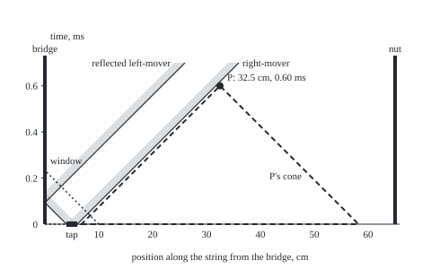
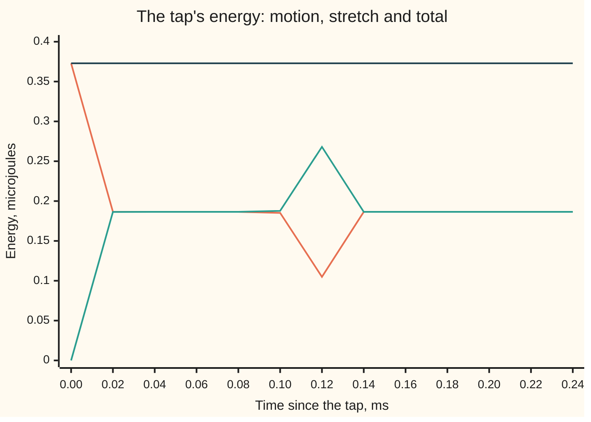
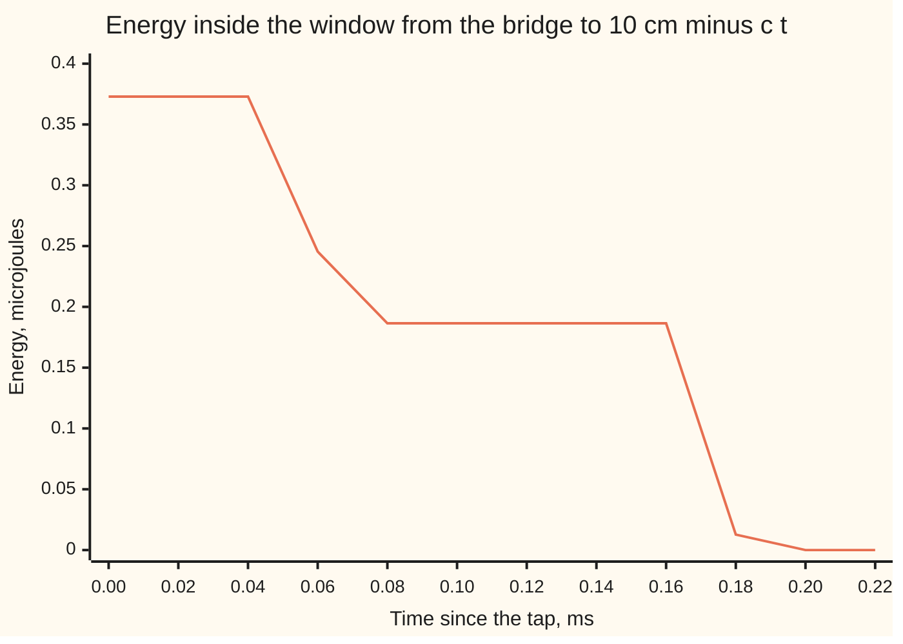

# Wave energy is conserved, and nothing outruns the wave speed

[Syllabus](../../../SYLLABUS.md) → [Partial differential equations](../README.md) → [Waves](../README.md#s05) → Wave energy is conserved, and nothing outruns the wave speed

---

## General Overview

A guitar's high E string is 65 cm long, from the bridge to the nut. It is steel, 0.254 mm across, tuned to 329.63 Hz, so a ripple runs along it at 428.519 m/s. A fingertip taps it 4 cm to 6 cm from the bridge, giving that stretch a sideways speed of up to 0.5 m/s. Imagine a pickup under the 12th fret, at 32.5 cm. Real pickups sit nearer the bridge; this one marks the point watched.

Two questions follow. How much energy did the tap put in, and where does it go? And when can the pickup first feel anything?

The answers on this card are 0.372905 µJ (microjoules, millionths of a joule), which never changes, and 0.6184 ms. Before 0.6184 ms the pickup point is exactly still, not just nearly still. The proof of both facts is the same bookkeeping: energy is never made or destroyed, it only flows, and it flows no faster than 428.519 m/s.

[d'Alembert](01-dalembert-and-characteristics-for-waves.md) gives the motion by formula. [Standing waves](../../08-Differential%20equations%20and%20dynamics/10-The%20Classical%20PDEs/06-standing-waves-on-a-string.md) showed in wing 08 that the whole string's energy stays fixed, so a motion is fixed by its start. This card follows the energy along the string, point by point, and turns that into a speed limit.

**The energy of a string is carried from point to point at no more than the wave speed c, so the total on a string with fixed ends never changes, a stretch of string that starts still stays still until a signal from outside can reach it at speed c, and two motions with the same start are the same motion.**

**What kind of fact this is:** a theorem, proved on this card in Why it works, for classical solutions (motions whose first and second rates exist and are continuous); the ideal string is a model, and a real steel string's stiffness breaks the speed limit slightly, as What breaks shows.

### The picture: the tap, its two halves, and the pickup's cone

<p align="center"></p>

Across: position from the bridge, cm. Up: time, ms. To scale: 6 px per cm across and 257.1 px per ms up, so every line moving at the wave speed rises at 45 degrees. The shaded bands carry the tap's energy. The dashed triangle is everything that can affect P. Its base, 6.79 cm to 58.21 cm, starts just past the tap's edge at 6 cm, so P is still at 0.60 ms. The dotted triangle is the window traced in How it moves.

---

## The formula

Notation from earlier cards, in one line each. $`u(x, t)`$ is the string's sideways displacement at distance $`x`$ from the bridge and time $`t`$. A subscript is a rate: $`u_t`$ is a point's speed, $`u_x`$ the string's slope. The string obeys $`u_{tt} = c^2 u_{xx}`$ with $`c = \sqrt{T/\rho}`$, and is held at $`u = 0`$ at both ends ([d'Alembert](01-dalembert-and-characteristics-for-waves.md)).

Two new quantities carry the card. The **energy density** $`e`$ is the energy per metre of string. The **energy flux** $`p`$ is the power flowing past a point, counted positive towards the nut:

```math
e = \frac{\rho}{2}\,u_t^2 + \frac{T}{2}\,u_x^2, \qquad p = -\,T\,u_t\,u_x, \qquad e_t + p_x = 0 .
```

**Read it aloud:** the energy per metre is motion plus stretch; the power flowing past a point is the sideways pull, tension times slope, times the point's speed; and the energy at a point changes only by what flows in minus what flows out.

Add it up over the whole string, and over a **window**: a stretch from $`x_-(t)`$ to $`x_+(t)`$ whose two walls move inward at speed $`c`$.

```math
\frac{dE}{dt} = p(0, t) - p(L, t) = 0, \qquad \frac{dE_W}{dt} = -\frac{\rho c}{2}\Big[\big(u_t - c\,u_x\big)^2\Big|_{x_+} + \big(u_t + c\,u_x\big)^2\Big|_{x_-}\Big] \;\le\; 0 .
```

**Read it aloud:** the whole string's energy never changes, because the fixed ends pass no power; the energy in a window shrinking at the wave speed can only fall, and what it loses through each wall is a perfect square.

| Symbol | Plain meaning | In our example | Push it up and the answer… |
| --- | --- | --- | --- |
| $`u`$, $`u_t`$, $`u_x`$ | displacement, m; a point's speed, m/s; the slope | 4.781081 µm at the pickup at 0.65 ms | — |
| $`x`$, $`t`$, $`L`$ | distance from the bridge, m; time since the tap, s; string length | 0 to 0.65 m; 0 to 0.65 ms; 0.65 m | — |
| $`\rho`$, $`T`$ | mass per metre; tension (typical values for a 0.254 mm steel string) | 0.3978 g/m; 73.04 N | $`E`$ grows with both |
| $`c`$ | wave speed, $`\sqrt{T/\rho} = 2 L f_1`$ with $`f_1`$ the pitch | 428.519 m/s | signals arrive sooner |
| $`g`$; $`x_c`$, $`a`$, $`v_0`$ | the tap's starting speed; its centre, half-width and peak | $`v_0\cos^2\!\big(\pi(x - x_c)/(2a)\big)`$ for $`\lvert x - x_c\rvert < a`$, 0 elsewhere; 5 cm, 1 cm, 0.5 m/s | $`E`$ grows as $`v_0^2`$ and as $`a`$ |
| $`e`$ | energy density: energy per metre, J/m | — | — |
| $`p`$ | energy flux: power flowing towards the nut, W | 0 at both ends | — |
| $`E(t)`$ | the whole string's energy, J | 0.372905 µJ at every time | — |
| $`x_-(t)`$, $`x_+(t)`$, $`E_W(t)`$ | a window's walls, each moving inward at $`c`$; the energy inside | 0 and 10 cm − $`ct`$; 0.372905 µJ falling to 0 | — |
| $`x_0`$, $`t_0`$ | a point and time asked about: the pickup | 32.5 cm; 0.60 ms | later $`t_0`$: a wider cone |
| $`n`$, $`k`$, $`EI`$ | mode number; $`k = n\pi/L`$, which is $`2\pi`$ divided by the mode's wavelength; bending stiffness of the wire | 1 to 2,000; —; 4.09e-05 N·m² | stiffer: a larger early signal |

### When it holds

- **No friction and no driving force.** Air drag or a bow adds a term to $`e_t + p_x`$. Then $`E`$ falls or rises, but the speed limit survives, because the walls still outrun everything.
- **Fixed or free ends.** A fixed end has $`u_t = 0`$ and a free end has $`u_x = 0`$; both make $`p = 0`$ there. A bridge that moves, as on a real guitar, takes power out at the end, which is how the sound reaches the body.
- **A bounded wave speed.** The window must shrink at least as fast as the fastest signal. A stiff string has no fastest signal, and a window shrinking at $`c/2`$ lets the tap's energy in: both are worked in What breaks.
- **Classical solutions with finite energy.** The proof differentiates under the integral. The $`\cos^2`$ tap qualifies; a hammer blow with a sudden jump in speed needs the weak form on [Weak waves](../06-Weak%20Solutions%20and%20Free%20Boundaries/11-weak-solutions-of-the-wave-equation.md).
- **Small swings.** The tension is taken as fixed. Large swings stretch the string and change $`T`$, and then $`c`$ depends on the motion.

---

## Why it works

### Step 0: the idea

A piece of string moves only when its neighbours pull on it. The pull is the tension times the slope, and the power it delivers is that pull times the speed. So energy is not a global total that changes all at once. It passes from piece to piece like money between accounts, and the law $`e_t + p_x = 0`$ is the ledger.

Two consequences follow. A string whose ends do no work keeps its total. And a window whose walls move inward at the wave speed can only lose energy, because nothing travels fast enough to cross a wall inward.

### Step 1: the energy ledger at one point

Differentiate $`e`$ in time and use the equation $`\rho\,u_{tt} = T u_{xx}`$:

```math
e_t = \rho\,u_t u_{tt} + T\,u_x u_{xt} = T\,u_t u_{xx} + T\,u_x u_{xt} = \big(T\,u_t u_x\big)_x = -\,p_x .
```

Only the product rule was used. The meaning is physical. The part of the string to the left of a point pulls the right part with sideways force $`-T u_x`$, and that force acts on a point moving at $`u_t`$. Its power, $`-T u_t u_x`$, is $`p`$.

### Step 2: the whole string keeps its energy

Integrate the ledger from bridge to nut. The left side is $`dE/dt`$. The right side is the flux at the bridge minus the flux at the nut. Both ends are fixed, so $`u_t = 0`$ there, so $`p = 0`$ there, so $`dE/dt = 0`$.

For the tap, everything starts as motion: $`E = \tfrac{\rho}{2}\int g^2\,dx = 3\rho v_0^2 a/8`$, which is 0.372905 µJ. The energy summed over the string's sine modes gives the same number, as in [Standing waves](../../08-Differential%20equations%20and%20dynamics/10-The%20Classical%20PDEs/06-standing-waves-on-a-string.md).

Uniqueness on the whole string is then one line, as in [Energy methods](../01-Classification%20and%20Well-Posedness/07-energy-methods-and-uniqueness.md). Two motions with the same start differ by a motion that starts with zero energy. It keeps zero energy, so it never moves.

### Step 3: a window shrinking at the wave speed only leaks

Take the window from $`x_-(t)`$ to $`x_+(t)`$, with $`x_-`$ moving right at $`c`$ and $`x_+`$ moving left at $`c`$. Its energy changes for two reasons.

1. Power flows through each wall: $`p`$ in at the left, $`p`$ out at the right.
2. Each wall sweeps inward and drops the energy it passes over: $`c\,e`$ per second at each wall.

Add them, use $`T = \rho c^2`$, and each wall's total is minus a perfect square. That is the formula for $`dE_W/dt`$. A square is never negative, so the window's energy never rises.

The squares have a meaning. A wave sliding right at speed $`c`$ without changing shape has $`u_t = -c\,u_x`$. That makes the left wall's square $`(u_t + c\,u_x)^2`$ zero, while the right wall's square is $`4u_t^2`$. So a right-moving wave leaves only through the right wall, and a left-moving wave only through the left wall. Nothing gets in, because each wall moves inward exactly as fast as the waves that would enter through it.

A window may also lean on the bridge. Then $`x_- = 0`$ stays still, and the bridge's term is $`p(0,t) = 0`$: a fixed end is a wall nothing crosses.

<details>
<summary>Detailed proof: the leak formula for a window shrinking at speed c</summary>

Let $`u`$ be a classical solution. Let $`x_-(t) = x_0 - c(t_0 - t)`$ and $`x_+(t) = x_0 + c(t_0 - t)`$ for $`0 \le t \le t_0`$, and $`E_W(t) = \int_{x_-}^{x_+} e\,dx`$. The rule for differentiating an integral with moving ends gives

$`\displaystyle E_W'(t) = \int_{x_-}^{x_+} e_t\,dx + e(x_+)\,x_+' - e(x_-)\,x_-' .`$

Put $`e_t = -p_x`$, $`x_+' = -c`$ and $`x_-' = c`$:

$`\displaystyle E_W'(t) = \big[-p - c\,e\big]_{x_+} + \big[p - c\,e\big]_{x_-} .`$

With $`T = \rho c^2`$, at the right wall

$`\displaystyle -p - c\,e = \rho c^2 u_t u_x - \frac{\rho c}{2}\big(u_t^2 + c^2 u_x^2\big) = -\frac{\rho c}{2}\big(u_t - c\,u_x\big)^2 ,`$

and at the left wall, in the same way,

$`\displaystyle p - c\,e = -\frac{\rho c}{2}\big(u_t + c\,u_x\big)^2 .`$

So $`E_W'(t) \le 0`$. If the window's left wall is the fixed end $`x = 0`$ instead, the left term is $`p(0, t) = 0`$, because $`u_t(0, t) = 0`$.

</details>

### Step 4: an empty cone stays empty, so nothing outruns c

Pick the pickup point $`x_0`$ and a time $`t_0`$. Start the window at the base $`x_0 - c t_0`$ to $`x_0 + c t_0`$, and let it shrink to $`x_0`$ at $`t_0`$. In space and time this window sweeps out a triangle, P's **cone** in the picture.

If the string is still and straight on the whole base at $`t = 0`$, then $`E_W(0) = 0`$. It cannot rise and cannot go negative, so it stays 0. Then $`u_t = 0`$ and $`u_x = 0`$ inside the cone, so $`u`$ keeps its starting value there, which is 0. In particular $`u(x_0, t_0) = 0`$.

For the pickup at 0.60 ms the base runs from 6.79 cm to 58.21 cm. The tap ends at 6 cm. So the pickup is still at 0.60 ms. The latest still time is when the base just touches the tap: $`(32.5 - 6)\text{ cm} / c`$ = 0.6184 ms.

[Dependence and influence](../01-Classification%20and%20Well-Posedness/09-domains-of-dependence-and-influence.md) runs the same argument in any number of dimensions, with an inequality in place of the exact squares. On a line the leak is exact, which is why the numbers below can check it.

### Step 5: uniqueness, one cone at a time

Apply Step 4 to the difference of two motions. If their starts agree on the base of a cone, the difference starts still there, so the two motions agree inside the whole cone.

Example: a second, equal tap at 54 cm to 56 cm, near the nut. The pickup cannot tell the two strings apart before $`(54 - 32.5)\text{ cm} / c`$ = 0.5017 ms. At 0.45 ms the difference at the pickup is exactly 0 µm; at 0.55 ms it is 5.834047 µm.

---

## Worked numbers, by hand

The string: $`L`$ = 0.65 m, $`f_1`$ = 329.63 Hz, steel of density 7,850 kg/m³ and radius 0.127 mm. The tap: $`x_c`$ = 5 cm, $`a`$ = 1 cm, $`v_0`$ = 0.5 m/s.

| Step | Arithmetic | Value |
| --- | --- | --- |
| wave speed | $`2 \times 0.65 \times 329.63`$ | 428.519 m/s |
| mass per metre | $`7850 \times \pi \times 0.000127^2`$ | 0.3978 g/m |
| tension | $`\rho c^2 = 0.0003978 \times 428.519^2`$ | 73.04 N |
| energy put in | $`3 \rho v_0^2 a / 8 = 3 \times 0.0003978 \times 0.25 \times 0.01 / 8`$ | 0.372905 µJ |
| after the halves separate | half motion, half stretch | 0.186453 + 0.186453 µJ |
| P's cone at 0.60 ms | $`32.5 \pm 42.8519 \times 0.60`$ cm | 6.79 cm to 58.21 cm |
| tap inside the base | tap ends at 6 cm | none |
| first motion at P | $`(32.5 - 6) / 42.8519`$ ms | **0.6184 ms** |

The pickup hears nothing for 0.6184 ms. Then the right-moving half arrives, carrying 0.186453 µJ. The other half went to the bridge, flipped over, and follows behind it.

### What breaks if you drop a piece

| Mistake | Comes out at | What went wrong |
| --- | --- | --- |
| Count only the motion energy | 0.186453 µJ at 0.20 ms: half the energy seems lost | the other half is stretch, $`\tfrac{T}{2}u_x^2`$ |
| Time the arrival from the tap's centre | 0.6417 ms, not 0.6184 ms | the front leaves from the tap's near edge, 26.5 cm away |
| Shrink P's window at $`c/2`$ | 0.186453 µJ inside at 0.20 ms, not 0 | the right-moving half overtakes the slow wall and gets in |
| Add the steel's bending stiffness | 0.145848 µm at P at 0.55 ms, before the front | short ripples on a stiff string travel faster than $`c`$, with no limit |

The last row is the speed limit's hypothesis failing. A real wire resists bending, which adds a fourth-order term to the equation. With hinged ends its modes stay sine shapes, but mode $`n`$ swings at $`c k\sqrt{1 + EI k^2/T}`$, where $`k = n\pi/L`$ and $`EI`$ is the bending stiffness, here 4.09e-05 N·m². The fastest ripples have no speed limit, so a faint precursor reaches the pickup early. [Dispersion](06-dispersion-group-velocity-and-kdv-in-outline.md) treats waves whose speed depends on their length.

---

## How it moves

The total never changes, yet the energy changes form and place. The puzzle is the bridge. The left-moving half runs into a fixed end, where the string cannot move at all. Where does its motion energy go?

| Time, ms | Motion (kinetic), µJ | Stretch, µJ | Total, µJ | What is happening |
| --- | --- | --- | --- | --- |
| 0.00 | 0.372905 | 0.000000 | 0.372905 | all motion, no slope yet |
| 0.04 | 0.186453 | 0.186453 | 0.372905 | two halves, apart |
| 0.10 | 0.185148 | 0.187758 | 0.372905 | left half reaching the bridge |
| 0.1167 | 0.093227 | 0.279678 | 0.372905 | its centre at the bridge |
| 0.14 | 0.186453 | 0.186453 | 0.372905 | reflected, upside down, heading right |

At the bridge the pulse overlaps its own upside-down reflection. Their speeds cancel and their slopes add. Motion energy turns into stretch energy, then back.

```
0.00 ms    motion   ######################################## 0.372905
           stretch                                            0.000000
0.04 ms    motion   ####################                     0.186453
           stretch  ####################                     0.186453
0.1167 ms  motion   ##########                               0.093227
           stretch  ##############################           0.279678
```



Orange: motion energy. Green: stretch energy. Dark: the total, flat at 0.372905 µJ.

Now the window against the bridge, the dotted triangle in the picture. It starts as 0 cm to 10 cm and its right wall moves left at $`c`$.



The line falls twice and never rises. First the right-moving half leaves through the moving wall, between 0.04 ms and 0.08 ms. Then the reflected half leaves, between 0.16 ms and 0.20 ms. Between the drops it is flat, because the left-moving half is inside and the bridge passes no power. At 0.058 ms the energy falls at 21.2169 µJ/ms, measured from the motion and from the leak formula alike.

---

## Code, from first principles, and it actually runs

The code builds the motion by d'Alembert's formula, with mirror images of the tap past each end to hold the ends fixed. It then reaches the energy and the speed limit by five roads, each built without the one it is checked against.

1. **Closed form:** $`3\rho v_0^2 a/8`$.
2. **From the motion:** speed and slope by centred differences (small symmetric steps), squared and added along the string by Simpson's rule (a weighted sum of samples), at 13 times.
3. **Sine modes:** the energy carried mode by mode, with the tail after 200 and 2,000 modes printed.
4. **The leak formula** against the measured rate of change of a window's energy.
5. **The modes again**, against d'Alembert at the pickup after the front arrives.

The speed limit is checked by the energy in P's cone, which stays 0, and by a stiff string, which breaks it.

### Python

```python
# Wave energy and finite speed on a 65 cm guitar string, tapped 5 cm from the bridge.
# Roads: d'Alembert with mirror images at the ends; the closed-form energy; a sine-mode
# series; the energy in a shrinking window against the leak formula.
from math import pi, sin, cos, sqrt

L, F1 = 0.65, 329.63                   # string length, m; open high E string, Hz
C = 2 * L * F1                         # wave speed, m/s
RHO = 7850 * pi * 0.000127 ** 2        # mass per metre, kg/m: steel wire 0.254 mm across
TEN = RHO * C * C                      # tension, N
EI = 2e11 * pi * 0.000127 ** 4 / 4     # bending stiffness of that wire, N m^2
XC, A, V0 = 0.05, 0.01, 0.5            # tap centre and half-width, m; peak speed, m/s
XP = 0.325                             # pickup point at the 12th fret, m
MS, UJ = 1e-3, 1e-6                    # one millisecond, one microjoule

def gamma(s, xc):                      # integral of the tap's speed from 0 to s
    if s <= xc - A: return 0.0
    if s >= xc + A: return V0 * A
    return V0 * ((s - xc + A) / 2 + A / (2 * pi) * sin(pi * (s - xc) / A))

def u(x, t, xc=XC):                    # d'Alembert, ends fixed by odd mirror images
    def big_g(s):
        s = (s + L) % (2 * L) - L
        return gamma(abs(s), xc)
    return (big_g(x + C * t) - big_g(x - C * t)) / (2 * C)

def rates(x, t, xc=XC, h=1e-6):        # speed u_t and slope u_x by centred differences
    ut = (u(x, t + h / C, xc) - u(x, t - h / C, xc)) / (2 * h / C)
    ux = (u(x + h, t, xc) - u(x - h, t, xc)) / (2 * h)
    return ut, ux

def energy(t, lo=0.0, hi=L, n=6500, xc=XC):   # (kinetic, stretch) in J, Simpson's rule
    k = p = 0.0
    if hi <= lo: return 0.0, 0.0
    step = (hi - lo) / n
    for i in range(n + 1):
        w = 1 if i in (0, n) else (4 if i % 2 else 2)
        ut, ux = rates(lo + i * step, t, xc)
        k += w * RHO / 2 * ut * ut
        p += w * TEN / 2 * ux * ux
    return k * step / 3, p * step / 3

def mode_coef(n):                      # b_n = (2/L) * integral of g sin(n pi x / L)
    m, h, s = 400, 2 * A / 400, 0.0
    for i in range(m + 1):
        x = XC - A + i * h
        w = 1 if i in (0, m) else (4 if i % 2 else 2)
        s += w * V0 * (1 + cos(pi * (x - XC) / A)) / 2 * sin(n * pi * x / L)
    return 2 / L * s * h / 3

def series_u(x, t, nmax, stiff):       # sine modes; a stiff wire has faster short waves
    s = 0.0
    for n in range(1, nmax + 1):
        k = n * pi / L
        w = C * k * sqrt(1 + stiff * EI / TEN * k * k)
        s += B[n - 1] / w * sin(w * t) * sin(k * x)
    return s

print(f"string: c = {C:.3f} m/s, rho = {RHO * 1e3:.4f} g/m, tension = {TEN:.2f} N, EI = {EI:.2e} N m^2")
E0 = 3 * RHO * V0 ** 2 * A / 8
print(f"energy, closed form 3 rho v0^2 a / 8 = {E0 / UJ:.6f} uJ")
B = [mode_coef(n) for n in range(1, 2001)]
for nmax in (200, 2000):
    em = sum(RHO * L * b * b / 4 for b in B[:nmax])
    print(f"energy, sum over {nmax} modes = {em / UJ:.6f} uJ, tail {(E0 - em) / UJ:.2e} uJ")
print("time ms | kinetic uJ | stretch uJ | total uJ")
totals, split = [], {}
for j in range(13):
    k, p = energy(0.02 * j * MS)
    totals.append(k + p); split[j] = (k, p)
    print(f"{0.02 * j:7.2f} | {k / UJ:10.6f} | {p / UJ:10.6f} | {(k + p) / UJ:8.6f}")
k117, p117 = energy(0.1167 * MS)
print(f"mid-reflection 0.1167 ms: kinetic {k117 / UJ:.6f} uJ, stretch {p117 / UJ:.6f} uJ")
print("bridge window [0, 10 cm - c t]: energy inside")
win = []
for j in range(12):
    t = 0.02 * j * MS
    k, p = energy(t, 0.0, 0.10 - C * t, 2000)
    win.append(k + p)
    print(f"  t = {0.02 * j:.2f} ms: right wall {(0.10 - C * t) * 100:6.3f} cm, energy {(k + p) / UJ:.6f} uJ")
tl, d = 0.058 * MS, 1e-5 * MS
slope = (sum(energy(tl + d, 0, 0.10 - C * (tl + d), 2000)) - sum(energy(tl - d, 0, 0.10 - C * (tl - d), 2000))) / (2 * d)
ut, ux = rates(0.10 - C * tl, tl)
leak = -RHO * C / 2 * (ut - C * ux) ** 2
print(f"at 0.058 ms: dE/dt = {slope * MS / UJ:.4f} uJ/ms; leak formula -(rho c/2)(u_t - c u_x)^2 = {leak * MS / UJ:.4f} uJ/ms")
T0 = 0.6 * MS
print(f"pickup cone to (32.5 cm, 0.60 ms): base {(XP - C * T0) * 100:.2f} to {(XP + C * T0) * 100:.2f} cm")
cone = [sum(energy(t * MS, XP - C * (T0 - t * MS), XP + C * (T0 - t * MS), 2000)) for t in (0.0, 0.3, 0.55)]
print("  energy inside at 0, 0.30, 0.55 ms: " + ", ".join(f"{e / UJ:.6f}" for e in cone) + " uJ")
print(f"  u(32.5 cm, 0.60 ms) = {u(XP, T0) * 1e6:.6f} um; first motion at {(XP - XC - A) / C / MS:.4f} ms")
late = series_u(XP, 0.65 * MS, 2000, 0)
print(f"  u(32.5 cm, 0.65 ms) = {u(XP, 0.65 * MS) * 1e6:.6f} um by d'Alembert, {late * 1e6:.6f} um by 2000 modes")
d1, d2 = u(XP, 0.45 * MS, 0.55), u(XP, 0.55 * MS, 0.55)
print(f"second tap at 55 cm changes u(32.5 cm) by {d1 * 1e6:.6f} um at 0.45 ms, {d2 * 1e6:.6f} um at 0.55 ms; "
      f"front {(0.54 - XP) / C / MS:.4f} ms")
print(f"wrong: kinetic energy only, at 0.20 ms = {split[10][0] / UJ:.6f} uJ")
print(f"wrong: arrival timed from the tap centre = {(XP - XC) / C / MS:.4f} ms")
slow = sum(energy(0.2 * MS, XP - C * T0 + C / 2 * 0.2 * MS, XP + C * T0 - C / 2 * 0.2 * MS, 2000))
print(f"wrong: window shrinking at c/2, energy inside at 0.20 ms = {slow / UJ:.6f} uJ")
s1, s2 = series_u(XP, 0.55 * MS, 1000, 1), series_u(XP, 0.55 * MS, 2000, 1)
ideal = series_u(XP, 0.55 * MS, 2000, 0)
print(f"stiff wire, u(32.5 cm, 0.55 ms): {s1 * 1e6:.6f} um (1000 modes), {s2 * 1e6:.6f} um (2000 modes); "
      f"ideal series {abs(ideal) * 1e6:.6f} um")
SX, ST = 6.0, 6.0 * C / 10             # figure: px per cm, px per ms (45-degree characteristics)
fx = lambda cm: 50 + SX * cm
fy = lambda ms: 250 - ST * ms
print(f"figure, px: scale {SX:.0f} per cm, {ST:.1f} per ms; tap ({fx(4):.1f}..{fx(6):.1f}, 250); P ({fx(32.5):.1f}, {fy(0.6):.1f}); "
      f"base ({fx((XP - C * T0) * 100):.1f}..{fx((XP + C * T0) * 100):.1f}); bridge apex y {fy(0.10 / C / MS):.1f}; "
      f"top y {fy(0.7):.1f}")
assert abs(totals[0] - E0) < 1e-6 * E0, "energy from the motion must match the closed form"
assert max(abs(e - E0) for e in totals) < 1e-6 * E0, "energy must stay fixed"
assert abs(sum(RHO * L * b * b / 4 for b in B) - E0) < 1e-6 * E0, "modes must carry the same energy"
assert all(b <= a + 1e-9 * E0 for a, b in zip(win, win[1:])), "window energy must never rise"
assert abs(slope - leak) < 1e-4 * abs(leak), "rate must equal the leak formula"
assert max(cone) < 1e-12 * E0 and abs(u(XP, T0)) + abs(d1) < 1e-15, "empty cone must stay empty"
assert abs(u(XP, 0.65 * MS) - late) < 1e-6 * abs(late), "d'Alembert and modes must agree after the front"
assert slow > 0.4 * E0 and abs(s2) > 1e3 * abs(ideal), "hypotheses failing must show"
print("ALL CHECKS PASS")
```

**Ran 2026-11-15 on macOS, Python 3.14.10, standard library only. All checks passed. Output, pasted from the run:**

```
string: c = 428.519 m/s, rho = 0.3978 g/m, tension = 73.04 N, EI = 4.09e-05 N m^2
energy, closed form 3 rho v0^2 a / 8 = 0.372905 uJ
energy, sum over 200 modes = 0.372883 uJ, tail 2.23e-05 uJ
energy, sum over 2000 modes = 0.372905 uJ, tail 1.79e-10 uJ
time ms | kinetic uJ | stretch uJ | total uJ
   0.00 |   0.372905 |   0.000000 | 0.372905
   0.02 |   0.186545 |   0.186360 | 0.372905
   0.04 |   0.186453 |   0.186453 | 0.372905
   0.06 |   0.186453 |   0.186453 | 0.372905
   0.08 |   0.186453 |   0.186453 | 0.372905
   0.10 |   0.185148 |   0.187758 | 0.372905
   0.12 |   0.104876 |   0.268029 | 0.372905
   0.14 |   0.186453 |   0.186453 | 0.372905
   0.16 |   0.186453 |   0.186453 | 0.372905
   0.18 |   0.186453 |   0.186453 | 0.372905
   0.20 |   0.186453 |   0.186453 | 0.372905
   0.22 |   0.186453 |   0.186453 | 0.372905
   0.24 |   0.186453 |   0.186453 | 0.372905
mid-reflection 0.1167 ms: kinetic 0.093227 uJ, stretch 0.279678 uJ
bridge window [0, 10 cm - c t]: energy inside
  t = 0.00 ms: right wall 10.000 cm, energy 0.372905 uJ
  t = 0.02 ms: right wall  9.143 cm, energy 0.372905 uJ
  t = 0.04 ms: right wall  8.286 cm, energy 0.372905 uJ
  t = 0.06 ms: right wall  7.429 cm, energy 0.245468 uJ
  t = 0.08 ms: right wall  6.572 cm, energy 0.186453 uJ
  t = 0.10 ms: right wall  5.715 cm, energy 0.186453 uJ
  t = 0.12 ms: right wall  4.858 cm, energy 0.186453 uJ
  t = 0.14 ms: right wall  4.001 cm, energy 0.186453 uJ
  t = 0.16 ms: right wall  3.144 cm, energy 0.186453 uJ
  t = 0.18 ms: right wall  2.287 cm, energy 0.012728 uJ
  t = 0.20 ms: right wall  1.430 cm, energy 0.000000 uJ
  t = 0.22 ms: right wall  0.573 cm, energy 0.000000 uJ
at 0.058 ms: dE/dt = -21.2169 uJ/ms; leak formula -(rho c/2)(u_t - c u_x)^2 = -21.2169 uJ/ms
pickup cone to (32.5 cm, 0.60 ms): base 6.79 to 58.21 cm
  energy inside at 0, 0.30, 0.55 ms: 0.000000, 0.000000, 0.000000 uJ
  u(32.5 cm, 0.60 ms) = 0.000000 um; first motion at 0.6184 ms
  u(32.5 cm, 0.65 ms) = 4.781081 um by d'Alembert, 4.781081 um by 2000 modes
second tap at 55 cm changes u(32.5 cm) by 0.000000 um at 0.45 ms, 5.834047 um at 0.55 ms; front 0.5017 ms
wrong: kinetic energy only, at 0.20 ms = 0.186453 uJ
wrong: arrival timed from the tap centre = 0.6417 ms
wrong: window shrinking at c/2, energy inside at 0.20 ms = 0.186453 uJ
stiff wire, u(32.5 cm, 0.55 ms): 0.145848 um (1000 modes), 0.145848 um (2000 modes); ideal series 0.000000 um
figure, px: scale 6 per cm, 257.1 per ms; tap (74.0..86.0, 250); P (245.0, 95.7); base (90.7..399.3); bridge apex y 190.0; top y 70.0
ALL CHECKS PASS
```

### Rust

```rust
// Wave energy and finite speed on a 65 cm guitar string, tapped 5 cm from the bridge.
// Roads: d'Alembert with mirror images at the ends; the closed-form energy; a sine-mode
// series; the energy in a shrinking window against the leak formula.
use std::f64::consts::PI;

const L: f64 = 0.65; // string length, m
const F1: f64 = 329.63; // open high E string, Hz
const XC: f64 = 0.05; // tap centre, m
const A: f64 = 0.01; // tap half-width, m
const V0: f64 = 0.5; // peak speed, m/s
const XP: f64 = 0.325; // pickup point at the 12th fret, m
const MS: f64 = 1e-3; // one millisecond
const UJ: f64 = 1e-6; // one microjoule

struct S { c: f64, rho: f64, ten: f64, ei: f64 }

fn sci(x: f64) -> String { // e-notation with a two-digit exponent, as Python prints it
    let s = format!("{:.2e}", x);
    let (m, e) = s.split_once('e').unwrap();
    let e: i32 = e.parse().unwrap();
    format!("{}e{}{:02}", m, if e < 0 { '-' } else { '+' }, e.abs())
}

fn gamma(s: f64, xc: f64) -> f64 { // integral of the tap's speed from 0 to s
    if s <= xc - A { return 0.0; }
    if s >= xc + A { return V0 * A; }
    V0 * ((s - xc + A) / 2.0 + A / (2.0 * PI) * (PI * (s - xc) / A).sin())
}

fn big_g(s: f64, xc: f64) -> f64 {
    let s = (s + L).rem_euclid(2.0 * L) - L;
    gamma(s.abs(), xc)
}

impl S {
    fn u(&self, x: f64, t: f64, xc: f64) -> f64 { // d'Alembert, ends fixed by odd mirror images
        (big_g(x + self.c * t, xc) - big_g(x - self.c * t, xc)) / (2.0 * self.c)
    }
    fn rates(&self, x: f64, t: f64, xc: f64) -> (f64, f64) { // u_t and u_x, centred differences
        let h = 1e-6;
        let ut = (self.u(x, t + h / self.c, xc) - self.u(x, t - h / self.c, xc)) / (2.0 * h / self.c);
        let ux = (self.u(x + h, t, xc) - self.u(x - h, t, xc)) / (2.0 * h);
        (ut, ux)
    }
    fn energy(&self, t: f64, lo: f64, hi: f64, n: usize, xc: f64) -> (f64, f64) { // Simpson
        if hi <= lo { return (0.0, 0.0); }
        let step = (hi - lo) / n as f64;
        let (mut k, mut p) = (0.0, 0.0);
        for i in 0..=n {
            let w = if i == 0 || i == n { 1.0 } else if i % 2 == 1 { 4.0 } else { 2.0 };
            let (ut, ux) = self.rates(lo + i as f64 * step, t, xc);
            k += w * self.rho / 2.0 * ut * ut;
            p += w * self.ten / 2.0 * ux * ux;
        }
        (k * step / 3.0, p * step / 3.0)
    }
    fn e(&self, t: f64, lo: f64, hi: f64) -> f64 { let (k, p) = self.energy(t, lo, hi, 2000, XC); k + p }
    fn series_u(&self, b: &[f64], x: f64, t: f64, nmax: usize, stiff: f64) -> f64 {
        let mut s = 0.0;
        for n in 1..=nmax {
            let k = n as f64 * PI / L;
            let w = self.c * k * (1.0 + stiff * self.ei / self.ten * k * k).sqrt();
            s += b[n - 1] / w * (w * t).sin() * (k * x).sin();
        }
        s
    }
}

fn mode_coef(n: usize) -> f64 { // b_n = (2/L) * integral of g sin(n pi x / L)
    let (m, h) = (400usize, 2.0 * A / 400.0);
    let mut s = 0.0;
    for i in 0..=m {
        let x = XC - A + i as f64 * h;
        let w = if i == 0 || i == m { 1.0 } else if i % 2 == 1 { 4.0 } else { 2.0 };
        s += w * V0 * (1.0 + (PI * (x - XC) / A).cos()) / 2.0 * (n as f64 * PI * x / L).sin();
    }
    2.0 / L * s * h / 3.0
}

fn main() {
    let c = 2.0 * L * F1;
    let rho = 7850.0 * PI * 0.000127f64.powi(2);
    let st = S { c, rho, ten: rho * c * c, ei: 2e11 * PI * 0.000127f64.powi(4) / 4.0 };
    println!("string: c = {:.3} m/s, rho = {:.4} g/m, tension = {:.2} N, EI = {} N m^2", c, rho * 1e3, st.ten, sci(st.ei));
    let e0 = 3.0 * rho * V0 * V0 * A / 8.0;
    println!("energy, closed form 3 rho v0^2 a / 8 = {:.6} uJ", e0 / UJ);
    let b: Vec<f64> = (1..=2000).map(mode_coef).collect();
    let mode_e = |nmax: usize| b[..nmax].iter().map(|x| rho * L * x * x / 4.0).sum::<f64>();
    for nmax in [200usize, 2000] {
        let em = mode_e(nmax);
        println!("energy, sum over {} modes = {:.6} uJ, tail {} uJ", nmax, em / UJ, sci((e0 - em) / UJ));
    }
    println!("time ms | kinetic uJ | stretch uJ | total uJ");
    let (mut totals, mut split) = (vec![], vec![]);
    for j in 0..13 {
        let (k, p) = st.energy(0.02 * j as f64 * MS, 0.0, L, 6500, XC);
        totals.push(k + p);
        split.push((k, p));
        println!("{:7.2} | {:10.6} | {:10.6} | {:8.6}", 0.02 * j as f64, k / UJ, p / UJ, (k + p) / UJ);
    }
    let (k117, p117) = st.energy(0.1167 * MS, 0.0, L, 6500, XC);
    println!("mid-reflection 0.1167 ms: kinetic {:.6} uJ, stretch {:.6} uJ", k117 / UJ, p117 / UJ);
    println!("bridge window [0, 10 cm - c t]: energy inside");
    let mut win = vec![];
    for j in 0..12 {
        let t = 0.02 * j as f64 * MS;
        let e = st.e(t, 0.0, 0.10 - c * t);
        win.push(e);
        println!("  t = {:.2} ms: right wall {:6.3} cm, energy {:.6} uJ", 0.02 * j as f64, (0.10 - c * t) * 100.0, e / UJ);
    }
    let (tl, d) = (0.058 * MS, 1e-5 * MS);
    let slope = (st.e(tl + d, 0.0, 0.10 - c * (tl + d)) - st.e(tl - d, 0.0, 0.10 - c * (tl - d))) / (2.0 * d);
    let (ut, ux) = st.rates(0.10 - c * tl, tl, XC);
    let leak = -rho * c / 2.0 * (ut - c * ux).powi(2);
    println!("at 0.058 ms: dE/dt = {:.4} uJ/ms; leak formula -(rho c/2)(u_t - c u_x)^2 = {:.4} uJ/ms", slope * MS / UJ, leak * MS / UJ);
    let t0 = 0.6 * MS;
    println!("pickup cone to (32.5 cm, 0.60 ms): base {:.2} to {:.2} cm", (XP - c * t0) * 100.0, (XP + c * t0) * 100.0);
    let cone: Vec<f64> = [0.0, 0.3, 0.55].iter().map(|&t| st.e(t * MS, XP - c * (t0 - t * MS), XP + c * (t0 - t * MS))).collect();
    let cs: Vec<String> = cone.iter().map(|e| format!("{:.6}", e / UJ)).collect();
    println!("  energy inside at 0, 0.30, 0.55 ms: {} uJ", cs.join(", "));
    println!("  u(32.5 cm, 0.60 ms) = {:.6} um; first motion at {:.4} ms", st.u(XP, t0, XC) * 1e6, (XP - XC - A) / c / MS);
    let late = st.series_u(&b, XP, 0.65 * MS, 2000, 0.0);
    println!("  u(32.5 cm, 0.65 ms) = {:.6} um by d'Alembert, {:.6} um by 2000 modes", st.u(XP, 0.65 * MS, XC) * 1e6, late * 1e6);
    let (d1, d2) = (st.u(XP, 0.45 * MS, 0.55), st.u(XP, 0.55 * MS, 0.55));
    println!("second tap at 55 cm changes u(32.5 cm) by {:.6} um at 0.45 ms, {:.6} um at 0.55 ms; front {:.4} ms",
             d1 * 1e6, d2 * 1e6, (0.54 - XP) / c / MS);
    println!("wrong: kinetic energy only, at 0.20 ms = {:.6} uJ", split[10].0 / UJ);
    println!("wrong: arrival timed from the tap centre = {:.4} ms", (XP - XC) / c / MS);
    let slow = st.e(0.2 * MS, XP - c * t0 + c / 2.0 * 0.2 * MS, XP + c * t0 - c / 2.0 * 0.2 * MS);
    println!("wrong: window shrinking at c/2, energy inside at 0.20 ms = {:.6} uJ", slow / UJ);
    let s1 = st.series_u(&b, XP, 0.55 * MS, 1000, 1.0);
    let s2 = st.series_u(&b, XP, 0.55 * MS, 2000, 1.0);
    let ideal = st.series_u(&b, XP, 0.55 * MS, 2000, 0.0);
    println!("stiff wire, u(32.5 cm, 0.55 ms): {:.6} um (1000 modes), {:.6} um (2000 modes); ideal series {:.6} um",
             s1 * 1e6, s2 * 1e6, ideal.abs() * 1e6);
    let (sx, sy) = (6.0, 6.0 * c / 10.0); // figure: px per cm, px per ms
    let fx = |cm: f64| 50.0 + sx * cm;
    let fy = |ms: f64| 250.0 - sy * ms;
    println!("figure, px: scale {:.0} per cm, {:.1} per ms; tap ({:.1}..{:.1}, 250); P ({:.1}, {:.1}); base ({:.1}..{:.1}); bridge apex y {:.1}; top y {:.1}",
             sx, sy, fx(4.0), fx(6.0), fx(32.5), fy(0.6), fx((XP - c * t0) * 100.0), fx((XP + c * t0) * 100.0), fy(0.10 / c / MS), fy(0.7));
    assert!((totals[0] - e0).abs() < 1e-6 * e0, "energy from the motion must match the closed form");
    assert!(totals.iter().all(|e| (e - e0).abs() < 1e-6 * e0), "energy must stay fixed");
    assert!((mode_e(2000) - e0).abs() < 1e-6 * e0, "modes must carry the same energy");
    assert!(win.windows(2).all(|w| w[1] <= w[0] + 1e-9 * e0), "window energy must never rise");
    assert!((slope - leak).abs() < 1e-4 * leak.abs(), "rate must equal the leak formula");
    assert!(cone.iter().cloned().fold(0.0, f64::max) < 1e-12 * e0 && st.u(XP, t0, XC).abs() + d1.abs() < 1e-15, "empty cone must stay empty");
    assert!((st.u(XP, 0.65 * MS, XC) - late).abs() < 1e-6 * late.abs(), "d'Alembert and modes must agree after the front");
    assert!(slow > 0.4 * e0 && s2.abs() > 1e3 * ideal.abs(), "hypotheses failing must show");
    println!("ALL CHECKS PASS");
}
```

**Ran 2026-11-15 on macOS, rustc 1.98.1, no crates. All checks passed. Output, pasted from the run:**

```
string: c = 428.519 m/s, rho = 0.3978 g/m, tension = 73.04 N, EI = 4.09e-05 N m^2
energy, closed form 3 rho v0^2 a / 8 = 0.372905 uJ
energy, sum over 200 modes = 0.372883 uJ, tail 2.23e-05 uJ
energy, sum over 2000 modes = 0.372905 uJ, tail 1.79e-10 uJ
time ms | kinetic uJ | stretch uJ | total uJ
   0.00 |   0.372905 |   0.000000 | 0.372905
   0.02 |   0.186545 |   0.186360 | 0.372905
   0.04 |   0.186453 |   0.186453 | 0.372905
   0.06 |   0.186453 |   0.186453 | 0.372905
   0.08 |   0.186453 |   0.186453 | 0.372905
   0.10 |   0.185148 |   0.187758 | 0.372905
   0.12 |   0.104876 |   0.268029 | 0.372905
   0.14 |   0.186453 |   0.186453 | 0.372905
   0.16 |   0.186453 |   0.186453 | 0.372905
   0.18 |   0.186453 |   0.186453 | 0.372905
   0.20 |   0.186453 |   0.186453 | 0.372905
   0.22 |   0.186453 |   0.186453 | 0.372905
   0.24 |   0.186453 |   0.186453 | 0.372905
mid-reflection 0.1167 ms: kinetic 0.093227 uJ, stretch 0.279678 uJ
bridge window [0, 10 cm - c t]: energy inside
  t = 0.00 ms: right wall 10.000 cm, energy 0.372905 uJ
  t = 0.02 ms: right wall  9.143 cm, energy 0.372905 uJ
  t = 0.04 ms: right wall  8.286 cm, energy 0.372905 uJ
  t = 0.06 ms: right wall  7.429 cm, energy 0.245468 uJ
  t = 0.08 ms: right wall  6.572 cm, energy 0.186453 uJ
  t = 0.10 ms: right wall  5.715 cm, energy 0.186453 uJ
  t = 0.12 ms: right wall  4.858 cm, energy 0.186453 uJ
  t = 0.14 ms: right wall  4.001 cm, energy 0.186453 uJ
  t = 0.16 ms: right wall  3.144 cm, energy 0.186453 uJ
  t = 0.18 ms: right wall  2.287 cm, energy 0.012728 uJ
  t = 0.20 ms: right wall  1.430 cm, energy 0.000000 uJ
  t = 0.22 ms: right wall  0.573 cm, energy 0.000000 uJ
at 0.058 ms: dE/dt = -21.2169 uJ/ms; leak formula -(rho c/2)(u_t - c u_x)^2 = -21.2169 uJ/ms
pickup cone to (32.5 cm, 0.60 ms): base 6.79 to 58.21 cm
  energy inside at 0, 0.30, 0.55 ms: 0.000000, 0.000000, 0.000000 uJ
  u(32.5 cm, 0.60 ms) = 0.000000 um; first motion at 0.6184 ms
  u(32.5 cm, 0.65 ms) = 4.781081 um by d'Alembert, 4.781081 um by 2000 modes
second tap at 55 cm changes u(32.5 cm) by 0.000000 um at 0.45 ms, 5.834047 um at 0.55 ms; front 0.5017 ms
wrong: kinetic energy only, at 0.20 ms = 0.186453 uJ
wrong: arrival timed from the tap centre = 0.6417 ms
wrong: window shrinking at c/2, energy inside at 0.20 ms = 0.186453 uJ
stiff wire, u(32.5 cm, 0.55 ms): 0.145848 um (1000 modes), 0.145848 um (2000 modes); ideal series 0.000000 um
figure, px: scale 6 per cm, 257.1 per ms; tap (74.0..86.0, 250); P (245.0, 95.7); base (90.7..399.3); bridge apex y 190.0; top y 70.0
ALL CHECKS PASS
```

### Lean

Lean proves Steps 2 to 5 of Why it works for classical solutions, and checks the worked numbers in exact fractions.

- Take a classical solution with each end fixed or free. Then the whole string's energy $`E(t)`$ equals its starting value at every later time.
- Take a window whose walls move inward at $`c`$, with its base on the string. Then, for $`0 < t < t_0`$, $`E_W`$ changes exactly as the formula for $`dE_W/dt`$ says.
- Take the same window. Then its energy $`E_W`$ never rises between times 0 and $`t_0`$.
- Take $`T = \rho c^2`$. Then at the right wall, $`-p - c\,e`$ equals $`-\frac{\rho c}{2}(u_t - c\,u_x)^2`$ exactly.
- Take two classical solutions with the same displacement and speed on a cone's base, inside the string. Then they agree everywhere inside that cone.
- In exact fractions, the wave speed is 428.519 m/s, and P's cone base runs from 6.78886 cm to 58.21114 cm.
- The tap's edge at 6 cm lies outside that base, and first motion at P falls between 0.6184 ms and 0.6185 ms.
- Timed from the tap's centre, the wrong arrival falls between 0.6417 ms and 0.6418 ms.
- The second tap's front reaches P between 0.5017 ms and 0.5018 ms, so after 0.45 ms and before 0.55 ms.
- The right wall of the window against the bridge sits at 1.42962 cm at 0.20 ms.

The tap's 0.372905 µJ, the sine modes, the window at $`c/2`$ and the stiff string are left to the Python and Rust checks.

```lean
-- Wave energy is conserved, and nothing outruns the wave speed: for classical solutions of the string's wave equation, two motions that start alike on a cone's base agree inside the cone, the whole string's energy stays fixed when its ends are fixed or free, and the energy in a window shrinking at the wave speed only leaks out, at the rate of the card's leak formula.
import Mathlib.Analysis.Calculus.ContDiff.Basic
import Mathlib.Analysis.SpecialFunctions.Sqrt
import Mathlib.MeasureTheory.Integral.IntervalIntegral.Basic
import Mathlib.Analysis.Calculus.ParametricIntervalIntegral
import Mathlib.Analysis.Calculus.FDeriv.Symmetric
import Mathlib.Analysis.Calculus.Deriv.Prod
import Mathlib.Analysis.Calculus.Deriv.MeanValue
import Mathlib.MeasureTheory.Integral.IntervalIntegral.FundThmCalculus

open Set

/-- Chain rule along a curve `r ↦ (α r, β r)` for a differentiable function of two variables. -/
lemma wave_curve {f : ℝ × ℝ → ℝ} (hf : Differentiable ℝ f) {α β : ℝ → ℝ} {α' β' s : ℝ}
    (hα : HasDerivAt α α' s) (hβ : HasDerivAt β β' s) :
    HasDerivAt (fun r => f (α r, β r))
      (α' * fderiv ℝ f (α s, β s) (1, 0) + β' * fderiv ℝ f (α s, β s) (0, 1)) s := by
  have h2 := (hf (α s, β s)).hasFDerivAt.comp_hasDerivAt s (HasDerivAt.prodMk hα hβ)
  refine h2.congr_deriv ?_
  have : ((α', β') : ℝ × ℝ) = α' • ((1 : ℝ), (0 : ℝ)) + β' • ((0 : ℝ), (1 : ℝ)) := by
    ext <;> simp
  rw [this, map_add, map_smul, map_smul, smul_eq_mul, smul_eq_mul]

lemma wave_d1 {f : ℝ × ℝ → ℝ} (hf : Differentiable ℝ f) (x t : ℝ) :
    HasDerivAt (fun y => f (y, t)) (fderiv ℝ f (x, t) (1, 0)) x := by
  simpa using wave_curve hf (hasDerivAt_id x) (hasDerivAt_const x t)

lemma wave_d2 {f : ℝ × ℝ → ℝ} (hf : Differentiable ℝ f) (x t : ℝ) :
    HasDerivAt (fun s => f (x, s)) (fderiv ℝ f (x, t) (0, 1)) t := by
  simpa using wave_curve hf (hasDerivAt_const t x) (hasDerivAt_id t)

lemma wave_partial_contDiff {U : ℝ × ℝ → ℝ} (hU : ContDiff ℝ 2 U) (v : ℝ × ℝ) :
    ContDiff ℝ 1 (fun z => fderiv ℝ U z v) :=
  (hU.fderiv_right (m := 1) (by norm_num)).clm_apply contDiff_const

lemma wave_mixed {U : ℝ × ℝ → ℝ} (hU : ContDiff ℝ 2 U) (z : ℝ × ℝ) :
    fderiv ℝ (fun z => fderiv ℝ U z (1, 0)) z (0, 1)
      = fderiv ℝ (fun z => fderiv ℝ U z (0, 1)) z (1, 0) := by
  have hd : Differentiable ℝ (fderiv ℝ U) :=
    (hU.fderiv_right (m := 1) (by norm_num)).differentiable (by norm_num)
  have h : ∀ v w : ℝ × ℝ, fderiv ℝ (fun z => fderiv ℝ U z v) z w = fderiv ℝ (fderiv ℝ U) z w v := by
    intro v w
    rw [fderiv_clm_apply (hd z) (differentiableAt_const v)]
    simp
  rw [h, h]
  exact (hU.contDiffAt.isSymmSndFDerivAt (by simp)) _ _

lemma wave_hasDerivAt_integral {G G' : ℝ → ℝ → ℝ} (a b t₀ : ℝ)
    (hG : Continuous (fun p : ℝ × ℝ => G p.1 p.2))
    (hG' : Continuous (fun p : ℝ × ℝ => G' p.1 p.2))
    (hd : ∀ t θ, HasDerivAt (fun s => G s θ) (G' t θ) t) :
    HasDerivAt (fun t => ∫ θ in a..b, G t θ) (∫ θ in a..b, G' t₀ θ) t₀ := by
  obtain ⟨M, hM⟩ := ((isCompact_closedBall t₀ 1).prod (isCompact_uIcc (a := a) (b := b))).exists_bound_of_continuousOn
    hG'.continuousOn
  have hc : ∀ t, Continuous (G t) := fun t => hG.comp (continuous_const.prodMk continuous_id)
  have hc' : ∀ t, Continuous (G' t) := fun t => hG'.comp (continuous_const.prodMk continuous_id)
  refine (intervalIntegral.hasDerivAt_integral_of_dominated_loc_of_deriv_le (bound := fun _ => M)
    (Metric.closedBall_mem_nhds t₀ one_pos) ?_ ?_ ?_ ?_ ?_ ?_).2
  · exact Filter.Eventually.of_forall fun t => (hc t).aestronglyMeasurable
  · exact (hc t₀).intervalIntegrable _ _
  · exact (hc' t₀).aestronglyMeasurable
  · exact Filter.Eventually.of_forall fun θ hθ t ht => hM (t, θ) ⟨ht, uIoc_subset_uIcc hθ⟩
  · exact intervalIntegrable_const
  · exact Filter.Eventually.of_forall fun θ _ t _ => hd t θ

lemma wave_integral_pos {f : ℝ → ℝ} {a b x : ℝ} (hf : Continuous f) (h0 : ∀ y, 0 ≤ f y)
    (hx : x ∈ Ioo a b) (hfx : 0 < f x) : 0 < ∫ y in a..b, f y := by
  have hab : a < b := hx.1.trans hx.2
  rw [intervalIntegral.integral_pos_iff_support_of_nonneg_ae (Filter.Eventually.of_forall h0)
    (hf.intervalIntegrable a b)]
  refine ⟨hab, ?_⟩
  have hopen : IsOpen (Function.support f ∩ Ioo a b) := hf.isOpen_support.inter isOpen_Ioo
  exact (hopen.measure_pos MeasureTheory.volume ⟨x, hfx.ne', hx⟩).trans_le
    (MeasureTheory.measure_mono (inter_subset_inter_right _ Ioo_subset_Ioc_self))

/-- First and second partial derivatives of a twice continuously differentiable `u x t`. -/
lemma wave_setup (u : ℝ → ℝ → ℝ) (hu : ContDiff ℝ 2 (Function.uncurry u)) :
    ∃ Ut Ux Utt Utx Uxt Uxx : ℝ × ℝ → ℝ,
      Continuous Ut ∧ Continuous Ux ∧ Continuous Utt ∧ Continuous Utx ∧ Continuous Uxt ∧
      Continuous Uxx ∧
      (∀ x t, HasDerivAt (fun s => u x s) (Ut (x, t)) t) ∧
      (∀ x t, HasDerivAt (fun y => u y t) (Ux (x, t)) x) ∧
      (∀ x t, deriv (fun s => deriv (fun r => u x r) s) t = Utt (x, t)) ∧
      (∀ x t, deriv (fun y => deriv (fun z => u z t) y) x = Uxx (x, t)) ∧
      (∀ z, Uxt z = Utx z) ∧
      (∀ (α β : ℝ → ℝ) (α' β' s : ℝ), HasDerivAt α α' s → HasDerivAt β β' s →
        HasDerivAt (fun r => Ut (α r, β r)) (α' * Utx (α s, β s) + β' * Utt (α s, β s)) s) ∧
      (∀ (α β : ℝ → ℝ) (α' β' s : ℝ), HasDerivAt α α' s → HasDerivAt β β' s →
        HasDerivAt (fun r => Ux (α r, β r)) (α' * Uxx (α s, β s) + β' * Uxt (α s, β s)) s) := by
  have hU : Differentiable ℝ (Function.uncurry u) := hu.differentiable (by norm_num)
  have h1 := wave_partial_contDiff hu ((0 : ℝ), (1 : ℝ))
  have h2 := wave_partial_contDiff hu ((1 : ℝ), (0 : ℝ))
  have dt := h1.differentiable (by norm_num)
  have dx := h2.differentiable (by norm_num)
  have ct := h1.continuous_fderiv (by norm_num)
  have cx := h2.continuous_fderiv (by norm_num)
  refine ⟨fun z => fderiv ℝ (Function.uncurry u) z (0, 1),
    fun z => fderiv ℝ (Function.uncurry u) z (1, 0),
    fun z => fderiv ℝ (fun z => fderiv ℝ (Function.uncurry u) z (0, 1)) z (0, 1),
    fun z => fderiv ℝ (fun z => fderiv ℝ (Function.uncurry u) z (0, 1)) z (1, 0),
    fun z => fderiv ℝ (fun z => fderiv ℝ (Function.uncurry u) z (1, 0)) z (0, 1),
    fun z => fderiv ℝ (fun z => fderiv ℝ (Function.uncurry u) z (1, 0)) z (1, 0),
    h1.continuous, h2.continuous, ct.clm_apply continuous_const, ct.clm_apply continuous_const,
    cx.clm_apply continuous_const, cx.clm_apply continuous_const,
    fun x t => wave_d2 hU x t, fun x t => wave_d1 hU x t, ?_, ?_, fun z => wave_mixed hu z,
    fun α β α' β' s hα hβ => wave_curve dt hα hβ, fun α β α' β' s hα hβ => wave_curve dx hα hβ⟩
  · intro x t
    have : (fun s => deriv (fun r => u x r) s)
        = fun s => fderiv ℝ (Function.uncurry u) (x, s) (0, 1) :=
      funext fun s => (wave_d2 hU x s).deriv
    rw [this]
    exact (wave_d2 dt x t).deriv
  · intro x t
    have : (fun y => deriv (fun z => u z t) y)
        = fun y => fderiv ℝ (Function.uncurry u) (y, t) (1, 0) :=
      funext fun y => (wave_d1 hU y t).deriv
    rw [this]
    exact (wave_d1 dx x t).deriv

/-- The moving-window energy identity, used by the first and third theorems. -/
lemma wave_window_core (ρ T c L x₀ t₀ : ℝ) (u : ℝ → ℝ → ℝ)
    (hρ : 0 < ρ) (hT : 0 < T) (hc : c = Real.sqrt (T / ρ)) (_ht₀ : 0 ≤ t₀)
    (h_base_left : 0 ≤ x₀ - c * t₀) (h_base_right : x₀ + c * t₀ ≤ L)
    (hu : ContDiff ℝ 2 (Function.uncurry u))
    (hu_wave : ∀ x ∈ Icc 0 L, ∀ t ∈ Ici (0 : ℝ),
      ρ * deriv (fun s => deriv (fun r => u x r) s) t
        = T * deriv (fun y => deriv (fun z => u z t) y) x) :
    let E_W : ℝ → ℝ := fun t =>
      ∫ x in (x₀ - c * (t₀ - t))..(x₀ + c * (t₀ - t)),
        ρ / 2 * deriv (fun s => u x s) t ^ 2 + T / 2 * deriv (fun y => u y t) x ^ 2
    (∀ t ∈ Ioo 0 t₀, HasDerivAt E_W
      (-(ρ * c / 2) *
        ((deriv (fun s => u (x₀ + c * (t₀ - t)) s) t
            - c * deriv (fun y => u y t) (x₀ + c * (t₀ - t))) ^ 2
          + (deriv (fun s => u (x₀ - c * (t₀ - t)) s) t
            + c * deriv (fun y => u y t) (x₀ - c * (t₀ - t))) ^ 2)) t) ∧
    AntitoneOn E_W (Icc 0 t₀) := by
  intro E_W
  obtain ⟨Ut, Ux, Utt, Utx, Uxt, Uxx, cUt, cUx, cUtt, cUtx, cUxt, cUxx, hdt, hdx, hdtt, hdxx,
    hsym, hcurt, hcurx⟩ := wave_setup u hu
  have hdt' : ∀ x t, deriv (fun s => u x s) t = Ut (x, t) := fun x t => (hdt x t).deriv
  have hdx' : ∀ x t, deriv (fun y => u y t) x = Ux (x, t) := fun x t => (hdx x t).deriv
  have hc0 : 0 ≤ c := hc ▸ Real.sqrt_nonneg _
  have hTc : T = ρ * c ^ 2 := by
    rw [hc, Real.sq_sqrt (div_nonneg hT.le hρ.le)]
    field_simp
  have hpde : ∀ x ∈ Icc 0 L, ∀ t ∈ Ici (0 : ℝ), ρ * Utt (x, t) = T * Uxx (x, t) := by
    intro x hx t ht
    rw [← hdtt, ← hdxx]
    exact hu_wave x hx t ht
  obtain ⟨G, hG⟩ : ∃ G : ℝ → ℝ → ℝ, G = fun t θ => c * (t₀ - t) *
      (ρ / 2 * Ut (c * (t₀ - t) * θ + x₀, t) ^ 2 + T / 2 * Ux (c * (t₀ - t) * θ + x₀, t) ^ 2) :=
    ⟨_, rfl⟩
  obtain ⟨G', hG'⟩ : ∃ G' : ℝ → ℝ → ℝ, G' = fun t θ =>
      -c * (ρ / 2 * Ut (c * (t₀ - t) * θ + x₀, t) ^ 2 + T / 2 * Ux (c * (t₀ - t) * θ + x₀, t) ^ 2)
      + c * (t₀ - t) * (ρ * Ut (c * (t₀ - t) * θ + x₀, t) *
          (-(c * θ) * Utx (c * (t₀ - t) * θ + x₀, t) + Utt (c * (t₀ - t) * θ + x₀, t))
        + T * Ux (c * (t₀ - t) * θ + x₀, t) *
          (-(c * θ) * Uxx (c * (t₀ - t) * θ + x₀, t) + Uxt (c * (t₀ - t) * θ + x₀, t))) :=
    ⟨_, rfl⟩
  have hEW : E_W = fun t => ∫ θ in (-1 : ℝ)..1, G t θ := by
    funext t
    have h := intervalIntegral.smul_integral_comp_mul_add (a := (-1 : ℝ)) (b := 1)
      (f := fun x => ρ / 2 * Ut (x, t) ^ 2 + T / 2 * Ux (x, t) ^ 2) (c * (t₀ - t)) x₀
    rw [show c * (t₀ - t) * (-1) + x₀ = x₀ - c * (t₀ - t) by ring,
      show c * (t₀ - t) * 1 + x₀ = x₀ + c * (t₀ - t) by ring] at h
    simp only [E_W, hdt', hdx']
    rw [← h, hG, smul_eq_mul, ← intervalIntegral.integral_const_mul]
  have hGc : Continuous (fun p : ℝ × ℝ => G p.1 p.2) := by
    rw [hG]; dsimp only; fun_prop
  have hG'c : Continuous (fun p : ℝ × ℝ => G' p.1 p.2) := by
    rw [hG']; dsimp only; fun_prop
  have hGd : ∀ t θ, HasDerivAt (fun s => G s θ) (G' t θ) t := by
    intro t θ
    have hα : HasDerivAt (fun s => c * (t₀ - s) * θ + x₀) (-(c * θ)) t := by
      exact ((((hasDerivAt_id t).const_sub t₀).const_mul c).mul_const θ).add_const x₀
        |>.congr_deriv (by ring)
    have hβ : HasDerivAt (fun s : ℝ => s) 1 t := hasDerivAt_id' t
    have h1 := hcurt _ _ _ _ t hα hβ
    have h2 := hcurx _ _ _ _ t hα hβ
    have hr : HasDerivAt (fun s => c * (t₀ - s)) (-c) t := by
      exact ((hasDerivAt_id t).const_sub t₀).const_mul c |>.congr_deriv (by ring)
    have := hr.fun_mul (((h1.fun_pow 2).const_mul (ρ / 2)).fun_add ((h2.fun_pow 2).const_mul (T / 2)))
    rw [hG, hG']
    refine this.congr_deriv ?_
    simp only [Nat.cast_ofNat, Nat.reduceSub, pow_one]
    ring
  have hall : ∀ t, HasDerivAt E_W (∫ θ in (-1 : ℝ)..1, G' t θ) t := by
    intro t
    rw [hEW]
    exact wave_hasDerivAt_integral (-1) 1 t hGc hG'c hGd
  have hflux : ∀ t ∈ Ioo 0 t₀, ∫ θ in (-1 : ℝ)..1, G' t θ
      = -(ρ * c / 2) * ((Ut (x₀ + c * (t₀ - t), t) - c * Ux (x₀ + c * (t₀ - t), t)) ^ 2
        + (Ut (x₀ - c * (t₀ - t), t) + c * Ux (x₀ - c * (t₀ - t), t)) ^ 2) := by
    intro t ht
    have hr0 : 0 ≤ c * (t₀ - t) := mul_nonneg hc0 (by linarith [ht.2])
    have hr1 : c * (t₀ - t) ≤ c * t₀ := by nlinarith [ht.1]
    have hdom : ∀ θ ∈ uIcc (-1 : ℝ) 1, c * (t₀ - t) * θ + x₀ ∈ Icc 0 L := by
      intro θ hθ
      rw [uIcc_of_le (by norm_num)] at hθ
      have h1 : 0 ≤ c * (t₀ - t) * (θ + 1) := mul_nonneg hr0 (by linarith [hθ.1])
      have h2 : 0 ≤ c * (t₀ - t) * (1 - θ) := mul_nonneg hr0 (by linarith [hθ.2])
      constructor <;> nlinarith
    have hΦ : ∀ θ ∈ uIcc (-1 : ℝ) 1, HasDerivAt (fun θ => θ * (-c) *
        (ρ / 2 * Ut (c * (t₀ - t) * θ + x₀, t) ^ 2 + T / 2 * Ux (c * (t₀ - t) * θ + x₀, t) ^ 2)
        + T * Ut (c * (t₀ - t) * θ + x₀, t) * Ux (c * (t₀ - t) * θ + x₀, t)) (G' t θ) θ := by
      intro θ hθ
      have hα : HasDerivAt (fun θ => c * (t₀ - t) * θ + x₀) (c * (t₀ - t)) θ := by
        simpa using ((hasDerivAt_id θ).const_mul (c * (t₀ - t))).add_const x₀
      have hβ : HasDerivAt (fun _ : ℝ => t) 0 θ := hasDerivAt_const θ t
      have h1 := hcurt _ _ _ _ θ hα hβ
      have h2 := hcurx _ _ _ _ θ hα hβ
      have := (((hasDerivAt_id θ).mul_const (-c)).fun_mul (((h1.fun_pow 2).const_mul (ρ / 2)).fun_add
        ((h2.fun_pow 2).const_mul (T / 2)))).fun_add ((h1.const_mul T).fun_mul h2)
      refine this.congr_deriv ?_
      have hp := hpde _ (hdom θ hθ) t (le_of_lt ht.1)
      have hs := hsym (c * (t₀ - t) * θ + x₀, t)
      rw [hG']
      simp only [Nat.cast_ofNat, Nat.reduceSub, pow_one, id]
      linear_combination -(c * (t₀ - t)) * Ut (c * (t₀ - t) * θ + x₀, t) * hp
        - c * (t₀ - t) * T * Ux (c * (t₀ - t) * θ + x₀, t) * hs
    have hint : IntervalIntegrable (G' t) MeasureTheory.volume (-1) 1 :=
      (hG'c.comp (continuous_const.prodMk continuous_id)).intervalIntegrable _ _
    rw [intervalIntegral.integral_eq_sub_of_hasDerivAt hΦ hint]
    rw [show c * (t₀ - t) * 1 + x₀ = x₀ + c * (t₀ - t) by ring,
      show c * (t₀ - t) * (-1) + x₀ = x₀ - c * (t₀ - t) by ring]
    linear_combination (Ut (x₀ + c * (t₀ - t), t) * Ux (x₀ + c * (t₀ - t), t)
      - c / 2 * Ux (x₀ + c * (t₀ - t), t) ^ 2 - Ut (x₀ - c * (t₀ - t), t) * Ux (x₀ - c * (t₀ - t), t)
      - c / 2 * Ux (x₀ - c * (t₀ - t), t) ^ 2) * hTc
  refine ⟨fun t ht => ?_, ?_⟩
  · rw [hdt', hdt', hdx', hdx']
    exact (hall t).congr_deriv (hflux t ht)
  · apply antitoneOn_of_deriv_nonpos (convex_Icc 0 t₀)
    · exact (continuous_iff_continuousAt.2 fun t => (hall t).continuousAt).continuousOn
    · exact fun t _ => (hall t).differentiableAt.differentiableWithinAt
    · intro t ht
      rw [interior_Icc] at ht
      rw [(hall t).deriv, hflux t ht, neg_mul, neg_nonpos]
      positivity

#print axioms wave_curve
#print axioms wave_d1
#print axioms wave_d2
#print axioms wave_partial_contDiff
#print axioms wave_mixed
#print axioms wave_hasDerivAt_integral
#print axioms wave_integral_pos
#print axioms wave_setup
#print axioms wave_window_core

/-- Nothing outruns the wave speed (Steps 4 and 5). Let `u x t` and `v x t` be sideways
displacements of a string `0 ≤ x ≤ L`, both classical solutions (twice continuously
differentiable) of the wave equation `u_tt = c^2 u_xx` with wave speed `c > 0`, for all times
`t ≥ 0`. Take a point `x₀` and a time `t₀ ≥ 0` whose cone base, `x₀ - c t₀` to `x₀ + c t₀`,
lies on the string. If the two motions start with the same shape and the same speed on that
base, they agree at every point of the cone `|x - x₀| ≤ c (t₀ - t)`, `0 ≤ t ≤ t₀`. With `v = 0`:
a stretch of string that starts still and straight stays still until a signal from outside can
reach it at speed `c`; in general, two motions with the same start are the same motion, one
cone at a time. -/
theorem nothing_outruns_the_wave_speed (c L x₀ t₀ : ℝ) (u v : ℝ → ℝ → ℝ)
    (hc : 0 < c) (ht₀ : 0 ≤ t₀)
    (h_base_left : 0 ≤ x₀ - c * t₀) (h_base_right : x₀ + c * t₀ ≤ L)
    (hu : ContDiff ℝ 2 (Function.uncurry u))
    (hv : ContDiff ℝ 2 (Function.uncurry v))
    (hu_wave : ∀ x ∈ Icc 0 L, ∀ t ∈ Ici (0 : ℝ),
      deriv (fun s => deriv (fun r => u x r) s) t
        = c ^ 2 * deriv (fun y => deriv (fun z => u z t) y) x)
    (hv_wave : ∀ x ∈ Icc 0 L, ∀ t ∈ Ici (0 : ℝ),
      deriv (fun s => deriv (fun r => v x r) s) t
        = c ^ 2 * deriv (fun y => deriv (fun z => v z t) y) x)
    (h_shape : ∀ x ∈ Icc (x₀ - c * t₀) (x₀ + c * t₀), u x 0 = v x 0)
    (h_speed : ∀ x ∈ Icc (x₀ - c * t₀) (x₀ + c * t₀),
      deriv (fun s => u x s) 0 = deriv (fun s => v x s) 0) :
    ∀ t ∈ Icc 0 t₀, ∀ x : ℝ, |x - x₀| ≤ c * (t₀ - t) → u x t = v x t := by
  obtain ⟨Ut, Ux, Utt, Utx, Uxt, Uxx, cUt, cUx, cUtt, cUtx, cUxt, cUxx, hdt, hdx, hdtt, hdxx,
    -, hcurt, hcurx⟩ := wave_setup u hu
  obtain ⟨Vt, Vx, Vtt, Vtx, Vxt, Vxx, cVt, cVx, cVtt, cVtx, cVxt, cVxx, hdtv, hdxv, hdttv, hdxxv,
    -, hcurtv, hcurxv⟩ := wave_setup v hv
  obtain ⟨w, hw⟩ : ∃ w : ℝ → ℝ → ℝ, w = fun x t => u x t - v x t := ⟨_, rfl⟩
  have hwC : ContDiff ℝ 2 (Function.uncurry w) := by
    have : Function.uncurry w = Function.uncurry u - Function.uncurry v := by
      rw [hw]; funext p; rfl
    rw [this]
    exact hu.sub hv
  have hwd : ∀ x s, HasDerivAt (fun r => w x r) (Ut (x, s) - Vt (x, s)) s := by
    intro x s; rw [hw]; exact (hdt x s).sub (hdtv x s)
  have hwt : ∀ x s, deriv (fun r => w x r) s = Ut (x, s) - Vt (x, s) := fun x s => (hwd x s).deriv
  have hwx : ∀ x s, deriv (fun y => w y s) x = Ux (x, s) - Vx (x, s) := by
    intro x s; rw [hw]; exact ((hdx x s).sub (hdxv x s)).deriv
  have hwtt : ∀ x t, deriv (fun s => deriv (fun r => w x r) s) t = Utt (x, t) - Vtt (x, t) := by
    intro x t
    simp only [hwt]
    exact ((hcurt _ _ _ _ t (hasDerivAt_const t x) (hasDerivAt_id' t)).sub
      (hcurtv _ _ _ _ t (hasDerivAt_const t x) (hasDerivAt_id' t))).deriv.trans (by ring)
  have hwxx : ∀ x t, deriv (fun y => deriv (fun z => w z t) y) x = Uxx (x, t) - Vxx (x, t) := by
    intro x t
    simp only [hwx]
    exact ((hcurx _ _ _ _ x (hasDerivAt_id' x) (hasDerivAt_const x t)).sub
      (hcurxv _ _ _ _ x (hasDerivAt_id' x) (hasDerivAt_const x t))).deriv.trans (by ring)
  have hwave : ∀ x ∈ Icc 0 L, ∀ t ∈ Ici (0 : ℝ),
      1 * deriv (fun s => deriv (fun r => w x r) s) t
        = c ^ 2 * deriv (fun y => deriv (fun z => w z t) y) x := by
    intro x hx t ht
    have h1 := hu_wave x hx t ht
    have h2 := hv_wave x hx t ht
    rw [hdtt, hdxx] at h1
    rw [hdttv, hdxxv] at h2
    rw [hwtt, hwxx]
    linear_combination h1 - h2
  have key := wave_window_core 1 (c ^ 2) c L x₀ t₀ w one_pos (by positivity)
    (by rw [div_one, Real.sqrt_sq hc.le]) ht₀ h_base_left h_base_right hwC hwave
  obtain ⟨-, hanti⟩ := key
  simp only [hwt, hwx] at hanti
  have hE0 : ∫ x in (x₀ - c * (t₀ - 0))..(x₀ + c * (t₀ - 0)),
      1 / 2 * (Ut (x, 0) - Vt (x, 0)) ^ 2 + c ^ 2 / 2 * (Ux (x, 0) - Vx (x, 0)) ^ 2 = 0 := by
    rw [intervalIntegral.integral_of_le (by nlinarith), MeasureTheory.integral_Ioc_eq_integral_Ioo]
    apply MeasureTheory.setIntegral_eq_zero_of_forall_eq_zero
    intro y hy
    rw [sub_zero] at hy
    have hyI : y ∈ Icc (x₀ - c * t₀) (x₀ + c * t₀) := Ioo_subset_Icc_self hy
    have h1 : Ut (y, 0) - Vt (y, 0) = 0 := by
      rw [← (hdt y 0).deriv, ← (hdtv y 0).deriv, h_speed y hyI, sub_self]
    have h2 : Ux (y, 0) - Vx (y, 0) = 0 := by
      rw [← hwx]
      have : (fun z => w z 0) =ᶠ[nhds y] fun _ => 0 :=
        Filter.eventually_of_mem (Ioo_mem_nhds hy.1 hy.2) (fun z hz => by
          rw [hw]; exact sub_eq_zero.2 (h_shape z (Ioo_subset_Icc_self hz)))
      rw [this.deriv_eq]
      simp
    rw [h1, h2]
    ring
  have hz : ∀ s ∈ Icc 0 t₀, ∀ y ∈ Ioo (x₀ - c * (t₀ - s)) (x₀ + c * (t₀ - s)),
      Ut (y, s) - Vt (y, s) = 0 := by
    intro s hs y hy
    by_contra hne
    have hd : 0 < (Ut (y, s) - Vt (y, s)) ^ 2 :=
      lt_of_le_of_ne (sq_nonneg _) (Ne.symm (pow_ne_zero 2 hne))
    have hpos : 0 < ∫ x in (x₀ - c * (t₀ - s))..(x₀ + c * (t₀ - s)),
        1 / 2 * (Ut (x, s) - Vt (x, s)) ^ 2 + c ^ 2 / 2 * (Ux (x, s) - Vx (x, s)) ^ 2 := by
      refine wave_integral_pos (by fun_prop) (fun z => by positivity) hy ?_
      nlinarith [mul_nonneg (sq_nonneg c) (sq_nonneg (Ux (y, s) - Vx (y, s)))]
    have hle := hanti ⟨le_refl 0, ht₀⟩ hs hs.1
    linarith
  intro t ht x hx
  rw [abs_le] at hx
  have hxbase : x ∈ Icc (x₀ - c * t₀) (x₀ + c * t₀) := by
    constructor <;> nlinarith [ht.1, hc.le]
  have hw0 : w x 0 = 0 := by
    rw [hw]; exact sub_eq_zero.2 (h_shape x hxbase)
  rcases eq_or_lt_of_le ht.1 with h0 | hpos
  · rw [← h0]; exact h_shape x hxbase
  · obtain ⟨d, hd, hslope⟩ := exists_hasDerivAt_eq_slope (fun s => w x s)
      (fun s => Ut (x, s) - Vt (x, s)) hpos
      (fun s _ => (hwd x s).continuousAt.continuousWithinAt) (fun s _ => hwd x s)
    have hdt' : c * (t₀ - t) < c * (t₀ - d) := mul_lt_mul_of_pos_left (by linarith [hd.2]) hc
    rw [hz d ⟨hd.1.le, by linarith [hd.2, ht.2]⟩ x ⟨by linarith [hx.1], by linarith [hx.2]⟩,
      eq_comm, div_eq_zero_iff, hw0] at hslope
    rcases hslope with h' | h'
    · rw [hw] at h'
      exact sub_eq_zero.1 (by simpa using h')
    · linarith

/-- The whole string keeps its energy (Step 2). Let `u x t` be a classical solution (twice
continuously differentiable) of `ρ u_tt = T u_xx` on the string `0 ≤ x ≤ L`, `L > 0`, for all
times `t ≥ 0`, with mass per metre `ρ > 0` and tension `T > 0`, and no friction or driving
force. Let each end be fixed (`u = 0` there) or free (slope `u_x = 0` there) at all times. Then
the energy `E(t) = ∫₀ᴸ ((ρ/2) u_t^2 + (T/2) u_x^2) dx`, motion plus stretch, is the same at
every time `t ≥ 0` as at the start. -/
theorem string_energy_is_conserved (ρ T L : ℝ) (u : ℝ → ℝ → ℝ)
    (hρ : 0 < ρ) (hT : 0 < T) (hL : 0 < L)
    (hu : ContDiff ℝ 2 (Function.uncurry u))
    (hu_wave : ∀ x ∈ Icc 0 L, ∀ t ∈ Ici (0 : ℝ),
      ρ * deriv (fun s => deriv (fun r => u x r) s) t
        = T * deriv (fun y => deriv (fun z => u z t) y) x)
    (h_bridge : (∀ t ∈ Ici (0 : ℝ), u 0 t = 0) ∨
      (∀ t ∈ Ici (0 : ℝ), deriv (fun y => u y t) 0 = 0))
    (h_nut : (∀ t ∈ Ici (0 : ℝ), u L t = 0) ∨
      (∀ t ∈ Ici (0 : ℝ), deriv (fun y => u y t) L = 0)) :
    ∀ t ∈ Ici (0 : ℝ),
      (∫ x in (0 : ℝ)..L,
          ρ / 2 * deriv (fun s => u x s) t ^ 2 + T / 2 * deriv (fun y => u y t) x ^ 2)
        = ∫ x in (0 : ℝ)..L,
          ρ / 2 * deriv (fun s => u x s) 0 ^ 2 + T / 2 * deriv (fun y => u y 0) x ^ 2 := by
  obtain ⟨Ut, Ux, Utt, Utx, Uxt, Uxx, cUt, cUx, cUtt, cUtx, cUxt, cUxx, hdt, hdx, hdtt, hdxx,
    hsym, hcurt, hcurx⟩ := wave_setup u hu
  have hdt' : ∀ x t, deriv (fun s => u x s) t = Ut (x, t) := fun x t => (hdt x t).deriv
  have hdx' : ∀ x t, deriv (fun y => u y t) x = Ux (x, t) := fun x t => (hdx x t).deriv
  have hpde : ∀ x ∈ Icc 0 L, ∀ t ∈ Ici (0 : ℝ), ρ * Utt (x, t) = T * Uxx (x, t) := by
    intro x hx t ht
    rw [← hdtt, ← hdxx]
    exact hu_wave x hx t ht
  obtain ⟨G, hG⟩ : ∃ G : ℝ → ℝ → ℝ,
      G = fun t x => ρ / 2 * Ut (x, t) ^ 2 + T / 2 * Ux (x, t) ^ 2 := ⟨_, rfl⟩
  obtain ⟨G', hG'⟩ : ∃ G' : ℝ → ℝ → ℝ,
      G' = fun t x => ρ * Ut (x, t) * Utt (x, t) + T * Ux (x, t) * Uxt (x, t) := ⟨_, rfl⟩
  have hE : ∀ t, (∫ x in (0 : ℝ)..L,
      ρ / 2 * deriv (fun s => u x s) t ^ 2 + T / 2 * deriv (fun y => u y t) x ^ 2)
        = ∫ x in (0 : ℝ)..L, G t x := by
    intro t
    simp only [hdt', hdx', hG]
  simp only [hE]
  have hGc : Continuous (fun p : ℝ × ℝ => G p.1 p.2) := by
    rw [hG]; dsimp only; fun_prop
  have hG'c : Continuous (fun p : ℝ × ℝ => G' p.1 p.2) := by
    rw [hG']; dsimp only; fun_prop
  have hGd : ∀ t x, HasDerivAt (fun s => G s x) (G' t x) t := by
    intro t x
    have h1 := hcurt _ _ _ _ t (hasDerivAt_const t x) (hasDerivAt_id' t)
    have h2 := hcurx _ _ _ _ t (hasDerivAt_const t x) (hasDerivAt_id' t)
    rw [hG, hG']
    refine (((h1.fun_pow 2).const_mul (ρ / 2)).fun_add ((h2.fun_pow 2).const_mul (T / 2))).congr_deriv ?_
    simp only [Nat.cast_ofNat, Nat.reduceSub, pow_one]
    ring
  have hall : ∀ t, HasDerivAt (fun t => ∫ x in (0 : ℝ)..L, G t x) (∫ x in (0 : ℝ)..L, G' t x) t :=
    fun t => wave_hasDerivAt_integral 0 L t hGc hG'c hGd
  have hend : ∀ t, 0 < t → ∀ y, ((∀ t ∈ Ici (0 : ℝ), u y t = 0) ∨
      (∀ t ∈ Ici (0 : ℝ), deriv (fun x => u x t) y = 0)) → Ut (y, t) * Ux (y, t) = 0 := by
    intro t ht y hy
    rcases hy with h | h
    · have h0 : Ut (y, t) = 0 := by
        rw [← hdt']
        have : (fun s => u y s) =ᶠ[nhds t] fun _ => 0 :=
          Filter.eventually_of_mem (Ioi_mem_nhds ht) (fun s hs => h s (mem_Ici.2 (le_of_lt (mem_Ioi.1 hs))))
        rw [this.deriv_eq]
        simp
      rw [h0, zero_mul]
    · rw [← hdx', h t ht.le, mul_zero]
  have hzero : ∀ t, 0 < t → ∫ x in (0 : ℝ)..L, G' t x = 0 := by
    intro t ht
    have hΦ : ∀ x ∈ uIcc 0 L, HasDerivAt (fun x => T * Ut (x, t) * Ux (x, t)) (G' t x) x := by
      intro x hx
      have h1 := hcurt _ _ _ _ x (hasDerivAt_id' x) (hasDerivAt_const x t)
      have h2 := hcurx _ _ _ _ x (hasDerivAt_id' x) (hasDerivAt_const x t)
      refine ((h1.const_mul T).fun_mul h2).congr_deriv ?_
      rw [uIcc_of_le hL.le] at hx
      have hp := hpde x hx t ht.le
      have hs := hsym (x, t)
      rw [hG']
      linear_combination (-Ut (x, t)) * hp - T * Ux (x, t) * hs
    have hint : IntervalIntegrable (G' t) MeasureTheory.volume 0 L :=
      (hG'c.comp (continuous_const.prodMk continuous_id)).intervalIntegrable _ _
    rw [intervalIntegral.integral_eq_sub_of_hasDerivAt hΦ hint]
    have h0 := hend t ht 0 h_bridge
    have h1 := hend t ht L h_nut
    linear_combination T * h1 - T * h0
  intro t ht
  rcases eq_or_lt_of_le (show (0 : ℝ) ≤ t from ht) with h | h
  · rw [← h]
  · obtain ⟨d, hd, hslope⟩ := exists_hasDerivAt_eq_slope (fun t => ∫ x in (0 : ℝ)..L, G t x)
      (fun t => ∫ x in (0 : ℝ)..L, G' t x) h
      (continuous_iff_continuousAt.2 fun s => (hall s).continuousAt).continuousOn
      (fun s _ => hall s)
    rw [hzero d hd.1, eq_comm, div_eq_zero_iff] at hslope
    rcases hslope with h' | h'
    · linarith
    · linarith

/-- A window shrinking at the wave speed only leaks (Step 3 and its detailed proof). Let `u` be
a classical solution of `ρ u_tt = T u_xx` on the string `0 ≤ x ≤ L` for all times `t ≥ 0`, with
`ρ > 0`, `T > 0` and wave speed `c = √(T/ρ)`. Take the window from `x₋(t) = x₀ - c (t₀ - t)` to
`x₊(t) = x₀ + c (t₀ - t)`, whose walls move inward at `c`, with its base at `t = 0` on the
string. Its energy `E_W(t) = ∫_{x₋}^{x₊} ((ρ/2) u_t^2 + (T/2) u_x^2) dx` has rate
`dE_W/dt = -(ρ c / 2) [(u_t - c u_x)^2 at x₊ + (u_t + c u_x)^2 at x₋]` for `0 < t < t₀`, and so
it never rises over `0 ≤ t ≤ t₀`. -/
theorem window_energy_only_leaks (ρ T c L x₀ t₀ : ℝ) (u : ℝ → ℝ → ℝ)
    (hρ : 0 < ρ) (hT : 0 < T) (hc : c = Real.sqrt (T / ρ)) (ht₀ : 0 ≤ t₀)
    (h_base_left : 0 ≤ x₀ - c * t₀) (h_base_right : x₀ + c * t₀ ≤ L)
    (hu : ContDiff ℝ 2 (Function.uncurry u))
    (hu_wave : ∀ x ∈ Icc 0 L, ∀ t ∈ Ici (0 : ℝ),
      ρ * deriv (fun s => deriv (fun r => u x r) s) t
        = T * deriv (fun y => deriv (fun z => u z t) y) x) :
    let E_W : ℝ → ℝ := fun t =>
      ∫ x in (x₀ - c * (t₀ - t))..(x₀ + c * (t₀ - t)),
        ρ / 2 * deriv (fun s => u x s) t ^ 2 + T / 2 * deriv (fun y => u y t) x ^ 2
    (∀ t ∈ Ioo 0 t₀, HasDerivAt E_W
      (-(ρ * c / 2) *
        ((deriv (fun s => u (x₀ + c * (t₀ - t)) s) t
            - c * deriv (fun y => u y t) (x₀ + c * (t₀ - t))) ^ 2
          + (deriv (fun s => u (x₀ - c * (t₀ - t)) s) t
            + c * deriv (fun y => u y t) (x₀ - c * (t₀ - t))) ^ 2)) t) ∧
    AntitoneOn E_W (Icc 0 t₀) := by
  exact wave_window_core ρ T c L x₀ t₀ u hρ hT hc ht₀ h_base_left h_base_right hu hu_wave

-- The wall identity from the detailed proof: with T = ρ c^2, -p - c e at the right wall is
-- minus a perfect square (a stands for u_t, b for u_x).
example (ρ c a b : ℝ) :
    -(-(ρ * c ^ 2) * a * b) - c * (ρ / 2 * a ^ 2 + ρ * c ^ 2 / 2 * b ^ 2)
      = -(ρ * c / 2) * (a - c * b) ^ 2 := by ring
-- Worked numbers from the card (65 cm string at 329.63 Hz), as exact fractions.
-- Wave speed: c = 2 L f₁ = 2 × 0.65 × 329.63 = 428.519 m/s, that is 42.8519 cm per ms.
example : (2 : ℚ) * (65 / 100) * (32963 / 100) = 428519 / 1000 := by norm_num
-- The pickup's cone at 0.60 ms: 32.5 ± 42.8519 × 0.60 cm runs from 6.78886 cm to 58.21114 cm.
example : (325 / 10 : ℚ) - 428519 / 10000 * (6 / 10) = 678886 / 100000 ∧
    (325 / 10 : ℚ) + 428519 / 10000 * (6 / 10) = 5821114 / 100000 := by norm_num
-- The tap ends at 6 cm, short of the base's left end, so the pickup is still at 0.60 ms.
example : (6 : ℚ) < 325 / 10 - 428519 / 10000 * (6 / 10) := by norm_num
-- First motion at the pickup: (32.5 - 6) / 42.8519 ms lies between 0.6184 ms and 0.6185 ms.
example : (6184 / 10000 : ℚ) < (325 / 10 - 6) / (428519 / 10000) ∧
    (325 / 10 - 6 : ℚ) / (428519 / 10000) < 6185 / 10000 := by norm_num
-- Timed wrongly from the tap's centre: (32.5 - 5) / 42.8519 ms is between 0.6417 and 0.6418 ms.
example : (6417 / 10000 : ℚ) < (325 / 10 - 5) / (428519 / 10000) ∧
    (325 / 10 - 5 : ℚ) / (428519 / 10000) < 6418 / 10000 := by norm_num
-- A second tap from 54 cm: its front reaches the pickup at (54 - 32.5) / 42.8519 ms, between
-- 0.5017 and 0.5018 ms, so after 0.45 ms and before 0.55 ms.
example : (45 / 100 : ℚ) < 5017 / 10000 ∧
    (5017 / 10000 : ℚ) < (54 - 325 / 10) / (428519 / 10000) ∧
    (54 - 325 / 10 : ℚ) / (428519 / 10000) < 5018 / 10000 ∧ (5018 / 10000 : ℚ) < 55 / 100 := by
  norm_num
-- The bridge window's right wall at 0.20 ms: 10 - 42.8519 × 0.20 = 1.42962 cm.
example : (10 : ℚ) - 428519 / 10000 * (2 / 10) = 142962 / 100000 := by norm_num

#print axioms nothing_outruns_the_wave_speed
#print axioms string_energy_is_conserved
#print axioms window_energy_only_leaks
```

**Checked 2026-11-15 on macOS, Lean 4.36.0-rc2, Mathlib v4.36.0-rc2. Every proof is complete and uses only Lean's standard axioms. Output, pasted from the run:**

```
'wave_curve' depends on axioms: [propext, Classical.choice, Quot.sound]
'wave_d1' depends on axioms: [propext, Classical.choice, Quot.sound]
'wave_d2' depends on axioms: [propext, Classical.choice, Quot.sound]
'wave_partial_contDiff' depends on axioms: [propext, Classical.choice, Quot.sound]
'wave_mixed' depends on axioms: [propext, Classical.choice, Quot.sound]
'wave_hasDerivAt_integral' depends on axioms: [propext, Classical.choice, Quot.sound]
'wave_integral_pos' depends on axioms: [propext, Classical.choice, Quot.sound]
'wave_setup' depends on axioms: [propext, Classical.choice, Quot.sound]
'wave_window_core' depends on axioms: [propext, Classical.choice, Quot.sound]
'nothing_outruns_the_wave_speed' depends on axioms: [propext, Classical.choice, Quot.sound]
'string_energy_is_conserved' depends on axioms: [propext, Classical.choice, Quot.sound]
'window_energy_only_leaks' depends on axioms: [propext, Classical.choice, Quot.sound]
```

> [!TIP]
> **Try changing**
> - Guess first: tap twice as hard? Set `XC, A, V0 = 0.05, 0.01, 1.0`. The energy becomes 1.491620 µJ, four times as much, and the pickup moves 9.562162 µm at 0.65 ms. First motion stays at 0.6184 ms: the speed limit does not care how hard the tap is.
> - Guess first: a tap twice as wide? Set `XC, A, V0 = 0.05, 0.02, 0.5`. The tap now reaches 7 cm, inside P's base, so first motion comes at 0.5951 ms. At 0.60 ms the pickup has moved 0.011229 µm, and the empty-cone assert fails.
> - Guess first: a wire twice as thick in bending only? Change `0.000127 ** 4` to `0.000254 ** 4` in `EI`. The stiffness grows 16 times, and the early signal at P at 0.55 ms grows to −0.936366 µm.

---

## The usual mistake

> [!warning]
> **Using the whole string's energy to argue about one point.** The total is 0.372905 µJ before and after the pickup starts moving, so it cannot say when the pickup moves. Only the energy in a window whose walls move inward at the wave speed gives the speed limit.
>
> - **Counting only motion energy.** At 0.20 ms that gives 0.186453 µJ, so half the energy seems to vanish. It is stored as stretch.
> - **Timing from the tap's centre.** That gives 0.6417 ms. The front leaves from the near edge, so first motion is at 0.6184 ms.
> - **Shrinking the window too slowly.** At $`c/2`$ the right-moving half overtakes the left wall, and the window holds 0.186453 µJ at 0.20 ms. The argument needs walls at least as fast as the fastest signal.
> - **Trusting the speed limit on a real stiff string.** The steel's bending stiffness puts 0.145848 µm on the pickup at 0.55 ms, before the ideal front. It is small, but it is not zero.

---

## Where you meet it in real life

- **Electric guitars.** A pickup hears a tap only after distance over wave speed: 0.6184 ms for the imagined one at the 12th fret. Real pickups sit between the end of the fretboard and the bridge. Moving one towards the bridge shortens the delay for this tap and changes which modes it hears.
- **Pianos.** Thick piano strings are stiff, so their short ripples run ahead and their overtones sit slightly sharp. Tuners stretch the octaves to match.
- **Power on cables.** On a long cable the voltage obeys a wave equation. The flux $`p`$ becomes the power delivered, and a fault along the line shows its echo only after the round trip at the wave speed.
- **Ultrasonic testing.** A pulse sent into a steel beam returns from a crack after twice the depth over the sound speed. The energy ledger says how much of the pulse each crack can send back.
- **Simulation codes.** Good wave solvers keep a discrete version of $`E`$ fixed. A drifting energy is the first sign of a bug or an unstable time step.

> **Say it back**
> The energy of a string is motion plus stretch, and it flows from point to point as power, tension times slope times speed. Fixed ends pass no power, so the tap's 0.372905 µJ stays on the string for good. A window whose walls move inward at the wave speed can only lose energy, and each wall loses a perfect square. So a stretch that starts still stays still until a signal can reach it at speed c: the pickup at 32.5 cm is still until 0.6184 ms. Applied to the difference of two motions, the same argument gives uniqueness, one cone at a time.

---

## What this builds on

- [d'Alembert](01-dalembert-and-characteristics-for-waves.md): the motion as a right-mover plus a left-mover, which the code uses to build the tapped string.
- [Energy methods](../01-Classification%20and%20Well-Posedness/07-energy-methods-and-uniqueness.md): multiply the wave equation by the speed and integrate; this card follows the same quantity point by point.
- [Standing waves](../../08-Differential%20equations%20and%20dynamics/10-The%20Classical%20PDEs/06-standing-waves-on-a-string.md): the string's energy summed mode by mode, and uniqueness from a fixed total.
- [Dependence and influence](../01-Classification%20and%20Well-Posedness/09-domains-of-dependence-and-influence.md): the shrinking-ball argument in any dimension, which this card makes exact on a line.

## Where this goes next

- [Kirchhoff's formula](04-kirchhoff-and-huygens.md): in three dimensions the energy spreads over a growing sphere, and a pulse passes and leaves silence behind it.
- [Reflection](03-reflection-at-a-wall-and-the-half-line.md): the mirror image behind the bridge, used here in the code, made into a method.
- [Dispersion](06-dispersion-group-velocity-and-kdv-in-outline.md): what replaces the speed limit when each wavelength travels at its own speed, as on the stiff string.
- [Weak waves](../06-Weak%20Solutions%20and%20Free%20Boundaries/11-weak-solutions-of-the-wave-equation.md): Galerkin and the energy estimate for a plucked string with a corner.

This card leaves open what the energy does when the string drives something else, such as a guitar's bridge and body, where the end is no longer a wall.

---

## Sources

Verified 2026-11-15: every link below resolves to the publisher's page, and every DOI was checked against Crossref.

- Evans, Lawrence C. *Partial Differential Equations*, 2nd ed. Graduate Studies in Mathematics 19. American Mathematical Society, 2010. [doi:10.1090/gsm/019](https://doi.org/10.1090/gsm/019). Energy methods for the wave equation in §2.4.3: uniqueness and finite propagation speed from the energy in a shrinking cone.
- Strauss, Walter A. *Partial Differential Equations: An Introduction*, 2nd ed. Wiley, 2008. [Publisher's page](https://www.wiley.com/en-us/Partial+Differential+Equations%3A+An+Introduction%2C+2nd+Edition-p-9780470054567). Section 2.2, "Causality and Energy": the string's energy, its conservation and the domain of dependence on a line.
- Fletcher, Neville H., and Thomas D. Rossing. *The Physics of Musical Instruments*, 2nd ed. Springer, 1998. [doi:10.1007/978-0-387-21603-4](https://doi.org/10.1007/978-0-387-21603-4). Vibrating strings, their energy, the power passed through the bridge, and the effect of stiffness.
- Fletcher, Harvey. "Normal vibration frequencies of a stiff piano string." *Journal of the Acoustical Society of America* 36 (1964): 203–209. [doi:10.1121/1.1918933](https://doi.org/10.1121/1.1918933). The stiff string's equation and its mode frequencies, used in What breaks.
