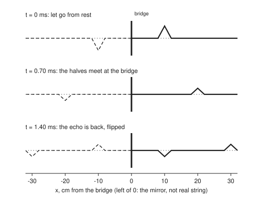
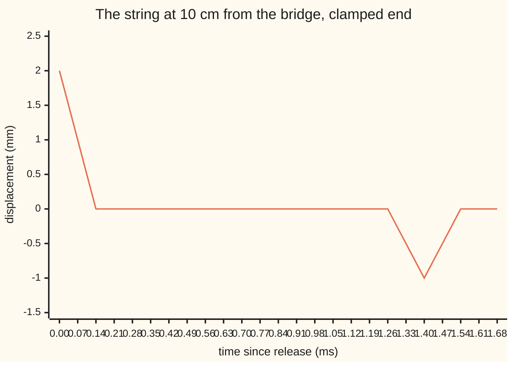

# Reflection: a clamped end is a mirror placed in the data

[Syllabus](../../../SYLLABUS.md) → [Partial differential equations](../README.md) → [Waves](../README.md#s05) → Reflection

---

## General Overview

The open A string of a guitar is 65 cm long and sounds 110 Hz, so a ripple runs along it at 143 m/s. Pinch a 4 cm stretch of it into a small tent, 2 mm high at its peak, 10 cm from the bridge. Then let go.

The tent splits into two half-size tents, each 1 mm high. One runs toward the nut. The other runs into the bridge, which holds the string still. That half comes back 1.40 ms after release, and it comes back **upside down**: a 1 mm dip, following its upright twin 20 cm behind.

[The wave equation](../../08-Differential%20equations%20and%20dynamics/10-The%20Classical%20PDEs/05-the-wave-equation-and-dalemberts-formula.md) in the differential-equations wing solved a string with no ends. This card adds one end and keeps the same formula. The trick is to invent string on the far side of the bridge and place a flipped copy of the tent there. The real half and the mirror half arrive at the bridge together and cancel, so the bridge never moves. The mirror half then walks out onto the real string as the echo.

The problem, stated in full:

- **Unknown:** the string's sideways displacement u, in mm, at each place x (cm from the bridge) and time t.
- **Region:** the half-line x > 0, for t > 0. The nut is ignored until something reaches it.
- **Data:** the starting shape (the tent) and the starting velocity (zero), plus one condition at the bridge: u = 0 there at all times.

**A wave on a half-line is the whole-line wave started from data extended past the end: extended upside down (odd) for a clamped end, so every pulse returns flipped, and upright (even) for a free end, so every pulse returns upright.**

**What kind of fact this is:** a theorem, proved on this card in Why it works: the extended solution meets the end condition, and it is the only solution that does.

### The picture: the string and its mirror

<p align="center"></p>

Drawn to scale: 6.5 px per cm across and 12 px per mm up; the height is stretched for clarity. The thick bar is the bridge. Solid line: the real string. Dashed line: the mirror string, which exists only in the calculation.

---

## The formula

Notation, as in [d'Alembert](01-dalembert-and-characteristics-for-waves.md): a subscript names a rate, so $`u_t`$ is the velocity, $`u_{tt}`$ the acceleration, and $`u_{xx}`$ the curvature along the string. The **half-line problem** with a clamped end (a Dirichlet condition: the value is fixed) is:

```math
u_{tt} = c^2 u_{xx} \ \text{ for } x > 0,\ t > 0; \qquad u(x, 0) = f(x),\ \ u_t(x, 0) = g(x); \qquad u(0, t) = 0 .
```

Extend the data across the end, upside down. The **odd extension** of $`f`$ is $`F_o(x) = f(x)`$ for $`x \ge 0`$ and $`F_o(x) = -f(-x)`$ for $`x < 0`$. The same rule turns $`g`$ into $`G_o`$. Then run d'Alembert's whole-line formula on the extended data:

```math
u(x, t) = \frac{F_o(x - ct) + F_o(x + ct)}{2} + \frac{1}{2c}\int_{x - ct}^{x + ct} G_o(s)\,ds .
```

**Read it aloud:** half the extended shape rides left, half rides right, and the extended starting velocity is spread over the stretch the wave has reached; the flipped copy beyond the end keeps the end at zero.

Near the end, where $`x < ct`$, the left-hand foot $`x - ct`$ is negative, and the formula reads in the real data only:

```math
u(x, t) = \frac{f(x + ct) - f(ct - x)}{2} + \frac{1}{2c}\int_{ct - x}^{x + ct} g(s)\,ds \qquad (0 \le x < ct).
```

The term $`-f(ct - x)/2`$ is the echo: half the pulse, upside down, moving away from the end. Where $`x \ge ct`$, the end has not been felt yet, and the plain whole-line formula holds.

A **free end** (a Neumann condition: zero slope, $`u_x(0, t) = 0`$) uses the **even extension** instead: $`F_e(x) = f(\lvert x\rvert)`$, upright. Then the echo term is $`+f(ct - x)/2`$.

| Symbol | Plain meaning | In our example | Push it up and the answer… |
| --- | --- | --- | --- |
| $`x`$ | distance from the bridge along the string, cm | 0 to 32 cm on the picture | — |
| $`t`$ | time since release, ms | 0, 0.70, 1.40 ms | the echo moves farther out |
| $`u(x, t)`$ | sideways displacement, mm | −1 mm at 10 cm, 1.40 ms | — |
| $`u_t`$, $`u_x`$ | velocity, m/s; slope, mm per mm (doubled letters, as $`u_{xx}`$, are rates of rates) | −14.30 m/s at 1 cm, 0.70 ms; 0.10 at the bridge | — |
| $`c`$ | wave speed, $`2 \times L \times`$ the note's frequency | 143 m/s | the echo comes back sooner |
| $`L`$ | the string's length, bridge to nut | 65 cm | the half-line model lasts longer |
| $`f`$, $`g`$ | starting shape, mm; starting velocity, m/s | the tent; $`g = 0`$ | the echo scales with both |
| $`x_0`$, $`w`$, $`h`$ | tent centre, half-width, peak height | 10 cm, 2 cm, 2 mm | later echo; wider echo; deeper echo |
| $`F_o`$, $`G_o`$ | odd extensions: the data copied past the end, upside down | the dashed dip at −10 cm | — |
| $`F_e`$ | even extension: the data copied past the end, upright | a dashed tent at −10 cm | — |
| $`E(t)`$ | energy on the real string: motion plus stretch | the same at 0, 0.70, 1.40 ms | — |
| $`s`$, $`v`$, $`q`$ | proof helpers: the integration variable; the flipped mirror of $`u`$; the difference of two solutions | — | — |

The tent is $`f(x) = h\,(1 - \lvert x - x_0\rvert / w)`$ for $`\lvert x - x_0\rvert < w`$, and 0 elsewhere.

### When it holds

- **A straight end that does not move.** A guitar bridge moves a little, which is how the body hears the string. The clamped model ignores that motion, and a real echo comes back very slightly weaker.
- **One end at a time.** The formula ignores the nut. It holds until a disturbance reaches 65 cm: here the right-going tent's front, starting at 12 cm, gets there at 3.7063 ms. With both ends, mirror copies repeat forever: the data become the odd extension repeated every two string lengths, which is the sine series of [Standing waves](../../08-Differential%20equations%20and%20dynamics/10-The%20Classical%20PDEs/06-standing-waves-on-a-string.md).
- **A uniform string.** The mirror trick needs $`c`$ the same on both sides of the end. If the string's thickness changed partway, $`c`$ would change there, and part of a pulse would reflect at the change, not only at the end.
- **Corners match, for a smooth answer.** A classical solution (one with continuous second rates) needs $`f(0) = 0`$, $`g(0) = 0`$ and $`f''(0) = 0`$, so the extension has no corner at the end. The tent is far from the bridge, so the end adds no corner; its own three corners make the answer a weak solution. It is the limit of classical solutions for tents with rounded corners.

---

## Why it works

### Step 0: build the wall out of symmetry

D'Alembert's formula knows nothing about ends. So do not teach it about the bridge. Instead, choose data on the whole line whose solution is zero at $`x = 0`$ automatically.

Odd data do this. If the shape on the left is the flipped mirror of the shape on the right, the motion stays mirrored forever. A function that is its own flipped mirror must be zero at the mirror line. So the string at the bridge never moves, and on $`x > 0`$ the whole-line answer is the half-line answer.

### Step 1: odd data give an odd solution

Let $`u`$ be the whole-line solution started from $`F_o`$ and $`G_o`$. Define $`v(x, t) = -u(-x, t)`$, the flipped mirror of $`u`$.

- $`v`$ solves the same equation: flipping the sign of $`x`$ twice leaves $`u_{xx}`$ unchanged, and the minus sign multiplies both sides.
- $`v`$ has the same data: $`v(x, 0) = -F_o(-x) = F_o(x)`$, because $`F_o`$ is odd, and the same for $`G_o`$.

The whole-line problem has one solution, by the uniqueness in [d'Alembert](01-dalembert-and-characteristics-for-waves.md). So $`v = u`$. At $`x = 0`$ this reads $`u(0, t) = -u(0, t)`$, so $`u(0, t) = 0`$.

### Step 2: read the formula on the real string

For $`x < ct`$ the foot $`x - ct`$ falls behind the bridge, where $`F_o`$ takes the value $`-f(ct - x)`$. That gives the second formula above.

As a function of $`x`$, the echo $`-f(ct - x)/2`$ depends on $`x - ct`$, so it moves right at speed $`c`$. It carries a minus sign: flipped upside down. Its argument is reversed: flipped front to back as well. The symmetric tent hides the second flip, but a lopsided pulse shows it.

<details>
<summary>Detailed proof: the half-line formula solves the problem, and nothing else does</summary>

Let $`f`$ have continuous second rates on $`x \ge 0`$, let $`g`$ have continuous first rates, and let $`f(0) = g(0) = f''(0) = 0`$. Then $`F_o`$ has continuous second rates on the whole line: at 0 the values match (both 0), the slopes match because an odd function's slope is even, and the second rates match because $`f''(0) = 0`$. The same holds one order lower for $`G_o`$.

D'Alembert's formula on $`F_o`$ and $`G_o`$ then gives a classical whole-line solution $`u`$. Step 1 shows $`u(0, t) = 0`$. Directly, at $`x = 0`$:

$`\displaystyle u(0, t) = \frac{F_o(-ct) + F_o(ct)}{2} + \frac{1}{2c}\int_{-ct}^{ct} G_o(s)\,ds = \frac{-f(ct) + f(ct)}{2} + 0 = 0,`$

since an odd function integrates to zero over an interval centred on 0. On $`x > 0`$, $`F_o = f`$ and $`G_o = g`$ at $`t = 0`$, so the data match.

Uniqueness: let $`u_1`$ and $`u_2`$ both solve the half-line problem, and let $`q = u_1 - u_2`$ (their difference). Then $`q`$ solves the equation with zero data and $`q(0, t) = 0`$. Its energy on the half-line is

$`\displaystyle E(t) = \frac{1}{2}\int_0^\infty \big(q_t^2 + c^2 q_x^2\big)\,dx, \qquad E'(t) = c^2\big[q_t\,q_x\big]_{x=0}^{x=\infty} = -c^2\,q_t(0, t)\,q_x(0, t) = 0,`$

after integrating $`q_x q_{xt}`$ by parts and using the equation. The end term is zero because $`q(0, t) = 0`$ for all $`t`$, so $`q_t(0, t) = 0`$; for a free end, $`q_x(0, t) = 0`$ does the same job. By finite speed, $`q`$ vanishes far out, so the far end adds nothing. Hence $`E(t) = E(0) = 0`$, so $`q`$ is constant, and it starts at zero. That is the energy method of [Wave energy is conserved, and nothing outruns the wave speed](02-energy-and-finite-speed.md), with the end term handled.

</details>

### Step 3: a free end takes the upright mirror

A free end has zero slope. An even function has zero slope at its mirror line, because the slope of an even function is odd. The argument of Step 1, with $`v(x, t) = u(-x, t)`$, shows that even data give an even solution. So $`u_x(0, t) = 0`$, and the echo $`+f(ct - x)/2`$ returns upright.

### Step 4: the same mirror the series used

[Half-range series](../../08-Differential%20equations%20and%20dynamics/09-Fourier%20Series/04-half-range-sine-and-cosine-series.md) built the same two extensions for a string on 0 to L: odd for pinned ends, giving sines, and even for sealed ends, giving cosines. There the mirror chose which modes appear. Here it chooses how a travelling pulse comes back. The odd extension is the right one both times, because it is zero at the end.

### Step 5: energy passes through the bounce intact

At the instant the halves meet the bridge, 0.70 ms, the string next to the bridge is perfectly flat: the code reads 0 mm over the first 4 cm. On the first 2 cm the incoming half and the mirror half overlap. They cancel in height but add in velocity. So that stretch moves at −14.30 m/s, double the incoming half's −7.15 m/s, and its energy is all motion. From 2 cm to 4 cm the string is flat and still: 0.00 m/s at 3 cm.

Counted over the real string, three quarters of the energy is motion at that instant, and the total is unchanged. The code checks this against the starting energy at 0, 0.70 and 1.40 ms.

---

## Worked numbers, by hand

Use the clamped bridge. Read the string at the tent's starting place, 10 cm, at the moment the echo should be back.

| Step | Arithmetic | Value |
| --- | --- | --- |
| wave speed | 2 × 0.65 m × 110 Hz | 143 m/s |
| the tent's centre reaches the bridge | 0.10 m ÷ 143 m/s | 0.6993 ms |
| the echo is back at 10 cm | 2 × 0.10 m ÷ 143 m/s | 1.3986 ms |
| distance each half has run | $`ct`$ = 143 m/s × 1.3986 ms | 20 cm |
| left foot, behind the bridge | 10 − 20 | −10 cm |
| extended shape there | $`F_o(-10) = -f(10)`$ | −2 mm |
| right foot | 10 + 20 | 30 cm, where $`f`$ = 0 |
| displacement at 10 cm | (−2 + 0) ÷ 2 | **−1 mm** |
| the twin at 30 cm | $`(F_o(10) + F_o(50)) \div 2`$ = (2 + 0) ÷ 2 | 1 mm |

The half that went to the bridge is back where it started, 1 mm deep and flipped, while its upright twin is 20 cm farther on.

### What breaks if you drop a piece

| Mistake | Comes out at | What went wrong |
| --- | --- | --- |
| No mirror: $`f`$ extended by zero | 0 mm at 10 cm, 1.40 ms | The half ran straight through the bridge to −10 cm, onto string that does not exist |
| Even (upright) mirror at a clamped end | +1 mm at 10 cm; the bridge rises 2 mm at 0.70 ms | That is the free-end answer; it moves the end the problem holds still |
| Echo time taken as $`x_0/c`$ | 0.70 ms, when the reading at 10 cm is 0 mm | That is when the pulse hits the bridge; the round trip takes twice as long |
| Half-line formula used after the nut is reached | −1 mm at 55 cm at half a period, 4.5455 ms; with both ends held, −2 mm | The one-end hypothesis fails after 3.7063 ms: the half that bounced off the nut, flipped, is missing |

The code prints all four.

---

## How the bounce moves

The puzzle: the bridge cannot move, yet a pulse 1 mm high arrives there. Where does the height go? Watch one point, 1 cm from the bridge, while the incoming half passes. The table follows it.

| $`ct`$, cm | $`t`$, ms | $`u`$ at 1 cm, mm | slope at the bridge | incoming half's slope alone |
| --- | --- | --- | --- | --- |
| 0.0 | 0.0000 | 0.0000 | 0.00 | 0.000 |
| 4.0 | 0.2797 | 0.0000 | 0.00 | 0.000 |
| 8.5 | 0.5944 | 0.7500 | 0.10 | 0.050 |
| 9.0 | 0.6294 | 1.0000 | 0.10 | 0.050 |
| 9.5 | 0.6643 | 0.5000 | 0.10 | 0.050 |
| 10.5 | 0.7343 | −0.5000 | −0.10 | −0.050 |
| 11.0 | 0.7692 | −1.0000 | −0.10 | −0.050 |
| 12.0 | 0.8392 | −0.5000 | −0.10 | −0.050 |
| 16.0 | 1.1189 | 0.0000 | 0.00 | 0.000 |

The height at 1 cm swings up to 1 mm and down to −1 mm: the same pulse, arriving upright and leaving flipped. At the bridge itself the height stays 0, but the slope is double what the incoming half carries alone. A steeper string pulls harder, so the bridge feels twice the sideways pull.

One moment, one force at a time. At 1 cm, when $`ct`$ = 9.5 cm:

```
incoming half   +0.75 mm  ###############
mirror half     -0.25 mm  #####   (pulls down)
string          +0.50 mm  ##########
```

The mirror half arrives from behind the bridge at the same speed and cancels the incoming half exactly at the bridge, and partly just beside it.

A pickup under the string at 10 cm sees the whole story as one trace: the starting tent leaves by 0.14 ms, nothing passes until 1.26 ms, then the flipped echo goes by.



One line: the displacement at 10 cm, sampled every 1 cm of wave travel (0.07 ms). The tent leaves at 2 mm; the echo passes at −1 mm, 1.40 ms after release.

---

## Code, from first principles, and it actually runs

The code solves the plucked A string three independent ways. Road 1 is d'Alembert's formula on the extended data, odd for a clamped bridge and even for a free end. Road 2 marches the string on a grid that knows only the end condition, $`u = 0`$ or zero slope at the end node, and never builds a mirror. Its step is 1 mm in space and 1 mm ÷ $`c`$ in time (Courant number 1: the wave crosses exactly one space step per time step, and there this scheme is exact at its nodes), so it agrees with road 1 to rounding at every node it compares. Road 3 tracks the energy through the bounce against its closed form, $`2w\,(h/w)^2`$ in scaled units. Six asserts can fail, and a mutation test broke each road and saw one fail.

### Python

```python
# Reflection at a wall -- the check behind the card.  Nothing is imported.
# The open A string of a guitar, wave speed 143 m/s.  A 4 cm stretch near the
# bridge is pinched into a tent 2 mm high at 10 cm and let go from rest.  The
# bridge is the wall at x = 0; the nut, 65 cm away, is too far to matter yet.
# Road 1: d'Alembert's formula on the data extended oddly (clamped end) or
# evenly (free end).  Road 2: march the string on a grid that knows only the
# wall (u = 0 there, or zero slope), never the mirror.  Road 3: total energy
# through the bounce, against its closed form.
L, FREQ = 0.65, 110                       # string length (m), note (Hz)
c = 2 * L * FREQ                          # wave speed, m/s
X0, W, H = 0.10, 0.02, 2.0                # tent centre (m), half-width (m), height (mm)
T1, T2 = X0 / c, 2 * X0 / c               # centre reaches the bridge; back where it began

def phi(y): return H * (1 - abs(y - X0) / W) if abs(y - X0) < W else 0.0   # mm
def dphi(y):                              # its slope, mm per mm
    if abs(y - X0) >= W: return 0.0
    return H / (1000 * W) if y < X0 else -H / (1000 * W)
def F_odd(y): return phi(y) if y >= 0 else -phi(-y)     # clamped end: mirror flipped
def F_even(y): return phi(abs(y))                       # free end: mirror upright
def F_none(y): return phi(y) if y >= 0 else 0.0         # mistake: no mirror at all
def F_two(y):                             # bridge and nut both clamped: odd about each, period 2L
    y %= 2 * L
    return phi(y) if y <= L else -phi(2 * L - y)
def u(F, x, t): return (F(x - c * t) + F(x + c * t)) / 2  # d'Alembert, released from rest
def z(v): return 0.0 if abs(v) < 5e-9 else v              # no "-0.0000" in print

def march(dx, clamped, T):                # road 2: the grid at Courant number 1
    n, steps = round(0.40 / dx), round(T * c / dx)
    old = [phi(j * dx) for j in range(n + 1)]
    def nxt(cur, prev, half):             # one step; the far end at 40 cm stays at 0
        out = [0.0] * (n + 1)
        for j in range(1, n):
            out[j] = (cur[j - 1] + cur[j + 1]) * (0.5 if half else 1.0) - (0.0 if half else prev[j])
        if not clamped:                   # zero slope: the node beyond the end copies node 1
            out[0] = cur[1] * (1.0 if half else 2.0) - (0.0 if half else prev[0])
        return out
    cur = nxt(old, None, True)
    gap = max(abs(cur[j] - u(F_odd if clamped else F_even, j * dx, dx / c)) for j in range(n + 1))
    for s in range(2, steps + 1):
        old, cur = cur, nxt(cur, old, False)
        F = F_odd if clamped else F_even
        gap = max(gap, max(abs(cur[j] - u(F, j * dx, s * dx / c)) for j in range(0, n + 1, 10)))
    return cur, gap

def energy(F, t, N=4000):                 # road 3: kinetic and stretch parts, midpoint rule
    kin = st = 0.0
    for i in range(N):
        x = (i + 0.5) * 0.40 / N          # strip of 0.1 mm; the tent's corners sit on strip edges
        a, b = slope(F, x - c * t), slope(F, x + c * t)
        kin += ((b - a) / 2) ** 2 * 0.40 / N      # (u_t / c)^2
        st += ((a + b) / 2) ** 2 * 0.40 / N       # (u_x)^2
    return kin, st
def slope(F, y):                          # slope of the extended data
    if F is F_odd: return dphi(abs(y))
    return dphi(y) if y >= 0 else -dphi(-y)

E0 = 2 * W * (H / (1000 * W)) ** 2        # closed form: tent's slope squared times its width
mm = lambda x: f"{z(x):.4f}"
print(f"c = 2 x 0.65 m x {FREQ} Hz = {c:.0f} m/s; tent: centre {100 * X0:.0f} cm, half-width {100 * W:.0f} cm, height {H:.0f} mm")
print(f"centre reaches the bridge at {1000 * T1:.4f} ms; back at 10 cm at {1000 * T2:.4f} ms")
print(f"road 1, clamped: u(10 cm, {1000 * T2:.4f} ms) = {mm(u(F_odd, X0, T2))} mm; u(30 cm) = {mm(u(F_odd, 0.30, T2))} mm")
print(f"road 1, free:    u(10 cm, {1000 * T2:.4f} ms) = {mm(u(F_even, X0, T2))} mm; bridge end at {1000 * T1:.4f} ms = {mm(u(F_even, 0, T1))} mm")
print(f"model holds until the right-going front reaches the nut: (65 - 12) cm / c = {1000 * (L - X0 - W) / c:.4f} ms")
print(f"try: tent at 20 cm, echo at {2000 * 0.20 / c:.4f} ms; high E at 330 Hz, c = {2 * L * 330:.0f} m/s, echo at {2000 * X0 / (2 * L * 330):.4f} ms")
gc, gf = march(0.001, True, T2), march(0.001, False, T2)
print(f"road 2, grid dx = 1 mm, step dx/c: clamped u(10 cm) = {mm(gc[0][100])} mm; free u(10 cm) = {mm(gf[0][100])} mm")
print(f"road 2, largest gap to road 1 over the run, mm, below 1e-9: clamped {'yes' if gc[1] < 1e-9 else 'no'}, free {'yes' if gf[1] < 1e-9 else 'no'}")
print(f"clamped end stays at 0: max |u(0, t)| over 200 times = {max(abs(u(F_odd, 0, i * T2 / 199)) for i in range(200)):.4f} mm")
print(f"bars at x = 1 cm, ct = 9.5 cm: incoming half {mm(F_odd(0.105) / 2)}, mirror half {mm(F_odd(-0.085) / 2)}, string {mm(u(F_odd, 0.01, 0.095 / c))} mm")
print("story at x = 1 cm: ct (cm), t (ms), u (mm), bridge slope; incoming half's slope alone")
for ct in (0, 4, 8.5, 9, 9.5, 10.5, 11, 12, 16):
    t = ct / 100 / c
    print(f"  {ct:4.1f}  {1000 * t:.4f}  {mm(u(F_odd, 0.01, t))}  {z(slope(F_odd, ct / 100)):.2f}; {z(dphi(ct / 100) / 2):.3f}")
a, b = slope(F_odd, 0.01 - T1 * c), slope(F_odd, 0.01 + T1 * c)
v3 = c * (slope(F_odd, 0.03 + T1 * c) - slope(F_odd, 0.03 - T1 * c)) / 2   # past the overlap
print(f"at {1000 * T1:.4f} ms: max |u| over 0 to 4 cm = {max(abs(u(F_odd, i / 1000, T1)) for i in range(41)):.4f} mm; "
      f"velocity at 1 cm = {c * (b - a) / 2:.2f} m/s, at 3 cm = {z(v3):.2f} m/s, incoming half alone {c * b / 2:.2f} m/s")
trace = [u(F_odd, X0, k / 100 / c) for k in range(25)]
print("pickup at 10 cm, ct = 0, 1, ..., 24 cm; t (ms):", ", ".join(f"{1000 * k / 100 / c:.2f}" for k in range(25)))
print("pickup at 10 cm, u (mm):", ", ".join(f"{z(v):.1f}" for v in trace))
fr = [energy(F_odd, t) for t in (0, T1, T2)]
print(f"energy / start, clamped, at 0, {1000 * T1:.4f}, {1000 * T2:.4f} ms: " + "; ".join(f"total {(k + s) / E0:.4f}, kinetic {k / E0:.4f}" for k, s in fr))
print(f"figure, panels t = 0, {1000 * T1:.2f}, {1000 * T2:.2f} ms: peaks (cm, mm) (10, {mm(u(F_odd, X0, 0))}) ghost (-10, {mm(u(F_odd, -X0, 0))}); (20, {mm(u(F_odd, 0.2, T1))}) ghost (-20, {mm(u(F_odd, -0.2, T1))}); (10, {mm(u(F_odd, X0, T2))}) (30, {mm(u(F_odd, 0.3, T2))}) ghost (-10, {mm(u(F_odd, -X0, T2))})")
m1, m2, m3 = u(F_none, X0, T2), u(F_even, X0, T2), u(F_odd, X0, T1)
print(f"mistake 1, no mirror: u(10 cm, {1000 * T2:.4f} ms) = {mm(m1)} mm; the half sits at -10 cm, past the bridge")
print(f"mistake 2, even mirror at a clamped end: u(10 cm) = {mm(m2)} mm, and the bridge moves {mm(u(F_even, 0, T1))} mm")
print(f"mistake 3, echo time x0/c = {1000 * T1:.4f} ms: u(10 cm) then = {mm(m3)} mm; the echo is due at {1000 * T2:.4f} ms")
m4, m5 = u(F_odd, 0.55, L / c), u(F_two, 0.55, L / c)   # half a period: the nut has been reached
print(f"hypothesis fails, nut ignored: at half a period, {1000 * L / c:.4f} ms, u(55 cm) = {mm(m4)} mm; with both ends {mm(m5)} mm")
assert abs(u(F_odd, X0, T2) + H / 2) < 1e-12 and abs(u(F_even, X0, T2) - H / 2) < 1e-12  # flipped, upright
assert gc[1] < 1e-9 and gf[1] < 1e-9 and abs(gc[0][100] + 1) < 1e-9  # grid knows only the wall
assert all(abs(u(F_odd, 0, i * T2 / 199)) < 1e-12 for i in range(200))  # mirror holds the bridge at 0
assert all(abs((k + s) / E0 - 1) < 1e-9 for k, s in fr) and abs(fr[1][0] / E0 - 0.75) < 1e-9  # energy
assert abs(u(F_even, 0, T1) - H) < 1e-12 and abs(m1) < 1e-12  # free end doubles; no mirror loses it
assert abs(m4 + H / 2) < 1e-12 and abs(m5 + H) < 1e-12  # past the nut the one-end answer misses half
print("ALL CHECKS PASS")
```

**Ran 2026-11-15 on macOS, Python 3.14.10, standard library only. All checks passed. Output, pasted from the run:**

```
c = 2 x 0.65 m x 110 Hz = 143 m/s; tent: centre 10 cm, half-width 2 cm, height 2 mm
centre reaches the bridge at 0.6993 ms; back at 10 cm at 1.3986 ms
road 1, clamped: u(10 cm, 1.3986 ms) = -1.0000 mm; u(30 cm) = 1.0000 mm
road 1, free:    u(10 cm, 1.3986 ms) = 1.0000 mm; bridge end at 0.6993 ms = 2.0000 mm
model holds until the right-going front reaches the nut: (65 - 12) cm / c = 3.7063 ms
try: tent at 20 cm, echo at 2.7972 ms; high E at 330 Hz, c = 429 m/s, echo at 0.4662 ms
road 2, grid dx = 1 mm, step dx/c: clamped u(10 cm) = -1.0000 mm; free u(10 cm) = 1.0000 mm
road 2, largest gap to road 1 over the run, mm, below 1e-9: clamped yes, free yes
clamped end stays at 0: max |u(0, t)| over 200 times = 0.0000 mm
bars at x = 1 cm, ct = 9.5 cm: incoming half 0.7500, mirror half -0.2500, string 0.5000 mm
story at x = 1 cm: ct (cm), t (ms), u (mm), bridge slope; incoming half's slope alone
   0.0  0.0000  0.0000  0.00; 0.000
   4.0  0.2797  0.0000  0.00; 0.000
   8.5  0.5944  0.7500  0.10; 0.050
   9.0  0.6294  1.0000  0.10; 0.050
   9.5  0.6643  0.5000  0.10; 0.050
  10.5  0.7343  -0.5000  -0.10; -0.050
  11.0  0.7692  -1.0000  -0.10; -0.050
  12.0  0.8392  -0.5000  -0.10; -0.050
  16.0  1.1189  0.0000  0.00; 0.000
at 0.6993 ms: max |u| over 0 to 4 cm = 0.0000 mm; velocity at 1 cm = -14.30 m/s, at 3 cm = 0.00 m/s, incoming half alone -7.15 m/s
pickup at 10 cm, ct = 0, 1, ..., 24 cm; t (ms): 0.00, 0.07, 0.14, 0.21, 0.28, 0.35, 0.42, 0.49, 0.56, 0.63, 0.70, 0.77, 0.84, 0.91, 0.98, 1.05, 1.12, 1.19, 1.26, 1.33, 1.40, 1.47, 1.54, 1.61, 1.68
pickup at 10 cm, u (mm): 2.0, 1.0, 0.0, 0.0, 0.0, 0.0, 0.0, 0.0, 0.0, 0.0, 0.0, 0.0, 0.0, 0.0, 0.0, 0.0, 0.0, 0.0, 0.0, -0.5, -1.0, -0.5, 0.0, 0.0, 0.0
energy / start, clamped, at 0, 0.6993, 1.3986 ms: total 1.0000, kinetic 0.0000; total 1.0000, kinetic 0.7500; total 1.0000, kinetic 0.5000
figure, panels t = 0, 0.70, 1.40 ms: peaks (cm, mm) (10, 2.0000) ghost (-10, -2.0000); (20, 1.0000) ghost (-20, -1.0000); (10, -1.0000) (30, 1.0000) ghost (-10, 1.0000)
mistake 1, no mirror: u(10 cm, 1.3986 ms) = 0.0000 mm; the half sits at -10 cm, past the bridge
mistake 2, even mirror at a clamped end: u(10 cm) = 1.0000 mm, and the bridge moves 2.0000 mm
mistake 3, echo time x0/c = 0.6993 ms: u(10 cm) then = 0.0000 mm; the echo is due at 1.3986 ms
hypothesis fails, nut ignored: at half a period, 4.5455 ms, u(55 cm) = -1.0000 mm; with both ends -2.0000 mm
ALL CHECKS PASS
```

### Rust

Same numbers, same labels, built with `rustc --edition 2021 -O`.

```rust
// Reflection at a wall -- the same check as the Python, in Rust.  No crates.
// The open A string of a guitar, wave speed 143 m/s.  A 4 cm stretch near the
// bridge is pinched into a tent 2 mm high at 10 cm and let go from rest.  The
// bridge is the wall at x = 0; the nut, 65 cm away, is too far to matter yet.
// Road 1: d'Alembert's formula on the data extended oddly (clamped end) or
// evenly (free end).  Road 2: march the string on a grid that knows only the
// wall (u = 0 there, or zero slope), never the mirror.  Road 3: total energy
// through the bounce, against its closed form.
const L: f64 = 0.65;                       // string length (m)
const FREQ: f64 = 110.0;                   // note (Hz)
const C: f64 = 2.0 * L * FREQ;             // wave speed, m/s
const X0: f64 = 0.10;                      // tent centre (m)
const W: f64 = 0.02;                       // half-width (m)
const H: f64 = 2.0;                        // height (mm)

#[derive(Clone, Copy, PartialEq)]
enum Ext { Odd, Even, NoMirror, Two }      // clamped end, free end, mistake: no mirror, both ends clamped

fn phi(y: f64) -> f64 { if (y - X0).abs() < W { H * (1.0 - (y - X0).abs() / W) } else { 0.0 } }
fn dphi(y: f64) -> f64 {                   // its slope, mm per mm
    if (y - X0).abs() >= W { 0.0 } else if y < X0 { H / (1000.0 * W) } else { -H / (1000.0 * W) }
}
fn ext(e: Ext, y: f64) -> f64 {
    match e {
        Ext::Odd => if y >= 0.0 { phi(y) } else { -phi(-y) },
        Ext::Even => phi(y.abs()),
        Ext::NoMirror => if y >= 0.0 { phi(y) } else { 0.0 },
        Ext::Two => { let y = y.rem_euclid(2.0 * L); if y <= L { phi(y) } else { -phi(2.0 * L - y) } }  // odd about each end, period 2L
    }
}
fn u(e: Ext, x: f64, t: f64) -> f64 { (ext(e, x - C * t) + ext(e, x + C * t)) / 2.0 }  // d'Alembert
fn z(v: f64) -> f64 { if v.abs() < 5e-9 { 0.0 } else { v } }      // no "-0.0000" in print
fn mm(v: f64) -> String { format!("{:.4}", z(v)) }
fn slope(e: Ext, y: f64) -> f64 {          // slope of the extended data
    if e == Ext::Odd { dphi(y.abs()) } else if y >= 0.0 { dphi(y) } else { -dphi(-y) }
}

fn march(dx: f64, clamped: bool, t_end: f64) -> (Vec<f64>, f64) {  // road 2: Courant number 1
    let n = (0.40 / dx).round() as usize;
    let steps = (t_end * C / dx).round() as usize;
    let e = if clamped { Ext::Odd } else { Ext::Even };
    let nxt = |cur: &Vec<f64>, prev: &Vec<f64>, half: bool| -> Vec<f64> {
        let mut out = vec![0.0; n + 1];    // the far end at 40 cm stays at 0
        for j in 1..n {
            out[j] = (cur[j - 1] + cur[j + 1]) * (if half { 0.5 } else { 1.0 }) - (if half { 0.0 } else { prev[j] });
        }
        if !clamped {                      // zero slope: the node beyond the end copies node 1
            out[0] = cur[1] * (if half { 1.0 } else { 2.0 }) - (if half { 0.0 } else { prev[0] });
        }
        out
    };
    let mut old: Vec<f64> = (0..=n).map(|j| phi(j as f64 * dx)).collect();
    let mut cur = nxt(&old, &old, true);
    let mut gap = (0..=n).map(|j| (cur[j] - u(e, j as f64 * dx, dx / C)).abs()).fold(0.0, f64::max);
    for s in 2..=steps {
        let new = nxt(&cur, &old, false);
        old = cur;
        cur = new;
        let g = (0..=n).step_by(10).map(|j| (cur[j] - u(e, j as f64 * dx, s as f64 * dx / C)).abs()).fold(0.0, f64::max);
        gap = gap.max(g);
    }
    (cur, gap)
}

fn energy(e: Ext, t: f64) -> (f64, f64) { // road 3: kinetic and stretch parts, midpoint rule
    let n = 4000;
    let (mut kin, mut st) = (0.0, 0.0);
    for i in 0..n {
        let x = (i as f64 + 0.5) * 0.40 / n as f64;   // strip of 0.1 mm
        let (a, b) = (slope(e, x - C * t), slope(e, x + C * t));
        kin += ((b - a) / 2.0).powi(2) * 0.40 / n as f64;   // (u_t / c)^2
        st += ((a + b) / 2.0).powi(2) * 0.40 / n as f64;    // (u_x)^2
    }
    (kin, st)
}

fn yn(b: bool) -> &'static str { if b { "yes" } else { "no" } }

fn main() {
    let (t1, t2) = (X0 / C, 2.0 * X0 / C);
    let e0 = 2.0 * W * (H / (1000.0 * W)).powi(2);   // closed form: slope squared times width
    println!("c = 2 x 0.65 m x {:.0} Hz = {:.0} m/s; tent: centre {:.0} cm, half-width {:.0} cm, height {:.0} mm", FREQ, C, 100.0 * X0, 100.0 * W, H);
    println!("centre reaches the bridge at {:.4} ms; back at 10 cm at {:.4} ms", 1000.0 * t1, 1000.0 * t2);
    println!("road 1, clamped: u(10 cm, {:.4} ms) = {} mm; u(30 cm) = {} mm", 1000.0 * t2, mm(u(Ext::Odd, X0, t2)), mm(u(Ext::Odd, 0.30, t2)));
    println!("road 1, free:    u(10 cm, {:.4} ms) = {} mm; bridge end at {:.4} ms = {} mm", 1000.0 * t2, mm(u(Ext::Even, X0, t2)), 1000.0 * t1, mm(u(Ext::Even, 0.0, t1)));
    println!("model holds until the right-going front reaches the nut: (65 - 12) cm / c = {:.4} ms", 1000.0 * (L - X0 - W) / C);
    println!("try: tent at 20 cm, echo at {:.4} ms; high E at 330 Hz, c = {:.0} m/s, echo at {:.4} ms", 2000.0 * 0.20 / C, 2.0 * L * 330.0, 2000.0 * X0 / (2.0 * L * 330.0));
    let (gc, gf) = (march(0.001, true, t2), march(0.001, false, t2));
    println!("road 2, grid dx = 1 mm, step dx/c: clamped u(10 cm) = {} mm; free u(10 cm) = {} mm", mm(gc.0[100]), mm(gf.0[100]));
    println!("road 2, largest gap to road 1 over the run, mm, below 1e-9: clamped {}, free {}", yn(gc.1 < 1e-9), yn(gf.1 < 1e-9));
    let wall = (0..200).map(|i| u(Ext::Odd, 0.0, i as f64 * t2 / 199.0).abs()).fold(0.0, f64::max);
    println!("clamped end stays at 0: max |u(0, t)| over 200 times = {:.4} mm", wall);
    println!("bars at x = 1 cm, ct = 9.5 cm: incoming half {}, mirror half {}, string {} mm", mm(ext(Ext::Odd, 0.105) / 2.0), mm(ext(Ext::Odd, -0.085) / 2.0), mm(u(Ext::Odd, 0.01, 0.095 / C)));
    println!("story at x = 1 cm: ct (cm), t (ms), u (mm), bridge slope; incoming half's slope alone");
    for ct in [0.0, 4.0, 8.5, 9.0, 9.5, 10.5, 11.0, 12.0, 16.0] {
        let t = ct / 100.0 / C;
        println!("  {:4.1}  {:.4}  {}  {:.2}; {:.3}", ct, 1000.0 * t, mm(u(Ext::Odd, 0.01, t)), z(slope(Ext::Odd, ct / 100.0)), z(dphi(ct / 100.0) / 2.0));
    }
    let (a, b) = (slope(Ext::Odd, 0.01 - t1 * C), slope(Ext::Odd, 0.01 + t1 * C));
    let flat = (0..41).map(|i| u(Ext::Odd, i as f64 / 1000.0, t1).abs()).fold(0.0, f64::max);
    let v3 = C * (slope(Ext::Odd, 0.03 + t1 * C) - slope(Ext::Odd, 0.03 - t1 * C)) / 2.0;  // past the overlap
    println!("at {:.4} ms: max |u| over 0 to 4 cm = {:.4} mm; velocity at 1 cm = {:.2} m/s, at 3 cm = {:.2} m/s, incoming half alone {:.2} m/s", 1000.0 * t1, flat, C * (b - a) / 2.0, z(v3), C * b / 2.0);
    let times: Vec<String> = (0..25).map(|k| format!("{:.2}", 1000.0 * k as f64 / 100.0 / C)).collect();
    let trace: Vec<String> = (0..25).map(|k| format!("{:.1}", z(u(Ext::Odd, X0, k as f64 / 100.0 / C)))).collect();
    println!("pickup at 10 cm, ct = 0, 1, ..., 24 cm; t (ms): {}", times.join(", "));
    println!("pickup at 10 cm, u (mm): {}", trace.join(", "));
    let fr: Vec<(f64, f64)> = [0.0, t1, t2].iter().map(|&t| energy(Ext::Odd, t)).collect();
    let parts: Vec<String> = fr.iter().map(|&(k, s)| format!("total {:.4}, kinetic {:.4}", (k + s) / e0, k / e0)).collect();
    println!("energy / start, clamped, at 0, {:.4}, {:.4} ms: {}", 1000.0 * t1, 1000.0 * t2, parts.join("; "));
    println!("figure, panels t = 0, {:.2}, {:.2} ms: peaks (cm, mm) (10, {}) ghost (-10, {}); (20, {}) ghost (-20, {}); (10, {}) (30, {}) ghost (-10, {})",
             1000.0 * t1, 1000.0 * t2, mm(u(Ext::Odd, X0, 0.0)), mm(u(Ext::Odd, -X0, 0.0)), mm(u(Ext::Odd, 0.2, t1)), mm(u(Ext::Odd, -0.2, t1)),
             mm(u(Ext::Odd, X0, t2)), mm(u(Ext::Odd, 0.3, t2)), mm(u(Ext::Odd, -X0, t2)));
    let (m1, m2, m3) = (u(Ext::NoMirror, X0, t2), u(Ext::Even, X0, t2), u(Ext::Odd, X0, t1));
    println!("mistake 1, no mirror: u(10 cm, {:.4} ms) = {} mm; the half sits at -10 cm, past the bridge", 1000.0 * t2, mm(m1));
    println!("mistake 2, even mirror at a clamped end: u(10 cm) = {} mm, and the bridge moves {} mm", mm(m2), mm(u(Ext::Even, 0.0, t1)));
    println!("mistake 3, echo time x0/c = {:.4} ms: u(10 cm) then = {} mm; the echo is due at {:.4} ms", 1000.0 * t1, mm(m3), 1000.0 * t2);
    let (m4, m5) = (u(Ext::Odd, 0.55, L / C), u(Ext::Two, 0.55, L / C));  // half a period: the nut has been reached
    println!("hypothesis fails, nut ignored: at half a period, {:.4} ms, u(55 cm) = {} mm; with both ends {} mm", 1000.0 * L / C, mm(m4), mm(m5));
    assert!((u(Ext::Odd, X0, t2) + H / 2.0).abs() < 1e-12 && (u(Ext::Even, X0, t2) - H / 2.0).abs() < 1e-12);  // flipped, upright
    assert!(gc.1 < 1e-9 && gf.1 < 1e-9 && (gc.0[100] + 1.0).abs() < 1e-9);  // grid knows only the wall
    assert!(wall < 1e-12);                                                   // mirror holds the bridge at 0
    assert!(fr.iter().all(|&(k, s)| ((k + s) / e0 - 1.0).abs() < 1e-9) && (fr[1].0 / e0 - 0.75).abs() < 1e-9);  // energy
    assert!((u(Ext::Even, 0.0, t1) - H).abs() < 1e-12 && m1.abs() < 1e-12);  // free end doubles; no mirror loses it
    assert!((m4 + H / 2.0).abs() < 1e-12 && (m5 + H).abs() < 1e-12);         // past the nut the one-end answer misses half
    println!("ALL CHECKS PASS");
}
```

**Ran 2026-11-15 on macOS, rustc 1.98.1, no crates. All checks passed. Output, pasted from the run:**

```
c = 2 x 0.65 m x 110 Hz = 143 m/s; tent: centre 10 cm, half-width 2 cm, height 2 mm
centre reaches the bridge at 0.6993 ms; back at 10 cm at 1.3986 ms
road 1, clamped: u(10 cm, 1.3986 ms) = -1.0000 mm; u(30 cm) = 1.0000 mm
road 1, free:    u(10 cm, 1.3986 ms) = 1.0000 mm; bridge end at 0.6993 ms = 2.0000 mm
model holds until the right-going front reaches the nut: (65 - 12) cm / c = 3.7063 ms
try: tent at 20 cm, echo at 2.7972 ms; high E at 330 Hz, c = 429 m/s, echo at 0.4662 ms
road 2, grid dx = 1 mm, step dx/c: clamped u(10 cm) = -1.0000 mm; free u(10 cm) = 1.0000 mm
road 2, largest gap to road 1 over the run, mm, below 1e-9: clamped yes, free yes
clamped end stays at 0: max |u(0, t)| over 200 times = 0.0000 mm
bars at x = 1 cm, ct = 9.5 cm: incoming half 0.7500, mirror half -0.2500, string 0.5000 mm
story at x = 1 cm: ct (cm), t (ms), u (mm), bridge slope; incoming half's slope alone
   0.0  0.0000  0.0000  0.00; 0.000
   4.0  0.2797  0.0000  0.00; 0.000
   8.5  0.5944  0.7500  0.10; 0.050
   9.0  0.6294  1.0000  0.10; 0.050
   9.5  0.6643  0.5000  0.10; 0.050
  10.5  0.7343  -0.5000  -0.10; -0.050
  11.0  0.7692  -1.0000  -0.10; -0.050
  12.0  0.8392  -0.5000  -0.10; -0.050
  16.0  1.1189  0.0000  0.00; 0.000
at 0.6993 ms: max |u| over 0 to 4 cm = 0.0000 mm; velocity at 1 cm = -14.30 m/s, at 3 cm = 0.00 m/s, incoming half alone -7.15 m/s
pickup at 10 cm, ct = 0, 1, ..., 24 cm; t (ms): 0.00, 0.07, 0.14, 0.21, 0.28, 0.35, 0.42, 0.49, 0.56, 0.63, 0.70, 0.77, 0.84, 0.91, 0.98, 1.05, 1.12, 1.19, 1.26, 1.33, 1.40, 1.47, 1.54, 1.61, 1.68
pickup at 10 cm, u (mm): 2.0, 1.0, 0.0, 0.0, 0.0, 0.0, 0.0, 0.0, 0.0, 0.0, 0.0, 0.0, 0.0, 0.0, 0.0, 0.0, 0.0, 0.0, 0.0, -0.5, -1.0, -0.5, 0.0, 0.0, 0.0
energy / start, clamped, at 0, 0.6993, 1.3986 ms: total 1.0000, kinetic 0.0000; total 1.0000, kinetic 0.7500; total 1.0000, kinetic 0.5000
figure, panels t = 0, 0.70, 1.40 ms: peaks (cm, mm) (10, 2.0000) ghost (-10, -2.0000); (20, 1.0000) ghost (-20, -1.0000); (10, -1.0000) (30, 1.0000) ghost (-10, 1.0000)
mistake 1, no mirror: u(10 cm, 1.3986 ms) = 0.0000 mm; the half sits at -10 cm, past the bridge
mistake 2, even mirror at a clamped end: u(10 cm) = 1.0000 mm, and the bridge moves 2.0000 mm
mistake 3, echo time x0/c = 0.6993 ms: u(10 cm) then = 0.0000 mm; the echo is due at 1.3986 ms
hypothesis fails, nut ignored: at half a period, 4.5455 ms, u(55 cm) = -1.0000 mm; with both ends -2.0000 mm
ALL CHECKS PASS
```

The two outputs match line for line.

### Lean

Lean proves the mirror method for both ends, uniqueness for the clamped end and the near-end formula, and checks the hand numbers.

- Suppose the end is clamped and the corners match, as in When it holds. Then d'Alembert's formula on $`F_o`$ and $`G_o`$ is a classical solution.
- Every other classical solution of the clamped problem equals it at every $`x \ge 0`$ and $`t \ge 0`$.
- Suppose $`f`$ and $`g`$ are as smooth as above, the end is free, and both have zero slope there. Then d'Alembert's formula on the even extensions is a classical solution with $`u_x(0, t) = 0`$.
- Take $`0 \le x < ct`$ and a continuous $`g`$. Then the formula reads in the real data only, with the echo $`-f(ct - x)/2`$.
- Take $`L`$ = 65 cm and 110 Hz. Then $`c`$ = 143 m/s, and each half has run 20 cm by 1.3986 ms.
- Take the tent, released from rest, at a clamped bridge. Then the string reads −1 mm at 10 cm and 1 mm at 30 cm, at 1.3986 ms.
- The bridge reads 0 mm at 0.6993 ms, and so does the point at 10 cm, as the third mistake says.
- With a free end, the string reads +1 mm at 10 cm at 1.3986 ms, and the end rises 2 mm at 0.6993 ms.
- Take the point 1 cm from the bridge. Then $`ct`$ = 8.5, 9.5 and 11 cm give 0.75, 0.5 and −1 mm.

The grid march, the energy count, the nut's arrival and the pickup trace are left to the Python and Rust checks.

```lean
-- Reflection: on the half-line x ≥ 0, d'Alembert's formula run on the data extended oddly is the one classical solution with the end held at zero, extended evenly it solves the free-end problem, and near the end it reads as the incoming wave plus a flipped echo.
import Mathlib.Analysis.Calculus.ContDiff.Basic
import Mathlib.Analysis.Calculus.IteratedDeriv.Defs
import Mathlib.MeasureTheory.Integral.IntervalIntegral.FundThmCalculus
import Mathlib.Tactic.NormNum
import Mathlib

open Set

/-- The odd extension: the data copied past the end `x = 0`, upside down. -/
noncomputable def oddExt (f : ℝ → ℝ) (x : ℝ) : ℝ := if 0 ≤ x then f x else -f (-x)

/-- The even extension: the data copied past the end `x = 0`, upright. -/
noncomputable def evenExt (f : ℝ → ℝ) (x : ℝ) : ℝ := f |x|

/-- D'Alembert's whole-line formula with wave speed `c`, starting shape `F` and starting
velocity `G`. -/
noncomputable def dAlembert (c : ℝ) (F G : ℝ → ℝ) (x t : ℝ) : ℝ :=
  (F (x - c * t) + F (x + c * t)) / 2 + 1 / (2 * c) * ∫ s in (x - c * t)..(x + c * t), G s

/-- A classical solution of the half-line wave problem with a clamped end: `u` has continuous
second rates on the closed quarter-plane `x ≥ 0, t ≥ 0`, solves `u_tt = c^2 u_xx` for `x > 0`,
`t > 0`, starts with shape `f` and velocity `g` on `x ≥ 0`, and `u(0, t) = 0` for `t ≥ 0`. -/
def IsClampedHalfLineSolution (c : ℝ) (f g : ℝ → ℝ) (u : ℝ → ℝ → ℝ) : Prop :=
  ContDiffOn ℝ 2 (fun p : ℝ × ℝ => u p.1 p.2) (Ici 0 ×ˢ Ici 0) ∧
  (∀ x t, 0 < x → 0 < t → deriv (fun t => deriv (fun t => u x t) t) t =
      c ^ 2 * deriv (fun x => deriv (fun x => u x t) x) x) ∧
  (∀ x, 0 ≤ x → u x 0 = f x) ∧
  (∀ x, 0 ≤ x → derivWithin (fun t => u x t) (Ici 0) 0 = g x) ∧
  (∀ t, 0 ≤ t → u 0 t = 0)

/-- A classical solution of the half-line wave problem with a free end: as above, but the end
condition is zero slope, `u_x(0, t) = 0` for `t ≥ 0`. -/
def IsFreeHalfLineSolution (c : ℝ) (f g : ℝ → ℝ) (u : ℝ → ℝ → ℝ) : Prop :=
  ContDiffOn ℝ 2 (fun p : ℝ × ℝ => u p.1 p.2) (Ici 0 ×ˢ Ici 0) ∧
  (∀ x t, 0 < x → 0 < t → deriv (fun t => deriv (fun t => u x t) t) t =
      c ^ 2 * deriv (fun x => deriv (fun x => u x t) x) x) ∧
  (∀ x, 0 ≤ x → u x 0 = f x) ∧
  (∀ x, 0 ≤ x → derivWithin (fun t => u x t) (Ici 0) 0 = g x) ∧
  (∀ t, 0 ≤ t → derivWithin (fun x => u x t) (Ici 0) 0 = 0)

lemma glue_hasDerivAt {F D : ℝ → ℝ}
    (h1 : ∀ x, 0 ≤ x → HasDerivWithinAt F (D x) (Ici 0) x)
    (h2 : ∀ x, x ≤ 0 → HasDerivWithinAt F (D x) (Iic 0) x) (x : ℝ) : HasDerivAt F (D x) x := by
  rcases lt_trichotomy x 0 with hx | rfl | hx
  · exact (h2 x hx.le).hasDerivAt (Iic_mem_nhds hx)
  · have := (h2 0 le_rfl).union (h1 0 le_rfl)
    rwa [Iic_union_Ici, hasDerivWithinAt_univ] at this
  · exact (h1 x hx.le).hasDerivAt (Ici_mem_nhds hx)

#print axioms glue_hasDerivAt

lemma oddExt_hasDerivAt {h h' : ℝ → ℝ} (hd : ∀ x, 0 ≤ x → HasDerivWithinAt h (h' x) (Ici 0) x)
    (h0 : h 0 = 0) (x : ℝ) : HasDerivAt (oddExt h) (evenExt h' x) x := by
  apply glue_hasDerivAt (D := evenExt h') _ _ x
  · intro y hy
    rw [evenExt, abs_of_nonneg hy]
    exact (hd y hy).congr (fun z hz => by simp [oddExt, (show (0:ℝ) ≤ z from hz)])
      (by simp [oddExt, hy])
  · intro y hy
    have hn : HasDerivWithinAt (fun z : ℝ => -z) (-1) (Iic 0) y :=
      (hasDerivAt_neg' y).hasDerivWithinAt
    have hc := (hd (-y) (by linarith)).comp y hn (fun z hz => by
      simp only [mem_Iic, mem_Ici] at hz ⊢; linarith)
    rw [evenExt, abs_of_nonpos hy]
    refine (hc.neg.congr (fun z hz => ?_) ?_).congr_deriv (by ring)
    · simp only [mem_Iic] at hz
      simp only [oddExt]
      split_ifs with hz'
      · have : z = 0 := le_antisymm hz hz'
        subst this; simp [h0]
      · rfl
    · simp only [oddExt]
      split_ifs with hy'
      · have : y = 0 := le_antisymm hy hy'
        subst this; simp [h0]
      · rfl

#print axioms oddExt_hasDerivAt

lemma evenExt_hasDerivAt {h h' : ℝ → ℝ} (hd : ∀ x, 0 ≤ x → HasDerivWithinAt h (h' x) (Ici 0) x)
    (h0 : h' 0 = 0) (x : ℝ) : HasDerivAt (evenExt h) (oddExt h' x) x := by
  apply glue_hasDerivAt (D := oddExt h') _ _ x
  · intro y hy
    simp only [oddExt, hy, ↓reduceIte]
    exact (hd y hy).congr (fun z hz => by simp [evenExt, abs_of_nonneg (show (0:ℝ) ≤ z from hz)])
      (by simp [evenExt, abs_of_nonneg hy])
  · intro y hy
    have hn : HasDerivWithinAt (fun z : ℝ => -z) (-1) (Iic 0) y :=
      (hasDerivAt_neg' y).hasDerivWithinAt
    have hc := (hd (-y) (by linarith)).comp y hn (fun z hz => by
      simp only [mem_Iic, mem_Ici] at hz ⊢; linarith)
    refine (hc.congr (fun z hz => ?_) ?_).congr_deriv ?_
    · simp only [mem_Iic] at hz
      simp [evenExt, Function.comp, abs_of_nonpos hz]
    · simp [evenExt, Function.comp, abs_of_nonpos hy]
    · simp only [oddExt]
      split_ifs with hy'
      · have : y = 0 := le_antisymm hy hy'
        subst this; simp [h0]
      · ring

#print axioms evenExt_hasDerivAt

lemma evenExt_continuous {h : ℝ → ℝ} (hc : ContinuousOn h (Ici 0)) : Continuous (evenExt h) :=
  hc.comp_continuous continuous_abs (fun x => abs_nonneg x)

#print axioms evenExt_continuous

lemma oddExt_eq_max {h : ℝ → ℝ} (h0 : h 0 = 0) :
    oddExt h = fun x => h (max x 0) - h (max (-x) 0) := by
  funext x
  simp only [oddExt]
  split_ifs with hx
  · simp [max_eq_left hx, max_eq_right (by linarith : -x ≤ 0), h0]
  · simp [max_eq_right (by linarith : x ≤ 0), max_eq_left (by linarith : 0 ≤ -x), h0]

#print axioms oddExt_eq_max

lemma oddExt_continuous {h : ℝ → ℝ} (hc : ContinuousOn h (Ici 0)) (h0 : h 0 = 0) :
    Continuous (oddExt h) := by
  rw [oddExt_eq_max h0]
  exact (hc.comp_continuous (continuous_id.max continuous_const) (fun x => (le_max_right x 0 : (0:ℝ) ≤ _))).sub
    (hc.comp_continuous (continuous_neg.max continuous_const) (fun x => (le_max_right (-x) 0 : (0:ℝ) ≤ _)))

#print axioms oddExt_continuous

lemma oddExt_neg {h : ℝ → ℝ} (h0 : h 0 = 0) (x : ℝ) : oddExt h (-x) = -oddExt h x := by
  rw [oddExt_eq_max h0]
  simp only [neg_neg]
  ring

#print axioms oddExt_neg

lemma contDiff_two_of_hasDerivAt {F F' F'' : ℝ → ℝ} (h1 : ∀ x, HasDerivAt F (F' x) x)
    (h2 : ∀ x, HasDerivAt F' (F'' x) x) (h3 : Continuous F'') : ContDiff ℝ 2 F := by
  have e1 : deriv F = F' := funext fun x => (h1 x).deriv
  have e2 : deriv F' = F'' := funext fun x => (h2 x).deriv
  rw [show (2 : WithTop ℕ∞) = 1 + 1 from rfl, contDiff_succ_iff_deriv]
  refine ⟨fun x => (h1 x).differentiableAt, by simp, ?_⟩
  rw [e1, contDiff_one_iff_deriv, e2]
  exact ⟨fun x => (h2 x).differentiableAt, h3⟩

#print axioms contDiff_two_of_hasDerivAt

lemma contDiff_one_of_hasDerivAt {F F' : ℝ → ℝ} (h1 : ∀ x, HasDerivAt F (F' x) x)
    (h3 : Continuous F') : ContDiff ℝ 1 F := by
  have e1 : deriv F = F' := funext fun x => (h1 x).deriv
  rw [contDiff_one_iff_deriv, e1]
  exact ⟨fun x => (h1 x).differentiableAt, h3⟩

#print axioms contDiff_one_of_hasDerivAt

lemma halfline_data {f : ℝ → ℝ} (hf : ContDiffOn ℝ 1 f (Ici 0)) :
    (∀ x, 0 ≤ x → HasDerivWithinAt f (derivWithin f (Ici 0) x) (Ici 0) x) ∧
    ContinuousOn (derivWithin f (Ici 0)) (Ici 0) :=
  ⟨fun x hx => ((hf.differentiableOn one_ne_zero) x hx).hasDerivWithinAt,
    hf.continuousOn_derivWithin (uniqueDiffOn_Ici 0) le_rfl⟩

#print axioms halfline_data

lemma hd_sub_t {φ φ' : ℝ → ℝ} (h : ∀ y, HasDerivAt φ (φ' y) y) (x c t : ℝ) :
    HasDerivAt (fun t => φ (x - c * t)) (-c * φ' (x - c * t)) t := by
  have := (h (x - c * t)).comp t (((hasDerivAt_id' t).const_mul c).const_sub x)
  exact this.congr_deriv (by ring)

#print axioms hd_sub_t

lemma hd_add_t {φ φ' : ℝ → ℝ} (h : ∀ y, HasDerivAt φ (φ' y) y) (x c t : ℝ) :
    HasDerivAt (fun t => φ (x + c * t)) (c * φ' (x + c * t)) t := by
  have := (h (x + c * t)).comp t (((hasDerivAt_id' t).const_mul c).const_add x)
  exact this.congr_deriv (by ring)

#print axioms hd_add_t

lemma hd_sub_x {φ φ' : ℝ → ℝ} (h : ∀ y, HasDerivAt φ (φ' y) y) (x c t : ℝ) :
    HasDerivAt (fun x => φ (x - c * t)) (φ' (x - c * t)) x := by
  have := (h (x - c * t)).comp x ((hasDerivAt_id' x).sub_const (c * t))
  exact this.congr_deriv (by ring)

#print axioms hd_sub_x

lemma hd_add_x {φ φ' : ℝ → ℝ} (h : ∀ y, HasDerivAt φ (φ' y) y) (x c t : ℝ) :
    HasDerivAt (fun x => φ (x + c * t)) (φ' (x + c * t)) x := by
  have := (h (x + c * t)).comp x ((hasDerivAt_id' x).add_const (c * t))
  exact this.congr_deriv (by ring)

#print axioms hd_add_x

lemma wave_core (c : ℝ) (hc : c ≠ 0) (F G P : ℝ → ℝ) (u : ℝ → ℝ → ℝ)
    (hF : ContDiff ℝ 2 F) (hG : ContDiff ℝ 1 G) (hP : ∀ y, HasDerivAt P (G y) y)
    (hu : ∀ x t, u x t =
      (F (x - c * t) + F (x + c * t)) / 2 + 1 / (2 * c) * (P (x + c * t) - P (x - c * t))) :
    ContDiff ℝ 2 (fun p : ℝ × ℝ => u p.1 p.2) ∧
    (∀ x t, deriv (fun t => deriv (fun t => u x t) t) t =
      c ^ 2 * deriv (fun x => deriv (fun x => u x t) x) x) ∧
    (∀ x t, HasDerivAt (fun t => u x t) ((-c * deriv F (x - c * t) + c * deriv F (x + c * t)) / 2 +
      1 / (2 * c) * (c * G (x + c * t) + c * G (x - c * t))) t) ∧
    (∀ x t, HasDerivAt (fun x => u x t) ((deriv F (x - c * t) + deriv F (x + c * t)) / 2 +
      1 / (2 * c) * (G (x + c * t) - G (x - c * t))) x) := by
  have hu' : u = fun x t =>
      (F (x - c * t) + F (x + c * t)) / 2 + 1 / (2 * c) * (P (x + c * t) - P (x - c * t)) :=
    funext fun x => funext fun t => hu x t
  subst hu'
  have hFd : ∀ y, HasDerivAt F (deriv F y) y := fun y =>
    ((hF.differentiable (by norm_num)) y).hasDerivAt
  have hF1 : ContDiff ℝ 1 (deriv F) := by
    rw [show (2 : WithTop ℕ∞) = 1 + 1 from rfl, contDiff_succ_iff_deriv] at hF
    exact hF.2.2
  have hF2d : ∀ y, HasDerivAt (deriv F) (deriv (deriv F) y) y := fun y =>
    ((hF1.differentiable one_ne_zero) y).hasDerivAt
  have hGd : ∀ y, HasDerivAt G (deriv G y) y := fun y =>
    ((hG.differentiable one_ne_zero) y).hasDerivAt
  have hP2 : ContDiff ℝ 2 P := by
    rw [show (2 : WithTop ℕ∞) = 1 + 1 from rfl, contDiff_succ_iff_deriv]
    refine ⟨fun y => (hP y).differentiableAt, by simp, ?_⟩
    rw [show deriv P = G from funext fun y => (hP y).deriv]
    exact hG
  have ht : ∀ x t, HasDerivAt (fun t => (F (x - c * t) + F (x + c * t)) / 2 +
      1 / (2 * c) * (P (x + c * t) - P (x - c * t)))
      ((-c * deriv F (x - c * t) + c * deriv F (x + c * t)) / 2 +
      1 / (2 * c) * (c * G (x + c * t) + c * G (x - c * t))) t := by
    intro x t
    have := (((hd_sub_t hFd x c t).add (hd_add_t hFd x c t)).div_const 2).add
      (((hd_add_t hP x c t).sub (hd_sub_t hP x c t)).const_mul (1 / (2 * c)))
    exact this.congr_deriv (by ring)
  have hx : ∀ x t, HasDerivAt (fun x => (F (x - c * t) + F (x + c * t)) / 2 +
      1 / (2 * c) * (P (x + c * t) - P (x - c * t)))
      ((deriv F (x - c * t) + deriv F (x + c * t)) / 2 +
      1 / (2 * c) * (G (x + c * t) - G (x - c * t))) x := by
    intro x t
    exact (((hd_sub_x hFd x c t).add (hd_add_x hFd x c t)).div_const 2).add
      (((hd_add_x hP x c t).sub (hd_sub_x hP x c t)).const_mul (1 / (2 * c)))
  refine ⟨?_, ?_, ht, hx⟩
  · fun_prop
  · intro x t
    rw [show (fun t => deriv (fun t => (F (x - c * t) + F (x + c * t)) / 2 +
      1 / (2 * c) * (P (x + c * t) - P (x - c * t))) t) = fun t =>
      (-c * deriv F (x - c * t) + c * deriv F (x + c * t)) / 2 +
      1 / (2 * c) * (c * G (x + c * t) + c * G (x - c * t)) from funext fun t => (ht x t).deriv]
    rw [show (fun x => deriv (fun x => (F (x - c * t) + F (x + c * t)) / 2 +
      1 / (2 * c) * (P (x + c * t) - P (x - c * t))) x) = fun x =>
      (deriv F (x - c * t) + deriv F (x + c * t)) / 2 +
      1 / (2 * c) * (G (x + c * t) - G (x - c * t)) from funext fun x => (hx x t).deriv]
    have h1 := ((((hd_sub_t hF2d x c t).const_mul (-c)).add
      ((hd_add_t hF2d x c t).const_mul c)).div_const 2).add
      ((((hd_add_t hGd x c t).const_mul c).add ((hd_sub_t hGd x c t).const_mul c)).const_mul
        (1 / (2 * c)))
    have h2 := (((hd_sub_x hF2d x c t).add (hd_add_x hF2d x c t)).div_const 2).add
      (((hd_add_x hGd x c t).sub (hd_sub_x hGd x c t)).const_mul (1 / (2 * c)))
    rw [show deriv (fun t => (-c * deriv F (x - c * t) + c * deriv F (x + c * t)) / 2 +
      1 / (2 * c) * (c * G (x + c * t) + c * G (x - c * t))) t = _ from h1.deriv,
      show deriv (fun x => (deriv F (x - c * t) + deriv F (x + c * t)) / 2 +
      1 / (2 * c) * (G (x + c * t) - G (x - c * t))) x = _ from h2.deriv]
    field_simp
    ring

#print axioms wave_core

lemma const_of_hasDerivAt_zero {φ : ℝ → ℝ} {a b : ℝ} (hab : a ≤ b)
    (hc : ContinuousOn φ (Icc a b)) (hd : ∀ s ∈ Ioo a b, HasDerivAt φ 0 s) : φ b = φ a := by
  rcases hab.eq_or_lt with rfl | hlt
  · rfl
  · obtain ⟨s, _, h⟩ := exists_hasDerivAt_eq_slope φ (fun _ => 0) hlt hc hd
    have hne : b - a ≠ 0 := sub_ne_zero.mpr hlt.ne'
    have := (eq_div_iff hne).mp h
    linarith

#print axioms const_of_hasDerivAt_zero

lemma lin2 {M : Type*} [AddCommGroup M] [TopologicalSpace M] [Module ℝ M]
    (L : ℝ × ℝ →L[ℝ] M) (a b : ℝ) : L (a, b) = a • L (1, 0) + b • L (0, 1) := by
  have : ((a, b) : ℝ × ℝ) = a • ((1 : ℝ), (0 : ℝ)) + b • ((0 : ℝ), (1 : ℝ)) := by
    ext <;> simp
  rw [this, map_add, map_smul, map_smul]

#print axioms lin2

lemma quad_mem_nhds {x t : ℝ} (hx : 0 < x) (ht : 0 < t) :
    Ici (0 : ℝ) ×ˢ Ici (0 : ℝ) ∈ nhds (x, t) :=
  prod_mem_nhds (Ici_mem_nhds hx) (Ici_mem_nhds ht)

#print axioms quad_mem_nhds

lemma slice_fst {V : ℝ × ℝ → ℝ} (hV : DifferentiableOn ℝ V (Ici 0 ×ˢ Ici 0)) {x t : ℝ}
    (hx : 0 ≤ x) (ht : 0 ≤ t) :
    HasDerivWithinAt (fun y => V (y, t)) (fderivWithin ℝ V (Ici 0 ×ˢ Ici 0) (x, t) (1, 0))
      (Ici 0) x := by
  have h1 := (hV (x, t) ⟨hx, ht⟩).hasFDerivWithinAt
  have h2 : HasDerivWithinAt (fun y : ℝ => (y, t)) ((1 : ℝ), (0 : ℝ)) (Ici 0) x :=
    ((hasDerivAt_id' x).prodMk (hasDerivAt_const x t)).hasDerivWithinAt
  exact h1.comp_hasDerivWithinAt x h2 (fun y hy => mk_mem_prod hy (show t ∈ Ici (0 : ℝ) from ht))

#print axioms slice_fst

lemma slice_snd {V : ℝ × ℝ → ℝ} (hV : DifferentiableOn ℝ V (Ici 0 ×ˢ Ici 0)) {x t : ℝ}
    (hx : 0 ≤ x) (ht : 0 ≤ t) :
    HasDerivWithinAt (fun s => V (x, s)) (fderivWithin ℝ V (Ici 0 ×ˢ Ici 0) (x, t) (0, 1))
      (Ici 0) t := by
  have h1 := (hV (x, t) ⟨hx, ht⟩).hasFDerivWithinAt
  have h2 : HasDerivWithinAt (fun s : ℝ => (x, s)) ((0 : ℝ), (1 : ℝ)) (Ici 0) t :=
    ((hasDerivAt_const t x).prodMk (hasDerivAt_id' t)).hasDerivWithinAt
  exact h1.comp_hasDerivWithinAt t h2 (fun s hs => ⟨hx, hs⟩)

#print axioms slice_snd

lemma slice_snd_interior {V : ℝ × ℝ → ℝ} (hV : ContDiffOn ℝ 2 V (Ici 0 ×ˢ Ici 0)) {x t : ℝ}
    (hx : 0 < x) (ht : 0 < t) :
    HasDerivAt (fun s => V (x, s)) (fderivWithin ℝ V (Ici 0 ×ˢ Ici 0) (x, t) (0, 1)) t := by
  have hd : DifferentiableAt ℝ V (x, t) :=
    (hV.contDiffAt (quad_mem_nhds hx ht)).differentiableAt (by norm_num)
  rw [fderivWithin_of_mem_nhds (quad_mem_nhds hx ht)]
  exact hd.hasFDerivAt.comp_hasDerivAt t ((hasDerivAt_const t x).prodMk (hasDerivAt_id' t))

#print axioms slice_snd_interior

lemma pde_fderiv {c : ℝ} {v : ℝ → ℝ → ℝ}
    (hV : ContDiffOn ℝ 2 (fun p : ℝ × ℝ => v p.1 p.2) (Ici 0 ×ˢ Ici 0))
    {x t : ℝ} (hx : 0 < x) (ht : 0 < t)
    (hpde : deriv (fun t => deriv (fun t => v x t) t) t =
      c ^ 2 * deriv (fun x => deriv (fun x => v x t) x) x) :
    fderiv ℝ (fderiv ℝ (fun p : ℝ × ℝ => v p.1 p.2)) (x, t) (0, 1) (0, 1) =
      c ^ 2 * fderiv ℝ (fderiv ℝ (fun p : ℝ × ℝ => v p.1 p.2)) (x, t) (1, 0) (1, 0) := by
  have hdiff : ∀ y s, 0 < y → 0 < s → DifferentiableAt ℝ (fun p : ℝ × ℝ => v p.1 p.2) (y, s) :=
    fun y s hy hs => (hV.contDiffAt (quad_mem_nhds hy hs)).differentiableAt (by norm_num)
  have hD2 : DifferentiableAt ℝ (fderiv ℝ (fun p : ℝ × ℝ => v p.1 p.2)) (x, t) :=
    ((hV.contDiffAt (quad_mem_nhds hx ht)).fderiv_right (m := 1) (by norm_num)).differentiableAt
      (by norm_num)
  have et : deriv (fun t => deriv (fun t => v x t) t) t =
      fderiv ℝ (fderiv ℝ (fun p : ℝ × ℝ => v p.1 p.2)) (x, t) (0, 1) (0, 1) := by
    have hev : (fun s => deriv (fun t => v x t) s) =ᶠ[nhds t]
        (fun s => fderiv ℝ (fun p : ℝ × ℝ => v p.1 p.2) (x, s) (0, 1)) := by
      filter_upwards [Ioi_mem_nhds ht] with s hs
      exact ((hdiff x s hx hs).hasFDerivAt.comp_hasDerivAt s
        ((hasDerivAt_const s x).prodMk (hasDerivAt_id' s))).deriv
    rw [hev.deriv_eq]
    have hc : HasDerivAt (fun s => fderiv ℝ (fun p : ℝ × ℝ => v p.1 p.2) (x, s))
        (fderiv ℝ (fderiv ℝ (fun p : ℝ × ℝ => v p.1 p.2)) (x, t) (0, 1)) t :=
      hD2.hasFDerivAt.comp_hasDerivAt t ((hasDerivAt_const t x).prodMk (hasDerivAt_id' t))
    have := hc.clm_apply (hasDerivAt_const t ((0 : ℝ), (1 : ℝ)))
    rw [this.deriv]
    simp
  have ex : deriv (fun x => deriv (fun x => v x t) x) x =
      fderiv ℝ (fderiv ℝ (fun p : ℝ × ℝ => v p.1 p.2)) (x, t) (1, 0) (1, 0) := by
    have hev : (fun y => deriv (fun x => v x t) y) =ᶠ[nhds x]
        (fun y => fderiv ℝ (fun p : ℝ × ℝ => v p.1 p.2) (y, t) (1, 0)) := by
      filter_upwards [Ioi_mem_nhds hx] with y hy
      exact ((hdiff y t hy ht).hasFDerivAt.comp_hasDerivAt y
        ((hasDerivAt_id' y).prodMk (hasDerivAt_const y t))).deriv
    rw [hev.deriv_eq]
    have hc : HasDerivAt (fun y => fderiv ℝ (fun p : ℝ × ℝ => v p.1 p.2) (y, t))
        (fderiv ℝ (fderiv ℝ (fun p : ℝ × ℝ => v p.1 p.2)) (x, t) (1, 0)) x :=
      hD2.hasFDerivAt.comp_hasDerivAt x ((hasDerivAt_id' x).prodMk (hasDerivAt_const x t))
    have := hc.clm_apply (hasDerivAt_const x ((1 : ℝ), (0 : ℝ)))
    rw [this.deriv]
    simp
  rw [← et, ← ex]
  exact hpde

#print axioms pde_fderiv

lemma char_deriv {c : ℝ} {v : ℝ → ℝ → ℝ}
    (hV : ContDiffOn ℝ 2 (fun p : ℝ × ℝ => v p.1 p.2) (Ici 0 ×ˢ Ici 0))
    {x t : ℝ} (hx : 0 < x) (ht : 0 < t)
    (hpde : deriv (fun t => deriv (fun t => v x t) t) t =
      c ^ 2 * deriv (fun x => deriv (fun x => v x t) x) x) (a : ℝ) (ha : a ^ 2 = c ^ 2) :
    ∃ L : ℝ × ℝ →L[ℝ] ℝ, HasFDerivAt (fun p => fderivWithin ℝ (fun p : ℝ × ℝ => v p.1 p.2)
      (Ici 0 ×ˢ Ici 0) p (a, 1)) L (x, t) ∧ L (-a, 1) = 0 := by
  have hVq := hV.contDiffAt (quad_mem_nhds hx ht)
  have hD2 : HasFDerivAt (fderiv ℝ (fun p : ℝ × ℝ => v p.1 p.2))
      (fderiv ℝ (fderiv ℝ (fun p : ℝ × ℝ => v p.1 p.2)) (x, t)) (x, t) :=
    ((hVq.fderiv_right (m := 1) (by norm_num)).differentiableAt (by norm_num)).hasFDerivAt
  have hev : (fun p => fderivWithin ℝ (fun p : ℝ × ℝ => v p.1 p.2) (Ici 0 ×ˢ Ici 0) p (a, 1))
      =ᶠ[nhds (x, t)] (fun p => fderiv ℝ (fun p : ℝ × ℝ => v p.1 p.2) p (a, 1)) := by
    filter_upwards [prod_mem_nhds (Ioi_mem_nhds hx) (Ioi_mem_nhds ht)] with p hp
    rw [fderivWithin_of_mem_nhds (prod_mem_nhds (Ici_mem_nhds hp.1) (Ici_mem_nhds hp.2))]
  refine ⟨_, (hD2.clm_apply (hasFDerivAt_const ((a : ℝ), (1 : ℝ)) (x, t))).congr_of_eventuallyEq
    hev, ?_⟩
  have hsym := hVq.isSymmSndFDerivAt (by simp)
  have hp := pde_fderiv hV hx ht hpde
  set D2 := fderiv ℝ (fderiv ℝ (fun p : ℝ × ℝ => v p.1 p.2)) (x, t)
  have hs := hsym (1, 0) (0, 1)
  simp only [ContinuousLinearMap.comp_zero, ContinuousLinearMap.flip_apply, zero_add]
  rw [lin2 D2 (-a) 1]
  simp only [add_apply, smul_apply, smul_eq_mul]
  rw [lin2 (D2 (1, 0)) a 1, lin2 (D2 (0, 1)) a 1]
  simp only [smul_eq_mul]
  linear_combination (-a) * hs + hp - D2 (1, 0) (1, 0) * ha

#print axioms char_deriv

lemma transport {Φ : ℝ × ℝ → ℝ} {Q : Set (ℝ × ℝ)} (hcont : ContinuousOn Φ Q)
    (x0 t0 d T : ℝ) (hT : 0 ≤ T) (hmaps : ∀ s ∈ Icc 0 T, (x0 + d * s, t0 - s) ∈ Q)
    (hderiv : ∀ s ∈ Ioo 0 T, ∃ L : ℝ × ℝ →L[ℝ] ℝ,
      HasFDerivAt Φ L (x0 + d * s, t0 - s) ∧ L (-d, 1) = 0) :
    Φ (x0 + d * T, t0 - T) = Φ (x0, t0) := by
  have key := const_of_hasDerivAt_zero (φ := fun s => Φ (x0 + d * s, t0 - s)) hT
    (hcont.comp (by fun_prop : Continuous fun s : ℝ => (x0 + d * s, t0 - s)).continuousOn hmaps)
    (fun s hs => by
      obtain ⟨L, hL, hL0⟩ := hderiv s hs
      have hγ : HasDerivAt (fun s : ℝ => (x0 + d * s, t0 - s)) (d * 1, -1) s :=
        (((hasDerivAt_id' s).const_mul d).const_add x0).prodMk ((hasDerivAt_id' s).const_sub t0)
      have := hL.comp_hasDerivAt s hγ
      refine this.congr_deriv ?_
      rw [lin2 L (d * 1) (-1)]
      rw [lin2 L (-d) 1] at hL0
      simp only [smul_eq_mul] at hL0 ⊢
      linarith)
  simpa using key

#print axioms transport

lemma clamped_unique {c : ℝ} (hc : 0 < c) {f g : ℝ → ℝ} {v w : ℝ → ℝ → ℝ}
    (hv : IsClampedHalfLineSolution c f g v) (hw : IsClampedHalfLineSolution c f g w)
    (x t : ℝ) (hx : 0 ≤ x) (ht : 0 ≤ t) : v x t = w x t := by
  obtain ⟨hV2, hVp, hV0, hV1, hVb⟩ := hv
  obtain ⟨hW2, hWp, hW0, hW1, hWb⟩ := hw
  have hQu : UniqueDiffOn ℝ (Ici (0 : ℝ) ×ˢ Ici (0 : ℝ)) :=
    (uniqueDiffOn_Ici 0).prod (uniqueDiffOn_Ici 0)
  have hVd := hV2.differentiableOn (by norm_num)
  have hWd := hW2.differentiableOn (by norm_num)
  -- the difference of the two derivatives
  let D : ℝ × ℝ → ℝ × ℝ →L[ℝ] ℝ := fun p =>
    fderivWithin ℝ (fun p : ℝ × ℝ => v p.1 p.2) (Ici 0 ×ˢ Ici 0) p -
    fderivWithin ℝ (fun p : ℝ × ℝ => w p.1 p.2) (Ici 0 ×ˢ Ici 0) p
  have hDc : ∀ a : ℝ, ContinuousOn (fun p => D p (a, 1)) (Ici 0 ×ˢ Ici 0) := by
    intro a
    have h1 := hV2.continuousOn_fderivWithin hQu (by norm_num)
    have h2 := hW2.continuousOn_fderivWithin hQu (by norm_num)
    exact (h1.sub h2).clm_apply continuousOn_const
  have hDd : ∀ a : ℝ, a ^ 2 = c ^ 2 → ∀ y s : ℝ, 0 < y → 0 < s →
      ∃ L : ℝ × ℝ →L[ℝ] ℝ, HasFDerivAt (fun p => D p (a, 1)) L (y, s) ∧ L (-a, 1) = 0 := by
    intro a ha y s hy hs
    obtain ⟨L1, h1, e1⟩ := char_deriv hV2 hy hs (hVp y s hy hs) a ha
    obtain ⟨L2, h2, e2⟩ := char_deriv hW2 hy hs (hWp y s hy hs) a ha
    refine ⟨L1 - L2, ?_, by simp [e1, e2]⟩
    exact h1.sub h2
  have hD0x : ∀ y, 0 ≤ y → D (y, 0) (1, 0) = 0 := by
    intro y hy
    have e1 := (slice_fst hVd hy le_rfl).derivWithin (uniqueDiffOn_Ici 0 y hy)
    have e2 := (slice_fst hWd hy le_rfl).derivWithin (uniqueDiffOn_Ici 0 y hy)
    have c1 : derivWithin (fun z => v z 0) (Ici 0) y = derivWithin f (Ici 0) y :=
      derivWithin_congr (fun z hz => hV0 z hz) (hV0 y hy)
    have c2 : derivWithin (fun z => w z 0) (Ici 0) y = derivWithin f (Ici 0) y :=
      derivWithin_congr (fun z hz => hW0 z hz) (hW0 y hy)
    simp only [D, sub_apply]
    rw [← e1, ← e2]
    exact sub_eq_zero.mpr (c1.trans c2.symm)
  have hD0t : ∀ y, 0 ≤ y → D (y, 0) (0, 1) = 0 := by
    intro y hy
    have e1 := (slice_snd hVd hy le_rfl).derivWithin (uniqueDiffOn_Ici 0 0 (show (0 : ℝ) ∈ Ici (0 : ℝ) from mem_Ici.mpr le_rfl))
    have e2 := (slice_snd hWd hy le_rfl).derivWithin (uniqueDiffOn_Ici 0 0 (show (0 : ℝ) ∈ Ici (0 : ℝ) from mem_Ici.mpr le_rfl))
    simp only [D, sub_apply]
    rw [← e1, ← e2]
    exact sub_eq_zero.mpr ((hV1 y hy).trans (hW1 y hy).symm)
  have hDb : ∀ s, 0 ≤ s → D (0, s) (0, 1) = 0 := by
    intro s hs
    have e1 := (slice_snd hVd le_rfl hs).derivWithin (uniqueDiffOn_Ici 0 s hs)
    have e2 := (slice_snd hWd le_rfl hs).derivWithin (uniqueDiffOn_Ici 0 s hs)
    have c1 : derivWithin (fun z => v 0 z) (Ici 0) s = 0 := by
      rw [derivWithin_congr (f := fun _ => (0 : ℝ)) (fun z hz => hVb z hz) (hVb s hs)]
      simp
    have c2 : derivWithin (fun z => w 0 z) (Ici 0) s = 0 := by
      rw [derivWithin_congr (f := fun _ => (0 : ℝ)) (fun z hz => hWb z hz) (hWb s hs)]
      simp
    simp only [D, sub_apply]
    rw [← e1, ← e2]
    rw [c1, c2, sub_zero]
  -- the incoming combination vanishes
  have hA : ∀ y s, 0 ≤ y → 0 ≤ s → D (y, s) (c, 1) = 0 := by
    intro y s hy hs
    have := transport (hDc c) y s c s hs
      (fun r hr => ⟨by simp only [mem_Ici]; nlinarith [hr.1], by simp only [mem_Ici]; linarith [hr.2]⟩)
      (fun r hr => hDd c rfl _ _ (by nlinarith [hr.1]) (by linarith [hr.2]))
    rw [← this, sub_self, lin2]
    simp only [smul_eq_mul]
    rw [hD0x _ (by nlinarith), hD0t _ (by nlinarith)]
    ring
  have hB : ∀ y s, 0 ≤ y → 0 ≤ s → D (y, s) (-c, 1) = 0 := by
    intro y s hy hs
    by_cases hys : c * s ≤ y
    · have := transport (hDc (-c)) y s (-c) s hs
        (fun r hr => ⟨by simp only [mem_Ici]; nlinarith [hr.2], by simp only [mem_Ici]; linarith [hr.2]⟩)
        (fun r hr => by
          have := hDd (-c) (by ring) (y + -c * r) (s - r) (by nlinarith [hr.2]) (by linarith [hr.2])
          simpa using this)
      rw [← this, sub_self, lin2]
      simp only [smul_eq_mul]
      rw [hD0x _ (by linarith), hD0t _ (by linarith)]
      ring
    · push Not at hys
      have hyc : y / c ≤ s := by rw [div_le_iff₀ hc]; linarith
      have hyc0 : 0 ≤ y / c := div_nonneg hy hc.le
      have := transport (hDc (-c)) y s (-c) (y / c) hyc0
        (fun r hr => ⟨by
            simp only [mem_Ici]
            have : c * r ≤ y := by have := hr.2; rw [le_div_iff₀ hc] at this; linarith
            linarith,
          by simp only [mem_Ici]; linarith [hr.2]⟩)
        (fun r hr => by
          have h1 : c * r < y := by have := hr.2; rw [lt_div_iff₀ hc] at this; linarith
          have := hDd (-c) (by ring) (y + -c * r) (s - r) (by linarith) (by linarith [hr.2])
          simpa using this)
      have e0 : y + -c * (y / c) = 0 := by field_simp; ring
      rw [← this, e0, lin2]
      have hA0 := hA 0 (s - y / c) le_rfl (by linarith)
      rw [lin2] at hA0
      simp only [smul_eq_mul] at hA0 ⊢
      rw [hDb _ (by linarith)] at hA0 ⊢
      linarith
  -- so the time rates agree everywhere on the quarter-plane
  have hT : ∀ y s, 0 ≤ y → 0 ≤ s → D (y, s) (0, 1) = 0 := by
    intro y s hy hs
    have h1 := hA y s hy hs
    have h2 := hB y s hy hs
    rw [lin2] at h1 h2
    simp only [smul_eq_mul] at h1 h2
    linarith
  rcases hx.eq_or_lt with rfl | hx'
  · rw [hVb t ht, hWb t ht]
  · have key := const_of_hasDerivAt_zero (φ := fun s => v x s - w x s) ht
      ((hV2.continuousOn.comp (by fun_prop : Continuous fun s : ℝ => (x, s)).continuousOn
          (fun s (hs : s ∈ Icc 0 t) => mk_mem_prod (show x ∈ Ici (0 : ℝ) from hx) (show s ∈ Ici (0 : ℝ) from hs.1))).sub
        (hW2.continuousOn.comp (by fun_prop : Continuous fun s : ℝ => (x, s)).continuousOn
          (fun s (hs : s ∈ Icc 0 t) => mk_mem_prod (show x ∈ Ici (0 : ℝ) from hx) (show s ∈ Ici (0 : ℝ) from hs.1))))
      (fun s hs => by
        have := (slice_snd_interior hV2 hx' hs.1).sub (slice_snd_interior hW2 hx' hs.1)
        refine this.congr_deriv ?_
        have := hT x s hx hs.1.le
        simpa [D] using this)
    simp only [hV0 x hx, hW0 x hx, sub_self] at key
    linarith

#print axioms clamped_unique

lemma dAlembert_split (c : ℝ) {F G : ℝ → ℝ} (hG : Continuous G) (x t : ℝ) :
    dAlembert c F G x t = (F (x - c * t) + F (x + c * t)) / 2 + 1 / (2 * c) *
      ((fun y => ∫ s in (0 : ℝ)..y, G s) (x + c * t) -
        (fun y => ∫ s in (0 : ℝ)..y, G s) (x - c * t)) := by
  simp only [dAlembert]
  rw [intervalIntegral.integral_interval_sub_left (hG.intervalIntegrable _ _)
    (hG.intervalIntegrable _ _)]

#print axioms dAlembert_split

lemma primitive_hasDerivAt {G : ℝ → ℝ} (hG : Continuous G) (y : ℝ) :
    HasDerivAt (fun y => ∫ s in (0 : ℝ)..y, G s) (G y) y :=
  (hG.integral_hasStrictDerivAt 0 y).hasDerivAt

#print axioms primitive_hasDerivAt

/-- A clamped end is a mirror placed in the data. On a uniform string with wave speed `c > 0`
and one end held still at `x = 0`, take a starting shape `f` with continuous second rates on
`x ≥ 0` and a starting velocity `g` with continuous first rates there, with the corners
matched at the end: `f(0) = 0`, `g(0) = 0`, `f''(0) = 0`. Then d'Alembert's whole-line formula
run on the odd extensions of `f` and `g` is a classical solution of the half-line problem
`u_tt = c^2 u_xx`, `u(x, 0) = f(x)`, `u_t(x, 0) = g(x)`, `u(0, t) = 0`, and it is the only one:
every classical solution equals it at every `x ≥ 0` and `t ≥ 0`. -/
theorem clamped_half_line_wave_eq_dAlembert_oddExt (c : ℝ) (hc : 0 < c) (f g : ℝ → ℝ)
    (hf : ContDiffOn ℝ 2 f (Ici 0)) (hg : ContDiffOn ℝ 1 g (Ici 0))
    (hf0 : f 0 = 0) (hg0 : g 0 = 0) (hf2 : iteratedDerivWithin 2 f (Ici 0) 0 = 0) :
    IsClampedHalfLineSolution c f g (dAlembert c (oddExt f) (oddExt g)) ∧
    ∀ v : ℝ → ℝ → ℝ, IsClampedHalfLineSolution c f g v →
      ∀ x t, 0 ≤ x → 0 ≤ t → v x t = dAlembert c (oddExt f) (oddExt g) x t := by
  have hc0 : c ≠ 0 := hc.ne'
  obtain ⟨hfd, -⟩ := halfline_data (hf.of_le (by norm_num))
  have hf1 : ContDiffOn ℝ 1 (derivWithin f (Ici 0)) (Ici 0) :=
    hf.derivWithin (uniqueDiffOn_Ici 0) (by norm_num)
  obtain ⟨hf1d, hf2c⟩ := halfline_data hf1
  obtain ⟨hgd, hg1c⟩ := halfline_data hg
  have hf2' : derivWithin (derivWithin f (Ici 0)) (Ici 0) 0 = 0 := by
    rw [iteratedDerivWithin_eq_iterate] at hf2
    simpa using hf2
  have hF : ContDiff ℝ 2 (oddExt f) := contDiff_two_of_hasDerivAt (oddExt_hasDerivAt hfd hf0)
    (evenExt_hasDerivAt hf1d hf2') (oddExt_continuous hf2c hf2')
  have hG : ContDiff ℝ 1 (oddExt g) :=
    contDiff_one_of_hasDerivAt (oddExt_hasDerivAt hgd hg0) (evenExt_continuous hg1c)
  have hGc := hG.continuous
  obtain ⟨h2, hpde, ht, -⟩ := wave_core c hc0 (oddExt f) (oddExt g) _
    (dAlembert c (oddExt f) (oddExt g)) hF hG (primitive_hasDerivAt hGc)
    (dAlembert_split c hGc)
  have hsol : IsClampedHalfLineSolution c f g (dAlembert c (oddExt f) (oddExt g)) := by
    refine ⟨h2.contDiffOn, fun x t _ _ => hpde x t, fun x hx => ?_, fun x hx => ?_,
      fun t ht => ?_⟩
    · simp [dAlembert, oddExt, hx]
    · rw [(ht x 0).hasDerivWithinAt.derivWithin
        (uniqueDiffOn_Ici 0 0 (show (0 : ℝ) ∈ Ici (0 : ℝ) from mem_Ici.mpr le_rfl))]
      have e : oddExt g x = g x := by simp [oddExt, hx]
      simp only [mul_zero, sub_zero, add_zero]
      rw [← e]
      field_simp
      ring
    · simp only [dAlembert, zero_sub, zero_add]
      rw [oddExt_neg hf0]
      have hI : ∫ s in (-(c * t))..(c * t), oddExt g s = 0 := by
        have h1 := intervalIntegral.integral_comp_neg (a := -(c * t)) (b := c * t)
          (f := fun s => oddExt g s)
        simp only [neg_neg, oddExt_neg hg0, intervalIntegral.integral_neg] at h1
        linarith
      rw [hI]
      ring
  exact ⟨hsol, fun v hv x t hx ht => clamped_unique hc hv hsol x t hx ht⟩

/-- A free end takes the upright mirror. On a uniform string with wave speed `c > 0` and a
free end (zero slope) at `x = 0`, take a starting shape `f` with continuous second rates on
`x ≥ 0` and a starting velocity `g` with continuous first rates there, with the corners matched
at the end for the even extension: `f'(0) = 0`, `g'(0) = 0`. Then d'Alembert's formula run on
the even extensions of `f` and `g` is a classical solution of the half-line problem with
`u_x(0, t) = 0`. -/
theorem free_half_line_wave_dAlembert_evenExt (c : ℝ) (hc : 0 < c) (f g : ℝ → ℝ)
    (hf : ContDiffOn ℝ 2 f (Ici 0)) (hg : ContDiffOn ℝ 1 g (Ici 0))
    (hf1 : derivWithin f (Ici 0) 0 = 0) (hg1 : derivWithin g (Ici 0) 0 = 0) :
    IsFreeHalfLineSolution c f g (dAlembert c (evenExt f) (evenExt g)) := by
  have hc0 : c ≠ 0 := hc.ne'
  obtain ⟨hfd, -⟩ := halfline_data (hf.of_le (by norm_num))
  have hf1' : ContDiffOn ℝ 1 (derivWithin f (Ici 0)) (Ici 0) :=
    hf.derivWithin (uniqueDiffOn_Ici 0) (by norm_num)
  obtain ⟨hf1d, hf2c⟩ := halfline_data hf1'
  obtain ⟨hgd, hg1c⟩ := halfline_data hg
  have hF' : ∀ x, HasDerivAt (evenExt f) (oddExt (derivWithin f (Ici 0)) x) x :=
    evenExt_hasDerivAt hfd hf1
  have hF : ContDiff ℝ 2 (evenExt f) := contDiff_two_of_hasDerivAt hF'
    (oddExt_hasDerivAt hf1d hf1) (evenExt_continuous hf2c)
  have hG : ContDiff ℝ 1 (evenExt g) :=
    contDiff_one_of_hasDerivAt (evenExt_hasDerivAt hgd hg1) (oddExt_continuous hg1c hg1)
  have hGc := hG.continuous
  obtain ⟨h2, hpde, ht, hx⟩ := wave_core c hc0 (evenExt f) (evenExt g) _
    (dAlembert c (evenExt f) (evenExt g)) hF hG (primitive_hasDerivAt hGc)
    (dAlembert_split c hGc)
  refine ⟨h2.contDiffOn, fun x t _ _ => hpde x t, fun x hx => ?_, fun x hx => ?_,
    fun t ht => ?_⟩
  · simp [dAlembert, evenExt, abs_of_nonneg hx]
  · rw [(ht x 0).hasDerivWithinAt.derivWithin
      (uniqueDiffOn_Ici 0 0 (show (0 : ℝ) ∈ Ici (0 : ℝ) from mem_Ici.mpr le_rfl))]
    have e : evenExt g x = g x := by simp [evenExt, abs_of_nonneg hx]
    simp only [mul_zero, sub_zero, add_zero]
    rw [← e]
    field_simp
    ring
  · rw [(hx 0 t).hasDerivWithinAt.derivWithin
      (uniqueDiffOn_Ici 0 0 (show (0 : ℝ) ∈ Ici (0 : ℝ) from mem_Ici.mpr le_rfl))]
    have hd : deriv (evenExt f) = oddExt (derivWithin f (Ici 0)) := funext fun x => (hF' x).deriv
    rw [hd]
    simp only [zero_sub, zero_add]
    rw [oddExt_neg hf1]
    simp only [evenExt, abs_neg]
    ring

/-- The echo comes back flipped. Near the clamped end, where `0 ≤ x < ct`, the odd-extension
formula reads in the real data only: the incoming half `f(x + ct) / 2`, the echo
`-f(ct - x) / 2` (half the pulse, upside down, moving away from the end), and the starting
velocity spread over `ct - x` to `x + ct`. -/
theorem dAlembert_oddExt_near_end (c : ℝ) (hc : 0 < c) (f g : ℝ → ℝ)
    (hg : ContinuousOn g (Ici 0)) (x t : ℝ) (hx : 0 ≤ x) (hxt : x < c * t) :
    dAlembert c (oddExt f) (oddExt g) x t =
      (f (x + c * t) - f (c * t - x)) / 2 + 1 / (2 * c) * ∫ s in (c * t - x)..(x + c * t), g s := by
  have hct : 0 < c * t := by linarith
  have h1 : x - c * t < 0 := by linarith
  have h2 : 0 ≤ x + c * t := by linarith
  simp only [dAlembert]
  have eF1 : oddExt f (x - c * t) = -f (c * t - x) := by
    simp [oddExt, not_le.mpr h1, neg_sub]
  have eF2 : oddExt f (x + c * t) = f (x + c * t) := by simp [oddExt, h2]
  rw [eF1, eF2]
  have hgi : ∀ b, 0 ≤ b → IntervalIntegrable g MeasureTheory.volume 0 b := fun b hb =>
    (hg.mono (fun s hs => by rw [uIcc_of_le hb] at hs; exact hs.1)).intervalIntegrable
  have hneg : IntervalIntegrable (oddExt g) MeasureTheory.volume (x - c * t) 0 := by
    have hc' : ContinuousOn (fun s => -g (-s)) (uIcc (x - c * t) 0) :=
      (hg.comp continuous_neg.continuousOn (fun s hs => by
        rw [uIcc_of_le h1.le] at hs
        simp only [mem_Icc] at hs
        simp only [mem_Ici]
        linarith [hs.2])).neg
    exact hc'.intervalIntegrable.congr_uIoo (fun s hs => by
      rw [uIoo_of_le h1.le] at hs
      simp [oddExt, not_le.mpr hs.2])
  have hpos : IntervalIntegrable (oddExt g) MeasureTheory.volume 0 (x + c * t) :=
    (hgi _ h2).congr (fun s hs => by
      rw [uIoc_of_le h2] at hs
      simp [oddExt, hs.1.le])
  rw [← intervalIntegral.integral_add_adjacent_intervals hneg hpos]
  have e1 : ∫ s in (x - c * t)..0, oddExt g s = -∫ s in (0 : ℝ)..(c * t - x), g s := by
    rw [intervalIntegral.integral_congr_uIoo (g := fun s => -g (-s)) (fun s hs => by
      rw [uIoo_of_le h1.le] at hs
      simp [oddExt, not_le.mpr hs.2])]
    rw [intervalIntegral.integral_neg, intervalIntegral.integral_comp_neg]
    simp [neg_sub]
  have e2 : ∫ s in (0 : ℝ)..(x + c * t), oddExt g s = ∫ s in (0 : ℝ)..(x + c * t), g s :=
    intervalIntegral.integral_congr (fun s hs => by
      rw [uIcc_of_le h2] at hs
      simp [oddExt, hs.1])
  have e3 : ∫ s in (c * t - x)..(x + c * t), g s =
      (∫ s in (0 : ℝ)..(x + c * t), g s) - ∫ s in (0 : ℝ)..(c * t - x), g s :=
    (intervalIntegral.integral_interval_sub_left (hgi _ h2) (hgi _ (by linarith))).symm
  rw [e1, e2, e3]
  ring

/-- The card's tent, place in cm and height in mm: centre 10 cm, half-width 2 cm, height 2 mm. -/
noncomputable def tent (x : ℝ) : ℝ := if |x - 10| < 2 then 2 * (1 - |x - 10| / 2) else 0

-- Wave speed: c = 2 × 65 cm × 110 Hz = 14300 cm/s = 143 m/s.
example : (2 : ℝ) * 65 * 110 = 14300 := by norm_num

-- The echo is back at 10 cm after 2 × 10 cm ÷ c, when each half has run ct = 20 cm.
example : (14300 : ℝ) * (2 * 10 / 14300) = 20 := by norm_num

-- Worked numbers, by hand: clamped bridge, released from rest (g = 0). At 1.3986 ms = 20/14300 s
-- the string at 10 cm is (F_o(-10) + F_o(30)) / 2 = (-2 + 0) / 2 = -1 mm, flipped.
example : dAlembert 14300 (oddExt tent) (oddExt fun _ => 0) 10 (2 * 10 / 14300) = -1 := by
  norm_num [dAlembert, oddExt, tent, abs_of_nonneg, abs_of_nonpos]

-- Its upright twin, 20 cm farther on, at 30 cm: 1 mm.
example : dAlembert 14300 (oddExt tent) (oddExt fun _ => 0) 30 (2 * 10 / 14300) = 1 := by
  norm_num [dAlembert, oddExt, tent, abs_of_nonneg, abs_of_nonpos]

-- The bridge stays at 0 when the halves meet it, 10/14300 s = 0.6993 ms.
example : dAlembert 14300 (oddExt tent) (oddExt fun _ => 0) 0 (10 / 14300) = 0 := by
  norm_num [dAlembert, oddExt, tent, abs_of_nonneg, abs_of_nonpos]

-- Free end: the echo at 10 cm returns upright, +1 mm, and the end rises 2 mm at 0.6993 ms.
example : dAlembert 14300 (evenExt tent) (evenExt fun _ => 0) 10 (2 * 10 / 14300) = 1 := by
  norm_num [dAlembert, evenExt, tent, abs_of_nonneg, abs_of_nonpos]

example : dAlembert 14300 (evenExt tent) (evenExt fun _ => 0) 0 (10 / 14300) = 2 := by
  norm_num [dAlembert, evenExt, tent, abs_of_nonneg, abs_of_nonpos]

-- Mistake 3: at x0/c = 0.6993 ms the reading at 10 cm is 0 mm; the echo is not back yet.
example : dAlembert 14300 (oddExt tent) (oddExt fun _ => 0) 10 (10 / 14300) = 0 := by
  norm_num [dAlembert, oddExt, tent, abs_of_nonneg, abs_of_nonpos]

-- The bounce at 1 cm from the bridge: ct = 8.5 cm gives 0.75 mm, ct = 9.5 cm gives 0.5 mm,
-- ct = 11 cm gives -1 mm.
example : dAlembert 14300 (oddExt tent) (oddExt fun _ => 0) 1 (17 / 2 / 14300) = 3 / 4 := by
  norm_num [dAlembert, oddExt, tent, abs_of_nonneg, abs_of_nonpos]

example : dAlembert 14300 (oddExt tent) (oddExt fun _ => 0) 1 (19 / 2 / 14300) = 1 / 2 := by
  norm_num [dAlembert, oddExt, tent, abs_of_nonneg, abs_of_nonpos]

example : dAlembert 14300 (oddExt tent) (oddExt fun _ => 0) 1 (11 / 14300) = -1 := by
  norm_num [dAlembert, oddExt, tent, abs_of_nonneg, abs_of_nonpos]

#print axioms clamped_half_line_wave_eq_dAlembert_oddExt
#print axioms free_half_line_wave_dAlembert_evenExt
#print axioms dAlembert_oddExt_near_end
```

**Checked 2026-11-15 on macOS, Lean 4.36.0-rc2, Mathlib v4.36.0-rc2. Every proof is complete and uses only Lean's standard axioms. Output, pasted from the run:**

```
'glue_hasDerivAt' depends on axioms: [propext, Classical.choice, Quot.sound]
'oddExt_hasDerivAt' depends on axioms: [propext, Classical.choice, Quot.sound]
'evenExt_hasDerivAt' depends on axioms: [propext, Classical.choice, Quot.sound]
'evenExt_continuous' depends on axioms: [propext, Classical.choice, Quot.sound]
'oddExt_eq_max' depends on axioms: [propext, Classical.choice, Quot.sound]
'oddExt_continuous' depends on axioms: [propext, Classical.choice, Quot.sound]
'oddExt_neg' depends on axioms: [propext, Classical.choice, Quot.sound]
'contDiff_two_of_hasDerivAt' depends on axioms: [propext, Classical.choice, Quot.sound]
'contDiff_one_of_hasDerivAt' depends on axioms: [propext, Classical.choice, Quot.sound]
'halfline_data' depends on axioms: [propext, Classical.choice, Quot.sound]
'hd_sub_t' depends on axioms: [propext, Classical.choice, Quot.sound]
'hd_add_t' depends on axioms: [propext, Classical.choice, Quot.sound]
'hd_sub_x' depends on axioms: [propext, Classical.choice, Quot.sound]
'hd_add_x' depends on axioms: [propext, Classical.choice, Quot.sound]
'wave_core' depends on axioms: [propext, Classical.choice, Quot.sound]
'const_of_hasDerivAt_zero' depends on axioms: [propext, Classical.choice, Quot.sound]
'lin2' depends on axioms: [propext, Classical.choice, Quot.sound]
'quad_mem_nhds' depends on axioms: [propext, Classical.choice, Quot.sound]
'slice_fst' depends on axioms: [propext, Classical.choice, Quot.sound]
'slice_snd' depends on axioms: [propext, Classical.choice, Quot.sound]
'slice_snd_interior' depends on axioms: [propext, Classical.choice, Quot.sound]
'pde_fderiv' depends on axioms: [propext, Classical.choice, Quot.sound]
'char_deriv' depends on axioms: [propext, Classical.choice, Quot.sound]
'transport' depends on axioms: [propext, Classical.choice, Quot.sound]
'clamped_unique' depends on axioms: [propext, Classical.choice, Quot.sound]
'dAlembert_split' depends on axioms: [propext, Classical.choice, Quot.sound]
'primitive_hasDerivAt' depends on axioms: [propext, Classical.choice, Quot.sound]
'clamped_half_line_wave_eq_dAlembert_oddExt' depends on axioms: [propext, Classical.choice, Quot.sound]
'free_half_line_wave_dAlembert_evenExt' depends on axioms: [propext, Classical.choice, Quot.sound]
'dAlembert_oddExt_near_end' depends on axioms: [propext, Classical.choice, Quot.sound]
```

> [!TIP]
> **Try changing**
> - Guess first: move the tent to 20 cm from the bridge (`X0 = 0.20`). When is the echo back? Answer: 2 × 0.20 m ÷ 143 m/s = 2.7972 ms, twice as long. The run then stops at the second assert: road 2's grid is only 40 cm long and reads its node at 10 cm, so it fits only the tent at 10 cm.
> - Guess first: make the bridge a free end, by using the even extension. What does the string read at 10 cm and 1.40 ms? Answer: +1 mm, upright, and the end itself swings up 2 mm at 0.70 ms. Both lines are already printed.
> - Guess first: use the high E string, 330 Hz (`FREQ = 330`), so c = 429 m/s. When is the echo back? Answer: 0.20 m ÷ 429 m/s = 0.4662 ms.
> - Guess first: in `march`, give the clamped grid the free-end rule at node 0 (`if True:` in place of `if not clamped:`). Answer: the clamped grid reads +1.0000 mm at 10 cm, the free-end answer, and the second assert fails.

---

## The usual mistake

> [!warning]
> **The biggest trap is copying the pulse past the end upright when the end is clamped.** An upright mirror gives the end zero slope, not zero height. At 0.70 ms it lifts the bridge 2 mm, and at 1.40 ms it brings the echo back as +1 mm instead of −1 mm. Clamped means odd: flipped.
>
> Smaller traps:
>
> - **Leaving out the mirror.** The whole-line formula alone sends the half pulse through the bridge, and the reading at 10 cm, 1.40 ms is 0 mm instead of −1 mm.
> - **Timing the echo by the one-way trip.** At $`x_0/c`$ = 0.70 ms the pulse is at the bridge, and 10 cm reads 0 mm. The echo is due at $`2x_0/c`$ = 1.40 ms.
> - **Expecting the whole 2 mm back.** Only the half that went toward the bridge returns: −1 mm. The other 1 mm half was already heading for the nut.
> - **Reading a flat string as a still string.** At 0.70 ms the string next to the bridge is flat, yet its first 2 cm move at −14.30 m/s. All their energy is motion.

---

## Where you meet it in real life

- **Guitar and violin bridges.** Every pulse on a string bounces off the bridge flipped. At the bounce the string's slope at the bridge doubles, and that sideways pull is what drives the body and makes the sound.
- **Cable fault finding.** Time-domain reflectometry sends a short voltage pulse down a cable and times the echo. A short circuit holds the voltage at zero, a clamped end, and returns the pulse flipped. An open end returns it upright. The fault's distance is half the round trip times the signal speed.
- **Pipes and flutes.** At a closed end the air cannot move, a clamped end for the air's displacement, so a displacement pulse returns flipped. An open end keeps the pressure near room pressure, and a pressure pulse returns flipped there instead.
- **Ropes tied to a wall.** A flick sent along a rope tied to a wall returns as a dip. Tie the rope to a ring that slides freely on a pole, a free end, and the flick returns upright.

> **Say it back**
> A wave on a string with one end is the whole-string wave, started from data copied past the end.
> For a clamped end the copy is upside down, so the end stays at zero and every pulse comes back flipped.
> For a free end the copy is upright, so the end has zero slope and every pulse comes back upright.
> On the A string, a 2 mm tent 10 cm from the bridge sends back a 1 mm dip 1.40 ms after release.
> The bounce keeps all the energy; at the instant of impact the string by the bridge is flat but moving fast.

---

## What this builds on

- [d'Alembert](01-dalembert-and-characteristics-for-waves.md): the whole-line formula, half the shape riding each way, and its uniqueness. This card runs it on extended data.
- [Half-range series](../../08-Differential%20equations%20and%20dynamics/09-Fourier%20Series/04-half-range-sine-and-cosine-series.md): the odd and even extensions and the match of odd to a fixed end and even to a sealed end. This card uses them on travelling pulses instead of modes.
- [Wave energy is conserved, and nothing outruns the wave speed](02-energy-and-finite-speed.md): the energy method that proves the half-line answer unique, and the speed limit that lets the far end be ignored.

---

## Where this goes next

- Back to [Standing waves](../../08-Differential%20equations%20and%20dynamics/10-The%20Classical%20PDEs/06-standing-waves-on-a-string.md), met earlier: two ends make mirrors of mirrors, and the repeated echoes add into the string's harmonics.
- [The retarded Green's function](05-retarded-greens-function-and-forced-waves.md): a string pushed while it moves; on a half-line its response gets a flipped mirror source too.
- [Drumheads](08-membranes-and-bessel-modes.md): a round edge has no straight mirror line, so the drum needs its own modes instead.

The question this card leaves open: what happens when the end is neither clamped nor free, such as a bridge that gives a little or a cable ending in a resistor, so that only part of the pulse comes back?

---

## Sources

Verified 2026-11-15: every link below resolves to the publisher's page, and every DOI was checked against Crossref.

- Strauss, Walter A. *Partial Differential Equations: An Introduction*, 2nd ed. Wiley, 2008. [Publisher page](https://www.wiley.com/en-us/Partial+Differential+Equations%3A+An+Introduction%2C+2nd+Edition-p-9780470054567). Section 3.2, reflections of waves: the odd extension for the half-line with a fixed end.
- Evans, Lawrence C. *Partial Differential Equations*, 2nd ed. Graduate Studies in Mathematics 19. American Mathematical Society, 2010. [doi:10.1090/gsm/019](https://doi.org/10.1090/gsm/019). The reflection method for the wave equation on the half-line, in §2.4.1.
- Fletcher, Neville H., and Thomas D. Rossing. *The Physics of Musical Instruments*, 2nd ed. Springer, 1998. [doi:10.1007/978-0-387-21603-4](https://doi.org/10.1007/978-0-387-21603-4). Pulses on plucked strings, reflection at the bridge, and the bridge force that drives a guitar body.
- Pozar, David M. *Microwave Engineering*, 4th ed. Wiley, 2011. [Publisher page](https://www.wiley.com/en-us/Microwave+Engineering%2C+4th+Edition-p-9780470631553). Chapter 2: on a transmission line a short circuit reflects a wave with coefficient −1 and an open circuit with +1, the clamped and free ends of this card.
