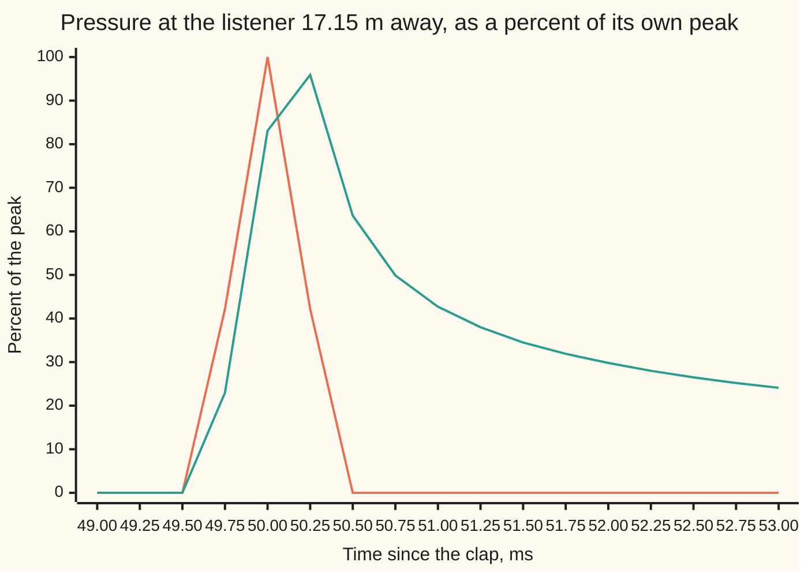
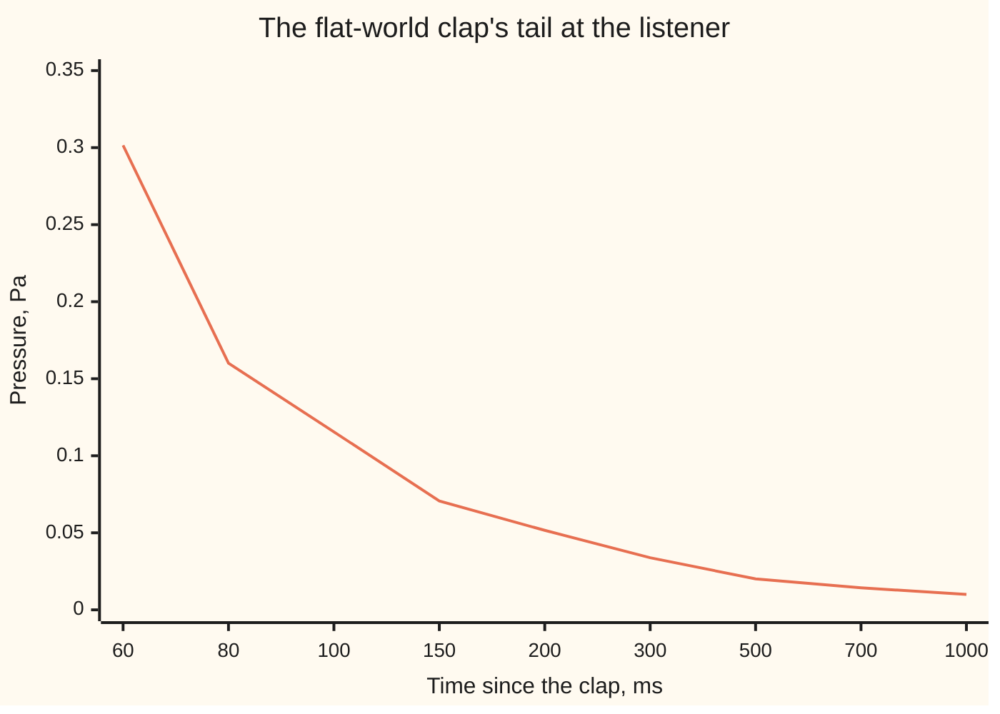

# Kirchhoff's formula: in three dimensions a pulse passes and leaves silence

[Syllabus](../../../SYLLABUS.md) → [Partial differential equations](../README.md) → [Waves](../README.md#s05) → Kirchhoff's formula

---

## General Overview

Someone claps once on one side of a stone courtyard. A listener stands 17.15 m away. Sound in air at 20 °C travels at 343 m/s, so the clap needs 50 ms to cross.

The listener hears a short crack and then nothing. The sound does not fade slowly. Once the crack has gone by, the air at the listener's ear is exactly as still as before the clap. In this card's model the crack lasts 1 ms, from 49.5 ms to 50.5 ms, and after 50.5 ms the pressure change is exactly 0 Pa.

That clean silence is special to three dimensions. Put the same clap in a flat, two-dimensional world and the listener hears a crack and then a tail that never stops. Its pressure is still 4.9% of its peak at 100 ms and 0.42% at 1 s.

On a line the wave equation is solved by [d'Alembert](01-dalembert-and-characteristics-for-waves.md). This card solves it in space by averaging over spheres. It then gets the flat answer from the space answer by a step called descent, and the two formulas explain the two tails.

**In three dimensions the sound at a point at time t depends only on what the source did on a sphere of radius ct around that point, so a short pulse passes in a thin shell and leaves exact silence behind it; in two dimensions the answer reads a whole disc, so the same pulse leaves a tail that fades like 1/t but never stops.**

**What kind of fact this is:** a theorem, proved on this card in Why it works, for classical solutions (solutions whose second rates exist and are continuous); the clap itself is a model, and its size and strength are illustrative.

### The picture: what the listener hears, in space and in a flat world



Orange: the clap in space, peak 0.1000 Pa. Green: the same clap in a flat world, peak 2.3601 Pa. Both start at 49.5 ms, because nothing outruns the sound speed. Only the orange line returns to zero and stays there.

---

## The formula

Notation from earlier cards, in one line each. $`\Delta u`$ is the Laplacian, the sum of the second rates in each direction. $`B(x, r)`$ is the solid ball of radius $`r`$ around the point $`x`$, and $`\partial B(x, r)`$ is its surface, the sphere ([Harmonic functions](../04-Laplace%2C%20Poisson%20and%20Potentials/01-harmonic-functions-and-mean-values.md)).

The problem has four parts.

- **Unknown:** $`u(x, t)`$, the change in air pressure at the point $`x`$ at time $`t`$, in pascals (Pa).
- **Region:** all of space, for $`t > 0`$. No walls.
- **Equation:** $`u_{tt} = c^2 \Delta u`$, the wave equation with sound speed $`c`$.
- **Data:** the starting pressure $`u(x, 0) = f(x)`$ and the starting rate of change $`u_t(x, 0) = g(x)`$.

This card introduces one new notation. The **spherical mean** $`M_h(x, r)`$ is the average of a function $`h`$ over the sphere of radius $`r`$ around $`x`$. When $`h`$ is the solution $`u`$ at time $`t`$, it is written $`M(x, r, t)`$.

**Kirchhoff's formula**, in three dimensions:

```math
u(x, t) = \frac{\partial}{\partial t}\Big( t\, M_f(x, ct) \Big) + t\, M_g(x, ct), \qquad M_h(x, r) = \frac{1}{4\pi r^2}\int_{\partial B(x, r)} h\, dS .
```

**Read it aloud:** the pressure here and now is fixed by the starting data on one sphere only, the sphere of radius c t around this point: t times the average starting rate on it, plus the rate of change in time of t times the average starting pressure on it.

**Poisson's formula**, in two dimensions, comes from Kirchhoff's by descent (Step 5):

```math
u(x, t) = \frac{\partial}{\partial t}\Big( \frac{1}{2\pi c}\int_{B(x, ct)} \frac{f(y)\, dy}{\sqrt{c^2 t^2 - |y - x|^2}} \Big) + \frac{1}{2\pi c}\int_{B(x, ct)} \frac{g(y)\, dy}{\sqrt{c^2 t^2 - |y - x|^2}} .
```

**Read it aloud:** in a flat world the pressure here and now reads the starting data on the whole disc of radius c t, with points near the disc's rim weighted most, and none of the disc ever drops out.

The clap is a ball of air of radius $`a`$ whose pressure has not yet changed ($`f = 0`$) but starts to rise at the rate $`g = V(1 - s^2/a^2)^2`$, where $`s`$ is the distance from the clap's centre. For a listener outside the clap, at distance $`R \ge a`$, the two formulas give, worked in Why it works:

```math
u_{3D}(R, t) = \frac{V a^2}{12\, c R}\Big(1 - \frac{(R - ct)^2}{a^2}\Big)^3 \ \text{ for } |R - ct| < a, \text{ else } 0, \qquad u_{2D}(R, t) \approx \frac{Q}{2\pi c\sqrt{D}} \ \text{ once } ct > R + a .
```

Here $`Q = \pi V a^2/3`$ is the flat clap's total starting rate, and $`D = c^2 t^2 - R^2`$ is the tail's clock.

| Symbol | Plain meaning | In our example | Push it up and the answer… |
| --- | --- | --- | --- |
| $`u`$ | change in air pressure, Pa | 0.1000 Pa at the 3D peak | — |
| $`x`$, $`t`$, $`y`$ | the listening point; time since the clap, s; a point of the data being averaged | listener 17.15 m from the clap; 49 ms to 1 s | — |
| $`c`$ | speed of sound | 343 m/s, air at 20 °C | the crack arrives sooner |
| $`f`$, $`g`$ | starting pressure; starting rate of change of pressure | $`f = 0`$; $`g`$ up to 240,000 Pa/s | the answer grows in proportion |
| $`M_h(x, r)`$, $`M(x, r, t)`$ | average of $`h`$ over the sphere of radius $`r`$ around $`x`$; the same for $`u`$ at time $`t`$ | $`M_g = 2.0000`$ Pa/s at 50 ms | — |
| $`B(x, r)`$, $`\partial B(x, r)`$, $`dS`$ | solid ball (a disc in 2D); its surface; a small patch of surface area | sphere of radius $`ct`$ = 17.15 m at 50 ms | — |
| $`R`$ | listener's distance from the clap's centre | 17.15 m | 3D peak falls as $`1/R`$ |
| $`a`$; $`s`$ | radius of the clap's ball of air; distance from the clap's centre | 0.1715 m; 0 to 0.1715 m | the crack lasts $`2a/c`$ |
| $`V`$ | peak starting rate, at the clap's centre (illustrative) | 240,000 Pa/s | everything scales with it |
| $`U`$; $`F`$, $`G`$ | $`r`$ times the spherical mean; its starting value and starting rate, $`r M_f`$ and $`r M_g`$ | $`U`$ obeys the string's equation in $`r`$ | — |
| $`d`$; $`z`$, $`\rho`$ | the number of space dimensions; a point of the unit sphere and a radius, used inside proofs | $`d = 3`$ in space, $`d = 2`$ in the flat world | odd $`d \ge 3`$ keeps the silence |
| $`Q`$, $`D`$ | the 2D clap's total starting rate, $`\pi V a^2/3`$; the tail's clock, $`c^2 t^2 - R^2`$ | 7,392 Pa·m²/s; 882.4 m² at 100 ms | the tail grows with $`Q`$ and fades as $`D`$ grows |

### When it holds

- **Three space dimensions, or any odd number of at least three.** In two dimensions, or any even number, the formula reads a whole ball and a tail remains, as worked on this card. On a line, a start of this kind leaves the string permanently shifted ([d'Alembert](01-dalembert-and-characteristics-for-waves.md)).
- **The plain wave equation, with no damping and no mass term.** Air friction, or the extra term in [Schrodinger and Klein-Gordon](07-schrodinger-and-klein-gordon-in-outline.md), makes even a 3D pulse leave a faint tail.
- **No walls.** A courtyard's walls reflect the crack. Each echo is its own thin shell from a mirror image of the clap ([Reflection](03-reflection-at-a-wall-and-the-half-line.md)), so the silence comes in gaps between echoes.
- **Smooth enough data.** The formula needs $`f`$ with three continuous rates and $`g`$ with two to give a classical solution. Rougher data still have a formula, but its meaning is weaker. The clap's $`g`$ falls one rate short: its second rate jumps at the clap's edge. The formula still gives the solution, and away from the clap's centre the answer has two continuous rates.
- **Small pressure changes.** The wave equation for sound is a linearisation. A gunshot close up is a shock wave, and its speed depends on its strength.

A real clap starts as a pressure bump at rest, not as a rate. Its sound is the time rate of this card's answer, a push then a pull, and it is just as silent afterwards.

---

## Why it works

### Step 0: the idea

Average the solution over a sphere around the listener. In three dimensions, that average, multiplied by the sphere's radius, obeys the one-dimensional wave equation exactly.

On a line a pulse travels without changing shape, so the average over spheres does too. Shrink the sphere to the listener and its average becomes the listener's pressure. So the answer contains only the data that started on one sphere.

### Step 1: spherical means obey their own wave equation

Fix the listening point $`x`$ and average the solution over spheres around it: $`M(x, r, t)`$. Averaging commutes with the time rates, so $`M_{tt}`$ is the average of $`u_{tt} = c^2 \Delta u`$.

The average of $`\Delta u`$ over a sphere is a rate in $`r`$. The divergence theorem says the flux of $`\nabla u`$ out of the ball, the integral of $`\Delta u`$ over it, equals $`4\pi r^2 M_r`$, where $`M_r`$ is the rate of the average with radius. So

```math
M_{tt} = c^2\Big(M_{rr} + \frac{2}{r}M_r\Big) .
```

This is the Euler–Poisson–Darboux equation: the wave equation for a function of radius alone.

<details>
<summary>Detailed proof: the spherical mean satisfies the Euler–Poisson–Darboux equation</summary>

Write a point of the sphere as $`x + r z`$ with $`z`$ on the unit sphere. Then $`M(x, r, t)`$ is the average of $`u(x + r z, t)`$ over $`z`$. Differentiate in $`r`$ under the average, and use the divergence theorem on the ball:

$`\displaystyle M_r = \frac{1}{4\pi r^2}\int_{\partial B(x, r)} \frac{\partial u}{\partial n}\, dS = \frac{1}{4\pi r^2}\int_{B(x, r)} \Delta u\, dy = \frac{1}{4\pi r^2 c^2}\int_{B(x, r)} u_{tt}\, dy .`$

So $`r^2 M_r`$ equals $`\frac{1}{4\pi c^2}\int_{B(x,r)} u_{tt}\, dy`$. Differentiate in $`r`$. The rate of an integral over a ball, with radius, is the integral over its surface:

$`\displaystyle (r^2 M_r)_r = \frac{1}{4\pi c^2}\int_{\partial B(x, r)} u_{tt}\, dS = \frac{r^2}{c^2} M_{tt} .`$

Expand $`(r^2 M_r)_r = r^2 M_{rr} + 2 r M_r`$ and divide by $`r^2/c^2`$. That is the equation.

</details>

### Step 2: in three dimensions, r times the mean is a string

Put $`U = r M`$. Then $`U_{rr} = r M_{rr} + 2 M_r`$, which is $`r`$ times the bracket in Step 1. So

```math
U_{tt} = c^2 U_{rr}, \qquad U(0, t) = 0 .
```

That is the wave equation on a half-line with a fixed end at $`r = 0`$. [Reflection](03-reflection-at-a-wall-and-the-half-line.md) solves it by d'Alembert's formula with a mirror image.

In $`d`$ dimensions the coefficient $`2/r`$ is $`(d - 1)/r`$, and only $`d = 3`$ cancels this neatly. Odd dimensions above 3 need several such steps; even dimensions never reach a plain string.

### Step 3: shrink the sphere, and read off Kirchhoff's formula

The listener's pressure is the limit of $`M`$ as the sphere shrinks: $`u(x, t) = \lim U/r`$ as $`r \to 0`$. The mirrored d'Alembert formula makes that limit a single rate at $`r = ct`$, and that rate is Kirchhoff's formula.

<details>
<summary>Detailed proof: from the half-line solution to Kirchhoff's formula</summary>

Let $`F(r) = r M_f(x, r)`$ and $`G(r) = r M_g(x, r)`$, the starting values of $`U`$ and $`U_t`$. Both are zero at $`r = 0`$. For $`0 \le r \le ct`$, d'Alembert with the mirror image at $`r = 0`$ gives

$`\displaystyle U(r, t) = \frac{1}{2}\big[F(ct + r) - F(ct - r)\big] + \frac{1}{2c}\int_{ct - r}^{ct + r} G(\rho)\, d\rho .`$

Divide by $`r`$ and let $`r \to 0`$. Half the bracket, divided by $`r`$, tends to $`F'(ct)`$. The integral, divided by $`r`$, tends to $`2G(ct)`$. So

$`\displaystyle u(x, t) = F'(ct) + \frac{1}{c}G(ct) = \frac{\partial}{\partial t}\big(t M_f(x, ct)\big) + t M_g(x, ct) ,`$

because $`\frac{\partial}{\partial t}\big(t M_f(x, ct)\big) = \frac{1}{c}\frac{\partial}{\partial t}\big(ct\, M_f(x, ct)\big) = F'(ct)`$ and $`G(ct)/c = t M_g(x, ct)`$. Direct differentiation confirms that this $`u`$ solves the wave equation with the right data when $`f`$ has three continuous rates and $`g`$ two. It is the only classical solution, because a difference of two would start with zero energy ([Wave energy is conserved, and nothing outruns the wave speed](02-energy-and-finite-speed.md)).

</details>

### Step 4: Huygens' principle, the silence behind the shell

Kirchhoff's formula uses the data only on the sphere $`|y - x| = ct`$. The clap's data is zero outside the ball of radius $`a`$ around its centre. So the listener at distance $`R`$ hears something only while that sphere cuts the clap's ball:

```math
R - a < ct < R + a .
```

Before $`(R - a)/c`$ = 49.5 ms the sphere has not reached the clap, which is the speed limit of [Wave energy is conserved, and nothing outruns the wave speed](02-energy-and-finite-speed.md). After $`(R + a)/c`$ = 50.5 ms the sphere has passed beyond it. Then the formula averages zeros, and the pressure is exactly 0. This sharp form is **Huygens' principle**: in three dimensions a signal has a sharp back edge as well as a sharp front.

For the clap the sphere average can be done by hand. On the sphere of radius $`ct`$, the share of area at distance between $`s`$ and $`s + ds`$ from the clap's centre is $`s\, ds/(2Rct)`$. So

```math
t\, M_g(x, ct) = \frac{1}{2cR}\int_{|R - ct|}^{a} s\, g(s)\, ds = \frac{V a^2}{12\, c R}\Big(1 - \frac{(R - ct)^2}{a^2}\Big)^3 .
```

The pressure is a function of $`R - ct`$ divided by $`R`$. It is a shell of fixed shape moving out at speed $`c`$, and growing fainter as $`1/R`$ as its energy spreads over a larger sphere.

The older, weaker reading of Huygens' principle, that each point of a wavefront acts as a new source, is visible too: each patch of the sphere adds its own share.

### Step 5: descent, from three dimensions to two

A flat-world problem is a three-dimensional problem whose data does not depend on the height. In space, the flat clap is an infinitely long upright cylinder of air, all puffing at once. Kirchhoff's formula applies to it unchanged. This is the **method of descent**.

The sphere of radius $`ct`$ around the listener has two caps, above and below the flat world. Each projects onto the disc $`B(x, ct)`$. A small patch $`dy`$ of the disc lies under a patch of sphere of area $`ct\, dy/\sqrt{c^2t^2 - |y - x|^2}`$, larger near the rim, where the sphere is steep. Two caps, each with that area, give

```math
t\, M_g(x, ct) = t \cdot \frac{2}{4\pi c^2 t^2}\int_{B(x, ct)} \frac{ct\, g(y)\, dy}{\sqrt{c^2 t^2 - |y - x|^2}} = \frac{1}{2\pi c}\int_{B(x, ct)} \frac{g(y)\, dy}{\sqrt{c^2 t^2 - |y - x|^2}} .
```

That is the second term of Poisson's formula. The first comes the same way from $`f`$.

### Step 6: why the flat clap rings on

Poisson's formula integrates over the whole disc, not just its rim. Once the front has passed, the whole clap lies inside the disc $`B(x, ct)`$, and every point of it still counts with a positive weight. The weight shrinks slowly as $`t`$ grows but never reaches zero.

When $`ct`$ is well past $`R + a`$, every point of the clap sits at about distance $`R`$, so

```math
u_{2D}(R, t) \approx \frac{Q}{2\pi c\sqrt{c^2 t^2 - R^2}} \;\to\; \frac{Q}{2\pi c^2 t}, \qquad Q = \int g\, dy = \frac{\pi V a^2}{3} .
```

The tail fades like $`1/t`$. In the cylinder picture the reason is plain: the sound reaching the listener at time $`t`$ comes from the part of the cylinder at distance $`ct`$, and the cylinder always has a part farther away.

The code adds a small correction from the clap's width, $`1 + \tfrac{a^2}{4}\big(\tfrac{1}{2D} + \tfrac{3R^2}{4D^2}\big)`$, from the next terms of the same expansion. The first terms it leaves out are all of size $`a^4`$. They would add $`a^4\big(\tfrac{3}{80D^2} + \tfrac{3R^2}{16D^3} + \tfrac{21R^4}{128D^4}\big)`$ to that factor: 1.055e-06 at 55 ms, and less later. Poisson's formula sits above the series by 1.058e-06 at 55 ms, so the series misses by just those terms.

---

## Worked numbers, by hand

The air: $`c`$ = 343 m/s. The clap: $`a`$ = 0.1715 m, $`V`$ = 240,000 Pa/s. The listener: $`R`$ = 17.15 m.

| Step | Arithmetic | Value |
| --- | --- | --- |
| front arrives | $`(17.15 - 0.1715)/343`$ | 49.500 ms |
| back edge passes | $`(17.15 + 0.1715)/343`$ | 50.500 ms |
| 3D peak, at $`ct = R`$ | $`240000 \times 0.1715^2 / (12 \times 343 \times 17.15)`$ | 0.1000 Pa |
| 3D at 49.75 ms | $`R - ct = 0.08575`$ m $`= a/2`$, so $`0.1000 \times (1 - 0.25)^3`$ | 0.0422 Pa |
| 3D at 50.60 ms | $`\lvert R - ct\rvert = 0.2058`$ m, more than $`a`$ | 0 Pa exactly |
| 2D clap total | $`Q = \pi \times 240000 \times 0.1715^2/3`$ | 7,392 Pa·m²/s |
| 2D at 100 ms | $`D = 34.3^2 - 17.15^2 = 882.4`$ m², so $`7392/(2\pi \times 343 \times \sqrt{882.4})`$ | 0.1155 Pa |
| 2D peak (from the code) | Poisson's formula near the front | 2.3601 Pa |
| 2D tail share at 100 ms | $`0.1155 / 2.3601`$ | **4.89% of the peak, against 0 in 3D** |

In space, the listener hears a 1 ms crack and then silence. In the flat world, a tenth of a second later the air still carries a twentieth of the peak.

### What breaks if you drop a piece

| Mistake | Comes out at | What went wrong |
| --- | --- | --- |
| Drop the factor $`t`$ in $`t\, M_g`$ | 2.0000 Pa/s at 50 ms, not 0.1000 Pa | the average is a rate; the factor $`t`$ turns it into a pressure, and the units show it |
| Use Kirchhoff's sphere-only rule in 2D: average over the circle | 20.371869 Pa at 50 ms and 0 at 51 ms; true 1.961241 Pa and 1.007479 Pa | the flat formula reads the whole disc with a weight; the rim alone gives a spike and false silence |
| Use the far tail $`Q/(2\pi c^2 t)`$ at 60 ms | 0.166667 Pa, not 0.301549 Pa | the clap is 17.15 m away, so the clock is $`c^2t^2 - R^2`$, not $`c^2 t^2`$ |
| Assume Huygens' silence in an even dimension | 0 after 50.5 ms; true 1.007479 Pa at 51 ms and 0.010013 Pa at 1 s | the sharp back edge needs an odd dimension of at least three |

---

## How it moves

Both worlds have the same speed limit, so why does only one go quiet? The answer is which part of the data each formula reads.

| Time, ms | 3D reads | 3D, Pa | 2D reads | 2D, Pa |
| --- | --- | --- | --- | --- |
| 49.40 | a sphere short of the clap | 0.000000 | a disc short of the clap | 0.000000 |
| 50.00 | a sphere through the clap's centre | 0.100000 | a disc with the clap at its rim | 1.961241 |
| 51.00 | a sphere past the clap | 0.000000 | a disc holding all of the clap | 1.007479 |
| 100.0 | a sphere 17 m past the clap | 0.000000 | a larger disc; the clap's weight is smaller | 0.115471 |

The flat clap's tail, one moment at a time, in pascals:

```
  55 ms  ############################################  0.436648
  60 ms  ##############################                0.301549
  70 ms  ####################                          0.204131
 100 ms  ############                                  0.115471
 200 ms  #####                                         0.051640
 500 ms  ##                                            0.020101
1000 ms  #                                             0.010013
```



Orange: the 2D tail from the tail series. The 3D line would sit on zero for every point. From 200 ms to 1 s, five times later, the tail is about five times quieter: the $`1/t`$ law.

---

## Code, from first principles, and it actually runs

The code computes the listener's pressure in both worlds by independent roads and checks that they agree. Three roads in 3D, three in 2D.

1. **3D closed form**, from Step 4.
2. **3D Kirchhoff sphere mean**, by Simpson's rule (a weighted sum of samples) over the sphere around the listener.
3. **3D residual**: the wave equation checked on the closed form by centred differences (small symmetric steps), shrinking four times when the step halves.
4. **2D Poisson's formula around the clap**: rings of the clap, each ring's integral done exactly by the complete elliptic integral (computed by the arithmetic–geometric mean), then summed over rings.
5. **2D descent around the listener**: the 3D sphere mean of the cylinder, flattened onto the disc.
6. **2D tail series**, from Step 6, after the front has passed.

Asserts also check that both worlds are exactly silent before 49.5 ms, that 3D is exactly silent after 50.5 ms, and that 2D is not.

### Python

```python
# Kirchhoff and Huygens: a handclap heard 17.15 m away, in space (3D) and in a flat world (2D).
# 3D roads: the closed form from r*u obeying the 1-D wave equation; Kirchhoff's sphere mean by
# Simpson's rule; the equation's residual by centred differences. 2D roads: Poisson's formula
# around the clap, by elliptic integrals; descent, the 3D sphere mean of a cylinder, around the
# listener; a tail series for late times.
from math import pi, sqrt, asin, acos, sin, cos
C, R, A, V = 343.0, 17.15, 0.1715, 2.4e5  # m/s, m, m, Pa/s (illustrative peak rate of the clap)
ms = 1e-3

def g(s):  # the clap: the rate at which the pressure starts rising, Pa/s, at distance s from its centre
    return V * (1 - s * s / (A * A)) ** 2 if s < A else 0.0

def simpson(f, lo, hi, n):  # n even
    h = (hi - lo) / n
    tot = f(lo) + f(hi) + sum((4 if j % 2 else 2) * f(lo + j * h) for j in range(1, n))
    return tot * h / 3

def u3_closed(r, t):  # 3D: r*u is a 1-D wave, so u = V a^2 (1 - d^2/a^2)^3 / (12 c r), d = r - c t
    d = r - C * t
    return V * A * A * (1 - d * d / (A * A)) ** 3 / (12 * C * r) if abs(d) < A else 0.0

def u3_mean(r, t):  # 3D: Kirchhoff, t times the mean of g over the sphere of radius c t around the listener
    rho = C * t
    mu0 = max(-1.0, (r * r + rho * rho - A * A) / (2 * r * rho))
    if mu0 >= 1: return 0.0
    return t * 0.5 * simpson(lambda mu: g(sqrt(max(0.0, r * r + rho * rho - 2 * r * rho * mu))), mu0, 1.0, 400)

def K(k):  # complete elliptic integral of the first kind, by the arithmetic-geometric mean
    a, b = 1.0, sqrt(1 - k * k)
    while abs(a - b) > 1e-15 * a: a, b = (a + b) / 2, sqrt(a * b)
    return pi / (2 * a)

def ring(s, t):  # integral over the clap's ring of radius s of 1/sqrt(c^2 t^2 - |y - x|^2), by angle
    P, Q = (C * t) ** 2 - R * R - s * s, 2 * s * R
    if P <= -Q: return 0.0
    if P >= Q: return 4 * K(sqrt(2 * Q / (P + Q))) / sqrt(P + Q)
    return 4 * K(sqrt((P + Q) / (2 * Q))) / sqrt(2 * Q)

def u2_poisson(t, n=1000):  # 2D: Poisson's formula, (1/(2 pi c)) times the ring integrals, summed over s
    cuts = sorted({0.0, A} | {x for x in (C * t - R, R - C * t) if 0 < x < A})
    tot = 0.0
    for p, q in zip(cuts, cuts[1:]):  # cosine-spaced midpoints soften the log spikes at the cuts
        for j in range(n):
            tau = (j + 0.5) / n
            s = p + (q - p) * (1 - cos(pi * tau)) / 2
            tot += s * g(s) * ring(s, t) * (q - p) * pi / 2 * sin(pi * tau) / n
    return tot / (2 * pi * C)

def u2_descent(t, n=200):  # 2D by descent: the 3D sphere mean of a cylinder, flattened onto the plane
    rho = C * t
    if rho <= R - A: return 0.0
    al = asin(A / R)
    lo, hi = asin((R - A) / rho), asin(min(1.0, (R + A) / rho))
    def inner(ph):
        return simpson(lambda ps: g(sqrt(max(0.0, R * R + (rho * sin(ps)) ** 2 + 2 * R * rho * sin(ps) * cos(ph)))) * sin(ps), lo, hi, n)
    return t / (2 * pi) * 2 * simpson(inner, pi - al, pi, n)

def u2_tail(t):  # 2D after the pulse: series in a^2/D, with D = c^2 t^2 - R^2
    D = (C * t) ** 2 - R * R
    return V * A * A / (6 * C * sqrt(D)) * (1 + A * A / 4 * (1 / (2 * D) + 3 * R * R / (4 * D * D)))

def u2_circle(t):  # the mistake: Kirchhoff's surface-only shape used in 2D, t times the mean over a circle
    rho = C * t
    m = (R * R + rho * rho - A * A) / (2 * R * rho)  # the circle meets the clap where cos(ph) > m
    if m >= 1: return 0.0
    return t / pi * simpson(lambda ph: g(sqrt(max(0.0, R * R + rho * rho - 2 * R * rho * cos(ph)))), 0.0, acos(max(-1.0, m)), 4000)

def resid(t, h):  # u_tt - c^2 (u_rr + 2 u_r / r) by centred differences, relative to c^2 u_rr
    k = h / (2 * C)  # a time step that is not the r-step over c, so the test is not exact by luck
    utt = (u3_closed(R, t + k) - 2 * u3_closed(R, t) + u3_closed(R, t - k)) / (k * k)
    urr = (u3_closed(R + h, t) - 2 * u3_closed(R, t) + u3_closed(R - h, t)) / (h * h)
    ur = (u3_closed(R + h, t) - u3_closed(R - h, t)) / (2 * h)
    return (utt - C * C * (urr + 2 * ur / R)) / (C * C * urr)

print(f"setup: c = {C:.0f} m/s, listener at R = {R:.2f} m, clap radius a = {A:.4f} m, peak rate V = {V:.0f} Pa/s")
print(f"sound can arrive only from (R - a)/c = {(R - A) / C / ms:.3f} ms to (R + a)/c = {(R + A) / C / ms:.3f} ms in 3D")
print(f"by hand: Q = {pi * V * A * A / 3:.0f} Pa m^2/s, D at 100 ms = {(C * 0.1) ** 2 - R * R:.1f} m^2, shell 2a = {200 * A:.1f} cm")
print(f"by hand: R - ct at 49.75 ms = {R - C * 49.75 * ms:.5f} m, at 50.60 ms = {R - C * 50.6 * ms:.4f} m")
print("3D pressure at the listener, Pa: time, closed form, Kirchhoff sphere mean")
for tm in (49.40, 49.75, 50.00, 50.25, 51.00, 100.0):
    a3, b3 = u3_closed(R, tm * ms), u3_mean(R, tm * ms)
    print(f"  {tm:7.2f} ms  {a3:.6f}  {b3:.6f}")
    assert abs(a3 - b3) < 1e-9
assert u3_mean(R, 50.6 * ms) == 0 and u3_mean(R, 100 * ms) == 0  # Huygens: silence once the shell has passed
r1, r2 = resid(49.9 * ms, 2e-3), resid(49.9 * ms, 1e-3)
print(f"3D residual of the wave equation at 49.90 ms: step 2 mm {r1:.3e}, step 1 mm {r2:.3e}, ratio {r1 / r2:.2f}")
assert abs(r1) < 1e-3 and 3.5 < r1 / r2 < 4.5
print("2D pressure at the listener, Pa: time, Poisson by elliptic integrals, descent")
for tm in (49.40, 49.75, 50.00, 50.25, 50.50, 51.00):
    a2, b2 = u2_poisson(tm * ms), u2_descent(tm * ms)
    print(f"  {tm:7.2f} ms  {a2:.6f}  {b2:.6f}")
    assert abs(a2 - b2) <= 1e-4 * a2 + 1e-9
assert u2_poisson(49.4 * ms) == 0 and u2_descent(49.4 * ms) == 0  # nothing outruns c, in 2D too
pk, tpk = max((u2_poisson(x * ms, 400), x) for x in [49.5 + 0.02 * j for j in range(76)])
lo, hi = tpk - 0.02, tpk + 0.02  # refine the grid's best by golden-section search, ms
for _ in range(40):
    m1, m2 = hi - 0.618034 * (hi - lo), lo + 0.618034 * (hi - lo)
    if u2_poisson(m1 * ms) < u2_poisson(m2 * ms): lo = m1
    else: hi = m2
tpk = (lo + hi) / 2
pk = u2_poisson(tpk * ms)
print(f"2D peak: {pk:.4f} Pa at {tpk:.3f} ms")
print("2D tail, Pa: time, Poisson, descent, tail series, crude Q/(2 pi c^2 t)")
tails = {}
for tm in (55.0, 60.0, 70.0, 100.0, 200.0, 500.0, 1000.0):
    t = tm * ms
    a2, b2, c2, d2 = u2_poisson(t), u2_descent(t), u2_tail(t), V * A * A / (6 * C * C * t)
    tails[tm] = a2
    print(f"  {tm:7.1f} ms  {a2:.6f}  {b2:.6f}  {c2:.6f}  {d2:.6f}")
    assert abs(a2 - c2) < 1e-4 * c2 and abs(b2 - c2) < 1e-4 * c2
D5 = (C * 55 * ms) ** 2 - R * R  # the tail series' first omitted terms, all of size a^4, at 55 ms
om = A ** 4 * (3 / (80 * D5 ** 2) + 3 * R * R / (16 * D5 ** 3) + 21 * R ** 4 / (128 * D5 ** 4))
gap = tails[55.0] / u2_tail(55 * ms) - 1
print(f"tail series at 55 ms: first omitted terms {om:.3e} of the tail; Poisson above the series by {gap:.3e}")
assert abs(gap - om) < 0.1 * om  # the series misses by its first omitted terms
print(f"tail as a share of the peak: 3D 0 after {(R + A) / C / ms:.3f} ms; 2D {tails[100.0] / pk:.4f} at 100 ms, {tails[1000.0] / pk:.4f} at 1 s")
p3 = u3_closed(R, 50 * ms)  # the charts from 49 ms to 53 ms, each as a percent of its own peak
print(f"chart 3D, % of peak: {', '.join(f'{100 * u3_closed(R, (49 + 0.25 * j) * ms) / p3:.1f}' for j in range(17))}")
print(f"chart 2D, % of peak: {', '.join(f'{100 * u2_poisson((49 + 0.25 * j) * ms, 400) / pk:.1f}' for j in range(17))}")
print(f"chart tail 2D: {', '.join(f'{u2_tail(x * ms):.4f}' for x in (60, 80, 100, 150, 200, 300, 500, 700, 1000))}")
w1, w2, w3 = u3_mean(R, 50 * ms) / (50 * ms), u2_circle(50 * ms), u2_circle(51 * ms)
print(f"no factor t, 3D at 50.00 ms: {w1:.4f} Pa/s, not {u3_closed(R, 50 * ms):.4f} Pa")
print(f"circle only, 2D: {w2:.6f} Pa at 50.00 ms, {w3:.6f} Pa at 51.00 ms; true {u2_poisson(50 * ms):.6f} and {u2_poisson(51 * ms):.6f} Pa")
assert w3 == 0 and u2_poisson(51 * ms) > 0.25 * pk and abs(w1 * 50 * ms - u3_closed(R, 50 * ms)) < 1e-9
print("ALL CHECKS PASS")
```

**Ran 2026-11-15 on macOS, Python 3.14.10, standard library only. All checks passed. Output, pasted from the run:**

```
setup: c = 343 m/s, listener at R = 17.15 m, clap radius a = 0.1715 m, peak rate V = 240000 Pa/s
sound can arrive only from (R - a)/c = 49.500 ms to (R + a)/c = 50.500 ms in 3D
by hand: Q = 7392 Pa m^2/s, D at 100 ms = 882.4 m^2, shell 2a = 34.3 cm
by hand: R - ct at 49.75 ms = 0.08575 m, at 50.60 ms = -0.2058 m
3D pressure at the listener, Pa: time, closed form, Kirchhoff sphere mean
    49.40 ms  0.000000  0.000000
    49.75 ms  0.042188  0.042188
    50.00 ms  0.100000  0.100000
    50.25 ms  0.042187  0.042188
    51.00 ms  0.000000  0.000000
   100.00 ms  0.000000  0.000000
3D residual of the wave equation at 49.90 ms: step 2 mm 1.068e-04, step 1 mm 2.669e-05, ratio 4.00
2D pressure at the listener, Pa: time, Poisson by elliptic integrals, descent
    49.40 ms  0.000000  0.000000
    49.75 ms  0.541678  0.541678
    50.00 ms  1.961241  1.961241
    50.25 ms  2.263082  2.263079
    50.50 ms  1.501646  1.501645
    51.00 ms  1.007479  1.007479
2D peak: 2.3601 Pa at 50.166 ms
2D tail, Pa: time, Poisson, descent, tail series, crude Q/(2 pi c^2 t)
     55.0 ms  0.436648  0.436648  0.436647  0.181818
     60.0 ms  0.301549  0.301549  0.301549  0.166667
     70.0 ms  0.204131  0.204131  0.204131  0.142857
    100.0 ms  0.115471  0.115471  0.115471  0.100000
    200.0 ms  0.051640  0.051640  0.051640  0.050000
    500.0 ms  0.020101  0.020101  0.020101  0.020000
   1000.0 ms  0.010013  0.010013  0.010013  0.010000
tail series at 55 ms: first omitted terms 1.055e-06 of the tail; Poisson above the series by 1.058e-06
tail as a share of the peak: 3D 0 after 50.500 ms; 2D 0.0489 at 100 ms, 0.0042 at 1 s
chart 3D, % of peak: 0.0, 0.0, 0.0, 42.2, 100.0, 42.2, 0.0, 0.0, 0.0, 0.0, 0.0, 0.0, 0.0, 0.0, 0.0, 0.0, 0.0
chart 2D, % of peak: 0.0, 0.0, 0.0, 23.0, 83.1, 95.9, 63.6, 49.9, 42.7, 38.0, 34.5, 31.9, 29.8, 28.0, 26.5, 25.2, 24.1
chart tail 2D: 0.3015, 0.1601, 0.1155, 0.0707, 0.0516, 0.0338, 0.0201, 0.0143, 0.0100
no factor t, 3D at 50.00 ms: 2.0000 Pa/s, not 0.1000 Pa
circle only, 2D: 20.371869 Pa at 50.00 ms, 0.000000 Pa at 51.00 ms; true 1.961241 and 1.007479 Pa
ALL CHECKS PASS
```

### Rust

```rust
// Kirchhoff and Huygens: a handclap heard 17.15 m away, in space (3D) and in a flat world (2D).
// 3D roads: the closed form from r*u obeying the 1-D wave equation; Kirchhoff's sphere mean by
// Simpson's rule; the equation's residual by centred differences. 2D roads: Poisson's formula
// around the clap, by elliptic integrals; descent, the 3D sphere mean of a cylinder, around the
// listener; a tail series for late times.
use std::f64::consts::PI;
const C: f64 = 343.0; // m/s
const R: f64 = 17.15; // m
const A: f64 = 0.1715; // m
const V: f64 = 2.4e5; // Pa/s (illustrative peak rate of the clap)
const MS: f64 = 1e-3;

fn g(s: f64) -> f64 { // the clap: the rate at which the pressure starts rising, Pa/s
    if s < A { V * (1.0 - s * s / (A * A)).powf(2.0) } else { 0.0 }
}
fn simpson(f: &dyn Fn(f64) -> f64, lo: f64, hi: f64, n: usize) -> f64 {
    let h = (hi - lo) / n as f64;
    let mut s = 0.0;
    for j in 1..n { s += (if j % 2 == 1 { 4.0 } else { 2.0 }) * f(lo + j as f64 * h); }
    (f(lo) + f(hi) + s) * h / 3.0
}
fn u3_closed(r: f64, t: f64) -> f64 { // 3D: r*u is a 1-D wave
    let d = r - C * t;
    if d.abs() < A { V * A * A * (1.0 - d * d / (A * A)).powf(3.0) / (12.0 * C * r) } else { 0.0 }
}
fn u3_mean(r: f64, t: f64) -> f64 { // 3D: Kirchhoff, t times the mean of g over the sphere of radius c t
    let rho = C * t;
    let mu0 = f64::max(-1.0, (r * r + rho * rho - A * A) / (2.0 * r * rho));
    if mu0 >= 1.0 { return 0.0; }
    t * 0.5 * simpson(&|mu: f64| g(f64::max(0.0, r * r + rho * rho - 2.0 * r * rho * mu).sqrt()), mu0, 1.0, 400)
}
fn ell_k(k: f64) -> f64 { // complete elliptic integral of the first kind, by the arithmetic-geometric mean
    let (mut a, mut b) = (1.0f64, (1.0 - k * k).sqrt());
    while (a - b).abs() > 1e-15 * a { let a2 = (a + b) / 2.0; b = (a * b).sqrt(); a = a2; }
    PI / (2.0 * a)
}
fn ring(s: f64, t: f64) -> f64 { // integral over the clap's ring of radius s of 1/sqrt(c^2 t^2 - |y - x|^2)
    let p = (C * t).powf(2.0) - R * R - s * s;
    let q = 2.0 * s * R;
    if p <= -q { return 0.0; }
    if p >= q { return 4.0 * ell_k((2.0 * q / (p + q)).sqrt()) / (p + q).sqrt(); }
    4.0 * ell_k(((p + q) / (2.0 * q)).sqrt()) / (2.0 * q).sqrt()
}
fn u2_poisson(t: f64, n: usize) -> f64 { // 2D: Poisson's formula, ring integrals summed over s
    let mut cuts = vec![0.0, A];
    for x in [C * t - R, R - C * t] { if 0.0 < x && x < A { cuts.push(x); } }
    cuts.sort_by(|a, b| a.partial_cmp(b).unwrap());
    cuts.dedup();
    let mut tot = 0.0;
    for w in cuts.windows(2) {
        let (p, q) = (w[0], w[1]);
        for j in 0..n {
            let tau = (j as f64 + 0.5) / n as f64;
            let s = p + (q - p) * (1.0 - (PI * tau).cos()) / 2.0;
            tot += s * g(s) * ring(s, t) * (q - p) * PI / 2.0 * (PI * tau).sin() / n as f64;
        }
    }
    tot / (2.0 * PI * C)
}
fn u2_descent(t: f64, n: usize) -> f64 { // 2D by descent: the 3D sphere mean of a cylinder, flattened
    let rho = C * t;
    if rho <= R - A { return 0.0; }
    let al = (A / R).asin();
    let (lo, hi) = (((R - A) / rho).asin(), f64::min(1.0, (R + A) / rho).asin());
    let inner = |ph: f64| simpson(&|ps: f64| g(f64::max(0.0, R * R + (rho * ps.sin()).powf(2.0) + 2.0 * R * rho * ps.sin() * ph.cos()).sqrt()) * ps.sin(), lo, hi, n);
    t / (2.0 * PI) * 2.0 * simpson(&inner, PI - al, PI, n)
}
fn u2_tail(t: f64) -> f64 { // 2D after the pulse: series in a^2/D, with D = c^2 t^2 - R^2
    let d = (C * t).powf(2.0) - R * R;
    V * A * A / (6.0 * C * d.sqrt()) * (1.0 + A * A / 4.0 * (1.0 / (2.0 * d) + 3.0 * R * R / (4.0 * d * d)))
}
fn u2_circle(t: f64) -> f64 { // the mistake: Kirchhoff's surface-only shape used in 2D
    let rho = C * t;
    let m = (R * R + rho * rho - A * A) / (2.0 * R * rho); // the circle meets the clap where cos(ph) > m
    if m >= 1.0 { return 0.0; }
    t / PI * simpson(&|ph: f64| g(f64::max(0.0, R * R + rho * rho - 2.0 * R * rho * ph.cos()).sqrt()), 0.0, f64::max(-1.0, m).acos(), 4000)
}
fn resid(t: f64, h: f64) -> f64 { // u_tt - c^2 (u_rr + 2 u_r / r) by centred differences, relative to c^2 u_rr
    let k = h / (2.0 * C); // a time step that is not the r-step over c, so the test is not exact by luck
    let utt = (u3_closed(R, t + k) - 2.0 * u3_closed(R, t) + u3_closed(R, t - k)) / (k * k);
    let urr = (u3_closed(R + h, t) - 2.0 * u3_closed(R, t) + u3_closed(R - h, t)) / (h * h);
    let ur = (u3_closed(R + h, t) - u3_closed(R - h, t)) / (2.0 * h);
    (utt - C * C * (urr + 2.0 * ur / R)) / (C * C * urr)
}
fn sci(x: f64) -> String { // Python's 1.234e-05 style
    let s = format!("{:.3e}", x);
    let (m, e) = s.split_once('e').unwrap();
    let ev: i32 = e.parse().unwrap();
    format!("{}e{}{:02}", m, if ev < 0 { "-" } else { "+" }, ev.abs())
}
fn join(v: Vec<f64>) -> String { v.iter().map(|x| format!("{:.4}", x)).collect::<Vec<_>>().join(", ") }

fn main() {
    println!("setup: c = {:.0} m/s, listener at R = {:.2} m, clap radius a = {:.4} m, peak rate V = {:.0} Pa/s", C, R, A, V);
    println!("sound can arrive only from (R - a)/c = {:.3} ms to (R + a)/c = {:.3} ms in 3D", (R - A) / C / MS, (R + A) / C / MS);
    println!("by hand: Q = {:.0} Pa m^2/s, D at 100 ms = {:.1} m^2, shell 2a = {:.1} cm", PI * V * A * A / 3.0, (C * 0.1).powf(2.0) - R * R, 200.0 * A);
    println!("by hand: R - ct at 49.75 ms = {:.5} m, at 50.60 ms = {:.4} m", R - C * 49.75 * MS, R - C * 50.6 * MS);
    println!("3D pressure at the listener, Pa: time, closed form, Kirchhoff sphere mean");
    for tm in [49.40, 49.75, 50.00, 50.25, 51.00, 100.0] {
        let (a3, b3) = (u3_closed(R, tm * MS), u3_mean(R, tm * MS));
        println!("  {:7.2} ms  {:.6}  {:.6}", tm, a3, b3);
        assert!((a3 - b3).abs() < 1e-9);
    }
    assert!(u3_mean(R, 50.6 * MS) == 0.0 && u3_mean(R, 100.0 * MS) == 0.0); // Huygens: silence once the shell has passed
    let (r1, r2) = (resid(49.9 * MS, 2e-3), resid(49.9 * MS, 1e-3));
    println!("3D residual of the wave equation at 49.90 ms: step 2 mm {}, step 1 mm {}, ratio {:.2}", sci(r1), sci(r2), r1 / r2);
    assert!(r1.abs() < 1e-3 && 3.5 < r1 / r2 && r1 / r2 < 4.5);
    println!("2D pressure at the listener, Pa: time, Poisson by elliptic integrals, descent");
    for tm in [49.40, 49.75, 50.00, 50.25, 50.50, 51.00] {
        let (a2, b2) = (u2_poisson(tm * MS, 1000), u2_descent(tm * MS, 200));
        println!("  {:7.2} ms  {:.6}  {:.6}", tm, a2, b2);
        assert!((a2 - b2).abs() <= 1e-4 * a2 + 1e-9);
    }
    assert!(u2_poisson(49.4 * MS, 1000) == 0.0 && u2_descent(49.4 * MS, 200) == 0.0); // nothing outruns c, in 2D too
    let (mut pk, mut tpk) = (f64::MIN, 0.0);
    for j in 0..76 {
        let x = 49.5 + 0.02 * j as f64;
        let v = u2_poisson(x * MS, 400);
        if v > pk || (v == pk && x > tpk) { pk = v; tpk = x; }
    }
    let (mut lo, mut hi) = (tpk - 0.02, tpk + 0.02); // refine the grid's best by golden-section search, ms
    for _ in 0..40 {
        let (m1, m2) = (hi - 0.618034 * (hi - lo), lo + 0.618034 * (hi - lo));
        if u2_poisson(m1 * MS, 1000) < u2_poisson(m2 * MS, 1000) { lo = m1; } else { hi = m2; }
    }
    tpk = (lo + hi) / 2.0;
    pk = u2_poisson(tpk * MS, 1000);
    println!("2D peak: {:.4} Pa at {:.3} ms", pk, tpk);
    println!("2D tail, Pa: time, Poisson, descent, tail series, crude Q/(2 pi c^2 t)");
    let (mut t55, mut t100, mut t1000) = (0.0, 0.0, 0.0);
    for tm in [55.0, 60.0, 70.0, 100.0, 200.0, 500.0, 1000.0] {
        let t = tm * MS;
        let (a2, b2, c2, d2) = (u2_poisson(t, 1000), u2_descent(t, 200), u2_tail(t), V * A * A / (6.0 * C * C * t));
        if tm == 55.0 { t55 = a2; }
        if tm == 100.0 { t100 = a2; }
        if tm == 1000.0 { t1000 = a2; }
        println!("  {:7.1} ms  {:.6}  {:.6}  {:.6}  {:.6}", tm, a2, b2, c2, d2);
        assert!((a2 - c2).abs() < 1e-4 * c2 && (b2 - c2).abs() < 1e-4 * c2);
    }
    let d5 = (C * 55.0 * MS).powf(2.0) - R * R; // the tail series' first omitted terms, all of size a^4, at 55 ms
    let om = A.powf(4.0) * (3.0 / (80.0 * d5.powf(2.0)) + 3.0 * R * R / (16.0 * d5.powf(3.0)) + 21.0 * R.powf(4.0) / (128.0 * d5.powf(4.0)));
    let gap = t55 / u2_tail(55.0 * MS) - 1.0;
    println!("tail series at 55 ms: first omitted terms {} of the tail; Poisson above the series by {}", sci(om), sci(gap));
    assert!((gap - om).abs() < 0.1 * om); // the series misses by its first omitted terms
    println!("tail as a share of the peak: 3D 0 after {:.3} ms; 2D {:.4} at 100 ms, {:.4} at 1 s", (R + A) / C / MS, t100 / pk, t1000 / pk);
    let p3 = u3_closed(R, 50.0 * MS); // the charts from 49 ms to 53 ms, each as a percent of its own peak
    let pct = |v: Vec<f64>| v.iter().map(|x| format!("{:.1}", x)).collect::<Vec<_>>().join(", ");
    println!("chart 3D, % of peak: {}", pct((0..17).map(|j| 100.0 * u3_closed(R, (49.0 + 0.25 * j as f64) * MS) / p3).collect()));
    println!("chart 2D, % of peak: {}", pct((0..17).map(|j| 100.0 * u2_poisson((49.0 + 0.25 * j as f64) * MS, 400) / pk).collect()));
    println!("chart tail 2D: {}", join([60.0, 80.0, 100.0, 150.0, 200.0, 300.0, 500.0, 700.0, 1000.0].iter().map(|x| u2_tail(x * MS)).collect()));
    let (w1, w2, w3) = (u3_mean(R, 50.0 * MS) / (50.0 * MS), u2_circle(50.0 * MS), u2_circle(51.0 * MS));
    println!("no factor t, 3D at 50.00 ms: {:.4} Pa/s, not {:.4} Pa", w1, u3_closed(R, 50.0 * MS));
    println!("circle only, 2D: {:.6} Pa at 50.00 ms, {:.6} Pa at 51.00 ms; true {:.6} and {:.6} Pa", w2, w3, u2_poisson(50.0 * MS, 1000), u2_poisson(51.0 * MS, 1000));
    assert!(w3 == 0.0 && u2_poisson(51.0 * MS, 1000) > 0.25 * pk && (w1 * 50.0 * MS - u3_closed(R, 50.0 * MS)).abs() < 1e-9);
    println!("ALL CHECKS PASS");
}
```

**Ran 2026-11-15 on macOS, rustc 1.98.1, no crates. All checks passed. Output, pasted from the run:**

```
setup: c = 343 m/s, listener at R = 17.15 m, clap radius a = 0.1715 m, peak rate V = 240000 Pa/s
sound can arrive only from (R - a)/c = 49.500 ms to (R + a)/c = 50.500 ms in 3D
by hand: Q = 7392 Pa m^2/s, D at 100 ms = 882.4 m^2, shell 2a = 34.3 cm
by hand: R - ct at 49.75 ms = 0.08575 m, at 50.60 ms = -0.2058 m
3D pressure at the listener, Pa: time, closed form, Kirchhoff sphere mean
    49.40 ms  0.000000  0.000000
    49.75 ms  0.042188  0.042188
    50.00 ms  0.100000  0.100000
    50.25 ms  0.042187  0.042188
    51.00 ms  0.000000  0.000000
   100.00 ms  0.000000  0.000000
3D residual of the wave equation at 49.90 ms: step 2 mm 1.068e-04, step 1 mm 2.669e-05, ratio 4.00
2D pressure at the listener, Pa: time, Poisson by elliptic integrals, descent
    49.40 ms  0.000000  0.000000
    49.75 ms  0.541678  0.541678
    50.00 ms  1.961241  1.961241
    50.25 ms  2.263082  2.263079
    50.50 ms  1.501646  1.501645
    51.00 ms  1.007479  1.007479
2D peak: 2.3601 Pa at 50.166 ms
2D tail, Pa: time, Poisson, descent, tail series, crude Q/(2 pi c^2 t)
     55.0 ms  0.436648  0.436648  0.436647  0.181818
     60.0 ms  0.301549  0.301549  0.301549  0.166667
     70.0 ms  0.204131  0.204131  0.204131  0.142857
    100.0 ms  0.115471  0.115471  0.115471  0.100000
    200.0 ms  0.051640  0.051640  0.051640  0.050000
    500.0 ms  0.020101  0.020101  0.020101  0.020000
   1000.0 ms  0.010013  0.010013  0.010013  0.010000
tail series at 55 ms: first omitted terms 1.055e-06 of the tail; Poisson above the series by 1.058e-06
tail as a share of the peak: 3D 0 after 50.500 ms; 2D 0.0489 at 100 ms, 0.0042 at 1 s
chart 3D, % of peak: 0.0, 0.0, 0.0, 42.2, 100.0, 42.2, 0.0, 0.0, 0.0, 0.0, 0.0, 0.0, 0.0, 0.0, 0.0, 0.0, 0.0
chart 2D, % of peak: 0.0, 0.0, 0.0, 23.0, 83.1, 95.9, 63.6, 49.9, 42.7, 38.0, 34.5, 31.9, 29.8, 28.0, 26.5, 25.2, 24.1
chart tail 2D: 0.3015, 0.1601, 0.1155, 0.0707, 0.0516, 0.0338, 0.0201, 0.0143, 0.0100
no factor t, 3D at 50.00 ms: 2.0000 Pa/s, not 0.1000 Pa
circle only, 2D: 20.371869 Pa at 50.00 ms, 0.000000 Pa at 51.00 ms; true 1.961241 and 1.007479 Pa
ALL CHECKS PASS
```

### Lean

Lean proves Kirchhoff's formula and Huygens' silence in three dimensions, and the endless flat tail, for all data smooth enough.

- Take $`f`$ with three continuous rates and $`g`$ with two. Take a solution $`u`$ whose second rates are continuous at all times, negative ones too. Then $`u`$ equals Kirchhoff's formula at every point, for every $`t > 0`$.
- Suppose also that $`f`$ and $`g`$ are zero outside a ball of radius $`a`$ around a point $`p`$. Then $`u = 0`$ at $`x`$ whenever $`ct < |x - p| - a`$ or $`ct > |x - p| + a`$.
- Take two dimensions, $`f = 0`$, and $`g \ge 0`$ with two continuous rates, positive somewhere and zero outside that ball. Then $`u > 0`$ at $`x`$ whenever $`ct > |x - p| + a`$: the tail never stops.
- In exact fractions the crack runs from 99/2000 s to 101/2000 s. It lasts 1/1000 s, in a shell 343/1000 m thick.
- The 3D peak is 1/10 Pa, and 27/640 Pa at 49.75 ms. At 50.60 ms the listener is outside the shell.
- The tail's clock at 100 ms is $`D`$ = 352947/400 m².

The clap's own formula, Poisson's formula and the tail's $`1/t`$ fade are left to the Python and Rust checks.

```lean
-- Kirchhoff's formula: in three dimensions every classical solution of the wave equation equals Kirchhoff's sphere-mean formula, so a pulse from a bounded source is heard only while the sphere of radius c·t crosses the source and is followed by exact silence, while in two dimensions the same kind of pulse never falls silent.
import Mathlib.Analysis.InnerProductSpace.Laplacian
import Mathlib.Analysis.InnerProductSpace.PiL2
import Mathlib.MeasureTheory.Constructions.HaarToSphere
import Mathlib.MeasureTheory.Integral.Average
import Mathlib.MeasureTheory.Measure.Haar.InnerProductSpace
import Mathlib.Tactic.NormNum
import Mathlib.Analysis.Calculus.ParametricIntegral
import Mathlib.Analysis.Calculus.FDeriv.Symmetric
import Mathlib.Analysis.Calculus.ContDiff.Basic
import Mathlib.MeasureTheory.Integral.IntervalIntegral.FundThmCalculus
import Mathlib.Analysis.Calculus.MeanValue
import Mathlib.Analysis.Calculus.ContDiff.Deriv
import Mathlib.Analysis.Calculus.Deriv.Prod
import Mathlib.Analysis.SpecialFunctions.Trigonometric.Deriv

open MeasureTheory Metric Laplacian
open scoped Pointwise

local notation "E3" => EuclideanSpace ℝ (Fin 3)
local notation "S3" => sphere (0 : EuclideanSpace ℝ (Fin 3)) 1
local notation "σ3" => Measure.toSphere (volume : Measure (EuclideanSpace ℝ (Fin 3)))

open scoped Topology

/-- A function with derivative zero on the interval between `0` and `s` takes the same value
at `s` and at `0`. -/
lemma kh_wave_aux_const {φ φ' : ℝ → ℝ} (hφ : ∀ r, HasDerivAt φ (φ' r) r) (s : ℝ)
    (h0 : ∀ r ∈ Set.uIcc 0 s, φ' r = 0) : φ s = φ 0 := by
  have hcont : Continuous φ := continuous_iff_continuousAt.2 fun r => (hφ r).continuousAt
  rcases le_total 0 s with hs | hs
  · refine constant_of_has_deriv_right_zero (a := 0) (b := s) hcont.continuousOn
      (fun r hr => ?_) s ⟨hs, le_rfl⟩
    have := h0 r (by rw [Set.uIcc_of_le hs]; exact Set.Ico_subset_Icc_self hr)
    rw [← this]; exact (hφ r).hasDerivWithinAt
  · refine (constant_of_has_deriv_right_zero (a := s) (b := 0) hcont.continuousOn
      (fun r hr => ?_) 0 ⟨hs, le_rfl⟩).symm
    have := h0 r (by rw [Set.uIcc_of_ge hs]; exact Set.Ico_subset_Icc_self hr)
    rw [← this]; exact (hφ r).hasDerivWithinAt

lemma kh_wave_hasDerivAt1 {W : ℝ × ℝ → ℝ} (hW : ContDiff ℝ 2 W) {γ : ℝ → ℝ × ℝ} {γ' : ℝ × ℝ}
    {s : ℝ} (hγ : HasDerivAt γ γ' s) :
    HasDerivAt (fun s => W (γ s)) (fderiv ℝ W (γ s) γ') s :=
  ((hW.differentiable (by norm_num)) (γ s)).hasFDerivAt.comp_hasDerivAt s hγ

lemma kh_wave_hasDerivAt2 {W : ℝ × ℝ → ℝ} (hW : ContDiff ℝ 2 W) {γ : ℝ → ℝ × ℝ} {γ' : ℝ × ℝ}
    {s : ℝ} (hγ : HasDerivAt γ γ' s) (v : ℝ × ℝ) :
    HasDerivAt (fun s => fderiv ℝ W (γ s) v) (fderiv ℝ (fderiv ℝ W) (γ s) γ' v) s := by
  have hD : ContDiff ℝ 1 (fderiv ℝ W) := hW.fderiv_right (by norm_num)
  have h1 := ((hD.differentiable (by norm_num)) (γ s)).hasFDerivAt.comp_hasDerivAt s hγ
  have h2 := h1.clm_apply (hasDerivAt_const s v)
  simpa using h2

lemma kh_wave_symm {W : ℝ × ℝ → ℝ} (hW : ContDiff ℝ 2 W) (p v w : ℝ × ℝ) :
    fderiv ℝ (fderiv ℝ W) p v w = fderiv ℝ (fderiv ℝ W) p w v :=
  hW.contDiffAt.isSymmSndFDerivAt (by simp) v w

lemma kh_wave_dt (w : ℝ → ℝ → ℝ) (hw : ContDiff ℝ 2 (fun p : ℝ × ℝ => w p.1 p.2)) (x t : ℝ) :
    HasDerivAt (fun t => w x t) (fderiv ℝ (fun p : ℝ × ℝ => w p.1 p.2) (x, t) (0, 1)) t :=
  kh_wave_hasDerivAt1 hw (HasDerivAt.prodMk (hasDerivAt_const t x) (hasDerivAt_id' t))

lemma kh_wave_dx (w : ℝ → ℝ → ℝ) (hw : ContDiff ℝ 2 (fun p : ℝ × ℝ => w p.1 p.2)) (x t : ℝ) :
    HasDerivAt (fun x => w x t) (fderiv ℝ (fun p : ℝ × ℝ => w p.1 p.2) (x, t) (1, 0)) x :=
  kh_wave_hasDerivAt1 hw (HasDerivAt.prodMk (hasDerivAt_id' x) (hasDerivAt_const x t))

lemma kh_wave_dtt (w : ℝ → ℝ → ℝ) (hw : ContDiff ℝ 2 (fun p : ℝ × ℝ => w p.1 p.2)) (x t : ℝ) :
    deriv (fun t => deriv (fun t => w x t) t) t =
      fderiv ℝ (fderiv ℝ (fun p : ℝ × ℝ => w p.1 p.2)) (x, t) (0, 1) (0, 1) := by
  have e : (fun t => deriv (fun t => w x t) t) =
      fun t => fderiv ℝ (fun p : ℝ × ℝ => w p.1 p.2) (x, t) (0, 1) :=
    funext fun t => (kh_wave_dt w hw x t).deriv
  rw [e]
  exact (kh_wave_hasDerivAt2 hw (HasDerivAt.prodMk (hasDerivAt_const t x) (hasDerivAt_id' t)) (0, 1)).deriv

lemma kh_wave_dxx (w : ℝ → ℝ → ℝ) (hw : ContDiff ℝ 2 (fun p : ℝ × ℝ => w p.1 p.2)) (x t : ℝ) :
    deriv (fun x => deriv (fun x => w x t) x) x =
      fderiv ℝ (fderiv ℝ (fun p : ℝ × ℝ => w p.1 p.2)) (x, t) (1, 0) (1, 0) := by
  have e : (fun x => deriv (fun x => w x t) x) =
      fun x => fderiv ℝ (fun p : ℝ × ℝ => w p.1 p.2) (x, t) (1, 0) :=
    funext fun x => (kh_wave_dx w hw x t).deriv
  rw [e]
  exact (kh_wave_hasDerivAt2 hw (HasDerivAt.prodMk (hasDerivAt_id' x) (hasDerivAt_const x t)) (1, 0)).deriv

/-- `u_t - c u_x` is constant along the right-moving lines `x - ct = const`. -/
lemma kh_wave_char_a {W : ℝ × ℝ → ℝ} (hW : ContDiff ℝ 2 W) (c x₁ s : ℝ)
    (hwave : ∀ r ∈ Set.uIcc 0 s, fderiv ℝ (fderiv ℝ W) (x₁ + c * r, r) (0, 1) (0, 1) =
        c ^ 2 * fderiv ℝ (fderiv ℝ W) (x₁ + c * r, r) (1, 0) (1, 0)) :
    fderiv ℝ W (x₁ + c * s, s) (0, 1) - c * fderiv ℝ W (x₁ + c * s, s) (1, 0) =
      fderiv ℝ W (x₁, 0) (0, 1) - c * fderiv ℝ W (x₁, 0) (1, 0) := by
  have hγ : ∀ r, HasDerivAt (fun r : ℝ => ((x₁ + c * r, r) : ℝ × ℝ)) ((c, 1) : ℝ × ℝ) r := by
    intro r
    have := HasDerivAt.prodMk (HasDerivAt.const_add x₁ (HasDerivAt.const_mul c (hasDerivAt_id' r))) (hasDerivAt_id' r)
    simpa using this
  have key := kh_wave_aux_const
    (φ := fun r => fderiv ℝ W (x₁ + c * r, r) (0, 1) - c * fderiv ℝ W (x₁ + c * r, r) (1, 0))
    (φ' := fun r => fderiv ℝ (fderiv ℝ W) (x₁ + c * r, r) (c, 1) (0, 1) -
      c * fderiv ℝ (fderiv ℝ W) (x₁ + c * r, r) (c, 1) (1, 0))
    (fun r => HasDerivAt.sub (kh_wave_hasDerivAt2 hW (hγ r) (0, 1))
      (HasDerivAt.const_mul c (kh_wave_hasDerivAt2 hW (hγ r) (1, 0)))) s
    (fun r hr => by
      have e : ((c, 1) : ℝ × ℝ) = c • ((1 : ℝ), (0 : ℝ)) + ((0 : ℝ), (1 : ℝ)) := by
        ext <;> simp
      have hs := kh_wave_symm hW (x₁ + c * r, r) (1, 0) (0, 1)
      have hwr := hwave r hr
      simp only [e, map_add, map_smul, add_apply,
        smul_apply, smul_eq_mul]
      linear_combination c * hs + hwr)
  simp only [mul_zero, add_zero] at key
  exact key

/-- `u_t + c u_x` is constant along the left-moving lines `x + ct = const`. -/
lemma kh_wave_char_b {W : ℝ × ℝ → ℝ} (hW : ContDiff ℝ 2 W) (c x₁ s : ℝ)
    (hwave : ∀ r ∈ Set.uIcc 0 s, fderiv ℝ (fderiv ℝ W) (x₁ - c * r, r) (0, 1) (0, 1) =
        c ^ 2 * fderiv ℝ (fderiv ℝ W) (x₁ - c * r, r) (1, 0) (1, 0)) :
    fderiv ℝ W (x₁ - c * s, s) (0, 1) + c * fderiv ℝ W (x₁ - c * s, s) (1, 0) =
      fderiv ℝ W (x₁, 0) (0, 1) + c * fderiv ℝ W (x₁, 0) (1, 0) := by
  have hγ : ∀ r, HasDerivAt (fun r : ℝ => ((x₁ - c * r, r) : ℝ × ℝ)) ((-c, 1) : ℝ × ℝ) r := by
    intro r
    have := HasDerivAt.prodMk (HasDerivAt.const_sub x₁ (HasDerivAt.const_mul c (hasDerivAt_id' r))) (hasDerivAt_id' r)
    simpa using this
  have key := kh_wave_aux_const
    (φ := fun r => fderiv ℝ W (x₁ - c * r, r) (0, 1) + c * fderiv ℝ W (x₁ - c * r, r) (1, 0))
    (φ' := fun r => fderiv ℝ (fderiv ℝ W) (x₁ - c * r, r) (-c, 1) (0, 1) +
      c * fderiv ℝ (fderiv ℝ W) (x₁ - c * r, r) (-c, 1) (1, 0))
    (fun r => HasDerivAt.add (kh_wave_hasDerivAt2 hW (hγ r) (0, 1))
      (HasDerivAt.const_mul c (kh_wave_hasDerivAt2 hW (hγ r) (1, 0)))) s
    (fun r hr => by
      have e : ((-c, 1) : ℝ × ℝ) = (-c) • ((1 : ℝ), (0 : ℝ)) + ((0 : ℝ), (1 : ℝ)) := by
        ext <;> simp
      have hs := kh_wave_symm hW (x₁ - c * r, r) (1, 0) (0, 1)
      have hwr := hwave r hr
      simp only [e, map_add, map_smul, add_apply,
        smul_apply, smul_eq_mul]
      linear_combination -c * hs + hwr)
  simp only [mul_zero, sub_zero] at key
  exact key

/-- The time derivative of a solution is determined by the starting data along the two
characteristic lines through the point. -/
lemma kh_wave_ut_formula (c : ℝ) (w : ℝ → ℝ → ℝ) (hw : ContDiff ℝ 2 (fun p : ℝ × ℝ => w p.1 p.2))
    (x t : ℝ)
    (hwave : ∀ x' t', t' ∈ Set.uIcc 0 t → deriv (fun t => deriv (fun t => w x' t) t) t' =
        c ^ 2 * deriv (fun x => deriv (fun x => w x t') x) x') :
    deriv (fun t => w x t) t =
      ((deriv (fun s => w (x - c * t) s) 0 - c * deriv (fun y => w y 0) (x - c * t)) +
       (deriv (fun s => w (x + c * t) s) 0 + c * deriv (fun y => w y 0) (x + c * t))) / 2 := by
  have hw2 : ∀ x' t', t' ∈ Set.uIcc 0 t →
      fderiv ℝ (fderiv ℝ (fun p : ℝ × ℝ => w p.1 p.2)) (x', t') (0, 1) (0, 1) =
        c ^ 2 * fderiv ℝ (fderiv ℝ (fun p : ℝ × ℝ => w p.1 p.2)) (x', t') (1, 0) (1, 0) := by
    intro x' t' ht'
    have := hwave x' t' ht'
    rwa [kh_wave_dtt w hw, kh_wave_dxx w hw] at this
  have ha := kh_wave_char_a hw c (x - c * t) t (fun r hr => hw2 _ r hr)
  have hb := kh_wave_char_b hw c (x + c * t) t (fun r hr => hw2 _ r hr)
  rw [show x - c * t + c * t = x by ring] at ha
  rw [show x + c * t - c * t = x by ring] at hb
  rw [(kh_wave_dt w hw x t).deriv, (kh_wave_dt w hw (x - c * t) 0).deriv,
    (kh_wave_dt w hw (x + c * t) 0).deriv, (kh_wave_dx w hw (x - c * t) 0).deriv,
    (kh_wave_dx w hw (x + c * t) 0).deriv]
  linear_combination (ha + hb) / 2

/-- Uniqueness: two solutions with the same starting data agree, as long as the wave equation
holds for both at every time between `0` and `t`. -/
lemma kh_wave_uniq_gen (c : ℝ) (u v : ℝ → ℝ → ℝ) (hu : ContDiff ℝ 2 (fun p : ℝ × ℝ => u p.1 p.2))
    (hv : ContDiff ℝ 2 (fun p : ℝ × ℝ => v p.1 p.2)) (x t : ℝ)
    (hwu : ∀ x' t', t' ∈ Set.uIcc 0 t → deriv (fun t => deriv (fun t => u x' t) t) t' =
        c ^ 2 * deriv (fun x => deriv (fun x => u x t') x) x')
    (hwv : ∀ x' t', t' ∈ Set.uIcc 0 t → deriv (fun t => deriv (fun t => v x' t) t) t' =
        c ^ 2 * deriv (fun x => deriv (fun x => v x t') x) x')
    (h0 : ∀ y, u y 0 = v y 0)
    (h1 : ∀ y, deriv (fun t => u y t) 0 = deriv (fun t => v y t) 0) :
    u x t = v x t := by
  have hd0 : ∀ z, deriv (fun y => u y 0) z = deriv (fun y => v y 0) z := by
    intro z; rw [show (fun y => u y 0) = (fun y => v y 0) from funext h0]
  have key := kh_wave_aux_const (φ := fun r => u x r - v x r)
    (φ' := fun r => fderiv ℝ (fun p : ℝ × ℝ => u p.1 p.2) (x, r) (0, 1) -
      fderiv ℝ (fun p : ℝ × ℝ => v p.1 p.2) (x, r) (0, 1))
    (fun r => HasDerivAt.sub (kh_wave_dt u hu x r) (kh_wave_dt v hv x r)) t
    (fun r hr => by
      have hsub : Set.uIcc 0 r ⊆ Set.uIcc 0 t := Set.uIcc_subset_uIcc Set.left_mem_uIcc hr
      have eu := kh_wave_ut_formula c u hu x r (fun x' t' ht' => hwu x' t' (hsub ht'))
      have ev := kh_wave_ut_formula c v hv x r (fun x' t' ht' => hwv x' t' (hsub ht'))
      rw [(kh_wave_dt u hu x r).deriv] at eu
      rw [(kh_wave_dt v hv x r).deriv] at ev
      show _ - _ = (0 : ℝ)
      rw [sub_eq_zero, eu, ev, h1 (x - c * r), h1 (x + c * r), hd0 (x - c * r),
        hd0 (x + c * r)])
  rw [h0 x, sub_self, sub_eq_zero] at key
  exact key

/-- A twice-differentiable function of the sliding variables. -/
lemma kh_wave_prof_contDiff {A B : ℝ → ℝ} (hA : ContDiff ℝ 2 A) (hB : ContDiff ℝ 2 B) (c : ℝ) :
    ContDiff ℝ 2 (fun p : ℝ × ℝ => A (p.1 - c * p.2) + B (p.1 + c * p.2)) :=
  (hA.comp (contDiff_fst.sub (contDiff_const.mul contDiff_snd))).add
    (hB.comp (contDiff_fst.add (contDiff_const.mul contDiff_snd)))

lemma kh_wave_lin_t {A : ℝ → ℝ} (hA : Differentiable ℝ A) (c x t : ℝ) :
    HasDerivAt (fun t => A (x - c * t)) (deriv A (x - c * t) * (-c)) t := by
  have h1 : HasDerivAt (fun t => x - c * t) (-c) t := by
    simpa using HasDerivAt.const_sub x (HasDerivAt.const_mul c (hasDerivAt_id' t))
  exact (hA _).hasDerivAt.comp t h1

lemma kh_wave_lin_t' {A : ℝ → ℝ} (hA : Differentiable ℝ A) (c x t : ℝ) :
    HasDerivAt (fun t => A (x + c * t)) (deriv A (x + c * t) * c) t := by
  have h1 : HasDerivAt (fun t => x + c * t) c t := by
    simpa using HasDerivAt.const_add x (HasDerivAt.const_mul c (hasDerivAt_id' t))
  exact (hA _).hasDerivAt.comp t h1

lemma kh_wave_lin_x {A : ℝ → ℝ} (hA : Differentiable ℝ A) (c x t : ℝ) :
    HasDerivAt (fun x => A (x - c * t)) (deriv A (x - c * t)) x := by
  have h1 : HasDerivAt (fun x => x - c * t) 1 x := HasDerivAt.sub_const _ (hasDerivAt_id' x)
  have h2 := (hA _).hasDerivAt.comp x h1
  rw [mul_one] at h2
  exact h2

lemma kh_wave_lin_x' {A : ℝ → ℝ} (hA : Differentiable ℝ A) (c x t : ℝ) :
    HasDerivAt (fun x => A (x + c * t)) (deriv A (x + c * t)) x := by
  have h1 : HasDerivAt (fun x => x + c * t) 1 x := HasDerivAt.add_const _ (hasDerivAt_id' x)
  have h2 := (hA _).hasDerivAt.comp x h1
  rw [mul_one] at h2
  exact h2

lemma kh_wave_prof_dt {A B : ℝ → ℝ} (hA : Differentiable ℝ A) (hB : Differentiable ℝ B)
    (c x t : ℝ) :
    HasDerivAt (fun t => A (x - c * t) + B (x + c * t))
      (deriv A (x - c * t) * (-c) + deriv B (x + c * t) * c) t :=
  HasDerivAt.add (kh_wave_lin_t hA c x t) (kh_wave_lin_t' hB c x t)

lemma kh_wave_d2 {A : ℝ → ℝ} (hA : ContDiff ℝ 2 A) : Differentiable ℝ (deriv A) := by
  have h : ContDiff ℝ (1 + 1) A := by norm_num; exact hA
  exact ((contDiff_succ_iff_deriv.1 h).2.2).differentiable (by norm_num)

/-- A sum of a right-moving and a left-moving profile solves the wave equation. -/
lemma kh_wave_prof_wave {A B : ℝ → ℝ} (hA : ContDiff ℝ 2 A) (hB : ContDiff ℝ 2 B) (c x t : ℝ) :
    deriv (fun t => deriv (fun t => A (x - c * t) + B (x + c * t)) t) t =
      c ^ 2 * deriv (fun x => deriv (fun x => A (x - c * t) + B (x + c * t)) x) x := by
  have hA1 : Differentiable ℝ A := hA.differentiable (by norm_num)
  have hB1 : Differentiable ℝ B := hB.differentiable (by norm_num)
  have hA2 := kh_wave_d2 hA
  have hB2 := kh_wave_d2 hB
  have et : (fun t => deriv (fun t => A (x - c * t) + B (x + c * t)) t) =
      fun t => deriv A (x - c * t) * (-c) + deriv B (x + c * t) * c :=
    funext fun t => (kh_wave_prof_dt hA1 hB1 c x t).deriv
  have ex : (fun x => deriv (fun x => A (x - c * t) + B (x + c * t)) x) =
      fun x => deriv A (x - c * t) + deriv B (x + c * t) :=
    funext fun x => (HasDerivAt.add (kh_wave_lin_x hA1 c x t) (kh_wave_lin_x' hB1 c x t)).deriv
  have h1 : HasDerivAt (fun t => deriv A (x - c * t) * (-c) + deriv B (x + c * t) * c)
      (deriv (deriv A) (x - c * t) * (-c) * (-c) + deriv (deriv B) (x + c * t) * c * c) t :=
    HasDerivAt.add (HasDerivAt.mul_const (kh_wave_lin_t hA2 c x t) (-c))
      (HasDerivAt.mul_const (kh_wave_lin_t' hB2 c x t) c)
  have h2 : HasDerivAt (fun x => deriv A (x - c * t) + deriv B (x + c * t))
      (deriv (deriv A) (x - c * t) + deriv (deriv B) (x + c * t)) x :=
    HasDerivAt.add (kh_wave_lin_x hA2 c x t) (kh_wave_lin_x' hB2 c x t)
  rw [et, ex, h1.deriv, h2.deriv]
  ring

/-- D'Alembert's integral formula, rewritten as a right-moving plus a left-moving profile. -/
lemma kh_wave_dal_profile (c : ℝ) (hc : c ≠ 0) (f g : ℝ → ℝ) (hf : ContDiff ℝ 2 f)
    (hg : ContDiff ℝ 1 g) :
    ∃ A B : ℝ → ℝ, ContDiff ℝ 2 A ∧ ContDiff ℝ 2 B ∧
      (∀ x t, (f (x - c * t) + f (x + c * t)) / 2 +
          1 / (2 * c) * ∫ s in (x - c * t)..(x + c * t), g s = A (x - c * t) + B (x + c * t)) ∧
      (∀ y, A y + B y = f y) ∧
      (∀ y, deriv A y * (-c) + deriv B y * c = g y) := by
  obtain ⟨P, hP⟩ : ∃ P : ℝ → ℝ, P = fun y => ∫ s in (0 : ℝ)..y, g s := ⟨_, rfl⟩
  have hPd : ∀ y, HasDerivAt P (g y) y := by
    intro y; rw [hP]; exact (hg.continuous.integral_hasStrictDerivAt 0 y).hasDerivAt
  have hPc : ContDiff ℝ 2 P := by
    have h : ContDiff ℝ (1 + 1) P := by
      rw [contDiff_succ_iff_deriv]
      refine ⟨fun y => (hPd y).differentiableAt, by simp, ?_⟩
      rw [show deriv P = g from funext fun y => (hPd y).deriv]
      exact hg
    norm_num at h; exact h
  have hf1 : Differentiable ℝ f := hf.differentiable (by norm_num)
  refine ⟨fun y => f y / 2 - P y / (2 * c), fun y => f y / 2 + P y / (2 * c),
    (hf.div_const 2).sub (hPc.div_const _), (hf.div_const 2).add (hPc.div_const _), ?_, ?_, ?_⟩
  · intro x t
    have : ∫ s in (x - c * t)..(x + c * t), g s = P (x + c * t) - P (x - c * t) := by
      rw [hP]
      exact (intervalIntegral.integral_interval_sub_left
        (hg.continuous.intervalIntegrable _ _) (hg.continuous.intervalIntegrable _ _)).symm
    rw [this]
    field_simp
    ring
  · intro y; ring
  · intro y
    have dA : HasDerivAt (fun y => f y / 2 - P y / (2 * c)) (deriv f y / 2 - g y / (2 * c)) y :=
      HasDerivAt.sub ((hf1 y).hasDerivAt.div_const 2) ((hPd y).div_const _)
    have dB : HasDerivAt (fun y => f y / 2 + P y / (2 * c)) (deriv f y / 2 + g y / (2 * c)) y :=
      HasDerivAt.add ((hf1 y).hasDerivAt.div_const 2) ((hPd y).div_const _)
    rw [dA.deriv, dB.deriv]
    field_simp
    ring


/-- The generator of rotations in the plane of coordinates `j` and `k`. -/
noncomputable def khJ (j k : Fin 3) : E3 →L[ℝ] E3 :=
  (EuclideanSpace.proj j).smulRight (EuclideanSpace.single k (1 : ℝ)) -
    (EuclideanSpace.proj k).smulRight (EuclideanSpace.single j (1 : ℝ))

/-- The projection onto the plane of coordinates `j` and `k`. -/
noncomputable def khP (j k : Fin 3) : E3 →L[ℝ] E3 :=
  (EuclideanSpace.proj j).smulRight (EuclideanSpace.single j (1 : ℝ)) +
    (EuclideanSpace.proj k).smulRight (EuclideanSpace.single k (1 : ℝ))

/-- The rotation by angle `θ` in the plane of coordinates `j` and `k`. -/
noncomputable def khR (j k : Fin 3) (θ : ℝ) : E3 →L[ℝ] E3 :=
  ContinuousLinearMap.id ℝ E3 + (Real.cos θ - 1) • khP j k + Real.sin θ • khJ j k

lemma kh_J_apply (j k : Fin 3) (y : E3) (m : Fin 3) :
    khJ j k y m = (if m = k then y j else 0) - (if m = j then y k else 0) := by
  simp [khJ]

lemma kh_P_apply (j k : Fin 3) (y : E3) (m : Fin 3) :
    khP j k y m = (if m = j then y j else 0) + (if m = k then y k else 0) := by
  simp [khP]

lemma kh_R_apply (j k : Fin 3) (θ : ℝ) (y : E3) (m : Fin 3) :
    khR j k θ y m = y m + (Real.cos θ - 1) * khP j k y m + Real.sin θ * khJ j k y m := by
  simp [khR]

lemma kh_R_norm (j k : Fin 3) (hjk : j ≠ k) (θ : ℝ) (y : E3) : ‖khR j k θ y‖ = ‖y‖ := by
  have h2 : ‖khR j k θ y‖ ^ 2 = ‖y‖ ^ 2 := by
    rw [EuclideanSpace.real_norm_sq_eq, EuclideanSpace.real_norm_sq_eq]
    simp only [Fin.sum_univ_three, kh_R_apply, kh_P_apply, kh_J_apply]
    have hs := Real.sin_sq_add_cos_sq θ
    fin_cases j <;> fin_cases k <;> simp at hjk ⊢ <;>
      first
      | linear_combination (y 0 ^ 2 + y 1 ^ 2) * hs
      | linear_combination (y 0 ^ 2 + y 2 ^ 2) * hs
      | linear_combination (y 1 ^ 2 + y 2 ^ 2) * hs
  have := sq_eq_sq₀ (norm_nonneg _) (norm_nonneg _) |>.1 h2
  exact this

lemma kh_sphere_integral_isometry
    (A : EuclideanSpace ℝ (Fin 3) ≃ₗᵢ[ℝ] EuclideanSpace ℝ (Fin 3))
    (G : EuclideanSpace ℝ (Fin 3) → ℝ) :
    ∫ z : sphere (0 : EuclideanSpace ℝ (Fin 3)) 1, G (A z)
        ∂((volume : Measure (EuclideanSpace ℝ (Fin 3))).toSphere) =
      ∫ z : sphere (0 : EuclideanSpace ℝ (Fin 3)) 1, G z
        ∂((volume : Measure (EuclideanSpace ℝ (Fin 3))).toSphere) := by
  set μ := (volume : Measure (EuclideanSpace ℝ (Fin 3)))
  let à : sphere (0 : EuclideanSpace ℝ (Fin 3)) 1 ≃ₜ sphere (0 : EuclideanSpace ℝ (Fin 3)) 1 :=
    { toFun := fun z => ⟨A z, by simp⟩
      invFun := fun z => ⟨A.symm z, by simp⟩
      left_inv := fun z => by simp
      right_inv := fun z => by simp
      continuous_toFun := (A.continuous.comp continuous_subtype_val).subtype_mk (fun z => by simp)
      continuous_invFun := (A.symm.continuous.comp continuous_subtype_val).subtype_mk (fun z => by simp) }
  have hmap : MeasurePreserving à μ.toSphere μ.toSphere := by
    refine ⟨Ã.continuous.measurable, ?_⟩
    ext s hs
    rw [Measure.map_apply Ã.continuous.measurable hs, μ.toSphere_apply' hs,
      μ.toSphere_apply' (Ã.continuous.measurable hs)]
    congr 1
    have hset : Set.Ioo (0:ℝ) 1 • ((↑) '' (Ã ⁻¹' s) : Set (EuclideanSpace ℝ (Fin 3))) =
        A ⁻¹' (Set.Ioo (0:ℝ) 1 • ((↑) '' s : Set (EuclideanSpace ℝ (Fin 3)))) := by
      ext y
      simp only [Set.mem_smul, Set.mem_image, Set.mem_preimage]
      constructor
      · rintro ⟨a, ha, _, ⟨z, hz, rfl⟩, rfl⟩
        exact ⟨a, ha, _, ⟨Ã z, hz, rfl⟩, by simp [Ã]⟩
      · rintro ⟨a, ha, _, ⟨w, hw, rfl⟩, hy⟩
        refine ⟨a, ha, _, ⟨Ã.symm w, by simpa using hw, rfl⟩, ?_⟩
        apply A.injective
        simp [Ã, hy]
    rw [hset]
    exact (A.measurePreserving).measure_preimage_emb A.toHomeomorph.measurableEmbedding _
  exact hmap.integral_comp Ã.measurableEmbedding (fun z => G z)

lemma kh_integrable {F : Type*} [NormedAddCommGroup F] (φ : S3 → F) (hφ : Continuous φ) :
    Integrable φ σ3 :=
  hφ.integrable_of_hasCompactSupport (HasCompactSupport.of_compactSpace φ)

lemma kh_bound {P F : Type*} [NormedAddCommGroup P] [NormedSpace ℝ P] [FiniteDimensional ℝ P]
    [NormedAddCommGroup F] (Φ : P → E3 → F)
    (hΦ : Continuous (fun q : P × E3 => Φ q.1 q.2)) (p₀ : P) :
    ∃ M, ∀ q ∈ ball p₀ 1, ∀ z : S3, ‖Φ q z‖ ≤ M := by
  obtain ⟨M, hM⟩ := ((isCompact_closedBall p₀ 1).prod
    (isCompact_sphere (0 : E3) 1)).exists_bound_of_continuousOn hΦ.continuousOn
  exact ⟨M, fun q hq z => hM (q, z) ⟨ball_subset_closedBall hq, z.2⟩⟩

lemma kh_param_hasFDerivAt {P F : Type*} [NormedAddCommGroup P] [NormedSpace ℝ P]
    [FiniteDimensional ℝ P] [NormedAddCommGroup F] [NormedSpace ℝ F] [CompleteSpace F]
    (Ψ : P → E3 → F) (hΨ : ContDiff ℝ 1 (fun q : P × E3 => Ψ q.1 q.2)) (p₀ : P) :
    HasFDerivAt (fun p => ∫ z : S3, Ψ p z ∂σ3)
      (∫ z : S3, fderiv ℝ (fun q => Ψ q z) p₀ ∂σ3) p₀ := by
  have hD : Continuous (fun q : P × E3 => fderiv ℝ (fun p => Ψ p q.2) q.1) := by
    have h := ContDiff.fderiv (f := fun (y : P × E3) (p : P) => Ψ p y.2) (g := fun y => y.1)
      (n := 0) (m := 1) (hΨ.comp (contDiff_snd.prodMk (contDiff_snd.comp contDiff_fst)))
      contDiff_fst (by norm_num)
    exact h.continuous
  obtain ⟨M, hM⟩ := kh_bound (fun q y => fderiv ℝ (fun p => Ψ p y) q) hD p₀
  have hdiff : ∀ (y : E3) (q : P), HasFDerivAt (fun p => Ψ p y) (fderiv ℝ (fun p => Ψ p y) q) q :=
    fun y q => ((hΨ.comp (contDiff_id.prodMk contDiff_const)).differentiable (by norm_num)
      q).hasFDerivAt
  have hc : ∀ q : P, Continuous (fun z : S3 => Ψ q z) := fun q =>
    hΨ.continuous.comp (continuous_const.prodMk continuous_subtype_val)
  refine hasFDerivAt_integral_of_dominated_of_fderiv_le (𝕜 := ℝ) (μ := σ3)
    (F' := fun q (z : S3) => fderiv ℝ (fun p => Ψ p z) q) (bound := fun _ => M)
    (ball_mem_nhds p₀ one_pos) ?_ ?_ ?_ ?_ ?_ ?_
  · filter_upwards with q
    exact (hc q).aestronglyMeasurable
  · exact kh_integrable _ (hc p₀)
  · exact (hD.comp (continuous_const.prodMk continuous_subtype_val)).aestronglyMeasurable
  · filter_upwards with z q hq
    exact hM q hq z
  · exact integrable_const M
  · filter_upwards with z q _
    exact hdiff z q

lemma kh_param_contDiff {P : Type} [NormedAddCommGroup P] [NormedSpace ℝ P]
    [FiniteDimensional ℝ P] (n : ℕ) : ∀ (F : Type) [NormedAddCommGroup F] [NormedSpace ℝ F]
    [CompleteSpace F] (Ψ : P → E3 → F), ContDiff ℝ n (fun q : P × E3 => Ψ q.1 q.2) →
    ContDiff ℝ n (fun p => ∫ z : S3, Ψ p z ∂σ3) := by
  induction n with
  | zero =>
    intro F _ _ _ Ψ hΨ
    rw [Nat.cast_zero, contDiff_zero] at hΨ ⊢
    have := continuous_parametric_integral_of_continuous (μ := σ3)
      (f := fun (p : P) (z : S3) => Ψ p z)
      (hΨ.comp (continuous_fst.prodMk (continuous_subtype_val.comp continuous_snd)))
      isCompact_univ
    simpa using this
  | succ n ih =>
    intro F _ _ _ Ψ hΨ
    rw [Nat.cast_succ, contDiff_succ_iff_hasFDerivAt]
    refine ⟨fun p => ∫ z : S3, fderiv ℝ (fun q => Ψ q z) p ∂σ3, ?_, fun p =>
      kh_param_hasFDerivAt Ψ (hΨ.of_le (by norm_cast; omega)) p⟩
    apply ih (P →L[ℝ] F) (fun p y => fderiv ℝ (fun q => Ψ q y) p)
    have h := ContDiff.fderiv (f := fun (y : P × E3) (p : P) => Ψ p y.2) (g := fun y => y.1)
      (n := n) (m := n + 1) (hΨ.comp (contDiff_snd.prodMk (contDiff_snd.comp contDiff_fst)))
      contDiff_fst le_rfl
    exact h

lemma kh_param_hasDerivAt (Ψ : ℝ → E3 → ℝ)
    (hΨ : ContDiff ℝ 1 (fun q : ℝ × E3 => Ψ q.1 q.2)) (p₀ : ℝ) :
    HasDerivAt (fun p => ∫ z : S3, Ψ p z ∂σ3) (∫ z : S3, deriv (fun q => Ψ q z) p₀ ∂σ3) p₀ := by
  have h := (kh_param_hasFDerivAt Ψ hΨ p₀).hasDerivAt
  have hD : Continuous (fun q : ℝ × E3 => fderiv ℝ (fun p => Ψ p q.2) q.1) := by
    have h := ContDiff.fderiv (f := fun (y : ℝ × E3) (p : ℝ) => Ψ p y.2) (g := fun y => y.1)
      (n := 0) (m := 1) (hΨ.comp (contDiff_snd.prodMk (contDiff_snd.comp contDiff_fst)))
      contDiff_fst (by norm_num)
    exact h.continuous
  have hi : Integrable (fun z : S3 => fderiv ℝ (fun q => Ψ q z) p₀) σ3 :=
    kh_integrable _ (hD.comp (continuous_const.prodMk continuous_subtype_val))
  rw [ContinuousLinearMap.integral_apply hi] at h
  simpa [fderiv_apply_one_eq_deriv] using h

/-- The rotation as a linear isometry equivalence. -/
noncomputable def khRI (j k : Fin 3) (hjk : j ≠ k) (θ : ℝ) : E3 ≃ₗᵢ[ℝ] E3 :=
  LinearIsometry.toLinearIsometryEquiv
    { toLinearMap := (khR j k θ).toLinearMap, norm_map' := kh_R_norm j k hjk θ } rfl

lemma kh_R_hasDerivAt (j k : Fin 3) (y : E3) :
    HasDerivAt (fun θ => khR j k θ y) (khJ j k y) 0 := by
  have h1 := ((Real.hasDerivAt_cos 0).sub_const 1).smul_const (khP j k y)
  have h2 := (Real.hasDerivAt_sin 0).smul_const (khJ j k y)
  have h := (h1.const_add y).add h2
  simp only [Real.sin_zero, neg_zero, zero_smul, Real.cos_zero, one_smul, zero_add] at h
  convert h using 1
  funext θ
  simp [khR]

lemma kh_R_contDiff (j k : Fin 3) :
    ContDiff ℝ ⊤ (fun q : ℝ × E3 => khR j k q.1 q.2) := by
  simp only [khR, ContinuousLinearMap.add_apply, ContinuousLinearMap.smul_apply,
    ContinuousLinearMap.id_apply]
  exact (contDiff_snd.add (((Real.contDiff_cos.comp contDiff_fst).sub contDiff_const).smul
    ((khP j k).contDiff.comp contDiff_snd))).add
    ((Real.contDiff_sin.comp contDiff_fst).smul ((khJ j k).contDiff.comp contDiff_snd))

/-- Rotation invariance, differentiated: the angular derivative of a `C¹` function integrates
to zero over the unit sphere. -/
lemma kh_int_angular (j k : Fin 3) (hjk : j ≠ k) (G : E3 → ℝ) (hG : ContDiff ℝ 1 G) :
    ∫ z : S3, fderiv ℝ G z (khJ j k z) ∂σ3 = 0 := by
  have hΨ : ContDiff ℝ 1 (fun q : ℝ × E3 => G (khR j k q.1 q.2)) :=
    hG.comp ((kh_R_contDiff j k).of_le le_top)
  have hd := kh_param_hasDerivAt (fun θ y => G (khR j k θ y)) hΨ 0
  have hconst : (fun θ => ∫ z : S3, G (khR j k θ z) ∂σ3) = fun _ => ∫ z : S3, G z ∂σ3 := by
    funext θ
    exact kh_sphere_integral_isometry (khRI j k hjk θ) G
  rw [hconst] at hd
  have h0 := hd.unique (hasDerivAt_const 0 _)
  rw [← h0]
  congr 1
  funext z
  have hR0 : khR j k 0 (z : E3) = z := by simp [khR]
  have := ((hG.differentiable (by norm_num) _).hasFDerivAt.comp_hasDerivAt (0:ℝ)
    (kh_R_hasDerivAt j k z))
  rw [hR0] at this
  exact this.deriv.symm

lemma kh_decomp (z : E3) : z = z 0 • EuclideanSpace.single 0 (1 : ℝ) +
    z 1 • EuclideanSpace.single 1 (1 : ℝ) + z 2 • EuclideanSpace.single 2 (1 : ℝ) := by
  ext m; fin_cases m <;> simp

lemma kh_pointwise (B : E3 →L[ℝ] E3 →L[ℝ] ℝ) (hB : ∀ v w, B v w = B w v) (ℓ : E3 →L[ℝ] ℝ)
    (r : ℝ) (z : E3) (hz : ‖z‖ = 1) :
    (r * B (khJ 1 2 z) (khJ 1 2 z) + ℓ (khJ 1 2 (khJ 1 2 z))) +
      (r * B (khJ 2 0 z) (khJ 2 0 z) + ℓ (khJ 2 0 (khJ 2 0 z))) +
      (r * B (khJ 0 1 z) (khJ 0 1 z) + ℓ (khJ 0 1 (khJ 0 1 z))) =
    r * (B (EuclideanSpace.single 0 1) (EuclideanSpace.single 0 1) +
      B (EuclideanSpace.single 1 1) (EuclideanSpace.single 1 1) +
      B (EuclideanSpace.single 2 1) (EuclideanSpace.single 2 1) - B z z) - 2 * ℓ z := by
  have hz2 : z 0 ^ 2 + z 1 ^ 2 + z 2 ^ 2 = 1 := by
    have := EuclideanSpace.real_norm_sq_eq z
    rw [hz, Fin.sum_univ_three] at this
    linarith
  generalize ha : z 0 = a at hz2
  generalize hb : z 1 = b at hz2
  generalize hc : z 2 = c at hz2
  have hzd : z = a • EuclideanSpace.single 0 (1 : ℝ) + b • EuclideanSpace.single 1 (1 : ℝ) +
      c • EuclideanSpace.single 2 (1 : ℝ) := by
    rw [← ha, ← hb, ← hc]; exact kh_decomp z
  subst hzd
  have h10 := hB (EuclideanSpace.single 1 1) (EuclideanSpace.single 0 1)
  have h20 := hB (EuclideanSpace.single 2 1) (EuclideanSpace.single 0 1)
  have h21 := hB (EuclideanSpace.single 2 1) (EuclideanSpace.single 1 1)
  simp [khJ, map_add, map_smul, h10, h20, h21]
  linear_combination r * (B (EuclideanSpace.single 0 1) (EuclideanSpace.single 0 1) +
      B (EuclideanSpace.single 1 1) (EuclideanSpace.single 1 1) +
      B (EuclideanSpace.single 2 1) (EuclideanSpace.single 2 1)) * hz2

lemma kh_laplacian_eq (h : E3 → ℝ) (y : E3) :
    Δ h y = fderiv ℝ (fderiv ℝ h) y (EuclideanSpace.single 0 1) (EuclideanSpace.single 0 1) +
      fderiv ℝ (fderiv ℝ h) y (EuclideanSpace.single 1 1) (EuclideanSpace.single 1 1) +
      fderiv ℝ (fderiv ℝ h) y (EuclideanSpace.single 2 1) (EuclideanSpace.single 2 1) := by
  rw [InnerProductSpace.laplacian_eq_iteratedFDeriv_orthonormalBasis h
    (EuclideanSpace.basisFun (Fin 3) ℝ)]
  simp [Fin.sum_univ_three, iteratedFDeriv_two_apply, EuclideanSpace.basisFun_apply]

lemma kh_angular_term (h : E3 → ℝ) (hh : ContDiff ℝ 2 h) (x : E3) (r : ℝ) (j k : Fin 3)
    (hjk : j ≠ k) :
    ∫ z : S3, (r * fderiv ℝ (fderiv ℝ h) (x + r • (z : E3)) (khJ j k z) (khJ j k z) +
      fderiv ℝ h (x + r • (z : E3)) (khJ j k (khJ j k z))) ∂σ3 = 0 ∧
    Continuous (fun z : E3 => r * fderiv ℝ (fderiv ℝ h) (x + r • z) (khJ j k z) (khJ j k z) +
      fderiv ℝ h (x + r • z) (khJ j k (khJ j k z))) := by
  have hD1 : ContDiff ℝ 1 (fderiv ℝ h) := hh.fderiv_right (by norm_num)
  set G : E3 → ℝ := fun y => fderiv ℝ h (x + r • y) (khJ j k y) with hGdef
  have hG : ContDiff ℝ 1 G := by
    have hA : ContDiff ℝ 1 (fun y : E3 => x + r • y) := by fun_prop
    exact (hD1.comp hA).clm_apply (khJ j k).contDiff
  have hGd : ∀ z, fderiv ℝ G z (khJ j k z) =
      r * fderiv ℝ (fderiv ℝ h) (x + r • z) (khJ j k z) (khJ j k z) +
        fderiv ℝ h (x + r • z) (khJ j k (khJ j k z)) := by
    intro z
    have haff : HasFDerivAt (fun y : E3 => x + r • y) (r • ContinuousLinearMap.id ℝ E3) z :=
      ((hasFDerivAt_id z).const_smul r).const_add x
    have hd := (hD1.differentiable one_ne_zero (x + r • z)).hasFDerivAt.comp z haff
    have h3 : HasFDerivAt G _ z := hd.clm_apply (khJ j k).hasFDerivAt
    rw [h3.fderiv]
    simp
    ring
  refine ⟨?_, ?_⟩
  · rw [← kh_int_angular j k hjk G hG]
    congr 1
    funext z
    rw [hGd]
  · have : (fun z : E3 => r * fderiv ℝ (fderiv ℝ h) (x + r • z) (khJ j k z) (khJ j k z) +
        fderiv ℝ h (x + r • z) (khJ j k (khJ j k z))) = fun z => fderiv ℝ G z (khJ j k z) := by
      funext z; rw [hGd]
    rw [this]
    exact (hG.continuous_fderiv one_ne_zero).clm_apply (khJ j k).continuous

lemma kh_int_lin3 (A B C : S3 → ℝ) (hA : Integrable A σ3) (hB : Integrable B σ3)
    (hC : Integrable C σ3) (a b c : ℝ) :
    ∫ z : S3, (a * A z - b * B z - c * C z) ∂σ3 =
      a * ∫ z : S3, A z ∂σ3 - b * ∫ z : S3, B z ∂σ3 - c * ∫ z : S3, C z ∂σ3 := by
  rw [integral_sub (f := fun z => a * A z - b * B z) ((hA.const_mul a).sub (hB.const_mul b))
    (hC.const_mul c), integral_sub (hA.const_mul a) (hB.const_mul b), integral_const_mul,
    integral_const_mul, integral_const_mul]

/-- Darboux's identity for spherical means, written with unnormalised sphere integrals:
`r ∫ Δh(x + r z) = 2 ∫ ∇h(x + r z)·z + r ∫ D²h(x + r z)(z, z)`. -/
lemma kh_darboux (h : E3 → ℝ) (hh : ContDiff ℝ 2 h) (x : E3) (r : ℝ) :
    r * ∫ z : S3, Δ h (x + r • (z : E3)) ∂σ3 =
      2 * ∫ z : S3, fderiv ℝ h (x + r • (z : E3)) z ∂σ3 +
      r * ∫ z : S3, fderiv ℝ (fderiv ℝ h) (x + r • (z : E3)) z z ∂σ3 := by
  have hD1 : ContDiff ℝ 1 (fderiv ℝ h) := hh.fderiv_right (by norm_num)
  have hD2c : Continuous (fderiv ℝ (fderiv ℝ h)) := hD1.continuous_fderiv one_ne_zero
  have hD1c : Continuous (fderiv ℝ h) := hD1.continuous
  have haffc : Continuous (fun z : S3 => x + r • (z : E3)) := by fun_prop
  obtain ⟨i1, c1⟩ := kh_angular_term h hh x r 1 2 (by decide)
  obtain ⟨i2, c2⟩ := kh_angular_term h hh x r 2 0 (by decide)
  obtain ⟨i3, c3⟩ := kh_angular_term h hh x r 0 1 (by decide)
  have hint : ∀ φ : E3 → ℝ, Continuous φ → Integrable (fun z : S3 => φ z) σ3 :=
    fun φ hφ => kh_integrable _ (hφ.comp continuous_subtype_val)
  set T1 : S3 → ℝ := fun z => r * fderiv ℝ (fderiv ℝ h) (x + r • (z : E3)) (khJ 1 2 z) (khJ 1 2 z) +
    fderiv ℝ h (x + r • (z : E3)) (khJ 1 2 (khJ 1 2 z)) with hT1
  set T2 : S3 → ℝ := fun z => r * fderiv ℝ (fderiv ℝ h) (x + r • (z : E3)) (khJ 2 0 z) (khJ 2 0 z) +
    fderiv ℝ h (x + r • (z : E3)) (khJ 2 0 (khJ 2 0 z)) with hT2
  set T3 : S3 → ℝ := fun z => r * fderiv ℝ (fderiv ℝ h) (x + r • (z : E3)) (khJ 0 1 z) (khJ 0 1 z) +
    fderiv ℝ h (x + r • (z : E3)) (khJ 0 1 (khJ 0 1 z)) with hT3
  have I1 : Integrable T1 σ3 := hint _ c1
  have I2 : Integrable T2 σ3 := hint _ c2
  have I3 : Integrable T3 σ3 := hint _ c3
  have hpt : ∀ z : S3, T1 z + T2 z + T3 z =
      r * Δ h (x + r • (z : E3)) - r * fderiv ℝ (fderiv ℝ h) (x + r • (z : E3)) z z -
        2 * fderiv ℝ h (x + r • (z : E3)) z := by
    intro z
    simp only [hT1, hT2, hT3]
    rw [kh_pointwise _ ((ContDiff.contDiffAt hh : ContDiffAt ℝ 2 h (x + r • (z : E3))).isSymmSndFDerivAt
      (by simp)) _ r z (by simp),
      kh_laplacian_eq]
    ring
  have hsum : ∫ z : S3, (r * Δ h (x + r • (z : E3)) -
      r * fderiv ℝ (fderiv ℝ h) (x + r • (z : E3)) z z -
        2 * fderiv ℝ h (x + r • (z : E3)) z) ∂σ3 = 0 := by
    calc _ = ∫ z : S3, (T1 z + T2 z + T3 z) ∂σ3 := by
          congr 1; funext z; exact (hpt z).symm
      _ = (∫ z : S3, T1 z ∂σ3 + ∫ z : S3, T2 z ∂σ3) + ∫ z : S3, T3 z ∂σ3 := by
          rw [integral_add (f := fun z => T1 z + T2 z) (I1.add I2) I3, integral_add I1 I2]
      _ = 0 := by rw [i1, i2, i3]; ring
  have iΔ : Integrable (fun z : S3 => Δ h (x + r • (z : E3))) σ3 := by
    have : (fun z : S3 => Δ h (x + r • (z : E3))) = fun z : S3 =>
        fderiv ℝ (fderiv ℝ h) (x + r • (z : E3)) (EuclideanSpace.single 0 1)
          (EuclideanSpace.single 0 1) +
        fderiv ℝ (fderiv ℝ h) (x + r • (z : E3)) (EuclideanSpace.single 1 1)
          (EuclideanSpace.single 1 1) +
        fderiv ℝ (fderiv ℝ h) (x + r • (z : E3)) (EuclideanSpace.single 2 1)
          (EuclideanSpace.single 2 1) := by
      funext z; rw [kh_laplacian_eq]
    rw [this]
    apply kh_integrable
    fun_prop
  have iD2 : Integrable (fun z : S3 => fderiv ℝ (fderiv ℝ h) (x + r • (z : E3)) z z) σ3 :=
    kh_integrable _ (((hD2c.comp haffc).clm_apply continuous_subtype_val).clm_apply
      continuous_subtype_val)
  have iD1 : Integrable (fun z : S3 => fderiv ℝ h (x + r • (z : E3)) z) σ3 :=
    kh_integrable _ ((hD1c.comp haffc).clm_apply continuous_subtype_val)
  rw [kh_int_lin3 _ _ _ iΔ iD2 iD1] at hsum
  linarith

lemma kh_line_hasDerivAt {F : Type*} [NormedAddCommGroup F] [NormedSpace ℝ F] (g : E3 → F)
    (hg : Differentiable ℝ g) (x y : E3) (r : ℝ) :
    HasDerivAt (fun r : ℝ => g (x + r • y)) (fderiv ℝ g (x + r • y) y) r := by
  have h1 : HasDerivAt (fun r : ℝ => x + r • y) y r := by
    simpa using ((hasDerivAt_id r).smul_const y).const_add x
  exact (hg _).hasFDerivAt.comp_hasDerivAt r h1

lemma kh_I_hasDerivAt (h : E3 → ℝ) (hh : ContDiff ℝ 1 h) (x : E3) (r : ℝ) :
    HasDerivAt (fun r => ∫ z : S3, h (x + r • (z : E3)) ∂σ3)
      (∫ z : S3, fderiv ℝ h (x + r • (z : E3)) z ∂σ3) r := by
  have hΨ : ContDiff ℝ 1 (fun q : ℝ × E3 => h (x + q.1 • q.2)) := hh.comp (by fun_prop)
  have := kh_param_hasDerivAt (fun r y => h (x + r • y)) hΨ r
  have e : (fun z : S3 => deriv (fun q => h (x + q • (z : E3))) r) =
      fun z : S3 => fderiv ℝ h (x + r • (z : E3)) z :=
    funext fun z => (kh_line_hasDerivAt h (hh.differentiable one_ne_zero) x z r).deriv
  rw [e] at this
  exact this

lemma kh_I1_hasDerivAt (h : E3 → ℝ) (hh : ContDiff ℝ 2 h) (x : E3) (r : ℝ) :
    HasDerivAt (fun r => ∫ z : S3, fderiv ℝ h (x + r • (z : E3)) z ∂σ3)
      (∫ z : S3, fderiv ℝ (fderiv ℝ h) (x + r • (z : E3)) z z ∂σ3) r := by
  have hD1 : ContDiff ℝ 1 (fderiv ℝ h) := hh.fderiv_right (by norm_num)
  have hΨ : ContDiff ℝ 1 (fun q : ℝ × E3 => fderiv ℝ h (x + q.1 • q.2) q.2) := by
    have hA : ContDiff ℝ 1 (fun q : ℝ × E3 => x + q.1 • q.2) := by fun_prop
    exact (hD1.comp hA).clm_apply contDiff_snd
  have := kh_param_hasDerivAt (fun r y => fderiv ℝ h (x + r • y) y) hΨ r
  have e : (fun z : S3 => deriv (fun q => fderiv ℝ h (x + q • (z : E3)) z) r) =
      fun z : S3 => fderiv ℝ (fderiv ℝ h) (x + r • (z : E3)) z z := by
    funext z
    have h2 := (kh_line_hasDerivAt (fderiv ℝ h) (hD1.differentiable one_ne_zero) x z r).clm_apply
      (hasDerivAt_const r (z : E3))
    simpa using h2.deriv
  rw [e] at this
  exact this

lemma kh_t_hasDerivAt (u : ℝ → E3 → ℝ) (hu : ContDiff ℝ 2 (fun p : ℝ × E3 => u p.1 p.2))
    (y : E3) (s : ℝ) :
    HasDerivAt (fun s => u s y) (fderiv ℝ (fun p : ℝ × E3 => u p.1 p.2) (s, y) (1, 0)) s := by
  have h1 : HasDerivAt (fun s : ℝ => ((s, y) : ℝ × E3)) ((1, 0) : ℝ × E3) s :=
    (hasDerivAt_id s).prodMk (hasDerivAt_const s y)
  exact ((hu.differentiable two_ne_zero) (s, y)).hasFDerivAt.comp_hasDerivAt s h1

lemma kh_tt_hasDerivAt (u : ℝ → E3 → ℝ) (hu : ContDiff ℝ 2 (fun p : ℝ × E3 => u p.1 p.2))
    (y : E3) (s : ℝ) :
    HasDerivAt (fun s => fderiv ℝ (fun p : ℝ × E3 => u p.1 p.2) (s, y) (1, 0))
      (fderiv ℝ (fderiv ℝ (fun p : ℝ × E3 => u p.1 p.2)) (s, y) (1, 0) (1, 0)) s := by
  have hD : ContDiff ℝ 1 (fderiv ℝ (fun p : ℝ × E3 => u p.1 p.2)) := hu.fderiv_right (by norm_num)
  have h0 : HasDerivAt (fun s : ℝ => ((s, y) : ℝ × E3)) ((1, 0) : ℝ × E3) s :=
    (hasDerivAt_id s).prodMk (hasDerivAt_const s y)
  have h1 := ((hD.differentiable one_ne_zero) (s, y)).hasFDerivAt.comp_hasDerivAt s h0
  have h2 := h1.clm_apply (hasDerivAt_const s ((1, 0) : ℝ × E3))
  simpa using h2

lemma kh_iteratedDeriv_two (u : ℝ → E3 → ℝ) (hu : ContDiff ℝ 2 (fun p : ℝ × E3 => u p.1 p.2))
    (y : E3) (s : ℝ) :
    iteratedDeriv 2 (fun s => u s y) s =
      fderiv ℝ (fderiv ℝ (fun p : ℝ × E3 => u p.1 p.2)) (s, y) (1, 0) (1, 0) := by
  rw [iteratedDeriv_succ, iteratedDeriv_one]
  have e : deriv (fun s => u s y) = fun s =>
      fderiv ℝ (fun p : ℝ × E3 => u p.1 p.2) (s, y) (1, 0) :=
    funext fun s => (kh_t_hasDerivAt u hu y s).deriv
  rw [e]
  exact (kh_tt_hasDerivAt u hu y s).deriv

lemma kh_W_dt (u : ℝ → E3 → ℝ) (hu : ContDiff ℝ 2 (fun p : ℝ × E3 => u p.1 p.2))
    (x : E3) (r s : ℝ) :
    HasDerivAt (fun s => ∫ z : S3, u s (x + r • (z : E3)) ∂σ3)
      (∫ z : S3, fderiv ℝ (fun p : ℝ × E3 => u p.1 p.2) (s, x + r • (z : E3)) (1, 0) ∂σ3) s := by
  have hΨ : ContDiff ℝ 1 (fun q : ℝ × E3 => u q.1 (x + r • q.2)) := by
    have hA : ContDiff ℝ 1 (fun q : ℝ × E3 => (q.1, x + r • q.2)) := by fun_prop
    exact (hu.of_le (by norm_num)).comp hA
  have := kh_param_hasDerivAt (fun s y => u s (x + r • y)) hΨ s
  have e : (fun z : S3 => deriv (fun q => u q (x + r • (z : E3))) s) =
      fun z : S3 => fderiv ℝ (fun p : ℝ × E3 => u p.1 p.2) (s, x + r • (z : E3)) (1, 0) :=
    funext fun z => (kh_t_hasDerivAt u hu _ s).deriv
  rw [e] at this
  exact this

lemma kh_W_dtt (u : ℝ → E3 → ℝ) (hu : ContDiff ℝ 2 (fun p : ℝ × E3 => u p.1 p.2))
    (x : E3) (r s : ℝ) :
    HasDerivAt (fun s => ∫ z : S3,
        fderiv ℝ (fun p : ℝ × E3 => u p.1 p.2) (s, x + r • (z : E3)) (1, 0) ∂σ3)
      (∫ z : S3, iteratedDeriv 2 (fun s => u s (x + r • (z : E3))) s ∂σ3) s := by
  have hD : ContDiff ℝ 1 (fderiv ℝ (fun p : ℝ × E3 => u p.1 p.2)) := hu.fderiv_right (by norm_num)
  have hΨ : ContDiff ℝ 1 (fun q : ℝ × E3 =>
      fderiv ℝ (fun p : ℝ × E3 => u p.1 p.2) (q.1, x + r • q.2) (1, 0)) := by
    have hA : ContDiff ℝ 1 (fun q : ℝ × E3 => (q.1, x + r • q.2)) := by fun_prop
    exact (hD.comp hA).clm_apply contDiff_const
  have := kh_param_hasDerivAt
    (fun s y => fderiv ℝ (fun p : ℝ × E3 => u p.1 p.2) (s, x + r • y) (1, 0)) hΨ s
  have e : (fun z : S3 => deriv (fun q =>
      fderiv ℝ (fun p : ℝ × E3 => u p.1 p.2) (q, x + r • (z : E3)) (1, 0)) s) =
      fun z : S3 => iteratedDeriv 2 (fun s => u s (x + r • (z : E3))) s := by
    funext z
    rw [kh_iteratedDeriv_two u hu]
    exact (kh_tt_hasDerivAt u hu _ s).deriv
  rw [e] at this
  exact this

lemma kh_w_wave (c : ℝ) (u : ℝ → E3 → ℝ) (hu : ContDiff ℝ 2 (fun p : ℝ × E3 => u p.1 p.2))
    (hwave : ∀ t, 0 < t → ∀ x, iteratedDeriv 2 (fun s => u s x) t = c ^ 2 * Δ (u t) x)
    (x : E3) (r s : ℝ) (hs : 0 < s) :
    deriv (fun s => deriv (fun s => r * ∫ z : S3, u s (x + r • (z : E3)) ∂σ3) s) s =
      c ^ 2 * deriv (fun r => deriv (fun r => r * ∫ z : S3, u s (x + r • (z : E3)) ∂σ3) r) r := by
  have hus : ContDiff ℝ 2 (u s) := hu.comp (contDiff_const.prodMk contDiff_id)
  have e1 : (fun s => deriv (fun s => r * ∫ z : S3, u s (x + r • (z : E3)) ∂σ3) s) = fun s =>
      r * ∫ z : S3, fderiv ℝ (fun p : ℝ × E3 => u p.1 p.2) (s, x + r • (z : E3)) (1, 0) ∂σ3 :=
    funext fun s => ((kh_W_dt u hu x r s).const_mul r).deriv
  rw [e1, ((kh_W_dtt u hu x r s).const_mul r).deriv]
  have e2 : ∫ z : S3, iteratedDeriv 2 (fun s => u s (x + r • (z : E3))) s ∂σ3 =
      c ^ 2 * ∫ z : S3, Δ (u s) (x + r • (z : E3)) ∂σ3 := by
    rw [← integral_const_mul]
    congr 1
    funext z
    exact hwave s hs _
  rw [e2]
  have e3 : (fun r => deriv (fun r => r * ∫ z : S3, u s (x + r • (z : E3)) ∂σ3) r) = fun r =>
      (∫ z : S3, u s (x + r • (z : E3)) ∂σ3) +
        r * ∫ z : S3, fderiv ℝ (u s) (x + r • (z : E3)) z ∂σ3 := by
    funext r
    have := (hasDerivAt_id' r).fun_mul (kh_I_hasDerivAt (u s) (hus.of_le (by norm_num)) x r)
    simpa using this.deriv
  rw [e3]
  have h4 := (kh_I_hasDerivAt (u s) (hus.of_le (by norm_num)) x r).fun_add
    ((hasDerivAt_id' r).fun_mul (kh_I1_hasDerivAt (u s) hus x r))
  rw [h4.deriv]
  have hd := kh_darboux (u s) hus x r
  linear_combination c ^ 2 * hd

lemma kh_w_contDiff (u : ℝ → E3 → ℝ) (hu : ContDiff ℝ 2 (fun p : ℝ × E3 => u p.1 p.2))
    (x : E3) :
    ContDiff ℝ 2 (fun p : ℝ × ℝ => p.1 * ∫ z : S3, u p.2 (x + p.1 • (z : E3)) ∂σ3) := by
  have hΨ : ContDiff ℝ (2 : ℕ) (fun q : (ℝ × ℝ) × E3 => u q.1.2 (x + q.1.1 • q.2)) := by
    have hA : ContDiff ℝ 2 (fun q : (ℝ × ℝ) × E3 => (q.1.2, x + q.1.1 • q.2)) := by fun_prop
    exact hu.comp hA
  have := kh_param_contDiff 2 ℝ (fun (p : ℝ × ℝ) (y : E3) => u p.2 (x + p.1 • y)) hΨ
  exact contDiff_fst.mul this

lemma kh_wave_at_zero (c : ℝ) (w : ℝ → ℝ → ℝ) (hw : ContDiff ℝ 2 (fun p : ℝ × ℝ => w p.1 p.2))
    (h : ∀ r s, 0 < s → deriv (fun s => deriv (fun s => w r s) s) s =
      c ^ 2 * deriv (fun r => deriv (fun r => w r s) r) r) :
    ∀ r s, 0 ≤ s → deriv (fun s => deriv (fun s => w r s) s) s =
      c ^ 2 * deriv (fun r => deriv (fun r => w r s) r) r := by
  intro r s hs
  rcases hs.lt_or_eq with hs | hs
  · exact h r s hs
  subst hs
  rw [kh_wave_dtt w hw, kh_wave_dxx w hw]
  have hD : Continuous (fderiv ℝ (fderiv ℝ (fun p : ℝ × ℝ => w p.1 p.2))) :=
    (hw.fderiv_right (m := 1) (by norm_num)).continuous_fderiv one_ne_zero
  set φ : ℝ → ℝ := fun s =>
    fderiv ℝ (fderiv ℝ (fun p : ℝ × ℝ => w p.1 p.2)) (r, s) (0, 1) (0, 1) -
      c ^ 2 * fderiv ℝ (fderiv ℝ (fun p : ℝ × ℝ => w p.1 p.2)) (r, s) (1, 0) (1, 0) with hφdef
  have hφ : Continuous φ := by
    have hc : Continuous (fun s : ℝ => fderiv ℝ (fderiv ℝ (fun p : ℝ × ℝ => w p.1 p.2)) (r, s)) :=
      hD.comp (continuous_const.prodMk continuous_id)
    exact ((hc.clm_apply continuous_const).clm_apply continuous_const).sub
      (continuous_const.mul ((hc.clm_apply continuous_const).clm_apply continuous_const))
  have hzero : ∀ s, 0 < s → φ s = 0 := by
    intro s hs
    have := h r s hs
    rw [kh_wave_dtt w hw, kh_wave_dxx w hw] at this
    simp only [hφdef]
    linarith
  have t1 : Filter.Tendsto φ (𝓝[>] 0) (𝓝 (φ 0)) :=
    hφ.continuousAt.tendsto.mono_left nhdsWithin_le_nhds
  have t2 : Filter.Tendsto φ (𝓝[>] 0) (𝓝 0) :=
    tendsto_const_nhds.congr' (eventually_nhdsWithin_of_forall fun s hs => (hzero s hs).symm)
  have := tendsto_nhds_unique t1 t2
  simp only [hφdef] at this
  linarith

lemma kh_avg_zero (h : E3 → ℝ) (x : E3) (ρ : ℝ)
    (hz : ∀ z : E3, ‖z‖ = 1 → h (x + ρ • z) = 0) : ⨍ z : S3, h (x + ρ • (z : E3)) ∂σ3 = 0 := by
  rw [average_eq]
  have : (fun z : S3 => h (x + ρ • (z : E3))) = fun _ => 0 :=
    funext fun z => hz z (by simp)
  rw [this]
  simp

lemma kh_far (h : E3 → ℝ) (a : ℝ) (p x : E3) (hsupp : ∀ y, a < dist y p → h y = 0) (ρ : ℝ)
    (hρ : |ρ| < dist x p - a ∨ dist x p + a < |ρ|) : ⨍ z : S3, h (x + ρ • (z : E3)) ∂σ3 = 0 := by
  apply kh_avg_zero
  intro z hz
  apply hsupp
  have hd : dist (x + ρ • z) x = |ρ| := by
    rw [dist_eq_norm, add_sub_cancel_left, norm_smul, hz, mul_one, Real.norm_eq_abs]
  rcases hρ with hρ | hρ
  · have := dist_triangle x (x + ρ • z) p
    rw [dist_comm x (x + ρ • z), hd] at this
    linarith
  · have := dist_triangle (x + ρ • z) p x
    rw [hd, dist_comm p x] at this
    linarith

/-- The projection of three-dimensional space onto the plane of the first two coordinates. -/
noncomputable def khProj : E3 →L[ℝ] EuclideanSpace ℝ (Fin 2) :=
  (EuclideanSpace.proj (0 : Fin 3)).smulRight (EuclideanSpace.single (0 : Fin 2) (1 : ℝ)) +
    (EuclideanSpace.proj (1 : Fin 3)).smulRight (EuclideanSpace.single (1 : Fin 2) (1 : ℝ))

lemma kh_proj_apply0 (y : E3) : khProj y 0 = y 0 := by simp [khProj]

lemma kh_proj_apply1 (y : E3) : khProj y 1 = y 1 := by simp [khProj]

lemma kh_laplacian_proj (h : EuclideanSpace ℝ (Fin 2) → ℝ) (hh : ContDiff ℝ 2 h) (y : E3) :
    Δ (fun y => h (khProj y)) y = Δ h (khProj y) := by
  rw [InnerProductSpace.laplacian_eq_iteratedFDeriv_orthonormalBasis _
      (EuclideanSpace.basisFun (Fin 3) ℝ),
    InnerProductSpace.laplacian_eq_iteratedFDeriv_orthonormalBasis _
      (EuclideanSpace.basisFun (Fin 2) ℝ)]
  have hc : (fun y => h (khProj y)) = h ∘ khProj := rfl
  rw [hc]
  simp only [ContinuousLinearMap.iteratedFDeriv_comp_right khProj hh y (le_refl _)]
  simp [Fin.sum_univ_three, Fin.sum_univ_two, iteratedFDeriv_two_apply,
    EuclideanSpace.basisFun_apply, khProj]

#print axioms kh_wave_aux_const
#print axioms kh_wave_hasDerivAt1
#print axioms kh_wave_hasDerivAt2
#print axioms kh_wave_symm
#print axioms kh_wave_dt
#print axioms kh_wave_dx
#print axioms kh_wave_dtt
#print axioms kh_wave_dxx
#print axioms kh_wave_char_a
#print axioms kh_wave_char_b
#print axioms kh_wave_ut_formula
#print axioms kh_wave_uniq_gen
#print axioms kh_wave_prof_contDiff
#print axioms kh_wave_lin_t
#print axioms kh_wave_lin_t'
#print axioms kh_wave_lin_x
#print axioms kh_wave_lin_x'
#print axioms kh_wave_prof_dt
#print axioms kh_wave_d2
#print axioms kh_wave_prof_wave
#print axioms kh_wave_dal_profile
#print axioms kh_J_apply
#print axioms kh_P_apply
#print axioms kh_R_apply
#print axioms kh_R_norm
#print axioms kh_sphere_integral_isometry
#print axioms kh_integrable
#print axioms kh_bound
#print axioms kh_param_hasFDerivAt
#print axioms kh_param_contDiff
#print axioms kh_param_hasDerivAt
#print axioms kh_R_hasDerivAt
#print axioms kh_R_contDiff
#print axioms kh_int_angular
#print axioms kh_decomp
#print axioms kh_pointwise
#print axioms kh_laplacian_eq
#print axioms kh_angular_term
#print axioms kh_int_lin3
#print axioms kh_darboux
#print axioms kh_line_hasDerivAt
#print axioms kh_I_hasDerivAt
#print axioms kh_I1_hasDerivAt
#print axioms kh_t_hasDerivAt
#print axioms kh_tt_hasDerivAt
#print axioms kh_iteratedDeriv_two
#print axioms kh_W_dt
#print axioms kh_W_dtt
#print axioms kh_w_wave
#print axioms kh_w_contDiff
#print axioms kh_wave_at_zero
#print axioms kh_avg_zero
#print axioms kh_far
#print axioms kh_proj_apply0
#print axioms kh_proj_apply1
#print axioms kh_laplacian_proj


/-- The spherical mean `M_h(x, r)`: the average of `h` over the sphere of radius `r` around `x`,
written as the average of `h(x + r z)` over the points `z` of the unit sphere, with the surface
measure that Lebesgue measure induces on the unit sphere. -/
noncomputable def sphereMean {d : ℕ} (h : EuclideanSpace ℝ (Fin d) → ℝ)
    (x : EuclideanSpace ℝ (Fin d)) (r : ℝ) : ℝ :=
  ⨍ z : sphere (0 : EuclideanSpace ℝ (Fin d)) 1, h (x + r • (z : EuclideanSpace ℝ (Fin d)))
    ∂((volume : Measure (EuclideanSpace ℝ (Fin d))).toSphere)

/-- Kirchhoff's formula. In three space dimensions, let `c > 0` be the wave speed, let the
starting pressure `f` have three continuous rates and the starting rate `g` two, and let `u` be a
classical solution of `u_tt = c² Δu` in all of space for `t > 0` with `u(x, 0) = f(x)` and
`u_t(x, 0) = g(x)`. Then for every `t > 0` and every point `x`,
`u(x, t) = ∂/∂t (t M_f(x, ct)) + t M_g(x, ct)`: the answer at `x` and `t` is fixed by the starting
data on the one sphere of radius `c t` around `x`. -/
theorem kirchhoff_formula (c : ℝ) (hc : 0 < c)
    (f g : EuclideanSpace ℝ (Fin 3) → ℝ) (hf : ContDiff ℝ 3 f) (hg : ContDiff ℝ 2 g)
    (u : ℝ → EuclideanSpace ℝ (Fin 3) → ℝ)
    (hu : ContDiff ℝ 2 (fun p : ℝ × EuclideanSpace ℝ (Fin 3) => u p.1 p.2))
    (hwave : ∀ t, 0 < t → ∀ x, iteratedDeriv 2 (fun s => u s x) t = c ^ 2 * Δ (u t) x)
    (h0 : ∀ x, u 0 x = f x) (h1 : ∀ x, deriv (fun s => u s x) 0 = g x) :
    ∀ t, 0 < t → ∀ x, u t x =
      deriv (fun s => s * sphereMean f x (c * s)) t + t * sphereMean g x (c * t) := by
  intro t ht x
  have hσ : (σ3).real Set.univ ≠ 0 := by
    rw [measureReal_def]
    exact ENNReal.toReal_ne_zero.2 ⟨Measure.measure_univ_ne_zero.2 (Measure.toSphere_ne_zero _),
      measure_ne_top _ _⟩
  set W : ℝ → ℝ → ℝ := fun r s => ∫ z : S3, u s (x + r • (z : E3)) ∂σ3 with hWdef
  set w : ℝ → ℝ → ℝ := fun r s => r * W r s with hwdef
  set Fm : ℝ → ℝ := fun r => ∫ z : S3, f (x + r • (z : E3)) ∂σ3 with hFmdef
  set Gm : ℝ → ℝ := fun r => ∫ z : S3, g (x + r • (z : E3)) ∂σ3 with hGmdef
  set Ft : ℝ → ℝ := fun r => r * Fm r with hFtdef
  set Gt : ℝ → ℝ := fun r => r * Gm r with hGtdef
  have hut : ContDiff ℝ 2 (u t) := hu.comp (contDiff_const.prodMk contDiff_id)
  have hw2 : ContDiff ℝ 2 (fun p : ℝ × ℝ => w p.1 p.2) := kh_w_contDiff u hu x
  have hwv : ∀ r s, 0 ≤ s → deriv (fun s => deriv (fun s => w r s) s) s =
      c ^ 2 * deriv (fun r => deriv (fun r => w r s) r) r :=
    kh_wave_at_zero c w hw2 (fun r s hs => kh_w_wave c u hu hwave x r s hs)
  have hw0 : ∀ r, w r 0 = Ft r := by
    intro r
    simp only [hwdef, hWdef, hFtdef, hFmdef, h0]
  have hw1 : ∀ r, deriv (fun s => w r s) 0 = Gt r := by
    intro r
    rw [((kh_W_dt u hu x r 0).const_mul r).deriv]
    simp only [hGtdef, hGmdef]
    congr 1
    congr 1
    funext z
    rw [← (kh_t_hasDerivAt u hu _ 0).deriv, h1]
  have hFm : ContDiff ℝ 2 Fm := by
    have hΨ : ContDiff ℝ (2 : ℕ) (fun q : ℝ × E3 => f (x + q.1 • q.2)) :=
      (hf.of_le (by norm_num)).comp (by fun_prop)
    exact kh_param_contDiff 2 ℝ (fun r y => f (x + r • y)) hΨ
  have hGm : ContDiff ℝ 1 Gm := by
    have hΨ : ContDiff ℝ (1 : ℕ) (fun q : ℝ × E3 => g (x + q.1 • q.2)) :=
      (hg.of_le (by norm_num)).comp (by fun_prop)
    exact kh_param_contDiff 1 ℝ (fun r y => g (x + r • y)) hΨ
  have hFt : ContDiff ℝ 2 Ft := contDiff_id.mul hFm
  have hGt : ContDiff ℝ 1 Gt := contDiff_id.mul hGm
  have hFm1 : Differentiable ℝ Fm := hFm.differentiable two_ne_zero
  have hFt1 : Differentiable ℝ Ft := hFt.differentiable two_ne_zero
  obtain ⟨A, B, hA, hB, -, hsum, hder⟩ := kh_wave_dal_profile c hc.ne' Ft Gt hFt hGt
  have hA1 : Differentiable ℝ A := hA.differentiable two_ne_zero
  have hB1 : Differentiable ℝ B := hB.differentiable two_ne_zero
  have hrep : ∀ r, w r t = A (r - c * t) + B (r + c * t) := fun r =>
    kh_wave_uniq_gen c w (fun x t => A (x - c * t) + B (x + c * t)) hw2
      (kh_wave_prof_contDiff hA hB c) r t
      (fun x' t' ht' => hwv x' t' (by rw [Set.uIcc_of_le ht.le] at ht'; exact ht'.1))
      (fun x' t' _ => kh_wave_prof_wave hA hB c x' t')
      (fun y => by simp [hw0, hsum])
      (fun y => by
        rw [hw1, (kh_wave_prof_dt hA1 hB1 c y 0).deriv]
        simpa using (hder y).symm)
  have hd1 : HasDerivAt (fun r => w r t) (W 0 t) 0 := by
    have := (hasDerivAt_id' (0 : ℝ)).fun_mul (kh_I_hasDerivAt (u t) (hut.of_le (by norm_num)) x 0)
    simpa [hwdef, hWdef] using this
  have hd2 : HasDerivAt (fun r => w r t) (deriv A (-(c * t)) + deriv B (c * t)) 0 := by
    have := (kh_wave_lin_x hA1 c 0 t).fun_add (kh_wave_lin_x' hB1 c 0 t)
    have e : (fun r => w r t) = fun x => A (x - c * t) + B (x + c * t) := funext hrep
    rw [e]
    simpa using this
  have hW0 : W 0 t = (σ3).real Set.univ * u t x := by
    simp [hWdef, integral_const, smul_eq_mul]
  have hsumd : ∀ y, deriv A y + deriv B y = deriv Ft y := by
    intro y
    have e : Ft = fun y => A y + B y := funext fun y => (hsum y).symm
    rw [e]
    exact (((hA1 y).hasDerivAt.fun_add (hB1 y).hasDerivAt).deriv).symm
  have hFm_even : ∀ r, Fm (-r) = Fm r := by
    intro r
    have := kh_sphere_integral_isometry (LinearIsometryEquiv.neg ℝ) (fun y => f (x + r • y))
    simpa [hFmdef, neg_smul, smul_neg] using this
  have hGm_even : ∀ r, Gm (-r) = Gm r := by
    intro r
    have := kh_sphere_integral_isometry (LinearIsometryEquiv.neg ℝ) (fun y => g (x + r • y))
    simpa [hGmdef, neg_smul, smul_neg] using this
  have hFt_d : ∀ y, deriv Ft (-y) = deriv Ft y := by
    intro y
    have e : Ft = fun r => -Ft (-r) := by
      funext r
      simp only [hFtdef, hFm_even]
      ring
    have hh := ((hFt1 (-y)).hasDerivAt.comp y (hasDerivAt_neg y)).neg
    have h2 : deriv Ft y = -(deriv Ft (-y) * -1) := by
      have h3 : deriv (fun r => -Ft (-r)) y = -(deriv Ft (-y) * -1) := hh.deriv
      rw [← e] at h3
      exact h3
    rw [h2]
    ring
  have hFtd : HasDerivAt Ft (Fm (c * t) + c * t * deriv Fm (c * t)) (c * t) := by
    have := (hasDerivAt_id' (c * t)).fun_mul (hFm1 (c * t)).hasDerivAt
    simpa [hFtdef] using this
  have hsm : ∀ (h : EuclideanSpace ℝ (Fin 3) → ℝ) (ρ : ℝ), sphereMean h x ρ =
      ((σ3).real Set.univ)⁻¹ * ∫ z : S3, h (x + ρ • (z : E3)) ∂σ3 := by
    intro h ρ
    simp [sphereMean, average_eq, smul_eq_mul]
  simp only [hsm]
  have hD : HasDerivAt (fun s => s * (((σ3).real Set.univ)⁻¹ * Fm (c * s)))
      (1 * (((σ3).real Set.univ)⁻¹ * Fm (c * t)) +
        t * (((σ3).real Set.univ)⁻¹ * (deriv Fm (c * t) * (c * 1)))) t :=
    (hasDerivAt_id' t).fun_mul
      (((hFm1 (c * t)).hasDerivAt.comp t ((hasDerivAt_id' t).const_mul c)).const_mul _)
  rw [show (fun s => s * (((σ3).real Set.univ)⁻¹ * ∫ z : S3, f (x + (c * s) • (z : E3)) ∂σ3)) =
      fun s => s * (((σ3).real Set.univ)⁻¹ * Fm (c * s)) from rfl, hD.deriv]
  have hWeq := hd1.unique hd2
  rw [hW0] at hWeq
  have a1 := hsumd (-(c * t))
  have a2 := hsumd (c * t)
  have b1 := hder (-(c * t))
  have b2 := hder (c * t)
  rw [hFt_d, hFtd.deriv] at a1
  rw [hFtd.deriv] at a2
  have g1 : Gt (-(c * t)) = -(c * t * Gm (c * t)) := by
    simp only [hGtdef, hGm_even]; ring
  rw [g1] at b1
  have g2 : Gt (c * t) = c * t * Gm (c * t) := rfl
  rw [g2] at b2
  have key : deriv A (-(c * t)) + deriv B (c * t) =
      Fm (c * t) + c * t * deriv Fm (c * t) + t * Gm (c * t) := by
    have h2c : (2 * c) ≠ 0 := by positivity
    apply mul_left_cancel₀ h2c
    linear_combination c * a1 - b1 + c * a2 + b2
  rw [key] at hWeq
  have hu' : u t x = ((σ3).real Set.univ)⁻¹ *
      (Fm (c * t) + c * t * deriv Fm (c * t) + t * Gm (c * t)) := by
    rw [← hWeq]
    field_simp
  rw [hu']
  simp only [hGmdef]
  ring

/-- Huygens' principle in three dimensions. With the hypotheses of Kirchhoff's formula, suppose
the starting data vanish outside the ball of radius `a` around the point `p`. Then the solution is
exactly zero at a point `x` at every time `t > 0` with `c t < |x - p| - a` (the sound has not
arrived) or `c t > |x - p| + a` (the shell has passed): the pulse is heard only while
`|x - p| - a ≤ c t ≤ |x - p| + a`, and leaves exact silence behind it. -/
theorem huygens_silence_after_the_shell (c a : ℝ) (hc : 0 < c) (p : EuclideanSpace ℝ (Fin 3))
    (f g : EuclideanSpace ℝ (Fin 3) → ℝ) (hf : ContDiff ℝ 3 f) (hg : ContDiff ℝ 2 g)
    (hf_supp : ∀ y, a < dist y p → f y = 0) (hg_supp : ∀ y, a < dist y p → g y = 0)
    (u : ℝ → EuclideanSpace ℝ (Fin 3) → ℝ)
    (hu : ContDiff ℝ 2 (fun p : ℝ × EuclideanSpace ℝ (Fin 3) => u p.1 p.2))
    (hwave : ∀ t, 0 < t → ∀ x, iteratedDeriv 2 (fun s => u s x) t = c ^ 2 * Δ (u t) x)
    (h0 : ∀ x, u 0 x = f x) (h1 : ∀ x, deriv (fun s => u s x) 0 = g x) :
    ∀ t, 0 < t → ∀ x, (c * t < dist x p - a ∨ dist x p + a < c * t) → u t x = 0 := by
  intro t ht x hcase
  rw [kirchhoff_formula c hc f g hf hg u hu hwave h0 h1 t ht x]
  have hU : IsOpen {s : ℝ | |c * s| < dist x p - a ∨ dist x p + a < |c * s|} := by
    have hcs : Continuous (fun s : ℝ => |c * s|) := by fun_prop
    exact IsOpen.union (isOpen_lt hcs continuous_const) (isOpen_lt continuous_const hcs)
  have hct : |c * t| = c * t := abs_of_pos (mul_pos hc ht)
  have htU : t ∈ {s : ℝ | |c * s| < dist x p - a ∨ dist x p + a < |c * s|} := by
    show |c * t| < dist x p - a ∨ dist x p + a < |c * t|
    rw [hct]
    exact hcase
  have hev : (fun s => s * sphereMean f x (c * s)) =ᶠ[𝓝 t] fun _ => (0 : ℝ) := by
    filter_upwards [hU.mem_nhds htU] with s hs
    have h3 := kh_far f a p x hf_supp (c * s) hs
    change sphereMean f x (c * s) = 0 at h3
    rw [h3, mul_zero]
  have h4 := kh_far g a p x hg_supp (c * t) htU
  change sphereMean g x (c * t) = 0 at h4
  rw [hev.deriv_eq, deriv_const, h4, mul_zero, add_zero]

/-- The flat world keeps ringing. In two space dimensions, let `c > 0`, and let a pulse start
from rest (`f = 0`) with a starting rate `g ≥ 0` that has two continuous rates, is positive
somewhere, and vanishes outside the ball of radius `a` around `p`. Then the classical solution
of `u_tt = c² Δu` is strictly positive at a point `x` at every time `t` with
`c t > |x - p| + a`: after the front has passed, the tail never stops. -/
theorem two_dimensional_pulse_never_falls_silent (c a : ℝ) (hc : 0 < c)
    (p : EuclideanSpace ℝ (Fin 2))
    (g : EuclideanSpace ℝ (Fin 2) → ℝ) (hg : ContDiff ℝ 2 g) (hg_nonneg : ∀ y, 0 ≤ g y)
    (hg_pos : ∃ y, 0 < g y) (hg_supp : ∀ y, a < dist y p → g y = 0)
    (u : ℝ → EuclideanSpace ℝ (Fin 2) → ℝ)
    (hu : ContDiff ℝ 2 (fun p : ℝ × EuclideanSpace ℝ (Fin 2) => u p.1 p.2))
    (hwave : ∀ t, 0 < t → ∀ x, iteratedDeriv 2 (fun s => u s x) t = c ^ 2 * Δ (u t) x)
    (h0 : ∀ x, u 0 x = 0) (h1 : ∀ x, deriv (fun s => u s x) 0 = g x) :
    ∀ t, 0 < t → ∀ x, dist x p + a < c * t → 0 < u t x := by
  intro t ht x hdist
  set X : EuclideanSpace ℝ (Fin 3) :=
    (x 0) • EuclideanSpace.single 0 (1 : ℝ) + (x 1) • EuclideanSpace.single 1 (1 : ℝ) with hXdef
  have hπX : khProj X = x := by
    ext m
    fin_cases m <;> simp [khProj, hXdef]
  set U : ℝ → EuclideanSpace ℝ (Fin 3) → ℝ := fun s y => u s (khProj y) with hUdef
  have hU : ContDiff ℝ 2 (fun q : ℝ × EuclideanSpace ℝ (Fin 3) => U q.1 q.2) :=
    hu.comp (contDiff_fst.prodMk (khProj.contDiff.comp contDiff_snd))
  have hwave' : ∀ s, 0 < s → ∀ y, iteratedDeriv 2 (fun s => U s y) s = c ^ 2 * Δ (U s) y := by
    intro s hs y
    have hus : ContDiff ℝ 2 (u s) := hu.comp (contDiff_const.prodMk contDiff_id)
    show iteratedDeriv 2 (fun s => u s (khProj y)) s = c ^ 2 * Δ (fun y => u s (khProj y)) y
    rw [kh_laplacian_proj (u s) hus y]
    exact hwave s hs _
  have hK := kirchhoff_formula c hc (fun _ => 0) (g ∘ khProj) contDiff_const
    (hg.comp khProj.contDiff) U hU hwave' (fun y => h0 _) (fun y => h1 _) t ht X
  have hz : ∀ s, sphereMean (fun _ : EuclideanSpace ℝ (Fin 3) => (0 : ℝ)) X s = 0 := by
    intro s
    simp [sphereMean]
  simp only [hz, mul_zero, deriv_const, zero_add, hUdef, hπX] at hK
  rw [hK]
  apply mul_pos ht
  have hσpos : 0 < (σ3).real Set.univ := by
    rw [measureReal_def]
    exact ENNReal.toReal_pos (Measure.measure_univ_ne_zero.2 (Measure.toSphere_ne_zero _))
      (measure_ne_top _ _)
  unfold sphereMean
  rw [average_eq, smul_eq_mul]
  apply mul_pos (inv_pos.2 hσpos)
  set φ : S3 → ℝ := fun z => (g ∘ khProj) (X + (c * t) • (z : E3)) with hφdef
  have hφc : Continuous φ := (hg.continuous.comp khProj.continuous).comp (by fun_prop)
  have hnn : 0 ≤ φ := fun z => hg_nonneg _
  rw [integral_pos_iff_support_of_nonneg (f := φ) hnn (kh_integrable _ hφc)]
  apply hφc.isOpen_support.measure_pos σ3
  obtain ⟨y0, hy0⟩ := hg_pos
  have hy0p : dist y0 p ≤ a := by
    by_contra hcon
    push_neg at hcon
    have := hg_supp y0 hcon
    linarith
  set ρ := c * t with hρdef
  have hρ : 0 < ρ := mul_pos hc ht
  set v := y0 - x with hvdef
  have hv : ‖v‖ < ρ := by
    have h1 := dist_triangle y0 p x
    rw [dist_comm p x] at h1
    rw [hvdef, ← dist_eq_norm]
    linarith
  have hv2 : v 0 ^ 2 + v 1 ^ 2 < ρ ^ 2 := by
    have h1 := EuclideanSpace.real_norm_sq_eq v
    rw [Fin.sum_univ_two] at h1
    rw [← h1]
    exact pow_lt_pow_left₀ hv (norm_nonneg _) (by norm_num)
  set hgt := Real.sqrt (1 - (v 0 ^ 2 + v 1 ^ 2) / ρ ^ 2) with hgtdef
  have hsq : hgt ^ 2 = 1 - (v 0 ^ 2 + v 1 ^ 2) / ρ ^ 2 := by
    rw [hgtdef]
    apply Real.sq_sqrt
    rw [sub_nonneg, div_le_one (by positivity)]
    exact hv2.le
  set z0 : E3 := (v 0 / ρ) • EuclideanSpace.single 0 (1 : ℝ) +
    (v 1 / ρ) • EuclideanSpace.single 1 (1 : ℝ) + hgt • EuclideanSpace.single 2 (1 : ℝ) with hz0def
  have hz0 : ‖z0‖ = 1 := by
    have h2 : ‖z0‖ ^ 2 = 1 := by
      rw [EuclideanSpace.real_norm_sq_eq, Fin.sum_univ_three]
      simp only [hz0def]
      simp
      rw [hsq]
      field_simp
      ring
    exact (sq_eq_sq₀ (norm_nonneg _) zero_le_one).1 (by rw [h2, one_pow])
  refine ⟨⟨z0, by simpa using hz0⟩, ?_⟩
  have hpt : khProj (X + ρ • z0) = y0 := by
    ext m
    fin_cases m
    · simp [khProj, hXdef, hz0def, hvdef]
      field_simp
      ring
    · simp [khProj, hXdef, hz0def, hvdef]
      field_simp
      ring
  rw [Function.mem_support]
  simp only [hφdef, Function.comp_apply]
  rw [hpt]
  exact hy0.ne'

-- The card's worked numbers, in SI units as exact fractions:
-- c = 343 m/s, clap radius a = 1715/10000 m, listener at R = 1715/100 m, peak rate V = 240000 Pa/s.
-- The front arrives at (R - a)/c = 99/2000 s = 49.5 ms.
example : ((1715 : ℚ) / 100 - 1715 / 10000) / 343 = 99 / 2000 := by norm_num
-- The back edge passes at (R + a)/c = 101/2000 s = 50.5 ms.
example : ((1715 : ℚ) / 100 + 1715 / 10000) / 343 = 101 / 2000 := by norm_num
-- The crack lasts 2a/c = 1/1000 s = 1 ms, a shell 2a = 343/1000 m = 34.3 cm thick.
example : 2 * ((1715 : ℚ) / 10000) / 343 = 1 / 1000 ∧ 2 * ((1715 : ℚ) / 10000) = 343 / 1000 := by
  norm_num
-- The 3D peak, at c t = R: V a² / (12 c R) = 1/10 Pa.
example : (240000 : ℚ) * (1715 / 10000) ^ 2 / (12 * 343 * (1715 / 100)) = 1 / 10 := by norm_num
-- At 49.75 ms: R - c t = 1715/20000 m = a/2, so the pressure is (1/10)(1 - 1/4)³ = 27/640 Pa.
example : (1715 : ℚ) / 100 - 343 * (4975 / 100000) = (1715 / 10000) / 2 ∧
    (1 / 10 : ℚ) * (1 - (1 / 2) ^ 2) ^ 3 = 27 / 640 := by norm_num
-- At 50.60 ms: |R - c t| = 1029/5000 m, more than a, so the pressure is exactly 0.
example : |(1715 : ℚ) / 100 - 343 * (506 / 10000)| = 1029 / 5000 ∧
    (1715 : ℚ) / 10000 < 1029 / 5000 := by norm_num
-- The tail's clock at 100 ms: D = (c t)² - R² = 34.3² - 17.15² = 352947/400 m².
example : ((343 : ℚ) * (1 / 10)) ^ 2 - (1715 / 100) ^ 2 = 352947 / 400 := by norm_num

#print axioms kirchhoff_formula
#print axioms huygens_silence_after_the_shell
#print axioms two_dimensional_pulse_never_falls_silent
```

**Checked 2026-11-15 on macOS, Lean 4.36.0-rc2, Mathlib v4.36.0-rc2. Every proof is complete and uses only Lean's standard axioms. Output, pasted from the run:**

```
'kh_wave_aux_const' depends on axioms: [propext, Classical.choice, Quot.sound]
'kh_wave_hasDerivAt1' depends on axioms: [propext, Classical.choice, Quot.sound]
'kh_wave_hasDerivAt2' depends on axioms: [propext, Classical.choice, Quot.sound]
'kh_wave_symm' depends on axioms: [propext, Classical.choice, Quot.sound]
'kh_wave_dt' depends on axioms: [propext, Classical.choice, Quot.sound]
'kh_wave_dx' depends on axioms: [propext, Classical.choice, Quot.sound]
'kh_wave_dtt' depends on axioms: [propext, Classical.choice, Quot.sound]
'kh_wave_dxx' depends on axioms: [propext, Classical.choice, Quot.sound]
'kh_wave_char_a' depends on axioms: [propext, Classical.choice, Quot.sound]
'kh_wave_char_b' depends on axioms: [propext, Classical.choice, Quot.sound]
'kh_wave_ut_formula' depends on axioms: [propext, Classical.choice, Quot.sound]
'kh_wave_uniq_gen' depends on axioms: [propext, Classical.choice, Quot.sound]
'kh_wave_prof_contDiff' depends on axioms: [propext, Classical.choice, Quot.sound]
'kh_wave_lin_t' depends on axioms: [propext, Classical.choice, Quot.sound]
'kh_wave_lin_t'' depends on axioms: [propext, Classical.choice, Quot.sound]
'kh_wave_lin_x' depends on axioms: [propext, Classical.choice, Quot.sound]
'kh_wave_lin_x'' depends on axioms: [propext, Classical.choice, Quot.sound]
'kh_wave_prof_dt' depends on axioms: [propext, Classical.choice, Quot.sound]
'kh_wave_d2' depends on axioms: [propext, Classical.choice, Quot.sound]
'kh_wave_prof_wave' depends on axioms: [propext, Classical.choice, Quot.sound]
'kh_wave_dal_profile' depends on axioms: [propext, Classical.choice, Quot.sound]
'kh_J_apply' depends on axioms: [propext, Classical.choice, Quot.sound]
'kh_P_apply' depends on axioms: [propext, Classical.choice, Quot.sound]
'kh_R_apply' depends on axioms: [propext, Classical.choice, Quot.sound]
'kh_R_norm' depends on axioms: [propext, Classical.choice, Quot.sound]
'kh_sphere_integral_isometry' depends on axioms: [propext, Classical.choice, Quot.sound]
'kh_integrable' depends on axioms: [propext, Classical.choice, Quot.sound]
'kh_bound' depends on axioms: [propext, Classical.choice, Quot.sound]
'kh_param_hasFDerivAt' depends on axioms: [propext, Classical.choice, Quot.sound]
'kh_param_contDiff' depends on axioms: [propext, Classical.choice, Quot.sound]
'kh_param_hasDerivAt' depends on axioms: [propext, Classical.choice, Quot.sound]
'kh_R_hasDerivAt' depends on axioms: [propext, Classical.choice, Quot.sound]
'kh_R_contDiff' depends on axioms: [propext, Classical.choice, Quot.sound]
'kh_int_angular' depends on axioms: [propext, Classical.choice, Quot.sound]
'kh_decomp' depends on axioms: [propext, Classical.choice, Quot.sound]
'kh_pointwise' depends on axioms: [propext, Classical.choice, Quot.sound]
'kh_laplacian_eq' depends on axioms: [propext, Classical.choice, Quot.sound]
'kh_angular_term' depends on axioms: [propext, Classical.choice, Quot.sound]
'kh_int_lin3' depends on axioms: [propext, Classical.choice, Quot.sound]
'kh_darboux' depends on axioms: [propext, Classical.choice, Quot.sound]
'kh_line_hasDerivAt' depends on axioms: [propext, Classical.choice, Quot.sound]
'kh_I_hasDerivAt' depends on axioms: [propext, Classical.choice, Quot.sound]
'kh_I1_hasDerivAt' depends on axioms: [propext, Classical.choice, Quot.sound]
'kh_t_hasDerivAt' depends on axioms: [propext, Classical.choice, Quot.sound]
'kh_tt_hasDerivAt' depends on axioms: [propext, Classical.choice, Quot.sound]
'kh_iteratedDeriv_two' depends on axioms: [propext, Classical.choice, Quot.sound]
'kh_W_dt' depends on axioms: [propext, Classical.choice, Quot.sound]
'kh_W_dtt' depends on axioms: [propext, Classical.choice, Quot.sound]
'kh_w_wave' depends on axioms: [propext, Classical.choice, Quot.sound]
'kh_w_contDiff' depends on axioms: [propext, Classical.choice, Quot.sound]
'kh_wave_at_zero' depends on axioms: [propext, Classical.choice, Quot.sound]
'kh_avg_zero' depends on axioms: [propext, Classical.choice, Quot.sound]
'kh_far' depends on axioms: [propext, Classical.choice, Quot.sound]
'kh_proj_apply0' depends on axioms: [propext, Classical.choice, Quot.sound]
'kh_proj_apply1' depends on axioms: [propext, Classical.choice, Quot.sound]
'kh_laplacian_proj' depends on axioms: [propext, Classical.choice, Quot.sound]
'kirchhoff_formula' depends on axioms: [propext, Classical.choice, Quot.sound]
'huygens_silence_after_the_shell' depends on axioms: [propext, Classical.choice, Quot.sound]
'two_dimensional_pulse_never_falls_silent' depends on axioms: [propext, Classical.choice, Quot.sound]
```

> [!TIP]
> **Try changing**
> - Guess first: how loud is the flat clap 10 s on? Add `10000.0` to the tail times. All three roads give 0.001000 Pa: ten times later than 1 s, ten times quieter. The 3D clap is still exactly 0.
> - Guess first: a clap half the size? Set `A` to `0.08575`. The 3D crack now lasts 0.5 ms, from 49.75 ms to 50.25 ms, and its peak falls to 0.025000 Pa, a quarter. The 2D peak falls to 0.8347 Pa and the tail at 1 s to 0.002503 Pa.
> - Guess first: a clap twice the size? Set `A` to `0.343`. The 3D peak rises to 0.400000 Pa, four times, and the crack now lasts from 49.0 ms to 51.0 ms. At 49.40 ms it has already begun, at 0.104858 Pa. The silence assert at 50.60 ms fails, because the listener is still inside the shell.

---

## The usual mistake

> [!warning]
> **Thinking the silence comes from the sound dying away.** It does not. The energy is all still there, in a shell 34.3 cm thick moving outward. The silence is geometric: in three dimensions the formula reads only one sphere, and that sphere has moved past the clap. A flat world with the same speed and no friction still rings, at 0.010013 Pa after 1 s.
>
> - **Dropping the factor t.** The bare sphere average gives 2.0000 Pa/s at 50 ms, a rate, not a pressure. The pressure is 0.1000 Pa.
> - **Using the sphere-only rule in two dimensions.** Averaging over the circle gives a spike of 20.371869 Pa at 50 ms and false silence, 0 Pa, at 51 ms. The true values are 1.961241 Pa and 1.007479 Pa.
> - **Timing the tail from the clap's distance as if it were zero.** $`Q/(2\pi c^2 t)`$ at 60 ms gives 0.166667 Pa. The tail is 0.301549 Pa, because its clock is $`c^2 t^2 - R^2`$.

---

## Where you meet it in real life

- **Speech and music.** Each syllable reaches a listener as a clean shell and leaves no smear behind it in open air. That is why words stay separate outdoors.
- **Thunder.** A lightning channel is a long line, close to the cylinder of Step 5. Its sound arrives from nearer parts first and farther parts later, so it rumbles instead of cracking.
- **Road and rail noise.** A long, busy road is also a line source. Its sound pressure falls as $`1/\sqrt{R}`$, more slowly than the $`1/R`$ of a single clap.
- **Radar.** Radio pulses in open air obey the same three-dimensional equation. Each echo returns as a sharp pulse, with no tail to blur the next one.
- **Drumheads.** A drum skin is a two-dimensional membrane, so a strike keeps feeding a tail even before the rim reflects it ([Drumheads](08-membranes-and-bessel-modes.md)).

> **Say it back**
> Kirchhoff's formula gives the pressure at a point from the starting data on one sphere around it, of radius c t. In three dimensions r times the sphere's average obeys the string's equation, and that is why only one sphere counts. So a 1 ms clap heard 17.15 m away arrives at 49.5 ms and leaves exact silence after 50.5 ms. Descent turns a flat problem into a cylinder in space, and its formula reads the whole disc, not one rim. So the flat clap keeps ringing, 4.89% of its peak at 100 ms and fading only like 1/t.

---

## What this builds on

- [Wave energy is conserved, and nothing outruns the wave speed](02-energy-and-finite-speed.md): the speed limit, which explains why both worlds are silent before 49.5 ms, and the energy argument that makes Kirchhoff's solution the only one.
- [d'Alembert](01-dalembert-and-characteristics-for-waves.md): the line solution that Step 2 uses for r times the spherical mean.
- [Reflection](03-reflection-at-a-wall-and-the-half-line.md): the mirror image at a fixed end, which handles the centre of the sphere, r = 0.
- [Harmonic functions](../04-Laplace%2C%20Poisson%20and%20Potentials/01-harmonic-functions-and-mean-values.md): averages over spheres and balls, and the divergence-theorem step used in Step 1.
- [Dependence and influence](../01-Classification%20and%20Well-Posedness/09-domains-of-dependence-and-influence.md): the cone that bounds what can reach a point; Kirchhoff's formula says that in 3D only its surface matters.

## Where this goes next

- [The retarded Green's function](05-retarded-greens-function-and-forced-waves.md): Kirchhoff's formula for a point source, a shell of zero thickness, used to build the sound of any source that keeps playing.
- [Drumheads](08-membranes-and-bessel-modes.md): a bounded two-dimensional membrane, where the flat world's tail meets the rim and becomes notes.

This card leaves open what happens on a curved surface or in a medium whose speed varies, where an exact sharp back edge is rare.

---

## Sources

Verified 2026-11-15: every link below resolves to the publisher's page, and every DOI was checked against Crossref.

- Evans, Lawrence C. *Partial Differential Equations*, 2nd ed. Graduate Studies in Mathematics 19. American Mathematical Society, 2010. [doi:10.1090/gsm/019](https://doi.org/10.1090/gsm/019). Section 2.4.1: spherical means, the Euler–Poisson–Darboux equation, Kirchhoff's formula and Poisson's formula by descent.
- Strauss, Walter A. *Partial Differential Equations: An Introduction*, 2nd ed. Wiley, 2008. [Publisher's page](https://www.wiley.com/en-us/Partial+Differential+Equations%3A+An+Introduction%2C+2nd+Edition-p-9780470054567). Chapter 9: the wave equation in space, Kirchhoff's formula, Huygens' principle and the two-dimensional case.
- John, Fritz. *Partial Differential Equations*, 4th ed. Springer, 1982. [doi:10.1007/978-1-4684-9333-7](https://doi.org/10.1007/978-1-4684-9333-7). The wave equation in higher dimensions: spherical means, descent, and why the sharp form of Huygens' principle holds in odd dimensions only.
- Pierce, Allan D. *Acoustics: An Introduction to Its Physical Principles and Applications*, 3rd ed. Springer, 2019. [doi:10.1007/978-3-030-11214-1](https://doi.org/10.1007/978-3-030-11214-1). The acoustic wave equation, the speed of sound in air, and spherical and line sources.
