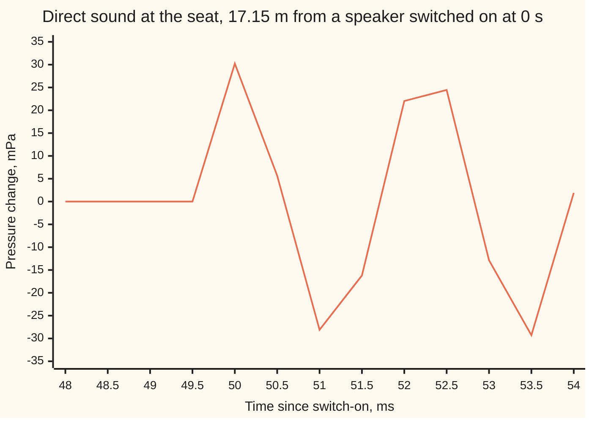
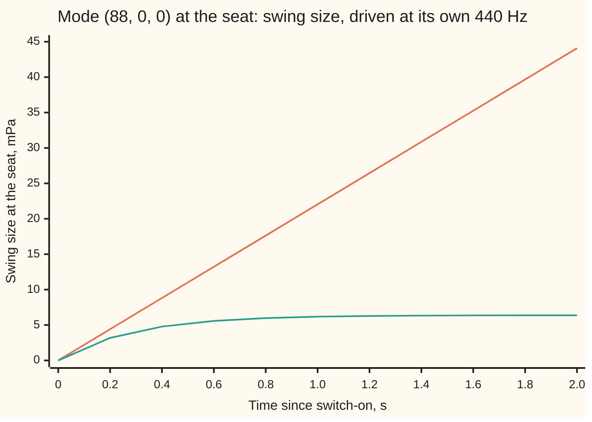

# The retarded Green's function: the answer arrives only after the poke

[Syllabus](../../../SYLLABUS.md) → [Partial differential equations](../README.md) → [Waves](../README.md#s05) → The retarded Green's function

---

## General Overview

A loudspeaker stands on the stage of a concert hall. At time 0 it starts to play concert A: 440 Hz (hertz, cycles per second). A listener sits 17.15 m away. What pressure reaches the listener's ear, and when?

Sound runs through air at 343 m/s, so the seat hears nothing for 50.000 ms. Then the tone arrives all at once. The air pressure at the ear swings 0.030225 Pa (pascals, newtons per square metre) above and below normal, a level of 60.58 dB: ordinary conversation. Before 50.000 ms the pressure change at the seat is exactly zero, not just small.

The tool that gives these numbers is the **retarded Green's function**: the wave that one instant poke at one point sends out. In three dimensions that wave is a thin shell. It expands at the speed of sound and weakens in proportion to one over the distance. Any source, such as a speaker cone, is a stream of pokes. Add up their shells, each delayed by its travel time ("retarded" means delayed), and the result is the whole sound field.

The hall's walls add a second effect. Their reflections build standing patterns called **modes**. A mode whose frequency matches the drive grows with every cycle: **resonance**. With the hall's real absorption it stops at 0.006381 Pa at the seat.

[Duhamel's principle](../03-The%20Heat%20Equation%20in%20Depth/03-duhamels-principle.md) solved a forced heat equation as a stream of fresh starts, and wing 08's [Resonance](../../08-Differential%20equations%20and%20dynamics/03-Oscillators%20-%20Second-Order%20Linear%20Equations/06-resonance-and-beats.md) card solved one forced oscillator. This card does the same for the forced wave equation in three dimensions, and finds that oscillator again inside the hall.

**The response of the wave equation to one point poke is a thin shell that expands at the wave speed and weakens as one over the distance, so the field at a point now is the sum of what every part of the source did one travel time ago.**

**What kind of fact this is:** a theorem, proved on this card in Why it works, for the wave equation in three dimensions. The speaker as a point source and the hall as a box with rigid, slightly absorbing walls are models.

### The picture: the tone arrives at 50 ms



The line is the direct sound at the seat, in millipascals (thousandths of a pascal). It is zero until 50 ms, then jumps to 30.23 mPa, because the speaker's push is strongest at switch-on. After that it swings at 440 Hz, one cycle every 1/440 s; sampled every 0.5 ms, the swing looks coarse. From 50.759 ms the floor echo adds a second shell, which the line leaves out (When it holds).

---

## The formula

**The problem.** The unknown is a wave quantity $`u(x, t)`$: here the sound pressure $`p`$, the change from normal air pressure, in Pa. The region is all of space around the speaker, at times $`t`$ after the source starts. The data: the air is at rest before the source starts ($`u = u_t = 0`$), and a source term $`f(x, t)`$ pushes it. A subscript is a rate, as in wing 08: $`u_t`$ is the rate of change in time, $`\Delta u`$ the Laplacian (the sum of the three second rates in space).

```math
u_{tt} = c^2\,\Delta u + f(x, t), \qquad u = u_t = 0 \text{ before } f \text{ switches on}
```

The **retarded Green's function** is the solution for one poke at the point 0 at time 0, $`f = \delta(x)\,\delta(t)`$. Here $`\delta`$ is the point mass of wing 08: zero everywhere except at one place, with total 1.

```math
G(x, t) = \frac{\delta\big(t - |x|/c\big)}{4\pi c^2\, |x|}, \qquad u(x, t) = \int \frac{f\big(y,\; t - |x - y|/c\big)}{4\pi c^2\, |x - y|}\, dy
```

**Read it aloud:** one poke makes a thin shell at distance $`ct`$, of strength one over $`4\pi c^2`$ times the distance; for any source, the field at $`x`$ now adds up every source point $`y`$, read at the earlier time when its sound had to leave to arrive now.

The integral on the right is the **retarded potential**. For a point source at the origin, $`f = q(t)\,\delta(x)`$, it collapses to one term:

```math
u(x, t) = \frac{q(t - r/c)}{4\pi c^2\, r}, \qquad r = |x|
```

A closed-box loudspeaker that is small compared with the wavelength is such a point source. It pushes out a volume of air $`Q(t)`$ per second (its **volume velocity**, in m³/s), and in acoustics its source strength is $`q = \rho_0 c^2 Q'(t)`$. Switched on at 440 Hz, $`Q = Q_0 \sin \omega t`$ from $`t = 0`$, so:

```math
p(r, t) = \frac{\rho_0\, Q'(t - r/c)}{4\pi r} = \frac{\rho_0\, \omega\, Q_0}{4\pi r}\,\cos\!\big(\omega\,(t - r/c)\big) \quad (t \ge r/c), \qquad p = 0 \quad (t < r/c)
```

**Read it aloud:** the pressure at distance $`r`$ copies the speaker's volume acceleration from $`r/c`$ seconds ago, scaled by air density and divided by $`4\pi r`$.

In the hall, the pressure is a sum of modes $`p = \sum A_{lmn}(t)\,\phi_{lmn}(x)`$, and each mode amplitude obeys its own forced oscillator:

```math
A_{lmn}'' + 2\gamma\, A_{lmn}' + \omega_{lmn}^2\, A_{lmn} = \frac{q(t)\,\phi_{lmn}(x_s)}{N_{lmn}}
```

**Read it aloud:** each mode swings like a spring at its own frequency, is drained at rate $`\gamma`$, and is pushed by the source in proportion to the mode's height at the speaker.

| Symbol | Plain meaning | In our example | Push it up and the answer… |
| --- | --- | --- | --- |
| $`u`$; $`p`$ | a wave quantity; the sound pressure, change from normal, Pa | amplitude 0.030225 Pa at the seat | — |
| $`x`$, $`y`$; $`t`$; $`\tau`$ | points in space, m ($`x`$ where we listen, $`y`$ a source point; in Step 5, $`x, y, z`$ are the coordinates along the hall); time since switch-on, s; the moment of one poke | seat 17.15 m from the speaker | — |
| $`r`$; $`R`$; $`\varepsilon`$ | distance from source to listener, $`\lvert x - y\rvert`$, m; in Step 2, a sphere's radius; in the proof, a small radius round the source | 17.15 m | later arrival, weaker sound, as $`1/r`$ |
| $`c`$ | speed of sound in air at 20 °C | 343 m/s | earlier arrival |
| $`f`$; $`q(t)`$; $`\delta`$ | source term, Pa/s²; the strength of a point source; the point mass | $`q = \rho_0 c^2 Q'(t)`$ | every pressure grows in proportion |
| $`G(x, t)`$ | retarded Green's function: the field of one poke at 0 at time 0 | a shell at radius $`ct`$ | — |
| $`\rho_0`$ | density of air | 1.2 kg/m³ | louder, in proportion |
| $`Q(t)`$, $`Q_0`$; $`a`$, $`v_0`$ | volume velocity, m³/s, and its peak; cone radius; peak cone speed | 1.963 × 10⁻³ m³/s; 5 cm; 0.25 m/s | louder, in proportion |
| $`\omega`$; $`k`$ | drive angular frequency, $`2\pi \times 440`$ Hz, rad/s; wavenumber $`\omega/c`$, rad/m | 2764.6015 rad/s; $`ka`$ = 0.4030 | louder (pressure follows $`Q'`$); $`ka`$ above 1 breaks the point model |
| $`\phi_{lmn}`$, $`\omega_{lmn}`$, $`N_{lmn}`$; $`l, m, n`$ | a hall mode's shape, its angular frequency, and $`\int \phi_{lmn}^2\, dx`$; half-waves along length, width, height | (88, 0, 0): 440.0000 Hz, $`N = V/2`$ | — |
| $`A_{lmn}(t)`$; $`F`$; $`\gamma`$; $`T_{60}`$ | mode amplitude, Pa; forcing amplitude on the mode, $`q\,\phi_{lmn}(x_s)/N_{lmn}`$ at its peak, Pa/s²; damping rate, 1/s; reverberation time, s | cap 0.006381 Pa at the seat; −150.6309 Pa/s²; 3.4539 1/s; 2 s | longer $`T_{60}`$: higher cap |
| $`L_x, L_y, L_z`$, $`V`$; $`x_s`$, $`x_L`$ | hall length, width, height, volume; speaker and seat positions along the length | 34.3, 20, 12 m; $`V/2`$ = 4116.0 m³; 3.43 m and 20.58 m | — |

### When it holds

- **Small pressures, so the air is linear.** The tone is 0.03 Pa against 101,325 Pa of normal air pressure. A blast wave of thousands of pascals steepens into a shock, and adding shells no longer works.
- **Still, uniform air.** The formula uses one speed $`c`$ everywhere. Wind or a warm layer under the ceiling bends the sound, and arrival times and the $`1/r`$ fall-off both change.
- **A source small compared with the wavelength.** Here $`ka`$ = 0.4030, below 1. At 2 kHz, $`ka`$ = 1.8318: the cone beams forward and one point source is the wrong model.
- **Free space, until the first echo.** With speaker and ear both 1.5 m above the floor, the floor echo travels 17.4104 m and arrives at 50.759 ms. After that, the walls count, and the hall's modes take over.
- **Three dimensions.** Only odd dimensions of space (three and up) give a sharp shell. In two dimensions a poke leaves a fading tail behind its front, as [Kirchhoff's formula](04-kirchhoff-and-huygens.md) shows.

---

## Why it works

### Step 0: one poke, then a stream of pokes

The wave equation is linear, and air does not change with the clock. So the response to two sources is the sum of their responses, and a poke at time τ gives the same wave as a poke at 0, just shifted by τ.

A source that acts for a while is a stream of pokes, one per instant and one per point. So if the wave from one poke is known, every forced problem is solved by adding. That one wave is the Green's function $`G`$.

### Step 1: a poke is a fresh start with a kick of speed

[Duhamel's principle](../03-The%20Heat%20Equation%20in%20Depth/03-duhamels-principle.md) turns a source into fresh starts. For the wave equation, a source $`f`$ acting for a short time $`d\tau`$ does not change $`u`$ at once. It gives $`u`$ a rate of change, a starting speed $`u_t = f\,d\tau`$. So the poke $`\delta(x)\,\delta(t)`$ is the same as starting the unforced equation at time 0 with $`u = 0`$ and a starting speed $`u_t = \delta(x)`$, all at one point.

### Step 2: Kirchhoff's formula turns that kick into a shell

[Kirchhoff's formula](04-kirchhoff-and-huygens.md) solves the unforced equation from a starting speed $`g`$ alone: the answer at $`x`$ is $`t`$ times the average of $`g`$ over the sphere of radius $`ct`$ around $`x`$.

The starting speed sits at the single point 0. The sphere around $`x`$ touches 0 only when its radius $`ct`$ equals the distance $`r = |x|`$. The average of a point mass over a sphere of radius $`R`$ is its total, 1, divided by the sphere's area $`4\pi R^2`$, and it is concentrated at $`R = r`$. So

```math
G(x, t) = t \cdot \frac{\delta(ct - r)}{4\pi (ct)^2} = \frac{\delta(t - r/c)}{4\pi c^3\, t} = \frac{\delta(t - r/c)}{4\pi c^2\, r}
```

The middle step uses $`\delta(ct - r) = \delta(t - r/c)/c`$; the last uses $`t = r/c`$, the only time the shell is at $`x`$.

That is the shell: zero inside and outside the sphere of radius $`ct`$. Its strength falls as $`1/r`$, because the energy spreads over an area growing as $`r^2`$, and pressure goes as the square root of energy per area.

### Step 3: add up the pokes; the time integral reads off one instant

Each source element $`f(y, \tau)\, dy\, d\tau`$ makes the shell $`G(x - y, t - \tau)`$. Adding them all:

```math
u(x, t) = \int\!\!\int G(x - y,\, t - \tau)\, f(y, \tau)\, d\tau\, dy = \int \frac{f\big(y,\; t - |x - y|/c\big)}{4\pi c^2\, |x - y|}\, dy
```

The delta in time does the τ integral. Of all the instants τ, only one counts: $`\tau = t - |x - y|/c`$, the **retarded time**, when sound had to leave $`y`$ to reach $`x`$ now. For a point source this leaves the single term $`q(t - r/c)/(4\pi c^2 r)`$.

The answer arrives only after the poke. If the source is off before time 0, then $`f(y, t - |x - y|/c)`$ is zero until $`t \ge |x - y|/c`$. Nothing reaches the seat before the first sound could travel there.

<details>
<summary>Detailed proof: the point-source formula solves the equation, and nothing else does</summary>

Let $`q`$ be twice continuously differentiable and zero for $`t < 0`$. Set $`u = q(t - r/c)/(4\pi c^2 r)`$.

**Away from the source.** For a function of $`r`$ alone, the Laplacian is $`\Delta u = \frac{1}{r}(r u)_{rr}`$. Here $`r u = q(t - r/c)/(4\pi c^2)`$ is a wave moving outward at speed $`c`$, so by [d'Alembert](01-dalembert-and-characteristics-for-waves.md)'s formula $`(r u)_{tt} = c^2 (r u)_{rr}`$. Dividing by $`r`$:

$`\displaystyle u_{tt} = c^2\, \Delta u \quad (r > 0).`$

**At the source.** Take a small sphere of radius $`\varepsilon`$ around 0. The source inside must equal the net flux of $`-c^2 \nabla u`$ out through its surface. Differentiating,

$`\displaystyle -4\pi \varepsilon^2 c^2\, u_r(\varepsilon, t) = q(t - \varepsilon/c) + \frac{\varepsilon}{c}\, q'(t - \varepsilon/c),`$

which tends to $`q(t)`$ as ε shrinks. So $`u_{tt} - c^2 \Delta u = q(t)\,\delta(x)`$ in the sense of distributions (wing 18): integrated against any smooth test function, both sides agree. The checks print this flux at 1 cm and 1 mm.

**Uniqueness.** Two solutions with the same source that are both zero before time 0 differ by a solution of the unforced equation that starts from rest. Its energy is zero at the start and stays zero ([Wave energy is conserved, and nothing outruns the wave speed](02-energy-and-finite-speed.md)), so the difference is zero. The retarded solution is the only causal one. The **advanced** solution $`q(t + r/c)/(4\pi c^2 r)`$ also satisfies the equation, but it is not zero before the source starts. This is the argument in Evans, section 2.4.

</details>

### Step 4: the loudspeaker

A closed-box speaker pushes air out and pulls it back as its cone moves. At low frequency it acts as a point that injects volume $`Q(t)`$ per second. Mass conservation and Newton's law for the air give the source $`q = \rho_0 c^2 Q'(t)`$, as in the acoustics texts in Sources. Then the point formula gives

```math
p(r, t) = \frac{\rho_0 c^2\, Q'(t - r/c)}{4\pi c^2 r} = \frac{\rho_0\, Q'(t - r/c)}{4\pi r}
```

The pressure copies the cone's volume **acceleration**, not its position. Driven by $`Q_0 \sin \omega t`$, the acceleration is $`\omega Q_0 \cos \omega t`$, which is at its peak at the instant of switch-on. That is why the chart jumps straight to 30.23 mPa at 50 ms.

### Step 5: the hall, one mode at a time

After the first echo the walls matter. A rectangular hall with rigid walls has modes $`\phi_{lmn} = \cos(l\pi x/L_x)\cos(m\pi y/L_y)\cos(n\pi z/L_z)`$, where $`x, y, z`$ here are the coordinates along the length, width and height. Each mode has angular frequency $`\omega_{lmn} = c\pi\sqrt{(l/L_x)^2 + (m/L_y)^2 + (n/L_z)^2}`$.

Write $`p = \sum A_{lmn}(t)\, \phi_{lmn}(x)`$. Put it in $`p_{tt} - c^2 \Delta p = q(t)\,\delta(x - x_s)`$, multiply by one mode, and integrate over the hall.

The modes are orthogonal, so every other mode drops out. Each mode's Laplacian is $`-(\omega_{lmn}/c)^2`$ times itself, and the delta picks out the mode's value at the speaker. Adding a drain at rate γ for the wall absorption gives the mode equation on The formula: one forced oscillator per mode.

The hall is 34.3 m long, exactly 88 half-wavelengths of a 440 Hz sound, so mode (88, 0, 0) sits at 440.0000 Hz. The drive matches it. Without losses, [Resonance](../../08-Differential%20equations%20and%20dynamics/03-Oscillators%20-%20Second-Order%20Linear%20Equations/06-resonance-and-beats.md) gives $`A = F t \sin(\omega t)/(2\omega)`$, with $`F`$ the forcing amplitude: the mode grows by $`F/(2\omega)`$ every second.

At the seat that is 0.022040 Pa per second. After 10 s it would be 0.220399 Pa, seven times the direct sound, and still climbing.

A real hall absorbs. A reverberation time $`T_{60}`$ = 2 s (the time for sound to fall by 60 dB, a factor 1,000 in pressure) means $`\gamma = 3 \ln 10 / T_{60}`$ = 3.4539 per second. Damping caps the mode at $`F/(2\gamma\omega)`$: 0.006381 Pa at the seat, reached in about a second.



Orange: no losses, a straight line, the t sin t growth. Teal: with $`T_{60}`$ = 2 s, the swing size follows $`(1 - e^{-\gamma t})`$ times the cap and levels off at 6.38 mPa. The checks confirm both lines against a step-by-step solve of the mode equation.

### Step 6: why a hall does not boom at 440 Hz

Damping also widens each mode. A mode answers drives inside a band $`\gamma/\pi`$ = 1.0994 Hz wide, centred on its own frequency (its half-power width). In this hall, 540 modes lie inside that band around 440 Hz. A smooth count of modes (Weyl's estimate: 4π times the volume times the frequency squared, divided by $`c^3`$, modes per hertz) predicts 545.6.

So no single mode stands out: the drive excites hundreds of overlapping modes with mixed signs, and the response is smooth. Single-mode resonance shows only below the **Schroeder frequency**, $`2000\sqrt{T_{60}/V}`$ = 31.17 Hz here. There, 2.74 modes share one mode's half-power band (Schroeder's criterion is about three); below it fewer do, so single modes can stand out. That is why small rooms boom on bass notes and halls do not boom on concert A.

---

## Worked numbers, by hand

The speaker: cone radius 5 cm, peak cone speed 0.25 m/s, at 440 Hz. The seat is 17.15 m away. Air: ρ₀ = 1.2 kg/m³, c = 343 m/s.

| Step | Arithmetic | Value |
| --- | --- | --- |
| angular frequency ω | 2π × 440 | 2764.6015 rad/s |
| cone area | π × 0.05² | 0.007854 m² |
| volume velocity peak Q₀ | 0.007854 × 0.25 | 1.963 × 10⁻³ m³/s |
| ρ₀ ω Q₀ | 1.2 × 2764.6015 × 1.963 × 10⁻³ | 6.513939 Pa m |
| sphere factor | 4π × 17.15 | 215.5133 m |
| pressure amplitude at the seat | 6.513939 ÷ 215.5133 | **0.030225 Pa** |
| arrival time | 17.15 ÷ 343 | **50.000 ms** |
| level | 20 log₁₀(0.030225 ÷ √2 ÷ 0.00002) | 60.58 dB |
| ρ₀ c² | 1.2 × 343² | 141178.8 Pa |
| source amplitude ρ₀ c² Q₀ ω | 141178.8 × 1.963 × 10⁻³ × 2764.6015 | 766358.40 Pa m³/s² |
| mode size N = V/2 | 34.3 × 20 × 12 ÷ 2 | 4116.0 m³ |
| mode height at the speaker | cos(88π × 3.43 ÷ 34.3) = cos(8.8π) | −0.809017 |
| forcing F on the mode | 766358.40 × (−0.809017) ÷ 4116.0 | −150.6309 Pa/s² |
| growth per second F/(2ω) | −150.6309 ÷ (2 × 2764.6015) | −0.027243 Pa/s |
| at the seat, × the mode's height there | 0.027243 × 0.809017 | 0.022040 Pa/s |
| damping rate γ | 3 ln 10 ÷ 2 | 3.4539 1/s |
| capped swing at the seat | 0.022040 ÷ 3.4539 | **0.006381 Pa** |

The direct tone reaches the seat at 50 ms with a swing of 0.030225 Pa. The resonant mode builds up over about a second and is held at 0.006381 Pa, a fifth of the direct sound. (The mode's height is negative at both speaker and seat, so the signs cancel.)

### What breaks if you drop a piece

| Mistake | Comes out at | What went wrong |
| --- | --- | --- |
| Drop the delay: use $`Q'(t)`$, not $`Q'(t - r/c)`$ | −0.024453 Pa at the seat at 10 ms; the truth is 0 | Sound would reach the seat 40 ms before it could travel there |
| Use the advanced time $`t + r/c`$ | −0.024453 Pa at −10 ms, before switch-on; the truth is 0 | It solves the same equation, but the effect comes before the cause |
| Put the frequency in hertz, not rad/s | 0.004810 Pa, not 0.030225 | The amplitude needs ω = 2π × 440, not 440 |
| Spread the pressure as $`1/r^2`$ | 0.001762 Pa | Intensity falls as $`1/r^2`$; pressure falls as $`1/r`$ |
| Leave out the walls' absorption | 0.220399 Pa after 10 s, still climbing | The no-loss hypothesis fails in a real hall; the cap is 0.006381 Pa |

The checks print every row.

---

## Code, from first principles, and it actually runs

Both programs work the speaker, test the Green's function itself, and then drive one hall mode. They take five roads to the Green's function and two to the mode:

1. the point formula, the closed form on this card;
2. the retarded integral over a small smooth source (a round bump of radius 4 cm, 2 cm, 1 cm), done in spherical shells round the listener; it tends to the point formula, with the gap shrinking four times when the radius halves;
3. a step-by-step grid (leapfrog, an explicit scheme that steps the wave forward in time) for $`r\,p`$ along a radius, with the same smooth source, at three steps, showing second-order accuracy;
4. the residual $`p_{tt} - c^2 \Delta p`$ of the point formula at the seat, by centred differences at two steps;
5. the flux out of a small sphere round the speaker, which must equal $`\rho_0 Q'(t)`$;
6. for the hall mode, an RK4 solve (the classical fourth-order Runge-Kutta stepper) of the mode equation, against the t sin t form without losses and the capped form with them, with the mode size $`N = V/2`$ checked by Simpson's rule;
7. a direct count of the hall's modes near 440 Hz, against Weyl's estimate.

Roads 2 and 3 use a click instead of a tone: the volume acceleration $`Q'`$ is a Gaussian 0.2 ms wide, peak 1 m³/s², at 1 ms. A short click is the nearest real thing to the poke that defines $`G`$.

### Python

```python
# The retarded Green's function -- the check behind the card.  Standard library only.
# A closed-box loudspeaker (a monopole) in a hall, air at 20 C, switched on at t = 0
# at 440 Hz.  p = sound pressure, Pa.  Roads for the Green's function: the point
# formula; the retarded integral over a small smooth source, by spherical shells;
# a leapfrog grid for r*p; the equation's residual; the flux out of a small sphere.
# Then one hall mode, (88, 0, 0): its ODE by RK4 against the closed forms.
import math
C, RHO, F0 = 343.0, 1.2, 440.0                 # m/s, kg/m^3, Hz
W = 2 * math.pi * F0                           # rad/s
CONE, VC = 0.05, 0.25                          # cone radius m, peak cone speed m/s
Q0 = math.pi * CONE ** 2 * VC                  # peak volume velocity, m^3/s
RL = 17.15                                     # speaker to listener, m
def p_dir(r, t, lag=1.0):                      # road 1: p = rho Q'(t - r/c) / (4 pi r)
    s = t - lag * r / C
    return RHO * Q0 * W * math.cos(W * s) / (4 * math.pi * r) if s >= 0 else 0.0
def sci(v):                                    # e-notation with the same digits in Rust
    e = math.floor(math.log10(abs(v))); m = v / 10 ** e
    return f"{m:.3f}e{'-' if e < 0 else '+'}{abs(e):02d}"
P0 = RHO * Q0 * W / (4 * math.pi * RL)
print(f"omega = {W:.4f} rad/s; wavelength = {C / F0:.4f} m; ka = {W / C * CONE:.4f}; Q0 = {sci(Q0)} m^3/s")
print(f"listener at {RL} m: arrival {1000 * RL / C:.3f} ms; amplitude {P0:.6f} Pa; level {20 * math.log10(P0 / math.sqrt(2) / 2e-5):.2f} dB")
assert abs(P0 - p_dir(RL, RL / C)) < 1e-9 * P0                # the headline amplitude is road 1 at arrival
print(f"by hand: pi a^2 = {math.pi * CONE ** 2:.6f} m^2; rho omega Q0 = {RHO * Q0 * W:.6f}; 4 pi r = {4 * math.pi * RL:.4f} m")
print(f"floor echo, both 1.5 m up: path {math.hypot(RL, 3.0):.4f} m, arrives {1000 * math.hypot(RL, 3.0) / C:.3f} ms")
print("chart, p at listener, 48..54 ms by 0.5 ms: " + ", ".join(f"{1000 * p_dir(RL, 0.048 + 0.0005 * i):.2f}" for i in range(13)))
for t in (0.0499, 0.0505, 0.051):
    print(f"p({RL} m, {1000 * t:.1f} ms) = {p_dir(RL, t):+.6f} Pa")
# ---- the Green's function tested with a click: Q'(t) a Gaussian, peak 1 m^3/s^2 ----
SIG, T0 = 2e-4, 1e-3
def qd(t): return math.exp(-((t - T0) / SIG) ** 2)
def point(r, t): return RHO * qd(t - r / C) / (4 * math.pi * r)
def bump(a): return 105 / (32 * math.pi * a ** 3)       # (1 - rho^2/a^2)^2 bump, total 1
def shells(r, t, a, n=400):                    # road 2: spherical shells round the listener
    h, tot = 2.0 / n, 0.0
    for i in range(n + 1):
        w = -1 + i * h; wt = 1 if i in (0, n) else (4 if i % 2 else 2)
        tot += wt * qd(t - (r + a * w) / C) * (1 - w * w) ** 3
    return RHO / (2 * r) * bump(a) * a ** 3 / 6 * tot * h / 3
def grid(dr, a, ro, te, rmax=1.2):             # road 3: leapfrog for w = r p, w(0) = 0
    n = round(rmax / dr); steps = math.ceil(te * C / (0.5 * dr)); dt = te / steps
    lam2 = (C * dt / dr) ** 2; cb = bump(a)
    src = [RHO * C * C * i * dr * cb * (1 - (i * dr / a) ** 2) ** 2 * dt * dt if i * dr < a else 0.0 for i in range(n + 1)]
    w0, w1 = [0.0] * (n + 1), [0.0] * (n + 1)
    for k in range(1, steps):
        g = qd(k * dt)
        w2 = [0.0] + [2 * w1[i] - w0[i] + lam2 * (w1[i + 1] - 2 * w1[i] + w1[i - 1]) + g * src[i] for i in range(1, n)] + [0.0]
        w0, w1 = w1, w2
    return w1[round(ro / dr)] / ro
ro, te = 1.0, 1.0 / C + T0
pp = point(ro, te)
print(f"click at 1 m, peak time {1000 * te:.4f} ms: point formula {pp:.6f} Pa")
diffs = []
for a in (0.04, 0.02, 0.01):
    sh = shells(ro, te, a); diffs.append(pp - sh)
    print(f"smooth source radius {100 * a:.0f} cm: shells {sh:.6f} Pa, point minus shells {sci(pp - sh)} Pa")
assert all(3.6 < diffs[i] / diffs[i + 1] < 4.4 for i in range(2))   # shrinks as a^2
sh4, errs = shells(ro, te, 0.04), []
for dr in (0.002, 0.001, 0.0005):
    g = grid(dr, 0.04, ro, te); errs.append(abs(g - sh4))
    print(f"grid, step {1000 * dr:.1f} mm: {g:.6f} Pa, error {sci(errs[-1])} Pa")
orders = [math.log2(errs[i] / errs[i + 1]) for i in range(2)]
assert errs[-1] < 1e-3 * sh4 and all(1.8 < o < 2.2 for o in orders)
print("grid observed order: " + ", ".join(f"{o:.2f}" for o in orders))
for h in (0.01, 0.005):                         # road 4: residual of road 1 at the listener
    r, t, k = RL, 0.051, h / C
    ptt = (p_dir(r, t + k) - 2 * p_dir(r, t) + p_dir(r, t - k)) / k ** 2
    lap = (p_dir(r + h, t) - 2 * p_dir(r, t) + p_dir(r - h, t)) / h ** 2 + (p_dir(r + h, t) - p_dir(r - h, t)) / (h * r)
    assert abs(ptt - C * C * lap) < 1e-6 * abs(ptt)
    print(f"residual, step {1000 * h:.0f} mm: p_tt = {ptt:.2f} Pa/s^2, |p_tt - c^2 Lap p| < 1e-6 p_tt")
for r in (0.01, 0.001):                        # road 5: flux out of a small sphere = rho Q'(t)
    t, h = 2 / F0, r * 1e-4
    flux = -4 * math.pi * r * r * (p_dir(r + h, t) - p_dir(r - h, t)) / (2 * h)
    print(f"flux -4 pi r^2 p_r at r = {100 * r:.1f} cm, t = {1000 * t:.4f} ms: {flux:.6f} kg/s^2; rho Q'(t) = {RHO * Q0 * W:.6f}")
assert abs(flux - RHO * Q0 * W) < 1e-4 * RHO * Q0 * W
# ---- the hall: 34.3 m x 20 m x 12 m, rigid walls; mode (88, 0, 0) = cos(88 pi x / LX) ----
LX, LY, LZ = 34.3, 20.0, 12.0; VOL = LX * LY * LZ; XS, XL = 3.43, 20.58
def phi(x): return math.cos(88 * math.pi * x / LX)
def drive(t60=2.0, w=W):                        # forcing per unit mode amplitude, growth rate, cap
    fm = RHO * C * C * Q0 * w * phi(XS) / (VOL / 2); g = 3 * math.log(10) / t60
    return fm, fm / (2 * W), fm / (2 * g * W), g
FM, GROW, CAP, GAM = drive()
print(f"by hand: rho c^2 = {RHO * C * C:.1f} Pa; V/2 = {VOL / 2:.1f} m^3; rho c^2 Q0 omega = {RHO * C * C * Q0 * W:.2f}")
n, hs, tot = 1760, LX / 1760, 0.0               # mode size N = integral of phi^2 over the hall, by Simpson
for i in range(n + 1): tot += (1 if i in (0, n) else (4 if i % 2 else 2)) * phi(i * hs) ** 2
NS = LY * LZ * tot * hs / 3
print(f"mode size by Simpson, Ly Lz * integral of phi^2 dx = {NS:.4f} m^3")
assert abs(FM - RHO * C * C * Q0 * W * phi(XS) / NS) < 1e-6 * abs(FM)
print(f"mode (88,0,0): {88 * C / (2 * LX):.4f} Hz; phi(speaker) = {phi(XS):.6f}, phi(listener) = {phi(XL):.6f}")
print(f"forcing {FM:.4f} Pa/s^2; undamped growth {GROW:.6f} Pa/s; T60 2 s: gamma {GAM:.4f} 1/s, cap {CAP:.6f} Pa")
def rk4(gam, t_out, n_per=128):                # a'' = FM cos(W t) - 2 gam a' - W^2 a, from rest
    dt = 1 / (F0 * n_per); f = lambda t, a, v: FM * math.cos(W * t) - 2 * gam * v - W * W * a
    a = v = t = 0.0; outs = []; k = 0
    for tk in t_out:
        while k < round(tk / dt):
            k1a, k1v = v, f(t, a, v); k2a, k2v = v + dt / 2 * k1v, f(t + dt / 2, a + dt / 2 * k1a, v + dt / 2 * k1v)
            k3a, k3v = v + dt / 2 * k2v, f(t + dt / 2, a + dt / 2 * k2a, v + dt / 2 * k2v)
            k4a, k4v = v + dt * k3v, f(t + dt, a + dt * k3a, v + dt * k3v)
            a += dt / 6 * (k1a + 2 * k2a + 2 * k3a + k4a); v += dt / 6 * (k1v + 2 * k2v + 2 * k3v + k4v); k += 1; t = k * dt
        outs.append(a)
    return outs
t1, t3 = 1 + 1 / (4 * F0), 3 + 1 / (4 * F0)
u1, = rk4(0.0, [t1]); d1, d3 = rk4(GAM, [t1, t3])
c1, cd1 = FM * t1 * math.sin(W * t1) / (2 * W), CAP * (1 - math.exp(-GAM * t1))
print(f"mode at {t1:.6f} s: undamped RK4 {u1:.6f}, t sin t form {c1:.6f}; damped RK4 {d1:.6f}, envelope {cd1:.6f} Pa")
print(f"mode at {t3:.6f} s: damped RK4 {d3:.6f}, steady cap {CAP:.6f} Pa")
assert abs(u1 - c1) < 1e-3 * abs(c1) and abs(u1 - GROW * t1) < 1e-3 * abs(u1) and abs(d1 - cd1) < 2e-3 * abs(cd1) and abs(d3 - CAP) < 1e-3 * abs(CAP)
L = abs(phi(XL))
print(f"at the listener: undamped growth {abs(GROW) * L:.6f} Pa/s; cap with T60 = 2 s {abs(CAP) * L:.6f} Pa")
print("chart, mode at listener, 0..2 s by 0.2 s, undamped: " + ", ".join(f"{1000 * abs(GROW) * L * 0.2 * i:.2f}" for i in range(11)))
print("chart, same, T60 = 2 s: " + ", ".join(f"{1000 * abs(CAP) * L * (1 - math.exp(-GAM * 0.2 * i)):.2f}" for i in range(11)))
bw = GAM / math.pi; cnt = 0; fs = 2000 * math.sqrt(2 / VOL)
for l in range(90):
    for m in range(53):
        for n in range(32):
            if abs(C / 2 * math.sqrt((l / LX) ** 2 + (m / LY) ** 2 + (n / LZ) ** 2) - F0) <= bw / 2: cnt += 1
weyl = 4 * math.pi * VOL * F0 ** 2 / C ** 3 * bw
assert abs(cnt - weyl) < 0.1 * weyl
print(f"half-power width {bw:.4f} Hz; modes inside it: counted {cnt}, Weyl estimate {weyl:.1f}; Schroeder {fs:.2f} Hz, "
      f"{4 * math.pi * VOL * fs ** 2 / C ** 3 * bw:.2f} modes per half-power width there")
print(f"wrong: no delay, p at 10 ms = {RHO * Q0 * W * math.cos(W * 0.01) / (4 * math.pi * RL):+.6f} Pa (retarded {p_dir(RL, 0.01):+.6f} Pa)")
print(f"wrong: advanced, p at -10 ms, before switch-on = {p_dir(RL, -0.01, -1.0):+.6f} Pa (retarded {p_dir(RL, -0.01):+.6f} Pa)")
print(f"wrong: hertz for rad/s {RHO * Q0 * F0 / (4 * math.pi * RL):.6f} Pa; 1/r^2 spreading {P0 / RL:.6f} Pa")
print(f"wrong: undamped mode at listener after 10 s {abs(GROW) * L * 10:.6f} Pa")
cap1 = drive(1.0)[2]; w2 = 2 * math.pi * 437.5
print(f"try: listener at 34.3 m {RHO * Q0 * W / (4 * math.pi * 34.3):.6f} Pa, arrives {1000 * 34.3 / C:.3f} ms; 2 kHz ka = {2 * math.pi * 2000 / C * CONE:.4f}")
print(f"try: T60 = 1 s cap at listener {abs(cap1) * L:.6f} Pa; drive 437.5 Hz, undamped peak {2 * abs(drive(w=w2)[0]) / (W * W - w2 * w2) * L:.6f} Pa")
print("ALL CHECKS PASS")
```

**Ran 2026-11-15 on macOS, Python 3.14.10, standard library only. All checks passed. Output, pasted from the run:**

```
omega = 2764.6015 rad/s; wavelength = 0.7795 m; ka = 0.4030; Q0 = 1.963e-03 m^3/s
listener at 17.15 m: arrival 50.000 ms; amplitude 0.030225 Pa; level 60.58 dB
by hand: pi a^2 = 0.007854 m^2; rho omega Q0 = 6.513939; 4 pi r = 215.5133 m
floor echo, both 1.5 m up: path 17.4104 m, arrives 50.759 ms
chart, p at listener, 48..54 ms by 0.5 ms: 0.00, 0.00, 0.00, 0.00, 30.23, 5.66, -28.10, -16.20, 22.03, 24.45, -12.87, -29.28, 1.90
p(17.15 m, 49.9 ms) = +0.000000 Pa
p(17.15 m, 50.5 ms) = +0.005664 Pa
p(17.15 m, 51.0 ms) = -0.028103 Pa
click at 1 m, peak time 3.9155 ms: point formula 0.095493 Pa
smooth source radius 4 cm: shells 0.092046 Pa, point minus shells 3.447e-03 Pa
smooth source radius 2 cm: shells 0.094601 Pa, point minus shells 8.915e-04 Pa
smooth source radius 1 cm: shells 0.095268 Pa, point minus shells 2.248e-04 Pa
grid, step 2.0 mm: 0.092068 Pa, error 2.192e-05 Pa
grid, step 1.0 mm: 0.092051 Pa, error 5.725e-06 Pa
grid, step 0.5 mm: 0.092047 Pa, error 1.447e-06 Pa
grid observed order: 1.94, 1.98
residual, step 10 mm: p_tt = 214673.39 Pa/s^2, |p_tt - c^2 Lap p| < 1e-6 p_tt
residual, step 5 mm: p_tt = 214760.58 Pa/s^2, |p_tt - c^2 Lap p| < 1e-6 p_tt
flux -4 pi r^2 p_r at r = 1.0 cm, t = 4.5455 ms: 6.535063 kg/s^2; rho Q'(t) = 6.513939
flux -4 pi r^2 p_r at r = 0.1 cm, t = 4.5455 ms: 6.514151 kg/s^2; rho Q'(t) = 6.513939
by hand: rho c^2 = 141178.8 Pa; V/2 = 4116.0 m^3; rho c^2 Q0 omega = 766358.40
mode size by Simpson, Ly Lz * integral of phi^2 dx = 4116.0000 m^3
mode (88,0,0): 440.0000 Hz; phi(speaker) = -0.809017, phi(listener) = -0.809017
forcing -150.6309 Pa/s^2; undamped growth -0.027243 Pa/s; T60 2 s: gamma 3.4539 1/s, cap -0.007888 Pa
mode at 1.000568 s: undamped RK4 -0.027258, t sin t form -0.027258; damped RK4 -0.007639, envelope -0.007639 Pa
mode at 3.000568 s: damped RK4 -0.007887, steady cap -0.007888 Pa
at the listener: undamped growth 0.022040 Pa/s; cap with T60 = 2 s 0.006381 Pa
chart, mode at listener, 0..2 s by 0.2 s, undamped: 0.00, 4.41, 8.82, 13.22, 17.63, 22.04, 26.45, 30.86, 35.26, 39.67, 44.08
chart, same, T60 = 2 s: 0.00, 3.18, 4.78, 5.58, 5.98, 6.18, 6.28, 6.33, 6.36, 6.37, 6.37
half-power width 1.0994 Hz; modes inside it: counted 540, Weyl estimate 545.6; Schroeder 31.17 Hz, 2.74 modes per half-power width there
wrong: no delay, p at 10 ms = -0.024453 Pa (retarded +0.000000 Pa)
wrong: advanced, p at -10 ms, before switch-on = -0.024453 Pa (retarded +0.000000 Pa)
wrong: hertz for rad/s 0.004810 Pa; 1/r^2 spreading 0.001762 Pa
wrong: undamped mode at listener after 10 s 0.220399 Pa
try: listener at 34.3 m 0.015113 Pa, arrives 100.000 ms; 2 kHz ka = 1.8318
try: T60 = 1 s cap at listener 0.003191 Pa; drive 437.5 Hz, undamped peak 0.002798 Pa
ALL CHECKS PASS
```

### Rust

```rust
// The retarded Green's function -- the check behind the card.  Rust std only.
// A closed-box loudspeaker (a monopole) in a hall, air at 20 C, switched on at t = 0
// at 440 Hz.  p = sound pressure, Pa.  Roads for the Green's function: the point
// formula; the retarded integral over a small smooth source, by spherical shells;
// a leapfrog grid for r*p; the equation's residual; the flux out of a small sphere.
// Then one hall mode, (88, 0, 0): its ODE by RK4 against the closed forms.
use std::f64::consts::PI;

const C: f64 = 343.0; const RHO: f64 = 1.2; const F0: f64 = 440.0; // m/s, kg/m^3, Hz
const W: f64 = 2.0 * PI * F0; // rad/s
const CONE: f64 = 0.05; const VC: f64 = 0.25; // cone radius m, peak cone speed m/s
const RL: f64 = 17.15; // speaker to listener, m
const SIG: f64 = 2e-4; const T0: f64 = 1e-3; // click: Gaussian Q'(t), peak 1 m^3/s^2
const LX: f64 = 34.3; const LY: f64 = 20.0; const LZ: f64 = 12.0; const XS: f64 = 3.43; const XL: f64 = 20.58;

fn q0() -> f64 { PI * CONE.powi(2) * VC } // peak volume velocity, m^3/s
fn p_dir(r: f64, t: f64, lag: f64) -> f64 { // road 1: p = rho Q'(t - r/c) / (4 pi r)
    let s = t - lag * r / C;
    if s >= 0.0 { RHO * q0() * W * (W * s).cos() / (4.0 * PI * r) } else { 0.0 }
}
fn sci(v: f64) -> String { // e-notation with the same digits as Python
    let e = v.abs().log10().floor() as i32; let m = v / 10f64.powi(e);
    format!("{:.3}e{}{:02}", m, if e < 0 { '-' } else { '+' }, e.abs())
}
fn join(v: &[f64]) -> String { v.iter().map(|x| format!("{:.2}", x)).collect::<Vec<_>>().join(", ") }
fn qd(t: f64) -> f64 { (-((t - T0) / SIG).powi(2)).exp() }
fn point(r: f64, t: f64) -> f64 { RHO * qd(t - r / C) / (4.0 * PI * r) }
fn bump(a: f64) -> f64 { 105.0 / (32.0 * PI * a.powi(3)) } // (1 - rho^2/a^2)^2 bump, total 1
fn shells(r: f64, t: f64, a: f64) -> f64 { // road 2: spherical shells round the listener
    let n = 400; let h = 2.0 / n as f64; let mut tot = 0.0;
    for i in 0..=n {
        let w = -1.0 + i as f64 * h; let wt = if i == 0 || i == n { 1.0 } else if i % 2 == 1 { 4.0 } else { 2.0 };
        tot += wt * qd(t - (r + a * w) / C) * (1.0 - w * w).powi(3);
    }
    RHO / (2.0 * r) * bump(a) * a.powi(3) / 6.0 * tot * h / 3.0
}
fn grid(dr: f64, a: f64, ro: f64, te: f64) -> f64 { // road 3: leapfrog for w = r p, w(0) = 0
    let n = (1.2 / dr).round() as usize; let steps = (te * C / (0.5 * dr)).ceil() as usize; let dt = te / steps as f64;
    let lam2 = (C * dt / dr).powi(2); let cb = bump(a);
    let src: Vec<f64> = (0..=n).map(|i| { let r = i as f64 * dr;
        if r < a { RHO * C * C * r * cb * (1.0 - (r / a).powi(2)).powi(2) * dt * dt } else { 0.0 } }).collect();
    let (mut w0, mut w1) = (vec![0.0; n + 1], vec![0.0; n + 1]);
    for k in 1..steps {
        let g = qd(k as f64 * dt); let mut w2 = vec![0.0; n + 1];
        for i in 1..n { w2[i] = 2.0 * w1[i] - w0[i] + lam2 * (w1[i + 1] - 2.0 * w1[i] + w1[i - 1]) + g * src[i]; }
        w0 = w1; w1 = w2;
    }
    w1[(ro / dr).round() as usize] / ro
}
fn phi(x: f64) -> f64 { (88.0 * PI * x / LX).cos() }
fn drive(t60: f64, w: f64) -> (f64, f64, f64, f64) { // forcing per unit mode amplitude, growth rate, cap
    let fm = RHO * C * C * q0() * w * phi(XS) / (LX * LY * LZ / 2.0); let g = 3.0 * 10f64.ln() / t60;
    (fm, fm / (2.0 * W), fm / (2.0 * g * W), g)
}
fn rk4(fm: f64, gam: f64, t_out: &[f64]) -> Vec<f64> { // a'' = fm cos(W t) - 2 gam a' - W^2 a, from rest
    let dt = 1.0 / (F0 * 128.0); let f = |t: f64, a: f64, v: f64| fm * (W * t).cos() - 2.0 * gam * v - W * W * a;
    let (mut a, mut v, mut t, mut k) = (0.0, 0.0, 0.0, 0usize); let mut outs = vec![];
    for &tk in t_out {
        while k < (tk / dt).round() as usize {
            let (k1a, k1v) = (v, f(t, a, v)); let (k2a, k2v) = (v + dt / 2.0 * k1v, f(t + dt / 2.0, a + dt / 2.0 * k1a, v + dt / 2.0 * k1v));
            let (k3a, k3v) = (v + dt / 2.0 * k2v, f(t + dt / 2.0, a + dt / 2.0 * k2a, v + dt / 2.0 * k2v));
            let (k4a, k4v) = (v + dt * k3v, f(t + dt, a + dt * k3a, v + dt * k3v));
            a += dt / 6.0 * (k1a + 2.0 * k2a + 2.0 * k3a + k4a); v += dt / 6.0 * (k1v + 2.0 * k2v + 2.0 * k3v + k4v); k += 1; t = k as f64 * dt;
        }
        outs.push(a);
    }
    outs
}

fn main() {
    let q0 = q0(); let p0 = RHO * q0 * W / (4.0 * PI * RL);
    println!("omega = {:.4} rad/s; wavelength = {:.4} m; ka = {:.4}; Q0 = {} m^3/s", W, C / F0, W / C * CONE, sci(q0));
    println!("listener at {} m: arrival {:.3} ms; amplitude {:.6} Pa; level {:.2} dB", RL, 1000.0 * RL / C, p0, 20.0 * (p0 / 2f64.sqrt() / 2e-5).log10());
    assert!((p0 - p_dir(RL, RL / C, 1.0)).abs() < 1e-9 * p0); // the headline amplitude is road 1 at arrival
    println!("by hand: pi a^2 = {:.6} m^2; rho omega Q0 = {:.6}; 4 pi r = {:.4} m", PI * CONE.powi(2), RHO * q0 * W, 4.0 * PI * RL);
    println!("floor echo, both 1.5 m up: path {:.4} m, arrives {:.3} ms", RL.hypot(3.0), 1000.0 * RL.hypot(3.0) / C);
    let ch: Vec<f64> = (0..13).map(|i| 1000.0 * p_dir(RL, 0.048 + 0.0005 * i as f64, 1.0)).collect();
    println!("chart, p at listener, 48..54 ms by 0.5 ms: {}", join(&ch));
    for t in [0.0499, 0.0505, 0.051] { println!("p({} m, {:.1} ms) = {:+.6} Pa", RL, 1000.0 * t, p_dir(RL, t, 1.0)); }
    let (ro, te) = (1.0, 1.0 / C + T0); let pp = point(ro, te);
    println!("click at 1 m, peak time {:.4} ms: point formula {:.6} Pa", 1000.0 * te, pp);
    let mut diffs = vec![];
    for a in [0.04, 0.02, 0.01] {
        let sh = shells(ro, te, a); diffs.push(pp - sh);
        println!("smooth source radius {:.0} cm: shells {:.6} Pa, point minus shells {} Pa", 100.0 * a, sh, sci(pp - sh));
    }
    assert!((0..2).all(|i| diffs[i] / diffs[i + 1] > 3.6 && diffs[i] / diffs[i + 1] < 4.4)); // shrinks as a^2
    let sh4 = shells(ro, te, 0.04); let mut errs = vec![];
    for dr in [0.002, 0.001, 0.0005] {
        let g = grid(dr, 0.04, ro, te); errs.push((g - sh4).abs());
        println!("grid, step {:.1} mm: {:.6} Pa, error {} Pa", 1000.0 * dr, g, sci(errs[errs.len() - 1]));
    }
    let orders: Vec<f64> = (0..2).map(|i| (errs[i] / errs[i + 1]).log2()).collect();
    assert!(errs[2] < 1e-3 * sh4 && orders.iter().all(|&o| o > 1.8 && o < 2.2));
    println!("grid observed order: {:.2}, {:.2}", orders[0], orders[1]);
    for h in [0.01, 0.005] { // road 4: residual of road 1 at the listener
        let (r, t, k) = (RL, 0.051, h / C);
        let ptt = (p_dir(r, t + k, 1.0) - 2.0 * p_dir(r, t, 1.0) + p_dir(r, t - k, 1.0)) / k.powi(2);
        let lap = (p_dir(r + h, t, 1.0) - 2.0 * p_dir(r, t, 1.0) + p_dir(r - h, t, 1.0)) / h.powi(2) + (p_dir(r + h, t, 1.0) - p_dir(r - h, t, 1.0)) / (h * r);
        assert!((ptt - C * C * lap).abs() < 1e-6 * ptt.abs());
        println!("residual, step {:.0} mm: p_tt = {:.2} Pa/s^2, |p_tt - c^2 Lap p| < 1e-6 p_tt", 1000.0 * h, ptt);
    }
    let mut flux = 0.0;
    for r in [0.01, 0.001] { // road 5: flux out of a small sphere = rho Q'(t)
        let (t, h) = (2.0 / F0, r * 1e-4);
        flux = -4.0 * PI * r * r * (p_dir(r + h, t, 1.0) - p_dir(r - h, t, 1.0)) / (2.0 * h);
        println!("flux -4 pi r^2 p_r at r = {:.1} cm, t = {:.4} ms: {:.6} kg/s^2; rho Q'(t) = {:.6}", 100.0 * r, 1000.0 * t, flux, RHO * q0 * W);
    }
    assert!((flux - RHO * q0 * W).abs() < 1e-4 * RHO * q0 * W);
    // ---- the hall: 34.3 m x 20 m x 12 m, rigid walls; mode (88, 0, 0) = cos(88 pi x / LX) ----
    let vol = LX * LY * LZ; let (fm, grow, cap, gam) = drive(2.0, W);
    println!("by hand: rho c^2 = {:.1} Pa; V/2 = {:.1} m^3; rho c^2 Q0 omega = {:.2}", RHO * C * C, vol / 2.0, RHO * C * C * q0 * W);
    let (n, hs) = (1760, LX / 1760.0); let mut tot = 0.0; // mode size N = integral of phi^2 over the hall, by Simpson
    for i in 0..=n { tot += (if i == 0 || i == n { 1.0 } else if i % 2 == 1 { 4.0 } else { 2.0 }) * phi(i as f64 * hs).powi(2); }
    let ns = LY * LZ * tot * hs / 3.0;
    println!("mode size by Simpson, Ly Lz * integral of phi^2 dx = {:.4} m^3", ns);
    assert!((fm - RHO * C * C * q0 * W * phi(XS) / ns).abs() < 1e-6 * fm.abs());
    println!("mode (88,0,0): {:.4} Hz; phi(speaker) = {:.6}, phi(listener) = {:.6}", 88.0 * C / (2.0 * LX), phi(XS), phi(XL));
    println!("forcing {:.4} Pa/s^2; undamped growth {:.6} Pa/s; T60 2 s: gamma {:.4} 1/s, cap {:.6} Pa", fm, grow, gam, cap);
    let (t1, t3) = (1.0 + 1.0 / (4.0 * F0), 3.0 + 1.0 / (4.0 * F0));
    let u1 = rk4(fm, 0.0, &[t1])[0]; let d = rk4(fm, gam, &[t1, t3]); let (d1, d3) = (d[0], d[1]);
    let (c1, cd1) = (fm * t1 * (W * t1).sin() / (2.0 * W), cap * (1.0 - (-gam * t1).exp()));
    println!("mode at {:.6} s: undamped RK4 {:.6}, t sin t form {:.6}; damped RK4 {:.6}, envelope {:.6} Pa", t1, u1, c1, d1, cd1);
    println!("mode at {:.6} s: damped RK4 {:.6}, steady cap {:.6} Pa", t3, d3, cap);
    assert!((u1 - c1).abs() < 1e-3 * c1.abs() && (u1 - grow * t1).abs() < 1e-3 * u1.abs() && (d1 - cd1).abs() < 2e-3 * cd1.abs() && (d3 - cap).abs() < 1e-3 * cap.abs());
    let l = phi(XL).abs();
    println!("at the listener: undamped growth {:.6} Pa/s; cap with T60 = 2 s {:.6} Pa", grow.abs() * l, cap.abs() * l);
    let un: Vec<f64> = (0..11).map(|i| 1000.0 * grow.abs() * l * 0.2 * i as f64).collect();
    let da: Vec<f64> = (0..11).map(|i| 1000.0 * cap.abs() * l * (1.0 - (-gam * 0.2 * i as f64).exp())).collect();
    println!("chart, mode at listener, 0..2 s by 0.2 s, undamped: {}", join(&un));
    println!("chart, same, T60 = 2 s: {}", join(&da));
    let bw = gam / PI; let mut cnt = 0; let fs = 2000.0 * (2.0 / vol).sqrt();
    for l in 0..90 { for m in 0..53 { for n in 0..32 {
        let f = C / 2.0 * ((l as f64 / LX).powi(2) + (m as f64 / LY).powi(2) + (n as f64 / LZ).powi(2)).sqrt();
        if (f - F0).abs() <= bw / 2.0 { cnt += 1; }
    } } }
    let weyl = 4.0 * PI * vol * F0.powi(2) / C.powi(3) * bw;
    assert!((cnt as f64 - weyl).abs() < 0.1 * weyl);
    println!("half-power width {:.4} Hz; modes inside it: counted {}, Weyl estimate {:.1}; Schroeder {:.2} Hz, {:.2} modes per half-power width there",
             bw, cnt, weyl, fs, 4.0 * PI * vol * fs.powi(2) / C.powi(3) * bw);
    println!("wrong: no delay, p at 10 ms = {:+.6} Pa (retarded {:+.6} Pa)", RHO * q0 * W * (W * 0.01).cos() / (4.0 * PI * RL), p_dir(RL, 0.01, 1.0));
    println!("wrong: advanced, p at -10 ms, before switch-on = {:+.6} Pa (retarded {:+.6} Pa)", p_dir(RL, -0.01, -1.0), p_dir(RL, -0.01, 1.0));
    println!("wrong: hertz for rad/s {:.6} Pa; 1/r^2 spreading {:.6} Pa", RHO * q0 * F0 / (4.0 * PI * RL), p0 / RL);
    println!("wrong: undamped mode at listener after 10 s {:.6} Pa", grow.abs() * l * 10.0);
    let cap1 = drive(1.0, W).2; let w2 = 2.0 * PI * 437.5;
    println!("try: listener at 34.3 m {:.6} Pa, arrives {:.3} ms; 2 kHz ka = {:.4}", RHO * q0 * W / (4.0 * PI * 34.3), 1000.0 * 34.3 / C, 2.0 * PI * 2000.0 / C * CONE);
    println!("try: T60 = 1 s cap at listener {:.6} Pa; drive 437.5 Hz, undamped peak {:.6} Pa", cap1.abs() * l, 2.0 * drive(2.0, w2).0.abs() / (W * W - w2 * w2) * l);
    println!("ALL CHECKS PASS");
}
```

**Ran 2026-11-15 on macOS, rustc 1.98.1, no crates. All checks passed. Output, pasted from the run:**

```
omega = 2764.6015 rad/s; wavelength = 0.7795 m; ka = 0.4030; Q0 = 1.963e-03 m^3/s
listener at 17.15 m: arrival 50.000 ms; amplitude 0.030225 Pa; level 60.58 dB
by hand: pi a^2 = 0.007854 m^2; rho omega Q0 = 6.513939; 4 pi r = 215.5133 m
floor echo, both 1.5 m up: path 17.4104 m, arrives 50.759 ms
chart, p at listener, 48..54 ms by 0.5 ms: 0.00, 0.00, 0.00, 0.00, 30.23, 5.66, -28.10, -16.20, 22.03, 24.45, -12.87, -29.28, 1.90
p(17.15 m, 49.9 ms) = +0.000000 Pa
p(17.15 m, 50.5 ms) = +0.005664 Pa
p(17.15 m, 51.0 ms) = -0.028103 Pa
click at 1 m, peak time 3.9155 ms: point formula 0.095493 Pa
smooth source radius 4 cm: shells 0.092046 Pa, point minus shells 3.447e-03 Pa
smooth source radius 2 cm: shells 0.094601 Pa, point minus shells 8.915e-04 Pa
smooth source radius 1 cm: shells 0.095268 Pa, point minus shells 2.248e-04 Pa
grid, step 2.0 mm: 0.092068 Pa, error 2.192e-05 Pa
grid, step 1.0 mm: 0.092051 Pa, error 5.725e-06 Pa
grid, step 0.5 mm: 0.092047 Pa, error 1.447e-06 Pa
grid observed order: 1.94, 1.98
residual, step 10 mm: p_tt = 214673.39 Pa/s^2, |p_tt - c^2 Lap p| < 1e-6 p_tt
residual, step 5 mm: p_tt = 214760.58 Pa/s^2, |p_tt - c^2 Lap p| < 1e-6 p_tt
flux -4 pi r^2 p_r at r = 1.0 cm, t = 4.5455 ms: 6.535063 kg/s^2; rho Q'(t) = 6.513939
flux -4 pi r^2 p_r at r = 0.1 cm, t = 4.5455 ms: 6.514151 kg/s^2; rho Q'(t) = 6.513939
by hand: rho c^2 = 141178.8 Pa; V/2 = 4116.0 m^3; rho c^2 Q0 omega = 766358.40
mode size by Simpson, Ly Lz * integral of phi^2 dx = 4116.0000 m^3
mode (88,0,0): 440.0000 Hz; phi(speaker) = -0.809017, phi(listener) = -0.809017
forcing -150.6309 Pa/s^2; undamped growth -0.027243 Pa/s; T60 2 s: gamma 3.4539 1/s, cap -0.007888 Pa
mode at 1.000568 s: undamped RK4 -0.027258, t sin t form -0.027258; damped RK4 -0.007639, envelope -0.007639 Pa
mode at 3.000568 s: damped RK4 -0.007887, steady cap -0.007888 Pa
at the listener: undamped growth 0.022040 Pa/s; cap with T60 = 2 s 0.006381 Pa
chart, mode at listener, 0..2 s by 0.2 s, undamped: 0.00, 4.41, 8.82, 13.22, 17.63, 22.04, 26.45, 30.86, 35.26, 39.67, 44.08
chart, same, T60 = 2 s: 0.00, 3.18, 4.78, 5.58, 5.98, 6.18, 6.28, 6.33, 6.36, 6.37, 6.37
half-power width 1.0994 Hz; modes inside it: counted 540, Weyl estimate 545.6; Schroeder 31.17 Hz, 2.74 modes per half-power width there
wrong: no delay, p at 10 ms = -0.024453 Pa (retarded +0.000000 Pa)
wrong: advanced, p at -10 ms, before switch-on = -0.024453 Pa (retarded +0.000000 Pa)
wrong: hertz for rad/s 0.004810 Pa; 1/r^2 spreading 0.001762 Pa
wrong: undamped mode at listener after 10 s 0.220399 Pa
try: listener at 34.3 m 0.015113 Pa, arrives 100.000 ms; 2 kHz ka = 1.8318
try: T60 = 1 s cap at listener 0.003191 Pa; drive 437.5 Hz, undamped peak 0.002798 Pa
ALL CHECKS PASS
```

### Lean

Lean proves the point formula, its flux at the source, and the matched hall mode, for every twice continuously differentiable source strength $`q`$.

- Take $`c > 0`$ and the point formula $`u`$, with $`q`$ twice continuously differentiable and zero for $`t < 0`$. Then $`u`$ is twice continuously differentiable in space at every $`r > 0`$, and $`u_{tt} = c^2\,\Delta u`$ there.
- Suppose also $`t < r/c`$. Then $`u = 0`$: nothing arrives before the sound could travel there.
- Take $`q`$ twice continuously differentiable and a sphere of any radius $`\varepsilon > 0`$ round the source. Then the flux out of that sphere is exactly the Detailed proof's formula.
- Let $`\varepsilon`$ shrink to 0 along any direction. Then that flux tends to $`q(t)`$.
- Take a hall mode at $`\omega > 0`$, driven by $`F \cos \omega t`$, with no losses. Then $`A = F t \sin(\omega t)/(2\omega)`$ starts from rest and solves the mode equation.
- Add a drain at rate $`\gamma > 0`$. Then $`F \sin(\omega t)/(2\gamma\omega)`$ solves the mode equation, and every solution, from any start, approaches it. So the swing is capped at $`F/(2\gamma\omega)`$.
- The worked numbers also check, in exact fractions: the 440 Hz mode, the 50 ms arrival and its 22 cycles. So do $`N = V/2`$ = 4116.0 m³ and the mode's equal heights at speaker and seat.

Pressures and the mode count are left to the Python and Rust checks; uniqueness and the point-mass step stay with the Detailed proof.

```lean
-- The retarded Green's function: the point-source field u(x, t) = q(t - |x|/c) / (4πc²|x|) in three dimensions solves the wave equation away from the source, is zero until sound can arrive, has flux out of a small sphere tending to q(t), and one hall mode driven at its own frequency grows as t sin t or, with damping, settles to the cap F/(2γω).
import Mathlib.Analysis.InnerProductSpace.Laplacian
import Mathlib.Analysis.InnerProductSpace.PiL2
import Mathlib.Analysis.SpecialFunctions.Trigonometric.Deriv
import Mathlib.Analysis.Calculus.IteratedDeriv.Defs
import Mathlib.Tactic.NormNum
import Mathlib.Analysis.SpecialFunctions.Sqrt
import Mathlib.Analysis.InnerProductSpace.Calculus
import Mathlib.Analysis.Calculus.Deriv.MeanValue
import Mathlib.Tactic

open Filter Topology Real Laplacian

/-- The retarded field of a point source of strength `q(t)` at the origin of three-dimensional
space, with wave speed `c`: `u(x, t) = q(t - |x|/c) / (4π c² |x|)`. -/
noncomputable def retardedPointField (c : ℝ) (q : ℝ → ℝ) (x : EuclideanSpace ℝ (Fin 3)) (t : ℝ) :
    ℝ :=
  q (t - ‖x‖ / c) / (4 * π * c ^ 2 * ‖x‖)

open scoped RealInnerProductSpace

lemma rg_hasFDerivAt_norm {E : Type*} [NormedAddCommGroup E] [InnerProductSpace ℝ E]
    {x : E} (hx : x ≠ 0) :
    HasFDerivAt (fun y : E => ‖y‖) (‖x‖⁻¹ • innerSL ℝ x) x := by
  have hn : ‖x‖ ≠ 0 := norm_ne_zero_iff.mpr hx
  have h := (hasStrictFDerivAt_norm_sq x).hasFDerivAt.sqrt (pow_ne_zero 2 hn)
  simp only [Real.sqrt_sq (norm_nonneg _)] at h
  convert h using 1
  ext v
  simp
  field_simp

lemma rg_iteratedFDeriv_two_radial {E : Type*} [NormedAddCommGroup E] [InnerProductSpace ℝ E]
    {f : E → ℝ} {h : ℝ → ℝ} {h1 : ℝ} {x : E} (hx : x ≠ 0)
    (hf : ∀ᶠ y in 𝓝 x, HasFDerivAt f (h ‖y‖ • innerSL ℝ y) y) (hh : HasDerivAt h h1 ‖x‖)
    (v : E) :
    iteratedFDeriv ℝ 2 f x ![v, v] = h ‖x‖ * ⟪v, v⟫ + h1 * ‖x‖⁻¹ * ⟪x, v⟫ ^ 2 := by
  rw [iteratedFDeriv_two_apply]
  have heq : fderiv ℝ f =ᶠ[𝓝 x] fun y => h ‖y‖ • innerSL ℝ y :=
    hf.mono fun y hy => hy.fderiv
  rw [heq.fderiv_eq]
  have hd : HasFDerivAt (fun y => h ‖y‖ • innerSL ℝ y) _ x :=
    (hh.comp_hasFDerivAt x (rg_hasFDerivAt_norm hx)).smul (innerSL ℝ (E := E)).hasFDerivAt
  rw [hd.fderiv]
  have hvv : innerSL ℝ v v = ‖v‖ ^ 2 := by
    rw [innerSL_apply_apply, real_inner_self_eq_norm_sq]
  simp [hvv]
  ring


lemma rg_laplacian_radial {f : EuclideanSpace ℝ (Fin 3) → ℝ} {h : ℝ → ℝ} {h1 : ℝ}
    {x : EuclideanSpace ℝ (Fin 3)} (hx : x ≠ 0)
    (hf : ∀ᶠ y in 𝓝 x, HasFDerivAt f (h ‖y‖ • innerSL ℝ y) y) (hh : HasDerivAt h h1 ‖x‖) :
    Δ f x = 3 * h ‖x‖ + h1 * ‖x‖ := by
  set b := EuclideanSpace.basisFun (Fin 3) ℝ
  rw [InnerProductSpace.laplacian_eq_iteratedFDeriv_orthonormalBasis f b]
  simp only [rg_iteratedFDeriv_two_radial hx hf hh]
  have h1' : ∀ i, ⟪b i, b i⟫ = 1 := fun i => by
    rw [real_inner_self_eq_norm_sq, b.orthonormal.1 i]; norm_num
  have h2' : ∑ i, ⟪x, b i⟫ ^ 2 = ‖x‖ ^ 2 := by
    rw [← real_inner_self_eq_norm_sq, ← b.sum_inner_mul_inner x x]
    refine Finset.sum_congr rfl fun i _ => ?_
    rw [real_inner_comm (b i) x]; ring
  simp only [h1', Finset.sum_add_distrib, ← Finset.mul_sum, h2']
  have hn : ‖x‖ ≠ 0 := norm_ne_zero_iff.mpr hx
  simp
  field_simp


lemma rg_q_facts {q : ℝ → ℝ} (hq : ContDiff ℝ 2 q) :
    (∀ s, HasDerivAt q (deriv q s) s) ∧ (∀ s, HasDerivAt (deriv q) (deriv (deriv q) s) s) ∧
      Continuous q ∧ Continuous (deriv q) := by
  have h1 : ContDiff ℝ 1 (deriv q) := (contDiff_succ_iff_deriv (n := 1)).mp hq |>.2.2
  refine ⟨fun s => (hq.differentiable (by norm_num) s).hasDerivAt,
    fun s => (h1.differentiable one_ne_zero s).hasDerivAt, hq.continuous, h1.continuous⟩

/-- The radial profile's gradient. -/
lemma rg_hasFDerivAt_field {c : ℝ} (hc : 0 < c) {q : ℝ → ℝ} (hq : ContDiff ℝ 2 q) (t : ℝ)
    {y : EuclideanSpace ℝ (Fin 3)} (hy : y ≠ 0) :
    HasFDerivAt (fun z => retardedPointField c q z t)
      ((-(deriv q (t - ‖y‖ / c) * ‖y‖ / c + q (t - ‖y‖ / c)) / (4 * π * c ^ 2 * ‖y‖ ^ 3)) •
        innerSL ℝ y) y := by
  obtain ⟨hq1, -, -, -⟩ := rg_q_facts hq
  have hr : 0 < ‖y‖ := norm_pos_iff.mpr hy
  have hK : 0 < 4 * π * c ^ 2 := by positivity
  have hg : HasDerivAt (fun r => q (t - r / c) / (4 * π * c ^ 2 * r))
      (-(deriv q (t - ‖y‖ / c) * ‖y‖ / c + q (t - ‖y‖ / c)) / (4 * π * c ^ 2 * ‖y‖ ^ 2))
      ‖y‖ := by
    have ha : HasDerivAt (fun r => q (t - r / c)) (deriv q (t - ‖y‖ / c) * (-(1 / c))) ‖y‖ :=
      (hq1 _).comp _ (((hasDerivAt_id _).div_const c).const_sub t)
    have hb : HasDerivAt (fun r : ℝ => 4 * π * c ^ 2 * r) (4 * π * c ^ 2 * 1) ‖y‖ :=
      (hasDerivAt_id _).const_mul _
    convert ha.div hb (by positivity) using 1
    field_simp
    ring
  have : HasFDerivAt (fun z => retardedPointField c q z t) _ y :=
    hg.comp_hasFDerivAt y (rg_hasFDerivAt_norm hy)
  refine this.congr_fderiv ?_
  ext v
  simp
  field_simp

lemma rg_damped_decay {a b : ℝ} (ha : 0 < a) (hb : 0 < b) (B B' B'' : ℝ → ℝ)
    (h1 : ∀ t, 0 ≤ t → HasDerivAt B (B' t) t) (h2 : ∀ t, 0 ≤ t → HasDerivAt B' (B'' t) t)
    (h3 : ∀ t, 0 ≤ t → B'' t + a * B' t + b * B t = 0) : Tendsto B atTop (𝓝 0) := by
  set k := a * b / (2 * (b + a ^ 2)) with hk
  have hk0 : 0 < k := by positivity
  set V : ℝ → ℝ := fun t => B' t ^ 2 + a * B t * B' t + (b + a ^ 2 / 2) * B t ^ 2 with hV
  set W : ℝ → ℝ := fun t => exp (k * t) * V t with hW
  have hVd : ∀ t, 0 ≤ t → HasDerivAt V
      (2 * B' t * B'' t + a * (B' t * B' t + B t * B'' t) + (b + a ^ 2 / 2) * (2 * B t * B' t))
      t := by
    intro t ht
    have e1 := (h2 t ht).pow 2
    have e2 := ((h1 t ht).const_mul a).mul (h2 t ht)
    have e3 := ((h1 t ht).pow 2).const_mul (b + a ^ 2 / 2)
    refine ((e1.add e2).add e3).congr_deriv ?_
    simp
    ring
  have hWd : ∀ t, 0 ≤ t → HasDerivAt W (exp (k * t) * (k * V t +
      (2 * B' t * B'' t + a * (B' t * B' t + B t * B'' t) + (b + a ^ 2 / 2) * (2 * B t * B' t))))
      t := by
    intro t ht
    have e := ((hasDerivAt_id t).const_mul k).exp.mul (hVd t ht)
    refine e.congr_deriv ?_
    simp
    ring
  have hneg : ∀ t, 0 ≤ t → k * V t +
      (2 * B' t * B'' t + a * (B' t * B' t + B t * B'' t) + (b + a ^ 2 / 2) * (2 * B t * B' t))
        ≤ 0 := by
    intro t ht
    have hB'' : B'' t = -a * B' t - b * B t := by linarith [h3 t ht]
    rw [hB'']
    simp only [hV]
    have hba : 0 < b + a ^ 2 := by positivity
    rw [hk, div_mul_eq_mul_div, div_add' _ _ _ (by positivity), div_nonpos_iff]
    right
    refine ⟨?_, by positivity⟩
    have he : a * b * (B' t ^ 2 + a * B t * B' t + (b + a ^ 2 / 2) * B t ^ 2) +
      (2 * B' t * (-a * B' t - b * B t) + a * (B' t * B' t + B t * (-a * B' t - b * B t)) +
          (b + a ^ 2 / 2) * (2 * B t * B' t)) * (2 * (b + a ^ 2)) =
        -(a * ((a * B' t - b * B t) ^ 2 / 2 + (b + 3 * a ^ 2 / 2) * B' t ^ 2 +
          (b ^ 2 / 2 + 3 * a ^ 2 * b / 2) * B t ^ 2)) := by ring
    rw [he, neg_nonpos]
    positivity
  have hanti : AntitoneOn W (Set.Ici 0) := by
    refine antitoneOn_of_hasDerivWithinAt_nonpos (convex_Ici 0)
      (f' := fun t => exp (k * t) * (k * V t + (2 * B' t * B'' t + a * (B' t * B' t + B t * B'' t)
        + (b + a ^ 2 / 2) * (2 * B t * B' t)))) ?_ ?_ ?_
    · intro t ht
      exact (hWd t ht).continuousAt.continuousWithinAt
    · intro t ht
      rw [interior_Ici] at ht
      exact (hWd t (le_of_lt ht)).hasDerivWithinAt
    · intro t ht
      rw [interior_Ici] at ht
      exact mul_nonpos_of_nonneg_of_nonpos (exp_pos _).le (hneg t (le_of_lt ht))
  have hbound : ∀ t, 0 ≤ t → B t ^ 2 ≤ V 0 / b * exp (-(k * t)) := by
    intro t ht
    have hW0 : W t ≤ W 0 := hanti (Set.mem_Ici.mpr le_rfl) (Set.mem_Ici.mpr ht) ht
    simp only [hW, mul_zero, exp_zero, one_mul] at hW0
    have hVt : b * B t ^ 2 ≤ V t := by
      simp only [hV]
      nlinarith [sq_nonneg (B' t + a / 2 * B t), sq_nonneg (B t), sq_nonneg a]
    have hVle : V t ≤ V 0 * exp (-(k * t)) := by
      rw [exp_neg, ← div_eq_mul_inv, le_div_iff₀ (exp_pos _)]
      linarith [mul_comm (exp (k * t)) (V t)]
    rw [div_mul_eq_mul_div, le_div_iff₀ hb]
    nlinarith
  have hexp : Tendsto (fun t => V 0 / b * exp (-(k * t))) atTop (𝓝 0) := by
    have : Tendsto (fun t => exp (-(k * t))) atTop (𝓝 0) :=
      tendsto_exp_neg_atTop_nhds_zero.comp (tendsto_id.const_mul_atTop hk0)
    simpa using this.const_mul (V 0 / b)
  have hsq : Tendsto (fun t => B t ^ 2) atTop (𝓝 0) := by
    refine tendsto_of_tendsto_of_tendsto_of_le_of_le' tendsto_const_nhds hexp ?_ ?_
    · exact Eventually.of_forall fun t => sq_nonneg _
    · filter_upwards [eventually_ge_atTop 0] with t ht using hbound t ht
  rw [tendsto_zero_iff_abs_tendsto_zero]
  have := (continuous_sqrt.tendsto 0).comp hsq
  simpa [Function.comp_def, Real.sqrt_sq_eq_abs] using this

/-- The point-source formula solves the wave equation away from the source, and nothing arrives
before the sound could travel there. Let the wave speed `c` be a positive constant (still,
uniform air) and let the source strength `q` be twice continuously differentiable and zero before
time `0`. Then at every point `x ≠ 0` of three-dimensional space and every time `t`, the field
`u = q(t - |x|/c) / (4π c² |x|)` is twice differentiable in space and satisfies
`u_tt = c² Δu`; and `u(x, t) = 0` whenever `t < |x|/c`. -/
theorem retarded_point_field_solves_wave_equation {c : ℝ} (hc : 0 < c) (q : ℝ → ℝ)
    (hq : ContDiff ℝ 2 q) (hq0 : ∀ t, t < 0 → q t = 0) :
    ∀ x : EuclideanSpace ℝ (Fin 3), x ≠ 0 → ∀ t : ℝ,
      ContDiffAt ℝ 2 (fun y => retardedPointField c q y t) x ∧
        iteratedDeriv 2 (fun s => retardedPointField c q x s) t =
          c ^ 2 * Δ (fun y => retardedPointField c q y t) x ∧
        (t < ‖x‖ / c → retardedPointField c q x t = 0) := by
  intro x hx t
  obtain ⟨hq1, hq2, -, -⟩ := rg_q_facts hq
  have hr : 0 < ‖x‖ := norm_pos_iff.mpr hx
  have hK : 0 < 4 * π * c ^ 2 := by positivity
  refine ⟨?_, ?_, ?_⟩
  · unfold retardedPointField
    have hn : ContDiffAt ℝ 2 (fun y : EuclideanSpace ℝ (Fin 3) => ‖y‖) x := contDiffAt_norm ℝ hx
    exact (hq.contDiffAt.comp x (contDiffAt_const.sub (hn.div_const c))).div
      (contDiffAt_const.mul hn) (by positivity)
  · -- time side
    have hd1 : deriv (fun s => retardedPointField c q x s) =
        fun s => deriv q (s - ‖x‖ / c) / (4 * π * c ^ 2 * ‖x‖) := by
      funext s
      have := ((hq1 (s - ‖x‖ / c)).comp s ((hasDerivAt_id s).sub_const (‖x‖ / c))).div_const
        (4 * π * c ^ 2 * ‖x‖)
      simpa [retardedPointField] using this.deriv
    have hd2 : deriv (fun s => deriv q (s - ‖x‖ / c) / (4 * π * c ^ 2 * ‖x‖)) t =
        deriv (deriv q) (t - ‖x‖ / c) / (4 * π * c ^ 2 * ‖x‖) := by
      have := ((hq2 (t - ‖x‖ / c)).comp t ((hasDerivAt_id t).sub_const (‖x‖ / c))).div_const
        (4 * π * c ^ 2 * ‖x‖)
      simpa using this.deriv
    rw [iteratedDeriv_succ, iteratedDeriv_one, hd1, hd2]
    -- space side
    have hf : ∀ᶠ y in 𝓝 x, HasFDerivAt (fun z => retardedPointField c q z t)
        ((fun r => -(deriv q (t - r / c) * r / c + q (t - r / c)) / (4 * π * c ^ 2 * r ^ 3))
          ‖y‖ • innerSL ℝ y) y := by
      filter_upwards [isOpen_ne.mem_nhds hx] with y hy
      exact rg_hasFDerivAt_field hc hq t hy
    have hP : HasDerivAt (fun r => deriv q (t - r / c) * r / c + q (t - r / c))
        (-(deriv (deriv q) (t - ‖x‖ / c)) * ‖x‖ / c ^ 2) ‖x‖ := by
      have ha : HasDerivAt (fun r => t - r / c) (-(1 / c)) ‖x‖ :=
        ((hasDerivAt_id _).div_const c).const_sub t
      have h1 : HasDerivAt (fun r => deriv q (t - r / c) * r / c) _ ‖x‖ :=
        (((hq2 _).comp _ ha).mul (hasDerivAt_id ‖x‖)).div_const c
      have h2 : HasDerivAt (fun r => q (t - r / c)) _ ‖x‖ := (hq1 _).comp _ ha
      refine (h1.add h2).congr_deriv ?_
      simp
      field_simp
      ring
    have hh : HasDerivAt
        (fun r => -(deriv q (t - r / c) * r / c + q (t - r / c)) / (4 * π * c ^ 2 * r ^ 3))
        ((-(-(deriv (deriv q) (t - ‖x‖ / c)) * ‖x‖ / c ^ 2) * (4 * π * c ^ 2 * ‖x‖ ^ 3) -
          -(deriv q (t - ‖x‖ / c) * ‖x‖ / c + q (t - ‖x‖ / c)) *
            (4 * π * c ^ 2 * (3 * ‖x‖ ^ 2))) / (4 * π * c ^ 2 * ‖x‖ ^ 3) ^ 2) ‖x‖ := by
      have hb : HasDerivAt (fun r : ℝ => 4 * π * c ^ 2 * r ^ 3) (4 * π * c ^ 2 * (3 * ‖x‖ ^ 2))
          ‖x‖ := by
        have := (hasDerivAt_pow 3 ‖x‖).const_mul (4 * π * c ^ 2)
        simpa using this
      exact hP.neg.div hb (by positivity)
    rw [rg_laplacian_radial hx hf hh]
    field_simp
    ring
  · intro ht
    have : t - ‖x‖ / c < 0 := by linarith
    simp [retardedPointField, hq0 _ this]


/-- At the source, the flux out of a small sphere is the source strength. With `c > 0` and `q`
twice continuously differentiable, at every point `x ≠ 0` the outward flux density
`-4π |x|² c² ∂u/∂r` equals `q(t - |x|/c) + (|x|/c) q'(t - |x|/c)`; and along any direction `e`
of length one, this flux at `ε e` tends to `q(t)` as the radius `ε` shrinks to `0`. This is
what makes `u_tt - c² Δu = q(t) δ(x)`. -/
theorem retarded_point_field_flux_tends_to_source {c : ℝ} (hc : 0 < c) (q : ℝ → ℝ)
    (hq : ContDiff ℝ 2 q) (t : ℝ) :
    (∀ x : EuclideanSpace ℝ (Fin 3), x ≠ 0 →
        -4 * π * ‖x‖ ^ 2 * c ^ 2 *
            fderiv ℝ (fun y => retardedPointField c q y t) x (‖x‖⁻¹ • x) =
          q (t - ‖x‖ / c) + ‖x‖ / c * deriv q (t - ‖x‖ / c)) ∧
      ∀ e : EuclideanSpace ℝ (Fin 3), ‖e‖ = 1 →
        Tendsto (fun ε : ℝ => -4 * π * ε ^ 2 * c ^ 2 *
            fderiv ℝ (fun y => retardedPointField c q y t) (ε • e) e) (𝓝[>] 0) (𝓝 (q t)) := by
  obtain ⟨-, -, hqc, hq1c⟩ := rg_q_facts hq
  have key : ∀ x : EuclideanSpace ℝ (Fin 3), x ≠ 0 →
      -4 * π * ‖x‖ ^ 2 * c ^ 2 *
          fderiv ℝ (fun y => retardedPointField c q y t) x (‖x‖⁻¹ • x) =
        q (t - ‖x‖ / c) + ‖x‖ / c * deriv q (t - ‖x‖ / c) := by
    intro x hx
    have hr : 0 < ‖x‖ := norm_pos_iff.mpr hx
    rw [(rg_hasFDerivAt_field hc hq t hx).fderiv]
    simp [innerSL_apply_apply]
    field_simp
    ring
  refine ⟨key, fun e he => ?_⟩
  have hcont : Continuous fun ε : ℝ => q (t - ε / c) + ε / c * deriv q (t - ε / c) := by
    fun_prop
  have hlim : Tendsto (fun ε : ℝ => q (t - ε / c) + ε / c * deriv q (t - ε / c)) (𝓝[>] 0)
      (𝓝 (q t)) := by
    have := (hcont.tendsto 0).mono_left (nhdsWithin_le_nhds (s := Set.Ioi 0))
    simpa using this
  refine hlim.congr' ?_
  filter_upwards [self_mem_nhdsWithin] with ε (hε : 0 < ε)
  have hne : ε • e ≠ 0 := by
    intro h0
    have := congrArg norm h0
    simp [norm_smul, he] at this
    linarith
  have hn : ‖ε • e‖ = ε := by simp [norm_smul, he, abs_of_pos hε]
  have := key (ε • e) hne
  rw [hn] at this
  rw [← this, inv_smul_smul₀ hε.ne']

/-- One hall mode driven at its own frequency. Let `ω > 0` and `F` be the forcing amplitude.
Without losses, `A(t) = F t sin(ωt) / (2ω)` starts from rest (`A(0) = 0`, `A'(0) = 0`) and solves
`A'' + ω² A = F cos(ωt)` for all `t`: the swing grows by `F/(2ω)` every second. With a drain
at rate `γ > 0`, `F sin(ωt) / (2γω)` solves `A'' + 2γ A' + ω² A = F cos(ωt)`, and every solution
for `t ≥ 0` approaches it: the swing is capped at `F/(2γω)`. -/
theorem matched_mode_grows_then_is_capped {ω F : ℝ} (hω : 0 < ω) :
    ((fun t : ℝ => F * t * sin (ω * t) / (2 * ω)) 0 = 0 ∧
      deriv (fun t : ℝ => F * t * sin (ω * t) / (2 * ω)) 0 = 0 ∧
      ∀ t, iteratedDeriv 2 (fun s : ℝ => F * s * sin (ω * s) / (2 * ω)) t +
          ω ^ 2 * (F * t * sin (ω * t) / (2 * ω)) = F * cos (ω * t)) ∧
    ∀ γ : ℝ, 0 < γ →
      (∀ t, iteratedDeriv 2 (fun s : ℝ => F * sin (ω * s) / (2 * γ * ω)) t +
          2 * γ * deriv (fun s : ℝ => F * sin (ω * s) / (2 * γ * ω)) t +
          ω ^ 2 * (F * sin (ω * t) / (2 * γ * ω)) = F * cos (ω * t)) ∧
      ∀ A A' A'' : ℝ → ℝ,
        (∀ t, 0 ≤ t → HasDerivAt A (A' t) t) → (∀ t, 0 ≤ t → HasDerivAt A' (A'' t) t) →
        (∀ t, 0 ≤ t → A'' t + 2 * γ * A' t + ω ^ 2 * A t = F * cos (ω * t)) →
        Tendsto (fun t => A t - F * sin (ω * t) / (2 * γ * ω)) atTop (𝓝 0) := by
  have hω0 : ω ≠ 0 := hω.ne'
  have hsin : ∀ t, HasDerivAt (fun s => sin (ω * s)) (cos (ω * t) * ω) t := fun t => by
    simpa using ((hasDerivAt_id t).const_mul ω).sin
  have hcos : ∀ t, HasDerivAt (fun s => cos (ω * s)) (-sin (ω * t) * ω) t := fun t => by
    simpa using ((hasDerivAt_id t).const_mul ω).cos
  -- undamped
  have hf1 : ∀ t, HasDerivAt (fun s : ℝ => F * s * sin (ω * s) / (2 * ω))
      (F * (sin (ω * t) + t * ω * cos (ω * t)) / (2 * ω)) t := fun t => by
    have := (((hasDerivAt_id t).const_mul F).mul (hsin t)).div_const (2 * ω)
    refine this.congr_deriv ?_
    simp
    ring
  have hd1 : deriv (fun s : ℝ => F * s * sin (ω * s) / (2 * ω)) =
      fun t => F * (sin (ω * t) + t * ω * cos (ω * t)) / (2 * ω) := funext fun t => (hf1 t).deriv
  have hf2 : ∀ t, HasDerivAt (fun t => F * (sin (ω * t) + t * ω * cos (ω * t)) / (2 * ω))
      (F * cos (ω * t) - F * t * ω * sin (ω * t) / 2) t := fun t => by
    have := (((hsin t).add (((hasDerivAt_id t).mul_const ω).mul (hcos t))).const_mul F).div_const
      (2 * ω)
    refine this.congr_deriv ?_
    simp
    field_simp
    ring
  -- damped particular solution
  have hp1 : ∀ γ : ℝ, ∀ t, HasDerivAt (fun s : ℝ => F * sin (ω * s) / (2 * γ * ω))
      (F * ω * cos (ω * t) / (2 * γ * ω)) t := fun γ t => by
    have := ((hsin t).const_mul F).div_const (2 * γ * ω)
    refine this.congr_deriv ?_
    ring
  have hp2 : ∀ γ : ℝ, ∀ t, HasDerivAt (fun t : ℝ => F * ω * cos (ω * t) / (2 * γ * ω))
      (-(F * ω * ω * sin (ω * t)) / (2 * γ * ω)) t := fun γ t => by
    have := ((hcos t).const_mul (F * ω)).div_const (2 * γ * ω)
    refine this.congr_deriv ?_
    ring
  refine ⟨⟨by simp, ?_, ?_⟩, fun γ hγ => ⟨?_, ?_⟩⟩
  · rw [hd1]; simp
  · intro t
    rw [iteratedDeriv_succ, iteratedDeriv_one, hd1, (hf2 t).deriv]
    field_simp
    ring
  · intro t
    have hd : deriv (fun s : ℝ => F * sin (ω * s) / (2 * γ * ω)) =
        fun t => F * ω * cos (ω * t) / (2 * γ * ω) := funext fun t => (hp1 γ t).deriv
    rw [iteratedDeriv_succ, iteratedDeriv_one, hd, (hp2 γ t).deriv]
    field_simp
    ring
  · intro A A' A'' hA hA' hode
    refine rg_damped_decay (a := 2 * γ) (b := ω ^ 2) (by positivity) (by positivity)
      (fun t => A t - F * sin (ω * t) / (2 * γ * ω))
      (fun t => A' t - F * ω * cos (ω * t) / (2 * γ * ω))
      (fun t => A'' t - -(F * ω * ω * sin (ω * t)) / (2 * γ * ω))
      (fun t ht => (hA t ht).sub (hp1 γ t)) (fun t ht => (hA' t ht).sub (hp2 γ t)) ?_
    intro t ht
    have := hode t ht
    field_simp
    linear_combination (2 * γ) * this

/-- The hall is 34.3 m long, exactly 88 half-wavelengths at 440 Hz: mode (88, 0, 0) is at
`88 c / (2 L_x) = 440` Hz with `c = 343` m/s. -/
example : (88 : ℚ) * 343 / (2 * (343 / 10)) = 440 := by norm_num

/-- Arrival time at the seat: `17.15 / 343 = 1/20` s, that is 50 ms. -/
example : ((1715 : ℚ) / 100) / 343 = 1 / 20 := by norm_num

/-- 50 ms is exactly 22 cycles of 440 Hz. -/
example : (440 : ℚ) * (1 / 20) = 22 := by norm_num

/-- The mode size `N = V/2 = 34.3 × 20 × 12 / 2 = 4116` m³. -/
example : (343 / 10 : ℚ) * 20 * 12 / 2 = 4116 := by norm_num

/-- The mode's phase `88 x / L_x` (in units of `π`) is `8.8` at the speaker (3.43 m) and `52.8`
at the seat (20.58 m); they differ by `44`, a whole number of full turns, so the mode has the same
height at both. -/
example : (88 : ℚ) * (343 / 100) / (343 / 10) = 44 / 5 ∧
    (88 : ℚ) * (2058 / 100) / (343 / 10) - 88 * (343 / 100) / (343 / 10) = 44 := by norm_num

#print axioms retarded_point_field_solves_wave_equation
#print axioms retarded_point_field_flux_tends_to_source
#print axioms matched_mode_grows_then_is_capped
#print axioms rg_hasFDerivAt_norm
#print axioms rg_iteratedFDeriv_two_radial
#print axioms rg_laplacian_radial
#print axioms rg_q_facts
#print axioms rg_hasFDerivAt_field
#print axioms rg_damped_decay
```

**Checked 2026-11-15 on macOS, Lean 4.36.0-rc2, Mathlib v4.36.0-rc2. Every proof is complete and uses only Lean's standard axioms. Output, pasted from the run:**

```
'retarded_point_field_solves_wave_equation' depends on axioms: [propext, Classical.choice, Quot.sound]
'retarded_point_field_flux_tends_to_source' depends on axioms: [propext, Classical.choice, Quot.sound]
'matched_mode_grows_then_is_capped' depends on axioms: [propext, Classical.choice, Quot.sound]
'rg_hasFDerivAt_norm' depends on axioms: [propext, Classical.choice, Quot.sound]
'rg_iteratedFDeriv_two_radial' depends on axioms: [propext, Classical.choice, Quot.sound]
'rg_laplacian_radial' depends on axioms: [propext, Classical.choice, Quot.sound]
'rg_q_facts' depends on axioms: [propext, Classical.choice, Quot.sound]
'rg_hasFDerivAt_field' depends on axioms: [propext, Classical.choice, Quot.sound]
'rg_damped_decay' depends on axioms: [propext, Classical.choice, Quot.sound]
```

> [!TIP]
> **Try changing**
> - Guess first: in free space, move the seat twice as far back, to 34.3 m. Set the distance to 34.3 m. The tone arrives at 100.000 ms with half the swing, 0.015113 Pa.
> - Guess first: make the hall deader, with $`T_{60}`$ = 1 s. Set the reverberation time to 1 s. The damping rate doubles, so the resonant mode's cap at the seat halves, to 0.003191 Pa.
> - Guess first: detune the drive to 437.5 Hz, without losses. Set the drive frequency to 437.5 Hz. The mode no longer grows without limit. It beats, and its swing at the seat never passes 0.002798 Pa.
> - Guess first: raise the tone to 2 kHz. Then $`ka`$ = 1.8318. The cone is no longer small against the wavelength, and the point-source formula stops describing it.

---

## The usual mistake

> [!warning]
> **Forgetting the delay.** The pressure at the seat now is set by what the speaker did $`r/c`$ ago, not by what it is doing now. A steady tone hides this. Here 50 ms is exactly 22 cycles of 440 Hz, so after arrival the formula without the delay draws the same wave. The difference shows at the start: without the delay the seat already has −0.024453 Pa at 10 ms, when no sound has reached it.
>
> - **The advanced solution.** It gives −0.024453 Pa at −10 ms, before switch-on. Causality picks the retarded one.
> - **Hertz for rad/s.** 440 in place of 2764.6015 gives 0.004810 Pa, 2π times too small.
> - **$`1/r^2`$ for pressure.** That gives 0.001762 Pa at 17.15 m; only intensity falls as $`1/r^2`$.
> - **Using the free-space formula after the first echo.** From 50.759 ms the floor echo adds a second shell; from then on the room counts.

---

## Where you meet it in real life

- **Delay speakers in concert halls and stadiums.** Engineers delay each rear speaker by its distance from the stage divided by 343 m/s, so its sound reaches the seats with the stage's sound: 50 ms at 17.15 m.
- **Thunder.** Lightning's sound reaches you after $`r/c`$: about 3 s for each kilometre. Counting the seconds is the retarded time read backwards.
- **Radio antennas.** The fields of a moving electric charge are retarded potentials, with the speed of light in place of $`c`$. A transmitter's signal at a receiver is what the antenna current did $`r/c`$ earlier.
- **Recording studios and home cinemas.** Small rooms have few low modes, so a bass note that matches one booms. Bass traps (absorbers in the corners) add damping and cap it, exactly as in Step 5.

> **Say it back**
>
> One poke in three-dimensional space sends out a thin shell that expands at the wave speed and weakens as one over the distance. Any source is a stream of pokes, so the field now is the sum of what each part of the source did one travel time ago. Nothing arrives before the sound could travel there: at 17.15 m, a 440 Hz tone starts exactly at 50 ms with a swing of 0.030225 Pa. In a hall, each mode is a forced oscillator. Matched in frequency, it would grow without limit, but absorption caps it, and above a few tens of hertz hundreds of modes overlap, so the hall does not boom.

---

## What this builds on

- [Kirchhoff's formula](04-kirchhoff-and-huygens.md): the unforced wave in three dimensions as $`t`$ times a sphere average; applied to a point kick, it gives the shell.
- [Duhamel's principle](../03-The%20Heat%20Equation%20in%20Depth/03-duhamels-principle.md): a source as a stream of fresh starts; for waves each fresh start is a kick of speed.
- [Resonance](../../08-Differential%20equations%20and%20dynamics/03-Oscillators%20-%20Second-Order%20Linear%20Equations/06-resonance-and-beats.md): the forced oscillator, its t sin t growth at a matched frequency, and the damped cap; here it is one hall mode.

---

## Where this goes next

- [Dispersion](06-dispersion-group-velocity-and-kdv-in-outline.md): when the wave speed depends on frequency, a poke no longer makes a sharp shell; the parts of the pulse spread apart.
- [Drumheads](08-membranes-and-bessel-modes.md): the modes of a round membrane, Bessel patterns in place of the hall's cosines.

This card leaves one question open: in a hall with uneven walls, how does the sum of many overlapping modes turn into the smooth reverberant sound that the Schroeder frequency only marks the start of?

---

## Sources

Verified 2026-11-15: every link below resolves to the publisher's page.

- Evans, Lawrence C. *Partial Differential Equations*, 2nd ed. American Mathematical Society, Graduate Studies in Mathematics 19, 2010. [doi:10.1090/gsm/019](https://doi.org/10.1090/gsm/019). Section 2.4: Kirchhoff's formula, the forced wave equation by Duhamel's principle, and uniqueness by energy.
- Pierce, Allan D. *Acoustics: An Introduction to Its Physical Principles and Applications*, 3rd ed. Springer, 2019. [doi:10.1007/978-3-030-11214-1](https://doi.org/10.1007/978-3-030-11214-1). The acoustic wave equation with a volume source, the monopole field, and room modes.
- Kinsler, Lawrence E., Austin R. Frey, Alan B. Coppens and James V. Sanders. *Fundamentals of Acoustics*, 4th ed. Wiley, 2000. [Publisher's page](https://www.wiley.com/en-us/Fundamentals+of+Acoustics%2C+4th+Edition-p-9780471847892). The simple source and its volume velocity, sound levels in decibels, and reverberation time.
- Schroeder, M. R. and K. H. Kuttruff. "On frequency response curves in rooms. Comparison of experimental, theoretical, and Monte Carlo results for the average frequency spacing between maxima." *Journal of the Acoustical Society of America* 34 (1962): 76–80. [doi:10.1121/1.1909022](https://doi.org/10.1121/1.1909022). The frequency above which room modes overlap, in the form $`2000\sqrt{T_{60}/V}`$.
