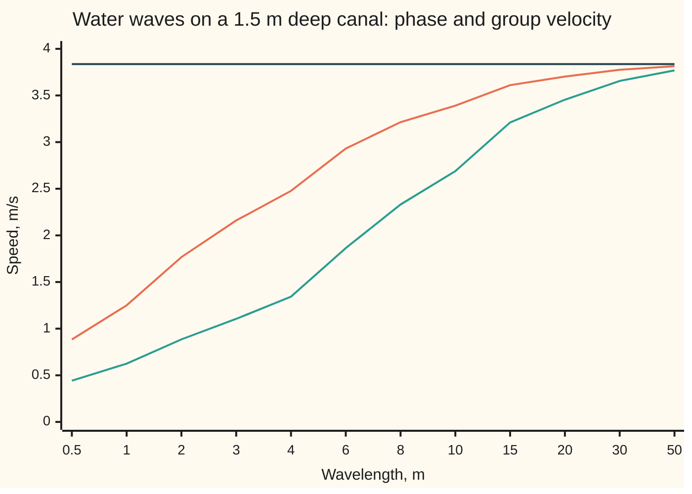
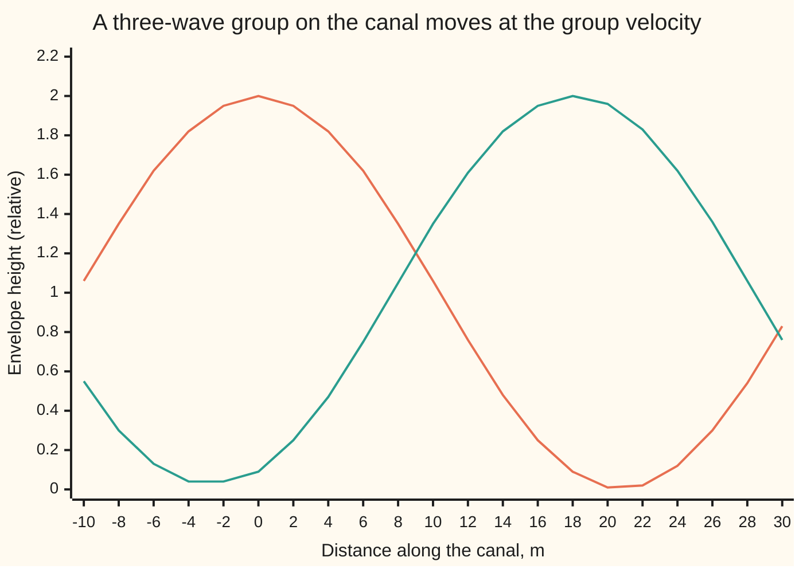

# Dispersion: when each wavelength travels at its own speed

[Syllabus](../../../SYLLABUS.md) → [Partial differential equations](../README.md) → [Waves](../README.md#s05) → Dispersion

---

## General Overview

A barge moves along a canal at 1.8 m/s, a typical canal speed. The canal is 1.5 m deep (an illustrative depth). Behind the barge a train of ripples spreads out: the barge's wake waves. Their crests are 2.0757 m apart and keep pace with the barge, at 1.8 m/s.

Watch one patch of those wake waves and something odd happens. The crests run *through* the patch. Each crest appears at the back, moves to the front and fades out. The patch itself, which carries the waves' energy, moves at only 0.9019 m/s, about half the crest speed.

The reason is **dispersion**: on water, each wavelength travels at its own speed. Long waves outrun short ones. A guitar string is different: there every shape slides at one speed, as wing 08's [The wave equation](../../08-Differential%20equations%20and%20dynamics/10-The%20Classical%20PDEs/05-the-wave-equation-and-dalemberts-formula.md) found and [d'Alembert](01-dalembert-and-characteristics-for-waves.md) proves again, so a pulse keeps its shape. On water a pulse spreads out into its separate wavelengths.

This card reads the rule "wavelength sets speed" off the equation by trying a single wave. It then separates the speed of the crests (**phase velocity**) from the speed of a group and its energy (**group velocity**).

Last, it outlines the long-wave equation of Korteweg and de Vries (KdV). There spreading balances steepening, and one smooth hump of water rolls along unchanged. An engineer saw such a hump on a Scottish canal in 1834, after a barge stopped suddenly.

**Put one wave of a single wavelength into a linear equation, and the equation turns into a rule ω(k) linking how fast the wave wiggles in time to how fast it wiggles in space; the crests then move at ω/k (time-wiggle over space-wiggle), while a group of nearby wavelengths, and its energy, moves at dω/dk (the slope of that rule).**

**What kind of fact this is:** the rule ω(k) and the group speed of beats are theorems, proved on this card in Why it works. The water-wave rule is a model: water without friction or swirl, and waves low compared with their length. KdV is a model for long, low waves, outlined here, not derived in full.

### The picture: crest speed and group speed on the canal



Orange: phase velocity, the speed of the crests. Green: group velocity, the speed of a group and its energy. Dark: the long-wave limit $`\sqrt{g h}`$ = 3.8360 m/s. Short waves are slow, and their groups go at half the crest speed. Long waves feel the bottom: both speeds rise towards 3.8360 m/s and meet.

---

## The formula

Notation from earlier cards. $`x`$ is distance along the canal, $`t`$ is time, and a subscript is a rate: $`\eta_t`$ is how fast the surface height $`\eta`$ ("eta") changes in time. The wavenumber $`k`$ from [Helmholtz](../04-Laplace%2C%20Poisson%20and%20Potentials/08-helmholtz-and-eigenfunctions.md) counts radians of wave per metre: $`k = 2\pi/\lambda`$ for wavelength $`\lambda`$.

This card introduces the **plane wave**, a single wavelength moving along: $`\eta = A\cos(kx - \omega t)`$, written for short as the real part of $`A e^{i(kx - \omega t)}`$, where $`i`$ is the square root of −1. Here $`\omega`$ ("omega") is the angular frequency, in radians per second. Trying a plane wave turns every $`x`$-rate into a factor $`ik`$ and every $`t`$-rate into a factor $`-i\omega`$. The equation becomes an ordinary equation in $`k`$ and $`\omega`$, the **dispersion relation** $`\omega(k)`$. From it come two speeds:

```math
c_p = \frac{\omega}{k}, \qquad c_g = \frac{d\omega}{dk}, \qquad \text{water of depth } h:\ \ \omega^2 = g\,k\tanh(k h).
```

**Read it aloud:** the crests move at omega over k; a group of nearby wavelengths moves at the slope of the omega-against-k curve; and on water of depth h, omega squared is gravity times k times the hyperbolic tangent of k h.

For water the group velocity works out as

```math
c_g = \frac{c_p}{2}\left(1 + \frac{2kh}{\sinh(2kh)}\right),
```

so it is half the crest speed in deep water ($`kh`$ large) and equal to it for long waves ($`kh`$ small).

| Symbol | Plain meaning | In our example | Push it up and the answer… |
| --- | --- | --- | --- |
| $`\eta`$, $`x`$, $`z`$, $`t`$ | surface height, m; distance along, m; height above the still surface, m; time, s | — | — |
| $`A`$, $`\phi`$, $`Z`$ | a plane wave's height; the water's velocity potential (its slope is the water's velocity); the potential's profile with depth | — | — |
| $`k`$, $`\lambda`$ | wavenumber, rad/m; wavelength $`2\pi/k`$, m | 3.0271 rad/m; 2.0757 m | — |
| $`\omega`$ | angular frequency, rad/s; the period is $`2\pi/\omega`$ | 5.4488 rad/s; 1.1531 s | — |
| $`c_p`$ | phase velocity $`\omega/k`$: speed of the crests | 1.8000 m/s | — |
| $`c_g`$ | group velocity $`d\omega/dk`$: speed of a group and its energy | 0.9019 m/s | — |
| $`g`$, $`h`$ | gravity; canal depth (illustrative) | 9.81 m/s²; 1.5 m | deeper: long waves faster |
| $`U`$ | barge speed | 1.8 m/s | longer wake waves |
| $`c`$; $`c_0`$, $`\beta`$ | a string's single wave speed; long-wave speed $`\sqrt{gh}`$; spreading strength $`c_0 h^2/6`$ | —; 3.8360 m/s; — | — |
| $`a`$, $`V`$, $`\ell`$; $`\xi`$, $`t_b`$ | a solitary hump's height, speed and width scale; the moving place $`x - Vt`$; the breaking time without spreading | 0.3 m; 4.2196 m/s; 3.8730 m; —; 4.3719 s | taller: faster, narrower, breaks sooner |
| $`\Delta k`$, $`\Delta\omega`$; $`\bar k`$, $`\bar\omega`$ | gaps in wavenumber and frequency between waves added together; their averages | 5% of $`k`$ | beat speed drifts from $`c_g`$ |
| $`\sigma`$, $`\rho`$ | surface tension; water density | 0.072 N/m; 1000 kg/m³ | matters below a few cm |

### When it holds

- **A linear equation with constant coefficients.** Only then does a plane wave stay a plane wave. With a sloping bed, $`k`$ changes along the canal, and the rule holds only locally.
- **Low waves.** The water rule assumes slopes $`Ak`$ that are small. Tall waves move faster than the rule says, and steepen. KdV puts that effect back for long waves.
- **A narrow spread of wavenumbers.** Group velocity is the slope at one $`k`$. Two waves 50% apart in $`k`$ beat at 0.9107 m/s, not 0.9019 m/s.
- **No friction or swirl.** The water rule takes the flow as frictionless and swirl-free. On a canal, friction damps the shortest ripples quickly but barely touches the wake waves.
- **Waves longer than a few centimetres.** Below 1.702 cm, surface tension (the surface's skin-like pull) takes over from gravity. Then short ripples are the fast ones, and groups outrun crests.

---

## Why it works

### Step 0: the idea

A plane wave is the one shape that a linear equation with constant coefficients can only move, never bend: every rate of it is the same wave times a constant. So putting it in gives no new shape, only a condition on $`k`$ and $`\omega`$. That condition is the dispersion relation.

Group velocity then comes from adding two plane waves. Their sum beats, like two guitar strings slightly out of tune, and the beat pattern moves at its own speed.

### Step 1: read the relation off the equation

Take the wave equation $`\eta_{tt} = c^2\eta_{xx}`$ of [d'Alembert](01-dalembert-and-characteristics-for-waves.md). Put in $`e^{i(kx - \omega t)}`$. The $`t`$-rate twice gives $`(-i\omega)^2 = -\omega^2`$, and the $`x`$-rate twice gives $`-k^2`$. So $`\omega^2 = c^2 k^2`$, and $`\omega = ck`$.

Then $`c_p = c_g = c`$ for every wavelength. Nothing disperses, so a plucked string keeps its corners.

Now take the long-wave equation $`\eta_t + c_0\eta_x + \beta\,\eta_{xxx} = 0`$, met again in Step 5; $`c_0`$ is the long-wave speed $`\sqrt{gh}`$ and $`\beta`$ a spreading strength, both fixed there. The same substitution gives $`-i\omega + ic_0 k - i\beta k^3 = 0`$, so

```math
\omega = c_0 k - \beta k^3, \qquad c_p = c_0 - \beta k^2, \qquad c_g = c_0 - 3\beta k^2 .
```

Short waves (large $`k`$) are slower, and their groups slower still. The third-rate term is what makes the speeds differ.

### Step 2: the water rule, from Laplace's equation

The canal's water flows without swirl, so its velocity is the slope of a potential $`\phi(x, z, t)`$. Water does not compress, so $`\phi`$ is harmonic, $`\Delta\phi = 0`$ (here $`\Delta`$ is the Laplacian; from Step 3 on, $`\Delta k`$ is a gap), as on [Harmonic functions](../04-Laplace%2C%20Poisson%20and%20Potentials/01-harmonic-functions-and-mean-values.md). Two edge conditions hold:

1. **At the bed**, $`z = -h`$: no flow through it, so $`\phi_z = 0`$.
2. **At the surface**, $`z = 0`$, for low waves: $`\phi_{tt} + g\,\phi_z = 0`$ (the fold shows where it comes from).

Try $`\phi = Z(z)\cos(kx - \omega t)`$. Laplace's equation gives $`Z'' = k^2 Z`$. The bed condition picks $`Z = \cosh\big(k(z + h)\big)`$. The surface condition then needs $`-\omega^2\cosh(kh) + g k\sinh(kh) = 0`$, which is $`\omega^2 = g k\tanh(kh)`$.

<details>
<summary>Detailed derivation: the surface condition, and the group-velocity formula</summary>

Let the surface be at height $`\eta(x, t)`$. Two facts hold there, kept to first order in small waves.

The surface moves with the water: $`\eta_t = \phi_z`$ at $`z = 0`$.

The pressure at the surface equals air pressure. Bernoulli's law for unsteady flow without swirl, to first order, gives $`\phi_t + g\,\eta = 0`$ at $`z = 0`$.

Take the time rate of the second fact and use the first:

$`\displaystyle \phi_{tt} + g\,\eta_t = \phi_{tt} + g\,\phi_z = 0 \quad \text{at } z = 0 .`$

With $`\phi = \cosh\big(k(z+h)\big)\cos(kx - \omega t)`$, $`\phi_{tt} = -\omega^2\phi`$ and $`\phi_z = k\sinh\big(k(z+h)\big)\cos(kx - \omega t)`$. At $`z = 0`$:

$`\displaystyle \omega^2\cosh(kh) = g k\sinh(kh), \qquad \omega^2 = g k\tanh(kh) .`$

For the group velocity, differentiate $`\omega^2 = g k\tanh(kh)`$ in $`k`$:

$`\displaystyle 2\omega\,\frac{d\omega}{dk} = g\tanh(kh) + \frac{g k h}{\cosh^2(kh)} .`$

Divide by $`2\omega`$ and use $`g\tanh(kh) = \omega^2/k`$:

$`\displaystyle \frac{d\omega}{dk} = \frac{\omega}{2k}\left(1 + \frac{kh}{\sinh(kh)\cosh(kh)}\right) = \frac{c_p}{2}\left(1 + \frac{2kh}{\sinh(2kh)}\right) .`$

</details>

### Step 3: two waves make beats, and the beats move at dω/dk

Add two plane waves of equal height, at wavenumbers $`k_1`$ and $`k_2`$ with frequencies $`\omega_1`$ and $`\omega_2`$. The sum-to-product rule for cosines gives

```math
\cos(k_1 x - \omega_1 t) + \cos(k_2 x - \omega_2 t) = 2\cos\!\Big(\tfrac{\Delta k\,x - \Delta\omega\,t}{2}\Big)\cos\!\big(\bar k x - \bar\omega t\big),
```

where $`\Delta k = k_2 - k_1`$, $`\Delta\omega = \omega_2 - \omega_1`$, and $`\bar k`$, $`\bar\omega`$ are the averages. The second factor is a carrier wave whose crests move at $`\bar\omega/\bar k`$, the phase velocity. The first factor is a slow envelope. It moves at $`\Delta\omega/\Delta k`$. As the two wavenumbers close in, that ratio becomes the slope $`d\omega/dk`$.

On the canal, with the waves centred on the wake's $`k`$, the beat speed is 0.9107 m/s at a 50% gap, 0.9022 m/s at 10%, and 0.9019 m/s at 5% and 1%.

### Step 4: why the energy travels with the group

Between envelope peaks the two waves cancel and the water is still. The energy sits where the envelope is large, so it moves with the envelope, at $`c_g`$. The crests are only a pattern passing through.

Three waves, at $`k - \Delta k`$, $`k`$ and $`k + \Delta k`$ with heights 1/2, 1 and 1/2, make tall groups with quiet water between them. One group's peak, tracked by scanning the sum along the canal, moves 18.044 m in 20 s: 0.9022 m/s. Its height falls from 2 to 1.9997, because the curve $`\omega(k)`$ bends: the group itself slowly spreads.

A group built from a continuous spread of wavenumbers moves at $`c_g`$ in the same way; that account needs the Fourier transform, the tool of [Solving differential equations by transform](../../20-Harmonic%20analysis/03-Convolution%20and%20Approximate%20Identities/09-fourier-methods-for-differential-equations.md), which writes any start as a continuous sum of plane waves.

### Step 5: KdV, in outline — spreading meets steepening

Long waves (small $`kh`$) give two small effects of opposite kind.

1. **Spreading.** Expanding $`\tanh`$ gives $`\omega \approx c_0 k\big(1 - (kh)^2/6\big)`$. That is the rule of Step 1 with $`\beta = c_0 h^2/6`$, so the linear long-wave equation is $`\eta_t + c_0\eta_x + \beta\,\eta_{xxx} = 0`$. For a 20 m wave it gives 3.6940 m/s against the exact 3.7033 m/s.
2. **Steepening.** A higher part of the wave moves faster, at about $`c_0\big(1 + 3\eta/(2h)\big)`$. Alone, that is a conservation law: the hump's back catches its front, characteristics cross, and the hump breaks, as on [Conservation laws](../02-First-Order%20Equations%20and%20Characteristics/02-conservation-laws-and-shocks.md).

Keep both, and the result is the **Korteweg–de Vries equation**:

```math
\eta_t + c_0\,\eta_x + \frac{3c_0}{2h}\,\eta\,\eta_x + \frac{c_0 h^2}{6}\,\eta_{xxx} = 0 .
```

It has a **solitary wave**, a hump that keeps its shape; it is a smooth, classical solution. Here $`\mathrm{sech} = 1/\cosh`$:

```math
\eta = a\,\mathrm{sech}^2\!\Big(\frac{x - Vt}{\ell}\Big), \qquad V = c_0\Big(1 + \frac{a}{2h}\Big), \qquad \ell = \sqrt{\frac{4h^3}{3a}} .
```

A taller hump is faster and narrower. Under it, at sample points 0.25 m apart, the steepening term reaches 0.0508 m/s and the spreading term 0.0302 m/s. Yet the whole equation's residual is only 6.28e-04 m/s at a 5 cm step, down from 2.50e-03 m/s at 10 cm: about four times smaller for half the step, so it is the centred differences' own error, not a miss in the hump. Steepening, spreading and the hump's extra speed above $`c_0`$ cancel, point by point.

<details>
<summary>Detailed proof: the solitary wave solves KdV</summary>

Write $`\xi = x - Vt`$, so $`\eta_t = -V\eta'`$, with a prime for the rate in $`\xi`$. KdV becomes

$`\displaystyle -(V - c_0)\,\eta' + \frac{3c_0}{2h}\,\eta\,\eta' + \beta\,\eta''' = 0 .`$

Integrate once, with $`\eta`$ and its rates zero far away:

$`\displaystyle -(V - c_0)\,\eta + \frac{3c_0}{4h}\,\eta^2 + \beta\,\eta'' = 0 .`$

Put $`S(s) = \mathrm{sech}^2(s)`$ for a number $`s`$. A short calculation gives $`d^2S/ds^2 = 4S - 6S^2`$. So with $`\eta = aS(\xi/\ell)`$, $`\eta'' = a(4S - 6S^2)/\ell^2`$, and the equation becomes

$`\displaystyle \Big[-(V - c_0) + \frac{4\beta}{\ell^2}\Big]aS + \Big[\frac{3c_0 a}{4h} - \frac{6\beta}{\ell^2}\Big]aS^2 = 0 .`$

Both brackets vanish. The second gives $`\ell^2 = 8h\beta/(c_0 a) = 4h^3/(3a)`$. The first gives $`V - c_0 = 4\beta/\ell^2 = c_0 a/(2h)`$.

</details>

Two KdV solitary waves of different heights pass through each other and come out unchanged, only shifted. That surprising fact, and the method that explains it, is the subject of [Solitons](../07-Nonlinear%20PDE%20and%20Fluids/06-nonlinear-schrodinger-and-solitons-in-outline.md).

---

## Worked numbers, by hand

The canal: $`g`$ = 9.81 m/s², $`h`$ = 1.5 m, barge at $`U`$ = 1.8 m/s. The wake's crests keep pace with the barge, so $`c_p = U`$.

| Step | Arithmetic | Value |
| --- | --- | --- |
| deep-water guess, $`\omega^2 = gk`$ and $`\omega/k = U`$ | $`k = g/U^2 = 9.81/3.24`$ | 3.0278 rad/m |
| check the depth | $`kh = 4.541`$, $`\tanh(kh)`$ | 0.99977 |
| solve $`g\tanh(kh)/k = U^2`$ | small correction to $`k`$ | 3.0271 rad/m |
| wavelength | $`2\pi/3.0271`$ | 2.0757 m |
| angular frequency | $`U k = 1.8 \times 3.0271`$ | 5.4488 rad/s, period 1.1531 s |
| depth factor | $`1 + 2kh/\sinh(2kh)`$ | 1.00207 |
| group velocity | $`(1.8/2) \times 1.00207`$ | **0.9019 m/s** |
| energy left behind in 10 s | $`(1.8 - 0.9019) \times 10`$ | 8.98 m |

The wake waves' crests ride with the barge, but their energy drops back from it. So the train of wake waves behind the barge grows longer by 8.98 m every 10 s.

The long-wave numbers, for a hump 0.3 m high:

| Step | Arithmetic | Value |
| --- | --- | --- |
| long-wave speed | $`\sqrt{9.81 \times 1.5}`$ | 3.8360 m/s |
| hump speed | $`3.8360 \times (1 + 0.3/3)`$ | **4.2196 m/s** |
| width scale | $`\sqrt{4 \times 1.5^3/0.9} = \sqrt{15}`$ | 3.8730 m |

### What breaks if you drop a piece

| Mistake | Comes out at | What went wrong |
| --- | --- | --- |
| Energy moves with the crests | 1.8 m/s for the energy, not 0.9019 m/s; none left behind, not 8.98 m in 10 s | energy moves at $`c_g`$, not $`c_p`$ |
| Deep-water rule for a 20 m wave | 5.5880 m/s, not 3.7033 m/s; surface condition misses by 0.5608 of its size | the bed slows long waves: none beats $`\sqrt{gh}`$ = 3.8360 m/s |
| Beat of two waves 50% apart in $`k`$ | 0.9107 m/s, not 0.9019 m/s | $`\Delta\omega/\Delta k`$ is the slope only for a narrow spread |
| Drop the spreading term from KdV | the 0.3 m hump breaks after 4.3719 s, about 16.77 m along at $`\sqrt{gh}`$ | steepening has nothing to oppose it |
| Run the hump at $`\sqrt{gh}`$ = 3.8360 m/s | KdV residual 0.0232 m/s, not 6.28e-04 m/s | a taller hump is faster: 4.2196 m/s |

The fourth row is the balance failing. The breaking time of [Conservation laws](../02-First-Order%20Equations%20and%20Characteristics/02-conservation-laws-and-shocks.md) works out as $`t_b = \sqrt{3}\,h\ell/(2c_0 a)`$, using the steepest slope of $`\mathrm{sech}^2`$.

---

## How it moves

The puzzle: the crests move at 1.8 m/s, yet the group moves at 0.9019 m/s. Where do the crests go? Follow the three-wave group of Step 4 for 20 s.

| Time, s | Group peak at | Crest that started at the peak is at | Group height |
| --- | --- | --- | --- |
| 0 | 0 m | 0 m | 2 |
| 20 | 18.044 m | 36.0 m | 1.9997 |

In 20 s the crests move 36.0 m and the group 18.04 m, so 8.65 crests pass through it from back to front. The speeds on the canal, one at a time:

```
long-wave limit sqrt(g h)  ######################################## 3.8360 m/s
solitary hump 0.3 m        ############################################ 4.2196 m/s
wake crests (phase)        ################### 1.8000 m/s
wake group (energy)        ######### 0.9019 m/s
```

The envelope of the three-wave group along the canal, at the start and 20 s later:



Orange: the envelope at 0 s, peak at 0 m. Green: at 20 s, peak at 18.044 m. The crests inside, 2.0757 m apart, moved twice as far.

---

## Code, from first principles, and it actually runs

The code finds the wake wave by bisection and checks each claim by at least two roads. The water rule: the plane wave put into Laplace's equation and the surface condition by centred differences (small symmetric steps). The group velocity: four roads, from the formula, a centred difference of $`\omega(k)`$, two-wave beats and a tracked three-wave group. KdV: its residual at two steps, and the breaking time by formula and by crossing characteristics. The slowest ripple: a golden-section search (a bracket shrinking by a fixed ratio) against its closed form.

### Python

```python
# Dispersion on a canal: ripples behind a barge, group velocity from plane waves, KdV balance.
import math
G, H, U = 9.81, 1.5, 1.8           # gravity m/s^2, canal depth m, barge speed m/s
SIG, RHO = 0.072, 1000.0           # surface tension N/m, water density kg/m^3
def omega(k, sig=0.0):             # water waves: omega^2 = (g k + sig k^3 / rho) tanh(k h)
    return math.sqrt((G * k + sig * k ** 3 / RHO) * math.tanh(k * H))
def cg_formula(k):                 # d omega/dk for gravity waves, by hand
    return 0.5 * omega(k) / k * (1 + 2 * k * H / math.sinh(2 * k * H))
def bisect(f, lo, hi):
    for _ in range(200):
        mid = 0.5 * (lo + hi)
        if (f(lo) > 0) == (f(mid) > 0): lo = mid
        else: hi = mid
    return 0.5 * (lo + hi)
# 1. the wake wave: crests keep pace with the barge, omega/k = U
k = bisect(lambda q: omega(q) / q - U, 0.5, 20.0)
w = omega(k)
print(f"wake wave: k = {k:.4f} rad/m, wavelength = {2*math.pi/k:.4f} m, omega = {w:.4f} rad/s, period = {2*math.pi/w:.4f} s")
print(f"deep-water guess g/U^2 = {G/U**2:.4f} rad/m, kh = {k*H:.3f}, tanh(kh) = {math.tanh(k*H):.5f}, "
      f"1 + 2kh/sinh(2kh) = {1 + 2*k*H/math.sinh(2*k*H):.5f}")
# 2. read the relation off the plane wave: phi = cosh(k(z+h)) cos(kx - wt), residuals by centred differences
def res_water(k, w, d):
    phi = lambda x, z, t: math.cosh(k * (z + H)) * math.cos(k * x - w * t)
    x, t = 0.3, 0.2
    lap = (phi(x+d, -0.5, t) + phi(x-d, -0.5, t) + phi(x, -0.5+d, t) + phi(x, -0.5-d, t) - 4*phi(x, -0.5, t)) / d**2
    surf = (phi(x, 0, t+d) - 2*phi(x, 0, t) + phi(x, 0, t-d)) / d**2 + G * (phi(x, d, t) - phi(x, -d, t)) / (2*d)
    return abs(lap) / (k * k * abs(phi(x, -0.5, t))), abs(surf) / (w * w * abs(phi(x, 0, t)))
for d in (1e-2, 5e-3):
    r = res_water(k, w, d)
    print(f"plane wave in the canal, step {d:.0e}: Laplace {r[0]:.2e}, surface {r[1]:.2e} (relative)")
    assert max(r) < 1e-3
k20 = 2 * math.pi / 20.0
r_wrong = res_water(k20, math.sqrt(G * k20), 5e-3)[1]
print(f"20 m wave with the deep-water omega: surface residual {r_wrong:.4f}")
assert abs(r_wrong - (1 - math.tanh(k20 * H))) < 1e-3   # the miss is 1 - tanh(kh) of the term's size
# 3. group velocity, four roads
dk = 1e-4
cg_fd = (omega(k + dk) - omega(k - dk)) / (2 * dk)
cg = cg_formula(k)
print(f"phase velocity omega/k = {w/k:.4f} m/s; group velocity formula = {cg:.4f} m/s, centred difference = {cg_fd:.4f} m/s")
assert abs(cg - cg_fd) < 1e-6
assert abs(w / k - U) < 1e-9
for frac in (0.5, 0.10, 0.05, 0.01):
    k1, k2 = k * (1 - frac / 2), k * (1 + frac / 2)
    print(f"two waves {frac*100:4.0f}% apart in k: beat speed d omega/d k = {(omega(k2)-omega(k1))/(k2-k1):.4f} m/s")
# three plane waves, amplitudes 1/2, 1, 1/2: track the envelope's peak by scanning x
DK = 0.05 * k
def env(x, t):
    re = im = 0.0
    for amp, q in ((0.5, k - DK), (1.0, k), (0.5, k + DK)):
        ph = (q - k) * x - (omega(q) - w) * t
        re += amp * math.cos(ph); im += amp * math.sin(ph)
    return math.hypot(re, im)
def peak(t):
    xs = [i * 0.001 for i in range(-5000, 30000)]
    return max(xs, key=lambda x: env(x, t))
T = 20.0
xp = peak(T)
print(f"three-wave group: peak at {xp:.3f} m after {T:.0f} s, speed {xp/T:.4f} m/s, height {env(xp, T):.4f} (2 at the start)")
assert abs(xp / T - cg) < 2e-3
print(f"in {T:.0f} s the crests move {U*T:.1f} m, the group {cg*T:.2f} m; {(U-cg)*T/(2*math.pi/k):.2f} crests pass through it")
print("envelope t=0 s: " + ", ".join(f"{env(x, 0):.2f}" for x in range(-10, 31, 2)))
print("envelope t=20 s: " + ", ".join(f"{env(x, T):.2f}" for x in range(-10, 31, 2)))
print(f"energy made 10 s ago sits {(U-cg)*10:.2f} m behind the barge; Kelvin wedge half-angle {math.degrees(math.asin(1/3)):.2f} deg")
# 4. the dispersion relation across wavelengths (chart)
lams = [0.5, 1, 2, 3, 4, 6, 8, 10, 15, 20, 30, 50]
print("wavelength m: " + ", ".join(f"{L:g}" for L in lams))
print("phase m/s: " + ", ".join(f"{omega(2*math.pi/L)/(2*math.pi/L):.3f}" for L in lams))
print("group m/s: " + ", ".join(f"{cg_formula(2*math.pi/L):.3f}" for L in lams))
c0 = math.sqrt(G * H)
print(f"long-wave limit sqrt(g h) = {c0:.4f} m/s")
# 5. long waves: omega = c0 k (1 - (kh)^2/6) is the linear KdV relation; read it off eta = cos(kx - wt)
beta = c0 * H ** 2 / 6
wk = c0 * k20 - beta * k20 ** 3
print(f"20 m wave: exact {omega(k20)/k20:.4f} m/s, KdV {wk/k20:.4f} m/s, deep-water formula {math.sqrt(G/k20):.4f} m/s")
assert abs(wk / k20 - omega(k20) / k20) < 0.02
lin = lambda x, t: math.cos(k20 * x - wk * t)
d = 1e-2
rl = ((lin(1, d) - lin(1, -d)) / (2*d) + c0 * (lin(1+d, 0) - lin(1-d, 0)) / (2*d)
      + beta * (lin(1+2*d, 0) - 2*lin(1+d, 0) + 2*lin(1-d, 0) - lin(1-2*d, 0)) / (2*d**3))
print(f"plane wave in linear KdV: residual {abs(rl):.2e}")
assert abs(rl) < 1e-4
# 6. KdV: eta_t + c0 eta_x + (3 c0 / 2h) eta eta_x + (c0 h^2/6) eta_xxx = 0, solitary wave a sech^2((x - Vt)/l)
A = 0.3
V, ell = c0 * (1 + A / (2 * H)), math.sqrt(4 * H ** 3 / (3 * A))
print(f"solitary wave a = {A} m: speed {V:.4f} m/s (linear {c0:.4f}), width scale {ell:.4f} m")
def kdv_terms(x, d, v):
    eta = lambda x, t: A / math.cosh((x - v * t) / ell) ** 2
    et = (eta(x, d) - eta(x, -d)) / (2 * d)
    ex = (eta(x + d, 0) - eta(x - d, 0)) / (2 * d)
    exxx = (eta(x+2*d, 0) - 2*eta(x+d, 0) + 2*eta(x-d, 0) - eta(x-2*d, 0)) / (2 * d**3)
    nl, disp = 1.5 * c0 / H * eta(x, 0) * ex, beta * exxx
    return et + c0 * ex + nl + disp, nl, disp
res, nl = {}, 0.0
for d in (0.1, 0.05):
    rs = [kdv_terms(-10 + 0.25 * i, d, V) for i in range(81)]
    res[d], nl = max(abs(r[0]) for r in rs), max(abs(r[1]) for r in rs)
    print(f"KdV residual, step {d} m: max {res[d]:.2e} m/s "
          f"(steepening term up to {nl:.4f}, spreading term up to {max(abs(r[2]) for r in rs):.4f})")
assert res[0.05] < 0.1 * nl
assert res[0.05] < 0.3 * res[0.1]
r_lin = max(abs(kdv_terms(-10 + 0.25 * i, 0.05, c0)[0]) for i in range(81))
print(f"same hump at the linear speed {c0:.4f} m/s: residual {r_lin:.4f} m/s")
assert r_lin > 3 * res[0.05]
eta = lambda x, t: A / math.cosh((x - V * t) / ell) ** 2
# 7. drop the spreading term: eta_t + c0 (1 + 3 eta/2h) eta_x = 0 breaks
tb = 2 * H * ell / (3 * c0 * A * 4 / (3 * math.sqrt(3)))
xs = [-15 + 0.001 * i for i in range(30001)]
sp = [c0 * (1 + 1.5 * eta(x, 0) / H) for x in xs]
tb_brute = min((xs[i+1] - xs[i]) / (sp[i] - sp[i+1]) for i in range(30000) if sp[i] > sp[i+1])
print(f"no spreading term: breaks at {tb:.4f} s (formula), {tb_brute:.4f} s (crossing characteristics), after {c0*tb:.2f} m")
assert abs(tb - tb_brute) < 1e-3
# 8. surface tension: ripples shorter than a few cm run with group faster than crests
lmin_closed, cmin_closed = 2 * math.pi * math.sqrt(SIG / (RHO * G)), (4 * G * SIG / RHO) ** 0.25
gr = (math.sqrt(5) - 1) / 2; lo, hi = 0.005, 0.05
for _ in range(100):
    m1, m2 = hi - gr * (hi - lo), lo + gr * (hi - lo)
    cp = lambda L: omega(2 * math.pi / L, SIG) / (2 * math.pi / L)
    if cp(m1) < cp(m2): hi = m2
    else: lo = m1
print(f"slowest ripple: {100*lo:.3f} cm at {cp(lo):.4f} m/s (search), {100*lmin_closed:.3f} cm at {cmin_closed:.4f} m/s (closed form)")
assert abs(lo - lmin_closed) < 1e-5
assert abs(cp(lo) - cmin_closed) < 1e-6
kc = 2 * math.pi / 0.005
cgc = (omega(kc + 1e-2, SIG) - omega(kc - 1e-2, SIG)) / 2e-2
print(f"0.5 cm ripple: phase {omega(kc, SIG)/kc:.4f} m/s, group {cgc:.4f} m/s")
print("ALL CHECKS PASS")
```

**Ran 2026-11-15 on macOS, Python 3.14.10, standard library only. All checks passed. Output, pasted from the run:**

```
wake wave: k = 3.0271 rad/m, wavelength = 2.0757 m, omega = 5.4488 rad/s, period = 1.1531 s
deep-water guess g/U^2 = 3.0278 rad/m, kh = 4.541, tanh(kh) = 0.99977, 1 + 2kh/sinh(2kh) = 1.00207
plane wave in the canal, step 1e-02: Laplace 1.53e-04, surface 4.00e-04 (relative)
plane wave in the canal, step 5e-03: Laplace 3.82e-05, surface 1.00e-04 (relative)
20 m wave with the deep-water omega: surface residual 0.5608
phase velocity omega/k = 1.8000 m/s; group velocity formula = 0.9019 m/s, centred difference = 0.9019 m/s
two waves   50% apart in k: beat speed d omega/d k = 0.9107 m/s
two waves   10% apart in k: beat speed d omega/d k = 0.9022 m/s
two waves    5% apart in k: beat speed d omega/d k = 0.9019 m/s
two waves    1% apart in k: beat speed d omega/d k = 0.9019 m/s
three-wave group: peak at 18.044 m after 20 s, speed 0.9022 m/s, height 1.9997 (2 at the start)
in 20 s the crests move 36.0 m, the group 18.04 m; 8.65 crests pass through it
envelope t=0 s: 1.06, 1.35, 1.62, 1.82, 1.95, 2.00, 1.95, 1.82, 1.62, 1.35, 1.06, 0.76, 0.48, 0.25, 0.09, 0.01, 0.02, 0.12, 0.30, 0.54, 0.83
envelope t=20 s: 0.55, 0.30, 0.13, 0.04, 0.04, 0.09, 0.25, 0.47, 0.75, 1.05, 1.35, 1.61, 1.82, 1.95, 2.00, 1.96, 1.83, 1.62, 1.36, 1.06, 0.76
energy made 10 s ago sits 8.98 m behind the barge; Kelvin wedge half-angle 19.47 deg
wavelength m: 0.5, 1, 2, 3, 4, 6, 8, 10, 15, 20, 30, 50
phase m/s: 0.884, 1.250, 1.767, 2.160, 2.477, 2.931, 3.214, 3.391, 3.611, 3.703, 3.775, 3.814
group m/s: 0.442, 0.625, 0.885, 1.105, 1.343, 1.864, 2.331, 2.689, 3.211, 3.455, 3.656, 3.769
long-wave limit sqrt(g h) = 3.8360 m/s
20 m wave: exact 3.7033 m/s, KdV 3.6940 m/s, deep-water formula 5.5880 m/s
plane wave in linear KdV: residual 7.47e-06
solitary wave a = 0.3 m: speed 4.2196 m/s (linear 3.8360), width scale 3.8730 m
KdV residual, step 0.1 m: max 2.50e-03 m/s (steepening term up to 0.0508, spreading term up to 0.0301)
KdV residual, step 0.05 m: max 6.28e-04 m/s (steepening term up to 0.0508, spreading term up to 0.0302)
same hump at the linear speed 3.8360 m/s: residual 0.0232 m/s
no spreading term: breaks at 4.3719 s (formula), 4.3719 s (crossing characteristics), after 16.77 m
slowest ripple: 1.702 cm at 0.2306 m/s (search), 1.702 cm at 0.2306 m/s (closed form)
0.5 cm ripple: phase 0.3135 m/s, group 0.4454 m/s
ALL CHECKS PASS
```

### Rust

```rust
// Dispersion on a canal: ripples behind a barge, group velocity from plane waves, KdV balance.
const G: f64 = 9.81; // gravity, m/s^2
const H: f64 = 1.5; // canal depth, m
const U: f64 = 1.8; // barge speed, m/s
const SIG: f64 = 0.072; // surface tension, N/m
const RHO: f64 = 1000.0; // water density, kg/m^3
const PI: f64 = std::f64::consts::PI;

fn omega(k: f64, sig: f64) -> f64 { ((G * k + sig * k.powi(3) / RHO) * (k * H).tanh()).sqrt() }
fn cg_formula(k: f64) -> f64 { 0.5 * omega(k, 0.0) / k * (1.0 + 2.0 * k * H / (2.0 * k * H).sinh()) }
fn bisect(f: &dyn Fn(f64) -> f64, mut lo: f64, mut hi: f64) -> f64 {
    for _ in 0..200 {
        let mid = 0.5 * (lo + hi);
        if (f(lo) > 0.0) == (f(mid) > 0.0) { lo = mid } else { hi = mid }
    }
    0.5 * (lo + hi)
}
// Python-style e-notation: 2.50e-03
fn e2(x: f64, p: usize) -> String {
    let s = format!("{:.*e}", p, x);
    let (m, e) = s.split_once('e').unwrap();
    let ev: i32 = e.parse().unwrap();
    format!("{}e{}{:02}", m, if ev < 0 { '-' } else { '+' }, ev.abs())
}
fn res_water(k: f64, w: f64, d: f64) -> (f64, f64) {
    let phi = |x: f64, z: f64, t: f64| (k * (z + H)).cosh() * (k * x - w * t).cos();
    let (x, t) = (0.3, 0.2);
    let lap = (phi(x + d, -0.5, t) + phi(x - d, -0.5, t) + phi(x, -0.5 + d, t) + phi(x, -0.5 - d, t)
        - 4.0 * phi(x, -0.5, t)) / (d * d);
    let surf = (phi(x, 0.0, t + d) - 2.0 * phi(x, 0.0, t) + phi(x, 0.0, t - d)) / (d * d)
        + G * (phi(x, d, t) - phi(x, -d, t)) / (2.0 * d);
    (lap.abs() / (k * k * phi(x, -0.5, t).abs()), surf.abs() / (w * w * phi(x, 0.0, t).abs()))
}
fn join(v: &[f64], p: usize) -> String { v.iter().map(|x| format!("{:.*}", p, x)).collect::<Vec<_>>().join(", ") }

fn main() {
    // 1. the wake wave: crests keep pace with the barge
    let k = bisect(&|q| omega(q, 0.0) / q - U, 0.5, 20.0);
    let w = omega(k, 0.0);
    println!("wake wave: k = {:.4} rad/m, wavelength = {:.4} m, omega = {:.4} rad/s, period = {:.4} s", k, 2.0 * PI / k, w, 2.0 * PI / w);
    println!("deep-water guess g/U^2 = {:.4} rad/m, kh = {:.3}, tanh(kh) = {:.5}, 1 + 2kh/sinh(2kh) = {:.5}",
        G / (U * U), k * H, (k * H).tanh(), 1.0 + 2.0 * k * H / (2.0 * k * H).sinh());
    // 2. read the relation off the plane wave
    for d in [1e-2, 5e-3] {
        let r = res_water(k, w, d);
        let ds = if d == 1e-2 { "1e-02" } else { "5e-03" };
        println!("plane wave in the canal, step {}: Laplace {}, surface {} (relative)", ds, e2(r.0, 2), e2(r.1, 2));
        assert!(r.0.max(r.1) < 1e-3);
    }
    let k20 = 2.0 * PI / 20.0;
    let r_wrong = res_water(k20, (G * k20).sqrt(), 5e-3).1;
    println!("20 m wave with the deep-water omega: surface residual {:.4}", r_wrong);
    assert!((r_wrong - (1.0 - (k20 * H).tanh())).abs() < 1e-3); // the miss is 1 - tanh(kh) of the term's size
    // 3. group velocity, four roads
    let dk = 1e-4;
    let cg_fd = (omega(k + dk, 0.0) - omega(k - dk, 0.0)) / (2.0 * dk);
    let cg = cg_formula(k);
    println!("phase velocity omega/k = {:.4} m/s; group velocity formula = {:.4} m/s, centred difference = {:.4} m/s", w / k, cg, cg_fd);
    assert!((cg - cg_fd).abs() < 1e-6);
    assert!((w / k - U).abs() < 1e-9);
    for frac in [0.5, 0.10, 0.05, 0.01] {
        let (k1, k2) = (k * (1.0 - frac / 2.0), k * (1.0 + frac / 2.0));
        println!("two waves {:4.0}% apart in k: beat speed d omega/d k = {:.4} m/s", frac * 100.0, (omega(k2, 0.0) - omega(k1, 0.0)) / (k2 - k1));
    }
    let dkk = 0.05 * k;
    let env = |x: f64, t: f64| {
        let (mut re, mut im) = (0.0, 0.0);
        for (amp, q) in [(0.5, k - dkk), (1.0, k), (0.5, k + dkk)] {
            let ph = (q - k) * x - (omega(q, 0.0) - w) * t;
            re += amp * ph.cos();
            im += amp * ph.sin();
        }
        re.hypot(im)
    };
    let tt = 20.0;
    let (mut xp, mut best) = (0.0, -1.0);
    for i in -5000..30000 {
        let x = i as f64 * 0.001;
        let e = env(x, tt);
        if e > best { best = e; xp = x; }
    }
    println!("three-wave group: peak at {:.3} m after {:.0} s, speed {:.4} m/s, height {:.4} (2 at the start)", xp, tt, xp / tt, env(xp, tt));
    assert!((xp / tt - cg).abs() < 2e-3);
    println!("in {:.0} s the crests move {:.1} m, the group {:.2} m; {:.2} crests pass through it", tt, U * tt, cg * tt, (U - cg) * tt / (2.0 * PI / k));
    let xs: Vec<f64> = (0..21).map(|i| -10.0 + 2.0 * i as f64).collect();
    println!("envelope t=0 s: {}", join(&xs.iter().map(|&x| env(x, 0.0)).collect::<Vec<_>>(), 2));
    println!("envelope t=20 s: {}", join(&xs.iter().map(|&x| env(x, tt)).collect::<Vec<_>>(), 2));
    println!("energy made 10 s ago sits {:.2} m behind the barge; Kelvin wedge half-angle {:.2} deg", (U - cg) * 10.0, (1.0f64 / 3.0).asin().to_degrees());
    // 4. the dispersion relation across wavelengths
    let lams = [0.5, 1.0, 2.0, 3.0, 4.0, 6.0, 8.0, 10.0, 15.0, 20.0, 30.0, 50.0];
    println!("wavelength m: {}", lams.iter().map(|l| format!("{}", l)).collect::<Vec<_>>().join(", "));
    println!("phase m/s: {}", join(&lams.iter().map(|l| omega(2.0 * PI / l, 0.0) / (2.0 * PI / l)).collect::<Vec<_>>(), 3));
    println!("group m/s: {}", join(&lams.iter().map(|l| cg_formula(2.0 * PI / l)).collect::<Vec<_>>(), 3));
    let c0 = (G * H).sqrt();
    println!("long-wave limit sqrt(g h) = {:.4} m/s", c0);
    // 5. long waves: the linear KdV relation
    let beta = c0 * H * H / 6.0;
    let wk = c0 * k20 - beta * k20.powi(3);
    println!("20 m wave: exact {:.4} m/s, KdV {:.4} m/s, deep-water formula {:.4} m/s", omega(k20, 0.0) / k20, wk / k20, (G / k20).sqrt());
    assert!((wk / k20 - omega(k20, 0.0) / k20).abs() < 0.02);
    let lin = |x: f64, t: f64| (k20 * x - wk * t).cos();
    let d = 1e-2;
    let rl = (lin(1.0, d) - lin(1.0, -d)) / (2.0 * d) + c0 * (lin(1.0 + d, 0.0) - lin(1.0 - d, 0.0)) / (2.0 * d)
        + beta * (lin(1.0 + 2.0 * d, 0.0) - 2.0 * lin(1.0 + d, 0.0) + 2.0 * lin(1.0 - d, 0.0) - lin(1.0 - 2.0 * d, 0.0)) / (2.0 * d.powi(3));
    println!("plane wave in linear KdV: residual {}", e2(rl.abs(), 2));
    assert!(rl.abs() < 1e-4);
    // 6. KdV solitary wave a sech^2((x - Vt)/l)
    let a = 0.3;
    let (v, ell) = (c0 * (1.0 + a / (2.0 * H)), (4.0 * H.powi(3) / (3.0 * a)).sqrt());
    println!("solitary wave a = {} m: speed {:.4} m/s (linear {:.4}), width scale {:.4} m", a, v, c0, ell);
    let eta = |x: f64, t: f64, s: f64| a / ((x - s * t) / ell).cosh().powi(2);
    let kdv_terms = |x: f64, d: f64, s: f64| {
        let et = (eta(x, d, s) - eta(x, -d, s)) / (2.0 * d);
        let ex = (eta(x + d, 0.0, s) - eta(x - d, 0.0, s)) / (2.0 * d);
        let exxx = (eta(x + 2.0 * d, 0.0, s) - 2.0 * eta(x + d, 0.0, s) + 2.0 * eta(x - d, 0.0, s) - eta(x - 2.0 * d, 0.0, s)) / (2.0 * d.powi(3));
        let (nl, disp) = (1.5 * c0 / H * eta(x, 0.0, s) * ex, beta * exxx);
        (et + c0 * ex + nl + disp, nl, disp)
    };
    let (mut res, mut nl) = ([0.0; 2], 0.0);
    for (j, d) in [0.1, 0.05].iter().enumerate() {
        let rs: Vec<(f64, f64, f64)> = (0..81).map(|i| kdv_terms(-10.0 + 0.25 * i as f64, *d, v)).collect();
        res[j] = rs.iter().map(|r| r.0.abs()).fold(0.0, f64::max);
        nl = rs.iter().map(|r| r.1.abs()).fold(0.0, f64::max);
        println!("KdV residual, step {} m: max {} m/s (steepening term up to {:.4}, spreading term up to {:.4})", d, e2(res[j], 2),
            nl, rs.iter().map(|r| r.2.abs()).fold(0.0, f64::max));
    }
    assert!(res[1] < 0.1 * nl);
    assert!(res[1] < 0.3 * res[0]);
    let r_lin = (0..81).map(|i| kdv_terms(-10.0 + 0.25 * i as f64, 0.05, c0).0.abs()).fold(0.0, f64::max);
    println!("same hump at the linear speed {:.4} m/s: residual {:.4} m/s", c0, r_lin);
    assert!(r_lin > 3.0 * res[1]);
    // 7. drop the spreading term: the hump breaks
    let tb = 2.0 * H * ell / (3.0 * c0 * a * 4.0 / (3.0 * 3f64.sqrt()));
    let xs: Vec<f64> = (0..30001).map(|i| -15.0 + 0.001 * i as f64).collect();
    let sp: Vec<f64> = xs.iter().map(|&x| c0 * (1.0 + 1.5 * eta(x, 0.0, v) / H)).collect();
    let mut tb_brute = f64::INFINITY;
    for i in 0..30000 {
        if sp[i] > sp[i + 1] { tb_brute = tb_brute.min((xs[i + 1] - xs[i]) / (sp[i] - sp[i + 1])); }
    }
    println!("no spreading term: breaks at {:.4} s (formula), {:.4} s (crossing characteristics), after {:.2} m", tb, tb_brute, c0 * tb);
    assert!((tb - tb_brute).abs() < 1e-3);
    // 8. surface tension: the slowest ripple
    let (lmin_closed, cmin_closed) = (2.0 * PI * (SIG / (RHO * G)).sqrt(), (4.0 * G * SIG / RHO).powf(0.25));
    let gr = (5f64.sqrt() - 1.0) / 2.0;
    let cp = |l: f64| omega(2.0 * PI / l, SIG) / (2.0 * PI / l);
    let (mut lo, mut hi) = (0.005, 0.05);
    for _ in 0..100 {
        let (m1, m2) = (hi - gr * (hi - lo), lo + gr * (hi - lo));
        if cp(m1) < cp(m2) { hi = m2 } else { lo = m1 }
    }
    println!("slowest ripple: {:.3} cm at {:.4} m/s (search), {:.3} cm at {:.4} m/s (closed form)", 100.0 * lo, cp(lo), 100.0 * lmin_closed, cmin_closed);
    assert!((lo - lmin_closed).abs() < 1e-5);
    assert!((cp(lo) - cmin_closed).abs() < 1e-6);
    let kc = 2.0 * PI / 0.005;
    let cgc = (omega(kc + 1e-2, SIG) - omega(kc - 1e-2, SIG)) / 2e-2;
    println!("0.5 cm ripple: phase {:.4} m/s, group {:.4} m/s", omega(kc, SIG) / kc, cgc);
    println!("ALL CHECKS PASS");
}
```

**Ran 2026-11-15 on macOS, rustc 1.98.1, no crates. All checks passed. Output, pasted from the run:**

```
wake wave: k = 3.0271 rad/m, wavelength = 2.0757 m, omega = 5.4488 rad/s, period = 1.1531 s
deep-water guess g/U^2 = 3.0278 rad/m, kh = 4.541, tanh(kh) = 0.99977, 1 + 2kh/sinh(2kh) = 1.00207
plane wave in the canal, step 1e-02: Laplace 1.53e-04, surface 4.00e-04 (relative)
plane wave in the canal, step 5e-03: Laplace 3.82e-05, surface 1.00e-04 (relative)
20 m wave with the deep-water omega: surface residual 0.5608
phase velocity omega/k = 1.8000 m/s; group velocity formula = 0.9019 m/s, centred difference = 0.9019 m/s
two waves   50% apart in k: beat speed d omega/d k = 0.9107 m/s
two waves   10% apart in k: beat speed d omega/d k = 0.9022 m/s
two waves    5% apart in k: beat speed d omega/d k = 0.9019 m/s
two waves    1% apart in k: beat speed d omega/d k = 0.9019 m/s
three-wave group: peak at 18.044 m after 20 s, speed 0.9022 m/s, height 1.9997 (2 at the start)
in 20 s the crests move 36.0 m, the group 18.04 m; 8.65 crests pass through it
envelope t=0 s: 1.06, 1.35, 1.62, 1.82, 1.95, 2.00, 1.95, 1.82, 1.62, 1.35, 1.06, 0.76, 0.48, 0.25, 0.09, 0.01, 0.02, 0.12, 0.30, 0.54, 0.83
envelope t=20 s: 0.55, 0.30, 0.13, 0.04, 0.04, 0.09, 0.25, 0.47, 0.75, 1.05, 1.35, 1.61, 1.82, 1.95, 2.00, 1.96, 1.83, 1.62, 1.36, 1.06, 0.76
energy made 10 s ago sits 8.98 m behind the barge; Kelvin wedge half-angle 19.47 deg
wavelength m: 0.5, 1, 2, 3, 4, 6, 8, 10, 15, 20, 30, 50
phase m/s: 0.884, 1.250, 1.767, 2.160, 2.477, 2.931, 3.214, 3.391, 3.611, 3.703, 3.775, 3.814
group m/s: 0.442, 0.625, 0.885, 1.105, 1.343, 1.864, 2.331, 2.689, 3.211, 3.455, 3.656, 3.769
long-wave limit sqrt(g h) = 3.8360 m/s
20 m wave: exact 3.7033 m/s, KdV 3.6940 m/s, deep-water formula 5.5880 m/s
plane wave in linear KdV: residual 7.47e-06
solitary wave a = 0.3 m: speed 4.2196 m/s (linear 3.8360), width scale 3.8730 m
KdV residual, step 0.1 m: max 2.50e-03 m/s (steepening term up to 0.0508, spreading term up to 0.0301)
KdV residual, step 0.05 m: max 6.28e-04 m/s (steepening term up to 0.0508, spreading term up to 0.0302)
same hump at the linear speed 3.8360 m/s: residual 0.0232 m/s
no spreading term: breaks at 4.3719 s (formula), 4.3719 s (crossing characteristics), after 16.77 m
slowest ripple: 1.702 cm at 0.2306 m/s (search), 1.702 cm at 0.2306 m/s (closed form)
0.5 cm ripple: phase 0.3135 m/s, group 0.4454 m/s
ALL CHECKS PASS
```

### Lean

Lean proves the beat formula and its limit, the long-wave rule, and that the solitary hump solves KdV, for every value.

- Take any rule $`\omega(k)`$ and two plane waves of equal height at different wavenumbers. Then their sum is the slow envelope times the carrier, as in Step 3. The envelope is a fixed shape moving at $`\Delta\omega/\Delta k`$.
- Suppose $`\omega(k)`$ has a slope at $`k`$. Then the beat speed $`\Delta\omega/\Delta k`$ tends to $`d\omega/dk`$ as the two wavenumbers close in.
- Take a plane wave $`\cos(kx - \omega t)`$ in the long-wave equation of Step 1. Then it solves that equation everywhere exactly when $`\omega = c_0 k - \beta k^3`$.
- The slope of that rule is $`c_g = c_0 - 3\beta k^2`$.
- Take depth $`h > 0`$ and height $`a > 0`$, with $`c_0`$, $`V`$ and $`\ell`$ as in Step 5. Then the solitary hump $`\eta`$ of Step 5 solves KdV exactly, at every place and time.
- The hump's worked numbers also check in exact fractions: $`\ell^2 = 15`$ and $`V/c_0 = 11/10`$.

The water rule, its group velocity formula, the three-wave group and the breaking time are left to the Python and Rust checks.

```lean
-- Dispersion: two plane waves beat with an envelope that travels at the gap ratio Δω/Δk, which tends to the group velocity dω/dk; a plane wave in the linear long-wave equation obeys ω = c₀k − βk³; and the sech² solitary wave solves KdV.
import Mathlib.Analysis.SpecialFunctions.Trigonometric.Deriv
import Mathlib.Analysis.SpecialFunctions.Sqrt
import Mathlib.Analysis.Calculus.IteratedDeriv.Defs
import Mathlib.Analysis.SpecialFunctions.Pow.Real
import Mathlib.Analysis.SpecialFunctions.Trigonometric.DerivHyp
import Mathlib.Analysis.Calculus.Deriv.Slope

open Filter Topology

/-- Derivative of `y ↦ cos (k y - c)`. -/
lemma deriv_cos_affine (k c : ℝ) :
    deriv (fun y => Real.cos (k * y - c)) = fun y => -(k * Real.sin (k * y - c)) := by
  funext y
  have h : HasDerivAt (fun y => k * y - c) k y := by
    simpa using ((hasDerivAt_id y).const_mul k).sub_const c
  rw [(h.cos).deriv]
  ring

/-- Derivative of `y ↦ sin (k y - c)`. -/
lemma deriv_sin_affine (k c : ℝ) :
    deriv (fun y => Real.sin (k * y - c)) = fun y => k * Real.cos (k * y - c) := by
  funext y
  have h : HasDerivAt (fun y => k * y - c) k y := by
    simpa using ((hasDerivAt_id y).const_mul k).sub_const c
  rw [(h.sin).deriv]
  ring

/-- Third derivative of `y ↦ cos (k y - c)`. -/
lemma iteratedDeriv_three_cos_affine (k c y : ℝ) :
    iteratedDeriv 3 (fun y => Real.cos (k * y - c)) y = k ^ 3 * Real.sin (k * y - c) := by
  rw [iteratedDeriv_succ', iteratedDeriv_succ', iteratedDeriv_one, deriv_cos_affine]
  have e1 : deriv (fun y => -(k * Real.sin (k * y - c))) = fun y => -(k * (k * Real.cos (k * y - c))) := by
    funext y
    rw [deriv.fun_neg, deriv_const_mul_field', deriv_sin_affine]
  rw [e1]
  have e2 : deriv (fun y => -(k * (k * Real.cos (k * y - c)))) y = k ^ 3 * Real.sin (k * y - c) := by
    rw [deriv.fun_neg, deriv_const_mul_field', deriv_const_mul_field', deriv_cos_affine]
    ring
  exact e2

/-- First derivative of `sech² u`. -/
lemma hasDerivAt_sech_sq (u : ℝ) :
    HasDerivAt (fun u => (1 / Real.cosh u) ^ 2) (-2 * Real.sinh u / Real.cosh u ^ 3) u := by
  have hc := Real.cosh_pos u
  have := ((hasDerivAt_const u (1:ℝ)).div (Real.hasDerivAt_cosh u) hc.ne').pow 2
  convert this using 1
  simp only [Pi.div_apply, Nat.cast_ofNat, Nat.add_one_sub_one, pow_one]
  field_simp
  ring

/-- Second derivative of `sech² u`. -/
lemma hasDerivAt_sech_sq_d1 (u : ℝ) :
    HasDerivAt (fun u => -2 * Real.sinh u / Real.cosh u ^ 3)
      (-2 / Real.cosh u ^ 2 + 6 * Real.sinh u ^ 2 / Real.cosh u ^ 4) u := by
  have hc := Real.cosh_pos u
  have := ((Real.hasDerivAt_sinh u).const_mul (-2)).div ((Real.hasDerivAt_cosh u).pow 3)
    (pow_pos hc 3).ne'
  convert this using 1
  simp only [Pi.pow_apply]
  field_simp
  ring

/-- Third derivative of `sech² u`. -/
lemma hasDerivAt_sech_sq_d2 (u : ℝ) :
    HasDerivAt (fun u => -2 / Real.cosh u ^ 2 + 6 * Real.sinh u ^ 2 / Real.cosh u ^ 4)
      (16 * Real.sinh u / Real.cosh u ^ 3 - 24 * Real.sinh u ^ 3 / Real.cosh u ^ 5) u := by
  have hc := Real.cosh_pos u
  have h1 := (hasDerivAt_const u (-2:ℝ)).div ((Real.hasDerivAt_cosh u).pow 2)
    (pow_pos hc 2).ne'
  have h2 := (((Real.hasDerivAt_sinh u).pow 2).const_mul 6).div ((Real.hasDerivAt_cosh u).pow 4)
    (pow_pos hc 4).ne'
  convert h1.add h2 using 1
  simp only [Pi.pow_apply]
  field_simp
  ring

/-- Derivative of `y ↦ a G ((y - b)/m)`. -/
lemma deriv_affine_comp (G G' : ℝ → ℝ) (hG : ∀ u, HasDerivAt G (G' u) u) (a b m : ℝ) :
    deriv (fun y => a * G ((y - b) / m)) = fun y => a / m * G' ((y - b) / m) := by
  funext y
  have hin : HasDerivAt (fun y => (y - b) / m) (1 / m) y := by
    simpa using ((hasDerivAt_id y).sub_const b).div_const m
  have := ((hG ((y - b) / m)).comp y hin).const_mul a
  refine this.deriv.trans ?_
  ring


/-- Group velocity from beats. Take any dispersion relation `ω(k)` with slope `ω'` at `k`.
Add two plane waves of equal height at wavenumbers `k - d/2` and `k + d/2`. The sum is a carrier
`cos(k x - ω̄ t)` (crests at the phase velocity) times an envelope `2 cos(d (x - c t)/2)`,
which is a fixed shape moving at the beat speed `c = Δω/Δk`. As the two wavenumbers close in,
the beat speed tends to the group velocity `dω/dk = ω'`. -/
theorem beats_move_at_group_velocity (ω : ℝ → ℝ) (k ω' : ℝ) (hω : HasDerivAt ω ω' k) :
    (∀ d x t : ℝ, d ≠ 0 →
      Real.cos ((k - d / 2) * x - ω (k - d / 2) * t)
          + Real.cos ((k + d / 2) * x - ω (k + d / 2) * t)
        = 2 * Real.cos (d * (x - (ω (k + d / 2) - ω (k - d / 2)) / d * t) / 2)
            * Real.cos (k * x - (ω (k - d / 2) + ω (k + d / 2)) / 2 * t)) ∧
    Tendsto (fun d : ℝ => (ω (k + d / 2) - ω (k - d / 2)) / d) (𝓝[≠] 0) (𝓝 ω') := by
  constructor
  · intro d x t hd
    rw [add_comm, Real.cos_add_cos, mul_assoc, mul_assoc, mul_comm (Real.cos _) (Real.cos _)]
    congr 3
    · field_simp
      ring
    · ring
  · have h1 : HasDerivAt (fun d : ℝ => k + d / 2) (1 / 2) 0 := by
      simpa using ((hasDerivAt_id (0:ℝ)).div_const 2).const_add k
    have h2 : HasDerivAt (fun d : ℝ => k - d / 2) (-(1 / 2)) 0 := by
      simpa using ((hasDerivAt_id (0:ℝ)).div_const 2).const_sub k
    have e1 : (fun d : ℝ => k + d / 2) 0 = k := by simp
    have e2 : (fun d : ℝ => k - d / 2) 0 = k := by simp
    have g1 : HasDerivAt (fun d : ℝ => ω (k + d / 2)) (ω' * (1 / 2)) 0 := by
      have := (e1 ▸ hω).comp (0:ℝ) h1
      simpa [Function.comp_def] using this
    have g2 : HasDerivAt (fun d : ℝ => ω (k - d / 2)) (ω' * (-(1 / 2))) 0 := by
      have := (e2 ▸ hω).comp (0:ℝ) h2
      simpa [Function.comp_def] using this
    have g := g1.sub g2
    rw [hasDerivAt_iff_tendsto_slope_zero] at g
    convert g using 1
    · funext d
      simp only [zero_add, zero_div, add_zero, sub_zero, sub_self, smul_eq_mul, Pi.sub_apply]
      ring
    · congr 1; ring

/-- Reading the dispersion relation off a plane wave. The plane wave `η = cos(k x - ω t)`
solves the linear long-wave equation `η_t + c₀ η_x + β η_xxx = 0` everywhere exactly when
`ω = c₀ k - β k³`; the group velocity, the slope of that rule, is then `c₀ - 3 β k²`. -/
theorem long_wave_dispersion_relation (c₀ β k ω : ℝ) :
    ((∀ x t : ℝ, deriv (fun s => Real.cos (k * x - ω * s)) t
        + c₀ * deriv (fun y => Real.cos (k * y - ω * t)) x
        + β * iteratedDeriv 3 (fun y => Real.cos (k * y - ω * t)) x = 0)
      ↔ ω = c₀ * k - β * k ^ 3) ∧
    HasDerivAt (fun q : ℝ => c₀ * q - β * q ^ 3) (c₀ - 3 * β * k ^ 2) k := by
  have key : ∀ x t : ℝ, deriv (fun s => Real.cos (k * x - ω * s)) t
        + c₀ * deriv (fun y => Real.cos (k * y - ω * t)) x
        + β * iteratedDeriv 3 (fun y => Real.cos (k * y - ω * t)) x
        = (ω - c₀ * k + β * k ^ 3) * Real.sin (k * x - ω * t) := by
    intro x t
    have ht : deriv (fun s => Real.cos (k * x - ω * s)) t = ω * Real.sin (k * x - ω * t) := by
      have h : HasDerivAt (fun s => k * x - ω * s) (-ω) t := by
        simpa using ((hasDerivAt_id t).const_mul ω).const_sub (k * x)
      rw [h.cos.deriv]
      ring
    rw [ht, deriv_cos_affine, iteratedDeriv_three_cos_affine]
    ring
  refine ⟨⟨fun h => ?_, fun h x t => ?_⟩, ?_⟩
  · by_cases hk : k = 0
    · subst hk
      by_contra hne
      have hω : ω ≠ 0 := by simpa using hne
      have := h 0 (-(Real.pi / 2) / ω)
      rw [key] at this
      have e : (0:ℝ) * 0 - ω * (-(Real.pi / 2) / ω) = Real.pi / 2 := by field_simp; ring
      rw [e, Real.sin_pi_div_two] at this
      apply hne
      linear_combination this
    · have := h (Real.pi / 2 / k) 0
      rw [key] at this
      have e : k * (Real.pi / 2 / k) - ω * 0 = Real.pi / 2 := by field_simp; ring
      rw [e, Real.sin_pi_div_two] at this
      linear_combination this
  · rw [key, h]
    ring
  · have := ((hasDerivAt_id k).const_mul c₀).sub ((hasDerivAt_pow 3 k).const_mul β)
    convert this using 1
    · funext q; simp
    · norm_num; ring

/-- The KdV solitary wave. On water of depth `h > 0`, with long-wave speed `c₀ = √(g h)`,
the hump `η = a sech²((x - V t)/ℓ)` of height `a > 0`, with speed `V = c₀ (1 + a/(2h))` and
width scale `ℓ = √(4h³/(3a))`, solves the Korteweg-de Vries equation
`η_t + c₀ η_x + (3c₀/(2h)) η η_x + (c₀ h²/6) η_xxx = 0` at every place and time. -/
theorem kdv_solitary_wave (g h a : ℝ) (hh : 0 < h) (ha : 0 < a) (x t : ℝ) :
    let c₀ := Real.sqrt (g * h)
    let V := c₀ * (1 + a / (2 * h))
    let ℓ := Real.sqrt (4 * h ^ 3 / (3 * a))
    let η : ℝ → ℝ → ℝ := fun y s => a * (1 / Real.cosh ((y - V * s) / ℓ)) ^ 2
    deriv (fun s => η x s) t + c₀ * deriv (fun y => η y t) x
      + 3 * c₀ / (2 * h) * η x t * deriv (fun y => η y t) x
      + c₀ * h ^ 2 / 6 * iteratedDeriv 3 (fun y => η y t) x = 0 := by
  intro c₀ V ℓ η
  have hℓpos : 0 < ℓ := Real.sqrt_pos.mpr (by positivity)
  have hℓ2 : ℓ ^ 2 = 4 * h ^ 3 / (3 * a) := Real.sq_sqrt (by positivity)
  have hy : (fun y => η y t) = fun y => a * (fun u => (1 / Real.cosh u) ^ 2) ((y - V * t) / ℓ) :=
    rfl
  have d1 := deriv_affine_comp _ _ hasDerivAt_sech_sq a (V * t) ℓ
  have d2 := deriv_affine_comp _ _ hasDerivAt_sech_sq_d1 (a / ℓ) (V * t) ℓ
  have d3 := deriv_affine_comp _ _ hasDerivAt_sech_sq_d2 (a / ℓ / ℓ) (V * t) ℓ
  have hthird : iteratedDeriv 3 (fun y => η y t) x
      = a / ℓ / ℓ / ℓ * (16 * Real.sinh ((x - V * t) / ℓ) / Real.cosh ((x - V * t) / ℓ) ^ 3
          - 24 * Real.sinh ((x - V * t) / ℓ) ^ 3 / Real.cosh ((x - V * t) / ℓ) ^ 5) := by
    rw [iteratedDeriv_succ', iteratedDeriv_succ', iteratedDeriv_one, hy, d1, d2, d3]
  have hfirst : deriv (fun y => η y t) x
      = a / ℓ * (-2 * Real.sinh ((x - V * t) / ℓ) / Real.cosh ((x - V * t) / ℓ) ^ 3) := by
    rw [hy, d1]
  have htime : deriv (fun s => η x s) t
      = a * (-2 * Real.sinh ((x - V * t) / ℓ) / Real.cosh ((x - V * t) / ℓ) ^ 3) * (-V / ℓ) := by
    have hin : HasDerivAt (fun s => (x - V * s) / ℓ) (-V / ℓ) t := by
      simpa using (((hasDerivAt_id t).const_mul V).const_sub x).div_const ℓ
    have := ((hasDerivAt_sech_sq ((x - V * t) / ℓ)).comp t hin).const_mul a
    refine this.deriv.trans ?_
    ring
  have hval : η x t = a * (1 / Real.cosh ((x - V * t) / ℓ)) ^ 2 := rfl
  rw [hthird, hfirst, htime, hval]
  set u := (x - V * t) / ℓ
  have hc := Real.cosh_pos u
  have hcs := Real.cosh_sq u
  have hs3 : Real.sinh u ^ 3 = Real.sinh u * (Real.cosh u ^ 2 - 1) := by rw [hcs]; ring
  have hℓ3 : a / ℓ / ℓ / ℓ = a / ℓ * (3 * a / (4 * h ^ 3)) := by
    rw [show a / ℓ / ℓ / ℓ = a / ℓ / ℓ ^ 2 by ring, hℓ2]
    field_simp
  rw [hℓ3, hs3]
  simp only [V]
  field_simp
  ring

-- The card's hump: height a = 3/10 m on depth h = 3/2 m.
-- Width scale squared: 4 h³ / (3 a) = 15, so ℓ = √15 m.
example : (4 * (3 / 2 : ℚ) ^ 3 / (3 * (3 / 10))) = 15 := by norm_num
-- Speed factor: V / c₀ = 1 + a / (2 h) = 11/10.
example : (1 + (3 / 10 : ℚ) / (2 * (3 / 2))) = 11 / 10 := by norm_num

#print axioms deriv_cos_affine
#print axioms deriv_sin_affine
#print axioms iteratedDeriv_three_cos_affine
#print axioms hasDerivAt_sech_sq
#print axioms hasDerivAt_sech_sq_d1
#print axioms hasDerivAt_sech_sq_d2
#print axioms deriv_affine_comp
#print axioms beats_move_at_group_velocity
#print axioms long_wave_dispersion_relation
#print axioms kdv_solitary_wave
```

**Checked 2026-11-15 on macOS, Lean 4.36.0-rc2, Mathlib v4.36.0-rc2. Every proof is complete and uses only Lean's standard axioms. Output, pasted from the run:**

```
'deriv_cos_affine' depends on axioms: [propext, Classical.choice, Quot.sound]
'deriv_sin_affine' depends on axioms: [propext, Classical.choice, Quot.sound]
'iteratedDeriv_three_cos_affine' depends on axioms: [propext, Classical.choice, Quot.sound]
'hasDerivAt_sech_sq' depends on axioms: [propext, Classical.choice, Quot.sound]
'hasDerivAt_sech_sq_d1' depends on axioms: [propext, Classical.choice, Quot.sound]
'hasDerivAt_sech_sq_d2' depends on axioms: [propext, Classical.choice, Quot.sound]
'deriv_affine_comp' depends on axioms: [propext, Classical.choice, Quot.sound]
'beats_move_at_group_velocity' depends on axioms: [propext, Classical.choice, Quot.sound]
'long_wave_dispersion_relation' depends on axioms: [propext, Classical.choice, Quot.sound]
'kdv_solitary_wave' depends on axioms: [propext, Classical.choice, Quot.sound]
```

> [!TIP]
> **Try changing**
> - Guess first: a faster barge, 2.5 m/s? Set `G, H, U = 9.81, 1.5, 2.5`. The wake waves lengthen to 4.0830 m, and their group moves at 1.3641 m/s. Energy falls back 11.36 m in 10 s.
> - Guess first: a shallower canal, 0.5 m? Set `G, H, U = 9.81, 0.5, 1.8`. The wake waves lengthen to 2.4029 m and the group speeds up to 1.2463 m/s, because the waves now feel the bed. The 0.3 m hump runs at 2.8791 m/s, and without spreading it would break after 0.4858 s. At 0.6 of the depth that hump is too tall for KdV, so read these two as rough.
> - Guess first: a hump half as tall? Set `A = 0.15`. It slows to 4.0278 m/s and widens to a scale of 5.4772 m. Without spreading it would break later, after 12.3655 s and 47.43 m.

---

## The usual mistake

> [!warning]
> **Taking the crest speed as the speed of the wave.** Crests are a pattern, and they carry nothing. Energy and any signal travel at the group velocity. Behind the barge the crests keep up at 1.8 m/s, but the energy follows at 0.9019 m/s.
>
> - **"The group is always half the crest speed."** Only in deep water. On the canal it is 0.9019 m/s, a little over half of 1.8 m/s. For a 20 m wave it is 3.455 m/s against 3.703 m/s. For a 0.5 cm ripple the group is faster: 0.4454 m/s against 0.3135 m/s.
> - **Using the deep-water rule in a shallow canal.** For a 20 m wave it gives 5.5880 m/s, but no wave on 1.5 m of water is faster than 3.8360 m/s.
> - **Giving the solitary hump the linear speed.** It moves at 4.2196 m/s, not 3.8360 m/s, and the extra speed grows with its height.
> - **Mixing radians and cycles.** The wake's $`\omega`$ is 5.4488 rad/s. Its period is $`2\pi/\omega`$ = 1.1531 s, not $`1/\omega`$.

---

## Where you meet it in real life

- **Ship wakes.** In deep water every ship's wake fills a wedge of half-angle 19.47 degrees, whatever its speed. The angle comes from $`c_g = c_p/2`$.
- **Ocean swell.** Long waves from a distant storm have the fastest groups, so they reach a coast first. Shorter waves follow hours later.
- **Optical fibres and telegraph cables.** Light in glass and signals on a lossy cable disperse too, so a short pulse spreads out. On a cable, the telegrapher's equations (voltage and current along a line with resistance and leakage) give its dispersion relation.
- **Tidal bores and solitary waves.** Long, low humps in canals, estuaries and the ocean's internal layers follow KdV. They keep their shape over long distances.

> **Say it back**
> Put a single wave $`e^{i(kx - \omega t)}`$ into a linear equation, and the equation becomes a rule $`\omega(k)`$. On water it is $`\omega^2 = gk\tanh(kh)`$, so each wavelength has its own speed. Crests move at $`\omega/k`$, but a group of nearby wavelengths beats, and its envelope and energy move at $`d\omega/dk`$. Behind a barge at 1.8 m/s the crests keep pace, while the energy follows at 0.9019 m/s. For long waves, spreading and steepening balance in the KdV equation, and a 0.3 m hump rolls on unchanged at 4.2196 m/s.

---

## What this builds on

- [d'Alembert](01-dalembert-and-characteristics-for-waves.md): the wave equation, where every shape moves at one speed $`c`$; here that becomes $`\omega = ck`$, the case with no dispersion.
- [Wave energy is conserved, and nothing outruns the wave speed](02-energy-and-finite-speed.md): the speed limit for a string, which a stiff string breaks because its short waves are faster.
- [Harmonic functions](../04-Laplace%2C%20Poisson%20and%20Potentials/01-harmonic-functions-and-mean-values.md): Laplace's equation, which the water's potential obeys in Step 2.
- [Conservation laws](../02-First-Order%20Equations%20and%20Characteristics/02-conservation-laws-and-shocks.md): characteristics crossing and the breaking time, which KdV's spreading term prevents.

---

## Where this goes next

- [Schrodinger and Klein-Gordon](07-schrodinger-and-klein-gordon-in-outline.md): the next card. Two equations read off the same way: Schrodinger's $`\omega`$ grows as $`k^2`$, and Klein-Gordon's $`\omega^2`$ is $`c^2k^2`$ plus a constant, so their packets spread too.
- [Solitons](../07-Nonlinear%20PDE%20and%20Fluids/06-nonlinear-schrodinger-and-solitons-in-outline.md): KdV's solitary waves passing through each other, and the method that solves KdV exactly.
- [Solving differential equations by transform](../../20-Harmonic%20analysis/03-Convolution%20and%20Approximate%20Identities/09-fourier-methods-for-differential-equations.md) (harmonic analysis wing): the Fourier-transform method that writes any start as a continuous sum of plane waves, the tool behind the packet version of $`c_g`$.

This card leaves open what happens to a group on water whose depth changes along the way, where $`k`$ itself must change as the wave travels.

---

## Sources

Verified 2026-11-15: every link below resolves to the publisher's page, and every DOI was checked against Crossref.

- Whitham, G. B. *Linear and Nonlinear Waves*. Wiley, 1974 (reissued 1999). [doi:10.1002/9781118032954](https://doi.org/10.1002/9781118032954). Dispersion relations, group velocity, the water-wave rule and KdV with its solitary wave.
- Lighthill, M. J. "Waves in fluids." *Communications on Pure and Applied Mathematics* 20 (1967): 267–293. [doi:10.1002/cpa.3160200204](https://doi.org/10.1002/cpa.3160200204). A survey of dispersive waves in fluids built around group velocity.
- Korteweg, D. J., and G. de Vries. "On the change of form of long waves advancing in a rectangular canal, and on a new type of long stationary waves." *Philosophical Magazine* 39 (1895): 422–443. [doi:10.1080/14786449508620739](https://doi.org/10.1080/14786449508620739). The KdV equation and its solitary wave, derived for a canal.
- Zabusky, N. J., and M. D. Kruskal. "Interaction of 'solitons' in a collisionless plasma and the recurrence of initial states." *Physical Review Letters* 15 (1965): 240–243. [doi:10.1103/PhysRevLett.15.240](https://doi.org/10.1103/PhysRevLett.15.240). Computer runs of KdV showing solitary waves passing through each other unchanged.
