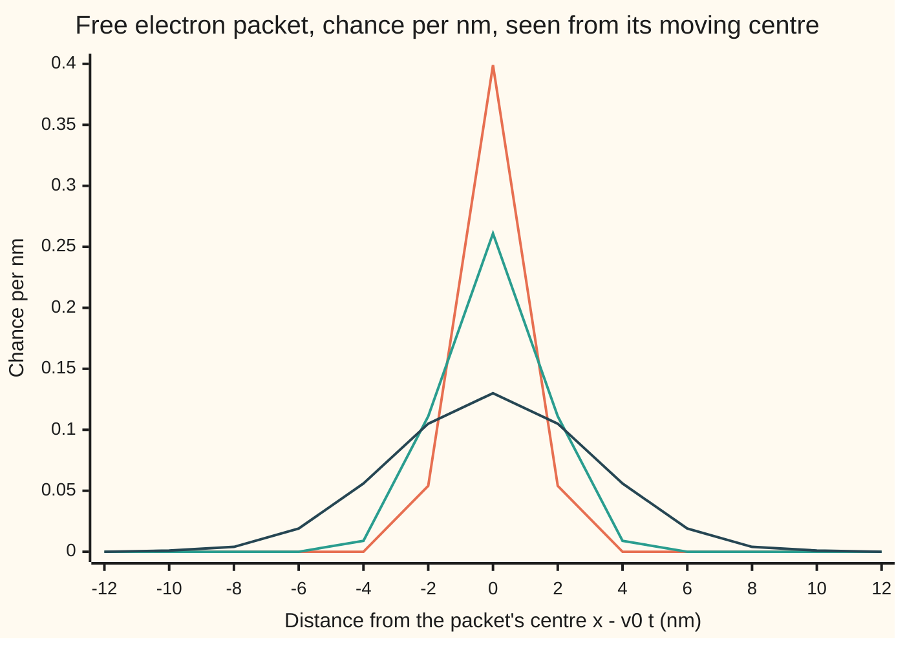
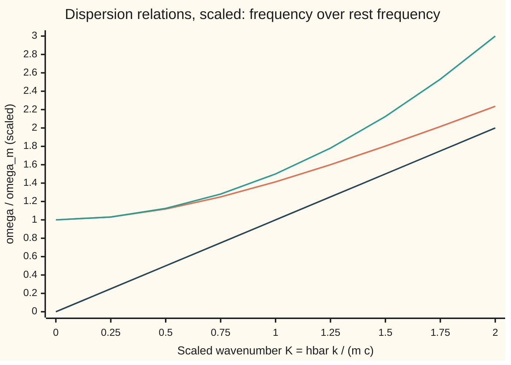
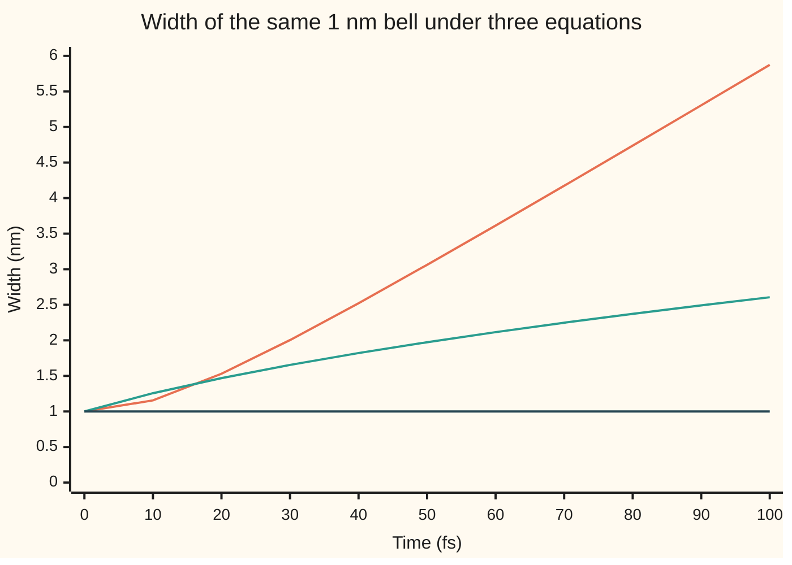

# Schrodinger and Klein-Gordon: spreading that never dies away

[Syllabus](../../../SYLLABUS.md) → [Partial differential equations](../README.md) → [Waves](../README.md#s05) → Schrodinger and Klein-Gordon

---

## General Overview

An electron gun fires one electron across a vacuum tube at 1,000 km/s (1 nm per femtosecond; a femtosecond, fs, is a millionth of a billionth of a second). At the start, the electron's position is known to within about 1 nm. Its kinetic energy is 2.84282 eV (electronvolts: the energy an electron gains across 1 volt).

Quantum mechanics describes it by a **wave packet**: a burst of ripples, 0.727390 nm apart, under a bell-shaped hump that says where the electron is likely to be. One picosecond (ps, 1,000 fs) later, the hump has moved 1,000 nm and is 57.8925 nm wide. Yet the chance of finding the electron somewhere is still exactly 1, and every ripple is still at full strength.

Heat in a rod spreads and fades. A pulse on a guitar string neither spreads nor fades. The free electron's equation spreads, in the end faster than heat, but loses nothing. Its relativistic cousin, the Klein-Gordon equation, does the same and also obeys the speed of light.

[Schrodinger's equation](../../13-Engineering%20mathematics/09-Quantum%20Mechanics%20in%20Outline/03-schrodinger-equation-and-the-particle-in-a-box.md) solved the equation in a box. This card takes the box away. The unknown is the wavefunction ψ(x, t), a complex number at each point x of an endless line and each time t. The data are its starting shape, the 1 nm packet.

**The free Schrödinger equation is the diffusion equation with an i in front of the diffusivity, so each ripple turns instead of shrinking: a packet spreads because its ripples move at different speeds, but its total stays fixed and the spreading can run backwards; Klein-Gordon adds the speed of light and becomes Schrödinger when the particle is slow.**

**What kind of fact this is:** the two equations are models, laws of physics accepted because they match measurement, not proved. Inside them, the spreading formula, the fixed total and both dispersion relations are theorems, proved on this card in Why it works for classical solutions (smooth in x and t) of finite total size.

### The picture: one packet at three times



Orange: the start, 1 nm wide, peak 0.399 per nm. Green: 20 fs later, 1.5298 nm wide. Dark blue: 50 fs later, 3.0621 nm wide, peak 0.130 per nm. The area under every curve is 1. Meanwhile the centre has moved 20 nm, then 50 nm, to the right; the chart follows it.

---

## The formula

Notation from earlier cards. ψ (psi) is the wavefunction and $`|\psi|^2`$ the chance per nm of finding the electron at x. ħ (h-bar) is Planck's constant over 2π. A subscript is a rate: $`\psi_t`$ in time, $`\psi_{xx}`$ the bending along x. A plane wave $`e^{i(kx-\omega t)}`$ has wavenumber k and frequency $`\omega(k)`$; its phase velocity is $`\omega/k`$ and its group velocity $`d\omega/dk`$ ([Dispersion](06-dispersion-group-velocity-and-kdv-in-outline.md)).

With no force (V = 0), Schrödinger's equation divided by iħ reads:

```math
\psi_t = i\,D\,\psi_{xx}, \qquad D = \frac{\hbar}{2m}, \qquad \sigma(t) = \sigma_0\sqrt{1 + (t/\tau)^2}, \qquad \tau = \frac{\sigma_0^2}{D}, \qquad \int_{-\infty}^{\infty} |\psi|^2\,dx = 1 \ \text{ at every } t .
```

**Read it aloud:** the wave changes at i times D times its bending; a bell-shaped packet of starting width sigma-nought grows to sigma-nought times the root of one plus t over tau squared; and the total chance stays one.

Delete the i and the first equation is diffusion, $`u_t = D u_{xx}`$. The Klein-Gordon equation is the wave equation with one extra term:

```math
\psi_{tt} = c^2\,\psi_{xx} - \omega_m^2\,\psi, \qquad \omega_m = \frac{mc^2}{\hbar}, \qquad \omega^2 = c^2k^2 + \omega_m^2 .
```

**Read it aloud:** the wave equation, minus the rest frequency squared times the wave; so a plane wave's frequency squared is c-k squared plus the rest frequency squared.

| Symbol | Plain meaning | In our example | Push it up and the answer… |
| --- | --- | --- | --- |
| $`\psi`$, $`\bar\psi`$, $`\lvert\psi\rvert^2`$ | wavefunction; its complex conjugate (i turned to −i); chance per nm | peak 0.399 per nm at the start | — |
| $`x`$, $`t`$ | position along the tube, nm; time, fs | 0 to 1,000 nm; 0 to 1,000 fs | — |
| $`\hbar`$, $`m`$, $`c`$ | reduced Planck constant; electron mass, as rest energy $`mc^2`$; light speed | 0.6582119569 eV fs; 510998.95069 eV; 299.792458 nm/fs | — |
| $`D`$ | $`\hbar/2m`$, a "diffusivity" in nm²/fs | 0.0578838 nm²/fs = 5.7883818e-05 m²/s | faster spreading |
| $`\sigma_0`$, $`\sigma(t)`$ | the packet's width: the standard deviation of $`\lvert\psi\rvert^2`$, nm | 1 nm; 57.8925 nm at 1 ps | wider start: slower spreading |
| $`\tau`$ | spreading time: the width has grown by √2 | 17.2760 fs | — |
| $`k`$, $`k_0`$, $`\lambda`$ | wavenumber, rad/nm; the packet's central one; wavelength $`2\pi/k`$ | 8.63799 rad/nm; 0.727390 nm | faster packet |
| $`\omega(k)`$, $`\omega_m`$ | frequency of a plane wave, rad/fs; rest frequency $`mc^2/\hbar`$ | 776344.07 rad/fs = 7.763441e+20 rad/s | — |
| $`v_0`$, $`\sigma_v`$ | group velocity $`2Dk_0`$; velocity spread $`D/\sigma_0`$ | 1 nm/fs; 57.8838 km/s | farther, wider |
| $`p`$, $`E`$, $`T`$, $`V`$ | momentum $`\hbar k`$; energy $`\hbar\omega`$; kinetic energy; potential energy, 0 here | T = 2.84282 eV; a microscope's 200 keV | — |
| $`u`$, $`j`$; $`A`$, $`a`$, $`b`$ | a heat or wave profile, for comparison; the chance current, per fs; in the proof fold, the trial packet's amplitude and its $`x^2`$ and $`x`$ coefficients | the same 1 nm bell; 0 far away; $`a(0) = 1/(4\sigma_0^2)`$, $`b(0) = ik_0`$ | — |
| $`i`$, $`K`$ | the square root of −1; scaled wavenumber $`\hbar k/(mc)`$ | K = 0 to 2 in the chart | — |

### When it holds

- **No force on the particle (V = 0).** A field or a wall changes the answer; the box is on [Schrodinger's equation](../../13-Engineering%20mathematics/09-Quantum%20Mechanics%20in%20Outline/03-schrodinger-equation-and-the-particle-in-a-box.md).
- **Slow compared with light.** Schrödinger's kinetic energy is Newton's. For a 200 keV electron microscope beam it puts the wavelength at 2.7424 pm (picometres, thousandths of a nm) instead of 2.5079 pm, 9.3% long. Klein-Gordon fixes this.
- **A finite total.** The fixed total and uniqueness need $`\psi`$ to fade at large |x|. A single plane wave is not a packet: its total is infinite.
- **No spin.** Klein-Gordon describes a particle without spin. For an electron its dispersion relation is right, but the full theory needs the Dirac equation.

---

## Why it works

### Step 0: the idea

A packet is a crowd of plane waves, ripples of one wavenumber each. Each of these equations does one simple thing to each ripple, set by its dispersion relation. Heat **shrinks** each ripple. The wave equation **slides** each ripple at one shared speed. Schrödinger **turns** each ripple, like a clock hand, at a rate that depends on k.

So two separate questions have two separate answers. Does the packet *spread*? Only if different ripples move at different speeds. Does it *fade*? Only if the ripples shrink. Schrödinger's answer is yes, then no.

### Step 1: the four dispersion relations

Put $`e^{i(kx-\omega t)}`$ into each equation: a time rate becomes $`-i\omega`$, a space rate $`ik`$.

| Equation | Dispersion relation | Each ripple | Group velocity |
| --- | --- | --- | --- |
| heat, $`u_t = Du_{xx}`$ | $`\omega = -iDk^2`$ | shrinks as $`e^{-Dk^2t}`$ | none: nothing travels |
| wave, $`u_{tt} = c^2u_{xx}`$ | $`\omega = \pm ck`$ | slides at c | c, the same for all |
| Schrödinger, $`\psi_t = iD\psi_{xx}`$ | $`\omega = Dk^2`$ | turns, size 1 | $`2Dk = \hbar k/m`$ |
| Klein-Gordon | $`\omega^2 = c^2k^2 + \omega_m^2`$ | turns, size 1 | $`c^2k/\omega`$, below c |

Schrödinger's ω is real, so each ripple keeps size 1. Its group velocity depends on k, so the ripples separate. At $`k_0`$ the group velocity $`2Dk_0`$ is 1 nm/fs, the electron's speed; the phase velocity is 0.5 nm/fs. For the packet's ripples, 0.727390 nm apart, heat would keep 0.01331 of their size after 1 fs. Schrödinger keeps 1.00000.

### Step 2: why the packet spreads, and how fast

A packet 1 nm wide cannot have one wavenumber. It is built from a spread of wavenumbers, and each moves at its own group velocity $`2Dk`$. The spread of speeds is $`\sigma_v = D/\sigma_0`$ = 57.8838 km/s. This is the uncertainty principle at work: the narrower the start, the wider the spread of speeds.

Start position and speed are independent, so their spreads add like independent errors, as squares:

```math
\sigma(t)^2 = \sigma_0^2 + (\sigma_v t)^2 = \sigma_0^2\Big(1 + (t/\tau)^2\Big) .
```

After the spreading time τ = 17.2760 fs the width grows in proportion to t, like runners fanning out. Diffusion is a random walk, so its width grows only like $`\sqrt{t}`$. The exact solution in the fold confirms the formula.

<details>
<summary>Detailed proof: the Gaussian packet solves the free equation exactly</summary>

Try $`\psi = A(t)\exp\big(-a(t)x^2 + b(t)x\big)`$. Then

$`\displaystyle \psi_t = \Big(\frac{A'}{A} - a'x^2 + b'x\Big)\psi, \qquad \psi_{xx} = \Big((b - 2ax)^2 - 2a\Big)\psi .`$

Set $`\psi_t = iD\psi_{xx}`$ and match the powers of x. The $`x^2`$ terms give $`a' = -4iDa^2`$, the $`x`$ terms give $`b' = -4iDab`$, and the constant terms give $`A'/A = iD(b^2 - 2a)`$. With $`a(0) = 1/(4\sigma_0^2)`$ and $`b(0) = ik_0`$, the solutions are

$`\displaystyle a = \frac{a(0)}{1 + it/\tau}, \qquad b = \frac{ik_0}{1 + it/\tau}, \qquad \tau = \frac{\sigma_0^2}{D},`$

and the constant terms fix $`A`$ up to a phase. The result is

$`\displaystyle \psi(x,t) = \frac{(2\pi\sigma_0^2)^{-1/4}}{\sqrt{1 + it/\tau}}\,\exp\!\Big(\frac{-x^2/(4\sigma_0^2) + ik_0x - iDk_0^2t}{1 + it/\tau}\Big).`$

The real part of $`a`$ is $`a(0)/(1 + (t/\tau)^2)`$. So $`|\psi|^2`$ is a bell centred at $`2Dk_0t = v_0t`$, of width $`\sigma_0\sqrt{1 + (t/\tau)^2}`$. Replace iD by D and the same steps give heat's solution, of width $`\sigma_0\sqrt{1 + t/\tau}`$.

</details>

The general free solution is a sum of such plane waves, built by the Fourier transform; that method is [Solving differential equations by transform](../../20-Harmonic%20analysis/03-Convolution%20and%20Approximate%20Identities/09-fourier-methods-for-differential-equations.md), in the harmonic-analysis wing. This card stays with the closed form.

### Step 3: why nothing fades, by the energy method

Multiply the equation by $`\bar\psi`$, the complex conjugate (flip the sign of i), and add the conjugate of the result. The product rule gives

```math
\big(|\psi|^2\big)_t + j_x = 0, \qquad j = 2D\,\mathrm{Im}\big(\bar\psi\,\psi_x\big) .
```

Here j is the **chance current**, the chance flowing past x per fs, and Im takes the imaginary part. Integrate over the line: j is 0 far away, so the total never changes.

Do the same to heat with a real profile u:

```math
\frac{d}{dt}\int u^2\,dx = -2D\int u_x^2\,dx \;\le\; 0 .
```

The i turned a loss term into a pure flow. For heat's bell at t = τ the loss rate is −0.010233 per fs, from the closed form, from the right side, and measured: three roads, one number.

Uniqueness follows in one line, as in [Energy methods](../01-Classification%20and%20Well-Posedness/07-energy-methods-and-uniqueness.md). Two solutions with the same start differ by a solution with total 0, which stays 0. So the Gaussian packet is the only finite-total solution with this start.

The calculation works just as well with t reversed, so spreading can be undone: a packet with the right twist in its phase focuses as it travels. Heat cannot run backwards ([Two evolutions](../../18-Functional%20analysis/05-Unbounded%20Operators%20and%20Semigroups/09-the-heat-and-schrodinger-semigroups.md)).

### Step 4: Klein-Gordon, the relativistic version

Put the plane wave into Klein-Gordon: $`-\omega^2 = -c^2k^2 - \omega_m^2`$. Multiply by ħ² and this is special relativity's $`E^2 = (pc)^2 + (mc^2)^2`$, with $`E = \hbar\omega`$ and $`p = \hbar k`$.

- **Group velocity** $`c^2k/\omega = pc^2/E`$ is the relativistic speed, always below c: 0.999994 nm/fs for our electron.
- **Phase velocity** $`\omega/k`$ is always above c, and phase times group is exactly $`c^2`$. The phase carries no signal.
- **Slow particles.** For small k, $`\omega \approx \omega_m + c^2k^2/(2\omega_m) = \omega_m + Dk^2`$: Schrödinger's relation plus a constant that turns every ripple together.

At $`k_0`$, $`\omega - \omega_m`$ is 4.3189844 rad/fs by Klein-Gordon and 4.3189964 rad/fs by Schrödinger. The gap, 2.782 ppm (parts per million), is $`(v/c)^2/4`$, the next term of the expansion.



Orange: Klein-Gordon. Green: Schrödinger plus the rest frequency. Dark blue: light, ω = ck. Orange and green agree for small K and part as K nears 1; orange bends towards the light line.

Klein-Gordon keeps the wave equation's speed limit, by the argument of [Wave energy is conserved, and nothing outruns the wave speed](02-energy-and-finite-speed.md). Schrödinger has none: like diffusion, its Gaussian is nonzero everywhere at once ([Diffusion smooths instantly, and is felt everywhere at once](../03-The%20Heat%20Equation%20in%20Depth/05-smoothing-and-infinite-speed.md)).

| | Heat | Schrödinger | Wave | Klein-Gordon |
| --- | --- | --- | --- | --- |
| Felt everywhere at once | yes | yes | no, speed c | no, speed c |
| Packet spreads | yes, like $`\sqrt{t}`$ | yes, like t | no | yes |
| Ripples fade | yes | no | no | no |
| Runs backwards | no | yes | yes | yes |

---

## Worked numbers, by hand

The electron: $`\sigma_0`$ = 1 nm, $`v_0`$ = 1 nm/fs. Constants: ħ = 0.6582119569 eV fs, $`mc^2`$ = 510998.95069 eV, c = 299.792458 nm/fs.

| Step | Arithmetic | Value |
| --- | --- | --- |
| diffusivity D | $`\hbar c^2/(2mc^2) = 0.6582119569 \times 299.792458^2 / (2 \times 510998.95069)`$ | 0.0578838 nm²/fs |
| central wavenumber | $`k_0 = v_0/(2D) = 1/(2 \times 0.0578838)`$ | 8.63799 rad/nm |
| ripple spacing | $`2\pi/8.63799`$ | 0.727390 nm |
| spreading time | $`\tau = \sigma_0^2/D = 1/0.0578838`$ | 17.2760 fs |
| speed spread | $`\sigma_v = D/\sigma_0`$ | 57.8838 km/s |
| at 1 ps | $`t/\tau = 1000/17.2760`$ | 57.8838 |
| width | $`1 \times \sqrt{1 + 57.8838^2}`$ | **57.8925 nm** |
| centre | $`v_0 t = 1 \times 1000`$ | 1,000 nm |
| total chance | Simpson's rule on the closed form | 1.000000000 |

After one picosecond the electron is 1 µm down the tube, and its position is uncertain over 57.8925 nm, almost 58 times the start. Nothing was lost: the chance of finding it somewhere is still 1.

### What breaks if you drop a piece

| Mistake | Comes out at | What went wrong |
| --- | --- | --- |
| Spread the packet by diffusion's square-root law | 7.6736 nm at 1 ps, not 57.8925 nm | the spread comes from a spread of speeds, so it grows like t |
| Move the packet at the phase velocity | centre at 500 nm after 1 ps, not 1,000 nm | a packet moves at the group velocity, $`2Dk_0`$ |
| Use Schrödinger for a 200 keV microscope electron | wavelength 2.7424 pm, not 2.5079 pm; speed 0.8847 c, not 0.6953 c | the "slow" hypothesis fails; use Klein-Gordon's relation |
| Take Klein-Gordon's phase velocity as the speed | 8.9876e+10 m/s, faster than light, not 999994 m/s | the speed is the group velocity, $`c^2k/\omega`$ |

---

## How it moves

The puzzle: heat starts spreading faster than the electron's packet, yet the packet ends up far wider. The chart follows the same 1 nm bell under three laws. For heat, width means the same measure as for ψ: the standard deviation of $`u^2`$, so all three widths start at 1 nm.

Before τ, heat is ahead, because the packet's speed spread needs time to act. At τ = 17.2760 fs both widths are √2 nm = 1.4142 nm. After that the packet pulls away. Meanwhile heat's size $`\int u^2\,dx`$ falls, to 0.7071 at τ and 0.1303 at 1 ps, while the electron's total stays 1.000000000.



Orange: Schrödinger, flat at first, then a straight line. Green: heat, quick at first, then slowing like $`\sqrt{t}`$. Dark blue: a pulse sent one way on the wave equation, flat at 1 nm.

---

## Code, from first principles, and it actually runs

The code builds the packet from its closed form, with complex numbers (a small struct in Rust), and checks it by six roads:

1. **The width formula**, $`\sigma_0\sqrt{1 + (t/\tau)^2}`$.
2. **Measured** width, centre and total chance of the closed-form packet, by Simpson's rule (a weighted sum of samples).
3. **The equation's residual** by centred differences; it falls by 4.00 when the step halves, as it should.
4. **A sum of plane waves**, each turning by $`\omega = Dk^2`$, at 50 fs and 1,000 fs, cut off where a wave's weight has fallen to $`e^{-49}`$ = 5.2e-22 of the peak.
5. **The energy method**: heat's loss rate three ways; the electron's total-chance rate below $`10^{-9}`$ per fs.
6. **Klein-Gordon's group velocity** by formula, by centred differences, and as $`pc^2/E`$.

### Python

```python
# Schrodinger and Klein-Gordon: a free electron packet, 1 nm wide, moving at 1e6 m/s.
# Roads: the closed-form Gaussian; its width and total chance measured by Simpson's rule;
# the equation's residual by centred differences; a sum of plane waves; the energy method;
# Klein-Gordon's dispersion relation by formula and by centred differences.
from math import pi, sqrt, exp
from cmath import exp as cexp, sqrt as csqrt
HBAR = 0.6582119569                    # reduced Planck constant, eV fs
MC2 = 510998.95069                     # electron rest energy, eV
MPC2 = 938272089.43                    # proton rest energy, eV
C = 299.792458                         # speed of light, nm/fs
D = HBAR * C * C / (2 * MC2)           # hbar / 2m, nm^2/fs
S0, V0 = 1.0, 1.0                      # starting width, nm; group velocity, nm/fs (1e6 m/s)
K0 = V0 / (2 * D)                      # wavenumber, rad/nm
TAU = S0 * S0 / D                      # spreading time, fs
def packet(x, t, d, k0=K0, s0=S0):     # Gaussian start; d = iD gives Schrodinger, d = D gives heat
    z = 1 + d * t / (s0 * s0)
    return (2 * pi * s0 * s0) ** -0.25 / csqrt(z) * cexp((-x * x / (4 * s0 * s0) + 1j * k0 * x - d * k0 * k0 * t) / z)
def simpson(f, a, b, n=2000):
    h = (b - a) / n
    return h / 3 * sum((1 if i in (0, n) else 4 if i % 2 else 2) * f(a + i * h) for i in range(n + 1))
def moments(f, centre, half):          # total of |f|^2, its mean and its width (standard deviation)
    w = lambda x: abs(f(x)) ** 2
    n0 = simpson(w, centre - half, centre + half)
    m1 = simpson(lambda x: x * w(x), centre - half, centre + half) / n0
    m2 = simpson(lambda x: (x - m1) ** 2 * w(x), centre - half, centre + half) / n0
    return n0, m1, sqrt(m2)
width = lambda t, s0=S0, d=D: s0 * sqrt(1 + (d * t / (s0 * s0)) ** 2)
print(f"constants: hbar = {HBAR:.10f} eV fs, m c^2 = {MC2:.5f} eV, c = {C:.6f} nm/fs")
print(f"D = hbar/2m = {D:.7f} nm^2/fs = {D * 1e-3:.7e} m^2/s")
print(f"packet: width {S0:.1f} nm, speed {V0:.1f} nm/fs, k0 = {K0:.5f} rad/nm, wavelength {2 * pi / K0:.6f} nm, "
      f"energy {0.5 * MC2 * (V0 / C) ** 2:.5f} eV")
print(f"tau = width^2/D = {TAU:.4f} fs; velocity spread D/width = {D / S0 * 1e3:.4f} km/s")
print("t fs | Schrodinger width nm: formula, measured | total chance | centre nm | heat width nm | heat size | wave width nm")
rows = {}
for t in sorted([10.0 * j for j in range(11)] + [TAU, 1000.0]):
    span = 12 * S0 * (1 + t / TAU)
    ns, ms, ws = moments(lambda x: packet(x, t, 1j * D), V0 * t, span)
    nh, _, wh = moments(lambda x: packet(x, t, D, 0.0), 0.0, span)
    _, _, ww = moments(lambda x: packet(x - C * t, 0, D), C * t, 12 * S0)
    rows[t] = (ws, ns, wh, nh)
    print(f"{t:8.3f} | {width(t):9.4f} {ws:9.4f} | {ns:.9f} | {ms:8.3f} | {wh:7.4f} | {nh:.4f} | {ww:.4f}")
    assert abs(ws - width(t)) < 1e-6 * width(t) and abs(ns - 1) < 1e-9, "width and total chance must match"
    assert abs(wh - S0 * sqrt(1 + t / TAU)) < 1e-6 * wh and abs(nh - (1 + t / TAU) ** -0.5) < 1e-8, "heat"
print(f"at 1 ps: t/tau = {1000 / TAU:.4f}, velocity spread x time = {D / S0 * 1000:.4f} nm")
dens = lambda y, t: abs(packet(y + V0 * t, t, 1j * D)) ** 2
for t in (0.0, 20.0, 50.0):
    print(f"profile at {t:4.1f} fs, chance per nm at x - v0 t = -12..12 nm: "
          + ", ".join(f"{dens(y, t):.3f}" for y in range(-12, 13, 2)))
xr, tr = V0 * 50 + 1.0, 50.0
res = []
for h in (0.01, 0.005):
    pt = (packet(xr, tr + h, 1j * D) - packet(xr, tr - h, 1j * D)) / (2 * h)
    pxx = (packet(xr + h, tr, 1j * D) - 2 * packet(xr, tr, 1j * D) + packet(xr - h, tr, 1j * D)) / (h * h)
    res.append(abs(pt - 1j * D * pxx) / abs(pt))
print(f"residual |psi_t - i D psi_xx| / |psi_t| at steps 0.01, 0.005: {res[0]:.3e}, {res[1]:.3e}, ratio {res[0] / res[1]:.2f}")
assert 3.5 < res[0] / res[1] < 4.5 and res[1] < 1e-3, "the residual is step error, falling as h^2"
def plane_waves(x, t, n):               # (1/2pi) * integral of phi(k) e^{i(kx - D k^2 t)} dk
    amp = (2 * pi * S0 * S0) ** -0.25 * sqrt(4 * pi) * S0 / (2 * pi)
    f = lambda k: amp * exp(-(S0 * (k - K0)) ** 2) * cexp(1j * (k * x - D * k * k * t))
    return simpson(f, K0 - 7 / S0, K0 + 7 / S0, n)
for t, n in ((50.0, 4000), (1000.0, 80000)):
    x = V0 * t + width(t)
    a, b = packet(x, t, 1j * D), plane_waves(x, t, n)
    print(f"psi at centre + width, {t:.0f} fs: closed form {a.real:+.6f} {a.imag:+.6f}i, plane waves {b.real:+.6f} {b.imag:+.6f}i")
    assert abs(a - b) < 1e-6 * abs(a), "plane-wave sum must equal the closed form"
print(f"plane-wave sum cut at k0 +/- 7/width: first omitted weight exp(-49) = {exp(-49):.1e} of the peak")
dt = 0.01
rate = lambda t: (moments(lambda x: packet(x, t + dt, D, 0.0), 0, 30)[0] - moments(lambda x: packet(x, t - dt, D, 0.0), 0, 30)[0]) / (2 * dt)
ux2 = simpson(lambda x: abs((packet(x + 1e-4, TAU, D, 0.0) - packet(x - 1e-4, TAU, D, 0.0)) / 2e-4) ** 2, -30, 30)
srate = (moments(lambda x: packet(x, 50 + dt, 1j * D), 50 + dt, 40)[0] - moments(lambda x: packet(x, 50 - dt, 1j * D), 50 - dt, 40)[0]) / (2 * dt)
print(f"heat size rate at tau: {rate(TAU):.6f} /fs measured, {-2 * D * ux2:.6f} /fs from -2D * integral |u_x|^2, "
      f"{-0.5 / TAU * 2 ** -1.5:.6f} /fs exact")
print(f"Schrodinger total-chance rate at 50 fs: {'below' if abs(srate) < 1e-9 else 'above'} 1e-9 /fs")
assert abs(rate(TAU) + 2 * D * ux2) < 1e-5 * abs(rate(TAU)) and abs(srate) < 1e-9, "energy method"
print(f"mode at k0 after 1 fs: heat keeps {exp(-D * K0 * K0):.5f} of it, Schrodinger keeps {abs(cexp(-1j * D * K0 * K0)):.5f}")
WM = MC2 / HBAR                         # rest frequency m c^2 / hbar, rad/fs
excess = lambda k: (C * k) ** 2 / (sqrt((C * k) ** 2 + WM * WM) + WM)   # omega - omega_m, stable form
print(f"Klein-Gordon rest frequency m c^2/hbar = {WM:.2f} rad/fs = {WM * 1e15:.6e} rad/s")
ex, es = excess(K0), D * K0 * K0
print(f"at k0: omega - rest = {ex:.7f} rad/fs (Klein-Gordon), D k0^2 = {es:.7f} rad/fs (Schrodinger), "
      f"gap {(es - ex) / es * 1e6:.3f} ppm, (v/c)^2/4 = {(V0 / C) ** 2 / 4 * 1e6:.3f} ppm")
om = WM + ex
vg_f, h = C * C * K0 / om, 1e-3
vg_d = (excess(K0 + h) - excess(K0 - h)) / (2 * h)
pc = HBAR * C * K0
vg_r = C * pc / sqrt(pc * pc + MC2 * MC2)
print(f"group velocity, nm/fs: Schrodinger 2 D k0 = {2 * D * K0:.6f}; Klein-Gordon c^2 k/omega = {vg_f:.6f}, "
      f"centred difference {vg_d:.6f}, p c^2/E = {vg_r:.6f}")
print(f"phase velocity, nm/fs: Schrodinger D k0 = {D * K0:.6f}; Klein-Gordon omega/k = {om / K0:.3f}; "
      f"phase x group = {om / K0 * vg_f:.3f} = c^2 = {C * C:.3f}")
assert abs(vg_f - vg_d) < 1e-6 and abs(vg_f - vg_r) < 1e-12 and abs((es - ex) / es - (V0 / C) ** 2 / 4) < 1e-3 * (V0 / C) ** 2
KS = [0.25 * j for j in range(9)]
print("dispersion, scaled K = hbar k/(m c), omega/omega_m:")
print("  Klein-Gordon: " + ", ".join(f"{sqrt(1 + q * q):.3f}" for q in KS))
print("  Schrodinger + rest: " + ", ".join(f"{1 + q * q / 2:.3f}" for q in KS))
print("  light: " + ", ".join(f"{q:.3f}" for q in KS))
T = 200000.0                            # microscope electron, kinetic energy in eV
pcr, pcs = sqrt(T * T + 2 * T * MC2), sqrt(2 * T * MC2)
lr, ls = 2 * pi * HBAR * C / pcr * 1e3, 2 * pi * HBAR * C / pcs * 1e3
print(f"200 keV electron: wavelength {lr:.4f} pm (Klein-Gordon), {ls:.4f} pm (Schrodinger), {(ls / lr - 1) * 100:.1f}% long; "
      f"speed {pcr / (T + MC2):.4f} c against {sqrt(2 * T / MC2):.4f} c")
assert abs(lr - 2.5079) < 1e-3 and ls > lr, "relativistic wavelength"
w1k = rows[1000.0]
print(f"wrong: diffusion's square-root law at 1 ps gives {w1k[2]:.4f} nm, not {w1k[0]:.4f} nm")
print(f"wrong: packet moved at phase velocity: centre at {D * K0 * 1000:.0f} nm after 1 ps, not {V0 * 1000:.0f} nm")
print(f"wrong: Klein-Gordon phase velocity as the speed: {om / K0 * 1e6:.4e} m/s, not {vg_f * 1e6:.0f} m/s")
dp = HBAR * C * C / (2 * MPC2)
print(f"try: width 2 nm: tau {4 / D:.2f} fs, width at 1 ps {width(1000, 2.0):.2f} nm; proton: tau {1 / dp:.0f} fs, "
      f"width at 1 ps {width(1000, 1.0, dp):.6f} nm")
_, _, wback = moments(lambda x: packet(x, -1000.0, 1j * D), -V0 * 1000, 12 * S0 * (1 + 1000 / TAU))
print(f"try: run back to t = -1 ps: width {wback:.4f} nm, so a packet started like that focuses to 1 nm at t = 0")
assert abs(wback - width(1000)) < 1e-6 * wback and w1k[0] > 3 * w1k[2], "reversibility; spreading beats diffusion"
print("ALL CHECKS PASS")
```

**Ran 2026-11-15 on macOS, Python 3.14.10, standard library only. All checks passed. Output, pasted from the run:**

```
constants: hbar = 0.6582119569 eV fs, m c^2 = 510998.95069 eV, c = 299.792458 nm/fs
D = hbar/2m = 0.0578838 nm^2/fs = 5.7883818e-05 m^2/s
packet: width 1.0 nm, speed 1.0 nm/fs, k0 = 8.63799 rad/nm, wavelength 0.727390 nm, energy 2.84282 eV
tau = width^2/D = 17.2760 fs; velocity spread D/width = 57.8838 km/s
t fs | Schrodinger width nm: formula, measured | total chance | centre nm | heat width nm | heat size | wave width nm
   0.000 |    1.0000    1.0000 | 1.000000000 |    0.000 |  1.0000 | 1.0000 | 1.0000
  10.000 |    1.1554    1.1554 | 1.000000000 |   10.000 |  1.2565 | 0.7958 | 1.0000
  17.276 |    1.4142    1.4142 | 1.000000000 |   17.276 |  1.4142 | 0.7071 | 1.0000
  20.000 |    1.5298    1.5298 | 1.000000000 |   20.000 |  1.4689 | 0.6808 | 1.0000
  30.000 |    2.0039    2.0039 | 1.000000000 |   30.000 |  1.6542 | 0.6045 | 1.0000
  40.000 |    2.5221    2.5221 | 1.000000000 |   40.000 |  1.8208 | 0.5492 | 1.0000
  50.000 |    3.0621    3.0621 | 1.000000000 |   50.000 |  1.9734 | 0.5067 | 1.0000
  60.000 |    3.6141    3.6141 | 1.000000000 |   60.000 |  2.1150 | 0.4728 | 1.0000
  70.000 |    4.1734    4.1734 | 1.000000000 |   70.000 |  2.2476 | 0.4449 | 1.0000
  80.000 |    4.7375    4.7375 | 1.000000000 |   80.000 |  2.3729 | 0.4214 | 1.0000
  90.000 |    5.3047    5.3047 | 1.000000000 |   90.000 |  2.4919 | 0.4013 | 1.0000
 100.000 |    5.8741    5.8741 | 1.000000000 |  100.000 |  2.6055 | 0.3838 | 1.0000
1000.000 |   57.8925   57.8925 | 1.000000000 | 1000.000 |  7.6736 | 0.1303 | 1.0000
at 1 ps: t/tau = 57.8838, velocity spread x time = 57.8838 nm
profile at  0.0 fs, chance per nm at x - v0 t = -12..12 nm: 0.000, 0.000, 0.000, 0.000, 0.000, 0.054, 0.399, 0.054, 0.000, 0.000, 0.000, 0.000, 0.000
profile at 20.0 fs, chance per nm at x - v0 t = -12..12 nm: 0.000, 0.000, 0.000, 0.000, 0.009, 0.111, 0.261, 0.111, 0.009, 0.000, 0.000, 0.000, 0.000
profile at 50.0 fs, chance per nm at x - v0 t = -12..12 nm: 0.000, 0.001, 0.004, 0.019, 0.056, 0.105, 0.130, 0.105, 0.056, 0.019, 0.004, 0.001, 0.000
residual |psi_t - i D psi_xx| / |psi_t| at steps 0.01, 0.005: 3.095e-04, 7.737e-05, ratio 4.00
psi at centre + width, 50 fs: closed form -0.231705 -0.159168i, plane waves -0.231705 -0.159168i
psi at centre + width, 1000 fs: closed form +0.035166 +0.054250i, plane waves +0.035166 +0.054250i
plane-wave sum cut at k0 +/- 7/width: first omitted weight exp(-49) = 5.2e-22 of the peak
heat size rate at tau: -0.010233 /fs measured, -0.010233 /fs from -2D * integral |u_x|^2, -0.010233 /fs exact
Schrodinger total-chance rate at 50 fs: below 1e-9 /fs
mode at k0 after 1 fs: heat keeps 0.01331 of it, Schrodinger keeps 1.00000
Klein-Gordon rest frequency m c^2/hbar = 776344.07 rad/fs = 7.763441e+20 rad/s
at k0: omega - rest = 4.3189844 rad/fs (Klein-Gordon), D k0^2 = 4.3189964 rad/fs (Schrodinger), gap 2.782 ppm, (v/c)^2/4 = 2.782 ppm
group velocity, nm/fs: Schrodinger 2 D k0 = 1.000000; Klein-Gordon c^2 k/omega = 0.999994, centred difference 0.999994, p c^2/E = 0.999994
phase velocity, nm/fs: Schrodinger D k0 = 0.500000; Klein-Gordon omega/k = 89876.018; phase x group = 89875.518 = c^2 = 89875.518
dispersion, scaled K = hbar k/(m c), omega/omega_m:
  Klein-Gordon: 1.000, 1.031, 1.118, 1.250, 1.414, 1.601, 1.803, 2.016, 2.236
  Schrodinger + rest: 1.000, 1.031, 1.125, 1.281, 1.500, 1.781, 2.125, 2.531, 3.000
  light: 0.000, 0.250, 0.500, 0.750, 1.000, 1.250, 1.500, 1.750, 2.000
200 keV electron: wavelength 2.5079 pm (Klein-Gordon), 2.7424 pm (Schrodinger), 9.3% long; speed 0.6953 c against 0.8847 c
wrong: diffusion's square-root law at 1 ps gives 7.6736 nm, not 57.8925 nm
wrong: packet moved at phase velocity: centre at 500 nm after 1 ps, not 1000 nm
wrong: Klein-Gordon phase velocity as the speed: 8.9876e+10 m/s, not 999994 m/s
try: width 2 nm: tau 69.10 fs, width at 1 ps 29.01 nm; proton: tau 31721 fs, width at 1 ps 1.000497 nm
try: run back to t = -1 ps: width 57.8925 nm, so a packet started like that focuses to 1 nm at t = 0
ALL CHECKS PASS
```

### Rust

```rust
// Schrodinger and Klein-Gordon: a free electron packet, 1 nm wide, moving at 1e6 m/s.
// Roads: the closed-form Gaussian; its width and total chance measured by Simpson's rule;
// the equation's residual by centred differences; a sum of plane waves; the energy method;
// Klein-Gordon's dispersion relation by formula and by centred differences.
use std::f64::consts::PI;
use std::ops::{Add, Div, Mul, Sub};
#[derive(Clone, Copy)]
struct Cx { re: f64, im: f64 }
impl Add for Cx { type Output = Cx; fn add(self, o: Cx) -> Cx { Cx { re: self.re + o.re, im: self.im + o.im } } }
impl Sub for Cx { type Output = Cx; fn sub(self, o: Cx) -> Cx { Cx { re: self.re - o.re, im: self.im - o.im } } }
impl Mul for Cx {
    type Output = Cx;
    fn mul(self, o: Cx) -> Cx { Cx { re: self.re * o.re - self.im * o.im, im: self.re * o.im + self.im * o.re } }
}
impl Div for Cx {
    type Output = Cx;
    fn div(self, o: Cx) -> Cx {
        let d = o.re * o.re + o.im * o.im;
        Cx { re: (self.re * o.re + self.im * o.im) / d, im: (self.im * o.re - self.re * o.im) / d }
    }
}
fn cx(re: f64, im: f64) -> Cx { Cx { re, im } }
fn cabs(z: Cx) -> f64 { z.re.hypot(z.im) }
fn cexp(z: Cx) -> Cx { let r = z.re.exp(); cx(r * z.im.cos(), r * z.im.sin()) }
fn csqrt(z: Cx) -> Cx { // principal root
    let r = cabs(z);
    let a = ((r + z.re) / 2.0).sqrt();
    let b = ((r - z.re) / 2.0).sqrt();
    cx(a, if z.im < 0.0 { -b } else { b })
}
const HBAR: f64 = 0.6582119569; // reduced Planck constant, eV fs
const MC2: f64 = 510998.95069; // electron rest energy, eV
const MPC2: f64 = 938272089.43; // proton rest energy, eV
const C: f64 = 299.792458; // speed of light, nm/fs
const S0: f64 = 1.0;
const V0: f64 = 1.0; // starting width, nm; group velocity, nm/fs
fn dd() -> f64 { HBAR * C * C / (2.0 * MC2) } // hbar / 2m, nm^2/fs
fn k0() -> f64 { V0 / (2.0 * dd()) }
fn tau() -> f64 { S0 * S0 / dd() }
// Gaussian start; d = iD gives Schrodinger, d = D (im = 0) gives heat
fn packet(x: f64, t: f64, d: Cx, k0: f64, s0: f64) -> Cx {
    let z = cx(1.0, 0.0) + d * cx(t / (s0 * s0), 0.0);
    let e = cx(-x * x / (4.0 * s0 * s0), k0 * x) - d * cx(k0 * k0 * t, 0.0);
    cx((2.0 * PI * s0 * s0).powf(-0.25), 0.0) / csqrt(z) * cexp(e / z)
}
fn schr(x: f64, t: f64) -> Cx { packet(x, t, cx(0.0, dd()), k0(), S0) }
fn heat(x: f64, t: f64) -> Cx { packet(x, t, cx(dd(), 0.0), 0.0, S0) }
fn simpson<F: Fn(f64) -> f64>(f: F, a: f64, b: f64, n: usize) -> f64 {
    let h = (b - a) / n as f64;
    let mut s = 0.0;
    for i in 0..=n { let w = if i == 0 || i == n { 1.0 } else if i % 2 == 1 { 4.0 } else { 2.0 }; s += w * f(a + i as f64 * h); }
    h / 3.0 * s
}
fn csimpson<F: Fn(f64) -> Cx>(f: F, a: f64, b: f64, n: usize) -> Cx {
    let h = (b - a) / n as f64;
    let mut s = cx(0.0, 0.0);
    for i in 0..=n { let w = if i == 0 || i == n { 1.0 } else if i % 2 == 1 { 4.0 } else { 2.0 }; s = s + cx(w, 0.0) * f(a + i as f64 * h); }
    s * cx(h / 3.0, 0.0)
}
fn moments<F: Fn(f64) -> Cx>(f: F, centre: f64, half: f64) -> (f64, f64, f64) {
    let w = |x: f64| cabs(f(x)).powi(2);
    let (a, b) = (centre - half, centre + half);
    let n0 = simpson(&w, a, b, 2000);
    let m1 = simpson(|x| x * w(x), a, b, 2000) / n0;
    let m2 = simpson(|x| (x - m1).powi(2) * w(x), a, b, 2000) / n0;
    (n0, m1, m2.sqrt())
}
fn width(t: f64, s0: f64, d: f64) -> f64 { s0 * (1.0 + (d * t / (s0 * s0)).powi(2)).sqrt() }
fn sci(x: f64, p: usize) -> String { // Python-style e-notation: 5.7883818e-05
    let s = format!("{:.*e}", p, x);
    let (m, e) = s.split_once('e').unwrap();
    let e: i32 = e.parse().unwrap();
    format!("{}e{}{:02}", m, if e < 0 { '-' } else { '+' }, e.abs())
}
fn main() {
    let (d, k, tu) = (dd(), k0(), tau());
    println!("constants: hbar = {:.10} eV fs, m c^2 = {:.5} eV, c = {:.6} nm/fs", HBAR, MC2, C);
    println!("D = hbar/2m = {:.7} nm^2/fs = {} m^2/s", d, sci(d * 1e-3, 7));
    println!("packet: width {:.1} nm, speed {:.1} nm/fs, k0 = {:.5} rad/nm, wavelength {:.6} nm, energy {:.5} eV",
             S0, V0, k, 2.0 * PI / k, 0.5 * MC2 * (V0 / C).powi(2));
    println!("tau = width^2/D = {:.4} fs; velocity spread D/width = {:.4} km/s", tu, d / S0 * 1e3);
    println!("t fs | Schrodinger width nm: formula, measured | total chance | centre nm | heat width nm | heat size | wave width nm");
    let mut times: Vec<f64> = (0..11).map(|j| 10.0 * j as f64).collect();
    times.push(tu); times.push(1000.0);
    times.sort_by(|a, b| a.partial_cmp(b).unwrap());
    let mut w1k = (0.0, 0.0);
    for &t in &times {
        let span = 12.0 * S0 * (1.0 + t / tu);
        let (ns, ms, ws) = moments(|x| schr(x, t), V0 * t, span);
        let (nh, _, wh) = moments(|x| heat(x, t), 0.0, span);
        let (_, _, ww) = moments(|x| packet(x - C * t, 0.0, cx(d, 0.0), k, S0), C * t, 12.0 * S0);
        if t == 1000.0 { w1k = (ws, wh); }
        println!("{:8.3} | {:9.4} {:9.4} | {:.9} | {:8.3} | {:7.4} | {:.4} | {:.4}", t, width(t, S0, d), ws, ns, ms, wh, nh, ww);
        assert!((ws - width(t, S0, d)).abs() < 1e-6 * width(t, S0, d) && (ns - 1.0).abs() < 1e-9, "width and total chance");
        assert!((wh - S0 * (1.0 + t / tu).sqrt()).abs() < 1e-6 * wh && (nh - (1.0 + t / tu).powf(-0.5)).abs() < 1e-8, "heat");
    }
    println!("at 1 ps: t/tau = {:.4}, velocity spread x time = {:.4} nm", 1000.0 / tu, d / S0 * 1000.0);
    for t in [0.0, 20.0, 50.0] {
        let v: Vec<String> = (-6..=6).map(|j| format!("{:.3}", cabs(schr(2.0 * j as f64 + V0 * t, t)).powi(2))).collect();
        println!("profile at {:4.1} fs, chance per nm at x - v0 t = -12..12 nm: {}", t, v.join(", "));
    }
    let (xr, tr) = (V0 * 50.0 + 1.0, 50.0);
    let mut res = vec![];
    for h in [0.01, 0.005] {
        let pt = (schr(xr, tr + h) - schr(xr, tr - h)) / cx(2.0 * h, 0.0);
        let pxx = (schr(xr + h, tr) - schr(xr, tr) * cx(2.0, 0.0) + schr(xr - h, tr)) / cx(h * h, 0.0);
        res.push(cabs(pt - cx(0.0, d) * pxx) / cabs(pt));
    }
    println!("residual |psi_t - i D psi_xx| / |psi_t| at steps 0.01, 0.005: {}, {}, ratio {:.2}", sci(res[0], 3), sci(res[1], 3), res[0] / res[1]);
    assert!(3.5 < res[0] / res[1] && res[0] / res[1] < 4.5 && res[1] < 1e-3, "the residual is step error, falling as h^2");
    let amp = (2.0 * PI * S0 * S0).powf(-0.25) * (4.0 * PI).sqrt() * S0 / (2.0 * PI);
    for (t, n) in [(50.0, 4000), (1000.0, 80000)] {
        let x = V0 * t + width(t, S0, d);
        let a = schr(x, t);
        let b = csimpson(|q| cx(amp * (-(S0 * (q - k)).powi(2)).exp(), 0.0) * cexp(cx(0.0, q * x - d * q * q * t)), k - 7.0 / S0, k + 7.0 / S0, n);
        println!("psi at centre + width, {:.0} fs: closed form {:+.6} {:+.6}i, plane waves {:+.6} {:+.6}i", t, a.re, a.im, b.re, b.im);
        assert!(cabs(a - b) < 1e-6 * cabs(a), "plane-wave sum must equal the closed form");
    }
    println!("plane-wave sum cut at k0 +/- 7/width: first omitted weight exp(-49) = {} of the peak", sci((-49f64).exp(), 1));
    let dt = 0.01;
    let rate = (moments(|x| heat(x, tu + dt), 0.0, 30.0).0 - moments(|x| heat(x, tu - dt), 0.0, 30.0).0) / (2.0 * dt);
    let ux2 = simpson(|x| cabs((heat(x + 1e-4, tu) - heat(x - 1e-4, tu)) / cx(2e-4, 0.0)).powi(2), -30.0, 30.0, 2000);
    let srate = (moments(|x| schr(x, 50.0 + dt), 50.0 + dt, 40.0).0 - moments(|x| schr(x, 50.0 - dt), 50.0 - dt, 40.0).0) / (2.0 * dt);
    println!("heat size rate at tau: {:.6} /fs measured, {:.6} /fs from -2D * integral |u_x|^2, {:.6} /fs exact",
             rate, -2.0 * d * ux2, -0.5 / tu * 2f64.powf(-1.5));
    println!("Schrodinger total-chance rate at 50 fs: {} 1e-9 /fs", if srate.abs() < 1e-9 { "below" } else { "above" });
    assert!((rate + 2.0 * d * ux2).abs() < 1e-5 * rate.abs() && srate.abs() < 1e-9, "energy method");
    println!("mode at k0 after 1 fs: heat keeps {:.5} of it, Schrodinger keeps {:.5}", (-d * k * k).exp(), cabs(cexp(cx(0.0, -d * k * k))));
    let wm = MC2 / HBAR; // rest frequency m c^2 / hbar, rad/fs
    let excess = |q: f64| (C * q).powi(2) / (((C * q).powi(2) + wm * wm).sqrt() + wm); // omega - omega_m
    println!("Klein-Gordon rest frequency m c^2/hbar = {:.2} rad/fs = {} rad/s", wm, sci(wm * 1e15, 6));
    let (ex, es) = (excess(k), d * k * k);
    println!("at k0: omega - rest = {:.7} rad/fs (Klein-Gordon), D k0^2 = {:.7} rad/fs (Schrodinger), gap {:.3} ppm, (v/c)^2/4 = {:.3} ppm",
             ex, es, (es - ex) / es * 1e6, (V0 / C).powi(2) / 4.0 * 1e6);
    let om = wm + ex;
    let (vg_f, h) = (C * C * k / om, 1e-3);
    let vg_d = (excess(k + h) - excess(k - h)) / (2.0 * h);
    let pc = HBAR * C * k;
    let vg_r = C * pc / (pc * pc + MC2 * MC2).sqrt();
    println!("group velocity, nm/fs: Schrodinger 2 D k0 = {:.6}; Klein-Gordon c^2 k/omega = {:.6}, centred difference {:.6}, p c^2/E = {:.6}",
             2.0 * d * k, vg_f, vg_d, vg_r);
    println!("phase velocity, nm/fs: Schrodinger D k0 = {:.6}; Klein-Gordon omega/k = {:.3}; phase x group = {:.3} = c^2 = {:.3}",
             d * k, om / k, om / k * vg_f, C * C);
    assert!((vg_f - vg_d).abs() < 1e-6 && (vg_f - vg_r).abs() < 1e-12 && ((es - ex) / es - (V0 / C).powi(2) / 4.0).abs() < 1e-3 * (V0 / C).powi(2));
    let ks: Vec<f64> = (0..9).map(|j| 0.25 * j as f64).collect();
    let line = |f: &dyn Fn(f64) -> f64| ks.iter().map(|&q| format!("{:.3}", f(q))).collect::<Vec<_>>().join(", ");
    println!("dispersion, scaled K = hbar k/(m c), omega/omega_m:");
    println!("  Klein-Gordon: {}", line(&|q| (1.0 + q * q).sqrt()));
    println!("  Schrodinger + rest: {}", line(&|q| 1.0 + q * q / 2.0));
    println!("  light: {}", line(&|q| q));
    let t = 200000.0; // microscope electron, kinetic energy in eV
    let (pcr, pcs) = ((t * t + 2.0 * t * MC2).sqrt(), (2.0 * t * MC2).sqrt());
    let (lr, ls) = (2.0 * PI * HBAR * C / pcr * 1e3, 2.0 * PI * HBAR * C / pcs * 1e3);
    println!("200 keV electron: wavelength {:.4} pm (Klein-Gordon), {:.4} pm (Schrodinger), {:.1}% long; speed {:.4} c against {:.4} c",
             lr, ls, (ls / lr - 1.0) * 100.0, pcr / (t + MC2), (2.0 * t / MC2).sqrt());
    assert!((lr - 2.5079).abs() < 1e-3 && ls > lr, "relativistic wavelength");
    println!("wrong: diffusion's square-root law at 1 ps gives {:.4} nm, not {:.4} nm", w1k.1, w1k.0);
    println!("wrong: packet moved at phase velocity: centre at {:.0} nm after 1 ps, not {:.0} nm", d * k * 1000.0, V0 * 1000.0);
    println!("wrong: Klein-Gordon phase velocity as the speed: {} m/s, not {:.0} m/s", sci(om / k * 1e6, 4), vg_f * 1e6);
    let dp = HBAR * C * C / (2.0 * MPC2);
    println!("try: width 2 nm: tau {:.2} fs, width at 1 ps {:.2} nm; proton: tau {:.0} fs, width at 1 ps {:.6} nm",
             4.0 / d, width(1000.0, 2.0, d), 1.0 / dp, width(1000.0, 1.0, dp));
    let (_, _, wback) = moments(|x| schr(x, -1000.0), -V0 * 1000.0, 12.0 * S0 * (1.0 + 1000.0 / tu));
    println!("try: run back to t = -1 ps: width {:.4} nm, so a packet started like that focuses to 1 nm at t = 0", wback);
    assert!((wback - width(1000.0, S0, d)).abs() < 1e-6 * wback && w1k.0 > 3.0 * w1k.1, "reversibility; spreading beats diffusion");
    println!("ALL CHECKS PASS");
}
```

**Ran 2026-11-15 on macOS, rustc 1.98.1, no crates. All checks passed. Output, pasted from the run:**

```
constants: hbar = 0.6582119569 eV fs, m c^2 = 510998.95069 eV, c = 299.792458 nm/fs
D = hbar/2m = 0.0578838 nm^2/fs = 5.7883818e-05 m^2/s
packet: width 1.0 nm, speed 1.0 nm/fs, k0 = 8.63799 rad/nm, wavelength 0.727390 nm, energy 2.84282 eV
tau = width^2/D = 17.2760 fs; velocity spread D/width = 57.8838 km/s
t fs | Schrodinger width nm: formula, measured | total chance | centre nm | heat width nm | heat size | wave width nm
   0.000 |    1.0000    1.0000 | 1.000000000 |    0.000 |  1.0000 | 1.0000 | 1.0000
  10.000 |    1.1554    1.1554 | 1.000000000 |   10.000 |  1.2565 | 0.7958 | 1.0000
  17.276 |    1.4142    1.4142 | 1.000000000 |   17.276 |  1.4142 | 0.7071 | 1.0000
  20.000 |    1.5298    1.5298 | 1.000000000 |   20.000 |  1.4689 | 0.6808 | 1.0000
  30.000 |    2.0039    2.0039 | 1.000000000 |   30.000 |  1.6542 | 0.6045 | 1.0000
  40.000 |    2.5221    2.5221 | 1.000000000 |   40.000 |  1.8208 | 0.5492 | 1.0000
  50.000 |    3.0621    3.0621 | 1.000000000 |   50.000 |  1.9734 | 0.5067 | 1.0000
  60.000 |    3.6141    3.6141 | 1.000000000 |   60.000 |  2.1150 | 0.4728 | 1.0000
  70.000 |    4.1734    4.1734 | 1.000000000 |   70.000 |  2.2476 | 0.4449 | 1.0000
  80.000 |    4.7375    4.7375 | 1.000000000 |   80.000 |  2.3729 | 0.4214 | 1.0000
  90.000 |    5.3047    5.3047 | 1.000000000 |   90.000 |  2.4919 | 0.4013 | 1.0000
 100.000 |    5.8741    5.8741 | 1.000000000 |  100.000 |  2.6055 | 0.3838 | 1.0000
1000.000 |   57.8925   57.8925 | 1.000000000 | 1000.000 |  7.6736 | 0.1303 | 1.0000
at 1 ps: t/tau = 57.8838, velocity spread x time = 57.8838 nm
profile at  0.0 fs, chance per nm at x - v0 t = -12..12 nm: 0.000, 0.000, 0.000, 0.000, 0.000, 0.054, 0.399, 0.054, 0.000, 0.000, 0.000, 0.000, 0.000
profile at 20.0 fs, chance per nm at x - v0 t = -12..12 nm: 0.000, 0.000, 0.000, 0.000, 0.009, 0.111, 0.261, 0.111, 0.009, 0.000, 0.000, 0.000, 0.000
profile at 50.0 fs, chance per nm at x - v0 t = -12..12 nm: 0.000, 0.001, 0.004, 0.019, 0.056, 0.105, 0.130, 0.105, 0.056, 0.019, 0.004, 0.001, 0.000
residual |psi_t - i D psi_xx| / |psi_t| at steps 0.01, 0.005: 3.095e-04, 7.737e-05, ratio 4.00
psi at centre + width, 50 fs: closed form -0.231705 -0.159168i, plane waves -0.231705 -0.159168i
psi at centre + width, 1000 fs: closed form +0.035166 +0.054250i, plane waves +0.035166 +0.054250i
plane-wave sum cut at k0 +/- 7/width: first omitted weight exp(-49) = 5.2e-22 of the peak
heat size rate at tau: -0.010233 /fs measured, -0.010233 /fs from -2D * integral |u_x|^2, -0.010233 /fs exact
Schrodinger total-chance rate at 50 fs: below 1e-9 /fs
mode at k0 after 1 fs: heat keeps 0.01331 of it, Schrodinger keeps 1.00000
Klein-Gordon rest frequency m c^2/hbar = 776344.07 rad/fs = 7.763441e+20 rad/s
at k0: omega - rest = 4.3189844 rad/fs (Klein-Gordon), D k0^2 = 4.3189964 rad/fs (Schrodinger), gap 2.782 ppm, (v/c)^2/4 = 2.782 ppm
group velocity, nm/fs: Schrodinger 2 D k0 = 1.000000; Klein-Gordon c^2 k/omega = 0.999994, centred difference 0.999994, p c^2/E = 0.999994
phase velocity, nm/fs: Schrodinger D k0 = 0.500000; Klein-Gordon omega/k = 89876.018; phase x group = 89875.518 = c^2 = 89875.518
dispersion, scaled K = hbar k/(m c), omega/omega_m:
  Klein-Gordon: 1.000, 1.031, 1.118, 1.250, 1.414, 1.601, 1.803, 2.016, 2.236
  Schrodinger + rest: 1.000, 1.031, 1.125, 1.281, 1.500, 1.781, 2.125, 2.531, 3.000
  light: 0.000, 0.250, 0.500, 0.750, 1.000, 1.250, 1.500, 1.750, 2.000
200 keV electron: wavelength 2.5079 pm (Klein-Gordon), 2.7424 pm (Schrodinger), 9.3% long; speed 0.6953 c against 0.8847 c
wrong: diffusion's square-root law at 1 ps gives 7.6736 nm, not 57.8925 nm
wrong: packet moved at phase velocity: centre at 500 nm after 1 ps, not 1000 nm
wrong: Klein-Gordon phase velocity as the speed: 8.9876e+10 m/s, not 999994 m/s
try: width 2 nm: tau 69.10 fs, width at 1 ps 29.01 nm; proton: tau 31721 fs, width at 1 ps 1.000497 nm
try: run back to t = -1 ps: width 57.8925 nm, so a packet started like that focuses to 1 nm at t = 0
ALL CHECKS PASS
```

### Lean

Lean proves the packet's facts and both dispersion relations exactly, for every positive D and $`\sigma_0`$ and every time t.

- Take $`D > 0`$ and $`\sigma_0 > 0`$, with no force. Then the card's closed-form packet has a continuous bending $`\psi_{xx}`$ and solves $`\psi_t = i\,D\,\psi_{xx}`$ everywhere.
- Take the same packet at any time t. Then $`|\psi|^2`$ is a bell centred at $`2Dk_0t`$, of width $`\sigma_0\sqrt{1 + (t/\tau)^2}`$.
- Take the same packet at any time t. Then the total chance $`\int |\psi|^2\,dx`$ is exactly 1.
- Take a plane wave $`e^{i(kx-\omega t)}`$. Then it solves the free Schrödinger equation at every x and t exactly when $`\omega = Dk^2`$.
- Take the same plane wave. Then it solves Klein-Gordon at every x and t exactly when $`\omega^2 = c^2k^2 + \omega_m^2`$.
- The dispersion chart's rows at K = 3/4, 1 and 2 also check, in exact fractions.

Uniqueness, the heat comparison, the plane-wave sum, group velocities and the 200 keV numbers are left to the Python and Rust checks.

```lean
-- Schrodinger and Klein-Gordon: the free Gaussian packet solves ψ_t = i D ψ_xx exactly, its chance density is a bell of width σ₀√(1 + (t/τ)²) with total 1 at every time, and plane waves obey ω = D k² (Schrödinger) and ω² = c² k² + ω_m² (Klein-Gordon).
import Mathlib.Analysis.SpecialFunctions.Gaussian.GaussianIntegral
import Mathlib.Analysis.SpecialFunctions.Pow.Deriv
import Mathlib.Analysis.SpecialFunctions.ExpDeriv
import Mathlib.Analysis.Calculus.ContDiff.Basic

open Complex MeasureTheory

/-- The card's closed-form free Gaussian packet, with diffusivity `D = ħ/2m`, starting width
`σ₀`, central wavenumber `k₀` and spreading time `τ = σ₀²/D`:
ψ(x, t) = (2πσ₀²)^(-1/4) (1 + i t/τ)^(-1/2) exp((-x²/(4σ₀²) + i k₀ x - i D k₀² t)/(1 + i t/τ)). -/
noncomputable def freePacket (D σ₀ k₀ x t : ℝ) : ℂ :=
  ((2 * Real.pi * σ₀ ^ 2 : ℝ) : ℂ) ^ (-(1 / 4 : ℂ)) *
    (1 + I * ((t / (σ₀ ^ 2 / D) : ℝ) : ℂ)) ^ (-(1 / 2 : ℂ)) *
    exp ((-(x : ℂ) ^ 2 / (4 * (σ₀ : ℂ) ^ 2) + I * k₀ * x - I * D * k₀ ^ 2 * t) /
      (1 + I * ((t / (σ₀ ^ 2 / D) : ℝ) : ℂ)))

/-- A plane wave e^{i(kx - ωt)} with wavenumber `k` and frequency `ω`. -/
noncomputable def planeWave (k ω x t : ℝ) : ℂ :=
  exp (I * ((k * x - ω * t : ℝ) : ℂ))

/-- x-derivative of the packet. -/
lemma freePacket_hasDerivAt_x (D σ₀ k₀ t y : ℝ) :
    HasDerivAt (fun y : ℝ => freePacket D σ₀ k₀ y t)
      (((2 * Real.pi * σ₀ ^ 2 : ℝ) : ℂ) ^ (-(1 / 4 : ℂ)) *
        (1 + I * ((t / (σ₀ ^ 2 / D) : ℝ) : ℂ)) ^ (-(1 / 2 : ℂ)) *
        (exp ((-(y : ℂ) ^ 2 / (4 * (σ₀ : ℂ) ^ 2) + I * k₀ * y - I * D * k₀ ^ 2 * t) /
          (1 + I * ((t / (σ₀ ^ 2 / D) : ℝ) : ℂ))) *
        ((-(2 * (y : ℂ)) / (4 * (σ₀ : ℂ) ^ 2) + I * k₀) /
          (1 + I * ((t / (σ₀ ^ 2 / D) : ℝ) : ℂ))))) y := by
  set C := ((2 * Real.pi * σ₀ ^ 2 : ℝ) : ℂ) ^ (-(1 / 4 : ℂ)) *
        (1 + I * ((t / (σ₀ ^ 2 / D) : ℝ) : ℂ)) ^ (-(1 / 2 : ℂ))
  set A := (1 + I * ((t / (σ₀ ^ 2 / D) : ℝ) : ℂ))
  have h : HasDerivAt (fun z : ℂ => C * exp ((-z ^ 2 / (4 * (σ₀ : ℂ) ^ 2) + I * k₀ * z
      - I * D * k₀ ^ 2 * t) / A))
      (C * (exp ((-(y : ℂ) ^ 2 / (4 * (σ₀ : ℂ) ^ 2) + I * k₀ * y - I * D * k₀ ^ 2 * t) / A) *
        ((-(2 * (y : ℂ)) / (4 * (σ₀ : ℂ) ^ 2) + I * k₀) / A))) (y : ℂ) := by
    have h1 := (((((hasDerivAt_id (y : ℂ)).pow 2).neg.div_const (4 * (σ₀ : ℂ) ^ 2)).add
      ((hasDerivAt_id (y : ℂ)).const_mul (I * k₀))).sub_const (I * D * k₀ ^ 2 * t)).div_const A
    have h2 := (h1.cexp).const_mul C
    convert h2 using 2
    · simp
    · simp
  exact h.comp_ofReal

lemma freePacket_deriv2_x (D σ₀ k₀ t x : ℝ) :
    deriv (deriv (fun y : ℝ => freePacket D σ₀ k₀ y t)) x =
      ((2 * Real.pi * σ₀ ^ 2 : ℝ) : ℂ) ^ (-(1 / 4 : ℂ)) *
        (1 + I * ((t / (σ₀ ^ 2 / D) : ℝ) : ℂ)) ^ (-(1 / 2 : ℂ)) *
        (exp ((-(x : ℂ) ^ 2 / (4 * (σ₀ : ℂ) ^ 2) + I * k₀ * x - I * D * k₀ ^ 2 * t) /
          (1 + I * ((t / (σ₀ ^ 2 / D) : ℝ) : ℂ))) *
        (((-(2 * (x : ℂ)) / (4 * (σ₀ : ℂ) ^ 2) + I * k₀) /
          (1 + I * ((t / (σ₀ ^ 2 / D) : ℝ) : ℂ))) ^ 2 +
          (-2 / (4 * (σ₀ : ℂ) ^ 2)) / (1 + I * ((t / (σ₀ ^ 2 / D) : ℝ) : ℂ)))) := by
  have hd : deriv (fun y : ℝ => freePacket D σ₀ k₀ y t) = fun y : ℝ =>
      ((2 * Real.pi * σ₀ ^ 2 : ℝ) : ℂ) ^ (-(1 / 4 : ℂ)) *
        (1 + I * ((t / (σ₀ ^ 2 / D) : ℝ) : ℂ)) ^ (-(1 / 2 : ℂ)) *
        (exp ((-(y : ℂ) ^ 2 / (4 * (σ₀ : ℂ) ^ 2) + I * k₀ * y - I * D * k₀ ^ 2 * t) /
          (1 + I * ((t / (σ₀ ^ 2 / D) : ℝ) : ℂ))) *
        ((-(2 * (y : ℂ)) / (4 * (σ₀ : ℂ) ^ 2) + I * k₀) /
          (1 + I * ((t / (σ₀ ^ 2 / D) : ℝ) : ℂ)))) := by
    funext y; exact (freePacket_hasDerivAt_x D σ₀ k₀ t y).deriv
  rw [hd]
  set C := ((2 * Real.pi * σ₀ ^ 2 : ℝ) : ℂ) ^ (-(1 / 4 : ℂ)) *
        (1 + I * ((t / (σ₀ ^ 2 / D) : ℝ) : ℂ)) ^ (-(1 / 2 : ℂ))
  set A := (1 + I * ((t / (σ₀ ^ 2 / D) : ℝ) : ℂ))
  have h : HasDerivAt (fun z : ℂ => C * (exp ((-z ^ 2 / (4 * (σ₀ : ℂ) ^ 2) + I * k₀ * z
      - I * D * k₀ ^ 2 * t) / A) * (((-(2 * z)) / (4 * (σ₀ : ℂ) ^ 2) + I * k₀) / A)))
      (C * (exp ((-(x : ℂ) ^ 2 / (4 * (σ₀ : ℂ) ^ 2) + I * k₀ * x - I * D * k₀ ^ 2 * t) / A) *
        ((((-(2 * (x : ℂ)) / (4 * (σ₀ : ℂ) ^ 2) + I * k₀) / A) ^ 2 +
          (-2 / (4 * (σ₀ : ℂ) ^ 2)) / A)))) (x : ℂ) := by
    have h1 := (((((hasDerivAt_id (x : ℂ)).pow 2).neg.div_const (4 * (σ₀ : ℂ) ^ 2)).add
      ((hasDerivAt_id (x : ℂ)).const_mul (I * k₀))).sub_const (I * D * k₀ ^ 2 * t)).div_const A
    have h3 := ((((hasDerivAt_id (x : ℂ)).const_mul 2).neg.div_const (4 * (σ₀ : ℂ) ^ 2)).add_const
      (I * k₀)).div_const A
    have h2 := ((h1.cexp).mul h3).const_mul C
    convert h2 using 1
    · funext z; simp
    · simp only [id, Pi.add_apply, Pi.neg_apply, Pi.pow_apply]; push_cast; ring
  exact h.comp_ofReal.deriv

lemma freePacket_hasDerivAt_t (D σ₀ k₀ x t : ℝ) (hD : 0 < D) (hσ₀ : 0 < σ₀) :
    HasDerivAt (fun s : ℝ => freePacket D σ₀ k₀ x s)
      (I * D * deriv (deriv (fun y : ℝ => freePacket D σ₀ k₀ y t)) x) t := by
  rw [freePacket_deriv2_x]
  set N := ((2 * Real.pi * σ₀ ^ 2 : ℝ) : ℂ) ^ (-(1 / 4 : ℂ))
  have hσc : (σ₀ : ℂ) ≠ 0 := by exact_mod_cast hσ₀.ne'
  have hDc : (D : ℂ) ≠ 0 := by exact_mod_cast hD.ne'
  set τ : ℂ := (σ₀ : ℂ) ^ 2 / D with hτ
  have hτ0 : τ ≠ 0 := div_ne_zero (pow_ne_zero 2 hσc) hDc
  set E : ℂ → ℂ := fun w => -(x : ℂ) ^ 2 / (4 * (σ₀ : ℂ) ^ 2) + I * k₀ * x - I * D * k₀ ^ 2 * w
    with hEdef
  set Af : ℂ → ℂ := fun w => 1 + I * (w / τ) with hAfdef
  have hcast : ((t / (σ₀ ^ 2 / D) : ℝ) : ℂ) = (t : ℂ) / τ := by rw [hτ]; push_cast; ring
  have hfun : (fun s : ℝ => freePacket D σ₀ k₀ x s) =
      fun s : ℝ => N * (Af s) ^ (-(1 / 2 : ℂ)) * exp (E s / Af s) := by
    funext s
    simp only [freePacket, N, Af, E, hτ]
    push_cast; ring_nf
  rw [hfun, hcast]
  have hAt : Af t ∈ slitPlane := by
    rw [mem_slitPlane_iff]; left
    show 0 < (1 + I * ((t : ℂ) / τ)).re
    rw [← hcast]; simp only [add_re, one_re, mul_re, I_re, I_im, ofReal_re, ofReal_im]; norm_num
  have hA0 : Af t ≠ 0 := slitPlane_ne_zero hAt
  have hA : HasDerivAt Af (I * (1 / τ)) (t : ℂ) := by
    have := (((hasDerivAt_id (t : ℂ)).div_const τ).const_mul I).const_add 1
    exact this.congr_deriv (by simp)
  have hE : HasDerivAt E (-(I * D * k₀ ^ 2)) (t : ℂ) := by
    have := ((hasDerivAt_id (t : ℂ)).const_mul (I * D * k₀ ^ 2)).const_sub
      (-(x : ℂ) ^ 2 / (4 * (σ₀ : ℂ) ^ 2) + I * k₀ * x)
    exact this.congr_deriv (by simp)
  have hP := (Complex.hasStrictDerivAt_cpow_const (c := -(1 / 2 : ℂ)) hAt).hasDerivAt.comp
    (t : ℂ) hA
  have hX := ((hE.div hA hA0).cexp)
  have h := (hP.const_mul N).mul hX
  have h' := h.comp_ofReal
  convert h' using 1
  · funext s; simp [Function.comp, mul_assoc]
  · have hsub : Af t ^ (-(1 / 2 : ℂ) - 1) = Af t ^ (-(1 / 2 : ℂ)) / Af t := by
      rw [cpow_sub _ _ hA0, cpow_one]
    simp only [Function.comp, Pi.div_apply, hsub]
    rw [show (1 + I * ((t : ℂ) / τ)) = Af t from rfl,
      show (-(x : ℂ) ^ 2 / (4 * (σ₀ : ℂ) ^ 2) + I * k₀ * x - I * D * k₀ ^ 2 * t) = E t from rfl]
    generalize Af t ^ (-(1 / 2 : ℂ)) = P
    generalize cexp (E t / Af t) = X
    have hAt' : Af t = 1 + I * ((t : ℂ) / τ) := rfl
    have hEt : E t = -(x : ℂ) ^ 2 / (4 * (σ₀ : ℂ) ^ 2) + I * k₀ * x - I * D * k₀ ^ 2 * t := rfl
    clear_value Af E
    rw [hEt]
    field_simp
    rw [hAt', hτ]
    field_simp
    ring_nf
    rw [I_sq]
    ring

lemma freePacket_normSq (D σ₀ k₀ x t : ℝ) (hD : 0 < D) (hσ₀ : 0 < σ₀) :
    Complex.normSq (freePacket D σ₀ k₀ x t) =
        1 / (σ₀ * Real.sqrt (1 + (t / (σ₀ ^ 2 / D)) ^ 2) * Real.sqrt (2 * Real.pi)) *
          Real.exp (-(x - 2 * D * k₀ * t) ^ 2 /
            (2 * (σ₀ * Real.sqrt (1 + (t / (σ₀ ^ 2 / D)) ^ 2)) ^ 2)) := by
  set s : ℝ := t / (σ₀ ^ 2 / D) with hs
  set r : ℝ := 2 * Real.pi * σ₀ ^ 2 with hr
  have hr0 : 0 < r := by positivity
  have hq0 : 0 < 1 + s ^ 2 := by positivity
  set a : ℝ := Real.sqrt (1 + s ^ 2) with ha
  have ha0 : 0 < a := Real.sqrt_pos.mpr hq0
  have hA : (1 + I * (s : ℂ)) = ((1 : ℝ) : ℂ) + (s : ℂ) * I := by push_cast; ring
  have hAne : (1 + I * (s : ℂ)) ≠ 0 := by
    intro h0; have := congrArg Complex.re h0; simp at this
  have hAnorm : ‖(1 + I * (s : ℂ))‖ = a := by rw [hA, norm_add_mul_I]; simp [ha]
  have hE : (-(x : ℂ) ^ 2 / (4 * (σ₀ : ℂ) ^ 2) + I * k₀ * x - I * D * k₀ ^ 2 * t) =
      ((-x ^ 2 / (4 * σ₀ ^ 2) : ℝ) : ℂ) + ((k₀ * x - D * k₀ ^ 2 * t : ℝ) : ℂ) * I := by
    push_cast; ring
  have hre : ((((-x ^ 2 / (4 * σ₀ ^ 2) : ℝ) : ℂ) + ((k₀ * x - D * k₀ ^ 2 * t : ℝ) : ℂ) * I) /
      (((1 : ℝ) : ℂ) + (s : ℂ) * I)).re =
      ((-x ^ 2 / (4 * σ₀ ^ 2)) + (k₀ * x - D * k₀ ^ 2 * t) * s) / (1 + s ^ 2) := by
    rw [Complex.div_re, normSq_add_mul_I]
    simp only [ofReal_re, ofReal_im, add_re, add_im, mul_re, mul_im, I_re, I_im]
    ring
  unfold freePacket
  rw [normSq_eq_norm_sq, norm_mul, norm_mul, norm_exp, norm_cpow_eq_rpow_re_of_pos hr0,
    norm_cpow_of_ne_zero hAne, hAnorm, hE, hA, hre]
  simp only [neg_re, div_ofNat_re, one_re, neg_im, div_ofNat_im, one_im, zero_div, neg_zero,
    mul_zero, Real.exp_zero, div_one]
  have h1 : (r ^ (-(1 / 4 : ℝ))) ^ 2 = 1 / (σ₀ * Real.sqrt (2 * Real.pi)) := by
    rw [← Real.rpow_natCast, ← Real.rpow_mul hr0.le]
    rw [show (-(1 / 4 : ℝ)) * ((2 : ℕ) : ℝ) = -(1 / 2) by norm_num, Real.rpow_neg hr0.le,
      ← Real.sqrt_eq_rpow, hr, mul_comm (2 * Real.pi), Real.sqrt_mul (by positivity),
      Real.sqrt_sq hσ₀.le]
    ring
  have h2 : (a ^ (-(1 / 2 : ℝ))) ^ 2 = 1 / a := by
    rw [← Real.rpow_natCast, ← Real.rpow_mul ha0.le]
    rw [show (-(1 / 2 : ℝ)) * ((2 : ℕ) : ℝ) = -1 by norm_num, Real.rpow_neg_one]
    ring
  have h3 : Real.exp ((-x ^ 2 / (4 * σ₀ ^ 2) + (k₀ * x - D * k₀ ^ 2 * t) * s) / (1 + s ^ 2)) ^ 2
      = Real.exp (-(x - 2 * D * k₀ * t) ^ 2 / (2 * (σ₀ * a) ^ 2)) := by
    rw [← Real.exp_nat_mul]
    congr 1
    rw [mul_pow, ha, Real.sq_sqrt hq0.le, hs]
    have hσ2 : σ₀ ^ 2 ≠ 0 := by positivity
    field_simp
    ring
  rw [mul_pow, mul_pow, h1, h2, h3]
  field_simp

lemma freePacket_contDiff (D σ₀ k₀ t : ℝ) : ContDiff ℝ 2 (fun x : ℝ => freePacket D σ₀ k₀ x t) := by
  have hof : ContDiff ℝ 2 (fun x : ℝ => (x : ℂ)) := ofRealCLM.contDiff
  unfold freePacket
  fun_prop

lemma pw_dt (k ω x s : ℝ) :
    HasDerivAt (fun s : ℝ => planeWave k ω x s) (-(I * ω) * planeWave k ω x s) s := by
  have h : HasDerivAt (fun w : ℂ => exp (I * (k * x - ω * w))) (exp (I * (k * x - ω * s)) * (I * -(ω * 1))) (s : ℂ) :=
    (((hasDerivAt_id (s : ℂ)).const_mul (ω : ℂ)).const_sub ((k : ℂ) * x)).const_mul I |>.cexp
  have h' := h.comp_ofReal
  convert h' using 1
  · funext u; simp [planeWave]
  · simp [planeWave]; ring

lemma pw_dx (k ω y t : ℝ) :
    HasDerivAt (fun y : ℝ => planeWave k ω y t) (I * k * planeWave k ω y t) y := by
  have h : HasDerivAt (fun w : ℂ => exp (I * (k * w - ω * t))) (exp (I * (k * y - ω * t)) * (I * (k * 1))) (y : ℂ) :=
    (((hasDerivAt_id (y : ℂ)).const_mul (k : ℂ)).sub_const ((ω : ℂ) * t)).const_mul I |>.cexp
  have h' := h.comp_ofReal
  convert h' using 1
  · funext u; simp [planeWave]
  · simp [planeWave]; ring

lemma pw_deriv2_x (k ω x t : ℝ) :
    deriv (deriv (fun y : ℝ => planeWave k ω y t)) x = (I * k) ^ 2 * planeWave k ω x t := by
  have hd : deriv (fun y : ℝ => planeWave k ω y t) = fun y => I * k * planeWave k ω y t := by
    funext y; exact (pw_dx k ω y t).deriv
  rw [hd, ((pw_dx k ω x t).const_mul (I * k)).deriv]; ring

lemma pw_deriv2_t (k ω x t : ℝ) :
    deriv (deriv (fun s : ℝ => planeWave k ω x s)) t = (-(I * ω)) ^ 2 * planeWave k ω x t := by
  have hd : deriv (fun s : ℝ => planeWave k ω x s) = fun s => -(I * ω) * planeWave k ω x s := by
    funext s; exact (pw_dt k ω x s).deriv
  rw [hd, ((pw_dt k ω x t).const_mul (-(I * ω))).deriv]; ring

lemma pw_ne (k ω x t : ℝ) : planeWave k ω x t ≠ 0 := exp_ne_zero _

#print axioms freePacket_hasDerivAt_x
#print axioms freePacket_deriv2_x
#print axioms freePacket_hasDerivAt_t
#print axioms freePacket_normSq
#print axioms freePacket_contDiff
#print axioms pw_dt
#print axioms pw_dx
#print axioms pw_deriv2_x
#print axioms pw_deriv2_t
#print axioms pw_ne

/-- The free Schrödinger packet spreads but does not fade: with no force (V = 0), the Gaussian
packet of starting width σ₀ is a classical solution of ψ_t = i D ψ_xx on the whole line, and its
chance density |ψ|² is a bell centred at v₀ t = 2 D k₀ t whose width is
σ(t) = σ₀ √(1 + (t/τ)²), τ = σ₀²/D. -/
theorem gaussian_packet_spreads_by_width_formula (D σ₀ k₀ : ℝ) (hD : 0 < D) (hσ₀ : 0 < σ₀) :
    (∀ t : ℝ, ContDiff ℝ 2 (fun x : ℝ => freePacket D σ₀ k₀ x t)) ∧
    (∀ x t : ℝ, HasDerivAt (fun s : ℝ => freePacket D σ₀ k₀ x s)
      (I * D * deriv (deriv (fun y : ℝ => freePacket D σ₀ k₀ y t)) x) t) ∧
    (∀ x t : ℝ,
      Complex.normSq (freePacket D σ₀ k₀ x t) =
        1 / (σ₀ * Real.sqrt (1 + (t / (σ₀ ^ 2 / D)) ^ 2) * Real.sqrt (2 * Real.pi)) *
          Real.exp (-(x - 2 * D * k₀ * t) ^ 2 /
            (2 * (σ₀ * Real.sqrt (1 + (t / (σ₀ ^ 2 / D)) ^ 2)) ^ 2))) := by
  exact ⟨fun t => freePacket_contDiff D σ₀ k₀ t,
   fun x t => freePacket_hasDerivAt_t D σ₀ k₀ x t hD hσ₀,
   fun x t => freePacket_normSq D σ₀ k₀ x t hD hσ₀⟩

/-- Nothing fades: the total chance ∫ |ψ|² dx of the free Gaussian packet is exactly 1 at every
time t. -/
theorem gaussian_packet_total_chance_eq_one (D σ₀ k₀ : ℝ) (hD : 0 < D) (hσ₀ : 0 < σ₀) (t : ℝ) :
    ∫ x : ℝ, Complex.normSq (freePacket D σ₀ k₀ x t) = 1 := by
  simp_rw [freePacket_normSq D σ₀ k₀ _ t hD hσ₀]
  set a : ℝ := Real.sqrt (1 + (t / (σ₀ ^ 2 / D)) ^ 2) with ha
  have ha0 : 0 < a := Real.sqrt_pos.mpr (by positivity)
  set μ : ℝ := 2 * D * k₀ * t
  have hb : 0 < 1 / (2 * (σ₀ * a) ^ 2) := by positivity
  rw [integral_const_mul]
  have hshift : ∫ x : ℝ, Real.exp (-(x - μ) ^ 2 / (2 * (σ₀ * a) ^ 2)) =
      ∫ x : ℝ, Real.exp (-(1 / (2 * (σ₀ * a) ^ 2)) * x ^ 2) := by
    rw [← integral_sub_right_eq_self (fun x : ℝ => Real.exp (-(1 / (2 * (σ₀ * a) ^ 2)) * x ^ 2)) μ]
    congr 1; funext x; congr 1; ring
  rw [hshift, integral_gaussian]
  rw [show Real.pi / (1 / (2 * (σ₀ * a) ^ 2)) = (σ₀ * a) ^ 2 * (2 * Real.pi) by field_simp,
    Real.sqrt_mul (x := (σ₀ * a) ^ 2) (by positivity), Real.sqrt_sq (by positivity)]
  have : 0 < Real.sqrt (2 * Real.pi) := by positivity
  field_simp

/-- The two dispersion relations: a plane wave e^{i(kx - ωt)} solves the free Schrödinger
equation ψ_t = i D ψ_xx exactly when ω = D k², and solves the Klein-Gordon equation
ψ_tt = c² ψ_xx - ω_m² ψ exactly when ω² = c² k² + ω_m². -/
theorem plane_wave_dispersion_relations (D c ωm k ω : ℝ) :
    ((∀ x t : ℝ, HasDerivAt (fun s : ℝ => planeWave k ω x s)
        (I * D * deriv (deriv (fun y : ℝ => planeWave k ω y t)) x) t) ↔ ω = D * k ^ 2) ∧
    ((∀ x t : ℝ, deriv (deriv (fun s : ℝ => planeWave k ω x s)) t =
        (c : ℂ) ^ 2 * deriv (deriv (fun y : ℝ => planeWave k ω y t)) x -
          (ωm : ℂ) ^ 2 * planeWave k ω x t) ↔ ω ^ 2 = c ^ 2 * k ^ 2 + ωm ^ 2) := by
  constructor
  · constructor
    · intro h
      have h0 := (h 0 0).unique (pw_dt k ω 0 0)
      rw [pw_deriv2_x] at h0
      have hne := pw_ne k ω 0 0
      have h1 : (I * D * (I * k) ^ 2 - -(I * ω)) * planeWave k ω 0 0 = 0 := by
        linear_combination h0
      have h2 := (mul_eq_zero.mp h1).resolve_right hne
      rw [mul_pow, I_sq] at h2
      have h3 : I * ((ω : ℂ) - D * k ^ 2) = 0 := by
        linear_combination h2
      have h4 := (mul_eq_zero.mp h3).resolve_left I_ne_zero
      have h5 : ((ω - D * k ^ 2 : ℝ) : ℂ) = 0 := by push_cast; exact h4
      have := ofReal_eq_zero.mp h5
      linarith
    · intro hω x t
      rw [pw_deriv2_x]
      convert pw_dt k ω x t using 1
      rw [hω]; push_cast; rw [mul_pow, I_sq]; ring
  · constructor
    · intro h
      have h0 := h 0 0
      rw [pw_deriv2_t, pw_deriv2_x] at h0
      have hne := pw_ne k ω 0 0
      have h1 : ((-(I * ω)) ^ 2 - ((c : ℂ) ^ 2 * (I * k) ^ 2 - (ωm : ℂ) ^ 2)) *
          planeWave k ω 0 0 = 0 := by
        linear_combination h0
      have h2 := (mul_eq_zero.mp h1).resolve_right hne
      rw [neg_sq, mul_pow, mul_pow, I_sq] at h2
      have h5 : ((ω ^ 2 - (c ^ 2 * k ^ 2 + ωm ^ 2) : ℝ) : ℂ) = 0 := by
        push_cast; linear_combination -h2
      have := ofReal_eq_zero.mp h5
      linarith
    · intro hω x t
      rw [pw_deriv2_t, pw_deriv2_x]
      have hc : (ω : ℂ) ^ 2 = (c : ℂ) ^ 2 * k ^ 2 + ωm ^ 2 := by exact_mod_cast hω
      rw [neg_sq, mul_pow, mul_pow, I_sq, hc]; ring

-- The card's scaled dispersion chart, exact rows: at K = 3/4 Klein-Gordon's ω/ω_m = √(1 + K²) is 5/4.
example : (1 : ℚ) + (3 / 4) ^ 2 = (5 / 4) ^ 2 := by norm_num
-- At K = 1, Schrödinger plus the rest frequency gives 1 + K²/2 = 3/2; at K = 2 it gives 3.
example : (1 : ℚ) + 1 ^ 2 / 2 = 3 / 2 := by norm_num
example : (1 : ℚ) + 2 ^ 2 / 2 = 3 := by norm_num

#print axioms gaussian_packet_spreads_by_width_formula
#print axioms gaussian_packet_total_chance_eq_one
#print axioms plane_wave_dispersion_relations
```

**Checked 2026-11-15 on macOS, Lean 4.36.0-rc2, Mathlib v4.36.0-rc2. Every proof is complete and uses only Lean's standard axioms. Output, pasted from the run:**

```
'freePacket_hasDerivAt_x' depends on axioms: [propext, Classical.choice, Quot.sound]
'freePacket_deriv2_x' depends on axioms: [propext, Classical.choice, Quot.sound]
'freePacket_hasDerivAt_t' depends on axioms: [propext, Classical.choice, Quot.sound]
'freePacket_normSq' depends on axioms: [propext, Classical.choice, Quot.sound]
'freePacket_contDiff' depends on axioms: [propext, Classical.choice, Quot.sound]
'pw_dt' depends on axioms: [propext, Classical.choice, Quot.sound]
'pw_dx' depends on axioms: [propext, Classical.choice, Quot.sound]
'pw_deriv2_x' depends on axioms: [propext, Classical.choice, Quot.sound]
'pw_deriv2_t' depends on axioms: [propext, Classical.choice, Quot.sound]
'pw_ne' depends on axioms: [propext, Classical.choice, Quot.sound]
'gaussian_packet_spreads_by_width_formula' depends on axioms: [propext, Classical.choice, Quot.sound]
'gaussian_packet_total_chance_eq_one' depends on axioms: [propext, Classical.choice, Quot.sound]
'plane_wave_dispersion_relations' depends on axioms: [propext, Classical.choice, Quot.sound]
```

> [!TIP]
> **Try changing**
> - Guess first: does a wider start spread faster or slower? Set `S0, V0 = 2.0, 1.0`. The spreading time becomes 69.10 fs, four times longer, and the width at 1 ps is 29.01 nm, half as much. A sharper start means a wider spread of speeds.
> - Guess first: how much does a proton spread? The first `try` line puts `MPC2`, the proton's rest energy, in place of `MC2`. The spreading time becomes 31721 fs, and the width at 1 ps is 1.000497 nm: heavy particles barely spread.
> - Guess first: what happens if time runs backwards? The last line runs the packet to t = −1 ps. Its width there is 57.8925 nm. Read forwards, that packet focuses from 57.8925 nm down to 1 nm, which no heat profile can do.

---

## The usual mistake

> [!warning]
> **Reading "spreading" as "fading".** The packet's peak falls from 0.399 to 0.130 per nm in 50 fs, so the electron seems to leak away, as heat does. It does not: the total stays 1.000000000, every ripple keeps size 1, and the spreading can run backwards.
>
> - **Diffusion's square-root law:** 7.6736 nm at 1 ps, not 57.8925 nm. The packet spreads in proportion to t.
> - **Phase velocity as the speed:** the centre at 500 nm after 1 ps, not 1,000 nm.
> - **A narrow packet stays narrow:** a 1 nm start is already 2.0039 nm wide at 30 fs. A 2 nm start ends up narrower at 1 ps, 29.01 nm.
> - **Schrödinger at 200 keV:** a wavelength of 2.7424 pm, 9.3% long. The relativistic value is 2.5079 pm.

---

## Where you meet it in real life

- **Electron microscopes.** Beams at 100 to 300 keV are relativistic, so the wavelength that sets the resolution comes from Klein-Gordon's relation: 2.5079 pm at 200 keV.
- **Ultrafast electron diffraction.** Short electron pulses stretch in flight from their speed spread. A radio-frequency cavity gives each pulse a speed twist so it focuses at the sample: spreading run backwards.
- **Optical fibres.** A light pulse's envelope in a fibre obeys the free packet's equation, with time and distance swapped. Fibre of the opposite dispersion undoes the spreading.
- **Radio in the ionosphere.** Free electrons there give radio waves Klein-Gordon's relation, with a plasma frequency in place of $`\omega_m`$. Lower frequencies reflect; satellite navigation corrects for the group delay of higher ones.

> **Say it back**
> The free Schrödinger equation is diffusion with i times the diffusivity, D = ħ/2m. Each plane wave turns instead of shrinking, so nothing fades: the total chance stays exactly 1. A packet still spreads, because it holds a spread of speeds, and its width grows in proportion to time: 1 nm becomes 57.8925 nm after 1 ps. Klein-Gordon has dispersion relation ω² = c²k² + ω_m², which gives the relativistic speed, obeys the speed of light, and becomes Schrödinger for slow particles. The phase velocity of either equation is not the particle's speed; the group velocity is.

---

## What this builds on

- [Dispersion](06-dispersion-group-velocity-and-kdv-in-outline.md): phase and group velocity, ω/k and dω/dk, used here for all four equations.
- [Diffusion smooths instantly, and is felt everywhere at once](../03-The%20Heat%20Equation%20in%20Depth/05-smoothing-and-infinite-speed.md): heat's bell and its instant reach, the comparison this card runs.
- [Schrodinger's equation](../../13-Engineering%20mathematics/09-Quantum%20Mechanics%20in%20Outline/03-schrodinger-equation-and-the-particle-in-a-box.md): the equation, the wavefunction and the particle in a box, where walls replace spreading by standing waves.
- [Two evolutions](../../18-Functional%20analysis/05-Unbounded%20Operators%20and%20Semigroups/09-the-heat-and-schrodinger-semigroups.md): the general fact behind Step 3, that heat shrinks every mode and Schrödinger only turns it.

---

## Where this goes next

- [Solitons](../07-Nonlinear%20PDE%20and%20Fluids/06-nonlinear-schrodinger-and-solitons-in-outline.md): add a term that steepens the packet as it spreads, and a pulse can travel for ever without changing shape.
- [Drumheads](08-membranes-and-bessel-modes.md): the next card on this shelf, where waves on a 30 cm drumhead form modes whose notes are not whole multiples.
- [Solving differential equations by transform](../../20-Harmonic%20analysis/03-Convolution%20and%20Approximate%20Identities/09-fourier-methods-for-differential-equations.md), in the harmonic-analysis wing: the Fourier-transform method, which splits any start into plane waves and moves each one on; here it writes every free solution as a sum of the turning plane waves of Step 1.
- [Strichartz estimates](../../20-Harmonic%20analysis/07-Multipliers%20and%20Estimates%20for%20PDE/06-strichartz-estimates-and-nonlinear-schrodinger.md): dispersion averaged over time, and when a nonlinear Schrödinger wave exists, scatters or blows up.

This card leaves open what a force does to the packet: how a slope or a barrier bends, splits or traps the spreading wave.

---

## Sources

Verified 2026-11-15: every link below resolves to the publisher's page, and every DOI was checked against Crossref.

- Schrödinger, E. "An Undulatory Theory of the Mechanics of Atoms and Molecules." *Physical Review* 28 (1926): 1049–1070. [doi:10.1103/PhysRev.28.1049](https://doi.org/10.1103/PhysRev.28.1049). The wave equation for matter, in English.
- Gordon, W. "Der Comptoneffekt nach der Schrödingerschen Theorie." *Zeitschrift für Physik* 40 (1926): 117–133. [doi:10.1007/BF01390840](https://doi.org/10.1007/BF01390840). One of the first statements of the relativistic equation now called Klein-Gordon.
- Whitham, G. B. *Linear and Nonlinear Waves*. Wiley, 1974; reissued 1999. [doi:10.1002/9781118032954](https://doi.org/10.1002/9781118032954). Dispersion relations, group velocity, and Klein-Gordon as a standard dispersive wave.
- Griffiths, David J., and Darrell F. Schroeter. *Introduction to Quantum Mechanics*, 3rd ed. Cambridge University Press, 2018. [doi:10.1017/9781316995433](https://doi.org/10.1017/9781316995433). The free particle, the Gaussian wave packet and its spreading, and phase against group velocity.
- Mohr, Peter J., et al. "CODATA recommended values of the fundamental physical constants: 2022." *Reviews of Modern Physics* 97 (2025): 025002. [doi:10.1103/RevModPhys.97.025002](https://doi.org/10.1103/RevModPhys.97.025002). The values of ħ and the electron's and proton's rest energies.
