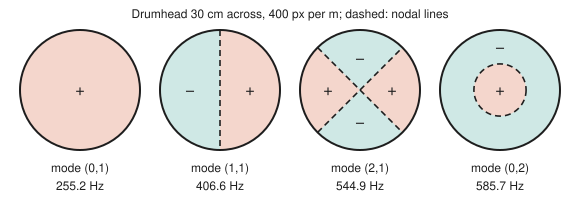
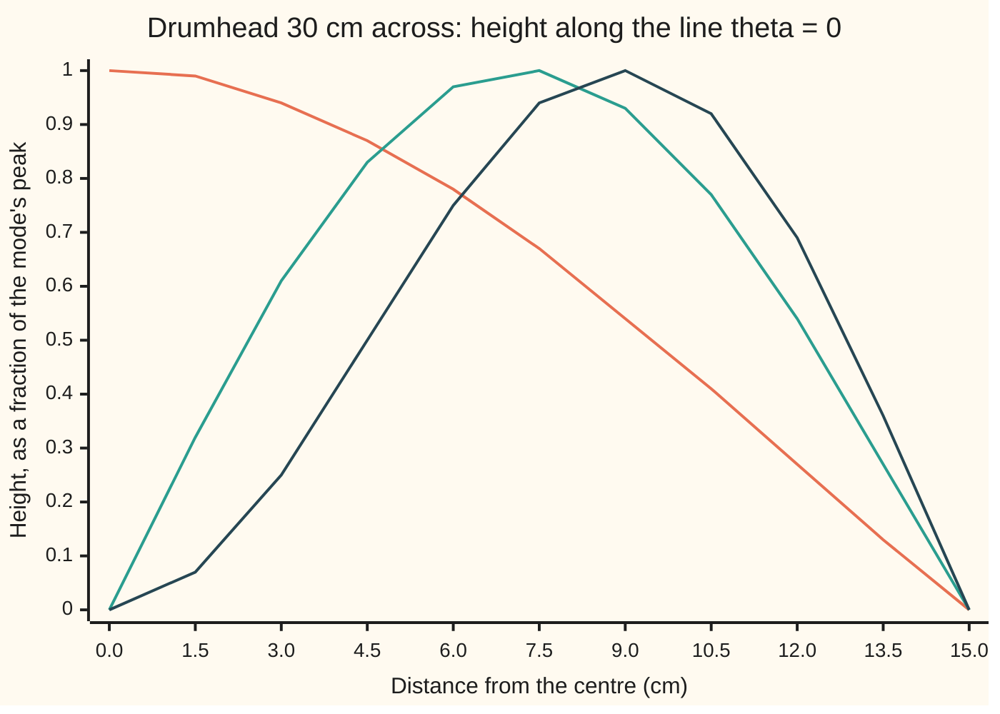

# Drumheads: the modes of a round membrane are Bessel patterns

[Syllabus](../../../SYLLABUS.md) → [Partial differential equations](../README.md) → [Waves](../README.md#s05) → Drumheads

---

## General Overview

A tom-tom drum has a plastic head 30 cm across, clamped at its rim. The head is stretched to a tension of 2000 N per metre of edge and weighs 0.2 kg per square metre, so waves cross it at 100 m/s. These figures are illustrative but typical. Hit it and it sounds 255.2 Hz (hertz: vibrations per second), then 406.6 Hz and 544.9 Hz above that.

A guitar string with the same lowest note would add notes at two, three and four times it, starting at 510.3 Hz. That whole-number ladder is what the ear hears as one clear pitch. The drum's second note is 1.593 times its first and its third is 2.136 times. No ladder fits, so the drum sounds as a thump with a colour, not as a note you could hum.

[Bessel's equation](../../08-Differential%20equations%20and%20dynamics/07-Series%20Solutions%20and%20Boundary%20Problems/03-bessels-equation-and-the-drum.md) in wing 08 found the drum's round notes, the ones whose shape depends only on the distance from the centre. Those are only some of the notes. The 406.6 Hz and 544.9 Hz notes are not round: one rocks the head across a still diameter, the other flexes it in four quarters across two. This card finds every note.

As a problem: the **unknown** is the head's height at each point and moment. The **region** is the disc of radius 0.15 m. The **data** is a zero height all round the rim, plus however the stick starts the motion.

**Separating the wave equation on a disc in distance, angle and time gives modes $`J_m(kr)\cos(m\theta)`$: a whole number $`m`$ of waves round the circle times a Bessel function across it; the clamped rim puts $`kR`$ on a zero of $`J_m`$, and those zeros are not in whole-number ratio, so a drum has no clear pitch.**

**What kind of fact this is:** a theorem, proved on this card in Why it works, inside a model. The model is an ideal membrane: perfectly flexible, evenly stretched, with no air around it. The zeros of $`J_m`$ are computed, not written in closed form.

### The picture: the four lowest modes

<p align="center"></p>

To scale at 400 px per m: each disc has radius 60 px. A **nodal line** is a line on the head that stays still while the mode swings. Mode (1,1) has one nodal diameter; mode (2,1) has two, at 45° to the axes; mode (0,2) has a nodal circle of radius 26.1 px, which is 6.53 cm. A plus region rises while a minus region falls.

---

## The formula

Notation from earlier cards, one line each. $`\Delta`$ is the Laplacian, the sum of second derivatives. An eigenpair of $`-\Delta`$ is a shape and a number $`\lambda`$ with $`-\Delta\varphi = \lambda\varphi`$, and $`k = \sqrt{\lambda}`$ is the wavenumber, radians of wave per metre ([Helmholtz](../04-Laplace%2C%20Poisson%20and%20Potentials/08-helmholtz-and-eigenfunctions.md)).

New here: $`J_m`$, **Bessel's function of order $`m`$**, and its zeros $`j_{m,n}`$. The angle round the centre is $`\theta`$. The round-coordinates card called that angle $`\varphi`$; here $`\varphi`$ names a mode shape, so the angle is renamed.

The head's height $`u(r, \theta, t)`$ obeys the wave equation, is zero on the rim and finite everywhere:

```math
u_{tt} = c^2\,\Delta u \ \text{ for } r < R, \qquad u = 0 \ \text{ at } r = R .
```

Its modes, one for each pair of whole numbers $`m = 0, 1, 2, \dots`$ and $`n = 1, 2, 3, \dots`$:

```math
u_{mn} = J_m\!\left(\frac{j_{m,n}\,r}{R}\right)\cos(m\theta)\,\cos(\omega_{mn} t), \qquad f_{mn} = \frac{\omega_{mn}}{2\pi} = \frac{c\,j_{m,n}}{2\pi R} .
```

**Read it aloud:** a mode is a Bessel curve across the radius, times $`m`$ waves round the circle, times a steady swing; its note is the wave speed times a zero of the Bessel curve, over the rim's circumference.

For $`m \ge 1`$, $`\sin(m\theta)`$ in place of $`\cos(m\theta)`$ gives a second mode with the same note: the same pattern turned by a quarter of a wave.

Bessel's function of order $`m`$, built as a series:

```math
J_m(x) = \sum_{p=0}^{\infty} \frac{(-1)^p}{p!\,(p+m)!}\left(\frac{x}{2}\right)^{2p+m} .
```

**Read it aloud:** start at $`(x/2)^m`$ over $`m!`$; each next term is the last times minus $`(x/2)^2`$, over the term's number times that number plus $`m`$.

| Symbol | Plain meaning | In our example | Push it up and the answer… |
| --- | --- | --- | --- |
| $`u`$ | the head's height above rest, m | zero at the rim | — |
| $`r`$, $`\theta`$, $`t`$ | distance from the centre, m; angle round the centre, rad; time, s | 0 to 0.15 m | — |
| $`R`$, $`c`$ | rim radius; wave speed, √(tension / mass per m²) | 0.15 m; 100 m/s | bigger R: every note falls; faster c: every note rises |
| $`m`$ | waves round the circle, which is also the number of nodal diameters | 0, 1, 2 for the first three modes | a higher note |
| $`n`$ | which zero of $`J_m`$ sits on the rim; the mode has $`n - 1`$ nodal circles | 1 for the first three modes | a higher note |
| $`J_m`$, $`Y_m`$ | Bessel's functions of order $`m`$: the one finite at the centre; the one infinite there | $`J_0`$, $`J_1`$, $`J_2`$ | — |
| $`j_{m,n}`$; $`x`$ | the $`n`$-th zero of $`J_m`$ above 0; the scaled distance $`kr`$ | 2.4048, 3.8317, 5.1356 | — |
| $`k`$; $`-\Delta`$, $`\lambda`$ | wavenumber $`j_{m,n}/R`$, 1/m; minus the Laplacian and its eigenvalue $`k^2`$ | 16.03 1/m for (0,1) | — |
| $`\omega`$, $`f`$ | angular frequency $`ck`$, rad/s; frequency, Hz | 1603.2 rad/s; 255.2 Hz | — |
| $`\varphi`$ | a mode's shape, $`J_m(kr)\cos(m\theta)`$ | the dome of (0,1) | — |
| $`F(r)`$, $`Q(\theta)`$ | the radial part and the angular part of a shape | $`J_m(kr)`$; $`\cos(m\theta)`$ | — |
| $`p`$, $`q`$, $`a_q`$, $`s`$, $`\tau`$ | the series' term numbers; the Frobenius coefficients and trial power; the variable inside Bessel's integral | $`p = 0`$ to 39; $`s = m`$; $`\tau`$ from 0 to π | — |

### When it holds

- **The head is uniform and the rim truly round.** Then each $`m \ge 1`$ note has two shapes with one frequency. A slightly oval rim or an uneven tension splits each pair into two close notes, heard as a beat.
- **The rim is clamped.** A rim that lets the head slide would need zero slope there, and the notes would come from the zeros of the slope of $`J_m`$ instead.
- **The swings are small.** A hard hit stretches the head and raises its tension for a moment, so the pitch glides down as the sound fades.
- **The head is thin and in empty space.** Real heads push air. On timpani, the air the head moves, around it and in the kettle, shifts the notes a lot (see Where you meet it in real life); a thick head also adds bending stiffness.

---

## Why it works

### Step 0: the idea

A mode keeps its shape and only changes size. On a disc, the region looks the same after any turn about the centre. So the shape can be split three ways: a part across the radius, a part round the circle, and a part in time. Each part obeys its own one-variable equation. The angle part must come back to itself after one full turn, which forces a whole number of waves. The radius part must stay finite at the centre and vanish at the rim, which picks a Bessel function and one of its zeros.

### Step 1: take time out

[Standing waves](../../08-Differential%20equations%20and%20dynamics/10-The%20Classical%20PDEs/06-standing-waves-on-a-string.md) split a string's motion into shape times time. [Helmholtz](../04-Laplace%2C%20Poisson%20and%20Potentials/08-helmholtz-and-eigenfunctions.md) did the same on any region: put $`u = \varphi\,\cos(\omega t)`$ into $`u_{tt} = c^2\Delta u`$, and the shape must solve

```math
-\Delta\varphi = k^2\varphi \ \text{ in the disc}, \qquad \varphi = 0 \ \text{ on the rim}, \qquad \omega = ck .
```

So the drum's notes are the disc's eigenvalues, read through $`\omega = ck`$. What is left is to find them.

### Step 2: separate the angle, and why m is whole

In polar coordinates the Laplacian is $`\varphi_{rr} + \varphi_r/r + \varphi_{\theta\theta}/r^2`$, derived on [The Laplacian in round coordinates, and the modes it splits into](../04-Laplace%2C%20Poisson%20and%20Potentials/07-laplacian-in-polar-and-spherical-coordinates.md). Guess $`\varphi = F(r)\,Q(\theta)`$, multiply the equation by $`r^2/(FQ)`$, and sort the terms:

```math
\frac{r^2 F'' + r F'}{F} + k^2 r^2 = -\frac{Q''}{Q} = m^2 .
```

The left side depends only on $`r`$, the right only on $`\theta`$, so both equal one constant, written $`m^2`$. The angle part is then $`Q'' = -m^2 Q`$, with solutions $`\cos(m\theta)`$ and $`\sin(m\theta)`$.

The head is one sheet, so $`\theta`$ and $`\theta + 2\pi`$ are the same point. The shape must take the same value at both. That holds only when $`m`$ is a whole number. With $`m = 1.5`$, $`\cos(1.5\theta)`$ is 1 at $`\theta = 0`$ and −1 after a full turn: the head would tear along one radius, with a jump of 2. A negative constant gives growing exponentials, which never come back to themselves either.

### Step 3: the radius part is Bessel's equation of order m

With $`m^2`$ in place, the radius part is

```math
r^2 F'' + r F' + (k^2 r^2 - m^2)\,F = 0 .
```

Measure distance as $`x = kr`$ and this is **Bessel's equation of order $`m`$**: $`x^2 y'' + x y' + (x^2 - m^2)\,y = 0`$. Wing 08 solved the case $`m = 0`$. The new term, $`-m^2/r^2`$, is the cost of bending round the circle. Near the centre it is huge, so it pushes the shape to zero there whenever $`m \ge 1`$.

The centre is a regular singular point, so the Frobenius method applies. The trial $`y = \sum a_q x^{q+s}`$ gives the indicial equation $`s^2 = m^2`$, so $`s = m`$ or $`s = -m`$. The root $`s = m`$ gives the series for $`J_m`$ above. The other solution, $`Y_m`$, behaves like $`x^{-m}`$, or like $`\ln x`$ when $`m = 0`$. It is infinite at the centre, and a drumhead's centre has a finite height. So $`F(r) = J_m(kr)`$, times a constant.

These are all the modes, not only the ones the guess finds. Take any mode shape and, at each radius, write it as a [Fourier series](../../08-Differential%20equations%20and%20dynamics/09-Fourier%20Series/01-fourier-series-and-orthogonality.md) in $`\theta`$. Integrating the equation against $`\cos(m\theta)`$ or $`\sin(m\theta)`$ round the circle turns $`\varphi_{\theta\theta}`$ into $`-m^2`$ times the coefficient, so each coefficient solves the radius equation of order $`m`$ and is finite at the centre: a multiple of $`J_m(kr)`$. So every mode is a sum of separated modes with the same $`k`$, and the notes found here are all the notes (Courant and Hilbert, in Sources).

<details>
<summary>Detailed proof: the separation and the series for J_m</summary>

Put $`\varphi = F(r)\,Q(\theta)`$ into $`\varphi_{rr} + \varphi_r/r + \varphi_{\theta\theta}/r^2 + k^2\varphi = 0`$ and multiply by $`r^2/(FQ)`$:

$`\displaystyle \frac{r^2F'' + rF'}{F} + k^2r^2 + \frac{Q''}{Q} = 0 .`$

The first two terms depend on $`r`$ only and the last on $`\theta`$ only, so each group is a constant. Periodicity with period $`2\pi`$ makes it $`m^2`$ with $`m`$ a whole number, as in Step 2.

For the radius part, put $`y = \sum_{q \ge 0} a_q x^{q+s}`$ with $`a_0 \ne 0`$ into $`x^2y'' + xy' + (x^2 - m^2)y = 0`$. The terms $`x^2y'' + xy' - m^2y`$ give $`\big((q+s)^2 - m^2\big)a_q x^{q+s}`$; the term $`x^2y`$ moves each power up by two. Matching powers:

$`\displaystyle (s^2 - m^2)\,a_0 = 0, \qquad \big((1+s)^2 - m^2\big)\,a_1 = 0, \qquad \big((q+s)^2 - m^2\big)\,a_q = -a_{q-2} .`$

Take $`s = m`$. Then $`(q+m)^2 - m^2 = q(q + 2m)`$, which is never zero for $`q \ge 1`$. So $`a_1 = 0`$, every odd coefficient is 0, and with $`q = 2p`$:

$`\displaystyle a_{2p} = -\frac{a_{2p-2}}{4p\,(p+m)} .`$

Choosing $`a_0 = 1/(2^m m!)`$ gives exactly the series for $`J_m`$. Each term is the last times $`x^2/(4p(p+m))`$ in size, which falls below 1/2 for large $`p`$, so the series converges for every $`x`$ and may be differentiated term by term. The recurrence then cancels every power, so $`J_m`$ solves the equation.

The second solution: with $`s = -m`$ the factor becomes $`q(q - 2m)`$, which is zero at $`q = 2m`$, so the recurrence breaks there and the second solution needs a logarithm (the [Bessel's equation](../../08-Differential%20equations%20and%20dynamics/07-Series%20Solutions%20and%20Boundary%20Problems/03-bessels-equation-and-the-drum.md) card shows this for $`m = 0`$). The resulting $`Y_m`$ grows like $`x^{-m}`$ as $`x \to 0`$ for $`m \ge 1`$, and like $`\ln x`$ for $`m = 0`$. Either way it is unbounded at the centre.

</details>

### Step 4: the rim picks the notes and draws the nodal lines

At the rim the height is zero, so $`J_m(kR) = 0`$. That puts $`kR`$ on a zero $`j_{m,n}`$ of $`J_m`$, and $`f = c\,j_{m,n}/(2\pi R)`$. Each $`J_m`$ swings like a fading wave, so it has zeros without end. The mode $`(m, n)`$ has two kinds of still line:

- **$`m`$ nodal diameters**, where $`\cos(m\theta) = 0`$;
- **$`n - 1`$ nodal circles**, where $`J_m(kr) = 0`$ inside the rim: at $`R\,j_{m,1}/j_{m,n}`$, then $`R\,j_{m,2}/j_{m,n}`$, and so on below the rim.

For mode (0,2) the circle is at $`0.15 \times 2.4048 / 5.5201`$ = 6.53 cm from the centre. For (1,2) it is at 8.19 cm.

The modes are perpendicular, as Helmholtz proved for any region. On a disc, area is $`r\,dr\,d\theta`$, so two radius parts with one $`m`$ are perpendicular with weight $`r`$. Scaled to $`R = 1`$:

```math
\int_0^1 J_0(j_{0,1}r)\,J_0(j_{0,2}r)\,r\,dr = 0, \qquad \int_0^1 J_0(j_{0,1}r)^2\,r\,dr = \tfrac12 J_1(j_{0,1})^2 = 0.134757 .
```

That is what lets any starting shape be split into modes, one overlap integral each.

### Step 5: why the drum has no clear pitch

Sort every mode by its zero and the list begins:

| Mode (m,n) | $`j_{m,n}`$ | Note (Hz) | Times the first | Nodal diameters, circles | Shapes |
| --- | ---: | ---: | ---: | --- | ---: |
| (0,1) | 2.4048 | 255.2 | 1.000 | 0, 0 | 1 |
| (1,1) | 3.8317 | 406.6 | 1.593 | 1, 0 | 2 |
| (2,1) | 5.1356 | 544.9 | 2.136 | 2, 0 | 2 |
| (0,2) | 5.5201 | 585.7 | 2.295 | 0, 1 | 1 |
| (3,1) | 6.3802 | 677.0 | 2.653 | 3, 0 | 2 |
| (1,2) | 7.0156 | 744.4 | 2.917 | 1, 1 | 2 |
| (4,1) | 7.5883 | 805.1 | 3.155 | 4, 0 | 2 |
| (2,2) | 8.4172 | 893.1 | 3.500 | 2, 1 | 2 |
| (0,3) | 8.6537 | 918.2 | 3.598 | 0, 2 | 1 |
| (5,1) | 8.7715 | 930.7 | 3.647 | 5, 0 | 2 |

A string's list is 1, 2, 3, 4. Every string mode finishes a whole number of swings in one period of the lowest, so the whole string's shape repeats every period: the sound has a period, and a period is what the ear hears as pitch.

The drum's list has no such rhythm. In one period of its lowest mode, 3.919 ms, the next three modes finish 1.593, 2.136 and 2.295 swings. The head never returns exactly to where it started, so the sound has no period. Higher up the list gets more crowded: the first ten drum modes all lie below 3.647 times the lowest note, where a string has only three notes.

---

## Worked numbers, by hand

| Step | Arithmetic | Value |
| --- | --- | --- |
| wave speed | √(2000 / 0.2) | c = 100 m/s |
| hertz per unit of zero | 100 / (2π × 0.15) | 106.103 Hz |
| lowest zeros of $`J_0`$, $`J_1`$, $`J_2`$ | series, then halving the bracket (code) | 2.4048, 3.8317, 5.1356 |
| fundamental, mode (0,1) | 106.103 × 2.4048 | **255.2 Hz** |
| its angular frequency | 100 × 2.4048 / 0.15 | 1603.2 rad/s |
| mode (1,1) | 106.103 × 3.8317 | **406.6 Hz** |
| mode (2,1) | 106.103 × 5.1356 | **544.9 Hz** |
| ratios | 3.8317 / 2.4048; 5.1356 / 2.4048 | **1.593, 2.136** |
| a string's second note, for comparison | 2 × 106.103 × 2.4048 | 510.3 Hz |

The drum's first three notes are 255.2, 406.6 and 544.9 Hz, at 1 : 1.593 : 2.136. A string would sit at 1 : 2 : 3, so the drum's second note sits well below the 510.3 Hz that a ladder built on its first would need.

### What breaks if you drop a piece

| Mistake | Comes out at | What went wrong |
| --- | --- | --- |
| Whole-number overtones, as on a string | second note 510.3 Hz, not 406.6 Hz | a string's zeros are evenly spaced; Bessel zeros are not |
| Round modes only ($`J_0`$, as in wing 08) | second note 585.7 Hz; 406.6 and 544.9 Hz missing | drops every mode with a nodal diameter |
| The 30 cm read as the radius | fundamental 127.6 Hz, not 255.2 Hz | R is half the width: 0.15 m |
| A non-whole $`m`$, such as 1.5 | shape jumps from 1 to −1 across one radius: a jump of 2 | the angle part must close up after a full turn |

---

## Code, from first principles, and it actually runs

The script finds the zeros of $`J_0`$ to $`J_5`$ by three roads that share no arithmetic. Road 1 sums the series (40 terms; the first omitted term is printed) and halves each sign-change bracket. Road 2 uses Bessel's integral, $`J_m(x) = \frac{1}{\pi}\int_0^\pi \cos(m\tau - x\sin\tau)\,d\tau`$, by the trapezoid rule. Road 3 steps the radius equation out from the centre by Runge-Kutta 4 at two step lengths, and prints the observed order. A fourth check puts the full shape $`J_m(kr)\cos(m\theta)`$ into the plain Cartesian Laplacian by centred differences, so the separation itself is tested, not only the radius equation. Simpson's rule checks the perpendicular modes. No Bessel, ODE, quadrature or root routine is imported.

### Python

```python
# Drumheads: the modes of a round membrane are Bessel patterns.  Standard library only.
# A drum 30 cm across (R = 0.15 m), clamped at the rim, waves at c = 100 m/s
# (tension 2000 N/m over 0.2 kg/m^2, illustrative).  Bessel functions and their zeros are
# built here three ways: power series, Bessel's integral, Runge-Kutta 4 from the centre.
from math import cos, sin, pi, sqrt, atan2, factorial, floor, log10

R, C = 0.15, 100.0

def sci(x):                                    # same e-notation digits in Python and Rust
    if x == 0: return "0.0e+00"
    e = floor(log10(abs(x))); m = round(x / 10 ** e, 1)
    if abs(m) >= 10: m, e = m / 10, e + 1
    return f"{m:.1f}e{'-' if e < 0 else '+'}{abs(e):02d}"

def j_series(m, x, terms=40):                  # sum (-1)^p (x/2)^(2p+m) / (p! (p+m)!)
    t = (x / 2) ** m / factorial(m); s = 0.0
    for p in range(terms):
        s += t; t *= -(x / 2) ** 2 / ((p + 1) * (p + 1 + m))
    return s

def j_integral(m, x, n=64):                    # (1/pi) int_0^pi cos(m tau - x sin tau), trapezoid
    s = 0.5 * (1.0 + cos(m * pi))
    for i in range(1, n): s += cos(m * i * pi / n - x * sin(i * pi / n))
    return s / n

def zeros(f, m, count, step=0.05):             # scan for sign changes, then bisect
    out, a = [], step
    while len(out) < count:
        if f(m, a) * f(m, a + step) < 0:
            lo, hi = a, a + step
            for _ in range(60):
                mid = (lo + hi) / 2
                lo, hi = (mid, hi) if f(m, lo) * f(m, mid) > 0 else (lo, mid)
            out.append((lo + hi) / 2)
        a += step
    return out

def zeros_rk4(m, count, h):                    # y = x^m v: v'' + (2m+1) v'/x + v = 0, v(0) = 1, v'(0) = 0
    def acc(x, v, w): return -v / (2 * m + 2) if x == 0 else -v - (2 * m + 1) * w / x
    def step(x, v, w, d):
        k1 = (w, acc(x, v, w)); k2 = (w + d / 2 * k1[1], acc(x + d / 2, v + d / 2 * k1[0], w + d / 2 * k1[1]))
        k3 = (w + d / 2 * k2[1], acc(x + d / 2, v + d / 2 * k2[0], w + d / 2 * k2[1]))
        k4 = (w + d * k3[1], acc(x + d, v + d * k3[0], w + d * k3[1]))
        return v + d / 6 * (k1[0] + 2 * k2[0] + 2 * k3[0] + k4[0]), w + d / 6 * (k1[1] + 2 * k2[1] + 2 * k3[1] + k4[1])
    x, v, w, out = 0.0, 1.0, 0.0, []
    while len(out) < count:
        v2, w2 = step(x, v, w, h)
        if v * v2 < 0:                         # bisect the length of one RK4 step from x
            lo, hi = 0.0, h
            for _ in range(60):
                mid = (lo + hi) / 2
                lo, hi = (mid, hi) if step(x, v, w, mid)[0] * v > 0 else (lo, mid)
            out.append(x + (lo + hi) / 2)
        x, v, w = x + h, v2, w2
    return out

Z = {m: zeros(j_series, m, 3) for m in range(6)}
print(f"drum: R = {R} m (30 cm across), c = {C:.0f} m/s; f = c j/(2 pi R) = {C / (2 * pi * R):.3f} Hz per unit of j")
print(f"series, 40 terms: first omitted term of J0 at x = 16, the largest x used, is {sci(8.0 ** 80 / factorial(40) ** 2)}")
worst_int = max(abs(a - b) for m in range(6) for a, b in zip(Z[m], zeros(j_integral, m, 3)))
print(f"zeros by Bessel's integral (64 points) against the series: worst gap below 1e-10: {'yes' if worst_int < 1e-10 else 'no'}")
errs = []
for h in (0.1, 0.05):
    e = max(abs(a - b) for m in range(4) for a, b in zip(Z[m], zeros_rk4(m, 3, h)))
    errs.append(e); print(f"zeros by RK4 from the centre, h = {h}: worst gap {sci(e)}")
print(f"RK4 gap ratio when h halves: {errs[0] / errs[1]:.1f}")
assert worst_int < 1e-10 and errs[1] < 1e-6 and 10 < errs[0] / errs[1] < 22
modes = sorted((Z[m][n - 1], m, n) for m in range(6) for n in (1, 2, 3))[:10]
print("mode (m,n)   j_mn      k (1/m)   f (Hz)   f/f1   diameters circles  shapes")
for j, m, n in modes:
    print(f"  ({m},{n})   {j:8.4f}  {j / R:8.2f}  {C * j / (2 * pi * R):7.1f}  {j / modes[0][0]:5.3f}"
          f"       {m}         {n - 1}       {1 if m == 0 else 2}")
assert [(m, n) for _, m, n in modes[:4]] == [(0, 1), (1, 1), (2, 1), (0, 2)]
assert abs(Z[0][0] - 2.404826) < 1e-6 and abs(Z[1][0] - 3.831706) < 1e-6 and abs(Z[2][0] - 5.135622) < 1e-6
f1 = C * Z[0][0] / (2 * pi * R)
print(f"fundamental: omega = c k = {C * Z[0][0] / R:.1f} rad/s, f = {f1:.1f} Hz, period {1000 / f1:.3f} ms")
print("cycles done by the next modes in one period of the fundamental: "
      + ", ".join(f"{j / modes[0][0]:.3f}" for j, _, _ in modes[1:4]))
print(f"nodal circle of (0,2) at r = R j01/j02 = {R * Z[0][0] / Z[0][1] * 100:.2f} cm; "
      f"of (1,2) at {R * Z[1][0] / Z[1][1] * 100:.2f} cm")
print("timpani family (m,1), m = 1..4, over (1,1): " + ", ".join(f"{Z[m][0] / Z[1][0]:.3f}" for m in (1, 2, 3, 4))
      + "; a 2:3:4:5 ladder is 1.000, 1.500, 2.000, 2.500")
# road 4: the full shape J_m(k r) cos(m theta) in the plain Cartesian Laplacian, by centred differences
for m in (1, 2):
    k = Z[m][0] / R
    phi = lambda x, y: j_series(m, k * sqrt(x * x + y * y)) * cos(m * atan2(y, x))
    gaps = []
    for h in (2e-3, 1e-3):
        x0, y0 = 0.05, 0.03
        lap = (phi(x0 + h, y0) + phi(x0 - h, y0) + phi(x0, y0 + h) + phi(x0, y0 - h) - 4 * phi(x0, y0)) / h ** 2
        gaps.append(abs(-lap / phi(x0, y0) - k * k))
    print(f"({m},1) in Cartesian -Laplacian / shape at (0.05, 0.03) m: k^2 = {k * k:.2f} 1/m^2; "
          f"gap {sci(gaps[0])} at h = 2 mm, {sci(gaps[1])} at 1 mm, ratio {gaps[0] / gaps[1]:.1f}")
    assert gaps[1] < 1e-2 * k * k and 3 < gaps[0] / gaps[1] < 5
def simpson(g, n=2000):
    return sum((1 if i in (0, n) else 4 if i % 2 else 2) * g(i / n) for i in range(n + 1)) / (3 * n)
cross = simpson(lambda s: j_series(0, Z[0][0] * s) * j_series(0, Z[0][1] * s) * s)
norm = simpson(lambda s: j_series(0, Z[0][0] * s) ** 2 * s)
print(f"orthogonality: int_0^1 J0(j01 s) J0(j02 s) s ds below 1e-12: {'yes' if abs(cross) < 1e-12 else 'no'}; int J0(j01 s)^2 s ds = {norm:.6f}, "
      f"J1(j01)^2 / 2 = {j_series(1, Z[0][0]) ** 2 / 2:.6f}")
assert abs(cross) < 1e-12 and abs(norm - j_series(1, Z[0][0]) ** 2 / 2) < 1e-9
def rel(m, j, r):                              # height at r over the shape's highest point
    peak = max(abs(j_series(m, j * i / 1000)) for i in range(1001))
    return round(j_series(m, j * r / R) / peak, 6) + 0.0
for r in (0.0, 0.10):
    print(f"strike at r = {r * 100:.0f} cm: heights of (0,1), (1,1), (2,1) over their peaks: "
          + ", ".join(f"{rel(m, Z[m][0], r):.3f}" for m in (0, 1, 2)))
print("figure, r (cm):  " + " ".join(f"{i * 1.5:5.1f}" for i in range(11)))
for m in (0, 1, 2):
    print(f"figure, ({m},1) / peak: " + " ".join(f"{rel(m, Z[m][0], i * 0.015):5.2f}" for i in range(11)))
print("highest points of (1,1) and (2,1), where J_m' = J_(m-1) - m J_m / x = 0: r = " + ", ".join(
      f"{100 * R * zeros(lambda m, x: j_series(m - 1, x) - m / x * j_series(m, x), m, 1)[0] / Z[m][0]:.2f}" for m in (1, 2)) + " cm")
print(f"figure, 400 px per m: discs of radius 60 px at x 80, 220, 360, 500, y 90; (0,2) nodal circle radius "
      f"{60 * Z[0][0] / Z[0][1]:.1f} px; (2,1) nodal diameters end {60 / sqrt(2):.2f} px across and up from centre")
print("mistakes:")
print(f"  whole-number ladder: second note {2 * f1:.1f} Hz, not {C * Z[1][0] / (2 * pi * R):.1f} Hz")
print(f"  round modes only: second note {C * Z[0][1] / (2 * pi * R):.1f} Hz; misses "
      f"{C * Z[1][0] / (2 * pi * R):.1f} and {C * Z[2][0] / (2 * pi * R):.1f} Hz")
print(f"  30 cm taken as the radius: fundamental {C * Z[0][0] / (2 * pi * 0.30):.1f} Hz, not {f1:.1f} Hz")
print(f"  m = 1.5 round the circle: cos(1.5 theta) is {cos(0):.0f} at theta = 0 and {cos(1.5 * 2 * pi):.0f} "
      f"after a full turn, a jump of {cos(0) - cos(3 * pi):.0f}")
print("ALL CHECKS PASS")
```

**Ran 2026-11-15 on macOS, Python 3.14.10, standard library only. All checks passed. Output, pasted from the run:**

```
drum: R = 0.15 m (30 cm across), c = 100 m/s; f = c j/(2 pi R) = 106.103 Hz per unit of j
series, 40 terms: first omitted term of J0 at x = 16, the largest x used, is 2.7e-24
zeros by Bessel's integral (64 points) against the series: worst gap below 1e-10: yes
zeros by RK4 from the centre, h = 0.1: worst gap 4.6e-06
zeros by RK4 from the centre, h = 0.05: worst gap 2.8e-07
RK4 gap ratio when h halves: 16.5
mode (m,n)   j_mn      k (1/m)   f (Hz)   f/f1   diameters circles  shapes
  (0,1)     2.4048     16.03    255.2  1.000       0         0       1
  (1,1)     3.8317     25.54    406.6  1.593       1         0       2
  (2,1)     5.1356     34.24    544.9  2.136       2         0       2
  (0,2)     5.5201     36.80    585.7  2.295       0         1       1
  (3,1)     6.3802     42.53    677.0  2.653       3         0       2
  (1,2)     7.0156     46.77    744.4  2.917       1         1       2
  (4,1)     7.5883     50.59    805.1  3.155       4         0       2
  (2,2)     8.4172     56.11    893.1  3.500       2         1       2
  (0,3)     8.6537     57.69    918.2  3.598       0         2       1
  (5,1)     8.7715     58.48    930.7  3.647       5         0       2
fundamental: omega = c k = 1603.2 rad/s, f = 255.2 Hz, period 3.919 ms
cycles done by the next modes in one period of the fundamental: 1.593, 2.136, 2.295
nodal circle of (0,2) at r = R j01/j02 = 6.53 cm; of (1,2) at 8.19 cm
timpani family (m,1), m = 1..4, over (1,1): 1.000, 1.340, 1.665, 1.980; a 2:3:4:5 ladder is 1.000, 1.500, 2.000, 2.500
(1,1) in Cartesian -Laplacian / shape at (0.05, 0.03) m: k^2 = 652.53 1/m^2; gap 1.1e-01 at h = 2 mm, 2.7e-02 at 1 mm, ratio 4.0
(2,1) in Cartesian -Laplacian / shape at (0.05, 0.03) m: k^2 = 1172.21 1/m^2; gap 4.0e-01 at h = 2 mm, 1.0e-01 at 1 mm, ratio 4.0
orthogonality: int_0^1 J0(j01 s) J0(j02 s) s ds below 1e-12: yes; int J0(j01 s)^2 s ds = 0.134757, J1(j01)^2 / 2 = 0.134757
strike at r = 0 cm: heights of (0,1), (1,1), (2,1) over their peaks: 1.000, 0.000, 0.000
strike at r = 10 cm: heights of (0,1), (1,1), (2,1) over their peaks: 0.454, 0.830, 0.961
figure, r (cm):    0.0   1.5   3.0   4.5   6.0   7.5   9.0  10.5  12.0  13.5  15.0
figure, (0,1) / peak:  1.00  0.99  0.94  0.87  0.78  0.67  0.54  0.41  0.27  0.13  0.00
figure, (1,1) / peak:  0.00  0.32  0.61  0.83  0.97  1.00  0.93  0.77  0.54  0.27  0.00
figure, (2,1) / peak:  0.00  0.07  0.25  0.50  0.75  0.94  1.00  0.92  0.69  0.36  0.00
highest points of (1,1) and (2,1), where J_m' = J_(m-1) - m J_m / x = 0: r = 7.21, 8.92 cm
figure, 400 px per m: discs of radius 60 px at x 80, 220, 360, 500, y 90; (0,2) nodal circle radius 26.1 px; (2,1) nodal diameters end 42.43 px across and up from centre
mistakes:
  whole-number ladder: second note 510.3 Hz, not 406.6 Hz
  round modes only: second note 585.7 Hz; misses 406.6 and 544.9 Hz
  30 cm taken as the radius: fundamental 127.6 Hz, not 255.2 Hz
  m = 1.5 round the circle: cos(1.5 theta) is 1 at theta = 0 and -1 after a full turn, a jump of 2
ALL CHECKS PASS
```

### Rust

Same numbers, same labels, built with `rustc --edition 2021 -O`.

```rust
// Drumheads: the modes of a round membrane are Bessel patterns.  std only, no crates.
// A drum 30 cm across (R = 0.15 m), clamped at the rim, waves at c = 100 m/s
// (tension 2000 N/m over 0.2 kg/m^2, illustrative).  Bessel functions and their zeros are
// built here three ways: power series, Bessel's integral, Runge-Kutta 4 from the centre.
use std::f64::consts::PI;

const R: f64 = 0.15; const C: f64 = 100.0;

fn sci(x: f64) -> String { // same e-notation digits in Python and Rust
    if x == 0.0 { return "0.0e+00".to_string(); }
    let mut e = x.abs().log10().floor() as i32;
    let mut m = (x / 10f64.powi(e) * 10.0).round() / 10.0;
    if m.abs() >= 10.0 { m /= 10.0; e += 1; }
    format!("{:.1}e{}{:02}", m, if e < 0 { "-" } else { "+" }, e.abs())
}

fn factorial(n: u32) -> f64 { (1..=n).fold(1.0, |a, k| a * k as f64) }

fn j_series(m: u32, x: f64) -> f64 { // sum (-1)^p (x/2)^(2p+m) / (p! (p+m)!), 40 terms
    let mut t = (x / 2.0).powi(m as i32) / factorial(m);
    let mut s = 0.0;
    for p in 0..40 { s += t; t *= -(x / 2.0).powi(2) / (((p + 1) * (p + 1 + m)) as f64); }
    s
}

fn j_integral(m: u32, x: f64) -> f64 { // (1/pi) int_0^pi cos(m tau - x sin tau), trapezoid, 64 points
    let (n, mf) = (64, m as f64);
    let mut s = 0.5 * (1.0 + (mf * PI).cos());
    for i in 1..n {
        let tau = i as f64 * PI / n as f64;
        s += (mf * tau - x * tau.sin()).cos();
    }
    s / n as f64
}

fn zeros(f: fn(u32, f64) -> f64, m: u32, count: usize) -> Vec<f64> { // scan, then bisect
    let (step, mut a, mut out) = (0.05, 0.05, Vec::new());
    while out.len() < count {
        if f(m, a) * f(m, a + step) < 0.0 {
            let (mut lo, mut hi) = (a, a + step);
            for _ in 0..60 {
                let mid = (lo + hi) / 2.0;
                if f(m, lo) * f(m, mid) > 0.0 { lo = mid } else { hi = mid }
            }
            out.push((lo + hi) / 2.0);
        }
        a += step;
    }
    out
}

fn zeros_rk4(m: u32, count: usize, h: f64) -> Vec<f64> { // y = x^m v: v'' + (2m+1) v'/x + v = 0
    let mf = m as f64;
    let acc = |x: f64, v: f64, w: f64| if x == 0.0 { -v / (2.0 * mf + 2.0) } else { -v - (2.0 * mf + 1.0) * w / x };
    let step = |x: f64, v: f64, w: f64, d: f64| {
        let k1 = (w, acc(x, v, w));
        let k2 = (w + d / 2.0 * k1.1, acc(x + d / 2.0, v + d / 2.0 * k1.0, w + d / 2.0 * k1.1));
        let k3 = (w + d / 2.0 * k2.1, acc(x + d / 2.0, v + d / 2.0 * k2.0, w + d / 2.0 * k2.1));
        let k4 = (w + d * k3.1, acc(x + d, v + d * k3.0, w + d * k3.1));
        (v + d / 6.0 * (k1.0 + 2.0 * k2.0 + 2.0 * k3.0 + k4.0), w + d / 6.0 * (k1.1 + 2.0 * k2.1 + 2.0 * k3.1 + k4.1))
    };
    let (mut x, mut v, mut w, mut out) = (0.0, 1.0, 0.0, Vec::new());
    while out.len() < count {
        let (v2, w2) = step(x, v, w, h);
        if v * v2 < 0.0 { // bisect the length of one RK4 step from x
            let (mut lo, mut hi) = (0.0, h);
            for _ in 0..60 {
                let mid = (lo + hi) / 2.0;
                if step(x, v, w, mid).0 * v > 0.0 { lo = mid } else { hi = mid }
            }
            out.push(x + (lo + hi) / 2.0);
        }
        x += h; v = v2; w = w2;
    }
    out
}

fn simpson(g: &dyn Fn(f64) -> f64) -> f64 {
    let (n, mut s) = (2000, 0.0);
    for i in 0..=n {
        let wgt = if i == 0 || i == n { 1.0 } else if i % 2 == 1 { 4.0 } else { 2.0 };
        s += wgt * g(i as f64 / n as f64);
    }
    s / (3.0 * n as f64)
}

fn rel(m: u32, j: f64, r: f64) -> f64 { // height at r over the shape's highest point
    let peak = (0..=1000).map(|i| j_series(m, j * i as f64 / 1000.0).abs()).fold(0.0, f64::max);
    (j_series(m, j * r / R) / peak * 1e6).round() / 1e6 + 0.0
}

fn main() {
    let z: Vec<Vec<f64>> = (0..6).map(|m| zeros(j_series, m, 3)).collect();
    let hz = |j: f64| C * j / (2.0 * PI * R);
    println!("drum: R = {} m (30 cm across), c = {:.0} m/s; f = c j/(2 pi R) = {:.3} Hz per unit of j", R, C, C / (2.0 * PI * R));
    println!("series, 40 terms: first omitted term of J0 at x = 16, the largest x used, is {}", sci(8f64.powi(80) / factorial(40).powi(2)));
    let mut worst_int: f64 = 0.0;
    for m in 0..6 { for (a, b) in z[m].iter().zip(zeros(j_integral, m as u32, 3)) { worst_int = worst_int.max((a - b).abs()); } }
    println!("zeros by Bessel's integral (64 points) against the series: worst gap below 1e-10: {}", if worst_int < 1e-10 { "yes" } else { "no" });
    let mut errs = Vec::new();
    for h in [0.1, 0.05] {
        let mut e: f64 = 0.0;
        for m in 0..4 { for (a, b) in z[m].iter().zip(zeros_rk4(m as u32, 3, h)) { e = e.max((a - b).abs()); } }
        errs.push(e);
        println!("zeros by RK4 from the centre, h = {}: worst gap {}", h, sci(e));
    }
    println!("RK4 gap ratio when h halves: {:.1}", errs[0] / errs[1]);
    assert!(worst_int < 1e-10 && errs[1] < 1e-6 && 10.0 < errs[0] / errs[1] && errs[0] / errs[1] < 22.0);
    let mut modes: Vec<(f64, usize, usize)> = Vec::new();
    for m in 0..6 { for n in 1..=3 { modes.push((z[m][n - 1], m, n)); } }
    modes.sort_by(|a, b| a.partial_cmp(b).unwrap());
    modes.truncate(10);
    println!("mode (m,n)   j_mn      k (1/m)   f (Hz)   f/f1   diameters circles  shapes");
    for &(j, m, n) in &modes {
        println!("  ({},{})   {:8.4}  {:8.2}  {:7.1}  {:5.3}       {}         {}       {}",
                 m, n, j, j / R, hz(j), j / modes[0].0, m, n - 1, if m == 0 { 1 } else { 2 });
    }
    let order: Vec<(usize, usize)> = modes[..4].iter().map(|&(_, m, n)| (m, n)).collect();
    assert!(order == vec![(0, 1), (1, 1), (2, 1), (0, 2)]);
    assert!((z[0][0] - 2.404826).abs() < 1e-6 && (z[1][0] - 3.831706).abs() < 1e-6 && (z[2][0] - 5.135622).abs() < 1e-6);
    let f1 = hz(z[0][0]);
    println!("fundamental: omega = c k = {:.1} rad/s, f = {:.1} Hz, period {:.3} ms", C * z[0][0] / R, f1, 1000.0 / f1);
    let cyc: Vec<String> = modes[1..4].iter().map(|&(j, _, _)| format!("{:.3}", j / modes[0].0)).collect();
    println!("cycles done by the next modes in one period of the fundamental: {}", cyc.join(", "));
    println!("nodal circle of (0,2) at r = R j01/j02 = {:.2} cm; of (1,2) at {:.2} cm",
             R * z[0][0] / z[0][1] * 100.0, R * z[1][0] / z[1][1] * 100.0);
    let tim: Vec<String> = [1, 2, 3, 4].iter().map(|&m| format!("{:.3}", z[m][0] / z[1][0])).collect();
    println!("timpani family (m,1), m = 1..4, over (1,1): {}; a 2:3:4:5 ladder is 1.000, 1.500, 2.000, 2.500", tim.join(", "));
    // road 4: the full shape J_m(k r) cos(m theta) in the plain Cartesian Laplacian, by centred differences
    for m in [1u32, 2] {
        let k = z[m as usize][0] / R;
        let phi = |x: f64, y: f64| j_series(m, k * (x * x + y * y).sqrt()) * (m as f64 * y.atan2(x)).cos();
        let mut gaps = Vec::new();
        for h in [2e-3, 1e-3] {
            let (x0, y0) = (0.05, 0.03);
            let lap = (phi(x0 + h, y0) + phi(x0 - h, y0) + phi(x0, y0 + h) + phi(x0, y0 - h) - 4.0 * phi(x0, y0)) / h.powi(2);
            gaps.push((-lap / phi(x0, y0) - k * k).abs());
        }
        println!("({},1) in Cartesian -Laplacian / shape at (0.05, 0.03) m: k^2 = {:.2} 1/m^2; gap {} at h = 2 mm, {} at 1 mm, ratio {:.1}",
                 m, k * k, sci(gaps[0]), sci(gaps[1]), gaps[0] / gaps[1]);
        assert!(gaps[1] < 1e-2 * k * k && 3.0 < gaps[0] / gaps[1] && gaps[0] / gaps[1] < 5.0);
    }
    let cross = simpson(&|s: f64| j_series(0, z[0][0] * s) * j_series(0, z[0][1] * s) * s);
    let norm = simpson(&|s: f64| j_series(0, z[0][0] * s).powi(2) * s);
    let half = j_series(1, z[0][0]).powi(2) / 2.0;
    println!("orthogonality: int_0^1 J0(j01 s) J0(j02 s) s ds below 1e-12: {}; int J0(j01 s)^2 s ds = {:.6}, J1(j01)^2 / 2 = {:.6}", if cross.abs() < 1e-12 { "yes" } else { "no" }, norm, half);
    assert!(cross.abs() < 1e-12 && (norm - half).abs() < 1e-9);
    for r in [0.0, 0.10] {
        let hs: Vec<String> = (0..3).map(|m| format!("{:.3}", rel(m, z[m as usize][0], r))).collect();
        println!("strike at r = {:.0} cm: heights of (0,1), (1,1), (2,1) over their peaks: {}", r * 100.0, hs.join(", "));
    }
    let rs: Vec<String> = (0..11).map(|i| format!("{:5.1}", i as f64 * 1.5)).collect();
    println!("figure, r (cm):  {}", rs.join(" "));
    for m in 0..3u32 {
        let v: Vec<String> = (0..11).map(|i| format!("{:5.2}", rel(m, z[m as usize][0], i as f64 * 0.015))).collect();
        println!("figure, ({},1) / peak: {}", m, v.join(" "));
    }
    let pk: Vec<String> = [1u32, 2].iter().map(|&m| format!("{:.2}", 100.0 * R * zeros(|m, x| j_series(m - 1, x) - m as f64 / x * j_series(m, x), m, 1)[0] / z[m as usize][0])).collect();
    println!("highest points of (1,1) and (2,1), where J_m' = J_(m-1) - m J_m / x = 0: r = {} cm", pk.join(", "));
    println!("figure, 400 px per m: discs of radius 60 px at x 80, 220, 360, 500, y 90; (0,2) nodal circle radius {:.1} px; (2,1) nodal diameters end {:.2} px across and up from centre",
             60.0 * z[0][0] / z[0][1], 60.0 / 2f64.sqrt());
    println!("mistakes:");
    println!("  whole-number ladder: second note {:.1} Hz, not {:.1} Hz", 2.0 * f1, hz(z[1][0]));
    println!("  round modes only: second note {:.1} Hz; misses {:.1} and {:.1} Hz", hz(z[0][1]), hz(z[1][0]), hz(z[2][0]));
    println!("  30 cm taken as the radius: fundamental {:.1} Hz, not {:.1} Hz", C * z[0][0] / (2.0 * PI * 0.30), f1);
    println!("  m = 1.5 round the circle: cos(1.5 theta) is {:.0} at theta = 0 and {:.0} after a full turn, a jump of {:.0}",
             0f64.cos(), (1.5 * 2.0 * PI).cos(), 0f64.cos() - (3.0 * PI).cos());
    println!("ALL CHECKS PASS");
}
```

**Ran 2026-11-15 on macOS, rustc 1.98.1, no crates. All checks passed. Output, pasted from the run:**

```
drum: R = 0.15 m (30 cm across), c = 100 m/s; f = c j/(2 pi R) = 106.103 Hz per unit of j
series, 40 terms: first omitted term of J0 at x = 16, the largest x used, is 2.7e-24
zeros by Bessel's integral (64 points) against the series: worst gap below 1e-10: yes
zeros by RK4 from the centre, h = 0.1: worst gap 4.6e-06
zeros by RK4 from the centre, h = 0.05: worst gap 2.8e-07
RK4 gap ratio when h halves: 16.5
mode (m,n)   j_mn      k (1/m)   f (Hz)   f/f1   diameters circles  shapes
  (0,1)     2.4048     16.03    255.2  1.000       0         0       1
  (1,1)     3.8317     25.54    406.6  1.593       1         0       2
  (2,1)     5.1356     34.24    544.9  2.136       2         0       2
  (0,2)     5.5201     36.80    585.7  2.295       0         1       1
  (3,1)     6.3802     42.53    677.0  2.653       3         0       2
  (1,2)     7.0156     46.77    744.4  2.917       1         1       2
  (4,1)     7.5883     50.59    805.1  3.155       4         0       2
  (2,2)     8.4172     56.11    893.1  3.500       2         1       2
  (0,3)     8.6537     57.69    918.2  3.598       0         2       1
  (5,1)     8.7715     58.48    930.7  3.647       5         0       2
fundamental: omega = c k = 1603.2 rad/s, f = 255.2 Hz, period 3.919 ms
cycles done by the next modes in one period of the fundamental: 1.593, 2.136, 2.295
nodal circle of (0,2) at r = R j01/j02 = 6.53 cm; of (1,2) at 8.19 cm
timpani family (m,1), m = 1..4, over (1,1): 1.000, 1.340, 1.665, 1.980; a 2:3:4:5 ladder is 1.000, 1.500, 2.000, 2.500
(1,1) in Cartesian -Laplacian / shape at (0.05, 0.03) m: k^2 = 652.53 1/m^2; gap 1.1e-01 at h = 2 mm, 2.7e-02 at 1 mm, ratio 4.0
(2,1) in Cartesian -Laplacian / shape at (0.05, 0.03) m: k^2 = 1172.21 1/m^2; gap 4.0e-01 at h = 2 mm, 1.0e-01 at 1 mm, ratio 4.0
orthogonality: int_0^1 J0(j01 s) J0(j02 s) s ds below 1e-12: yes; int J0(j01 s)^2 s ds = 0.134757, J1(j01)^2 / 2 = 0.134757
strike at r = 0 cm: heights of (0,1), (1,1), (2,1) over their peaks: 1.000, 0.000, 0.000
strike at r = 10 cm: heights of (0,1), (1,1), (2,1) over their peaks: 0.454, 0.830, 0.961
figure, r (cm):    0.0   1.5   3.0   4.5   6.0   7.5   9.0  10.5  12.0  13.5  15.0
figure, (0,1) / peak:  1.00  0.99  0.94  0.87  0.78  0.67  0.54  0.41  0.27  0.13  0.00
figure, (1,1) / peak:  0.00  0.32  0.61  0.83  0.97  1.00  0.93  0.77  0.54  0.27  0.00
figure, (2,1) / peak:  0.00  0.07  0.25  0.50  0.75  0.94  1.00  0.92  0.69  0.36  0.00
highest points of (1,1) and (2,1), where J_m' = J_(m-1) - m J_m / x = 0: r = 7.21, 8.92 cm
figure, 400 px per m: discs of radius 60 px at x 80, 220, 360, 500, y 90; (0,2) nodal circle radius 26.1 px; (2,1) nodal diameters end 42.43 px across and up from centre
mistakes:
  whole-number ladder: second note 510.3 Hz, not 406.6 Hz
  round modes only: second note 585.7 Hz; misses 406.6 and 544.9 Hz
  30 cm taken as the radius: fundamental 127.6 Hz, not 255.2 Hz
  m = 1.5 round the circle: cos(1.5 theta) is 1 at theta = 0 and -1 after a full turn, a jump of 2
ALL CHECKS PASS
```

The two outputs match line for line. Bessel's integral agrees with the series to better than 1e-10. Runge-Kutta 4's worst gap falls by 16.5 times when the step halves, close to the 16 that fourth order predicts. The Cartesian check's gap falls by 4.0 when its step halves, as centred differences should, so the gap is step error and the shape really is an eigenfunction.

The radial shapes of the first three modes, read off the figure lines of the output:



Orange: mode (0,1), $`J_0`$, highest at the centre. Teal: mode (1,1), $`J_1`$, zero at the centre and highest at 7.21 cm. Dark blue: mode (2,1), $`J_2`$, flatter still near the centre and highest at 8.92 cm. The more waves round the circle, the more the shape is pushed out towards the rim.

> [!TIP]
> **Try changing**
> Guess first, then run it.
> - **Tighten the head four times.** That doubles the wave speed: set `C` to 200. The fundamental doubles to 510.3 Hz, and the ratios stay 1.593, 2.136, 2.295. Tension tunes a drum; it cannot make it harmonic.
> - **Strike nearer the centre.** Change `0.10` to `0.05` in the strike loop. The heights become 0.846, 0.888 and 0.585: the (2,1) mode, flat near the centre, gets a weaker push.
> - **Starve Bessel's integral.** Set `n=8` in `j_integral`. The integral road prints `no` and the run stops: eight points cannot follow the fast swings of the integrand at x near 16.
> - **Coarser Runge-Kutta.** Change the steps to `(0.4, 0.2)`. The worst gaps grow to 1.4e-03 and 7.9e-05, the ratio is 17.6, and the run stops because 7.9e-05 misses the 1e-6 target.

---

## The usual mistake

> [!warning]
> **Expecting a drum's overtones to be whole multiples of its lowest note.** That is the string's rule, and it holds because a string's modes are sines with evenly spaced zeros. A drum's modes are Bessel functions, whose zeros are not. Built on 255.2 Hz, a ladder puts the second note at 510.3 Hz; the drum puts it at 406.6 Hz, then 544.9 Hz.
>
> - **Keeping only the round modes.** Wing 08's $`J_0`$ notes are 255.2, 585.7 and 918.2 Hz. That misses 406.6 and 544.9 Hz, two notes an off-centre hit excites strongly.
> - **Reading the size as the radius.** A 30 cm drum has R = 0.15 m. Using 0.30 m halves every note: 127.6 Hz.
> - **Letting m be any number.** Only whole $`m`$ closes up round the circle; $`m = 1.5`$ tears the head with a jump of 2.
> - **Counting each note once.** For $`m \ge 1`$ the cosine and sine shapes share a note, so each such note is two modes, not one.

---

## Where you meet it in real life

- **Where a drummer hits.** A strike pushes each mode roughly in proportion to the mode's height at the stick. At the centre the heights of (0,1), (1,1) and (2,1), each as a fraction of its own peak, are 1.000, 0.000 and 0.000: only round modes sound, a dull thud. At 10 cm from the centre they are 0.454, 0.830 and 0.961, so the bright non-round modes join in.
- **Timpani, the drum that has a pitch.** For an ideal membrane, modes (1,1), (2,1), (3,1) and (4,1) sit at 1, 1.340, 1.665 and 1.980 times the first of them. The air the head moves, around it and in the kettle, loads the head and pushes these towards 1, 1.5, 2 and 2.5, the ladder 2 : 3 : 4 : 5. The ear then hears the (1,1) mode as the note, with the others as its overtones. The round modes push air well, so they lose their energy and fade fast.
- **Sand on a drumhead.** Sprinkle sand on a head driven at one mode and it gathers on the nodal diameters and circles: the figure above, made visible.
- **Microphones and sensors.** A condenser microphone's diaphragm is a clamped round membrane under tension. The same rule, $`f = c\,j_{0,1}/(2\pi R)`$, gives a first estimate of its lowest resonance; the air film behind it stiffens the diaphragm and raises the real value.

> **Say it back**
> A drum's height obeys the wave equation on a disc with zero height at the rim. Taking time out leaves the Helmholtz problem, and splitting it in angle and radius gives $`\cos(m\theta)`$ with a whole number $`m`$, times $`J_m(kr)`$, the Bessel function that stays finite at the centre. The rim puts $`kR`$ on a zero of $`J_m`$, so a mode has $`m`$ nodal diameters and $`n - 1`$ nodal circles. A drum 30 cm across with waves at 100 m/s sounds 255.2, 406.6 and 544.9 Hz. These ratios, 1.593 and 2.136, fit no whole-number ladder, so the sound has no period and no clear pitch.

---

## What this builds on

- [Helmholtz](../04-Laplace%2C%20Poisson%20and%20Potentials/08-helmholtz-and-eigenfunctions.md): taking time out of the wave equation, and the facts this card reuses on a disc: real positive eigenvalues, perpendicular modes, and every shape a sum of modes.
- [Bessel's equation](../../08-Differential%20equations%20and%20dynamics/07-Series%20Solutions%20and%20Boundary%20Problems/03-bessels-equation-and-the-drum.md): $`J_0`$ by Frobenius, its zeros, and the round notes; this card adds the orders $`m \ge 1`$.
- [Standing waves](../../08-Differential%20equations%20and%20dynamics/10-The%20Classical%20PDEs/06-standing-waves-on-a-string.md): the string's whole-number ladder of harmonics, the comparison that explains why a drum is unpitched.

---

## Where this goes next

- [Transforms in two and three dimensions](../../20-Harmonic%20analysis/02-The%20Fourier%20Transform/10-multidimensional-transform-and-tomography.md) (harmonic analysis wing): the Fourier transform of a round picture, where $`J_0`$ returns as the kernel of the Hankel transform.
- [Kirchhoff's formula](04-kirchhoff-and-huygens.md): a wave in a plane keeps a tail after it passes, unlike one in space; the drumhead is a bounded piece of that plane.
- [The retarded Green's function](05-retarded-greens-function-and-forced-waves.md): a driven wave, where each mode behaves as a forced oscillator. A drum hit by a stick is the same problem with a short push.

The question this card leaves open: knowing every note of a drum, could you work out its shape?

---

## Sources

Verified 2026-11-15: every link below resolves to the publisher's page.

- NIST Digital Library of Mathematical Functions, §10.2, "Definitions," Bessel and Hankel Functions. [dlmf.nist.gov/10.2](https://dlmf.nist.gov/10.2). Bessel's equation of order m, the series for $`J_m`$, and the second solution $`Y_m`$.
- NIST Digital Library of Mathematical Functions, §10.9, "Integral Representations." [dlmf.nist.gov/10.9](https://dlmf.nist.gov/10.9). Bessel's integral, the code's second road.
- NIST Digital Library of Mathematical Functions, §10.21, "Zeros." [dlmf.nist.gov/10.21](https://dlmf.nist.gov/10.21). The zeros $`j_{m,n}`$, their interlacing and their tables, used to cross-check the code.
- Courant, R., and D. Hilbert. *Methods of Mathematical Physics*, Vol. 1. Wiley-VCH, 1989. [DOI 10.1002/9783527617210](https://doi.org/10.1002/9783527617210). The vibrating circular membrane separated into Bessel modes, and the expansion of a shape in them.
- Fletcher, Neville H., and Thomas D. Rossing. *The Physics of Musical Instruments*, 2nd ed. Springer, 1998. [DOI 10.1007/978-0-387-21603-4](https://doi.org/10.1007/978-0-387-21603-4). Ideal membrane modes and ratios, strike position, and how air loading tunes timpani.
