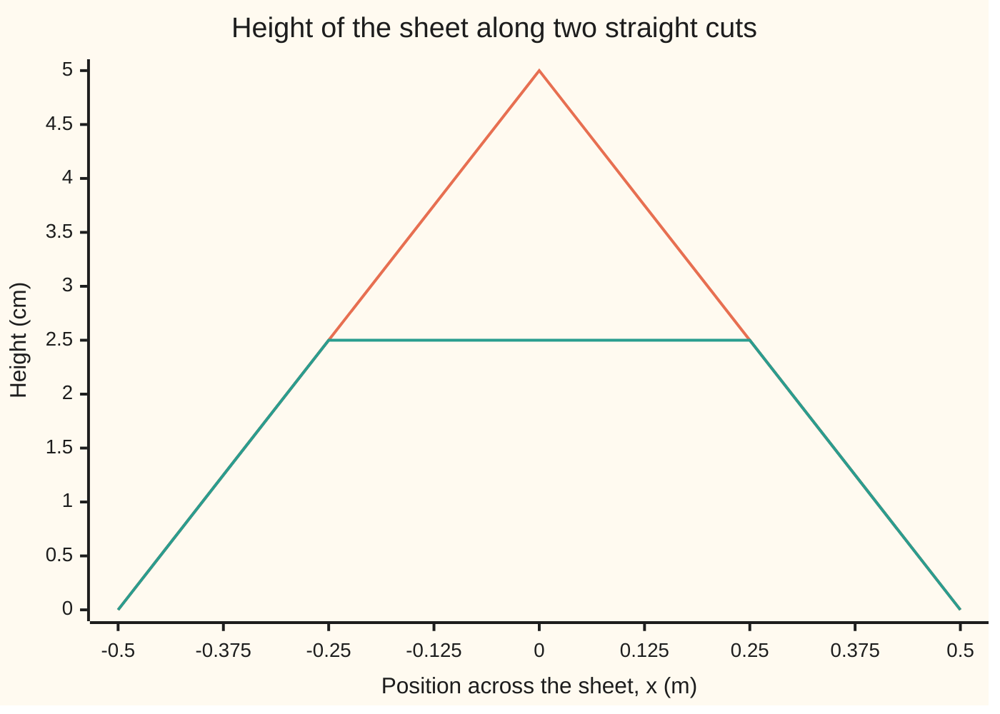

# Weak solutions: multiply by a test function and integrate by parts

[Syllabus](../../../SYLLABUS.md) → [Partial differential equations](../README.md) → [Weak Solutions and Free Boundaries](../README.md#s06) → Weak solutions

---

## General Overview

A square rubber sheet, 1 m on a side, is stretched in a frame at a tension of 200 N/m (newtons per metre of edge, illustrative). The frame holds the edge at height 0. Two straight rods run corner to corner under the sheet, along both diagonals. They cross at the centre, 5 cm up, and slope down to the corners.

The sheet settles into a tent: four flat triangular faces, each sloping 1 in 10, meeting in sharp creases along the rods. On the flat faces nothing bends. On the creases the slope jumps, so the sheet has no second derivative there.

That is a problem for the membrane equation from wing 08. It balances tension against load at every point using second derivatives ([A partial differential equation](../../08-Differential%20equations%20and%20dynamics/10-The%20Classical%20PDEs/01-what-a-pde-says.md)). On a crease it has nothing to compute with. Read literally, the equation has no solution for this sheet.

The **weak form** fixes this. Multiply the equation by a smooth **test function** (a smooth bump that is zero near the frame), add it up over the sheet, and move one derivative onto the test function by integration by parts. Ask that the result hold for every test function. The tent then passes: the tension side and the rod side agree, for example 20.4818 N against 20.4818 N for a bump on the centre.

The weak form needs one derivative of the shape, not two. Used with a second integration by parts, it needs none. That is the drop in the smoothness demand, and it is what lets kinks, creases and even jumps count as solutions.

**A weak solution is a function that satisfies the equation after it has been multiplied by every smooth test function, integrated, and had derivatives moved onto the test function; a smooth weak solution is an ordinary solution, but a creased sheet, a kinked wave or a shock can be a weak solution too.**

**What kind of fact this is:** the weak form is a definition. That ordinary solutions are weak solutions, that smooth weak solutions are ordinary ones, and that the tent solves the weak form with the rods' load are theorems, proved on this card in Why it works. Uniqueness in each family is stated with its source.

This card generalises, to several variables and to every family, what [Weak solutions](../../18-Functional%20analysis/04-Distributions%20and%20Sobolev%20Spaces/08-weak-solutions-of-differential-equations.md) did for a layered wall in one dimension: restate the problem against smooth probes, because existence proofs start there.

### The picture: two slices through the tent



Orange: the cut through the centre, $`y = 0`$, a tent with one kink at the apex. Teal: the cut at $`y = 0.25`$ m, flat on top and kinked twice, where it crosses the two rods. Both checks print every point. Each cut is straight between kinks, so its bend is zero there and does not exist at the kinks.

---

## The formula

Notation from earlier shelves, one line each. $`\Omega`$ is the region, here the square sheet, and $`\partial\Omega`$ its edge, the frame ([A PDE problem](../01-Classification%20and%20Well-Posedness/01-what-a-pde-problem-is.md)). $`\nabla u`$ is the gradient (the uphill arrow) and $`\Delta u`$ the Laplacian (the sum of the second derivatives). $`H^1_0(\Omega)`$ is the set of shapes whose slope has a finite square integral and which are zero on the edge ([Weak derivatives](../../18-Functional%20analysis/04-Distributions%20and%20Sobolev%20Spaces/07-weak-derivatives-and-sobolev-spaces.md)).

The ordinary, or **strong**, problem for a sheet under tension $`T`$ and load $`f`$ per square metre:

```math
-T\,\Delta u = f \ \text{ in } \Omega, \qquad u = 0 \ \text{ on } \partial\Omega .
```

**Read it aloud:** at every point, tension times the sheet's total bend balances the upward load there, and the edge is held at height 0.

The **weak form**: for every test function $`v`$,

```math
a(u, v) = \int_\Omega T\,\nabla u\cdot\nabla v \; dx \;=\; \int_\Omega f\,v \; dx = \ell(v) .
```

**Read it aloud:** tension times the shape's slope times the test function's slope, added over the sheet, equals the load weighted by the test function, added over the sheet.

For the two rods the load sits on lines, not on an area. It is $`q`$ newtons per metre of rod, and the right side becomes a sum along the rods, with $`dS`$ a small piece of rod length. In the formula, $`z_0`$ = 0.05 m is the height where the rods cross and $`R`$ = 0.5 m is half the side of the square:

```math
\ell(v) = q \int_{\text{rods}} v \; dS, \qquad q = \sqrt{2}\;T\,\frac{z_0}{R} = 28.2843 \ \text{N/m}.
```

**Read it aloud:** the rod side is the load per metre times the test function's height, added along both rods; the load per metre is tension times the jump in slope straight across a rod.

The tent itself is $`u(x, y) = z_0\,(1 - \max(\lvert x\rvert, \lvert y\rvert)/R)`$, with the centre of the sheet at $`x = y = 0`$.

| Symbol | Plain meaning | In our example | Push it up and the answer… |
| --- | --- | --- | --- |
| $`\Omega`$, $`\partial\Omega`$; $`x`$, $`y`$ | the sheet and its frame; position from the centre, m | 1 m by 1 m square | — |
| $`R`$ | half the side of the square, m | 0.5 m | faces flatten, $`q`$ falls |
| $`u`$ | the sheet's height, m | a tent, 5 cm at the centre | — |
| $`z_0`$ | height where the rods cross, m | 0.05 m | $`q`$, both sides and the lift rise in proportion |
| $`T`$ | tension: pull per metre of edge, N/m | 200 N/m (illustrative) | the same tent needs a bigger rod force |
| $`f`$; $`q`$ | load per m²; load per metre of rod | 0 on the faces; 28.2843 N/m on the rods | the sheet rises |
| $`v`$ | test function: a smooth bump, zero near the frame | bumps of height 1 and radius 0.1 to 0.3 m | — |
| $`a(u, v)`$, $`\ell(v)`$ | the two sides of the weak form, N | 20.4818 N and 20.4818 N for the centre bump | — |
| $`\nabla u`$; $`\Delta u`$; $`\partial u/\partial n`$ | the sheet's slope arrow; its total bend; its slope straight across a crease or out of a face | slope 0.10 on each face; bend 0 on the faces | — |
| $`n`$; $`dx`$, $`dS`$; $`\Delta x`$ | unit arrow straight across a crease; a small patch of area, a small piece of rod length; a grid step, m | $`\Delta x`$ = 0.01 to 0.0001 m | — |
| $`t`$; $`c`$, $`\kappa`$, $`s`$ | time; wave speed, diffusivity, shock speed, for the other families | rope at $`c`$ = 10 m/s; Burgers shock $`s`$ = 0.5 (scaled) | — |
| $`H^1_0`$ | shapes with square-integrable slope, zero on the edge | the tent: $`\int \lvert\nabla u\rvert^2 dx`$ = 0.0100 m² | — |

### When it holds

- **The test functions vanish where the shape is fixed.** Then the edge term from integration by parts drops out. Test with $`v = 1`$, which is not zero on the frame, and the sides read 0 against 80.0000 N: the frame's pull has nowhere to go.
- **The shape has one square-integrable slope.** The tent's slope is 0.10 on every face, so $`\int\lvert\nabla u\rvert^2 dx`$ is 0.0100 m². Without this, $`a(u, v)`$ has no meaning.
- **The load is bounded by the slope energy.** $`\lvert\ell(v)\rvert`$ must be at most a fixed number times the root of $`\int\lvert\nabla v\rvert^2 dx`$. A line load such as 28.2843 N/m along the rods qualifies. A needle pushing at one point does not, in two dimensions: the sheet takes a logarithmic shape around it, whose slope energy is infinite, so it lies outside $`H^1_0`$.
- **The equation is in divergence form, or its coefficients are smooth enough to be put in it.** The integration by parts needs $`-\nabla\cdot(T\nabla u)`$. With smoothly varying coefficients, the product rule rewrites a general second-order expression in that form, leaving a first-order term on $`u`$. With rough coefficients, such as a tension that jumps between two materials, only the divergence form makes sense: the rewrite would need the coefficient's derivative.
- **Small slopes.** The membrane equation is a small-slope model. It drops terms of the size of the slope squared, here 0.10 × 0.10. At steep slopes the true sheet departs from it.

---

## Why it works

### Step 0: the idea

A creased shape has a slope almost everywhere but no bend on the crease. The strong form puts two derivatives on $`u`$. Integration by parts can move one of them onto the test function, which is smooth and can take any number of derivatives. After the move, $`u`$ needs only a slope.

A crease has such a slope: its weak derivative is a step from one face's slope to the other's, as [Weak derivatives](../../18-Functional%20analysis/04-Distributions%20and%20Sobolev%20Spaces/07-weak-derivatives-and-sobolev-spaces.md) computes for a tent-shaped kink.

The price: the equation now holds only as a weighted total, one total per test function. If it holds for every test function, nothing is lost where $`u`$ is smooth. Where $`u`$ has a crease, the weak form says exactly what the crease must do.

### Step 1: every ordinary solution is a weak solution

Let $`u`$ have two continuous derivatives and solve $`-T\Delta u = f`$. Multiply by $`v`$ and integrate. The [Divergence theorem](../../06-Calculus%20and%20analysis/09-Vector%20Calculus/07-divergence-theorem.md), applied to $`v\,T\nabla u`$, gives Green's first identity:

```math
\int_\Omega (-T\Delta u)\,v \; dx = \int_\Omega T\,\nabla u\cdot\nabla v \; dx - \int_{\partial\Omega} T\,v\,\frac{\partial u}{\partial n} \; dS .
```

The edge integral is zero because $`v = 0`$ on the frame. What is left is the weak form. This is the same move as [Energy methods](../01-Classification%20and%20Well-Posedness/07-energy-methods-and-uniqueness.md), with the test function $`v`$ in place of the solution as the multiplier.

### Step 2: a smooth weak solution is an ordinary solution

Go the other way. Suppose $`u`$ has two continuous derivatives, $`f`$ is continuous, and $`u`$ satisfies the weak form. Step 1 run backwards gives $`\int_\Omega (-T\Delta u - f)\,v\,dx = 0`$ for every test function. A continuous function whose total against every smooth bump is zero is zero ([Distributions](../../18-Functional%20analysis/04-Distributions%20and%20Sobolev%20Spaces/01-test-functions-and-distributions.md)). So $`-T\Delta u = f`$ at every point.

So the weak form adds no new smooth solutions and loses none. It only admits rough ones.

### Step 3: what the weak form says at a crease

Split the sheet into its four faces. On each face $`u`$ is flat, so $`\nabla u`$ is a constant arrow and $`\Delta u = 0`$. Apply Step 1's identity face by face. Each face leaves an edge term along its two creases, and the frame terms vanish. Adding the faces gives

```math
\int_\Omega T\,\nabla u\cdot\nabla v \; dx \;=\; \int_{\text{rods}} T\,\Big[-\frac{\partial u}{\partial n}\Big]\,v \; dS ,
```

where the bracket is the drop in slope straight across the crease, from one face to the other. Both faces fall away from a rod at the same rate, $`z_0/(\sqrt{2}R)`$, so the drop across the ridge is twice that: $`\sqrt{2}\,z_0/R`$ = 0.141421.

So the tent is a weak solution with a load $`q = T \times 0.141421`$ = 28.2843 N/m along each rod, and with no load on the faces. This is the string-over-a-peg rule: tension times the turn in slope equals the force per metre the support supplies.

<details>
<summary>Detailed proof: the tent's weak form, face by face</summary>

Take the east face, where $`x > \lvert y\rvert`$. There $`u = z_0(1 - x/R)`$, so $`\nabla u = (-z_0/R,\, 0)`$, a constant. Since $`\nabla\cdot(v\nabla u) = \nabla u\cdot\nabla v`$ when $`\nabla u`$ is constant, the divergence theorem gives

$`\displaystyle \int_{\text{east}} \nabla u\cdot\nabla v \; dx = \int_{\partial(\text{east})} v\,\nabla u\cdot n_{\text{out}} \; dS .`$

On the frame side $`v = 0`$. On the crease $`y = x`$ the outward arrow is $`n_{\text{out}} = (-1, 1)/\sqrt{2}`$, so $`\nabla u\cdot n_{\text{out}} = z_0/(\sqrt{2}R)`$. On the crease $`y = -x`$ it is $`(-1, -1)/\sqrt{2}`$, with the same product. So the east face gives

$`\displaystyle \frac{z_0}{\sqrt{2}R}\int_{\text{its two half-rods}} v \; dS .`$

The other three faces give the same by symmetry of the formula. Each half-rod, from the centre to a corner, borders two faces, so it is counted twice. Adding all four faces and multiplying by $`T`$:

$`\displaystyle \int_\Omega T\,\nabla u\cdot\nabla v \; dx = 2\,\frac{T z_0}{\sqrt{2}R}\int_{\text{rods}} v\; dS = \sqrt{2}\,\frac{T z_0}{R}\int_{\text{rods}} v\; dS .`$

That is $`\ell(v)`$ with $`q = \sqrt{2}\,T z_0/R`$. The centre point needs no separate force: it has zero length, so it adds nothing to any integral.

</details>

The checks test this on three bumps, by a brute-force sum over each face against a separate sum along the rods:

| Test bump | Centre, radius | Tension side $`a(u, v)`$ | Rod side $`\ell(v)`$ |
| --- | --- | --- | --- |
| A, on the apex | (0, 0) m, 0.30 m | 20.4818 N | 20.4818 N |
| B, on a rod | (0.25, 0.25) m, 0.15 m | 5.1204 N | 5.1204 N |
| C, inside a face | (0.30, 0) m, 0.10 m | 0.0000 N | 0.0000 N |

Bump C cannot tell the tent from a free sheet, because a flat face is a solution with no load. Only a test function that touches a crease sees the rods.

### Step 4: the smoothness demand drops, two, one, zero

The strong form asks for two derivatives at every point. Ask for them on a rod and they do not exist. A centred difference over a step $`\Delta x`$ gives $`-T\Delta u`$ = 4000.0 N/m² at $`\Delta x`$ = 0.01 m, 40000.0 at 0.001 m and 400000.0 at 0.0001 m. It grows like $`1/\Delta x`$, with no limit. Inside a face it is 0.0 at every step.

The weak form asks for one derivative, square-integrable. The tent has it. It even passes with itself as the test function, which is allowed because the tent is in $`H^1_0`$: $`a(u, u)`$ = 2.0000 J and $`\ell(u)`$ = 2.0000 J. Half of that, 1.0000 J, is the energy stored in the stretched sheet.

Integrate by parts once more and the demand reaches zero: $`\int_\Omega u\,(-T\Delta v)\,dx = \ell(v)`$ asks only that $`u`$ can be integrated. This **very weak** form is the distribution sense of [Distributions](../../18-Functional%20analysis/04-Distributions%20and%20Sobolev%20Spaces/01-test-functions-and-distributions.md).

| Form | Derivatives on $`u`$ | Tent | A jump |
| --- | --- | --- | --- |
| strong, pointwise | two, continuous | fails on the rods | fails |
| weak, once by parts | one, square-integrable | passes | fails: its slope is a spike, not a function |
| very weak, twice by parts | none | passes | can pass |

### Step 5: what a weak solution means in each family

The same recipe works for every family of [Elliptic, parabolic, hyperbolic](../01-Classification%20and%20Well-Posedness/04-classification-elliptic-parabolic-hyperbolic.md). In space and time, the test function $`v(x, t)`$ is a smooth bump that vanishes near the edge and outside a window of time.

| Family | Strong form | Weak form, for every test $`v`$ | Rough solutions it admits | Unique among |
| --- | --- | --- | --- | --- |
| elliptic (sheet) | $`-T\Delta u = f`$ | $`\int T\nabla u\cdot\nabla v = \int f v`$ | creases | all of $`H^1_0`$ (Lax-Milgram) |
| parabolic (heat) | $`u_t = \kappa\Delta u`$ | $`\iint (-u\,v_t + \kappa\nabla u\cdot\nabla v) = 0`$ | a kinked start | finite-energy weak solutions |
| hyperbolic (waves) | $`u_{tt} = c^2 u_{xx}`$ | $`\iint (-u_t v_t + c^2 u_x v_x) = 0`$ | kinks moving at speed $`c`$ | finite-energy weak solutions |
| conservation law | $`u_t + (u^2/2)_x = 0`$ | $`\iint (u\,v_t + \tfrac12 u^2 v_x) = 0`$ | jumps (shocks) | not unique: needs an entropy condition |

The heat row needs one space derivative of $`u`$ and none in time; the data term at the start is dropped by taking $`v`$ zero near $`t = 0`$. The checks test the last two rows. For the waves they compute the very weak residual $`\iint u\,(v_{tt} - c^2 v_{xx})`$, one more integration by parts, which equals the weak one for a pulse that has a slope.

**Waves.** A rope carries waves at $`c`$ = 10 m/s. A tent-shaped pulse, 2 cm high with a half-width of 0.2 m, travels along it. Its kinks have no second derivative, so the strong form fails on three lines in space and time. Against a smooth space-time bump, the very weak residual is 0.000000 m²/s. Move the same pulse at 12 m/s and the residual is −0.059692 m²/s: the weak form rejects a pulse at the wrong speed.

**Conservation laws.** On Burgers' equation, from [Conservation laws](../02-First-Order%20Equations%20and%20Characteristics/02-conservation-laws-and-shocks.md), a jump from $`u = 1`$ down to $`u = 0`$ moves at speed $`s`$ (scaled units). Integration by parts on each side of the jump leaves one line term:

```math
\iint \big(u\,v_t + \tfrac12 u^2\,v_x\big)\, dx\, dt \;=\; \big(\tfrac12 - s\big)\int v(st, t)\; dt .
```

**Read it aloud:** the weak residual is the mismatch between the jump in flux, one half, and the speed times the jump in $`u`$, one, weighted along the shock's path.

It vanishes exactly at $`s = 1/2`$, the Rankine-Hugoniot speed. At $`s = 1`$ the brute-force residual and this formula both give −0.038683.

The upward jump from 0 to 1 at speed 1/2 passes the weak form too, residual 0.000000. Real flows never make it. Weak solutions of conservation laws are not unique, and [Entropy conditions](../02-First-Order%20Equations%20and%20Characteristics/03-entropy-conditions-and-vanishing-viscosity.md) choose the physical one.

---

## Worked numbers, by hand

The sheet: side 1 m, so $`R`$ = 0.5 m; tension $`T`$ = 200 N/m; rods crossing at $`z_0`$ = 0.05 m.

| Step | Arithmetic | Value |
| --- | --- | --- |
| slope of each face | 0.05 ÷ 0.5 | 0.10 |
| drop in slope across a rod | √2 × 0.10 | 0.141421 |
| load per metre of rod, $`q`$ | 200 × 0.141421 | **28.2843 N/m** |
| length of the two rods | 2 × 1.4142 | 2.8284 m |
| total lift from the rods | 28.2843 × 2.8284 | **80.0000 N** |
| total pull down from the frame | 200 × 0.10 × 4 m of edge | 80.0000 N |
| tension side with $`v = u`$ | 200 × 0.10² × 1 m² | 2.0000 J |
| rod side with $`v = u`$ | 28.2843 × 0.070711 m² under the rods | 2.0000 J |
| energy stored in the sheet | 2.0000 ÷ 2 | 1.0000 J |

The rods push up with 80 N in total, spread evenly at 28.2843 N/m, and the frame pulls down with the same 80 N. The weak form found that load from the shape alone, with no rule about creases supplied.

### What breaks if you drop a piece

| Mistake | Comes out at | What went wrong |
| --- | --- | --- |
| Treat the sheet as free, $`f = 0`$ | bump A: 20.4818 N against 0 | The tent is not a weak solution of the unloaded sheet; the rods push. |
| Measure the slope jump along $`x`$, not straight across the rod | $`q`$ = 20.0000 N/m, total 56.5685 N, not 80.0000 N | Along a cut at 45° to the rod the jump looks smaller by √2. |
| Test with $`v = 1`$, not zero on the frame | tension side 0, rod side 80.0000 N | The frame's pull is an edge term; test functions must vanish where $`u`$ is fixed. |
| Ask the strong form on a rod | 4000.0, 40000.0, 400000.0 N/m² as $`\Delta x`$ shrinks | There is no second derivative; the number grows like $`1/\Delta x`$. |
| Move the Burgers jump at speed 1 | residual −0.038683, not 0 | The speed must be the jump in flux over the jump in $`u`$: 1/2. |
| Move the rope pulse at 12 m/s | residual −0.059692 m²/s, not 0 | Kinks must ride the characteristics, at $`c`$ = 10 m/s. |

---

## Code, from first principles, and it actually runs

The code checks the weak form three independent ways. Road 1 adds up $`T\nabla u\cdot\nabla v`$ over each face by Simpson's rule in two dimensions. Road 2 adds up $`q\,v`$ along the rods in one dimension, using the load from Step 3. Road 3 relaxes the sheet on a 20 by 20 grid, with the rods held at their heights and nothing else imposed, and finds that it settles into the tent's flat faces: the largest gap prints as 0.000000 mm. The force balance (80 N up, 80 N down) is a fourth, closed-form check. For the other families, a brute-force space-time sum is set against the Rankine-Hugoniot line formula, and the rope pulse at its true speed against a wrong one.

### Python

```python
# Weak solutions: the tent-shaped sheet, a kinked rope pulse and a Burgers shock.
# Standard library only. Simpson's rule, the bumps and the grid solve are written out here.
import math

T, A, H = 200.0, 0.5, 0.05           # tension N/m, half-side m (1 m square), apex height m
SL = H / A                           # slope of each face
Q = math.sqrt(2) * T * SL            # load per metre of rod, N/m (Step 3)

def simpson(f, lo, hi, n=200):       # composite Simpson's rule, n even
    if hi <= lo:
        return 0.0
    s, d = f(lo) + f(hi), (hi - lo) / n
    for i in range(1, n):
        s += (4 if i % 2 else 2) * f(lo + i * d)
    return s * d / 3

def z(x):                            # print a rounding-level number as 0
    return 0.0 if abs(x) < 5e-7 else x

def tent(x, y):                      # the sheet's height, m
    return H * (1 - max(abs(x), abs(y)) / A)

def bump(cx, cy, r):                 # smooth test function: height 1, zero outside radius r
    def v(x, y):
        p2 = ((x - cx) ** 2 + (y - cy) ** 2) / r ** 2
        return math.e * math.exp(-1 / (1 - p2)) if p2 < 1 else 0.0
    def grad(x, y):
        p2 = ((x - cx) ** 2 + (y - cy) ** 2) / r ** 2
        if p2 >= 1:
            return 0.0, 0.0
        g = v(x, y) * -2 / (1 - p2) ** 2 / r ** 2
        return g * (x - cx), g * (y - cy)
    return v, grad, (cx - r, cx + r, cy - r, cy + r)

# road 1: a(u, v) = T * integral of grad u . grad v, face by face, iterated Simpson
FACES = [((-SL, 0.0), lambda s, t: (s, t), 0, 1), ((SL, 0.0), lambda s, t: (-s, t), 0, -1),
         ((0.0, -SL), lambda s, t: (t, s), 2, 1), ((0.0, SL), lambda s, t: (t, -s), 2, -1)]
def a_form(grad, box):
    total = 0.0
    for (gx, gy), pt, k, sg in FACES:  # face = {s in (0, A), |t| < s}, mapped to the sheet by pt
        lo, hi = sorted((sg * box[k], sg * box[k + 1]))
        tlo, thi = box[2 - k], box[3 - k]
        def inner(s):
            f = lambda t: gx * grad(*pt(s, t))[0] + gy * grad(*pt(s, t))[1]
            return simpson(f, max(-s, tlo), min(s, thi))
        total += T * simpson(inner, max(0.0, lo), min(A, hi), 400)
    return total

# road 2: l(v) = Q * integral of v along both rods (the diagonals)
def l_form(v):
    L = 2 * math.sqrt(2) * A
    d1 = simpson(lambda s: v(-A + s / math.sqrt(2), -A + s / math.sqrt(2)), 0, L, 800)
    d2 = simpson(lambda s: v(-A + s / math.sqrt(2), A - s / math.sqrt(2)), 0, L, 800)
    return Q * (d1 + d2)

print(f"sheet: 1 m square, T = {T:.0f} N/m, apex {H*100:.0f} cm, face slope {SL:.2f}, rod load q = {Q:.4f} N/m")
print(f"hand: slope jump across a rod {math.sqrt(2)*SL:.6f}, rod length 2 x {2*math.sqrt(2)*A:.4f} m, area under the rods {2*math.sqrt(2)*A*H:.6f} m^2")
print(f"total lift: rods q x {4*math.sqrt(2)*A:.4f} m = {Q*4*math.sqrt(2)*A:.4f} N; frame T x slope x {8*A:.0f} m = {T*SL*8*A:.4f} N")
assert abs(Q * 4 * math.sqrt(2) * A - T * SL * 8 * A) < 1e-9   # force balance: the rods lift what the frame pulls down
rows = []
for name, (cx, cy, r) in [("A apex", (0.0, 0.0, 0.3)), ("B on a rod", (0.25, 0.25, 0.15)), ("C inside a face", (0.3, 0.0, 0.1))]:
    v, g, box = bump(cx, cy, r)
    av, lv = a_form(g, box), l_form(v)
    rows.append((av, lv))
    print(f"bump {name:16s} centre ({cx:.2f}, {cy:.2f}) m r {r:.2f} m: a(u,v) = {z(av):8.4f} N, l(v) = {z(lv):8.4f} N")
assert all(abs(av - lv) < 1e-6 for av, lv in rows)          # the tent solves the weak form
assert abs(rows[0][0]) > 1 and abs(rows[2][0]) < 1e-9          # free sheet (f = 0) fails bump A only
au = T * SL ** 2 * (2 * A) ** 2                                  # v = u itself, an H^1_0 test
lu = 2 * Q * simpson(lambda s: tent(-A + s / math.sqrt(2), -A + s / math.sqrt(2)), 0, 2 * math.sqrt(2) * A, 800)
print(f"test with v = u: a(u,u) = {au:.4f} J, l(u) = {lu:.4f} J; stored energy {au/2:.4f} J; slope integral {au/T:.4f} m^2")
assert abs(au - lu) < 1e-9
# strong form at a rod point: centred-difference Laplacian has no limit
for d in (0.01, 0.001, 0.0001):
    x = y = 0.25
    lap = (tent(x + d, y) + tent(x - d, y) + tent(x, y + d) + tent(x, y - d) - 4 * tent(x, y)) / d ** 2
    lap2 = (tent(0.3 + d, 0) + tent(0.3 - d, 0) + tent(0.3, d) + tent(0.3, -d) - 4 * tent(0.3, 0)) / d ** 2
    print(f"step {d:.4f} m: -T x Laplacian on a rod {-T*lap:10.1f} N/m^2, inside a face {abs(T*lap2):.1f} N/m^2")
    assert abs(-T * lap - 2 * T * H / (A * d)) < 1e-6 * T / d
# road 3: relax the free sheet between the rods on a grid; it settles into the tent's flat faces
n = 20; dx = 2 * A / n
U = [[0.0] * (n + 1) for _ in range(n + 1)]
fixed = lambda i, j: i in (0, n) or j in (0, n) or i == j or i + j == n
for i in range(n + 1):
    U[i][i] = U[i][n - i] = tent(-A + i * dx, -A + i * dx)
for sweep in range(5000):
    ch = 0.0
    for i in range(1, n):
        for j in range(1, n):
            if not fixed(i, j):
                new = (U[i-1][j] + U[i+1][j] + U[i][j-1] + U[i][j+1]) / 4
                ch, U[i][j] = max(ch, abs(new - U[i][j])), new
    if ch < 1e-15:
        break
gap = max(abs(U[i][j] - tent(-A + i * dx, -A + j * dx)) for i in range(n + 1) for j in range(n + 1))
print(f"grid {n}x{n}, step {dx:.2f} m: relaxed sheet vs tent, largest gap {gap*1000:.6f} mm")
assert gap < 1e-9
print("chart x (m):", ", ".join(f"{-A+k*0.125:.3f}" for k in range(9)))
print("chart y=0 (cm):", ", ".join(f"{100*tent(-A+k*0.125,0):.2f}" for k in range(9)))
print("chart y=0.25 (cm):", ", ".join(f"{100*tent(-A+k*0.125,0.25):.2f}" for k in range(9)))
print(f"breaks: slope jump along x gives q = {T*SL:.4f} N/m, total {T*SL*4*math.sqrt(2)*A:.4f} N; v = 1: a = 0, l = {Q*4*math.sqrt(2)*A:.4f} N")

# 1D bumps for the space-time checks
def b(s):  return math.e * math.exp(-1 / (1 - s * s)) if abs(s) < 1 else 0.0
def b1(s): return b(s) * -2 * s / (1 - s * s) ** 2 if abs(s) < 1 else 0.0
def b2(s): return b(s) * ((-2 * s / (1 - s * s) ** 2) ** 2 - 2 / (1 - s * s) ** 2 - 8 * s * s / (1 - s * s) ** 3) if abs(s) < 1 else 0.0
# wave: a tent pulse on a rope, u = F(x - ct); very weak form: integral of u (v_tt - c^2 v_xx) = 0
C, HW, W = 10.0, 0.02, 0.2           # wave speed m/s, pulse height m, half-width m
X0, RX, T0, RT = 0.5, 0.4, 0.05, 0.04
def wave_res(speed):
    def inner(t):
        F = lambda x: HW * max(0.0, 1 - abs(x - speed * t) / W)
        f = lambda x: F(x) * (b((x - X0) / RX) * b2((t - T0) / RT) / RT**2 - C**2 * b2((x - X0) / RX) / RX**2 * b((t - T0) / RT))
        cuts = sorted([X0 - RX, X0 + RX] + [min(max(speed * t + k * W, X0 - RX), X0 + RX) for k in (-1, 0, 1)])
        return sum(simpson(f, cuts[k], cuts[k + 1]) for k in range(4))
    return simpson(inner, T0 - RT, T0 + RT, 400)
rw, rw12 = wave_res(10.0), wave_res(12.0)
print(f"wave c = 10 m/s, tent pulse {HW*100:.0f} cm high, {W:.1f} m half-width: kinked pulse at 10 m/s residual {z(rw):.6f} m^2/s; at 12 m/s {rw12:.6f} m^2/s")
assert abs(rw) < 1e-8 and abs(rw12) > 1e-4
# Burgers u_t + (u^2/2)_x = 0 (scaled): a jump from 1 to 0 moving at speed s
P0, RP, S0, RS = 0.5, 0.4, 1.0, 0.5
def burgers_res(s, left):            # brute force: integral of u v_t + (u^2/2) v_x over the plane
    def inner(t):
        g = lambda x: b((x - P0) / RP) * b1((t - S0) / RS) / RS + 0.5 * b1((x - P0) / RP) / RP * b((t - S0) / RS)
        k = min(max(s * t, P0 - RP), P0 + RP)
        return simpson(g, P0 - RP, k) if left else simpson(g, k, P0 + RP)
    return simpson(inner, S0 - RS, S0 + RS, 400)
def rh(s):                           # Rankine-Hugoniot road: (1/2 - s) x integral of v along the jump
    return (0.5 - s) * simpson(lambda t: b((s * t - P0) / RP) * b((t - S0) / RS), S0 - RS, S0 + RS, 400)
for s in (0.5, 1.0):
    print(f"Burgers jump 1 -> 0 at speed {s:.1f}: residual {z(burgers_res(s, True)):.6f}, Rankine-Hugoniot road {z(rh(s)):.6f}")
    assert abs(burgers_res(s, True) - rh(s)) < 1e-6
print(f"Burgers jump 0 -> 1 at speed 0.5: residual {z(burgers_res(0.5, False)):.6f} (also weak; entropy rules it out)")
assert abs(rh(1.0)) > 0.01 and abs(burgers_res(0.5, False)) < 1e-6
print("ALL CHECKS PASS")
```

**Ran 2026-11-15 on macOS, Python 3.14.10, standard library only. All checks passed. Output, pasted from the run:**

```
sheet: 1 m square, T = 200 N/m, apex 5 cm, face slope 0.10, rod load q = 28.2843 N/m
hand: slope jump across a rod 0.141421, rod length 2 x 1.4142 m, area under the rods 0.070711 m^2
total lift: rods q x 2.8284 m = 80.0000 N; frame T x slope x 4 m = 80.0000 N
bump A apex           centre (0.00, 0.00) m r 0.30 m: a(u,v) =  20.4818 N, l(v) =  20.4818 N
bump B on a rod       centre (0.25, 0.25) m r 0.15 m: a(u,v) =   5.1204 N, l(v) =   5.1204 N
bump C inside a face  centre (0.30, 0.00) m r 0.10 m: a(u,v) =   0.0000 N, l(v) =   0.0000 N
test with v = u: a(u,u) = 2.0000 J, l(u) = 2.0000 J; stored energy 1.0000 J; slope integral 0.0100 m^2
step 0.0100 m: -T x Laplacian on a rod     4000.0 N/m^2, inside a face 0.0 N/m^2
step 0.0010 m: -T x Laplacian on a rod    40000.0 N/m^2, inside a face 0.0 N/m^2
step 0.0001 m: -T x Laplacian on a rod   400000.0 N/m^2, inside a face 0.0 N/m^2
grid 20x20, step 0.05 m: relaxed sheet vs tent, largest gap 0.000000 mm
chart x (m): -0.500, -0.375, -0.250, -0.125, 0.000, 0.125, 0.250, 0.375, 0.500
chart y=0 (cm): 0.00, 1.25, 2.50, 3.75, 5.00, 3.75, 2.50, 1.25, 0.00
chart y=0.25 (cm): 0.00, 1.25, 2.50, 2.50, 2.50, 2.50, 2.50, 1.25, 0.00
breaks: slope jump along x gives q = 20.0000 N/m, total 56.5685 N; v = 1: a = 0, l = 80.0000 N
wave c = 10 m/s, tent pulse 2 cm high, 0.2 m half-width: kinked pulse at 10 m/s residual 0.000000 m^2/s; at 12 m/s -0.059692 m^2/s
Burgers jump 1 -> 0 at speed 0.5: residual 0.000000, Rankine-Hugoniot road 0.000000
Burgers jump 1 -> 0 at speed 1.0: residual -0.038683, Rankine-Hugoniot road -0.038683
Burgers jump 0 -> 1 at speed 0.5: residual 0.000000 (also weak; entropy rules it out)
ALL CHECKS PASS
```

### Rust

```rust
// Weak solutions: the tent-shaped sheet, a kinked rope pulse and a Burgers shock.
// Rust std only. Simpson's rule, the bumps and the grid solve are written out here.
const T: f64 = 200.0; const A: f64 = 0.5; const H: f64 = 0.05; // tension N/m, half-side m (1 m square), apex m
const SL: f64 = H / A; const E: f64 = std::f64::consts::E; // SL: slope of each face

fn simpson(f: &dyn Fn(f64) -> f64, lo: f64, hi: f64, n: usize) -> f64 {
    if hi <= lo { return 0.0; }
    let d = (hi - lo) / n as f64;
    let mut s = f(lo) + f(hi);
    for i in 1..n {
        s += (if i % 2 == 1 { 4.0 } else { 2.0 }) * f(lo + i as f64 * d);
    }
    s * d / 3.0
}
fn z(x: f64) -> f64 { if x.abs() < 5e-7 { 0.0 } else { x } } // print a rounding-level number as 0
fn tent(x: f64, y: f64) -> f64 { H * (1.0 - x.abs().max(y.abs()) / A) } // the sheet's height, m
fn v2(cx: f64, cy: f64, r: f64, x: f64, y: f64) -> f64 {
    let p2 = ((x - cx).powf(2.0) + (y - cy).powf(2.0)) / r.powf(2.0);
    if p2 < 1.0 { E * (-1.0 / (1.0 - p2)).exp() } else { 0.0 }
}
fn grad2(cx: f64, cy: f64, r: f64, x: f64, y: f64) -> (f64, f64) {
    let p2 = ((x - cx).powf(2.0) + (y - cy).powf(2.0)) / r.powf(2.0);
    if p2 >= 1.0 { return (0.0, 0.0); }
    let g = v2(cx, cy, r, x, y) * -2.0 / (1.0 - p2).powf(2.0) / r.powf(2.0);
    (g * (x - cx), g * (y - cy))
}
fn pt(face: usize, s: f64, t: f64) -> (f64, f64) {
    match face { 0 => (s, t), 1 => (-s, t), 2 => (t, s), _ => (t, -s) }
}
// road 1: a(u, v) = T * integral of grad u . grad v, face by face, iterated Simpson
fn a_form(c: (f64, f64, f64)) -> f64 {
    let (cx, cy, r) = c;
    let bx = [cx - r, cx + r, cy - r, cy + r];
    let faces = [((-SL, 0.0), 0, 1.0), ((SL, 0.0), 0, -1.0), ((0.0, -SL), 2, 1.0), ((0.0, SL), 2, -1.0)];
    let mut total = 0.0;
    for (fi, &((gx, gy), k, sg)) in faces.iter().enumerate() {
        let (p, q) = (sg * bx[k], sg * bx[k + 1]);
        let (lo, hi) = if p <= q { (p, q) } else { (q, p) };
        let (tlo, thi) = (bx[2 - k], bx[3 - k]);
        let inner = |s: f64| {
            let f = |t: f64| {
                let (x, y) = pt(fi, s, t);
                gx * grad2(cx, cy, r, x, y).0 + gy * grad2(cx, cy, r, x, y).1
            };
            simpson(&f, (-s).max(tlo), s.min(thi), 200)
        };
        total += T * simpson(&inner, lo.max(0.0), hi.min(A), 400);
    }
    total
}
// road 2: l(v) = Q * integral of v along both rods (the diagonals)
fn l_form(q: f64, v: &dyn Fn(f64, f64) -> f64) -> f64 {
    let r2 = 2f64.sqrt();
    let l = 2.0 * r2 * A;
    let d1 = simpson(&|s: f64| v(-A + s / r2, -A + s / r2), 0.0, l, 800);
    let d2 = simpson(&|s: f64| v(-A + s / r2, A - s / r2), 0.0, l, 800);
    q * (d1 + d2)
}
fn b(s: f64) -> f64 { if s.abs() < 1.0 { E * (-1.0 / (1.0 - s * s)).exp() } else { 0.0 } }
fn b1(s: f64) -> f64 { if s.abs() < 1.0 { b(s) * -2.0 * s / (1.0 - s * s).powf(2.0) } else { 0.0 } }
fn b2(s: f64) -> f64 {
    if s.abs() >= 1.0 { return 0.0; }
    let w = 1.0 - s * s;
    b(s) * ((-2.0 * s / w.powf(2.0)).powf(2.0) - 2.0 / w.powf(2.0) - 8.0 * s * s / w.powf(3.0))
}
// wave: a tent pulse on a rope, u = F(x - ct); very weak form: integral of u (v_tt - c^2 v_xx) = 0
const C: f64 = 10.0; const HW: f64 = 0.02; const W: f64 = 0.2;
const X0: f64 = 0.5; const RX: f64 = 0.4; const T0: f64 = 0.05; const RT: f64 = 0.04;
fn wave_res(speed: f64) -> f64 {
    let inner = |t: f64| {
        let f = |x: f64| {
            let fu = HW * (1.0 - (x - speed * t).abs() / W).max(0.0);
            fu * (b((x - X0) / RX) * b2((t - T0) / RT) / RT.powf(2.0)
                - C.powf(2.0) * b2((x - X0) / RX) / RX.powf(2.0) * b((t - T0) / RT))
        };
        let mut cuts = vec![X0 - RX, X0 + RX];
        for k in [-1.0, 0.0, 1.0] {
            cuts.push((speed * t + k * W).max(X0 - RX).min(X0 + RX));
        }
        cuts.sort_by(|p, q| p.partial_cmp(q).unwrap());
        (0..4).map(|k| simpson(&f, cuts[k], cuts[k + 1], 200)).sum::<f64>()
    };
    simpson(&inner, T0 - RT, T0 + RT, 400)
}
// Burgers u_t + (u^2/2)_x = 0 (scaled): a jump from 1 to 0 moving at speed s
const P0: f64 = 0.5; const RP: f64 = 0.4; const S0: f64 = 1.0; const RS: f64 = 0.5;
fn burgers_res(s: f64, left: bool) -> f64 {
    let inner = |t: f64| {
        let g = |x: f64| b((x - P0) / RP) * b1((t - S0) / RS) / RS + 0.5 * b1((x - P0) / RP) / RP * b((t - S0) / RS);
        let k = (s * t).max(P0 - RP).min(P0 + RP);
        if left { simpson(&g, P0 - RP, k, 200) } else { simpson(&g, k, P0 + RP, 200) }
    };
    simpson(&inner, S0 - RS, S0 + RS, 400)
}
fn rh(s: f64) -> f64 {
    (0.5 - s) * simpson(&|t: f64| b((s * t - P0) / RP) * b((t - S0) / RS), S0 - RS, S0 + RS, 400)
}
fn main() {
    let r2 = 2f64.sqrt();
    let q = r2 * T * SL; // load per metre of rod, N/m (Step 3)
    println!("sheet: 1 m square, T = {:.0} N/m, apex {:.0} cm, face slope {:.2}, rod load q = {:.4} N/m", T, H * 100.0, SL, q);
    println!("hand: slope jump across a rod {:.6}, rod length 2 x {:.4} m, area under the rods {:.6} m^2", r2 * SL, 2.0 * r2 * A, 2.0 * r2 * A * H);
    println!("total lift: rods q x {:.4} m = {:.4} N; frame T x slope x {:.0} m = {:.4} N", 4.0 * r2 * A, q * 4.0 * r2 * A, 8.0 * A, T * SL * 8.0 * A);
    assert!((q * 4.0 * r2 * A - T * SL * 8.0 * A).abs() < 1e-9); // force balance: the rods lift what the frame pulls down
    let mut rows = vec![];
    for (name, c) in [("A apex", (0.0, 0.0, 0.3)), ("B on a rod", (0.25, 0.25, 0.15)), ("C inside a face", (0.3, 0.0, 0.1))] {
        let (av, lv) = (a_form(c), l_form(q, &|x, y| v2(c.0, c.1, c.2, x, y)));
        rows.push((av, lv));
        println!("bump {:<16} centre ({:.2}, {:.2}) m r {:.2} m: a(u,v) = {:8.4} N, l(v) = {:8.4} N", name, c.0, c.1, c.2, z(av), z(lv));
    }
    assert!(rows.iter().all(|&(av, lv)| (av - lv).abs() < 1e-6)); // the tent solves the weak form
    assert!(rows[0].0.abs() > 1.0 && rows[2].0.abs() < 1e-9); // free sheet (f = 0) fails bump A only
    let au = T * SL.powf(2.0) * (2.0 * A).powf(2.0); // v = u itself, an H^1_0 test
    let lu = 2.0 * q * simpson(&|s: f64| tent(-A + s / r2, -A + s / r2), 0.0, 2.0 * r2 * A, 800);
    println!("test with v = u: a(u,u) = {:.4} J, l(u) = {:.4} J; stored energy {:.4} J; slope integral {:.4} m^2", au, lu, au / 2.0, au / T);
    assert!((au - lu).abs() < 1e-9);
    for d in [0.01, 0.001, 0.0001] {
        let (x, y) = (0.25, 0.25);
        let lap = (tent(x + d, y) + tent(x - d, y) + tent(x, y + d) + tent(x, y - d) - 4.0 * tent(x, y)) / d.powf(2.0);
        let lap2 = (tent(0.3 + d, 0.0) + tent(0.3 - d, 0.0) + tent(0.3, d) + tent(0.3, -d) - 4.0 * tent(0.3, 0.0)) / d.powf(2.0);
        println!("step {:.4} m: -T x Laplacian on a rod {:10.1} N/m^2, inside a face {:.1} N/m^2", d, -T * lap, (T * lap2).abs());
        assert!((-T * lap - 2.0 * T * H / (A * d)).abs() < 1e-6 * T / d);
    }
    // road 3: relax the free sheet between the rods on a grid; it settles into the tent's flat faces
    let n = 20usize;
    let dx = 2.0 * A / n as f64;
    let mut u = vec![vec![0.0f64; n + 1]; n + 1];
    let fixed = |i: usize, j: usize| i == 0 || i == n || j == 0 || j == n || i == j || i + j == n;
    for i in 0..=n {
        let h = tent(-A + i as f64 * dx, -A + i as f64 * dx);
        u[i][i] = h;
        u[i][n - i] = h;
    }
    for _ in 0..5000 {
        let mut ch: f64 = 0.0;
        for i in 1..n {
            for j in (1..n).filter(|&j| !fixed(i, j)) {
                let new = (u[i - 1][j] + u[i + 1][j] + u[i][j - 1] + u[i][j + 1]) / 4.0;
                ch = ch.max((new - u[i][j]).abs());
                u[i][j] = new;
            }
        }
        if ch < 1e-15 { break; }
    }
    let gap = (0..=n * n + 2 * n).map(|m| (m / (n + 1), m % (n + 1)))
        .map(|(i, j)| (u[i][j] - tent(-A + i as f64 * dx, -A + j as f64 * dx)).abs()).fold(0.0, f64::max);
    println!("grid {}x{}, step {:.2} m: relaxed sheet vs tent, largest gap {:.6} mm", n, n, dx, gap * 1000.0);
    assert!(gap < 1e-9);
    let xs: Vec<String> = (0..9).map(|k| format!("{:.3}", -A + k as f64 * 0.125)).collect();
    println!("chart x (m): {}", xs.join(", "));
    for (lab, y) in [("0", 0.0), ("0.25", 0.25)] {
        let pts: Vec<String> = (0..9).map(|k| format!("{:.2}", 100.0 * tent(-A + k as f64 * 0.125, y))).collect();
        println!("chart y={} (cm): {}", lab, pts.join(", "));
    }
    println!("breaks: slope jump along x gives q = {:.4} N/m, total {:.4} N; v = 1: a = 0, l = {:.4} N", T * SL, T * SL * 4.0 * r2 * A, q * 4.0 * r2 * A);
    let (rw, rw12) = (wave_res(10.0), wave_res(12.0));
    println!("wave c = 10 m/s, tent pulse {:.0} cm high, {:.1} m half-width: kinked pulse at 10 m/s residual {:.6} m^2/s; at 12 m/s {:.6} m^2/s", HW * 100.0, W, z(rw), rw12);
    assert!(rw.abs() < 1e-8 && rw12.abs() > 1e-4);
    for s in [0.5, 1.0] {
        println!("Burgers jump 1 -> 0 at speed {:.1}: residual {:.6}, Rankine-Hugoniot road {:.6}", s, z(burgers_res(s, true)), z(rh(s)));
        assert!((burgers_res(s, true) - rh(s)).abs() < 1e-6);
    }
    println!("Burgers jump 0 -> 1 at speed 0.5: residual {:.6} (also weak; entropy rules it out)", z(burgers_res(0.5, false)));
    assert!(rh(1.0).abs() > 0.01 && burgers_res(0.5, false).abs() < 1e-6);
    println!("ALL CHECKS PASS");
}
```

**Ran 2026-11-15 on macOS, rustc 1.98.1, no crates. All checks passed. Output, pasted from the run:**

```
sheet: 1 m square, T = 200 N/m, apex 5 cm, face slope 0.10, rod load q = 28.2843 N/m
hand: slope jump across a rod 0.141421, rod length 2 x 1.4142 m, area under the rods 0.070711 m^2
total lift: rods q x 2.8284 m = 80.0000 N; frame T x slope x 4 m = 80.0000 N
bump A apex           centre (0.00, 0.00) m r 0.30 m: a(u,v) =  20.4818 N, l(v) =  20.4818 N
bump B on a rod       centre (0.25, 0.25) m r 0.15 m: a(u,v) =   5.1204 N, l(v) =   5.1204 N
bump C inside a face  centre (0.30, 0.00) m r 0.10 m: a(u,v) =   0.0000 N, l(v) =   0.0000 N
test with v = u: a(u,u) = 2.0000 J, l(u) = 2.0000 J; stored energy 1.0000 J; slope integral 0.0100 m^2
step 0.0100 m: -T x Laplacian on a rod     4000.0 N/m^2, inside a face 0.0 N/m^2
step 0.0010 m: -T x Laplacian on a rod    40000.0 N/m^2, inside a face 0.0 N/m^2
step 0.0001 m: -T x Laplacian on a rod   400000.0 N/m^2, inside a face 0.0 N/m^2
grid 20x20, step 0.05 m: relaxed sheet vs tent, largest gap 0.000000 mm
chart x (m): -0.500, -0.375, -0.250, -0.125, 0.000, 0.125, 0.250, 0.375, 0.500
chart y=0 (cm): 0.00, 1.25, 2.50, 3.75, 5.00, 3.75, 2.50, 1.25, 0.00
chart y=0.25 (cm): 0.00, 1.25, 2.50, 2.50, 2.50, 2.50, 2.50, 1.25, 0.00
breaks: slope jump along x gives q = 20.0000 N/m, total 56.5685 N; v = 1: a = 0, l = 80.0000 N
wave c = 10 m/s, tent pulse 2 cm high, 0.2 m half-width: kinked pulse at 10 m/s residual 0.000000 m^2/s; at 12 m/s -0.059692 m^2/s
Burgers jump 1 -> 0 at speed 0.5: residual 0.000000, Rankine-Hugoniot road 0.000000
Burgers jump 1 -> 0 at speed 1.0: residual -0.038683, Rankine-Hugoniot road -0.038683
Burgers jump 0 -> 1 at speed 0.5: residual 0.000000 (also weak; entropy rules it out)
ALL CHECKS PASS
```

### Lean

Lean proves Steps 1 to 3 of Why it works and the Burgers part of Step 5, for any tension, rod height and speed.

- Take any region $`\Omega`$, a shape $`u`$ with two continuous derivatives there, and a continuous load $`f`$. Then $`u`$ solves the weak form for every test function exactly when $`-T\Delta u = f`$ at every point.
- Take the tent on a square of half-side $`R`$, under tension $`T`$, and any test function $`v`$. Then $`a(u, v) = \ell(v)`$, with rod load $`q = \sqrt{2}\,T z_0/R`$.
- Take the Burgers jump from 1 down to 0, moving at speed $`s`$. Then its weak residual is $`(\tfrac12 - s)\int v(st, t)\,dt`$ for every test function $`v`$.
- Take the same jump. Then it is a weak solution exactly when $`s = 1/2`$, the Rankine-Hugoniot speed.
- In exact arithmetic, each face slopes 1/10, and the rods lift 80 N, the same as the frame pulls down.
- The tension side with $`v = u`$ is 2 J, so the stored energy is 1 J.
- Measuring the slope jump along $`x`$ gives the wrong load, 20 N/m. The jump in flux over the jump in $`u`$ is exactly 1/2.

The bump sums, grid relaxation, rope pulse, upward jump and finite differences are left to the Python and Rust checks.

```lean
-- Weak solutions: a twice-differentiable shape solves the weak form of the sheet equation exactly when it solves the equation point by point, the creased tent solves the weak form with the rods' line load, and a Burgers jump from 1 to 0 solves its weak form exactly at the Rankine-Hugoniot speed one half.
import Mathlib.Analysis.InnerProductSpace.Laplacian
import Mathlib.Analysis.Calculus.Gradient.Basic
import Mathlib.Analysis.InnerProductSpace.PiL2
import Mathlib.Analysis.SpecialFunctions.Sqrt
import Mathlib.MeasureTheory.Measure.Haar.InnerProductSpace
import Mathlib.MeasureTheory.Measure.Lebesgue.Basic
import Mathlib.MeasureTheory.Integral.IntervalIntegral.Basic
import Mathlib.Tactic.NormNum
import Mathlib.Analysis.Distribution.AEEqOfIntegralContDiff
import Mathlib.Analysis.Calculus.LineDeriv.IntegrationByParts
import Mathlib.MeasureTheory.Integral.DivergenceTheorem

open MeasureTheory Set Laplacian
open scoped Gradient ContDiff RealInnerProductSpace

theorem wsw_integrable_mul {d : ℕ} {Ω : Set (EuclideanSpace ℝ (Fin d))} (hΩ : IsOpen Ω)
    {φ ψ : EuclideanSpace ℝ (Fin d) → ℝ} (hφ : ContinuousOn φ Ω) (hψ : Continuous ψ)
    (hψs : HasCompactSupport ψ) (hψΩ : tsupport ψ ⊆ Ω) :
    Integrable (fun x => φ x * ψ x) := by
  have hc : Continuous (fun x => φ x * ψ x) :=
    (hφ.mul hψ.continuousOn).continuous_of_tsupport_subset hΩ
      ((tsupport_mul_subset_right).trans hψΩ)
  exact hc.integrable_of_hasCompactSupport (hψs.mul_left (f := φ))

#print axioms wsw_integrable_mul

theorem wsw_partial_test2 {E : Type*} [NormedAddCommGroup E] [NormedSpace ℝ E]
    {v : E → ℝ} (hv : ContDiff ℝ ∞ v)
    (hvs : HasCompactSupport v) (e : E) :
    Continuous (fun x => fderiv ℝ v x e) ∧ HasCompactSupport (fun x => fderiv ℝ v x e) ∧
      tsupport (fun x => fderiv ℝ v x e) ⊆ tsupport v := by
  have h1 : (fun x => fderiv ℝ v x e) = (fun L : E →L[ℝ] ℝ => L e) ∘ fderiv ℝ v := rfl
  refine ⟨(hv.continuous_fderiv (by simp)).clm_apply continuous_const, ?_, ?_⟩
  · rw [h1]; exact (hvs.fderiv (𝕜 := ℝ)).comp_left (by simp)
  · rw [h1]; exact (tsupport_comp_subset (by simp) _).trans (tsupport_fderiv_subset ℝ)

#print axioms wsw_partial_test2

theorem wsw_second_partial {d : ℕ} {u : EuclideanSpace ℝ (Fin d) → ℝ} {x : EuclideanSpace ℝ (Fin d)}
    (h : DifferentiableAt ℝ (fderiv ℝ u) x) (e : EuclideanSpace ℝ (Fin d)) :
    fderiv ℝ (fun y => fderiv ℝ u y e) x e = iteratedFDeriv ℝ 2 u x ![e, e] := by
  rw [iteratedFDeriv_two_apply, fderiv_clm_apply h (differentiableAt_const e)]
  simp

#print axioms wsw_second_partial

theorem wsw_ibp_identity {d : ℕ} {Ω : Set (EuclideanSpace ℝ (Fin d))}
    (hΩ : IsOpen Ω) (T : ℝ) {u : EuclideanSpace ℝ (Fin d) → ℝ}
    (hu : ContDiffOn ℝ 2 u Ω) {v : EuclideanSpace ℝ (Fin d) → ℝ} (hv : ContDiff ℝ ∞ v)
    (hvs : HasCompactSupport v) (hvΩ : tsupport v ⊆ Ω) :
    ∫ x, T * ⟪∇ u x, ∇ v x⟫ = ∫ x, (-T * Δ u x) * v x := by
  set b := stdOrthonormalBasis ℝ (EuclideanSpace ℝ (Fin d)) with hb
  have hdu : ∀ x ∈ Ω, DifferentiableAt ℝ (fderiv ℝ u) x := fun x hx =>
    ((hu.fderiv_of_isOpen hΩ (m := 1) (by norm_num)).differentiableOn (by norm_num)).differentiableAt
      (hΩ.mem_nhds hx)
  have hcu : ∀ e, ContinuousOn (fun x => fderiv ℝ u x e) Ω := fun e =>
    (hu.continuousOn_fderiv_of_isOpen hΩ (by norm_num)).clm_apply continuousOn_const
  have hci : ∀ e, ContinuousOn (fun x => iteratedFDeriv ℝ 2 u x ![e, e]) Ω := by
    intro e
    have : ContinuousOn (iteratedFDeriv ℝ 2 u) Ω :=
      (hu.continuousOn_iteratedFDerivWithin (m := 2) le_rfl hΩ.uniqueDiffOn).congr
        (iteratedFDerivWithin_of_isOpen 2 hΩ).symm
    exact (continuous_eval_const _).comp_continuousOn this
  have hv0 : ∀ x, x ∉ Ω → v x = 0 := fun x hx =>
    image_eq_zero_of_notMem_tsupport (fun h => hx (hvΩ h))
  have hgrad : ∀ x, ⟪∇ u x, ∇ v x⟫ = ∑ i, fderiv ℝ u x (b i) * fderiv ℝ v x (b i) := by
    intro x
    rw [← b.sum_inner_mul_inner]
    refine Finset.sum_congr rfl fun i _ => ?_
    rw [real_inner_comm (∇ v x) (b i), gradient, gradient, InnerProductSpace.toDual_symm_apply,
      InnerProductSpace.toDual_symm_apply]
  have hint1 : ∀ i, Integrable (fun x => fderiv ℝ u x (b i) * fderiv ℝ v x (b i)) := by
    intro i
    obtain ⟨h1, h2, h3⟩ := wsw_partial_test2 hv hvs (b i)
    exact wsw_integrable_mul hΩ (hcu _) h1 h2 (h3.trans hvΩ)
  have hint2 : ∀ i, Integrable (fun x => iteratedFDeriv ℝ 2 u x ![b i, b i] * v x) := fun i =>
    wsw_integrable_mul hΩ (hci _) hv.continuous hvs hvΩ
  have hibp : ∀ i, ∫ x, fderiv ℝ u x (b i) * fderiv ℝ v x (b i) =
      - ∫ x, iteratedFDeriv ℝ 2 u x ![b i, b i] * v x := by
    intro i
    have hpt : ∀ x, fderiv ℝ (fun y => fderiv ℝ u y (b i)) x (b i) * v x =
        iteratedFDeriv ℝ 2 u x ![b i, b i] * v x := by
      intro x
      by_cases hx : x ∈ Ω
      · rw [wsw_second_partial (hdu x hx)]
      · simp [hv0 x hx]
    simp_rw [← hpt]
    apply integral_mul_fderiv_eq_neg_fderiv_mul_of_integrable
    · simp_rw [hpt]; exact hint2 i
    · exact hint1 i
    · exact wsw_integrable_mul hΩ (hcu _) hv.continuous hvs hvΩ
    · intro x hx
      exact (hdu x (hvΩ hx)).clm_apply (differentiableAt_const _)
    · intro x _
      exact hv.differentiable (by simp) x
  have hlap : ∀ x, Δ u x = ∑ i, iteratedFDeriv ℝ 2 u x ![b i, b i] := fun x =>
    congrFun (InnerProductSpace.laplacian_eq_iteratedFDeriv_orthonormalBasis u b) x
  simp_rw [hgrad, hlap]
  have hL : ∫ x, T * ∑ i, fderiv ℝ u x (b i) * fderiv ℝ v x (b i) =
      ∑ i, T * (-∫ x, iteratedFDeriv ℝ 2 u x ![b i, b i] * v x) := by
    simp_rw [Finset.mul_sum]
    rw [integral_finsetSum _ (fun i _ => (hint1 i).const_mul T)]
    simp_rw [integral_const_mul, hibp]
  have hpt : ∀ x, -T * (∑ i, iteratedFDeriv ℝ 2 u x ![b i, b i]) * v x =
      ∑ i, -T * (iteratedFDeriv ℝ 2 u x ![b i, b i] * v x) := by
    intro x; rw [mul_assoc, Finset.sum_mul, Finset.mul_sum]
  have hR : ∫ x, -T * (∑ i, iteratedFDeriv ℝ 2 u x ![b i, b i]) * v x =
      ∑ i, -T * ∫ x, iteratedFDeriv ℝ 2 u x ![b i, b i] * v x := by
    simp_rw [hpt]
    rw [integral_finsetSum _ (fun i _ => (hint2 i).const_mul _)]
    simp_rw [integral_const_mul]
  rw [hL, hR]
  exact Finset.sum_congr rfl fun i _ => by ring

#print axioms wsw_ibp_identity

theorem wsw_slice_fst {v : ℝ × ℝ → ℝ} (hv : Differentiable ℝ v) (x y : ℝ) :
    deriv (fun x => v (x, y)) x = fderiv ℝ v (x, y) (1, 0) :=
  ((hv (x, y)).hasFDerivAt.comp_hasDerivAt x
    ((hasDerivAt_id x).prodMk (hasDerivAt_const x y))).deriv

#print axioms wsw_slice_fst

theorem wsw_slice_snd {v : ℝ × ℝ → ℝ} (hv : Differentiable ℝ v) (x y : ℝ) :
    deriv (fun y => v (x, y)) y = fderiv ℝ v (x, y) (0, 1) :=
  ((hv (x, y)).hasFDerivAt.comp_hasDerivAt y
    ((hasDerivAt_const y x).prodMk (hasDerivAt_id y))).deriv

#print axioms wsw_slice_snd

theorem wsw_tent_deriv_bound (z₀ R : ℝ) (hR : 0 < R) (c x : ℝ) :
    |deriv (fun x => z₀ * (1 - max |x| c / R)) x| ≤ |z₀| / R := by
  have hK : 0 ≤ |z₀| / R := by positivity
  have hL : LipschitzWith ⟨|z₀| / R, hK⟩ (fun x => z₀ * (1 - max |x| c / R)) := by
    refine LipschitzWith.of_dist_le_mul fun a b => ?_
    simp only [Real.dist_eq]
    calc |z₀ * (1 - max |a| c / R) - z₀ * (1 - max |b| c / R)|
        = |z₀| / R * |max |a| c - max |b| c| := by
          rw [show z₀ * (1 - max |a| c / R) - z₀ * (1 - max |b| c / R)
              = z₀ / R * (max |b| c - max |a| c) by field_simp; ring,
            abs_mul, abs_div, abs_of_pos hR, abs_sub_comm (max |b| c)]
      _ ≤ |z₀| / R * |a - b| :=
          mul_le_mul_of_nonneg_left ((abs_max_sub_max_le_abs _ _ _).trans
            (abs_abs_sub_abs_le_abs_sub _ _)) hK
  have := norm_deriv_le_of_lipschitz (x₀ := x) hL
  rw [Real.norm_eq_abs] at this
  exact this

#print axioms wsw_tent_deriv_bound

theorem wsw_tent_1d (T z₀ R : ℝ) (hR : 0 < R) (c : ℝ) (hc0 : 0 ≤ c) (hcR : c < R)
    (ψ : ℝ → ℝ) (hψ : ContDiff ℝ 1 ψ) (hψR : ψ R = 0) (hψmR : ψ (-R) = 0) :
    ∫ x in Ioo (-R) R, T * (deriv (fun x => z₀ * (1 - max |x| c / R)) x * deriv ψ x) =
      T * z₀ / R * (ψ c + ψ (-c)) := by
  have hψc : Continuous ψ := hψ.continuous
  have hψd : ∀ x, HasDerivAt ψ (deriv ψ x) x := fun x =>
    (hψ.differentiable one_ne_zero x).hasDerivAt
  rw [← integral_Ioc_eq_integral_Ioo, ← intervalIntegral.integral_of_le (by linarith)]
  set K := T * z₀ / R with hKdef
  set Hf : ℝ → ℝ := fun x => -K * (ψ (max x c) - ψ (min x (-c))) with hHf
  have hHc : ContinuousOn Hf (Icc (-R) R) := by
    apply Continuous.continuousOn
    simp only [Hf]
    fun_prop
  have hint : IntervalIntegrable
      (fun x => T * (deriv (fun x => z₀ * (1 - max |x| c / R)) x * deriv ψ x)) volume (-R) R := by
    rw [intervalIntegrable_iff_integrableOn_Ioc_of_le (by linarith)]
    have h1 : IntegrableOn (deriv ψ) (Ioc (-R) R) :=
      (hψ.continuous_deriv le_rfl).integrableOn_Ioc
    have h2 := h1.bdd_mul (f := deriv (fun x => z₀ * (1 - max |x| c / R)))
      (measurable_deriv _).aestronglyMeasurable
      (Filter.Eventually.of_forall fun x => by
        rw [Real.norm_eq_abs]; exact wsw_tent_deriv_bound z₀ R hR c x)
    exact h2.const_mul T
  rw [integral_eq_of_hasDerivAt_off_countable_of_le Hf _ (by linarith)
    (s := {c, -c}) ((Set.countable_singleton _).insert _) hHc ?_ hint]
  · have e1 : max R c = R := max_eq_left hcR.le
    have e2 : min R (-c) = -c := min_eq_right (by linarith)
    have e3 : max (-R) c = c := max_eq_right (by linarith)
    have e4 : min (-R) (-c) = -R := min_eq_left (by linarith)
    simp only [Hf, e1, e2, e3, e4, hψR, hψmR]
    ring
  · intro x hx
    simp only [Set.mem_sdiff, Set.mem_insert_iff, Set.mem_singleton_iff, not_or, Set.mem_Ioo] at hx
    obtain ⟨⟨hx1, hx2⟩, hxc, hxmc⟩ := hx
    rcases lt_or_gt_of_ne hxc with hlt | hgt
    · rcases lt_or_gt_of_ne hxmc with hlt' | hgt'
      · -- x < -c
        have hev : ∀ᶠ y in nhds x, y < -c := Iio_mem_nhds hlt'
        have hφ : HasDerivAt (fun x => z₀ * (1 - max |x| c / R)) (z₀ / R) x := by
          have h0 : HasDerivAt (fun y : ℝ => z₀ * (1 + y / R)) (z₀ / R) x := by
            have := (((hasDerivAt_id x).div_const R).const_add 1).const_mul z₀
            exact this.congr_deriv (by ring)
          refine h0.congr_of_eventuallyEq ?_
          filter_upwards [hev] with y hy
          have hy0 : y < 0 := by linarith
          rw [abs_of_neg hy0, max_eq_left (by linarith)]
          ring
        have hH : HasDerivAt Hf (K * deriv ψ x) x := by
          have h0 : HasDerivAt (fun y => -K * (ψ c - ψ y)) (K * deriv ψ x) x := by
            have := ((hψd x).const_sub (ψ c)).const_mul (-K)
            convert this using 1; ring
          refine h0.congr_of_eventuallyEq ?_
          filter_upwards [hev] with y hy
          simp only [Hf]
          rw [max_eq_right (by linarith), min_eq_left hy.le]
        rw [hφ.deriv]
        convert hH using 1
        rw [hKdef]; ring
      · -- -c < x < c
        have hev : ∀ᶠ y in nhds x, -c < y ∧ y < c :=
          Filter.Eventually.and (Ioi_mem_nhds hgt') (Iio_mem_nhds hlt)
        have hφ : HasDerivAt (fun x => z₀ * (1 - max |x| c / R)) 0 x := by
          refine (hasDerivAt_const x (z₀ * (1 - c / R))).congr_of_eventuallyEq ?_
          filter_upwards [hev] with y hy
          rw [max_eq_right (abs_le.mpr ⟨hy.1.le, hy.2.le⟩)]
        have hH : HasDerivAt Hf 0 x := by
          refine (hasDerivAt_const x (-K * (ψ c - ψ (-c)))).congr_of_eventuallyEq ?_
          filter_upwards [hev] with y hy
          simp only [Hf]
          rw [max_eq_right hy.2.le, min_eq_right hy.1.le]
        rw [hφ.deriv]
        convert hH using 1
        ring
    · -- c < x
      have hev : ∀ᶠ y in nhds x, c < y := Ioi_mem_nhds hgt
      have hφ : HasDerivAt (fun x => z₀ * (1 - max |x| c / R)) (-(z₀ / R)) x := by
        have h0 : HasDerivAt (fun y : ℝ => z₀ * (1 - y / R)) (-(z₀ / R)) x := by
          have := (((hasDerivAt_id x).div_const R).const_sub 1).const_mul z₀
          exact this.congr_deriv (by ring)
        refine h0.congr_of_eventuallyEq ?_
        filter_upwards [hev] with y hy
        have hy0 : 0 < y := by linarith
        rw [abs_of_pos hy0, max_eq_left hy.le]
      have hH : HasDerivAt Hf (-K * deriv ψ x) x := by
        have h0 : HasDerivAt (fun y => -K * (ψ y - ψ (-c))) (-K * deriv ψ x) x :=
          ((hψd x).sub_const (ψ (-c))).const_mul (-K)
        refine h0.congr_of_eventuallyEq ?_
        filter_upwards [hev] with y hy
        simp only [Hf]
        rw [max_eq_left hy.le, min_eq_right (by linarith)]
      rw [hφ.deriv]
      convert hH using 1
      rw [hKdef]; ring

#print axioms wsw_tent_1d

theorem wsw_tent_int (T R C : ℝ) (a w : ℝ × ℝ → ℝ) (ha : Measurable a) (hab : ∀ q, |a q| ≤ C)
    (hw : Continuous w) (hws : HasCompactSupport w) :
    IntegrableOn (fun q : ℝ × ℝ => T * (a q * w q))
      (Ioo (-R) R ×ˢ Ioo (-R) R) (volume.prod volume) := by
  have h1 : IntegrableOn w (Ioo (-R) R ×ˢ Ioo (-R) R) (volume.prod volume) :=
    (hw.integrable_of_hasCompactSupport hws).integrableOn
  have h2 := h1.bdd_mul (f := a) ha.aestronglyMeasurable
    (Filter.Eventually.of_forall fun q => by rw [Real.norm_eq_abs]; exact hab q)
  exact h2.const_mul T

#print axioms wsw_tent_int

theorem wsw_burgers_residual (s : ℝ) (v : ℝ × ℝ → ℝ) (hv : ContDiff ℝ ∞ v)
    (hvs : HasCompactSupport v) :
    ∫ p : ℝ × ℝ, ((if p.1 < s * p.2 then (1 : ℝ) else 0) * deriv (fun t => v (p.1, t)) p.2 +
        1 / 2 * (if p.1 < s * p.2 then (1 : ℝ) else 0) ^ 2 * deriv (fun x => v (x, p.2)) p.1) =
      (1 / 2 - s) * ∫ t, v (s * t, t) := by
  have hd : Differentiable ℝ v := hv.differentiable (by simp)
  set A : ℝ × ℝ → ℝ := fun p => fderiv ℝ v p (0, 1) with hA
  set B : ℝ × ℝ → ℝ := fun p => fderiv ℝ v p (1, 0) with hB
  obtain ⟨hAc, hAs, -⟩ := wsw_partial_test2 hv hvs ((0, 1) : ℝ × ℝ)
  obtain ⟨hBc, hBs, -⟩ := wsw_partial_test2 hv hvs ((1, 0) : ℝ × ℝ)
  set H : ℝ × ℝ → ℝ := fun p => A p + 1 / 2 * B p with hH
  have hHc : Continuous H := hAc.add (continuous_const.mul hBc)
  have hHs : HasCompactSupport H := hAs.add (hBs.mul_left (f := fun _ => (1 / 2 : ℝ)))
  set S : Set (ℝ × ℝ) := {p | p.1 < s * p.2} with hSdef
  have hS : MeasurableSet S := measurableSet_lt measurable_fst (measurable_snd.const_mul s)
  have h1 : ∀ p : ℝ × ℝ, ((if p.1 < s * p.2 then (1 : ℝ) else 0) * deriv (fun t => v (p.1, t)) p.2 +
        1 / 2 * (if p.1 < s * p.2 then (1 : ℝ) else 0) ^ 2 * deriv (fun x => v (x, p.2)) p.1) =
        S.indicator H p := by
    intro p
    rw [wsw_slice_fst hd, wsw_slice_snd hd]
    by_cases hp : p.1 < s * p.2
    · rw [Set.indicator_of_mem (show p ∈ S from hp)]
      simp [hp, H, A, B]
    · rw [Set.indicator_of_notMem (show p ∉ S from hp)]
      simp [hp]
  simp_rw [h1]
  let Φ : ℝ × ℝ ≃ₜ ℝ × ℝ :=
    { toFun := fun q => (q.1 + s * q.2, q.2)
      invFun := fun p => (p.1 - s * p.2, p.2)
      left_inv := fun q => by simp
      right_inv := fun p => by simp
      continuous_toFun := by fun_prop
      continuous_invFun := by fun_prop }
  set S0 : Set (ℝ × ℝ) := {q | q.1 < 0} with hS0def
  have hS0 : MeasurableSet S0 := measurableSet_lt measurable_fst measurable_const
  have hF : Integrable (S.indicator H) (volume.prod volume) :=
    (hHc.integrable_of_hasCompactSupport hHs).indicator hS
  have hG : Integrable (S0.indicator (H ∘ Φ)) (volume.prod volume) :=
    ((hHc.comp Φ.continuous).integrable_of_hasCompactSupport (hHs.comp_homeomorph Φ)).indicator hS0
  have hshear : ∫ p, S.indicator H p = ∫ q, S0.indicator (H ∘ Φ) q := by
    rw [Measure.volume_eq_prod, integral_prod_symm _ hF, integral_prod_symm _ hG]
    congr 1; ext t
    rw [← integral_add_right_eq_self _ (s * t)]
    congr 1; ext y
    by_cases hy : y < 0
    · have h2 : (y + s * t, t) ∈ S := by simp [S]; linarith
      rw [Set.indicator_of_mem h2, Set.indicator_of_mem (show (y, t) ∈ S0 from hy)]
      rfl
    · have h2 : (y + s * t, t) ∉ S := by simp [S]; linarith
      rw [Set.indicator_of_notMem h2, Set.indicator_of_notMem (show (y, t) ∉ S0 from hy)]
  obtain ⟨hKc, hKs, -⟩ := wsw_partial_test2 hv hvs ((s, 1) : ℝ × ℝ)
  set Wt : ℝ × ℝ → ℝ := fun q => fderiv ℝ v (Φ q) (s, 1) with hWtdef
  set Wy : ℝ × ℝ → ℝ := fun q => B (Φ q) with hWydef
  have hWt : Integrable (S0.indicator Wt) (volume.prod volume) :=
    ((hKc.comp Φ.continuous).integrable_of_hasCompactSupport (hKs.comp_homeomorph Φ)).indicator hS0
  have hWy : Integrable (S0.indicator Wy) (volume.prod volume) :=
    ((hBc.comp Φ.continuous).integrable_of_hasCompactSupport (hBs.comp_homeomorph Φ)).indicator hS0
  have hdec : ∀ q, S0.indicator (H ∘ Φ) q = S0.indicator Wt q + (1 / 2 - s) * S0.indicator Wy q := by
    intro q
    by_cases hq : q ∈ S0
    · rw [Set.indicator_of_mem hq, Set.indicator_of_mem hq, Set.indicator_of_mem hq]
      have hsplit : ((s, 1) : ℝ × ℝ) = s • ((1, 0) : ℝ × ℝ) + ((0, 1) : ℝ × ℝ) := by
        ext <;> simp
      simp only [Function.comp, H, A, Wt, Wy, B]
      rw [hsplit, map_add, map_smul, smul_eq_mul]
      ring
    · simp [Set.indicator_of_notMem hq]
  have ha : ∫ q, S0.indicator Wt q = 0 := by
    rw [Measure.volume_eq_prod, integral_prod _ hWt]
    have hy0 : ∀ y : ℝ, ∫ t, S0.indicator Wt (y, t) = 0 := by
      intro y
      by_cases hy : y < 0
      · have hin : ∀ t : ℝ, S0.indicator Wt (y, t) = Wt (y, t) := fun t =>
          Set.indicator_of_mem (show (y, t) ∈ S0 from hy) _
        simp_rw [hin]
        let γ : ℝ → ℝ × ℝ := fun t => (y + s * t, t)
        have hγ : Topology.IsClosedEmbedding γ :=
          Function.LeftInverse.isClosedEmbedding (f := Prod.snd) (fun t => rfl) continuous_snd
            (by fun_prop)
        apply integral_eq_zero_of_hasDerivAt_of_integrable (f := fun t => v (γ t))
        · intro t
          have hγd : HasDerivAt γ ((s, 1) : ℝ × ℝ) t :=
            ((((hasDerivAt_id t).const_mul s).const_add y).prodMk (hasDerivAt_id t)).congr_deriv
              (by simp)
          exact (hd (γ t)).hasFDerivAt.comp_hasDerivAt t hγd
        · exact (hKc.comp hγ.continuous).integrable_of_hasCompactSupport
            (hKs.comp_isClosedEmbedding hγ)
        · exact (hv.continuous.comp hγ.continuous).integrable_of_hasCompactSupport
            (hvs.comp_isClosedEmbedding hγ)
      · have hout : ∀ t : ℝ, S0.indicator Wt (y, t) = 0 := fun t =>
          Set.indicator_of_notMem (show (y, t) ∉ S0 from hy) _
        simp_rw [hout]; simp
    simp_rw [hy0]; simp
  have hb : ∫ q, S0.indicator Wy q = ∫ t, v (s * t, t) := by
    rw [Measure.volume_eq_prod, integral_prod_symm _ hWy]
    congr 1; ext t
    let γ : ℝ → ℝ × ℝ := fun y => (y + s * t, t)
    have hγ : Topology.IsClosedEmbedding γ :=
      Function.LeftInverse.isClosedEmbedding (f := fun p : ℝ × ℝ => p.1 - s * t)
        (fun y => by simp [γ]) (by fun_prop) (by fun_prop)
    have hderiv : ∀ y, deriv (fun y => v (γ y)) y = Wy (y, t) := fun y => by
      have hγd : HasDerivAt γ ((1, 0) : ℝ × ℝ) y :=
        ((hasDerivAt_id y).add_const (s * t)).prodMk (hasDerivAt_const y t)
      exact ((hd (γ y)).hasFDerivAt.comp_hasDerivAt y hγd).deriv
    have hind : ∀ y, S0.indicator Wy (y, t) =
        (Iio (0 : ℝ)).indicator (fun y => deriv (fun y => v (γ y)) y) y := by
      intro y
      by_cases hy : y < 0
      · rw [Set.indicator_of_mem (show (y, t) ∈ S0 from hy),
          Set.indicator_of_mem (show y ∈ Iio (0 : ℝ) from hy)]
        exact (hderiv y).symm
      · rw [Set.indicator_of_notMem (show (y, t) ∉ S0 from hy),
          Set.indicator_of_notMem (show y ∉ Iio (0 : ℝ) from hy)]
    simp_rw [hind]
    have hγc : ContDiff ℝ 1 (fun y => v (γ y)) :=
      (hv.of_le (by simp)).comp (by fun_prop)
    rw [integral_indicator measurableSet_Iio, ← integral_Iic_eq_integral_Iio,
      HasCompactSupport.integral_Iic_deriv_eq hγc (hvs.comp_isClosedEmbedding hγ)]
    simp [γ]
  rw [hshear]
  simp_rw [hdec]
  rw [Measure.volume_eq_prod] at ha hb ⊢
  rw [integral_add hWt (hWy.const_mul _), integral_const_mul, ha, hb]
  ring

#print axioms wsw_burgers_residual

/-- **Weak and ordinary solutions agree for smooth shapes (Steps 1 and 2).** Let the sheet be an
open region `Ω` in `d`-dimensional space, let `T` be the tension and `f` the load per unit area,
continuous on `Ω`, and let the shape `u` have two continuous derivatives on `Ω`. Then `u`
satisfies the weak form `∫ T ∇u · ∇v = ∫ f v` for every test function `v` (smooth, vanishing
outside a closed and bounded part of `Ω`, so zero near the frame) if and only if `u` solves the
strong equation `-T Δu = f` at every point of `Ω`. So the weak form adds no new smooth solutions
and loses none. -/
theorem weak_solution_iff_classical_solution {d : ℕ} {Ω : Set (EuclideanSpace ℝ (Fin d))}
    (hΩ : IsOpen Ω) (T : ℝ) {u f : EuclideanSpace ℝ (Fin d) → ℝ}
    (hu : ContDiffOn ℝ 2 u Ω) (hf : ContinuousOn f Ω) :
    (∀ v : EuclideanSpace ℝ (Fin d) → ℝ, ContDiff ℝ ∞ v → HasCompactSupport v →
        tsupport v ⊆ Ω →
        ∫ x, T * ⟪∇ u x, ∇ v x⟫ = ∫ x, f x * v x) ↔
      ∀ x ∈ Ω, -T * Δ u x = f x := by
  have hlapc : ContinuousOn (Δ u) Ω := by
    have hci : ∀ e, ContinuousOn (fun x => iteratedFDeriv ℝ 2 u x ![e, e]) Ω := by
      intro e
      have : ContinuousOn (iteratedFDeriv ℝ 2 u) Ω :=
        (hu.continuousOn_iteratedFDerivWithin (m := 2) le_rfl hΩ.uniqueDiffOn).congr
          (iteratedFDerivWithin_of_isOpen 2 hΩ).symm
      exact (continuous_eval_const _).comp_continuousOn this
    rw [InnerProductSpace.laplacian_eq_iteratedFDeriv_orthonormalBasis u
      (stdOrthonormalBasis ℝ (EuclideanSpace ℝ (Fin d)))]
    exact continuousOn_finsetSum _ fun i _ => hci _
  have hhc : ContinuousOn (fun x => -T * Δ u x - f x) Ω :=
    (continuousOn_const.mul hlapc).sub hf
  constructor
  · intro hweak
    have hzero : ∀ g : EuclideanSpace ℝ (Fin d) → ℝ, ContDiff ℝ ∞ g → HasCompactSupport g →
        tsupport g ⊆ Ω → ∫ x, g x • (-T * Δ u x - f x) = 0 := by
      intro g hg hgs hgΩ
      have h1 := wsw_integrable_mul hΩ (φ := fun x => -T * Δ u x)
        (continuousOn_const.mul hlapc) hg.continuous hgs hgΩ
      have h2 := wsw_integrable_mul hΩ hf hg.continuous hgs hgΩ
      have h3 : ∫ x, g x • (-T * Δ u x - f x) =
          (∫ x, (-T * Δ u x) * g x) - ∫ x, f x * g x := by
        rw [← integral_sub h1 h2]
        congr 1; ext x; simp only [smul_eq_mul]; ring
      rw [h3, ← wsw_ibp_identity hΩ T hu hg hgs hgΩ, hweak g hg hgs hgΩ, sub_self]
    have hae := hΩ.ae_eq_zero_of_integral_contDiff_smul_eq_zero
      (μ := volume) (hhc.locallyIntegrableOn hΩ.measurableSet) hzero
    have heq : (fun x => -T * Δ u x - f x) =ᵐ[volume.restrict Ω] (fun _ => (0 : ℝ)) := by
      rw [Filter.EventuallyEq, ae_restrict_iff' hΩ.measurableSet]
      exact hae
    intro x hx
    have := Measure.eqOn_open_of_ae_eq heq hΩ hhc continuousOn_const hx
    simp only at this
    linarith
  · intro hstrong v hv hvs hvΩ
    rw [wsw_ibp_identity hΩ T hu hv hvs hvΩ]
    congr 1; ext x
    by_cases hx : x ∈ Ω
    · rw [hstrong x hx]
    · simp [image_eq_zero_of_notMem_tsupport (fun h => hx (hvΩ h))]

/-- **The tent is a weak solution with the rods' load (Step 3).** The sheet is the square
`-R < x < R`, `-R < y < R` under tension `T`, and the tent is
`u(x, y) = z₀ (1 - max(|x|, |y|) / R)`, flat on four faces and creased along both diagonals
(the rods). For every test function `v` (smooth, vanishing outside a closed and bounded part of
the open square), the tension side `∫ T (u_x v_x + u_y v_y)` over the square equals the rod side
`q ∫_rods v dS` with line load `q = √2 T z₀ / R`; along each diagonal the length element is
`dS = √2 dt`, so `∫_rods v dS = √2 ∫_{-R}^{R} (v(t, t) + v(t, -t)) dt`. Partial derivatives are
taken by `deriv` along each coordinate; on the creases, a set of zero area, the tent has none. -/
theorem tent_is_weak_solution_with_rod_load (T z₀ R : ℝ) (hR : 0 < R) (v : ℝ × ℝ → ℝ)
    (hv : ContDiff ℝ ∞ v) (hv_supp : HasCompactSupport v)
    (hv_sq : tsupport v ⊆ Ioo (-R) R ×ˢ Ioo (-R) R) :
    let u : ℝ × ℝ → ℝ := fun p => z₀ * (1 - max |p.1| |p.2| / R)
    ∫ p in Ioo (-R) R ×ˢ Ioo (-R) R,
        T * (deriv (fun x => u (x, p.2)) p.1 * deriv (fun x => v (x, p.2)) p.1 +
          deriv (fun y => u (p.1, y)) p.2 * deriv (fun y => v (p.1, y)) p.2) =
      (Real.sqrt 2 * T * z₀ / R) *
        (Real.sqrt 2 * ∫ t in (-R)..R, (v (t, t) + v (t, -t))) := by
  intro u
  have hd : Differentiable ℝ v := hv.differentiable (by simp)
  have hv1 : ContDiff ℝ 1 v := hv.of_le (by simp)
  have hvz : ∀ p : ℝ × ℝ, p ∉ Ioo (-R) R ×ˢ Ioo (-R) R → v p = 0 := fun p hp =>
    image_eq_zero_of_notMem_tsupport (fun h => hp (hv_sq h))
  set P1 : ℝ × ℝ → ℝ := fun q =>
    T * (deriv (fun y => z₀ * (1 - max |y| |q.1| / R)) q.2 * deriv (fun x => v (x, q.1)) q.2)
    with hP1def
  set P2 : ℝ × ℝ → ℝ := fun q =>
    T * (deriv (fun y => z₀ * (1 - max |y| |q.1| / R)) q.2 * deriv (fun y => v (q.1, y)) q.2)
    with hP2def
  have hpt : ∀ p : ℝ × ℝ,
      T * (deriv (fun x => u (x, p.2)) p.1 * deriv (fun x => v (x, p.2)) p.1 +
          deriv (fun y => u (p.1, y)) p.2 * deriv (fun y => v (p.1, y)) p.2) =
        P1 p.swap + P2 p := by
    intro p
    have e1 : (fun x => u (x, p.2)) = fun y => z₀ * (1 - max |y| |p.2| / R) := rfl
    have e2 : (fun y => u (p.1, y)) = fun y => z₀ * (1 - max |y| |p.1| / R) :=
      funext fun y => by simp only [u]; rw [max_comm]
    rw [e1, e2]
    simp only [P1, P2, Prod.fst_swap, Prod.snd_swap]
    ring
  simp_rw [hpt]
  -- measurability and bounds of the tent's partial derivatives
  have hm : Measurable (fun q : ℝ × ℝ => deriv (fun y => z₀ * (1 - max |y| |q.1| / R)) q.2) :=
    measurable_deriv_with_param (f := fun a y => z₀ * (1 - max |y| |a| / R))
      (by unfold Function.uncurry; fun_prop)
  have hbd : ∀ q : ℝ × ℝ, |deriv (fun y => z₀ * (1 - max |y| |q.1| / R)) q.2| ≤ |z₀| / R :=
    fun q => wsw_tent_deriv_bound z₀ R hR _ _
  obtain ⟨hAc, hAs, -⟩ := wsw_partial_test2 hv hv_supp ((0, 1) : ℝ × ℝ)
  obtain ⟨hBc, hBs, -⟩ := wsw_partial_test2 hv hv_supp ((1, 0) : ℝ × ℝ)
  have eA : (fun q : ℝ × ℝ => deriv (fun y => v (q.1, y)) q.2) =
      fun q => fderiv ℝ v q (0, 1) := funext fun q => wsw_slice_snd hd q.1 q.2
  have eB : (fun q : ℝ × ℝ => deriv (fun x => v (x, q.1)) q.2) =
      (fun q => fderiv ℝ v q (1, 0)) ∘ Homeomorph.prodComm ℝ ℝ :=
    funext fun q => wsw_slice_fst hd q.2 q.1
  have eB' : (fun q : ℝ × ℝ => deriv (fun x => v (x, q.2)) q.1) =
      fun q => fderiv ℝ v q (1, 0) := funext fun q => wsw_slice_fst hd q.1 q.2
  have hP1 : IntegrableOn P1 (Ioo (-R) R ×ˢ Ioo (-R) R) (volume.prod volume) := by
    have := wsw_tent_int T R (|z₀| / R) _ _ hm hbd
      (hw := show Continuous (fun q : ℝ × ℝ => deriv (fun x => v (x, q.1)) q.2) by
        rw [eB]; exact hBc.comp (Homeomorph.prodComm ℝ ℝ).continuous)
      (show HasCompactSupport (fun q : ℝ × ℝ => deriv (fun x => v (x, q.1)) q.2) by
        rw [eB]; exact hBs.comp_homeomorph _)
    exact this
  have hP2 : IntegrableOn P2 (Ioo (-R) R ×ˢ Ioo (-R) R) (volume.prod volume) := by
    have := wsw_tent_int T R (|z₀| / R) _ _ hm hbd
      (hw := show Continuous (fun q : ℝ × ℝ => deriv (fun y => v (q.1, y)) q.2) by
        rw [eA]; exact hAc)
      (show HasCompactSupport (fun q : ℝ × ℝ => deriv (fun y => v (q.1, y)) q.2) by
        rw [eA]; exact hAs)
    exact this
  have hP1s : IntegrableOn (fun p : ℝ × ℝ => P1 p.swap) (Ioo (-R) R ×ˢ Ioo (-R) R)
      (volume.prod volume) := by
    have := wsw_tent_int T R (|z₀| / R) _ _ (hm.comp measurable_swap) (fun q => hbd q.swap)
      (hw := show Continuous (fun q : ℝ × ℝ => deriv (fun x => v (x, q.2)) q.1) by
        rw [eB']; exact hBc)
      (show HasCompactSupport (fun q : ℝ × ℝ => deriv (fun x => v (x, q.2)) q.1) by
        rw [eB']; exact hBs)
    exact this
  have hvR : ∀ a : ℝ, v (a, R) = 0 ∧ v (a, -R) = 0 ∧ v (R, a) = 0 ∧ v (-R, a) = 0 := by
    intro a
    refine ⟨hvz _ fun h => lt_irrefl R h.2.2, hvz _ fun h => lt_irrefl (-R) h.2.1,
      hvz _ fun h => lt_irrefl R h.1.2, hvz _ fun h => lt_irrefl (-R) h.1.1⟩
  have hI1 : ∫ q in Ioo (-R) R ×ˢ Ioo (-R) R, P1 q ∂(volume.prod volume) =
      ∫ y in Ioo (-R) R, T * z₀ / R * (v (|y|, y) + v (-|y|, y)) := by
    rw [setIntegral_prod _ hP1]
    refine setIntegral_congr_fun measurableSet_Ioo fun y hy => ?_
    exact wsw_tent_1d T z₀ R hR |y| (abs_nonneg y) (abs_lt.mpr hy) (fun x => v (x, y))
      (hv1.comp (by fun_prop)) (hvR y).2.2.1 (hvR y).2.2.2
  have hI2 : ∫ q in Ioo (-R) R ×ˢ Ioo (-R) R, P2 q ∂(volume.prod volume) =
      ∫ x in Ioo (-R) R, T * z₀ / R * (v (x, |x|) + v (x, -|x|)) := by
    rw [setIntegral_prod _ hP2]
    refine setIntegral_congr_fun measurableSet_Ioo fun x hx => ?_
    exact wsw_tent_1d T z₀ R hR |x| (abs_nonneg x) (abs_lt.mpr hx) (fun y => v (x, y))
      (hv1.comp (by fun_prop)) (hvR x).1 (hvR x).2.1
  have hc1 : Continuous (fun t : ℝ => v (t, t)) := hv.continuous.comp (by fun_prop)
  have hc2 : Continuous (fun t : ℝ => v (t, -t)) := hv.continuous.comp (by fun_prop)
  have hc3 : Continuous (fun t : ℝ => v (-t, t)) := hv.continuous.comp (by fun_prop)
  have hRle : -R ≤ R := by linarith
  have hJ1 : ∫ y in Ioo (-R) R, T * z₀ / R * (v (|y|, y) + v (-|y|, y)) =
      T * z₀ / R * ∫ t in (-R)..R, (v (t, t) + v (t, -t)) := by
    rw [integral_const_mul]
    congr 1
    rw [← integral_Ioc_eq_integral_Ioo, ← intervalIntegral.integral_of_le hRle]
    have hsym : ∀ y : ℝ, v (|y|, y) + v (-|y|, y) = v (y, y) + v (-y, y) := by
      intro y
      rcases le_total 0 y with h | h
      · rw [abs_of_nonneg h]
      · rw [abs_of_nonpos h, neg_neg]; ring
    simp_rw [hsym]
    rw [intervalIntegral.integral_add (hc1.intervalIntegrable _ _) (hc3.intervalIntegrable _ _),
      intervalIntegral.integral_add (hc1.intervalIntegrable _ _) (hc2.intervalIntegrable _ _)]
    congr 1
    have := intervalIntegral.integral_comp_neg (a := -R) (b := R) (fun t => v (t, -t))
    simp only [neg_neg] at this
    exact this
  have hJ2 : ∫ x in Ioo (-R) R, T * z₀ / R * (v (x, |x|) + v (x, -|x|)) =
      T * z₀ / R * ∫ t in (-R)..R, (v (t, t) + v (t, -t)) := by
    rw [integral_const_mul]
    congr 1
    rw [← integral_Ioc_eq_integral_Ioo, ← intervalIntegral.integral_of_le hRle]
    have hsym : ∀ x : ℝ, v (x, |x|) + v (x, -|x|) = v (x, x) + v (x, -x) := by
      intro x
      rcases le_total 0 x with h | h
      · rw [abs_of_nonneg h]
      · rw [abs_of_nonpos h, neg_neg]; ring
    simp_rw [hsym]
  rw [Measure.volume_eq_prod, integral_add hP1s hP2,
    setIntegral_prod_swap (Ioo (-R) R) (Ioo (-R) R) P1, hI1, hI2, hJ1, hJ2]
  have h2 : Real.sqrt 2 * Real.sqrt 2 = 2 := Real.mul_self_sqrt (by norm_num)
  linear_combination (-(T * z₀ / R * ∫ t in (-R)..R, (v (t, t) + v (t, -t)))) * h2

/-- **The Burgers jump and the Rankine-Hugoniot speed (Step 5).** For Burgers' equation
`u_t + (u²/2)_x = 0` (scaled units), take the jump `u(x, t) = 1` for `x < s t` and `u = 0`
otherwise, moving at speed `s`. For every test function `v(x, t)` (smooth, vanishing outside a
bounded set), the weak residual `∬ (u v_t + ½ u² v_x) dx dt` equals
`(1/2 - s) ∫ v(s t, t) dt`, the jump in flux minus the speed times the jump in `u`, weighted
along the shock's path. Consequently the jump is a weak solution, residual zero for every test
function, exactly when `s = 1/2`. -/
theorem burgers_jump_weak_residual (s : ℝ) :
    let u : ℝ × ℝ → ℝ := fun p => if p.1 < s * p.2 then 1 else 0
    (∀ v : ℝ × ℝ → ℝ, ContDiff ℝ ∞ v → HasCompactSupport v →
        ∫ p, (u p * deriv (fun t => v (p.1, t)) p.2 +
            1 / 2 * u p ^ 2 * deriv (fun x => v (x, p.2)) p.1) =
          (1 / 2 - s) * ∫ t, v (s * t, t)) ∧
    ((∀ v : ℝ × ℝ → ℝ, ContDiff ℝ ∞ v → HasCompactSupport v →
        ∫ p, (u p * deriv (fun t => v (p.1, t)) p.2 +
            1 / 2 * u p ^ 2 * deriv (fun x => v (x, p.2)) p.1) = 0) ↔ s = 1 / 2) := by
  intro u
  have key : ∀ v : ℝ × ℝ → ℝ, ContDiff ℝ ∞ v → HasCompactSupport v →
      ∫ p, (u p * deriv (fun t => v (p.1, t)) p.2 +
          1 / 2 * u p ^ 2 * deriv (fun x => v (x, p.2)) p.1) =
        (1 / 2 - s) * ∫ t, v (s * t, t) := fun v hv hvs => wsw_burgers_residual s v hv hvs
  refine ⟨key, ⟨fun h => ?_, fun h v hv hvs => ?_⟩⟩
  · let φ : ContDiffBump (0 : ℝ × ℝ) := ⟨1, 2, by norm_num, by norm_num⟩
    have hφ : ContDiff ℝ ∞ φ := φ.contDiff
    have hφs : HasCompactSupport φ := φ.hasCompactSupport
    have h0 := h φ hφ hφs
    rw [key φ hφ hφs] at h0
    let γ : ℝ → ℝ × ℝ := fun t => (s * t, t)
    have hγ : Topology.IsClosedEmbedding γ :=
      Function.LeftInverse.isClosedEmbedding (f := Prod.snd) (fun t => rfl) continuous_snd
        (by fun_prop)
    have hpos : 0 < ∫ t, φ (s * t, t) := by
      refine Continuous.integral_pos_of_hasCompactSupport_nonneg_ne_zero (x := 0)
        (φ.continuous.comp hγ.continuous) (hφs.comp_isClosedEmbedding hγ)
        (fun t => φ.nonneg) ?_
      have : φ ((s * 0, 0) : ℝ × ℝ) = 1 := φ.one_of_mem_closedBall (by simp [φ])
      show φ (γ 0) ≠ 0
      simp only [γ]
      rw [this]; norm_num
    rcases mul_eq_zero.mp h0 with h1 | h1
    · linarith
    · linarith
  · rw [key v hv hvs, h]; ring

/-! The card's worked numbers, with `R = 1/2` m, `T = 200` N/m and `z₀ = 1/20` m. -/

-- face slope: 0.05 ÷ 0.5 = 0.10
example : ((1 : ℚ) / 20) / (1 / 2) = 1 / 10 := by norm_num

-- the frame pulls down 200 × 0.10 × 4 m of edge = 80 N
example : (200 : ℚ) * (1 / 10) * 4 = 80 := by norm_num

-- the rods lift q × (total rod length) = (√2 × 200 × 0.10) × (4 √2 × 0.5) = 80 N, matching the frame
example : (Real.sqrt 2 * 200 * (1 / 10)) * (4 * Real.sqrt 2 * (1 / 2)) = 80 := by
  have h : Real.sqrt 2 * Real.sqrt 2 = 2 := Real.mul_self_sqrt (by norm_num)
  nlinarith [h]

-- tension side with v = u: 200 × 0.10² × 1 m² = 2 J, stored energy 1 J
example : (200 : ℚ) * (1 / 10) ^ 2 * 1 = 2 ∧ (2 : ℚ) / 2 = 1 := by norm_num

-- slope jump measured along x instead of straight across: 200 × 0.10 = 20 N/m
example : (200 : ℚ) * (1 / 10) = 20 := by norm_num

-- Rankine-Hugoniot speed for the 1-to-0 jump: jump in flux over jump in u
example : ((1 : ℚ) ^ 2 / 2 - 0 ^ 2 / 2) / (1 - 0) = 1 / 2 := by norm_num

#print axioms weak_solution_iff_classical_solution
#print axioms tent_is_weak_solution_with_rod_load
#print axioms burgers_jump_weak_residual
```

**Checked 2026-11-15 on macOS, Lean 4.36.0-rc2, Mathlib v4.36.0-rc2. Every proof is complete and uses only Lean's standard axioms. Output, pasted from the run:**

```
'wsw_integrable_mul' depends on axioms: [propext, Classical.choice, Quot.sound]
'wsw_partial_test2' depends on axioms: [propext, Classical.choice, Quot.sound]
'wsw_second_partial' depends on axioms: [propext, Classical.choice, Quot.sound]
'wsw_ibp_identity' depends on axioms: [propext, Classical.choice, Quot.sound]
'wsw_slice_fst' depends on axioms: [propext, Classical.choice, Quot.sound]
'wsw_slice_snd' depends on axioms: [propext, Classical.choice, Quot.sound]
'wsw_tent_deriv_bound' depends on axioms: [propext, Classical.choice, Quot.sound]
'wsw_tent_1d' depends on axioms: [propext, Classical.choice, Quot.sound]
'wsw_tent_int' depends on axioms: [propext, Classical.choice, Quot.sound]
'wsw_burgers_residual' depends on axioms: [propext, Classical.choice, Quot.sound]
'weak_solution_iff_classical_solution' depends on axioms: [propext, Classical.choice, Quot.sound]
'tent_is_weak_solution_with_rod_load' depends on axioms: [propext, Classical.choice, Quot.sound]
'burgers_jump_weak_residual' depends on axioms: [propext, Classical.choice, Quot.sound]
```

> [!TIP]
> **Try changing**
> - Guess first: double the rod height. Set `H = 0.10`. The load doubles to 56.5685 N/m, bump A reads 40.9636 N on both sides, and the stored energy quadruples to 4.0000 J: load scales with the slope, energy with its square.
> - Guess first: slide bump C toward a rod. Set its centre to `(0.3, 0.2)`. It now reaches across the rod, and both sides read 0.7235 N. The assert that bump C reads 0 then fails, as it should.
> - Guess first: move the Burgers jump a little too fast. Use speed `0.6`. The residual is −0.049577, larger than at speed 1 (−0.038683), because at speed 1 the shock leaves the test window early.
> - Guess first: refine the grid. Set `n = 40`. The relaxed sheet still matches the tent to 0.000000 mm: the five-point average of a flat face is exact.

---

## The usual mistake

> [!warning]
> **Thinking "weak" means approximate.** The tent is the exact shape, and 28.2843 N/m is the exact rod load. "Weak" describes the question, which asks the equation to hold against test functions instead of point by point. It does not describe the accuracy of the answer.
>
> - **Using test functions that do not vanish on the frame.** With $`v = 1`$ the sides read 0 against 80.0000 N. Fixed values go into the space of shapes; the test functions are zero there.
> - **Matching slopes along a coordinate line.** The force balance at a crease uses the slope straight across it. Measured along $`x`$ the load comes out at 20.0000 N/m, and the rods seem to carry 56.5685 N, not 80.0000 N.
> - **Trusting a finite difference across a crease.** The value 4000.0 N/m² at $`\Delta x`$ = 0.01 m looks like a real load per area. It is the line load 28.2843 N/m smeared over a strip that shrinks with the step.
> - **Taking a weak solution of a conservation law as the answer.** The jump from 0 up to 1 at speed 1/2 passes the weak form, residual 0.000000, and never happens. An entropy condition must pick.

---

## Where you meet it in real life

- **Finite element software.** Structural, thermal and electrostatic finite element codes solve weak forms like this one. With linear elements the shapes are flat on each element and creased between them, like the tent ([Galerkin](04-galerkin-and-finite-elements.md)).
- **Virtual work in engineering.** The principle of virtual work is the weak form of the force balance, with the test function as a small imagined displacement.
- **Shock-capturing flow codes.** Gas dynamics and traffic codes solve conservation laws in weak form, so shocks move at the Rankine-Hugoniot speed without being tracked.
- **Contact and obstacles.** A rubber sheet pressed down over a rounded stone touches it on an unknown patch. The weak form, with inequalities, finds that patch ([The obstacle problem](08-obstacle-problems-and-variational-inequalities.md)).

> **Say it back**
> A sheet over two crossed rods settles into a tent with creases, where the membrane equation has no second derivative to use. The weak form multiplies by smooth test functions that vanish at the frame, integrates, and moves one derivative onto the test function. Then the tent passes, and the weak form reads off the rod load: 28.2843 N/m, 80 N in total, matching the frame. Smooth weak solutions are ordinary ones, so nothing is lost. The same recipe makes sense of kinked waves and of shocks, though for conservation laws an entropy condition must choose among weak solutions.

---

## What this builds on

- [Energy methods](../01-Classification%20and%20Well-Posedness/07-energy-methods-and-uniqueness.md): multiplying by a function and integrating by parts over the region; here the multiplier is the test function instead of the solution.
- [Distributions](../../18-Functional%20analysis/04-Distributions%20and%20Sobolev%20Spaces/01-test-functions-and-distributions.md): test functions, and the fact that a function with zero total against every test function is zero, used in Step 2.
- [Weak derivatives](../../18-Functional%20analysis/04-Distributions%20and%20Sobolev%20Spaces/07-weak-derivatives-and-sobolev-spaces.md): the weak slope of a tent-shaped kink and the space $`H^1_0`$; this card uses them and does not rebuild them.
- [Weak solutions](../../18-Functional%20analysis/04-Distributions%20and%20Sobolev%20Spaces/08-weak-solutions-of-differential-equations.md): the one-dimensional case, a layered wall, and why existence proofs start from the weak form.

## Where this goes next

- [Sobolev spaces](02-sobolev-spaces-for-pdes.md): the space $`H^1_0`$ and its relatives in several variables, the Poincaré constant, and edge values.
- [Viscosity solutions](06-viscosity-solutions.md): a different way to weaken an equation, by touching the graph with smooth functions, for equations that cannot be integrated by parts.
- [Leray's weak solutions](../07-Nonlinear%20PDE%20and%20Fluids/02-leray-weak-solutions-of-navier-stokes.md): the weak form applied to the Navier-Stokes equations of fluid flow.
- On this shelf, [Lax-Milgram](03-lax-milgram-and-elliptic-existence.md) proves that weak problems like the sheet's have exactly one solution, [Galerkin](04-galerkin-and-finite-elements.md) solves them on finitely many shapes, and [Elliptic regularity](05-elliptic-regularity-in-outline.md) says when the weak solution is smooth after all. [Free boundaries](07-free-boundaries-and-the-stefan-problem.md) and [An American option](09-american-options-as-a-free-boundary-problem.md) use the weak form where the edge of the region is part of the answer.

This card checks that a given shape is a weak solution. It leaves open why a weak solution must exist when no shape is given in advance.

---

## Sources

Verified 2026-11-15: every link below resolves to the publisher's page, and each DOI was checked against Crossref for title and first author.

- Evans, L. C. *Partial Differential Equations*, 2nd edition. American Mathematical Society, Graduate Studies in Mathematics 19, 2010. [doi:10.1090/gsm/019](https://doi.org/10.1090/gsm/019). Sections 6.1, 7.1 and 7.2: weak solutions of elliptic, parabolic and hyperbolic equations, with uniqueness in the energy class; section 3.4: integral solutions of conservation laws.
- Brezis, H. *Functional Analysis, Sobolev Spaces and Partial Differential Equations*. Springer, 2011. [doi:10.1007/978-0-387-70914-7](https://doi.org/10.1007/978-0-387-70914-7). Chapter 9: the weak formulation of boundary problems in several variables.
- Gilbarg, D., and N. S. Trudinger. *Elliptic Partial Differential Equations of Second Order*. Springer, Classics in Mathematics, 2001. [doi:10.1007/978-3-642-61798-0](https://doi.org/10.1007/978-3-642-61798-0). Chapter 8: generalized solutions of equations in divergence form, the condition behind When it holds.
- Lax, P. D. "Weak solutions of nonlinear hyperbolic equations and their numerical computation." *Communications on Pure and Applied Mathematics* 7 (1954): 159–193. [doi:10.1002/cpa.3160070112](https://doi.org/10.1002/cpa.3160070112). The weak form of a conservation law and the jump condition it implies.
